# GeoGuesser Bench: Benchmarking Vision– Language Agents on Interactive Geolocation

Huanzhi Mao ∗, Yichuan Wang ∗, Michael Koo, Wenyuan Huang, Huy Doan, Jinghan Xia, Ziyao Wang, Joseph E. Gonzalez

University of California, Berkeley

∗ Equal contribution. Correspondence to: huanzhimao@berkeley.edu.

## Abstract

Vision–language model (VLM) agents that act in the open world need two abilities: world knowledge to interpret what they see, and exploration to find what they cannot yet see. We study how agents combine the two through interactive visual geolocation. GeoGuesser Bench contains 282 tasks in an offline Street View environment where agents rotate, zoom, and move between real panoramas. Its three task types shift the balance from knowledge to exploration: agents (1) report the coordinates of their starting location, (2) name the enclosing street, city, state, or country, or (3) find, read, and count nearby objects. The coordinate tasks in (1) also include 42 real GeoGuessr World Championship rounds, whose expert guesses provide a human reference. We evaluate 23 VLMs: the best accuracy is 62.5% on place naming and 35.0% on object finding, and the best agent averages 4352.4 GeoGuessr points on the championship rounds, against 4770.3 for the better expert in each round. Beyond these headline numbers, world knowledge and exploration are only weakly correlated across models: agents that localize well do not necessarily explore well. To understand where agents fail, we categorize their errors into vision, navigation, and tool-use failures. Further ablations show that the strongest agents, such as Claude Opus 4.8, still perform well with limited views, while weaker agents degrade; customizing the environment thus adjusts task difficulty. The environment’s verifiable rewards and restorable state also support training, and our Planner–Worker–Compressor harness cuts planner tokens by 57–61% by compacting the interaction history. We hope GeoGuesser Bench and its environment serve as a high-quality foundation for simulating real-world exploration at scale.

## 1 Introduction

AI agents are moving from the screen into the physical world. Success in the physical world requires more than recognizing what is already visible. Agents need two abilities that are easy to conflate: knowing, the world knowledge needed to interpret an observation, and looking, the exploration needed to gather missing evidence by deciding where to look, how to move, and when enough has been seen. A model may recognize an architectural style, a road marking, or a script from a single image, yet fail when the decisive clue lies around a corner. Building such agents requires interactive testbeds that are grounded in the real world yet run digitally, at scale, and reproducibly, since physical deployment is too slow, costly, and uncontrolled to serve as a benchmark.

Current evaluations rarely exercise both abilities together. Vision–language models (VLMs) increasingly act through tools [1–3], but static visual benchmarks pose questions about a fixed image, and agent benchmarks mostly target function calling and digital workflows [4, 5] or configurable puzzle, navigation, and manipulation environments [6]. It thus remains unclear whether models with strong visual world knowledge can also explore a real environment for evidence that is not initially visible.

Visual geolocation from Street View is a natural testbed for this question. Street View meets these requirements: its imagery carries the diversity and ambiguity of the real world, yet an agent can rotate, zoom, and move between panoramas without deploying hardware. Success can hinge on knowledge, such as recognizing architecture, signage, or vegetation, or on exploration, such as walking to a street sign or storefront. The game GeoGuessr has turned the task into a competitive sport [7, 8] whose top players offer a strong human reference. Most geolocation benchmarks, however, score a single prediction from a fixed image [7], and interactive geolocation work [9] remains centered on localization: it does not ask agents to seek out other information in the scene or compare them with expert players.

We introduce GeoGuesser Bench, 282 tasks in an interactive Street View environment in which agents explore through tools and return answers that are verified automatically. Three task types shift the balance from knowing to looking. Precise Localization asks for the coordinates of the starting location and rewards world knowledge. Place Naming asks for the enclosing street, city, state, or country, whose clues may require turning or moving to bring into view. Navigation Challenge asks agents to find, read, or count objects that are not visible from the start and must be actively discovered. The coordinate tasks include 42 World Championship rounds, with the finalists’ guesses as a human reference.

We evaluate 23 VLMs, and four findings stand out. First, knowledge-heavy and explorationheavy tasks rank models differently: GPT-5.4 ranks third on one coordinate split but ties for 18th on object finding. Second, even the best agent still falls short of human experts on the championship rounds, averaging 4352.4 points against 4770.3 for the experts. Third, stronger agents hold up when the environment gets harder, while weaker agents break down: when each view is cut to its top or bottom half, Claude Opus 4.8 retains 98% of its score, whereas Gemini 3.1 Pro retains only 33%. Finally, a failure case study of four models shows that navigational reasoning, rather than visual recognition or tool use, is the most common cause of failure, appearing in 60–80% of failed episodes on every task.

The environment is also designed for training. It runs fully offline as a self-contained package, which makes it easy to set up and use, keeps observations from drifting as Street View imagery is updated, and closes shortcuts to reward hacking, since agents cannot look answers up. Its rewards are verifiable, and its full state (panorama and camera pose) can be restored at any step, which makes branching rollouts from intermediate states [10] inexpensive. Its difficulty is also configurable: restricting the agent’s views or tools (e.g., removing movement) changes what evidence it can gather, and restricted views cost weaker agents far more than the strongest, which can support a training curriculum.

Long episodes are also costly: every step appends an image and text that the model rereads at every later step, so the input grows quickly with episode length. We therefore introduce a simple context-management harness, Planner–Worker–Compressor, that records the exploration state in a short summary before each planning call while keeping selected key frames. It prunes planner tokens by 57–61% while largely preserving accuracy.

Contributions.

• Benchmark. GeoGuesser Bench: 282 real-world Street View tasks that range from knowledgeheavy localization to exploration-heavy information seeking, with an expert reference from GeoGuessr World Championship rounds (Sections 3 and 4).

• Environment. An offline, configurable environment with verifiable rewards and restorable state for evaluating and training agents, and a Planner–Worker–Compressor harness that reduces planner tokens by 57–61% (Section 6).

• Findings. An evaluation of 23 VLMs, with ablations and a failure analysis, showing that knowledge and exploration rank models differently, that agents still trail human experts, that stronger agents are more robust to restricted views, and that navigational reasoning is the main failure mode (Section 5).

## 2 Related Work

Visual geolocation Most geolocation methods predict a location from a single image, whether by classifying over geographic cells [11, 12], fusing image and segmentation features [13], aligning images with GPS coordinates contrastively [14], combining geographic priors with supervised training [7], augmenting multimodal LLMs with retrieval [15, 16], fusing semantics with hierarchical geographic embeddings [17], or re-ranking candidates by distance [18]. Agent-based methods add retrieval and OCR tools but still reason over one fixed view [19]. WanderBench [9] makes geolocation interactive by organizing panoramas into navigable graphs. GeoGuesser Bench also asks agents to act, but additionally tests information seeking beyond localization (Navigation Challenge) and provides an expert-player reference.

Interactive and embodied benchmarks StreetLearn [20] and Touchdown [21] evaluate goaldriven and instruction-following navigation in Street View, where success depends on reaching a place rather than on recognizing where one is. VisGym [6] evaluates VLMs across configurable puzzle, navigation, and manipulation environments, and Agent-X [22] evaluates multi-step visual reasoning with tools. Tool-use benchmarks [4, 5, 23] test function calling in text or digital environments, and vision–language–action models target physical control [24]. GeoGuesser Bench complements these with global real-world imagery and answers that require both world knowledge and exploration.

Agent frameworks and context management MM-REACT [1], LLaVA-Plus [2], and ViperGPT [3] pair language or vision–language controllers with vision tools, and ReAct [25] interleaves reasoning with actions in a closed loop. Toolformer [26] and Gorilla [27] train models to call APIs; see Qin et al. [28] for a survey of tool learning. Long interaction histories remain a bottleneck: VisGym finds that VLMs perform worse with unbounded histories than with truncated ones [6]. Our Planner–Worker–Compressor harness (Section 6) addresses this by summarizing the textual history while keeping selected visual observations.

## 3 Benchmark Construction

GeoGuesser Bench contains 282 entries, each pairing a Street View starting location with a question and a reference answer (Figure 1). All entries are solved in the same interactive environment (Section 4), but they differ in how much they draw on world knowledge versus exploration: by design, Precise Localization depends mainly on knowledge, Navigation Challenge mainly on exploration, and Place Naming on both. Section 5 tests whether agents actually solve them this way.

## 3.1 Task Types

Precise Localization (80 + 42 entries) The agent reports the latitude and longitude of its starting location, as in GeoGuessr. Precise answers usually require combining many individually ambiguous cues, both natural (vegetation, soil, terrain) and human-made (signage, road markings, architecture). The task has two splits: the Synthetic split, 80 real locations that we selected ourselves, and the Competition split, 42 rounds of professional GeoGuessr play with recorded expert guesses (Section 3.2).

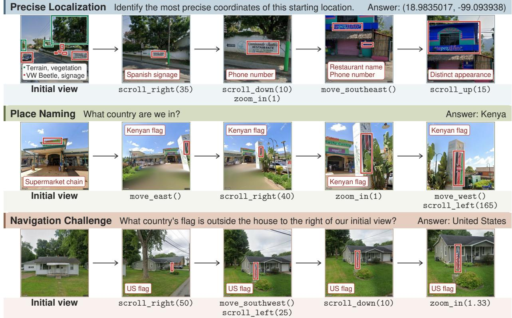  
Initial view scroll\_right(50) move\_southwest() scroll\_down(10) zoom\_in(1.33)scroll\_left(25)Figure 1: Example GeoGuesser Bench episodes. Read left to right; calls below each new view specify the scroll\_left(25)transition. Boxes mark natural (green) and human-made (red) clues. From top: Precise Localization, Place Naming, and Navigation Challenge. Prompts are abbreviated or illustrative.

Place Naming (80 entries) The agent names the region containing the starting location at the granularity the question specifies: street (11 entries), city or town (31), state or province (11), or country (27). Each location has regional indicators nearby, such as street signs, the language of written text, or architectural style, but the agent may need to turn or move to bring them into view. The task thus combines cultural knowledge with moderate navigation.

Navigation Challenge (80 entries) The agent answers a question about a specific object or feature near the start. Question types include Identification, which asks for a property of a target, such as a business name, the text on a sign, or a color, and Enumeration, which asks how many instances of an object lie in an area or along a route. Many prompts give relative directions (e.g., “head towards the stoplight”). No target is visible in the initial view, so every question requires changing the viewpoint, and many require moving to other panoramas. The task therefore demands the most precise navigation and, on average, the least world knowledge.

## 3.2 Curation

Locations We selected the Synthetic locations manually to span diverse countries, climates, and settings, from city centers to rural roads. Place Naming and Navigation Challenge locations favor urban and suburban areas, where cultural signals are strong and objects are distinct (Figure 2).

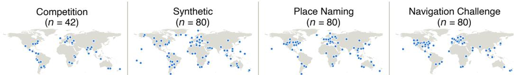  
Figure 2: Starting locations of each split. Competition and Synthetic are the two Precise Localization splits; Place Naming and Navigation Challenge favor urban and suburban areas (Section 3.2). Empty regions largely reflect scarce or absent Street View imagery, as in mainland China and much of Russia and Africa.

For the Synthetic split and Place Naming, whose answers are properties of the location itself, we excluded locations whose initial view shows a famous landmark that a model could recognize without exploring. Together with the offline environment (Section 4), this filtering is designed so that answers must come from the scene rather than from recalling a landmark or searching externally.

Questions and accepted answers For each Place Naming location, we chose a target region and identified visual clues near the start that point to it; where necessary, we changed the granularity (e.g., from city to street) or moved the start within the region so that the clues fit the target. For each Navigation Challenge location, we chose a target that exploration can reliably reach and wrote a question whose answer is a verifiable fact in the scene; we confirmed that the target is not visible in the initial view and that the question can be answered within the 40-step budget. Each Place Naming and Navigation Challenge question specifies an answer format (e.g., “Give only the number as an integer”) and lists accepted answers that cover equivalent forms, such as “Ave” and “Avenue” or “Czechia” and “Czech Republic.” For Precise Localization, the answer is the starting coordinate.

Competition split The 42 Competition locations are rounds from the Grand Finals of the GeoGuessr World Cup in 2023 and 2024 (renamed the GeoGuessr World Championship in 2025). For each round, we record the location together with the distance and score of the better of the two players’ guesses, which form the human reference (Section 4). Because these rounds were broadcast publicly, models may have seen them during pretraining; the Synthetic split, which does not come from public competition, serves as a check against such memorization (Section 5.1).

## 4 Evaluation Setup

Environment The environment exposes Google Street View panoramas to the agent through tools (Figure 1). An episode starts at the entry’s starting location with the camera facing north, level, at the default zoom (a 90◦ horizontal field of view). The prompt contains no image: the agent sees the scene only through tools that return a 1920 × 1080 rendering of the current view. Renderings omit Street View’s interface overlays, including the address box, road labels, and navigation arrows, so the interface never reveals the location. The agent has the following tools: scroll\_\* tools rotate (left, right) or tilt (up, down) the camera, and zoom\_in and zoom\_out change magnification, each by an amount the agent chooses; and move\_\* tools (move\_north, move\_northeast, . . . ) step to the adjacent panorama in a compass direction, if one exists. Camera tools return the current view.

Offline package The environment is a self-contained package that runs fully offline. The panoramas and panorama links reachable from each entry are bundled with the benchmark, so episodes make no network requests and observations do not drift as Street View imagery is updated. Running offline also closes shortcuts to reward hacking: agents cannot query map services, reverse-geocode their position, or search the web, and tools return only rendered views or movement status, never coordinates, addresses, or reference answers. The task set, tool set, step budget, and observation settings are configurable, and only the web-search ablation (Section 5.3) enables internet access. We will release the package with the benchmark.

Episodes and models A step is one model response, which may contain several tool calls. An episode ends when the agent replies without calling a tool, and that reply is its answer; the agent may take at most 40 tool-calling steps. The system prompt describes how answers are scored, asks for a final reply with an answer field and a brief context justification, and permits “I do not know” as an answer. An agent that uses all 40 steps receives one final turn in which it is asked for its answer; we say that an episode ends at the step limit only if the agent still gives no answer in this turn. We evaluate the 23 VLMs in Table 1 through their function-calling interfaces with identical prompts, tools, and budget. Every entry counts toward its task’s result: an episode that ends at the step limit, ends in an error, or yields no parseable answer scores 0 on Precise Localization and counts as incorrect on Place Naming and Navigation Challenge.

Scoring For Precise Localization, we parse the first valid latitude–longitude pair in the final reply and compute its geodesic distance d (km) to the ground truth on the WGS-84 ellipsoid. GeoGuessr does not publish its scoring rule, but prior work and player analyses report an exponential decay $[ 7 , 2 9 ] , S ( d ) = 5 0 0 0 \mathrm { e x p } ( - 1 0 d / \bar { D } )$ , where D is the haversine length of the diagonal of the smallest latitude–longitude rectangle containing the map $( D = 1 4 , 9 1 6 . 8 6 2$ km for the world map; Appendix B). The score ranges from 0 to 5000. For Place Naming and Navigation Challenge, we report accuracy over all 80 entries of each task; a reply is correct only if its answer field strictly matches one of the accepted answers, which include equivalent aliases (Appendix C).

Human reference On the Competition split, the better player’s guess in each round averages 4770.3 points, a score-equivalent distance (Appendix B) of 70.2 km. This is a reference point, not a matched comparison: players had one minute per round and placed their guesses on an interactive map, whereas agents have up to 40 steps but must state coordinates without a map. Taking the better of two guesses per round also makes the reference optimistic relative to a single expert.

## 5 Results

## 5.1 Agent Performance

Precise Localization No model reaches the human baseline on the Competition split (Table 1). The best agent, Claude Opus 4.8, averages 4352.4 points (207 km) against the expert reference of 4770.3 (70 km), and the runner-up trails it by only 46 points, well within their standard errors of about 200. The two Precise Localization splits rank the 23 models almost identically (Spearman $\rho = 0 . 9 7 )$ , and 19 models score higher on Synthetic than on Competition, so we see no sign that exposure to broadcast competition rounds inflates Competition scores.

Much of the spread between models reflects whether an agent answers at all rather than how accurately it localizes. Pooled over models, 45.7% of Competition and 38.6% of Synthetic episodes score zero (Table F.4), mostly because the agent either ends at the step limit, using all 40 steps without answering even when prompted in the final turn (20.7% and 19.1% of episodes; Section 4), or abstains before the limit (19.0% and 14.6%). Both are failures to commit to an answer rather than inaccurate answers: the system prompt permits “I do not know,” but it also describes the scoring rule, under which any guess scores above zero, so declining to guess is never optimal. When agents do answer, they are often accurate (Table F.5): on the Synthetic episodes they answer, GPT-5.2 and Grok 4.3, whose zeros are all abstentions, average 4324 and 4419 points, more than GPT-5.4 (4221), which answers all 80. This conditional score is only a diagnostic, since each model answers a different subset of episodes.

Table 1: Results on GeoGuesser Bench. For the Competition and Synthetic splits of Precise Localization (Section 3.1), cells show the mean GeoGuessr score over all entries, with invalid responses scored 0, and the score-equivalent distance in km (Eq. B.1). The human row averages the better of the two players guesses in each Competition round (Section 4). Models are sorted by average rank, the mean of a model’s ranks in the four result columns (1 is best; ties share the mean rank). Bold marks the best model in each column.
<table><tr><td></td><td colspan="3">Precise Localization (Score | Dist)</td><td rowspan="2">Place Naming (%)</td><td rowspan="2">Navigation Challenge (%)</td></tr><tr><td>Model</td><td>Competition</td><td>Synthetic</td><td></td></tr><tr><td>Human experts</td><td>4770.3|70.2</td><td></td><td>一</td><td>一</td><td></td></tr><tr><td>Claude Opus 4.8</td><td> $4 3 5 2 . 4 \pm 1 2 8$ </td><td>|206.9</td><td> $4 5 4 9 . 5 \pm 8 3$  |140.8</td><td> $6 0 . 0 0 \pm 3 . 6 $ </td><td> $2 6 . 2 5 \pm 3 . 3$ </td></tr><tr><td>Claude Opus 4.7</td><td> $4 3 0 6 . 4 \pm 1 4 6$  |222.8</td><td> $4 5 0 1 . 4 \pm 9 6 $ </td><td>156.7</td><td> $5 6 . 2 5 \pm 3 . 6 $ </td><td> $3 1 . 2 5 \pm 3 . 4$ </td></tr><tr><td>GPT-5.5</td><td> $3 8 1 5 . 1 \pm 1 8 2 $  |403.5</td><td> $3 4 6 7 . 8 \pm 1 6 1$ </td><td>|545.8</td><td> $6 2 . 5 0 \pm 3 . 5$ </td><td> $3 2 . 5 0 \pm 3 . 4$ </td></tr><tr><td>Claude Fable 5</td><td> $2 8 2 1 . 1 \pm 2 4 8$ </td><td>|853.7  $3 1 6 4 . 2 \pm 1 7 5$ </td><td>|682.5</td><td> $6 2 . 5 0 \pm 3 . 5$ </td><td> $3 5 . 0 0 \pm 3 . 5 $ </td></tr><tr><td>Qwen3.7-Plus</td><td> $3 9 6 4 . 4 \pm 1 3 3 $ </td><td>|346.2  $3 9 9 6 . 0 \pm 1 0 4 $ </td><td>|334.4</td><td> $4 2 . 5 0 \pm 3 . 6 $ </td><td> $2 3 . 7 5 \pm 3 . 1$ </td></tr><tr><td>GPT-5.4 Pro</td><td> $2 5 0 3 . 8 \pm 2 4 4 \mid$ </td><td>1031.7</td><td> $2 6 6 7 . 4 \pm 1 7 6$  |937.3</td><td> $6 0 . 0 0 \pm 3 . 6 $ </td><td> $3 5 . 0 0 \pm 3 . 5 $ </td></tr><tr><td>GPT-5.4</td><td> $3 9 2 3 . 1 \pm 1 2 2 $ </td><td>|361.8</td><td> $4 2 2 1 . 1 \pm 8 5 $  252.6</td><td> $5 0 . 0 0 \pm { 3 . 6 }$ </td><td> $1 2 . 5 0 \pm 2 . 4$ </td></tr><tr><td>GLM-5V-Turbo</td><td> $3 1 3 8 . 2 \pm 2 0 0 $ </td><td>|694.8</td><td> $3 8 5 9 . 8 \pm 1 3 1$  |386.1</td><td> $4 6 . 2 5 \pm 3 . 6 $ </td><td> $1 5 . 0 0 { \scriptstyle \pm 2 . 6 }$ </td></tr><tr><td>Claude Opus 4.6</td><td> $3 0 2 3 . 9 \pm 2 3 1$ </td><td>|750.2</td><td> $3 3 6 3 . 5 \pm 1 6 5$  |591.4</td><td> $4 5 . 0 0 \pm 3 . 6 $ </td><td> $1 8 . 7 5 \pm 2 . 9$ </td></tr><tr><td>MiniMax-M3</td><td> $3 0 6 1 . 5 \pm 2 0 5$ </td><td>|731.7</td><td> $2 9 0 5 . 8 \pm 1 5 9$  |809.6</td><td> $3 3 . 7 5 \pm 3 . 4$ </td><td> $1 7 . 5 0 \pm 2 . 8$ </td></tr><tr><td>Qwen3.6-Plus</td><td> $3 0 4 5 . 5 \pm 1 7 3$ </td><td>|739.5</td><td> $2 9 5 6 . 4 \pm 1 4 1$  |783.8</td><td> $3 6 . 2 5 \pm 3 . 5$ </td><td> $1 5 . 0 0 { \scriptstyle \pm 2 . 6 }$ </td></tr><tr><td>GPT-5.5 Pro</td><td>1163.4 ±211 |2175.0</td><td></td><td> $1 5 5 6 . 1 \pm 1 6 8$  1741.2</td><td> $4 7 . 5 0 \pm 3 . 6 $ </td><td> $3 1 . 2 5 \pm 3 . 4$ </td></tr><tr><td>Gemini 3 Flash</td><td> $2 8 5 1 . 0 \pm 2 4 0$ </td><td>|838.0</td><td> $2 4 9 3 . 3 \pm 1 8 3$  |1038.0</td><td> $3 8 . 7 5 \pm 3 . 6 $ </td><td> $1 8 . 7 5 \pm 2 . 9$ </td></tr><tr><td>Claude Sonnet 4.6</td><td> $2 6 4 9 . 1 \pm 2 4 5$ </td><td>|947.5</td><td> $2 8 8 3 . 8 \pm 1 7 4$  |820.9</td><td> $4 7 . 5 0 \pm 3 . 6 $ </td><td> $1 2 . 5 0 \pm 2 . 4$ </td></tr><tr><td>Gemini 3.5 Flash</td><td> $1 6 9 8 . 3 \pm 2 3 3$ </td><td>1610.7</td><td> $2 1 8 4 . 0 \pm 1 8 0$  1235.5</td><td> $4 6 . 2 5 \pm 3 . 6 $ </td><td> $1 7 . 5 0 \pm 2 . 8$ </td></tr><tr><td>Gemini 3.1 Pro</td><td> $5 9 3 . 6 \pm 1 6 4 $ </td><td>3178.8  $1 1 2 4 . 8 \pm 1 5 3$ </td><td>|2225.3</td><td> $4 7 . 5 0 \pm 3 . 6 $ </td><td> $3 0 . 0 0 \pm 3 . 4$ </td></tr><tr><td>Kimi K2.5</td><td> $2 0 1 6 . 2 \pm 2 2 8$ </td><td>|1354.8</td><td> $2 7 1 7 . 1 \pm 1 7 4 \mid 9 0 9 . 7$ </td><td> $4 2 . 5 0 \pm 3 . 6 $ </td><td> $1 5 . 0 0 { \scriptstyle \pm 2 . 6 }$ </td></tr><tr><td>Kimi K2.6</td><td> $1 6 6 7 . 9 \pm 2 2 9$ </td><td>|1637.7</td><td> $2 1 0 0 . 3 \pm 1 7 7$  1293.8</td><td> $5 0 . 0 0 \pm { 3 . 6 }$ </td><td> $1 3 . 7 5 \pm 2 . 5$ </td></tr><tr><td>Qwen3.5-397B-A17B</td><td> $2 2 2 1 . 5 \pm 2 0 9$ </td><td>|1210.1</td><td> $2 4 6 7 . 0 \pm 1 6 0 \mid 1 0 5 3 . 8$ </td><td> $2 8 . 7 5 \pm 3 . 3$ </td><td> $8 . 7 5 \pm 2 . 1$ </td></tr><tr><td>GPT-5.2</td><td> $5 2 3 . 9 \pm 1 4 6$ </td><td>3365.1</td><td> $1 2 4 3 . 2 \pm 1 5 1 | 2 0 7 6 . 1$ </td><td> $3 3 . 7 5 \pm 3 . 4$ </td><td> $1 7 . 5 0 \pm 2 . 8$ </td></tr><tr><td>Grok 4.3</td><td> $8 0 5 . 8 \pm 1 7 3$ </td><td>|2722.9</td><td> $1 5 4 6 . 8 \pm 1 6 2$  |1750.1</td><td> $3 2 . 5 0 \pm 3 . 4$ </td><td> $5 . 0 0 \pm 1 . 6$ </td></tr><tr><td> $\mathrm { Q w e n } 3 . 5 \mathrm { - } 1 2 2 \mathrm { B } \mathrm { - } \mathrm { A } 1 0 \mathrm { B }$ </td><td> $1 4 5 . 7 \pm 7 8$ </td><td>5274.1</td><td> $8 0 7 . 2 \pm 1 2 6$  |2720.3</td><td> $1 2 . 5 0 \pm 2 . 4$ </td><td> $6 . 2 5 \pm 1 . 8$ </td></tr><tr><td> $\mathrm { Q w e n } 3 . 5 { \cdot } 3 5 \mathrm { B } { \cdot } \mathrm { A } 3 \mathrm { B }$ </td><td> $2 5 2 . 4 \pm 8 3$ </td><td>4454.4</td><td> $3 6 4 . 8 \pm 8 9 $  3905.0</td><td> $1 0 . 0 0 \pm 2 . 2$ </td><td> $3 . 7 5 \pm 1 . 4$ </td></tr></table>

The strongest Precise Localization agents also explore little: the four best by mean Precise Localization score average at most 3.1 move\_\* calls per episode on this task, yet three of them move 8.2–9.3 times per Navigation Challenge episode (Figure 3a). Section 5.3 tests whether movement is needed at all.

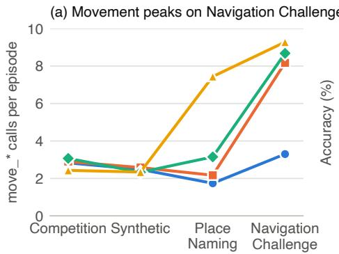

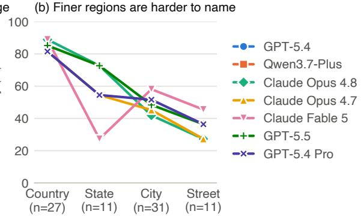  
Figure 3: Exploration and region granularity. (a) Mean move\_\* calls per completed episode for the four strongest models by mean Precise Localization score: all four move little on Precise Localization, and three move far more on Navigation Challenge. (b) Accuracy of the five strongest Place Naming models by the granularity the question asks for. Claude Fable 5’s dip at the state level comes from the step budget: all eight state questions it missed ended at the step limit. Tables F.2 and F.3 list the values.

Place Naming The best models name the correct region in 62.5% of questions. Accuracy falls with granularity (Figure 3b): the five strongest models identify the country in 81.5–88.9% of cases but the street in only 27.3–45.5%. Running out of steps also costs accuracy: 16.1% of all Place Naming episodes end at the step limit.

Navigation Challenge This is the hardest task: no model exceeds 35.0%. Agents also work longest here with 19 of the 23 models taking more steps on Navigation Challenge than on either the Synthetic split or Place Naming (Table F.1), and 28.5% of Navigation Challenge episodes end at the step limit, accounting for 35.3% of errors.

Rankings across tasks Rankings on one task only partly predict the others. Across the 23 models, Precise Localization scores correlate weakly with Navigation Challenge accuracy (Spearman $\rho = 0 . 3 9$ for both splits) and moderately with Place Naming accuracy $( \rho \ : = \ : 0 . 4 8$ and 0.55), whereas Place Naming and Navigation Challenge correlate more strongly $( \rho = 0 . 7 0 )$ . With 23 models these estimates are imprecise (a Fisher-z 95% interval for $\rho = 0 . 3 9$ spans −0.02 to 0.69), but individual rank reversals are large. GPT-5.4 is third on the Synthetic split but ties for 18th on Navigation Challenge, where it takes only 10.7 steps per episode, consistent with too little exploration; conversely, Claude Fable 5 ties for first on Place Naming and Navigation Challenge but ranks 11th on Competition, partly because it exhausts the budget in 15 of 42 episodes.

## 5.2 Failure Mode Analysis

To characterize errors, we assigned each failed episode of four models (Claude Opus 4.6, GPT-5.2, and Qwen3.5 at 122B and 397B parameters) one or more of three failure modes (Table F.6). A Precise Localization episode counts as failed if it scores worse than 4000 points (333 km), or gave no valid answer; a Place Naming or Navigation Challenge episode fails if its answer does not match the ground truth for that question. We labeled 160 of the 865 failed episodes manually (10 per model and task split) and used them as examples for LLM-based classifier agents, which labeled the remaining 705. FM1, Vision Failure, covers errors in interpreting visual input or applying pretrained knowledge, such as hallucinated landmark recognition, misclassified cues, or fixation on distractors (Figures F.4 and F.5). FM2, Navigational Reasoning Failure, covers errors in spatial reasoning and planning, such as inefficient routes, failing to follow the prompt’s directions or to replan, and losing track of objects or explored areas (Figures F.2 and F.3). FM3,

Table 2: Failure modes by task. Share of failed episodes with each mode, pooled over the four annotated models; an episode can have several modes. Bold: most common.
<table><tr><td>Task</td><td>FM1 vision</td><td>FM2 navigation</td><td>FM3 tool use</td></tr><tr><td>Comp.</td><td>0.136</td><td>0.780</td><td>0.152</td></tr><tr><td>Synth.</td><td>0.154</td><td>0.802</td><td>0.123</td></tr><tr><td>Place Naming</td><td>0.326</td><td>0.665</td><td>0.035</td></tr><tr><td>Navigation Challenge</td><td>0.351</td><td>0.601</td><td>0.145</td></tr></table>

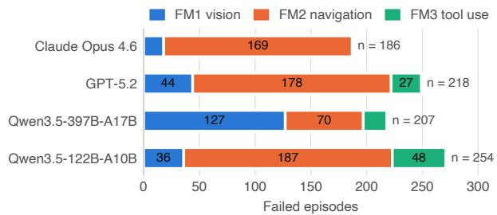  
Figure 4: Failure modes by model. Failed episodes assigned each mode, pooled over the four task splits; n is the number of failed episodes, and an episode can have several modes.

Tool-use Failure, covers malformed, invalid, or unsupported tool requests, such as misreading a documented tool or calling one that does not exist, which cause API errors, refusals to engage with the task, or corrupted context (Figure F.6). Figure F.1 in Appendix F shows three of these examples side by side.

Navigational reasoning failure is the most common mode on every task split, appearing in 60–80% of failed episodes (Table 2), and it accounts for most failures of three of the four models (Figure 4). Within the Qwen3.5 family, the larger model has fewer tool-use failures (21 versus 48) but more vision failures (127 versus 36), possibly due to longer interactions with the environment (taking more steps on every task; Table F.1), which bloats context with redundant visual evidence.

## 5.3 How Agents Gather Evidence

We probe how agents gather evidence for Precise Localization with five single-factor interventions on 13 models (Table 3): an 80-step limit, no move\_\* tools, only the top or bottom half of each view, and web search. We compare each with the 40-step scores in Table 1.

Step budget and movement A larger budget and the removal of movement both raise scores for most models, largely because agents run out of steps less often. With 80 steps, 9 of the 13 models improve on each split, and the share of episodes that end at the step limit falls from 19.1% to 7.4% (pooled over models and splits). Three of the four models that do not improve almost never end at the 40-step limit in the main setting.

Removing movement at the original 40-step budget raises scores over the main setting for 9 of 13 models on Competition and 10 on Synthetic, and over the 80-step condition for 6 and 7. Episodes become shorter (12.3 versus 20.0 steps on average) and rarely reach the limit (4.5%, versus 19.1% at 40 steps and 7.4% at 80); Claude Opus 4.8 scores 4646 on Competition without moving at all, more than with movement at either budget. For the strongest agents, a single panorama thus suffices for strong Precise Localization performance, and for most models the main cost of movement is the budget it consumes. The exceptions are two models that tend to abstain, which score lower without movement than with it at either budget and abstain more often.

Image crops Keeping only the top or bottom half of each view lowers scores for 10 to 13 of the 13 models, depending on the half and split. Stronger models are more robust: averaged over both crops and splits, the fraction of its main-setting score that a model retains (33–98%) rises with its mean main-setting Precise Localization score (Spearman $\rho = 0 . 7 3 ;$ Fisher-z 95% interval 0.29 to 0.91), with GPT-5.5 the clearest exception (third in the main setting, it retains 52%). Neither half is consistently more informative. Although the top half beats the bottom half for 12 of 13 models on Synthetic and for only 7 on Competition, every model tilts toward the missing half more often than away from it, which costs steps. The share of episodes ending at the step limit rises from 19.1% to 28.1% (top) and 30.2% (bottom).

Table 3: Ablation results across all conditions. Mean GeoGuessr score (0–5000) per model on the two Precise Localization splits, Competition (C, n = 42) and Synthetic (S, n = 80), with invalid responses assigned zero. 80 Steps: step limit raised from 40 to 80, navigation enabled. No Movement: move\_\* tools removed, look-and-zoom only, 40 steps. Top/Bottom Half: only the named half of each $1 9 2 0 \times 1 0 8 0$ capture retained, 40 steps, navigation enabled. Web Search: search\_engine\_query and fetch\_url\_content added, full images, 40 steps. Models are sorted by average rank over the ten columns; best value per column in bold. GPT-5.5’s Web Search cell on Synthetic averages 79 entries because one question was not attempted (1809 if it is counted as zero). Claude Opus 4.6’s Top Half, Bottom Half, and Web Search runs used OpenRouter; its other runs used the provider’s API.
<table><tr><td rowspan="2">Model</td><td colspan="2">80 Steps</td><td colspan="2">No Movement</td><td colspan="2">Top Half</td><td colspan="2">Bottom Half</td><td colspan="2">Web Search</td></tr><tr><td>C</td><td>S</td><td>C</td><td>S</td><td>C</td><td>S</td><td>C</td><td>S</td><td>C</td><td>S</td></tr><tr><td>Claude Opus 4.8</td><td>4594</td><td>4805</td><td>4646</td><td>4556</td><td>4368</td><td>4386</td><td>4369</td><td>4313</td><td>4551</td><td>4380</td></tr><tr><td>GLM-5V-Turbo</td><td>3520</td><td>4089</td><td>4249</td><td>4356</td><td>3061</td><td>3960</td><td>3093</td><td>3480</td><td>3544</td><td>4022</td></tr><tr><td>Qwen3.7-Plus</td><td>3884</td><td>3930</td><td>3686</td><td>3998</td><td>2925</td><td>3171</td><td>3271</td><td>3097</td><td>3080</td><td>3339</td></tr><tr><td>Claude Opus 4.6</td><td>3708</td><td>3741</td><td>3749</td><td>3018</td><td>2527</td><td>2583</td><td>1928</td><td>2879</td><td>2688</td><td>3069</td></tr><tr><td>Claude Sonnet 4.6</td><td>2791</td><td>3193</td><td>3626</td><td>4203</td><td>2337</td><td>2922</td><td>2446</td><td>2707</td><td>3206</td><td>2767</td></tr><tr><td>GPT-5.5</td><td>4407</td><td>4391</td><td>4100</td><td>4178</td><td>2212</td><td>2305</td><td>1403</td><td>1553</td><td>2388</td><td>1832</td></tr><tr><td>Kimi K2.5</td><td>3038</td><td>3167</td><td>2668</td><td>3119</td><td>2258</td><td>2413</td><td>718</td><td>1819</td><td>3999</td><td>3979</td></tr><tr><td>Gemini 3.5 Flash</td><td>2744</td><td>3228</td><td>3939</td><td>4019</td><td>948</td><td>2123</td><td>938</td><td>1179</td><td>0</td><td>125</td></tr><tr><td>Qwen3.5-397B</td><td>2175</td><td>2149</td><td>1661</td><td>1861</td><td>1871</td><td>2235</td><td>1556</td><td>1147</td><td>2444</td><td>2662</td></tr><tr><td>Kimi K2.6</td><td>1218</td><td>1804</td><td>781</td><td>2161</td><td>471</td><td>1599</td><td>856</td><td>1185</td><td>238</td><td>507</td></tr><tr><td>Gemini 3.1 Pro</td><td>1729</td><td>2473</td><td>1939</td><td>2532</td><td>0</td><td>1062</td><td>0</td><td>437</td><td>119</td><td>312</td></tr><tr><td>GPT-5.2</td><td>767</td><td>1295</td><td>572</td><td>1544</td><td>604</td><td>902</td><td>112</td><td>667</td><td>1696</td><td>2209</td></tr><tr><td>Grok 4.3</td><td>650</td><td>1400</td><td>578</td><td>623</td><td>407</td><td>1133</td><td>213</td><td>820</td><td>835</td><td>1022</td></tr></table>

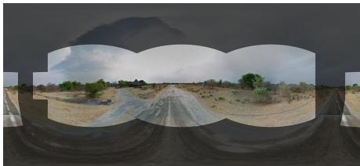  
Figure 5: Visual coverage within one panorama. Bright regions fall within the reconstructed camera views of an example no-movement episode; dark regions were never viewed. The mask shows which directions were viewed, not what the agent attended to.

Web search Web search improves 7 of 13 models on Competition but only 4 on Synthetic. It helps agents that would otherwise abstain: Kimi K2.5 nearly doubles its Competition score (2016 to 3999), abstaining in 4 rather than 47 episodes across both splits. It hurts agents that spend their budget searching: Gemini 3.5 Flash scores zero on all 42 Competition episodes. External information therefore does not reliably help; agents must still find useful clues and budget their steps.

Visual coverage Agents rarely inspect the full panorama. We measure coverage, the fraction of the viewing sphere covered by the union of an agent’s camera views in a no-movement episode (Figure 5; Appendix D). Across ten models, about two-thirds of episodes with any tool call never change pitch, and most end below the 0.49 of the sphere covered by one full horizontal sweep at the default field of view (Figure D.2). High scores do not require broad coverage: Claude

Opus 4.8’s no-movement run above has a median coverage of 0.31 and never tilts the camera. One explanation is that many geographic cues, such as signage, road markings, vegetation, and facades, lie near the horizon, echoing the equator bias of people viewing 360◦ panoramas [30].

## 6 Mitigating Context Growth in Long Episodes

Each step appends an image and text that the agent rereads at every later step, so its context grows linearly with episode length and its total input grows quadratically. For Gemini 3 Flash on Navigation Challenge, the median input rises from about 1.1K tokens at the first step to 32.6K at the 40th, and a median episode consumes 649K input tokens. Long histories also cause failures: in the main evaluation, 93 episodes (49 of them on Navigation Challenge) ended because the request exceeded the provider’s size limit, 69 for Claude models and 24 for GLM-5V-Turbo. We therefore test whether compressing the history can reduce token usage.

Framework We split the agent into three models (Figure A.1 in Appendix A). A Planner (Gemini 3 Flash) decides at each round whether to answer or to keep exploring, in which case it issues a natural-language instruction. A Worker, a fine-tuned Qwen2.5-VL-7B, turns the instruction into one atomic action given the current image (move forward, turn by a small or large angle, look up or down, zoom, or stop). A Compressor (Gemini 2.5 Flash-Lite) reads the task, the most recent actions, and notes on the key frames stored in the trajectory memory, and writes a short brief of the exploration state and a focus\_hint that points to evidence relevant to the next decision. The Planner receives this summary in place of the raw textual history, together with the task and the key frames, so its textual context stays short while visual evidence remains available.

Token usage Compared with the previous harness without Compressor, our Planner–Worker– Compressor harness reduces Planner token usage from 11.06M to 4.36M on Precise Localization, from 6.20M to 2.44M on Place Naming, and from 11.18M to 4.80M on Navigation Challenge— reductions of 60.6%, 60.6%, and 57.1%, respectively (Table A.1 in Appendix A). These counts cover only the Planner and exclude Worker and Compressor tokens.

## 7 Conclusion

GeoGuesser Bench tests whether VLM agents can combine world knowledge with active exploration in real Street View scenes. Across 23 agents, knowledge-heavy and exploration-heavy performance diverge, the best agent trails an expert reference, and many failures come from abstaining or exhausting the step budget without committing to an answer, rather than from misreading the scene; finding and counting objects remains hard for every agent. The environment’s verifiable rewards and restorable state also make it a training ground for such agents, which we leave to future work.

## Acknowledgment

Sky Computing Lab is supported by gifts from Accenture, Algorithmic SuperIntelligence Labs, Amazon, AMD, Anyscale, Broadcom, cmpnd, Google, IBM, Intel, Intesa Sanpaolo, Lambda, Lightspeed, Mirendil, NVIDIA, Soma Labs, and VESSL.

## References

[1] Zhengyuan Yang, Linjie Li, Jianfeng Wang, Kevin Lin, Ehsan Azarnasab, Faisal Ahmed, Zicheng Liu, Ce Liu, Michael Zeng, and Lijuan Wang. MM-REACT: Prompting ChatGPT for multimodal reasoning and action. arXiv preprint arXiv:2303.11381, 2023.

[2] Shilong Liu, Hao Cheng, Haotian Liu, Hao Zhang, Feng Li, Tianhe Ren, Xueyan Zou, Jianwei Yang, Hang Su, Jun Zhu, Lei Zhang, Jianfeng Gao, and Chunyuan Li. LLaVA-Plus: Learning to use tools for creating multimodal agents. arXiv preprint arXiv:2311.05437, 2023.

[3] Dídac Surís, Sachit Menon, and Carl Vondrick. ViperGPT: Visual inference via python execution for reasoning. In Proceedings of the IEEE/CVF International Conference on Computer Vision (ICCV), 2023.

[4] Shishir G. Patil, Huanzhi Mao, Fanjia Yan, Charlie Cheng-Jie Ji, Vishnu Suresh, Ion Stoica, and Joseph E. Gonzalez. The Berkeley Function Calling Leaderboard (BFCL): From tool use to agentic evaluation of large language models. In Proceedings of the 42nd International Conference on Machine Learning (ICML), volume 267 of Proceedings of Machine Learning Research, pages 48371–48392, 2025.

[5] Harsh Trivedi, Tushar Khot, Mareike Hartmann, Ruskin Manku, Vinty Dong, Edward Li, Shashank Gupta, Ashish Sabharwal, and Niranjan Balasubramanian. AppWorld: A controllable world of apps and people for benchmarking interactive coding agents. In Proceedings of the 62nd Annual Meeting of the Association for Computational Linguistics (ACL), 2024. arXiv:2407.18901.

[6] Zirui Wang, Junyi Zhang, Jiaxin Ge, Long Lian, Letian Fu, Lisa Dunlap, Ken Goldberg, XuDong Wang, Ion Stoica, David M. Chan, Sewon Min, and Joseph E. Gonzalez. Vis-Gym: Diverse, customizable, scalable environments for multimodal agents. arXiv preprint arXiv:2601.16973, 2026.

[7] Lukas Haas, Michal Skreta, Silas Alberti, and Chelsea Finn. Pigeon: Predicting image geolocations. In Proceedings of the IEEE/CVF Conference on Computer Vision and Pattern Recognition, pages 12893–12902, 2024.

[8] Plonk It. Beginner’s guide to GeoGuessr, n.d. URL https://www.plonkit.net/beginnersguide. Accessed 2026-03-20.

[9] Yushuo Zheng, Huiyu Duan, Zicheng Zhang, Xiaohong Liu, and Xiongkuo Min. Learning to wander: Improving the global image geolocation ability of LMMs via actionable reasoning. arXiv preprint arXiv:2603.10463, 2026.

[10] Junkeun Yi, Damon Mosk-Aoyama, Baihe Huang, Ritu Gala, Charles Wang, Sugam Dipak Devare, Khushi Bhardwaj, Abhibha Gupta, Oleksii Kuchaiev, Jiantao Jiao, Jian Zhang, and Venkat Srinivasan. PivotRL: High accuracy agentic post-training at low compute cost. arXiv preprint arXiv:2603.21383, 2026.

[11] Tobias Weyand, Ilya Kostrikov, and James Philbin. Planet - photo geolocation with convolutional neural networks. CoRR, abs/1602.05314, 2016. URL http://arxiv.org/abs/ 1602.05314.

[12] Jonas Theiner, Eric Müller-Budack, and Ralph Ewerth. Interpretable semantic photo geolocalization. CoRR, abs/2104.14995, 2021. URL https://arxiv.org/abs/2104.14995.

[13] Shraman Pramanick, Ewa M. Nowara, Joshua Gleason, Carlos D. Castillo, and Rama Chellappa. Where in the world is this image? transformer-based geo-localization in the wild, 2022. URL https://arxiv.org/abs/2204.13861.

[14] Vicente Vivanco Cepeda, Gaurav Kumar Nayak, and Mubarak Shah. Geoclip: Clip-inspired alignment between locations and images for effective worldwide geo-localization, 2023.

URL https://arxiv.org/abs/2309.16020.

[15] Zhongliang Zhou, Jielu Zhang, Zihan Guan, Mengxuan Hu, Ni Lao, Lan Mu, Sheng Li, and Gengchen Mai. Img2loc: Revisiting image geolocalization using multi-modality foundation models and image-based retrieval-augmented generation. In Proceedings of the 47th International ACM SIGIR Conference on Research and Development in Information Retrieval, SIGIR 2024, pages 2749–2754. ACM, July 2024. doi: 10.1145/3626772.3657673. URL http://dx.doi.org/10.1145/3626772.3657673.

[16] Pengyue Jia, Yiding Liu, Xiaopeng Li, Yuhao Wang, Yantong Du, Xiao Han, Xuetao Wei, Shuaiqiang Wang, Dawei Yin, and Xiangyu Zhao. G3: An effective and adaptive framework for worldwide geolocalization using large multi-modality models, 2024. URL https:// arxiv.org/abs/2405.14702.

[17] Angel Daruna, Nicholas Meegan, Han-Pang Chiu, Supun Samarasekera, and Rakesh Kumar. Geosurge: Geo-localization using semantic fusion with hierarchy of geographic embeddings, 2026. URL https://arxiv.org/abs/2510.01448.

[18] Pengyue Jia, Seongheon Park, Song Gao, Xiangyu Zhao, and Sharon Li. Georanker: Distanceaware ranking for worldwide image geolocalization, 2025. URL https://arxiv.org/abs/ 2505.13731.

[19] Qiujun Li, Zijin Xiao, Xulin Wang, Zhidan Ma, Cheng Yang, and Haifeng Li. Locationagent: A hierarchical agent for image geolocation via decoupling strategy and evidence from parametric knowledge, 2026. URL https://arxiv.org/abs/2601.19155.

[20] Piotr Mirowski, Matthew Koichi Grimes, Mateusz Malinowski, Karl Moritz Hermann, Keith Anderson, Denis Teplyashin, Karen Simonyan, Koray Kavukcuoglu, Andrew Zisserman, and Raia Hadsell. Learning to navigate in cities without a map. In Advances in Neural Information Processing Systems, 2018.

[21] Howard Chen, Alane Suhr, Dipendra Misra, Noah Snavely, and Yoav Artzi. TOUCH-DOWN: Natural language navigation and spatial reasoning in visual street environments. In Proceedings of the IEEE/CVF Conference on Computer Vision and Pattern Recognition (CVPR), 2019.

[22] Tajamul Ashraf, Amal Saqib, Hanan Ghani, Muhra AlMahri, Yuhao Li, Noor Ahsan, Umair Nawaz, Jean Lahoud, Hisham Cholakkal, Mubarak Shah, Philip Torr, Fahad Shahbaz Khan, Rao Muhammad Anwer, and Salman Khan. Agent-X: Evaluating deep multimodal reasoning in vision-centric agentic tasks. arXiv preprint arXiv:2505.24876, 2025.

[23] Kangyun Ning, Yisong Su, Xueqiang Lv, Yuanzhe Zhang, Jian Liu, Kang Liu, and Jinan Xu. WTU-EVAL: A whether-or-not tool usage evaluation benchmark for large language models. arXiv preprint arXiv:2407.12823, 2024.

[24] Yueen Ma, Zixing Song, Yuzheng Zhuang, Jianye Hao, and Irwin King. A survey on vision-language-action models for embodied AI. arXiv preprint arXiv:2405.14093, 2024.

[25] Shunyu Yao, Jeffrey Zhao, Dian Yu, Nan Du, Izhak Shafran, Karthik Narasimhan, and Yuan Cao. ReAct: Synergizing reasoning and acting in language models. In International Conference on Learning Representations (ICLR), 2023. arXiv:2210.03629.

[26] Timo Schick, Jane Dwivedi-Yu, Roberto Dessì, Roberta Raileanu, Maria Lomeli, Luke Zettlemoyer, Nicola Cancedda, and Thomas Scialom. Toolformer: Language models can teach themselves to use tools. In Advances in Neural Information Processing Systems (NeurIPS), 2023. arXiv:2302.04761.

[27] Shishir G. Patil, Tianjun Zhang, Xin Wang, and Joseph E. Gonzalez. Gorilla: Large language model connected with massive APIs. arXiv preprint arXiv:2305.15334, 2023.

[28] Yujia Qin, Shengding Hu, Yankai Lin, Weize Chen, Ning Ding, Ganqu Cui, Zheni Zeng, Yufei Huang, Chaojun Xiao, Chi Han, Yi Ren Fung, Yusheng Su, Huadong Wang, Cheng Qian, Runchu Tian, Kunlun Zhu, Shihao Liang, Xingyu Shen, Bokai Xu, Zhen Zhang, Yining Ye, Bowen Li, Ziwei Tang, Jing Yi, Yuzhang Zhu, Zhenning Dai, Lan Yan, Xin Cong, Yaxi Lu, Weilin Zhao, Yuxiang Huang, Junxi Yan, Xu Han, Xian Sun, Dahai Li, Jason Phang, Cheng Yang, Tongshuang Wu, Heng Ji, Zhiyuan Liu, and Maosong Sun. Tool learning with foundation models. arXiv preprint arXiv:2304.08354, 2023.

[29] Nicolas Dede. The maths of GeoGuessr, n.d. URL https://latb.io/geoguessr/articles/ the-maths. Accessed 2026-04-23.

[30] Vincent Sitzmann, Ana Serrano, Amy Pavel, Maneesh Agrawala, Diego Gutierrez, Belen Masia, and Gordon Wetzstein. Saliency in vr: How do people explore virtual environments? IEEE Transactions on Visualization and Computer Graphics, 24(4):1633–1642, 2018. doi: 10.1109/ TVCG.2018.2793599.

[31] Noah Shinn, Federico Cassano, Edward Berman, Ashwin Gopinath, Karthik Narasimhan, and Shunyu Yao. Reflexion: Language agents with verbal reinforcement learning. In Advances in Neural Information Processing Systems (NeurIPS), 2023. arXiv:2303.11366.

[32] Significant Gravitas. Auto-GPT: An autonomous GPT-4 experiment. https://github.com/ Significant-Gravitas/AutoGPT, 2023.

[33] Guanzhi Wang, Yuqi Xie, Yunfan Jiang, Ajay Mandlekar, Chaowei Xiao, Yuke Zhu, Linxi Fan, and Anima Anandkumar. Voyager: An open-ended embodied agent with large language models. arXiv preprint arXiv:2305.16291, 2023.

[34] John P. Snyder. Map Projections: A Working Manual. Number 1395 in U.S. Geological Survey Professional Paper. U.S. Government Printing Office, Washington, D.C., 1987. doi: 10.3133/pp1395.

## Appendix Contents

A Planner–Worker–Compressor Details . . . . . . 15   
B Precise Localization Scoring . . . . . . 16   
C Place Naming and Navigation Challenge Scoring . . . . . . . . 17   
D Visual Context Measurement . . . 17   
E Failure-Mode Annotation . . . . 19   
F Additional Figures and Tables . . . . . 20

## A Planner–Worker–Compressor Details

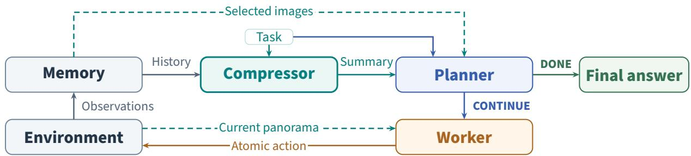  
Figure A.1: Planner–Worker–Compressor framework. The Compressor condenses recent actions and key-frame notes into a brief and focus\_hint; selected images remain available to the Planner. The Planner either returns an answer or instructs the Worker to act, producing new observations for Memory. Dashed arrows denote image inputs to the models.

Table A.1: Planner tokens and task results with and without Compressor. M denotes millions of tokens; reductions are computed from the displayed counts. Precise Localization reports the GeoGuessr score (the mean distance error falls from 166.89 km to 89.56 km with Compressor); Place Naming and Navigation Challenge report accuracy.
<table><tr><td></td><td>Precise Localization</td><td>Place Naming</td><td>Navigation Challenge</td></tr><tr><td>Planner tokens, no Compressor</td><td>11.06M</td><td>6.20M</td><td>11.18M</td></tr><tr><td>Planner tokens, Compressor</td><td>4.36M</td><td>2.44M</td><td>4.80M</td></tr><tr><td>Token reduction</td><td>60.6%</td><td>60.6%</td><td>57.1%</td></tr><tr><td>Result, no Compressor</td><td>4686</td><td>30.00%</td><td>24.39%</td></tr><tr><td>Result, Compressor</td><td>4737</td><td>26.25%</td><td>24.39%</td></tr></table>

Configuration The Planner is gemini-3-flash-preview and the Compressor gemini-2.5- flash-lite. The Planner’s output has four fields, thought, status, instruction, and answer: status CONTINUE passes the instruction to the Worker, and DONE returns the answer. Table A.1 reports planner tokens and task results with and without Compressor.

Relation to prior agent frameworks ReAct [25] interleaves chain-of-thought reasoning with tool actions in a closed reason–act–observe loop. Reflexion [31] adds verbal self-criticism to this loop; Auto-GPT [32] lets a single LLM decompose a goal and dispatch sub-tasks to itself; and Voyager [33] accumulates a library of executable skills through interaction in an embodied setting. These frameworks share the premise that long-horizon problems are best solved by alternating reasoning with observation. The framework in Section 6 follows this premise but departs from prior work in two ways: it splits high-level reasoning and low-level visual action across two models of very different capacity, and it places an explicit Compressor between trajectory memory and the planner, which separates context summarization from high-level reasoning.

## B Precise Localization Scoring

The score $S ( d )$ (Section 4) halves with every D ln $2 / 1 0 \approx 1 \AA , 0 3 4$ km of error (Figure B.1). We average scores rather than distances because the score is defined for invalid responses, which receive 0, and is not dominated by a few intercontinental misses. Tables also report the scoreequivalent distance

$$
{ \bar { d } } = - { \frac { D } { 1 0 } } \ln { \frac { \bar { s } } { 5 0 0 0 } } ,\tag{B.1}
$$

the error whose score equals the mean score ${ \bar { S } } ;$ it is not the mean error.

Distance computation GeoGuessr measures guess error with the haversine distance [29]. Given two latitude-longitude coordinates $\left( \phi _ { 1 } , \lambda _ { 1 } \right)$ and $\left( \phi _ { 2 } , \lambda _ { 2 } \right)$ on a spherical surface of radius $r ,$ the equation for their haversine distance is given by [34]:

$$
{ \mathrm { H a v } } ( x _ { 1 } , x _ { 2 } ) = 2 r \arcsin \left( \sqrt { \sin ^ { 2 } \left( \frac { \phi _ { 2 } - \phi _ { 1 } } { 2 } \right) + \cos \left( \phi _ { 1 } \right) \cos \left( \phi _ { 2 } \right) \sin ^ { 2 } \left( \frac { \lambda _ { 2 } - \lambda _ { 1 } } { 2 } \right) } \right)\tag{B.2}
$$

This quantity represents the shortest distance between the two coordinates over the surface of the sphere; GeoGuessr uses $r = 6 3 7 1$ km [29]. Our evaluator instead computes the geodesic distance on the WGS-84 ellipsoid with the geopy library. For any pair of points, the two distances differ by less than 0.6%, which changes the score $S ( \boldsymbol { d } )$ (Section 4) by at most about 10 points.

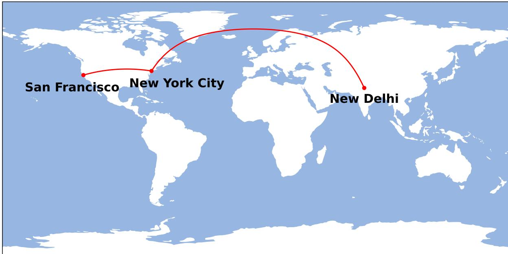  
Figure B.1: Haversine Distance Visualization. Haversine distance from New York City to San Francisco (\~4129 km; score=313) and New Delhi (\~11755 km; score=2).

## C Place Naming and Navigation Challenge Scoring

We extract the answer field of the final reply, lowercase it and each accepted answer, and strip punctuation; the reply is correct only if the result equals one of the entry’s accepted answers. Strict matching gives no credit for hedging: an answer that lists several candidates (“Kenya or Uganda”) or negates one $( ^ { \prime \prime } \mathrm { { n o t } K e n y a ^ { \prime \prime } ) }$ is incorrect, whereas a looser rule such as whole-word containment would accept both when “Kenya” is accepted. Its risk is the opposite error, a correct answer written in a form that the accepted answers do not list; to limit it, the accepted answers cover equivalent forms of each reference answer, such as “Czechia” and “Czech Republic” (Section 3.2).

Label audit We audited the automatic labels for both kinds of error. For false positives, we checked replies marked correct for answers that are hedged, negated, or otherwise wrong; for false negatives, we checked replies marked incorrect for answers equivalent to the reference answer. The audit found no mislabeled reply.

## D Visual Context Measurement

The no-movement coverage analysis uses ten of the 13 ablation models (Figure D.2); Claude Opus 4.6, GPT-5.2, and Qwen3.5-397B are excluded because their camera traces were not available for this analysis. Each model contributes 42 Competition and 80 Synthetic episodes, including zero-score responses.

Coverage definition For an episode confined to one panorama, angular coverage is the fraction of the viewing sphere covered by the union of reconstructed camera views:

$$
C = \frac { 1 } { 4 \pi } \int _ { \mathbb { S } ^ { 2 } } f ( \mathbf { d } ) d \Omega , \qquad f ( \mathbf { d } ) = \left\{ 1 , \ : \ : \mathrm { i f } \ : \mathbf { d } \in \bigcup _ { t } F _ { t } , \right.\tag{D.1}
$$

where d is a unit viewing direction and $F _ { t }$ is the spherical footprint of the perspective view after tool call t. Overlapping views count once. Figure 5 illustrates this union in an equirectangular projection, whose areas require latitude weighting to measure spherical coverage. Coverage measures reconstructed view availability, not semantic information or the agent’s attention: zooming into a sign may improve legibility without adding angular area.

Camera replay and spherical integration We reconstruct camera states by replaying each trace from heading, pitch, and horizontal field of view $( 0 ^ { \circ } , 0 ^ { \circ } , 9 0 ^ { \circ } )$ . The replay updates heading and pitch with each scroll\_\* call, and divides or multiplies the field of view by the zoom factor for zoom\_in or zoom\_out, respectively. Pitch is clamped $\mathrm { t o } \pm 9 0 ^ { \circ }$ and field of view to $\left[ 1 0 ^ { \circ } , 1 2 0 ^ { \circ } \right]$ Each recorded tool call emits one reconstructed view, including multiple calls within an agentic step. No extra initial view is inserted. An empty trace is assigned zero coverage, meaning no reconstructed tool-call views, rather than proof that the agent received no initial visual input. This replay assumes that recorded camera commands took effect; it does not independently validate tool execution or image delivery.

For each view, a unit direction belongs to its footprint if it lies in front of the camera and its horizontal and vertical perspective coordinates fall within the field-of-view bounds. We form the Boolean union of these footprints on a $2 0 4 8 \times 1 0 2 4$ longitude–latitude grid. A cell centered at latitude $\phi$ contributes cos $\phi \Delta \phi \Delta \lambda$ steradians; division by 4π gives Eq. D.1. The raster grid controls numerical integration resolution and is distinct from the $1 9 2 0 \times 1 0 8 0$ rendered viewport.

As a geometric check, a single $9 0 ^ { \circ }$ horizontal view at this aspect ratio covers approximately 0.1127 of the sphere.

Horizontal-sweep coverage Figure D.1 shows how a single perspective view maps onto the sphere. For the $1 9 2 0 \times 1 0 8 0$ viewport and default horizontal field of view $h = 9 0 ^ { \circ }$ , the vertical field of view is $v = 2 \arctan [ \left( 1 0 8 0 / 1 9 2 0 \right) \tan ( h / 2 ) ] \approx 5 8 . 7 2 ^ { \circ }$ . A dense horizontal sweep at zero pitch therefore covers a belt with fraction sin $( v / 2 ) \approx 0 . 4 9 0 3$ of the sphere. This corresponds to the vertical cutoff in coverage values pooled across models and datasets in Figure D.2. The 0.4903 bound applies to horizon-centered views with horizontal field of view at most $9 0 ^ { \circ } ;$ ; either changing pitch or zooming out beyond $9 0 ^ { \circ }$ can exceed it.

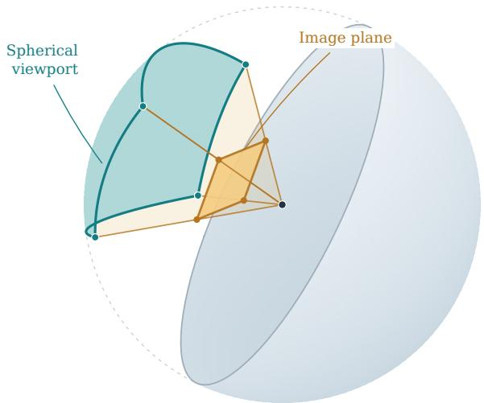  
Figure D.1: Camera field of view on the unit sphere. A perspective camera at the origin projects rays through a rectangular image plane (gold) onto the unit sphere. Normalizing each ray yields the spherical viewport (teal), the footprint $\bar { \boldsymbol { F } } _ { t }$ of a single view in Eq. D.1, whose curved boundary is set by the camera field of view rather than by a latitude–longitude rectangle. The default $h = 9 0 ^ { \circ }$ horizontal field of view and 16:9 aspect ratio give v $\approx 5 8 . 7 2 ^ { \circ }$ vertically. The cutaway removes the forward hemisphere to expose the observer and viewing pyramid; the dashed silhouette marks the full sphere.

Coverage and performance Figure D.2 plots angular coverage against GeoGuessr score, pooling observations across ten models and the Competition and Synthetic subsets. Among traces with at least one tool call, 254/380 (66.8%) on Competition and 496/738 (67.2%) on Synthetic keep pitch at zero throughout. The remaining 40 and 62 entries, respectively, have no recorded tool calls; they remain in the plot at $C = 0$ but are excluded from these behavioral percentages. This concentration at the horizon limits angular coverage even when agents turn through all headings. Color denotes the maximum absolute pitch reached, with $0 ^ { \circ } - 1 5 ^ { \circ }$ grouped in the same bin; exact zero-pitch counts are computed from the traces, not inferred from color. Discrete rotation choices produce repeated coverage values, and the plot is descriptive rather than a controlled dose–response experiment.

High scores do not require broad angular coverage. For example, Opus 4.8 never changes pitch in its 42 Competition no-movement traces, has a median coverage of 0.3075, and achieves a mean score of 4646. GLM-5V-Turbo has a greater median coverage, 0.4732, but a lower mean score of 4249 on the same split. This comparison illustrates why angular extent alone cannot explain performance: models also differ in which regions they inspect and how they interpret them. It does not establish that narrower coverage improves accuracy. Figure 5 illustrates the distinction between inspecting a panorama and exposing its entire surface.

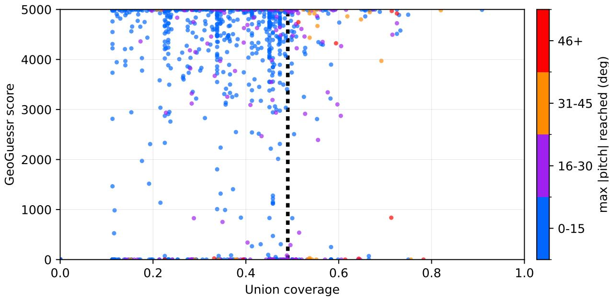  
Figure D.2: Panorama coverage versus performance–No Movement, Precise Localization. Observations from ten models on Competition and Synthetic are pooled in one plot of panorama coverage (Eq. D.1) against GeoGuessr score; color denotes maximum absolute pitch. Invalid responses remain at zero score, and zero coverage denotes an empty reconstructed trace. The dotted line at approximately 0.49 indicates the coverage limit of a full horizon sweep at the default field of view; pitch changes or wider fields of view can exceed it.

## E Failure-Mode Annotation

Five annotators labeled the 865 failed episodes of the four models in Section 5.2. The episodes were divided among the annotators, and each annotator inspected the traces assigned to them and gave each episode one or more of the three failure modes in Table F.6. To measure agreement, 300 episodes were labeled by more than one annotator, and the annotators’ labels agreed on 95% of them.

## F Additional Figures and Tables

Table F.1: Average steps per episode (mean ± standard deviation). Number of agent steps (tool-call rounds plus the final answer) the model takes before committing a response, per task split. Statistics are computed over completed episodes only; episodes that ended in an API error, such as requests exceeding the provider’s size limit (HTTP 413) on long, image-heavy episodes of Claude Fable 5 and Claude Opus 4.6, are excluded. Claude Opus rows use the direct Anthropic endpoint. The step budget is 40.
<table><tr><td rowspan="2"></td><td colspan="2">Precise Localization</td><td rowspan="2"></td><td rowspan="2">Place Naming Navigation Challenge</td></tr><tr><td>Competition Synthetic Steps</td><td>Steps</td></tr><tr><td>Model</td><td> $2 9 . 1 \pm 1 2 . 5$ </td><td></td><td>Steps</td><td>Steps</td></tr><tr><td>Claude Fable 5</td><td></td><td> $2 3 . 9 \pm 1 5 . 3$ </td><td> $2 0 . 0 \pm 1 6 . 0$   $1 1 . 6 \pm 1 1 . 3$ </td><td> $3 1 . 1 \pm 1 1 . 1$   $2 7 . 0 \pm 1 3 . 2$ </td></tr><tr><td>Claude Opus 4.8</td><td> $1 2 . 8 \pm 8 . 9$ </td><td> $9 . 7 \pm 7 . 9$   $9 . 8 \pm 9 . 0$ </td><td> $1 4 . 7 \pm 1 3 . 4$ </td><td> $2 5 . 1 \pm 1 2 . 3$ </td></tr><tr><td>Claude Opus 4.7 Claude Opus 4.6</td><td> $1 1 . 8 \pm 8 . 0$   $2 4 . 4 \pm 1 2 . 5$ </td><td> $2 4 . 5 \pm 1 4 . 5$ </td><td> $2 4 . 8 \pm 1 5 . 3$ </td><td> $3 3 . 5 \pm 1 0 . 7$ </td></tr><tr><td>Claude Sonnet 4.6</td><td> $2 9 . 4 \pm 1 3 . 1$ </td><td> $2 3 . 2 \pm 1 3 . 9$ </td><td> $2 4 . 1 \pm 1 5 . 3$ </td><td> $3 4 . 5 \pm 1 0 . 3$ </td></tr><tr><td>GPT-5.5 Pro</td><td> $3 8 . 3 \pm 6 . 0$ </td><td> $3 6 . 0 \pm 8 . 3$ </td><td> $2 4 . 6 \pm 1 5 . 6$ </td><td> $3 0 . 0 \pm 1 1 . 4$ </td></tr><tr><td>GPT-5.5</td><td> $3 0 . 0 \pm 8 . 8$ </td><td> $2 7 . 2 \pm 1 1 . 1$ </td><td> $1 7 . 4 \pm 1 2 . 2$ </td><td> $2 4 . 9 \pm 1 0 . 2$ </td></tr><tr><td>GPT-5.4 Pro</td><td> $3 5 . 7 \pm 7 . 2$ </td><td> $3 3 . 2 \pm 9 . 3$ </td><td> $2 3 . 4 \pm 1 2 . 2$ </td><td> $2 5 . 8 \pm 1 0 . 3$ </td></tr><tr><td>GPT-5.4</td><td> $1 0 . 8 \pm 2 . 7$ </td><td> $1 0 . 1 \pm 3 . 0$ </td><td> $7 . 2 \pm 3 . 5$ </td><td> $1 0 . 7 \pm 8 . 1$ </td></tr><tr><td>GPT-5.2</td><td> $9 . 9 \pm 2 . 9$ </td><td> $9 . 3 \pm 3 . 1$ </td><td> $9 . 1 \pm 5 . 5$ </td><td> $1 2 . 6 \pm 9 . 4$ </td></tr><tr><td>Gemini 3.1 Pro</td><td> $3 9 . 5 \pm 5 . 4$ </td><td> $3 7 . 0 \pm 8 . 8$ </td><td> $2 9 . 1 \pm 1 4 . 0$ </td><td> $3 2 . 8 \pm 1 2 . 0$ </td></tr><tr><td>Gemini 3.5 Flash</td><td> $3 5 . 2 \pm 9 . 2$ </td><td> $3 3 . 7 \pm 1 0 . 8$ </td><td> $3 0 . 1 \pm 1 3 . 7$ </td><td> $3 5 . 7 \pm 1 0 . 1$ </td></tr><tr><td>Gemini 3 Flash</td><td> $2 8 . 3 \pm 1 3 . 1$ </td><td> $2 8 . 7 \pm 1 4 . 0$ </td><td> $3 1 . 4 \pm 1 3 . 2$ </td><td> $3 6 . 4 \pm 8 . 9$ </td></tr><tr><td>Kimi K2.6</td><td> $2 6 . 3 \pm 1 2 . 1$ </td><td> $2 2 . 3 \pm 1 3 . 2$ </td><td> $2 4 . 3 \pm 1 3 . 2$ </td><td> $3 1 . 9 \pm 1 2 . 1$ </td></tr><tr><td>Kimi K2.5</td><td> $2 0 . 9 \pm 1 0 . 5$ </td><td> $2 1 . 8 \pm 1 0 . 8$ </td><td> $2 0 . 6 \pm 1 2 . 5$ </td><td> $3 2 . 9 \pm 1 1 . 1$ </td></tr><tr><td>Grok 4.3</td><td> $3 . 3 \pm 1 . 4$ </td><td> $3 . 5 \pm 1 . 3$ </td><td> $3 . 5 \pm 1 . 6$ </td><td> $4 . 1 \pm 3 . 0$ </td></tr><tr><td>GLM-5V-Turbo</td><td> $2 2 . 0 \pm 1 1 . 0$ </td><td> $1 8 . 5 \pm 9 . 0$ </td><td> $1 6 . 4 \pm 1 2 . 0$ </td><td> $2 2 . 3 \pm 1 3 . 3$ </td></tr><tr><td> $\mathrm { M i n i M a x } { \mathrm { - } } \mathrm { M } 3$ </td><td> $1 3 . 9 \pm 1 1 . 3$ </td><td> $1 1 . 6 \pm 8 . 6$ </td><td> $7 . 8 \pm 9 . 7$ </td><td> $2 5 . 2 \pm 1 4 . 9$ </td></tr><tr><td> $_ \mathrm { Q w e n } 3 . 7 – \mathrm { P l u s }$ </td><td> $1 2 . 6 \pm 4 . 3$ </td><td> $1 1 . 2 \pm 5 . 2$ </td><td> $9 . 8 \pm 8 . 8$ </td><td> $2 0 . 3 \pm 1 3 . 8$ </td></tr><tr><td> $\mathrm { Q w e n } 3 . 6 \mathrm { - } \mathrm { P l u s }$ </td><td> $4 . 0 \pm 3 . 6$ </td><td> $4 . 1 \pm 3 . 8$ </td><td> $3 . 6 \pm 3 . 1$ </td><td> $1 6 . 6 \pm 1 4 . 4$ </td></tr><tr><td> $\mathrm { Q w e n 3 . 5 - 3 9 7 B { \mathrm { - } } A 1 7 B }$ </td><td> $1 2 . 0 \pm 7 . 6$ </td><td> $1 5 . 4 \pm 8 . 0$ </td><td> $8 . 1 \pm 8 . 2$ </td><td> $1 6 . 7 \pm 1 2 . 9$ </td></tr><tr><td> $\mathrm { Q w e n } 3 . 5 \substack { - 1 2 2 } \mathrm { B - A } 1 0 \mathrm { B }$ </td><td> $3 . 5 \pm 2 . 0$ </td><td> $3 . 6 \pm 2 . 0$ </td><td> $2 . 5 \pm 1 . 1$ </td><td> $9 . 6 \pm 1 0 . 5$ </td></tr><tr><td> $\mathrm { Q w e n } 3 . 5 { \cdot } 3 5 \mathrm { B } { \cdot } \mathrm { A } 3 \mathrm { B }$ </td><td> $4 . 2 \pm 2 . 1$ </td><td> $4 . 5 \pm 2 . 4$ </td><td> $6 . 2 \pm 5 . 6$ </td><td> $8 . 8 \pm 7 . 6$ </td></tr><tr><td></td><td></td><td></td><td></td><td></td></tr></table>

Table F.2: Average movement calls per episode. Mean number of move\_\* tool calls per episode for the four strongest models by mean Precise Localization score (Competition and Synthetic), by task type; plotted in Figure 3a. Counts are over completed episodes only.
<table><tr><td>Model</td><td>Comp.</td><td>Synth.</td><td>Place Naming</td><td>Navigation Challenge</td></tr><tr><td>Claude Opus 4.8</td><td>3.07</td><td>2.33</td><td>3.15</td><td>8.68</td></tr><tr><td>Claude Opus 4.7</td><td>2.43</td><td>2.34</td><td>7.44</td><td>9.28</td></tr><tr><td>GPT-5.4</td><td>2.83</td><td>2.48</td><td>1.74</td><td>3.30</td></tr><tr><td>Qwen3.7-Plus</td><td>2.90</td><td>2.58</td><td>2.17</td><td>8.17</td></tr></table>

(b) GPT-5.2: final view  
Table F.3: Place Naming accuracy by question granularity. Accuracy (%) of the five strongest models on Place Naming, by the geographic granularity the question asks for; plotted in Figure 3b. Bold: best per granularity.
<table><tr><td>Model</td><td>Country  $( n { = } 2 7 )$ </td><td>State  $( n { = } 1 1 )$ </td><td>City  $\scriptstyle ( n = 3 1 )$ </td><td>Street (n=11)</td></tr><tr><td>Claude Fable 5</td><td>88.9</td><td>27.3</td><td>58.1</td><td>45.5</td></tr><tr><td>Claude Opus 4.8</td><td>88.9</td><td>72.7</td><td>41.9</td><td>27.3</td></tr><tr><td>Claude Opus 4.7</td><td>81.5</td><td>54.5</td><td>45.2</td><td>27.3</td></tr><tr><td>GPT-5.5</td><td>85.2</td><td>72.7</td><td>48.4</td><td>36.4</td></tr><tr><td>GPT-5.4 Pro</td><td>81.5</td><td>54.5</td><td>51.6</td><td>36.4</td></tr></table>

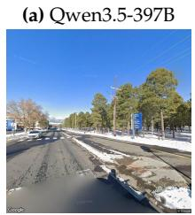

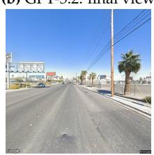

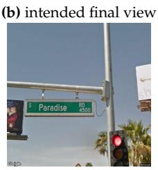

(c) Opus 4.6: chosen  
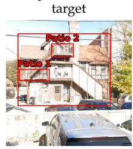

(c) intended target  
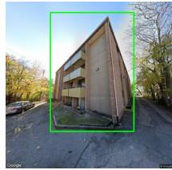  
Figure F.1: Failure-mode examples. (a) FM2, Place Naming (“What street are we on?”), intermediate view: the agent overlooks blue signage and crosswalks that suggest a nearby street sign, and answers “I do not know.” (b) FM1, the same question at another location: from its final view, the agent answers “Las Vegas Boulevard South” based on the skyline and roadside businesses instead of exploring toward the intended view. (c) FM1, Navigation Challenge (“How many distinct, third floor patios does this building have?”): the model fixates on a house with a gabled roof rather than the intended building. Figures F.3–F.5 give the full prompts and responses.

Table F.4: Precise Localization score distribution and failure causes. For each Precise Localization split: the median GeoGuessr score, the number of zero-score episodes (Competition: of 42; Synthetic: of 80), and how many of them ended at the 40-step limit, with no answer in the final turn (Step; Section 4), or with an abstention before the limit (Abst.); the remaining zeros are API errors or episodes without a final reply. The last two columns count the Place Naming and Navigation Challenge episodes (of 80) that ended at the step limit in the same sense. Rows follow Table 1.
<table><tr><td></td><td colspan="4">Competition</td><td colspan="4">Synthetic</td><td colspan="2">Step limit</td></tr><tr><td>Model</td><td>Median</td><td>Zero</td><td>Step</td><td>Abst.</td><td>Median</td><td>Zero</td><td>Step</td><td>Abst.</td><td>Place Naming</td><td>Navigation Challenge</td></tr><tr><td>Claude Opus 4.8</td><td>4923</td><td>2</td><td>2</td><td>0</td><td>4984</td><td>2</td><td>2</td><td>0</td><td>4</td><td>27</td></tr><tr><td>Claude Opus 4.7</td><td>4949</td><td>4</td><td>1</td><td>3</td><td>4988</td><td>4</td><td>2</td><td>2</td><td>9</td><td>17</td></tr><tr><td>GPT-5.5</td><td>4763</td><td>7</td><td>7</td><td>0</td><td>4968</td><td>18</td><td>18</td><td>0</td><td>7</td><td>10</td></tr><tr><td>Claude Fable 5</td><td>4872</td><td>18</td><td>15</td><td>0</td><td>4994</td><td>29</td><td>28</td><td>0</td><td>22</td><td>28</td></tr><tr><td>Qwen3.7-Plus</td><td>4411</td><td>2</td><td>0</td><td>1</td><td>4608</td><td>1</td><td>0</td><td>1</td><td>3</td><td>17</td></tr><tr><td>GPT-5.4 Pro</td><td>3662</td><td>20</td><td>20</td><td>0</td><td>3988</td><td>35</td><td>35</td><td>0</td><td>11</td><td>10</td></tr><tr><td>GPT-5.4</td><td>4209</td><td>1</td><td>0</td><td>1</td><td>4871</td><td>0</td><td>0</td><td>0</td><td>0</td><td>1</td></tr><tr><td>GLM-5V-Turbo</td><td>4091</td><td>11</td><td>6</td><td>0</td><td>4892</td><td>8</td><td>3</td><td>0</td><td>7</td><td>16</td></tr><tr><td>Claude Opus 4.6</td><td>4416</td><td>14</td><td>9</td><td>0</td><td>4978</td><td>22</td><td>21</td><td>0</td><td>24</td><td>37</td></tr><tr><td>MiniMax-M3</td><td>4138</td><td>12</td><td>4</td><td>6</td><td>4119</td><td>23</td><td>1</td><td>11</td><td>3</td><td>24</td></tr><tr><td>Qwen3.6-Plus</td><td>3691</td><td>6</td><td>0</td><td>6</td><td>3481</td><td>6</td><td>0</td><td>3</td><td>0</td><td>13</td></tr><tr><td>GPT-5.5 Pro</td><td>0</td><td>32</td><td>32</td><td>0</td><td>0</td><td>53</td><td>53</td><td>0</td><td>27</td><td>30</td></tr><tr><td>Gemini 3 Flash</td><td>4400</td><td>17</td><td>17</td><td>0</td><td>2420</td><td>39</td><td>39</td><td>0</td><td>47</td><td>56</td></tr><tr><td>Claude Sonnet 4.6</td><td>4460</td><td>19</td><td>15</td><td>0</td><td>4841</td><td>29</td><td>23</td><td>0</td><td>27</td><td>39</td></tr><tr><td>Gemini 3.5 Flash</td><td>0</td><td>27</td><td>27</td><td>0</td><td>0</td><td>44</td><td>44</td><td>0</td><td>35</td><td>53</td></tr><tr><td>Gemini 3.1 Pro</td><td>0</td><td>37</td><td>35</td><td>2</td><td>0</td><td>62</td><td>62</td><td>0</td><td>38</td><td>48</td></tr><tr><td>Kimi K2.5</td><td>0</td><td>23</td><td>1</td><td>22</td><td>4123</td><td>30</td><td>5</td><td>25</td><td>13</td><td>39</td></tr><tr><td>Kimi K2.6</td><td>0</td><td>27</td><td>8</td><td>19</td><td>0</td><td>43</td><td>14</td><td>29</td><td>18</td><td>41</td></tr><tr><td>Qwen3.5-397B-A17B</td><td>1954</td><td>14</td><td>1</td><td>13</td><td>3000</td><td>25</td><td>1</td><td>23</td><td>1</td><td>10</td></tr><tr><td>GPT-5.2</td><td>0</td><td>37</td><td>0</td><td>37</td><td>0</td><td>57</td><td>0</td><td>57</td><td>0</td><td>2</td></tr><tr><td>Grok 4.3</td><td>0</td><td>34</td><td>0</td><td>34</td><td>0</td><td>52</td><td>0</td><td>52</td><td>0</td><td>0</td></tr><tr><td>Qwen3.5-122B-A10B</td><td>0</td><td>40</td><td>0</td><td>39</td><td>0</td><td>62</td><td>0</td><td>61</td><td>0</td><td>5</td></tr><tr><td>Qwen3.5-35B-A3B</td><td>0</td><td>37</td><td>0</td><td>1</td><td>0</td><td>66</td><td>0</td><td>5</td><td>0</td><td>1</td></tr></table>

Table F.5: Score on answered episodes. Mean GeoGuessr score | distance in km (Eq. B.1) over episodes with a non-zero score on the two Precise Localization splits, Competition (n=42) and Synthetic (n=80), and the percentage of episodes that score zero, pooled over both (n=122). Zero scores come from abstentions, episodes that end at the step limit, and errors (Table F.4). Bold marks the highest score and the lowest zero-score rate.
<table><tr><td>Model</td><td>Competition Score | Dist</td><td></td><td>Synthetic Score | Dist</td><td>Zero-score rate %</td></tr><tr><td>Claude Opus 4.8</td><td>4570.0 |134.1</td><td></td><td>4666.2|103.1</td><td>3.28</td></tr><tr><td>Claude Opus 4.7</td><td>4759.7|73.5</td><td></td><td>4738.3|80.2</td><td>6.56</td></tr><tr><td>GPT-5.5</td><td>4578.1 |131.5</td><td></td><td>4474.6|165.6</td><td>20.49</td></tr><tr><td>Claude Fable 5</td><td>4937.0|18.9</td><td></td><td>4963.4|11.0</td><td>38.52</td></tr><tr><td>Qwen3.7-Plus</td><td>4162.6|273.4</td><td></td><td>4046.5|315.6</td><td>2.46</td></tr><tr><td>GPT-5.4 Pro</td><td>4780.0|67.1</td><td></td><td>4742.0|79.0</td><td>45.08</td></tr><tr><td>GPT-5.4</td><td>4018.8|325.9</td><td></td><td>4221.1 |252.6</td><td>0.82</td></tr><tr><td>GLM-5V-Turbo</td><td>4251.8 |241.8</td><td></td><td>4288.7 |228.9</td><td>15.57</td></tr><tr><td>Claude Opus 4.6</td><td>4535.9|145.3</td><td></td><td>4639.3 |111.7</td><td>29.51</td></tr><tr><td>MiniMax-M3</td><td>4286.2|229.8</td><td></td><td>4078.3 |303.9</td><td>28.69</td></tr><tr><td>Qwen3.6-Plus</td><td>3553.1 | 509.6</td><td></td><td>3196.1 |667.5</td><td>9.84</td></tr><tr><td>GPT-5.5 Pro</td><td>4886.3|34.3</td><td></td><td>4610.7|120.9</td><td>69.67</td></tr><tr><td>Gemini 3 Flash</td><td>4789.6|64.1</td><td></td><td>4864.9|40.9</td><td>45.90</td></tr><tr><td>Claude Sonnet 4.6</td><td>4837.5|49.3</td><td></td><td>4523.6|149.4</td><td>39.34</td></tr><tr><td>Gemini 3.5 Flash</td><td>4755.2|74.9</td><td></td><td>4853.3 |44.4</td><td>58.20</td></tr><tr><td>Gemini 3.1 Pro</td><td>4986.5|4.0</td><td></td><td>4999.2 | 0.2</td><td>81.15</td></tr><tr><td>Kimi K2.5</td><td>4456.9|171.5</td><td></td><td>4347.4|208.6</td><td>43.44</td></tr><tr><td>Kimi K2.6</td><td>4670.2|101.8</td><td></td><td>4541.3 | 143.5</td><td>57.38</td></tr><tr><td>Qwen3.5-397B-A17B</td><td>3332.2|605.3</td><td></td><td>3588.3|494.9</td><td>31.97</td></tr><tr><td>GPT-5.2</td><td>4400.8 |190.4</td><td></td><td>4324.0 |216.7</td><td>77.05</td></tr><tr><td>Grok 4.3</td><td>4230.7|249.2</td><td></td><td>4419.3 |184.2</td><td>70.49</td></tr><tr><td>Qwen3.5-122B-A10B</td><td>3059.8|732.5</td><td></td><td>3587.7|495.1</td><td>83.61</td></tr><tr><td>Qwen3.5-35B-A3B</td><td>2120.6|1279.5</td><td></td><td>2084.7|1304.9</td><td>84.43</td></tr></table>

Table F.6: Taxonomy of observed failure modes. Each mode represents a distinct category of error exhibited by visual agents during geospatial reasoning tasks.
<table><tr><td>ID</td><td>Failure Mode</td><td>Description</td><td>Affected Stage</td></tr><tr><td>FM1</td><td>Vision Failure</td><td>Errors in interpreting visual input or applying pretrained knowledge, including hallucinated landmark recognition, target object misclassification, and faulty perception of scene content.</td><td>Vision</td></tr><tr><td></td><td>FM 2 Navigational Reasoning Failure</td><td>Errors in spatial and navigational reasoning, including poor route planning, imprecise movement execution, and lost spatial awareness across observations.</td><td>Planning / Execution</td></tr><tr><td>FM 3 Tool-Use Failure</td><td></td><td>Errors in tool interface use, includingTool Use malformed or invalid calls, hallucinated tool capabilities, and refusal to engage due to misunderstood tool semantics.</td><td></td></tr></table>

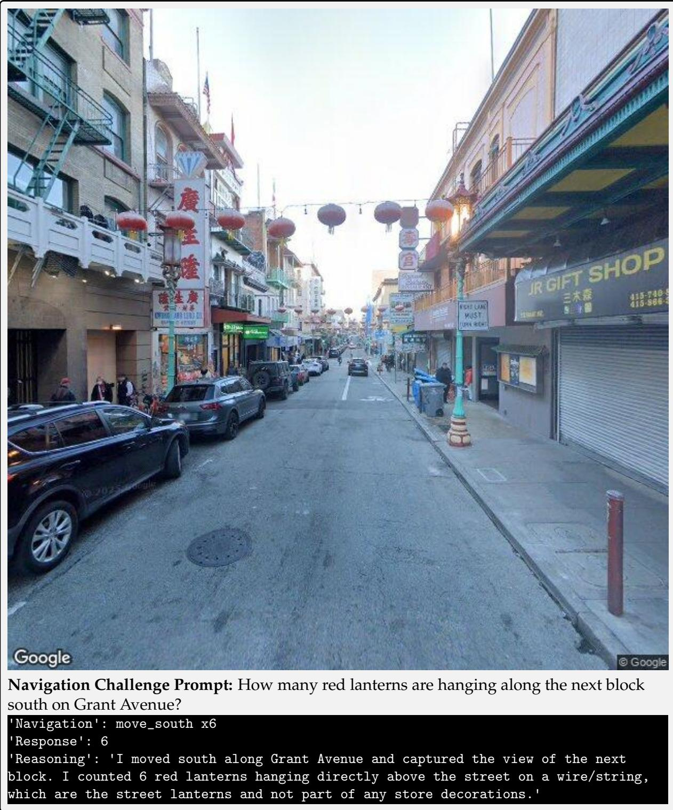  
Figure F.2: FM2 (navigational reasoning failure) example: lack of object permanence. Final view of Qwen3.5-122B-A10B for a Navigation Challenge prompt. The model miscounts the lanterns hanging just above and ignores the lanterns it passed on the way to this viewpoint.

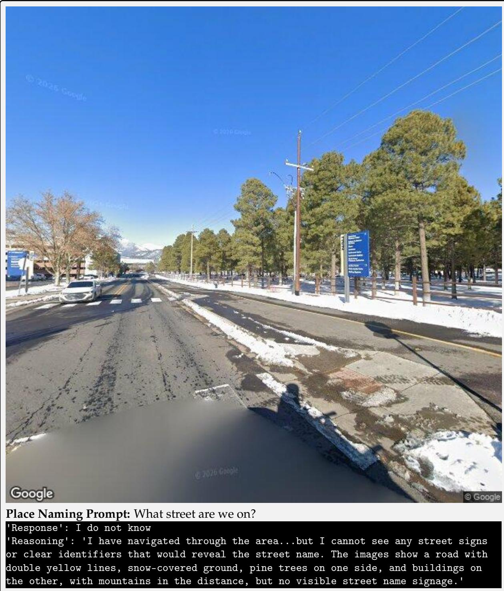  
Figure F.3: FM2 (navigational reasoning failure) example: poor route planning. Intermediate view of Qwen3.5-397B-A17B for a Place Naming prompt. The agent overlooks the blue signage and crosswalks, which suggest that a street sign is nearby.

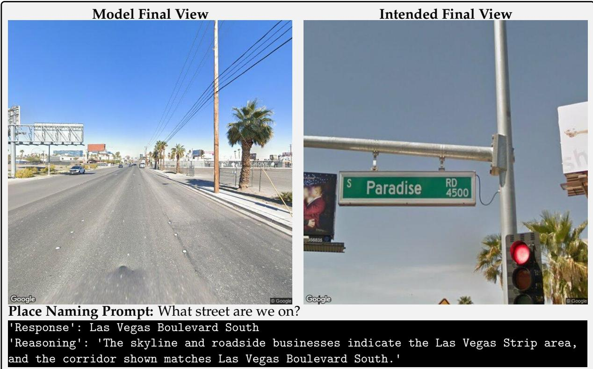  
Figure F.4: FM1 (vision failure) example: hallucinated landmark recognition. Final view of GPT-5.2 and the intended final view for a Place Naming prompt. Instead of exploring further and grounding its answer in concrete features of the scene, the agent infers its location from sparse evidence and pretrained knowledge.

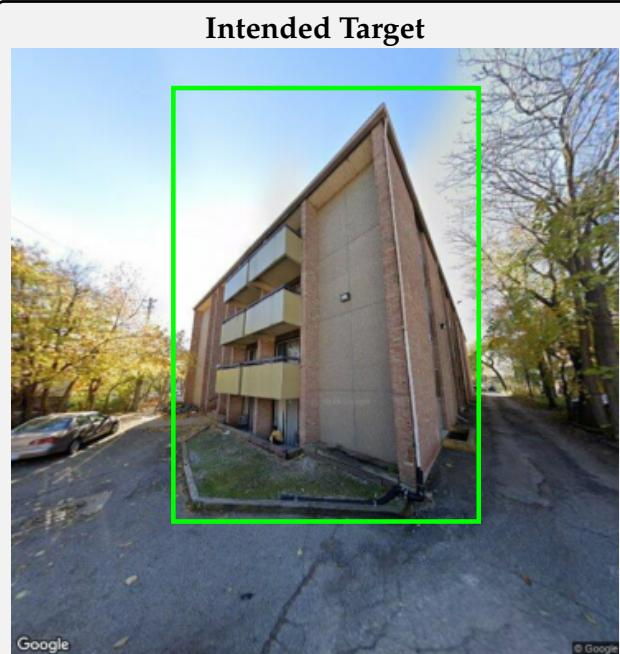

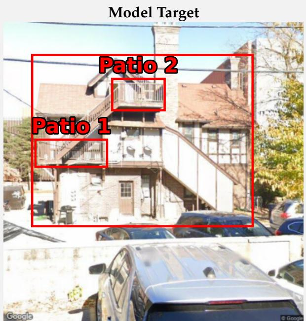  
Navigation Challenge Prompt: You are in the back parking lot of an apartment building. How many distinct, third floor patios does this building have?  
Figure F.5: FM1 (vision failure) example: fixation on a distractor. Intended target and the target chosen by Claude Opus 4.6 for a Navigation Challenge prompt. The model fixates on the house with a gabled roof.  
Figure F.6: FM3 (tool-use failure) example. Response of Qwen3.5-122B-A10B to a Precise Localization prompt before taking any action. The agent misunderstands what capture\_view does (Section 4).