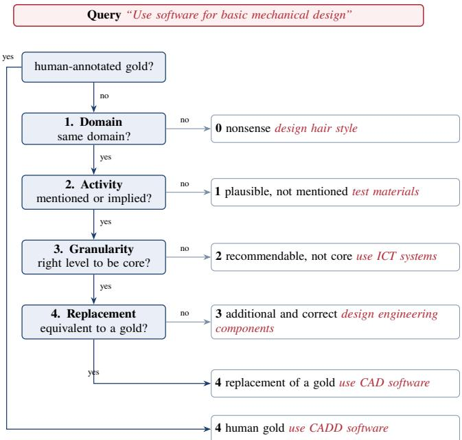
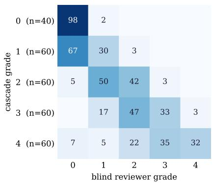
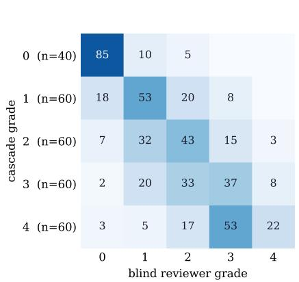
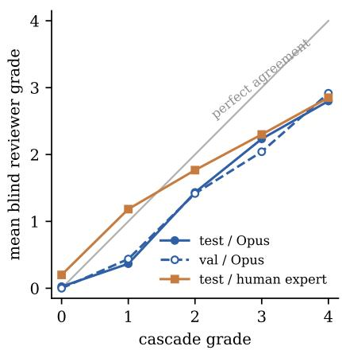
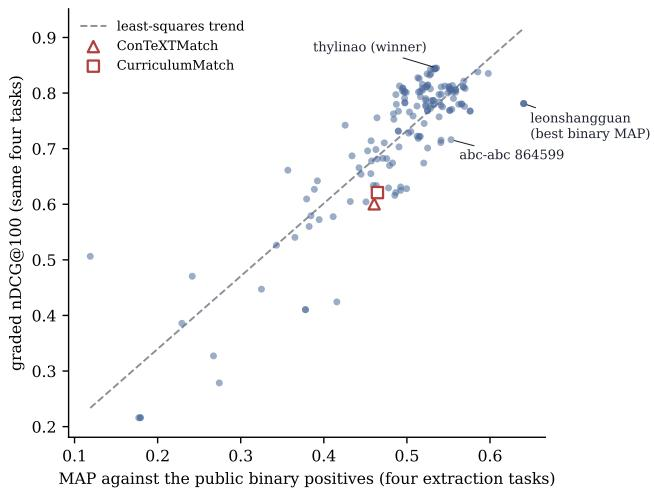
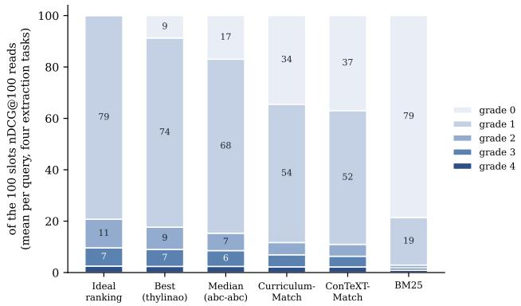
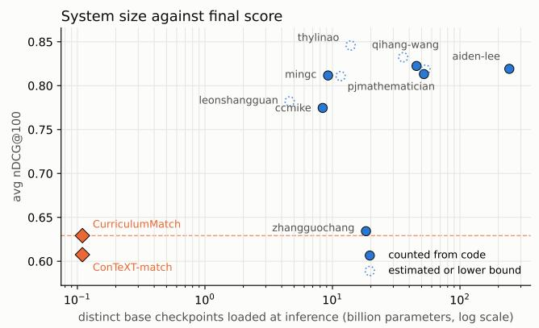

# Grading the Unannotated: Insights from the WorkRB Skill Extraction Challenge at RecSys-HR 2026

Warre Veys∗1,3, Luis Gasco2, and Jens-Joris Decorte1

1TechWolf, 9000 Gent, Belgium

2Avature, Barcelona, Spain

3Ghent University – imec, 9052 Gent, Belgium

workrb@techwolf.ai

Abstract. Skill extraction benchmarks score models against a small set of human-annotated positives and treat every other skill in the vocabulary as equally wrong. At the scale of ESCO (13,939 skills) this binary view can rewards models that rank the annotated positive high for the wrong reason, and hides predictions that are semantically nonsensical. The WorkRB Challenge at RecSys-HR 2026 replaces this binary protocol with graded relevance: every candidate skill in a model’s ranking window carries a 0 to 4 relevance grade, and the leaderboard scores nDCG@100 against these grades. Since ternary judgements already proved too coarse for objective annotation, relevance is decomposed into a cascade of four simple binary questions (same domain, activity mentioned, right granularity, replacement of a gold positive) that a smaller LLM judge can answer reliably, and the resulting labels are validated with blind human and frontier-model re-annotation. This paper documents the annotation methodology, the construction of the five benchmark datasets, four with vacancy sentences as queries and one with lexically distant skill surface forms, the validation of the LLM cascade, and the insights from the challenge submissions. The field converged on multi stage retrieve-and-rerank pipelines, whose gains come from clearing nonsense out of the ranking window rather than from finding more positives: at the top of the leaderboard, the graded ordering is uncorrelated with what binary evaluation would have said. The graded labels expose substantially bigger gaps between the top submissions and the baselines than the binary protocol does, and show that the domain of semanticunderstanding skill recommenders is still wide open. The clear direction after this challenge is bringing eficiency back: every submitted system we could size spends at least 42×, and typically several hundred times, more parameters than the baselines it beats.

Keywords: skill extraction; graded relevance; LLM-as-ajudge; benchmark; skill normalisation; information retrieval

## 1 Introduction

Skill recommenders decide who gets seen at work. The ranking a model returns for a vacancy sentence or a profile feeds crucial applications like hiring shortlists, internal mobility and project stafing, promotion and succession pools, and the learning paths an organisation ofers. A skill placed in the top of such a ranking for the wrong reason does not simply cost a point of accuracy: it attaches a requirement to a role that the role does not have, or attaches a capability to a person who was never assessed on it, and both propagate into decisions about that person. Nonsense high in the window is therefore not only a quality problem but a fairness one, and it is precisely the failure that the prevailing evaluation protocol cannot see.

Previous skill extraction evaluation frameworks share a blind spot: every unannotated skill is treated as equally wrong. With a vocabulary of 13,939 ESCO skills [1] and only a handful of human annotated positives per sentence, this assumption does not hold. Veys et al. [2] showed that the standard training setup for skill recommenders is prone to lexical shortcuts, potentially ranking skills by surface overlap with the input rather than by meaning, and that binary ranking metrics hide this completely: the annotated positive and the shortcut often coincide, so MAP stays high even when some of the other top predictions are nonsense from an unrelated domain.

The remedy proposed there is graded evaluation: instead of positive versus everything-else, distinguish predictions that are perfect, merely plausible, and clearly wrong. Their ternary rubric (Positive, Acceptable, Nonsense) exposed the failure mode but proved too coarse as an annotation target: the Acceptable bucket collapses near-misses, broad umbrella skills, and genuinely additional correct skills into one class. Asking an annotator (human or LLM) for a direct 0 to 4 grade invites inconsistency: assessor agreement is known to degrade as relevance scales grow finer [3, 4], something Section 3.4 measures the same instability for our own judge.

This challenge tries to close that gap with an automatic annotation framework built for objectivity. We decompose the graded judgement into a tree of four binary questions, each simple enough to optimise and answer reliably in isolation (Section 2). An LLM judge walks the cascade for every (sentence, skill) candidate pair, producing dense graded relevance labels over the top-2000 retrieval candidates per query.

The challenge poses the task of ranking all of ESCO against a free-text query. It runs over five datasets that difer only in what that query is. Four are existing, binary annotated, skill extraction datasets whose queries are vacancy sentences, re-annotated with graded relevance. The fifth targets skill normalisation: its queries are lexically distant surface forms of individual ESCO skills, built from ESCO’s own alternative labels filtered to be lexically far but semantically equivalent (Section 5), and it is annotated for full-vocabulary recommendation in exactly the same way. All five are served through WorkRB, an open benchmark library that normalizes evaluation of AI in the work domain [5], and the challenge allows any technique that produces rankings.

Contributions. We (1) introduce a binary-cascade annotation framework that turns graded relevance into a sequence of objective yes/no decisions, (2) release graded validation and test annotations for five benchmarks, four established skill extraction datasets and a new skill normalisation dataset, all annotated for the same full-vocabulary recommendation task, (3) validate the LLM-produced labels with blind human and frontier-model re-annotation, and (4) report what the challenge’s 154 valid submissions reveal: a field that converged on multi-stage retrieve-and-rerank pipelines at least 42× larger than the trained baselines, and a top of the leaderboard whose ordering binary evaluation cannot reproduce (Kendall � = 0.06 against binary MAP over the twelve best teams).

Read together, these results say something the binary leader boards of the last few years did not. Semantic skill understanding was not a solved problem going into this challenge: under graded evaluation the strongest, eficient, published skill extractor available of the shelf sits 0.24 nDCG@100 below what a field of motivated participants could reach, a gap the binary protocol reports as a third of that size. It is also not solved coming out of it. What closed the gap was scale and pipeline depth, not a better skill encoder, and the road to an open-source semantic-understanding skill recommender that an organisation could actually deploy, remains open.

## 2 The graded relevance rubric

Direct graded annotation is unreliable: the diference between “somewhat relevant” and “relevant” is not something two annotators, or two LLM calls, resolve the same way, as Section 3.4 measures against the same judge and referee. Our rubric therefore asks four binary questions in a fixed order, the grade being determined by where the cascade stops (Figure 1):

1. Domain. Is the skill in the same broad occupational domain as the sentence? A “no” yields grade 0 (nonsense): the pair will likely never appear in the same job description.

2. Activity. Is the specific activity described by the skill actually mentioned or directly implied? For example, “theoretical knowledge of mechanical equipment” does not imply “operate mechanical equipment”. A “no” yields grade 1 (plausible, but the activity is not there).

  
Figure 1: The annotation cascade, with a worked example on every exit. A pair descends the gates in order and the first “no” fixes its grade, while human gold positives bypass the cascade entirely. The six red skills are real ESCO entries judged against one real House query, and each is placed by its ESCO description rather than its label. design hair style (“design the styles of hair based on the preference of the customer”) shares only the word “design”, the kind of surface overlap a retriever scores highly and the domain gate exists to reject. test materials is engineering work, so it clears the domain gate, but its description covers testing the composition and characteristics of materials, never designing anything or using software. use ICT systems (“select and use ICT systems for a variety of complex tasks”) is true of the job and of thousands of others, an umbrella too broad to be core. design engineering components (“design engineering parts, assemblies, products, or systems”) is correct and genuinely additional, describing the design act itself rather than the drafting tool the gold names. The two grade-4 exits difer only in provenance: use CADD software is the human annotation, and use CAD software is the jury judging a near-paraphrase of it, the two difering only by the drafting sufix. Section 7 turns that last distinction into the submission screen.

3. Granularity. Is the skill at the right granularity to be core to the sentence, neither a generic umbrella nor an incidental sub-step? A “no” yields grade 2 (could be recommended, but not core).

4. Replacement. Is the skill semantically equivalent to one of the existing gold positives? A “no” means the skill is genuinely additional and correct: grade 3. A “yes” means it is (close to) a paraphrase of what a human already annotated: grade 4.

Human-annotated gold positives are grade 4 by definition and never reach the judge. Each gate assumes the previous passed, so every prompt operationalises exactly one decision. The judge always sees the skill’s ESCO description alongside its preferred label, since many labels are ambiguous alone (“monitor environment” could be system administration or forestry).

The decomposition buys three things: objectivity, since each question has a defensible yes/no answer where a direct 0 to 4 grade does not, diagnosability, since a disagreement localises to a single gate, which is how we iterated on the prompts, and, measurably, accuracy, since on a judge of the size this workload requires walking the gates beats asking the same model for the grade outright (Section 3.4).

## 3 Annotation pipeline

## 3.1 Candidate generation

Judging all 13,939 ESCO skills against every sentence is wasteful, since the bulk of the label matrix is obviously unrelated. We prefilter to the top-2000 candidates per sentence with a BGE-M3 bi-encoder [6] over sentence-to-description similarity. Pooled over all datasets and splits this recovers 96.6% of the human-annotated gold positives (micro recall@2000). Per dataset: the normalisation dataset is fully covered (100% on both splits, trivially so: the prefilter query for these rows is the target concept’s own ESCO description, not the lexicallydistant surface form, so the prefilter is never exercised on what makes the dataset hard), Tech reaches 96.2% (validation) and 97.6% (test), House 97.7% and 93.2%, SkillSkape 94.7% and 96.5%, and TechWolf (test only) 96.4%. The misses do not concentrate on one failure mode. Roughly a third come from long, multi-topic job-ad paragraphs carrying up to nine gold skills each, where a single pooled embedding cannot stay close to every skill mentioned. A further quarter fall on generic targets (communication, work independently) that collide with near-duplicate ESCO entries. The remainder are ordinary retrieval misses, some even where a lexical bridge exists: the query java reactjs web-services ranks Java (computer programming) only 3,681st. Skills outside the top-2000 default to grade 0, except should they be a human-annotated gold positive one. In the latter case the pair is released at grade 4.

## 3.2 LLM-as-a-judge cascade

The four gates are answered by an open-weight LLM judge (Qwen3-Next-80B-A3B-Instruct [7, 8], FP8) served locally on a single Nvidia DGX Spark. Each gate is one call emitting a single boolean, constrained to a one-field JSON object with no rationale, so every prompt operationalises exactly one decision and calibration stays gate-local.

The validation release is single-juror. For the test release we hardened the two most subjective gates with a second juror from a diferent model family (Gemma-4-26B-A4B-it [9]), re-judging gate 3 and, for its survivors, gate 4, on only the pairs the first juror passed through gate 2. A gate passes only if both jurors agree, so the second can demote a grade 3 or 4 but never promote it, firming up the soft upper gates without touching the high-volume lower ones. This costs 46K extra calls (about 1% of first-pass volume) and demoted 6,449 of the 31,557 pairs it re-examined. The test cascade also ships a recalibrated gate-3 prompt, though Section 3.4 shows the resulting labels behave near-identically to the validation configuration under blind review.

## 3.3 Prompt calibration

Prompts were calibrated iteratively against hand-graded pilot pairs. After a first full pass over the validation annotations, we used Claude Opus 4.7 to (1) cluster the most frequent failure cases per gate and (2) interactively probe the local judge to tune the corresponding prompt. After the validation release, a human iteration over the same judge-of-the-judge loop refined the prompts once more before the test set was annotated.

Three recurring failure modes drove the concrete prompt changes. At the activity gate, the judge conflated qualified and unqualified activities, failing “manage ICT project” against a sentence mentioning generic “project management” even though the mismatch is one of granularity: the fix strips sector, method, audience and instance qualifiers to a bare verb noun pair before checking presence, deferring the qualifier judgement to gate 3 where it belongs. The same gate needed a carve-out for job-description phrasings, where “experience with X” and “proficient in X” license the activity X. At the granularity gate, the validation-era prompt defaulted too far toward rejection, treating any skill phrased more generally than the sentence as too broad. The test-era recalibration reframes it as “a filter, not a hurdle” while hardening the opposite direction with an unnamed-specific-instance rule: a generic category mention (“a modern programming language”) never licenses one specific member (Python). Finally, the released cascades drop the one-sentence rationale an early variant asked for, after a pilot showed the boolean-only variant stays within one grade on 95.6% of pairs, the residual disagreements concentrating on 2 to 4 word “section header” inputs where human annotators also disagree.

## 3.4 Human validation of the labels

To validate the released labels, a fixed, stratified manifest of pairs (280 test, 224 validation, per dataset 12 pairs of each grade 1 to 4 and 8 of grade 0) was blindly re-graded under the identical rubric: no cascade label shown, one independent judgement per pair. There are two reviewers: a frontier model from a diferent family than the cascade judge (Claude Opus 4.8 [10]), covering both splits, and a human expert, covering the 280-pair test manifest.

Grades 3 and 4 are reported together throughout this section. The only thing separating them is gate 4, which asks whether the skill is a replacement for one the dataset already carries as a human gold positive: that is a property of the pre-existing annotation rather than of the (sentence, skill) pair, and a blind reviewer cannot see the gold list, so the distinction is not one they are positioned to confirm. Collapsing it leaves the three substantive gates (domain, activity, specificity) as what the validation measures. Gate 4 is not noise: the pairs it promotes draw a higher mean blind grade than the grade-3 pairs it rejects (2.63 versus 2.22 from the human expert, 2.48 versus 2.20 from Opus). It is simply not a distinction this validation can referee.

  
Figure 2: Blind validation of the cascade labels, test manifest. $L e f t { \mathrm { : } }$ row-normalised confusion matrix (%) between the released cascade grade and the blind Opus reviewer. Middle: the same, against the blind human expert. Both show mass on the diagonal or one cell to its left with a nearly empty upper-right triangle: the disagreement is one-directional for both reviewers, human included. Right: mean blind grade per cascade grade, Opus (both splits) and the human expert (test only). All three curves sit below the identity line, and the human curve is markedly less extreme at grade 1 but has the same overall shape. Grades 3 and 4 are reported together throughout, since grade 4 is defined against the gold-positive list the blind reviewer cannot see.

Four findings (Figure 2). First, ordering is strongly preserved between the cascade and both reviewers. Quadratic-weighted kappa (QWK), which is chance-corrected agreement that charges a disagreement in proportion to its squared distance on the grade scale, is 0.73 (Opus) and 0.69 (human); Spearman rho, the rank correlation between the two gradings, is 0.82 and 0.69; 93% and 90% of pairs are within one grade and exact agreement is 51% and 59%. Plain Cohen’s kappa (0.36 and 0.43) is the wrong lens for an ordinal scale, punishing a 2-against-3 miss as harshly as a 0-against-3 one. Second, the disagreement is monotonic for both reviewers: the cascade is generous 47% of the time against Opus and 29% against the human, against only 2% and 12% too strict, and grade-0 negatives are highly reliable for both (98% and 85% confirmed). Third, the bias is stable across cascade versions, reproducing near-identically on both splits (kappa 0.73 test against 0.68 validation). Fourth, and this is what closes the validation, the human expert, sharing neither the reviewer’s model family nor its rubric prompt, reproduces the same one-directional generosity, so it is a property of the LLM-cascade approach rather than an artifact of one model grading another. Comparing human and Opus directly is consistent: the human grades higher on the same pair 34% of the time against the reverse 11%, sitting between Opus and the cascade rather than in an independent third direction. The one genuine disagreement, rather than added noise, is at grade 1 (“weak”), graded far less harshly by the human (mean blind grade 1.18 against Opus’s

0.37).

What the labels are asked to do is order candidates within a query, not to fix an absolute grade, so an ofset that is monotonic and the same for every system leaves that ordering intact and some noise in the exact grade is acceptable. We therefore document the ofset rather than re-label. The challenge metric is graded nDCG, and for any binary relevant/irrelevant cut we recommend grade ≥ 2, where binary agreement with the blind reviewers peaks.

The cascade spends up to four calls per pair to reach a grade a single call could be asked for directly, so it is fair to ask what the decomposition buys. We ran the same juror over the same 280-pair test manifest in one call, emitting the whole grade from a prompt that carries the calibrated content of gates 1 to 3 and states the decision order explicitly, and scored both arms against the blind human expert. Everything outside the decomposition is held fixed: same weights, same greedy decoding, same structured output, byte-identical user prompt. Neither arm sees the gold-positive list, so both are judged on the 0 to 3 scale used above.

The cascade wins on every agreement measure (Table 1). Against the rationale variant it is +0.068 QWK and −0.125 in mean absolute error (MAE, the average distance in grades between judge and human), with 95% confidence intervals of [+0.006, +0.132] and [−0.204, −0.046] from a paired bootstrap over pairs (10,000 resamples, stratified by cascade grade), and a signed-rank test on the per-pair absolute errors at $p ~ = ~ 0 . 0 0 5$ . Against the grade-only variant the MAE gap holds at $p = 0 . 0 0 2$ while the QWK gap is directionally the same but not significant. The one-shot arms also use the middle of the scale less consistently, and which intermediate grade thins out moves with the decoding format, where a cascade grade is a consequence of where a pair stops. The claim we draw is the narrow one: at the model scale this annotation workload requires, decomposing the grade into ordered binary gates produces labels closer to a human expert than asking the same model for the grade directly.

Table 1: Cascade versus one-shot direct grading by the same judge, against the blind human expert on the 280-pair test manifest (grades 0 to 3). Gen./Str. is the share of pairs the judge grades above or below the human.
<table><tr><td>Judge</td><td>QWK</td><td> $\rho$ </td><td>Exact</td><td> MAE</td><td>Gen./Str.</td></tr><tr><td>Cascade (released)</td><td>0.686</td><td>0.686</td><td>0.586</td><td>0.529</td><td>29/12</td></tr><tr><td>One call, rationale</td><td>0.618</td><td>0.621</td><td>0.525</td><td>0.654</td><td>25/22</td></tr><tr><td>One call, grade only</td><td>0.631</td><td>0.627</td><td>0.461</td><td>0.675</td><td>22/32</td></tr></table>

## 3.5 An ESCO caveat

Some ESCO preferred labels do not carry a restriction that their description imposes, so a pair can look like a strong match from the label alone and be graded down once the description is read. Because the judge always sees both, the released grades track the described concept rather than the label string. One instance is guide staf, a label that reads as generic people management. Its description is “Lead and manage team in order to keep them informed about a variety of rules and regulations regarding to grants”, which ties it to grant administration. Over the 1,873 pairs it was judged on it never receives a grade above 2, and the 33 pairs that reach 2 are team-leadership queries spread over all four extraction datasets, among them Can you motivate and set the directionfor your employees? and strong people management or team leadership skills. That ceiling is only defensible from the description. On the first of those queries the rest of the grade-2 tier are labels that state their restriction openly, such as supervise dental staf, lead a team in forestry services and manage zoo staf, while the labels graded 3 and 4 are unrestricted ones such as lead others and supervise staf. Read as a string, guide staf belongs with the latter. The same holds for apply conflict management, graded 2 against outstanding negotiation skills with the ability to resolve issues and address complaints, because its description is about handling “a problematic gambling situation”. Anyone inspecting or training on the released labels should read them alongside the descriptions.

## 4 Skill extraction datasets

## 4.1 Dataset selection

Four of the five datasets are established ESCO skill extraction benchmarks, with vacancy sentences as queries, re-annotated with graded relevance. Table 2 summarises the five released benchmarks. House and Tech [11] are annotated exhaustively on both validation and test splits, as is the TechWolf test set [12] (which ships no validation split). SkillSkape [13] is subsampled to 100 validation and 500 test sentences (from 2,751 and 3,244 source rows) because exhaustive graded annotation of the full splits is prohibitive: at roughly 2,000 judged candidates per sentence, the full SkillSkape validation split alone accounts for an order of magnitude more judge calls than the other datasets combined.

Table 2: The five released benchmarks. Queries are ranked against the same corpus of 13,891 ESCO v1.1.0 skills, so the released qrels are the full query × corpus grid, with every pair the prefilter did not surface carried at grade 0. Judged pairs counts the pairs the cascade actually graded (queries × the top-2000 window, 4.3M in total). The last two columns are test-split means per query: targets graded ≥ 2, and targets graded 4. TechWolf ships no validation split.
<table><tr><td rowspan="2">Dataset</td><td colspan="2">Queries</td><td rowspan="2">Judged</td><td colspan="2">Test, per query</td></tr><tr><td>Val</td><td>Test</td><td>pairs gr. ≥ 2</td><td>gr.4</td></tr><tr><td>House</td><td>61</td><td>261</td><td>0.64M</td><td>22.7</td><td>2.7</td></tr><tr><td>Tech</td><td>75</td><td>338</td><td>0.83M</td><td>15.8</td><td>1.9</td></tr><tr><td>TechWolf</td><td>n/a</td><td>324</td><td>0.65M</td><td>17.5</td><td>2.3</td></tr><tr><td>SkillSkape</td><td>100</td><td>500</td><td>1.20M</td><td>27.6</td><td>3.2</td></tr><tr><td>SkillNorm</td><td>50</td><td>450</td><td>1.00M</td><td>9.3</td><td>1.1</td></tr><tr><td>Total</td><td>286</td><td>1,873</td><td>4.32M</td><td></td><td></td></tr></table>

Subsampling SkillSkape. The publicly released SkillSkape splits carry 2,751 and 3,244 (sentence, label) rows over 1,316 and 1,272 unique sentences, spread across 149 and 455 distinct ESCO labels, so the median label occurs only 14 and 5 times and the test tail reaches single occurrences. Keeping just 7.6% of validation and 39% of test sentences, naive sentence-level sampling would drop rare labels entirely and distort the labelsper-sentence distribution. We therefore bucket sentences by label cardinality ({1, 2, 3, 4, 5+}), give each bucket a quota proportional to its share of the source split with largest-remainder rounding, and fill each bucket by iterative stratification [14], repeatedly taking the globally rarest still-needed label and picking a sentence that carries it while also helping fill quotas for its other labels (ties broken by largest residual quota, then a fixed seed). The result preserves the label marginals (L1 distance 0.58 and 0.41 to the source distributions) and the labels-per-sentence means (2.10 and 2.56 against 2.09 and 2.55), while retaining 77% and 94% of the two label spaces. We keep the original long format, so the samples are drop-in compatible with the SkillSkape loader.

## 5 Skill normalisation dataset

The fifth dataset targets skill normalisation. Its queries are not vacancy sentences but surface forms of individual ESCO skills, and the task is unchanged: the full vocabulary is ranked, every candidate in the retrieval window carries a graded label from the same cascade, and the skill’s preferred label is the single gold positive. To increase the dificulty, we sample surface forms that share the fewest words with their ESCO preferred label. ESCO’s preferred labels each come with a set of alternative labels, but most are uninteresting morphological or syntactic variants (e.g., monitor crops vs. monitoring crops) that test little beyond tokenization. To construct a more challenging skill normalisation benchmark, we sample alternative labels whose surface form diverges substantially from the preferred label while still denoting the same concept.

Table 3: ESCO preferred/alternative pairs at each filtering stage. Divergence ≥ 0.7 removes morphological variants (middle block), and cosine ≥ 0.5 removes pairs sharing no semantic content despite diferent wording (bottom block). The top block satisfies both.
<table><tr><td>Preferred label</td><td>Alternative label</td><td>Div.</td><td> $\mathbf { C o s . }$ </td></tr><tr><td>Retained</td><td></td><td></td><td></td></tr><tr><td>provide periodontal treatment manage gum conditions install crane equipment</td><td></td><td>1.00</td><td>0.64</td></tr><tr><td>pest management techniques</td><td>build lifting machinery</td><td></td><td>1.00 0.66</td></tr><tr><td></td><td>extermination methods</td><td></td><td>1.000.56</td></tr><tr><td>monitor crops</td><td>checking crop growth</td><td>0.75</td><td>0.74</td></tr><tr><td>welcome restaurant guests</td><td>greet and seat guests</td><td>0.83</td><td>0.68</td></tr><tr><td>Rejected: low divergence</td><td></td><td></td><td></td></tr><tr><td>perform toxicological studies</td><td>carry out toxicological studies</td><td>0.50</td><td>n/a</td></tr><tr><td>monitor crops</td><td>crop monitoring</td><td>0.00</td><td>n/a</td></tr><tr><td>handle equipment suspended</td><td>handling equipment suspended</td><td>0.00</td><td>n/a</td></tr><tr><td>Rejected: low cosine</td><td></td><td></td><td></td></tr><tr><td>attend to fitness clients  $( \dots )$ </td><td>be aware of standards (. . .)</td><td>1.00</td><td>0.27</td></tr><tr><td>tend mechanical forging press</td><td>guard machined fashioned stamp</td><td>1.00</td><td>0.23</td></tr><tr><td>assess seizable goods</td><td>appraise sizable goods</td><td>0.80 0.42</td><td></td></tr></table>

Two filtering gates. We first score each (preferred, alternative) pair with a stem-Jaccard divergence: both strings are lowercased, tokenized, stripped of stopwords, normalized for British/American spelling, and reduced to stems by iterative sufix stripping, with the divergence taken as $1 - | A \cap B | / | A \cup B |$ over the stem sets. We retain pairs with divergence ≥ 0.7 that also have at least two content tokens on each side, a tokencount ratio in [0.4, 2.5], and no all-caps abbreviations. Of ESCO v1.1.0’s 85,270 alternative labels, 14,423 pairs over 5,232 preferred labels survive.

A purely lexical filter is insuficient: manually reviewing 30 pairs from this pool showed roughly 10% are not valid paraphrases at all, either because ESCO itself lists a related but distinct concept as an alternative (attend tofitness clients under controlled health conditions alongside be aware of professional standards and limitations) or through incidental near-misses (assess seizable goods against appraise sizable goods, a typo turned synonym). Stem-Jaccard cannot catch either, since both have low surface overlap by construction. We therefore add a semantic gate, embedding each pair with all-mpnet-base-v2 [15, 16] and requiring cosine ≥ 0.5. The two gates are complementary: divergence makes a pair benchmark-interesting, cosine makes it benchmark-valid. The cosine gate removes 20.7% of the lexically eligible pool, leaving 11,434 pairs over 4,632 preferred labels, from which we sample 500 uniformly at random with at most one alternative per preferred label (50 validation, 450 test), yielding mean divergence 0.84 and mean cosine 0.72. Table 3 shows the two scores acting in concert.

Grading for this dataset runs against the canonical concept rather than the surface form: both the prefilter query and the sentence shown to the judge are built from the preferred label

and its ESCO description, and the alternative label is withheld.   
Participants are served the alternative label alone as the query.

## 6 Challenge setup

The challenge runs on CodaBench1 with an open validation phase (unlimited submissions) followed by a test phase capped at 10 submissions per team, and drew 63 registered participants. The leaderboard metric is nDCG@100 against the graded labels, averaged over the five datasets. All evaluation goes through WorkRB [5]: a participant model implements the library’s ModelInterface, a single ranking method over queries and targets, and submission files come from the same WorkRB tasks the organisers use. The rules are deliberately short: any technique producing rankings competes, training is optional, any open-source data except test set information is allowed, and the one expectation is a contribution of the team’s own rather than an unmodified of-the-shelf model.

Availability. All five graded benchmarks, validation and test splits alike, are openly released under CC BY 4.0 on the Hugging Face Hub2 and are served through the WorkRB package as the same tasks the leaderboard scored. Each release carries the full query × corpus grid of graded labels rather than the top-2000 window alone, so the test labels this paper analyses are reusable as a benchmark after the challenge.

On the baselines. The two trained baselines above (ConTeXT-match and the shipped CurriculumMatch retriever) enter the leaderboard as released checkpoints, so a team that beats one has beaten a particular artefact rather than the method. We checked how much of the gap is deployment: retraining ConTeXT-match from the authors’ code reproduces the checkpoint (0.610 against 0.607), and holding method, data and loss fixed while tuning only the training schedule and selecting the checkpoint on the graded validation split reaches 0.620±0.003 over three seeds.

## 7 Submission filtering

The five test benchmarks also exist publicly with their original binary annotations, which the rules put of-limits at every stage. We therefore screen the submissions before reporting any result.

The screen exploits a property of the cascade: Grade 4 is a union of two populations: a pair is graded 4 either because it is a gold positive of the underlying dataset, which never reaches the jury (4-human), or because the jury judged it a direct replacement of one at the final gate (4-jury). The two are semantically (almost) equivalent by construction, and only the first was public during the challenge. For each query we compare the ranks a submission gives its 4-human items against those it gives its 4-jury items, summarised as the probability that a random 4-human item outranks a random 4-jury one, ties counting one half. This normalised Mann-Whitney statistic has an expected value of 0.5 for any system with no access to the public files.

The statistic is sharply bimodal on all four extraction datasets with an empty band between the modes. The lower mode sits at the null (medians 0.60, 0.59, 0.63 and 0.48 on Tech, House, TechWolf and SkillSkape, the mild excess being the cascade’s known generosity on positives). The upper mode is not a matter of degree: 57 submissions attain a separation of exactly 1.0 on all four datasets simultaneously, meaning every public positive outranks every non-public grade-4 item on every query. The same 57 also place the public positives in the top � of every query, � being that query’s number of public positives, so their ranking reproduces the withheld annotation exactly. Three properties argue the statistic reads provenance: within the lower mode it correlates negatively with nDCG@100 (Spearman −0.40), so competence does not raise it and the strongest unflagged system reaches only 0.56, the four datasets, with disjoint queries and independent annotation runs, agree on whom to flag at Jaccard 0.967 to 1.0, and twelve afected teams have both flagged and unflagged entries, so it is not a property of a team’s ability. We exclude SkillNorm from the verdict, where roughly one gold concept per query saturates the statistic near 1.0 for everyone, clean teams included.

Of the 43 teams with at least one scored test submission (218 in total), the screen removes 61 submissions (28.0%) from 15 teams. Because most afected teams also submitted unflagged entries, only 3 teams lose all of theirs and 40 of 43 remain in the reported results. The efect on the ordering is larger than the counts suggest, as the removed entries concentrate at the top. Section 8 reports the filtered board, each team represented by its best remaining submission. The screen leaves 157 clean submissions; setting aside the two organiser baselines, which are reported as their own rows, and one entry uploaded twice, this leaves 154 Test-phase submissions from 39 participant accounts.

## 8 Results and insights

## 8.1 Leaderboard

Table 4 shows the filtered leaderboard. The top is dense: twelve accounts finish within 0.04 of the winner and positions 6 to 11 span 0.003. Beating the trained baselines was routine (32 of 39 accounts clear ConTeXT-match, 31 clear CurriculumMatch), but the margin above them is real: the winner’s 0.8458 sits 0.217 above the strongest baseline, and Section 8.4 prices what the field spent to buy it. The two lexical baselines bracket the floor, with two submissions being BM25 reimplementations that land within 0.002 of it.

## 8.2 What the graded labels reveal

The core question the annotation efort exists to answer: does grading the whole window change the verdict binary evaluation would have given? For each valid submission we compute

Figure 3: Graded nDCG@100 against MAP on the public binary positives, both macro-averaged over the four extraction tasks (SkillNorm has no binary counterpart and is excluded from both axes). One point per valid submission. The two metrics agree on the broad strokes and disagree exactly where a leaderboard matters: the graded winner is 12th by binary MAP, and the binary-MAP leader (leonshangguan) is 16th on the graded board.  
  
Figure 4: Grade composition of the 100 slots that nDCG@100 reads (mean per query, macro over the four extraction tasks) for the ideal ranking, the best and median valid submissions, and the organiser baselines. The ideal window contains essentially no grade-0 items, and the ranking systems difer mostly in how many grade-0 items they let in (9 for the winner, 17 at the median, 34–37 for the trained baselines, 79 for BM25) while everyone finds nearly all ≈2.5 grade-4 slots.

MAP against the original public binary positives of the four extraction datasets alongside graded nDCG@100 on the same four tasks (Figure 3).3 Field-wide the two agree (Spearman � = 0.72 over 154 submissions, 0.80 over the 39 team bests), which is expected of two metrics that both reward finding relevant skills, and is not the interesting result.

Table 4: Filtered leaderboard: graded nDCG@100 per task and macro-averaged, best valid submission per account, plus the organiser baselines. Teams are named by their CodaBench handle throughout. The winning entry is the work of Maksim Silchenko (National University of Singapore), competing solo as team thylinao, who documents the system in [17]. � self-declared student team. The ConTeXT-match row is the pre-released checkpoint. Retrained with a tuned schedule the same method reaches 0.620 (Section 6).
<table><tr><td># Team</td><td>Macro</td><td>House</td><td>Tech</td><td></td><td>TechWolf SkillSkape SkillNorm</td><td></td></tr><tr><td>1 thylinaos</td><td>0.8458</td><td>0.8387</td><td>0.8390</td><td>0.8347</td><td>0.8683</td><td>0.8480</td></tr><tr><td>2 qihang-wang</td><td>0.8323</td><td>0.8405</td><td>0.8337</td><td>0.8197</td><td>0.8585</td><td>0.8092</td></tr><tr><td>3 yeyangs</td><td>0.8224</td><td>0.8226</td><td>0.8261</td><td>0.8030</td><td>0.8586</td><td>0.8018</td></tr><tr><td>4 aiden-lee</td><td>0.8191</td><td>0.8114</td><td>0.7903</td><td>0.8109</td><td>0.8316</td><td>0.8514</td></tr><tr><td>5 elara96</td><td></td><td>0.8182 0.8015</td><td>0.8157</td><td>0.8022</td><td>0.8443</td><td>0.8274</td></tr><tr><td>6 carolzz</td><td></td><td>0.8132 0.7982</td><td>0.8106</td><td>0.8026</td><td>0.8442</td><td>0.8101</td></tr><tr><td>7</td><td> $\mathrm { l i y i t a n g } ^ { s }$ </td><td>0.8131 0.8014</td><td>0.8155</td><td>0.8025</td><td>0.8315</td><td>0.8144</td></tr><tr><td>8jint1234s</td><td></td><td>0.8119 0.8172</td><td>0.7866</td><td>0.7958</td><td>0.8454</td><td>0.8145</td></tr><tr><td>9 mingc</td><td></td><td>0.8116 0.7907</td><td>0.7908</td><td>0.7954</td><td>0.8302</td><td>0.8508</td></tr><tr><td>10 junlong⁵</td><td></td><td>0.8112 0.8170</td><td>0.8093</td><td>0.8152</td><td>0.8444</td><td>0.7701</td></tr><tr><td></td><td>n/a CurriculumMatch</td><td>0.6292 0.5746</td><td>0.6022</td><td>0.6056</td><td>0.7014</td><td>0.6620</td></tr><tr><td></td><td>n/a ConTeXT-match</td><td>0.6075 0.5754</td><td>0.6020</td><td>0.5918</td><td>0.6337</td><td>0.6345</td></tr><tr><td>n/a TF-IDF</td><td></td><td>0.2679 0.2503</td><td>0.3053</td><td>0.2614</td><td>0.2499</td><td>0.2727</td></tr><tr><td>n/a BM25</td><td></td><td>0.2250 0.2042</td><td>0.2773</td><td>0.2124</td><td>0.1724</td><td>0.2589</td></tr></table>

The agreement dissolves exactly where a leaderboard needs it. Over the twelve best teams the two orderings are uncorrelated: Kendall $\tau = 0 . 0 6$ (top twenty: 0.02). Under binary MAP the winner would be leonshangguan (0.641), whom the graded metric places 16th, while thylinao, the graded winner, is 12th by MAP. The binary protocol also compresses the gap to the baselines: the winner clears the ConTeXT-match checkpoint by 0.244 graded nDCG@100 (41% relative) but only 0.075 MAP (16% relative).

The mechanism is the one Veys et al. [2] predicted: MAP asks only where the annotated positive landed, and nDCG@100 charges for the other 99 slots. The starkest pair makes it concrete. A mid-table submission (team-1, 0.7143 macro) beats the winner on binary MAP and MRR (0.553 against 0.536, and 0.666 against 0.652) while losing 0.131 graded nDCG. The two metrics read disjoint parts of the same window: MAP is settled by the single annotated positive, which both systems place at essentially the same rank, so it is near-blind to the other 99 slots, whereas nDCG@100 scores every one of them and so records what the two systems do diferently. Concretely, the challenger places an explicitly graded-0 target in its top five on 15% of queries against the winner’s 4%. Its errors are lexical-shortcut errors of exactly the kind the grading was built to expose: landscape analysis for a sentence using “landscape” figuratively, operate cutting equipment for a “cut-over” deployment, computational fluid dynamics for “microsoft-dynamics”.

The winner’s own ablations price what the binary protocol costs a participant who trains against it. Fine-tuning a MiniLM-L6 cross-encoder on binary targets measured −0.0758 graded nDCG@100 against the base it was meant to improve [17]: binary supervision drives grades 1 and 2 to a hard zero, discarding the partial credit those grades still pay under exponential gain, and the ordering that remains is worse than the one the untuned model already had. The winner’s own audit of the failure names the mechanism: in the retrieval rank window it had mined negatives from, 60–72% of the items it was labelling 0 were in fact graded gold, so the loss was explicitly trained to bury targets that earn credit. A second team measures the same sign independently, a generic binary cross-encoder taking its macro from 0.649 to 0.611, and reaches the same diagnosis: a binary target flattens the $1 < 2 < 3 < 4$ ordering the metric pays for. This is the failure Veys et al. [2] diagnosed, measured on the metric that charges for it: there, mitigating the shortcut lowered MAP (44.9 → 43.1) while cleaning the window (judged-nonsense rate 11.5 → 9.5), so the binary metric penalised the better ranker.

Figure 4 shows where the points are won and lost. Every system, lexical included, recovers nearly all of the ≈2.5 grade-4 slots the ideal top-100 contains: ranking the human positives highly is the part of the task binary training data already teaches, and BM25 still recovers 36% of those slots against only ∼10% of the grade-2/3 ones, because gold positives are heavily enriched in surface overlap: on Tech, 13.9% of grade-4 targets have their whole label spelled out verbatim in the sentence, against 0.03% of grade-1 targets. What separates the field is the tail of the window: the share of top-100 slots spent on explicitly irrelevant targets runs 9 (winner), 17 (median), 34–37 (trained baselines), 79 (BM25) out of 100. The graded metric’s extra discriminative power over the binary protocol is almost entirely this quantity: it measures how much nonsense a system tolerates once the easy positives are placed.

## 8.3 Method families

The field converged on one architecture. Two sources document it: source code, which 13 accounts shipped and we read in full (11 of them survive the screen of Section 7), and the free-text system description CodaBench required with every submission, which for a further 22 reported accounts names the components explicitly. Together these document 33 of the 39 reported accounts and 19 of the top 20; the rest describe their entries only as version tags. Both sources tell the same story. Every code-shipping account runs a multi-stage retrievethen-rerank pipeline: a fleet of dense retrieval lanes, fused, then re-ordered by cross-encoder or LLM rerankers, with a learned fusion layer (LambdaRank-family gradient boosting in at least five of them) on top, and every one of them, both prize positions included, carries lexical retrieval or lexical features alongside its dense lanes. Of the 22 description-only accounts, 16 name a reranking stage over a retrieved shortlist and 4 more a multi-lane retrieval ensemble without one, so 27 of the 33 documented systems are retrieve-then-rerank and none departs from the retrieve-and-fuse skeleton. The winner is representative: twelve retrieval lanes and four fine-tuned crossencoder columns fused by a LightGBM LambdaRank bag. The variation is in the reranking stage, and it spans three families: fine-tuned cross-encoder columns (thylinao, qihang-wang: a Qwen3-8B and BGE cascade trained on self-distilled labels), hosted-LLM rerankers (pjmathematician reranks its top-200 with Claude, training-free, at 0.8109, and leonshangguan spends ∼11K frontier-model calls for a measured +0.049), and graded-objective rerankers trained on the released validation labels. Purely data-centric or single-encoder entries populate the bottom half of the board.

Trainings data. Any other open-source data was allowed and the five test benchmarks in any form were not. The field used a narrower slice than that. Across the 13 code submissions, 11 train on the graded validation labels, 9 on the TechWolf synthetic ESCO skill sentences, and only 5 reach for any public corpus beyond those two. The 286 validation queries are the contested resource: two systems (aiyuanwang, ccmike) declare them their only supervision, ccmike enforcing that in code with a data-access policy that refuses to open anything else, while the two teams declining them, including carolzz in 6th, both say they wanted one honest evaluator left although the rules permit their use. Where more data was wanted the field manufactured it: five systems build graded supervision by having a larger model grade candidate pairs, one re-grading only the zero-labelled rows with a three-model jury, another pseudo-grading all 138K synthetic queries with ordinal-calibrated cutofs. The winner tried the same and reports it failing its acceptance gate at −0.0094, a content mismatch rather than a quality problem: its synthetic House queries came out easier than the real ones, so the rows did not sit on the +0.013-per-doubling curve real labelled data traced.

“Training” also spanned a wider range than gradient descent, and the cheap end of it competed. pjmathematician (11th, 0.8109) submits a pipeline that computes no gradient at all, a zero-shot retriever, a hosted reranker and a closed-form prior, and tunes what the models are asked instead. A roughly 30-variant sweep over retriever instructions found one whose target-side half alone was worth +0.08 macro on validation, and a failure-driven loop over task-specific reranker prompts, one to three iterations each accepted only on a fixed candidate pool, carried the pipeline from 0.806 to 0.826. The same team separately trained a 4B agent with GRPO on 243 validation queries; it finishes below the prompt-optimised pipeline it was meant to replace. Such prompt work runs through the field’s LLM stages generally: hand-written 0–4 rubrics, per-task instructions rewritten because a job-ad prompt misfits a bare skill mention, and few-shot examples drawn from the graded validation labels, the same supervision arriving in-context rather than through a loss. Among accounts documented only by their description, three declare a training-free entry outright: zhangendjb, whose first submissions fuse stock retrieval channels and use the validation split only to select modules and fusion weights before a later version adds fine-tuned lanes, and charles2006, parameter-free on CPU. The distinction the leaderboard rewarded was not whether a team trained but what it trained on.

Taxonomy Usage. ESCO is a structured taxonomy, carrying a concept hierarchy, skill types, reuse levels and occupation links. How deeply a system reads it is a question only source code answers reliably, so the counts here are over the 13 read systems. The flat text fields dominate: descriptions appear in 12 of the 13 and alternative labels in 9. The structure is the minority case: four systems use hierarchy at inference across the extraction tasks, three touch skill type or reuse level, and four use no ESCO structure whatever. The descriptions of the other accounts agree as far as they go, naming alternative labels or aliases twice as often as any structural field. Where the graph is used the treatment is shallow, mostly hand-crafted count or difusion features fed to a gradient-boosted fusion layer. The exception is carolzz (6th, 0.8132), the one system to treat ESCO as a graph to search rather than a table to featurise, seeding a personalized PageRank from its top-64 dense candidates as its own retrieval channel. Even there the traversal is classical: no system learned a representation over the ESCO graph, in a field that otherwise reached for every neural component available.

One team found static ESCO-graph features gave a 40× conditional lift on grade-2 targets but near-zero in-pool precision; the winning entry measured its ESCO attribute features at +0.0014 and switched them of. Under graded relevance the taxonomy paid as a source of text to encode and not as a structure to traverse: the flat synonym table was load-bearing while the relational structure, the part that distinguishes a taxonomy from a list, went largely unused by a field that otherwise left no cheap gain unclaimed.

The submitted ablations, all on the fixed test set, let the recipe be priced stage by stage. Stock retrieve-then-rerank with no tuning reaches 0.669, twelve public dense retrievers equal-weighted with no training reach 0.806, within 0.04 of the winner, task routing is worth +0.071 to one mid-table team, a listwise objective +0.023 over pointwise on a fixed retriever, and switching a pairwise reranker from binary to graded supervision +0.023. The counterexamples bound the recipe from both sides: a 35B-parameter listwise graded reranker on a BM25 retriever gains only +0.065 and lands at 0.289 (reranking cannot repair retrieval) while stacking ten stock retrievers and rerankers buys 0.005 over the shipped baseline (Section 8.4): breadth is not the lever either. Notably, the graded objective itself was widely claimed but rarely load-bearing: among code-shipping teams only four optimise graded relevance directly, and the measured gains above are real but an order of magnitude smaller than what retrieval quality and reranking depth are worth.

The grade-composition lens of Figure 4 says which family wins which grades. Lexical and shortcut-prone systems keep most of the grade-4 hits, which are the surface-matchable ones, and bleed nDCG on the grade-0/1 tail, while the reranked pipelines win by cleaning that tail (the winner’s top-10 holds 0.15 graded-0 items per query against BM25’s 6.1). What the leaderboard ultimately ranked is tail hygiene at depth, a quantity binary evaluation leaves unmeasured.

## 8.4 System Sizes

The two trained baselines on the leaderboard are both mpnetbase encoders of 109.5M parameters: ConTeXT-match at 0.6075 and the challenge’s CurriculumMatch retriever at 0.6292. That fixes a concrete reference point for the question this section asks: what did the field have to spend, in parameters, to move past it.

What is counted. For every team that shipped source code we resolved each neural component of the inference pipeline to a Hugging Face repository and read the parameter count from the Hub’s own metadata. We report the base-checkpoint footprint: the sum over the distinct pretrained backbones a pipeline loads, counting a backbone once however many fine tuned copies of it the system runs. It is the reproducible quantity, and a floor on the weights actually held, since these pipelines run several adapted copies of one backbone (the winning entry fuses thirteen cross-encoder columns that are fine-tunes of five backbones). Models used only for training, distillation or teacher grading are excluded, verified against each team’s own inference entry point.

Nobody competed at the baselines’ scale. Table 5 and Figure 5 show an empty two orders of magnitude. The smallest submitted system we could size is 4.6B parameters and the largest is 243.7B: a span of 42× to 2226× CurriculumMatch, with no entry anywhere between 109.5M and 4.6B. The 0.217 nDCG separating the top of the board from the strongest baseline was therefore bought at a minimum of 42× the parameters, with a median sized system at 167× and the winner itself at 127×. The challenge leaves open what a system at baseline scale could reach, because nobody tried. The one relevant measurement is a participant’s own ablation, which puts a zero-shot Qwen3-Embedding-4B below both 109.5M trained baselines on the validation split (0.578 against 0.621 and 0.642, macro over the four extraction tasks), and above them only once task-specific prompts and a reranking cascade are added.

Table 5: Inference-time size of every submitted system whose code could be read. Params is the base-checkpoint footprint (distinct pretrained backbones, billions), and × baseline is the ratio to CurriculumMatch. † a lower bound: the pipeline also calls a hosted frontier model with no published weight count. ∗ includes at least one checkpoint sized from file bytes rather than exact metadata.
<table><tr><td>System</td><td>nDCG@100</td><td>Backbones</td><td>Params (B)</td><td>× baseline</td></tr><tr><td>thylinao*</td><td>0.8458</td><td>6</td><td>13.9</td><td>127</td></tr><tr><td>qihang-wang*</td><td>0.8323</td><td>6</td><td>35.8</td><td>327</td></tr><tr><td>yeyang</td><td>0.8224</td><td>6</td><td>45.6</td><td>417</td></tr><tr><td>aiden-lee</td><td>0.8191</td><td>9</td><td>243.7</td><td>2226</td></tr><tr><td>elara96*</td><td>0.8182</td><td>7</td><td>53.7</td><td>490</td></tr><tr><td>carolzz</td><td>0.8132</td><td>7</td><td>52.2</td><td>476</td></tr><tr><td>mingc</td><td>0.8116</td><td>4</td><td>9.2</td><td>84</td></tr><tr><td>pjmathematician†</td><td>0.8109</td><td>2</td><td>11.6</td><td>106</td></tr><tr><td>leonshangguan†</td><td>0.7821</td><td>2</td><td>4.6</td><td>42</td></tr><tr><td>ccmike</td><td>0.7746</td><td>4</td><td>8.4</td><td>77</td></tr><tr><td>zhangguochang</td><td>0.6342</td><td>10</td><td>18.3</td><td>167</td></tr><tr><td>CurriculumMatch</td><td>0.6292</td><td>1</td><td>0.109</td><td>1</td></tr><tr><td>ConTeXT-match</td><td>0.6075</td><td>1</td><td>0.109</td><td>1</td></tr><tr><td>BM25</td><td>0.2250</td><td>0</td><td>一</td><td>一</td></tr></table>

  
Figure 5: Size against score, log scale. Hollow dotted markers are estimates or lower bounds. BM25 (0.2250, no parameters) cannot be placed on a log axis and is omitted.

Scale alone does not clear the baselines. Task-specific training and cascade depth do.

Above roughly ten billion parameters, size stops paying. Across the eleven sized systems size and score correlate at Spearman � = 0.52, but that number is carried entirely by the bottom of the table. Among the eight systems above 0.80 the footprint spans 26× (9.2B to 243.7B) and the correlation collapses to � = 0.24 (� = 0.57). The winner, thylinao at 13.9B, is 17.6× smaller than the largest system in the field and scores 0.0266 higher than it.

The eficient entries. Two systems are worth naming for beating the state of the art on something close to a single of-the-shelf model’s budget. mingc (0.8116, 9th) runs 9.2B parameters across four stock Qwen3 checkpoints (Embedding-0.6B and Reranker-0.6B carrying trained LoRA adapters, plus a 4-bit Embedding-4B and a frozen Reranker-4B) with no hosted model anywhere in the pipeline. That is 84× CurriculumMatch’s parameters for +0.182 nDCG, 26× smaller than aiden-lee’s 243.7B system and 0.0075 ahead of it, and within 0.034 of the winner. ccmike (0.7746) is smaller again at 8.4B and is the one entry that puts both organiser baselines inside its own ensemble, alongside Qwen3-Embedding-8B and Qwen3-Reranker-0.6B. At the other end, zhangguochang stacks ten stock retrievers and rerankers, 18.3B parameters and 167× the baseline, to finish 0.005 above CurriculumMatch: a reminder that ensembling breadth is not the lever either.

What these numbers do not say. Only a team that shipped code naming its checkpoints can be sized, so the table covers a little over a quarter of the reported field and is biased toward teams that documented their work, and the unsized majority is not shown to be smaller or larger. Two rows are lower bounds because the pipeline calls a hosted frontier model with unpublished weights (pjmathematician reranks its top-200 with Claude, leonshangguan runs a six-turn Codex cascade over its top-500), so neither is a small system. Parameter count is also neither memory nor latency: two counted checkpoints are quantised and two of aiden-lee’s are mixture-of-experts, which drops its active footprint from 243.7B to roughly 95.6B. Three systems include a checkpoint sized from file bytes rather than exact metadata (marked ∗), and the largest such gap, deberta-v3-large at 0.795B against a true ≈0.44B, moves no ordering in the table.

## 9 Autoresearch

Autonomous LLM agents now run machine-learning experiments end to end [18, 19, 20, 21], and several of the systems of Section 8.3 already put frontier models inside their pipelines. As an informal control we let one compete: after the challenge closed, Claude Fable 5 [22] was given the participant starter kit under participant rules (public data only, ten test evaluations, the graded test sets and all challenge pages blocked at the harness level) on a single DGX Spark (119 GB unified memory), working unattended.

It behaved very much like the field. Starting from the public baselines (0.64 validation macro), it improved by accretion, never subtraction: multi-representation fusion over a dozen embedding matrices, kNN score propagation, a three-LLM graded-reranking blend, three Qwen3-Reranker scorers, a 32B pseudo-label grader distilled into a cross-encoder, and finally a 39-feature LambdaMART trained on the validation qrels, for a cross-validated 0.818 validation macro. Its one finetuning attempt, on binary-style synthetic supervision, made its retriever worse (0.642 → 0.605) and was dropped in favour of more cascade (the Section 8.2 failure, rediscovered). The run also ended the way scale ends: the final test evaluation scored two of the five tasks (Tech 0.786, House 0.777, each just below the ten best per-task scores of Table 4) before the process died loading one more 32B checkpoint into overcommitted memory. The result is competent, but entirely inside the paradigm Section 8.4 and [] prices: no new training objective, no small model, a tail bought with parameters until the hardware refused the next one.

## 10 Conclusion

Decomposing graded relevance into four binary gates made graded annotation objective enough to run at benchmark scale: an open-weight judge produced 4.3 million dense graded labels, and on a blind human-refereed manifest the cascade beats the same model asked for the grade directly. Blind re-annotation shows the labels preserve ordering (quadratic-weighted kappa 0.69–0.73).

That question it served to answer was whether binary evaluation had been hiding the state of the field, and the answer is yes. The two protocols agree about the broad strokes and disagree about the top: the ordering of the twelve best teams is uncorrelated with binary MAP (� = 0.06), the winner under one protocol places 12th to 16th under the other, and the gap between the best systems and the baselines is two to three times wider under graded evaluation. The quantity doing the work is one the binary protocol cannot see: how much explicitly irrelevant material a system tolerates in its ranking window once the easy positives are placed.

Two things follow, pulling in opposite directions. Semantic skill understanding was not solved before this challenge: the strongest published skill extractor available of the shelf gives up 0.217 nDCG@100 to what a motivated field can reach, a gap binary evaluation reports at a third of its true size, and participants’ own binary-supervised fine-tuning made their systems worse on the graded metric. It is not solved after it either, at least not deployably. The field closed that tail by brute force: every system we could size runs at least 42×, and typically several hundred times, the parameters of a 109.5M baseline, with an empty two orders ofmagnitude in between and no measurable payofabove roughly 10B (Section 8.4). Nobody competed at the baselines’ scale, so the challenge cannot say whether a small model trained on graded labels would have closed the same gap, only that no one tried. An open-source skill recommender an organisation could run over its own vacancy stream, rather than a thirteen-stage cascade of frontier checkpoints, is still ahead of us. Beyond skills the methodology transfers directly: any recommendation task whose ground truth is a handful of positives in a large vocabulary can be graded this way, and any such task is currently evaluated with a protocol that may, as here, be concealing how far from solved it is.

## Limitations

The most consequential limitation is circularity. Our labels come from an LLM cascade, and the systems that topped the leaderboard are themselves LLM pipelines, several reranking with frontier models prompted much as our jurors were. Where those models share inductive biases about what makes a skill relevant to a sentence, the metric rewards agreement with a judge that reasons the way the ranker does, and no measurement inside this challenge fully separates that from genuine skill understanding. Two things bound the concern: the human expert, sharing neither model family nor rubric prompt, reproduces the cascade’s ordering at kappa 0.69, and the honest reading is that the board partly ranks how well a system’s notion of relevance matches a competent annotator’s, which is closer to the deployed objective than counting a handful of positives. Fully separating the two would take a wholly human-annotated slice, never seen by any judge, held out as an anchor.

The second limitation is that we measure ranking quality and not who it serves. The framing this paper opens with, that a skill placed high for the wrong reason attaches a requirement to a role or a capability to a person, is a fairness claim, and nothing in this challenge tests it. Every number here is averaged over queries, so a system that keeps its window clean overall while filling it with nonsense on the subset of vacancies written in a particular register scores exactly like one that does not. Other work-domain AI-challenges increasingly include this, like TalentCLEF [23], by scoring paired records that difer only in gender-marked surface elements and reading the stability of the two rankings. The graded labels make a cheaper version of that available here, without the paired synthetic corpus a person-matching task needs: because relevance is a property of the concept a sentence expresses, a meaning-preserving perturbation of the query should leave the grade profile of the window unchanged, so grade composition at fixed depth can be compared across perturbed variants of the same sentence.

The third is scope. All annotations are English-only against ESCO v1.1.0, on a taxonomy built to be multilingual and for a labour market that is not monolingual. Skill recommenders are deployed against vacancies and profiles written in many languages, often mixed within a single organisation, and none of the results here speak to whether the tail hygiene that separated this field survives cross-lingual transfer.

The fourth is that two properties of the released data are payable without doing the task, and both were paid. Generic ESCO skills (work in a team, solve problems) are graded 3 or 4 on 10–36% of extraction queries and almost never 0, so a query-independent prior over the vocabulary carries real nDCG: one participant estimated per-task skill priors from the released validation labels, validated them leave-one-query-out, and gained +0.023 macro without reading the query at all. The exploit is legitimate, since the labels genuinely do say these skills are usually recommendable, but it means part of the metric measures the vocabulary’s marginal distribution rather than the query.

The remaining limitations are narrower. The labels carry a documented generous bias on positive grades, so we recommend graded nDCG as the primary metric and grade ≥ 2 for any binary cut. Grade coverage is bounded by the top-2000 prefilter, so relevant skills no candidate generator surfaces are scored as nonsense. The replacement gate inherits any gaps in the original gold positives.

Finally, the released validation split is too small to resolve the diferences the leaderboard ranked on. Its 286 queries, of which SkillNorm’s 50 contribute ±0.03 of sampling noise alone, put the paired minimum detectable efect at 80% power near ±0.015 [17], while positions 6 to 11 of Table 4 span 0.003. The dense middle of the board is unresolved rather than ranked, and only the two gaps this paper concludes from sit clear of that floor.

## References

[1] European Commission, ESCO: European skills, competences, qualifications and occupations (v1.2.0), https: //esco.ec.europa.eu/en/use-esco/download, 2024. V1.2.0 released May 2024.

[2] W. Veys, M. De Lange, J.-J. Decorte, C. Develder, T. Demeester, Surface matching in skill recommenders: Incomplete evaluation hides simplicity bias, in: Proceedings of the 20th ACM Conference on Recommender Systems (RecSys ’26), ACM, Minneapolis, MN, USA, 2026. doi:10.1145/3773078.3831842.

[3] E. M. Voorhees, Variations in relevance judgments and the measurement of retrieval efectiveness, Information Processing & Management 36 (2000) 697–716. doi:10. 1016/S0306-4573(00)00010-8.

[4] K. Roitero, E. Maddalena, G. Demartini, S. Mizzaro, On fine-grained relevance scales, in: The 41st International ACM SIGIR Conference on Research & Development in Information Retrieval (SIGIR ’18), ACM, 2018, pp. 675–684. doi:10.1145/3209978.3210052.

[5] M. De Lange, W. Veys, F. Retyk, D. Deniz, W. Jouanneau, M. Zhang, A. Bielinski, E. Joufroy, N. Clobes, N. Baranowska, D. Graus, M. Palyart, R. Zbib, D. Gkatzia, T. Demeester, T. De Bie, T. Bogers, J.-J. Decorte, J. Van Hautte, WorkRB: A community-driven evaluation framework for AI in the work domain, in: Proceedings of the 20th ACM Conference on Recommender Systems, RecSys ’26, Association for Computing Machinery, New York, NY, USA, 2026. URL: https://doi.org/10.1145/ 3773078.3831737. doi:10.1145/3773078.3831737.

[6] J. Chen, S. Xiao, P. Zhang, K. Luo, D. Lian, Z. Liu, M3- Embedding: Multi-linguality, multi-functionality, multigranularity text embeddings through self-knowledge distillation, in: Findings of the Association for Computational Linguistics: ACL 2024, Association for Computational Linguistics, 2024, pp. 2318–2335. URL: https: //aclanthology.org/2024.findings-acl.137/.

[7] Qwen Team, Qwen3 technical report, arXiv preprint arXiv:2505.09388 (2025). URL: https://arxiv.org/ abs/2505.09388.

[8] Qwen Team, Qwen3-Next: Towards ultimate training and inference eficiency, Qwen Blog, 2025. URL: https://qwen.ai/blog?id= 4074cca80393150c248e508aa62983f9cb7d27cd, released September 11, 2025.

[9] Gemma Team, Gemma 4 technical report, arXiv preprint arXiv:2607.02770 (2026). URL: https://arxiv.org/ abs/2607.02770, google DeepMind.

[10] Anthropic, Claude opus 4.8, Model card, 2026. URL: https://www.anthropic.com/news/ claude-opus-4-8.

[11] J.-J. Decorte, J. Van Hautte, J. Deleu, C. Develder, T. Demeester, Design of negative sampling strategies for distantly supervised skill extraction, in: Proc. 2nd Workshop on Recommender Systems for Human Resources (RecSys in HR 2022), co-located with ACM RecSys, volume 3218 of CEUR Workshop Proceedings, 2022. URL: https://ceur-ws.org/Vol-3218/.

[12] J.-J. Decorte, J. Van Hautte, C. Develder, T. Demeester, Eficient text encoders for labor market analysis, IEEE Access 13 (2025) 133596–133608. doi:10.1109/ACCESS. 2025.3589147.

[13] A. Magron, A. Dai, M. Zhang, S. Montariol, A. Bosselut, JobSkape: A framework for generating synthetic job postings to enhance skill matching, in: Proceedings of the First Workshop on Natural Language Processing for Human Resources (NLP4HR 2024), Association for Computational Linguistics, St. Julian’s, Malta, 2024, pp. 43–58. URL: https://aclanthology.org/2024. nlp4hr-1.4/.

[14] K. Sechidis, G. Tsoumakas, I. Vlahavas, On the stratification of multi-label data, in: Machine Learning and Knowledge Discovery in Databases (ECML PKDD 2011), volume 6913 of Lecture Notes in Computer Science, Springer, 2011, pp. 145–158. doi:10.1007/ 978-3-642-23808-6\_10.

[15] N. Reimers, I. Gurevych, Sentence-BERT: Sentence embeddings using Siamese BERT-networks, in: Proceedings of the 2019 Conference on Empirical Methods in Nat ural Language Processing and the 9th International Joint Conference on Natural Language Processing (EMNLP-IJCNLP), Association for Computational Linguistics, 2019, pp. 3982–3992. doi:10.18653/v1/D19-1410.

[16] K. Song, X. Tan, T. Qin, J. Lu, T.-Y. Liu, MPNet: Masked and permuted pre-training for language understanding, in: Advances in Neural Information Processing Systems, volume 33, 2020, pp. 16857–16867.

[17] M. Silchenko, Thirteen thousand skills, in order, https://thylinao1.github.io/projects/ workrb-skill-ranking.html, 2026. System report, team thylinao (solo), RecSys-HR 2026 WorkRB Challenge. National University of Singapore. Accessed 1 September 2026.

[18] C. Lu, C. Lu, R. T. Lange, J. Foerster, J. Clune, D. Ha, The AI Scientist: Towards fully automated open-ended scientific discovery, arXiv preprint arXiv:2408.06292 (2024). URL: https://arxiv.org/abs/2408.06292.

[19] J. Gottweis, W.-H. Weng, A. Daryin, T. Tu, A. Palepu, et al., Towards an AI co-scientist, arXiv preprint arXiv:2502.18864 (2025). URL: https://arxiv.org/ abs/2502.18864, google DeepMind.

[20] J. S. Chan, N. Chowdhury, O. Jafe, J. Aung, D. Sherburn, E. Mays, G. Starace, K. Liu, L. Maksin, T. Patwardhan, L. Weng, A. Mądry, MLE-bench: Evaluating machine learning agents on machine learning engineering, arXiv preprint arXiv:2410.07095 (2024). URL: https://arxiv.org/abs/2410.07095.

[21] A. Karpathy, autoresearch: AI agents running research overnight, https://github.com/karpathy/ autoresearch, 2026. Released March 2026.

[22] Anthropic, Claude fable 5, Model card, 2026. URL: https://www.anthropic.com/news/ claude-fable-5-mythos-5.

[23] L. Gasco, H. Fabregat, L. García-Sardiña, P. Estrella, W. Veys, C. P. Carrino, M. De Lange, D. Deniz Cerpa, A. Rodrigo, J.-J. Decorte, R. Zbib, Overview ofthe Talent-CLEF 2026: Skill and job title intelligence for human capital management, in: Working Notes of the Conference and Labs of the Evaluation Forum (CLEF 2026), CEUR Workshop Proceedings, CEUR-WS.org, Jena, Germany, 2026. URL: https://arxiv.org/abs/2606.31692. arXiv:2606.31692.