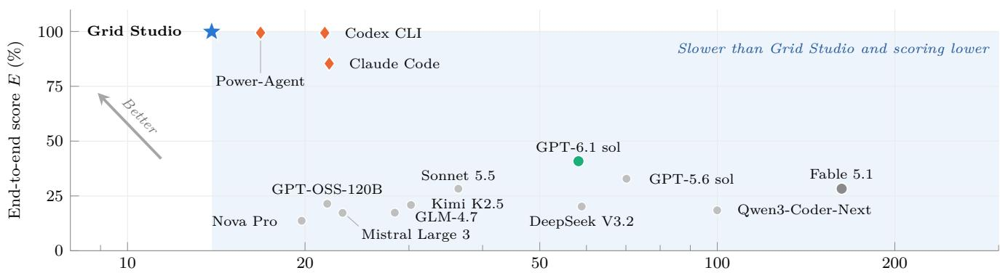
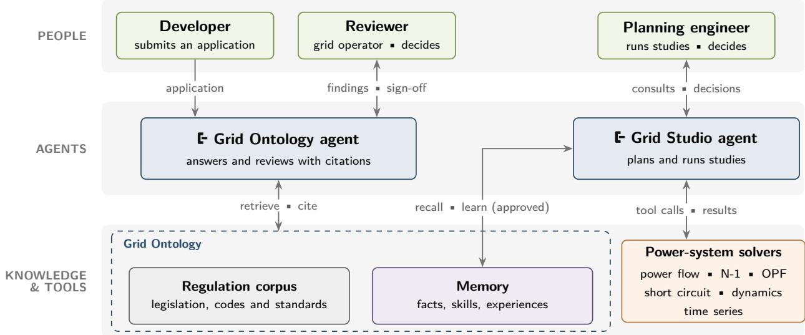
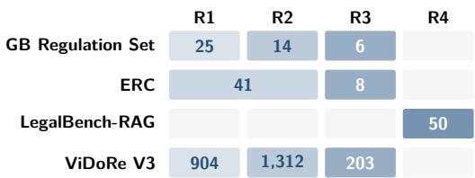
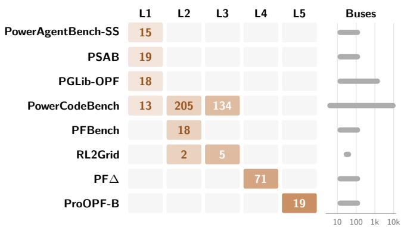
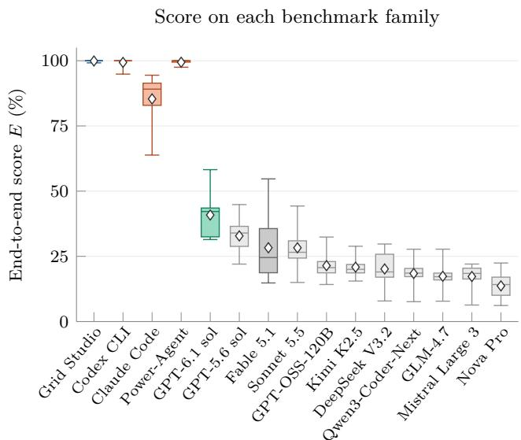
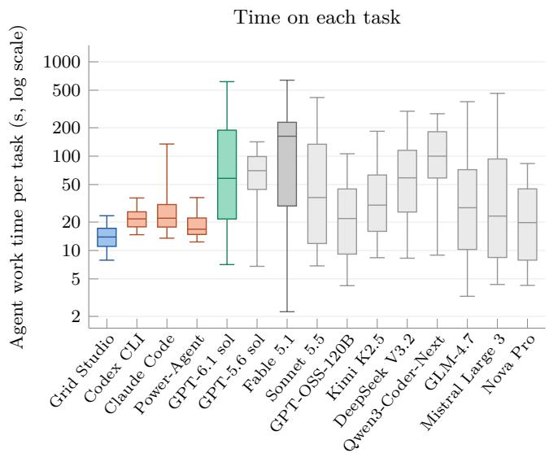

# - Grid Agents

# An Agentic Framework for Automated Power System Studies and Grid Connection Assessment

Technical Report

MaoXun Huang

Kshitij Kapoor Eli Louise

Grid Agents {mao, kaps, eli}@grid-agents.com

## Abstract

Connecting new generation and demand to the grid depends on two scarce skills: checking applications against a large, changing body of regulation, and running the network studies that decide where and how a project connects. We present Grid Agents, an AI system that brings both together, and the methodology we use to evaluate it. The Grid Ontology is its knowledge system. It represents the regulation, standards and engineering knowledge that grid work depends on, makes it searchable, and evolves as the agents learn from use. Every answer drawn from it rests on evidence the agents cite. Grid Studio is an agent system specialised for power-system engineering. It works in its own engineering environment with domain tools and a study framework, draws on the Grid Ontology, and relies on established solvers for every number it reports. In both, engineers make the decisions. We bring eight published power-system benchmark families, previously scattered across separate papers, into one suite of 519 tasks, and we verify not only each answer but the work behind it, by replaying the agent’s tool calls. The Grid Ontology cites the right regulatory evidence more often than a general coding agent or retrieval pipelines, leads on LegalBench-RAG and ranks first on the public leaderboards of the Enterprise RAG Challenge and ViDoRe V3. Grid Studio scores highest on the 519 power-system tasks and is the fastest of all the systems we compare, both by a statistically significant margin. With an optimiser in the loop, its reinforcement packages cost 33–67% less on average than those the agent designs alone.

Grid Studio Coding agent Base model  
  
Median agent work time per task (s, log scale)

Figure 1: End-to-end score against agent work time per task. Each point is one system on the same 519 tasks. Every other system is slower than Grid Studio and scores lower, and both diferences are statistically significant (Table 4).

## 1 Introduction

Grid connection, more than generation, now limits the energy transition. At least 3,000 GW of renewable projects were waiting in connection queues worldwide in 2023 [18]. In the United States alone, about 2,600 GW of generation and storage was seeking interconnection at the end of that year [45]. Both the United States and Great

Britain have reformed their connection processes in response [9, 38].

Each connection request needs two kinds of expert work. Regulatory work checks the application against legislation, grid codes and standards that run to thousands of pages and change as reform proceeds. Engineering work decides where the project can connect and what reinforcement it needs, by running power-flow, contingency (N-1) and short-circuit studies on a network model [25, 63]. Both are slow and both are short of people.

Agents built on large language models (LLMs) plan, call tools and act on the results [48, 61, 67], which suits both tasks. They also fail in three ways that matter here. They write fluent text that no source supports [20]. They cannot be trusted with the arithmetic of large network equations. Finally, a correct answer does not show that the work behind it was correct. The same number can come from the right study, from memory or from a study of the wrong grid state, and most benchmarks grade only the number. Yet a connection decision commits costly network works and can be challenged by the applicant or the regulator, so the engineer must be able to show which study ran on which network.

We present Grid Agents, a system designed around these failure modes. It has two parts (Figure 2):

• The Grid Ontology is the knowledge system of Grid Agents. It represents the regulation, standards and engineering knowledge that grid work depends on, makes it searchable by the agents, and evolves as they learn from use, with people approving what is shared.<sup>1</sup> Agents answer questions and review applications from it, and every answer rests on evidence they cite.

• Grid Studio is an agent system specialised for power-system engineering. It works in its own engineering environment, with domain tools and a framework that carries a study from the choice of connection point to the final report, and it is connected to the Grid Ontology for the knowledge its studies draw on. Established solvers compute every number it reports.

## Contributions.

1. A design for agents in regulated engineering work, built on three principles, with a memory that learns from use under human approval (Section 3).

2. A power-system benchmark suite of 519 tasks from eight published benchmark families, on networks of 4 to 9,241 buses, graded the same way on one scale of depth (Section 4.1).

3. Results and findings against coding agents, retrieval pipelines, leaderboard entries and frontier models, with each agent’s work verified against the study it ran (Section 5). The Grid Ontology cites the right regulatory evidence more often than any other system. Grid Studio leads the best coding agent in both score and agent work time, by a statistically significant margin, and its lead is largest on the biggest networks. Optimisation in the loop makes reinforcement cheaper.

## 2 Background and Related Work

Retrieval and citation. Retrieval-augmented generation conditions a model on passages fetched for the question [27]. In its common form a pipeline searches once and the model answers from what comes back. The search may be lexical or dense, often followed by a reranker [24, 37, 47]. It may also run over a graph built from the corpus [7] or follow a document’s own hierarchy [58]. Longer context windows do not remove the need to retrieve well [28]. Agentic approaches instead let the model decide what to retrieve and judge what it found [1], or explore the corpus from a programming environment [69]. Because a reviewer must be able to check every source, the citations matter as much as the answer. Work on attributed generation measures whether citations support the claims [10], and model judges score faithfulness and answer quality [8, 71]. LegalBench-RAG [42], built on CUAD [15] and related to LegalBench [14], scores retrieval on exact character spans, which separates finding the right document from finding the right clause.

Tool-using agents and their evaluation. Engineering work needs an agent that acts as well as reads. ReAct interleaves reasoning and action [67], Toolformer learns when to call a tool [48], Reflexion adds self-critique [52], AutoGen composes several agents [65] and MANTA lets a multi-agent system adapt how its agents collaborate while it runs [17]. As agents began to act, their evaluation moved from judging text to checking outcomes. SWE-bench runs a repository’s tests [22], AgentBench spans many environments [29] and τ -bench compares the final database state with a goal state [68]. Our strict pass brings this state-based grading to engineering studies by checking the grid state that each study ran on.

Agent memory. An agent that works beside the same people for months should also keep what it learns. CoALA organises a language agent’s memory into working, semantic, episodic and procedural stores [53], after the distinction drawn in human memory [57]. MemGPT pages information between the context and external storage [39]. Generative Agents and Reflexion turn experience into reflections that guide later behaviour [41, 52], ExpeL distils insights from past trajectories [70] and Voyager grows a library of skills [60]. These systems learn on their own. In regulated work, one engineer’s session must not silently change a colleague’s agent, so the memory we describe in Section 3.2 adds human approval.

  
Figure 2: High-level system design of Grid Agents. People sit above two agents. The Grid Ontology agent answers and reviews with citations, and Grid Studio runs engineering studies through established solvers. Both draw on the Grid Ontology’s knowledge (the regulation corpus and a memory that learns from use under approval).

Power-system studies. In engineering work, the actions an agent takes are calls to power-system analyses whose methods are long established. A power flow solves the AC network equations for voltages and flows at one operating point [63]. Security standards require the system to survive any single credible outage [36], so a contingency (N-1) analysis repeats the power flow with each element out of service. Short-circuit, stability and dynamic studies cover fault levels and the seconds after a disturbance [25], and optimal power flow (OPF) finds the least-cost dispatch within network limits. Open-source solvers such as MATPOWER [72], pandapower [54] and PowerModels.jl [5] implement these analyses, and several benchmarks take their answer keys from them. For an engineer, and for an agent, the dificulty lies less in the computation than in choosing which studies to run on which network state, and in reading the results against the rules.

Language models for power systems. Language models have only recently been applied to this work. Surveys map the opportunities and risks [11, 16, 32]. Agent systems include multi-agent simulation frameworks [21], agents for analysis and operations [23, 62], an agent for connection impact assessment [49] and tool servers for power-system software [43]. Several are evaluated on task sets of their own [23, 62], which makes them hard to compare. Shared benchmarks have followed. They cover power-flow questions (PFBench [50]), agentic studies (PowerAgentBench [35], PSAB [56]), natural-language study tasks (PowerCodeBench [64]), power flow under load, dispatch and topology variation (PF∆ [46], solved with Ipopt [59]) and natural-language OPF modifications (ProOPF [51]). Older datasets supply independent references, among them PGLib-OPF [2], OPFData [31], Grid2Op/L2RPN and RL2Grid [6, 33, 34] and the IEEE PES small-signal benchmark systems [4].

## 3 System Overview

## 3.1 Design principles

P1. Evidence before answers. Every answer and finding is anchored to a passage in a source document or in the applicant’s submission.

P2. Computation by established solvers. The model chooses, sequences and interprets studies, and solvers produce every number.

P3. Human decision authority. Agents prepare the work and people decide. Agent verdicts sit beside human verdicts, decisions need sign-of by named people, and studies pause at decision points [40].

## 3.2 The Grid Ontology

Knowledge base. The Grid Ontology holds the legislation, grid codes, standards and process documents that an application is checked against. The GB corpus in our experiments has 27 documents with 6,347 pages, including their figures and tables.

Grounded answers. An agent answers questions and reviews applications from this knowledge base. It answers only from evidence it has found and must cite the passages its answer relies on.

Memory. Documents state the rules, and memory holds what the agents learn while applying them. Following the CoALA taxonomy [53], it holds three kinds (Table 1).

Table 1: Memory carries what the agents learn beyond the documents. The three kinds held in the Grid Ontology.
<table><tr><td>Kind</td><td>Holds</td></tr><tr><td>Semantic</td><td>Facts about the domain, an operator and its</td></tr><tr><td>Procedural</td><td>projects, and rules for responding Skills, which are written methods for a task</td></tr><tr><td>Episodic</td><td>such as a connection study Experiences and the lessons drawn from them</td></tr></table>

Self-evolving memory. All three kinds of memory change with use. Lessons drawn from recent work [41, 70] become experiences, and facts, rules and skills are added or revised as the work shows what the agents lack. A change that would afect other people takes efect only after a person approves it. The agents therefore improve with use while every shared change stays visible and attributable, which is principle P3 applied to learning.

## 3.3 Grid Studio

Studies through established solvers. Grid Studio gives the agent power-system studies as tools. The agent chooses which studies to run and on which network state, and reads the results, while established solvers compute every number (P2).

Reinforcement planning. When a project needs reinforcement, the agent calls an optimiser that proposes the least-cost package of works, in the spirit of transmission expansion planning [26]. Section 5.2 evaluates it.

## 4 Experimental Setup

## 4.1 Benchmarks

Table 2 lists the benchmarks and what each tests. We also give every task a depth, how much work the system must do to reach the answer, in the spirit of Power-CodeBench’s dificulty levels [64]. Figures 3 and 4 place each benchmark on this scale, and Table 6 in Appendix A gives an example of each step.

Regulatory knowledge. The GB Regulation Set is our own set of 45 questions on GB grid regulation, asked of the 27 documents of the GB corpus (6,347 pages). An R1 question is answered by one passage, an R2 question by a figure or table, and an R3 question only by combining passages. We built it evidence first. Passages and figures are sampled from the corpus, a model writes a question from each, questions the evidence does not support or that need no evidence are discarded, and the domain owner approves the rest (Appendix D). The Enterprise RAG Challenge asks similar questions of 100 company annual reports (14,454 pages), and about half have no answer in the reports, so the system must also recognise when there is none. LegalBench-RAG (R4) asks for the exact span of a clause in a long contract, and we use a fixed sample of 50 questions from its CUAD subset [15], whose 462 contracts are plain text without pages (about 3.9 million words). ViDoRe V3 [30] asks 2,419 questions of 19,252 pages of visually rich documents in English and French, and scores the ranking of the pages a system returns. Its own question labels give each question a depth (Appendix D).

  
Figure 3: How deep each regulatory benchmark goes. Rows are the Grid Ontology’s benchmarks and columns the steps of depth. An R1 question is answered by one passage, R2 by a figure or table, R3 by combining passages and R4 by the exact span of a clause. Each cell counts the questions at that step, and darker cells are deeper. ERC is the Enterprise RAG Challenge, and its 51 questions with no answer in the reports are not shown.

  
Figure 4: How deep each power-system benchmark goes. Rows are Grid Studio’s benchmarks and columns the steps of depth. An L1 task runs one study on the published network, L2 first applies the changes it states, L3 must first find what to change, L4 rebuilds a published operating point and L5 turns a written requirement into a changed optimisation problem. Cells count tasks as in Figure 3, and each bar on the right spans the network sizes a benchmark uses.

Power-system engineering. Eight benchmark families give 519 tasks on networks of 4 to 9,241 buses. An L1 task runs one study on the network as published, an L2 task first applies stated changes, and an L3 task must first find what to change, such as the most heavily loaded line. An L4 task rebuilds a published operating point of 20 to 261 values, and an L5 task turns a written requirement into a changed optimisation problem. None poses a multi-stage study, so Section 5.2 measures one separately.

Table 2: The benchmarks. Who developed each one, what it tests and how deep it goes, in the steps of Figures 3 and 4. OPF is optimal power flow, the least-cost dispatch within network limits. <sup>†</sup>Adapted to a network-study interface, so its answer key comes from a reference solver (Appendix D).
<table><tr><td>Benchmark</td><td>Developed by</td><td>What it tests</td><td>Depth</td><td>Items</td></tr><tr><td>Regulatory knowledge (Grid Ontology)</td><td></td><td></td><td></td><td></td></tr><tr><td>GB Regulation Set</td><td>Grid Agents (this work)</td><td>Questions on GB grid regulation</td><td>R1-R3</td><td>45</td></tr><tr><td>Enterprise RAG Challenge [55]</td><td>TimeToAct Austria</td><td>Questions on annual reports</td><td>R1-R3</td><td>100</td></tr><tr><td>LegalBench-RAG [42]</td><td>ZeroEntropy, UC Berkeley (CUAD)</td><td>Exact clause spans in contracts</td><td>R4</td><td>50</td></tr><tr><td>ViDoRe V3 [30]</td><td>Illuin Technology, NVIDIA</td><td>Pages of visually rich documents</td><td>R1-R3</td><td>2,419</td></tr><tr><td>Power-system engineering (Grid Studio)</td><td></td><td></td><td></td><td></td></tr><tr><td>PowerAgentBench-SS† [35]</td><td>NTUA, Harvard and others</td><td>Single-outage screening (N-1)</td><td>L1</td><td>15</td></tr><tr><td>PSAB† [56]</td><td>Pskov State University</td><td>Overload, voltage, outage checks</td><td>L1</td><td>19</td></tr><tr><td>PGLib-OPF [2]</td><td>IEEE PES Task Force</td><td>Power flow and OPF</td><td>L1</td><td>18</td></tr><tr><td>PowerCodeBench [64]</td><td>University of Exeter</td><td>Study requests in plain English</td><td>L1-L3</td><td>352</td></tr><tr><td>PFBench [50]</td><td>Kansas State University</td><td>Power flow after load changes</td><td>L2</td><td>18</td></tr><tr><td>RL2Grid† [33]</td><td>MIT, RTE, National Grid ESO</td><td>Switching after double outages</td><td>L2-L3</td><td>7</td></tr><tr><td>PF∆ [46]</td><td>MIT</td><td>Rebuilding a published grid state</td><td>L4</td><td>71</td></tr><tr><td>ProOPF-B [51]</td><td>Peking U., Zhejiang U.</td><td>OPF changes from a written brief</td><td>L5</td><td>19</td></tr></table>

## 4.2 Evaluation metrics

Regulatory knowledge. We score the evidence each system cites. A cited item matches a gold anchor if it comes from the same document and overlaps the anchor’s span, lies within one page of it, or is the anchored figure. We report recall, precision, MRR, nDCG@10 [19] and hit rate, and a model judge marks each answer against the gold answer [71]. LegalBench-RAG and the Enterprise RAG Challenge keep their own metrics and scoring script, and ViDoRe V3 its board’s nDCG@10, averaged over its sets.

Power-system engineering. A correct number can come from memory, a lucky guess or a study on the wrong grid state, so we grade the work behind each answer as well as the answer. A task is a strict pass only if its answer is within the benchmark’s tolerance and the system’s recorded work shows that the required study ran on the required grid state. With numeric closeness c¯, answer accuracy A and strict pass rate $P ,$ each taken over all n tasks, the end-to-end score is

$$
E = 0 . 2 5 \bar { c } + 0 . 2 5 A + 0 . 5 P .\tag{1}
$$

A base model, which answers without tools, gets the network as text in its prompt and reports the solved states its answer rests on, which we check against our

own solution. Appendix B defines each term, describes how the work of each kind of system is verified, and gives the reasons for the weights.

## 4.3 Evaluation method

Systems compared. On the regulatory benchmarks we compare the Grid Ontology with a general coding agent (Claude Code) that has the corpus as files and its own file and shell tools, with one-shot retrieval pipelines that search once and answer from their top eight results, and on the Enterprise RAG Challenge and ViDoRe V3 with their published entries. On the power-system benchmarks we compare Grid Studio with two coding agents as shipped, Claude Code and Codex CLI on GPT-6.1 sol, each with a shell, Python and the network as a file. We also compare it with Power-Agent [43, 44], which installs PowerMCP’s pandapower tools and PowerSkills playbooks into Claude Code, and with eleven base models, which answer without tools from the network given as text, among them the frontier models GPT-6.1 sol and Fable 5.1. Claude Code and Power-Agent run on the same model as our agents, and Power-Agent uses its tools and playbooks as their authors publish them. We also time each system’s agent work, the time it spends on model turns and tool runs. Appendix D gives the evaluation protocol.

Table 3: Grid Ontology results on four retrieval benchmarks. (a) Every system uses the same model and is scored on the evidence it cites. F1 is shown with its 95% confidence interval, and a dash marks a system not run. (b) The top published entries on each public leaderboard, by the leaderboard’s own score (out of 150 for the Enterprise RAG Challenge, and ×100 for ViDoRe V3). Best in bold.
<table><tr><td rowspan="2">(a) Same model System</td><td colspan="5">GB Regulation Set</td><td colspan="3">LegalBench-RAG</td></tr><tr><td>Recall↑</td><td>nDCG↑</td><td>MRR↑</td><td>Hit rate↑</td><td>Answer acc. ↑</td><td>Precision↑</td><td>Recall↑</td><td>F1↑</td></tr><tr><td>Grid Ontology</td><td>0.967</td><td>0.945</td><td>0.944</td><td>0.978</td><td>1.000</td><td>0.980</td><td>0.980</td><td> $\mathbf { 0 . 9 8 0 _ { \pm 0 . 0 3 0 } }$ </td></tr><tr><td>Claude Code (file tools)</td><td>0.856</td><td>0.863</td><td>0.878</td><td>0.889</td><td>1.000</td><td>0.900</td><td>0.900</td><td> $0 . 9 0 0 { \scriptstyle \pm 0 . 0 8 0 }$ </td></tr><tr><td>Vector + reranker [24, 37, 47]</td><td>0.922</td><td>0.917</td><td>0.933</td><td>0.956</td><td>0.889</td><td>0.820</td><td>1.000</td><td> $0 . 8 6 9 { \scriptstyle \pm 0 . 0 5 7 }$ </td></tr><tr><td>PageIndex [58]</td><td>0.400</td><td>0.389</td><td>0.378</td><td>0.400</td><td>0.444</td><td>0.762</td><td>0.920</td><td> $0 . 7 9 9 { \scriptstyle \pm 0 . 0 9 0 }$ </td></tr><tr><td>MS GraphRAG [7]</td><td>0.344</td><td>0.347</td><td>0.367</td><td>0.378</td><td>0.333</td><td></td><td></td><td></td></tr><tr><td>Recursive LM [69]</td><td></td><td></td><td></td><td></td><td></td><td>0.860</td><td>0.860</td><td> $0 . 8 6 0 { \scriptstyle \pm 0 . 1 0 0 }$ </td></tr><tr><td colspan="9">(b) Top published entries</td></tr><tr><td>Enterprise RAG Challenge</td><td colspan="2">Score↑</td><td></td><td colspan="4">ViDoRe V3</td><td>nDCG@10↑</td></tr><tr><td>Grid Ontology</td><td colspan="2">124.5</td><td></td><td colspan="4">Grid Ontology</td><td>70.23</td></tr><tr><td>Ilia Ris (1st)</td><td colspan="2">123.7</td><td colspan="2"></td><td colspan="4">VisAgentRet (1st)</td></tr><tr><td>Emil Shagiev</td><td colspan="2">121.6</td><td colspan="2"></td><td colspan="4">NeMo Retriever, agentic</td></tr><tr><td>Dmitry Buykin</td><td colspan="2">117.5</td><td colspan="2"></td><td colspan="4"> $\mathrm { E V I E  – 4 . 5 B + J E V  – 2 7 B – V L }$ </td></tr><tr><td>Sergey Nikonov</td><td colspan="2">116.4</td><td colspan="5">jina-embeddings-v4 + zerank-2</td><td>68.25 65.62</td></tr></table>

## 5 Results

## 5.1 Grid Ontology

Takeaway: The Grid Ontology cites the right regulatory evidence more often than any other system (0.967 recall). It also leads on LegalBench-RAG (0.980 F1) and ranks first among published entries on the Enterprise RAG Challenge and ViDoRe V3.

Table 3 gives the results on all four benchmarks. On the GB Regulation Set and LegalBench-RAG, every system answers with the same model, so the diferences come from the evidence each finds and cites. On the Enterprise RAG Challenge and ViDoRe V3, the Grid Ontology is first on the public board.

GB Regulation Set. Both agents answer every question correctly, so the evidence they cite is what separates them. The Grid Ontology cites the right evidence for more questions than Claude Code (recall 0.967 against 0.856), and the gap is widest on single-passage questions that ask for a number (1.000 against 0.625). This matters in review, where a correct answer that cites the wrong passage still has to be checked by hand. The retrieval pipelines answer fewer questions correctly. Vector retrieval with a reranker comes closest, while PageIndex and GraphRAG find the evidence for fewer than half of the questions. Example 1 in Appendix A shows one question.

LegalBench-RAG. The Grid Ontology reaches an F1 of 0.980, ahead of every baseline. It cites one contract per question, while the retrieval pipelines cite up to five, so the right contract is usually among theirs but so are wrong ones. Its one miss is a contract filed twice, where it cited the signed copy and the answer key names the unsigned draft. At the benchmark’s stricter clause level, its lead over the pipelines is an order of magnitude (Appendix E).

Enterprise RAG Challenge. The challenge’s own script scores both the exact answers and the pages they cite, out of 150 [55]. The Grid Ontology scores 124.5 against 123.7 for the best published entry, and it correctly declines 45 of the 51 questions that the reports cannot answer.

ViDoRe V3. The board scores the first ten pages returned for each English question by nDCG@10, averaged over eight public sets. The Grid Ontology scores 70.23 against 70.01 for the best published pipeline and leads on four of the eight sets (Appendix F).

## 5.2 Grid Studio

Takeaway: Grid Studio scores highest, 99.9% with verified work on 516 of the 519 tasks, and it is the fastest system, at a median of 13.9 s of agent work per task. Both leads are statistically significant. With optimisation in the loop, its reinforcement packages are up to 67% cheaper.

Table 4 gives the mean end-to-end score over the eight benchmark families, and Table 8 gives each family. Grid Studio scores 99.9%, with 100% on seven of the eight families and 99.2% on PowerCodeBench, statistically significantly above every other system. Codex CLI scores 99.4%, but 19 of its 23 misses are on networks above 2,000 buses, and it takes up to 55% longer per task.

Table 4: End-to-end score and agent work time on the eight power-system benchmark families (519 tasks). Mean E (Eq. 1) and median time per task, ± the half-width of the 95% confidence interval. <sup>†</sup> Statistically significantly better than every other system $( p < 0 . 0 0 1$ , paired tests on the same tasks, Holm-corrected).
<table><tr><td>System</td><td>Mean E (%) ↑ Median time (s) ↓</td><td></td></tr><tr><td>Grid Studio</td><td> ${ \bf 9 9 . 9 \pm 0 . 1 ^ { \dagger } }$ </td><td> $\mathbf { 1 3 . 9 \pm 0 . 4 } ^ { \dagger }$ </td></tr><tr><td>Codex CLI</td><td> $9 9 . 4 \pm 0 . 3 $ </td><td> $2 1 . 6 \pm 0 . 7$ </td></tr><tr><td>Claude Code</td><td> $8 5 . 4 \pm 3 . 2 $ </td><td> $2 2 . 0 \pm 0 . 9$ </td></tr><tr><td>Power-Agent</td><td> $9 9 . 4 \pm 0 . 3 $ </td><td> $1 6 . 8 \pm 0 . 5$ </td></tr><tr><td>GPT-6.1 sol, base model</td><td> $4 0 . 8 \pm 2 . 9$ </td><td> $5 8 . 2 \pm 1 0 . 6 $ </td></tr><tr><td>Fable 5.1, base model</td><td> $2 8 . 3 \pm 3 . 0$ </td><td> $1 6 2 . 5 \pm 3 9 . 6 $ </td></tr></table>

Power-Agent also scores 99.4%, and Grid Studio scores higher on 13 tasks and lower on one, with Grid Studio’s time 0.75 of Power-Agent’s on the same task. Claude Code scores 85.4%.

Base models. The best base model, GPT-6.1 sol, answers 250 of the 519 tasks (48%) correctly. Given the network as text, the strongest base models solve small power flows by hand, but none has its work verified on a network of more than 39 buses. None answers more than 30% of the PF∆ tasks, where a published operating point must be solved, or more than two of the seven RL2Grid tasks, where switching actions must be compared, and none scores above 41% end to end.

Score against time. Figure 1 sets each score against the agent work time. Grid Studio needs a median of 13.9 s per task, against at most 21.6 s for Codex CLI and 22.0 s for Claude Code, so it scores highest in the least time. Reading the network and writing out the solved states takes the base models a median of 20 s to almost 3 minutes per task, so every other system is both slower than Grid Studio and lower scoring. More time does not close the gap: GPT-6.1 sol and Fable 5.1 spend about 1 and 3 minutes per task and still stay below 41%.

Domain tools must reach the study. Power-Agent installs PowerMCP’s pandapower tools and PowerSkills playbooks into Claude Code, on the same model as Grid Studio, and comes close to Grid Studio’s score. Its PowerMCP tools were called on only 46 of the 519 tasks and settled 16 on their own. The other 503 needed the agent’s own pandapower code, and 473 never called PowerMCP at all, while a PowerSkills playbook was followed in 409. Its results therefore come mostly from code the agent writes for each task rather than from the domain tools. Grid Studio’s tools reach every study the benchmarks ask for, which is what makes its work both verifiable and fast.

Table 5: Cost of the reinforcement packages. Cost in US\$ million, the mean of two runs, of the package the agent designed alone and with the optimiser.
<table><tr><td>Network</td><td>Project</td><td>Agent alone↓</td><td>With optimiser ↓</td></tr><tr><td>30-bus</td><td></td><td></td><td>81.6</td></tr><tr><td>118-bus</td><td>400 MW 500 MW</td><td>151.0 173.3</td><td>71.1</td></tr><tr><td>118-bus</td><td>700 MW</td><td>395.3</td><td>166.4</td></tr><tr><td>118-bus, three cases</td><td>700 MW</td><td>481.0</td><td>160.4</td></tr><tr><td>2,000-bus</td><td>1,100 MW</td><td>512.7</td><td>344.5</td></tr></table>

Real studies are larger. The benchmark networks have at most 9,241 buses. An operator’s planning model can run to tens of thousands of buses, and a connection study chains many studies, from screening the options to designing reinforcement. The baselines already fall short at the top of the benchmarks. Of the 109 tasks on networks above 2,000 buses, Power-Agent passes 106, Codex CLI 90 and Claude Code 74, against 108 for Grid Studio, and the base models pass none. Grid Studio takes its numbers from established solvers rather than from code written for each task, and its work can be checked at every step, which makes it the better design for real planning studies.

Optimisation makes reinforcement cheaper. The benchmarks pose single studies, so we tested the reinforcement stage of a connection study separately. In five studies on networks of 30, 118 and 2,000 buses, the last the synthetic Texas grid ACTIVSg2000 [3], the agent designed the package twice on its own and twice with the optimiser, using the same model and catalogue of priced reinforcement works (Table 5). Both approaches cleared every overload the projects caused, as an independent AC N-1 check of each final network confirms. The optimiser’s packages were 33–67% cheaper on average.

## 6 Conclusion

Grid Agents is built on three principles. Answers rest on cited evidence, numbers come from established solvers, and engineers make the decisions. The Grid Ontology cites the right regulatory evidence more often than a general coding agent or retrieval pipelines, leads on LegalBench-RAG, and ranks first on the public leaderboards of the Enterprise RAG Challenge and ViDoRe V3. On 519 tasks from eight published power-system benchmark families, Grid Studio scores highest and needs the least agent work time, both by a statistically significant margin. With an optimiser in the loop, its reinforcement packages cost 33–67% less on average than those the agent designs alone.

## Acknowledgements

We thank the authors of every benchmark used here for releasing their questions, answer keys and reference solutions, and TimeToAct Austria, Illuin Technology and NVIDIA for running the public leaderboards of the Enterprise RAG Challenge and ViDoRe V3. The GB network models come from the University of Edinburgh Power Systems Test Case Archive, and Manolis Belivanis of the University of Strathclyde provided the reduced GB model. The synthetic Texas grid comes from the Texas A&M Electric Grid Test Case Repository, and the PGLib-OPF cases from the IEEE PES Task Force on Benchmarks for Validation of Emerging Power System Algorithms.

## References

[1] Akari Asai, Zeqiu Wu, Yizhong Wang, Avirup Sil, and Hannaneh Hajishirzi. Self-RAG: Learning to retrieve, generate, and critique through self-reflection. In The Twelfth International Conference on Learning Representations (ICLR), 2024.

[2] Sogol Babaeinejadsarookolaee, Adam Birchfield, Richard D. Christie, Carleton Cofrin, Christopher DeMarco, Ruisheng Diao, Michael Ferris, Stephane Fliscounakis, et al. The power grid library for benchmarking AC optimal power flow algorithms. arXiv:1908.02788, 2019.

[3] Adam B. Birchfield, Ti Xu, Kathleen M. Gegner, Komal S. Shetye, and Thomas J. Overbye. Grid structural characteristics as validation criteria for synthetic networks. IEEE Transactions on Power Systems, 32(4):3258–3265, 2017. doi: 10.1109/TP WRS.2016.2616385.

[4] Claudio Cañizares, Thiago Fernandes, Edison Geraldi, Lise Gérin-Lajoie, Michael Gibbard, Ian Hiskens, Jonas Kersulis, Roman Kuiava, Leonardo Lima, Fernando DeMarco, et al. Benchmark models for the analysis and control of small-signal oscillatory dynamics in power systems. IEEE Transactions on Power Systems, 32(1):715–722, 2017. doi: 10.1109/TPWRS.2016.2561263.

[5] Carleton Cofrin, Russell Bent, Kaarthik Sundar, Yeesian Ng, and Miles Lubin. PowerModels.jl: An open-source framework for exploring power flow formulations. In 2018 Power Systems Computation Conference (PSCC), pages 1–8, 2018. doi: 10.23919/PSCC.2018.8442948.

[6] Benjamin Donnot. Grid2Op: A testbed platform to model sequential decision making in power systems. GitHub repository, https://github.com/Grid2Op /grid2op, 2020.

[7] Darren Edge, Ha Trinh, Newman Cheng, Joshua Bradley, Alex Chao, Apurva Mody, Steven Truitt, Dasha Metropolitansky, Robert Osazuwa Ness, and Jonathan Larson. From local to global: A graph RAG approach to query-focused summarization. arXiv:2404.16130, 2024.

[8] Shahul Es, Jithin James, Luis Espinosa Anke, and Steven Schockaert. RAGAS: Automated evaluation of retrieval augmented generation. In Proceedings of the 18th Conference of the European Chapter of the Association for Computational Linguistics: System Demonstrations, pages 150–158. Association for Computational Linguistics, 2024. doi: 10.18653 /v1/2024.eacl-demo.16.

[9] Federal Energy Regulatory Commission. Improvements to generator interconnection procedures and agreements. Order No. 2023, Docket No. RM22- 14-000, 184 FERC ¶ 61,054, 88 Fed. Reg. 61014, 2023.

[10] Tianyu Gao, Howard Yen, Jiatong Yu, and Danqi Chen. Enabling large language models to generate text with citations. In Proceedings of the 2023 Conference on Empirical Methods in Natural Language Processing, pages 6465–6488. Association for Computational Linguistics, 2023. doi: 10.18653/v1/2023.emnlp-main.398.

[11] Masoumeh Ghafari, Asal Sami, Hamed Rezapour, Sepideh Saravani Ghayour, Fanfan Lin, Kivanc Basaran, George Cristian Lazaroiu, and Pierluigi Siano. A comprehensive review on the application of large language models (LLMs) in power systems. IEEE Access, 13:209450–209486, 2025. doi: 10.1109/ACCESS.2025.3637226.

[12] Shahriar Golchin and Mihai Surdeanu. Time travel in LLMs: Tracing data contamination in large language models. In The Twelfth International Conference on Learning Representations (ICLR), 2024.

[13] Thomas R. Gruber. A translation approach to portable ontology specifications. Knowledge Acquisition, 5(2):199–220, 1993. doi: 10.1006/knac.1 993.1008.

[14] Neel Guha, Julian Nyarko, Daniel E. Ho, Christopher Ré, Adam Chilton, Aditya Narayana, Alex Chohlas-Wood, Austin Peters, et al. LegalBench: A collaboratively built benchmark for measuring legal reasoning in large language models. In Advances in Neural Information Processing Systems (Datasets and Benchmarks Track), volume 36, pages 44123–44279, 2023.

[15] Dan Hendrycks, Collin Burns, Anya Chen, and Spencer Ball. CUAD: An expert-annotated NLP dataset for legal contract review. In Proceedings of

the Neural Information Processing Systems Track on Datasets and Benchmarks, volume 1, 2021.

[16] Chenghao Huang, Siyang Li, Ruohong Liu, Hao Wang, and Yize Chen. Large foundation models for power systems. In 2024 IEEE Power & Energy Society General Meeting (PESGM), pages 1–5, 2024. doi: 10.1109/PESGM51994.2024.10688670.

[17] Mao-xun Huang, Jerry Wang, Yi-Cheng Lai, Zhengxin Zhang, Claire Cardie, and Hen-Hsen Huang. MANTA: Multi-agent network topology adaptation for self-evolving multi-agent systems. arXiv:2607.28527, 2026.

[18] International Energy Agency. Electricity grids and secure energy transitions. Technical report, IEA, Paris, 2023. URL https://www.iea.org/report s/electricity-grids-and-secure-energy-tra nsitions.

[19] Kalervo Järvelin and Jaana Kekäläinen. Cumulated gain-based evaluation of IR techniques. ACM Transactions on Information Systems, 20(4):422– 446, 2002. doi: 10.1145/582415.582418.

[20] Ziwei Ji, Nayeon Lee, Rita Frieske, Tiezheng Yu, Dan Su, Yan Xu, Etsuko Ishii, Ye Jin Bang, Andrea Madotto, and Pascale Fung. Survey of hallucination in natural language generation. ACM Computing Surveys, 55(12):248:1–248:38, 2023. doi: 10.1145/35 71730.

[21] Mengshuo Jia, Zeyu Cui, and Gabriela Hug. Enhancing LLMs for power system simulations: A feedbackdriven multi-agent framework. IEEE Transactions on Smart Grid, 16(6):5556–5572, 2025. doi: 10.1109/TSG.2025.3589114.

[22] Carlos E. Jimenez, John Yang, Alexander Wettig, Shunyu Yao, Kexin Pei, Ofir Press, and Karthik Narasimhan. SWE-bench: Can language models resolve real-world GitHub issues? In The Twelfth International Conference on Learning Representations (ICLR), 2024.

[23] Hongwei Jin, Kibaek Kim, and Jonghwan Kwon. GridMind: LLMs-powered agents for power system analysis and operations. In Proceedings of the SC ’25 Workshops of the International Conference for High Performance Computing, Networking, Storage and Analysis, pages 560–568. ACM, 2025. doi: 10.1 145/3731599.3767409.

[24] Vladimir Karpukhin, Barlas Oğuz, Sewon Min, Patrick Lewis, Ledell Wu, Sergey Edunov, Danqi Chen, and Wen-tau Yih. Dense passage retrieval for open-domain question answering. In Proceedings of the 2020 Conference on Empirical Methods in

Natural Language Processing (EMNLP), pages 6769– 6781. Association for Computational Linguistics, 2020. doi: 10.18653/v1/2020.emnlp-main.550.

[25] Prabha Kundur. Power System Stability and Control. McGraw-Hill, New York, 1994.

[26] Gerardo Latorre, Rubén Darío Cruz, Jorge Mauricio Areiza, and Andrés Villegas. Classification of publications and models on transmission expansion planning. IEEE Transactions on Power Systems, 18(2): 938–946, 2003. doi: 10.1109/TPWRS.2003.811168.

[27] Patrick Lewis, Ethan Perez, Aleksandra Piktus, Fabio Petroni, Vladimir Karpukhin, Naman Goyal, Heinrich Küttler, Mike Lewis, Wen-tau Yih, Tim Rocktäschel, Sebastian Riedel, and Douwe Kiela. Retrieval-augmented generation for knowledgeintensive NLP tasks. In Advances in Neural Information Processing Systems, volume 33, pages 9459–9474, 2020.

[28] Nelson F. Liu, Kevin Lin, John Hewitt, Ashwin Paranjape, Michele Bevilacqua, Fabio Petroni, and Percy Liang. Lost in the middle: How language models use long contexts. Transactions of the Association for Computational Linguistics, 12:157–173, 2024. doi: 10.1162/tacl\_a\_00638.

[29] Xiao Liu, Hao Yu, Hanchen Zhang, Yifan Xu, Xuanyu Lei, Hanyu Lai, Yu Gu, Hangliang Ding, et al. AgentBench: Evaluating LLMs as agents. In The Twelfth International Conference on Learning Representations (ICLR), 2024.

[30] António Loison, Quentin Macé, Antoine Edy, Victor Xing, Tom Balough, Gabriel Moreira, Bo Liu, Manuel Faysse, Céline Hudelot, and Gautier Viaud. ViDoRe V3: A comprehensive evaluation of retrieval augmented generation in complex real-world scenarios. arXiv:2601.08620. Pipeline board at https: //github.com/illuin-tech/vidore-benchmark, 2026.

[31] Sean Lovett, Miha Zgubič, Sofia Liguori, Sephora Madjiheurem, Hamish Tomlinson, Sophie Elster, Chris Apps, Sims Witherspoon, and Luis Piloto. OPFData: Large-scale datasets for AC optimal power flow with topological perturbations. arXiv:2406.07234, 2024.

[32] Subir Majumder, Lin Dong, Fatemeh Doudi, Yuting Cai, Chao Tian, Dileep Kalathil, Kevin Ding, Anupam A. Thatte, Na Li, and Le Xie. Exploring the capabilities and limitations of large language models in the electric energy sector. Joule, 8(6): 1544–1549, 2024. doi: 10.1016/j.joule.2024.05.009.

[33] Enrico Marchesini, Benjamin Donnot, Constance Crozier, Ian Dytham, Christian Merz, Lars Schewe,

Nico Westerbeck, Cathy Wu, Antoine Marot, and Priya L. Donti. RL2Grid: Benchmarking reinforcement learning in power grid operations. arXiv:2503.23101, 2025.

[34] Antoine Marot, Benjamin Donnot, Camilo Romero, Balthazar Donon, Marvin Lerousseau, Luca Veyrin-Forrer, and Isabelle Guyon. Learning to run a power network challenge for training topology controllers. Electric Power Systems Research, 189:106635, 2020. doi: 10.1016/j.epsr.2020.106635.

[35] Costas Mylonas, Magda Foti, Andrea Pomarico, Matheus Duarte, Qian Zhang, and Emmanouel Varvarigos. PowerAgentBench-SS: A benchmark for agentic AI in power system steady-state studies. arXiv:2606.18789, 2026.

[36] National Energy System Operator. NETS security and quality of supply standard (SQSS). https: //neso.energy/industry-information/codes /security-and-quality-supply-standard-sqs s/sqss-code-documents, accessed October 2026, 2026.

[37] Rodrigo Nogueira and Kyunghyun Cho. Passage re-ranking with BERT. arXiv:1901.04085, 2019.

[38] Ofgem. Summary decision document: TMO4+ connections reform proposals – code modifications, methodologies & impact assessment. 15 April 2025. https://www.ofgem.gov.uk/sites/default/fil es/2025-04/Summary-Decision-Document-TMO 4-package.pdf, 2025.

[39] Charles Packer, Sarah Wooders, Kevin Lin, Vivian Fang, Shishir G. Patil, Ion Stoica, and Joseph E. Gonzalez. MemGPT: Towards LLMs as operating systems. arXiv:2310.08560, 2023.

[40] Raja Parasuraman, Thomas B. Sheridan, and Christopher D. Wickens. A model for types and levels of human interaction with automation. IEEE Transactions on Systems, Man, and Cybernetics – Part A: Systems and Humans, 30(3):286–297, 2000. doi: 10.1109/3468.844354.

[41] Joon Sung Park, Joseph C. O’Brien, Carrie J. Cai, Meredith Ringel Morris, Percy Liang, and Michael S. Bernstein. Generative agents: Interactive simulacra of human behavior. In Proceedings of the 36th Annual ACM Symposium on User Interface Software and Technology (UIST). ACM, 2023. doi: 10.1145/3586183.3606763.

[42] Nicholas Pipitone and Ghita Houir Alami. LegalBench-RAG: A benchmark for retrievalaugmented generation in the legal domain. arXiv:2408.10343, 2024.

[43] Power-Agent. PowerMCP: Open-source collection of MCP servers for power system software. GitHub repository, https://github.com/Power-Agent/P owerMCP, 2025.

[44] Power-Agent. PowerSkills: Agent skills for power system analysis. GitHub repository, https://gith ub.com/Power-Agent/PowerSkills, 2026.

[45] Joseph Rand, Nick Manderlink, Will Gorman, Ryan Wiser, Joachim Seel, Julie Mulvaney Kemp, Seongeun Jeong, and Fritz Kahrl. Queued up: 2024 edition. Characteristics of power plants seeking transmission interconnection as of the end of 2023. Technical report, Lawrence Berkeley National Laboratory, 2024. URL https://emp.lbl.gov/pu blications/queued-2024-edition-character istics.

[46] Ana K. Rivera, Anvita Bhagavathula, Alvaro Carbonero, and Priya L. Donti. PFδ: A benchmark dataset for power flow under load, generation, and topology variations. In Advances in Neural Information Processing Systems 38 (Datasets and Benchmarks Track), pages 157326–157363, 2025. doi: 10.52202/085713-4743.

[47] Stephen Robertson and Hugo Zaragoza. The probabilistic relevance framework: BM25 and beyond. Foundations and Trends in Information Retrieval, 3 (4):333–389, 2009. doi: 10.1561/1500000019.

[48] Timo Schick, Jane Dwivedi-Yu, Roberto Dessì, Roberta Raileanu, Maria Lomeli, Eric Hambro, Luke Zettlemoyer, Nicola Cancedda, and Thomas Scialom. Toolformer: Language models can teach themselves to use tools. In Advances in Neural Information Processing Systems, volume 36, pages 68539–68551, 2023.

[49] Mohamed Shamseldein. Grid-Mind: An LLMorchestrated multi-fidelity agent for automated connection impact assessment. arXiv:2602.20683, 2026.

[50] Buxin She. Power-flow benchmark for LLM-based power system agent evaluation (PFBench). IEEE DataPort, version 1.1.0, doi:10.21227/jnrm-q720. Code: https://github.com/shebuxin/pfbench, 2026.

[51] Chao Shen, Zihan Guo, Xu Wan, Zhenghao Yang, Yifan Zhang, Wenqi Huang, Jie Song, Zongyan Zhang, and Mingyang Sun. ProOPF: Benchmarking and improving LLMs for professional-grade power systems optimization modeling. In Proceedings of the 43rd International Conference on Machine Learning, volume 306 of Proceedings of Machine Learning Research, pages 110912–110969. PMLR, 2026.

[52] Noah Shinn, Federico Cassano, Ashwin Gopinath, Karthik Narasimhan, and Shunyu Yao. Reflexion: Language agents with verbal reinforcement learning. In Advances in Neural Information Processing Systems, volume 36, pages 8634–8652, 2023.

[53] Theodore R. Sumers, Shunyu Yao, Karthik Narasimhan, and Thomas L. Grifiths. Cognitive architectures for language agents. Transactions on Machine Learning Research, 2024. arXiv:2309.02427.

[54] Leon Thurner, Alexander Scheidler, Florian Schäfer, Jan-Hendrik Menke, Julian Dollichon, Friederike Meier, Stefen Meinecke, and Martin Braun. pandapower—an open-source Python tool for convenient modeling, analysis, and optimization of electric power systems. IEEE Transactions on Power Systems, 33(6):6510–6521, 2018. doi: 10.1109/TPWRS. 2018.2829021.

[55] TimeToAct Austria. Enterprise RAG Challenge, round 2. https://abdullin.com/erc/. Questions, answers and scoring script at https://github.com /trustbit/enterprise-rag-challenge, 2025.

[56] Sergei Trashchenkov. Power systems agent benchmark: Executable evaluation of AI agents in electric power engineering. arXiv:2606.20950, 2026.

[57] Endel Tulving. Episodic and semantic memory. In Endel Tulving and Wayne Donaldson, editors, Organization of Memory, pages 381–403. Academic Press, New York, 1972.

[58] VectifyAI. PageIndex: Document index for vectorless, reasoning-based RAG. GitHub repository, https://github.com/VectifyAI/PageIndex, 2025.

[59] Andreas Wächter and Lorenz T. Biegler. On the implementation of an interior-point filter line-search algorithm for large-scale nonlinear programming. Mathematical Programming, 106(1):25–57, 2006. doi: 10.1007/s10107-004-0559-y.

[60] Guanzhi Wang, Yuqi Xie, Yunfan Jiang, Ajay Mandlekar, Chaowei Xiao, Yuke Zhu, Linxi Fan, and Anima Anandkumar. Voyager: An openended embodied agent with large language models. Transactions on Machine Learning Research, 2024. arXiv:2305.16291.

[61] Lei Wang, Chen Ma, Xueyang Feng, Zeyu Zhang, Hao Yang, Jingsen Zhang, Zhiyuan Chen, Jiakai Tang, Xu Chen, Yankai Lin, Wayne Xin Zhao, Zhewei Wei, and Ji-Rong Wen. A survey on large language model based autonomous agents. Frontiers of Computer Science, 18(6):186345, 2024. doi: 10.1007/s11704-024-40231-1.

[62] Yihan Wen and Xin Chen. X-GridAgent: An LLMpowered agentic AI system for assisting power grid analysis. arXiv:2512.20789, 2025.

[63] Allen J. Wood, Bruce F. Wollenberg, and Gerald B. Seblé. Power Generation, Operation, and Control. Wiley, Hoboken, NJ, 3rd edition, 2013.

[64] Hui Wu, Xiaoyang Wang, and Zhong Fan. Knowledge boundary probing and demand-guided intervention for LLM-based power system code generation. Advanced Engineering Informatics, 77:105328, 2027. doi: 10.1016/j.aei.2026.105328. Introduces PowerCodeBench. arXiv:2605.31478.

[65] Qingyun Wu, Gagan Bansal, Jieyu Zhang, Yiran Wu, Beibin Li, Erkang Zhu, Li Jiang, Xiaoyun Zhang, Shaokun Zhang, Jiale Liu, Ahmed Hassan Awadallah, Ryen W. White, Doug Burger, and Chi Wang. AutoGen: Enabling next-gen LLM applications via multi-agent conversations. In First Conference on Language Modeling (COLM), 2024.

[66] Shitao Xiao, Zheng Liu, Peitian Zhang, Niklas Muennighof, Defu Lian, and Jian-Yun Nie. C-Pack: Packed resources for general Chinese embeddings. In Proceedings of the 47th International ACM SI-GIR Conference on Research and Development in Information Retrieval, pages 641–649. ACM, 2024. doi: 10.1145/3626772.3657878.

[67] Shunyu Yao, Jefrey Zhao, Dian Yu, Nan Du, Izhak Shafran, Karthik Narasimhan, and Yuan Cao. Re-Act: Synergizing reasoning and acting in language models. In The Eleventh International Conference on Learning Representations (ICLR), 2023. URL ht tps://openreview.net/forum?id=WE\_vluYUL-X.

[68] Shunyu Yao, Noah Shinn, Pedram Razavi, and Karthik Narasimhan. τ-bench: A benchmark for tool-agent-user interaction in real-world domains. In The Thirteenth International Conference on Learning Representations (ICLR), 2025.

[69] Alex L. Zhang, Tim Kraska, and Omar Khattab. Recursive language models. arXiv:2512.24601, 2025.

[70] Andrew Zhao, Daniel Huang, Quentin Xu, Matthieu Lin, Yong-Jin Liu, and Gao Huang. ExpeL: LLM agents are experiential learners. In Proceedings of the AAAI Conference on Artificial Intelligence, volume 38, pages 19632–19642, 2024. doi: 10.1609/aa ai.v38i17.29936.

[71] Lianmin Zheng, Wei-Lin Chiang, Ying Sheng, Siyuan Zhuang, Zhanghao Wu, Yonghao Zhuang, Zi Lin, Zhuohan Li, Dacheng Li, Eric P. Xing, Hao Zhang, Joseph E. Gonzalez, and Ion Stoica. Judging LLM-as-a-judge with MT-Bench and chatbot arena.

In Advances in Neural Information Processing Systems (Datasets and Benchmarks Track), volume 36, pages 46595–46623, 2023.

[72] Ray Daniel Zimmerman, Carlos Edmundo Murillo-Sánchez, and Robert John Thomas. MATPOWER: Steady-state operations, planning, and analysis tools for power systems research and education. IEEE Transactions on Power Systems, 26(1):12–19, 2011. doi: 10.1109/TPWRS.2010.2051168.

```json
• Voltage set-point by bus, pu: {"0": 1.06, "1":
1.05067, "5": 1.06, "7": 1.06}
```

## A Example Questions and Tasks

Table 6 gives one question per depth level. Examples 1 and 2 are regulatory questions, and Examples 3 to 5 are power-system tasks with their strict-pass checks.

## Example 1 A regulatory question from the GB Regulation Set

## QUESTION

According to the TMO4+ Summary Decision Document, what target has the UK Government set for carbon-free electricity by 2030 as part of its Clean Power 2030 Action Plan?

## ANSWER KEY

95% carbon-free electricity by 2030. Evidence anchor: the TMO4+ Summary Decision Document (Ofgem, April 2025), page 4, “. . . to achieve 95% carbon-free electricity by 2030 . . . ”

## GRID ONTOLOGY

Correct, and its first citation is the anchored passage (recall 1.0, reciprocal rank 1).

CLAUDE CODE WITH FILE TOOLS ONLY

Correct, but it cites nothing, so recall is 0.

## WHY IT MATTERS

Both answers are right, but only one can be checked against its source. Across the set, this is the recall gap in Table 3.

## Example 2 Clause-level evidence on LegalBench-RAG (CUAD)

## QUESTION

Consider the Blockchain Administration and Development Agreement between ARCA U.S. Treasury Fund and ARCA Capital Management, LLC; What is the renewal term for this contract?

## GOLD CLAUSE (605 CHARACTERS, ABRIDGED)

“This Agreement shall continue in efect for two years from the date hereof, and thereafter shall continue automatically for successive annual periods, provided that such continuance is specifically approved at least annually [. . . ].”

## GRID ONTOLOGY

Cites the whole clause (precision, recall and F1 1.00).

CLAUDE CODE WITH FILE TOOLS ONLY

Gives the same answer but cites only the first 149 characters (precision 1.00, recall 0.25, F1 0.40), leaving out the annual approval that makes the renewal conditional.

## Example 3 Rebuilding a published operating point (PF∆, IEEE 14-bus, one unit out)

## QUESTION (ABRIDGED)

Reproduce the operating point below on the base case, exactly as given, then run the study that answers the question and report the value it solves for. Every figure listed is an input to build. None of them is the answer.

• Generating units out of service: gen\_1 • Demand by bus, [P MW, Q Mvar]: {"1": [27.126, 3.916], "2": [40.063, 0.053], . . . eleven buses}

• Scheduled active power by unit, MW: {"gen\_0": 59.0, "gen\_2": 0.0, "gen\_3": 0.0}

## ANSWER KEY

## 0.904925 pu ± 0.001, from the authors’ Ipopt solution. STRICT-PASS CHECKS

(1) The answer is within 0.001 pu. (2) The replayed calls show gen\_1 out of service and every stated demand, dispatch and set-point in force (values the base case already holds may be left as they are). (3) An AC power flow was solved after the last change. (4) Nothing else was changed. A correct number that fails (2), (3) or (4) is not a strict pass.

## RESULT

Grid Studio passes all 71 PF∆ tasks strictly. Of the two frontier base models, GPT-6.1 sol answers 29.6% of them correctly, with its work verified on three 14-bus tasks, and Fable 5.1 answers 11.3%.

## Example 4 A natural-language OPF modification (ProOPF-B, level 1)

## REQUIREMENT (THE AUTHORS’ WORDS)

Perform AC optimal power flow (ACOPF) on the IEEE 14-bus system (case14). Scale the active power demand at bus 3 by a factor of 1.8. Set the maximum active power output of all generators at bus 2 to 200 MW. Set the OPF violation tolerance (opf.violation) to 1e-6, and write the corresponding MATPOWER code.

## ANSWER KEY

Objective 11,178.32 from the authors’ MATPOWER run, at the benchmark’s relative tolerance of 10<sup>−4</sup>.

Table 6: One question per depth level (abridged). Questions in quotation marks are as the system receives them, and the others are paraphrased. Answer keys are the benchmarks’ own.
<table><tr><td>Depth level</td><td>Question</td><td>Answer key</td></tr><tr><td>R1. Single passage</td><td>&quot;In the RIIO-3 Final Determinations for Electricity Transmission, what are ‘user progression milestones&#x27; as referenced in the CUSC?&quot;</td><td>Conditional and Construction Progression Milestones</td></tr><tr><td>R2. Figure or table</td><td>“According to the G99 connection process diagram for Types A-D PGMs, how many sequential phases are shown in the flowchart, . . .?&quot;</td><td>Six phases</td></tr><tr><td>R3. Several passages</td><td>“Under the Grid Code, ... what is the post-fault voltage recovery level (Urec2) at tclear according to Figure ECC.6.3.15.7, and at what operating condition must the equipment be capable of satisfying the Fault Ride</td><td>0.85 pu at 0.14s, at rated MW and maximum leading power factor</td></tr><tr><td>R4. Clause spans</td><td>Through requirements .. .?&quot; “Consider the Blockchain Administration and Development Agreement between ARCA U.S. Treasury Fund and ARCA Capital Management, LLC; What is the renewal term for this contract?&quot;</td><td>A 605-character clause</td></tr><tr><td>L1. As given</td><td>&quot;On the PEGASE 9241-bus, run DC power flow. What is the loading of transformer 1652 in percent?&quot;</td><td>976.22%</td></tr><tr><td>L2. Stated changes</td><td>On case118, scale the load at bus 7 by P×0.9705 and Q×1.0312 and the load at bus 56 by P×1.0881 and Q×0.9949, run an AC power flow and report the voltage magnitude at bus 79.</td><td>1.009223 pu</td></tr><tr><td>L3. Resolve, then modify</td><td>&quot;On the PEGASE 9241-bus, identify the most heavily loaded line under the 61.62% current operating point and take that line out of service, run DC power flow. What is the loading of transformer 1602 in percent?&quot;</td><td></td></tr><tr><td>L4. Operating point</td><td>Rebuild the demand at eleven buses, the dispatch of three units, four voltage set-points and one unit outage on the IEEE 14-bus system, then report the voltage at bus 9 (Example 3).</td><td>0.904925 pu</td></tr><tr><td>L5. Reformulate</td><td>“Perform AC optimal power flow (ACOPF) on the IEEE 14-bus system (case14). Scale the active power demand at bus 3 by a factor of 1.8. Set the maximum active power output of all generators at bus 2 to 200 MW. ... &quot; (Example 4)</td><td>Objective 11,178.32</td></tr></table>

## STRICT-PASS CHECKS

The objective is within tolerance, and the replay shows bus 3’s active demand at 1.8 times its base value (reactive demand unchanged) and the bus-2 unit’s maximum at 200 MW before the OPF is solved. The solver tolerance is a MATPOWER setting, not part of the network, and is not graded.

## Example 5 Comparing switching states (RL2Grid adaptation, IEEE 30-bus)

## QUESTION (PARAPHRASED)

In case30 at base load, evaluate these simultaneous double-line outages independently: (L9, L28), (L28, L29) and (L28, L15). Which produces the highest maximum branch loading, and what is that loading?

## ANSWER KEY

The pair (L9, L28), at 154.5% ± 1 point, from the reference solver (an adapted family, Table 2).

## STRICT-PASS CHECKS

Each pair is built as one joint state and solved, the network is restored between pairs, and every named pair

is evaluated. An answer read of a single-outage screen fails even when its number is close, because post-outage flows do not add up across outages.

## RESULT

Every tool-using system answers all seven RL2Grid tasks. Of the frontier base models, GPT-6.1 sol answers two and Fable 5.1 one, and the work of neither is verified on any.

## B Power-System Metrics

Each power-system task is graded on the answer a system reports and on the work that produced it. This appendix defines the terms of Eq. 1, how the work is verified and why the terms are weighted as they are.

Why the work is graded. Most answers are voltages, loadings or costs on standard IEEE and PGLib networks, so a value can be recalled from published results, guessed close to the truth or reached by a study on the wrong grid state. An engineer acts on a result only when the study behind it is known to be right, so only a correct answer with verified work earns full credit.

Terms for one task. For task i, let $a _ { i }$ be the reported value and g<sub>i</sub> the answer key, compared at the benchmark’s own tolerance.

• Correct answer: $r _ { i } = 1 \mathrm { i f } a _ { i }$ is within tolerance of $g _ { i }$ and every named choice, such as the outage pair in Example 5, matches the key, and $r _ { i } = 0$ otherwise.

• Verified work: $v _ { i } = 1$ if the recorded work shows the required study on the required grid state, and $v _ { i } = 0$ otherwise.

• Strict pass: $s _ { i } = r _ { i } v _ { i }$

• Numeric closeness: $c _ { i } ~ = ~ 1$ within tolerance, and max $\big ( 0 , 1 - | a _ { i } - g _ { i } | / \operatorname* { m a x } ( | g _ { i } | , 1 ) \big )$ otherwise.

A, P and c¯ are the means of $r _ { i } , s _ { i }$ and $c _ { i }$ over all n tasks, so E is the mean of $e _ { i } = 0 . 2 5 c _ { i } + 0 . 2 5 r _ { i } + 0 . 5 s _ { i }$ . A task scores 1 when its answer is correct and its work verified, 0.5 when only its answer is correct, at most 0.25 when its answer is wrong and 0 when it has no answer. Tasks a system cannot execute, for example for lack of a tool, stay in the mean. Leaving them out would grade that system on an easier subset.

Verifying the work. The required work comes from the task, never from the answer key: the grid state the question fixes (the published network with every stated change), the type of study, any stated study arguments and, for a comparison, every candidate state. Table 7 shows what is checked for each kind of system. A value the base case already holds may be restated or left as it is, but any other change, such as an extra open line, makes a diferent state and fails.

Table 7: How the work of each kind of system is verified.
<table><tr><td>System</td><td>Record checked</td><td>Work is verified when</td></tr><tr><td>Grid Studio</td><td>Its tool calls, replayed</td><td>A study of the required type ran on exactly the required state</td></tr><tr><td>Power-Agent</td><td>Every state its solver returned, logged in the sandbox</td><td>A logged state matches our own solution of each required network</td></tr><tr><td>Claude Code, Codex CLI</td><td>The solved states they report with</td><td>Each required state matches our own solution</td></tr><tr><td>Base models</td><td>their answer The solved states they report with</td><td>of the required network As for Claude Code and Codex CLI</td></tr></table>

The coding agents and the base models solve the network in their own code or by themselves, so they report with their answer the solved states it rests on. We solve the required network ourselves and accept a power flow when the reported voltages match ours at every bus within 10<sup>−4</sup> pu and 0.01<sup>◦</sup>, up to a common angle shift, an N-1 or a comparison when each of its states does, and an OPF when its dispatch balances and respects every limit of the required network. In a control on 31 sampled tasks, this check accepted every correct state and rejected states solved with a required change left out, apart from two OPF tasks where that change does not bind. Base models receive the network as text in their prompt, or the question alone where the network is too large to fit.

Why these weights. Strict pass carries half the weight because it is the result that matters in use, so a system whose work cannot be shown reaches at most half the score. Answer accuracy carries a quarter, so a correct answer without verified work still beats a wrong one. Closeness carries the last quarter. It equals 1 on every correct answer and only separates a near miss from a large error. A guess at a per-unit voltage near 1 earns much of it, so it never decides a pass.

## C Full Results on the Power-System Benchmarks

Table 8 gives the end-to-end score of every system on the 519 tasks, and Figure 5 shows how much each system’s results vary across families and tasks.

## D Evaluation Protocol Details

GB Regulation Set. Pages and figures are sampled from the corpus with a seeded generator, never through the system under test. A model sees only the sampled passage or figure and writes a question, its answer and verbatim quotations. Separate checks discard questions the evidence does not support and questions answerable without it [12], and the domain owner approves the rest. Each question keeps its evidence anchors (document, page, character span or figure). The 45 questions (25 text, 14 figure, 6 multi-hop) come from 23 of the 27 documents.

ViDoRe V3 depth. From the benchmark’s own labels, the 203 multi-hop questions are R3, the 1,312 others answered from a table, chart, infographic or image are R2, and the remaining 904 are R1.

Power-system questions. Every task is posed as a question about a stated network with one value to report, so that every system receives the same wording and is graded the same way. PFBench, PowerCodeBench and ProOPF-B publish such questions, and we ask them in their authors’ words. Where one omits a quantity or choice its answer depends on (156 of 352 Power-CodeBench and 6 of 19 ProOPF-B items), we restore it from the item’s own record, never adding the answer. PF∆ and PGLib-OPF publish networks and solved results but no questions, so we pose each task from a fixed template that names the network, any stated changes and the quantity to report. PowerAgentBench-SS releases task specifications without a question set, PSAB’s tasks are built for agents that work on files, and RL2Grid scores reinforcement-learning episodes rather than answers. For these three we keep the kind of study each one tests and write the questions ourselves, with answers from a reference solver. In all, 389 of the 519 questions are in their authors’ words and 130 are ours. Ours come from fixed templates, not from a language model.

Table 8: End-to-end score of every system on each benchmark family. E (%, Eq. 1) on the 519 tasks, with PowerCodeBench (PCB) at 352. ± is the half-width of Grid Studio’s 95% confidence interval. Base models get the network as text.
<table><tr><td></td><td colspan="9">End-to-end score E (%)↑</td></tr><tr><td>System</td><td>PFBench</td><td>PF∆</td><td>PAB-SS</td><td>PSAB</td><td>PCB</td><td>PGLib</td><td>ProOPF</td><td>RL2Grid</td><td>Mean</td></tr><tr><td>Grid Studio</td><td>100.0 ±0.0</td><td>100.0 ±0.0</td><td>100.0 ±0.0</td><td>100.0 ±0.0</td><td>99.2 ±0.9</td><td>100.0 ±0.0</td><td>100.0 ±0.0</td><td>100.0 ±0.0</td><td>99.9 ±0.1</td></tr><tr><td colspan="10">Coding agents and Power-Agent</td></tr><tr><td>Codex CLI</td><td>100.0</td><td>100.0</td><td>100.0</td><td>100.0</td><td>94.9</td><td>100.0</td><td>100.0</td><td>100.0</td><td>99.4</td></tr><tr><td>Claude Code</td><td>94.5</td><td>92.5</td><td>91.0</td><td>84.4</td><td>78.5</td><td>88.3</td><td>63.8</td><td>89.9</td><td>85.4</td></tr><tr><td>Power-Agent</td><td>100.0</td><td>97.9</td><td>100.0</td><td>100.0</td><td>97.5</td><td>100.0</td><td>100.0</td><td>100.0</td><td>99.4</td></tr><tr><td colspan="10">Proprietary base models</td></tr><tr><td>GPT-6.1 sol</td><td>45.5</td><td>32.8</td><td>41.8</td><td>58.2</td><td>42.9</td><td>42.5</td><td>31.6</td><td>31.4</td><td>40.8</td></tr><tr><td>GPT-5.6 sol</td><td>36.5</td><td>24.6</td><td>36.6</td><td>44.8</td><td>35.0</td><td>32.9</td><td>30.2</td><td>22.0</td><td>32.8</td></tr><tr><td>Fable 5.1</td><td>24.4</td><td>16.8</td><td>36.1</td><td>54.7</td><td>14.8</td><td>19.3</td><td>35.5</td><td>24.7</td><td>28.3</td></tr><tr><td>Sonnet 5.5</td><td>29.3</td><td>15.0</td><td>35.9</td><td>44.3</td><td>24.2</td><td>28.5</td><td>24.6</td><td>24.4</td><td>28.3</td></tr><tr><td>Nova Pro</td><td>14.1</td><td>11.3</td><td>6.1</td><td>16.7</td><td>14.3</td><td>22.4</td><td>6.4</td><td>18.0</td><td>13.7</td></tr><tr><td colspan="10">Open-weight base models</td></tr><tr><td>GPT-OSS-120B</td><td>17.5</td><td>14.2</td><td>24.4</td><td>32.4</td><td>20.0</td><td>22.6</td><td>21.3</td><td>19.1</td><td>21.4</td></tr><tr><td>Kimi K2.5</td><td>21.2</td><td>15.5</td><td>24.1</td><td>28.9</td><td>18.7</td><td>21.0</td><td>19.1</td><td>18.5</td><td>20.9</td></tr><tr><td>DeepSeek V3.2</td><td>17.7</td><td>15.0</td><td>27.8</td><td>29.7</td><td>20.3</td><td>17.8</td><td>7.9</td><td>25.1</td><td>20.2</td></tr><tr><td>Qwen3-Coder-Next</td><td>18.7</td><td>14.9</td><td>27.7</td><td>22.3</td><td>18.0</td><td>18.4</td><td>7.6</td><td>19.7</td><td>18.4</td></tr><tr><td>GLM-4.7</td><td>16.1</td><td>15.6</td><td>17.9</td><td>27.8</td><td>18.6</td><td>18.6</td><td>7.8</td><td>16.5</td><td>17.4</td></tr><tr><td>Mistral Large 3</td><td>16.8</td><td>14.8</td><td>6.3</td><td>22.0</td><td>17.4</td><td>20.3</td><td>19.6</td><td>20.9</td><td>17.3</td></tr></table>

Answer keys. Answer keys never come from the system under test. The regulatory keys are the published ones, apart from the GB Regulation Set’s, which the domain owner approved. PFBench, PowerCodeBench and ProOPF-B use their authors’ published answers, PF∆ its authors’ Ipopt solutions, and PGLib-OPF its published OPF baseline, with a reference solver for its power-flow tasks. The three adapted families (Table 2) are graded against a reference solver, so we treat them as weaker evidence. Run with no model, the reference solver reproduces every published answer of PFBench, PF∆, PowerCodeBench and ProOPF-B (460 tasks), so a solver discrepancy is never counted as an agent failure.

Isolation. Each coding-agent task runs in its own container (2 vCPU, 8 GB) with no answer key and no network access, and a task that fetched anything would count as unanswered. None did. An audit of every GB Regulation Set run with file access found no read of an answer key. Grid Studio runs with memory of, and its timed runs use the same container size, one task per container.

Agent work time. Agent work is the time spent on model turns and tool runs, read from each agent’s own clock. It excludes start-up, which covers launching and tearing down the container and starting the agent and, for Grid Studio, its solvers. Codex CLI reports no such split, so its time is the whole run of its process, an upper bound. A base model spends all its time on one completion. Figure 1 reports the median over the 519 tasks. A coding agent loads its libraries inside its own scripts, while starting Grid Studio’s solvers, 6.7 s on average when we measured it, is not counted.

Systems compared. Table 9 gives each system’s version and setting. The two base models in the table and the nine further ones in Figure 1 and Table 8 ran on the same 519 tasks between 29 and 31 October 2026, each with the network in its prompt, and were graded with the same grader. Grid Studio, Power-Agent and the base models ran once per task, and Codex CLI and Claude Code once on PowerCodeBench and five times on the other families. Power-Agent ran on 2 November 2026 in the same sandbox as the coding agents, with no network access beyond the model. GPT-5.6 sol lost 26 PowerCodeBench tasks and GPT-6.1 sol 3 to provider quota limits, counted as unanswered, and Fable 5.1 answered 146 PowerCodeBench questions in their earlier wording. Fable 5.1 and Sonnet 5.5 reached the reply limit without an answer on 170 and 128 tasks, and Fable



  
Figure 5: Spread of each system’s power-system results. Left: E on each of the eight benchmark families (box: middle half, whiskers: all eight, diamond: mean). Right: agent work time on each of the 519 tasks (box: middle half, line: median, whiskers: 5th to 95th percentile).

5.1 refused 115. Where a provider’s quota ran out during a run, the remaining tasks ran on the same model through another provider (GPT-6.1 sol and Sonnet 5.5). Grid Studio’s tools were extended where a benchmark, PowerCodeBench among them, asked for a study they did not yet cover, and the afected benchmarks were run again.

Table 9: Systems compared on the power-system benchmarks.
<table><tr><td>System</td><td>Configuration</td></tr><tr><td>Grid Studio Claude Code</td><td>With its domain tools, memory off CLI v2.1.289 on the same model as Grid Studio, with shell and Python (NumPy,</td></tr><tr><td>Codex CLI</td><td>SciPy) CLI v0.160.0 on GPT-6.1 sol, with shell and Python (NumPy, SciPy)</td></tr><tr><td>Power-Agent</td><td>Claude Code CLI v2.1.289 on the same model as Grid Studio, with PowerMCP 0.4.1, the PowerSkills</td></tr><tr><td>GPT-6.1 sol</td><td>playbooks as published, shell, Python and pandapower One completion, no tools, network as text</td></tr><tr><td>Fable 5.1</td><td>in the prompt Claude Fable 5.1, one completion, no tools,</td></tr></table>

## E LegalBench-RAG Details

Table 3 scores LegalBench-RAG by document. Precision is the share of cited contracts that hold the answer, and recall the share of answer-holding contracts that were cited. The benchmark’s own metrics are stricter and score the character overlap between the cited text and the gold clause. Table 10 gives both.

At the clause level, agentic systems reach an F1 an order of magnitude above retrieval pipelines (0.47 to 0.62 against 0.03 to 0.09), so pipelines find the right contract but not the clause. In a sweep over chunking, hybrid search and embeddings [66], no pipeline configuration exceeded a clause F1 of 0.13. PageIndex reaches clause recall 0.72 but precision 0.05, because it returns whole sections. The Grid Ontology leads on both clause and document F1, and Example 2 shows what clause-level scoring rewards.

Table 10: LegalBench-RAG at the clause level. Span metrics are the benchmark’s own, scored on characters of the gold clause, and Doc F1 is the F1 of Table 3. All systems answer the same 50 questions.
<table><tr><td rowspan="2">System</td><td colspan="2">Span</td><td>Doc</td></tr><tr><td>P↑</td><td>R↑ F1↑</td><td>F1↑</td></tr><tr><td>Grid Ontology</td><td>0.587 0.748</td><td>0.616</td><td>0.980</td></tr><tr><td>Claude Code (file tools)</td><td>0.570 0.679</td><td>0.561</td><td>0.900</td></tr><tr><td>Recursive LM</td><td></td><td>0.467</td><td>0.860</td></tr><tr><td>Vector + reranker</td><td>0.0290.343</td><td>0.050</td><td>0.869</td></tr><tr><td>PageIndex, official</td><td>0.0500.723</td><td>0.087</td><td>0.799</td></tr><tr><td>Dense hybrid, semantic</td><td></td><td>0.047</td><td>0.704</td></tr><tr><td>Dense hybrid, parent-child</td><td>一</td><td>0.034</td><td>0.796</td></tr></table>

## F ViDoRe V3 Details

Table 11 gives the ViDoRe V3 scores of Table 3 per set. The Grid Ontology leads on four of the eight sets, VisAgentRet on three and EVIE-4.5B with JEV-27B-VL on physics. We chose the agent’s settings on the first 40 questions of each set, then ran all 2,419 questions. One question ended in an error and is left out of its set’s

Table 11: ViDoRe V3 nDCG@10 (×100) per set. Ours is the Grid Ontology. VAR is VisAgentRet (EVIE-4.5B with a GLM-5.3-Flash agent), NeMo is NeMo Retriever’s agentic pipeline (ColEmbed-VL-8B with a Claude Opus 4.5 agent), JEV is EVIE-4.5B reranked by JEV-27B-VL, and Jina is jina-embeddings-v4 reranked by zerank-2. Best in bold.
<table><tr><td></td><td colspan="5">nDCG@10 (×100)↑</td></tr><tr><td>Set</td><td>Ours</td><td>VAR</td><td>NeMo</td><td>JEV</td><td>Jina</td></tr><tr><td>Finance (EN)</td><td>77.62</td><td>76.67</td><td>75.88</td><td>74.49</td><td>74.24</td></tr><tr><td>Finance (FR)</td><td>60.94</td><td>60.30</td><td>58.60</td><td>56.96</td><td>51.43</td></tr><tr><td>Computer science</td><td>85.60</td><td>84.81</td><td>84.49</td><td>84.01</td><td>83.46</td></tr><tr><td>Human resources</td><td>73.48</td><td>74.51</td><td>74.50</td><td>71.68</td><td>69.10</td></tr><tr><td>Energy</td><td>75.36</td><td>75.68</td><td>75.52</td><td>73.42</td><td>71.17</td></tr><tr><td>Industrial</td><td>65.49</td><td>63.95</td><td>63.40</td><td>63.57</td><td>58.89</td></tr><tr><td>Pharmaceuticals</td><td>74.67</td><td>75.14</td><td>74.79</td><td>72.42</td><td>68.58</td></tr><tr><td>Physics</td><td>48.66</td><td>49.01</td><td>46.59</td><td>49.42</td><td>48.06</td></tr><tr><td>Mean</td><td>70.23</td><td>70.01</td><td>69.22</td><td>68.25</td><td>65.62</td></tr></table>

mean (counted as zero, the mean is 70.20).