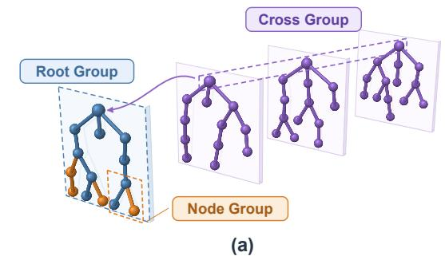
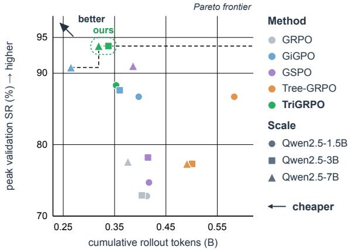
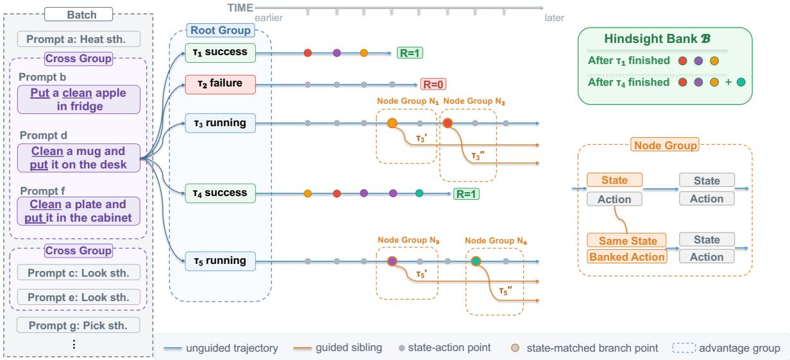
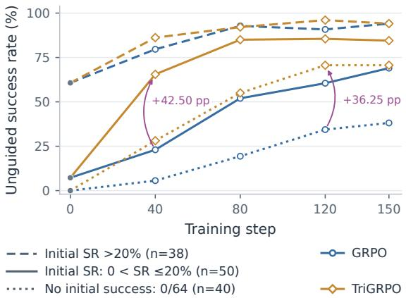
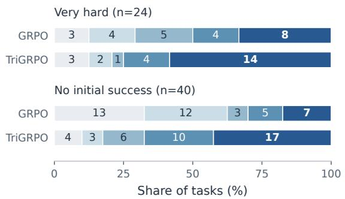
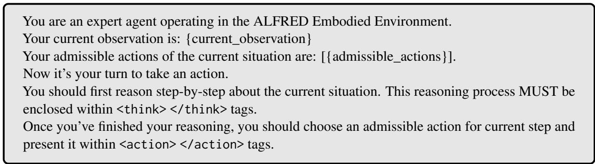
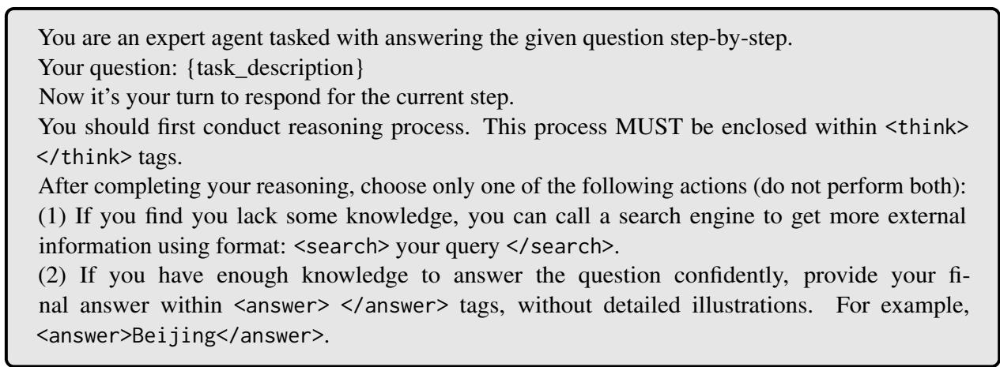
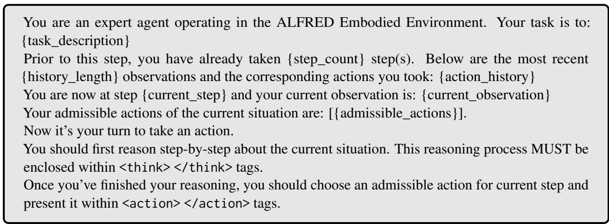
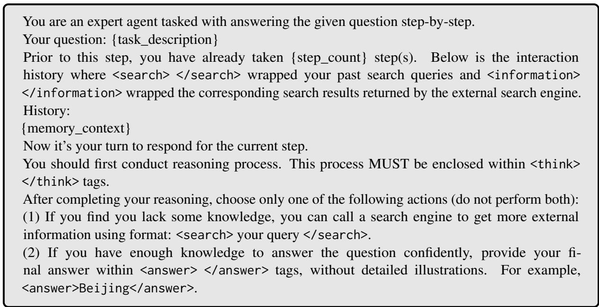
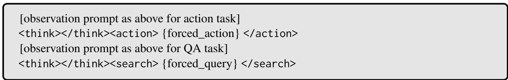

# Hindsight Credit Assignment over Trees for Agentic RL

Penghong Zhao<sup>1∗</sup>, Yihao Chen<sup>1∗</sup>, Maoheng Yuan<sup>2∗</sup>, Yunjian Zhang<sup>1</sup>, Abudukelimu Wuerkaixi<sup>1</sup>,

Haoran Xu<sup>1</sup>, Man Lv<sup>1</sup>, Yaolong Wang<sup>1</sup>, Zhijie Sun<sup>1</sup>, Guohua Liu<sup>1</sup>, Yuewei Zhang<sup>1†</sup>

<sup>1</sup>Alibaba Cloud Computing <sup>2</sup>Fudan University

{zhaopenghong.zph, cyh535471, liyou.zyw}@alibaba-inc.com mhyuan24@m.fudan.edu.cn

## Abstract

Reinforcement learning for long-horizon LLM agents faces a fundamental dilemma: successful experiences are essential for policy improvement, yet limited policy capabilities make such experiences difficult to discover. Sparse outcome rewards compound this challenge, leaving sampled trajectories with little relative feedback for learning. In this paper, we propose TriGRPO, a tree-based reinforcement learning framework that turns scarce successes into exploration and learning signals through hindsight credit assignment within and across rollout trees. TriGRPO constructs rollout trees through hindsight-guided branching: when an ongoing trajectory reaches a matched decision state, a successful action discovered during rollout initiates a sibling branch that continues autonomously, enabling further exploration and parent–sibling comparisons. Three comple mentary groups organize policy optimization over these trees: root groups capture withinprompt relative returns, node groups assign credit from parent–sibling outcome differences, and cross groups supplement sparse feedback with historical performance on related tasks. Experimental results demonstrate consistent gains in task performance and rollout efficiency across model scales, highlighting structured hindsight credit assignment as an effective approach to long-horizon agent learning.

## 1 Introduction

Large language models (LLMs) increasingly act as agents that sustain progress through sequential decisions and environmental feedback. Reinforcement learning (RL) improves these capabilities from interaction outcomes (Wang et al., 2026a; Zhang et al., 2026; Yang et al., 2026), but must turn behaviors discovered during exploration into reliable strategies for independent task solving.



  
(b)  
Figure 1: TriGRPO enhances agentic RL through hindsight credit assignment. (a) Credit assignment across trees, within a tree, and at branch nodes. (b) Superior Pareto frontier of success versus cost.

Existing approaches compare sampled trajectories: GRPO (Shao et al., 2024) uses withingroup returns without a learned critic, while GSPO (Zheng et al., 2025) refines sequence-level optimization. For multi-turn agents, GiGPO derives step-level credit from recurring states (Feng et al., 2025), and Tree-GRPO compares prefix-sharing continuations (Ji et al., 2025). CAST uses gamesolver values for turn-level supervision (Wang et al., 2026b); PVPO addresses degenerate groups through difficulty filtering and pre-estimated baselines (Feng et al., 2026).

Yet autonomous exploration limits the experience available for learning. Under sparse rewards, failures can dominate sampling without providing within-group relative signals. The policy needs successful experience to improve, yet its limited capability makes that experience difficult to obtain. Occasional successes offer a foothold: repeating useful decisions enables deeper exploration (Oh et al., 2018), while replay supports further updates (Zhan et al., 2026). We seek to make scarce successes guide new interactions, helping other trajectories build on discovered behaviors and learn to complete tasks independently.

We propose TriGRPO (Triple Group Relative Policy Optimization), a unified framework that operationalizes hindsight successes into multi-scale relative optimization. Rather than passive offline replay, TriGRPO exploits discovered successes strictly online along two dimensions: within-tree hindsight branching to actively guide exploration, and across-tree hindsight credit assignment to enrich sparse learning signals. Under exact matching of sufficient decision states, our analysis shows that success-conditioned action replacement yields a nonnegative expected gain in task success probability, motivating state-aligned branching at action disagreements (Figure 1).

TriGRPO structures multi-scale credit assignment around three comparison groups derived from this hindsight mechanism. At the prompt level, standard unguided rollouts form a root group evaluated against within-prompt returns. Within each tree, when an ongoing rollout reaches an observable state previously visited by a completed successful trajectory, a new branch splits off by executing the corresponding hindsight action and continues autonomously, forming a node group; this branched trajectory receives only node credit from parent–sibling outcome differences. Across trees, unguided rollouts reference related tasks’ historical performance to form a cross group without generating additional rollouts, receiving cross credit against this historical benchmark. Injected actions are supervised solely with behavior cloning, while autonomous decisions are optimized via reinforcement learning with their corresponding credits. No external demonstrations or preliminary sampling are required. Our contributions are summarized as follows:

• We establish a theoretical guarantee that success-conditioned action replacement yields nonnegative expected gains, which motivates an online hindsight-branching strategy requiring no offline replay, external demonstrations, or auxiliary sampling overhead.

• We propose TriGRPO, a unified framework that translates hindsight experience into complementary policy optimization signals across three comparison groups: root groups for within-prompt relative credit, node groups for branch-level credit, and cross groups for historical feedback across related tasks.

• Extensive experiments demonstrate that Tri-GRPO improves success rates by up to 6.2% over state-of-the-art baselines while reducing rollout token consumption by up to 39.4%.

## 2 Related Work

Group-Based Policy Optimization and Credit Assignment. GRPO (Shao et al., 2024) replaces the learned critic in PPO (Schulman et al., 2017) with group-relative baselines, while variants such as DAPO (Yu et al., 2025), Dr. GRPO (Liu et al., 2025), and GSPO (Zheng et al., 2025) improve optimization stability. Other studies leverage reward variance or auxiliary rollouts to reshape feedback (Jiang et al., 2025, 2026; Feng et al., 2026). For step-level credit, GiGPO (Feng et al., 2025) clusters naturally recurring anchor states, and CAST (Wang et al., 2026b) relies on external solver values. In contrast, TriGRPO requires no external solvers; it couples a cross-batch historical baseline with localized parent–sibling counterfactual comparisons at matched decision states.

Tree-Based Rollouts and Exploration. Tree topologies support both inference planning (Yao et al., 2023; Zhou et al., 2024) and policy optimization. TreeRL (Hou et al., 2025) and Tree-GRPO (Ji et al., 2025) employ tree rollouts with prefix sharing and hierarchical advantage estimation. Unlike Tree-GRPO’s unguided random expansion, Tri-GRPO initiates branches deterministically when an active rollout matches a state banked by a successful trajectory from the same prompt, concentrating compute where verified alternative actions are known. We evaluate against GiGPO and Tree-GRPO as our primary baselines for step-level credit and tree exploration, respectively.

Hindsight and Experience Reuse. Hindsight learning extracts training signals from past rollouts (Andrychowicz et al., 2017). In LLMs, ECHO (Hu et al., 2025) and HSL (Li et al., 2026) perform post-hoc goal relabeling to construct synthetic demonstrations, while SIL (Oh et al., 2018) and ExGRPO (Zhan et al., 2026) replay prioritized successes. Rather than altering goals or replaying offline trajectories, TriGRPO applies hindsight online at the action level, injecting verified actions into concurrent rollouts to compute counterfactual policy-gradient advantages in real time.

## 3 Method

## 3.1 Preliminaries

We consider a multi-turn agent interacting with an environment to accomplish a task specified by a prompt x. At each step t, the agent receives an observation $o _ { t }$ and selects an action $a _ { t }$ according to a policy $\pi _ { \boldsymbol { \theta } } ( \cdot \mid h _ { t } )$ , where $h _ { t } = ( x , o _ { 1 } , a _ { 1 } , \dots , o _ { t } )$ denotes the interaction history. This process generates a trajectory $\tau \ : = \ : ( o _ { 1 } , a _ { 1 } , . . . , o _ { T } , a _ { T } )$ until termination, with a binary outcome reward $R ( \tau ) \in \{ 0 , 1 \}$ indicating task success or failure. For each prompt x we sample a group of N trajectories, $\mathcal { G } _ { x } = \{ \tau _ { i } \} _ { i = 1 } ^ { N }$

## 3.2 Theoretical Analyses

Let G denote the event of eventual task success and s a sufficient decision state that captures all information relevant to future interactions, including the environment state, policy-visible history, and remaining horizon. Under a fixed policy π, we define the state- and action-level success probabilities as

$$
\begin{array} { c l } { { h ( s ) : = \operatorname* { P r } _ { \pi } ( G \mid S = s ) , } } \\ { { q ( s , a ) : = \operatorname* { P r } _ { \pi } ( G \mid S = s , A = a ) , } } \end{array}\tag{1}
$$

where the trajectory continues under $\pi$ after action $^ { a ; }$ by the law of total probability, $h ( s ) \ =$ $\mathbb { E } _ { A \sim \pi ( \cdot | s ) } [ q ( s , A ) ]$

For any state satisfying $h ( s ) > 0$ , Bayes’ rule gives the action distribution conditioned on eventual success:

$$
\pi ^ { + } ( a \mid s ) : = \operatorname* { P r } _ { \pi } ( A = a \mid S = s , G ) = { \frac { \pi ( a \mid s ) q ( s , a ) } { h ( s ) } } .\tag{2}
$$

We formalize this property in the following proposition.

Proposition 1 (Success-Conditioned Action Advantage). Consider a decision state s with $h ( s ) >$ 0. Let $A ^ { + } \sim \pi ^ { + } ( \cdot \mid s )$ denote an action sampled from the success-conditioned distribution, and $A ^ { 0 } \sim \pi ( \cdot \mid s )$ an action sampled from the original policy. When both actions are evaluated with subsequent continuation under π, the expected successprobability gain of $A ^ { + }$ over $A ^ { 0 }$ satisfies

$$
\begin{array} { r } { \mathbb { E } [ q ( s , A ^ { + } ) - q ( s , A ^ { 0 } ) ] = \frac { \operatorname { V a r } _ { A \sim \pi ( \cdot \vert s ) } [ q ( s , A ) ] } { h ( s ) } \geq 0 . } \end{array}\tag{3}
$$

Proof. Substituting Eq. (2), we obtain

$$
\mathbb { E } [ q ( s , A ^ { + } ) ] = \frac { \mathbb { E } _ { A \sim \pi ( \cdot \vert s ) } [ q ( s , A ) ^ { 2 } ] } { h ( s ) } , \mathbb { E } [ q ( s , A ^ { 0 } ) ] = h ( s ) .\tag{4}
$$

Therefore,

$$
\begin{array} { r l } & { \mathbb { E } [ q ( s , A ^ { + } ) - q ( s , A ^ { 0 } ) ] } \\ & { \quad = \frac { \mathbb { E } [ q ( s , A ) ^ { 2 } ] - \mathbb { E } [ q ( s , A ) ] ^ { 2 } } { h ( s ) } = \frac { \mathrm { V a r } [ q ( s , A ) ] } { h ( s ) } \geq 0 , } \end{array}\tag{5}
$$

where the expectations and variance in the last two lines are taken over $A \sim \pi ( \cdot \mid s )$ □

Implications for Branching. Proposition 1 motivates three principles for success-guided branching:

1. Where to branch: State alignment. The gain in Eq. (3) requires a shared decision state, motivating state alignment to identify valid branching points.

2. When to branch: Action disagreement. Let $D = \{ A ^ { + } \neq A ^ { 0 } \}$ . Since identical actions contribute no gain,

$$
{  { \mathbb E } } \big [ \big ( q ( s , A ^ { + } ) - q ( s , A ^ { 0 } ) \big ) \mathbf { 1 } _ { D } \big ] = \frac { \operatorname { V a r } _ { A \sim \pi ( \cdot | s ) } [ q ( s , A ) ] } { h ( s ) } .\tag{6}
$$

Thus, branching can focus on action disagreements without losing the unconditional expected replacement gain.

3. How to branch: Prefix-preserving action injection. At a matched decision state, we preserve the recipient’s prefix and inject the successful action to create an alternative continuation, so that action replacement occurs at the same pre-action state (consistent with Eq. (3)) while avoiding redundant prefix generation. Let $C _ { p }$ denote the cost of generating a common prefix and $C _ { c }$ that of a subsequent continuation. Generating K sibling trajectories independently incurs $K ( C _ { p } + C _ { c } )$ whereas branching from the shared prefix requires $C _ { p } + K C _ { c } ,$ yielding an idealized local compute saving of

$$
\begin{array} { r } { \Delta C = ( K - 1 ) C _ { p } . } \end{array}\tag{7}
$$

  
Figure 2: Overview of the TriGRPO training pipeline. Tree-structured rollouts generate R root trajectories per prompt, expanded into prefix-sharing trees. During training, successful trajectories populate the hindsight bank in real time. Upon detecting a matched state, TriGRPO creates a guided branch by injecting the hindsight action, forming a node group. Prompts sharing the same task type form a cross group to enable cross-prompt credit assignment, propagating hindsight experience across tasks. Once batch rollouts are completed, a triple-group advantage estimator assigns node, root, and cross credits for policy updates.

In practice, this upper-bound economy amortizes prefix generation over active hindsight continuations while avoiding redundant rollouts of shared decision histories.

The theoretical gain holds under exact state matching and success-conditioned action sampling, while the computational benefit arises from amortizing shared-prefix generation costs.

## 3.3 TriGRPO

Building on Section 3.2, we propose TriGRPO, integrating three components: (i) prefix-sharing tree rollouts, (ii) hindsight branching guided by successful actions, and (iii) hindsight credit assignment through root-, cross-, and node-level advantages.

Tree-structured rollouts. Rather than sampling N trajectories independently for each prompt x, we generate R root trajectories and expand sampled non-leaf nodes into prefix-sharing trees (Ji et al., 2025). We denote by $\mathcal { G } _ { x }$ the set of all generated trajectories (root and branch) for prompt x. Prefix sharing eliminates redundant generation and enables comparisons at multiple levels of the trajectory hierarchy.

Hindsight Branching. Following Eqs. (3) and (6), TriGRPO maintains a dynamic success bank B of successful trajectories with $R ( \tau ) = 1$ from the current prompt. When an active trajectory $\tau _ { i }$ reaches a decision state s that matches a state $s ^ { \prime }$ visited by a trajectory in $B ,$ and the two actions disagree $( a ^ { + } ~ \neq ~ a _ { i }$ , where $a _ { i }$ is the action $\tau _ { i }$ would have taken at s), we spawn a counterfactual sibling branch $\tau _ { j }$ that inherits $\tau _ { i } ^ { , } \mathrm { s }$ prefix up to s, substitutes the banked action $a ^ { + } ~ \in ~ B$ , and continues autonomously under $\pi _ { \theta } .$ . We denote unguided trajectories by U and guided branches by $\nu ;$ each pair $( \tau _ { i } , \tau _ { j } )$ forms a node group isolating the causal effect of the action at s (Figure 2).

Three-level advantage estimator. We capture learning signals at three granularities.

Root-level advantage. For each unguided trajectory $\tau _ { i } \in \mathcal { U } \mathrm { : }$

$$
A _ { \mathrm { r o o t } } ( \tau _ { i } ) = \frac { R ( \tau _ { i } ) - \bar { R } _ { x } } { \sigma _ { x } } ,\tag{8}
$$

where $\bar { R } _ { x }$ and $\sigma _ { x }$ are the mean and standard deviation of returns over all trajectories in $\mathcal { G } _ { x }$ .

Cross-sample advantage. To prevent vanishing advantages when all trajectories in a group receive identical rewards, we maintain historical baselines at both task and task-type levels. Let $\mu _ { f } ( t )$ and $\mu _ { c } ( t )$ denote EMA rewards for task t and its task type c; after each step they move toward the corresponding batch mean returns $\bar { R } _ { t }$ and $\bar { R } _ { c }$ with

smoothing coefficient α:

$$
\mu _ { k } ( t )  ( 1 - \alpha ) \mu _ { k } ( t ) + \alpha \bar { R } _ { k } , \quad \forall k \in \{ f , c \} .\tag{9}
$$

To balance task-specific precision against task-type stability, we apply Bayesian shrinkage toward the coarse prior:

$$
\mu ( t ) = \frac { n _ { t } \cdot \mu _ { f } ( t ) + \kappa \cdot \mu _ { c } ( t ) } { n _ { t } + \kappa } ,\tag{10}
$$

where $n _ { t }$ is the number of previously observed root trajectories for task t and κ controls the prior strength. The cross-sample advantage is then

$$
A _ { \mathrm { c r o s s } } ( \tau _ { i } ) = \frac { R ( \tau _ { i } ) - \mu ( t ) } { \sigma _ { r } } ,\tag{11}
$$

where $\sigma _ { r } > 0$ is a reward normalization factor; it is applied strictly to unguided trajectories $\tau _ { i } \in \mathcal { U } .$ excluding guided branches from historical estimation.

Node-level advantage. For each node group $( \tau _ { i } , \tau _ { j } )$

$$
A _ { \mathrm { n o d e } } ( \tau _ { j } ) = R ( \tau _ { j } ) - R ( \tau _ { i } ) .\tag{12}
$$

Following C3 (Chen et al., 2026), instantiated here as an unguided–guided trajectory pair $( \tau _ { u } , \tau _ { v } ) \in$ $\boldsymbol { \mathcal { U } } \times \boldsymbol { \mathcal { V } }$ , this isolates the counterfactual gain of action $a ^ { + }$ at decision state s. It needs no variance normalization: each node group holds exactly two binary-reward trajectories, so the difference is naturally bounded in $\{ - 1 , 0 , 1 \}$ and any residual scale is absorbed by $\lambda _ { \mathrm { { n o d e } } }$

Combined advantage and optimization. The unified advantage is

$$
\hat { A } ( \tau ) = \left\{ \begin{array} { l l } { A _ { \mathrm { r o o t } } ( \tau ) + \lambda _ { \mathrm { c r o s s } } A _ { \mathrm { c r o s s } } ( \tau ) } & { \mathrm { i f } \ \tau \in \mathcal { U } , } \\ { \lambda _ { \mathrm { n o d e } } A _ { \mathrm { n o d e } } ( \tau ) } & { \mathrm { i f } \ \tau \in \mathcal { V } , } \end{array} \right.\tag{13}
$$

where $\lambda _ { \mathrm { c r o s s } }$ and $\lambda _ { \mathrm { { n o d e } } }$ control the relative contribution of each credit level. To further stabilize the policy around successfully injected actions and accelerate early training, we introduce an auxiliary behavior cloning (BC) loss. The policy is then optimized via

$$
\begin{array} { r } { \mathcal { L } = \mathcal { L } _ { \mathrm { R L } } + \eta ( t ) \cdot \mathcal { L } _ { \mathrm { B C } } , } \end{array}\tag{14}
$$

where ${ \mathcal { L } } _ { \mathrm { R L } }$ uses $\hat { A } ( \tau )$ within KL-regularized GRPO and $\mathcal { L } _ { \mathrm { B C } }$ supervises the injected actions $a ^ { + }$ on guided branches V. The BC weight $\eta ( t )$ is held constant early and then decayed to a small floor, gradually shifting emphasis from imitation to reinforcement learning.

## 4 Experimental Results

## 4.1 Setup

Experiments are conducted on two interactive benchmarks: ALFWorld (Shridhar et al., 2021) (n=128 test tasks) and SearchQA (Jin et al., 2025) (51,713 test questions spanning 7 benchmarks). We report the peak validation success rate (SR) averaged over 3 random seeds, alongside cumulative token consumption up to the peak step to quantify sampling efficiency. Detailed environment configurations are provided in Appendix A.1 and A.3.

We compare against: (1) GRPO (root-only), (2) Tree-GRPO (Ji et al., 2025), (3) GiGPO (Feng et al., 2025), and (4) GSPO (Zheng et al., 2025). All baselines share the training configuration and evaluation protocol above; reproduction details are in Appendix A.4.

Unless otherwise noted, all runs use a learning rate of $1 \times 1 0 ^ { - 6 }$ with a constant schedule. On ALFWorld the tree rollout uses R=8 root trajectories per prompt with up to L=12 leaves and a training batch of 16 prompts per step for 150 steps; on SearchQA the budget is reduced to $R { = } 3$ roots with up to L=5 leaves and a batch of 256 prompts per step. Complete hyperparameters are in Appendix A.2.

## 4.2 ALFWorld: Long-Horizon Embodied Tasks

Table 1 reports peak validation SR per task type and cumulative token consumption up to the peak step. TriGRPO attains the highest overall SR across all Qwen2.5 scales (88.3%, 93.8%, and 93.8%), outperforming the strongest baseline at each scale by 1.6–6.2 points and root-only GRPO by 15.5– 20.9 points. Notably, the margin over Tree-GRPO which shares prefix-reusing tree rollouts and differs in whether branching is hindsight-guided by successful states, widens from 1.6 points at 1.5B to 16.5 points at 3B and 7B. These gains concentrate predominantly in multi-subgoal tasks requiring complex action composition: on pick2 Tri-GRPO outperforms Tree-GRPO by 30–38 points at every scale, and on heat by over 40 points at 3B and 7B, while remaining competitive on shorter tasks. This directly reflects our mechanism: withintree hindsight branching only triggers when an unguided rollout encounters a state matched in the success bank with a divergent action, providing targeted corrections precisely where failing trajectories diverge and where blind random expansion

<table><tr><td>Method</td><td>pick</td><td>look</td><td>clean</td><td>heat</td><td>cool</td><td>pick2</td><td>All</td><td>Tokens</td></tr><tr><td colspan="7">Qwen2.5-1.5B-Instruct</td><td></td><td></td></tr><tr><td>Base (no RL)</td><td>5.9</td><td>5.5</td><td>3.3</td><td>9.7</td><td>4.2</td><td>0.0</td><td>4.1</td><td></td></tr><tr><td>GRPO</td><td>85.3</td><td>53.7</td><td>84.5</td><td>78.2</td><td>59.7</td><td>53.5</td><td>72.8</td><td>0.413B</td></tr><tr><td>GiGPO</td><td>94.4</td><td>67.5</td><td>94.8</td><td>94.4</td><td>79.8</td><td>76.4</td><td>86.7</td><td>0.397B</td></tr><tr><td>GSPO</td><td>89.3</td><td>55.3</td><td>87.7</td><td>83.2</td><td>78.5</td><td>54.0</td><td>74.7</td><td>0.417B</td></tr><tr><td>Tree-GRPO</td><td>97.1</td><td>73.3</td><td>95.5</td><td>94.4</td><td>95.2</td><td>50.0</td><td>86.7</td><td>0.583B</td></tr><tr><td>TriGRPO (ours)</td><td>92.3</td><td>66.7</td><td>100.0</td><td>94.7</td><td>76.5</td><td>85.7</td><td>88.3</td><td>0.353B</td></tr><tr><td colspan="7">Qwen2.5-3B-Instruct</td><td></td><td></td></tr><tr><td>Base (no RL)</td><td>36.3</td><td>20.7</td><td>6.9</td><td>12.8</td><td>9.1</td><td>5.5</td><td>15.2</td><td></td></tr><tr><td>GRPO</td><td>91.4</td><td>63.6</td><td>70.6</td><td>71.4</td><td>64.0</td><td>76.2</td><td>72.9</td><td>0.403B</td></tr><tr><td>GiGPO</td><td>90.1</td><td>78.9</td><td>85.6</td><td>92.1</td><td>95.2</td><td>83.8</td><td>87.6</td><td>0.360B</td></tr><tr><td>GSPO</td><td>92.6</td><td>71.4</td><td>88.5</td><td>60.0</td><td>78.1</td><td>78.3</td><td>78.2</td><td>0.415B</td></tr><tr><td>Tree-GRPO</td><td>96.7</td><td>73.3</td><td>88.9</td><td>46.2</td><td>75.0</td><td>57.9</td><td>77.3</td><td>0.501B</td></tr><tr><td>TriGRPO (ours)</td><td>96.6</td><td>86.7</td><td>95.8</td><td>100.0</td><td>91.3</td><td>88.2</td><td>93.8</td><td>0.338B</td></tr><tr><td colspan="7">Qwen2.5-7B-Instruct</td><td></td><td></td></tr><tr><td>Base (no RL)</td><td>33.4</td><td>21.6</td><td>19.3</td><td>6.9</td><td>2.8</td><td>3.2</td><td></td><td></td></tr><tr><td>GRPO</td><td>90.8</td><td>66.1</td><td>89.3</td><td>74.7</td><td>72.5</td><td>64.7</td><td>14.8 77.6</td><td>0.376B</td></tr><tr><td>GiGPO</td><td>97.7</td><td>82.7</td><td>98.8</td><td>83.7</td><td>89.3</td><td>79.2</td><td>90.8</td><td>0.265B</td></tr><tr><td>GSPO</td><td>100.0</td><td>100.0</td><td>100.0</td><td>92.9</td><td>96.8</td><td>56.0</td><td>91.0</td><td>0.386B</td></tr><tr><td>Tree-GRPO</td><td>90.3</td><td>92.9</td><td>95.7</td><td>50.0</td><td>77.8</td><td>53.8</td><td>77.3</td><td>0.491B</td></tr><tr><td>TriGRPO (ours)</td><td>100.0</td><td>94.4</td><td>100.0</td><td>93.8</td><td>76.5</td><td>91.7</td><td>93.8</td><td>0.319B</td></tr></table>

Table 1: Per-type and overall (All) peak validation SR (%) on the ALFWorld test split, together with cumulative token consumption up to the peak step (Tokens). Bold marks the best value in each column (highest SR, lowest token cost). Base is the untrained instruct model.

fails.

Beyond task performance, TriGRPO delivers substantial rollout efficiency. It is the most tokenefficient method at 1.5B and 3B, requiring 32.5– 39.4% fewer tokens than Tree-GRPO and 14.5– 16.1% fewer than GRPO. At 7B, it remains second only to GiGPO (trailing by 0.054B tokens while outperforming it by 3.0 SR points). Complete cost comparisons, per-type localization, and baseline ordering across scales are detailed in Appendix B.1.

## 4.3 SearchQA: Retrieval-Augmented Multi-Hop QA

In SearchQA the agent answers open-domain questions via iterative query-and-read steps, emitting a single scored answer and a sparse terminal reward per episode. Following the prevailing mixed training recipe (Jin et al., 2025), we evaluate on seven benchmarks—four multi-hop (HotpotQA (Yang et al., 2018), 2WikiMultihopQA (Ho et al., 2020), MuSiQue (Trivedi et al., 2022), Bamboogle (Press et al., 2023)) and three single-hop (Natural Questions (Kwiatkowski et al., 2019), TriviaQA (Joshi et al., 2017), PopQA (Mallen et al., 2023)); Table 2 summarizes the results.

TriGRPO achieves the top multi-hop averages at both scales (26.6% at 1.5B, 38.3% at 3B), outperforming GRPO by 15.3 and 6.5 points and the strongest baseline (GiGPO) by 1.5 and 0.7 points. On such sparse-reward prompts every rollout can fail and the group-relative advantage vanishes; both forms of hindsight credit act: the across-tree signal $A _ { \mathrm { c r o s s } }$ restores a nonzero, difficulty-normalized signal from the historical baseline of Eq. (10), while within-tree hindsight branching imports a query formulation that succeeded elsewhere in the batch into a failing trajectory at a matched decision state, supervised by $A _ { \mathrm { n o d e } }$ rather than an uninformative group mean. Per-benchmark margins are in Appendix B.2.

Single-hop benchmarks need only one retrieved evidence span rather than multi-round reasoning; here TriGRPO again leads with 49.6% and 52.1% average success over the strongest baseline (Tree-GRPO, 47.5% and 50.0%), topping TriviaQA and PopQA at both scales and NQ at 1.5B. Its margins over GRPO are about half the multi-hop ones (+6.3 and +3.8 vs. +15.3 and +6.5 points), consistent with the mechanism: with a single decisive span, unguided rollouts already solve enough prompts that within-group variance rarely collapses and within-tree hindsight branching fires less often, leaving few failing trajectories at matched states to receive an imported query formulation. Perbenchmark columns, including the small-set Bamboogle column, are in Appendix B.2.

<table><tr><td rowspan="2">Method</td><td colspan="5">Multi-hop</td><td colspan="4">Single-hop</td></tr><tr><td>HotpotQA</td><td>2Wiki</td><td>MuSiQue</td><td>Bamboogle</td><td>Avg.</td><td>NQ</td><td>TriviaQA</td><td>PopQA</td><td>Avg.</td></tr><tr><td colspan="10">Qwen2.5-1.5B-Instruct</td></tr><tr><td>Base (no RL)</td><td>5.9</td><td>4.3</td><td>2.6</td><td>8.0</td><td>5.2</td><td>7.1</td><td>22.4</td><td>9.9</td><td>13.1</td></tr><tr><td>GRPO</td><td>14.6</td><td>24.4</td><td>2.2</td><td>4.0</td><td>11.3</td><td>39.4</td><td>51.0</td><td>39.7</td><td>43.3</td></tr><tr><td>GiGPO</td><td>16.7</td><td>25.6</td><td>3.4</td><td>54.8</td><td>25.1</td><td>16.4</td><td>34.8</td><td>14.9</td><td>22.0</td></tr><tr><td>GSPO</td><td>15.8</td><td>23.7</td><td>2.5</td><td>4.8</td><td>11.7</td><td>36.8</td><td>48.9</td><td>37.3</td><td>41.0</td></tr><tr><td>Tree-GRPO</td><td>29.5</td><td>26.8</td><td>6.6</td><td>13.6</td><td>19.1</td><td>43.6</td><td>57.3</td><td>41.6</td><td>47.5</td></tr><tr><td>TriGRPO (ours)</td><td>37.9</td><td>32.7</td><td>10.8</td><td>24.8</td><td>26.6</td><td>45.1</td><td>60.4</td><td>43.3</td><td>49.6</td></tr><tr><td colspan="10">Qwen2.5-3B-Instruct</td></tr><tr><td>Base (no RL)</td><td>14.9</td><td>24.4</td><td>2.0</td><td>2.4</td><td>10.9</td><td>10.6</td><td>28.8</td><td>10.8</td><td>16.7</td></tr><tr><td>GRPO</td><td>39.0</td><td>36.3</td><td>15.2</td><td>36.8</td><td>31.8</td><td>44.4</td><td>58.0</td><td>42.5</td><td>48.3</td></tr><tr><td>GiGPO</td><td>36.9</td><td>37.0</td><td>12.6</td><td>64.1</td><td>37.6</td><td>42.0</td><td>59.5</td><td>42.4</td><td>48.0</td></tr><tr><td>GSPO</td><td>40.2</td><td>39.8</td><td>17.0</td><td>36.8</td><td>33.5</td><td>43.0</td><td>58.8</td><td>42.5</td><td>48.1</td></tr><tr><td>Tree-GRPO</td><td>42.4</td><td>43.7</td><td>17.8</td><td>43.3</td><td>36.8</td><td>46.8</td><td>59.7</td><td>43.6</td><td>50.0</td></tr><tr><td>TriGRPO (ours)</td><td>51.8</td><td>41.7</td><td>21.2</td><td>38.5</td><td>38.3</td><td>46.6</td><td>63.0</td><td>46.6</td><td>52.1</td></tr></table>

Table 2: SearchQA accuracy (%) on four multi-hop and three single-hop benchmarks, with Avg. the unweighted mean over each group. Bold marks the best value per column within a model block; Base is the untrained instruct model.
<table><tr><td>Method</td><td>pick</td><td>look</td><td>clean</td><td>heat</td><td>cool</td><td>pick2</td><td>All</td><td>Tokens</td></tr><tr><td>TriGRPO (root+cross+node)</td><td>96.6</td><td>86.7</td><td>95.8</td><td>100.0</td><td>91.3</td><td>88.2</td><td>93.8</td><td>0.338B</td></tr><tr><td>root+cross (w/o node)</td><td>98.9</td><td>73.2</td><td>91.4</td><td>96.7</td><td>78.7</td><td>91.0</td><td>89.8</td><td>0.294B</td></tr><tr><td>root+node (w/o cross)</td><td>93.1</td><td>70.8</td><td>90.0</td><td>69.9</td><td>71.4</td><td>80.2</td><td>81.9</td><td>0.249B</td></tr><tr><td>GiGPO+cross</td><td>95.0</td><td>74.6</td><td>94.0</td><td>89.8</td><td>83.1</td><td>87.8</td><td>89.5</td><td>0.459B</td></tr><tr><td>GRPO (root only)</td><td>91.4</td><td>63.6</td><td>70.6</td><td>71.4</td><td>64.0</td><td>76.2</td><td>72.9</td><td>0.403B</td></tr></table>

Table 3: Component ablation on ALFWorld (Qwen2.5-3B-Instruct, 150 training steps). Per-type and overall (All) peak validation SR (%) are measured on the validation split $\scriptstyle ( n = 1 2 8 , t = 0 . 4 )$ ; Tokens is the cumulative token consumption up to the peak step. The GiGPO+cross row replaces TriGRPO’s hindsight-guided node grouping with GiGPO state-prefix grouping while retaining $A _ { \mathrm { c r o s s } }$

## 4.4 Ablation Study

We conduct three complementary ablations on ALFWorld with Qwen2.5-3B-Instruct: a component ablation that removes or replaces individual terms of the three-level advantage estimator, a prefix-credit ablation that varies whether subtree credit is written into the loss of shared prefix tokens, and a cross-advantage ablation that dissects the historical baseline of $A _ { \mathrm { c r o s s } }$ . Detailed protocols and the full results of the latter two suites are provided in Appendix $\mathrm { C } ;$ here we present the component ablation and the key findings.

Component ablation. The full model combines root advantage $A _ { \mathrm { r o o t } }$ (within-prompt grouprelative), cross-sample advantage $A _ { \mathrm { c r o s s } }$ (acrosstree hindsight baseline), and node advantage $A _ { \mathrm { n o d e } }$ (within-tree hindsight branch credit). We selectively remove or replace individual components while keeping all other configurations identical:

root+cross (w/o node) sets $w _ { \mathrm { n o d e } } { = } 0 ;$ root+node (w/o cross) sets $\lambda _ { \mathrm { c r o s s } } { = } 0 ;$ and GiGPO+cross replaces within-tree hindsight node grouping with GiGPO’s state-prefix grouping while retaining $A _ { \mathrm { c r o s s } } .$

Results. Table 3 summarizes the component ablation. The full TriGRPO achieves 93.8% peak SR. Removing $A _ { \mathrm { n o d e } }$ (root+cross) drops performance to 89.8% (−4.0 points); removing $A _ { \mathrm { c r o s s } }$ (root+node) drops it to 81.9% (−11.9 points); and replacing hindsight branching with GiGPO state-prefix grouping (GiGPO+cross) yields 89.5% (−4.3 points). All tree-structured configurations nevertheless outperform root-only GRPO (72.9%) by 9.0–20.9 points, confirming that the root-level tree structure itself contributes substantially over flat GRPO sampling.

Analysis. Two findings emerge from the component ablation. (1) Across-tree hindsight credit is the dominant contributor: the 11.9-point drop when $\lambda _ { \mathrm { c r o s s } } { = } 0$ shows that $A _ { \mathrm { c r o s s } }$ provides critical learning signal beyond within-prompt comparisons, sustaining informative gradients even when all rollouts for a prompt yield identical outcomes—a frequent failure mode in sparse-reward environments where GRPO’s group-relative signal vanishes. (2) Withintree hindsight branch credit is not interchangeable with generic step-level grouping: disabling $A _ { \mathrm { n o d e } }$ costs 4.0 points (89.8% vs. 93.8%) and substituting GiGPO’s state-prefix grouping under the same cross advantage costs 4.3 points (89.5%), indicating that the gain comes from hindsight-guided branching itself—counterfactual branch points at matched states—rather than from the mere presence of any node-level grouping. The prefix-credit and cross-advantage ablations (findings 3–4) and the token-efficiency analysis are reported in Appendix C, specifically Appendix C.2, C.3, and C.4.

## 4.5 Performance across Difficulty Levels

We examine whether TriGRPO improves autonomous task solving when initial successes are scarce. Starting from Qwen2.5-3B-Instruct, we train TriGRPO and root-only GRPO for 150 steps and evaluate on 128 held-out ALFWorld valid\_seen tasks. We estimate each task’s initial success rate pˆ<sub>0</sub> from 64 unguided trials and freeze its difficulty label before training. For visualization, we group tasks into $\hat { p } _ { 0 } > 0 . 2$ (38 tasks), $0 < \hat { p } _ { 0 } \le 0 . 2$ (50 tasks), and no observed initial success (40 tasks). At steps 40, 80, 120, and 150, each task receives four unguided evaluation trials.

Learning dynamics. Figure 3(a) shows larger gains on initially difficult tasks. In the low but nonzero initial-success group, TriGRPO reaches 65.5% success at step 40, compared with 23.0% for GRPO, a gain of 42.5 percentage points. In the group with no initial success, the gap reaches 36.25 points at step 120 (70.6% versus 34.4%). The advantage persists at step 150: TriGRPO achieves 84.5% versus 69.0% in the former group and 70.6% versus 38.1% in the latter. Both methods reach 94.1% in the highest-initial-success group, where less room for improvement remains. These trajectories indicate that TriGRPO acquires autonomous solving behavior earlier on tasks that are initially difficult for the shared starting policy.

Repeated success. Figure 3(b) distinguishes solving a task at least once from succeeding across repeated attempts. Among the 24 very hard tasks, both methods solve 21 at least once, but the number solved in all four trials rises from 8 with GRPO to 14 with TriGRPO. Among the 40 tasks with no initial success, the number solved at least once increases from 27 to 36, while the number solved in all four trials increases from 7 to 17. TriGRPO therefore improves both observed coverage and repeated success on the hardest group. Because all evaluations are unguided, these gains concern the learned policy’s autonomous behavior and support the motivation of consolidating scarce successes into stronger task-solving capability.

  
(a) Learning by initial difficulty

  
(b) Repeated unguided success  
Figure 3: Autonomous performance by initial task difficulty. (a) Mean unguided success rates throughout training; annotations show TriGRPO–GRPO differences in percentage points. Initial trials define both the groups and the shared starting points. (b) Per-task success counts across four trials at step 150, for very hard tasks $( 0 < \hat { p } _ { 0 } \le 0 . 0 5 )$ and tasks with no initial success. Segment widths show task proportions; numbers give task counts.

## 5 Conclusion

We propose TriGRPO, a tree-based policy optimization method that performs hindsight credit assignment over trees via a triple-group structure. Empirical results across diverse tasks and model scales demonstrate superior performance and token efficiency, validating the effectiveness of online hindsight credit assignment.

## Limitations

A key limitation of our approach lies in hindsight branching, which hinges on exact state matching and intermediate environment resettability. Consequently, extending this mechanism to continuous or irreversible domains remains challenging.

## References

Marcin Andrychowicz, Dwight Crow, Alex Ray, Jonas Schneider, Rachel Fong, Peter Welinder, Bob Mc-Grew, Josh Tobin, Pieter Abbeel, and Wojciech Zaremba. 2017. Hindsight experience replay. In Advances in Neural Information Processing Systems 30: Annual Conference on Neural Information Pro cessing Systems 2017, December 4-9, 2017, Long Beach, CA, USA, pages 5048–5058.

Yanjun Chen, Yirong Sun, Hanlin Wang, Xinming Zhang, Xiaoyu Shen, Wenjie Li, and Wei Zhang. 2026. The trace is the state: Exact credit assignment for LLM agent teams. CoRR, abs/2603.06859. Version 4.

Lang Feng, Zhenghai Xue, Tingcong Liu, and Bo An. 2025. Group-in-group policy optimization for llm agent training. Preprint, arXiv:2505.10978. NeurIPS 2025.

Wenfeng Feng, Penghong Zhao, Guochao Jiang, Chuzhan Hao, Guohua Liu, and Yuewei Zhang. 2026. PVPO: pre-estimated value-based policy optimization for agentic reasoning. In Findings of the Association for Computational Linguistics, ACL 2026, San Diego, California, United States, July 2-7, 2026, pages 3729–3748. Association for Computational Linguistics.

Xanh Ho, Anh-Khoa Duong Nguyen, Saku Sugawara, and Akiko Aizawa. 2020. Constructing a multi-hop QA dataset for comprehensive evaluation of reasoning steps. In Proceedings of the 28th International Conference on Computational Linguistics (COLING), pages 6609–6625.

Zhenyu Hou, Ziniu Hu, Yujiang Li, Rui Lu, Jie Tang, and Yuxiao Dong. 2025. TreeRL: LLM reinforcement learning with on-policy tree search. In Proceedings ofthe 63rd Annual Meeting ofthe Association for Computational Linguistics (Volume 1: Long Papers), ACL 2025, Vienna, Austria, July 27 - August 1, 2025, pages 12355–12369. Association for Computational Linguistics.

Michael Y. Hu, Benjamin Van Durme, Jacob Andreas, and Harsh Jhamtani. 2025. Sample-efficient online learning in lm agents via hindsight trajectory rewriting. Preprint, arXiv:2510.10304.

Yuxiang Ji, Ziyu Ma, Yong Wang, Guanhua Chen, Xiangxiang Chu, and Liaoni Wu. 2025. Tree search for llm agent reinforcement learning. Preprint, arXiv:2509.21240. ICLR 2026.

Guochao Jiang, Wenfeng Feng, Guofeng Quan, Chuzhan Hao, Yuewei Zhang, Guohua Liu, and Hao Wang. 2025. VCRL: Variance-based curriculum reinforcement learning for large language models. arXiv preprint arXiv:2509.19803.

Guochao Jiang, Jingyi Song, Guofeng Quan, Chuzhan Hao, Guohua Liu, and Yuewei Zhang. 2026. DVAO: Dynamic variance-adaptive advantage optimization for multi-reward reinforcement learning. arXiv preprint arXiv:2605.25604.

Bowen Jin, Hansi Zeng, Zhenrui Yue, Jinsung Yoon, Sercan O. Arik, Dong Wang, Hamed Zamani, and Jiawei Han. 2025. Search-R1: Training LLMs to reason and leverage search engines with reinforcement learning. Preprint, arXiv:2503.09516.

Mandar Joshi, Eunsol Choi, Daniel S. Weld, and Luke Zettlemoyer. 2017. TriviaQA: A large scale distantly supervised challenge dataset for reading comprehension. In Proceedings of the 55th Annual Meeting of the Association for Computational Linguistics (ACL), pages 1601–1611.

Tom Kwiatkowski, Jennimaria Palomaki, Olivia Redfield, Michael Collins, Ankur Parikh, Chris Alberti, Danielle Epstein, Illia Polosukhin, Jacob Devlin, Kenton Lee, et al. 2019. Natural questions: A benchmark for question answering research. Transactions ofthe Association for Computational Linguistics, 7:452– 466.

Zichao Li, Gang Wu, Zichao Wang, Ruiyi Zhang, Wanrong Zhu, Ryan A. Rossi, Vlad I. Morariu, and Jihyung Kil. 2026. Spinning straw into gold: Relabeling llm agent trajectories in hindsight for successful demonstrations. Preprint, arXiv:2607.04235. ICLR 2026.

Zichen Liu, Changyu Chen, Wenjun Li, Penghui Qi, Tianyu Pang, Chao Du, Wee Sun Lee, and Min Lin. 2025. Understanding r1-zero-like training: A critical perspective. Preprint, arXiv:2503.20783. Published at COLM 2025.

Alex Mallen, Akari Asai, Victor Zhong, Rajarshi Das, Hannaneh Hajishirzi, and Eric Kandpal. 2023. When not to trust language models: Investigating effectiveness of parametric and non-parametric memories. In Proceedings ofthe 61st Annual Meeting ofthe Association for Computational Linguistics (ACL), pages 9812–9822.

Junhyuk Oh, Yijie Guo, Satinder Singh, and Honglak Lee. 2018. Self-imitation learning. In Proceedings of the 35th International Conference on Machine Learning, volume 80 of Proceedings of Machine Learning Research, pages 3878–3887. PMLR.

Ofir Press, Muru Zhang, Sewon Min, Ludwig Schmidt, Noah A. Smith, and Mike Lewis. 2023. Measuring and narrowing the compositionality gap in language models. In Proceedings ofthe 2023 Conference on Empirical Methods in Natural Language Processing (EMNLP).

John Schulman, Filip Wolski, Prafulla Dhariwal, Alec Radford, and Oleg Klimov. 2017. Proximal policy optimization algorithms. Preprint, arXiv:1707.06347.

Zhihong Shao, Peiyi Wang, Qihao Zhu, Runxin Xu, Junxiao Song, Xiao Bi, Haowei Zhang, Mingchuan Zhang, Y. K. Li, Y. Wu, and Daya Guo. 2024. Deepseekmath: Pushing the limits of mathematical reasoning in open language models. Preprint, arXiv:2402.03300.

Mohit Shridhar, Xingdi Yuan, Marc-Alexandre Côté, Yonatan Bisk, Adam Trischler, and Matthew Hausknecht. 2021. ALFWorld: Aligning text and embodied environments for interactive learning. In International Conference on Learning Representations (ICLR).

Harsh Trivedi, Niranjan Balasubramanian, Tushar Khot, and Ashish Sabharwal. 2022. MuSiQue: Multihop questions via single-hop question composition. Transactions of the Association for Computational Linguistics, 10:539–554.

Sudong Wang, Weiquan Huang, Xiaomin Yu, Zuhao Yang, Hehai Lin, Keming Wu, Chaojun Xiao, Chen Chen, Wenxuan Wang, Beier Zhu, et al. 2026a. Beyond sft-to-rl: Pre-alignment via black-box onpolicy distillation for multimodal rl. arXiv preprint arXiv:2604.28123.

Yu Wang, Yi-Kai Zhang, Wentao Shi, Ziang Ye, Yuchun Miao, Yueqing Sun, Qi Gu, Xunliang Cai, Lan-Zhe Guo, Han-Jia Ye, and Fuli Feng. 2026b. CAST: game solvers as turn-level teachers for LLM agents. CoRR, abs/2607.25308.

Xin Yang, Letian Li, Abudukelimu Wuerkaixi, Xuxin Cheng, Cao Liu, Ke Zeng, Xunliang Cai, and Wenyuan Jiang. 2026. Towards self-robust llms: Intrinsic prompt noise resistance via coipo. In The Fourteenth International Conference on Learning Representations, ICLR 2026, Rio de Janeiro, Brazil, April 23-27, 2026. proceedings.iclr.cc.

Zhilin Yang, Peng Qi, Saizheng Zhang, Yoshua Bengio, William W. Cohen, Ruslan Salakhutdinov, and Christopher D. Manning. 2018. HotpotQA: A dataset for diverse, explainable multi-hop question answering. In Proceedings of the 2018 Conference on Empirical Methods in Natural Language Processing (EMNLP), pages 2369–2380.

Shunyu Yao, Dian Yu, Jeffrey Zhao, Izhak Shafran, Tom Griffiths, Yuan Cao, and Karthik Narasimhan. 2023. Tree of thoughts: Deliberate problem solving with large language models. In Advances in Neural

Information Processing Systems 36: Annual Conference on Neural Information Processing Systems 2023, NeurIPS 2023, New Orleans, LA, USA, December 10 - 16, 2023.

Qiying Yu, Zheng Zhang, Ruofei Zhu, Yufeng Yuan, Xiaochen Zuo, Yu Yue, Weinan Dai, Tiantian Fan, Gaohong Liu, Juncai Liu, Lingjun Liu, Xin Liu, Haibin Lin, Zhiqi Lin, Bole Ma, Guangming Sheng, Yuxuan Tong, Chi Zhang, Mofan Zhang, and 17 others. 2025. DAPO: an open-source LLM reinforcement learning system at scale. In Advances in Neural Information Processing Systems 38: Annual Conference on Neural Information Processing Systems 2025, NeurIPS 2025, San Diego, CA, USA, December 2-7, 2025 / Mexico City, Mexico, November 30 - December 5, 2025.

Runzhe Zhan, Yafu Li, Zhi Wang, Xiaoye Qu, Dongrui Liu, Jing Shao, Derek Wong, and Yu Cheng. 2026. ExGRPO: Learning to reason from experience. In The Fourteenth International Conference on Learning Representations, ICLR 2026, Rio de Janeiro, Brazil, April 23-27, 2026. proceedings.iclr.cc.

Yunjian Zhang, Sudong Wang, Yang Li, Peiran Xu, Conghao Zhou, Xiaoyue Ma, Jianing Li, and Yao Zhu. 2026. Resource-efficient reinforcement for reasoning large language models via dynamic one-shot policy refinement. arXiv preprint arXiv:2602.00815.

Chujie Zheng, Shixuan Liu, Mingze Li, Xiong-Hui Chen, Bowen Yu, Chang Gao, Kai Dang, Yuqiong Liu, Rui Men, An Yang, Jingren Zhou, and Junyang Lin. 2025. Group sequence policy optimization. Preprint, arXiv:2507.18071.

Andy Zhou, Kai Yan, Michal Shlapentokh-Rothman, Haohan Wang, and Yu-Xiong Wang. 2024. Language agent tree search unifies reasoning, acting, and planning in language models. In Forty-first International Conference on Machine Learning, ICML 2024, Vienna, Austria, July 21-27, 2024, volume 235 of Proceedings of Machine Learning Research, pages 62138–62160. PMLR / OpenReview.net.

## A Detailed Experimental Settings

## A.1 Environments and Tools

All models are trained with vLLM-accelerated tree rollouts. On ALFWorld we set the vLLM GPU memory fraction to 0.55 with tensor parallelism 1; on SearchQA the GPU memory fraction is 0.5 with tensor parallelism 1.

All experiments adopt the Qwen2.5-Instruct base model. Specifically, we evaluate on:

• ALFWorld: Evaluated across 1.5B, 3B, and 7B scales. It consists of six household interactive task types (pick, look, clean, heat, cool, pick-two) evaluated on the standard n = 128 test games.

• SearchQA: Evaluated on 1.5B and 3B scales. It comprises 51,713 multi-hop reasoning questions aggregated across seven standard open-domain QA test sets, requiring iterative web search and multi-turn reasoning.

## A.2 Hyperparameter Settings

ALFWorld. All ALFWorld runs use the following hyperparameters unless otherwise noted. The tree rollout employs R=8 root trajectories per prompt with up to $L { = } 1 2$ maximum leaves. We set the learning rate to $1 \times 1 0 ^ { - 6 }$ with a constant schedule, KL penalty coefficient $\beta { = } 0 . 0 1$ (low-variance estimator), and advantage clipping at 10.0. The training batch size is 16 prompts per step; the validation batch is 128 tasks. Maximum prompt and response lengths are 2048 and 512 tokens, respectively. For the across-tree hindsight advantage, we use scaling weight $\lambda _ { \mathrm { c r o s s } } { = } 1 . 2$ , EMA smoothing $\alpha { = } 0 . 3$ , and shrinkage $\kappa { = } 8 . 0$ . The node-level advantage weight is $w _ { \mathrm { n o d e } } { = } 1 . 0$ with branch credit minimum gap 1.0. Within-tree hindsight branching uses an injection budget of 96, saturation threshold 0.5, divergence requirement enabled, with at most 2 branches per path and minimum branch interval 5. Behavior cloning applies weight 0.15 with a hold schedule (steps 30–100, floor 0.002). Training runs for 150 steps with evaluation every 5 steps, yielding 31 validation points.

SearchQA. On SearchQA the tree budget is reduced to $R { = } 3$ root trajectories with up to $L { = } 5$ leaves per prompt to accommodate longer retrievalaugmented contexts, and the training batch is 256 prompts per step, giving a rollout group of $n { = } 5$ trajectories per prompt at temperature t=1.0. The environment horizon is 10 interaction steps with matching history length; maximum prompt and response lengths are 9216 and 512 tokens, respectively, and each retrieved observation is capped at 768 tokens. The learning rate $( 1 \times 1 0 ^ { - 6 }$ , constant), advantage clipping (10.0), the across-tree hindsight weights $( \lambda _ { \mathrm { c r o s s } } { = } 1 . 2 , \alpha { = } 0 . 3 , \kappa { = } 8 . 0 )$ , and the node-level weight $( w _ { \mathrm { n o d e } } { = } 1 . 0 )$ are as on ALF-World, whereas the KL coefficient is $\beta { = } 0 . 0 0 1$ under the same low-variance estimator and the branch credit minimum gap is lowered to 0.1. Within-tree hindsight branching keeps the injection budget of 96 and at most 2 branches per path, with the saturation threshold at 1.0, the divergence requirement disabled, and the minimum branch interval reduced to 1; the behavior cloning schedule (weight 0.15, steps 30–100, floor 0.002) is unchanged. Training follows a one-epoch budget of 663 update steps, with checkpoints selected by periodic validation every 10 steps on a fixed set of 400 multi-hop questions (100 per multi-hop benchmark, seed 42) and training stopped at the validation peak.

## A.3 Evaluation Protocols

Multi-Seed Validation. To ensure statistical robustness, all training runs are repeated across three independent random seeds. We record the peak validation success rate (SR) for each run and report the mean.

Sampling Efficiency Metric. We track cumulative token consumption up to the training step where the policy attains its peak validation SR. This reflects the token and compute budget required to reach optimal performance.

ALFWorld. We report peak validation success rate (SR) over the 31 evaluation checkpoints, measured on the ALFWorld test split (n=128) with temperature t=0.4 and sampling enabled. Per-type SR is reported for descriptive analysis; due to small per-type sample sizes (5–29), we do not perform statistical inference on individual task categories. We additionally report cumulative token consumption (total\_num\_tokens) up to the peak step as a measure of sampling efficiency.

SearchQA. Periodic validation is used only for checkpoint selection. Every reported SearchQA number comes from a separate full evaluation of the selected checkpoint: greedy decoding with an environment horizon of 10 steps on the complete test split of each benchmark (51,713 questions in total across the seven benchmarks).

## A.4 Baseline Reproduction

All baselines are trained from the same Qwen2.5- Instruct checkpoints under the identical configuration and evaluation protocol described above (same rollout budget, decoding settings, and step count), so observed differences reflect the optimization objective rather than baseline-specific tuning.

## B Experimental Details and Supplementary Results

## B.1 ALFWorld Per-Type and Efficiency Details

Per-type profile. On the four shorter types (pick, look, clean, cool), TriGRPO is the best or tiedbest method on five of the twelve scale-by-type cells—clean at 1.5B (100.0%), 3B (95.8%), and 7B (100.0%, tied with GSPO), look at 3B (86.7%), and pick at 7B (100.0%, tied with GSPO)—and lies at or within three points of the best method on six of the twelve in total. It falls behind on the other six: by more than five points on cool at 1.5B (76.5 vs. Tree-GRPO’s 95.2), cool at 7B (76.5 vs. GSPO’s 96.8), look at 1.5B (66.7 vs. Tree-GRPO’s 73.3), and look at 7B (94.4 vs. GSPO’s 100.0), and by 3.9 and 4.8 points on cool at 3B (91.3 vs. GiGPO’s 95.2) and pick at 1.5B (92.3 vs. Tree-GRPO’s 97.1).

Why the margin widens with scale. The widening is not a scale effect in TriGRPO’s favor alone: Tree-GRPO falls from 86.7% overall SR at 1.5B to 77.3% at 3B and 7B while consuming the largest token budget of any method (0.491–0.583B): its lead over flat GRPO shrinks to 4.4 points at 3B (77.3% vs. 72.9%) and reverses at 7B (77.3% vs. 77.6%). Undirected branching thus turns harmful as the policy strengthens—expanding random nonleaf nodes increasingly duplicates continuations the policy would already produce—whereas gating branches on a banked verified-successful action (Eq. (6)) keeps the same tree machinery improving with scale. Among the baselines the leader changes with scale—GiGPO and Tree-GRPO tie at 1.5B (86.7%), GiGPO leads at 3B (87.6%), and GSPO at 7B (91.0%)—so no baseline is a consistent reference point, while TriGRPO ranks first at all three.

Sampling cost comparison. Prefix sharing alone does not account for this: Tree-GRPO shares prefixes yet costs up to 1.6× more. Within-tree hindsight branching converts banked successful actions into high-value continuations that are likely to complete the task, instead of another exploratory dead end whose tokens are spent without producing usable relative signal.

Cross-family run. TriGRPO obtains 84.4% overall against 87.5% for GiGPO, the strongest baseline at this scale, while using 26.2% fewer tokens (0.367B vs. 0.497B) and 47.6% fewer than Tree-GRPO (0.700B). Its per-type profile is complementary rather than uniformly weaker: it attains the best cool SR (96.3%) and the second-best look (87.5%) and clean (89.2%), and the 3.1-point overall deficit is driven almost entirely by pick, on which all other RL baselines score 83.3–97.1%.

With a single evaluation seed over 128 tasks, 3.1 points correspond to four tasks; we therefore read this run as parity in accuracy at substantially lower sampling cost rather than as a counterexample, and rest the main claim on the three Qwen2.5 scales, which agree in direction and magnitude.

## B.2 QA Per-Benchmark Details

In-domain and unseen benchmarks. Two of them (NQ and HotpotQA) also appear in the training mixture and are therefore in-domain for all trained methods; the remaining five are unseen.

Per-benchmark margins. It is also the only method placed in the top two on all seven benchmarks at 1.5B. The advantage is largest exactly where the reward is sparsest: on MuSiQue, whose questions require three to four retrieval hops, the untrained models score 2.0–2.6%, GRPO fails to improve over the base at 1.5B (2.2% vs. 2.6%), and Tree-GRPO reaches 6.6% and 17.8%, whereas TriGRPO reaches 10.8% and 21.2%.

Tree-baseline ranking across environments. The two environments also rank the tree baseline differently: Tree-GRPO, which is the most expensive method on ALFWorld and falls below flat GRPO there at 7B (77.3% vs. 77.6%), is the strongest baseline on both single-hop QA averages. Undirected branching retains value when an action is an arbitrary query string rather than one of a handful of environment commands, so random expansion still yields diverse informative continuations. Even there it trails TriGRPO—by 2.1 points on the single-hop average at both scales and by 7.5 and 1.5 points on the multi-hop average—which separates the contribution of the branching criterion from that of the tree structure itself.

Small-set columns. Bamboogle contains only 125 test items, so a single question moves its score by 0.8 points, and it is the only benchmark on which TriGRPO falls outside the top two at either scale (24.8% and 38.5%, against GiGPO’s 54.8% and 64.1%). GiGPO’s Bamboogle scores coexist with single-hop accuracy below GRPO’s at both scales (1.5B: NQ 16.4% vs. 39.4%, PopQA 14.9% vs. 39.7%), a profile more consistent with high-variance optimization on a small set than with uniform multi-hop skill. Apart from Bamboogle, TriGRPO’s only non-leading columns at 3B are 2Wiki (41.7 vs. 43.7) and NQ (46.6 vs. 46.8), gaps of 2.0 and 0.2 points against Tree-GRPO. We therefore treat the group averages, where the ordering is stable across scales, as the primary comparison and read individual small-set columns as descriptive, in line with the protocol of Section 4.1.

## C Ablation Details

## C.1 Component Ablation Groups

• root + cross (w/o node): Sets $w _ { \mathrm { n o d e } } { = } 0$ , disabling within-tree hindsight branch credit. Unguided trajectories still receive both root and cross advantages; hindsight branches contribute only through behavior cloning.

• root + node (w/o cross): Sets $\lambda _ { \mathrm { c r o s s } } { = } 0$ removing the across-tree hindsight baseline. Trajectories receive root advantage plus within-tree hindsight branch credit, but without difficulty-normalized correction from past performance on related tasks.

• GiGPO + cross: Replaces TriGRPO’s within-tree hindsight node grouping with GiGPO’s state-prefix grouping, while retaining the same across-tree hindsight advantage $( \lambda _ { \mathrm { c r o s s } } { = } 1 . 2 )$ . This tests whether the nodelevel signal requires hindsight branching or can be achieved through alternative step-level grouping mechanisms.

## C.2 Prefix-Credit Ablation

By default, TriGRPO enforces a credit-isolation invariant: only node-level credit enters the PPO/- GRPO policy loss, and it multiplies exclusively the tokens (actions) added after the branch point of the corresponding child; shared prefix tokens preceding the branch point neither gain nor lose gradient from the quality of the child branches, and subtree returns are never back-propagated or aggregated into ancestor or root advantages. We ablate this design with three variants that additionally write subtree credit into the loss of shared prefix tokens: (i) mean aggregation, which injects the average performance of on-policy continuations sampled from the prefix under the current policy; (ii) max aggregation, which injects the best continuation observed from that prefix, asking whether an exceptionally good completion ever existed; and (iii) shuffle, a control that permutes the real perprefix credits already computed within the current batch without replacement, preserving their mean, variance, extremes, and total gradient scale while breaking the correspondence between each credit and its prefix.

Table 4 reports the prefix-credit ablation: writing subtree credit into shared prefix tokens degrades the full model from 93.8% to 88.3% under mean aggregation, to 88.3% under max aggregation, and to 87.5% under the shuffle control. (3) Injecting subtree credit into shared prefixes is harmful, and the harm is neither a scaling artifact nor a content artifact. All three variants that violate the credit-isolation invariant degrade the full model substantially (mean aggregation 88.3%, max aggregation 88.3%, shuffle 87.5%, vs. 93.8%), and the three remain within 0.8 points of one another. The shuffle control is diagnostic: it preserves the mean, variance, extremes, and total gradient scale of the injected credits while destroying only their correspondence to the originating prefixes, yet it degrades performance just as much as the faithful mean variant—so the damage stems from the act of charging shared prefix tokens for the quality of downstream subtrees, not from a mismatched credit scale. The max variant is diagnostic in the orthogonal direction: it injects the strongest possible positive signal (the best continuation ever observed from each prefix, an upper-biased version of the mean credit), yet it fails to beat mean aggregation, so the harm is not attributable to the pessimistic content of the injected signal either. Notably, the existence of an exceptionally good continuation from a prefix—the question the max variant was designed to answer—carries no exploitable learn ing signal once written into the prefix tokens. This supports TriGRPO’s default credit isolation: prefix tokens receive only the outcome credit of their own rows, while branch credit acts exclusively on tokens generated after the branch point.

## C.3 Across-Tree Hindsight (Cross) Advantage Ablation

The across-tree hindsight advantage corrects each trajectory’s return by a historical baseline $\mu [ t ]$ maintained per task t. We track two exponential moving averages, a fine-grained per-task baseline $\mu _ { \mathrm { f i n e } } [ t ]$ and a coarse-grained per-type baseline $\mu _ { \mathrm { c o a r s e } } [ c ]$ each updated with smoothing coefficient α toward the current-batch mean return, and combine them by shrinkage,

$$
\mu [ t ] \ = \ { \frac { n _ { t } \mu _ { \mathrm { f i n e } } [ t ] + \kappa \mu _ { \mathrm { c o a r s e } } [ c ( t ) ] } { n _ { t } + \kappa } } ,\tag{15}
$$

<table><tr><td>Method</td><td>pick</td><td>look</td><td>clean</td><td>heat</td><td>cool</td><td>pick2</td><td>All</td><td>Tokens</td></tr><tr><td>TriGRPO (prefix-only loss)</td><td>96.6</td><td>86.7</td><td>95.8</td><td>100.0</td><td>91.3</td><td>88.2</td><td>93.8</td><td>0.338B</td></tr><tr><td>+ branch mean aggregation</td><td>89.7</td><td>87.5</td><td>96.2</td><td>90.0</td><td>68.2</td><td>95.7</td><td>88.3</td><td>0.292B</td></tr><tr><td>+ branch max aggregation</td><td>100.0</td><td>62.5</td><td>100.0</td><td>88.2</td><td>90.0</td><td>71.4</td><td>88.3</td><td>0.389B</td></tr><tr><td>+ branch mean agg. w/ shuffle</td><td>94.3</td><td>80.0</td><td>95.0</td><td>73.3</td><td>73.9</td><td>96.0</td><td>87.5</td><td>0.325B</td></tr></table>

Table 4: Prefix-credit ablation on ALFWorld (Qwen2.5-3B-Instruct); columns follow Table 3. The default TriGRPO row writes only each trajectory’s own outcome credit into its tokens (branch credit applies solely to tokens after the branch point). The mean variant additionally writes the average on-policy continuation performance from each shared prefix into the prefix tokens’ loss; the max variant instead writes the best continuation observed from each prefix into the prefix tokens’ loss; the shuffle control permutes the real per-prefix credits within each batch without replacement, preserving their mean, variance, extremes, and total gradient scale while breaking the credit–prefix correspondence.

where $n _ { t }$ is the accumulated sample count of task t and κ is a prior equivalent sample size; the advantage is then $A _ { \mathrm { c r o s s } } ~ = ~ ( R - \mu [ t ] ) _ { / }$ /scale with scale=10 normalizing ALFWorld’s 0/10 success reward to roughly [−1, 1]. The default configuration uses α=0.3 and κ=8. We ablate three aspects: (i) κ=0 (no coarse prior), which drops the task-type shrinkage term so the baseline relies purely on fine per-task history, testing whether the coarse prior is useful; (ii) no fine EMA (coarseonly), which removes the fine per-task baseline and keeps only the task-type EMA through a dedicated coarse-only cross-advantage function, testing whether fine-grained task identity matters; and (iii) α=1.0, which replaces the smoothed history with the raw current-batch mean, testing whether historical smoothing is necessary.

Table 5 dissects the cross-sample baseline: relative to the default two-component configuration $( \alpha { = } 0 . 3 , \kappa { = } 8 ; ~ 9 3 . 8 \% )$ fine-only (keeping only the fine per-task EMA) costs 3.2 points (90.6%), coarse-only (keeping only the coarse prior) costs 2.4 points (91.4%), and disabling EMA smoothing (α=1.0) costs 10.2 points (83.6%). (4) The across-tree hindsight baseline needs both historical smoothing and its two-level fine/coarse structure. Disabling EMA smoothing (α=1.0) is by far the most damaging single change (83.6%, −10.2 points): substituting the raw current-batch mean for the smoothed history makes the baseline high-variance and non-stationary, so the difficultynormalized correction that sustains informative gradients on sparse-reward prompts collapses. The two-level structure is likewise justified—removing the coarse task-type prior (κ=0, −3.2 points) and removing the fine per-task EMA (coarse-only,

−2.4 points) both degrade performance. The fine baseline captures task-specific difficulty while the coarse prior supplies a stable fallback when finegrained samples are scarce, and their shrinkage combination is strictly better than either component alone.

## C.4 Token Efficiency

Tree-structured configurations consume 0.249– 0.338B tokens (full TriGRPO 0.338B; root+node 0.249B), whereas the flat-sampling alternatives require 0.403B (GRPO) and 0.459B (GiGPO+cross)—a token reduction of roughly 16– 38% for tree rollouts. Within the prefix-credit ablation, the mean (0.292B) and shuffle (0.325B) variants are cheaper than the full model yet perform 5.5 and 6.3 points worse, while the max variant is the most expensive configuration of the entire study (0.389B, above even the full model’s 0.338B) and still scores 5.5 points lower—showing that violating credit isolation buys neither accuracy nor sampling efficiency. The same holds for the crossadvantage baseline: the default α=0.3, κ=8 configuration is also the most token-efficient (0.338B), whereas every ablated variant consumes more tokens (0.375–0.417B) yet scores lower, making the default cross configuration Pareto-optimal on both success rate and sampling cost.

## D Prompts

Prompt sources and parity. All compared methods (our TriGRPO and the baselines: GRPO, GiGPO, and Tree-GRPO) share exactly the same task prompt templates. Only the advantage estimator and the rollout expansion policy differ, so any measured gap cannot be attributed to prompt engineering. The templates are defined in the environment package of our verl codebase, and follow the original schema of each task:

• ALFWorld (embodied agent): follows the standard ALFWorld (ALFRED) textenvironment ReAct schema. The agent reasons inside <think> and selects one admissible action inside <action>.

<table><tr><td>Method</td><td>pick</td><td>look</td><td>clean</td><td>heat</td><td>cool</td><td>pick2</td><td>All</td><td>Tokens</td></tr><tr><td>TriGRPO  $( \alpha { = } 0 . 3 , \kappa { = } 8 )$ </td><td>96.6</td><td>86.7</td><td>95.8</td><td>100.0</td><td>91.3</td><td>88.2</td><td>93.8</td><td>0.338B</td></tr><tr><td>fine-only (κ=0)</td><td>100.0</td><td>77.8</td><td>93.3</td><td>88.2</td><td>94.4</td><td>78.3</td><td>90.6</td><td>0.383B</td></tr><tr><td>coarse-only (fine EMA off)</td><td>96.8</td><td>87.5</td><td>94.6</td><td>91.7</td><td>81.5</td><td>92.3</td><td>91.4</td><td>0.375B</td></tr><tr><td>no EMA smoothing (α=1.0)</td><td>96.4</td><td>84.6</td><td>85.7</td><td>84.6</td><td>69.6</td><td>78.3</td><td>83.6</td><td>0.417B</td></tr></table>

Table 5: Cross-advantage ablation on ALFWorld (Qwen2.5-3B-Instruct); columns follow Table 3. All variants keep the full three-level estimator and modify only the historical baseline $\mu [ t ]$ of $A _ { \mathrm { c r o s s } } .$ The default row uses EMA smoothing α=0.3 with coarse-prior shrinkage κ=8; κ=0 removes the task-type prior, “coarse-only” removes the fine per-task EMA, and α=1.0 replaces the smoothed history with the raw current-batch mean.

• QA (search agent): follows the searchaugmented ReAct schema introduced by Search-R1. The agent reasons inside <think>, optionally issues a retrieval query inside <search>, and finally emits the answer inside <answer>.

Multi-turn variants. Both tasks are multi-turn. At the first turn there is no history yet, so a nohistory template is used (Figures 4 and 5); from the second turn onward the prompt is augmented with the recent interaction history (Figures 6 and 7). The two variants differ only in the presence of the history block; the task description, the available actions/tools, and the output format instructions are identical. Both variants are shared verbatim by TriGRPO and all baselines.

Hindsight-branch prompt. The only TriGRPOspecific change to the model input occurs on hindsight branches, and only at their first turn. To seed such a branch with a previously successful action, one successful action is injected into the generation prompt, as illustrated in Figure 8. The observation content itself (task, observation, admissible actions/queries) is left unchanged, and no answer, reward, or future observation is ever injected. The injected action span is subsequently relocated to the response side and supervised only by the behavior-cloning (BC) loss; the remaining turns of the branch are generated autonomously. Unguided rollouts, as well as all baseline roll-outs, never receive this prefix.

## E Code

TriGRPO is task-agnostic. The only taskdependent ingredients are (i) the decision state that decides when two decisions occur at the same environment state, and (ii) the action surface (a search query for QA, an admissible command for ALFWorld). The two tasks expose different primitives, which we abstract behind this single descriptor: in ALFWorld the state is read directly from the simulator as the tuple (gamefile, observation, sorted(admissible\_commands)), whose hash uniquely identifies a room configuration together with the current inventory, so two decisions are at the same state iff their hashes match; in QA there is no simulator snapshot, and the state is the task together with the ordered chain ofqueries already issued (the query prefix), so two decisions are at the same state iff they share the same question and query prefix. Everything downstream is written against this single abstraction and is therefore shared verbatim across both tasks: the success bank B update and selection, the counterfactual branch created from a matched state, and the three-level advantage estimator. Listing 1 shows the decisionstate definition and equality test, the success-bank update and selection, and the counterfactual branch; Listing 2 shows the three-level advantage estimator with its cross-sample baseline.

  
Figure 4: First-turn (no-history) prompt template for the ALFWorld embodied agent.

  
Figure 5: First-turn (no-history) prompt template for the search QA agent.

  
Figure 6: Prompt template for the ALFWorld embodied multi-turn agent.

  
Figure 7: Prompt template for the search-augmented multi-turn QA agent.

  
Figure 8: Hindsight branch: at training time TriGRPO injects one successful action (empty <think> + a single action span) into the generation prompt of the first step of a hindsight branch. Observation content is unchanged; the injected span is relocated to the response side and receives only behavior-cloning (BC) loss.

Listing 1: Decision-state definition and equality, the success bank B, and the counterfactual branch. Only the decision state and the action surface differ between QA and ALFWorld; the bank policy is shared.

```python
# ---- decision-state definition & equality (the ONLY task-dependent part) -
# ALFWorld : state = (gamefile, observation, sorted(admissible_commands))
# equal iff blake2b hash matches -> same room/objects/inventory
# QA : state = (question, ordered query prefix)
# equal iff they share the same query prefix
def state_key(task, snap):
if task == "alfworld":
return blake2b(snap.gamefile, snap.observation,
sorted(snap.admissible_commands))
return (task_fine_key(snap.source, snap.question),
tuple(v.query for v in snap.visits))
# ---- per-prompt success bank $\mathcal{B}$ (task-agnostic update policy) ----
class SuccessBank:
def register_success(self, traj_uid, visits, total_steps):
# one candidate action per visit, ranked by (steps_to_success, uid, depth, action)
for v in visits:
if not v.valid:
continue
donor = DonorAction(v.action, total_steps - v.depth, traj_uid, v.depth)
keep_best(self._bank, donor, key=donor_rank) # dedup, keep best
def select(self, seen, remaining_steps, accept):
if self.saturated: # successes / roots >= ratio
return None
if remaining_steps < 2:
return None
for donor in sorted(self._bank.values(), key=donor_rank):
if donor.action in seen: continue
if donor.steps_to_success > remaining_steps: continue
if not accept(donor.action): continue
return donor # best valid, unseen donor
# ---- reuse: on a matched state, create a counterfactual branch from the exact
# pre-action snapshot and inject one successful donor action
donor = bank.select(state.seen_actions, remaining_steps, accept=action_fits)
if donor is not None:
branch = parent.clone_at_matched_state(env.snapshot(state)) # same state
branch.pending_inject_text = inject_target(donor.action)
branch.pending_forced_action = True
```

Listing 2: Three-level advantage estimator with the cross-sample baseline, shared by ALFWorld and QA. Each trajectory receives exactly one signal class: unguided trajectories get the root term plus the cross-sample baseline; guided branches get the node term.

```python
# verl/trainer/ppo/core_algos.py -- identical structure for ALFWorld and QA
def ema_baseline(R, fine_key, coarse_key, state, cfg):
# blend a per-task EMA (fine) with a per-task-type EMA (coarse) by shrinkage;
# cold start falls back to whichever EMA exists, else 0
mu_f = state.mu_fine.get(fine_key) # None on first occurrence
mu_c = state.mu_coarse.get(coarse_key)
if mu_f is None and mu_c is None: return zeros_like(R)
if mu_f is None: return mu_c
if mu_c is None: return mu_f
n = state.count_fine.get(fine_key, 0) # #root trajectories seen (fine)
return (n * mu_f + cfg.kappa * mu_c) / (n + cfg.kappa) # kappa = 8
def update_ema(R, fine_key, coarse_key, state, alpha): # alpha = 0.3
# updated AFTER this step's advantages are computed (preserves causality)
m = R.mean()
state.mu_fine[fine_key] = ema(state.mu_fine.get(fine_key), m, alpha)
state.mu_coarse[coarse_key] = ema(state.mu_coarse.get(coarse_key), m, alpha)
state.count_fine[fine_key] = state.count_fine.get(fine_key, 0) + 1
# ema(old, new, alpha) = alpha * new + (1 - alpha) * old (first step: = new)
def compute_hindsight_tree_advantage(batch, cfg):
R = batch.returns
# (1) ROOT : GRPO over the unguided trajectories of the same prompt
A_root = group_relative(R, group=batch.uid)
# (2) NODE : outcome difference within each 2-member node group
# (the parent trajectory + the guided branch cloned from its state)
A_node = batch.R_branch - batch.R_parent # no variance normalization
# (3) CROSS: deviation of the return from a historical baseline
A_cross = (R - ema_baseline(R, batch.fine_key, batch.coarse_key,
batch.state, cfg)) / cfg.sigma_r
return where(batch.tree_guided,
cfg.lambda_node * A_node,
A_root + cfg.lambda_cross * A_cross)
```