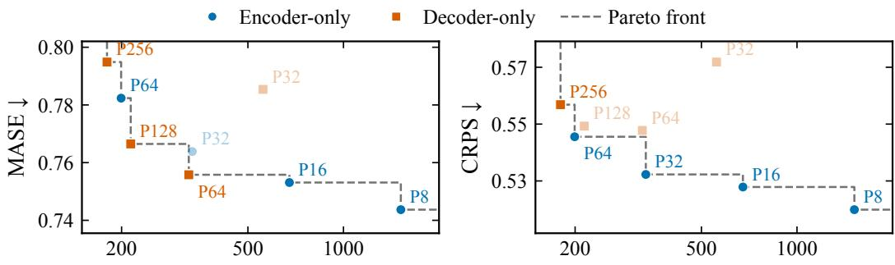
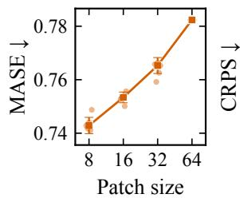
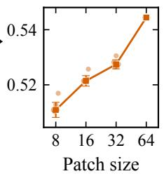
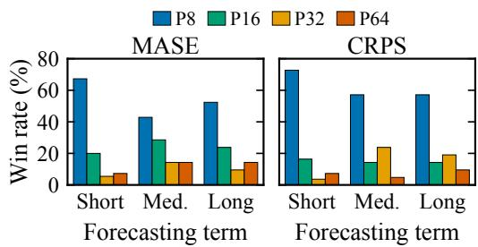
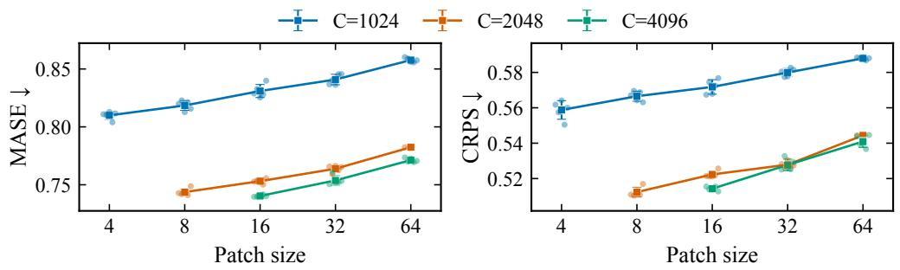
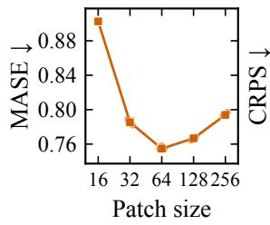
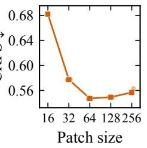
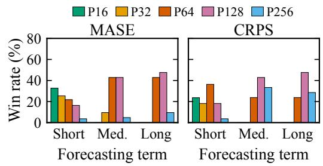
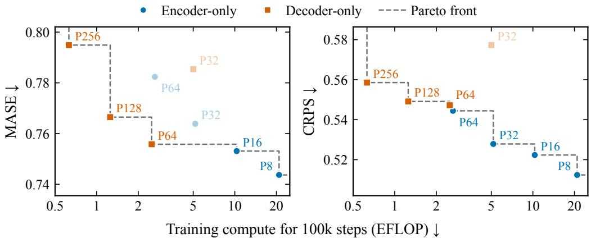

# Investigating the effects of the patch size in Time Series Foundation Models

Jad Yehya∗ Université Paris-Saclay, Inria, CEA Palaiseau, France jad.yehya@inria.fr

Andrei-Tiberiu Pantea∗ CMAP, École polytechnique, IP Paris Électricité de France R&D Palaiseau, France andrei-tiberiu.pantea@polytechnique.edu

Aymeric Dieuleveut CMAP, École polytechnique, IP Paris Palaiseau, France

Matthieu Kowalski Université Paris-Saclay, Inria, CNRS, LISN Gif-sur-Yvette, France

Thomas Moreau Université Paris-Saclay, Inria, CEA Palaiseau, France

## Abstract

Patch size is a central design choice in patch-based time-series foundation models, controlling temporal resolution, sequence length, and computational cost. We study how this choice interacts with transformer architecture through a controlled comparison of encoder-only and decoder-only forecasting models trained with the same data mixture and optimization budget. Across 97 GIFT-Eval tasks, encoder-only models consistently benefit from smaller patches, whereas decoder-only performance follows a U-shaped trend, with an intermediate patch size performing best in aggregate. Dataset-level results further show that the preferred decoder patch size increases with the forecasting horizon. For encoder-only models, increasing context length improves performance across patch sizes, although the gains diminish beyond a context length of 2048. Finally, training-compute and CPU-latency Pareto analyses reveal complementary regimes: decoder-only models provide efficient low-cost alternatives, while encoder-only models attain the highest overall accuracy. These results show that the choice of patch size and architecture should be made depending on the forecasting horizon and deployment constraints.

## 1 Introduction

Recent years have witnessed an increasing interest in Time Series Foundation Models (TSFMs), which promise to replace dataset-specific forecasting pipelines with pretrained models capable of transferring across domains, sampling frequencies, context lengths, and prediction horizons, and, in some cases, across time series tasks. The growing capabilities of TSFMs are reflected in their increasingly strong performance on the various general purpose time series forecasting benchmarks such as GIFT-Eval [Aksu et al., 2024], fev-bench [Shchur et al., 2025], TIME [Qiao et al., 2026].

Despite rapid empirical progress, the field has not converged towards a single architectural recipe. The current state-of-the-art spans a wide range of backbones, including the Tirex family [Auer et al., 2025] of recurrent models built around xLSTM layers and state-space-based FlowState [Graf et al.,

  
GIFT-Eval-weighted CPU latency (ms / series) ↓  
Figure 1: Normalized MASE (left) and CRPS (right) against CPU latency for encoder-only and decoder-only models for various values of the patch size P. The latency is computed over evaluations on the GIFT-Eval horizon lengths and averaged according to GIFT-Eval’s proportions.

2026]. Significant diversity also exists in the class of patch-based Transformers [Vaswani et al., 2017]: PatchTST-FM [Wen et al., 2026] and Chronos-2 [Ansari et al., 2025] use encoder-only, full-attention backbones to predict masked future patches in parallel, while TimesFM [Das et al., 2024], Moirai 2.0 [Liu et al., 2025], and Toto [Cohen et al., 2025] employ causal decoder-only transformer layers for single or multiple next-patches forecasting.

This diversity among the state-of-the-art shows that benchmark performance alone has not, until now, identified a preferred architecture for TSFMs. Moreover, published models differ simultaneously in the pretraining corpus, scale, training objectives, and tokenization strategies, preventing the isolation of the effects due to each component in the architectures.

Among these design choices, patch size remains insufficiently studied. Existing ablations of patch sizes have been performed within individual model families and evaluated through aggregate forecasting error metrics on benchmarks, e.g. GIFT-Eval. For example, Nie et al. [2023] report relatively robust PatchTST performance across patch lengths, with 8 and 16 generally performing well, while Das et al. [2024] study input patch length in TimesFM and decouple input and output patching, using lengths 32 and 128, respectively. Notably, patch size has also been connected to the rank structure and compressibility of TSFM representations [Yu et al., 2026]. However, these analyses remain architecture-specific, and the effect of patch size has not been systematically compared between encoder-only and decoder-only TSFMs under matched training conditions.

To address this gap, we conduct a controlled study of patch size in encoder-only and decoder-only patch-transformer-based TSFMs. We train both architectures under matched conditions and, within each architecture, vary the patch size while maintaining the remaining experimental setup fixed. This allows us to isolate the effect of temporal tokenization and determine whether patch size interacts differently with full-attention and causal-attention backbones. Figure 1 previews the central accuracy-efficiency trade-off identified in our experiments. Decoder-only configurations dominate the low-latency regime, while encoder-only models extend the Pareto frontier towards higher forecasting accuracy. The position of each configuration changes substantially with patch size, motivating a joint analysis of tokenization, architecture, and computational cost. The paper is structured as follows:

• In Section 2, we introduce the encoder-only and decoder-only architectures studied in this work and explain their particularities. Both follow closely state-of-the-art architectures for encoder-only and decoder-only TSFMs.

• In Section 3, we begin with the experimental setup and then present the numerical results of our experiments. We provide per family fine grained evaluations on GIFT-Eval [Aksu et al., 2024] and aggregated performance-efficiency comparisons between encoder-only and decoder-only models.

• In Section 4, we comment on the limitations and present the conclusions of our work.

## 2 Models

We study the effect of patch size in two patch-based TSFM configurations: an encoder-only model based on PatchTST-FM [Wen et al., 2026] and a causal decoder-only family following the autoregressive patch-decoder paradigm used by TimesFM [Das et al., 2024] and Toto [Cohen et al., 2025]. More specifically, the decoder follows the architecture of Toto, retaining its causal normalization, linear patch embeddings, next-patch training, and transformer architecture, while replacing its distributional output head with a monotonic quantile head.

Both models operate on non-overlapping patches and produce probabilistic forecasts through quantile regression. They differ in their attention pattern and prediction objective: the encoder uses full attention to reconstruct masked patches, whereas the decoder uses causal attention to predict future patches. Within each model family, keeping the remaining components fixed allows us to study how the effect of patch size depends on the underlying architecture.

Probabilistic forecasting setting The problem we study is that of univariate time series probabilistic forecasting. Let $x _ { 1 : C } = ( x _ { 1 } , x _ { 2 } , \ldots , x _ { C } ) \in \mathbb { R } ^ { C }$ denote an observed context of length $C$ and let $x _ { C + 1 : C + H }$ denote the subsequent prediction horizon of length H. Given the context, the model predicts $Q$ conditional quantiles for every horizon time stamp. For a set of quantile levels $\mathcal { Q } =$ $\{ \tau _ { 1 } , \tau _ { 2 } , \dots , \tau _ { Q } \} \subset ( 0 , 1 )$ , the model’s output is therefore $\boldsymbol { \hat { y } } \in \overset { \mathbf { x } } { \mathbb { R } } ^ { H \times Q }$ and the goal is to have

$$
\hat { y } _ { h , k } \approx F _ { x _ { C + h } | x _ { 1 : C } } ^ { - 1 } ( \tau _ { k } ) , \qquad h \in \{ 1 , 2 , \dots , H \} , \quad k \in \{ 1 , 2 , \dots , Q \} .\tag{1}
$$

Patching Both model families divide the input into contiguous, non-overlapping patches of size $P .$ If the context length is not divisible by $P ,$ , the context is zero-padded on the left so that one obtains $N _ { C } \colon = \lceil C / P \rceil$ patches.

Forecasting a horizon of length H then requires $N _ { H } \colon \ = \ \lceil H / P \rceil$ future patches. When H is not divisible by $P ,$ the final predicted patch is truncated to retain exactly the requested H time steps.

## 2.1 Encoder-only model

The encoder-only family is trained as a masked reconstruction model: selected patches are hidden from the input, and their values are predicted simultaneously using full self-attention.

Masking and normalization. We use contiguous-patch masking (CPM), following Auer et al. [2025], to mask contiguous spans inside the context and at the end, for forecasting. Our only departure from PatchTST-FM is to mask contiguous sequences of 128 time points inside the context rather than a fixed number of patches, so that the masked span, and hence the reconstruction problem seen during training, is identical for every patch size. We retain the binary mask $m \in \{ 0 , 1 \} ^ { C }$ where $m _ { t } = 1$ if $x _ { t }$ is neither masked nor padded and 0 otherwise.

We then normalize the input time series using Mask-Aware Normalization introduced in [Wen et al., 2026]. That means that time series specific mean $\mu$ and standard deviation σ are computed only using the visible time points (i.e. where $\mathbf { m } = 1 )$ . The same statistics are used to transform the corresponding predictions back to the original scale.

Furthermore, the influence of outliers is reduced using arcsinh, as introduced by [Ansari et al., 2025]. The normalized series then becomes

$$
\bar { \mathbf { x } } = \sinh ^ { - 1 } \left( \frac { \mathbf { x } - \mu } { \sigma } \right) .\tag{2}
$$

Patch embedding and backbone. For every patch, its normalized values are concatenated with the corresponding binary mask. A residual block maps the resulting vector to the encoder embedding dimension $d ,$ to which learnable positional embeddings are added. The tokenization procedure thus produces a sequence of patch embeddings $\mathbf { e } \in \mathbb { R } ^ { N _ { C } \times \smile d }$ that are further processed by the transformer layers.

Prediction. The models append $N _ { H } \colon = \lceil { H } / { P } \rceil$ masked patches representing the prediction horizon to the observed context patches. The hidden representation associated with each masked patch is processed by a residual output head that produces $P \times Q$ values which represent $Q$ conditional quantiles for each of the $P$ time points in the patch. Since the encoder processes all context and masked tokens jointly, the complete horizon is reconstructed in a single forward pass.

Table 1: Configurations considered in our experiments. All the configurations are trained for 100k optimization steps.
<table><tr><td>Model family</td><td>Patch size P</td><td>Context length C</td></tr><tr><td>Encoder-only</td><td>4</td><td>1024</td></tr><tr><td>Encoder-only</td><td>8</td><td>1024,2048</td></tr><tr><td>Encoder-only Decoder-only</td><td>16, 32, 64 16, 32, 64, 128, 256</td><td>1024, 2048, 4096 2048</td></tr></table>

## 2.2 Decoder-only model

The decoder-only family is trained autoregressively: each patch is predicted from all preceding patches using causal self-attention.

Normalization. We normalize each patch using causal, prefix-dependent statistics. For the i-th patch, the mean $\mu _ { i }$ and standard deviation $\sigma _ { i }$ are computed using only the valid observations up to the end of that patch. The normalized patch is therefore

$$
\bar { \mathbf { p } } _ { i } = \frac { \mathbf { p } _ { i } - \mu _ { i } } { \sigma _ { i } } .\tag{3}
$$

The same statistics are used to transform the corresponding predictions back to the original scale. Since patch i is used to predict patch $i + 1$ , the normalization statistics never depend on the target values.

Patch embedding and backbone. For every patch, its normalized values are concatenated with the corresponding binary visibility mask. A bias-free linear projection maps the resulting vector to the decoder embedding dimension d. The tokenization procedure thus produces a sequence of patch embeddings $\mathbf { e } \in \mathbb { R } ^ { N _ { C } \times d }$

The patch embeddings are processed by a stack of causal transformer layers. No positional embedding is added, positional information is introduced only through RoPE [Su et al., 2024] inside the transformer layers.

Prediction. The prediction is performed autoregressively, patch by patch. The hidden representation at each position is passed through a linear output projection producing $P \times Q$ values. The central output directly represents the median, while the remaining outputs are transformed into positive increments using softplus. Cumulative increments are subtracted from or added to the median to obtain the lower and upper quantiles, respectively. The predicted quantiles are therefore ordered by construction.

## 3 Experiments

The goal of our experiments is to investigate how patch size affects forecasting accuracy, sensitivity to the prediction horizon, and training efficiency. We first study patch size at a fixed context length within each model family, but varying the patch size while keeping the context and prediction lengths fixed is not enough for a full picture. To that end, for the encoder-only family, we additionally vary the context length to examine the interaction between temporal resolution and context sequence length. Finally, we compare the pretrained configurations in terms of forecasting performance across multiple horizon lengths.

## 3.1 Experimental Setup

Model configurations. Table 1 summarizes the configurations considered in our experiments. All the models are trained for 100k optimization steps. Within each sweep, patch size is varied while the remaining model and training configuration is held fixed. The encoder experiments cover context lengths between 1024 and 4096, whereas the decoder is trained at a context length of 2048. Each configuration is pretrained with multiple random seeds that were allocated sequentially: configurations that clearly underperformed in the initial runs were not replicated to the maximum number, allowing the available compute to be concentrated on competitive configurations and on estimating variability around the observed optima. All seed-level aggregates use the available runs for each configuration, whose numbers are reported in Table 3. More details about the pretraining procedure and full model configurations are in Section A.

Evaluation protocol. All the configurations are evaluated on the 97 forecasting tasks of GIFT-Eval [Aksu et al., 2024]. We report normalized MASE (mean absolute scaled error) to evaluate point forecasts and normalized CRPS (continuous ranked probability score) to evaluate probabilistic forecasts. The normalization is performed with respect to the performance of the seasonal naive predictor and aggregated results are obtained by geometrically averaging the normalized task-level scores, following the approach in [Aksu et al., 2024].

We also report finer grained results, namely the dataset win rates of each patch size, defined as the fraction of tasks on which it obtains the lowest error among the configurations in the corresponding sweep. Furthermore, we also present these win rates according to the short, medium, and long-term forecasting categories of GIFT-Eval, which contain 55, 21, and 21 tasks, respectively.

## 3.2 Encoder-only patch size sweep

We first compare encoder-only models with patch sizes $P \in \{ 8 , 1 6 , 3 2 , 6 4 \}$ at a fixed context length $C = 2 0 4 8$ . Figure 2 shows a consistent deterioration in both normalized MASE and normalized CRPS as the patch size increases. Among the evaluated configurations, $P = 8$ therefore provides the most accurate point and probabilistic forecasts.

  
Figure 2: Effect of patch size on the encoder-only model for $C = 2 0 4 8 .$ . Left: normalized MASE and CRPS on GIFT-Eval. Right: dataset win rates by forecasting term. The encoder-only model with patch size $P = 8$ is the best in both aggregate performance and dataset win rates within each term.

The dataset-level results show that this improvement is broadly distributed across GIFT-Eval rather than being driven by a small number of datasets. The $P = 8$ model obtains the best MASE on 57 of the 97 tasks, and the best CRPS on 64 tasks. By comparison, $P = 1 6$ wins on 22 and 15 tasks, respectively, while $P = 3 2$ wins on 8 and 11 tasks and $\bar { P = 6 4 }$ wins on 10 and 7 tasks.

The benefit of smaller patches is most pronounced for short-term forecasting, but persists across medium and long horizons. At fixed context length, smaller patches also yield longer token sequences. This suggests that finer tokenization may improve performance by preserving more local information while allowing full attention to integrate it across the entire context.

## 3.3 Interaction Between Patch Size and Context Length

Patch size does not only determine the temporal resolution of each token but also the number of tokens available to represent a given context. Therefore, we extend the encoder-only analysis to context lengths $C \in \{ \bar { 1 } 0 2 4 , 2 0 4 \bar { 8 } , 4 0 9 6 \}$ , as shown in Figure 3. This experiment complements Section 3.2, as it appears that performance is not only related to the number of tokens per context, but also to the context length or patch size.

  
Figure 3: Encoder-only context and patch-size sweep after 100k training steps. Within each context length, smaller patches perform better. Increasing the context length substantially improves performance, although the gains from 2048 to 4096 are smaller than those from 1024 to 2048.

At every fixed context length, smaller patches produce lower MASE and CRPS. Nonetheless, increas ing the context length provides a substantial improvement across patch sizes.

In particular, the improvement from $C = 1 0 2 4$ to $C = 2 0 4 8$ is very important for all the patch sizes considered. The gains from increasing the context from 2048 to 4096 are smaller and suggest a saturation of the pretraining pipeline used for the chosen configurations.

## 3.4 Decoder-Only Patch-Size Sweep

The decoder-only models exhibit a different dependence on patch size. As shown in Figure 4, their aggregate performance follows a U-shaped curve rather than improving monotonically as the patch size becomes smaller. The best overall results are obtained with $P = 6 4$ and both smaller and larger patches degrade performance.

  
Figure 4: Effect of patch size on the decoder-only model. Left: aggregate MASE and CRPS on GIFT-Eval. Right: dataset win rates separated by forecasting term. Aggregate performance is best at $P = 6 4$ , while the patch sizes favored by individual tasks shift as the forecasting term increases.

The preferred patch size varies with the forecasting horizon, with larger patches becoming more competitive as the horizon increases. For short-term tasks, $P = 1 6$ achieves the most MASE wins (18/55), while $P = 6 4$ achieves the most CRPS wins (20/55). In contrast, $P = 1 2 8$ performs best on medium- and long-term tasks, obtaining 9/21 and 10/21 MASE and CRPS wins, respectively.

These results explain why the intermediate patch size $P = 6 4$ is the best across aggregate metrics: it is a compromise between the smaller patches favored by short-term tasks and the larger patches favored at longer horizons. The aggregate optimum thus partly reflects the horizon distribution of GIFT-Eval, and a decoder-only model targeting a narrower horizon range would prefer a different patch size.

## 3.5 Accuracy-Compute Trade-Off

Figure 5 plots forecasting performance against the number of EFLOPs required for 100k training steps of different configurations with a fixed context length of 2048. Patch size has a large effect on training cost because smaller patches produce longer token sequences.

  
Figure 5: Normalized MASE (left) and CRPS (right) against training compute for encoder-only and decoder-only models with various patch sizes P. Training compute denotes the number of matrix-multiplication FLOPs required to train each model for 100k steps with an effective batch size of 512 and is reported in EFLOP. Each point shows the mean performance over pretraining seeds and the dashed line indicates the Pareto front.

The Pareto frontier contains configurations for which no other evaluated model is both more accurate and less computationally expensive at training. Decoder-only models occupy the low-compute region of the frontier, with $P = 1 2 8$ and $P = 2 5 6$ providing the cheapest alternatives, while $P = 6 4$ offers the best decoder-only accuracy. Encoder-only models extend the frontier towards higher accuracy, with $P = 8$ achieving the lowest MASE and CRPS overall. However, moving from $P = 1 6$ to $P = 8$ doubles the training cost for a comparatively modest improvement in accuracy, indicating diminishing returns.

## 4 Conclusions and limitations

We presented a controlled study of how patch size affects encoder-only and decoder-only patch-based TSFMs. Despite their common use of temporal patches, the two architectures exhibit qualitatively different behavior. Encoder-only models consistently benefit from finer patches, while decoderonly models achieve their best aggregate performance at an intermediate patch size. Moreover, the preferred decoder patch size increases with the forecasting horizon, showing that the aggregate optimum partly reflects the horizon distribution of the evaluation benchmark.

The context-length experiments further show that patch size and context should not be considered independently. Longer contexts improve encoder-only performance across patch sizes, although the gains diminish beyond $C = 2 0 \bar { 4 } 8$ in our setting. The efficiency results reveal complementary operating regimes: decoder-only models occupy the low-training-compute and low-latency portions of the Pareto frontiers, whereas encoder-only models extend the frontiers towards higher accuracy. In particular, the best decoder configuration remains competitive while requiring approximately one eight of the training compute of the most accurate encoder configuration. Consequently, neither architecture nor patch size is universally optimal and the appropriate configuration depends on the desired balance between forecasting accuracy, training cost, inference latency, and prediction horizon.

As a practical rule within the evaluated model scale, P = 8 is the preferred encoder-only configuration when accuracy is the priority, while decoder-only P = 64 provides a strong compromise between accuracy and computational cost. For decoder-only models targeting primarily medium or long horizons, $P = 1 2 8$ may be preferable, and $C = 2 0 4 8$ provides a practical context-length compromise for encoder-only models given the diminishing gains beyond it.

Limitations. Our conclusions are restricted to the architectures, model scales, data mixture, and training paradigm (100k-step training budget, pretraining corpus, etc.) considered here. All models are trained for a fixed budget of 100k optimization steps and longer training or a compute-matched training budget could change the relative performance of different patch sizes, since patch size affects both sequence length and the amount of computation performed per step. The two model families necessarily differ in components beyond their attention patterns, including normalization, positional encoding, output heads, and parameter counts; cross-family differences therefore cannot be attributed exclusively to the encoder-decoder distinction.

In the decoder-only experiments, the same patch size is used for both inputs and outputs. Varying P therefore changes both the input granularity and the number of autoregressive decoding steps, and the observed trends may not hold when input and output patch sizes are selected independently, as in TimesFM [Das et al., 2024].

The evaluation is also limited to GIFT-Eval, whose distribution of datasets and forecasting horizons influences the reported aggregate optima. Finally, inference latency is measured at batch size one on a single laptop CPU and the resulting Pareto frontier may vary across hardware, numerical precision, software implementations, and batching regimes.

## References

T. Aksu, G. Woo, J. Liu, X. Liu, C. Liu, S. Savarese, C. Xiong, and D. Sahoo. GIFT-Eval: A benchmark for general time series forecasting model evaluation. In NeurIPS Workshop on Time Series in the Age ofLarge Models, 2024.

A. F. Ansari, L. Stella, C. Turkmen, X. Zhang, P. Mercado, H. Shen, O. Shchur, S. S. Rangapuram, S. Pineda Arango, S. Kapoor, J. Zschiegner, D. C. Maddix, M. W. Mahoney, K. Torkkola, A. Gordon Wilson, M. Bohlke-Schneider, and Y. Wang. Chronos: Learning the language of time series. Transactions on Machine Learning Research, 2024.

A. F. Ansari, O. Shchur, J. Küken, A. Auer, B. Han, P. Mercado, S. S. Rangapuram, H. Shen, L. Stella, X. Zhang, M. Goswami, S. Kapoor, D. C. Maddix, P. Guerron, T. Hu, J. Yin, N. Erickson, P. M. Desai, H. Wang, H. Rangwala, G. Karypis, Y. Wang, and M. Bohlke-Schneider. Chronos-2: From univariate to universal forecasting. arXiv preprint arXiv:2510.15821, 2025.

A. Auer, P. Podest, D. Klotz, S. Böck, G. Klambauer, and S. Hochreiter. TiRex: Zero-shot forecasting across long and short horizons with enhanced in-context learning. In Advances in Neural Information Processing Systems, 2025.

B. Cohen, E. Khwaja, Y. Doubli, S. Lemaachi, C. Lettieri, C. Masson, H. Miccinilli, E. Ramé, Q. Ren, A. Rostamizadeh, J. O. du Terrail, A.-M. Toon, K. Wang, S. Xie, Z. Xu, V. Zhukova, D. Asker, A. S. Talwalkar, and O. Abou-Amal. This time is different: An observability perspective on time series foundation models. In Advances in Neural Information Processing Systems, 2025.

A. Das, W. Kong, R. Sen, and Y. Zhou. A decoder-only foundation model for time-series forecasting. In Proceedings ofthe 41st International Conference on Machine Learning, 2024.

L. Graf, T. Ortner, S. Wo´zniak, and A. Pantazi. FlowState: Sampling-rate-equivariant time-series forecasting. In International Conference on Machine Learning, 2026.

C. Liu, T. Aksu, J. Liu, X. Liu, H. Yan, Q. Pham, D. Sahoo, C. Xiong, S. Savarese, and J. Li. Moirai 2.0: When less is more for time series forecasting. arXiv preprint arXiv:2511.11698, 2025.

I. Loshchilov and F. Hutter. Decoupled weight decay regularization. In International Conference on Learning Representations, 2019.

Y. Nie, N. H. Nguyen, P. Sinthong, and J. Kalagnanam. A time series is worth 64 words: Long-term forecasting with transformers. In International Conference on Learning Representations, 2023.

Z. Qiao, S. Pan, A. Wang, V. Zhukova, Y. Liu, X. Jiang, Q. Wen, M. Long, M. Jin, and C. Liu. It’s TIME: Towards the next generation of time series forecasting benchmarks. In International Conference on Machine Learning, 2026.

O. Shchur, A. F. Ansari, C. Turkmen, L. Stella, N. Erickson, P. Guerron, M. Bohlke-Schneider, and Y. Wang. fev-bench: A realistic benchmark for time series forecasting. arXiv preprint arXiv:2509.26468, 2025.

J. Su, M. Ahmed, Y. Lu, S. Pan, W. Bo, and Y. Liu. RoFormer: Enhanced transformer with rotary position embedding. Neurocomputing, 2024.

A. Vaswani, N. Shazeer, N. Parmar, J. Uszkoreit, L. Jones, A. N. Gomez, Ł. Kaiser, and I. Polosukhin. Attention is all you need. In Advances in Neural Information Processing Systems, 2017.

Y. Wen, W. M. Gifford, C. Reddy, L. M. Nguyen, J. Kalagnanam, and A. A. Julius. Revisiting the generic transformer: Deconstructing a strong baseline for time series foundation models. arXiv preprint arXiv:2602.06909, 2026.

A. Yu, D. C. Maddix, B. Han, X. Zhang, A. F. Ansari, O. Shchur, C. Faloutsos, A. G. Wilson, M. W. Mahoney, and Y. Wang. Understanding the implicit biases of design choices for time series foundation models. In International Conference on Learning Representations, 2026.

## A Model architectures and training details

This section provides additional implementation details for the two model families described in Section 2. The encoder-only model is an implementation of PatchTST-FM [Wen et al., 2026]. Its only modification to the original training setup is the use of a fixed number of masked time points rather than a fixed masking percentage. The decoder-only model follows the architectures and autoregressive training procedures of Toto [Cohen et al., 2025] and TimesFM [Das et al., 2024].

## A.1 Encoder-Only PatchTST-FM

Fixed-length contiguous masking. The encoder-only model is trained using contiguous-patch masking. The context window of C time points is divided into non-overlapping, patch-aligned spans, and spans are masked uniformly at random until about 40% of the window is hidden. In addition, the last $\ell \sim \mathcal { U } \left( 0 , 4 S \right)$ points are masked, where S is the span length, so that part of the objective is forecasting. Our only change to PatchTST-FM is how the span length is set. PatchTST-FM fixes it in patches $( N _ { \mathrm { c p m } } = 8 )$ , so the masked span would grow with patch size P. We instead fix it in time points, $S = 1 \dot { 2 } 8 , \dot { 1 } . \mathrm { e } . , N _ { \mathrm { c p m } } = 1 2 8 / P$ . With this choice, the number of masked spans, their length, the length of the tail mask, and hence the reconstruction problem seen during training are the same for every patch size.

Let m $\in \{ 0 , 1 \} ^ { C }$ denote the visibility mask, with $\mathbf { m } _ { t } = 1$ for visible, non-padded observations and $\mathbf { m } _ { t } = 0$ for masked or padded positions. The time series mean and standard deviation are computed only from visible observations:

$$
\mu = { \frac { \sum _ { t = 1 } ^ { C } m _ { t } x _ { t } } { \sum _ { t = 1 } ^ { C } m _ { t } } } , \qquad \sigma = { \sqrt { \frac { \sum _ { t = 1 } ^ { C } m _ { t } ( x _ { t } - \mu ) ^ { 2 } } { \sum _ { t = 1 } ^ { C } m _ { t } } } } .\tag{4}
$$

The visible values are then normalized and transformed using arcsinh:

$$
\bar { x } _ { t } = \arcsin \left( \frac { x _ { t } - \mu } { \sigma } \right) .\tag{5}
$$

Masked and padded positions are set to zero after normalization.

Embedding and Transformer backbone. Each normalized patch $\bar { p } _ { i } \in { \mathbb { R } ^ { P } }$ is concatenated with its patch-level visibility mask $m _ { i } \in \{ 0 , 1 \} ^ { P }$ . A residual embedding block maps the resulting 2P-dimensional vector to the model dimension d:

$$
\begin{array}{c} e _ { i } = f _ { \mathrm { e n c } } \biggl ( \biggl [ \bar { p } _ { i }  \\ { m _ { i } } \end{array} \biggr ] \biggr ) + r _ { i } ,\tag{6}
$$

where $r _ { i }$ is a learned positional embedding. The complete sequence is processed using full bidirectional self-attention.

Prediction. During training, the output head reconstructs the masked patches, and the loss is evaluated only at masked, non-padded time points. At inference time, $N _ { H } = \stackrel { \bullet } { \lceil { H } / { P } \rceil }$ masked patches are appended to the observed context. Full attention jointly processes the observed and masked patches, allowing the complete forecasting horizon to be predicted in a single forward pass. The final patch is truncated when $\dot { H }$ is not divisible by P.

## A.2 Decoder-Only Model

Causal normalization. For each patch position i, the model computes normalization statistics from all observations up to the end of that patch:

$$
\mu _ { i } = \frac { 1 } { i P } \sum _ { t = 1 } ^ { i P } x _ { t } , \qquad \sigma _ { i } = \sqrt { \frac { 1 } { i P } \sum _ { t = 1 } ^ { i P } ( x _ { t } - \mu _ { i } ) ^ { 2 } } .\tag{7}
$$

The observations in patch i are normalized as

$$
\bar { x } _ { t } = \frac { x _ { t } - \mu _ { i } } { \sigma _ { i } } , \qquad ( i - 1 ) P < t \leq i P .\tag{8}
$$

The same statistics are used to transform the prediction of the next patch back to the original scale:

$$
\begin{array} { r } { \hat { x } _ { t } = \mu _ { i } + \sigma _ { i } \hat { \bar { x } } _ { t } , \qquad i P < t \leq ( i + 1 ) P . } \end{array}\tag{9}
$$

Thus, each prediction uses only statistics computed from observations available before the predicted patch.

Embedding and causal backbone. The normalized values are concatenated with their binary visibility mask and projected to the model dimension using a bias-free linear layer:

$$
e _ { i } = W _ { \mathrm { i n } } \left[ { \frac { \bar { p } _ { i } } { m _ { i } } } \right] , \qquad W _ { \mathrm { i n } } \in \mathbb { R } ^ { d \times 2 P } .\tag{10}
$$

The embeddings are processed by a causal Transformer composed of RMSNorm, grouped-query self-attention, and SwiGLU feed-forward blocks. No additive positional embeddings are used. Patch positions are represented exclusively through rotary positional embeddings applied to the query and key representations inside the attention layers.

The causal attention mask ensures that the representation used to predict patch $p _ { j }$ can depend on all preceding patches $p _ { 1 } , \ldots , p _ { j - 1 }$ , but not on $p _ { j }$ or any later patch. During training, predictions for all target positions are computed in parallel using teacher forcing.

Monotonic quantile head. For each predicted patch, a linear output projection produces $P \times Q$ unconstrained values. The central output directly parameterizes the median. The remaining outputs are transformed into positive increments using softplus. Starting from the median, cumulative increments are subtracted to construct lower quantiles and added to construct upper quantiles. Consequently, for ordered levels $\tau _ { 1 } < \cdots < \tau _ { Q }$ , the predictions satisfy

$$
\hat { y } _ { t , \tau _ { 1 } } \leq \hat { y } _ { t , \tau _ { 2 } } \leq \cdot \cdot \cdot \leq \hat { y } _ { t , \tau _ { Q } }\tag{11}
$$

by construction.

At inference time, the complete observed context is first processed to predict one future patch. The predicted median is appended to the context and used when generating the following patch. Causal normalization is recomputed over the extended context, and generation continues until $N _ { H }$ future patches have been produced.

## A.3 Quantile Training Objective

Both model families are trained using the pinball loss. For a target $x _ { t } .$ , quantile level $\tau ,$ and prediction $\hat { y } _ { t , \tau } .$ , the loss is

$$
\rho _ { \tau } ( x _ { t } - \hat { y } _ { t , \tau } ) = \operatorname* { m a x } \left\{ \tau ( x _ { t } - \hat { y } _ { t , \tau } ) , ( \tau - 1 ) ( x _ { t } - \hat { y } _ { t , \tau } ) \right\} .\tag{12}
$$

The objective is averaged across all quantile levels and prediction positions.

## A.4 Training Details

The pretraining corpus consists of GIFT-Eval Pretrain, 1 million KernelSynth [Ansari et al., 2024] and synthetically generated time series using our RandomPatterns pipeline. The RandomPatterns pipeline works as follows. In order to generate a time series of length $\bar { L } \colon$

1. Sample an integer period length p between 4 and 256;

2. Sample a random trend type among linear, quadratic, periodic and their corresponding parameters;

3. Generate a standard random walk r of length p;

4. Generate a trend time series t of length L;

5. The generated RandomPatterns time series is $x _ { i } = t _ { i } + r _ { i }$ mod p.

This pipeline provides rougher fully predictable time series with random seasonalities, preventing the model from overfitting to dataset specific periods and also encouraging it to learn broader representations.

The dataset mixture is: 10% GIFT-Eval, 50% RandomPatterns, and 40% KernelSynth. Each configuration is trained from scratch for 100k optimization steps using AdamW [Loshchilov and Hutter, 2019] with an effective batch size of 512. We use a peak learning rate of 1e−4 and the OneCycleLR scheduler.

Table 2: Architecture and parameter counts of the evaluated model families. Parameter counts vary slightly with patch size and context length; ranges are reported over all evaluated configurations.
<table><tr><td>Model</td><td> $d _ { \mathrm { m o d e l } }$ </td><td>Layers</td><td>Heads</td><td>Quantiles</td><td>Parameters</td></tr><tr><td>Encoder-only</td><td>1024</td><td>20</td><td>16</td><td>99</td><td>255.0-267.5M</td></tr><tr><td>Decoder-only</td><td>1024</td><td>20</td><td>16</td><td>9</td><td>253.4–255.9M</td></tr></table>

Table 2 summarizes the size of the two model families. The encoder-only configurations contain approximately 255-267 million parameters, while the decoder-only configurations contain approximately 253-256 million. Note that the difference in the number of quantiles does not affect the evaluations since GIFT-Eval performances are computed on 9 quantiles (0.1 - 0.9) and classification is performed using the frozen layers before the quantile head.

Random seeds. To account for training variability, each configuration is pretrained with several random seeds. Table 3 lists the seeds used for every configuration.

Table 3: Number of pretraining seeds per configuration.
<table><tr><td>Model family</td><td>Context length</td><td>P = 4</td><td>8</td><td>16</td><td>32</td><td>64</td><td>128</td><td>256</td></tr><tr><td>Encoder-only</td><td>1024</td><td>5</td><td>5</td><td>5</td><td>5</td><td>5</td><td></td><td></td></tr><tr><td>Encoder-only</td><td>2048</td><td>一</td><td>5</td><td>5</td><td>5</td><td>1</td><td></td><td></td></tr><tr><td>Encoder-only</td><td>4096</td><td>一</td><td></td><td>5</td><td>5</td><td>5</td><td>一</td><td></td></tr><tr><td>Decoder-only</td><td>2048</td><td>一</td><td></td><td>1</td><td>2</td><td>3</td><td>3</td><td>3</td></tr></table>

## A.5 Latency experiment

CPU latency in Figure 1 was measured independently on an Apple M1 Pro MacBook Pro using batch size 1, four CPU threads, one warm-up iteration, and one timed iteration. The latency benchmark reproduced the 13 distinct context–horizon conditions occurring in GIFT-Eval and combined them using their frequencies across the 97 tasks. Encoder forecasts were produced directly in one pass, whereas decoder forecasts used cached patch-recursive generation.

## NeurIPS Paper Checklist

The checklist is designed to encourage best practices for responsible machine learning research, addressing issues of reproducibility, transparency, research ethics, and societal impact. Do not remove the checklist: The papers not including the checklist will be desk rejected. The checklist should follow the references and follow the (optional) supplemental material. The checklist does NOT count towards the page limit.

Please read the checklist guidelines carefully for information on how to answer these questions. For each question in the checklist:

• You should answer [Yes], [No], or [N/A].

• [N/A] means either that the question is Not Applicable for that particular paper or the relevant information is Not Available.

• Please provide a short (1–2 sentence) justification right after your answer (even for [N/A]).

The checklist answers are an integral part of your paper submission. They are visible to the reviewers, area chairs, senior area chairs, and ethics reviewers. You will also be asked to include it (after eventual revisions) with the final version of your paper, and its final version will be published with the paper.

The reviewers of your paper will be asked to use the checklist as one of the factors in their evaluation. While [Yes] is generally preferable to [No], it is perfectly acceptable to answer [No] provided a proper justification is given (e.g., error bars are not reported because it would be too computationally expensive” or “we were unable to find the license for the dataset we used”). In general, answering [No] or [N/A] is not grounds for rejection. While the questions are phrased in a binary way, we acknowledge that the true answer is often more nuanced, so please just use your best judgment and write a justification to elaborate. All supporting evidence can appear either in the main paper or the supplemental material, provided in appendix. If you answer [Yes] to a question, in the justification please point to the section(s) where related material for the question can be found.

## IMPORTANT, please:

• Delete this instruction block, but keep the section heading “NeurIPS Paper Checklist",

• Keep the checklist subsection headings, questions/answers and guidelines below.

• Do not modify the questions and only use the provided macros for your answers.

## 1. Claims

Question: Do the main claims made in the abstract and introduction accurately reflect the paper’s contributions and scope?

Answer: [Yes]

Justification: The claims made match the experimental results.

Guidelines:

• The answer [N/A] means that the abstract and introduction do not include the claims made in the paper.

• The abstract and/or introduction should clearly state the claims made, including the contributions made in the paper and important assumptions and limitations. A [No] or [N/A] answer to this question will not be perceived well by the reviewers.

• The claims made should match theoretical and experimental results, and reflect how much the results can be expected to generalize to other settings.

• It is fine to include aspirational goals as motivation as long as it is clear that these goals are not attained by the paper.

## 2. Limitations

Question: Does the paper discuss the limitations of the work performed by the authors?

Answer: [Yes]

Justification: The limitations are explained in Section 4

## Guidelines:

• The answer [N/A] means that the paper has no limitation while the answer [No] means that the paper has limitations, but those are not discussed in the paper.

• The authors are encouraged to create a separate “Limitations” section in their paper.

• The paper should point out any strong assumptions and how robust the results are to violations of these assumptions (e.g., independence assumptions, noiseless settings, model well-specification, asymptotic approximations only holding locally). The authors should reflect on how these assumptions might be violated in practice and what the implications would be.

• The authors should reflect on the scope of the claims made, e.g., if the approach was only tested on a few datasets or with a few runs. In general, empirical results often depend on implicit assumptions, which should be articulated.

• The authors should reflect on the factors that influence the performance of the approach. For example, a facial recognition algorithm may perform poorly when image resolution is low or images are taken in low lighting. Or a speech-to-text system might not be used reliably to provide closed captions for online lectures because it fails to handle technical jargon.

• The authors should discuss the computational efficiency of the proposed algorithms and how they scale with dataset size.

• If applicable, the authors should discuss possible limitations of their approach to address problems of privacy and fairness.

• While the authors might fear that complete honesty about limitations might be used by reviewers as grounds for rejection, a worse outcome might be that reviewers discover limitations that aren’t acknowledged in the paper. The authors should use their best judgment and recognize that individual actions in favor of transparency play an important role in developing norms that preserve the integrity of the community. Reviewers will be specifically instructed to not penalize honesty concerning limitations.

## 3. Theory assumptions and proofs

Question: For each theoretical result, does the paper provide the full set of assumptions and a complete (and correct) proof?

Answer: [N/A]

Justification: There are no theoretical results.

Guidelines:

• The answer [N/A] means that the paper does not include theoretical results.

• All the theorems, formulas, and proofs in the paper should be numbered and crossreferenced.

• All assumptions should be clearly stated or referenced in the statement of any theorems.

• The proofs can either appear in the main paper or the supplemental material, but if they appear in the supplemental material, the authors are encouraged to provide a short proof sketch to provide intuition.

• Inversely, any informal proof provided in the core of the paper should be complemented by formal proofs provided in appendix or supplemental material.

• Theorems and Lemmas that the proof relies upon should be properly referenced.

## 4. Experimental result reproducibility

Question: Does the paper fully disclose all the information needed to reproduce the main experimental results of the paper to the extent that it affects the main claims and/or conclusions of the paper (regardless of whether the code and data are provided or not)?

Answer: [Yes]

Justification: Full experimental details are provided in the appendix.

Guidelines:

• The answer [N/A] means that the paper does not include experiments.

• If the paper includes experiments, a [No] answer to this question will not be perceived well by the reviewers: Making the paper reproducible is important, regardless of whether the code and data are provided or not.

• If the contribution is a dataset and/or model, the authors should describe the steps taken to make their results reproducible or verifiable.

• Depending on the contribution, reproducibility can be accomplished in various ways. For example, if the contribution is a novel architecture, describing the architecture fully might suffice, or if the contribution is a specific model and empirical evaluation, it may be necessary to either make it possible for others to replicate the model with the same dataset, or provide access to the model. In general. releasing code and data is often one good way to accomplish this, but reproducibility can also be provided via detailed instructions for how to replicate the results, access to a hosted model (e.g., in the case of a large language model), releasing of a model checkpoint, or other means that are appropriate to the research performed.

• While NeurIPS does not require releasing code, the conference does require all submissions to provide some reasonable avenue for reproducibility, which may depend on the nature of the contribution. For example

(a) If the contribution is primarily a new algorithm, the paper should make it clear how to reproduce that algorithm.

(b) If the contribution is primarily a new model architecture, the paper should describe the architecture clearly and fully.

(c) If the contribution is a new model (e.g., a large language model), then there should either be a way to access this model for reproducing the results or a way to reproduce the model (e.g., with an open-source dataset or instructions for how to construct the dataset).

(d) We recognize that reproducibility may be tricky in some cases, in which case authors are welcome to describe the particular way they provide for reproducibility. In the case of closed-source models, it may be that access to the model is limited in some way (e.g., to registered users), but it should be possible for other researchers to have some path to reproducing or verifying the results.

## 5. Open access to data and code

Question: Does the paper provide open access to the data and code, with sufficient instructions to faithfully reproduce the main experimental results, as described in supplemental material?

Answer: [Yes]

Justification: The code will be open sourced and published alongside the paper. Instructions will be provided to run each of the experiment.

Guidelines:

• The answer [N/A] means that paper does not include experiments requiring code.

• Please see the NeurIPS code and data submission guidelines (https://neurips.cc/ public/guides/CodeSubmissionPolicy) for more details.

• While we encourage the release of code and data, we understand that this might not be possible, so [No] is an acceptable answer. Papers cannot be rejected simply for not including code, unless this is central to the contribution (e.g., for a new open-source benchmark).

• The instructions should contain the exact command and environment needed to run to reproduce the results. See the NeurIPS code and data submission guidelines (https: //neurips.cc/public/guides/CodeSubmissionPolicy) for more details.

• The authors should provide instructions on data access and preparation, including how to access the raw data, preprocessed data, intermediate data, and generated data, etc.

• The authors should provide scripts to reproduce all experimental results for the new proposed method and baselines. If only a subset of experiments are reproducible, they should state which ones are omitted from the script and why.

• At submission time, to preserve anonymity, the authors should release anonymized versions (if applicable).

• Providing as much information as possible in supplemental material (appended to the paper) is recommended, but including URLs to data and code is permitted.

## 6. Experimental setting/details

Question: Does the paper specify all the training and test details (e.g., data splits, hyperparameters, how they were chosen, type of optimizer) necessary to understand the results?

Answer: [Yes]

Justification: Full experiment details are provided in the appendix.

Guidelines:

• The answer [N/A] means that the paper does not include experiments.

• The experimental setting should be presented in the core of the paper to a level of detail that is necessary to appreciate the results and make sense of them.

• The full details can be provided either with the code, in appendix, or as supplemental material.

## 7. Experiment statistical significance

Question: Does the paper report error bars suitably and correctly defined or other appropriate information about the statistical significance of the experiments?

Answer: [Yes]

Justification: Experiments are ran over multiple seeds and error bars are shown in several plots.

Guidelines:

• The answer [N/A] means that the paper does not include experiments.

• The authors should answer [Yes] if the results are accompanied by error bars, confidence intervals, or statistical significance tests, at least for the experiments that support the main claims of the paper.

• The factors of variability that the error bars are capturing should be clearly stated (for example, train/test split, initialization, random drawing of some parameter, or overall run with given experimental conditions).

• The method for calculating the error bars should be explained (closed form formula, call to a library function, bootstrap, etc.)

• The assumptions made should be given (e.g., Normally distributed errors).

• It should be clear whether the error bar is the standard deviation or the standard error of the mean.

• It is OK to report 1-sigma error bars, but one should state it. The authors should preferably report a 2-sigma error bar than state that they have a 96% CI, if the hypothesis of Normality of errors is not verified.

• For asymmetric distributions, the authors should be careful not to show in tables or figures symmetric error bars that would yield results that are out of range (e.g., negative error rates).

• If error bars are reported in tables or plots, the authors should explain in the text how they were calculated and reference the corresponding figures or tables in the text.

## 8. Experiments compute resources

Question: For each experiment, does the paper provide sufficient information on the computer resources (type of compute workers, memory, time of execution) needed to reproduce the experiments?

Answer: [Yes]

Justification: The infrastructure is specified in the paper.

Guidelines:

• The answer [N/A] means that the paper does not include experiments.

• The paper should indicate the type of compute workers CPU or GPU, internal cluster, or cloud provider, including relevant memory and storage.

• The paper should provide the amount of compute required for each of the individual experimental runs as well as estimate the total compute.

• The paper should disclose whether the full research project required more compute than the experiments reported in the paper (e.g., preliminary or failed experiments that didn’t make it into the paper).

## 9. Code of ethics

Question: Does the research conducted in the paper conform, in every respect, with the NeurIPS Code of Ethics https://neurips.cc/public/EthicsGuidelines?

Answer: [Yes]

Justification: Nothing violates the NeurIPS Code of Ethics.

Guidelines:

• The answer [N/A] means that the authors have not reviewed the NeurIPS Code of Ethics.

• If the authors answer [No], they should explain the special circumstances that require a deviation from the Code of Ethics.

• The authors should make sure to preserve anonymity (e.g., if there is a special consideration due to laws or regulations in their jurisdiction).

## 10. Broader impacts

Question: Does the paper discuss both potential positive societal impacts and negative societal impacts of the work performed?

Answer: [N/A]

Justification: No societal impact.

Guidelines:

• The answer [N/A] means that there is no societal impact of the work performed.

• If the authors answer [N/A] or [No], they should explain why their work has no societal impact or why the paper does not address societal impact.

• Examples of negative societal impacts include potential malicious or unintended uses (e.g., disinformation, generating fake profiles, surveillance), fairness considerations (e.g., deployment of technologies that could make decisions that unfairly impact specific groups), privacy considerations, and security considerations.

• The conference expects that many papers will be foundational research and not tied to particular applications, let alone deployments. However, if there is a direct path to any negative applications, the authors should point it out. For example, it is legitimate to point out that an improvement in the quality of generative models could be used to generate Deepfakes for disinformation. On the other hand, it is not needed to point out that a generic algorithm for optimizing neural networks could enable people to train models that generate Deepfakes faster.

• The authors should consider possible harms that could arise when the technology is being used as intended and functioning correctly, harms that could arise when the technology is being used as intended but gives incorrect results, and harms following from (intentional or unintentional) misuse of the technology.

• If there are negative societal impacts, the authors could also discuss possible mitigation strategies (e.g., gated release of models, providing defenses in addition to attacks, mechanisms for monitoring misuse, mechanisms to monitor how a system learns from feedback over time, improving the efficiency and accessibility of ML).

## 11. Safeguards

Question: Does the paper describe safeguards that have been put in place for responsible release of data or models that have a high risk for misuse (e.g., pre-trained language models, image generators, or scraped datasets)?

Answer: [N/A]

Justification: The paper poses no such risks.

Guidelines:

• The answer [N/A] means that the paper poses no such risks.

• Released models that have a high risk for misuse or dual-use should be released with necessary safeguards to allow for controlled use of the model, for example by requiring that users adhere to usage guidelines or restrictions to access the model or implementing safety filters.

• Datasets that have been scraped from the Internet could pose safety risks. The authors should describe how they avoided releasing unsafe images.

• We recognize that providing effective safeguards is challenging, and many papers do not require this, but we encourage authors to take this into account and make a best faith effort.

## 12. Licenses for existing assets

Question: Are the creators or original owners of assets (e.g., code, data, models), used in the paper, properly credited and are the license and terms of use explicitly mentioned and properly respected?

Answer: [Yes]

Justification: Part of the dataset and some of the models existed and were introduced prior to this work. They are cited.

Guidelines:

• The answer [N/A] means that the paper does not use existing assets.

• The authors should cite the original paper that produced the code package or dataset.

• The authors should state which version of the asset is used and, if possible, include a URL.

• The name of the license (e.g., CC-BY 4.0) should be included for each asset.

• For scraped data from a particular source (e.g., website), the copyright and terms of service of that source should be provided.

• If assets are released, the license, copyright information, and terms of use in the package should be provided. For popular datasets, paperswithcode.com/datasets has curated licenses for some datasets. Their licensing guide can help determine the license of a dataset.

• For existing datasets that are re-packaged, both the original license and the license of the derived asset (if it has changed) should be provided.

• If this information is not available online, the authors are encouraged to reach out to the asset’s creators.

## 13. New assets

Question: Are new assets introduced in the paper well documented and is the documentation provided alongside the assets?

Answer: [Yes]

Justification: We will release, with this paper, code for the model, the data mixture and the trainer we used to run the experiments. It will be available and open source.

Guidelines:

• The answer [N/A] means that the paper does not release new assets.

• Researchers should communicate the details of the dataset/code/model as part of their submissions via structured templates. This includes details about training, license, limitations, etc.

• The paper should discuss whether and how consent was obtained from people whose asset is used.

• At submission time, remember to anonymize your assets (if applicable). You can either create an anonymized URL or include an anonymized zip file.

## 14. Crowdsourcing and research with human subjects

Question: For crowdsourcing experiments and research with human subjects, does the paper include the full text of instructions given to participants and screenshots, if applicable, as well as details about compensation (if any)?

## Answer: [N/A]

Justification: The paper does not involve crowdsourcing nor research with human subjects. Guidelines:

• The answer [N/A] means that the paper does not involve crowdsourcing nor research with human subjects.

• Including this information in the supplemental material is fine, but if the main contribution of the paper involves human subjects, then as much detail as possible should be included in the main paper.

• According to the NeurIPS Code of Ethics, workers involved in data collection, curation, or other labor should be paid at least the minimum wage in the country of the data collector.

## 15. Institutional review board (IRB) approvals or equivalent for research with human subjects

Question: Does the paper describe potential risks incurred by study participants, whether such risks were disclosed to the subjects, and whether Institutional Review Board (IRB) approvals (or an equivalent approval/review based on the requirements of your country or institution) were obtained?

Answer: [N/A]

Justification: The paper does not involve crowdsourcing nor research with human subjects. Guidelines:

• The answer [N/A] means that the paper does not involve crowdsourcing nor research with human subjects.

• Depending on the country in which research is conducted, IRB approval (or equivalent) may be required for any human subjects research. If you obtained IRB approval, you should clearly state this in the paper.

• We recognize that the procedures for this may vary significantly between institutions and locations, and we expect authors to adhere to the NeurIPS Code of Ethics and the guidelines for their institution.

• For initial submissions, do not include any information that would break anonymity (if applicable), such as the institution conducting the review.

## 16. Declaration of LLM usage

Question: Does the paper describe the usage of LLMs if it is an important, original, or non-standard component of the core methods in this research? Note that if the LLM is used only for writing, editing, or formatting purposes and does not impact the core methodology, scientific rigor, or originality of the research, declaration is not required.

Answer: [N/A]

Justification: The core method development in this research does not involve LLMs as any important, original, or non-standard components.

Guidelines:

• The answer [N/A] means that the core method development in this research does not involve LLMs as any important, original, or non-standard components.

• Please refer to our LLM policy in the NeurIPS handbook for what should or should not be described.