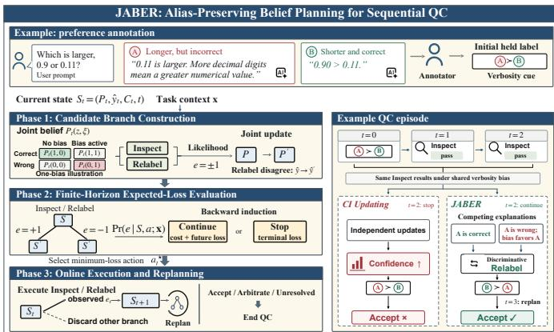
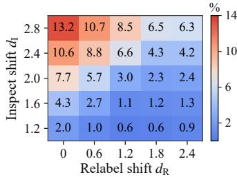
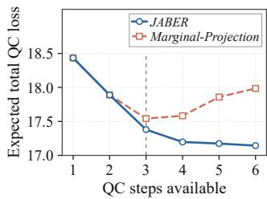
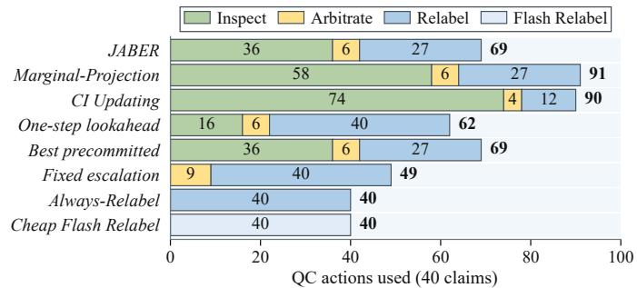
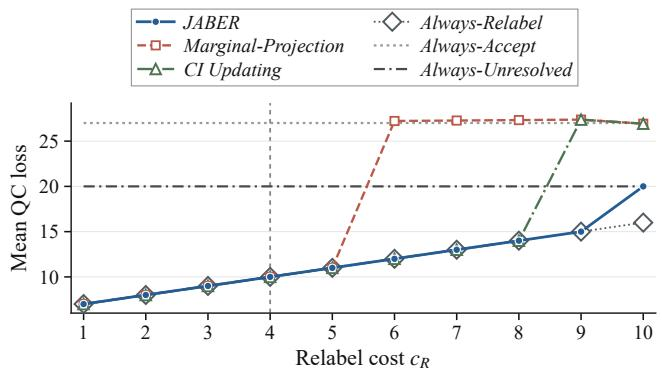

# JABER: Sequential Quality Control for Human–AI Data Annotation under Shared Bias

Fengxu Yang, Minghui Liwang, Senior Member, IEEE, Yang Lu, Senior Member, IEEE, Bo Han, Xianbin Wang, Fellow, IEEE and Seyyedali Hosseinalipour, Senior Member, IEEE

Abstract— High-quality annotations are essential for training and evaluating artificial intelligence (AI) systems. To ensure annotation reliability, quality control (QC) mechanisms often acquire additional human or AI judgments before accepting a label. Nevertheless, shared biases among annotators can lead to correlated judgments, causing conventional methods to mistake repeated agreement for independent evidence of correctness. To address this challenge, we propose JABER (Joint Alias-Preserving Belief for Evidence Routing), a bias-aware sequential QC framework that maintains a joint Bayesian posterior over label correctness and shared biases to guide evidence acquisition and termination decisions. Building on this posterior, we develop a finite-horizon decision-making algorithm that selects evidence-acquisition and termination actions to minimize the expected QC loss under resource constraints. Our theoretical analysis demonstrates that conventional methods that update label-correctness probabilities under the assumption of conditionally independent annotator judgments can become arbitrarily confident in an incorrect label under persistent shared bias. We further identify conditions under which repeated inspections cannot distinguish a correct label from an incorrect label supported by shared bias, establish when obtaining a new label can resolve this ambiguity, and demonstrate why modeling the dependence between label correctness and shared bias can be necessary for QC decisions. Our experiments show that JABER reduces expected QC loss by an average of 4.65% compared with a method that maintains separate label correctness and bias probabilities under conditions where shared bias makes repeated inspections unreliable. Further, JABER’s finite-horizon planning, which evaluates the potential outcomes of multiple successive QC actions, reduces expected QC loss by an average of 10.05% compared with a one-step lookahead method. In real-application programming interface (real-API) experiments on FEVER, JABER achieves zero labeling errors while reducing QC costs by 2.67% and 16.99% compared with marginal-based belief modeling and one-step lookahead methods, respectively.

Index Terms—Human–AI collaborative annotation, sequential quality control, shared latent bias, finite-horizon belief planning.

✦

## 1 INTRODUCTION

HE increasing deployment of artificial intelligence (AI) in high-stakes applications has made reliable data annotation essential. Modern annotation pipelines increasingly combine human annotators, large language model (LLM) labelers, and LLM-as-a-judge systems for dataset construction, preference assessment, and model evaluation [1]– [3]. However, such human–AI collaboration can introduce shared biases that lead to correlated judgments, making it dificult for quality control (QC) mechanisms to distinguish independent evidence of label correctness from agreement driven by common biases. This challenge is particularly pronounced in LLM-assisted annotation, as evaluators may exhibit correlated judgments due to shared pretraining data, model families, prompts, or evaluation criteria. Similarly, human annotators may exhibit correlated judgments when exposed to common interfaces and task contexts. Such dependencies can be further amplified by task-level cues, including response length, presentation order, and model provenance. Consequently, high agreement among annotators may reflect shared biases rather than independent evidence of label correctness [4]–[6], efectively reducing the number of independent judgments [7], [8].

Moreover, human and AI errors are not necessarily complementary [3], making correlated judgments particularly problematic in sequential QC. For instance, when multiple annotators agree on a label because of a shared bias, conventional methods that assume independent judgments may mistakenly interpret this agreement as strong evidence of correctness. As a result, the system may become overly confident and accept an incorrect label. Although existing dependence-aware methods account for such correlations when combining a fixed set of judgments [4], [5], postannotation QC introduces an additional challenge: deciding what to do after each new judgment. Specifically, the system must determine whether to accept the current label, request another inspection, obtain a replacement label, seek arbitration, or leave the task unresolved. Since these actions difer in cost, reliability, and sensitivity to shared bias, choosing the best action requires considering both the evidence already collected and the potential value of acquiring further evidence. Thus, accounting for shared bias is essential not only for accurately assessing label correctness but also for determining when and how to continue QC.

## 1.1 Core Motivation

In this work, we investigate the following three research questions (RQs) that motivate our research: • RQ1: How should evidence from human and AI annotators be evaluated during QC when agreement on a label may result from shared bias rather than independent support for its correctness? Existing methods account for correlations among human and AI judgments when combining multiple annotations to estimate label correctness [4], [5]. However, repeated agreement can reflect either label correctness or a persistent bias favoring an incorrect label. When a QC action produces identical observation probabilities under these two explanations, the action cannot distinguish between them, a phenomenon known as aliasing.

• RQ2: When should sequential annotation QC stop collecting additional judgments and instead use a more informative evidence source to resolve uncertainty about label correctness? Collecting additional judgments is useful only when they provide new information about whether the current label is correct. However, under persistent shared bias, repeated reviews of the same label may produce similar judgments regardless of its actual correctness, making further inspections inefective at resolving uncertainty. In such cases, the system may benefit from switching to a diferent QC action.

• RQ3: How can belief, cost, and future decision opportunities be integrated in sequential QC? Choosing the best QC action requires considering not only its immediate cost and outcome but also how it may improve subsequent decisions. The remaining budget and decision steps also constrain which follow-up actions remain available.

## 1.2 Novelty and Contribution

To address the above RQs, we propose Joint Alias-Preserving Belief for Evidence Routing (JABER), a framework for sequential QC in human–AI collaborative annotation. Our main contributions can be summarized as follows:

• An alias-preserving joint belief model for correlated judgments. We develop a bias-aware Bayesian framework that jointly models label correctness and persistent shared biases through an action-dependent observation model. Unlike conventional approaches that may mistake repeated agreement for independent evidence of correctness, our frame work maintains a joint posterior that preserves competing explanations for observed judgments. Furthermore, we derive Bayesian update rules that account for newly acquired evidence and changes in the held label.

• A theoretical characterization of evidence distinguishability and the need for joint beliefs. We establish theoretical results revealing how persistent shared biases can cause conven tional conditional-independence label updating methods to become increasingly confident in an incorrect label, while repeated inspections may fail to distinguish genuine correctness from bias-induced agreement. Building on these findings, we derive conditions under which the Relabel action, which obtains a new label rather than merely assessing the existing one, provides additional information to distinguish these competing explanations. Furthermore, we demonstrate that two joint beliefs with identical correctness and bias marginals can lead to diferent optimal QC actions, establishing the importance of preserving their joint dependence for informed decision-making.

• A finite-horizon planning algorithm for sequential quality control. We develop a Bellman recursion for a finite-horizon partially observable Markov decision process (POMDP) [9] to minimize the expected total QC loss. Unlike approaches that consider only immediate outcomes, our algorithm accounts for the costs of each action, the information gained from new observations, potential label replacements, and the decisions available in subsequent steps. By incorporating the remaining budget and decision steps, our algorithm determines the optimal QC action at each stage and adaptively replans as new observations become available. We establish that this procedure yields the optimal policy under the specified observation model and known parameters.

• Empirical evaluation and applicability. We conduct controlled synthetic experiments, including ablation studies and robustness analyses, to quantify the benefits of joint belief modeling and finite-horizon planning in reducing QC loss. Furthermore, we implement a controlled real-API QC workflow on FEVER [10], and analyze judgment records from HealthContradict [11] and four additional public datasets to investigate correlated annotation errors and identify how evidence informativeness, the reliability of replacement judgments, and action costs afect the value of further QC.

## 2 LITERATURE REVIEW

Henceforth, we review three related research directions: sequential QC in annotation systems, dependence-aware modeling of correlated human–AI judgments, and human– AI routing and deferral. For each direction, we clarify how its objective and decision setting difer from those of JABER.

## 2.1 Sequential Quality Control in Annotation Systems

Classical annotation QC focuses on recovering reliable labels from noisy judgments. In this context, the Dawid–Skene model jointly estimates latent labels and annotator-specific error rates [12], while later studies show that annotator reliability may vary substantially across tasks and instances [13]. Related works have further modeled dependencies among noisy labeling sources [14], [15], allocated limited review budgets to samples selected for re-annotation [16], and studied iterative correction when relabeling itself remains imperfect [17]. Beyond improving label estimation, sequential QC introduces the challenge of deciding which additional judgments to acquire and when to terminate the review process. To address this challenge, POMDP-based workflow control balances output quality against evidence acquisition cost [9], while MDP-based sequential crowdsourcing incorporates accuracy, cost, and time into annotation decisions [18]. Other approaches focus on specific aspects of adaptive QC. For example, CLARA adaptively determines review counts from evolving confidence [19], partitioning Monte Carlo methods support time-constrained decisions [20], and Bayesian online learning for consensus prediction (BOCP) predicts the label favored by the full expert panel using partial feedback [21]. Similarly, collaborative adaptive labeling (CAL) combines repeated low-cost annotations with selective escalation to expert reviewers [22].

Although these methods demonstrate the benefits of adaptively acquiring additional judgments and deciding when to stop QC, they do not explicitly maintain a joint belief over label correctness and persistent shared bias for sequential QC. In particular, repeated support for a label may indicate either that the label is correct or that a shared bias consistently favors an incorrect label. This limitation is especially relevant to CAL [22], which considers correlated annotations in its experiments but does not track that bias in its QC belief updates. To address this gap, JABER maintains a joint posterior over current-label correctness and persistent shared bias, preserving these competing explanations and using the resulting belief to guide subsequent QC actions and termination decisions.

## 2.2 Correlated Errors and Shared Bias in Human–AI Annotation

LLM-based judges are increasingly used for data filtering and automated annotation, yet their errors may exhibit systematic dependence. For instance, self-preference, response length, presentation order, and evaluation protocols can consistently influence their assessments [1], [2], [23], [24]. These dependencies can be further amplified when judges share model families, training data, prompts, or evaluation criteria, leading to similar errors across diferent judges. Indeed, empirical studies have reported substantial error correlations among LLM judges [7], suggesting that the amount of independent evidence provided by multiple judgments may be considerably smaller than the number of judges involved [8]. Motivated by these findings, recent studies have developed methods to explicitly account for such dependencies. For example, Kelly et al. [6] learn a joint latent representation of human experts and classifiers to predict missing expert judgments and reduce the need for additional queries. Other approaches focus on modeling correlations when combining judgments from multiple evaluators. Specifically, Ising-based aggregation captures pairwise dependencies among judges [5], while CARE [4] distinguishes underlying label quality from shared factors that may systematically influence multiple LLM judges.

JABER difers from the above approaches in how dependence guides QC of an existing label: rather than accounting for correlations primarily to improve label aggregation or predict missing expert judgments, JABER jointly models the correctness of the current label and the presence of persistent shared biases. By maintaining and updating this joint belief as new judgments are collected or the current label is replaced, JABER preserves competing explanations for observed agreement, whether it reflects genuine label correctness or shared bias. More importantly, this joint belief guides the selection of subsequent QC actions, enabling the system to determine whether additional evidence is worthwhile and when to terminate the review process.

## 2.3 Human–AI Routing and Learning to Defer

Learning to Defer (L2D) studies when an automated system should make a prediction independently and when it should rely on a human expert [25]. Building on this idea, subsequent studies have considered dependencies between human and AI prediction errors [26] and developed methods for assigning tasks to experts with diferent capabilities [27]. Similarly, model-routing approaches select among AI models or services based on their prediction quality and cost [28]. In the context of data annotation, QUORUM [29] optimizes the allocation of a fixed annotation budget across human and LLM annotators while allowing multiple judgments for the same item. From a complementary perspective, active sequential hypothesis testing provides mathematical foundations for selecting observations that can effectively distinguish among competing hypotheses [30].

Although these approaches provide valuable insights into assigning tasks to diferent annotators and selecting informative observations, they do not directly address the problem of sequentially verifying an existing label under persistent shared bias. In contrast, JABER starts with an already assigned label and determines which QC action should be performed next to minimize the expected QC loss. Specifically, it considers whether to accept the current label (Accept), request another judgment to assess its correctness (Inspect), obtain a new label that may replace the existing one (Relabel), refer the task for a final decision (Arbitrate), or terminate without assigning a final label (Unresolved). To make these decisions, JABER combines Bayesian inference that accounts for correlated judgments with finite-horizon planning, allowing it to evaluate the potential benefits of future actions while accounting for their costs, the risk of accepting an incorrect label, and the available resources.

## 3 CORE MODELING

## 3.1 Motivating Example and Main Idea

Consider a pairwise preference annotation task in reinforcement learning from human feedback (RLHF) or LLMas-a-judge evaluation. Given a prompt and two candidate responses, u and $v ,$ the goal is to determine which response is preferred by assigning a label from the binary set $y \ = \ \{ u \ \succ \ v , \ v \ \succ \ u \}$ , where $u \ \succ \ v$ indicates that response u is preferred to $v ,$ and vice versa. Let x denote the observable task attributes at the start of sequential QC, including the initial annotation source and other bias cues such as response length, position, and model family. Suppose that a human or LLM annotator produces the initial preference label ${ \hat { y } } _ { \mathrm { i n i t } } = u \succ v$ . The preferred response u may be longer than $v ,$ presented first, or generated by a model from the same family as a subsequent judge. Although these cues do not establish that u is superior to $v ,$ they may induce correlated preferences across judges and inflate the apparent strength of agreement. To assess the correctness of the initial label, the platform then applies Inspect, which asks another human or LLM judge whether the held label is supported. This operation returns pass or fail and updates the belief without replacing the held label. Suppose that the first Inspect returns pass, indicating support for $u \succ v .$ If the platform continues to use judge models exposed to similar biases, a second Inspect may also return pass. Under conditional-independence updating, these two pass outcomes are treated as independent evidence, successively increasing confidence that the held label is correct. As a result, the platform may choose Accept, thereby accepting u  v and terminating the task. However, the two pass outcomes may reflect the same verbosity, position, or self-preference bias rather than independent confirmation of label correctness. Consequently, the platform may become overconfident and prematurely accept an incorrect initial label.

Motivated by the above example, we design JABER, which jointly models current-label correctness and the shared-bias state. Specifically, the same two pass outcomes can have two competing explanations: the held label may be correct, or it may be incorrect but repeatedly supported by judges due to a persistent shared bias. To account for this ambiguity, JABER maintains a joint posterior that preserves both explanations. Fig. 1 illustrates the motivating example and the overall framework of JABER. In the following, we formalize the sequential QC task, latent states, joint belief, shared-bias observation model, and exact belief updates.

  
Fig. 1. Overview of JABER framework for sequential annotation QC under shared bias. The top panel introduces a motivating preferenceannotation example in which an annotator initially favors a longer but incorrect response, potentially due to verbosity bias. The left panel illustrates JABER’s three phases: constructing possible observation out comes and updating the joint belief over label correctness and shared bias (Phase 1), evaluating the expected losses of feasible QC actions through finite-horizon planning (Phase 2), and executing the selected action followed by belief updating and replanning (Phase 3). The right panel shows how repeated agreement driven by shared bias can lead conventional conditional-independence updating to accept the incorrect label, whereas JABER preserves competing explanations and uses a more informative QC action to identify the correct label.

## 3.2 Sequential QC Setting and Actions

We use a binary label space Y containing two mutually exclusive values. Both the true label $y ^ { * }$ and initial label yˆinit belong to Y, where |Y| = 2. Also, the held label, meaning the platform’s current working label, is initialized as $\hat { y } _ { 0 } = \hat { y } _ { \mathrm { i n i t } }$ For each task, the platform initiates a QC episode after the initial label is generated. It can collect successive judgments without revealing earlier ones to reviewers. Each episode may involve multiple decision steps indexed by t = 0, 1, . . ., where the held label at step t is denoted by $\hat { y } _ { t } \in \mathcal { V }$

We consider four QC actions, forming $\mathcal { A } = \{ { \sf A } , { \sf I } , { \sf R } , { \sf D } \}$ Among these, Inspect (I) and Relabel (R) are continuing actions: Inspect asks another human or AI judge to review $\hat { y } _ { t } ,$ using the resulting pass/fail observation to update the joint posterior without changing the held label, while Relabel obtains a new label, compares it with $\hat { y } _ { t } ,$ updates the joint posterior, and replaces the held label if the two disagree. After either of the above actions, the episode proceeds to the next QC step. On the other hand, Accept (A) and Arbitrate (D) are terminal actions: Accept outputs the current held label $\hat { y } _ { t }$ and terminates the QC episode without producing a new observation or updating the posterior, while Arbitrate escalates the task for a final judgment and terminates the episode with the arbitrated label. Since no further decisions are made, the arbitration result is not used to update the joint posterior. Finally, we define Unresolved (U) as an additional terminal outcome, which ends the episode without acquiring new evidence or producing a final label, returning ∅. Accordingly, the extended decision set is ${ \tilde { \mathcal { A } } } = { \mathcal { A } } \cup \{ \cup \}$

## 3.3 Hidden States and Joint Belief

To consider correlations among judgments during sequential QC, we introduce two latent states representing the correctness of the current label and the presence of shared biases. We then define a joint belief over these states, allowing the platform to update its understanding of label correctness and shared bias as new observations become available.

Definition 1 (Latent Correctness and Shared-Bias State). Define the current-label correctness indicator as

$$
z _ { t } = \mathbf { 1 } [ \hat { y } _ { t } = y ^ { * } ] \in \{ 0 , 1 \} ,\tag{1}
$$

which specifies whether the held label at step t matches the true label. We further define the shared-bias state as

$$
\xi = ( \xi _ { 1 } , \xi _ { 2 } , \ldots , \xi _ { K } ) \in \{ 0 , 1 \} ^ { K } ,\tag{2}
$$

where $\xi _ { k } = 1$ indicates that bias type k is active. Shared bias is modeled as an episode-level latent factor that, when active, can induce systematic shifts in judgments across multiple QC steps. The finite set of K bias types captures diferent sources of bias in human judgments and in LLMs.

Assumption 1 (Episode-Level Persistence of Shared Bias). Correlated annotation errors may arise when multiple human or AI annotators share common sources of bias, such as model provenance or evaluation protocols [1], [2], [7]. To capture the persistent influence of such biases across successive QC steps, we assume that the shared-bias state ξ remains fixed throughout each QC episode, although it may vary across diferent episodes.

Building on these latent-state definitions, we next introduce the joint posterior and its marginal probabilities. Given the observable task attributes $\mathbf { x } ,$ such as judgment source and response characteristics, the platform maintains a joint belief over the latent state $( z _ { t } , \xi )$ , as characterized below.

Definition 2 (Joint Posterior and Marginal Readouts). Before the decision at step $t ,$ the joint posterior table $P _ { t }$ represents the probability distribution over the latent state $( z _ { t } , \xi )$ after incorporating all preceding QC observations. Accordingly, letting z denote a possible value of $z _ { t } ,$ we have

$$
\sum _ { z \in \{ 0 , 1 \} } \sum _ { \xi \in \{ 0 , 1 \} ^ { K } } { P } _ { t } ( z , \xi ) = 1 .\tag{3}
$$

The label $\hat { y } _ { t }$ and task attributes x determine the observation likelihood in the belief update, but are not additional arguments of $P _ { t }$ (the update rule for $t > 0$ is given in Section 3.5). From this joint posterior, we compute the probability $b _ { t }$ that the current label is correct and the bias-activity belief vector $\pmb { \rho } _ { t } = ( \rho _ { t , 1 } , \dots , \rho _ { t , K } )$ , whose k-th component represents the probability that bias type k is active, by marginalization (i.e., by summing over the remaining latent variables):

$$
\begin{array} { c } { { b _ { t } = \displaystyle \sum _ { \xi \in \{ 0 , 1 \} ^ { K } } P _ { t } ( 1 , \xi ) \in [ 0 , 1 ] , } } \\ { { \rho _ { t , k } = \displaystyle \sum _ { z \in \{ 0 , 1 \} } \sum _ { \xi : \xi _ { k } = 1 } P _ { t } ( z , \xi ) \in [ 0 , 1 ] . } } \end{array}\tag{4}
$$

Also, the log-odds of label correctness is $\lambda _ { t } { = } \log \bigl ( b _ { t } / ( 1 { - } b _ { t } ) \bigr )$

To initialize the joint posterior, we use the following factorized distribution, where Bern $( u ; p ) = p ^ { u } ( 1 - p ) ^ { 1 - u }$

$$
P _ { 0 } ( z , \xi ) = \mathrm { B e r n } ( z ; b _ { 0 } ) \prod _ { k = 1 } ^ { K } \mathrm { B e r n } ( \xi _ { k } ; \rho _ { 0 , k } ) .\tag{5}
$$

This expression is used only at $t = 0$ , where label correctness and the bias states are assumed to be independent. After an Inspect or Relabel action, the new observation updates the joint posterior, potentially introducing dependencies between label correctness and shared bias. The initial probabilities $b _ { 0 }$ and $\scriptstyle \rho _ { 0 }$ are specified/calibrated for the task.

## 3.4 Shared-Bias Observation Model

For Inspect, Relabel, and Arbitrate, which produce binary outcomes, we encode the observation at step t as $e _ { t } \in \mathsf { \Omega }$ $\{ + 1 , - 1 \}$ , with its interpretation depending on the selected action $a _ { t }$ . Specifically, under Inspect, $e _ { t } = + 1$ and $e _ { t } = - 1$ indicate pass and fail, respectively, that is, support for and opposition to the held label $\hat { y } _ { t }$ . Under Relabel and Arbitrate, $e _ { t } = + 1$ indicates that the newly obtained label agrees with $\hat { y } _ { t } ,$ whereas $e _ { t } = - 1$ indicates disagreement.

Definition 3 (Bias-Cue Direction and Intensity). A bias cue refers to an observable task characteristic that may systematically favor or oppose a particular label when the corresponding shared bias is active, but its presence alone does not establish whether that bias is active. For shared bias type $k ,$ let $s _ { t , k } \in \{ - 1 , 0 , + 1 \}$ } denote the cue direction, where +1 denotes a cue favoring the held label, −1 indicates a cue opposing it, and 0 indicates the absence of a cue. Further, let $m _ { t , k } \in [ 0 , 1 ]$ denote the cue intensity determined by the task attributes. For example, if the held label is $u \succ v$ and response u is longer than $v ,$ the cue associated with verbosity bias (VB) may take $s _ { t , k } = + 1$ , indicating a tendency to favor the held label. Combining the cue direction and intensity, we define the directional strength as

$$
r _ { t , k } = s _ { t , k } \cdot m _ { t , k } , \qquad r _ { t , k } \in [ - 1 , + 1 ] .\tag{6}
$$

In essence, x specifies $m _ { t , k }$ and, together with ${ \hat { y } } _ { t } , s _ { t , k } ; ( 6 )$ then gives $r _ { t , k }$ . The subscript t emphasizes that the cue direction depends on $\hat { y } _ { t } ,$ meaning that $s _ { t , k }$ and $r _ { t , k }$ may reverse when the Relabel action replaces the current label.

Definition 4 (Action Diagnostic Strength and Bias Coupling). Let $w _ { a } > 0$ denote the baseline diagnostic strength of action a in the absence of shared-bias efects, with larger values indicating more reliable judgments. We assume

$$
\begin{array} { r } { w _ { \mathsf { D } } > w _ { \mathsf { R } } \ge w _ { \mathsf { I } } > 0 . } \end{array}\tag{7}
$$

Furthermore, let $\varphi _ { a , k } \geq 0$ represent the coupling strength between action a and bias type $k ,$ thereby controlling the effect of the directional cue $\boldsymbol { r } _ { t , k }$ on the observations produced by action a. Accordingly, we define the total bias-induced shift for action a under the shared-bias state ξ as

$$
\Delta _ { t } ( a , \xi ) = \sum _ { k = 1 } ^ { K } \varphi _ { a , k } \xi _ { k } r _ { t , k } .\tag{8}
$$

The aggregate shift $\textstyle \Delta _ { t } ( a , \xi )$ and baseline diagnostic strength $w _ { a }$ are measured on the same scale and added in the observation model. The coupling coeficients collectively form the matrix $\Phi = [ \varphi _ { a , k } ]$ , allowing the same shared bias to afect Inspect, Relabel, and Arbitrate to diferent degrees. The cueintensity calculation and scale are fixed before the coupling coeficients are specified.

Conditioned on the latent state and the QC action performed at the current step, we define the following probabilistic observation model for $e _ { t } \colon$

$$
\operatorname* { P r } ( e _ { t } \mid z _ { t } , \xi , a _ { t } , \mathbf { x } , \hat { y } _ { t } ) = \sigma \big ( e _ { t } \cdot \big [ ( 2 z _ { t } - 1 ) w _ { a _ { t } } + \Delta _ { t } ( a _ { t } , \xi ) \big ] \Big ) ,\tag{9}
$$

where $\sigma ( \cdot )$ is the sigmoid function. In (9), the baseline term $( 2 z _ { t } \mathrm { ~ - ~ } 1 ) w _ { a }$ provides an unbiased discriminative signal about whether the label is correct, while the shift term $\Delta _ { t } ( a _ { t } , \xi )$ captures the systematic efects of shared bias. Consequently, an observation that supports the held label does not necessarily imply that the label is correct, as such support may also result from shared bias.

At step t, let $\mathbf { r } _ { t } ~ = ~ ( r _ { t , 1 } , \ldots , r _ { t , K } )$ denote the vector of directional cue strengths associated with all bias types. Although individual observations are generated probabilistically according to (9), they may exhibit statistical dependence due to their common underlying shared-bias state. To capture this dependence while keeping the observation model tractable, we adopt the following conditionalindependence assumption, which is consistent with latentfactor models where observations are conditionally independent given the underlying shared latent factors [5].

Assumption 2 (Conditional Independence under the Modeled Latent State). Under the specified observation model, we assume $\operatorname* { P r } ( e _ { t } \mid e _ { 0 } , . . . , e _ { t - 1 } , z _ { t } , \xi , a _ { t } , \mathbf { x } , \hat { y } _ { t } ) = \operatorname* { P r } ( e _ { t } \mid z _ { t } , \xi , a _ { t } , \mathbf { x } , \hat { y } _ { t } )$ .(10) In other words, given the current correctness state, shared-bias state, selected action, and task context, previous observations provide no additional information about $e _ { t } .$ Importantly, this assumption does not imply that observations are independent when the shared-bias state is unknown. Rather, it implies that observations are conditionally independent given the modeled latent states, while they may remain statistically dependent after marginalizing over these states due to their shared underlying bias. This distinction is essential because it allows our model to capture correlations among successive judgments induced by persistent shared biases, rather than incorrectly treating repeated agreement as independent evidence of label correctness.

Having established the observation model and its conditional-independence assumption, we next derive the exact joint posterior updates for Inspect and Relabel.

## 3.5 Exact Joint Update and Label Switching

The exact joint posterior updates described below apply only to $a _ { t } ~ \in ~ \{ 1 , \mathsf { R } \}$ , since the remaining actions, Accept, Arbitrate, and Unresolved, are terminal actions that end the QC episode without belief updates. Within our finite-state model, updating the joint posterior involves enumerating all states represented by $\bar { P _ { t } } ( z , \xi )$ . Let $\mathcal { L } _ { t } ( z , \xi ) ~ = ~ \mathrm { P r } ( e _ { t } ~ \bar { | }$ $z , \xi , a _ { t } , { \bf x } , \hat { y } _ { t } )$ denote the likelihood of the current observation, as specified by (9). Since Relabel may replace the held label, it can also change the interpretation of the correctness state z. To consistently handle both Inspect and Relabel, we first incorporate the observation while keeping the held label $\hat { y } _ { t }$ and the current indexing of z unchanged. Specifically, we perform the following full-state Bayesian update:

$$
\widetilde { P } _ { t + 1 } ( z , \xi ) = \frac { P _ { t } ( z , \xi ) \mathcal { L } _ { t } ( z , \xi ) } { \sum _ { z ^ { \prime } \in \{ 0 , 1 \} } \sum _ { \xi ^ { \prime } \in \{ 0 , 1 \} ^ { \kappa } } P _ { t } ( z ^ { \prime } , \xi ^ { \prime } ) \mathcal { L } _ { t } ( z ^ { \prime } , \xi ^ { \prime } ) } .\tag{11}
$$

The resulting $\widetilde { P } _ { t + 1 }$ is a temporary joint posterior that incoreporates the current observation but does not yet account for potential label switching. From this posterior, we obtain

$$
\widetilde { b } _ { t + 1 } = \sum _ { \xi \in \{ 0 , 1 \} ^ { K } } \widetilde { P } _ { t + 1 } ( 1 , \xi ) , \quad \ \widetilde { \lambda } _ { t + 1 } = \log \Bigl ( \widetilde { b } _ { t + 1 } / ( 1 - \widetilde { b } _ { t + 1 } ) \Bigr ) .
$$

For Inspect, we set $a _ { t } = 1$ in $\mathcal { L } _ { t }$ and leave $\hat { y } _ { t }$ unchanged. Since no label switching occurs, we have $z _ { t + 1 } = z _ { t } ,$ and the temporary posterior becomes the updated joint posterior:

$$
P _ { t + 1 } ( z , \xi ) = \widetilde { P } _ { t + 1 } ( z , \xi ) , \qquad \lambda _ { t + 1 } = \widetilde { \lambda } _ { t + 1 } .
$$

For Relabel, we set $a _ { t } ~ = ~ \mathsf { R }$ in $\mathcal { L } _ { t }$ to obtain $\widetilde { P } _ { t + 1 }$ and ethen use the observation to determine whether the held label should be replaced: if the newly obtained label agrees with the current label $( e _ { t } = + 1 )$ , the held label and its correctness indicator remain unchanged, giving $\begin{array} { r c l } { { z _ { t + 1 } } } & { { = } } & { { z _ { t } , } } \end{array}$ whereas disagreement switches the held label and gives $z _ { t + 1 } = 1 - z _ { t }$ Accordingly, the updated joint posterior is

$$
P _ { t + 1 } ( z , \xi ) = \left\{ \begin{array} { l l } { \widetilde { P } _ { t + 1 } ( z , \xi ) , } & { e _ { t } = + 1 , } \\ { \widetilde { P } _ { t + 1 } ( 1 - z , \xi ) , } & { e _ { t } = - 1 . } \end{array} \right.\tag{12}
$$

When $e _ { t } ~ = ~ - 1 .$ e, the transformation $z  1 - z$ also gives $\lambda _ { t + 1 } = - \widetilde { \lambda } _ { t + 1 }$ . The updated beliefs $b _ { t + 1 }$ and $\pmb { \rho } _ { t + 1 }$ are then eobtained from $P _ { t + 1 }$ using (4). Overall, the above updates allow JABER to consistently incorporate new observations while accounting for potential changes in the held label and preserving the shared-bias state.

## 4 PROBLEM FORMULATION

We formulate QC in human–AI collaborative annotation under persistent shared bias as a sequential decision-making problem, denoted by $\mathcal { P } _ { 0 }$ , subject to a finite evidenceacquisition budget and a limit on the number of continuing QC steps. Our objective is to minimize the expected total QC loss over an episode by balancing cumulative action costs, terminal error risk, and the penalty for leaving a task Unresolved. To this end, $\mathcal { P } _ { 0 }$ seeks a policy $\pi$ that maps the current belief state and remaining resources to the next feasible QC action at each step. In the following, we first define the information available to the policy and the feasible action set, followed by the termination conditions and finally the overall optimization formulation.

• Policy information and feasible actions. Recall the action set $\mathcal { A } = \{ \dot { \mathsf { A } } , \mathsf { I } , \mathsf { R } , \mathsf { D } \}$ and its extension $\widetilde { \mathcal { A } } = \mathcal { A } \cup \{ \mathsf { U } \}$ (Section 3.2). eAt each step, the policy π selects an action $a _ { t }$ based on the current joint posterior $P _ { t , }$ the label $\hat { y } _ { t } ,$ the task attributes $\mathbf { x } ,$ the cumulative evidence-acquisition cost $C _ { t } ,$ and the step index t. Here, $C _ { t }$ accounts only for the costs of the Inspect and Relabel actions already performed, with $C _ { 0 } = 0$

For each $a \in A ,$ let $c _ { a }$ denote its execution cost, with $c _ { \mathsf { A } } ~ = ~ 0$ . We assume that the evidence-acquisition budget $C _ { \mathrm { m a x } }$ constrains only the costs of Inspect and Relabel, while the Arbitrate cost $c _ { \mathsf { D } }$ contributes to the total system cost but is excluded from the evidence-acquisition budget. Further, we let the positive integer Tmax cap the number of continuing QC steps, and let $\mathcal { A } _ { \mathrm { t e r m } } = \{ \mathsf { A } , \mathsf { D } , \mathsf { U } \} \subseteq \tilde { \mathcal { A } }$ denote the terminal eactions. Accordingly, the feasible action set at step t is

$$
A _ { t } ^ { \mathrm { f e a s } } = \left\{ \begin{array} { l l } { \mathcal { A } _ { \mathrm { t e r m } } , } & { \quad t \geq T _ { \mathrm { m a x } } , } \\ { \mathcal { A } _ { \mathrm { t e r m } } \cup \{ a \in \{ 1 , \mathsf { R } \} : C _ { t } + c _ { a } \leq C _ { \mathrm { m a x } } \} , } & { \quad t < T _ { \mathrm { m a x } } . } \end{array} \right.\tag{13}
$$

As described in (13), all terminal actions remain available at every step, whereas Inspect and Relabel can be selected if suficient budget and decision steps remain. Once $t \geq T _ { \mathrm { m a x } , }$ no continuing action is allowed and the episode terminates. Thus, at each step, the policy selects a feasible action

$$
a _ { t } = \pi \big ( P _ { t } , \hat { y } _ { t } , \mathbf { x } , C _ { t } , t \big ) \in \mathcal { A } _ { t } ^ { \mathrm { f e a s } } \subseteq \widetilde { \mathcal { A } } .\tag{14}
$$

Finally, we let $\mathbb { P } ^ { \pi }$ edenote the resulting probability distribu tion over latent states and action–observation trajectories.

• Stopping rule and terminal output. The QC episode terminates when the policy first selects a terminal action. Its stopping time is thus given by

$$
T _ { \mathrm { s t o p } } = \operatorname* { i n f } \{ t : a _ { t } \in \mathcal { A } _ { \mathrm { t e r m } } \} ,\tag{15}
$$

while the terminal action is $a _ { T _ { \mathrm { s t o p } } } \in \mathcal { A } _ { \mathrm { t e r m } }$ . The final output $\hat { y } _ { \mathrm { f i n a l } }$ is the held label $\hat { y } _ { T _ { \mathrm { s t o p } } }$ under Accept, the arbitrated label $\hat { y } _ { \mathrm { a r b } }$ under Arbitrate, and ∅ under Unresolved.

• Loss and optimization objective. An incorrect final output under Accept or Arbitrate incurs an error cost $c _ { \mathrm { e r r } } ,$ while terminating as Unresolved incurs a penalty $c _ { \mathsf { U } } .$ . Accordingly, we define the total loss over a QC episode as

$$
\begin{array} { r l } & { L _ { \mathrm { e p i s o d e } } = \displaystyle \sum _ { t = 0 } ^ { T _ { \mathrm { s t o p } } - 1 } c _ { a _ { t } } + c _ { \mathsf { D } } \mathbf { 1 } [ a _ { T _ { \mathrm { s t o p } } } = \mathsf { D } ] } \\ & { \qquad + c _ { \mathrm { e r r } } \mathbf { 1 } \big [ a _ { T _ { \mathrm { s t o p } } } \in \{ \mathsf { A } , \mathsf { D } \} , ~ \hat { y } _ { \mathrm { f i n a l } } \not = y ^ { * } \big ] + c _ { \mathsf { U } } \mathbf { 1 } [ a _ { T _ { \mathrm { s t o p } } } = \mathsf { U } ] . } \end{array}\tag{16}
$$

In (16), the first term accumulates Inspect and Relabel costs before termination; the second adds the arbitration cost when Arbitrate is selected; and the remaining terms penalize an incorrect final label or an unresolved outcome. Note that only the first term counts toward the evidence-acquisition budget $C _ { \mathrm { m a x } } ,$ and the summation is zero if $T _ { \mathrm { s t o p } } = 0$ . Thus, for a given policy π, the expected episode loss is

$$
J ( \pi ) = \mathbb { E } _ { \mathbb { P } ^ { \pi } } \left[ L _ { \mathrm { e p i s o d e } } \right] ,\tag{17}
$$

where $\mathbb { E } _ { \mathbb { P } ^ { \pi } } [ \cdot ]$ denotes the expectation over the latent-state and action–observation trajectory distribution $\mathbb { P } ^ { \pi }$ . Our objective is therefore to find a policy that minimizes this expected loss while satisfying the budget and step constraints. Formally, the problem of our interest can be formulated as

$$
\begin{array} { r l r l } { ( \mathcal { P } _ { 0 } ) } & { } & { \underset { \pi } { \operatorname* { m i n } } } & { J ( \pi ) } \\ & { } & { \mathrm { s u b j e c t \ t o } } & { a _ { t } \in \mathcal { A } _ { t } ^ { \mathrm { f e a s } } , } & { 0 \leq t \leq T _ { \mathrm { s t o p } } . } \end{array}\tag{18}
$$

The feasibility constraint applies at every decision history reachable under $\pi$ and enforces the evidence-acquisition budget and the limit on continuing QC steps.

Solving $\mathcal { P } _ { 0 }$ requires finite-horizon sequential planning as continuing actions consume the available budget and decision steps. Specifically, performing Inspect or Relabel incurs an immediate cost but may provide new information that improves subsequent QC decisions. Therefore, determining whether either action is worthwhile requires considering not only its immediate cost but also its potential to reduce future QC loss. A myopic approach that considers only immediate outcomes may overlook these benefits. We detail our proposed planning procedure in the next section and analyze its computational complexity in Appendix B.

## 5 METHODOLOGY: JABER

In Section 3, we established how new observations update the joint posterior over label correctness and shared bias. Building on this belief-update mechanism, we next develop JABER as a finite-horizon planning algorithm to solve $\mathcal { P } _ { 0 }$ which was formulated in Section 4. In a nutshell, at each decision step, JABER constructs a belief tree rooted at the current state $S _ { t }$ to evaluate the expected losses of feasible QC actions. For each continuing action (Inspect or Relabel), the algorithm considers the possible observations, their probabilities, and the successor states. In contrast, terminal actions (Accept, Arbitrate, and Unresolved) are evaluated based on their immediate expected losses. Using backward induction from the tree leaves to the root, JABER accounts for the decisions available after each observation and selects the action $a _ { t } ^ { \star }$ that minimizes the expected total remaining loss. Once the selected continuing action is executed, the algorithm retains only the successor state corresponding to the actual observation and replans from that state. JABER consists of three phases, where the evidence-acquisition budget and step constraints are enforced through the feasible action set at each decision step.

## 5.1 Phase 1: Candidate Branch Construction

In Phase 1, we construct the possible outcomes of each continuing QC action (Inspect and Relabel) to support subsequent decision-making as follows.

• Planning-state interface. At decision step t, the planner requires the current joint posterior, held label, cumulative evidence-acquisition cost, and current step index. We collect these quantities in a planning state

$$
S _ { t } = ( P _ { t } , \hat { y } _ { t } , C _ { t } , t ) .\tag{19}
$$

The latent state $( z _ { t } , \xi )$ is unobserved; $P _ { t }$ is the platform’s belief over ${ \mathrm { i t } } ,$ and $S _ { t }$ is known to the planner. Here, $P _ { t }$ denotes the joint posterior obtained by incorporating all preceding QC observations and accounting for label replacements. Furthermore, $\hat { y } _ { t }$ is the held label, $C _ { t }$ accumulates the costs of previously executed Inspect and Relabel actions, and t denotes the current decision step. Each node in the belief tree represents a planning state $\overset { \vartriangle } { \boldsymbol { S } } = ( P , \hat { y } , C , t )$ , with the root representing the current state $S _ { t }$ . The task-fixed attributes $\mathbf { x } ,$ which remain fixed throughout the QC episode, are passed separately as context. The pair $( S ; { \pmb x } )$ provides all the information needed to determine feasible actions, observation probabilities, successor states, and terminal losses without retaining the full action–observation history. Accordingly, the policy interface in (14) can be written as $\pi ( S ; { \mathbf { x } } )$

• Candidate branch construction. Given a planning state S and a continuing action $a \in \{ \mathsf { I } , \mathsf { R } \}$ , we consider the two possible observations $e \in \{ + 1 , - 1 \}$ . For each observation, we construct a candidate branch characterized by its occurrence probability and the successor state reached after the observation. Specifically, by marginalizing the observation model in (9) over the current joint posterior, we obtain the observation probability as

$$
\operatorname* { P r } ( e \mid S , a ; { \bf x } ) = \sum _ { z \in \{ 0 , 1 \} } \sum _ { \xi \in \{ 0 , 1 \} ^ { K } } P ( z , \xi ) \operatorname* { P r } ( e \mid z , \xi , a , { \bf x } , \hat { y } ) .\tag{20}
$$

Once the observation e occurs, the corresponding successor state is determined by the transition

$$
S ^ { \prime } = \tau ( S , a , e ) = ( P ^ { \prime } , \hat { y } ^ { \prime } , C + c _ { a } , t + 1 ) ,\tag{21}
$$

where $P ^ { \prime }$ is the joint posterior after incorporating observation $e ,$ and $\hat { y } ^ { \prime }$ is the held label after the action. In particular, if Relabel returns disagreement $e \ : = \ : - 1$ , the held label is replaced and the joint posterior is transformed as in (12).

Thus, each candidate branch is fully specified by its probability $\mathrm { P r } ( e \mid S , a ; { \bf x } )$ and successor state $S ^ { \prime }$ . These branches serve as inputs to Phase 2, where the expected losses of Inspect and Relabel are evaluated and compared against those of immediate termination.

## 5.2 Phase 2: Finite-Horizon Expected-Loss Evaluation

Phase 2 evaluates the expected losses of feasible QC actions through backward induction to determine the optimal action at each decision step. Specifically, we first calculate the expected loss of terminating QC immediately (Step 1). We then recursively evaluate the expected losses of continuing actions over the remaining planning horizon (Step 2). Finally, we compare the resulting losses and select the action that minimizes the expected remaining loss (Step 3).

• Step 1: Establishing the immediate-termination baseline. We first determine the expected loss of terminating QC at the current planning state. Recall that the three terminal actions are Accept, Arbitrate, and Unresolved, each with a diferent cost and potential outcome. For any planning state $S ,$ let $b ( S )$ denote the current-label correctness probability obtained from its joint posterior P using (4). When $S = S _ { t }$ we have $b ( S _ { t } ) = b _ { t }$ . Unlike Accept, which retains the current label, Arbitrate obtains a new label whose correctness may also be afected by shared bias and the associated bias cues. Under the observation model in (9), arbitration produces a correct label when its observation agrees with the held label $e = + 1 { \mathrm { ~ i f ~ } } z = 1$ , or disagrees with the held label $e = - 1$ if z = 0. By weighting these two possibilities according to the current joint posterior $P ,$ we obtain the probability that Arbitrate produces a correct label at state S:

$$
\begin{array} { l } { \displaystyle \alpha _ { \mathsf { D } } ( S ; \pmb { x } ) = \displaystyle \sum _ { \xi \in \{ 0 , 1 \} ^ { K } } P ( 1 , \xi ) \sigma \big ( w _ { \mathsf { D } } + \Delta _ { t } ( \mathsf { D } , \xi ) \big ) } \\ { \displaystyle + \sum _ { \xi \in \{ 0 , 1 \} ^ { K } } P ( 0 , \xi ) \sigma \big ( w _ { \mathsf { D } } - \Delta _ { t } ( \mathsf { D } , \xi ) \big ) . } \end{array}\tag{22}
$$

For each state $S , \Delta _ { t } ( \mathsf { D } , \xi )$ is evaluated using the held label in S and the task attributes x. If Relabel changes the held label, the cue directions are recomputed relative to the new label in the successor state. Since model parameters and x remain fixed within the task, we abbreviate $\alpha _ { \sf D } ( S ; { \bf x } )$ as $\alpha _ { \mathsf { D } } ( S )$ when the context is clear. Subsequently, we define the expected losses of the three terminal actions as

$$
\begin{array} { r l } & { L _ { \mathsf { A } } ( S ) = c _ { \mathrm { e r r } } \big ( 1 - b ( S ) \big ) , \quad L _ { \mathsf { D } } ( S ) = c _ { \mathsf { D } } + c _ { \mathrm { e r r } } \big ( 1 - \alpha _ { \mathsf { D } } ( S ) \big ) , } \\ & { L _ { \mathsf { U } } ( S ) = c _ { \mathsf { U } } , \quad J _ { \mathrm { t e r m } } ( S ) = \operatorname* { m i n } \{ L _ { \mathsf { A } } ( S ) , L _ { \mathsf { D } } ( S ) , L _ { \mathsf { U } } ( S ) \} . } \end{array}
$$

Here, $L _ { \mathsf { A } } ( S )$ captures the expected error cost of accepting the current label, $L _ { \mathsf { D } } ( S )$ combines the arbitration cost with the expected error cost of its returned label, and $L _ { \mathsf { U } } ( S )$ represents the penalty for leaving the task unresolved. Accordingly, $J _ { \mathrm { t e r m } } ( \bar { S } )$ gives the minimum expected loss achievable by terminating QC. This quantity serves as the baseline against which continuing actions are evaluated in Step 2.

• Step 2: Recursive evaluation of the expected remaining loss. Unlike terminal actions, the expected loss of Inspect or Relabel depends on both the newly acquired observation and the decisions that can be made afterward. Therefore, evaluating these continuing actions requires accounting for their possible outcomes and the optimal decisions available at the corresponding successor states.

To capture these future decisions, we consider a finite planning horizon extended from the current state to the maximum number of continuing QC steps $T _ { \mathrm { m a x } }$ . For a planning state $\boldsymbol { S } = ( P , \boldsymbol { \hat { y } } , C , t )$ , we define the remaining planning depth as $h ( S ) = T _ { \mathrm { m a x } } - t ,$ which specifies the maximum number of continuing actions that can still be executed. Let $V _ { h } ( S )$ denote the minimum expected loss achievable from state S within a remaining depth $h ,$ where $0 \leq h \leq h ( S )$ . At depth 0, no continuing action is allowed, so the immediatetermination loss is used. For $h \geq 1$ , the minimum expected remaining loss is obtained by evaluating all feasible actions. Accordingly, we obtain the Bellman recursion as

$$
\begin{array} { r l } & { V _ { 0 } ( S ) = J _ { \mathrm { t e r m } } ( S ) , } \\ & { V _ { h } ( S ) = \displaystyle \operatorname* { m i n } _ { a \in { \cal A } _ { t } ^ { \mathrm { f e a s } } } Q _ { h } ( S , a ) , \qquad h \ge 1 , } \end{array}\tag{24}
$$

where t is the fourth component of $S ,$ and $\mathcal { A } _ { t } ^ { \mathrm { f e a s } }$ is given by (13). Here, $Q _ { h } ( S , a )$ denotes the expected remaining loss when action a is selected first at state ${ \hat { S } } ,$ followed by optimal

decisions at subsequent steps. Specifically,

$$
\begin{array} { r l } & { \displaystyle { \cal Q } _ { h } ( S , a ) = { \cal L } _ { a } ( S ) , \quad \quad \quad \quad a \in \{ { \sf A } , { \sf D } , { \sf U } \} , } \\ & { \displaystyle { \cal Q } _ { h } ( S , a ) = c _ { a } + \sum _ { \scriptstyle { \epsilon } \in \{ + 1 , - 1 \} } \mathrm { P r } ( e \mid S , a ; { \bf x } ) V _ { h - 1 } ( \tau ( S , a , e ) ) , \quad a \in \{ 1 , { \sf R } \} . } \end{array}\tag{25}
$$

For a terminal action $a , \ Q _ { h } ( S , a )$ captures its immediate expected loss $L _ { a } ( S ) .$ , since no further decisions are made. In contrast, for a continuing action $^ { a , }$ the planner adds its execution cost $c _ { a }$ to the expected loss of subsequent decisions. In (25), this expectation is computed by weighting the minimum achievable loss $V _ { h - 1 }$ at each successor state by the corresponding observation probability obtained in Phase 1. In this way, the recursion accounts for both the immediate cost of acquiring evidence and its potential to improve future QC decisions.

• Step 3: Selecting the current action. Having evaluated the expected losses of all feasible actions, the planner selects the action that minimizes the expected remaining QC loss: at the current state $S _ { t } ,$ the planner considers the full remaining planning depth $T _ { \mathrm { m a x } } - t$ and determines the optimal action

$$
a _ { t } ^ { \star } = \arg \operatorname* { m i n } _ { a \in \mathcal { A } _ { t } ^ { \mathrm { f e a s } } } Q _ { T _ { \mathrm { m a x } } - t } ( S _ { t } , a ) ,\tag{26}
$$

where $\mathcal { A } _ { t } ^ { \mathrm { f e a s } }$ is given by (13). If multiple actions attain the same expected loss, we apply the tie-breaking order $0 \succ$ $A \succ D \succ 1 \succ { \mathsf { R } }$ to ensure deterministic action selection. This rule applies only when the expected losses are exactly equal and therefore does not afect the optimal expected loss. The selected action $a _ { t } ^ { \star }$ is then executed at the current state $S _ { t }$

## 5.3 Phase 3: Online Execution and Replanning

Phase 3 executes the action selected in Phase 2 and updates the online state based on its outcome. Specifically, if the selected action $a _ { t } ^ { \star }$ is terminal, the QC episode ends and produces the corresponding output defined in Section 4. Otherwise, the platform executes Inspect or Relabel, observes the resulting outcome $e _ { t } ,$ and updates the online state according to $S _ { t + 1 } \stackrel { \cdot } { = } \tau ( S _ { t } , a _ { t } ^ { \star } , e _ { t } )$ . The planner then repeats the decision-making process from the updated state $S _ { t + 1 }$ Importantly, only the successor state corresponding to the actual observation is retained, while the unrealized branches are discarded. This process continues until a terminal action is selected, as summarized in Algorithm 1.

The proposed procedure is guaranteed to terminate after a finite number of continuing actions. Specifically, each Inspect or Relabel action incurs a cost of at least $c _ { \operatorname* { m i n } } ~ =$ min $\{ c _ { 1 } , c _ { \mathsf { R } } \} > 0 _ { \mathsf { \Lambda } }$ , while no continuing action is feasible when $t \geq T _ { \operatorname* { m a x } }$ . Therefore, the total number of executed Inspect and Relabel actions is bounded by min $\left\{ T _ { \mathrm { m a x } } , \left\lfloor \frac { C _ { \mathrm { m a x } } } { c _ { \mathrm { m i n } } } \right\rfloor \right\}$

## 5.4 Theoretical Analysis

In this section, we theoretically investigate the limitations of repeated Inspect actions in distinguishing label correctness from shared bias, establish conditions under which Relabel provides additional information to resolve this ambiguity, and show why the marginal beliefs of correctness and shared bias alone are insuficient for optimal action selection. To this end, we first focus on a single bias type to characterize the distinguishability of competing explanations and then examine how the full joint posterior influences QC decisions. All the proofs are provided in Appendix A.

Notation and setup. Repeated observations supporting the held label can have two competing explanations: either the label is correct, or it is incorrect but repeatedly supported due to persistent shared bias. To formalize this ambiguity, we say that two latent states are observationally equivalent under action a and belong to the same alias class if they produce the same observation distribution for a fixed task context $( \mathbf { x } , \hat { y } _ { t } )$ . We denote this equivalence by $( z , \xi ) \sim _ { a } ( z ^ { \prime } , \xi ^ { \prime } )$

Algorithm 1: JABER Finite-Horizon Routing   
Input: initial state $S _ { 0 } = ( P _ { 0 } , \hat { y } _ { \mathrm { i n i t } } , 0 , 0 ) .$ , task context x, and   
fixed model, loss, and budget parameters   
1 Initialization: $S \gets S _ { 0 } , a ^ { \star } \gets \bot$   
2 while $a ^ { \star } \notin \mathcal { A } _ { \mathrm { t e r m } }$ do   
3 $( \mathbf { \boldsymbol { \mathbf { \rho } } } _ { - } , a ^ { \star } ) \gets \operatorname { P L A N } ( S , h ( S ) , \boldsymbol { \mathbf { x } } )$   
4 $\tilde { \mathbf { i f } } ^ { - } a ^ { \star } \in \{ 1 , \mathsf { R } \}$ then   
5 Execute a⋆ and observe e   
6 $S \gets \tau ( S , a ^ { \star } , e )$ by (21)   
7 Read $( P , \hat { y } , C , t )$ from state S   
8 if $\boldsymbol { a } ^ { \star } = \mathsf { A }$ then   
9 yˆfinal ← yˆ   
10 else   
11 i $\colon a ^ { \star } = \mathsf { D }$ then   
12 Execute Arbitrate and obtain yˆfinal   
13 else   
14 yˆfinal ← ∅   
15 $T _ { \mathrm { s t o p } }  t , a _ { T _ { \mathrm { s t o p } } }  a ^ { \star } , S _ { T _ { \mathrm { s t o p } } }  S$   
16 Return: (ˆyfinal, $\dot { a } _ { T _ { \mathrm { s t o p } } } , S _ { T _ { \mathrm { s t o p } } } ) \dot { }$   
17 Function PLAN $( S , h , \mathbf { x } ) \colon$   
18 Read $( P , \hat { y } , \dot { C } , t )$ from state S   
19 $\mathcal { F }  \dot { \mathcal { A } } _ { \mathrm { t e r m } }$ $\mathrm { i f } \ h = 0 ;$ otherwise $\mathcal { F }  A _ { t } ^ { \mathrm { f e a s } }$ by (13)   
20 for $x \in \mathcal { F } \cap \mathcal { A } _ { \mathrm { t e r m } }$ do   
21 $Q [ a ]  L _ { a } ( S )$   
22 for $\iota \in \mathcal { F } \cap \{ \mathsf { I } , \mathsf { R } \}$ do   
23 $Q [ a ]  c _ { a }$   
24 for $\dot { \boldsymbol { \mathscr { e } } } \in \{ + 1 , - 1 \}$ do   
25 $p _ { e } \gets \operatorname* { P r } ( e \mid \mathbf { \bar { \boldsymbol { S } } } , a ; \mathbf { x } )$ by (20)   
26 $\mathsf { \bar { S } } ^ { \prime } \gets \tau ( \dot { S } , \dot { a } , \dot { e } ) \dot { \mathrm { b y } } ^ { \prime } ( 2 \bar { 1 } )$   
27 $( v _ { e } , \underline { { \mathbf { \Pi } } } _ { - } ) \longleftarrow \operatorname { P L A N } ( \check { S } ^ { \prime } , h - 1 , \mathbf { x } )$   
28 $Q [ a ] \gets Q [ a ] + p _ { e } v _ { e }$   
29 a⋆ ← arg mina Q[a] with tie-breaking order   
${ \mathsf { U } } \succ { \mathsf { A } } \succ { \mathsf { D } } \succ { \mathsf { i } } \succ$ R   
30 return $( Q [ a ^ { \star } ] , a ^ { \star } )$

To examine this ambiguity, we focus on a single bias type k with fixed cue strength $r \neq 0 ,$ , setting $\boldsymbol { r } _ { t , k } = \boldsymbol { r }$ and $r _ { t , j } =$ 0 for all $j \neq k .$ Letting $u \ : = \ : \xi _ { k } ,$ , we marginalize over the remaining bias dimensions to obtain

$$
P _ { t , k } ( z , u ) : = \sum _ { \xi \in \{ 0 , 1 \} ^ { K } , } \quad \begin{array} { r l } { P _ { t } ( z , \xi ) , } & { { } \quad z , u \in \{ 0 , 1 \} . } \end{array}\tag{27}
$$

Here, the first coordinate z indicates whether the held label is correct, while the second coordinate u indicates whether bias type k is active: arguments (0, 0) and (0, 1) represent an incorrect label with inactive and active bias, respectively, whereas (1, 0) and (1, 1) represent a correct label under the respective bias states. The associated marginal beliefs are

$$
\begin{array} { r } { b _ { t } = P _ { t , k } ( 1 , 0 ) + P _ { t , k } ( 1 , 1 ) , } \\ { \rho _ { t , k } = P _ { t , k } ( 0 , 1 ) + P _ { t , k } ( 1 , 1 ) . } \end{array}
$$

The following results presume Assumptions 1 and 2 with known model parameters. The repeated-Inspect analysis additionally assumes the factorized initial prior in (5).

For the selected bias type $k ,$ we define $d _ { a } = \varphi _ { a , k } r$ as the bias-induced shift in the observation logit for action $a \in \{ \mathsf { I } , \mathsf { R } , \mathsf { D } \}$ . Under this setting, the logit in (9) simplifies to $( 2 z - 1 ) w _ { a } + u d _ { a }$ . We focus on two competing explanations:

(0, 1), representing an incorrect label supported by active bias, and $( 1 , 0 )$ , representing a correct label with inactive bias. When $d _ { \mathrm { l } } = 2 w _ { \mathrm { l } }$ , the logit under $( 0 , 1 ) \mathrm { i } s - w _ { \mathsf { l } } + 2 w _ { \mathsf { l } } = w _ { \mathsf { l } }$ so both explanations yield the same Inspect support probability $\sigma ( w _ { \mathsf { I } } )$ , making them observationally equivalent under Inspect, $\mathrm { i . e . , ~ ( 0 , 1 ) \sim _ { l } ( 1 , 0 ) }$ . We refer to this condition as the exact aliasing point. To examine the consequences of ignoring shared bias, we compare our joint-belief approach against conditional-independence (CI) updating, which disregards the shared-bias state and updates the correctness belief using Inspect observations as if they were conditionally independent given label correctness.

Lemma 1 (Overconfidence under CI Updating). If the true configuration is $( z , u ) = ( 0 , 1 )$ , Inspect is repeated indefinitely, and $d _ { \mathsf { I } } > w _ { \mathsf { I } }$ , then (a.s. stands for almost surely)

$$
b _ { t } ^ { \operatorname { C I } } \xrightarrow { \mathbf { a . s . } } 1 ,
$$

where $b _ { t } ^ { \mathrm { C I } }$ denotes the probability assigned by CI updating to the held label being correct after t observations.

The above result shows that when the influence of shared bias exceeds the baseline correctness signal, CI updating can become increasingly confident that an incorrect label is correct. Specifically, repeated Inspect observations are interpreted as independent evidence of correctness, even when their agreement is driven by persistent shared bias. Consequently, acquiring more judgments can reinforce an incorrect belief rather than improve its accuracy.

Proposition 1 (Repeated Inspect Preserves Posterior Odds within an Alias Class). At $d _ { \mathsf { I } } = 2 w _ { \mathsf { I } }$ , suppose the true configuration is (0, 1) and $b _ { 0 } , \rho _ { 0 , k } \in ( 0 , 1 )$ . Repeated Inspect preserves the ratio of the two aliased posterior probabilities for every t:

$$
\begin{array} { r } { P _ { t , k } ( 1 , 0 ) / P _ { t , k } ( 0 , 1 ) = P _ { 0 , k } ( 1 , 0 ) / P _ { 0 , k } ( 0 , 1 ) . } \end{array}\tag{28}
$$

Further, the posterior probabilities of the other two explanations converge almost surely to zero. Thus, the correctness belief satisfies

$$
b _ { t } \xrightarrow [ ] { \mathrm { \normalfont ~ a . s . } } b _ { \infty } ^ { \mathrm { a l i a s } } : = \frac { b _ { 0 } ( 1 - \rho _ { 0 , k } ) } { b _ { 0 } ( 1 - \rho _ { 0 , k } ) + ( 1 - b _ { 0 } ) \rho _ { 0 , k } } \in ( 0 , 1 ) .\tag{29}
$$

Unlike CI updating, Proposition 1 shows that the exact joint posterior preserves uncertainty between explanations that Inspect cannot distinguish. In particular, at the exact aliasing point, an incorrect label supported by active bias and a correct label without active bias produce identical Inspect observation distributions. Therefore, regardless of how many inspections are performed, their relative poste rior probabilities remain unchanged, and the correctness belief converges to a value strictly between zero and one rather than becoming falsely certain. Moreover, near the aliasing point, the information gained per Inspect grows quadratically with the deviation from exact aliasing, indicating that closely matched explanations may remain dificult to distinguish within a QC horizon (see Appendix A.2). Together, these results reveal two distinct limitations of repeated inspection: ignoring shared bias can produce false certainty in an incorrect label (Lemma 1), whereas explicitly accounting for shared bias preserves uncertainty when the available evidence cannot distinguish competing explanations (Proposition 1). This motivates considering alternative QC actions that may provide more discriminative evidence.

To assess whether Relabel can distinguish the two competing explanations that Inspect cannot, we assume both have positive posterior probability and define the log posterior odds as $\hat { \Lambda } _ { t } = \log \left( \hat { P } _ { t , k } ( 0 , 1 ) / \mathsf { \bar { } } P _ { t , k } ( 1 , 0 ) \right)$ , whose increase indicates stronger evidence in favor of the incorrect label supported by active bias. Let $\widetilde { \Lambda } _ { t + 1 }$ denote the log posteerior odds after incorporating one Relabel observation but before switching the held label. Under the two competing explanations, the Relabel observation distributions are $p _ { \mathsf { R } } ^ { \mathsf { b i a s } } \doteq \mathsf { B e r n } ( \sigma ( - w \mathsf { R } + d \mathsf { R } ) )$ and $p _ { \mathsf { R } } ^ { \mathrm { c o r r e c t } } = \mathsf { B e r n } ( \sigma ( w _ { \mathsf { R } } ) )$ . At the Inspect aliasing point, these distributions are identical if and only if $d _ { \mathsf { R } } = 2 w _ { \mathsf { R } }$ , equivalently $w _ { 1 } \varphi _ { \mathsf { R } , k } = w _ { \mathsf { R } } \varphi _ { 1 , k }$ . Thus, even when Inspect cannot distinguish the two explanations, Relabel can provide discriminative evidence if its observation probabilities difer between an incorrect label supported by active bias and a correct label without active bias.

Proposition 2 (Relabel Provides Positive Expected Discriminative Evidence). At the exact aliasing point, suppose that the true configuration $i s \ ( 0 , 1 )$ and $w _ { 1 } \varphi _ { \mathsf { R } , k } ~ \neq ~ w _ { \mathsf { R } } \varphi _ { 1 , k }$ . Then $( 0 , 1 ) \not \sim _ { \mathsf { R } } ( 1 , 0 )$ , and the increment in the log posterior odds under the true observation distribution, before label switching, satisfies

$$
\mathbb { E } _ { p _ { \mathsf { R } } ^ { \mathrm { b i a s } } } \Big [ \widetilde { \Lambda } _ { t + 1 } - \Lambda _ { t } \Big | \mathsf { a } _ { t } = \mathsf { R } \Big ] = D _ { \mathrm { K L } } \Big ( p _ { \mathsf { R } } ^ { \mathrm { b i a s } } \Big | \Big | p _ { \mathsf { R } } ^ { \mathrm { c o r r e c t } } \Big ) > 0 .\tag{30}
$$

Proposition 2 establishes that Relabel can provide information that repeated Inspect actions cannot obtain. The KL divergence measures the diference between the two Relabel observation distributions; its positive value means that the evidence favors the true explanation on average. However, this additional information comes at an acquisition cost and does not necessarily justify performing Relabel. JABER thus evaluates whether its potential benefits for subsequent QC decisions outweigh its cost through the expected total loss.

The optimal action also depends on the current joint posterior, particularly how the probabilities are distributed across diferent combinations of label correctness and shared-bias states. This raises an important question: is it suficient to maintain separate probabilities of label correctness and bias activity, or must their joint dependence also be preserved? The following proposition addresses this question.

Proposition 3 (Insuficiency of Correctness and Bias Marginals for Optimal Action Selection). Under the same observation model, costs, budget, and remaining horizon, there exist two interior joint beliefs (positive on every joint state) over $( z , \xi )$ with identical b and $\rho$ but diferent optimal first actions.

Proposition 3 demonstrates that the optimal QC action depends not only on the individual probabilities of label correctness and shared-bias activity but also on the statistical dependence between these two variables. To illustrate this result, Appendix A.4 constructs an example with a single bias type $K = 1$ and considers two diferent joint posterior distributions $P ( z , \xi )$ over label correctness and shared-bias activity. Although these two beliefs assign the same marginal probabilities to label correctness and bias activity, i.e., $b = \rho = 0 . 5$ , they difer in how their probability mass is distributed across the joint states. In the first belief, most of the probability mass is concentrated on (0, 1) and (1, 0), which Inspect cannot distinguish, making Relabel the preferred first action. In contrast, the second belief concentrates most of its probability mass on (0, 0) and (1, 1), which Inspect can distinguish, making Inspect the preferred first action. This distinction is lost under

Marginal-Projection, which approximates the joint posterior by the product of its marginals $( P ( z , \xi ) \mapsto P ( z ) P ( \xi )$ for $\dot { K } = 1 \dot { } \dot { }$ ). Consequently, both joint beliefs are reduced to the same approximate distribution, preventing the planner from distinguishing situations that require diferent QC actions.

Appendix A.5 establishes the optimality of the resulting policy under the specified observation model and resource constraints. It further shows that increasing planning depth cannot increase the minimum expected loss, since the planner can either exploit these additional opportunities to improve its decisions or terminate earlier when further evidence acquisition is not worthwhile. Section 6 empirically examines the benefits of such multistep decision-making by comparing JABER against a one-step lookahead approach.

## 6 EXPERIMENTS

In the following, we first conduct controlled synthetic experiments using observations generated from the mathematical model to evaluate joint-posterior representation and multistep planning of JABER. Through a controlled real-API workflow on FEVER [10], we then examine QC decisions under persistent misleading information. Finally, through a set of supplementary experiments, we examine additional method comparisons and model misspecification, and analyze recorded judgments from HealthContradict [11] and four additional public datasets to assess how judgment informativeness, reliability, and costs afect policy choices.

## 6.1 Comparative Methods and Evaluation Protocol

We consider the following three ablation methods:

• Marginal-Projection: This method evaluates the importance of preserving posterior dependence. It uses JABER’s observation model, Bayesian updates, and finite-horizon planner but replaces the updated joint posterior with the product of its variable-wise marginals, preserving individual probabilities while discarding their dependencies.

• CI Updating: This method evaluates the importance of modeling persistent shared bias. It omits the bias variables and treats successive judgments as conditionally independent given label correctness, preventing it from explicitly distinguishing genuine correctness from bias-induced agreement. • One-step lookahead: This method evaluates the benefit of multistep planning. It retains JABER’s joint-belief updates but considers only one continuing action (Inspect or Relabel), followed by the optimal terminal decision.

To conduct comparisons, we consider task-adapted CLARA-based [19] and Raykar-style [18] policies, which assume conditionally independent reviewer judgments. For fair comparison, these methods and JABER operate under a matched Query/Stop setting, allowing additional judgments or termination with a decision on the held label’s correctness. To evaluate alternative dependence models, we include Full Ising [5], which captures pairwise judgment correlations using JABER’s sequential planner.

We further include fixed-query, Always-Accept, and Always-Relabel rules to compare against simpler QC strategies. Finally, Best Precommitted Sequence evaluates the benefit of adaptive action selection: it uses JABER’s joint-belief updates but fixes the order of Inspect and Relabel before acquiring observations, while permitting early termination. Among all sequences satisfying the resource constraints, we select the one with the lowest model-expected QC loss.

Language Models. The controlled synthetic experiments generate observations from the mathematical model and do not involve LLM calls. In the real-API FEVER experiments, Qwen-Flash (qwen-flash-2025-07-28) provides repeated judgments for Inspect, Qwen-Plus (qwen-plus-2025-12-01) provides replacement labels for Relabel, and DeepSeek (deepseek-v4.1-flash) performs independent evidence retrieval and final verification for Arbitrate. The HealthContradict experiments use the same Qwen-Flash version for the initial and subsequent judgments. The remaining public-dataset diagnostics analyze existing human annotations and model-judgment records.

Metrics. Our primary metric is mean total QC loss (the objective function of $\mathcal { P } _ { 0 } )$ , which combines action costs, erroneous-output penalties, and unresolved-task penalties. We also report the false-accept rate (episodes accepting an incorrect label) and erroneous-output rate (episodes producing any incorrect final label), both normalized by the total number of episodes. Synthetic experiments compute expected losses through full action–observation path enumeration, while real-judgment experiments report mean realized losses across samples. Confidence intervals use paired bootstrap resampling.

## 6.2 Controlled Synthetic Experiments

We conduct controlled synthetic experiments to evaluate two core components of JABER: (i) preserving the joint posterior over label correctness and shared bias, and (ii) using this posterior for finite-horizon multistep QC planning.

Setup. We generate QC observations using the probabilistic model in (9), with known model parameters, and consider initial correctness probabilities $b _ { 0 } ^ { - } \in \{ 0 . 5 0 , 0 . 6 0 , 0 . 7 0 \}$ . We normalize costs by setting $c _ { I } = 1$ and consider two penalty settings to compute (16): Original, with $( c _ { \mathrm { e r r } } , c _ { \mathrm { U } } ) = ( 2 0 , 1 0 )$ and Risk-sensitive, with $( c _ { \mathrm { e r r } } , c _ { \mathrm { U } } ) \ = \ ( 8 0 , 2 0 )$ , which assigns greater penalties to incorrect final labels.

We first consider two shared-bias types $\left( K = 2 \right)$ , with diferent bias-coupling strengths for Inspect and Relabel (i.e., the action-specific bias-coupling coeficients $\varphi _ { a , k }$ defined in (8), the values of which are reported in Appendix D.1). Specifically, Inspect is more susceptible to the first bias, whereas Relabel is more susceptible to the second, allowing us to examine the benefits of selecting actions with diferent sensitivities to shared bias. We also consider $K = 3 ,$ where an additional bias influences both actions, to evaluate the efect of multiple shared-bias sources.

Joint-belief decision gains. Table 1 compares JABER with Marginal-Projection and CI Updating under the aforementioned cost settings. Overall, JABER achieves the lowest (or tied-lowest) expected QC loss in all configurations, demonstrating the benefits of explicitly modeling shared bias and preserving posterior dependence. Also, under the Risk-sensitive setting, it consistently achieves lower falseaccept rates than both baselines across all six combinations of $b _ { 0 }$ and K. We note that, under the Original setting, where erroneous outputs incur a lower penalty, JABER prioritizes reducing QC costs, achieving lower expected loss than Marginal-Projection in five configurations and matching it in one, albeit with higher false-accept rates in the five improved configurations. These results illustrate how jointbelief modeling enables cost-aware QC decisions that adapt to the relative penalties of annotation errors and resource consumption (i.e., the competing terms captured by (16)).

TABLE 1  
Expected total QC loss and false-accept rate for JABER and its updating ablations in controlled synthetic experiments. Bold entries mark the lowest displayed value for each metric. K denotes the number of shared-bias types, and $b _ { 0 }$ is the initial correctness probability.
<table><tr><td>K  $b _ { 0 }$ </td><td colspan="2">JABER</td><td colspan="2">Marginal- Projection</td><td colspan="2">CI Updating</td></tr><tr><td></td><td>Loss ↓</td><td>False accept (%) ↓</td><td>Loss↓</td><td>False accept  $( \% ) \downarrow$ </td><td>Loss↓</td><td>False accept (%) ↓</td></tr><tr><td colspan="7">Original</td></tr><tr><td>2 0.50</td><td>7.95</td><td>26.43</td><td>8.29</td><td>21.48</td><td>8.22</td><td>22.14</td></tr><tr><td>2 0.60</td><td>7.24</td><td>23.52</td><td>7.30</td><td>22.43</td><td>7.24</td><td>23.52</td></tr><tr><td>2 0.70</td><td>6.00</td><td>30.00</td><td>6.25</td><td>17.82</td><td>6.31</td><td>18.51</td></tr><tr><td>3 0.50</td><td>8.23</td><td>28.51</td><td>8.57</td><td>23.59</td><td>8.54</td><td>24.37</td></tr><tr><td>3 0.60</td><td>7.37</td><td>24.82</td><td>7.49</td><td>24.28</td><td>7.37</td><td>24.82</td></tr><tr><td>3 0.70</td><td>6.00</td><td>30.00</td><td>6.00</td><td>30.00</td><td>6.36</td><td>19.60</td></tr><tr><td colspan="7">Risk-sensitive</td></tr><tr><td>2 0.50</td><td>18.37</td><td>4.49</td><td>19.86</td><td>12.86</td><td>19.91</td><td>15.21</td></tr><tr><td>2 0.60</td><td>17.62</td><td>9.62</td><td>18.22</td><td>11.09</td><td>18.74</td><td>13.43</td></tr><tr><td>2 0.70</td><td>15.44</td><td>8.00</td><td>15.88</td><td>8.52</td><td>15.87</td><td>10.89</td></tr><tr><td>3 0.50</td><td>19.05</td><td>6.21</td><td>20.27</td><td>11.71</td><td>21.41</td><td>17.37</td></tr><tr><td>3 0.60</td><td>18.19</td><td>6.73</td><td>19.87</td><td>13.12</td><td>19.65</td><td>15.00</td></tr><tr><td>3 0.70</td><td>16.08</td><td>9.52</td><td>16.75</td><td>10.08</td><td>16.50</td><td>12.29</td></tr></table>

  
(a) Bias configuration

  
(b) Planning horizon  
Fig. 2. JABER’s percentage reduction in expected total QC loss relative to Marginal-Projection; higher is better. Both panels use Risk-sensitive costs and acquisition budget 8. Each cell or point averages the loss reduction over $\dot { b _ { 0 } } \in \{ 0 . 5 0 , 0 . { \overset { \cdot } { 6 } } 0 , 0 . 7 0 \}$ . (a) Single-bias configurations vary the bias shifts afecting Inspect and Relabel, with at most six continuing steps. (b) A two-bias configuration varies the available continuing steps; the dashed line marks the first nonzero gain at three steps.

We further examine how action-specific bias efects influence these gains. Fig. 2(a) compares JABER and Marginal-Projection across 25 configurations of bias-induced shifts (i.e., varying values of $d _ { a } , \bar { a } \in \{ 1 , \mathsf { R } \}$ , defined in Section 5.4) for $K = 1$ . Under the Risk-sensitive cost setting, we compute the relative reduction in expected QC loss for each configuration, averaging equally across the three initial correctness probabilities $b _ { 0 } \in \{ 0 . 5 0 , 0 . 6 0 , 0 . 7 0 \}$ . JABER reduces expected QC loss by an average of 4.65% (median 4.24%), with improvements ranging from 0.6% to 13.2% across all configurations. The gains are generally larger when shared bias makes Inspect less informative while Relabel remains comparatively discriminative, consistent with the aliasing and distinguishability analysis in Section 5.4.

Efect of planning horizon on joint-belief gains. Fig. 2(b) compares JABER and Marginal-Projection for $K \ = \ 2$ under the same observation model and evidence-acquisition budget, while varying the maximum number of continuing actions $T _ { \mathrm { m a x } }$ . Both methods use the full available planning horizon. Their expected losses coincide for $T _ { \mathrm { m a x } } \ \leq \ 2 ,$ but JABER achieves progressively larger gains thereafter, with its average loss reduction increasing from 0.93% at $T _ { \mathrm { m a x } } = 3$ to 4.51% at $T _ { \mathrm { m a x } } = 6$ . These results indicate that preserving posterior dependence becomes increasingly valuable when more evidence-acquisition opportunities are available.

## 6.3 Controlled Real-API QC on FEVER

FEVER is a fact-verification dataset containing claims labeled as Supported, Refuted, or NotEnoughInfo based on Wikipedia evidence [10]. We use its Supported/Refuted subset to evaluate JABER in a real-application programming interface (real-API) QC workflow, where multiple LLM judgments may be influenced by the same misleading background information, leading to correlated annotation errors.

Setup. We calibrate the observation model using 16 development claims $( \mathrm { i . e . , }$ claims used to estimate the model parameters) and select the primary experimental configuration by comparing QC policies on these claims. After fixing the parameters, we test the methods on 40 separate claims with no overlap in claims or annotated Wikipedia evidence pages. To evaluate QC under both correct and incorrect initial annotations, we assign 32 correct and eight incorrect initial labels. Further, to induce correlated annotation errors, we construct a shared background account for each claim $( \mathrm { i . e . , }$ a common description containing a factual premise and a provisional label based on that premise). Both Inspect and Relabel receive this account, allowing their judgments to be influenced by the same potentially misleading information. Each QC episode follows one of two fixed review instructions: either independently verify the claim or rely on the background account unless explicit contradictory evidence is found. These instructions create diferent levels of susceptibility to the shared information $( \mathrm { i . e . , }$ diferent tendencies to follow the background account even when it is misleading). The planner does not observe which review instruction is used. Instead, it uses the observed judgments to infer additional susceptibility to the shared background information, represented by a latent component of the shared-bias state ξ defined in Section 3.3. For QC execution, Inspect uses Qwen-Flash to obtain repeated judgments with the same prompt at temperature 0.7, allowing variation across responses. Relabel uses Qwen-Plus to generate a replacement label based on the background account and retrieved evidence. In contrast, Arbitrate uses DeepSeek to independently retrieve evidence and verify the claim without receiving the shared account, providing an alternative source of verification.

JABER selects QC actions online (i.e., each action is chosen before observing its API response), while the comparison policies are evaluated by replaying previously recorded API judgments (this ensures that diferent policies receive the same judgments for identical actions, enabling a consistent comparison while reducing variability from repeated LLM calls). The evidence-acquisition budget limits the estimated costs of Inspect and Relabel, while the cost of Arbitrate is accounted for separately because it terminates QC. The reported QC loss includes actual API fees incurred during execution, even when they exceed the estimated budget. We also consider two simpler baselines: Cheap Flash Relabel, which directly outputs a Qwen-Flash judgment based only on retrieved evidence without further $\mathrm { Q C } ,$ and the development-selected fixed escalation rule, which first performs Relabel and then invokes Arbitrate if the replacement label disagrees with the initial label.

TABLE 2  
Primary FEVER results on 40 evaluation claims. Errors count incorrect final labels; no listed method leaves a claim unresolved. Mean API fees and total QC losses are in $1 0 ^ { - 3 }$ Chinese yuan (CNY). Total loss adds a penalty of 0.058678 CNY per erroneous output to API fees.
<table><tr><td>Method</td><td>Errors ↓ /40</td><td>Mean API fee ↓</td><td>Mean total QC loss ↓</td></tr><tr><td>JABER</td><td>0</td><td>0.8845</td><td>0.8845</td></tr><tr><td>Marginal-Projection</td><td>0</td><td>0.9088</td><td>0.9088</td></tr><tr><td>CI Updating</td><td>1</td><td>0.5837</td><td>2.0507</td></tr><tr><td>One-step lookahead</td><td>0</td><td>1.0656</td><td>1.0656</td></tr><tr><td>Best precommitted sequence</td><td>0</td><td>0.8845</td><td>0.8845</td></tr><tr><td>Development-selected fixed escalation rule</td><td>0</td><td>1.2719</td><td>1.2719</td></tr><tr><td>Always-Relabel</td><td>1</td><td>0.6738</td><td>2.1408</td></tr><tr><td>Cheap Flash Relabel</td><td>3</td><td>0.1090</td><td>4.5098</td></tr></table>

Results. Table 2 reports the results on 40 FEVER claims. JABER, Marginal-Projection, One-step lookahead, and the development-selected fixed escalation rule all produce correct final labels without unresolved outcomes. However, JABER achieves the lowest mean total QC loss of 0.00088455 Chinese yuan (CNY), reducing loss by 2.67%, 16.99%, and 30.45% relative to these three baselines, respectively. To examine these savings, Fig. 3 compares the numbers of QC actions: JABER performs 36 Inspect actions across the 40 claims, compared with 58 for Marginal-Projection, while both methods perform the same numbers of Relabel and Arbitrate actions and produce identical final labels. This indicates that preserving posterior dependence can help avoid redundant inspections without reducing labeling accuracy. Furthermore, while One-step lookahead initially selects Relabel for every claim, JABER accepts the held label after one Inspect for 13 claims, illustrating how multistep planning can reduce evidence-acquisition costs. Fig. 3 further shows that direct replacement baselines perform fewer QC actions, explaining their lower API fees in Table 2. However, this reduced verification comes at the expense of labeling accuracy, resulting in higher total QC losses under the primary cost setting, as also reported in Table 2.

To further investigate the sources of JABER’s performance improvements, we compare it against Best Precommitted Sequence to isolate the benefit of adaptively selecting the evidence-acquisition order. This baseline uses JABER’s joint posterior and finite-horizon planning but fixes the order of Inspect and Relabel beforehand, while allowing early termination. As shown in Fig. 3 and Table 2, both methods achieve identical action sequences, final labels, and total loss across all 40 claims. This finding implies that, in this setting, the reductions in QC loss relative to Marginal-Projection and One-step Lookahead arise from joint-belief modeling and multistep decision-making rather than dynamically adapting the evidence-acquisition order.

Decision trajectory. To illustrate how JABER makes sequential QC decisions in practice, we examine a recorded decision trajectory (i.e., the sequence of QC actions, observed judgments, and belief updates) involving the publication date of The Hobbit, a fantasy novel by J. Tolkien. The true publication date is September 21, 1937, and the evaluated claim incorrectly states that the book was not published on this date. Thus, the initial label Refuted is correct. However, the shared background account incorrectly reports September 22, 1937, causing both Inspect and Relabel to support the incorrect label Supported. After the first Inspect, JABER increases its posterior belief that the judgments are influenced by the shared background information. Subsequently, Relabel changes the held label to Supported, whose estimated correctness probability becomes 0.756 despite being incorrect. Rather than accepting this label, JABER selects Arbitrate, which independently retrieves evidence and restores the correct label Refuted. This trajectory illustrates how accounting for shared bias can motivate further verification even when the current label appears likely to be correct.

  
Fig. 3. QC action counts on the 40 primary FEVER evaluation claims. Segment labels give counts by action; labels at bar ends give totals. Accept requires no API call and is omitted. Fixed escalation denotes the development-selected rule in Table 2.

## 6.4 Supplementary Experiments

This subsection summarizes the supplementary experiments detailed in the appendix. For the synthetic experiments in Section 6.2, we provide additional comparisons of planning depth and sequential querying methods and evaluate robustness to observation-model misspecification. For the real-API FEVER experiments in Section 6.3, we investigate the sensitivity of QC performance to terminal penalties. Finally, experiments on HealthContradict and other public datasets assess the informativeness of follow-up judgments, the reliability of replacement labels, and how these factors, together with action costs, influence JABER’s performance relative to other QC strategies.

Planning depth. We investigate the benefit of multistep planning while keeping the maximum number of available QC steps fixed. We compare JABER against One-step Lookahead, which uses the same joint posterior and QC constraints but considers only one Inspect or Relabel action followed by the optimal terminal decision, replanning after each observation. The experimental setup and false-acceptrate results are provided in Appendix D.1. In this separate single-bias experiment, JABER reduces expected QC loss by 3.40% and 10.05% under the Original and Risk-sensitive cost settings, respectively, relative to One-step Lookahead. These results demonstrate that accounting for multiple future QC decisions can reduce expected total loss compared with considering only the next evidence-acquisition action.

Comparison with sequential-query methods. To compare JABER against sequential querying methods, we use the matched Query/Stop setting introduced in Section 6.1, where all methods operate under the same action set and resource constraints. As shown in Table 5 of Appendix D.1, JABER achieves lower expected total QC loss than the CLARAbased and Raykar-style policies and fixed-query rules. However, fixed-query policies requesting three or five judgments achieve lower false-accept rates under the Original cost setting. These results highlight the advantage of adaptive evidence acquisition: while collecting more judgments can reduce false accepts, JABER achieves lower expected total QC loss by accounting for both the reliability and cost of additional evidence when deciding whether to continue QC.

Observation-function misspecification. We evaluate the robustness of joint-belief modeling when the true observationgenerating process difers from the model assumed by the planner. Specifically, we generate observations using probit (i.e., a probability function based on the standard normal cumulative distribution) and centered complementary loglog functions (i.e., an asymmetric probability function based on an exponential transformation), while both JABER and Marginal-Projection retain the sigmoid-based observation model in (9). As shown in Table 6 of Appendix D.2, JABER reduces expected QC loss by 2.30%–2.63% under the Original and 5.81%–5.90% under Risk-sensitive cost setting. These findings suggest that preserving posterior dependence can improve QC decisions even when the assumed observation model does not perfectly match the true judgmentgenerating process, highlighting JABER’s robustness to the examined forms of model misspecification.

Terminal-loss sensitivity on FEVER. To further characterize the operating conditions under which JABER is most beneficial, we examine its sensitivity to penalties for incorrect final labels and unresolved tasks. Table 8 in Appendix D.3 reports mean total QC loss (in 10−3 CNY) under diferent terminal penalties, with E/U denoting the numbers of erroneous final outputs and unresolved tasks among the 40 claims, respectively. The results reveal that JABER’s relative performance depends on the terminal-loss weights. Under reduced terminal penalties, JABER incurs 19.33% higher mean QC loss than Marginal-Projection, despite having the same number of erroneous outputs and fewer unresolved tasks. When the erroneous-output penalty is doubled, JABER incurs 6.43% higher loss than Best Precommitted Sequence, although both produce correct final labels for all 40 claims. These findings reveal a limitation of joint-belief planning: its advantages under the primary cost setting do not necessarily persist when terminal penalties change. This is expected because changing these penalties alters the tradeof between acquir ing additional evidence and terminating QC. Consequently, a policy that achieves lower loss under one cost setting may become less cost-efective under another, highlighting the importance of evaluating QC methods under applicationspecific error penalties and resource costs.

Replacement cost on HealthContradict. We use the Health-Contradict health-question dataset [11] to investigate how the cost and reliability of replacement judgments influence QC decisions. In the reference-assisted setting, Relabel receives a reference passage selected using the gold label (i.e., the known correct answer) and directly outputs a replacement label without further QC. This controlled setting allows us to examine when obtaining a reliable replacement is preferable to collecting additional judgments. Fig. 4 in Appendix D.4 shows how mean QC loss changes with the Relabel cost under the Risk-sensitive setting, with Inspect cost normalized to 1. The reference-assisted replacement achieves 92.5% accuracy, and near the measured API fee ratio of 1.013, all three methods (JABER, Marginal-Projection, and CI Updating) select immediate Relabel. Indeed, JABER matches Always-Relabel for cR = 1–9, indicating that additional evidence acquisition provides no reduction in QC loss when reliable replacement is suficiently inexpensive. At cR = 10, JABER instead selects Unresolved because its calibrated expected replacement loss exceeds the unresolved-task penalty. Further, across 60 combinations of erroneous-output penalties, unresolved-outcome penalties, and Relabel costs (detailed in Appendix D.4), JABER achieves lower QC loss than Marginal-Projection in 18 configurations and CI Updating in 13, while matching their performance in 33 and 43 configurations, respectively. In six configurations, it outperforms both methods without increasing erroneous final outputs. These findings reveal an important operating condition: when a reliable replacement label is available at low cost, immediate replacement can be more cost-efective than sequential inspection, limiting the additional benefits of joint-belief planning.

Reference-selection dependence. To assess the dependence of Relabel on reference selection, we provide it with both conflicting passages instead of a passage selected using the gold label. This removes the advantage of having a reference known to support the correct answer and makes replacement judgments more challenging. Under this setting, Relabel achieves a smoothed calibration accuracy of 72.7%, causing its estimated expected loss to exceed the Unresolved penalty. Consequently, JABER selects Unresolved throughout the evaluation. However, the observed Relabel accuracy is 80%, allowing Always-Relabel to achieve lower realized QC loss at $c _ { \mathsf { R } } = 1 \mathrm { - 3 , }$ as detailed in Appendix D.4. These findings highlight a limitation of belief-based QC planning: when action reliability is underestimated during calibration, the planner may unnecessarily abstain even when acquiring a replacement label would be more cost-efective.

Repeated-judgment information on LLMBar. We use LLM-Bar, which evaluates LLM judgments against human preferences [31], to investigate whether additional judgments provide useful evidence about the correctness of initial labels. In the adversarial subset, subsequent judgments support incorrect initial choices in 68.5% of cases and correct initial choices in 68.8%, as detailed in Appendix D.5. These nearly identical support rates indicate that additional agreement provides little information for distinguishing correct from incorrect labels. Consequently, in the examined replay setting, acquiring further Inspect judgments incurs higher total QC loss than immediately accepting the initial label. These findings reinforce a central motivation of JABER: repeated agreement should not be treated as reliable evidence of correctness when the underlying judgments provide little discriminative information.

Error detection and replacement on LLMJudge. We use LLMJudge, which provides human relevance ratings as reference labels [32], to examine whether judgments that help detect incorrect initial labels can also provide reliable replacements. As detailed in Appendix D.5, the mean follow-up support rate is 17.19 percentage points higher for correct initial labels than for incorrect ones, indicating that these judgments contain useful information about label correctness. However, the replacement judgments have a higher overall error rate than the initial labels. Even with zero Relabel cost, selectively switching labels based on the observed judgment history reduces the error rate by only 0.723 percentage points compared with a fixed majority-vote rule (i.e., selecting the most frequent label among the initial and three follow-up judgments), with a 95% confidence interval of [-1.094, 2.437] percentage points that includes zero. These findings reveal an important distinction: although additional judgments may help identify incorrect labels, they do not necessarily provide reliable replacements. Thus, the value of Relabel depends not only on detecting errors but also on the reliability of the newly acquired label.

## 7 CONCLUSION AND FUTURE WORK

We presented JABER, a bias-aware framework for sequential quality control (QC) in human–AI collaborative annotation. By jointly modeling label correctness and shared bias, JABER accounts for dependencies among judgments and uses finite-horizon planning to select QC actions that balance evidence acquisition costs, terminal error risks, and available resources. Our theoretical analysis demonstrated how repeated agreement can lead to overconfidence in incorrect labels, established when additional inspections fail to resolve uncertainty, and highlighted the importance of preserving the joint posterior for efective action selection. Experiments showed that JABER reduces expected QC loss versus Marginal-Projection and conditional-independence baselines, especially when errors incur high costs. In the real-API FEVER workflow, JABER achieved lower mean loss than Marginal-Projection and One-step lookahead in the primary setting, matching the paths and loss of the best precommitted sequence with the same joint posterior. Analyses of HealthContradict and four additional public datasets showed how evidence dependence, reliability of QC judgments, and costs can limit the benefits of further QC or favor simpler policies. Promising directions for future research include extending the binary-label formulation to graded or multidimensional feedback, dynamically learning annotator reliability and shared biases from incoming judgments, and developing scalable belief-update and planning algorithms for large-scale annotation systems.

## REFERENCES

[1] A. Panickssery, S. R. Bowman, and S. Feng, “LLM evaluators recognize and favor their own generations,” in Proc. NeurIPS, 2024.

[2] P. Wang, L. Li, L. Chen, Z. Cai, D. Zhu, B. Lin, Y. Cao, L. Kong, Q. Liu, T. Liu, and Z. Sui, “Large language models are not fair evaluators,” in Proc. ACL, 2024, pp. 9440–9450.

[3] M. Liu, J. Wei, Y. Liu, and J. Davis, “Human and AI perceptual diferences in image classification errors,” in Proc. AAAI, vol. 39, no. 13, 2025, pp. 14 318–14 326.

[4] J. Zhao, C. Shin, T.-H. Huang, S. S. S. Namburi Gnvv, and F. Sala, “CARE: Confounder-aware aggregation for reliable LLM evaluation,” in Proc. ICML, ser. PMLR, vol. 306, 2026, pp. 162 114– 162 150.

[5] K. Balasubramanian, A. Podkopaev, and S. Kasiviswanathan, “Dependence-aware label aggregation for LLM-as-a-judge via Ising models,” in Proc. ICML, ser. PMLR, vol. 306, 2026, pp. 5748– 5785.

[6] M. Kelly, A. J. Boyd, S. Showalter, M. Steyvers, and P. Smyth, “Bayesian inference for correlated human experts and classifiers,” in Proc. ICML, ser. PMLR, vol. 267, 2025, pp. 29 670–29 686.

[7] E. Kim, A. Garg, K. Peng, and N. Garg, “Correlated errors in large language models,” in Proc. ICML, ser. PMLR, vol. 267, 2025, pp. 30 038–30 066.

[8] G. Kohli, “Nine judges, two efective votes: Correlated errors undermine LLM evaluation panels,” arXiv preprint arXiv:2605.29800, 2026.

[9] P. Dai, C. H. Lin, Mausam, and D. S. Weld, “POMDP-based control

of workflows for crowdsourcing,” Artif. Intell., vol. 202, pp. 52–85, 2013.

[10] J. Thorne, A. Vlachos, C. Christodoulopoulos, and A. Mittal, “FEVER: a large-scale dataset for fact extraction and VERification,” in Proc. NAACL-HLT, 2018, pp. 809–819.

[11] B. Zhang, A. Bornet, R. Yang, N. Liu, and D. Teodoro, “HealthContradict: Evaluating biomedical knowledge conflicts in language models,” npj Digit. Med., vol. 9, p. 152, 2026.

[12] A. P. Dawid and A. M. Skene, “Maximum likelihood estimation of observer error-rates using the EM algorithm,” J. Roy. Stat. Soc. Ser. C (Appl. Stat.), vol. 28, no. 1, pp. 20–28, 1979.

[13] N. Burrell and G. Schoenebeck, “Testing conventional wisdom (of the crowd),” in Proc. UAI, ser. PMLR, vol. 216, 2023, pp. 237–248.

[14] A. Ratner, S. H. Bach, H. Ehrenberg, J. Fries, S. Wu, and C. Ré, “Snorkel: Rapid training data creation with weak supervision,” Proc. VLDB Endow., vol. 11, no. 3, pp. 269–282, 2017.

[15] P. Varma, F. Sala, A. He, A. Ratner, and C. Ré, “Learning dependency structures for weak supervision models,” in Proc. ICML, ser. PMLR, vol. 97, 2019, pp. 6418–6427.

[16] M. Bernhardt, D. C. Castro, R. Tanno et al., “Active label cleaning for improved dataset quality under resource constraints,” Nat. Commun., vol. 13, no. 1, p. 1161, 2022.

[17] Y. L. Peng, W.-P. Lee, and C.-Y. Juan, “Beyond one-time relabeling: A sample inspection framework for correcting noisy labels in both classification and regression tasks,” ACM J. Data Inf. Qual., vol. 18, no. 2, pp. 8:1–8:29, 2026.

[18] V. C. Raykar and P. Agrawal, “Sequential crowdsourced labeling as an epsilon-greedy exploration in a markov decision process,” in Proc. AISTATS, ser. PMLR, vol. 33, 2014, pp. 832–840.

[19] V.-A. Nguyen, P. Shi, J. Ramakrishnan, U. Weinsberg, H. C. Lin, S. Metz, N. Chandra, J. Jing, and D. Kalimeris, “CLARA: Confidence of labels and raters,” in Proc. ACM SIGKDD, 2020, pp. 2549–2558.

[20] Z. Deng and Y. Xiang, “A partitioning monte carlo approach for consensus tasks in crowdsourcing,” Expert Syst. Appl., vol. 262, p. 125559, 2025.

[21] S. Showalter, A. J. Boyd, P. Smyth, and M. Steyvers, “Bayesian online learning for consensus prediction,” in Proc. AISTATS, ser. PMLR, vol. 238, 2024, pp. 2539–2547.

[22] X. Ruan, N. Jia, W. Wei, S. Huang, Z. Zhao, Z. Zheng, and J. Wang, “Collaborative adaptive labeling with imperfect labelers and selective expert escalation,” in CTB Workshop, ICML, 2026.

[23] K. Saito, A. Wachi, K. Wataoka, and Y. Akimoto, “Verbosity bias in preference labeling by large language models,” arXiv preprint arXiv:2310.10076, 2023.

[24] Z. Li, C. Wang, P. Ma, D. Wu, S. Wang, C. Gao, and Y. Liu, “Split and merge: Aligning position biases in LLM-based evaluators,” in Proc. EMNLP, 2024, pp. 11 084–11 108.

[25] H. Mozannar and D. Sontag, “Consistent estimators for learning to defer to an expert,” in Proc. ICML, ser. PMLR, vol. 119, 2020, pp. 7076–7087.

[26] Z. Wei, Y. Cao, and L. Feng, “Exploiting human-AI dependence for learning to defer,” in Proc. ICML, ser. PMLR, vol. 235, 2024, pp. 52 484–52 499.

[27] A. Mao, M. Mohri, and Y. Zhong, “Mastering multiple-expert routing: Realizable H-consistency and strong guarantees for learning to defer,” in Proc. ICML, ser. PMLR, vol. 267, 2025, pp. 43 035– 43 066.

[28] D. Ding, A. Mallick, C. Wang, R. Sim, S. Mukherjee, V. Rühle, L. V. S. Lakshmanan, and A. H. Awadallah, “Hybrid LLM: Costeficient and quality-aware query routing,” in Proc. ICLR, 2024.

[29] A. Purificato, M. S. Bucarelli, A. Bacciu, A. Mantrach, and F. Silvestri, “QUORUM: QUality-Optimized Routing Using Multiple annotators,” in Proc. EMNLP, 2026, pp. 26 873–26 890.

[30] M. Naghshvar and T. Javidi, “Active sequential hypothesis testing,” Ann. Stat., vol. 41, no. 6, pp. 2703–2738, 2013.

[31] Z. Zeng, J. Yu, T. Gao, Y. Meng, T. Goyal, and D. Chen, “Evaluating large language models at evaluating instruction following,” in Proc. ICLR, 2024.

[32] H. A. Rahmani, C. Siro, M. Aliannejadi, N. Craswell, C. L. A. Clarke, G. Faggioli, B. Mitra, P. Thomas, and E. Yilmaz, “Judging the judges: A collection of LLM-generated relevance judgements,” arXiv preprint arXiv:2502.13908, 2025.

[33] E. Frick, T. Li, C. Chen, W.-L. Chiang, A. N. Angelopoulos, J. Jiao, B. Zhu, J. E. Gonzalez, and I. Stoica, “How to evaluate reward models for RLHF,” in Proc. ICLR, 2025.

[34] J. Zhou, T. Lu, S. Mishra, S. Brahma, S. Basu, Y. Luan, D. Zhou, and L. Hou, “Instruction-following evaluation for large language models,” arXiv preprint arXiv:2311.07911, 2023.

[35] N. E. Khender, M. Amane, M. Berrada, and M. Gouiouez, “Judgehuman agreement is bounded by human-human agreement: Data and analysis code,” GitHub repository, 2026, version 1.0.0. [Online]. Available: https://github.com/noureddinekhender-alt/ judge-human-agreement

## Appendix Contents

A. Proofs of Theoretical Properties 15   
A.1 Proof of Lemma 1 15   
A.2 Proof of Proposition 1 15   
A.3 Proof of Proposition 2 15   
A.4 Proof of Proposition 3 16   
A.5 Finite-Horizon Planning Guarantees 16   
B. Computational Complexity 16   
C. Key Notation 16   
D. Supplementary Experimental Results 17   
D.1 Controlled Grids, Planning, and Reference 17   
Baselines   
D.2 Misspecification Robustness 18   
D.3 FEVER Protocol and Supplementary 18   
Comparisons   
D.4 HealthContradict Calibration and Supplementary 20   
Checks   
D.5 Additional Diagnostics on Public Datasets 21

## APPENDIX A

## PROOFS OF THEORETICAL PROPERTIES

## A.1 Proof of Lemma 1

Proof. Under the CI likelihood that ignores shared bias, the one-step increment in the correctness log-odds is

$$
\Delta \lambda _ { t } ^ { \mathrm { C I } } = \log \frac { \sigma ( e _ { t } w _ { \parallel } ) } { \sigma ( - e _ { t } w _ { \parallel } ) } = e _ { t } w _ { \parallel } .
$$

Under the true configuration $( z , u ) = ( 0 , 1 )$ , with the task context and held label fixed, Assumptions 1 and 2 make repeated Inspect observations independent and identically distributed, with

$$
\operatorname* { P r } _ { \operatorname { t r u e } } ( e _ { t } = + 1 ) = \sigma ( - w _ { 1 } + d _ { \mathfrak { l } } ) .
$$

Therefore,

$$
\mathbb { E } [ \Delta \lambda _ { t } ^ { \mathrm { C I } } ] = w _ { 1 } \big [ 2 \sigma ( d _ { 1 } - w _ { 1 } ) - 1 \big ] .
$$

When $d _ { \mathsf { I } } > w _ { \mathsf { I } }$ , this expectation is strictly positive. Because the increments are bounded and i.i.d., the strong law of large numbers gives $( \lambda _ { t } ^ { \mathrm { C I } } - \lambda _ { 0 } ^ { \mathrm { C I } } ) / t \to \mathbb { E } [ \Delta \lambda _ { t } ^ { \mathrm { C I } } ] > 0$ a.s. Hence, $\lambda _ { t } ^ { \mathrm { C I } } \to + \infty$ a.s. and $b _ { t } ^ { \mathrm { C I } } = \sigma ( \lambda _ { t } ^ { \mathrm { C I } } ) \to 1$ a.s., even though the true label state is $z = 0$ □

## A.2 Proof of Proposition 1

Proof. We first show that the posterior probability ratio of the two aliased explanations remains constant, then show that the other two explanations lose all posterior mass. These two steps determine the limiting correctness belief. Because $r _ { t , j } ~ = ~ 0$ for every $j \neq k ,$ the Inspect likelihood depends only on $( z , \xi _ { k } )$ . Summing (11) over all remaining bias coordinates shows that (27) follows an exact four-state Bayesian update. Let

$$
m _ { 1 } ( z , u ) = ( 2 z - 1 ) w _ { 1 } + u d _ { 1 } .
$$

When $d _ { \mathsf { l } } = 2 w _ { \mathsf { l } }$ , we have $\begin{array} { r } { m _ { 1 } ( 1 , 0 ) = m _ { 1 } ( 0 , 1 ) = w _ { 1 } } \end{array}$ , so the two states have the same likelihood for every e. Their common factor cancels in the Bayesian update, which immediately yields (28).

The observation law under the true explanation $( 0 , 1 )$ is $\mathsf { B e r n } ( \sigma ( w _ { \mathsf { l } } ) )$ . The other two explanations satisfy $m _ { \mathsf { l } } ( 0 , 0 ) =$ $- w _ { \parallel }$ and $m _ { \mathsf { I } } ( 1 , 1 ) = 3 w _ { \mathsf { I } } ,$ , so their observation laws difer from the true law. Their posterior log-probability ratios relative to the true explanation are random walks with bounded i.i.d. increments whose respective means are

$$
\cdot D _ { \mathrm { K L } } ( \mathrm { B e r n } ( \sigma ( w _ { 1 } ) ) | | \mathrm { B e r n } ( \sigma ( - w _ { 1 } ) ) ) < 0
$$

and

$$
- D _ { \mathrm { K L } } ( \mathrm { B e r n } ( \sigma ( w _ { 1 } ) ) \lVert \mathrm { B e r n } ( \sigma ( 3 w _ { 1 } ) ) ) < 0 .
$$

By the strong law of large numbers, both log-probability ratios tend to $- \infty ,$ so $\bar { P _ { t , k } } ( 0 , 0 ) , P _ { t , k } ( 1 , 1 ) \  \ \bar { 0 }$ a.s. The posterior mass therefore concentrates on the two aliased explanations, while their probability ratio remains equal to its initial value. By (5),

$$
P _ { 0 , k } ( 1 , 0 ) = b _ { 0 } ( 1 - \rho _ { 0 , k } ) , \qquad P _ { 0 , k } ( 0 , 1 ) = ( 1 - b _ { 0 } ) \rho _ { 0 , k } ,
$$

Substitution into $b _ { t } = P _ { t , k } ( 1 , 0 ) + P _ { t , k } ( 1 , 1 ) \mathrm { y i e l d s } ( 2 9 )$ □

Remark 1 (Discriminative information near aliasing). To examine how much information Inspect provides away from exact aliasing, retain the single-bias setting above, fix w and the held label, and let $d _ { \mathsf { I } } \ = \ 2 w _ { \mathsf { I } } + \epsilon .$ The true explanation remains (0, 1); the planner uses the correct parameters, and both explanations under comparison have positive prior probability. Let $p = \sigma ( w _ { \sf I } )$ and $p _ { \epsilon } = \sigma ( w _ { 1 } + \epsilon )$ The Inspect observation laws under the two explanations are then $\mathrm { B e r n } ( p _ { \epsilon } )$ and Bern $( p ) .$ , respectively. With $\begin{array} { r l } { \Lambda _ { t } } & { { } = } \end{array}$ log $[ P _ { t , k } ( 0 , 1 ) / P _ { t , k } ( 1 , 0 ) ]$ , the Bayesian update gives

$$
\begin{array} { r } { \mathbb { E } _ { p _ { \epsilon } } [ \Lambda _ { t + 1 } - \Lambda _ { t } ] = D _ { \mathrm { K L } } ( \mathrm { B e r n } ( p _ { \epsilon } ) \| \mathrm { B e r n } ( p ) ) . } \end{array}\tag{31}
$$

Let $A ( \theta ) = \log ( 1 + \exp \theta )$ , whose derivatives satisfy $A ^ { \prime } ( \theta ) =$ $\sigma ( \theta )$ and $A ^ { \prime \prime } ( \bar { \theta } ) = \sigma ( \bar { \theta } ) [ 1 - \sigma ( \theta ) ]$ . Expressing the Bernoulli KL divergence through A and applying a Taylor expansion, as $\epsilon  0$

$$
\begin{array} { r l } & { D _ { \mathrm { K L } } = \epsilon A ^ { \prime } ( w _ { \mathsf { I } } + \epsilon ) - A ( w _ { \mathsf { I } } + \epsilon ) + A ( w _ { \mathsf { I } } ) } \\ & { \qquad = \frac { 1 } { 2 } p ( 1 - p ) \epsilon ^ { 2 } + O ( | \epsilon | ^ { 3 } ) . } \end{array}\tag{32}
$$

If Inspect is executed $T$ consecutive times without switching the held label, the expected increment in the posterior logratio is $T$ times (31). Near the aliasing point, the discriminative information supplied by each Inspect is therefore second order, and a finite number of inspections may still fail to separate the two explanations.

## A.3 Proof of Proposition 2

Proof. We first show that the two explanations aliased under Inspect have diferent observation distributions under Relabel. The exact aliasing relation $d _ { \mathsf { l } } ~ = ~ 2 w _ { \mathsf { l } }$ gives $r = 2 w _ { 1 } / \varphi _ { 1 , k }$ . If Relabel also failed to distinguish the bias explanation (0, 1) from the correct explanation (1, 0), then $- w _ { \mathsf { R } } + d _ { \mathsf { R } } = w _ { \mathsf { R } } .$ , or equivalently $d _ { \mathsf { R } } = 2 w _ { \mathsf { R } }$ . Substituting $d _ { \mathsf { R } } =$ $\varphi _ { \mathsf { R } , k } r$ makes this condition equivalent to wIφR, ${ \bf \Pi } _ { , k } = w _ { \mathsf { R } } \varphi _ { 1 , k } ,$ contradicting the assumed inequality $w _ { 1 } \varphi _ { \mathsf { R } , k } \neq w _ { \mathsf { R } } \varphi _ { \mathsf { I } , k }$ . The two Relabel observation laws must therefore difer.

Before the held label is switched, the Bernoulli observation distributions under the bias and correct explanations are $p _ { \mathsf { R } } ^ { \mathsf { b i a s } }$ and $p _ { \mathsf { R } } ^ { \mathsf { c o r r e c t } }$ , respectively. The Bayesian update gives

$$
\widetilde { \Lambda } _ { t + 1 } - \Lambda _ { t } = \log \frac { p _ { \mathsf { R } } ^ { \mathrm { b i a s } } ( e _ { t } ) } { p _ { \mathsf { R } } ^ { \mathrm { c o r r e c t } } ( e _ { t } ) } .
$$

Taking expectation under the true observation distribution $p _ { \mathsf { R } } ^ { \mathsf { b i a s } }$ yields (30). Because the two distributions difer, Gibbs inequality makes the KL divergence strictly positive. This increment is computed before Relabel switches the held label and reindexes the correctness state. □

## A.4 Proof of Proposition 3

Proof. We construct two joint beliefs with identical marginals but diferent optimal actions, showing that the correctness and bias marginals alone do not determine the optimal action. Consider two planning states with $K = 1$ and remaining horizon $H = 2 .$ . They share the same held label, cue direction +1, and accumulated cost $C = 0$ . Set $w _ { \sf I } = 1 , w _ { \sf R } = 1 . 2 , w _ { \sf D } = 1 . 8 , d _ { \sf I } = 2 , d _ { \sf R } = 0 . 8 , d _ { \sf D } = 0 . 1 _ { \sf I }$ $c _ { \mathsf { I } } = 1 , c _ { \mathsf { R } } = 3 , c _ { \mathsf { D } } = 8 , c _ { \mathsf { e r r } } = 2 0 , c _ { \mathsf { U } } = 1 0 ,$ , and $C _ { \mathrm { m a x } } = 8 .$ To construct a counterexample, consider the following family of joint beliefs:

$$
\begin{array} { l } { { P ^ { ( q ) } ( 0 , 0 ) = P ^ { ( q ) } ( 1 , 1 ) = q , } } \\ { { P ^ { ( q ) } ( 0 , 1 ) = P ^ { ( q ) } ( 1 , 0 ) = 0 . 5 - q . } } \end{array}\tag{33}
$$

For any $q \in ( 0 , 0 . 5 ) .$ , direct summation gives $b = P ^ { ( q ) } ( 1 , 0 ) +$ $P ^ { ( q ) } ( \dot { 1 , } 1 ) = 0 . 5$ and $\rho = P ^ { ( q ) } ( 0 , 1 ) + \hat { P ^ { ( q ) } } ( 1 , 1 ) = 0 . 5$ . Thus, varying q changes the dependence between correctness and bias while leaving both marginals unchanged. Take $q = 0 . 0 1$ and $q ~ = ~ 0 . 4 9$ . Let $S _ { q }$ denote the corresponding planning state, and define $p _ { e } ^ { a } = \operatorname* { P r } ( e \mid S _ { q } , a ; \mathbf { x } )$ and $S _ { q , e } ^ { a } = \bar { \tau ( } S _ { q } , a , e \bar { ) }$ For a continuing action, the two-step recursion is

$$
Q _ { 2 } ( S _ { q } , a ) = c _ { a } + \sum _ { e \in \{ - 1 , + 1 \} } p _ { e } ^ { a } \operatorname * { m i n } _ { a ^ { \prime } \in { \cal A } ^ { \mathrm { f e a s } } ( S _ { q , e } ^ { a } ) } Q _ { 1 } ( S _ { q , e } ^ { a } , a ^ { \prime } ) .
$$

The feasible set in this recursion is (13) evaluated at the successor state. At each successor, $Q _ { 1 }$ is computed by (25) and evaluates either immediate termination or one continuing action followed by termination. If Relabel returns a diferent label, the successor reverses both the correctness coordinate and the cue direction.

Substituting $q = 0 . 0 1$ and $q = 0 . 4 9$ into (9), the posterior update, and the two-step Bellman recursion gives the following approximate expected losses:

<table><tr><td>q</td><td>Accept</td><td>Inspect</td><td>Relabel</td><td>Arbitrate</td><td>Unresolved</td></tr><tr><td>0.01</td><td>10.000</td><td>10.271</td><td>9.271</td><td>10.958</td><td>10.000</td></tr><tr><td>0.49</td><td>10.000</td><td>5.947</td><td>6.505</td><td>10.724</td><td>10.000</td></tr></table>

For example, at $q \ = \ 0 . 0 1 .$ , the two Relabel branch probabilities are approximately 0.584343 and 0.415657, and both successors select Accept. Their remaining losses give

$$
\begin{array} { r l } & { Q _ { 2 } ( S _ { 0 . 0 1 } , \mathsf { R } ) \approx 3 + 0 . 5 8 4 3 4 3 ( 6 . 8 0 9 6 2 5 ) } \\ & { \qquad + 0 . 4 1 5 6 5 7 ( 5 . 5 1 4 8 7 7 ) \approx 9 . 2 7 1 4 5 4 . } \end{array}
$$

The unique optimal action is Relabel at $q ~ = ~ 0 . 0 1$ and Inspect at $q = 0 . 4 9$ . All four state probabilities in both joint beliefs are at least 0.01, so both beliefs lie strictly inside the probability simplex. They have identical marginals but different unique optimal actions, proving that $( b , { \bar { \rho } } )$ is generally insuficient to determine the optimal action.

For fixed parameters, costs, and budget, finite-horizon action values vary continuously with the joint belief. The optimal action in each case has a strictly positive loss margin and therefore remains optimal in a suficiently small neighborhood of the corresponding belief. □

## A.5 Finite-Horizon Planning Guarantees

Proposition 4 (Optimality and monotonicity with planning depth). Under the observation model in (9), fixed task context x, known model parameters, planning state in (19), and feasible set in (13), the following statements hold:

1) The backward induction in (24)–(25) solves the remaining $\mathcal { P } _ { 0 }$ problem from any state S.

2) For any $0 \leq H < h ( S )$

$$
V _ { H + 1 } ( S ) \leq V _ { H } ( S ) .\tag{34}
$$

Consequently, for $h ( S ) ~ \geq ~ 1$ , we have $V _ { h ( S ) } ( S ) ~ \le$ $V _ { 1 } ( S )$

Proof. We verify optimality by backward induction, then establish monotonicity by comparing the feasible policies at successive planning depths. Given S, the fixed context x, and the model parameters, the observation probabilities in (20), the successors defined by $\tau ,$ and the terminal losses in (23) are determined. No additional history is needed to evaluate subsequent decisions.

At depth 0, no continuing action is allowed within the planning horizon, so $V _ { 0 } ( S ) \stackrel { \smile } { = } J _ { \mathrm { t e r m } } ( S )$ . Suppose $V _ { h - 1 } ~ \mathrm { g i v e s }$ the minimum expected remaining loss at every successor. At depth h, the first action of any feasible policy is either a terminal action with loss $L _ { a } ( S )$ , or a continuing action that incurs $c _ { a }$ and then averages $V _ { h - 1 }$ over the branches according to (20). Minimizing over these first actions gives (24). Taking $h = h ( S )$ proves the first statement.

For the second statement, every feasible policy using at most H continuing actions remains feasible when up to $H { + } 1$ such actions are allowed. Minimizing over this larger policy class gives (34). For any feasible continuing action $\bar { a } \in \{ 1 , \mathsf { R } \}$ and $1 \leq h \leq h ( S )$ , substituting $V _ { h - 1 } ( S ^ { \prime } ) \stackrel { \smile } { { } } \le V _ { 0 } ( S ^ { \prime } )$ at each successor into (25) also gives $Q _ { h } ( S , a ) \leq Q _ { 1 } ( S , a )$ □

## APPENDIX B

## COMPUTATIONAL COMPLEXITY

## B.1 Exact Planning Cost

The cost of exact planning depends on the size of the jointbelief table and the number of branches explored. Each node processes $2 ^ { K + 1 }$ joint-belief entries, and direct computation of the bias shift in (8) requires $\mathcal O ( K )$ work per entry. From $S _ { t } ,$ Inspect and Relabel each produce two possible observation branches, giving at most four children per node. The tree has depth at most $h = T _ { \mathrm { m a x } } - t$ . Writing $\mathbf { \bar { \mathcal { A } } } _ { \mathrm { c o n t } } = \{ { \sf I } , { \sf R } \}$ the worst-case planning cost is

$$
\mathcal { O } \left( \sum _ { d = 0 } ^ { h } ( 2 | \mathcal { A } _ { \mathrm { c o n t } } | \AA ) ^ { d } \cdot K 2 ^ { K + 1 } \right) .
$$

The budget constraint prunes infeasible branches, but the worst-case bound remains exponential in both the number of bias types and the planning depth. The current exact recursion is therefore suited to small K and short horizons; larger problems require further pruning or approximate methods.

## APPENDIX C KEY NOTATION

Table 3 summarizes the main notation.

TABLE 3 Key notation
<table><tr><td>Symbol</td><td>Meaning</td></tr><tr><td> $\boldsymbol { \mathcal { V } } , \boldsymbol { y } ^ { * }$ </td><td>Binary label space and true label.</td></tr><tr><td> $\hat { y } _ { \mathrm { i n i t } } , \hat { y } _ { t }$ </td><td>Initial and currently held labels.</td></tr><tr><td> $\mathbf { x } , z _ { t }$ </td><td>Task attributes; held-label correctness.</td></tr><tr><td> $K , \xi _ { k } , \xi$ </td><td>Number of bias types, activity indicator, and bias vector.</td></tr><tr><td> $P _ { 0 } , P _ { t }$ </td><td>Initial and current joint beliefs.</td></tr><tr><td> $b _ { t } , \lambda _ { t }$ </td><td>Correctness probability and log-odds.</td></tr><tr><td> $\rho _ { t , k } , \rho _ { t }$ </td><td>Bias-activity probability and its vector.</td></tr><tr><td> $s _ { t , k } , m _ { t , k } , r _ { t , k }$ </td><td>Cue direction, intensity, and their product.</td></tr><tr><td> $w _ { a }$ </td><td>Baseline diagnostic strength.</td></tr><tr><td> $\varphi _ { a , k } , \Phi$ </td><td>Action-bias coupling and its matrix.</td></tr><tr><td> $\Delta _ { t } ( a , \xi ) , d _ { a }$ </td><td>Total bias shift; single-bias shift.</td></tr><tr><td> $e _ { t } , \mathcal { L } _ { t }$ </td><td>Binary observation and likelihood.</td></tr><tr><td> $P _ { t , k } , \Lambda _ { t }$ </td><td>Joint belief of  $( z , \xi _ { k } ) ; \log$  posterior odds of (0, 1) versus (1, 0).</td></tr><tr><td> $A , { \tilde { A } }$ </td><td>QC actions; extended set including Unresolved.</td></tr><tr><td> $\mathsf { A } , \mathsf { I } , \mathsf { R } , \mathsf { D } , \mathsf { U }$ </td><td>Accept, Inspect, Relabel, Arbitrate, Unresolved.</td></tr><tr><td> $\mathcal { A } _ { t } ^ { \mathrm { f e a s } }$ </td><td>Feasible actions at step t.</td></tr><tr><td> $\mathcal { A } _ { \mathrm { t e r m } }$ </td><td>Terminal actions  $\{ \mathsf { A } , \dot { \mathsf { D } } , \mathsf { U } \}$ </td></tr><tr><td></td><td>Action, output-error, and Unresolved costs.</td></tr><tr><td> $c _ { a } , c _ { \mathrm { e r r } } , c _ { \mathsf { U } }$   $C _ { t } , C _ { \operatorname* { m a x } }$ </td><td></td></tr><tr><td> $T _ { \mathrm { m a x } } , T _ { \mathrm { s t o p } }$ </td><td>Accumulated acquisition cost and budget. Acquisition-step limit and stopping time.</td></tr><tr><td></td><td></td></tr><tr><td> $\pi , S _ { t }$   ${ V _ { h } } ( S ) , { Q _ { h } } ( S , a )$ </td><td>Policy; state  $( P _ { t } , \hat { y } _ { t } , C _ { t } , t ) .$  Minimum expected remaining loss; expected</td></tr><tr><td></td><td>loss with first action a and depth h.</td></tr><tr><td> $L _ { a } , J _ { \mathrm { t e r m } }$ </td><td>Expected terminal loss; its minimum over termi- nal actions.</td></tr><tr><td>T</td><td>State transition.</td></tr><tr><td> $\alpha _ { \sf D } ( S ; { \bf x } )$ </td><td>Arbitration correctness probability at state S.</td></tr><tr><td> $\mathcal { P } _ { 0 }$ </td><td>Constrained expected-loss minimization.</td></tr></table>

## APPENDIX D

## SUPPLEMENTARY EXPERIMENTAL RESULTS

This appendix provides the protocols and supplementary evidence for Section 6.

## D.1 Controlled Grids, Planning, and Reference Baselines

This subsection supplements Section 6.2 with parameter configurations and sequential-query comparisons. The experiments vary bias coupling or planning depth to distinguish how the joint posterior changes evidence evaluation and how these changes afect decision loss.

Main comparison and grid definitions. The main comparison uses prespecified simulation configurations. For $K = 2 ,$ both bias variables have activation probability $\Pr ( \xi _ { k } = 1 ) =$ 0.25, are sampled independently at the beginning of each episode, and then remain fixed. The initial cue directions are $( \bar { + } 1 , - 1 )$ , and the bias-coupling coeficients $\left( \varphi _ { a , 1 } , \varphi _ { a , 2 } \right)$ for Inspect, Relabel, and Arbitrate are (2.0, 0.8), (0.8, 2.4), and (0.1, 0.1), respectively. Inspect and Relabel have diferent sensitivities to the two biases, allowing a switch between these actions to distinguish latent explanations of the same observation history. The $K = 3$ configuration adds a third bias with activation probability 0.20, direction +1, and coupling coeficients $\varphi _ { 1 , 3 } ~ = ~ \varphi _ { \mathsf { R } , 3 } ~ = ~ 1 . 2$ and $\varphi _ { \mathsf { D } , 3 } ~ = ~ 0 . 1$ examining an additional bias that afects both Inspect and Relabel.

Unless stated otherwise, the diagnostic strengths are $( w _ { 1 } , w _ { \mathsf { R } } , w _ { \mathsf { D } } ) \ = \ ( 1 , 1 . 2 , 1 . 8 ) .$ , action costs are $( c _ { 1 } , c _ { \mathsf { R } } , c _ { \mathsf { D } } ) \ =$ (1, 3, 8), the acquisition budget is $C _ { \mathrm { m a x } } = 8 ,$ , and the maximum number of continuing QC steps is $T _ { \mathrm { m a x } } ~ = ~ 6 .$ . We use $b _ { 0 } \in \{ 0 . 5 0 , 0 . 6 0 , 0 . 7 0 \}$ . Costs are normalized by $c _ { \mathsf { I } } = 1 ;$ Original uses erroneous-output and Unresolved penalties $( c _ { \mathrm { e r r } } , c _ { \mathsf { U } } ) \ = \ ( 2 0 , 1 0 )$ , while Risk-sensitive uses (80, 20). All expected losses are computed by full path enumeration.

TABLE 4  
Decomposition of the expected QC loss diference between JABER and Marginal-Projection. Entries are JABER minus Marginal-Projection, averaged equally over b0 $\mathbf { \epsilon } \in \{ 0 . 5 0 , 0 . 6 0 , 0 . 7 0 \}$ . ∆L is the total loss diference; $\Delta L _ { \mathrm { a c t } } , \Delta L _ { \mathrm { e r r } } ,$ and $\Delta L _ { \mathsf { U } }$ are its action-cost, erroneous-output, and unresolved-outcome components. K denotes the number of shared-bias types. Negative values indicate lower loss for JABER.
<table><tr><td>K</td><td>Weights</td><td></td><td> $\Delta L \downarrow \Delta L \mathrm { _ { a c t } } \downarrow$ </td><td> $\Delta L _ { \mathrm { e r r } } \downarrow$ </td><td> $\Delta L _ { \cup } \downarrow$ </td></tr><tr><td>2</td><td>Original</td><td> $- 0 . 2 1 4$ </td><td> $- 1 . 2 6 7$ </td><td> $+ 1 . 2 1 5$ </td><td> $- 0 . 1 6 1$ </td></tr><tr><td>3</td><td>Original</td><td> $- 0 . 1 5 6$ </td><td>-0.464</td><td> $+ 0 . 3 6 4$ </td><td>-0.055</td></tr><tr><td>2</td><td>Risk-sensitive</td><td> $- 0 . 8 4 2$ </td><td>+0.038</td><td> $- 0 . 8 8 0$ </td><td>0</td></tr><tr><td>3</td><td>Risk-sensitive</td><td> $- 1 . 1 9 2$ </td><td> $- 0 . 1 0 3$ </td><td> $- 1 . 0 9 0$ </td><td>0</td></tr></table>

The single-bias scan uses activation probability 0.25, with no bias coupling to Arbitrate. Its coupling values are $d _ { \mathsf { I } } ~ \in ~ \{ 1 . 2 , 1 . 6 , 2 . 0 , 2 . 4 , 2 . 8 \}$ and $d _ { \mathsf { R } } ~ \in ~ \{ 0 , 0 . 6 , 1 . 2 , 1 . 8 , 2 . 4 \}$ The exact Inspect alias point is $d _ { \mathrm { l } } = 2 . 0 _ { \mathrm { \ell } }$ , and the corresponding Relabel alias point is $d _ { \mathsf { R } } = 2 . 4$ . The grid therefore covers both sides of Inspect aliasing and varies Relabel from an action unafected by bias to one that cannot distinguish the corresponding competing explanations.

Grid outcomes. Across the 75 single-bias settings, JABER reduces total loss relative to Marginal-Projection in 33 and 72 settings under Original and Risk-sensitive weights, respectively; the methods coincide without shared bias.

Table 4 decomposes the JABER–Marginal-Projection loss diferences in the main two- and three-bias comparisons. Under Original weights, savings in action costs and unresolvedoutcome losses outweigh the higher error losses. For $K = 2 ,$ the action-cost savings and error-loss increase nearly cancel, so the reduction in unresolved-outcome loss accounts for most of the net gain. Under Risk-sensitive weights, lower error losses dominate; action costs increase slightly for $K = 2$ but decrease for $K = 3 .$

Planning depth. The main-text horizon scan changes the number of available decision steps. The One-step lookahead comparison here instead keeps the task horizon fixed and retains joint updating, but truncates planning depth to $h = 1$ . The two comparisons test whether future decision opportunities are available and whether the planner uses them, respectively. In the five-action single-bias setting, the false-accept diferences between full planning and One-step lookahead are −3.51 and +5.11 percentage points under Original and Risk-sensitive weights. Planning gains should therefore be evaluated through total loss rather than false accepts alone.

Matched-action Query/Stop comparisons. To compare sequential-query policies, these experiments use a separate Query/Stop task: a method can acquire the next judgment or stop and decide whether the held label is correct, without Relabel, Arbitrate, or Unresolved. All methods receive the same initial beliefs and same-source judgments, pay query cost 1, and acquire at most six judgments. Error losses are 20 and 80 under Original and Risk-sensitive weights. The alias configuration uses $w _ { \boldsymbol { \mathrm { l } } } = 1 .$ , bias prior 0.3, and coupling 2, with a no-bias control retained.

CLARA-based Query/Stop uses the homogeneousreviewer special case of CLARA to estimate correctness under conditional independence and applies the same finite-horizon risk recursion to decide whether to query or stop [19]. Raykar-style compares the next judgment’s expected information gain under a conditionally independent posterior with its query cost, scaling information gain by $c _ { \mathrm { e r r } } / 2$ [18]. Fixed-k acquires $k \in \{ 1 , 3 , 5 \}$ judgments and then outputs a MAP decision from the conditionally independent posterior. These are task-matched adaptations that compare the corresponding posterior or query mechanisms. Table 5 reports equalweight averages over the three initial beliefs. JABER has lower total loss than the listed baselines, although Fixed-3 and Fixed-5 have fewer false accepts under Original weights.

TABLE 5  
Single-bias alias-stress comparisons, averaged over  
$b _ { 0 } \in \{ 0 . 5 0 , \hat { 0 . 6 0 } , 0 . 7 0 \}$ by exact enumeration. Positive relative loss gain and negative false-accept diference (∆FA, in percentage points) favor JABER. All rows compare baselines in the matched Query/Stop task.
<table><tr><td></td><td colspan="2">Original</td><td colspan="2">Risk-sensitive</td></tr><tr><td>Baseline</td><td>Loss gain ↑</td><td>∆ FA↓</td><td>Loss gain ↑</td><td>∆ FA↓</td></tr><tr><td>CLARA-based Query/Stop</td><td></td><td>2.15% −2.09 pp</td><td></td><td>1.58% −1.96 pp</td></tr><tr><td>Raykar-style</td><td></td><td>5.26% −0.95 pp</td><td></td><td>7.62% -3.05 pp</td></tr><tr><td>Fixed-1</td><td></td><td>5.17% −0.14 pp</td><td></td><td>22.72% -2.45 pp</td></tr><tr><td>Fixed-3</td><td></td><td>15.29% +1.32 pP</td><td></td><td>12.35% -0.99 pp</td></tr><tr><td>Fixed-5</td><td></td><td>28.29% +2.18 pp</td><td></td><td>9.88% -0.13 pp</td></tr></table>

## D.2 Misspecification Robustness

The following checks examine sensitivity to parameter perturbations, an omitted bias, and observation-link misspecification.

Parameter perturbations and omitted bias. We fix the K = 3 generative model and perturb the planner’s coupling coeficients by ±20% or its bias priors by ±40%, yielding 24 misspecified settings. Against Marginal-Projection with the same misspecified parameters, JABER is never worse and is strictly better in 21 settings. To quantify the cost of misspecification itself, we also compare misspecified JABER with JABER using the true parameters: the median loss increase across the 24 settings is 0.17%, and the maximum is 4.19%. In a separate omitted-variable check, the generative process retains a third bias afecting both Inspect and Relabel that the planner does not model; JABER still outperforms Marginal-Projection in all six settings.

Observation-link misspecification. To test observation-link misspecification, we vary $\varphi _ { 1 , 1 } \in \{ 1 . 6 , 2 . 0 , 2 . 4 \}$ and $\varphi _ { \mathsf { R } , 2 } ~ \in$ $\{ 2 . 0 , 2 . 4 , 2 . 8 \}$ , using the three initial beliefs and remaining K = 2 parameters in Appendix D.1. This gives 27 settings per loss profile. Observation probabilities follow either a probit or a centered complementary log-log link, while the planners retain the original sigmoid likelihoods and coefficients. Writing η for the logit of the support observation $e = + 1$ , the alternative links are

$$
g _ { \mathrm { P } } ( \eta ) = \Phi _ { \mathrm { N } } \Bigl ( \sqrt { \pi / 8 } \eta \Bigr ) ,
$$

$$
g _ { \mathrm { C } } ( \eta ) = 1 - \exp \left[ - \ln 2 \exp \left( \frac { \eta } { 2 \ln 2 } \right) \right] ,
$$

where $\Phi _ { \mathrm { N } }$ is the standard normal cumulative distribution function. For each link $^ { g , }$ support and opposition have probabilities $g ( \eta )$ and $1 - g ( \eta )$ , respectively. Both links match the sigmoid’s value and slope at zero. Expected losses are evaluated by exact path enumeration under each generating link.

TABLE 6  
Mean loss reduction of JABER relative to Marginal-Projection under observation-link misspecification.
<table><tr><td rowspan="2">Data-generating link</td><td colspan="2">Mean loss reduction ↑</td></tr><tr><td>Original</td><td>Risk-sensitive</td></tr><tr><td>Sigmoid (matched control)</td><td>2.51%</td><td>4.77%</td></tr><tr><td>Probit</td><td>2.30%</td><td>5.81%</td></tr><tr><td>Centered complementary log-log</td><td>2.63%</td><td>5.90%</td></tr></table>

Reductions in Table 6 are averaged equally across the 27 settings. For each link, JABER has lower loss in 25 Original settings and ties in two; it has lower loss in all 27 Risksensitive settings.

## D.3 FEVER Protocol and Supplementary Comparisons

This subsection provides the data, calibration, and evaluation protocol for Section 6.3. Tables 7 and 8 report the complete baseline comparisons and sensitivity to terminalloss weights.

Data and QC actions. We construct separate development and evaluation sets to calibrate observation probabilities from real API judgments and assess the resulting QC policies. To vary the influence of a shared information source, each of the 16 development claims is paired with two simulated background accounts supporting opposite conclusions and two review instructions: independently verify the claim or prioritize the supplied account. Each account/instruction combination provides three same-prompt Inspect draws and one Relabel response. The account and instruction remain fixed within an episode, while the planner is not informed which instruction is used. Assigning each of the two possible initial labels to every combination gives 128 weighted development views. These views reuse the responses for a given combination to evaluate updating and decisions from diferent initial labels; the number of independent development claims remains 16.

After development, we evaluate on 40 new claims with no overlapping claims or annotated evidence pages. Each claim forms one QC episode, with 32 supplied initial labels correct and eight incorrect. Gold labels guide material construction, development calibration, and final scoring. During execution, neither the LLMs nor the planner receive gold labels, and retrieval evidence is not selected from the gold annotations.

Inspect uses Qwen-Flash (qwen-flash-2025-07-28) at temperature 0.7; Relabel uses Qwen-Plus (qwen-plus-$2 0 2 5 \substack { - 1 2 - 0 1 }$ ) at temperature 0; and Arbitrate uses DeepSeek (deepseek-v4.1-flash) at temperature 0. Cheap Flash Relabel uses Qwen-Flash at temperature 0 with retrieved evidence alone. Retrieval uses the June 2017 Wikipedia snapshot; retrieved evidence can be incomplete or insuficient for a correct judgment. All requests omit the held label and previous judgments, with streaming and thinking disabled.

There are no response-quality retries or outcome-selected exclusions. Returned support/refutation verdicts are encoded as support for or opposition to the current held label, and re-encoded after Relabel changes that label.

Observation model and calibration. JABER retains the observation model in (9). Development fitting compares single-source, source-and-polarity, and graded-source variants, representing one shared source, two distinct bias directions, and two levels of influence from the same source, respectively. Cross-validation selects the gradedsource model. Both bias cues point toward the label supported by the background account; one source component is known active, while the other represents latent additional susceptibility. This component is inferred from responses, and neither review instruction is used as a supervised target for it. The initial belief factorizes with $b _ { 0 } \ =$ 0.8 and bias priors (1, 0.657731). The fitted strengths are (wI, wR, wD) = (4.146201, 4.986115, 5.931898). The coupling pairs for Inspect and Relabel are (0.760424, 6.453605) and (0.995547, 2.069058), respectively; both Arbitrate couplings are fixed at zero.

To compare the expected losses of acquiring evidence and terminating QC, the planner needs probabilities for label correctness and QC judgments. We fit these probabilities on development data so that the model predicts correctness and also explains the collected response sequences. Let $L _ { z }$ be the negative log score for held-label correctness after Inspect or Relabel, $L _ { D }$ the negative log score for arbitrationlabel correctness at each decision state, and $L _ { \mathrm { s e q } }$ the negative log score of the response sequence after marginalizing latent states. The first two scores are averaged over available decision states within each view; the sequence score is normalized by the number of observed responses. The scores are then averaged over views with correct and incorrect initial labels weighted 0.20 and 0.05, respectively. These weights give total weight one per claim and initial correctness 0.8. The fitting objective is

$$
\mathcal { I } ( \theta ) = W \big [ L _ { z } ( \theta ) + L _ { D } ( \theta ) + \lambda L _ { \mathrm { s e q } } ( \theta ) \big ] + \gamma \| \theta \| _ { 2 } ^ { 2 } ,\tag{35}
$$

where W is the sum of view weights, θ is the optimization parameter vector, and $\gamma = 0 . 1$ . The first two terms score the correctness probabilities used in QC decisions, while the sequence term fits the observed judgments using the same parameters. The weight λ controls the contribution of sequence fitting, and the final term penalizes large parameter values. We select λ by three-fold cross-validation, keeping all views from the same claim in one fold. The candidates {0, 0.5, 2, 8, 32} are evaluated using the common validation score $L _ { z } + L _ { D } + L _ { \mathrm { s e q } }$ . The selected weight is $\lambda = 3 2 ,$ , after which the model is refitted on all 16 development claims.

To check whether recalibration, ordinary instance dificulty, or more general response dependence accounts for the joint model’s gains, we also fit Calibrated CI, the ordinary dificulty model, and Full Ising using the same splits, fitting scores, and model-selection procedure. The dificulty model represents persistent variation in judgment reliability. Full Ising represents all ten pairwise interactions among three Inspect responses, Relabel, and Arbitrate. These models use the same sequential planner, horizon, and resource constraints. CI Updating instead removes the bias terms from JABER’s observation model.

Evaluation protocol. The development grid varies error loss, the Unresolved-to-error loss ratio, the acquisition horizon, and the forecast budget. We select a primary setting with both inspection-only acceptance and replacement paths, lower development loss than CI Updating, Marginal-Projection, and One-step lookahead, and competitive loss against strong fixed rules and direct replacement. The selected setting ties with the best precommitted sequence on development data. The error loss is 1,280 times the mean development Inspect fee, giving 0.058678 CNY; the Unresolved loss is 10% of this value. These development-selected utility weights are frozen before testing and are distinct from usagebased API fees.

The forecast fees for Inspect, Relabel, and Arbitrate are 0.0000458422, 0.0007566063, and 0.0025900000 CNY. Acquisition permits at most three Inspect/Relabel steps and one Relabel, with a forecast budget of one Relabel plus two Inspect actions, $C _ { \mathrm { m a x } } ~ = ~ 0 . 0 \dot { 0 } 0 8 4 8 2 9 0 6$ CNY. Arbitrate remains a separately paid terminal action outside this acquisition budget. Forecast fees determine action feasibility, whereas realized fees enter the final QC loss. Realized fees are estimated from returned token usage and published rates, including documented time and cache adjustments; the account invoice was not reconciled. Every path satisfies the forecast constraint, but realized Inspect/Relabel fees exceed the budget in 7/40 primary JABER episodes, with a maximum excess of 0.0006998594 CNY. All such fees are retained in the loss. Supplied initial labels and manually constructed background accounts are laboratory inputs whose preparation costs are unmeasured.

Models, utility settings, materials, and random assignments are frozen before independent evaluation calls, and each claim’s decision trees are committed before its first QC call. JABER executes first on each claim, selecting an action before receiving its fresh API response and choosing the next action from the updated belief. Other policies use a shared per-claim response pool for paired replay. Missing responses required by their paths are collected; otherwise, policies reuse the same response for a given action and, for Inspect, a given draw index. Payload checks verify fixed inputs and the absence of decision-history inputs, and the pool covers every comparison path. This pairing shares responses across policies and does not assess variability under separate API realizations for each baseline. Arbitrate uses separate API calls for query generation and the final verdict, with both fees charged to the action. Each policy pays the full fee of every action on its path. Reported 95% intervals use 5,000 claim-paired bootstrap resamples, with loss diferences defined as JABER minus the comparator.

Supplementary comparisons. Table 7 adds the calibrated and dependence models described above and further fixed policies to the primary comparisons. Fixed IIR prespecifies Inspect–Inspect–Relabel with the same terminal options. Global and context-selected escalation rules are selected by development loss from feasible agreement-based rules; the context variant also uses the public initial label, backgroundaccount direction, and option order. The primary global rule is Relabel followed by Arbitrate on disagreement with the initial label. The additional calibrated and dependence models do not achieve lower loss point estimates than JABER in the primary setting, although some paired loss-diference intervals include zero.

To distinguish posterior representation from acquisition order, allowing Marginal-Projection to choose its own best precommitted sequence gives mean loss 0.00090884 CNY. Requiring it to use the sequence selected by the joint model instead gives 0.00088455 CNY and reproduces JABER’s paths and terminal outputs on every claim. This decomposition locates the observed joint-representation gain in acquisitionplan evaluation and selection. These claims show no additional gain from changing acquisition order midway or from terminal decisions after the same sequence.

We vary terminal penalties to test whether the primary ranking persists under diferent risk tradeofs. All five error-loss/Unresolved-fraction pairs are frozen before independent calls: (0.058678, 0.10), (0.029339, 0.10), (0.117356, 0.10), (0.010000, 0.25), and (0.058678, 0.50). The horizon, forecast budget, and response-level API fees are unchanged. The lower-error setting also changes the Unresolved fraction, so its result reflects both changes rather than error loss alone. Under the higher-Unresolved setting, all 15 methods have the same mean total QC losses and E/U counts as under the primary setting in Table 7. Table 8 reports the remaining three settings. In the lower-error setting, JABER has 19.33% higher loss than Marginal-Projection; with doubled error loss, it has 6.43% higher loss than the best precommitted sequence. These comparisons show that changing terminal penalties can change method rankings.

## D.4 HealthContradict Calibration and Supplementary Checks

This subsection documents the reference-assisted cost scan and supplementary both-passage replay used to examine how replacement cost and estimated reliability afect terminal QC decisions.

Protocol and calibration. HealthContradict contains 920 expert-verified health-related YES/NO question–answer samples, each with two reference passages supporting opposite conclusions. For each selected sample, we construct two episodes, one under each passage condition. An initial judgment provides the held label, and four subsequent Inspect judgments reread the same passage under distinct reviewer-role prompts. Blind Relabel receives the passage selected by the experimenter using the gold label, without seeing the held label or judgment history. We use 20 gold-NO samples for calibration and 40 for primary evaluation, yielding 80 evaluation episodes. The calibration and primary evaluation records are disjoint, although nine underlying questions overlap. All API judgments are obtained using qwen-flash-2025-07-28 at temperature 0. Unless other wise specified, policy comparisons use Risk-sensitive weights $( c _ { \mathrm { e r r } } , c _ { \mathsf { U } } , c _ { \mathsf { I } } ) = ( 8 0 , 2 0 , 1 )$

The likelihoods are fitted as discrete probability tables rather than using the sigmoid parameterization in (9). For each Inspect step, we count whether its response supports or opposes each candidate label, using whether the passage supports the gold answer to distinguish the two bias states. If k of n calibration records in a correctness/bias cell support the label, the support probability is estimated as $( k + 1 ) / ( n +$ 2). The four step-specific tables are fitted separately. Initiallabel accuracy is estimated from 40 judgments across the two passage conditions, and replacement accuracy from 20 judgments using gold-supporting passages, both with addone smoothing. The bias prior is fixed at 0.5, corresponding to the paired passage conditions. All probabilities are frozen before evaluation. Blind Relabel is terminal in this protocol: its answer is output directly, with expected loss $c _ { \mathsf { R } } + c _ { \mathsf { e r r } } ( 1 -$ $\alpha _ { \mathsf { R } } )$ , where $\alpha _ { \mathsf { R } }$ is its calibrated accuracy. It does not create a further posterior-update step. The other actions are Accept, Inspect, and Unresolved; Arbitrate is unavailable.

  
Fig. 4. HealthContradict reference-assisted Relabel cost sensitivity. The horizontal axis gives the Relabel cost; the vertical axis gives mean total QC loss over 40 gold-NO samples with two episodes per sample, with lower values indicating better performance. Risk-sensitive weights are used, with Inspect cost normalized to 1. The vertical line marks the calibration-selected $c _ { \mathsf { R } } = 4 .$

Reference-assisted cost sensitivity. We examine how the cost of reference-assisted Relabel changes policy choices. The primary cost point is selected on calibration data by examining integer Relabel costs in ascending order. We choose $c _ { \mathsf { R } } = 4 ,$ the first value at which JABER has lower total loss than both updating ablations without a higher erroneousoutput rate, and freeze this choice before evaluation. At this cost, JABER, Marginal-Projection, and CI Updating all select immediate Relabel on evaluation, yielding mean loss 10.00 and an erroneous-output rate of 7.5%. Reference-assisted Relabel achieves 92.5% evaluation accuracy. The measured mean Relabel-to-Inspect API fee ratio is $\mathrm { \ i } . 0 1 3 . ^ { 1 }$ Near this ratio, the three planners also select immediate Relabel.

Figure 4 reports every integer $c _ { \mathsf { R } }$ from 1 to 10. JABER matches Always-Relabel throughout $c _ { \mathsf { R } } \ = \ 1 { - } 9 .$ , giving no additional loss benefit over direct replacement in this range. At $c _ { \mathsf { R } } = 1 0 , J A B E R$ chooses Unresolved with loss 20: its calibrated replacement accuracy implies loss 20.91, whereas the higher evaluation accuracy gives Always-Relabel empirical loss 16. Thus, the calibration estimate leads to abstention with higher evaluation loss at this cost.

The broader cost grid keeps the same likelihoods and evaluation records while varying the relative penalties. With $c _ { \mathsf { I } } = 1$ , error loss takes values 20, 40, 60, 80, and 100; the Unresolved-to-error ratio is 0.25 or 0.50; and the Relabel-toerror ratio is 0.05, 0.075, 0.10, 0.125, 0.15, or 0.20. Across the resulting 60 settings, JABER has lower/equal/higher loss in 18/33/9 settings relative to Marginal-Projection and 13/43/4 relative to CI Updating. Only six settings reduce loss against both ablations without increasing erroneous outputs. Changing these relative costs therefore produces ties and losses as well as gains for JABER.

TABLE 7  
Complete primary FEVER comparison. Fees, losses, and intervals are in $1 0 ^ { - 3 }$ CNY. E/U denotes erroneous outputs/unresolved cases out of 40. Intervals are for JABER minus the comparator’s total QC loss.
<table><tr><td>Method</td><td>E/U</td><td>Mean API fee ↓</td><td>Mean QC loss ↓</td><td>Paired 95% interval</td></tr><tr><td>JABER</td><td>0/0</td><td>0.8845</td><td>0.8845</td><td></td></tr><tr><td>Marginal-Projection</td><td>0/0</td><td>0.9088</td><td>0.9088</td><td>[-0.0312, -0.0174]</td></tr><tr><td>CI Updating</td><td>1/0</td><td>0.5837</td><td>2.0507</td><td>[-4.1551,0.5174]</td></tr><tr><td>One-step lookahead</td><td>0/0</td><td>1.0656</td><td>1.0656</td><td>[-0.2809, -0.0934]</td></tr><tr><td>Best précommitted sequence</td><td>0/0</td><td>0.8845</td><td>0.8845</td><td>[0.0000, 0.0000]</td></tr><tr><td>Development-selected fixed escalation rule</td><td>0/0</td><td>1.2719</td><td>1.2719</td><td>[−0.7024, -0.1134]</td></tr><tr><td>Always-Relabel</td><td>1/0</td><td>0.6738</td><td>2.1408</td><td>[-4.2624, 0.3791]</td></tr><tr><td>Cheap Flash Relabel</td><td>3/0</td><td>0.1090</td><td>4.5098</td><td>-9.1212,0.5971]</td></tr><tr><td>Calibrated CI</td><td>1/0</td><td>0.7271</td><td>2.1941</td><td>-4.2049,0.2343]</td></tr><tr><td>Difficulty model</td><td>0/0</td><td>1.2719</td><td>1.2719</td><td>[-0.6974, -0.1087]</td></tr><tr><td>Full Ising Fixed IIR</td><td>1/0</td><td>0.6385</td><td>2.1055</td><td>[-4.1061, 0.3355]</td></tr><tr><td>Context-selected fixed escalation rule</td><td>0/0 1/0</td><td>0.9190 0.9262</td><td>0.9190 2.3932</td><td>[-0.0427, -0.0257]</td></tr><tr><td>Always-Accept</td><td>8/0</td><td>0.0000</td><td>11.7356</td><td>[−4.5261, 0.2121]</td></tr><tr><td>Always-Arbitrate</td><td>0/0</td><td>2.6422</td><td>2.6422</td><td>[-18.2646, -3.7788]</td></tr><tr><td></td><td></td><td></td><td></td><td>[−2.1547, -1.3511]</td></tr></table>

TABLE 8

FEVER sensitivity to terminal-loss weights. Each cell reports mean total QC loss in $1 0 ^ { - 3 }$ CNY [E/U counts out of 40]. The half-error, double-error, and lower-error settings use the loss pairs specified in the text; API fees are unchanged. Primary results are reported in Table 7.
<table><tr><td rowspan="2"></td><td colspan="4">Mean total QC loss ↓ [E/U counts]</td></tr><tr><td>Half error</td><td>Double error</td><td></td><td>Lower error</td></tr><tr><td>JABER</td><td>0.8845 [0/0]</td><td>0.9590 [0/0]</td><td></td><td>0.7506 [1/0]</td></tr><tr><td>Marginal-Projection</td><td>0.9088 [0/0]</td><td>0.9668 [0/0]</td><td></td><td>0.6290 [1/1]</td></tr><tr><td>CI Updating</td><td>1.3172 [1/0]</td><td>3.5176 [1/0]</td><td></td><td>0.7154 [1/3]</td></tr><tr><td>One-step lookahead</td><td>1.0656 [0/0]</td><td>1.9720 [0/0]</td><td></td><td>0.9348 [1/0]</td></tr><tr><td>Best précommitted sequence</td><td>0.8845 [0/0]</td><td>0.9011 [0/0]</td><td>0.7506</td><td>[1/0]</td></tr><tr><td>Development-selected fixed escalation rule</td><td>1.2719 [0/0]</td><td>1.2719 [0/0]</td><td>0.9238</td><td>[1/0]</td></tr><tr><td>Always-Relabel</td><td>1.4073 [1/0]</td><td>3.6077 [1/0]</td><td>0.9238</td><td>[1/0]</td></tr><tr><td>Cheap Flash Relabel</td><td>2.3094 [3/0]</td><td>8.9107 [3/0]</td><td>0.8590</td><td>[3/0]</td></tr><tr><td>Calibrated CI</td><td>1.3802 [1/3]</td><td>3.6689 [1/0]</td><td>0.8566</td><td>[1/3]</td></tr><tr><td>Difficulty model</td><td>1.3339 [0/9]</td><td>1.2719 [0/0]</td><td>0.9238</td><td>[1/0]</td></tr><tr><td>Full Ising</td><td>1.3730 [1/2]</td><td>3.9489 [1/0]</td><td>0.8678</td><td>[1/2]</td></tr><tr><td>Fixed IIR</td><td>0.9190 [0/0]</td><td>0.9769 [0/0]</td><td></td><td>0.8574 [1/1]</td></tr><tr><td>Context-selected fixed escalation rule</td><td>1.6597 [1/0]</td><td>3.8601 [1/0]</td><td></td><td>0.7352 [1/0]</td></tr><tr><td>Always-Accept Always-Arbitrate</td><td>5.8678 [8/0]</td><td>23.4712 [8/0]</td><td></td><td>2.0000 [8/0]</td></tr><tr><td></td><td>2.6422 [0/0]</td><td>2.6422 [0/0]</td><td></td><td>2.6422 [0/0]</td></tr></table>

Both-passage Relabel as a terminal action. To examine how gold-based reference selection afects Relabel, we let Relabel read both conflicting passages without identifying either as correct. The replay uses the same model, temperature, and 20/40 gold-NO split, with one additional answer per sample. The passage opposing gold is always first and the supporting passage second. Each answer is shared by the sample’s two episodes; the initial labels and Inspect streams are reused. The protocol prespecifies cR = 1, 4 and reports every integer cost from 1 to 10 under the same Risk-sensitive weights.

Replacement accuracy is 75% (15/20) on calibration and 80% (32/40) on evaluation, giving $\alpha _ { \mathsf { R } } = 1 6 / 2 2$ (72.73%) after smoothing. Its calibrated terminal loss, $c _ { \mathsf { R } } + 8 0 ( 1 - 1 6 / 2 2 )$ exceeds the Unresolved loss of 20 throughout the grid. In the replay, JABER immediately selects Unresolved in all 80 episodes. Always-Relabel has empirical loss $c _ { \mathsf { R } } + 1 6 ,$ , which is lower than 20 at $\begin{array} { r } { c _ { \mathsf { R } } \ = \ 1 \mathrm { { - } 3 } . } \end{array}$ . At these costs, the lower calibration estimate leads JABER to abstain with higher evaluation loss than Always-Relabel. These supplementary comparisons are point estimates from the reused evaluation records.

## D.5 Additional Diagnostics on Public Datasets

This subsection gives the protocols and detailed results for the public-dataset diagnostics, including those discussed in Section 6.4, covering repeated-judgment information, replacement reliability, and expert adjudication. Table 9 lists the reference labels, action mappings, and evaluation splits.

## Repeated Inspect.

For LLMBar, we compare within- and cross-family joint errors and examine whether follow-up judgments distinguish correct from incorrect initial choices. Excess joint error is the observed joint-error probability minus the product of the marginal error probabilities. On the adversarial test set, this quantity is 5.31 percentage points higher within than across families, with a 95% interval of [2.63, 7.96]. Mean follow-up support is 68.5% for incorrect and 68.8% for correct initial choices; the incorrect-initial-choice subset contains 18 records. Decision replay uses erroneous-output loss 1, Unresolved loss 0.5, and Inspect costs 0.02 and 0.05. At cost 0.05, additional inspection has higher total loss than Always-Accept. These results show limited discrimination between correct and incorrect initial choices despite the observed error dependence; at this cost, further inspection is less efective than immediate acceptance.

TABLE 9  
Reference labels, action mappings, and evaluation splits for the public-dataset panels.
<table><tr><td>Dataset</td><td>Reference label</td><td>Action mapping</td><td>Data and evaluation split</td></tr><tr><td>LLMBar</td><td>Human response-pair preference.</td><td>Initial choice: GRM-Llama-3.2-3B; six further scoring models provide Inspect judgments.</td><td>Model/order selection: 209 training and 82 validation records; test: 98 adversarial and 30 natural pairs.</td></tr><tr><td>PPE-IFEval</td><td>Programmatic instruction checks.</td><td>Initial model: InternLM2-7B; Inspect: its 20B and 1.8B variants; Blind Relabel: cross-family Gemma.</td><td>512 instructions, split by instruction: 1,540 development and 520 validation episodes; 495 complete records from 500 held-out episodes.</td></tr><tr><td>LLMJudge</td><td>Human relevance ratings.</td><td>Initial: Olz-gpt4o; follow-ups: Olz-exp, willia-umbrela1, h2oloo-fewself;replacement: prophet-setting4 (Llama-3-8B).</td><td>4,423 passages for 25 search questions; five-fold cross-validation grouped by search question.</td></tr><tr><td>STEM expert review</td><td>Agreement of the first two experts.</td><td>À third independent expert provides an analogue of terminal Arbitrate.</td><td>150 records; 92 have a third rating, and 76 have agreement between the first two experts.</td></tr></table>

For PPE-IFEval [33], [34], every pair from the same instruction remains in one split. The development and validation episodes are combined after selecting the judgment models to fit the final parameters, then evaluated on the complete held-out records listed in Table 9. Same-family models are 18.27 percentage points more likely than crossfamily models to persist with an error, with a 95% interval of [7.65, 28.61]. The probability of persisting twice exceeds the conditional-independence prediction by 4.15 percentage points, with a 95% interval of [0.98, 7.34]. The first Inspect has a +11.0 percentage-point support-rate diference between correct and incorrect held choices, whereas the second has a −10.5 percentage-point diference; the fitted model assigns zero evidence weight to the second step. On the held-out episodes, all three updating methods immediately Accept at all six cost points. These results show persistent errors alongside unstable correctness signals, limiting the value of repeated inspection under the fitted models and tested costs.

## Replacement reliability.

On LLMJudge, we compare history-based switching with fixed rules to test whether selective replacement improves accuracy after three follow-up judgments have been acquired. A label is correct only if it exactly matches the human 0–3 relevance rating. The switching rule is learned on training search questions and applied to held-out questions; neither gold labels nor replacement outcomes from held-out questions are used in learning. Fixed references include always retaining, always replacing, and taking the mode of the initial and three same-source follow-up labels. This mode rule adopts the most frequent label, retaining the initial label in a tie.

Across the three follow-up judges, mean support is 17.19 percentage points higher for correct than incorrect initial labels, with a 95% interval of [10.45, 24.34]. The candidate replacement labels, however, have a higher overall error rate than the initial labels. At zero Relabel cost, the same-source mode rule is the best fixed reference. History-based switching reduces error by 0.723 percentage points relative to this rule, with a 95% interval of [−1.094, 2.437]. The interval uses search-question-level bootstrap resampling, retaining all passages associated with each resampled question. Thus, selective replacement based on these judgment histories has not shown a clear accuracy benefit over the fixed mode rule in this configuration.

Expert adjudication. On the expert-agreement subset in Table 9, agreement between the first two experts supplies the reference label. The third independent expert agrees on 75 of 76 records [35]. Relative to the six LLM judges, the third expert’s paired accuracy is 10.8–25.0 percentage points higher, and all six bootstrap intervals exclude zero. These comparisons support the reliability of the independent expert on this agreement subset.