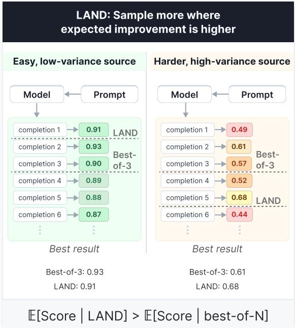
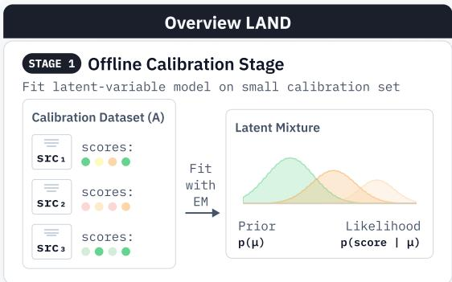
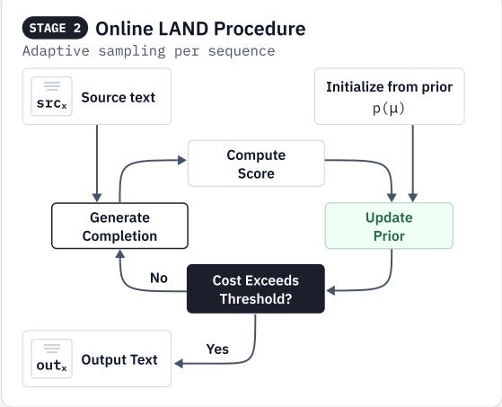
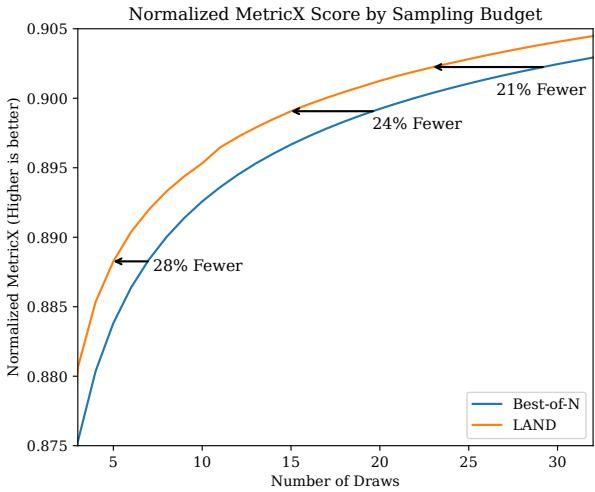
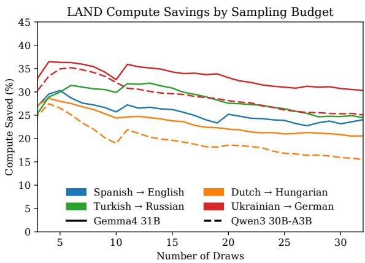

# LAND: Learning an Adaptive Number of Draws for Bayesian Best-of-N Selection

Koen Oostermeijer\*† and Teryn Jones

Aleph Alpha Research

Equal contribution

†Corresponding author: koen.oostermeijer@aleph-alpha-research.com

## Abstract

Best-of-N decoding improves generation quality by sampling multiple candidates and selecting the best, but it allocates equal compute to sources regardless of how much they benefit from additional sampling: the expected benefit is small for sources with low-variance score distributions and potentially much larger for those with high-variance distributions. To address this shortcoming, we propose LAND (Learning an Adaptive Number of Draws), which dynamically allocates samples according to their posterior-predictive marginal value. LAND learns a discrete empirical mixture of sourceconditioned score distributions from calibration data, updates its belief about a source as completion scores are observed, and stops sampling when the expected improvement of another draw falls below a shared compute price. Across machine-translation experiments with multiple models and language pairs, LAND achieves better MetricX scores than fixed bestof-N at matched average compute. Conversely, at matched translation quality, LAND requires approximately 20-40% fewer candidate generations. Adaptive allocation therefore provides a simple way to retain the benefits of best-of-N while substantially improving its compute efficiency.

## 1 Introduction

Model-generated data have become an increasingly important component of the training and finetuning of large language models (LLMs) (Long et al., 2024; Wang et al., 2023). A larger teacher model can generate training data for a smaller model, thereby transferring some of its capabilities through knowledge distillation. This approach has a long history in machine translation (MT), where sequence-level knowledge distillation uses translations generated by a teacher model as targets for a student model (Kim and Rush, 2016).

Historically, machine translation systems were trained primarily on naturally occurring parallel data collected from multilingual sources and subsequently filtered and aligned (Tiedemann, 2012). Synthetic data initially served mainly as a supplement to these corpora, most notably through back-translation of monolingual source texts (Sennrich et al., 2016; Edunov et al., 2018). Over time, however, the balance has shifted: as the quality of machine-translated data outpaced that of webcrawled corpora (Finkelstein et al., 2024), their share of the training data used by modern MT systems now constitutes an increasingly large fraction, in some cases completely replacing natural data (Finkelstein et al., 2026). As reliance on generated translations grows, selecting high-quality candidates becomes an increasingly important part of the data-generation pipeline.

One simple way to improve the quality of generated translations is to sample multiple candidates and retain the candidate with the highest score according to some quality metric, a technique referred to as best-of-N sampling. Previous work has shown that filtering data for quality-estimation metrics can result in improved downstream performance (Peter et al., 2023).

However, conventional best-of-N generates the same number of candidates for every source sentence. This allocation implicitly assumes that an additional sample is equally valuable for all source sentences. In practice, the distributions of candidate scores can differ substantially between source sentences. As illustrated in Figure 1, some intrinsically simple sentences consistently produce highscoring translations, such that additional sampling offers little added improvement, while others produce more variable candidates and may benefit considerably from further sampling. Given a collection of source sentences and a fixed generation budget, the relevant question is therefore not only how many candidates to generate, but also where additional candidates are most valuable. This motivates our central research question: how should a fixed generation budget be allocated across source sentences so that additional candidates are generated where they offer the greatest expected marginal improvement?

  
Figure 1: Fixed best-of-N always generates the same number of candidates for every source. However, higher overall scores can be achieved by allocating less compute to sources whose candidate scores are tightly concentrated and more compute to sources with highervariance score distributions, where additional draws offer greater potential for improvement.

We introduce LAND (Learning an Adaptive Number of Draws), an adaptive procedure that allocates generation compute according to the expected marginal improvement of additional candidates for each source sentence. A high-level overview of LAND is shown in Figure 2. LAND is related in spirit to Weitzman’s Pandora’s-box rule (Weitzman, 1978), which uses reservation values to balance the potential benefit of further search against its cost. Unlike the classical setting, however, the sourcespecific score distributions in our problem are unknown and each source sentence may be sampled repeatedly. LAND therefore updates a posterior over the score distribution after every observed candidate and adjusts its stopping threshold on the fly. To avoid imposing a restrictive parametric form, we estimate these distributions using a discrete empirical model constructed from observed scores.

In summary, our contributions are as follows:

• We formulate best-of-N selection as a compute-allocation problem in which the number of candidates may vary across source sentences under a shared average budget.

  
Figure 2: During calibration, LAND fits a discrete empirical mixture and calibrates a global compute price. At deployment, candidates are generated and scored sequentially, the posterior over source types is updated, and sampling continues while the expected improvement of another draw exceeds the compute price.

• We derive an oracle allocation rule that relates the decision to generate another candidate to its expected marginal improvement.

• We introduce LAND, a posterior-adaptive procedure that estimates this improvement online using a discrete empirical model of sourceconditioned score distributions.

• We evaluate LAND against fixed-allocation and adaptive baselines for machine translation under matched average generation budgets.

## 2 Related Work

## 2.1 Quality Filtering and Selection in Machine Translation

Quality-estimation metrics have been used both to select translation hypotheses and to filter training data. Fernandes et al. (2022) apply reference-free metrics to N-best reranking and minimum Bayes risk decoding, while Peter et al. (2023) use them to retain higher-quality parallel sentence pairs. For synthetic data, Xu et al. (2022) show that the usefulness of back-translated examples depends on both translation quality and example importance. Complementing quality-based filtering, Kocmi et al. (2025) prioritize difficult training examples. Related work also uses quality estimates to allocate computation: Cheng et al. (2025) selectively evaluate candidates from a fixed list, and Farinhas et al. (2025) defer low-quality translations to a larger model.

## 2.2 Bayesian Stopping and Adaptive Allocation

LAND shares similarities with Weitzman’s Pandora’s-box problem, in which costly alternatives with known reward distributions are inspected until further search is no longer worthwhile (Weitzman, 1978). This framework has subsequently been applied to settings such as cost-aware Bayesian optimization and adaptive LLM sampling (Xie et al., 2024). Related optimal-stopping approaches have also been proposed for LLM inference. Wan et al. (2025) introduce BEACON, which models each prompt’s reward distribution as Gaussian and applies a Bayesian finite-horizon stopping rule, whereas Kalayci et al. (2025) learn an unknown Weitzman threshold using upper confidence bounds.

More broadly, LAND is related to Bayesian adaptive-allocation methods such as Thompson sampling (William, 1933), which use posterior uncertainty to allocate observations sequentially rather than committing the same sampling budget to every alternative.

AdaBoN (Raman et al., 2025) also studies adaptive Best-of-N allocation, but is designed for batched allocation with relatively large exploration budgets. Since LAND targets sequential stopping in a substantially lower-budget regime, we consider the methods complementary rather than directly comparable.

LAND differs from these approaches in both how it models uncertainty and how it allocates compute. It learns a discrete empirical mixture of source-conditioned score distributions and updates a posterior over source types as candidates are observed. Rather than treating each source independently with a fixed sampling cost, LAND uses a shared compute price to allocate a fixed average generation budget toward sources with the greatest posterior-predictive marginal value of additional draws.

## 3 Problem Formulation

We consider a set of source texts and a fixed compute budget for generating completions. For each source text, an LLM generates one or more candidates, from which the highest-scoring completion is selected. Metrics that assign lower scores to better candidates are transformed so that higher values consistently correspond to better completions. The budget is specified by a target expected number of completions per source text, $N ,$ although in practice we allow the realized average to differ slightly due to finite-sample effects.

Our goal is to determine how to allocate the available compute across source texts so as to maximize the average score of the selected completions.

Applying the scoring function to the distribution of generated candidates induces a corresponding distribution over quality scores. Each source text has a latent mean score $\mu ,$ defined as the expected score of a completion generated for that source text. Across source texts, these means follow the distribution

$$
\mu \sim \mathcal { D } _ { \mathrm { d } } ,\tag{1}
$$

whose expectation value $\mathbb { E } [ \mu ]$ is the score associated with the best-of-1 baseline, i.e. the average score obtained when exactly one completion is generated per source text.

Conditional on $\mu ,$ the score X of an individual completion follows a distribution

$$
X \sim { \mathcal { D } } _ { \mathrm { c } } \left( \cdot \mid \mu , \sigma ^ { 2 } ( \mu ) \right) ,\tag{2}
$$

where $\sigma ^ { 2 } ( \mu )$ captures variation among completions generated for the same source text, which may depend on the latent mean $\mu$ .

## 4 Budget Allocation

Rather than generating a fixed number of candidates for every source text, i.e. best-of-N, our strategy is to sample until the score exceeds a sourcespecific threshold. These thresholds are optimized to maximize the average selected score subject to an expected sampling budget of N completions per source text.

In the following we will derive an allocation rule assuming that $\mu$ is known, which is not the case in practice, as this is a latent variable; we relax this assumption in the following section.

For a source text with mean score $\mu ,$ let $\{ X _ { 1 } , X _ { 2 } , \ldots \}$ be independent draws from the conditional score distribution $\mathcal { D } _ { \mathrm { c } } ( \cdot \mid \mu )$ , with probability density function $f _ { \mu }$ and cumulative distribution function $F _ { \mu }$ . We define the stopping time K as the number of samples it takes to exceed the threshold $\lambda ( \mu )$ . Since each draw has a probability of $1 - F _ { \mu } ( \lambda ( \mu ) )$ to exceed the threshold, K follows a geometric distribution with expectation value

$$
\mathbb { E } [ K \mid \mu ] = { \frac { 1 } { 1 - F _ { \mu } ( \lambda ( \mu ) ) } } .\tag{3}
$$

Because the sampling process is halted when the stopping condition is met, the final score $X _ { K }$ is also the one corresponding to the selected completion. Its expected value is the threshold plus the expected overshoot:

$$
\begin{array} { c } { { \mathbb { E } [ X _ { K } \mid \mu ] = \lambda + \mathbb { E } \left[ X - \lambda | X > \lambda , \mu \right] } } \\ { { = \mathbb { E } \left[ X | X > \lambda , \mu \right] . } } \end{array}\tag{4}
$$

(5)

The optimal threshold function maximizes the expected selected score across source texts, subject to an average sampling budget of N:

$$
\begin{array} { l } { \displaystyle \operatorname* { m a x } _ { \lambda ( \cdot ) } \mathbb { E } _ { \mu } \left[ \mathbb { E } \left[ X | X > \lambda ( \mu ) , \mu \right] \right] } \\ { \displaystyle \mathrm { s u b j e c t } \mathrm { t o } \mathbb { E } _ { \mu } \left[ \frac { 1 } { 1 - F _ { \mu } \left( \lambda ( \mu ) \right) } \right] = N . } \end{array}\tag{6}
$$

As derived in Appendix A, the optimal threshold satisfies

$$
H _ { \mu } ( \lambda ) \equiv \mathbb { E } \left[ \left. \left( X - \lambda ( \mu ) \right) _ { + } \right| \mu \right] = \Lambda ,\tag{7}
$$

where $( z ) _ { + } \equiv \operatorname* { m a x } ( z , 0 )$ denotes the positive part of z. Thus, the left-hand side is the expected improvement of one additional draw over the current threshold. The global constant Λ is chosen so that the average-budget constraint holds. The optimal policy therefore equalizes the expected marginal improvement across source texts.

## 5 Posterior-Adaptive Allocation

The optimal allocation derived above assumes access to the latent source-specific mean $\mu .$ In practice, $\mu$ is unknown and must be inferred from the completion scores observed during sampling. We therefore maintain a posterior distribution over µ and update the stopping rule after each generated completion.

Let $\mathcal { X } _ { t } \equiv \{ X _ { 1 } , \ldots , X _ { t } \}$ denote the scores observed after t draws for a given source text, and let

$$
q _ { t } ( \mu ) \equiv p ( \mu \mid \mathcal { X } _ { t } )\tag{8}
$$

be the corresponding posterior over its latent mean. Before observing any completions, this posterior is initialized as the population-level prior from Equation 1,

$$
q _ { 0 } ( \mu ) = P _ { \mathrm { d } } ( \mu ) .\tag{9}
$$

Then, after observing a new score $X _ { t + 1 }$ , Bayes’ rule gives

$$
q _ { t + 1 } ( \mu ) = \frac { f _ { \mu } ( X _ { t + 1 } ) q _ { t } ( \mu ) } { \int \mathrm { d } \mu ^ { \prime } f _ { \mu ^ { \prime } } ( X _ { t + 1 } ) q _ { t } ( \mu ^ { \prime } ) }\tag{10}
$$

where $f _ { \mu }$ is the conditional score density for a source text with mean $\mu$

The expected-improvement function is averaged over this posterior:

$$
\begin{array} { l } { \displaystyle \widehat { H } _ { t } ( \lambda ) \equiv \int \mathrm { d } \mu q _ { t } ( \mu ) H _ { \mu } ( \lambda ) } \\ { \displaystyle = \mathbb { E } \left[ \left. \left( X _ { t + 1 } - \lambda \right) _ { + } \right| \mathcal { X } _ { t } \right] . } \end{array}\tag{11}
$$

(12)

Thus, $\widehat { H } _ { t } ( \lambda )$ is the expected improvement of one additional draw over a current score λ.

Let $B _ { t } \equiv \operatorname* { m a x } _ { 1 \leq i \leq t } X _ { i }$ be the best score observed so far. The optimal policy is to continue sampling whenever it exceeds the global compute cost Λ:

$$
\widehat { H } _ { t } ( B _ { t } ) > \Lambda .\tag{13}
$$

Equivalently, we may define an adaptive threshold $\lambda _ { t }$ by

$$
\widehat { H } _ { t } ( \lambda _ { t } ) = \Lambda .\tag{14}
$$

The procedure continues while $B _ { t } < \lambda _ { t }$ . Unlike the previous threshold $\lambda ( \mu )$ , the adaptive threshold $\lambda _ { t }$ changes as new scores are observed. Each completion updates both the best score $B _ { t }$ and the posterior belief about the source-specific score distribution, allowing the stopping decision to adapt online.

## 6 Practical Implementation

The practical implementation of LAND starts by estimating the score distributions using a small calibration set. We first rescale all scores to the interval [0, 1], with larger values denoting better completions. These scores are then partitioned into J cells, with each cell $j$ assigned a representative value $v _ { j }$ . The boundaries of these cells are initialized using the quantiles of these calibration scores, which provides greater resolution in densely populated regions of the score distribution.

We model variation across source texts using a mixture of I latent source distributions. We do not assume that source variation is fundamentally discrete. Rather, this is a finite approximation to continuous population heterogeneity while reducing posterior updates and expected-improvement calculations to finite sums. Each type i has prior probability

$$
\pi _ { i } = \operatorname* { P r } ( z = i ) ,\tag{15}
$$

and a categorical distribution over score cells,

$$
p _ { i j } = \mathrm { P r } ( X { \mathrm { ~ f a l l s ~ i n ~ c e l l ~ } } j | z = i ) .\tag{16}
$$

Here, z denotes the latent source type and X denotes the score of a generated completion. This discretized distribution greatly simplifies calculations and avoids imposing a restrictive parametric form on the source-conditioned score distributions. In particular, we found that parametric families such as (truncated) Gaussian or Beta distributions often impose inaccurate assumptions about tail behavior, which can substantially distort LAND’s cost allocation policy.

Since the latent source types are not observed, we fit the mixture using expectation-maximization (EM). Suppose the calibration set contains $L$ source texts. For source $\ell ,$ let $n _ { \ell j }$ denote the number of observed completion scores that fall in cell $j ,$ , and let

$$
n _ { \ell } = \sum _ { j = 1 } ^ { J } n _ { \ell j } .\tag{17}
$$

EM estimates the model parameters by maximizing the marginal log-likelihood of the observed data:

$$
\mathcal { L } = \sum _ { \ell = 1 } ^ { L } \log \left[ \sum _ { i = 1 } ^ { I } \pi _ { i } \prod _ { j = 1 } ^ { J } p _ { i j } ^ { n _ { \ell j } } \right] .\tag{18}
$$

After fitting the mixture, we use it to initialize the stopping thresholds: For a source of latent type i, the expected improvement from one additional draw over a current best score b is computed as

$$
H _ { i } ( b ) = \sum _ { j = 1 } ^ { J } p _ { i j } ( v _ { j } - b ) _ { + } .\tag{19}
$$

During sampling, each component-specific expected improvement is weighted by the posterior probability that the source belongs to the corresponding latent type. These weights are initialized as the population mixture weights, $q _ { 0 , i } = \pi _ { i }$ . After observing a completion score $x _ { t + 1 }$ in cell $c ( x _ { t + 1 } )$ the posterior is updated as

$$
q _ { t + 1 , i } = \frac { q _ { t , i } p _ { i , c ( x _ { t + 1 } ) } ^ { \tau } } { \sum _ { k = 1 } ^ { I } q _ { t , k } p _ { k , c ( x _ { t + 1 } ) } ^ { \tau } } ,\tag{20}
$$

where $\tau \in ( 0 , 1 ]$ is a likelihood-tempering parameter. The standard Bayesian update is recovered when $\tau = 1$ . We use tempering to prevent the posterior from becoming overly concentrated after only a small number of observations.

Let $B _ { t }$ denote the best score observed after t draws. The posterior-predictive expected improvement of one additional draw is

$$
\widehat { H } _ { t } ( B _ { t } ) = \sum _ { i = 1 } ^ { I } q _ { t , i } H _ { i } ( B _ { t } ) .\tag{21}
$$

LAND continues sampling whenever this expected improvement exceeds the global compute price $\Lambda .$ In addition, we impose a maximum number of draws per source text of $K _ { \mathrm { m a x } }$ to bound the worst-case allocation.

## 6.1 Calibrating Λ

The global cost limit Λ is calibrated by replaying the complete posterior-adaptive policy on a heldout set of calibration trajectories. For a candidate value of $\Lambda ,$ , each trajectory is processed using the same posterior updates, running maximum draw rule, and sampling cap used at deployment. If $K _ { \ell } ( \Lambda )$ denotes the resulting number of draws for replay source $\ell ,$ the estimated average compute is set to equal N:

$$
\frac { 1 } { L _ { \mathrm { r e p l a y } } } \sum _ { \ell = 1 } ^ { L _ { \mathrm { r e p l a y } } } K _ { \ell } ( \Lambda ) \approx N .\tag{22}
$$

This is to ensure the policy captures posterior transitions and stopping behavior as closely as possible.

Finally, to correct for any residual calibration error or potential distribution shift, we update Λ after each batch of completed source texts. Let $\overline { { K } } _ { m }$ be the average number of draws in batch m. We apply the log-space update

$$
\log \Lambda _ { m + 1 } = \log \Lambda _ { m } + \eta \frac { \overline { { { K } } } _ { m } - N } { N } .\tag{23}
$$

Algorithm 1 LAND with a discrete empirical mix  
ture   
Require: Mixture-fit trajectories ${ \mathcal { C } } _ { \mathrm { f i t } }$ , replay tra  
jectories $\mathcal { C } _ { \mathrm { r e p l a y } }$ , target budget N, tempering $\tau ,$   
cap $K _ { \mathrm { m a x } }$   
1: Construct score cells and representatives   
$\{ v _ { j } \} _ { j = 1 } ^ { J }$   
2: Fit $\{ \bar { \pi } _ { i } , p _ { i j } \}$ on ${ \mathcal { C } } _ { \mathrm { f i t } }$ using EM   
3: Compute $\begin{array} { r } { \dot { H } _ { i } ( b ) = \sum _ { j } p _ { i j } ( v _ { j } - b ) _ { + } } \end{array}$   
4: Calibrate Λ on $\mathcal { C } _ { \mathrm { r e p l a y } }$   
5: for each deployment source s do   
6: $q _ { i }  \pi _ { i } , B  - \infty , K  0$   
7: repeat   
8: Generate and score one completion x   
9: $K \gets K + 1 , B \gets \operatorname* { m a x } ( B , x )$   
10: $q _ { i }  q _ { i } p _ { i , c ( x ) } ^ { \tau } / \sum _ { k } q _ { k } p _ { k , c ( x ) } ^ { \tau }$   
11: until $K \geq K _ { \operatorname* { m a x } }$ or $\begin{array} { r } { \sum _ { i } q _ { i } { H _ { i } } ( \dot { B } ) \le \Lambda } \end{array}$   
12: Return the highest-scoring observed com  
pletion   
13: Add $K$ to the current update batch   
14: if the update batch is full then   
15: Update Λ using the batched log-space   
rule   
16: end if   
17: end for

When the realized number of completions exceeds the target budget, the update increases Λ and makes further sampling less likely, and vice versa when the realized number falls below the target.

## 6.2 Complete LAND Procedure

The preceding subsections describe the individual components of LAND: fitting the discrete empirical mixture, updating the posterior over latent source types, estimating the posterior-predictive value of another draw, and calibrating the global compute price. The procedure is sequential: once LAND stops sampling a source and moves to the next source, that source is not revisited. Algorithm 1 summarizes how these components are combined into the complete procedure. The mixture model and initial value of Λ are estimated during calibration. At deployment, each newly observed completion updates both the current best score and the posterior over source types, and sampling continues only while the posterior-predictive expected improvement justifies its compute cost, subject to the maximum-draw constraint.

## 7 Results

We evaluate LAND on source sentences drawn from the OPUS parallel corpus. (Tiedemann, 2012) We use only the source side of each selected sentence pair and generate new translations with the evaluated model; the original target sentences are not used as generation targets. Using Gemma4 31B, (Gemma Team, 2026) we consider four translation directions: Ukrainian→German, Spanish→English, Dutch→Hungarian, and Turkish→Russian. Translation quality is evaluated with reference-free Metri $\mathrm { { \cdot X ^ { 1 } } }$ (Juraska et al., 2024). For each translation direction and target budget $N _ { \ast }$ , we separately tune the sampling cap $K _ { \mathrm { m a x } }$ and tempering parameter τ using the corresponding mixture-fit and replay trajectories. We evaluate average sampling budgets up to $N = 3 2$ and compare LAND against fixed bestof-N selection at each budget. Using MetricX for both selection and evaluation is intentional: LAND addresses how efficiently a given filtering objective can be optimized, rather than whether that objective improves downstream model training. The utility of QE-based filtering for MT data has been established independently by prior work (Peter et al., 2023).

Figure 3 shows the normalized MetricX score as a function of the sampling budget, averaged across the four Gemma4 language pairs. LAND consistently achieves higher translation quality than fixed best-of-N at the same number of draws. Equivalently, LAND reaches the same MetricX score with substantially fewer candidate generations. At the operating points highlighted in the figure, LAND matches the performance of fixed best-of-N while using approximately 20-30% fewer draws. Although the relative savings are largest at lower budgets, they remain substantial throughout the evaluated range.

Figure 4 reports the candidate-generation savings separately for each translation direction. In addition to the four Gemma4 31B experiments, we evaluate Ukrainian→German and Dutch→Hungarian using Qwen3 30B-A3B (Qwen Team, 2025). The savings are computed relative to fixed best-of-N at matched MetricX performance. Across models, language pairs, and sampling budgets, LAND reduces the required number of completions by approximately 20-40%.

Figure 3: Normalized MetricX score as a function of the number of draws, averaged over the four Gemma4 31B translation directions. LAND reaches the same translation quality as fixed best-of-N using approximately 20-30% fewer draws at the highlighted operating points.  
  
Figure 4: Candidate-generation savings of LAND relative to fixed best-of-N at matched MetricX performance. LAND reduces the number of required draws across all evaluated language pairs and sampling budgets.

The magnitude of the savings varies across translation directions. Ukrainian→German exhibits the largest and most consistent reductions in compute, while Dutch→Hungarian generally shows smaller gains, especially for Qwen3 30B-A3B at larger budgets. Nevertheless, LAND provides positive candidate-generation savings across all evaluated settings.

LAND targets an average budget of N rather than enforcing this exactly. The adaptive computeprice update nevertheless keeps the realized budget very close to its target: across the six evaluated model-language settings, the mean absolute deviation from N ranges from 0.01 to 0.04 draws. Across repeated runs on the same data with different random orderings, the standard deviation of the resulting draw savings is approximately 0.8-1.5 percentage points across the evaluated settings.

Overall, these results show that allocating the same number of candidates to every source sentence is inefficient. By directing additional samples toward source sentences for which they have greater posterior-predictive value, LAND preserves the quality gains of best-of-N while substantially reducing generation cost.

## 7.1 Comparison to BEACON

Finally, we compare LAND against BEA-CON (Wan et al., 2025), a Bayesian adaptivesampling method that models the reward distribution for each source as Gaussian and updates its parameters online. In our experiments, BEACON underperforms fixed best-of-N, requiring more compute to reach the same average MetricX score for all sampling budgets, language pairs, and generation models considered. This seems to indicate that its stopping rule is not well suited to the score distributions encountered in this setting. One possible explanation is the Gaussian modeling assumption: the source-conditioned MetricX distributions can exhibit shapes that are poorly captured by a single parametric distribution. LAND’s performance similarly suffered under this modeling assumption. A second possible factor is that BEACON must infer the reward distribution of a new source from the small number of samples observed for that source, while LAND can exploit population-level structure learned across calibration sources. However, we have not isolated the contribution of these differences, and a more detailed investigation would be required to determine the cause of BEACON’s underperformance in this setting.

## 8 Conclusion and Limitations

We introduced LAND, an adaptive alternative to fixed best-of-N sampling that allocates generation compute according to the posterior-predictive value of additional candidates. Rather than committing to the same number of draws for every source, LAND uses observed completion scores to update its belief about the source-specific score distribution and continues sampling only when the expected improvement of another draw exceeds a global compute price. A discrete empirical mixture provides a flexible approximation to the population of sourceconditioned score distributions, while replay-based calibration allows the resulting policy to satisfy a prescribed average generation budget.

Across the machine-translation settings considered in this work, LAND consistently improves the compute-quality trade-off relative to fixed best-of-N. At matched average compute, adaptive allocation yields better translation quality; conversely, at matched MetricX performance, LAND reduces the required number of candidate generations by approximately 20-40% across the evaluated models, language pairs, and sampling budgets. These results indicate that a substantial fraction of bestof-N compute can be saved simply by reallocating samples toward more promising sources.

Although our experiments focus on machine translation, the formulation of LAND is not specific to translation. The method applies whenever multiple candidate outputs can be sampled for the same input, evaluated with a continuous scalar reward, and compared to select the best candidate. It therefore extends directly to other best-of-N settings, although performance will depend on the informativeness of the chosen score. Our current experiments validate LAND only with MetricX, on a limited set of model families, and in machine translation. Future work will test alternative metrics, additional model families and scales, and other generation tasks equipped with continuous reward or quality scores.

Some limitations remain. First, LAND requires calibration data containing multiple completion scores per source in order to estimate the empirical mixture and calibrate the compute price. This introduces an upfront cost that fixed best-of-N does not require and may be undesirable when only a small dataset is to be generated. Second, the fitted score-distribution model remains fixed during deployment. Although LAND updates its posterior for each individual source and adjusts the compute price Λ to control the realized average budget, it does not use the completion scores collected across previously processed deployment sources to refine the empirical mixture itself. Consequently, additional information acquired during deployment is unused. Extending LAND to periodically update its mixture parameters from newly observed scores could reduce its dependence on an initial calibration set and allow it to adapt to distribution shift over time. And finally, we use the number of candidate generations as a proxy for compute. Since generations can differ in length and execution cost, the reported reduction in draws need not translate

one-to-one into wall-clock or hardware savings.   
We leave this to future work.

## References

Julius Cheng, Maike Züfle, Vilém Zouhar, and Andreas Vlachos. 2025. A Bayesian optimization approach to machine translation reranking. In Proceedings of the 2025 Conference ofthe Nations ofthe Americas Chapter of the Association for Computational Linguistics: Human Language Technologies (Volume 1: Long Papers), pages 2849–2862, Albuquerque, New Mexico.

Sergey Edunov, Myle Ott, Michael Auli, and David Grangier. 2018. Understanding back-translation at scale. In Proceedings of the 2018 Conference on Empirical Methods in Natural Language Processing, pages 489–500, Brussels, Belgium.

António Farinhas, Nuno M Guerreiro, Sweta Agrawal, Ricardo Rei, and Andre Martins. 2025. Translate smart, not hard: Cascaded translation systems with quality-aware deferral. In Proceedings of the 2025 Conference on Empirical Methods in Natural Language Processing, pages 26742–26756, Suzhou, China.

Patrick Fernandes, António Farinhas, Ricardo Rei, José G. C. de Souza, Perez Ogayo, Graham Neubig, and Andre Martins. 2022. Quality-aware decoding for neural machine translation. In Proceedings of the 2022 Conference of the North American Chapter of the Association for Computational Linguistics: Human Language Technologies, pages 1396–1412, Seattle, United States.

Mara Finkelstein, Isaac Caswell, Tobias Domhan, Jan-Thorsten Peter, Juraj Juraska, Parker Riley, Daniel Deutsch, Geza Kovacs, Cole Dilanni, Colin Cherry, et al. 2026. Translategemma technical report. arXiv preprint arXiv:2601.09012.

Mara Finkelstein, David Vilar, and Markus Freitag. 2024. Introducing the NewsPaLM MBR and QE dataset: LLM-generated high-quality parallel data outperforms traditional web-crawled data. In Proceedings ofthe Ninth Conference on Machine Translation, pages 1355–1372, Miami, Florida, USA.

Gemma Team. 2026. Gemma 4 technical report. arXiv preprint arXiv:2607.02770.

Juraj Juraska, Daniel Deutsch, Mara Finkelstein, and Markus Freitag. 2024. MetricX-24: The Google submission to the WMT 2024 metrics shared task. In Proceedings ofthe Ninth Conference on Machine Translation, pages 492–504, Miami, Florida, USA.

Yusuf Kalayci, Vinod Raman, and Shaddin Dughmi. 2025. Optimal stopping vs best-of-n for inference time optimization. arXiv preprint arXiv:2510.01394.

Yoon Kim and Alexander M. Rush. 2016. Sequencelevel knowledge distillation. In Proceedings of the 2016 Conference on Empirical Methods in Natural Language Processing, pages 1317–1327, Austin, Texas.

Tom Kocmi, Arkady Arkhangorodsky, Alexandre Berard, Phil Blunsom, Samuel Cahyawijaya, Théo Dehaze, Marzieh Fadaee, Nicholas Frosst, Matthias Galle, Aidan Gomez, Nithya Govindarajan, Wei-Yin Ko, Julia Kreutzer, Kelly Marchisio, Ahmet Üstün, Sebastian Vincent, and Ivan Zhang. 2025. Commanda-translate: Raising the bar of machine translation with difficulty filtering. In Proceedings of the Tenth Conference on Machine Translation, pages 789–799, Suzhou, China.

Lin Long, Rui Wang, Ruixuan Xiao, Junbo Zhao, Xiao Ding, Gang Chen, and Haobo Wang. 2024. On LLMs-driven synthetic data generation, curation, and evaluation: A survey. In Findings of the Association for Computational Linguistics: ACL 2024, pages 11065–11082, Bangkok, Thailand.

Jan-Thorsten Peter, David Vilar, Daniel Deutsch, Mara Finkelstein, Juraj Juraska, and Markus Freitag. 2023. There’s no data like better data: Using QE metrics for MT data filtering. In Proceedings of the Eighth Conference on Machine Translation, pages 561–577, Singapore.

Qwen Team. 2025. Qwen3 technical report. Preprint, arXiv:2505.09388.

Vinod Raman, Hilal Asi, and Satyen Kale. 2025. Ad abon: Adaptive best-of-n alignment. arXiv preprint arXiv:2505.12050.

Rico Sennrich, Barry Haddow, and Alexandra Birch. 2016. Improving neural machine translation models with monolingual data. In Proceedings of the 54th Annual Meeting ofthe Associationfor Computational Linguistics (Volume 1: Long Papers), pages 86–96, Berlin, Germany.

Jörg Tiedemann. 2012. Parallel data, tools and interfaces in OPUS. In Proceedings of the Eighth International Conference on Language Resources and Evaluation (LREC’12), pages 2214–2218, Istanbul, Turkey. European Language Resources Association (ELRA).

Guangya Wan, Zixin Stephen Xu, Sasa Zorc, Manel Baucells, Mengxuan Hu, Hao Wang, and Sheng Li. 2025. Beacon: Bayesian optimal stopping for efficient llm sampling. arXiv preprint arXiv:2510.15945.

Yizhong Wang, Yeganeh Kordi, Swaroop Mishra, Alisa Liu, Noah A. Smith, Daniel Khashabi, and Hannaneh Hajishirzi. 2023. Self-instruct: Aligning language models with self-generated instructions. In Proceedings ofthe 61st Annual Meeting ofthe Associationfor Computational Linguistics (Volume 1: Long Papers), pages 13484–13508, Toronto, Canada.

Martin Weitzman. 1978. Optimal search for the best alternative, volume 78. Department of Energy.

R Thompson William. 1933. On the likelihood that one unknown probability exceeds another in view of the evidence of two samples. Biometrika, 25(3/4):285– 294.

Qian Xie, Raul Astudillo, Peter I Frazier, Ziv Scully, and Alexander Terenin. 2024. Cost-aware bayesian optimization via the pandora’s box gittins index. Advances in Neural Information Processing Systems, 37:115523–115562.

Jiahao Xu, Yubin Ruan, Wei Bi, Guoping Huang, Shuming Shi, Lihui Chen, and Lemao Liu. 2022. On synthetic data for back translation. In Proceedings of the 2022 Conference of the North American Chapter of the Associationfor Computational Linguistics: Human Language Technologies, pages 419–430, Seattle, United States.

## Appendix

## A Derivation of the Allocation Rule

To solve the optimization problem from Equation 10, define

$$
C _ { \mu } ( \lambda ) \equiv \mathbb { E } [ K | \mu ] ,\tag{24}
$$

$$
G _ { \mu } ( \lambda ) \equiv \mathbb { E } [ X _ { K } \mid \mu ] = { \frac { \int _ { \lambda } ^ { \infty } \mathrm { d } x x f _ { \mu } ( x ) , } { 1 - F _ { \mu } ( \lambda ) } } .\tag{25}
$$

Setting the constraint via a Lagrange multiplier Λ results in the functional

$$
\mathcal { L } [ \lambda ] = \mathbb { E } _ { \mu } \left[ G _ { \mu } ( \lambda ( \mu ) ) \right] - \Lambda \left( \mathbb { E } _ { \mu } \left[ C _ { \mu } ( \lambda ( \mu ) ) \right] - N \right) .\tag{26}
$$

The corresponding first-order condition is

$$
\frac { \delta \mathcal { L } } { \delta \lambda ( \mu ) } = G _ { \mu } ^ { \prime } ( \lambda ( \mu ) ) - \Lambda C _ { \mu } ^ { \prime } ( \lambda ( \mu ) ) = 0 ,\tag{27}
$$

where

$$
G _ { \mu } ^ { \prime } ( \lambda ) = \frac { f _ { \mu } ( \lambda ) } { 1 - F _ { \mu } ( \lambda ) } ( G _ { \mu } ( \lambda ) - \lambda ) ,\tag{28}
$$

$$
C _ { \mu } ^ { \prime } ( \lambda ) = \frac { f _ { \mu } ( \lambda ) } { ( 1 - F _ { \mu } ( \lambda ) ) ^ { 2 } } .\tag{29}
$$

This yields the equation

$$
\Lambda = ( 1 - F _ { \mu } ( \lambda ) ) ( G _ { \mu } ( \lambda ) - \lambda )\tag{30}
$$

$$
= \int _ { \lambda } ^ { \infty } \mathrm { d } x ( x - \lambda ) f _ { \mu } ( x )\tag{31}
$$

$$
= \mathbb { E } [ ( X - \lambda ( \mu ) ) _ { + } | \mu ]\tag{32}
$$