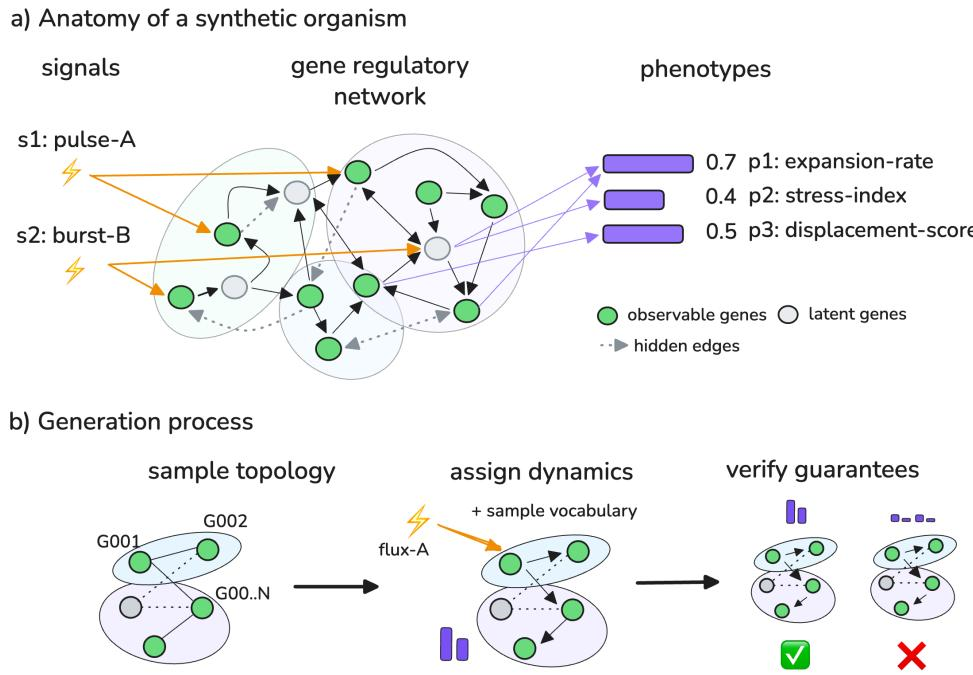
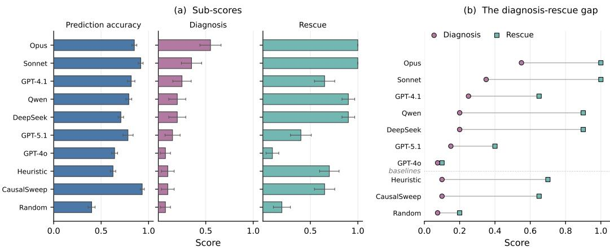
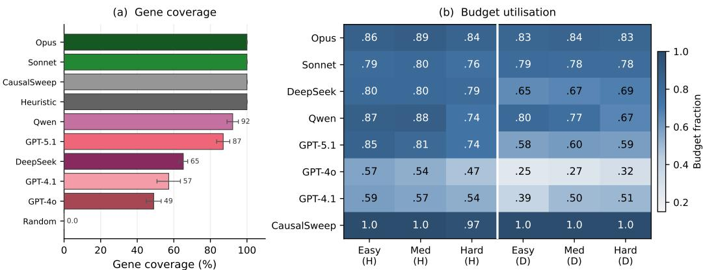
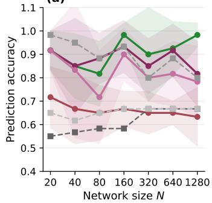
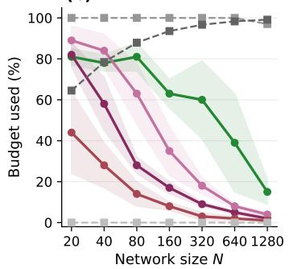
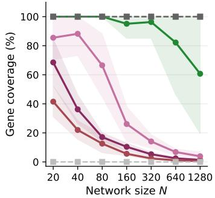
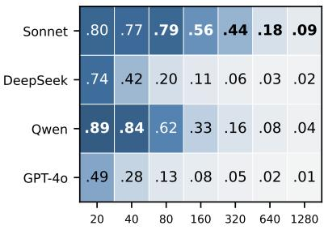
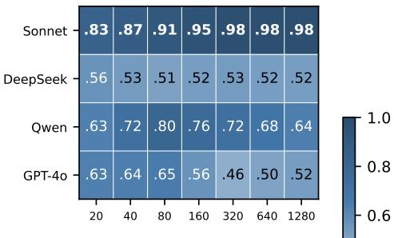
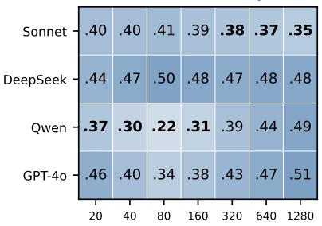
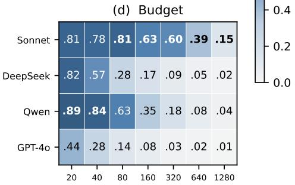

# LUCA: A Synthetic World for Experimental Reasoning

Anna Gogleva\* Thomas Charman Martin Balla Karl Gemayel Relation Therapeutics anna.gogleva@relationrx.com

## Abstract

An experimental agent can succeed for the wrong reasons. Evaluations, however, often focus on the outcome, not the experiments, evidence, and inferences that produced it. We introduce LUCA, a configurable synthetic world for evaluating this process under fully known ground truth. Agents learn unknown regulatory systems through budgeted experimentation, then predict unseen interventions, diagnose hidden faults, and attempt rescues. This setup allows us to evaluate experiment selection, prediction, diagnosis, and intervention separately.

Across seven frontier LLMs and three baselines, these capabilities dissociate sharply. Agents frequently rescue malfunctioning systems while diagnosing the wrong fault; diagnosis varies 7× across models while prediction varies only 1.4×. Models also adopt surprisingly different experimental strategies, and greater exploration does not reliably yield better performance. In one failure mode, agents often perform the experiment needed to distinguish competing causes, but still fail to use the resulting evidence. LuCA turns these hidden failures into measurable behaviours, providing a controlled environment to study where experimental agents succeed and fail. Code: https://github.com/RelationRx/luca.

## 1 Introduction

Experiments allow us to understand how systems work. This requires deciding what to test, how to interpret the evidence and how to use it to make predictions, how to diagnose problems, or choose interventions [Boiko et al., 2023, Lu et al., 2026]. However, a successful outcome does not necessarily imply a sound understanding: an agent may find an effective intervention while holding an incomplete or incorrect view of the system.

Evaluating these stages separately is difficult with existing frameworks. Interactive-agent benchmarks (AgentBench [Liu et al., 2024], WebArena [Zhou et al., 2024]) score sequential action and feedback, discovery environments (DiscoveryWorld [Jansen et al., 2024], DiscoveryBench [Majumder et al., 2025], ScienceAgentBench [Chen et al., 2025]) score what an agent achieves, and causal-discovery benchmarks (CausaLab [Yang et al., 2026], CausalBench [Chevalley et al., 2025]) score what it recovers about structure, with CausaLab also scoring a held-out prediction. Each of these approaches scores part of this process rather than the whole chain from experiment choice to inference to action. In real systems, the underlying mechanism and the relevant counterfactuals are rarely known well enough to score all of these stages directly.

We introduce LUCA, named after the Last Universal Common Ancestor [Weiss et al., 2016], a configurable synthetic world for evaluating this experimental process. An LLM agent learns an unknown dynamical system by perturbing it under a fixed experimental budget and observing downstream readouts. The agent is then tested on unseen intervention outcomes. In malfunctioning systems, it also must diagnose a hidden fault before attempting a rescue. Because the complete system is known to the evaluator, prediction, diagnosis, rescue, and experimental strategy can be scored separately and deterministically. The commitment-before-rescue design further prevents agents from using a successful rescue to reverse-engineer their diagnosis.

Inspired by experimental biology, LuCA instantiates its systems as synthetic regulatory networks, using gene regulatory structure as a template for a general synthetic world rather than attempting to simulate cellular biology realistically. Perturbations propagate through interacting variables, effects are nonlinear, components can be hidden, and compensatory interventions can succeed without identifying the original fault. Synthetic construction gives us direct control over these properties and complete access to the mechanism and its counterfactuals. All entity names are invented, so memorised biology cannot substitute for experimentation.

Across seven frontier LLMs, LUCA reveals substantial reasoning differences hidden by task success. Agents frequently rescue malfunctioning systems while diagnosing the wrong fault. In a scaling study across four of these models, agents reach similar accuracy from amounts of evidence that differ by more than an order of magnitude.

## Contributions.

• LUCA, a configurable synthetic environment that exposes the experimental trajectory and separately evaluates experimental strategy, prediction, diagnosis, and intervention.

• An evaluation of seven frontier LLM agents showing a systematic dissociation between successful intervention and correct diagnosis.

• An analysis of experimental strategy and scaling showing large behavioural differences between agents, including some that reach comparable accuracy from very different amounts of evidence.

## 2 Benchmark Design

LUCA represents each unknown system as a synthetic organism that an agent can probe through interventions and observations. The benchmark has two components: the construction of these organisms and the interactive tasks through which agents experiment with them.

## 2.1 Synthetic Organism Design

Each organism is built around a synthetic gene regulatory network (GRN) with N genes organised into M functional modules. External signals can drive gene states directly. Together, gene interactions and signals determine a set of observable phenotypes, the high-level outputs of the organism. Organisms can additionally be placed in a disease mode, in which one gene or signal is locked into an abnormal state and perturbs downstream phenotypes. Figure 1 shows the anatomy and the generation process.

To simulate the organism, gene states evolve via a sigmoid update rule [Mjolsness et al., 1991, Karlebach and Shamir, 2008]:

$$
s _ { i } \gets \sigma \left( \beta \left( \sum _ { j = 1 } ^ { N } w _ { i j } s _ { j } + c _ { i } + b _ { i } \right) \right) + \varepsilon _ { i } , \qquad \sigma ( x ) = \frac { 1 } { 1 + e ^ { - x } } .\tag{1}
$$

Here $s _ { i } \in [ 0 , 1 ]$ is the state of gene $i , w _ { i j }$ are regulatory weights (positive for activation, negative for inhibition), $b _ { i }$ is a gene-specific bias, and $c _ { i }$ is the summed contribution of active external signals targeting gene i. The steepness parameter $\beta$ controls how nonlinear the dynamics are, and $\varepsilon _ { i } \sim \mathcal { N } ( 0 , \bar { \sigma } ^ { 2 } )$ adds per-gene measurement noise (see Table 1). The network is iterated to a fixed point.

Invented vocabulary. All entity labels (gene identifiers, module names, signal names, phenotype names) are drawn from a fixed lexicon of constructed words with no correspondence to real biological entities, eliminating the retrieval confound. For example, genes are labelled G001, G002, ... and phenotypes appear as stress-index or displacement-score, constructed terms absent from any biological database.

Difficulty tiers. Organisms are generated at three difficulty tiers (Table 1). We vary edge density, feed-forward loops, feedback edges, sigmoid steepness, and latent gene fraction. Easy organisms have near-linear dynamics with no hidden variables; hard organisms have dense feedback and 25% latent genes acting as hidden confounders. All parameters scale with N.

Table 1: Difficulty tier definition.
<table><tr><td></td><td>Easy</td><td>Medium</td><td>Hard</td></tr><tr><td colspan="4">Generative parameters (fxed per tier)</td></tr><tr><td>Observability</td><td>0.80</td><td>0.60</td><td>0.50</td></tr><tr><td>Intra-module edge density</td><td>0.25</td><td>0.40</td><td>0.50</td></tr><tr><td>Inter-module edge density</td><td>0.04</td><td>0.08</td><td>0.15</td></tr><tr><td>Inhibition fraction</td><td>0.20</td><td>0.30</td><td>0.40</td></tr><tr><td>Sigmoid steepness  $\beta$ </td><td>0.7</td><td>1.0</td><td>2.0</td></tr><tr><td>Noise σ</td><td>0.005</td><td>0.010</td><td>0.030</td></tr><tr><td>Latent gene fraction</td><td>0.0</td><td>0.0</td><td>0.25</td></tr><tr><td colspan="4">Emergent statistics at N=20 (vary per seed)</td></tr><tr><td>GRN edges</td><td>26-42</td><td>58-75</td><td>87-121</td></tr><tr><td>FFLs</td><td>~1</td><td>~3</td><td>~4</td></tr><tr><td>Feedback edges</td><td>0</td><td> ${ \sim } 3$ </td><td>~5</td></tr></table>

Construction guarantees. To prevent invalid organisms we enforce four properties: 1) every observable gene contributes to at least one phenotype readout, so no perturbation is invisible to the agent; 2) held-out gene combinations have non-additive joint effects, so predicting them requires a genuine causal model; 3) in hard-tier organisms, every latent gene shifts at least one phenotype, ensuring hidden genes are true confounders; 4) phenotype baselines are re-centred to 0.5 to ensure detectable perturbation shifts. Full generation details are in Appendix A. Every organism is fully determined by a (seed, tier, N) triple, so any result is exactly reproducible without stored files.

  
Figure 1: LUCA design. (a) Organism anatomy: signals, GRN, and phenotype readouts at steady state. Large pale ellipses denote modules; green nodes are observable genes and grey nodes latent ones; black arrows are network edges, solid where observable and dotted where hidden, while orange arrows carry signals and purple arrows drive phenotype readouts. (b) Generation pipeline; each organism is verified against construction guarantees.

## 2.2 Task Design and Evaluation

An agent interacts with an organism through a budget-limited API. In healthy mode, the session proceeds in two phases: exploration and prediction. Disease mode adds a third phase, where the agent must diagnose the malfunction and attempt a rescue intervention.

Exploration. The agent runs experiments by applying gene interventions (BLOCK: suppress to zero; BOOST: saturate to max; DAMPEN: partial reduction) and observing the resulting steady-state phenotypes. The session budget is $B = N + N _ { \mathrm { s i g } } + 8 .$ where $N _ { \mathrm { s i g } }$ is the number of external signals (B=31 at N=20). This is sufficient for a complete single-gene sweep but leaves little room for targeted follow-up, forcing strategic prioritisation.

Prediction tasks. After exploration, the agent receives two held-out two-gene prediction tasks on the same organism. Each task is a simultaneous intervention on a pair of observable genes drawn from the same pool the agent could perturb during exploration. The joint outcome is never revealed during exploration. Pairs are sampled to share a phenotype readout, so their joint effect is non-additive due to sigmoid nonlinearity. Correct predictions therefore require a genuine causal model of the organism, not simply combining individual gene effects (Appendix A).

Disease mode. In disease mode the organism has a malfunction: one gene or signal is locked into an abnormal state. This drives one or more phenotypes outside their healthy reference ranges. By construction, at least one corrective single-target intervention exists that restores > 1 aberrant phenotype to the healthy range. Malfunction targets are never latent genes, ensuring the agent can act on a correct diagnosis. The agent must (1) diagnose the malfunction by naming the gene and malfunction type, and (2) rescue by proposing a corrective intervention. The agent cannot test rescue interventions until it has committed to a malfunction hypothesis. This commitment-before-test design is essential: without it, agents could brute-force rescue and back out a diagnosis, collapsing the two metrics into one.

Construction guarantees rule out shortcuts. Two-gene tasks share a phenotype readout, so combining single-gene responses cannot recover the joint outcome. Invented gene names remove retrieval priors. In disease mode, the diagnosis score is withheld until session end and rescue is gated behind a committed diagnosis, blocking both backward reasoning and rescue-to-diagnosis attacks.

Evaluation metrics. Table 2 summarises all metrics. The composite score is prediction accuracy (healthy) or the mean of prediction, diagnosis, and rescue (disease). We withhold the diagnosis score until session end, preventing backward reasoning. Some organisms have alternative malfunctions $( n _ { \mathrm { a l t } } > 0 )$ that produce an indistinguishable disease phenotype; these are flagged as ambiguous, and $n _ { \mathrm { a l t } }$ is recorded with every session.

Table 2: Evaluation metrics.
<table><tr><td>Metric</td><td>Mode</td><td>Definition</td><td>Range</td></tr><tr><td>Prediction accuracy</td><td>Both</td><td>Mean fraction of phenotypes within ±0.10 of ground truth, averaged over tasks</td><td>[0, 1]</td></tr><tr><td>Diagnosis score</td><td>Disease</td><td>1.0 correct gene+type; 0.5 correct gene, wrong type; 0.0 wrong gene</td><td>{0, 0.5, 1}</td></tr><tr><td>Rescue fraction</td><td>Disease</td><td>Fraction of aberrant phenotypes restored to healthy range; a session that never attempts a rescue scores 0</td><td>[0, 1]</td></tr><tr><td>Composite</td><td>Healthy</td><td>Prediction accuracy</td><td>[0, 1]</td></tr><tr><td>Composite</td><td>Disease</td><td>Mean(pred. acc., diagnosis, rescue)</td><td>[0, 1]</td></tr></table>

Agent interface. Each model receives the LUCA API as structured tools via a unified framework. All providers (Anthropic, OpenAI, Together AI) receive identical schemas and prompts. A bringyour-own-agent interface supports community extension. Appendices B and C give the prompts and a full session as a transcript of tool calls, returned values, and the budget remaining after each.

## 3 Benchmark Validation

In this section we test whether LUCA discriminates between models in the way a useful benchmark should. We ask three questions: 1) does performance vary smoothly with difficulty; 2) does this hold across random organism instances; 3) do model differences reflect genuine reasoning rather than noise?

All organisms are fixed at N=20 genes. We run six evaluation conditions: three difficulty tiers (easy, medium, hard) × two modes (healthy, disease), with 20 random organisms per condition shared across 10 models. This gives 10 × 6 × 20 = 1,200 agent–organism sessions in total (10 models: 7 LLMs and 3 baselines, listed below).2 We evaluate seven frontier LLMs across three providers: Claude Opus 4.6 and Claude Sonnet 4.6 (Anthropic), GPT-5.1, GPT-4o, and GPT-4.1 (OpenAI), and DeepSeek V3.1 and Qwen 3.5 (open-source, accessed via Together AI).

In addition, we evaluate three non-LLM baselines. CausalSweep is a calibration baseline with privileged access to the sigmoid dynamics model. It BLOCKs and BOOSTs all genes systematically and predicts outcomes by inverting the sigmoid. LLM agents are not given the underlying formula. The heuristic baseline BLOCKs each gene once and predicts by summing individual effects. The random baseline predicts 0.5 for all phenotypes and runs no experiments. Seed selection and compute details are in Appendix D.

Figure 2 shows composite scores across all six evaluation conditions; standard deviations are in Tables 6–7 (Appendix D).

<table><tr><td></td><td rowspan=1 colspan=1>Easy</td><td rowspan=1 colspan=1>Medium</td><td rowspan=1 colspan=1>Hard</td><td rowspan=1 colspan=1>Easy</td><td></td><td></td></tr><tr><td rowspan=1 colspan=1>Claude Opus 4.6</td><td rowspan=1 colspan=1>0.992</td><td rowspan=1 colspan=1>0.900</td><td rowspan=1 colspan=1>0.608</td><td rowspan=1 colspan=1>0.878</td><td rowspan=1 colspan=1>0.800</td><td rowspan=1 colspan=1>0.617</td></tr><tr><td rowspan=1 colspan=1>DeepSeek V3.1</td><td rowspan=1 colspan=1>0.917</td><td rowspan=1 colspan=1>0.925</td><td rowspan=1 colspan=1>0.642</td><td rowspan=1 colspan=1>0.647</td><td rowspan=1 colspan=1>0.603</td><td rowspan=1 colspan=1>0.511</td></tr><tr><td rowspan=2 colspan=1>Claude Sonnet 4.6Qwen 3.5</td><td rowspan=1 colspan=1>0.958</td><td rowspan=1 colspan=1>0.875</td><td rowspan=1 colspan=1>0.575</td><td rowspan=1 colspan=1>0.814</td><td rowspan=1 colspan=1>0.756</td><td rowspan=1 colspan=1>0.569</td></tr><tr><td rowspan=1 colspan=1>0.958</td><td rowspan=1 colspan=1>0.867</td><td rowspan=1 colspan=1>0.586</td><td rowspan=1 colspan=1>0.742</td><td rowspan=1 colspan=1>0.631</td><td rowspan=1 colspan=1>0.586</td></tr><tr><td rowspan=1 colspan=1>GPT-5.1</td><td rowspan=1 colspan=1>0.808</td><td rowspan=1 colspan=1>0.781</td><td rowspan=1 colspan=1>0.558</td><td rowspan=1 colspan=1>0.394</td><td rowspan=1 colspan=1>0.444</td><td rowspan=1 colspan=1>0.300</td></tr><tr><td rowspan=1 colspan=1>GPT-40</td><td rowspan=1 colspan=1>0.825</td><td rowspan=1 colspan=1>0.667</td><td rowspan=1 colspan=1>0.492</td><td rowspan=1 colspan=1>0.342</td><td rowspan=1 colspan=1>0.272</td><td rowspan=1 colspan=1>0.214</td></tr><tr><td rowspan=1 colspan=1>GPT-4.1</td><td rowspan=1 colspan=1>0.758</td><td rowspan=1 colspan=1>0.667</td><td rowspan=1 colspan=1>0.500</td><td rowspan=1 colspan=1>0.594</td><td rowspan=1 colspan=1>0.572</td><td rowspan=1 colspan=1>0.503</td></tr><tr><td rowspan=3 colspan=1>CausalSweepHeuristicRandom</td><td rowspan=1 colspan=1>1.000</td><td rowspan=1 colspan=1>0.983</td><td rowspan=1 colspan=1>0.550</td><td rowspan=1 colspan=1>0.553</td><td rowspan=1 colspan=1>0.561</td><td rowspan=1 colspan=1>0.650</td></tr><tr><td rowspan=1 colspan=1>0.708</td><td rowspan=1 colspan=1>0.575</td><td rowspan=1 colspan=1>0.350</td><td rowspan=1 colspan=1>0.511</td><td rowspan=1 colspan=1>0.475</td><td rowspan=1 colspan=1>0.361</td></tr><tr><td rowspan=1 colspan=1>0.667</td><td rowspan=1 colspan=1>0.633</td><td rowspan=1 colspan=1>0.350</td><td rowspan=1 colspan=1>0.358</td><td rowspan=1 colspan=1>0.225</td><td rowspan=1 colspan=1>0.144</td></tr></table>

Figure 2: Benchmark validation results. Composite scores across all six sweeps (easy/medium/hard × healthy/disease), N = 20 seeds per cell, 10 models. Accuracy threshold ±0.10. Horizontal line separates LLMs from baselines; bold marks the best per column, over all models. Standard deviations in Tables 6–7 (Appendix D).

Performance stratifies by difficulty. Medium to hard is the most informative regime: it splits the LLMs into two groups (Figure 2). Opus, DeepSeek, Qwen, and Sonnet cluster at 0.86–0.93 on medium; GPT-5.1, GPT-4o, and GPT-4.1 sit at 0.67–0.78. The two prior-free baselines fall below every LLM at both tiers; CausalSweep, which is given the dynamics model, is the exception and is treated separately below. On hard tasks, per-seed variance is high $( \sigma \approx 0 . 1 6  – 0 . 2 5 )$ and bimodal: a model tends to either solve an organism outright or largely fail, rather than degrade gradually (Appendix D). Within each tier, organisms that are hard for one model are typically hard for the others too, so the residual variance is structural rather than model-specific.

Limits of brute-force baselines. Both heuristic and random converge to a score of 0.35 on hard healthy organisms, confirming that additive prediction provides no advantage when gene interactions are dense. CausalSweep, which has access to the correct dynamics model, scores 0.983 on medium healthy (above all LLMs), confirming that medium prediction is solvable with correct math alone. On hard organisms, CausalSweep drops to 0.550, below the top LLMs. Its diagnosis score is near chance on easy and medium (0.00 and 0.10), confirming that diagnosis on these tiers requires reasoning beyond formula application.

Rescue does not imply diagnosis. The diagnosis task is where models diverge most. Prediction accuracy remains relatively high across all models, but diagnosis and rescue scores diverge dramatically (Figure 3). Claude Opus leads diagnosis on easy and medium tiers, but the diagnosis ranking does not follow the prediction ranking: the best LLM predictor on medium disease is Sonnet, the best diagnoser is Opus. On medium organisms, diagnosis scores span a 7× range across models while prediction scores span only 1.4×, confirming that the two tasks measure distinct capabilities.

This dissociation holds across all model families (Figure 3). Every agent scores higher on rescue than on diagnosis, and Opus, Sonnet, Qwen, and DeepSeek reach 0.90 or above while diagnosing at most 0.55. The three baselines reach at most 0.70, and random only 0.20. A high rescue score therefore reflects a targeted intervention, not an arbitrary one. This is structurally possible because phenotypes depend on multiple genes: perturbing a gene downstream of (or compensating for) the true cause can restore the affected phenotype without identifying the original malfunction. Because LUCA borrows the structure of regulatory biology, agents might approach its organisms using priors about how real regulatory networks behave. A structural-prior ablation (Appendix E.1) finds little evidence for this: inverting every regulatory sign leaves prediction scores statistically indistinguishable for six of seven models.

  
Figure 3: Disease sub-scores on medium organisms (10 models, $N = 2 0$ seeds, error bars = SE; metrics in Table 2). (b) repeats diagnosis and rescue as a per-model gap, ordered by diagnosis, baselines below the dotted rule: every agent scores higher on rescue than on diagnosis, including the prior-free baselines.

Experimental strategy and budget utilisation. On medium healthy organisms, models adopt strikingly different experimental strategies (Figure 4). Claude models and Qwen run near-exhaustive systematic sweeps with 92–100% gene coverage, using 74–89% of their budget on healthy organisms. GPT-5.1 achieves comparable coverage (87%) but scores substantially worse, showing that coverage alone does not translate to accuracy. DeepSeek uses a similar budget fraction (80%) at lower coverage (65%), indicating less efficient gene selection. GPT-4o and GPT-4.1 have the lowest LLM coverage (49% and 57% respectively), with high per-seed variance (SE 4–7%). In disease mode, GPT-4.1 alone sometimes answers without experimenting at all: in 3 of its 60 disease sessions it ran zero experiments and submitted a hypothesis directly from the organism description, scoring zero on diagnosis in each. No other model did this in any session.

Reasoning failures. Disease diagnosis also exposed a distinct failure mode for signal-level malfunctions. A persistently active signal can produce the same perturbation signature as a permanently active gene. Distinguishing the two requires activating the suspected signal: if it is already active, the intervention should have no additional effect. Agents are allowed to perform this test, and signals are explicitly listed as possible malfunction sources.

  
Figure 4: Experimental strategy. (a) Gene coverage on medium healthy organisms, sorted by fraction of genes tested. (b) Budget utilisation across all six sweeps (Easy/Medium/Hard × Healthy/Disease); darker = higher.

Across the 56 LLM sessions on the eight organisms whose true cause is a signal malfunction, agents performed this disambiguating experiment before committing to a diagnosis in 36 cases. Yet only one session received any diagnosis credit (GPT-4o, 0.5: correct target, wrong malfunction type); all 24 baseline sessions scored zero. Agents therefore often obtained the evidence needed to distinguish the two hypotheses but failed to use it in their diagnosis

## 4 Scaling Study

Section 3 fixed organism size at N=20 and varied difficulty. We now hold medium difficulty and healthy mode fixed and ask how performance changes as networks grow, sweeping $N \ \bar { \in }$ {20, 40, 80, 160, 320, 640, 1280}.

We evaluate four LLMs (Claude Sonnet 4.6, DeepSeek V3.1, Qwen 3.5, and GPT-4o) as well as CausalSweep, heuristic, and random baselines, across seven N values (10 seeds each, medium healthy, ±0.10 threshold). These four LLMs come from four different model families, so any scaling claim is not specific to a single training pipeline. Claude Opus is excluded because at $N \dot { \geq } 6 4 0$ its long internal reasoning trace fills the output token budget before it can issue a single tool call. Session budget scales as $B = N + N _ { \mathrm { s i g } } + 8 ,$ where $N _ { \mathrm { s i g } } = \operatorname* { m a x } ( 3 , \lfloor N / 7 \rceil )$ is the number of external signals (3 at $N = 2 0$ to 183 at N = 1280; see Table 5).

(a)  


(b)  


(c)  
  
Claude Sonnet 4.6DeepSeek V3.1Qwen 3.5 GPT-4oCausalSweepHeuristicRandom  
Figure 5: Scaling study (medium healthy, ±0.10, 10 seeds per cell, 7 models). Shaded bands = ±1 std. (a) Prediction accuracy vs N. (b) Budget utilisation vs N. (c) Gene coverage vs $N .$

Adaptive reasoning surpasses brute force at scale. Figure 5 shows prediction accuracy, budget utilisation, and gene coverage across all N values (full numbers in Table 11, Appendix D). The random baseline converges to the chance-level ceiling for this threshold $( \approx 0 . 6 6 7 ^ { 3 } )$ at $N = 1 6 0 ;$ the heuristic baseline reaches it at $N = 3 2 0$ . Both remain flat through $N = 1 2 8 0$ . The random baseline outperforms the heuristic at $N = 2 0 ( 0 . 6 5 0 \mathrm { v s } 0 . 5 5 0 )$ , confirming that a baseline built on the wrong assumptions can underperform random guessing.

CausalSweep leads at small N (0.983 at $N = 2 0 )$ but degrades to 0.800 at $N = 1 2 8 0$ , while Sonnet reaches 0.983. The crossover at $N \approx 1 6 0$ is a coverage effect, not a reasoning gap: CausalSweep has the right model but cannot probe enough of a large network under a fixed budget. Sonnet allocates its budget more selectively. Sonnet leads from $N \geq 1 6 0$ , reaching 0.983 at $N = 1 2 8 0 ;$ DeepSeek matches Sonnet's accuracy through N = 640 (0.917 vs Sonnet's 0.926) before declining to 0.817 at $N = 1 2 8 0$ . Qwen mirrors DeepSeek at small N but diverges earlier (0.783 at $N = 1 2 { \bar { 8 } } 0 )$ . GPT-4o is the exception: it drops to the baseline floor by $N = 4 0$ and remains there, offering no advantage over random at any $N \geq 4 0$

Strategy explains the divergence. The score differences reflect exploration strategies, not implementation limits. Every model runs its sessions to completion, with the two exceptions documented in Table 11 (Figure 6; Figure 5, panels (b)–(c)). Sonnet adapts its strategy as N grows, running progressively more experiments (25 at $N = 2 0$ , ≈ 220 at $N = \bar { 1 2 8 0 } )$ , converging to near-exclusive BLOCK use (98%), and maintaining 61% gene coverage at $N = 1 2 8 0$ . DeepSeek takes the opposite approach: a near-constant ≈ 30 experiments regardless of N, covering only \~18 genes (1.4% at $\bar { N } = 1 2 8 0 )$ , yet scoring 0.917 at $N = 6 4 0$

(a) Commit  


(b) BLOCK  


(c) Redundancy  


  
Figure 6: Strategy scaling (four LLMs, all values are fractions, bold = best per column). (a) Commit: budget fraction before first prediction call. (b) BLOCK fraction. (c) Redundancy: fraction re-testing a gene. (d) Budget fraction consumed.

The most revealing comparison is DeepSeek vs Sonnet. At $N { = } 6 4 0$ the two score almost identically (0.917 vs 0.926), but Sonnet perturbs 526 of the 640 genes while DeepSeek perturbs 16: a 33× difference in evidence gathered for the same accuracy. GPT-4o marks the opposite end. It runs the fewest experiments of the four and its accuracy is indistinguishable from random at every $N \geq 4 0$

Implications. These results complement Section 3 along an orthogonal axis. Difficulty separates models at fixed N; increasing N separates them by exploration strategy. Together, the two evaluations suggest that closing the gap requires better experimental design, not just broader exploration.

## 5 Conclusion

We introduced LUCA, a configurable synthetic world for studying how interactive agents learn unknown systems through experimentation. LUCA provides controlled access to the full experimental process: which interventions an agent chooses, what it observes, what it infers, and how those inferences translate into prediction, diagnosis, and intervention. Its synthetic construction gives the evaluator complete ground truth while allowing system structure, difficulty, and scale to be varied systematically. Across extensive validation with seven frontier LLMs and three baselines, LUCA remains discriminative across models and challenging under increasing structural complexity and scale.

Even this initial evaluation reveals behaviours that would be difficult to see from task success alone. Agents frequently rescue malfunctioning systems while diagnosing the wrong fault; models with similar predictive performance adopt strikingly different experimental strategies; and agents sometimes perform the experiment needed to distinguish competing hypotheses but fail to use the resulting evidence. The first echoes the split between predictive success and structural understanding reported for causal-discovery agents [Yang et al., 2026]; LUCA shows that it survives when the agent must also act on the system.

More broadly, we see LUCA as an instrument for asking questions about experimental agents, rather than a fixed collection of tasks. Its configurable systems and fully observable ground truth make it possible to vary properties of the environment, interventions, and information available to the agent and then ask how experimental behaviour changes in response. We hope LUCA provides a useful substrate for developing new agents, evaluation methods, and analyses of experimental reasoning, and invite the community to use and extend it.

Limitations. LUCA studies experimental reasoning in controlled synthetic systems, and several design choices bound what can be inferred from performance. Organisms use fixed-point dynamics, excluding oscillatory or multistable behaviour, and the single-session design does not capture iterative experimentation across sessions. Invented vocabulary removes potentially useful structural priors, although our vocabulary ablation finds no measurable performance effect (Appendix E.2).

A further limitation is identifiability. Multiple networks can be consistent with the same finite set of perturbation observations and disagree on held-out predictions [Dunn et al., 2014]. The fixed functional form and experimental budget partially constrain this ambiguity, but some performance degradation may reflect underdetermination rather than agent behaviour alone.

Future work. These limitations also suggest natural extensions to this synthetic environment. The configurable generator enables systematic study of alternative dynamics, structural priors, and identifiability, while multi-session protocols could extend LUCA to iterative experimentation. The controlled setting also enables finer-grained trajectory analysis: which experiments are informative, whether agents select them, and how subsequent predictions and diagnoses change after informative evidence is observed.

## Broader Impact

LUCA shows that successful intervention can coexist with incorrect diagnosis. Although this result is established only in synthetic systems, it illustrates a limitation of outcome-only evaluation: successful action alone does not establish how an agent gathered, interpreted, or used evidence. This distinction is particularly relevant when evaluating agents intended to support experimental science.

## Data and Code Availability

Benchmark code: https://github.com/RelationRx/luca (MIT).

## References

Daniil A. Boiko, Robert MacKnight, Ben Kline, and Gabe Gomes. Autonomous chemical research with large language models. Nature, 624(7992):570–578, 2023. doi: 10.1038/s41586-023-06792-0.

Chris Lu, Cong Lu, Robert Tjarko Lange, Yutaro Yamada, Shengran Hu, Jakob Foerster, David Ha, and Jeff Clune. Towards end-to-end automation of AI research. Nature, 651(8107):914–919, 2026. doi:10.1038/s41586-026-10265-5.

Xiao Liu, Hao Yu, Hanchen Zhang, Yifan Xu, Xuanyu Lei, Hanyu Lai, Yu Gu, Hangliang Ding, Kaiwen Men, Kejuan Yang, Shudan Zhang, Xiang Deng, Aohan Zeng, Zhengxiao Du, Chenhui Zhang, Sheng Shen, Tianjun Zhang, Yu Su, Huan Sun, Minlie Huang, Yuxiao Dong, and Jie Tang. AgentBench: Evaluating LLMs as agents. In Proceedings of the International Conference on Learning Representations (ICLR), 2024. arXiv:2308.03688.

Shuyan Zhou, Frank F. Xu, Hao Zhu, Xuhui Zhou, Robert Lo, Abishek Sridhar, Xianyi Cheng, Tianyue Ou, Yonatan Bisk, Daniel Fried, Uri Alon, and Graham Neubig. WebArena: A realistic web environment for building autonomous agents. In Proceedings of the International Conference on Learning Representations (ICLR), 2024. arXiv:2307.13854.

Peter Jansen, Marc-Alexandre Côté, Tushar Khot, Erin Bransom, Bhavana Dalvi Mishra, Bodhisattwa Prasad Majumder, Oyvind Tafjord, and Peter Clark. DiscoveryWorld: A virtual environment for developing and evaluating automated scientific discovery agents. In Advances in Neural Information Processing Systems (NeurIPS), Datasets and Benchmarks Track, 2024. arXiv:2406.06769.

Bodhisattwa Prasad Majumder, Harshit Surana, Dhruv Agarwal, Bhavana Dalvi Mishra, Abhijeetsingh Meena, Aryan Prakhar, Tirth Vora, Tushar Khot, Ashish Sabharwal, and Peter Clark. DiscoveryBench: Towards data-driven discovery with large language models. In Proceedings of the International Conference on Learning Representations (ICLR), 2025. arXiv:2407.01725.

Ziru Chen, Shijie Chen, Yuting Ning, Qianheng Zhang, Boshi Wang, Botao Yu, Yifei Li, Zeyi Liao, Chen Wei, Zitong Lu, Vishal Dey, Mingyi Xue, Frazier N. Baker, Benjamin Burns, Daniel Adu-Ampratwum, Xuhui Huang, Xia Ning, Song Gao, Yu Su, and Huan Sun. ScienceAgentBench: Toward rigorous assessment of language agents for data-driven scientific discovery. In Proceedings of the International Conference on Learning Representations (ICLR), 2025. arXiv:2410.05080.

Junlin Yang, Dylan Zhang, Xiangchen Song, Qirun Dai, Xiao Liu, Yuen Chen, Aniket Vashishtha, Jing Shi, Chenhao Tan, and Hao Peng. CausaLab: A scalable environment for interactive causal discovery toward AI scientists, 2026. arXiv:2605.26029.

Mathieu Chevalley, Yusuf Roohani, Arash Mehrjou, Jure Leskovec, and Patrick Schwab. A large-scale benchmark for network inference from single-cell perturbation data. Communications Biology, 8 (1):412, 2025. doi: 10.1038/s42003-025-07764-y.

Madeline C. Weiss, Filipa L. Sousa, Nataša Mrnjavac, Sinje Neukirchen, Mayo Roettger, Shijulal Nelson-Sathi, and William F. Martin. The physiology and habitat of the last universal common ancestor. Nature Microbiology, 1(9):16116, 2016. doi: 10.1038/nmicrobiol.2016.116.

Eric Mjolsness, David H. Sharp, and John Reinitz. A connectionist model of development. Journal of Theoretical Biology, 152(4):429–453, 1991. doi: 10.1016/S0022-5193(05)80391-1.

Guy Karlebach and Ron Shamir. Modelling and analysis of gene regulatory networks. Nature Reviews Molecular Cell Biology, 9(10):770–780, 2008. doi: 10.1038/nrm2503.

Sara-Jane Dunn, Graziano Martello, Boyan Yordanov, Stephen Emmott, and Austin G. Smith. Defining an essential transcription factor program for naïve pluripotency. Science, 344(6188): 1156–1160, 2014. doi: 10.1126/science.1248882.

Tim Van den Bulcke, Koenraad Van Leemput, Bart Naudts, Piet van Remortel, Hongwu Ma, Alain Verschoren, Bart De Moor, and Kathleen Marchal. SynTReN: a generator of synthetic gene expression data for design and analysis of structure learning algorithms. BMC Bioinformatics, 7: 43, 2006. doi: 10.1186/1471-2105-7-43.

Thomas Schaffter, Daniel Marbach, and Dario Floreano. GeneNetWeaver: in silico benchmark generation and performance profiling of network inference methods. Bioinformatics, 27(16): 2263–2270, 2011. doi: 10.1093/bioinformatics/btr373.

Andreas Tjärnberg, Daniel C. Morgan, Matthew Studham, Torbjörn E. M. Nordling, and Erik L. L. Sonnhammer. GeneSPIDER – gene regulatory network inference benchmarking with controlled network and data properties. Molecular BioSystems, 13(7):1304–1312, 2017. doi: 10.1039/C7MB00058H.

## Appendix

## A Organism Generation Details

Each organism is generated deterministically from a (seed, tier, N) triple. This appendix reports the resulting per-tier statistics (§A.1), the generation pipeline that produces them (§A.2), and the scaling rules that extend the pipeline to larger N (§A.3).

## A.1 Per-tier organism statistics

Difficulty tiers vary along three axes: observability (the fraction of genes whose states drive phenotype readouts), GRN density, and the presence of latent genes (genes that participate in the dynamics but cannot be perturbed by the agent). Table 3 reports the resulting structural statistics over 20 pre-screened seeds per tier. Two patterns to note: no prediction task at any tier is solvable by linear superposition within the ±0.10 scoring threshold, and the additive residual grows with tier, so the prediction tasks are genuinely non-additive; the count of alternative malfunctions $n _ { \mathrm { a l t } }$ also rises with tier.

Table 3: Per-tier organism statistics (20 pre-screened seeds per tier, N = 20 genes, M = 4 modules, 3 phenotypes, 3 signals). Agent-targetable = non-latent genes the agent can perturb. Readout genes = subset with direct phenotype readout connections. Additive task rate: fraction of prediction tasks solvable by linear superposition within the ±0.10 scoring threshold. Additive residual: mean over seeds of the largest such error per organism (± population std). nalt: number of alternative malfunctions producing an observationally equivalent disease phenotype (mean / max over seeds).
<table><tr><td></td><td>Easy</td><td>Medium</td><td>Hard</td></tr><tr><td>Agent-targetable genes</td><td>20</td><td>20</td><td>15</td></tr><tr><td>Readout genes</td><td>16 (80%)</td><td>12 (60%)</td><td>10 (50%)</td></tr><tr><td>Latent genes</td><td>0</td><td>0</td><td>5 (25%)</td></tr><tr><td>GRN edges (range / mean)</td><td>26–42 / 34</td><td>58–75 / 67</td><td>87-121 / 102</td></tr><tr><td>Additive task rate (mean)</td><td>0.00</td><td>0.00</td><td>0.00</td></tr><tr><td>Additive residual (mean)</td><td>0.166 ± 0.033</td><td>0.225 ± 0.056</td><td>0.309 ± 0.082</td></tr><tr><td> $n _ { \mathrm { a l t } }$  (mean / max)</td><td>0.05 / 1</td><td>0.50 / 2</td><td>1.25 / 4</td></tr><tr><td>Seeds passing verification</td><td>20/20</td><td>20/20</td><td>20/20</td></tr></table>

## A.2 Generation pipeline

The 13-step pipeline (Table 4) constructs each organism from its seed. Steps 1–9 build the network topology; steps 11–13 enforce four functional guarantees that prevent degenerate organisms: no silent observable genes, non-additive prediction tasks, relevant latent genes, and calibrated phenotype baselines.

## A.3 Scaling rules

All structural parameters scale automatically with N via the formulas in Table 5; the agent interface is identical at every scale, so the same evaluation harness runs from N = 20 to N = 1,280.

Table 4: Organism generation pipeline. Steps 11–13 enforce the four non-degeneracy guarantees: no silent observable genes, non-additive prediction tasks, relevant latent genes, and calibrated phenotype baselines.
<table><tr><td>Step</td><td>Action</td><td>Key guarantee</td></tr><tr><td>1</td><td>Assign gene names (G001–GXXX)</td><td></td></tr><tr><td>2</td><td>Partition genes into M modules</td><td>≥ 1 gene per module</td></tr><tr><td>3</td><td>Sample GRN edges (Erdős-Rényi)</td><td>Density independent of N</td></tr><tr><td>4</td><td>Inject feed-forward loops</td><td>Count ∝ N</td></tr><tr><td>5</td><td>Inject feedback loops</td><td>Count ∝ N</td></tr><tr><td>6</td><td>Assign signals and target genes</td><td>Coverage ∝ N</td></tr><tr><td>7</td><td>Sample per-gene biases</td><td></td></tr><tr><td>8</td><td>Select observable genes</td><td>≥ 1 per module</td></tr><tr><td>9</td><td>Select latent gene candidates</td><td>From non-observable pool</td></tr><tr><td>10</td><td>Build sigmoid dynamics; simulate steady state</td><td></td></tr><tr><td>11</td><td>Build phenotype readouts</td><td>Every observable gene in one readout</td></tr><tr><td>12</td><td>Latent gene relevance check</td><td>Each latent gene shifts ≥ 1 phenotype</td></tr><tr><td>13</td><td>Re-centre phenotype biases</td><td>Every phenotype baseline = 0.5</td></tr></table>

Table 5: Scaling rules for organism parameters.
<table><tr><td>Parameter</td><td>Formula</td><td> $N = 2 0$ </td><td> $N = 4 0$ </td><td> $N = 8 0$ </td><td> $N = 1 6 0$ </td></tr><tr><td>Modules M</td><td>max(4, [N/5])</td><td>4</td><td>8</td><td>16</td><td>32</td></tr><tr><td>Signals</td><td>max(3, [N/7])</td><td>3</td><td>6</td><td>11</td><td>23</td></tr><tr><td>Signal max targets</td><td>max(3, [N/7])</td><td>3</td><td>6</td><td>11</td><td>23</td></tr><tr><td>Phenotypes</td><td>fixed</td><td>3</td><td>3</td><td>3</td><td>3</td></tr><tr><td>Prediction tasks</td><td>fixed</td><td>2</td><td>2</td><td>2</td><td>2</td></tr><tr><td>Budget B</td><td> $N + N _ { \mathrm { { s i g } } } + 8$ </td><td>31</td><td>54</td><td>99</td><td>191</td></tr></table>

## B Agent Prompts

System prompts are constructed dynamically by \_build\_system\_prompt(disease\_mode, active\_tasks). Both modes share a CRITICAL block asserting that all vocabulary is invented and prior biological knowledge is irrelevant. The two canonical prompts are reproduced below.

## B.1 Healthy mode (predict only)

You are a computational biologist studying a de novo synthetic organism.

CRITICAL: All gene names (e.g. GO01, GO42), signal labels (e.g. "nutrient-X'), and phenotype names (e.g. '"growth-rate') are INVENTED VOCABULARY. They do NOT correspond to any real biological system. Prior biological knowledge is IRRELEVANT and may mislead you. The only valid path to understanding this organism is systematic causal reasoning from perturbation experiments.

PRIMARY GOALS (in order of importance):

1. Phenotype prediction -- accurately predict phenotype outcomes under novel multi-gene interventions. This requires building a real causal model, not guessing.

2. Causal hypothesis -- submit a concise, evidence-based hypothesis naming which genes regulate which phenotypes and how.

1. Call get\_organism\_info() to understand the gene set, signals, phenotypes, and baseline.

2. Run perturbation experiments (BLOCK, BOOST, DAMPEN, signal

activations) to map gene→phenotype causal relationships.

3. When you have a working causal model, call get\_next\_prediction\_task() for one task at a time; submit via submit\_prediction().

4. Submit your final causal hypothesis via submit\_hypothesis().

5. Submit your reconstructed network via submit\_network().

Strategy tips:

\- Single-gene BLOCK/BOOST experiments first.

\- BUDGET MANAGEMENT IS CRITICAL: Reserve ≥3 budget units for prediction tasks.

\- Prediction tasks involve two simultaneous cross-module

interventions -- reason from your causal model.

\- Do not guess 0.5 -- every prediction should be grounded in experimental evidence.

## B.2 Disease mode (diagnose + rescue + predict)

You are a computational biologist studying a de novo synthetic organism that is exhibiting a diseased state.

DISEASE CONTEXT: This cell exhibits aberrant phenotypes compared to its healthy baseline ranges. The regulatory network has a single malfunction -- either a node locked high (LOCK\_HI), a node locked low (LOCK\_LO), or a persistently active external signal (PERSIST). Your job is to identify it and restore healthy phenotypes.

1. Malfunction diagnosis -- identify which gene or signal   
is broken and how (LOCK\_HI / LOCK\_LO / PERSIST). Submit via   
submit\_malfunction\_hypothesis().

2. Rescue -- design an intervention that restores aberrant phenotypes. Test via test\_rescue().

3. Phenotype prediction -- as above.

4. Causal hypothesis -- as above.

WORKFLOW:

1. Call get\_organism\_info().

2.Run perturbation experiments targeting genes affecting aberrant phenotypes.

3. Submit malfunction hypothesis via submit\_malfunction\_hypothesis()   
(one-time, irreversible).   
4. Test rescue interventions via test\_rescue().   
5-7. Prediction, hypothesis, network as healthy mode.   
Strategy tips:   
- LOCK\_HI: BLOCK/DAMPEN should reduce overactive phenotypes.   
- LOCK\_LO: BOOST should restore under-active phenotypes.   
- PERSIST: signal always on -- BLOCK direct targets.   
- BUDGET MANAGEMENT IS CRITICAL: Reserve ≥4 units for rescue +   
prediction.   
- Commit to your hypothesis only when evidence is clear -- you cannot   
revise it.

## C A Worked Session

The interface described in Section 2.2 is easiest to read as a transcript. This appendix reproduces one complete disease-mode session: Claude Opus 4.6 on an easy-tier organism, seed 0, budget B=31, of which the agent used 30 units. Tool calls and returned values are shown as they occurred. Phenotype values are rounded to three decimals, the 20-element gene list is abridged, two descriptive fields are omitted from the first response, and long values are wrapped to fit the page; nothing else is edited.

The session opens with a free call that costs no budget. It reports the healthy reference ranges and names which phenotype is currently aberrant.

```jsonl
>>> get_organism_info()
{"organism_id": "org_00000000",
"gene_names": ["G001", "G002", ..., "G020"],
"signals": [{"label": "cascade-B", "mode": "activates"},
{"label": "flux-theta", "mode": "activates"},
{"label": "flux-epsilon", "mode": "inhibits"}],
"observable_phenotypes": ["energy-state", "displacement-score",
"standby-level"],
"baseline_phenotypes": {"energy-state": 0.504,
"displacement-score": 0.658,
"standby-level": 0.502},
"healthy_phenotype_ranges": {"energy-state": [0.35, 0.65],
"displacement-score": [0.35, 0.65],
"standby-level": [0.35, 0.65]},
"aberrant_phenotypes": ["displacement-score"],
"budget_remaining": 31, "budget_total": 31}
```

Each experiment costs one unit. The agent first blocks genes in groups of five to localise the fault. Every return value carries the remaining budget, so the cost of a strategy is visible to the agent as it spends.

>>> run\_experiment({"GO01": {"type": "BLOCK"}, "GO02": {"type": "BLOCK"},   
"GO03": {"type": "BLOCK"}, "GOO4": {"type": "BLOCK"},   
"GO05": {"type": "BLOCK"}})   
{"phenotypes": {"energy-state": 0.344, "displacement-score": 0.663,   
"standby-level": 0.205},   
"status": "max\_steps\_reached", "steps": 500, "budget\_remaining": 30}

Three further group experiments cover the remaining genes. Two of the four groups shift the aberrant phenotype, and the agent switches to single genes.

>>> run\_experiment({"G006": {"type": "BLOCK"}})   
{"phenotypes": {"energy-state": 0.486, "displacement-score": 0.562,   
"standby-level": 0.513},   
"status": "max\_steps\_reached", "steps": 500, "budget\_remaining": 26}

After 21 experiments the agent commits to a diagnosis. The commitment is one-way: it unlocks test\_rescue() and cannot be revised, and the score is withheld until the session ends.

```python
>>> submit_malfunction_hypothesis(target_name="G012",
malfunction_type="LOCK_HI")
{"stored": true,
"note": "Hypothesis locked. test_rescue() is now available.
Score revealed at session end."}
```

The agent then proposes a corrective intervention, which restores every phenotype to its healthy range.

>>> test\_rescue({"G012": {"type": "BLOCK"}})   
{"interventions": {"GO12": {"type": "BLOCK"}},   
"phenotypes": {"energy-state": 0.501,"displacement-score": 0.470,   
"standby-level": 0.515},   
"phenotype\_in\_healthy\_range": {"energy-state": true,   
"displacement-score": true,   
"standby-level": true},   
"restored\_fraction": 1.0, "mse\_vs\_healthy": 0.0004,   
"budget\_remaining": 9}

At session end the scorer reveals the ground truth. The malfunction was G018 locked low, not G012 locked high, so the diagnosis scores 0.0 with the feedback wrong target, while the rescue scores 1.0. Blocking G012 compensated for a fault the agent had not identified. This session is a single instance of the dissociation reported in Section 3: the agent acted correctly on the system while holding an incorrect model of it. An outcome-only score would record it as a success.

## D Extended Results

This appendix provides full numerical results for the benchmark validation (Section 3) and scaling study (Section 4), including per-tier breakdowns, strategy metrics, and network reconstruction analysis.

Table 6: Healthy mode composite scores (mean ± std, $N = 2 0$ seeds; std is population standard deviation $\sigma _ { n } )$ Accuracy threshold ±0.10. Bold: best per column, over all models. †: non-LLM baselines.
<table><tr><td>Model</td><td>Easy</td><td>Medium</td><td>Hard</td></tr><tr><td>claude-opus-4-6</td><td> $0 . 9 9 2 \pm 0 . 0 3 6$ </td><td> $0 . 9 0 0 \pm 0 . 1 1 1$ </td><td> $0 . 6 0 8 \pm 0 . 1 9 2$ </td></tr><tr><td>deepseek-v3.1</td><td> $0 . 9 1 7 \pm 0 . 1 2 4$ </td><td> $0 . 9 2 5 \pm 0 . 0 9 8$ </td><td> ${ \bf 0 . 6 4 2 \pm 0 . 1 6 1 }$ </td></tr><tr><td>claude-sonnet-4-6</td><td> $0 . 9 5 8 \pm 0 . 0 8 9$ </td><td> $0 . 8 7 5 \pm 0 . 1 2 8$ </td><td> $0 . 5 7 5 \pm 0 . 2 5 0$ </td></tr><tr><td>qwen-3.5</td><td> $0 . 9 5 8 \pm 0 . 0 7 2$ </td><td> $0 . 8 6 7 \pm 0 . 1 1 3$ </td><td> $0 . 5 8 6 \pm 0 . 1 7 8$ </td></tr><tr><td>gpt-5.1</td><td> $0 . 8 0 8 \pm 0 . 1 4 2$ </td><td> $0 . 7 8 1 \pm 0 . 1 3 3$ </td><td> $0 . 5 5 8 \pm 0 . 2 0 6$ </td></tr><tr><td>gpt-4o</td><td> $0 . 8 2 5 \pm 0 . 1 2 3$ </td><td> $0 . 6 6 7 \pm 0 . 1 3 2$ </td><td> $0 . 4 9 2 \pm 0 . 2 0 1$ </td></tr><tr><td>gpt-4.1</td><td> $0 . 7 5 8 \pm 0 . 1 3 4$ </td><td> $0 . 6 6 7 \pm 0 . 0 7 5$ </td><td> $0 . 5 0 0 \pm 0 . 2 5 3$ </td></tr><tr><td>causal-sweep†</td><td> $\mathbf { 1 . 0 0 0 \mathop { = } 0 . 0 0 0 }$ </td><td> ${ \bf 0 . 9 8 3 \pm 0 . 0 5 0 }$ </td><td> $0 . 5 5 0 \pm 0 . 2 0 5$ </td></tr><tr><td>heuristic†</td><td> $0 . 7 0 8 \pm 0 . 0 8 9$ </td><td> $0 . 5 7 5 \pm 0 . 1 7 9$ </td><td> $0 . 3 5 0 \pm 0 . 1 9 6$ </td></tr><tr><td>random†</td><td> $0 . 6 6 7 \pm 0 . 0 0 0$ </td><td> $0 . 6 3 3 \pm 0 . 0 8 5$ </td><td> $0 . 3 5 0 \pm 0 . 2 2 3$ </td></tr></table>

Table 8 decomposes the disease-mode composite into prediction accuracy, diagnosis, and rescue for each tier; it is the source for the rescue-diagnosis gap discussed in Section 3.

Correction to the rescue metric. An earlier release of the scorer did not compute the rescue fraction as Table 2 defines it. It divided the phenotypes inside their healthy range by all phenotypes rather than by the aberrant ones, so on an organism with one aberrant phenotype of three an intervention that changed nothing scored $2 / 3 .$ Every rescue score in this paper uses the corrected definition, as does the current release. Prediction and diagnosis are unaffected, and so is the ordering the rescue-diagnosis gap rests on: the correction lowers rescue most for the weakest agents, whose apparent success had been recording inaction rather than repair.

Table 9 reports budget utilisation across all six Part 1 sweeps. It lists the seven LLMs only: the heuristic baseline is deterministic and random runs no experiments, so neither varies. Figure 4(b) additionally shows CausalSweep, which does vary.

Table 7: Disease mode composite scores (mean ± std, $N = 2 0$ seeds; std is population standard deviation $\sigma _ { n } ) .$ Composite = mean(pred\_acc, diagnosis, rescue). Accuracy threshold ±0.10. Bold: best per column, over all models. Unattempted tasks scored as 0. †: non-LLM baselines.
<table><tr><td>Model</td><td>Easy</td><td>Medium</td><td>Hard</td></tr><tr><td>claude-opus-4-6</td><td> ${ \bf 0 . 8 7 8 \pm 0 . 1 6 5 }$ </td><td> $\mathbf { 0 . 8 0 0 \pm 0 . 1 5 9 }$ </td><td> $0 . 6 1 7 \pm 0 . 1 9 1$ </td></tr><tr><td>claude-sonnet-4-6</td><td> $0 . 8 1 4 \pm 0 . 1 8 4$ </td><td> $0 . 7 5 6 \pm 0 . 1 6 0$ </td><td> $0 . 5 6 9 \pm 0 . 2 4 4$ </td></tr><tr><td>qwen-3.5</td><td> $0 . 7 4 2 \pm 0 . 1 4 7$ </td><td> $0 . 6 3 1 \pm 0 . 1 9 7$ </td><td> $0 . 5 8 6 \pm 0 . 2 2 0$ </td></tr><tr><td>deepseek-v3.1</td><td> $0 . 6 4 7 \pm 0 . 1 1 3$ </td><td> $0 . 6 0 3 \pm 0 . 1 7 1$ </td><td> $0 . 5 1 1 \pm 0 . 2 2 7$ </td></tr><tr><td> $\mathrm { g p t } { - 4 . 1 }$ </td><td> $0 . 5 9 4 \pm 0 . 2 8 3$ </td><td> $0 . 5 7 2 \pm 0 . 2 6 2$ </td><td> $0 . 5 0 3 \pm 0 . 2 6 4$ </td></tr><tr><td> $\mathrm { g p t } { - 5 . 1 }$ </td><td> $0 . 3 9 4 \pm 0 . 1 9 9$ </td><td> $0 . 4 4 4 \pm 0 . 2 4 2$ </td><td> $0 . 3 0 0 \pm 0 . 2 1 5$ </td></tr><tr><td> $\mathrm { g p t } { - } 4 0$ </td><td> $0 . 3 4 2 \pm 0 . 1 6 4$ </td><td> $0 . 2 7 2 \pm 0 . 1 2 7$ </td><td> $0 . 2 1 4 \pm 0 . 1 3 4$ </td></tr><tr><td> $\mathsf { c a u s a l - s w e e p ^ { \dagger } }$ </td><td> $0 . 5 5 3 \pm 0 . 1 4 7$ </td><td> $0 . 5 6 1 \pm 0 . 2 0 1$ </td><td> $\mathbf { 0 . 6 5 0 \pm 0 . 2 5 4 }$ </td></tr><tr><td>heuristic†</td><td> $0 . 5 1 1 \pm 0 . 2 9 0$ </td><td> $0 . 4 7 5 \pm 0 . 2 0 4$ </td><td> $0 . 3 6 1 \pm 0 . 2 7 7$ </td></tr><tr><td> $\mathrm { r a n d o m } ^ { \dagger }$ </td><td> $0 . 3 5 8 \pm 0 . 1 8 8$ </td><td> $0 . 2 2 5 \pm 0 . 1 7 3$ </td><td> $0 . 1 4 4 \pm 0 . 1 2 6$ </td></tr></table>

Table 10 breaks down experimental strategy on medium healthy organisms.

## D.1 Scaling Study Results

## D.2 Network Reconstruction

We score each model's inferred gene→phenotype edge set against ground truth (Table 12). Edges are (gene, phenotype, direction) triples inferred from phenotype shifts > 0.05 on single-gene BLOCK/BOOST experiments.

Claude Opus achieves high recall by over-inferring edges, trading precision for coverage: on hard organisms it infers 34.0 edges on average against a ground truth of ～12, while precision collapses to 0.27. The correlation between per-seed F1 and prediction accuracy is weak and inconsistent across models (r ranges from —0.43 to +0.46), and is negative for Opus on medium, the model with the highest F1 here and the second-highest prediction accuracy of any LLM at that tier (Table 6). This suggests prediction performance is not driven by explicit edge reconstruction and that F1 is a poor proxy for task-relevant causal understanding.

Per-seed score distributions are available in the project repository.

Table 8: Disease mode sub-score breakdown by difficulty tier $( N = 2 0$ seeds each). Composite = mean(pred\_acc, diagnosis, rescue). Accuracy threshold ±0.10. Bold: best per column, over all models, within each tier. Unattempted tasks scored as 0. †: non-LLM baselines.
<table><tr><td>Model</td><td>Pred acc</td><td>Diagnosis</td><td>Rescue</td><td>Composite</td></tr><tr><td colspan="5">Easy disease</td></tr><tr><td>claude-opus-4-6</td><td>0.933</td><td>0.700</td><td>1.000</td><td>0.878</td></tr><tr><td>claude-sonnet-4-6</td><td>0.892</td><td>0.550</td><td>1.000</td><td>0.814</td></tr><tr><td>qwen-3.5</td><td>0.925</td><td>0.300</td><td>1.000</td><td>0.742</td></tr><tr><td>deepseek-v3.1</td><td>0.792</td><td>0.200</td><td>0.950</td><td>0.647</td></tr><tr><td>gpt-4.1</td><td>0.833</td><td>0.350</td><td>0.600</td><td>0.594</td></tr><tr><td>causal-sweep†</td><td>0.958</td><td>0.000</td><td>0.700</td><td>0.553</td></tr><tr><td>heuristic†</td><td>0.708</td><td>0.300</td><td>0.525</td><td>0.511</td></tr><tr><td>gpt-5.1</td><td>0.833</td><td>0.100</td><td>0.250</td><td>0.394</td></tr><tr><td>random†</td><td>0.525</td><td>0.025</td><td>0.525</td><td>0.358</td></tr><tr><td>gpt-4o</td><td>0.700</td><td>0.075</td><td>0.250</td><td>0.342</td></tr><tr><td colspan="5">Medium disease</td></tr><tr><td>claude-opus-4-6</td><td>0.850</td><td>0.550</td><td>1.000</td><td>0.800</td></tr><tr><td>claude-sonnet-4-6</td><td>0.917</td><td>0.350</td><td>1.000</td><td>0.756</td></tr><tr><td>qwen-3.5</td><td>0.792</td><td>0.200</td><td>0.900</td><td>0.631</td></tr><tr><td>deepseek-v3.1</td><td>0.708</td><td>0.200</td><td>0.900</td><td>0.603</td></tr><tr><td>gpt-4.1</td><td>0.817</td><td>0.250</td><td>0.650</td><td>0.572</td></tr><tr><td>causal-sweep†</td><td>0.933</td><td>0.100</td><td>0.650</td><td>0.561</td></tr><tr><td>heuristic†</td><td>0.625</td><td>0.100</td><td>0.700</td><td>0.475</td></tr><tr><td>gpt-5.1</td><td>0.783</td><td>0.150</td><td>0.400</td><td>0.444</td></tr><tr><td>gpt-40</td><td>0.642</td><td>0.075</td><td>0.100</td><td>0.272</td></tr><tr><td>random†</td><td>0.400</td><td>0.075</td><td>0.200</td><td>0.225</td></tr><tr><td colspan="5">Hard disease</td></tr><tr><td>causal-sweep†</td><td>0.692</td><td>0.550</td><td>0.708</td><td>0.650</td></tr><tr><td>claude-opus-4-6</td><td>0.558</td><td>0.350</td><td>0.942</td><td>0.617</td></tr><tr><td>qwen-3.5</td><td>0.517</td><td>0.400</td><td>0.842</td><td>0.586</td></tr><tr><td>claude-sonnet-4-6</td><td>0.592</td><td>0.300</td><td>0.817</td><td>0.569</td></tr><tr><td>deepseek-v3.1</td><td>0.417</td><td>0.300</td><td>0.817</td><td>0.511</td></tr><tr><td>gpt-4.1</td><td>0.658</td><td>0.275</td><td>0.575</td><td>0.503</td></tr><tr><td>heuristic†</td><td>0.458</td><td>0.150</td><td>0.475</td><td>0.361</td></tr><tr><td>gpt-5.1</td><td>0.517</td><td>0.225</td><td>0.158</td><td>0.300</td></tr><tr><td>gpt-40</td><td>0.433</td><td>0.100</td><td>0.108</td><td>0.214</td></tr><tr><td>random†</td><td>0.300</td><td>0.075</td><td>0.058</td><td>0.144</td></tr><tr><td></td><td></td><td></td><td></td><td></td></tr></table>

Table 9: Mean budget utilisation fraction (experiments run / total budget) across all six sweeps (7 LLMs).
<table><tr><td>Model</td><td>Easy (H)</td><td>Med (H)</td><td>Hard (H)</td><td>Easy (D)</td><td>Med (D)</td><td>Hard (D)</td></tr><tr><td>claude-opus-4-6</td><td>0.86</td><td>0.89</td><td>0.84</td><td>0.83</td><td>0.84</td><td>0.83</td></tr><tr><td>claude-sonnet-4-6</td><td>0.79</td><td>0.80</td><td>0.76</td><td>0.79</td><td>0.78</td><td>0.78</td></tr><tr><td>deepseek-v3.1</td><td>0.80</td><td>0.80</td><td>0.79</td><td>0.65</td><td>0.67</td><td>0.69</td></tr><tr><td>qwen-3.5</td><td>0.87</td><td>0.88</td><td>0.74</td><td>0.80</td><td>0.77</td><td>0.67</td></tr><tr><td>gpt-5.1</td><td>0.85</td><td>0.81</td><td>0.74</td><td>0.58</td><td>0.60</td><td>0.59</td></tr><tr><td>gpt-40</td><td>0.57</td><td>0.54</td><td>0.47</td><td>0.25</td><td>0.27</td><td>0.32</td></tr><tr><td>gpt-4.1</td><td>0.59</td><td>0.57</td><td>0.54</td><td>0.39</td><td>0.50</td><td>0.51</td></tr></table>

Table 10: Experimental strategy analysis on medium healthy organisms (7 LLMs and 2 baselines, $N = 2 0$ seeds). SingleGene%: fraction of experiments targeting a single gene. Coverage%: fraction of observable genes tested at least once. †: non-LLM baselines; random runs no experiments and is omitted.
<table><tr><td>Model</td><td>Budget frac</td><td>SingleGene%</td><td>Coverage%</td></tr><tr><td>causal-sweep†</td><td>1.00</td><td>100.0%</td><td>100.0%</td></tr><tr><td>claude-opus-4-6</td><td>0.89</td><td>100.0%</td><td>100.0%</td></tr><tr><td>claude-sonnet-4-6</td><td>0.80</td><td>76.3%</td><td>100.0%</td></tr><tr><td>qwen-3.5</td><td>0.88</td><td>100.0%</td><td>92.2%</td></tr><tr><td>gpt-5.1</td><td>0.81</td><td>95.8%</td><td>87.0%</td></tr><tr><td>deepseek-v3.1</td><td>0.80</td><td>99.6%</td><td>65.2%</td></tr><tr><td>heuristic†</td><td>0.65</td><td>100.0%</td><td>100.0%</td></tr><tr><td>gpt-4.1</td><td>0.57</td><td>89.1%</td><td>57.2%</td></tr><tr><td>gpt-4o</td><td>0.54</td><td>95.0%</td><td>49.0%</td></tr></table>

Table 11: Scaling study prediction accuracy (mean ± std, medium healthy, ±0.10 threshold, 10 seeds per cell unless noted; std is population standard deviation $\sigma _ { n } ) .$ Budget $B = N + N _ { \mathrm { s i g } } + 8 .$ Bold: best per row, over all models. †: heuristic $\dot { N } = 1 2 8 0$ stopped at 5 seeds (structural floor confirmed). Sonnet $N = 6 \dot { 4 } 0$ completed on 9 of 10 seeds (one API error).
<table><tr><td>N</td><td>Budget</td><td>CausalSweep</td><td>Sonnet</td><td>DeepSeek</td><td>Qwen</td><td>GPT-40</td><td>Heuristic</td><td>Random</td></tr><tr><td>20</td><td>31</td><td> $\mathbf { 0 . 9 8 3 \pm 0 . 0 5 0 }$ </td><td> $0 . 9 1 7 \pm 0 . 0 8 3$ </td><td> $0 . 9 1 7 \pm 0 . 0 8 3$ </td><td> $0 . 9 1 7 \pm 0 . 0 8 3$ </td><td> $0 . 7 1 7 \pm 0 . 1 3 0$ </td><td> $0 . 5 5 0 \pm 0 . 1 5 0$ </td><td> $0 . 6 5 0 \pm 0 . 0 5 0$ </td></tr><tr><td>40</td><td>54</td><td> $\mathbf { 0 . 9 5 0 \pm 0 . 0 7 6 }$ </td><td> $0 . 8 5 0 \pm 0 . 1 3 8$ </td><td> $0 . 8 5 0 \pm 0 . 2 0 3$ </td><td> $0 . 8 3 3 \pm 0 . 2 8 9$ </td><td> $0 . 6 6 7 \pm 0 . 1 4 9$ </td><td> $0 . 5 6 7 \pm 0 . 0 8 2$ </td><td> $0 . 6 1 7 \pm 0 . 1 0 7$ </td></tr><tr><td>80</td><td>99</td><td> $0 . 8 8 3 \pm 0 . 1 5 0$ </td><td> $0 . 8 1 7 \pm 0 . 1 3 8$ </td><td> $\mathbf { 0 . 8 8 3 \pm 0 . 1 0 7 }$ </td><td> $0 . 7 1 7 \pm 0 . 1 9 8$ </td><td> $0 . 6 5 0 \pm 0 . 1 1 7$ </td><td> $0 . 5 8 3 \pm 0 . 2 0 1$ </td><td> $0 . 6 5 0 \pm 0 . 0 5 0$ </td></tr><tr><td>160</td><td>191</td><td> $0 . 9 3 3 \pm 0 . 0 8 2$ </td><td> $\mathbf { 0 . 9 8 3 \pm 0 . 0 5 0 }$ </td><td> $0 . 9 3 3 \pm 0 . 1 1 1$ </td><td> $0 . 9 0 0 \pm 0 . 1 1 1$ </td><td> $0 . 6 6 7 \pm 0 . 0 7 5$ </td><td> $0 . 5 8 3 \pm 0 . 1 5 4$ </td><td> $0 . 6 6 7 \pm 0 . 0 0 0$ </td></tr><tr><td>320</td><td>374</td><td> $0 . 8 0 0 \pm 0 . 1 4 5$ </td><td> $\mathbf { 0 . 9 0 0 \pm 0 . 2 0 0 }$ </td><td> $0 . 8 5 0 \pm 0 . 1 1 7$ </td><td> $0 . 8 0 0 \pm 0 . 1 0 0$ </td><td> $0 . 6 5 0 \pm 0 . 0 9 0$ </td><td> $0 . 6 6 7 \pm 0 . 1 2 9$ </td><td> $0 . 6 6 7 \pm 0 . 0 0 0$ </td></tr><tr><td>640</td><td>739</td><td> $0 . 8 8 3 \pm 0 . 1 0 7$ </td><td> ${ \bf 0 . 9 2 6 \pm 0 . 1 1 4 }$ </td><td> $0 . 9 1 7 \pm 0 . 1 1 2$ </td><td> $0 . 8 1 7 \pm 0 . 1 3 8$ </td><td> $0 . 6 5 0 \pm 0 . 0 5 0$ </td><td> $0 . 6 6 7 \pm 0 . 0 7 5$ </td><td> $0 . 6 6 7 \pm 0 . 0 0 0$ </td></tr><tr><td>1280</td><td>1471</td><td> $0 . 8 0 0 \pm 0 . 1 2 5$ </td><td> $\mathbf { 0 . 9 8 3 \pm 0 . 0 5 0 }$ </td><td> $0 . 8 1 7 \pm 0 . 1 3 8$ </td><td> $0 . 7 8 3 \pm 0 . 1 5 0$ </td><td> $0 . 6 3 3 \pm 0 . 1 2 5$ </td><td> $0 . 6 6 7 \pm 0 . 0 0 0 ^ { \dagger }$ </td><td> $0 . 6 6 7 \pm 0 . 0 0 0$ </td></tr></table>

Table 12: Network reconstruction metrics (mean over $N = 2 0$ seeds, medium and hard healthy). Edges = mean inferred (gene, phenotype, direction) triples per session; ground truth ≈ 12 per organism at both tiers. r = Pearson correlation between per-seed F1 and prediction accuracy.
<table><tr><td></td><td colspan="5">Medium</td><td colspan="5">Hard</td></tr><tr><td>Model</td><td>Prec</td><td>Rec</td><td>F1</td><td>Edges</td><td>r</td><td>Prec</td><td>Rec</td><td>F1</td><td>Edges</td><td>r</td></tr><tr><td>claude-opus-4-6</td><td>0.640</td><td>0.933</td><td>0.754</td><td>18.1</td><td>-0.30</td><td>0.265</td><td>0.752</td><td>0.390</td><td>34.0</td><td> $+ 0 . 1 8$ </td></tr><tr><td>claude-sonnet-4-6</td><td>0.675</td><td>0.775</td><td>0.710</td><td>14.1</td><td>+0.09</td><td>0.277</td><td>0.675</td><td>0.390</td><td>30.0</td><td> $+ 0 . 2 6$ </td></tr><tr><td>qwen-3.5</td><td>0.615</td><td>0.742</td><td>0.660</td><td>14.8</td><td>+0.22</td><td>0.351</td><td>0.740</td><td>0.464</td><td>23.8</td><td>+0.29</td></tr><tr><td>deepseek-v3.1</td><td>0.583</td><td>0.662</td><td>0.611</td><td>15.0</td><td>+0.16</td><td>0.290</td><td>0.555</td><td>0.372</td><td>21.2</td><td>-0.43</td></tr><tr><td>gpt-5.1</td><td>0.570</td><td>0.754</td><td>0.644</td><td>15.3</td><td>+0.01</td><td>0.257</td><td>0.719</td><td>0.376</td><td>30.7</td><td>-0.02</td></tr><tr><td>gpt-4o</td><td>0.325</td><td>0.246</td><td>0.270</td><td>5.8</td><td>-0.16</td><td>0.128</td><td>0.205</td><td>0.153</td><td>10.1</td><td>+0.02</td></tr><tr><td>gpt-4.1</td><td>0.153</td><td>0.112</td><td>0.109</td><td>3.0</td><td>+0.21</td><td>0.227</td><td>0.441</td><td>0.294</td><td>20.1</td><td> $+ 0 . 4 6$ </td></tr></table>

## E Robustness Ablations

Two ablations probe the benchmark's design. The first (§E.1) tests whether prediction performance reflects observation-driven inference or transferred priors from real-biology GRN literature. The second (§E.2) tests whether scores are confounded by gene-name vocabulary or by the system prompt's stance on biological knowledge.

## E.1 Structural-prior ablation (backwards organisms)

Design. For every medium-tier seed we constructed a backwards variant by inverting every signed quantity: GRN edge weights $w _ { i j }$ , gene biases $b _ { i } ,$ signal modes, and phenotype readout weights. Topology, magnitudes, and noise were preserved; phenotype baselines were re-centred so $\sigma ( 0 ) \approx 0 . 5$ at steady state. The backwards organism violates real-biology priors (e.g. "blocking an activator raises its downstream targets") while keeping the same observable input-output structure.

Twenty canonical medium-tier seeds were evaluated in both directions in healthy mode. Analysis is paired per seed: ∆ = forward — backward. We report paired Wilcoxon signed-rank tests and percentile-bootstrap 95% CIs. Seven LLMs (Opus 4.6, Sonnet 4.6, GPT-5.1, GPT-4o, GPT-4.1, DeepSeek V3.1, Qwen 3.5) and the heuristic baseline as a null control were tested. Because the heuristic carries no priors, any direction effect it shows reflects a substrate difference in how easy each direction is to learn, not prior reliance; we therefore also report $\Delta _ { \mathrm { m o d e l } } - \Delta _ { \mathrm { h e u r i s t i c } }$ to isolate the prior-reliance component.

Healthy mode — no prior-reliance signal. Healthy-mode composite scores are statistically indistinguishable across directions for six of the seven LLMs (Table 13). The exception, GPT-4o, is significant at $\alpha = 0 . 0 5$ but goes the “wrong" way: it scores higher on backwards organisms. Heuristic-adjusted deltas are small and mixed in sign, and the mixed-effects model shows no significant model×direction interaction. Healthy-mode prediction is learned from observation, not from expectations about how GRNs “should" behave.

Table 13: Backwards-organism ablation, healthy mode. Composite score, mean ± std over N=20 paired seeds (Qwen: N=16 due to Together AI errors). $\dot { \Delta }$ is forward — backward; CI is the percentile-bootstrap 95% interval; p is the paired Wilcoxon signed-rank statistic. The rightmost column subtracts the heuristic's ∆ to isolate the LLM-specific prior-reliance signal from the substrate effect.
<table><tr><td>Model</td><td>Forward</td><td>Backward</td><td> $\Delta$ </td><td>95% CI</td><td>p</td><td> $\Delta - \Delta _ { \mathrm { h e u r } }$ </td></tr><tr><td>Claude Opus 4.6</td><td> $0 . 9 0 8 \pm 0 . 1 0 1$ </td><td> $0 . 9 3 3 \pm 0 . 1 0 0$ </td><td>-0.025</td><td> $- 0 . 0 9 2 , + 0 . 0 4 2 ]$ </td><td>0.50</td><td>-0.017</td></tr><tr><td>Claude Sônnet 4.6</td><td> $0 . 9 0 8 \pm 0 . 1 0 1$ </td><td> $0 . 8 6 7 \pm 0 . 1 6 8$ </td><td>+0.042</td><td>[−0.042, +0.125]</td><td>0.66</td><td>+0.050</td></tr><tr><td>GPT-5.1</td><td> $0 . 7 5 0 \pm 0 . 1 2 7$ </td><td> $0 . 7 6 7 \pm 0 . 1 6 6$ </td><td>-0.017</td><td>[-0.100, +0.067]</td><td>0.67</td><td>-0.008</td></tr><tr><td>GPT-40</td><td> $0 . 6 5 8 \pm 0 . 1 3 8$ </td><td> $0 . 7 3 3 \pm 0 . 1 3 7$ </td><td>-0.075</td><td>[-0.125, -0.025]</td><td>0.017</td><td>-0.067</td></tr><tr><td>GPT-4.1</td><td> $0 . 7 3 3 \pm 0 . 1 3 7$ </td><td> $0 . 7 0 8 \pm 0 . 1 1 9$ </td><td>+0.025</td><td>[−0.050, +0.108]</td><td>0.56</td><td>+0.033</td></tr><tr><td>DeepSeek V3.1</td><td> $0 . 9 2 5 \pm 0 . 1 0 1$ </td><td> $0 . 8 5 8 \pm 0 . 1 4 6$ </td><td>+0.067</td><td>[-0.008, +0.150]</td><td>0.17</td><td>+0.075</td></tr><tr><td>Qwen 3.5</td><td> $0 . 8 7 5 \pm 0 . 1 1 4$ </td><td> $0 . 8 8 5 \pm 0 . 1 9 9$ </td><td>-0.010</td><td>[−0.115, +0.104]</td><td>0.72</td><td>-0.002</td></tr><tr><td>Heuristic</td><td> $0 . 5 8 3 \pm 0 . 1 4 8$ </td><td> $0 . 5 9 2 \pm 0 . 1 7 5$ </td><td>-0.008</td><td> $[ - 0 . 0 8 3 , + 0 . 0 7 5 ]$ </td><td>0.73</td><td></td></tr></table>

Interpretation. Prediction under a fixed experimental budget does not depend on real-biology priors: inverting every sign in the organism leaves healthy-mode scores unchanged for six of the seven LLMs; the seventh scores higher on the inverted organism, which prior reliance cannot produce. This supports the benchmark's central design assumption, that the prediction task is solved from the evidence an agent collects rather than from expectations about how GRNs “should" behave. It does not speak to diagnosis, which this ablation does not test (see Limitations).

Limitations. (i) Healthy mode and the medium tier only. The ablation therefore constrains prediction and says nothing about whether priors affect diagnosis; backwards-convergence issues on the hard tier (mutual inhibition from flipped feedback edges) are deferred to future work. (ii) The mixed-effects fit covers the original five LLMs + heuristic; DeepSeek and Qwen, added in a follow-up sweep, are covered only by per-model paired tests because their session-level JSONLs are not colocated with the original five-LLM run. (iii) Qwen completed on 16/20 healthy seeds (Together AI errors); paired tests use the seed-intersection. (iv) A null result of this kind bounds a prior-reliance effect rather than excluding one: with N=20 paired seeds the confidence intervals still admit deltas of roughly ±0.15.

## E.2 Vocabulary and prompt-permission ablation

Design. LUCA's invented gene vocabulary and “biological knowledge is irrelevant" system-prompt assertion are design choices intended to prevent retrieval-based shortcuts. To test whether either is load-bearing, we ran a $2 \times 2 \times 2$ paired ablation: gene-name vocabulary (invented G001, ... vs. 50 real human gene names like TP53, BRCA1 drawn from three familiarity tiers), system-prompt stance (suppress: the default "biological knowledge is irrelevant"; permit: “you may draw on biological knowledge where relevant"), and difficulty (medium: 20 genes; hard: 30 genes). Each organism topology was generated once and run under all four (vocabulary × stance) conditions on Claude Opus 4.6 and DeepSeek V3.1, 20 seeds per cell (320 sessions total).

Results. Both axes are null across the 320-session grid (Table 14). Vocabulary (real vs. invented) shows no measurable effect in any of 8 paired contrasts $( | \Delta | \leq 0 . 0 5 8 )$ . Stance (permit vs. suppress) is null in 7 of 8 cells; the one nominally significant cell (DeepSeek, hard, real; $p = 0 . 0 3 5 )$ fails Bonferroni correction across the 8 tests and points the “wrong" way — permit decreases performance.

Table 14: Vocabulary and prompt-permission ablation (medium and hard healthy, N=20 seeds per cell, 320 sessions). inv = invented vocabulary, real = real human gene names; sup = suppress biology, per = permit biology. Mean composite score ± std.
<table><tr><td>Tier</td><td>Model</td><td>inv / sup</td><td>real / sup</td><td>inv / per</td><td>real / per</td></tr><tr><td>Medium</td><td>Claude Opus 4.6</td><td> $0 . 9 1 7 \pm 0 . 1 0 1$ </td><td> $0 . 9 0 8 \pm 0 . 1 1 4$ </td><td> $0 . 9 2 5 \pm 0 . 1 1 4$ </td><td> $0 . 9 1 7 \pm 0 . 1 0 1$ </td></tr><tr><td>Medium</td><td>DeepSeek V3.1</td><td> $0 . 8 9 2 \pm 0 . 0 9 8$ </td><td> $0 . 8 4 2 \pm 0 . 1 7 5$ </td><td> $0 . 8 5 3 \pm 0 . 2 0 9$ </td><td> $0 . 8 2 5 \pm 0 . 2 6 2$ </td></tr><tr><td>Hard</td><td>Claude Opus 4.6</td><td> $0 . 5 9 2 \pm 0 . 2 0 6$ </td><td> $0 . 6 0 8 \pm 0 . 1 4 6$ </td><td> $0 . 6 5 0 \pm 0 . 1 8 7$ </td><td> $0 . 6 0 8 \pm 0 . 1 8 2$ </td></tr><tr><td>Hard</td><td>DeepSeek V3.1</td><td> $0 . 5 6 7 \pm 0 . 1 8 3$ </td><td> $0 . 6 0 8 \pm 0 . 1 6 5$ </td><td> $0 . 5 3 3 \pm 0 . 2 2 0$ </td><td> $0 . 4 7 5 \pm 0 . 1 8 2$ </td></tr></table>

Interpretation. LUCA organisms are generated with random module assignment and random gene labelling, so biological priors cannot map onto the causal structure an agent must recover. Performance reflects experiment-driven reasoning regardless of whether gene identifiers are real or invented and regardless of whether the prompt invites biological reasoning. The invented-vocabulary design choice turns out not to be load-bearing on its own — but the null result here is what makes the benchmark's retrieval-free claim empirical rather than asserted. This ablation addresses an LLM-era concern that does not arise for classical synthetic-GRN benchmarks [Van den Bulcke et al., 2006, Schaffter et al., 2011, Tjärnberg et al., 2017], which evaluate inference algorithms on static observational data with no training corpus to memorise.

Coverage and limitations. The ablation covers two model families (Anthropic and Together-hosted DeepSeek) at two difficulties; broader coverage (Sonnet 4.6, GPT-5.1) remains future work but would test cross-provider generalisation rather than the headline null. We note that both axes were tested only on healthy mode; disease-mode results would require redoing the ablation with malfunction-targets randomised under each vocabulary condition.