# LaBraM at Scale: Scaling Data and Models for EEG Pretraining

Jun-Yu Pan1,† Ruicheng Yin2 Bao-Liang Lu1 Dongsheng Li3

Wei-Long Zheng1,∗ Yansen Wang3,∗

1Shanghai Jiao Tong University, Shanghai, China 2Fudan University, Shanghai, China 3Microsoft Research Asia, Shanghai, China

{panjunyu,bllu,weilong}@sjtu.edu.cn rcyin23@m.fudan.edu.cn {dongsli,yansenwang}@microsoft.com

## Abstract

LaBraM, an early EEG foundation model, demonstrated that large-scale EEG pretraining can yield strong representations for diverse downstream tasks. Building on this foundation, we expand pretraining data and model capacity while retaining its core encoder and objective. We train ten encoders with 5.8 million to 1.97 billion parameters on three EEG collections spanning 25,067–79,910 hours, adapting signal preparation and training to heterogeneous recordings. Across 23 tasks, Atom-L∗ reaches 59.05% mean balanced accuracy at its best evaluated full fine-tuning (Full-FT) checkpoint, 3.61 percentage points above the strongest baseline EEG foundation model. Quark-G leads linear probing (LP) at 54.33%, a 1.24-point margin. Both also lead average task rank. At the last evaluated checkpoints, larger encoders improve Full-FT more consistently than LP, and stronger LP does not guarantee stronger Full-FT. Preserving patch structure improves LP over average pooling. Data-fraction experiments suggest capacity-dependent saturation, while checkpoint trajectories show that downstream performance can decline as pretraining loss falls. Joint classification with a shared Qwen3 readout reaches 50.50% with Molecule-H and Qwen3-8B; increasing language-model size provides no consistent gain. These results demonstrate the value of scaling LaBraM and the importance of matching pretraining scale to downstream adaptation.

## a Full fine-tuning

## +3.61 pp

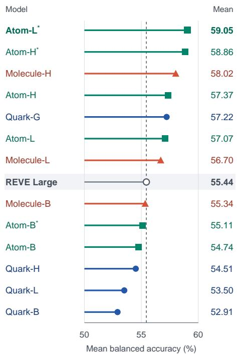

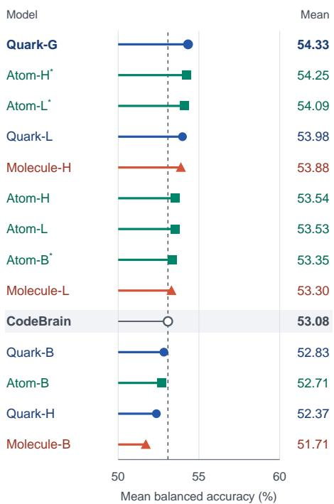  
Figure 1. Full-FT and LP performance of ten extension encoders and three selected-checkpoint references (∗) on 23 tasks. Stars mark checkpoints selected by mean Full-FT score; LP uses the same checkpoints. Dashed lines mark the strongest baseline in each setting. Figures 4 and 5 show the complete comparisons.

## 1 Introduction

LaBraM, an early EEG foundation model, demonstrated that pretraining on large EEG collections can learn representations that transfer efectively across diverse downstream tasks [1]. Subsequent EEG foundation models have provided further evidence for the efectiveness of large-scale pretraining [2–10]. Building on LaBraM, we further investigate the downstream gains from expanding pretraining data and model capacity while retaining its core encoder design and pretraining objective.

To study this expansion, we assemble three EEG collections—Quark, Atom, and Molecule—spanning 25,067–79,910 hours, and train ten encoders ranging from 5.8 million to 1.97 billion parameters. Combining recordings from diverse sources requires handling diferences in channel layout, signal scale, and recording length. Extended signal preparation and batching accommodate these inputs, while streamed data access, node-local storage, and distributed training support the larger collections and encoders.

The resulting encoders lead the comparisons across 23 classification tasks under both full fine-tuning (Full-FT) and linear probing (LP). With 46.3 million parameters, Atom-L∗ reaches 59.05% mean balanced accuracy at its best evaluated Full-FT checkpoint, exceeding REVE Large by 3.61 percentage points. Quark-G leads LP at 54.33%, and both models lead average task rank in their respective settings. The gains also extend to comparisons with small supervised models: Atom-L and Molecule-H each exceed the stronger of EEGNet and EEGConformer on 16 tasks under Full-FT, compared with at most 12 for a baseline EEG foundation model (Section 5).

Further analysis examines how downstream gains vary with encoder size, pretraining data, and training duration. At the last evaluated checkpoints, larger encoders improve Full-FT more consistently than LP. The two evaluation settings also produce diferent model orderings: stronger LP does not guarantee stronger Full-FT. Retaining patch structure improves LP over average pooling, showing that the readout afects how well frozen features can be used. Together, these results motivate assessing both access to frozen features and the gains from task-specific encoder adaptation (Section 5.3).

The data experiments show why recording hours alone do not determine transfer performance. Reduceddata Atom runs outperform Quark at matched encoder sizes despite using fewer hours, suggesting that broader source coverage may improve data eficiency. Within a fixed collection, additional data can eventually bring diminishing or negative returns. Fraction sweeps motivate an empirical capacity-dependent saturation relation, with fitted Full-FT peaks near 22,000 hours for Base and 40,000 hours for Large. Even within a single training run, downstream performance can decline while pretraining loss falls. Judging the benefit of further pretraining therefore requires downstream evaluation (Section 6).

Beyond traditional evaluation, we further explore our models’ performance in a multitask setting, drawing inspiration from NeuroLM [5], UniMind [11], and GVG [12]. Frozen EEG encoders are paired with a shared Qwen3 readout for joint classification across all 23 tasks. Larger EEG collections and encoders show complementary gains, with Molecule-H and Qwen3-8B reaching 50.50% mean balanced accuracy. Increasing language-model size provides no consistent improvement. Together with the LP analysis, these results suggest that preserving EEG information and adapting it to the readout are important for realizing the benefits of encoder scale (Section 7).

## 2 Pretraining Data

## 2.1 From Quark to Atom and Molecule

Our pretraining experiments use three data versions (Table 1): Quark comprises 9 datasets, 25,067 hours, and 4,200,222 training windows; Atom comprises 521 datasets, 49,628 hours, and 24,723,392 windows; and Molecule comprises 505 datasets, 79,910 hours, and 35,207,959 windows.

Table 1. Pretraining data summary.
<table><tr><td>Data version</td><td>Datasets</td><td>Hours</td><td>Training windows</td></tr><tr><td>Quark</td><td>9</td><td>25,067</td><td>4,200,222</td></tr><tr><td>Atom</td><td>521</td><td>49,628</td><td>24,723,392</td></tr><tr><td>Molecule</td><td>505</td><td>79,910</td><td>35,207,959</td></tr></table>

Quark forms the initial collection and is dominated by clinical recordings: TUH contributes 23,653 hours. The remaining sources are HMC, Alljoined, THINGS-EEG2, a self-collected dataset, SEED, SEED-IV, SEED-V, and SEED-VII.

To explore the limits of data scaling, we assembled Atom and Molecule by collecting publicly available EEG datasets as comprehensively as possible and screening them for pretraining. Atom broadens this clinical starting point to include more recording settings and tasks. Added sources include I-CARE, CHB-MIT, Siena, ISRUC S3, FACED, EEGMMIDB, SparrKULee, and THINGS-EEG1, together with additional col lections from OpenNeuro, Zenodo, and MOABB.

Molecule builds on this broader source pool with revised signal preparation and source selection. For this expansion, we collected approximately 92,032 hours of EEG from 514 datasets and constructed 41,637,575 windows before quality screening. Table 2 compares recording hours for selected sources across all three versions; Appendix A provides the complete inventory with publication and dataset links.

Table 2. Selected pretraining datasets, sources, and recording hours. The full inventory appears in Table 5.
<table><tr><td>Dataset</td><td>Source</td><td>Quark (h)</td><td>Atom (h)</td><td>Molecule (h)</td></tr><tr><td>TUH</td><td>[13]</td><td>23,653</td><td>22,554</td><td>22,158</td></tr><tr><td>I-CARE</td><td>[14]</td><td>一</td><td>1,657</td><td>28,583</td></tr><tr><td>CHB-MIT</td><td>[15]</td><td>一</td><td>991</td><td>1,964</td></tr><tr><td>HMC</td><td>[16]</td><td>741</td><td>17</td><td>1,142</td></tr><tr><td>ON_ds004395</td><td>[17]</td><td>一</td><td>729</td><td>6,827</td></tr><tr><td>ON_ds005555</td><td>[18]</td><td>一</td><td>2,002</td><td>1,947</td></tr><tr><td>Alljoined</td><td>[19]</td><td>371</td><td>一</td><td>461</td></tr><tr><td>THINGS-EEG2</td><td>[20]</td><td>184</td><td>一</td><td>228</td></tr><tr><td>self-collected dataset</td><td></td><td>28</td><td>28</td><td>22</td></tr><tr><td>SEED</td><td>[21]</td><td>16</td><td>9</td><td>一</td></tr><tr><td>SEED-IV</td><td>[22]</td><td>18</td><td>9</td><td>18</td></tr><tr><td>SEED-V</td><td>[23]</td><td>13</td><td>9</td><td>13</td></tr><tr><td>SEED-VII</td><td>[24]</td><td>43</td><td>9</td><td>43</td></tr></table>

A dash denotes absence from a collection.

This source-level comparison shows that most of Molecule’s additional recording time comes from ICU data. I-CARE increases from 1,657 hours in Atom to 28,583 hours in Molecule, accounting for about 89% of the net increase between the two versions. Molecule therefore combines a larger ICU component with cognitive, sleep, and other experimental recordings from the broader source pool (Figure 2). Appendix B gives the category totals behind this change in composition.

## 2.2 Signal preparation and window construction

Public EEG datasets use diferent sampling rates and electrode naming conventions. We resample recordings to 200 Hz, apply band-pass filtering with a 0.5 Hz lower cutof, and map electrode names to a shared vocabulary for the encoder.

Recordings can also contain unusable channels and gaps. Channels that are constant or contain at least 1% non-finite samples are removed; the remaining signals are split into finite segments to retain usable EEG around gaps. Per-channel z-scoring within each recording or trial reduces amplitude scale diferences across sources. Values are then clipped to ±15 and stored in float16. Because normalization is performed during preparation, we use an input scale of 1.0; Quark and Atom retain 0.01 (Appendix B.3).

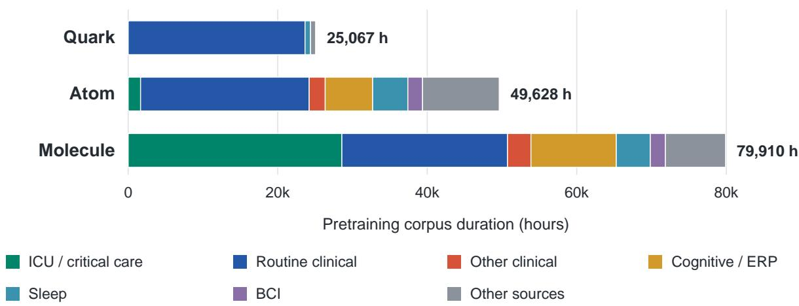  
Figure 2. Pretraining data composition. Categories group sources by their predominant recording setting or task and are approximate. Molecule’s increase in duration is concentrated in ICU recordings.

With a fixed window duration, recordings with more channels produce more tokens and require more attention memory. We therefore use non-overlapping windows of 4–16 seconds, adjusting duration to target 256 channel-by-time tokens. A 16-channel recording uses 16-second windows, while 64 channels use four seconds. Alljoined and THINGS-EEG2 retain their one-second trials to preserve trial boundaries. Tails of at least one second are zero-padded and retained with validity masks, preserving available EEG while marking padded positions.

## 2.3 Quality control and sampling

After preprocessing, windows still difer in signal quality and channel coverage. We remove windows with severe signal abnormalities or excessive padding to limit training on unreliable inputs, and apply the subject exclusion list separately. For Molecule, subject exclusions remove 687,187 windows and severe-quality screening removes 5,742,429, leaving 35,207,959 of the 41,637,575 constructed windows eligible for pretraining (Figure 3).

We retain windows with mild quality flags or few channels because they still contain usable EEG, using lower sampling weights to favor the main pool. The retained pool comprises 26,102,536 main windows with at least eight mapped channels, 8,180,196 mildly flagged windows, and 925,227 windows with fewer than eight mapped channels.

## 3 Scaling the Training Pipeline

## 3.1 Encoder sizes

We retain LaBraM’s neural spectrum tokenizer architecture and masked-code prediction objective [1] while scaling the encoder from 5.8 million to 1.97 billion parameters (Table 3). Base, Large, and Huge retain the original LaBraM definitions. Giant extends the family to width 1,600 and 64 transformer layers. Model names combine the data version with B, L, H, or G for the corresponding encoder size. The training-pipeline extensions below support heterogeneous inputs and execution at larger data and model scales.

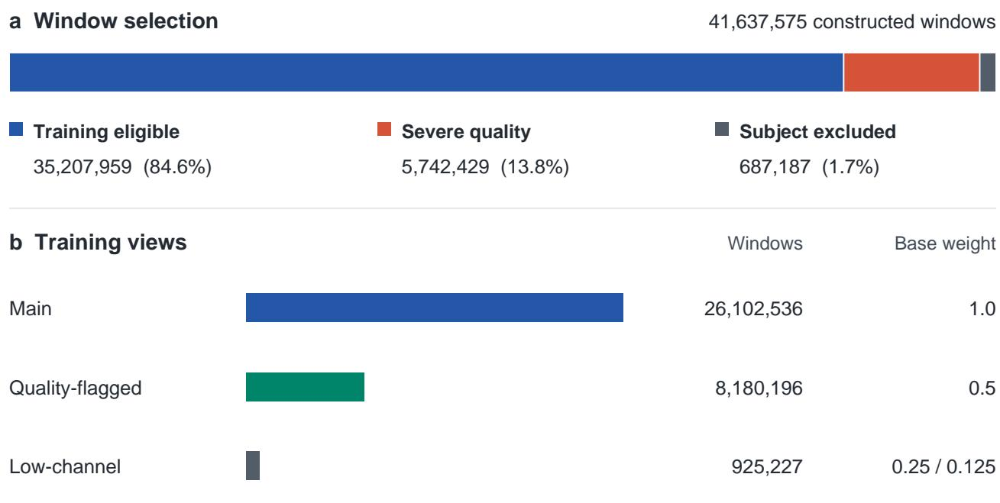  
Figure 3. Molecule window screening and sampling. Screening excludes 15.4% of constructed windows; counts are shown before weighted sampling. Low-channel windows use weight 0.25, or 0.125 when they also carry quality flags. Source and provenance factors apply separately. Subject exclusions follow the earlier evaluation pool; see Appendix D for remaining overlap.

Table 3. Encoder configurations.
<table><tr><td>Size</td><td>Width</td><td>Depth</td><td>Heads</td><td>Parameters</td></tr><tr><td>Base</td><td>200</td><td>12</td><td>10</td><td>5.820M</td></tr><tr><td>Large</td><td>400</td><td>24</td><td>16</td><td>46.259M</td></tr><tr><td>Huge</td><td>800</td><td>48</td><td>16</td><td>369.236M</td></tr><tr><td>Giant</td><td>1,600</td><td>64</td><td>20</td><td>1.968B</td></tr></table>

## 3.2 Batching across datasets

Recordings from diferent datasets use diferent electrode sets and channel orders. LaBraM assigns spatial embeddings by electrode identity, so two windows with the same tensor shape can require diferent embedding indices. We therefore group windows in the Atom and Molecule loaders by channel count, patch count, channel signature, and ordered channel list. Samples in each batch then share the same dimensions and electrode ordering. For Molecule, we also reject unmapped pretraining channel names before batching.

Recording tails can end partway through a patch, so the resulting windows contain diferent amounts of observed EEG. In the Molecule encoder, sample-validity masks carry this information from window construction into attention and prediction. A fully padded patch contains no recorded EEG: we exclude it from attention keys and prediction masks and zero its output after the final normalization. Partially padded patches retain recorded samples, so we keep them in the sequence and weight their prediction loss in proportion to the valid sample counts. Appendix B describes the tokenizer’s treatment of padded reconstruction targets.

## 3.3 Streaming and node-local storage

With tens of millions of windows, opening individual sample files would incur repeated file-access overhead. We therefore package Atom and Molecule in WebDataset tar shards so workers can read many windows from each archive as a stream. The two collections use 2,885 and 291,489 shards, respectively.

Because training revisits shards across epochs, each node caches downloaded shards, allowing workers to reuse local copies on subsequent reads. A least-recently-used policy evicts shards when space is needed. SQLite tracks the cache contents, and file locks coordinate workers requesting the same shard.

Persistent workers reduce process-startup overhead between epochs. Prefetching prepares upcoming batches while the current batch is processed, and pinned host memory supports transfer of the prepared batches to the accelerator.

## 3.4 Distributed training and precision

The training stack supports distributed data parallelism and fully sharded data parallelism (FSDP), with optional activation checkpointing to reduce activation memory. Molecule-H uses full parameter sharding; Quark-G was trained on MI300X GPUs. Table 4 lists GPU counts and global batches.

We replace the explicit attention path with PyTorch scaled dot-product attention, which selects kernels supported by the device, precision, and tensor layout. The training loop supports bf16 without loss scaling. Quark uses fp16 with GradScaler; Molecule extracts frozen-tokenizer targets in bf16.

## 4 Pretraining Configuration

The three collections difer in source composition and input preparation. We therefore use independently trained tokenizer weights for each collection and freeze them during encoder pretraining, so that target codes remain fixed as the encoder is optimized. Table 8 in the appendix lists the tokenizer settings and checkpoints used for target generation.

With these targets fixed, encoder optimization follows a common recipe: AdamW with weight decay 0.05, cosine learning-rate decay to $1 0 ^ { - 5 }$ , drop path 0.1, and 50% masking. Within this recipe, Atom uses ten warmup epochs and gradient clipping at 1.0; Molecule uses five warmup epochs without gradient clipping. Table 4 gives the GPU allocation, global batch size, peak learning rate, and epoch schedule for each encoder.

Table 4. Encoder training configurations.
<table><tr><td>Model</td><td>GPUs</td><td>Global batch</td><td>Peak LR</td><td>Epochs</td></tr><tr><td>Quark-B</td><td>32</td><td>2,048</td><td> $5 \times 1 0 ^ { - 4 }$ </td><td>50</td></tr><tr><td>Quark-L</td><td>32</td><td>512</td><td> $3 \times 1 0 ^ { - 4 }$ </td><td>50</td></tr><tr><td>Quark-H</td><td>24</td><td>96</td><td> $1 . 5 \times 1 0 ^ { - 4 }$ </td><td>50</td></tr><tr><td>Quark-G</td><td>64</td><td>1,024</td><td> $1 \times 1 0 ^ { - 4 }$ </td><td>30</td></tr><tr><td>Atom-B</td><td>8</td><td>1,024</td><td> $1 . 5 \times 1 0 ^ { - 4 }$ </td><td>50</td></tr><tr><td>Atom-L</td><td>16</td><td>1,024</td><td> $1 . 5 \times 1 0 ^ { - 4 }$ </td><td>50</td></tr><tr><td>Atom-H</td><td>64</td><td>1,024</td><td> $1 . 5 \times 1 0 ^ { - 4 }$ </td><td>50</td></tr><tr><td>Molecule-B</td><td>32</td><td>2,048</td><td> $5 \times 1 0 ^ { - 4 }$ </td><td>50</td></tr><tr><td>Molecule-L</td><td>32</td><td>1,024</td><td> $3 \times 1 0 ^ { - 4 }$ </td><td>30</td></tr><tr><td>Molecule-H</td><td>32</td><td>512</td><td> $1 \times 1 0 ^ { - 4 }$ </td><td>50</td></tr></table>

The data-fraction experiments use this setup to examine how downstream transfer changes with data volume at a fixed encoder size. These runs retain 10%, 20%, or 50% of the corresponding window streams under a 50-epoch schedule. Larger fractions therefore increase both the number of training windows and the number of optimization updates. Appendices B and C give the subsampling and evaluation settings.

## 5 Evaluation

## 5.1 Evaluation setup

Following the evaluation framework of OmniEEG-Bench [25], we evaluate transfer on a subset of 23 classification tasks covering clinical EEG, motor imagery, evoked responses, emotion, sleep staging, and subject traits. Full fine-tuning (Full-FT) measures performance after updating the encoder and task head; linear probing (LP) evaluates a readout from frozen features. All downstream evaluations use at most 40 training windows per subject–class pair, retaining all validation and test windows. Scores are averaged over seeds 42, 10, and 5. We compare overall performance by mean balanced accuracy, then use within-task ranks and individual task results to examine the breadth of the advantage. Appendix C lists task inputs and splits; Appendix C gives optimization settings.

The comparison includes 16 pretrained baseline encoders. The released LaBraM Base [1] provides a reference for scaling the original approach. The other baselines are BENDR [26], BIOT [27], CBraMod [2], BrainOmni [8], NeuroGPT [28], NeuroLM [5], EEGMamba [7], FEMBA Base [6], CSBrain [9], Code-Brain [10], REVE Base and Large [4], and LUNA Base, Large, and Huge [3]. Full-FT also includes EEG-Net [29], EEGConformer [30], and a randomly initialized LaBraM Base as references for learning from scratch.

Unstarred extension comparisons use the last evaluated full-data checkpoints. Within each downstream fit, validation balanced accuracy selects the epoch. Seed42 test performance selects hyperparameters, which are then reused for seeds 10 and 5. For each model and task, LP reports the available Pooled or No-pool readout with the higher three-seed test mean, preferring Pooled on ties; SleepEDF uses Pooled.

## 5.2 Full fine-tuning

The scaled LaBraM encoders lead both mean balanced accuracy and average task rank under Full-FT (Figure 4). Atom-L∗ reaches 59.05%, exceeding REVE Large, the strongest baseline EEG foundation model, by 3.61 percentage points. The advantage also holds at the last evaluated checkpoints: Molecule-H reaches 58.02%, while Atom-L achieves 57.07% with 46.3 million parameters. Strong Full-FT performance therefore extends to the Large encoder, alongside the larger Huge models.

The task rankings show how this improvement extends across the benchmark. Extension configurations occupy the first eight positions by average task rank. Atom-L∗ leads at 8.74, and Molecule-H ranks second at 9.30; the strongest baseline by this measure, REVE Base, has an average rank of 14.72. Agreement between the two rankings supports a broad transfer advantage, with the remaining task-level diferences examined in Section 5.4.

## 5.3 Linear probing

The gains carry over to frozen-feature transfer, with a diferent ordering among the leading encoders (Figure 5). Quark-G leads LP at 54.33% mean balanced accuracy, 1.24 percentage points above CodeBrain, the strongest baseline at 53.08% [10]. It also has the best average task rank at 8.63. Atom-H∗ and Atom-L∗ remain close in mean score at 54.25% and 54.09%. These checkpoints improve LP over their last evaluated counterparts, although they were selected using Full-FT scores.

Stronger LP performance does not necessarily imply stronger Full-FT performance. CodeBrain, for example, exceeds REVE Large in LP (53.08% versus 52.26%) and trails it in Full-FT (53.21% versus 55.44%). Across the 26 distinct pretrained encoders, 80 of 325 model pairs (24.6%) reverse order between the two settings (Appendix E.1). Full-FT also reaches a higher observed performance ceiling on this benchmark: the best evaluated configuration scores 59.05%, compared with 54.33% under LP.

Average pooling can suppress task-relevant information by collapsing patch features across channels and time. No-pool avoids this aggregation by retaining the ordered patches for a larger linear classifier, raising mean balanced accuracy from 44.74% to 49.61% (+4.87 points) across 26 models evaluated on the same 22 tasks. We further hypothesize that larger, stronger encoders learn more general representations whose alignment with a specific downstream task is more demanding. These representations may require more substantial task-specific reorganization to realize their potential. Full-FT can make such adjustments by updating the encoder, whereas LP relies on a fixed representation.

Figure 4. Full-FT ranked by mean balanced accuracy (left) and average task rank (right) across 32 configurations and 23 tasks. Stars mark checkpoints selected by mean Full-FT score: Atom-B∗ (ep19), Atom-L∗ (ep29), and Atom-H∗ (ep19). Ties receive average ranks. The strongest baseline by mean score is REVE Large [4].

a Mean performance  
b Average task rank
<table><tr><td>Ours: Quark</td><td colspan="2"> Atom</td><td colspan="3">Molecule</td><td colspan="2">O Baselines</td><td colspan="6">Random initialization</td></tr><tr><td>Model</td><td>44</td><td>48</td><td>52</td><td>56</td><td></td><td>60 Score</td><td>Model</td><td>1</td><td>9 17</td><td></td><td>25 32</td><td>Rank</td></tr><tr><td></td><td></td><td></td><td></td><td></td><td></td><td></td><td></td><td></td><td></td><td></td><td></td><td></td></tr><tr><td>Atom-L*</td><td></td><td></td><td></td><td></td><td></td><td>59.05</td><td>Atom-L*</td><td></td><td></td><td></td><td></td><td>8.74</td></tr><tr><td>Atom-H*</td><td></td><td></td><td></td><td></td><td></td><td>58.86</td><td>Molecule-H</td><td></td><td></td><td></td><td></td><td>9.30</td></tr><tr><td>Molecule-H</td><td></td><td></td><td></td><td></td><td></td><td>58.02</td><td>Atom-H*</td><td></td><td></td><td></td><td></td><td>9.85</td></tr><tr><td>Atom-H</td><td></td><td></td><td></td><td></td><td></td><td>57.37</td><td>Atom-L</td><td></td><td></td><td></td><td></td><td>10.02</td></tr><tr><td>Quark-G</td><td></td><td></td><td></td><td></td><td></td><td>57.22</td><td>Quark-G</td><td></td><td></td><td></td><td></td><td>10.91</td></tr><tr><td>Atom-L</td><td></td><td></td><td></td><td></td><td></td><td>57.07</td><td>Atom-H</td><td></td><td></td><td></td><td></td><td>10.93</td></tr><tr><td>Molecule-L</td><td></td><td></td><td></td><td></td><td></td><td>56.70</td><td>Molecule-L</td><td></td><td></td><td></td><td></td><td>12.39</td></tr><tr><td>REVE Large</td><td></td><td></td><td></td><td></td><td></td><td>55.44</td><td>Atom-B*</td><td></td><td></td><td></td><td></td><td>13.48</td></tr><tr><td>Molecule-B</td><td></td><td></td><td></td><td></td><td></td><td>55.34</td><td>REVE Base</td><td></td><td></td><td></td><td></td><td>14.72</td></tr><tr><td>REVE Base</td><td></td><td></td><td></td><td></td><td></td><td>55.32</td><td>Quark-H</td><td></td><td></td><td></td><td></td><td>15.17</td></tr><tr><td>Atom-B*</td><td></td><td></td><td></td><td></td><td></td><td>55.11</td><td>REVE Large</td><td></td><td></td><td></td><td></td><td>15.22</td></tr><tr><td>LUNA Huge</td><td></td><td></td><td></td><td></td><td></td><td>54.91</td><td>Molecule-B</td><td></td><td></td><td></td><td></td><td>15.63</td></tr><tr><td>Atom-B</td><td></td><td></td><td></td><td></td><td></td><td>54.74</td><td>Atom-B</td><td></td><td></td><td></td><td></td><td>15.76</td></tr><tr><td>LUNA Large</td><td></td><td></td><td></td><td></td><td></td><td>54.59</td><td>LUNA Huge</td><td></td><td></td><td></td><td></td><td>15.96</td></tr><tr><td>Quark-H</td><td></td><td></td><td></td><td></td><td></td><td>54.51</td><td>Quark-L</td><td></td><td></td><td></td><td></td><td>16.41</td></tr><tr><td>CSBrain</td><td></td><td></td><td></td><td></td><td></td><td>54.40</td><td>CSBrain</td><td></td><td></td><td></td><td></td><td>16.63</td></tr><tr><td>BIOT</td><td></td><td></td><td></td><td></td><td></td><td>54.30</td><td>CodeBrain</td><td></td><td></td><td></td><td></td><td>16.91</td></tr><tr><td>LUNA Base</td><td></td><td></td><td></td><td></td><td></td><td>53.76</td><td>BIOT</td><td></td><td></td><td></td><td></td><td>17.13</td></tr><tr><td>Quark-L</td><td></td><td></td><td></td><td></td><td></td><td>53.50</td><td>LUNA Large</td><td></td><td></td><td></td><td></td><td>17.13</td></tr><tr><td>Official LaBraM Base</td><td></td><td></td><td></td><td></td><td></td><td>53.37</td><td>EEGConformer</td><td></td><td></td><td></td><td></td><td>17.28</td></tr><tr><td>CodeBrain</td><td></td><td></td><td></td><td></td><td></td><td>53.21</td><td>LUNA Base</td><td></td><td></td><td></td><td></td><td>17.50</td></tr><tr><td>Quark-B</td><td></td><td></td><td></td><td></td><td></td><td>52.91</td><td>Official LaBraM Base</td><td></td><td></td><td></td><td></td><td>17.59</td></tr><tr><td>FEMBA Base</td><td></td><td></td><td></td><td></td><td></td><td>52.56</td><td>BrainOmni</td><td></td><td></td><td></td><td></td><td>17.70</td></tr><tr><td>NeuroLM</td><td></td><td></td><td></td><td></td><td></td><td>52.36</td><td>Quark-B</td><td></td><td></td><td></td><td></td><td>18.43</td></tr><tr><td>BrainOmni</td><td></td><td></td><td></td><td></td><td></td><td>52.34</td><td>NeuroLM</td><td></td><td></td><td></td><td></td><td>18.50</td></tr><tr><td>NeuroGPT</td><td></td><td></td><td></td><td></td><td></td><td>52.30</td><td>NeuroGPT</td><td></td><td></td><td></td><td></td><td>19.72</td></tr><tr><td>EEGConformer</td><td></td><td></td><td></td><td></td><td></td><td>52.06</td><td>FEMBA Base</td><td></td><td></td><td></td><td></td><td>19.78</td></tr><tr><td>EEGMamba</td><td></td><td></td><td></td><td></td><td></td><td>49.80</td><td>EEGNet</td><td></td><td></td><td></td><td></td><td>21.41</td></tr><tr><td>EEGNet</td><td></td><td></td><td></td><td></td><td></td><td>49.44</td><td>EEGMamba</td><td></td><td></td><td></td><td></td><td>21.48</td></tr><tr><td>CBraMod</td><td></td><td></td><td></td><td></td><td></td><td>47.72 46.87</td><td>CBraMod</td><td></td><td></td><td></td><td></td><td>23.61 25.33</td></tr><tr></table>

Higher mean score and lower average task rank are better.  
\* Checkpoint with the highest evaluated mean Full-FT score for that model.

## 5.4 Task-level diferences

The individual task results show both the breadth and the concentration of the gains (Figure 6). Atom-L∗ exceeds REVE Large on 17 of 23 Full-FT tasks, with its largest gains on TUEV (+24.17 points), EEGDenoiseNet (+19.39), and HMC (+12.79). It trails on six tasks. For LP, Quark-G exceeds CodeBrain on 13 tasks and trails on ten. Its largest gains are on BETA SSVEP (+19.73 points), ISRUC S3 (+13.65), and Monitoring ErrP (+11.55), while TUSL and SEED remain weaknesses.

To assess the advantage over small models trained from scratch, we use the higher three-seed mean balanced accuracy of EEGNet and EEGConformer as the Full-FT reference for each task (Table 29). The released LaBraM Base exceeds it on 10 of 23 tasks. Among the 16 baseline EEG foundation models, REVE Base and Large lead with 12 wins each. Atom-L and Molecule-H each win on 16 tasks; Atom-L ties on one and trails on six, while Molecule-H trails on seven. Molecule-H retains all 12 wins of REVE Large and adds AD65, SEED-IV, HMC, and EEGDenoiseNet.

a Mean performance  
b Average task rank
<table><tr><td colspan="4">Quark-G 54.33 (+1.24 pp)</td></tr><tr><td>23 tasks / 29 configurations</td><td></td></tr><tr><td>Ours: Quark</td><td>Atom Molecule</td></tr><tr><td>Model 32</td><td>38 44 50 56 Score Model</td></tr><tr><td>Quark-G</td><td>54.33 Quark-G</td></tr><tr><td>Atom-H*</td><td>54.25 Atom-H*</td></tr><tr><td>Atom-L*</td><td>54.09 Atom-L*</td></tr><tr><td>Quark-L</td><td>53.98 Molecule-H</td></tr><tr><td>Molecule-H</td><td>53.88 Quark-L</td></tr><tr><td>Atom-H</td><td>10.48 Atom-B* 10.63</td></tr><tr><td>Atom-L</td><td>53.54 53.53 Atom-L</td></tr><tr><td></td><td>10.63 11.04</td></tr><tr><td>Atom-B*</td><td>Atom-H CodeBrain 11.46</td></tr><tr><td>Molecule-L</td><td>REVE Large 11.63</td></tr><tr><td>CodeBrain 53.08 52.83</td><td>12.48</td></tr><tr><td>Quark-B</td><td>Molecule-L 13.65</td></tr><tr><td>Atom-B 52.71 Atom-B</td><td>Quark-B 13.70</td></tr><tr><td>Quark-H</td><td>52.37 14.26</td></tr><tr><td>REVE Large 52.26 NeuroLM</td><td>Official LaBraM Base 14.28</td></tr><tr><td>BIOT 51.97</td><td>14.57</td></tr><tr><td>Official LaBraM Base 51.95 CBraMod</td><td>Quark-H 14.89</td></tr><tr><td>Molecule-B 51.71</td><td></td></tr><tr><td>NeuroLM 51.67</td><td>LUNA Huge 14.91</td></tr><tr><td>LUNA Huge 51.62</td><td>BrainOmni 15.22</td></tr><tr><td>CBraMod 51.59 BIOT</td><td>15.24 15.78</td></tr><tr><td>BrainOmni 51.58</td><td>Molecule-B 15.78</td></tr><tr><td></td><td>50.64 REVE Base</td></tr><tr><td>REVE Base</td><td>CSBrain</td></tr><tr><td>LUNA Large 49.55</td><td>LUNA Large</td></tr><tr><td>CSBrain 49.41</td><td>47.94 FEMBA Base</td></tr><tr><td>LUNA Base</td><td></td></tr><tr><td>EEGMamba</td><td>47.56 EEGMamba</td></tr><tr><td></td><td>46.44 LUNA Base</td></tr><tr><td>FEMBA Base NeuroGPT</td><td>45.45 NeuroGPT 33.43 BENDR</td></tr></table>

Higher score and lower average task rank are better. \* Full-FT-selected checkpoints.

Figure 5. LP ranked by mean balanced accuracy (left) and average task rank (right) across 29 configurations of 26 pretrained models and 23 tasks. Stars use the Full-FT-selected EEG checkpoints. Each task uses the higher three-seed mean of the available Pooled and No-pool readouts.

## 5.5 Pretraining data, encoder size, and downstream performance

The model comparisons can also be viewed in terms of encoder size and pretraining hours (Figure 7). Atom-L∗ reaches 59.05% in Full-FT with 46.3M parameters and 49,628 hours, compared with 55.44% for REVE Large at 390M parameters and 61,415 hours. The last evaluated Atom-L checkpoint reaches 57.07%. Both comparisons favor Atom-L with a smaller encoder and fewer pretraining hours.

LP places the leading models much closer together despite large diferences in size. Quark-G reaches 54.33% with 1.97B parameters and 25,067 pretraining hours; Quark-L reaches 53.98% with 46.3M parameters on the same collection. CodeBrain reaches 53.08% with 13.6M parameters and approximately 9,246 hours. Quark-L thus approaches Quark-G’s LP score with a much smaller encoder, while CodeBrain remains competitive with a smaller model and corpus.

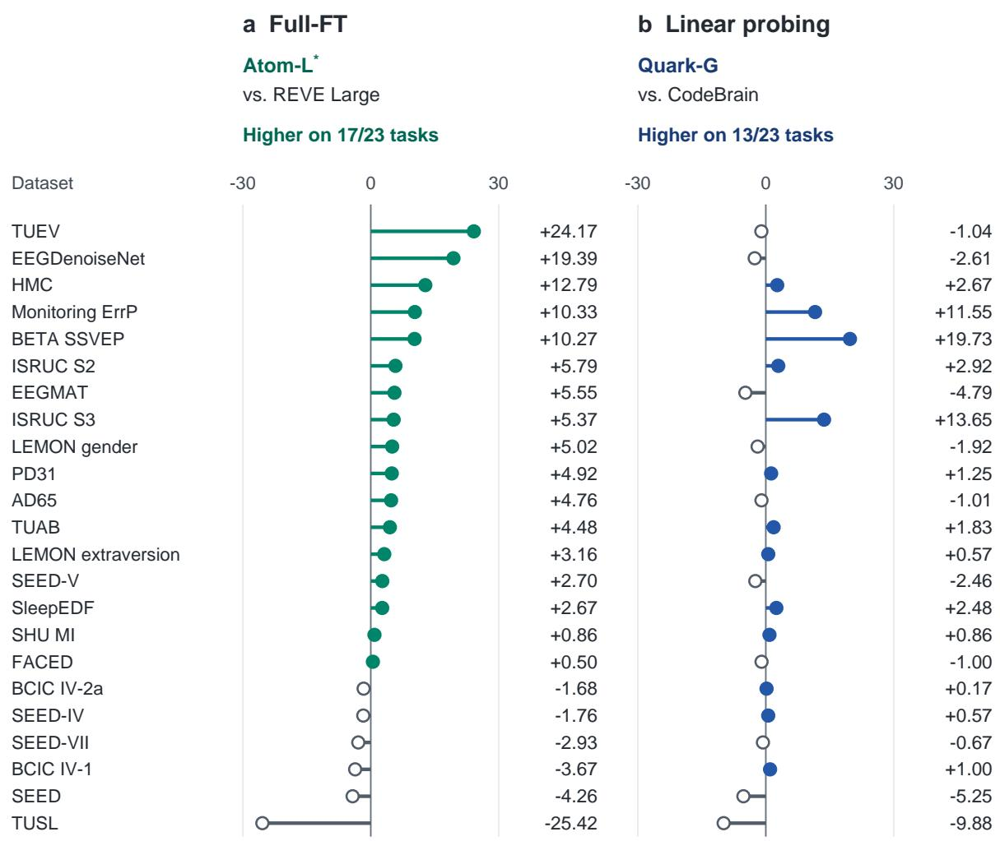  
Balanced-accuracy difference (pp); positive values favor the extension model.  
Tasks follow Full-FT gain order. LP uses the better available readout for each model and task.

Figure 6. Task-level score diferences between the leading extension configuration and baseline by mean score in each setting. Positive values favor the extension. The Full-FT panel uses Atom-L∗; both panels cover 23 tasks.

## 6 Discussion

Scaling encoder capacity produces consistent Full-FT gains across the three data versions. The benefit of ad ditional pretraining hours is more dependent on capacity, with fraction sweeps suggesting a saturation region for each model size. Training trajectories reveal a further limit: continued improvement on the pretraining objective can accompany declining downstream performance.

## 6.1 Model size

Increasing encoder capacity improves Full-FT within each pretraining collection (Figure 8). At the last evaluated checkpoints, Full-FT increases from Base to Huge by 1.60 points for Quark, 2.63 for Atom, and 2.68 for Molecule. Quark-G extends this trend to 57.22%, 2.71 points above Quark-H.

The same size comparisons give less consistent gains under LP. Quark falls from 53.98% at Large to 52.37% at Huge, Atom-L and Atom-H are nearly tied at 53.53% and 53.54%, and Molecule improves from Base to Huge. Capacity therefore benefits Full-FT more consistently than frozen-feature transfer in these runs. This pattern is consistent with the distinction in Section 5.3: increasing capacity can improve performance after task-specific adaptation without a corresponding gain in the linear accessibility of frozen features.

Encoder size and downstream performance  
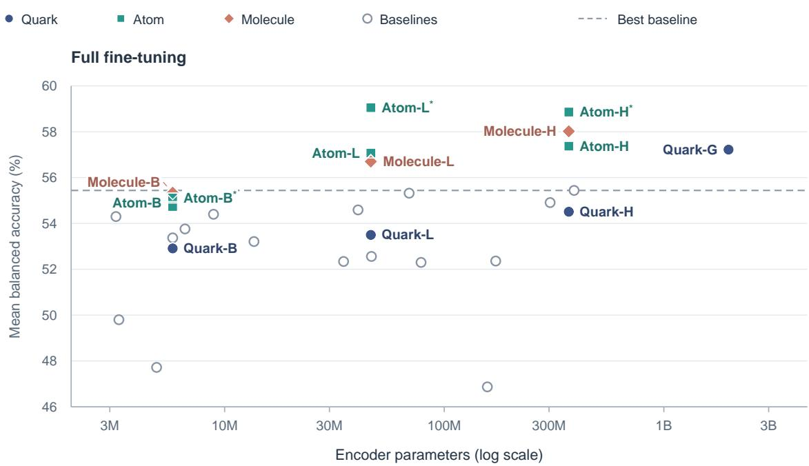

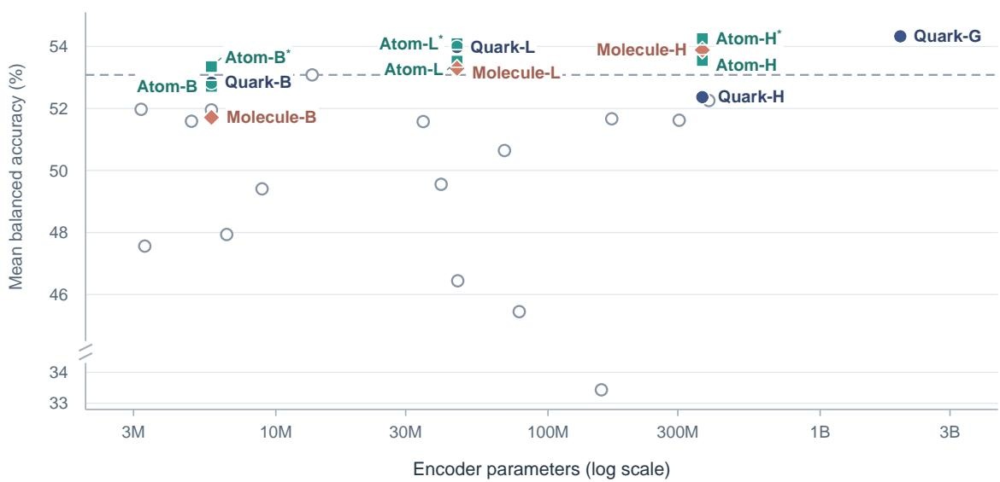  
Figure 7. Encoder size versus Full-FT (top) and LP (bottom) performance, including the three Full-FT-selected Atom references (∗). Dashed lines mark the highest baseline score; LP uses a broken vertical axis.

## 6.2 Pretraining data duration

At a fixed encoder size, the data versions provide a first comparison of pretraining corpus duration. Atom and Molecule exceed Quark in Full-FT at each shared size. Molecule improves over Atom at Base and Huge, and falls slightly below it at Large (56.70% versus 57.07%).

At Base size, random initialization and the released LaBraM provide two further references for these recipes. Quark-B, Atom-B, and Molecule-B reach 52.91%, 54.74%, and 55.34% Full-FT, all above the randomly initialized Base encoder at 44.70%. Against the released LaBraM Base at 53.37%, Atom-B and Molecule-B improve by 1.37 and 1.97 points, while Quark-B is 0.46 points lower.

The reduced-data Atom runs also outperform Quark at the same encoder sizes. With 10%, 20%, and 50% of Atom, corresponding to approximately 4,963, 9,926, and 24,814 hours, Atom-B reaches 54.54%, 53.40%, and 56.00% Full-FT, while Atom-L reaches 54.98%, 55.26%, and 57.15%. All six scores exceed their Quark counterparts trained on 25,067 hours (52.91% for Base and 53.50% for Large). Atom-L approaches REVE with 10–20% of Atom; at 50%, both Atom sizes exceed REVE Base and Large (55.32% and 55.44%), pretrained on 61,415 hours [4].

Pretraining duration and downstream performance  
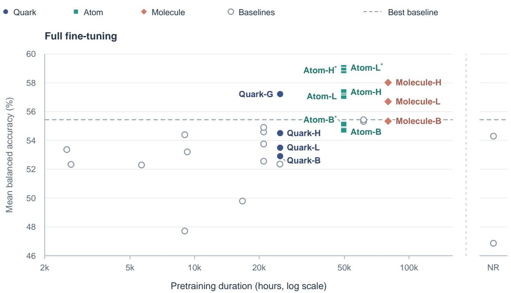

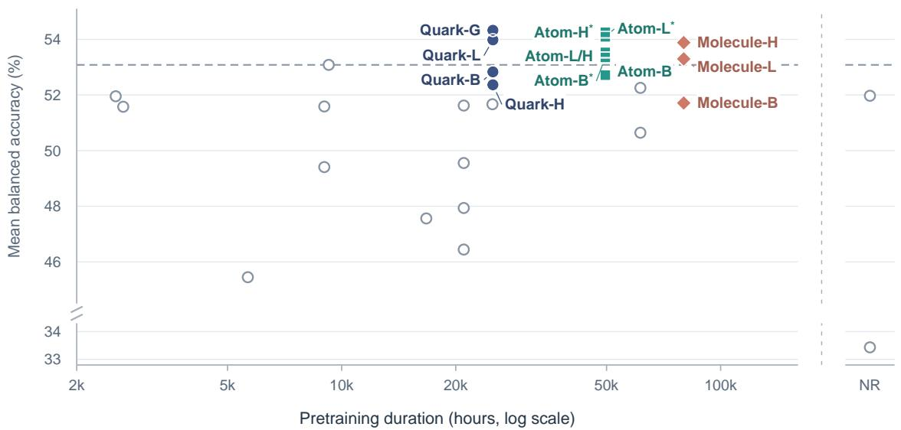  
Figure 7. Pretraining duration versus Full-FT (top) and LP (bottom) performance. Published durations include esti mates and lower bounds (EEG and MEG for BrainOmni). NR: not reported; Atom-L/H labels two nearly coincident LP points.

A possible explanation is the breadth of Atom’s pretraining sources. Its pool spans 521 datasets, compared with 9 for Quark and 92 for REVE [4]. Sampling windows across this broader pool may expose the encoder to more varied tasks and recording conditions, improving transfer even with fewer recording hours. This interpretation is consistent with OmniEEG-Bench, which reports an association between more pretraining datasets and stronger downstream rankings under LP [25].

Within each collection, the fraction sweeps also show that gains from additional hours can level of or reverse (Figure 9). Molecule-B is strongest at 20% data, approximately 16,000 hours: its Full-FT score falls from 56.35% there to 55.34% on the full collection, and LP falls from 53.09% to 51.71%. Atom-B peaks later, at 50% data (approximately 24,800 hours), before both scores decline. Atom-L’s Full-FT is nearly unchanged between 50% and 100% data, approximately 24,800–49,600 hours (57.15% versus 57.07%), although LP improves over this interval.

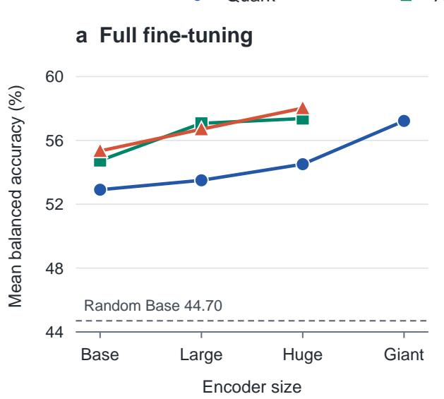

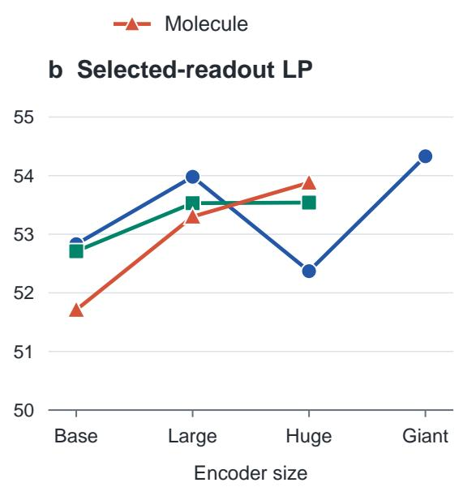  
Figure 8. Performance by data version and encoder size at the last evaluated checkpoints. Full-FT improves with capacity within each version; selected-readout LP varies less consistently. The dashed line marks the randomly initialized Base Full-FT result.

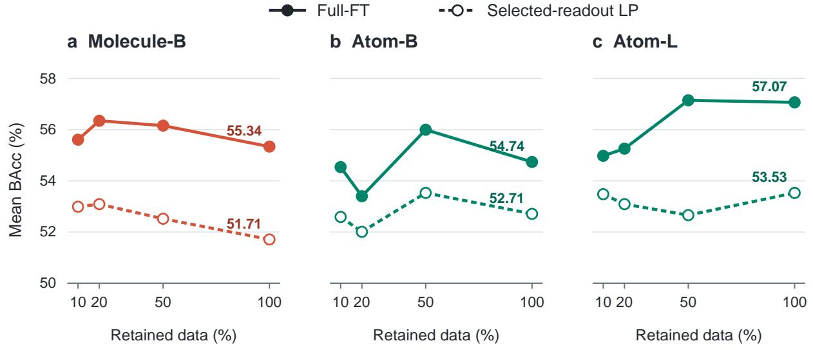  
Figure 9. Full-FT and selected-readout LP across retained data fractions. Each series uses a 50-epoch schedule, so the fraction also changes the number of training updates. Full-data references use the same checkpoints as the main comparisons.

These sweeps use 50 epochs, so increasing the data fraction also increases optimizer updates. Hours are approximated by multiplying each collection’s duration by the retained fraction. The curves therefore describe the combined efect of corpus size and training exposure under this schedule. Their turning regions motivate a closer look at how the useful amount of data depends on encoder capacity.

## 6.3 Capacity-dependent data saturation

At the sampled fractions, Base shows a decline where Large maintains similar Full-FT performance. This suggests that a fixed-size encoder has a saturation region and that larger encoders can benefit from more pretraining data. The broad spacing between fractions leaves the peak durations uncertain. A shared Full-FT response provides an estimate between the observed points, with duration normalized as $u = H / H _ { * } ( P )$

$$
\widehat S _ { i } ( H ) = A _ { i } + B \displaystyle \frac { 2 u } { 1 + u ^ { 2 } } , \qquad u = \displaystyle \frac { H } { H _ { * } ( P _ { i } ) } , \qquad H _ { * } ( P ) = K \left( \displaystyle \frac { P } { 5 . 8 \times 1 0 ^ { 6 } } \right) ^ { \eta } .\tag{1}
$$

Here H is corpus duration without epoch repetition, P counts encoder parameters, and i identifies a model– collection series. The three series share amplitude $B \geq 0$ and response shape, with separate levels $A _ { i }$ . The response rises below $u = 1$ and falls above it, balancing two fixed power terms in u and $u ^ { - 1 }$

Fitting the 12 Full-FT observations gives the following rounded peak-duration relation and its inverse:

$$
\begin{array} { c } { { H _ { * } ( P ) \approx 2 2 , 1 0 0 \left( \frac { P } { 5 . 8 \times 1 0 ^ { 6 } } \right) ^ { 0 . 2 9 2 } \mathrm { { h o u r s } , } } } \\ { { P _ { \mathrm { r e f } } ( H ) \approx 5 . 8 \times 1 0 ^ { 6 } \left( \frac { H } { 2 2 , 1 0 0 \mathrm { { h o u r s } } } \right) ^ { 1 / 0 . 2 9 2 } . } } \end{array}\tag{2}
$$

The fit places the Base peak near 22,000 hours and the Large peak near 40,000 hours. This empirical scaling hypothesis links Base and Large; its inverse maps duration to encoder size along the same fitted peak relation. Atom-B’s 20% point receives weight 0.25, and the Large peak is restricted to 24,814–49,628 hours. Appendix I gives the fitting assumptions and sensitivity checks.

## 6.4 The gap between pretraining and downstream evaluation

Lower pretraining loss does not imply stronger downstream performance. Full-FT can peak before the last evaluated checkpoint (Figure 10). Atom-L illustrates this directly: between ep29 and ep49, its loss decreases from 6.214 to 6.079 while Full-FT falls from 59.05% to 57.07%. Molecule-L shows a similar loss of about two Full-FT points during continued loss reduction, with declines on 16 of 23 tasks. The deterioration therefore extends across much of its downstream task profile.

The gap also appears in frozen features. Between ep9 and ep49, Molecule-B’s loss falls from 8.322 to 7.949, while selected-readout LP declines from 52.98% to 51.71%. The aligned FT and LP trajectories in Figure 10 show that this mismatch occurs both when the encoder is frozen and when it is fully fine-tuned.

Further optimization can produce lower pretraining loss and worse downstream performance. Training loss alone is therefore insuficient for choosing a training duration or a transfer checkpoint; both choices require downstream evaluation. Appendix G provides the complete recorded trajectories.

## 7 A Shared Language-Model Readout for EEG Tasks

NeuroLM [5], UniMind [11], and GVG [12] explore unified EEG decoding across multiple tasks using language or multimodal language models. Inspired by these studies, we examine whether the gains from scaling LaBraM extend to a shared model trained jointly on all 23 tasks. This evaluation compares pretraining collections, EEG encoder capacities, and language-model sizes.

## 7.1 Connecting frozen EEG features to Qwen3

A shared Qwen3 readout [31] classifies all 23 tasks from frozen EEG features. Task prompts specify the problem and candidate labels. Channel-averaged features are standardized with training-split statistics, pooled or interpolated to 32 tokens, and mapped to Qwen3’s input dimension by a two-layer MLP. Inference selects the highest-scoring textual class candidate.

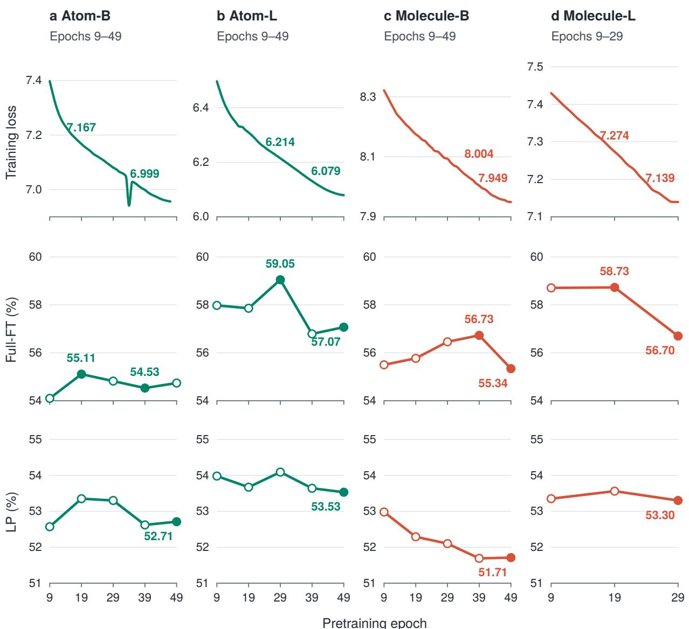  
Figure 10. Pretraining loss (top), Full-FT (middle), and selected-readout LP (bottom) along four pretraining runs. Atom-B’s loss ends at ep47; its downstream results extend to ep49.

Joint training updates the projector and LoRA adapters [32], keeping the EEG encoder and Qwen3 base weights frozen. Training uses the same 40-window subject–class cap as the single-task evaluations. Mean validation balanced accuracy selects one shared checkpoint per seed for full-test evaluation. Appendix H gives settings, splits, sample counts, and per-task scores with seed variability.

## 7.2 Data, encoder, and language-model scale

We pair ten EEG encoders with Qwen3-0.6B, 1.7B, 4B, 8B, 14B, and 32B: 60 configurations with three seeds each (Figure 11).

Pretraining data and EEG encoder capacity show complementary trends in joint classification. Moving from Quark’s 25,067 hours to Atom’s 49,628 hours improves performance in all 18 comparisons at matched EEG and Qwen3 sizes. With Molecule’s 79,910 hours, further gains over Atom occur in five of six Huge comparisons and three of six Large comparisons, while Base performs worse throughout. The encoder comparisons reinforce this pattern: at a fixed pretraining collection and Qwen3 size, Huge (369M) outperforms Base (5.8M) in 16 of 18 comparisons. For Molecule, performance increases from Base through Large (46.3M) to Huge at all six Qwen3 sizes, with an average Base-to-Huge gain of 2.44 points.

Encoder orderings can change when moving from linear probing to joint EEG–LLM decoding. Quark-G (1.97B) scores higher than Quark-H under Pooled LP (51.11% versus 48.05%), yet exceeds it in only one of the six Qwen3 settings. Larger language-model readouts also give inconsistent gains: every EEG encoder reaches its highest measured mean with Qwen3-8B or smaller, and Qwen3-32B exceeds 0.6B for only two of the ten encoders. Molecule-H with Qwen3-8B achieves the highest mean, $5 0 . 5 0 \pm 2 . 1 7 \%$ .

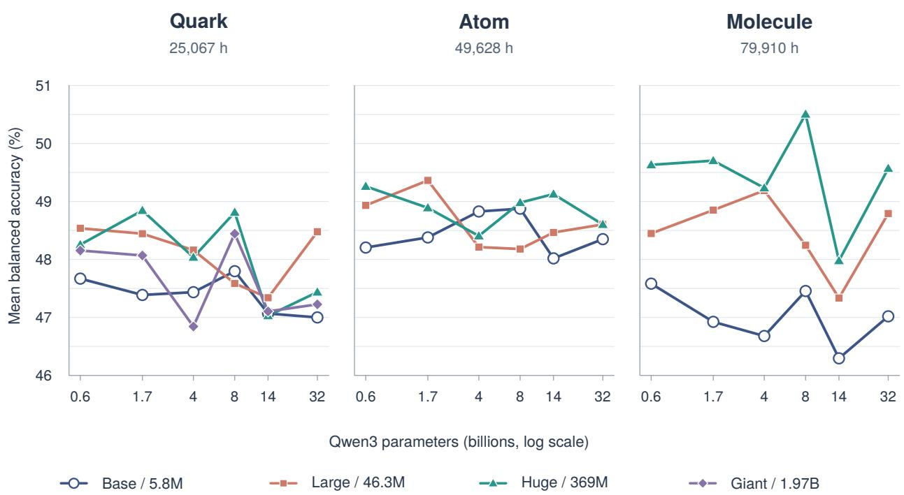  
Figure 11. Joint classification across 23 EEG tasks with ten encoders and six Qwen3 sizes. Panels compare pretraining collections; curves distinguish encoder sizes. Scores are three-seed means on a shared vertical scale.

The Pooled/No-pool results in Section 5.3 ofer a possible explanation for the limited return from a larger readout. Retaining individual patches improves LP over average pooling. Here, channel features are also averaged, although a temporal sequence of 32 tokens is retained. Qwen3 therefore lacks direct access to the individual channel tokens, and the frozen EEG encoder cannot adjust its features during joint training. Information retention and feature adaptation may thus limit how much additional language-model capacity helps.

The clearest gains in joint decoding come from combining larger EEG pretraining collections with greater encoder capacity. The LP comparisons suggest that preserving EEG structure and improving its adaptation to the shared readout are important for realizing these gains; increasing LLM parameters alone provides no consistent improvement.

## 8 Conclusion

Scaling pretraining data and encoder capacity while retaining LaBraM’s core encoder and objective yields strong downstream representations. Across 23 tasks, Atom-L∗ leads Full-FT at 59.05% and Quark-G leads LP at 54.33%; both also lead average task rank. Against the better of EEGNet and EEGConformer on each task, Atom-L and Molecule-H each win on 16 of 23 Full-FT tasks, compared with at most 12 for a baseline EEG foundation model.

The benefits of capacity depend on downstream adaptation. Increasing encoder size improves Full-FT more consistently than LP, and higher LP scores do not guarantee higher Full-FT performance. No-pool’s gains over average pooling suggest that retaining patch structure helps make frozen features useful to downstream tasks. The FT/LP ordering diferences further support evaluating both linear accessibility and taskspecific adaptation when judging the value of a pretrained encoder.

Data breadth and duration also shape the gains from pretraining. The reduced-data Atom results suggest that source diversity may improve data eficiency, while the fraction sweeps indicate a saturation region at fixed encoder capacity. The Full-FT fit for Base and Large gives $H _ { * } ~ \propto ~ P ^ { 0 . 2 9 2 }$ and places the peaks near 22,000 and 40,000 hours, respectively, providing an empirical hypothesis for matching data duration to capacity (Equation 2). Continued optimization introduces a further limit: Full-FT and LP can decline while pretraining loss keeps falling. Training duration and checkpoint selection therefore require downstream evaluation.

Joint EEG–LLM decoding extends this dependence on adaptation to a shared readout. Larger EEG collections and encoders show complementary gains, while increasing Qwen3 size provides no consistent improvement. All ten encoders reach their highest mean with 8B or smaller, and Molecule-H with Qwen3-8B leads at 50.50%. The ordering changes between Pooled LP and joint decoding, together with the pooling analysis, suggest that information preservation and feature adaptation may limit the benefit of additional language-model capacity.

LaBraM’s performance supports expanding an established EEG pretraining design as a route to stronger foundation models. Further progress is likely to come from matching data breadth and duration to encoder capacity, and improving how the resulting representations are preserved and adapted for downstream tasks.

## References

[1] Wei-Bang Jiang, Li-Ming Zhao, and Bao-Liang Lu. Large brain model for learning generic representations with tremendous EEG data in BCI. In The Twelfth International Conference on Learning Representations, 2024. URL https://arxiv.org/abs/2405.18765.

[2] Jiquan Wang, Sha Zhao, Zhiling Luo, Yangxuan Zhou, Haiteng Jiang, Shijian Li, Tao Li, and Gang Pan. CBraMod: A criss-cross brain foundation model for EEG decoding. In The Thirteenth International Conference on Learning Representations, 2025. URL https://arxiv.org/abs/2412.07236.

[3] Berkay Döner, Thorir Mar Ingolfsson, Luca Benini, and Yawei Li. LUNA: Eficient and topology-agnostic foundation model for EEG signal analysis. In The Thirty-ninth Annual Conference on Neural Information Processing Systems (NeurIPS), 2025. URL https://openreview.net/forum?id=uazfjnFL0G.

[4] Yassine El Ouahidi, Jonathan Lys, Philipp Thölke, Nicolas Farrugia, Bastien Pasdeloup, Vincent Gripon, Karim Jerbi, and Giulia Lioi. REVE: A foundation model for EEG – adapting to any setup with large-scale pretraining on 25,000 subjects. arXiv preprint arXiv:2510.21585, 2025.

[5] Wei-Bang Jiang, Yansen Wang, Bao-Liang Lu, and Dongsheng Li. NeuroLM: A universal multi-task foundation model for bridging the gap between language and EEG signals. In The Thirteenth International Conference on Learning Representations, 2025. URL https://arxiv.org/abs/2409.00101.

[6] Anna Tegon, Thorir Mar Ingolfsson, Xiaying Wang, Luca Benini, and Yawei Li. FEMBA: Eficient and scalable EEG analysis with a bidirectional Mamba foundation model. arXiv preprint arXiv:2502.06438, 2025.

[7] Jiquan Wang, Sha Zhao, Zhiling Luo, Yangxuan Zhou, Shijian Li, and Gang Pan. EEGMamba: An EEG foundation model with Mamba. Neural Networks, 192:107816, 2025. doi: 10.1016/j.neunet.2025.107816.

[8] Qinfan Xiao, Ziyun Cui, Chi Zhang, Siqi Chen, Wen Wu, Andrew Thwaites, Alexandra Woolgar, Bowen Zhou, and Chao Zhang. BrainOmni: A brain foundation model for unified EEG and MEG signals. arXiv preprint arXiv:2505.18185, 2025.

[9] Yuchen Zhou, Jiamin Wu, Zichen Ren, Zhouheng Yao, Weiheng Lu, Kunyu Peng, Qihao Zheng, Chunfeng Song, Wanli Ouyang, and Chao Gou. CSBrain: A cross-scale spatiotemporal brain foundation model for EEG decoding. In Advances in Neural Information Processing Systems 38 (NeurIPS 2025), pages 96859–96904, 2025. doi: 10.52202/085713-2915.

[10] Jingying Ma, Feng Wu, Qika Lin, Yucheng Xing, Chenyu Liu, Ziyu Jia, and Mengling Feng. CodeBrain: Bridging decoupled tokenizer and multi-scale architecture for EEG foundation model. In The Fourteenth Inter national Conference on Learning Representations (ICLR), 2026. doi: 10.48550/arXiv.2506.09110.

[11] Weiheng Lu, Zhouheng Yao, Jiamin Wu, Pengyu Zhu, Yuchen Zhou, Weijian Mai, Qihao Zheng, Wanli Ouyang, and Chunfeng Song. UniMind: Unleashing the power of LLMs for unified multi-task brain decoding. arXiv preprint arXiv:2506.18962, 2025. URL https://arxiv.org/abs/2506.18962.

[12] Jun-Yu Pan, Yansen Wang, Enze Zhang, Bao-Liang Lu, Wei-Long Zheng, and Dongsheng Li. Visualizing the invisible: Generative visual grounding empowers universal EEG understanding in MLLMs. arXiv preprint arXiv:2605.18172, 2026. URL https://arxiv.org/abs/2605.18172.

[13] Iyad Obeid and Joseph Picone. The Temple University Hospital EEG Data Corpus. Frontiers in Neuroscience, 2016. URL https://doi.org/10.3389/fnins.2016.00196.

[14] Edilberto Amorim, Wei-Long Zheng, Mohammad M. Ghassemi, Mahsa Aghaeeaval, Pravinkumar Kandhare, Vishnu Karukonda, Jong Woo Lee, Susan T. Herman, Adithya Sivaraju, Nicolas Gaspard, Jeannette Hofmeijer, Michel J. A. M. van Putten, Reza Sameni, Matthew A. Reyna, Gari D. Cliford, and M. Brandon Westover. The International Cardiac Arrest Research Consortium Electroencephalography Database. Critical Care Medicine, 2023. URL https://doi.org/10.1097/CCM.0000000000006074.

[15] Ali Shoeb and John Guttag. Application of Machine Learning to Epileptic Seizure Detection. Proceedings of the 27th International Conference on Machine Learning, 2010. URL https://physionet.org/files/ chbmit/1.0.0/shoeb-icml-2010.pdf.

[16] Diego Alvarez-Estevez and Roselyne M. Rijsman. Inter-database validation of a deep learning approach for automatic sleep scoring. PLOS ONE, 2021. URL https://doi.org/10.1371/journal.pone.0256111.

[17] Michael J. Kahana, Lynn J. Lohnas, M. Karl Healey, Ada Aka, Adam W. Broitman, Patrick Crutchley, Elizabeth Crutchley, Kylie H. Alm, Brandon S. Katerman, Nicole E. Miller, Joel R. Kuhn, Yuxuan Li, Nicole M. Long, Jonathan Miller, Madison D. Paron, Jesse K. Pazdera, Isaac Pedisich, Joseph H. Rudoler, and Christoph T. Weidemann. The Penn Electrophysiology of Encoding and Retrieval Study. Journal of Experimental Psychology: Learning, Memory, and Cognition, 50(9):1421–1443, 2024. doi: 10.1037/xlm0001319. URL https://doi.org/10.1037/xlm0001319.

[18] Eduardo López-Larraz, María Sierra-Torralba, Sergio Clemente, Galit Fierro, David Oriol, Javier Minguez, Luis Montesano, and Jens G. Klinzing. The Bitbrain Open Access Sleep (BOAS) dataset. OpenNeuro dataset, 2025. URL https://openneuro.org/datasets/ds005555.

[19] Jonathan Xu, Ugo Bruzadin Nunes, Wangshu Jiang, Samuel Ryther, Jordan Pringle, Paul S. Scotti, Arnaud Delorme, and Reese Kneeland. Alljoined-1.6M: A Million-Trial EEG-Image Dataset for Evaluating Afordable Brain-Computer Interfaces. arXiv preprint arXiv:2508.18571, 2025. URL https://arxiv.org/abs/2508. 18571.

[20] Alessandro T. Giford, Kshitij Dwivedi, Gemma Roig, and Radoslaw M. Cichy. A large and rich EEG dataset for modeling human visual object recognition. NeuroImage, 2022. URL https://doi.org/10.1016/j. neuroimage.2022.119754.

[21] Wei-Long Zheng and Bao-Liang Lu. Investigating Critical Frequency Bands and Channels for EEG-Based Emotion Recognition With Deep Neural Networks. IEEE Transactions on Autonomous Mental Development, 2015. URL https://doi.org/10.1109/TAMD.2015.2431497.

[22] Wei-Long Zheng, Wei Liu, Yifei Lu, Bao-Liang Lu, and Andrzej Cichocki. EmotionMeter: A Multimodal Framework for Recognizing Human Emotions. IEEE Transactions on Cybernetics, 2019. URL https://doi. org/10.1109/TCYB.2018.2797176.

[23] Wei Liu, Jie-Lin Qiu, Wei-Long Zheng, and Bao-Liang Lu. Comparing Recognition Performance and Robustness of Multimodal Deep Learning Models for Multimodal Emotion Recognition. IEEE Transactions on Cognitive and Developmental Systems, 2022. URL https://doi.org/10.1109/TCDS.2021.3071170.

[24] Wei-Bang Jiang, Xuan-Hao Liu, Wei-Long Zheng, and Bao-Liang Lu. SEED-VII: A Multimodal Dataset of Six Basic Emotions With Continuous Labels for Emotion Recognition. IEEE Transactions on Afective Computing, 2025. URL https://doi.org/10.1109/TAFFC.2024.3485057.

[25] Ziling Lu, Zongsheng Li, Xinke Shen, Kexin Lou, Yingyue Xin, Xiaoqi Chen, Shinan Wang, Xiang Chen, Jiahao Fan, Chenyu Huang, Xin Xu, Zhoujie Hou, Chen Wei, and Quanying Liu. OmniEEG-Bench: A standardized evaluation benchmark for EEG foundation models. arXiv preprint arXiv:2606.00815, 2026. URL https://arxiv.org/abs/2606.00815.

[26] Demetres Kostas, Stephane Aroca-Ouellette, and Frank Rudzicz. BENDR: Using transformers and a contrastive self-supervised learning task to learn from massive amounts of EEG data. Frontiers in Human Neuroscience, 15, 2021. URL https://arxiv.org/abs/2101.12037.

[27] Chaoqi Yang, M. Brandon Westover, and Jimeng Sun. BIOT: Cross-data biosignal learning in the wild. In Advances in Neural Information Processing Systems, 2023. URL https://arxiv.org/abs/2305.10351.

[28] Wenhui Cui, Woojae Jeong, Philipp Thölke, Takfarinas Medani, Karim Jerbi, Anand A. Joshi, and Richard M. Leahy. Neuro-GPT: Towards a foundation model for EEG. arXiv preprint arXiv:2311.03764, 2023.

[29] Vernon J. Lawhern, Amelia J. Solon, Nicholas R. Waytowich, Stephen M. Gordon, Chou P. Hung, and Brent J. Lance. EEGNet: A compact convolutional network for EEG-based brain-computer interfaces. Journal of Neural Engineering, 15(5):056013, 2018.

[30] Yonghao Song, Qingqing Zheng, Bingchuan Liu, and Xiaorong Gao. EEG Conformer: Convolutional transformer for EEG decoding and visualization. IEEE Transactions on Neural Systems and Rehabilitation Engineering, 31:710–719, 2023. doi: 10.1109/TNSRE.2022.3230250.

[31] An Yang, Anfeng Li, Baosong Yang, Beichen Zhang, Binyuan Hui, Bo Zheng, Bowen Yu, Chang Gao, Chengen Huang, Chenxu Lv, Chujie Zheng, Dayiheng Liu, Fan Zhou, Fei Huang, Feng Hu, Hao Ge, Haoran Wei, Huan Lin, Jialong Tang, Jian Yang, Jianhong Tu, Jianwei Zhang, Jianxin Yang, Jiaxi Yang, Jing Zhou, Jingren Zhou, Junyang Lin, Kai Dang, Keqin Bao, Kexin Yang, Le Yu, Lianghao Deng, Mei Li, Mingfeng Xue, Mingze Li, Pei Zhang, Peng Wang, Qin Zhu, Rui Men, Ruize Gao, Shixuan Liu, Shuang Luo, Tianhao Li, Tianyi Tang, Wenbiao Yin, Xingzhang Ren, Xinyu Wang, Xinyu Zhang, Xuancheng Ren, Yang Fan, Yang Su, Yichang Zhang, Yinger Zhang, Yu Wan, Yuqiong Liu, Zekun Wang, Zeyu Cui, Zhenru Zhang, Zhipeng Zhou, and Zihan Qiu. Qwen3 technical report. arXiv preprint arXiv:2505.09388, 2025.

[32] Edward J Hu, Yelong Shen, Phillip Wallis, Zeyuan Allen-Zhu, Yuanzhi Li, Shean Wang, Lu Wang, and Weizhu Chen. LoRA: Low-rank adaptation of large language models. In International Conference on Learning Representations, 2022. URL https://openreview.net/forum?id=nZeVKeeFYf9.

[33] Michael Tangermann et al. Review of the BCI Competition IV. Frontiers in Neuroscience, 2012. URL https: //doi.org/10.3389/fnins.2012.00055.

[34] Ji-Hoon Jeong, Jeong-Hyun Cho, Young-Eun Lee, Seo-Hyun Lee, Gi-Hwan Shin, Young-Seok Kweon, José del R. Millán, Klaus-Robert Müller, and Seong-Whan Lee. 2020 International brain–computer interface competition: A review. Frontiers in Human Neuroscience, 2022. URL https://doi.org/10.3389/fnhum.2022. 898300.

[35] Igor Zyma, Sergii Tukaev, Ivan Seleznov, Ken Kiyono, Anton Popov, Mariia Chernykh, and Oleksii Shpenkov. Electroencephalograms during Mental Arithmetic Task Performance. Data, 2019. URL https://doi.org/ 10.3390/data4010014.

[36] Gerwin Schalk, Dennis J. McFarland, Thilo Hinterberger, Niels Birbaumer, and Jonathan R. Wolpaw. BCI2000: A General-Purpose Brain-Computer Interface (BCI) System. IEEE Transactions on Biomedical Engineering, 2004. URL https://doi.org/10.1109/TBME.2004.827072.

[37] Jingjing Chen, Xiaobin Wang, Chen Huang, Xin Hu, Xinke Shen, and Dan Zhang. A Large Finer-grained Afective Computing EEG Dataset. Scientific Data, 10(1):740, 2023. doi: 10.1038/s41597-023-02650-w. URL https://doi.org/10.1038/s41597-023-02650-w.

[38] Alireza Chamanzar, Sarah M Haigh, Pulkit Grover, and Marlene Behrmann. Abnormalities in cortical pattern of coherence in migraine detected using ultra high-density EEG. Brain Communications, 3(2):fcab061, 2021. doi: 10.1093/braincomms/fcab061. URL https://doi.org/10.1093/braincomms/fcab061.

[39] S. A. Nuiten, A. Canales-Johnson, L. Beerendonk, N. Nanuashvili, J. J. Fahrenfort, T. Bekinschtein, and S. van Gaal. Preserved sensory processing but hampered conflict detection when stimulus input is task-irrelevant. Elife, 10:e64431, 2021. doi: 10.7554/elife.64431. URL https://doi.org/10.7554/elife.64431.

[40] Stefan Wiens, Rasmus Eklund, Malina Szychowska, Alexander Milof, Danielle Cosme, Stephen Pierzchajlo, and Per Carlbring. Electrophysiological correlates of in vivo and virtual reality exposure therapy in spider phobia. Psychophysiology, 59(12):e14117, 2022. doi: 10.1111/psyp.14117. URL https://doi.org/10. 1111/psyp.14117.

[41] Abigail Dickinson, Shafali Jeste, and Elizabeth Milne. Electrophysiological signatures of brain aging in autism spectrum disorder. Cortex, 148:139–151, 2022. doi: 10.1016/j.cortex.2021.09.022. URL https://doi.org/ 10.1016/j.cortex.2021.09.022.

[42] Jeehyun Kim, Xiyuan Jiang, Dylan Forenzo, Yixuan Liu, Nancy Anderson, Carol M. Greco, and Bin He. Immediate efects of short-term meditation on sensorimotor rhythm-based brain–computer interface performance. Frontiers in Human Neuroscience, 16:1019279, 2022. doi: 10.3389/fnhum.2022.1019279. URL https://doi.org/10.3389/fnhum.2022.1019279.

[43] J. E. Gonzalez, N. Nieto, P. Brusco, A. Gravano, and J. E. Kamienkowski. Speech-induced suppression during natural dialogues. Commun Biol, 7(1):291, 2024. doi: 10.1038/s42003-024-05945-9. URL https://doi. org/10.1038/s42003-024-05945-9.

[44] M. Gu, W. Pei, X. Gao, and Y. Wang. An open dataset for human SSVEPs in the frequency range of 1-60 Hz. Sci Data, 11(1):196, 2024. doi: 10.1038/s41597-024-03023-7. URL https://doi.org/10.1038/

s41597-024-03023-7.

[45] Dylan Forenzo, Yixuan Liu, Jeehyun Kim, Yidan Ding, Taehyung Yoon, and Bin He. Integrating Simultaneous Motor Imagery and Spatial Attention for EEG-BCI Control. IEEE Transactions on Biomedical Engineering, 71(1):282–294, 2024. doi: 10.1109/tbme.2023.3298957. URL https://doi.org/10.1109/tbme.2023. 3298957.

[46] Y. Chen, S. Fazli, and C. Wallraven. An EEG Dataset of Neural Signatures in a Competitive Two-Player Game Encouraging Deceptive Behavior. Sci Data, 11(1):389, 2024. doi: 10.1038/s41597-024-03234-y. URL https: //doi.org/10.1038/s41597-024-03234-y.

[47] Dylan Forenzo, Hao Zhu, Jenn Shanahan, Jaehyun Lim, and Bin He. Continuous tracking using deep learningbased decoding for noninvasive brain–computer interface. PNAS Nexus, 3(4):pgae145, 2024. doi: 10.1093/ pnasnexus/pgae145. URL https://doi.org/10.1093/pnasnexus/pgae145.

[48] Joshua Kosnof, Kai Yu, Chang Liu, and Bin He. Transcranial Focused Ultrasound to V5 Enhances Human Visual Motion Brain-Computer Interface by Modulating Feature-Based Attention. bioRxiv preprint, 2023. URL https://doi.org/10.1101/2023.09.04.556252.

[49] Sam Watson, Torsten Dau, and Jens Hjortkjær. Task-dependent Modulation Masking of 4 Hz Envelope Following Responses. Journal of Cognitive Neuroscience, 37(7):1189–1201, 2025. doi: 10.1162/jocn\_a\_02309. URL https://doi.org/10.1162/jocn\_a\_02309.

[50] Dylan Forenzo, Yisha Zhang, George F. Wittenberg, and Bin He. Continuous Reaching and Grasping with a BCI Controlled Robotic Arm in Healthy and Stroke-Afected Individuals. medRxiv preprint, 2025. URL https://doi.org/10.1101/2025.04.16.25325551.

[51] W. Chang, W. Kong, G. Yan, R. Lv, K. Du, M. T. Sadiq, B. Guo, R. Yin, and X. Liu. A multi-paradigm EEG dataset for studying upper limb rehabilitation exercises. Sci Data, 12(1):1877, 2025. doi: 10.1038/ s41597-025-06147-6. URL https://doi.org/10.1038/s41597-025-06147-6.

[52] Elena Bondi, Yidan Ding, Yisha Zhang, Eleonora Maggioni, and Bin He. Investigating the neurovascular coupling across multiple motor execution and imagery conditions: a whole-brain EEG-informed fMRI analysis. NeuroImage, 317:121311, 2025. doi: 10.1016/j.neuroimage.2025.121311. URL https://doi.org/10. 1016/j.neuroimage.2025.121311.

[53] A. Malekmohammadi and G. Cheng. Music Familiarization Elicits Functional Connectivity Between Right Frontal/Temporal and Parietal Areas in the Theta and Alpha Bands. Brain Topogr, 38(1):2, 2024. doi: 10.1007/ s10548-024-01081-z. URL https://doi.org/10.1007/s10548-024-01081-z.

[54] Rasmus Eklund and Stefan Wiens. Visual awareness negativity is an early neural correlate of awareness: A preregistered study with two Gabor sizes. Cognitive, Afective, & Behavioral Neuroscience, 18(1):176–188, 2018. doi: 10.3758/s13415-018-0562-z. URL https://doi.org/10.3758/s13415-018-0562-z.

[55] Stefan Wiens, Malina Szychowska, Rasmus Eklund, and Erik van Berlekom. Cascade and no‐repetition rules are comparable controls for the auditory frequency mismatch negativity in oddball tasks. Psychophysiology, 56 (1):e13280, 2019. doi: 10.1111/psyp.13280. URL https://doi.org/10.1111/psyp.13280.

[56] Z. Cao, C. H. Chuang, J. K. King, and C. T. Lin. Multi-channel EEG recordings during a sustained-attention driving task. Sci Data, 6(1):19, 2019. doi: 10.1038/s41597-019-0027-4. URL https://doi.org/10.1038/ s41597-019-0027-4.

[57] Stefan Wiens, Erik van Berlekom, Malina Szychowska, and Rasmus Eklund. Visual Perceptual Load Does Not Afect the Frequency Mismatch Negativity. Frontiers in Psychology, 10:1970, 2019. doi: 10.3389/fpsyg.2019. 01970. URL https://doi.org/10.3389/fpsyg.2019.01970.

[58] Stefan Wiens, Malina Szychowska, Rasmus Eklund, and Mats E. Nilsson. Data on the auditory duration mismatch negativity for diferent sound pressure levels and visual perceptual loads. Data in Brief, 11:159–164, 2017. doi: 10.1016/j.dib.2017.02.007. URL https://doi.org/10.1016/j.dib.2017.02.007.

[59] Malina Szychowska, Rasmus Eklund, Mats E. Nilsson, and Stefan Wiens. Efects of sound pressure level and visual perceptual load on the auditory mismatch negativity. Neuroscience Letters, 640:37–41, 2017. doi: 10.1016/j.neulet.2017.01.001. URL https://doi.org/10.1016/j.neulet.2017.01.001.

[60] Sirvan Khalighi, Teresa Sousa, José Moutinho Santos, and Urbano Nunes. ISRUC-Sleep: A comprehensive public dataset for sleep researchers. Computer Methods and Programs in Biomedicine, 2016. URL https: //doi.org/10.1016/j.cmpb.2015.10.013.

[61] Alexandre Barachant. Commande robuste d’un efecteur par une interface cerveau machine EEG asynchrone. PhD thesis, Université de Grenoble, 2012. URL https://theses.hal.science/tel-01196752.

[62] L. Korczowski, E. Ostaschenko, A. Andreev, G. Cattan, P. L. C. Rodrigues, V. Gautheret, and M. Congedo.

Brain Invaders calibration-less P300-based BCI using dry EEG electrodes Dataset (BI2014a). HAL, report hal-02171575, 2019. URL https://hal.science/hal-02171575.

[63] Robert Leeb, Felix Lee, Claudia Keinrath, Reinhold Scherer, Horst Bischof, and Gert Pfurtscheller. Brain– Computer Communication: Motivation, Aim, and Impact of Exploring a Virtual Apartment. IEEE Transactions on Neural Systems and Rehabilitation Engineering, 15(4):473–482, 2007. doi: 10.1109/TNSRE.2007.906956. URL https://doi.org/10.1109/TNSRE.2007.906956.

[64] A. Riccio, L. Simione, F. Schettini, A. Pizzimenti, M. Inghilleri, M. O. Belardinelli, and D. Mattia. Attention and P300-based BCI performance in people with amyotrophic lateral sclerosis. Frontiers in Human Neuroscience, 7:732, 2013. doi: 10.3389/fnhum.2013.00732. URL https://doi.org/10.3389/fnhum.2013. 00732.

[65] P. Aricò, F. Aloise, F. Schettini, S. Salinari, D. Mattia, and F. Cincotti. Influence of P300 latency jitter on event related potential-based brain–computer interface performance. Journal of Neural Engineering, 11(3): 035008, 2014. doi: 10.1088/1741-2560/11/3/035008. URL https://doi.org/10.1088/1741-2560/11/ 3/035008.

[66] J. Faller, C. Vidaurre, T. Solis-Escalante, C. Neuper, and R. Scherer. Autocalibration and Recurrent Adaptation: Towards a Plug and Play Online ERD-BCI. IEEE Transactions on Neural Systems and Rehabilitation Engineering, 20(3):313–319, 2012. doi: 10.1109/TNSRE.2012.2189584. URL https://doi.org/10.1109/TNSRE. 2012.2189584.

[67] C. Guger, S. Daban, E. Sellers, C. Holzner, G. Krausz, R. Carabalona, F. Gramatica, and G. Edlinger. How many people are able to control a P300-based brain–computer interface (BCI)? Neuroscience Letters, 462(1):94–98, 2009. doi: 10.1016/j.neulet.2009.06.045. URL https://doi.org/10.1016/j.neulet.2009.06.045.

[68] R. Scherer, J. Faller, E. V. C. Friedrich, E. Opisso, U. Costa, A. Kübler, and G. R. Müller-Putz. Individually Adapted Imagery Improves Brain-Computer Interface Performance in End-Users with Disability. PLOS ONE, 10(5):e0123727, 2015. doi: 10.1371/journal.pone.0123727. URL https://doi.org/10.1371/journal. pone.0123727.

[69] H. Cho, M. Ahn, S. Ahn, M. Kwon, and S. C. Jun. EEG datasets for motor imagery brain computer interface. GigaScience, 2017. doi: 10.1093/gigascience/gix034. URL https://doi.org/10.1093/gigascience/ gix034.

[70] Pauline Dreyer, Aline Roc, Léa Pillette, Sébastien Rimbert, and Fabien Lotte. A large EEG database with users’ profile information for motor imagery brain-computer interface research. Scientific Data, 10(1):580, 2023. doi: 10.1038/s41597-023-02445-z. URL https://doi.org/10.1038/s41597-023-02445-z.

[71] U. Hofmann, J.-M. Vesin, T. Ebrahimi, and K. Diserens. An eficient P300-based brain–computer interface for disabled subjects. Journal of Neuroscience Methods, 2008. doi: 10.1016/j.jneumeth.2007.03.005. URL https://doi.org/10.1016/j.jneumeth.2007.03.005.

[72] Min-Ho Lee, O-Yeon Kwon, Yong-Jeong Kim, Hong-Kyung Kim, Young-Eun Lee, John Williamson, Siamac Fazli, and Seong-Whan Lee. EEG dataset and OpenBMI toolbox for three BCI paradigms: an investigation into BCI illiteracy. GigaScience, 8(5):giz002, 2019. doi: 10.1093/gigascience/giz002. URL https://doi.org/ 10.1093/gigascience/giz002.

[73] Haijie Liu, P. Wei, H. Wang, et al. An EEG motor imagery dataset for brain computer interface in acute stroke patients. Scientific Data, 11:131, 2024. doi: 10.1038/s41597-023-02787-8. URL https://doi.org/10. 1038/s41597-023-02787-8.

[74] V. P. Oikonomou, G. Liaros, K. Georgiadis, E. Chatzilari, K. Adam, S. Nikolopoulos, and I. Kompatsiaris. Comparative evaluation of state-of-the-art algorithms for SSVEP-based BCIs. arXiv preprint arXiv:1602.00904, 2016. URL https://doi.org/10.48550/arXiv.1602.00904.

[75] Masaki Nakanishi, Yijun Wang, Yu-Te Wang, and Tzyy-Ping Jung. A Comparison Study of Canonical Correlation Analysis Based Methods for Detecting Steady-State Visual Evoked Potentials. PLOS ONE, 10(10): e0140703, 2015. doi: 10.1371/journal.pone.0140703. URL https://doi.org/10.1371/journal.pone. 0140703.

[76] Patrick Ofner, Andreas Schwarz, Joana Pereira, and Gernot R. Müller-Putz. Upper limb movements can be decoded from the time-domain of low-frequency EEG. PLOS ONE, 12(8):e0182578, 2017. doi: 10.1371/ journal.pone.0182578. URL https://doi.org/10.1371/journal.pone.0182578.

[77] Robin Tibor Schirrmeister et al. Deep learning with convolutional neural networks for EEG decoding and visualization. Human Brain Mapping, 38(11):5391–5420, 2017. doi: 10.1002/hbm.23730. URL https: //doi.org/10.1002/hbm.23730.

[78] J. Shin, A. von Lühmann, B. Blankertz, D. W. Kim, J. Jeong, H. J. Hwang, and K. R. Müller. Open Access Dataset for EEG+NIRS Single-Trial Classification. IEEE Transactions on Neural Systems and Rehabilitation Engineering, 25(10):1735–1745, 2017. doi: 10.1109/TNSRE.2016.2628057. URL https://doi.org/10. 1109/TNSRE.2016.2628057.

[79] Yijun Wang, Xiaogang Chen, Xiaorong Gao, and Shangkai Gao. A Benchmark Dataset for SSVEP-Based Brain–Computer Interfaces. IEEE Transactions on Neural Systems and Rehabilitation Engineering, 25(10): 1746–1752, 2017. doi: 10.1109/TNSRE.2016.2627556. URL https://doi.org/10.1109/TNSRE.2016. 2627556.

[80] Weibo Yi, Shuang Qiu, Kun Wang, Hongzhi Qi, Lixin Zhang, Peng Zhou, Feng He, and Dong Ming. Evaluation of EEG Oscillatory Patterns and Cognitive Process during Simple and Compound Limb Motor Imagery. PLOS ONE, 9(12):e0114853, 2014. doi: 10.1371/journal.pone.0114853. URL https://doi.org/10.1371/ journal.pone.0114853.

[81] Wajid Mumtaz, Likun Xia, Mohd Azhar Mohd Yasin, Syed Saad Azhar Ali, and Aamir Saeed Malik. A waveletbased technique to predict treatment outcome for Major Depressive Disorder. PLOS ONE, 2017. URL https: //doi.org/10.1371/journal.pone.0171409.

[82] Rui Li, Le-Dian Liu, and Bao-Liang Lu. Discrimination of Decision Confidence Levels from EEG Signals. In 2021 10th International IEEE/EMBS Conference on Neural Engineering (NER), pages 946–949, 2021. doi: 10.1109/NER49283.2021.9441086. URL https://doi.org/10.1109/NER49283.2021.9441086.

[83] Wei-Bang Jiang, Li-Ming Zhao, Ping Guo, and Bao-Liang Lu. Discriminating Surprise and Anger from EEG and Eye Movements with a Graph Network. In 2021 IEEE International Conference on Bioinformatics and Biomedicine (BIBM), pages 1353–1357, 2021. doi: 10.1109/BIBM52615.2021.9669637. URL https:// bcmi.sjtu.edu.cn/\~blu/papers/2021/2021-13.pdf.

[84] Benjamin Blankertz, Guido Dornhege, Matthias Krauledat, Klaus-Robert Müller, and Gabriel Curio. The non-invasive Berlin Brain–Computer Interface: Fast acquisition of efective performance in untrained subjects. NeuroImage, 37(2):539–550, 2007. doi: 10.1016/j.neuroimage.2007.01.051. URL https://doi.org/10. 1016/j.neuroimage.2007.01.051.

[85] Rui Li, Yiting Wang, and Bao-Liang Lu. Measuring Decision Confidence Levels from EEG Using a Spectral-Spatial-Temporal Adaptive Graph Convolutional Neural Network. In Neural Information Processing, pages 395–406. Springer Nature Singapore, 2023. doi: 10.1007/978-981-99-1642-9\_34. URL https://bcmi.sjtu. edu.cn/\~blu/papers/2022/2022-14.pdf.

[86] Arman Savran, Koray Ciftci, Guillaume Chanel, Javier Mota, Luong Hong Viet, Blent Sankur, Lale Akarun, Alice Caplier, and Michele Rombaut. Emotion Detection in the Loop from Brain Signals and Facial Images. In Proceedings of the eNTERFACE 2006 Workshop, 2006. URL https://archive-ouverte.unige.ch/ unige:47926.

[87] Matthew D Luciw, Ewa Jarocka, and Benoni B Edin. Multi-channel EEG recordings during 3,936 grasp and lift trials with varying weight and friction. Scientific Data, 1(1):140047, 2014. doi: 10.1038/sdata.2014.47. URL https://doi.org/10.1038/sdata.2014.47.

[88] Perrin Margaux, Maby Emmanuel, Daligault Sébastien, Bertrand Olivier, and Mattout Jérémie. Objective and Subjective Evaluation of Online Error Correction during P300-Based Spelling. Advances in Human-Computer Interaction, 2012:1–13, 2012. doi: 10.1155/2012/578295. URL https://doi.org/10.1155/2012/578295.

[89] Shuai Luo, Yu-Ting Lan, Dan Peng, Ziyi Li, Wei-Long Zheng, and Bao-Liang Lu. Multimodal Emotion Recognition in Response to Oil Paintings. In 2022 44th Annual International Conference of the IEEE Engineering in Medicine & Biology Society (EMBC), 2022. doi: 10.1109/EMBC48229.2022.9871630. URL https://bcmi.sjtu.edu.cn/\~blu/papers/2022/2022-10.pdf.

[90] Logan T. Trujillo. Mental Efort and Information-Processing Costs Are Inversely Related to Global Brain Free Energy During Visual Categorization. Frontiers in Neuroscience, 13:1292, 2019. doi: 10.3389/fnins.2019. 01292. URL https://doi.org/10.3389/fnins.2019.01292.

[91] Logan T. Trujillo, Ph.D., Candice T. Stanfield, and Ruben D. Vela. The Efect of Electroencephalogram (EEG) Reference Choice on Information-Theoretic Measures of the Complexity and Integration of EEG Signals. Frontiers in Neuroscience, 11:425, 2017. doi: 10.3389/fnins.2017.00425. URL https://doi.org/10.3389/ fnins.2017.00425.

[92] M. Torkamani-Azar, S. D. Kanik, S. Aydin, and M. Cetin. Prediction of Reaction Time and Vigilance Variability From Spatio-Spectral Features of Resting-State EEG in a Long Sustained Attention Task. IEEE Journal of Biomedical and Health Informatics, 24(9):2550–2558, 2020. doi: 10.1109/JBHI.2020.2980056. URL https:

//doi.org/10.1109/JBHI.2020.2980056.

[93] Pia Schoknecht, Himanshu Yadav, and Shravan Vasishth. Do syntactic and semantic similarity lead to interference efects? Evidence from self-paced reading and event-related potentials using German. Journal of Memory and Language, 141:104599, 2025. doi: 10.1016/j.jml.2024.104599. URL https://doi.org/10.1016/j. jml.2024.104599.

[94] S. Zhao, S. Hui, M. Chen, C. Feng, M. Zhai, and W. Feng. Semantic-based audiovisual integration enhances active storage in visual working memory. Neuroimage, 323:121577, 2025. doi: 10.1016/j.neuroimage.2025. 121577. URL https://doi.org/10.1016/j.neuroimage.2025.121577.

[95] Rhiânan E. Ellis, Elizabeth Milne, and Liat Levita. Reduced visual cortical plasticity in autism spectrum disorder. Brain Research Bulletin, 170:11–21, 2021. doi: 10.1016/j.brainresbull.2021.01.019. URL https: //doi.org/10.1016/j.brainresbull.2021.01.019.

[96] Xuan-Hao Liu, Yan-Kai Liu, Yansen Wang, Kan Ren, Hanwen Shi, Zilong Wang, Dongsheng Li, Bao-Liang Lu, and Wei-Long Zheng. EEG2Video: Towards Decoding Dynamic Visual Perception from EEG Signals. Advances in Neural Information Processing Systems, 2024. URL https://proceedings.neurips.cc/paper\_ files/paper/2024/hash/84bad835faaf48f24d990072bb5b80ee-Abstract.html.

[97] Ziyi Li, Le-Yan Tao, Rui-Xiao Ma, Wei-Long Zheng, and Bao-Liang Lu. Investigating the Efects of Sleep Conditions on Emotion Responses with EEG Signals and Eye Movements. IEEE Transactions on Afective Computing, 2025. URL https://doi.org/10.1109/TAFFC.2025.3572504.

[98] Wei-Long Zheng and Bao-Liang Lu. A multimodal approach to estimating vigilance using EEG and forehead EOG. Journal of Neural Engineering, 2017. URL https://doi.org/10.1088/1741-2552/aa5a98.

[99] Wei Liu, Wei-Long Zheng, Ziyi Li, Si-Yuan Wu, Lu Gan, and Bao-Liang Lu. Identifying similarities and diferences in emotion recognition with EEG and eye movements among Chinese, German, and French people. Journal of Neural Engineering, 2022. URL https://doi.org/10.1088/1741-2552/ac5c8d.

[100] Jun Ma, Banghua Yang, Wenzheng Qiu, Yunzhe Li, Shouwei Gao, and Xinxing Xia. A large EEG dataset for studying cross-session variability in motor imagery brain-computer interface. Scientific Data, 2022. URL https://doi.org/10.1038/s41597-022-01647-1.

[101] Paolo Detti, Giovanni Vatti, and G. Zabalo Manrique de Lara. EEG Synchronization Analysis for Seizure Prediction: A Study on Data of Noninvasive Recordings. Processes, 2020. URL https://doi.org/10. 3390/pr8070846.

[102] Lies Bollens, Bernd Accou, Hugo Van hamme, and Tom Francart. SparrKULee: A Speech-Evoked Auditory Response Repository from KU Leuven, Containing the EEG of 85 Participants. Data, 2024. URL https: //doi.org/10.3390/data9080094.

[103] Tijl Grootswagers, Ivy Zhou, Amanda K. Robinson, Martin N. Hebart, and Thomas A. Carlson. Human EEG recordings for 1,854 concepts presented in rapid serial visual presentation streams. Scientific Data, 2022. URL https://doi.org/10.1038/s41597-021-01102-7.

[104] Christoph Schneider, Michael Pereira, Luca Tonin, and José del R. Millán. Real-time EEG Feedback on Alpha Power Lateralization Leads to Behavioral Improvements in a Covert Attention Task. Brain Topography, 33(1):48–59, 2020. doi: 10.1007/s10548-019-00725-9. URL https://doi.org/10.1007/ s10548-019-00725-9.

[105] Michael Pereira, Nathan Faivre, Iñaki Iturrate, Marco Wirthlin, Luana Serafini, Stéphanie Martin, Arnaud Desvachez, Olaf Blanke, Dimitri Van De Ville, and José del R. Millán. Disentangling the origins of confidence in speeded perceptual judgments through multimodal imaging. Proceedings of the National Academy ofSciences, 117(15):8382–8390, 2020. doi: 10.1073/pnas.1918335117. URL https://doi.org/10.1073/ pnas.1918335117.

[106] Giulia Lioi, Claire Cury, Lorraine Perronnet, Marsel Mano, Elise Bannier, Anatole Lécuyer, and Christian Barillot. Simultaneous MRI-EEG during a motor imagery neurofeedback task: an open access brain imaging dataset for multi-modal data integration. bioRxiv preprint, 2019. URL https://doi.org/10.1101/862375.

[107] Lorraine Perronnet, Anatole Lécuyer, Marsel Mano, Mathis Fleury, Giulia Lioi, Claire Cury, Maureen Clerc, Fabien Lotte, and Christian Barillot. Learning 2-in-1: Towards Integrated EEG-fMRI-Neurofeedback. bioRxiv preprint, 2018. URL https://doi.org/10.1101/397729.

[108] Daniel G Wakeman and Richard N Henson. A multi-subject, multi-modal human neuroimaging dataset. Scientific Data, 2(1):150001, 2015. doi: 10.1038/sdata.2015.1. URL https://doi.org/10.1038/sdata.2015. 1.

[109] Duncan Williams, Alexis Kirke, Eduardo Miranda, Ian Daly, Faustina Hwang, James Weaver, and Slawomir

Nasuto. Afective Calibration of Musical Feature Sets in an Emotionally Intelligent Music Composition System. ACM Transactions on Applied Perception, 14(3):1–13, 2017. doi: 10.1145/3059005. URL https://doi.org/ 10.1145/3059005.

[110] Ian Daly, Asad Malik, Faustina Hwang, Etienne Roesch, James Weaver, Alexis Kirke, Duncan Williams, Eduardo Miranda, and Slawomir J. Nasuto. Neural correlates of emotional responses to music: An EEG study. Neuroscience Letters, 573:52–57, 2014. doi: 10.1016/j.neulet.2014.05.003. URL https://doi.org/10. 1016/j.neulet.2014.05.003.

[111] Ian Daly, Duncan Williams, Alexis Kirke, James Weaver, Asad Malik, Faustina Hwang, Eduardo Miranda, and Slawomir J Nasuto. Afective brain–computer music interfacing. Journal of Neural Engineering, 13(4): 046022, 2016. doi: 10.1088/1741-2560/13/4/046022. URL https://doi.org/10.1088/1741-2560/13/ 4/046022.

[112] Ian Daly, Duncan Williams, Faustina Hwang, Alexis Kirke, Eduardo R. Miranda, and Slawomir J. Nasuto. Electroencephalography reflects the activity of sub-cortical brain regions during approach-withdrawal behaviour while listening to music. Scientific Reports, 9(1):9415, 2019. doi: 10.1038/s41598-019-45105-2. URL https://doi.org/10.1038/s41598-019-45105-2.

[113] Jobi S. George, Jon Strunk, Rachel Mak-McCully, Melissa Houser, Howard Poizner, and Adam R. Aron. Dopaminergic therapy in Parkinson’s disease decreases cortical beta band coherence in the resting state and increases cortical beta band power during executive control. NeuroImage: Clinical, 3:261–270, 2013. doi: 10.1016/j.nicl.2013.07.013. URL https://doi.org/10.1016/j.nicl.2013.07.013.

[114] Christian Andreas Kothe, Scott Makeig, and Julie Anne Onton. Emotion Recognition from EEG during Self-Paced Emotional Imagery. In 2013 Humaine Association Conference on Afective Computing and Intelligent Interaction, pages 855–858, 2013. doi: 10.1109/acii.2013.160. URL https://doi.org/10.1109/acii. 2013.160.

[115] Nadine Svenja Josée Jacobsen, Sarah Blum, Karsten Witt, and Stefan Debener. A walk in the park? Characterizing gait‐related artifacts in mobile EEG recordings. European Journal ofNeuroscience, 54(12):8421–8440, 2021. doi: 10.1111/ejn.14965. URL https://doi.org/10.1111/ejn.14965.

[116] James F. Cavanagh, Andrew W. Bismark, Michael J. Frank, and John J. B. Allen. Multiple Dissociations Between Comorbid Depression and Anxiety on Reward and Punishment Processing: Evidence From Computationally Informed EEG. Computational Psychiatry, 3(0):1, 2019. doi: 10.1162/cpsy\_a\_00024. URL https://doi.org/10.1162/cpsy\_a\_00024.

[117] James F. Cavanagh, Andrea A. Mueller, Darin R. Brown, Jacqueline R. Janowich, Jacqueline H. Story-Remer, Ashley Wegele, and Sarah Pirio Richardson. Cognitive states influence dopamine-driven aberrant learning in Parkinson’s disease. Cortex, 90:115–124, 2017. doi: 10.1016/j.cortex.2017.02.021. URL https://doi.org/ 10.1016/j.cortex.2017.02.021.

[118] Arun Singh, Sarah Pirio Richardson, Nandakumar Narayanan, and James F. Cavanagh. Mid-frontal theta activity is diminished during cognitive control in Parkinson’s disease. Neuropsychologia, 117:113–122, 2018. doi: 10.1016/j.neuropsychologia.2018.05.020. URL https://doi.org/10.1016/j.neuropsychologia.2018. 05.020.

[119] Björn Holtze, Manuela Jaeger, Stefan Debener, Kamil Adiloğlu, and Bojana Mirkovic. Are They Calling My Name? Attention Capture Is Reflected in the Neural Tracking of Attended and Ignored Speech. Frontiers in Neuroscience, 15:643705, 2021. doi: 10.3389/fnins.2021.643705. URL https://doi.org/10.3389/fnins. 2021.643705.

[120] James F. Cavanagh and Joel Castellanos. Identification of canonical neural events during continuous gameplay of an 8-bit style video game. NeuroImage, 133:1–13, 2016. doi: 10.1016/j.neuroimage.2016.02.075. URL https://doi.org/10.1016/j.neuroimage.2016.02.075.

[121] James F. Cavanagh, Sean E. Masters, Kevin Bath, and Michael J. Frank. Conflict acts as an implicit cost in reinforcement learning. Nature Communications, 5(1):5394, 2014. doi: 10.1038/ncomms6394. URL https: //doi.org/10.1038/ncomms6394.

[122] James M. Broadway, Michael J. Frank, and James F. Cavanagh. Dopamine D2 agonist afects visuospatial working memory distractor interference depending on individual diferences in baseline working memory span. Cognitive, Afective, & Behavioral Neuroscience, 18(3):509–520, 2018. doi: 10.3758/s13415-018-0584-6. URL https://doi.org/10.3758/s13415-018-0584-6.

[123] James F. Cavanagh, J. Kevin Wilson, Rebecca E. Rieger, Darbi Gill, James M. Broadway, Jacqueline Hope Story Remer, Violet Fratzke, Andrew R. Mayer, and Davin K. Quinn. ERPs predict symptomatic distress

and recovery in sub-acute mild traumatic brain injury. Neuropsychologia, 132:107125, 2019. doi: 10.1016/j. neuropsychologia.2019.107125. URL https://doi.org/10.1016/j.neuropsychologia.2019.107125.

[124] Andrew Goldman, Tyreek Jackson, and Paul Sajda. Improvisation experience predicts how musicians categorize musical structures. Psychology ofMusic, 48(1):18–34, 2020. doi: 10.1177/0305735618779444. URL https: //doi.org/10.1177/0305735618779444.

[125] Magnus Liebherr, Andrew W. Corcoran, Phillip M. Alday, Scott Coussens, Valeria Bellan, Caitlin A. Howlett, Maarten A. Immink, Mark Kohler, Matthias Schlesewsky, and Ina Bornkessel-Schlesewsky. EEG and behavioral correlates of attentional processing while walking and navigating naturalistic environments. Scientific Reports, 11(1):22325, 2021. doi: 10.1038/s41598-021-01772-8. URL https://doi.org/10.1038/ s41598-021-01772-8.

[126] Nicolás Nieto, Victoria Peterson, Hugo Leonardo Rufiner, Juan Kamienkoski, and Ruben Spies. “Thinking out loud”: an open-access EEG-based BCI dataset for inner speech recognition. bioRxiv preprint, 2021. URL https://doi.org/10.1101/2021.04.19.440473.

[127] Maria J. Ribeiro and Miguel Castelo-Branco. Age-related diferences in event-related potentials and pupillary responses in cued reaction time tasks. Neurobiology ofAging, 73:177–189, 2019. doi: 10.1016/j.neurobiolaging. 2018.09.028. URL https://doi.org/10.1016/j.neurobiolaging.2018.09.028.

[128] Samantha Gregory, Hongfang Wang, and Klaus Kessler. EEG alpha and theta signatures of socially and non socially cued working memory in virtual reality. Center for Open Science preprint, 2021. URL https://doi. org/10.31234/osf.io/mkags.

[129] Meghan H. Puglia, Kathleen M. Krol, Manuela Missana, Cabell L. Williams, Travis S. Lillard, James P. Morris, Jessica J. Connelly, and Tobias Grossmann. Epigenetic tuning of brain signal entropy in emergent human social behavior. BMC Medicine, 18(1):244, 2020. doi: 10.1186/s12916-020-01683-x. URL https://doi.org/10. 1186/s12916-020-01683-x.

[130] Steven M. Peterson and Daniel P. Ferris. Group-level cortical and muscular connectivity during perturbations to walking and standing balance. NeuroImage, 198:93–103, 2019. doi: 10.1016/j.neuroimage.2019.05.038. URL https://doi.org/10.1016/j.neuroimage.2019.05.038.

[131] Kun Chen, Ruien Wang, Jiamin Huang, Fei Gao, Zhen Yuan, Yanyan Qi, and Haiyan Wu. A resource for assessing dynamic binary choices in the adult brain using EEG and mouse-tracking. Scientific Data, 9(1):416, 2022. doi: 10.1038/s41597-022-01538-5. URL https://doi.org/10.1038/s41597-022-01538-5.

[132] Christofer Hatlestad-Hall, Trine Waage Rygvold, and Stein Andersson. BIDS-structured resting-state electroencephalography (EEG) data extracted from an experimental paradigm. Data in Brief, 45:108647, 2022. doi: 10.1016/j.dib.2022.108647. URL https://doi.org/10.1016/j.dib.2022.108647.

[133] Lukas Gehrke, Sezen Akman, Pedro Lopes, Albert Chen, Avinash Kumar Singh, Hsiang-Ting Chen, Chin-Teng Lin, and Klaus Gramann. Detecting Visuo-Haptic Mismatches in Virtual Reality using the Prediction Error Negativity of Event-Related Brain Potentials. In Proceedings of the 2019 CHI Conference on Human Factors in Computing Systems, pages 1–11, 2019. doi: 10.1145/3290605.3300657. URL https://doi.org/ 10.1145/3290605.3300657.

[134] Sophia M. Shatek, Amanda K Robinson, Tijl Grootswagers, and Thomas A. Carlson. Capacity for movement is an organisational principle in object representations. Center for Open Science preprint, 2021. URL https: //doi.org/10.31234/osf.io/3x2qh.

[135] Claire Braboszcz, B. Rael Cahn, Jonathan Levy, Manuel Fernandez, and Arnaud Delorme. Increased Gamma Brainwave Amplitude Compared to Control in Three Diferent Meditation Traditions. PLOS ONE, 12(1): e0170647, 2017. doi: 10.1371/journal.pone.0170647. URL https://doi.org/10.1371/journal.pone. 0170647.

[136] Leonhard Waschke, Thomas Donoghue, Lorenz Fiedler, Sydney Smith, Douglas D Garrett, Bradley Voytek, and Jonas Obleser. Modality-specific tracking of attention and sensory statistics in the human electrophysiological spectral exponent. eLife, 10:e70068, 2021. doi: 10.7554/elife.70068. URL https://doi.org/10.7554/ elife.70068.

[137] Tijl Grootswagers, Amanda K. Robinson, and Thomas A. Carlson. The representational dynamics of visual objects in rapid serial visual processing streams. NeuroImage, 188:668–679, 2019. doi: 10.1016/j.neuroimage. 2018.12.046. URL https://doi.org/10.1016/j.neuroimage.2018.12.046.

[138] Denise Moerel, Tijl Grootswagers, Amanda K. Robinson, Sophia M. Shatek, Alexandra Woolgar, Thomas A. Carlson, and Anina N. Rich. Undivided attention: The temporal efects of attention dissociated from decision, memory, and expectation. bioRxiv preprint, 2021. URL https://doi.org/10.1101/2021.05.24.445376.

[139] Javier O. Garcia, Justin Brooks, Scott Kerick, Tony Johnson, Tim R. Mullen, and Jean M. Vettel. Estimating direction in brain-behavior interactions: Proactive and reactive brain states in driving. NeuroImage, 150:239–249, 2017. doi: 10.1016/j.neuroimage.2017.02.057. URL https://doi.org/10.1016/j.neuroimage.2017. 02.057.

[140] Jon Touryan, Brent J. Lance, Scott E. Kerick, Anthony J. Ries, and Kaleb McDowell. Common EEG features for behavioral estimation in disparate, real-world tasks. Biological Psychology, 114:93–107, 2016. doi: 10. 1016/j.biopsycho.2015.12.009. URL https://doi.org/10.1016/j.biopsycho.2015.12.009.

[141] Jon Touryan, Gregory Apker, Brent J. Lance, Scott E. Kerick, Anthony J. Ries, and Kaleb McDowell. Estimating endogenous changes in task performance from EEG. Frontiers in Neuroscience, 8, 2014. doi: 10.3389/fnins. 2014.00155. URL https://doi.org/10.3389/fnins.2014.00155.

[142] Cameron D. Hassall, Laurence T. Hunt, and Clay B. Holroyd. Task-Level Value Afects Trial-Level Reward Processing. bioRxiv preprint, 2021. URL https://doi.org/10.1101/2021.09.16.460600.

[143] Graciela C. Alatorre-Cruz, Heather Downs, Darcy Hagood, Seth T. Sorensen, D. Keith Williams, and Linda Larson-Prior. Efect of obesity on inhibitory control in preadolescents during stop-signal task. An event-related potentials study. International Journal of Psychophysiology, 165:56–67, 2021. doi: 10.1016/j.ijpsycho.2021. 04.003. URL https://doi.org/10.1016/j.ijpsycho.2021.04.003.

[144] Foteini Simistira Liwicki, Vibha Gupta, Rajkumar Saini, Kanjar De, Nosheen Abid, Sumit Rakesh, Scott Wellington, Holly Wilson, Marcus Liwicki, and Johan Eriksson. Bimodal electroencephalography-functional magnetic resonance imaging dataset for inner-speech recognition. bioRxiv preprint, 2022. URL https: //doi.org/10.1101/2022.05.24.492109.

[145] Cameron D. Hassall, Jack Harley, Nils Kolling, and Laurence T. Hunt. Temporal scaling of human scalp recorded potentials. bioRxiv preprint, 2020. URL https://doi.org/10.1101/2020.12.11.421180.

[146] Denise Moerel, Tijl Grootswagers, Amanda K Robinson, Patrick Engeler, Alex O. Holcombe, and Thomas A. Carlson. Rotation-tolerant representations elucidate the time-course of high-level object processing. Center for Open Science preprint, 2022. URL https://doi.org/10.31234/osf.io/wp73u.

[147] Alexis D.J. Makin, Moon M Wilton, Anna Pecchinenda, and Marco Bertamini. Symmetry perception and afective responses: A combined EEG/EMG study. Neuropsychologia, 50(14):3250–3261, 2012. doi: 10.1016/j. neuropsychologia.2012.10.003. URL https://doi.org/10.1016/j.neuropsychologia.2012.10.003.

[148] Kaare B. Mikkelsen, David Bové Villadsen, Marit Otto, and Preben Kidmose. Automatic sleep staging using ear-EEG. BioMedical Engineering OnLine, 16(1):111, 2017. doi: 10.1186/s12938-017-0400-5. URL https: //doi.org/10.1186/s12938-017-0400-5.

[149] Tracy Brandmeyer and Arnaud Delorme. Closed-Loop Frontal Midlineθ Neurofeedback: A Novel Approach for Training Focused-Attention Meditation. Frontiers in Human Neuroscience, 14:246, 2020. doi: 10.3389 fnhum.2020.00246. URL https://doi.org/10.3389/fnhum.2020.00246.

[150] Tong Shan, Madeline S. Cappelloni, and Ross K. Maddox. Subcortical responses to music and speech are alike while cortical responses diverge. Scientific Reports, 14(1):789, 2024. doi: 10.1038/s41598-023-50438-0. URL https://doi.org/10.1038/s41598-023-50438-0.

[151] Tijl Grootswagers, Amanda K. Robinson, Sophia M. Shatek, and Thomas A. Carlson. Mapping the dynamics of visual feature coding: Insights into perception and integration. PLOS Computational Biology, 20(1):e1011760, 2024. doi: 10.1371/journal.pcbi.1011760. URL https://doi.org/10.1371/journal.pcbi.1011760.

[152] Vasileios Dimakopoulos, Giorgio Selmin, Luca Regli, and Johannes Sarnthein. Optimization of signal-to-noise ratio in short-duration SEP recordings by variation of stimulation rate. Clinical Neurophysiology, 150:89–97, 2023. doi: 10.1016/j.clinph.2023.03.008. URL https://doi.org/10.1016/j.clinph.2023.03.008.

[153] Seitaro Iwama, Masumi Morishige, Midori Kodama, Yoshikazu Takahashi, Ryotaro Hirose, and Junichi Ushiba. High-density scalp electroencephalogram dataset during sensorimotor rhythm-based brain-computer interfacing. Scientific Data, 10(1):385, 2023. doi: 10.1038/s41597-023-02260-6. URL https://doi.org/10.1038/ s41597-023-02260-6.

[154] Noelle A. Jacobsen and Daniel P. Ferris. Electrocortical activity correlated with locomotor adaptation during split‐belt treadmill walking. The Journal of Physiology, 601(17):3921–3944, 2023. doi: 10.1113/jp284505. URL https://doi.org/10.1113/jp284505.

[155] Andreas Miltiadous, Katerina D. Tzimourta, Theodora Afrantou, Panagiotis Ioannidis, Nikolaos Grigoriadis, Dimitrios G. Tsalikakis, Pantelis Angelidis, Markos G. Tsipouras, Euripidis Glavas, Nikolaos Giannakeas, and Alexandros T. Tzallas. A Dataset of Scalp EEG Recordings of Alzheimer’s Disease, Frontotemporal Dementia and Healthy Subjects from Routine EEG. Data, 8(6):95, 2023. doi: 10.3390/data8060095. URL https:

//doi.org/10.3390/data8060095.

[156] Amanda Studnicki, Ryan J. Downey, and Daniel P. Ferris. Characterizing and Removing Artifacts Using Dual-Layer EEG during Table Tennis. Sensors, 22(15):5867, 2022. doi: 10.3390/s22155867. URL https://doi. org/10.3390/s22155867.

[157] Edward F. Ester and Asal Nouri. Internal selective attention is delayed by competition between endogenous and exogenous factors. bioRxiv preprint, 2022. URL https://doi.org/10.1101/2022.07.05.498906.

[158] Edward F. Ester and Paige Pytel. Changes in behavioral priority influence the accessibility but not the quality of working memory content. bioRxiv preprint, 2022. URL https://doi.org/10.1101/2022.08.12.503778.

[159] V. Volpert, B. Xu, A. Tchechmedjiev, S. Harispe, A. Aksenov, Q. Mesnildrey, and A. Beuter. Characterization of spatiotemporal dynamics in EEG data during picture naming with optical flow patterns. Mathematical Biosciences and Engineering, 20(6):11429–11463, 2023. doi: 10.3934/mbe.2023507. URL https://doi. org/10.3934/mbe.2023507.

[160] Zoltan Kekecs, Endre Csikos, Nguyen Dang Quy Minh, Yeganeh Farahzadi, Peter Simor, Balazs Nyiri, Pietro Rizzo, Jay A. Olson, and Gary Elkins. Can Any Procedure Be Hypnosis? Exploring the Efect of Framing on Hypnotic Depth and Electrophysiological Correlates of Hypnosis in a Balanced Placebo Design. Psychophysiology, 62(11):e70183, 2025. doi: 10.1111/psyp.70183. URL https://doi.org/10.1111/psyp.70183.

[161] Arun Singh, Rachel C Cole, Arturo I Espinoza, Jan R. Wessel, James F. Cavanagh, and Nandakumar S Narayanan. Evoked midfrontal activity predicts cognitive dysfunction in Parkinson’s disease. medRxiv preprint, 2022. URL https://doi.org/10.1101/2022.07.26.22278079.

[162] G.A. Otero, T. Harmony, F.B. Pliego-Rivero, J. Ricardo-Garcell, J. Bosch-Bayard, R. Porcayo-Mercado, A. Fernández-Bouzas, L. Díaz-Comas, L. Galán, P. Vieyra-Reyes, and T. Fernández. QEEG norms for the first year of life. Early Human Development, 87(10):691–703, 2011. doi: 10.1016/j.earlhumdev.2011.05.010. URL https://doi.org/10.1016/j.earlhumdev.2011.05.010.

[163] Benjamin G. Lowe, Jonathan E. Robinson, Naohide Yamamoto, Hinze Hogendoorn, and Patrick Johnston. Same but diferent: The latency of a shared expectation signal interacts with stimulus attributes. Cortex, 168:143–156, 2023. doi: 10.1016/j.cortex.2023.08.004. URL https://doi.org/10.1016/j.cortex.2023.08.004.

[164] Patrycja Dzianok, Ingrida Antonova, Jakub Wojciechowski, Joanna Dreszer, and Ewa Kublik. The Nencki-Symfonia electroencephalography/event-related potential dataset: Multiple cognitive tasks and resting-state data collected in a sample of healthy adults. GigaScience, 11:giac015, 2022. doi: 10.1093/gigascience/giac015. URL https://doi.org/10.1093/gigascience/giac015.

[165] Szymon Mąka, Marta Chrustowicz, and Łukasz Okruszek. Can we dissociate hypervigilance to social threats from altered perceptual decision‐making processes in lonely individuals? An exploration with Drift Difusion Modeling and event‐related potentials. Psychophysiology, 60(12):e14406, 2023. doi: 10.1111/psyp.14406. URL https://doi.org/10.1111/psyp.14406.

[166] Armen Bagdasarov, Denis Brunet, Christoph M. Michel, and Michael S. Gafrey. Microstate Analysis of Continuous Infant EEG: Tutorial and Reliability. Brain Topography, 37(4):496–513, 2024. doi: 10.1007/ s10548-024-01043-5. URL https://doi.org/10.1007/s10548-024-01043-5.

[167] Matthew R. Dougherty, Woohyeuk Chang, Joseph H. Rudoler, Brandon S. Katerman, David J. Halpern, James P. Bruska, Nicholas B. Diamond, and Michael J. Kahana. Neural correlates of memory in a naturalistic spatiotemporal context. bioRxiv preprint, 2022. URL https://doi.org/10.1101/2022.11.30.518606.

[168] Mohammad Momenian, Zhengwu Ma, Shuyi Wu, Chengcheng Wang, Jonathan Brennan, John Hale, Lars Meyer, and Jixing Li. Le Petit Prince Hong Kong (LPPHK): Naturalistic fMRI and EEG data from older Cantonese speakers. bioRxiv preprint, 2024. URL https://doi.org/10.1101/2024.04.24.590842.

[169] Ryan J. Downey and Daniel P. Ferris. iCanClean Removes Motion, Muscle, Eye, and Line-Noise Artifacts from Phantom EEG. Sensors, 23(19):8214, 2023. doi: 10.3390/s23198214. URL https://doi.org/10.3390/ s23198214.

[170] Patrycja Dzianok and Ewa Kublik. PEARL-Neuro Database: EEG, fMRI, health and lifestyle data of middleaged people at risk of dementia. Scientific Data, 11(1):276, 2024. doi: 10.1038/s41597-024-03106-5. URL https://doi.org/10.1038/s41597-024-03106-5.

[171] Tijl Grootswagers, Amanda K Robinson, Sophia M Shatek, and Thomas A Carlson. The neural dynamics underlying prioritisation of task-relevant information. Neurons, Behavior, Data analysis, and Theory, 5(1), 2021. doi: 10.51628/001c.21174. URL https://doi.org/10.51628/001c.21174.

[172] Chuqin Xiang, Xinrui Fan, Duo Bai, Ke Lv, and Xu Lei. A resting-state EEG dataset for sleep deprivation. Scientific Data, 11(1):427, 2024. doi: 10.1038/s41597-024-03268-2. URL https://doi.org/10.1038/

s41597-024-03268-2.

[173] Gabriela Valdebenito-Oyarzo, María Paz Martínez-Molina, Patricia Soto-Icaza, Francisco Zamorano, Alejandra Figueroa-Vargas, Josefina Larraín-Valenzuela, Ximena Stecher, César Salinas, Julien Bastin, Antoni Valero-Cabré, Rafael Polania, and Pablo Billeke. The parietal cortex has a causal role in ambiguity computations in humans. PLOS Biology, 22(1):e3002452, 2024. doi: 10.1371/journal.pbio.3002452. URL https://doi.org/10.1371/journal.pbio.3002452.

[174] Xinyu Mou, Cuilin He, Liwei Tan, Junjie Yu, Huadong Liang, Jianyu Zhang, Yan Tian, Yu-Fang Yang, Ting Xu, Qing Wang, Miao Cao, Zijiao Chen, Chuan-Peng Hu, Xindi Wang, Quanying Liu, and Haiyan Wu. ChineseEEG: A Chinese Linguistic Corpora EEG Dataset for Semantic Alignment and Neural Decoding. Scientific Data, 11(1):550, 2024. doi: 10.1038/s41597-024-03398-7. URL https://doi.org/10.1038/ s41597-024-03398-7.

[175] Denise Moerel, James Psihoyos, and Thomas A. Carlson. The Time-Course of Food Representation in the Human Brain. bioRxiv preprint, 2023. URL https://doi.org/10.1101/2023.06.06.543985.

[176] Amanda K Robinson, Tijl Grootswagers, Sophia M. Shatek, Marlene Behrmann, and Thomas A. Carlson. Dy namics of visual object coding within and across the hemispheres: Objects in the periphery. Center for Open Science preprint, 2024. URL https://doi.org/10.31234/osf.io/a3bpd.

[177] Tijl Grootswagers, Genevieve Quek, Zhen Zeng, and Manuel Varlet. Human infant EEG recordings for 200 object images presented in rapid visual streams. Center for Open Science preprint, 2024. URL https://doi. org/10.31234/osf.io/dzrkq.

[178] James F. Cavanagh, Rebecca E. Rieger, J. Kevin Wilson, Darbi Gill, Lynne Fullerton, Emma Brandt, and Andrew R. Mayer. Joint analysis of frontal theta synchrony and white matter following mild traumatic brain injury. Brain Imaging and Behavior, 14(6):2210–2223, 2020. doi: 10.1007/s11682-019-00171-y. URL https: //doi.org/10.1007/s11682-019-00171-y.

[179] Elizabeth M. Siefert, Sindhuja Uppuluri, Jianing Mu, Marlie C. Tandoc, James W. Antony, and Anna C. Schapiro. Memory Reactivation during Sleep Does Not Act Holistically on Object Memory. The Journal of Neuroscience, 44(24):e0022242024, 2024. doi: 10.1523/jneurosci.0022-24.2024. URL https://doi.org/ 10.1523/jneurosci.0022-24.2024.

[180] Quentin Chenot, Caroline Hamery, Moritz Truninger, Nicolas Langer, Xavier De boissezon, and Sébastien Scannella. Investigating the relationship between resting-state EEG microstates and executive functions: A null finding. Cortex, 178:1–17, 2024. doi: 10.1016/j.cortex.2024.05.019. URL https://doi.org/10.1016/j. cortex.2024.05.019.

[181] Melissa J. Polonenko and Ross K. Maddox. Fundamental frequency predominantly drives talker diferences in auditory brainstem responses to continuous speech. JASA Express Letters, 4(11):114401, 2024. doi: 10.1121/ 10.0034329. URL https://doi.org/10.1121/10.0034329.

[182] Nayid Triana-Guzman, Alvaro D. Orjuela-Cañon, Andres L. Jutinico, Omar Mendoza-Montoya, and Javier M. Antelis. Decoding EEG rhythms ofline and online during motor imagery for standing and sitting based on a brain-computer interface. Frontiers in Neuroinformatics, 16:961089, 2022. doi: 10.3389/fninf.2022.961089. URL https://doi.org/10.3389/fninf.2022.961089.

[183] Patrick D Gajewski, Stephan Getzmann, Peter Bröde, Michael Burke, Cristina Cadenas, Silvia Capellino, Maren Claus, Erhan Genç, Klaus Golka, Jan G Hengstler, Thomas Kleinsorge, Rosemarie Marchan, Michael A Nitsche, Jörg Reinders, Christoph van Thriel, Carsten Watzl, and Edmund Wascher. Impact of Biological and Lifestyle Factors on Cognitive Aging and Work Ability in the Dortmund Vital Study: Protocol of an Interdisciplinary, Cross-sectional, and Longitudinal Study. JMIR Research Protocols, 11(3):e32352, 2022. doi: 10.2196/32352. URL https://doi.org/10.2196/32352.

[184] Christopher Hilton, Lilian Befort, Ronja Brinkmann, Matthias Ballestrem, Joerg Fingerhut, and Klaus Gramann. Stairs as multifunctional spaces: Cortical responses to environmental afordances incorporate the intention to act. Journal of Environmental Psychology, 102:102528, 2025. doi: 10.1016/j.jenvp.2025.102528. URL https://doi.org/10.1016/j.jenvp.2025.102528.

[185] Yuri G. Pavlov, Nick S. Menger, Andreas Keil, and Boris Kotchoubey. Contingency awareness shapes neural responses in fear conditioning. bioRxiv preprint, 2024. URL https://doi.org/10.1101/2024.08.13. 607803.

[186] Seyed Yahya Shirazi, Alexandre Franco, Maurício Scopel Hofmann, Nathalia B. Esper, Dung Truong, Arnaud Delorme, Michael P. Milham, and Scott Makeig. HBN-EEG: The FAIR implementation of the Healthy Brain Network (HBN) electroencephalography dataset. bioRxiv preprint, 2024. URL https://doi.org/10.1101/

2024.10.03.615261.

[187] Martín Esparza-Iaizzo, María Sierra-Torralba, Jens G Klinzing, Javier Minguez, Luis Montesano, and Eduardo López-Larraz. Automatic sleep scoring for real-time monitoring and stimulation in individuals with and without sleep apnea. Computers in Biology andMedicine, 205:111560, 2026. doi: 10.1016/j.compbiomed.2026.111560. URL https://doi.org/10.1016/j.compbiomed.2026.111560.

[188] María Paz Martínez-Molina, Gabriela Valdebenito-Oyarzo, Patricia Soto-Icaza, Francisco Zamorano, Alejandra Figueroa-Vargas, Patricio Carvajal-Paredes, Ximena Stecher, César Salinas, Antoni Valero-Cabré, Rafael Polania, and Pablo Billeke. Lateral prefrontal theta oscillations causally drive a computational mechanism underlying conflict expectation and adaptation. Nature Communications, 15(1):9858, 2024. doi: 10.1038/s41467-024-54244-8. URL https://doi.org/10.1038/s41467-024-54244-8.

[189] Jack E. Taylor, Rasmus Sinn, Cosimo Iaia, and Christian J. Fiebach. Beyond Letters: Optimal Transport as a Model for Sub-Letter Orthographic Processing. bioRxiv preprint, 2024. URL https://doi.org/10.1101/ 2024.11.11.622929.

[190] Paula Pena, Ana F. Palenciano, Carlos González-García, and María Ruz. Novel Verbal Instructions Recruit Abstract Neural Patterns of Time-Variable Information Dimensionality. The Journal ofNeuroscience, 45(17): e1964242025, 2025. doi: 10.1523/jneurosci.1964-24.2025. URL https://doi.org/10.1523/jneurosci. 1964-24.2025.

[191] Leonardo Novelli, Devon Stoliker, Tamrin Barta, Matthew D. Greaves, Sidhant Chopra, James Jackson, Jessica Kwee, James C. Pang, Martin L. Williams, and Adeel Razi. PsiConnect: Multimodal Neuroimaging of Context-Dependent Brain and Behaviour Dynamics under Psilocybin. Scientific Data, 13(1):1407, 2026. doi: 10.1038/ s41597-026-07312-1. URL https://doi.org/10.1038/s41597-026-07312-1.

[192] María Melcón, Enrique Stern, Dominique Kessel, Lydia Arana, Claudia Poch, Pablo Campo, and Almudena Capilla. Perception of near‐threshold visual stimuli is influenced by prestimulus alpha‐band amplitude but not by alpha phase. Psychophysiology, 61(5):e14525, 2024. doi: 10.1111/psyp.14525. URL https://doi.org/ 10.1111/psyp.14525.

[193] Andy Jeesu Kim, Santiago Morales, Joshua Senior, and Mara Mather. Electroencephalography, pupillometry, and behavioral evidence for locus coeruleus-noradrenaline system related tonic hyperactivity in older adults. bioRxiv preprint, 2025. URL https://doi.org/10.1101/2025.10.02.680040.

[194] Klaus Gramann, Thomas Töllner, and Hermann J. Müller. Dimension-based attention modulates early visual processing. Psychophysiology, 2010. doi: 10.1111/j.1469-8986.2010.00998.x. URL https://doi.org/10. 1111/j.1469-8986.2010.00998.x.

[195] Julie A. Onton, Katherine C. Simon, Allison B. Morehouse, Alessandra E. Shuster, Jing Zhang, Andres A. Peña, and Sara C. Mednick. Validation of spectral sleep scoring with polysomnography using forehead EEG device. Frontiers in Sleep, 3:1349537, 2024. doi: 10.3389/frsle.2024.1349537. URL https://doi.org/10.3389/ frsle.2024.1349537.

[196] Denise Moerel, Tijl Grootswagers, Jessica L L Chin, Francesca Ciardo, Patti Nijhuis, Genevieve L Quek, Sophie Smit, and Manuel Varlet. Neural decoding of competitive decision-making in Rock–Paper–Scissors. Social Cognitive And Afective Neuroscience, 20(1):nsaf101, 2025. doi: 10.1093/scan/nsaf101. URL https://doi. org/10.1093/scan/nsaf101.

[197] Denise Moerel, Tijl Grootswagers, Genevieve L. Quek, Sophie Smit, and Manuel Varlet. Information alignment between interacting brains. bioRxiv preprint, 2025. URL https://doi.org/10.1101/2025.01.07. 631802.

[198] Şahcan Özdemir, Eren Günseli, and Daniel Schneider. Motor Control Processes Moderate Visual Working Memory Gating. The Journal ofNeuroscience, 45(47):e0673252025, 2025. doi: 10.1523/jneurosci.0673-25. 2025. URL https://doi.org/10.1523/jneurosci.0673-25.2025.

[199] Pablo Oyarzo, Johannes J.D. Singer, Kohitij Kar, Diego Vidaurre, and Radoslaw M. Cichy. Adaptive recruitment of cortex-wide recurrence for visual object recognition. bioRxiv preprint, 2025. URL https://doi.org/10. 1101/2025.10.17.682937.

[200] Petunia Reinke, Lisa Deneke, and Sebastian Ocklenburg. Hemispheric asymmetries in the EEG: Is there an association between N1 lateralization and alpha asymmetry? Laterality, 31(1):40–89, 2026. doi: 10.1080/ 1357650x.2025.2591660. URL https://doi.org/10.1080/1357650x.2025.2591660.

[201] Verónica Henao Isaza, David Aguillon, Carlos Andrés Tobón-Quintero, Francisco Lopera, and John Fredy Ochoa-Gómez. Comprehensive methodology for sample enrichment in EEG biomarker studies for Alzheimer’s risk classification. PLOS One, 21(3):e0343722, 2026. doi: 10.1371/journal.pone.0343722. URL https:

//doi.org/10.1371/journal.pone.0343722.

[202] Verónica Henao Isaza, Valeria Cadavid Castro, Luisa María Zapata-Saldarriaga, Yorguin-Jose Mantilla-Ramos, Jazmin Ximena Suarez-Revelo, Carlos Andrés Tobón-Quintero, and John Fredy Ochoa-Gómez. Longitudinal test-retest reliability of quantitative EEG in healthy individuals using an automated preprocessing approach. Biomedical Signal Processing and Control, 116:109484, 2026. doi: 10.1016/j.bspc.2026.109484. URL https: //doi.org/10.1016/j.bspc.2026.109484.

[203] Maria Martzoukou, Nefeli K. Dimitriou, Binbin Xu, Malo Renaud-D’Ambra, Anastasia Nousia, Anne Beuter, and Grigorios Nasios. Transcranial Alternating Current Stimulation (tACS) for patients with Post-Stroke Anomia: Preliminary Data on Picture Naming Performance. PLOS One, 21(2):e0342191, 2026. doi: 10.1371/journal.pone.0342191. URL https://doi.org/10.1371/journal.pone.0342191.

[204] Daniel Vered, Zoya Katzir, Idan Daniel Grosbard, Avner Thaler, and Inbal Maidan. Electroencephalography‐Based Clustering Reveals Robust Neurophysiological Subtypes in Parkinson’s Disease. Movement Disorders, 41(8):2107–2116, 2026. doi: 10.1002/mds.70348. URL https://doi.org/10.1002/mds.70348.

[205] Tamari Shalamberidze, Kyle Nash, and Jeremy B. Caplan. Rhythmic activity in resting-state EEG predicts trait anxiety. Imaging Neuroscience, 3:IMAG.a.44, 2025. doi: 10.1162/imag.a.44. URL https://doi.org/10. 1162/imag.a.44.

[206] Henrik Normannseth, Christofer Hatlestad-Hall, Trine Waage Rygvold, Alena Hadzic, and Stein Andersson Hormonal contraceptive use is associated with reduced central serotonergic activity indexed by the loudness dependence of auditory evoked potentials. Frontiers in Human Neuroscience, 19:1647425, 2025. doi: 10.3389/ fnhum.2025.1647425. URL https://doi.org/10.3389/fnhum.2025.1647425.

[207] Haorui Sun, Alaina Birney, Niharika Singh, Ardyn Olszko, Peijin Chen, Jin Ke, Monica D. Rosenberg, and David C. Jangraw. ReMind: A Retrospective Self-Report Paradigm for Studying Mind-Wandering Onset During Reading. bioRxiv preprint, 2026. URL https://doi.org/10.64898/2026.05.14.725227.

[208] Marion Brickwedde, Rupali Limachya, Roksana Markiewicz, Emma Sutton, Christopher Postzich, Kimron Shapiro, Ole Jensen, and Ali Mazaheri. Cross-modal interaction of Alpha Activity does not reflect inhibition of early sensory processing: A frequency tagging study using EEG and MEG. eLife preprint, 2025. URL https://doi.org/10.7554/elife.106050.3.

[209] Ana Calzada-Reyes, Lidice Galán-García, Trinidad Virués-Alba, Lidia Charroó-Ruiz, Laura Perez-Mayo, Maria Luisa Bringas-Vega, Jorge Bosch-Bayard, Yanely Acosta-Ymas, Eduardo Aubert-Vázquez, Mayrim Vega-Hernández, Joel Gutiérrez-Gil, Antonio Caballero-Moreno, Annette Valdés-Virués, Mitchell Valdés Sosa, Peng Ren, Dezhong Yao, Luo Cheng, Roberto Rodriguez-Labrada, and Pedro Valdés-Sosa. EEG Signatures of COVID-19 Survival compared to close contacts and the Cuban EEG normative database. Clinical Neurophysiology Practice, 11:174–186, 2026. doi: 10.1016/j.cnp.2026.02.007. URL https://doi.org/10. 1016/j.cnp.2026.02.007.

[210] Helene Vitali, Claudio Campus, Sabrina Signorini, Valentina De Giorgis, Federica Morelli, Costanza Varesio, Ludovica Pasca, Alessia Sammartano, and Monica Gori. Blindness afects the developmental trajectory of the sleeping brain. NeuroImage, 286:120508, 2024. doi: 10.1016/j.neuroimage.2024.120508. URL https: //doi.org/10.1016/j.neuroimage.2024.120508.

[211] Yuanyuan Yao, Axel Stebner, Tinne Tuytelaars, Simon Geirnaert, and Alexander Bertrand. Identifying temporal correlations between natural single-shot videos and EEG signals. Journal of Neural Engineering, 21(1):016018, 2024. doi: 10.1088/1741-2552/ad2333. URL https://doi.org/10.1088/1741-2552/ad2333.

[212] P. A. Grasso, I. Petrizzo, F. Coniglio, and R. Arrighi. Electrophysiological correlates of temporal numerosity adaptation. Front Neurosci, 18:1349540, 2024. doi: 10.3389/fnins.2024.1349540. URL https://doi.org/ 10.3389/fnins.2024.1349540.

[213] V. Weber, S. Ruch, N. H. Skieresz, N. Rothen, and T. P. Reber. Correlates of implicit semantic processing as revealed by representational similarity analysis applied to EEG. iScience, 27(11):111149, 2024. doi: 10.1016/ j.isci.2024.111149. URL https://doi.org/10.1016/j.isci.2024.111149.

[214] Constantin Jehn, Adrian Kossmann, Niki Katerina Vavatzanidis, Anja Hahne, and Tobias Reichenbach. CNNs improve decoding of selective attention to speech in cochlear implant users. Journal of Neural Engineering, 22(3):036034, 2025. doi: 10.1088/1741-2552/addb7b. URL https://doi.org/10.1088/1741-2552/ addb7b.

[215] Betina Korka and Max‐Philipp Stenner. The P3 event‐related potential increases when humans learn a strategy for motor adaptation. European Journal of Neuroscience, 60(6):5362–5380, 2024. doi: 10.1111/ejn.16476. URL https://doi.org/10.1111/ejn.16476.

[216] Rosa S. Gisladottir, Dorothee J. Chwilla, and Stephen C. Levinson. Conversation Electrified: ERP Correlates of Speech Act Recognition in Underspecified Utterances. PLOS ONE, 10(3):e0120068, 2015. doi: 10.1371 journal.pone.0120068. URL https://doi.org/10.1371/journal.pone.0120068.

[217] Roman Kessler and Michael A. Skeide. Electrophysiological decoding captures the temporal trajectory of face categorization in infants. bioRxiv preprint, 2024. URL https://doi.org/10.1101/2024.10.07.617144.

[218] Rose Nasrawi, Mika Mautner-Rohde, and Freek van Ede. Memory load influences our preparedness to act on visual representations in working memory without afecting their accessibility. bioRxiv preprint, 2024. URL https://doi.org/10.1101/2024.02.23.581707.

[219] E. Pierrieau, C. Dussard, A. Plantey-Veux, C. Guerrini, B. Lau, L. Pillette, N. George, and C. Jeunet-Kelway. Changes in cortical beta power predict motor control flexibility, not vigor. Commun Biol, 8(1):1041, 2025. doi: 10.1038/s42003-025-08465-2. URL https://doi.org/10.1038/s42003-025-08465-2.

[220] Maurice Rekrut, Abdulrahman Mohamed Selim, and Antonio Kruger. Improving Silent Speech BCI Training Procedures Through Transfer from Overt to Silent Speech. In 2022 IEEE International Conference on Systems, Man, and Cybernetics (SMC), pages 2650–2656, 2022. doi: 10.1109/smc53654.2022.9945447. URL https: //doi.org/10.1109/smc53654.2022.9945447.

[221] Yuanyuan Yao, Wout De Swaef, Simon Geirnaert, and Alexander Bertrand. EEG-Based Decoding of Selective Visual Attention in Superimposed Videos. IEEE Journal ofBiomedical and Health Informatics, 29(10):7248– 7261, 2025. doi: 10.1109/jbhi.2025.3580261. URL https://doi.org/10.1109/jbhi.2025.3580261.

[222] Patrick Ofner, Andreas Schwarz, Joana Pereira, Daniela Wyss, Renate Wildburger, and Gernot R. Müller-Putz. Attempted Arm and Hand Movements can be Decoded from Low-Frequency EEG from Persons with Spinal Cord Injury. Scientific Reports, 9(1):7134, 2019. doi: 10.1038/s41598-019-43594-9. URL https://doi. org/10.1038/s41598-019-43594-9.

[223] K. Egger, T. Dau, and B. Epp. Supra-threshold perception and neural representation of tones presented in noise in conditions of masking release. PLoS One, 14(10):e0222804, 2019. doi: 10.1371/journal.pone.0222804. URL https://doi.org/10.1371/journal.pone.0222804.

[224] Katharina Egger, Torsten Dau, and Bastian Epp. Supra-threshold perception and neural representation of tones presented in noise in conditions of masking release. bioRxiv preprint, 2019. URL https://doi.org/10. 1101/575720.

[225] M. A. Albrecht, J. A. Waltz, J. F. Cavanagh, M. J. Frank, and J. M. Gold. Reduction of Pavlovian Bias in Schizophrenia: Enhanced Efects in Clozapine-Administered Patients. PLoS One, 11(4):e0152781, 2016. doi: 10.1371/journal.pone.0152781. URL https://doi.org/10.1371/journal.pone.0152781.

[226] Thomas Zandonai, Darías Holgado, Luis F. Ciria, Mikel Zabala, James Hopker, Tristán Bekinschtein, and Daniel Sanabria. Novel evidence on the efect of tramadol on self-paced high-intensity cycling. Journal of Sports Sciences, 39(13):1452–1460, 2021. doi: 10.1080/02640414.2021.1877440. URL https://doi.org/ 10.1080/02640414.2021.1877440.

[227] Søren A. Fuglsang, Jonatan Märcher-Rørsted, Torsten Dau, and Jens Hjortkjær. Efects of Sensorineural Hearing Loss on Cortical Synchronization to Competing Speech during Selective Attention. The Journal ofNeuroscience, 40(12):2562–2572, 2020. doi: 10.1523/jneurosci.1936-19.2020. URL https://doi.org/10.1523/ jneurosci.1936-19.2020.

[228] A. Burroughs, N. Kazanina, and C. Houghton. Grammatical category and the neural processing of phrases. Sci Rep, 11(1):2446, 2021. doi: 10.1038/s41598-021-81901-5. URL https://doi.org/10.1038/ s41598-021-81901-5.

[229] G. Gennari, S. Marti, M. Palu, A. Fló, and G. Dehaene-Lambertz. Orthogonal neural codes for speech in the infant brain. Proc Natl Acad Sci U S A, 118(31):e2020410118, 2021. doi: 10.1073/pnas.2020410118. URL https://doi.org/10.1073/pnas.2020410118.

[230] Melissa J Polonenko and Ross K Maddox. Exposing distinct subcortical components of the auditory brainstem response evoked by continuous naturalistic speech. eLife, 10:e62329, 2021. doi: 10.7554/elife.62329. URL https://doi.org/10.7554/elife.62329.

[231] Joel Frohlich, Damla Senturk, Vidya Saravanapandian, Peyman Golshani, Lawrence T. Reiter, Raman Sankar, Ronald L. Thibert, Charlotte DiStefano, Scott Huberty, Edwin H. Cook, and Shafali S. Jeste. A Quantitative Electrophysiological Biomarker of Duplication 15q11.2-q13.1 Syndrome. PLOS ONE, 11(12):e0167179, 2016. doi: 10.1371/journal.pone.0167179. URL https://doi.org/10.1371/journal.pone.0167179.

[232] Abhrajeet V. Roy, Keith W. Jamison, Sheng He, Stephen A. Engel, and Bin He. Deactivation in the posterior mid-cingulate cortex reflects perceptual transitions during binocular rivalry: Evidence from simultaneous EEG-

fMRI. NeuroImage, 152:1–11, 2017. doi: 10.1016/j.neuroimage.2017.02.041. URL https://doi.org/10. 1016/j.neuroimage.2017.02.041.

[233] Assaf Breska and Leon Y. Deouell. Neural mechanisms of rhythm-based temporal prediction: Delta phaselocking reflects temporal predictability but not rhythmic entrainment. PLOS Biology, 15(2):e2001665, 2017. doi: 10.1371/journal.pbio.2001665. URL https://doi.org/10.1371/journal.pbio.2001665.

[234] M. Wischnewski, I. Alekseichuk, and D. J. L. G. Schutter. Behavioral and electrocortical efects of transcranial alternating current stimulation during advice-guided decision-making. Neuroimage Rep, 1(4):100052, 2021. doi: 10.1016/j.ynirp.2021.100052. URL https://doi.org/10.1016/j.ynirp.2021.100052.

[235] Justin Böhmer and Barbara Schmidt. Safety on demand: Post‐hypnotic suggestions of safety reduce neural signals of reward sensitivity with long‐term beneficial efects. Psychophysiology, 59(7):e14015, 2022. doi: 10.1111/psyp.14015. URL https://doi.org/10.1111/psyp.14015.

[236] Melissa J Polonenko and Ross K Maddox. Optimizing Parameters for Using the Parallel Auditory Brainstem Response (pABR) to Quickly Estimate Hearing Thresholds. bioRxiv preprint, 2021. URL https://doi.org/ 10.1101/2021.05.13.444069.

[237] S. Ladouce, L. Darmet, J. J. Torre Tresols, S. Velut, G. Ferraro, and F. Dehais. Improving user experience of SSVEP BCI through low amplitude depth and high frequency stimuli design. Sci Rep, 12(1):8865, 2022. doi: 10.1038/s41598-022-12733-0. URL https://doi.org/10.1038/s41598-022-12733-0.

[238] F. Doricchi, M. Pinto, M. Pellegrino, F. Marson, M. Aiello, S. Campana, F. Tomaiuolo, and S. Lasaponara. Deficits of hierarchical predictive coding in left spatial neglect. Brain Commun, 3(2):fcab111, 2021. doi: 10.1093/braincomms/fcab111. URL https://doi.org/10.1093/braincomms/fcab111.

[239] A. Castelnovo, J. Amacker, M. Maiolo, N. Amato, M. Pereno, S. Riccardi, A. Danani, S. Ulzega, and M. Manconi. High-density EEG power topography and connectivity during confusional arousal. Cortex, 155:62–74, 2022. doi: 10.1016/j.cortex.2022.05.021. URL https://doi.org/10.1016/j.cortex.2022.05.021.

[240] J. Nicolas, B. R. King, D. Levesque, L. Lazzouni, E. Cofey, S. Swinnen, J. Doyon, J. Carrier, and G. Albouy. Sigma oscillations protect or reinstate motor memory depending on their temporal coordination with slow waves. Elife, 11:e73930, 2022. doi: 10.7554/elife.73930. URL https://doi.org/10.7554/elife.73930.

[241] S. Yrttiaho, A. Kylliäinen, T. Parviainen, and M. J. Peltola. Neural specialization to human faces at the age of 7 months. Sci Rep, 12(1):12471, 2022. doi: 10.1038/s41598-022-16691-5. URL https://doi.org/10. 1038/s41598-022-16691-5.

[242] L. Santamaria, I. Kashif, N. McGinley, and P. A. Lewis. Memory reactivation in slow wave sleep enhances relational learning in humans. Commun Biol, 7(1):288, 2024. doi: 10.1038/s42003-024-05947-7. URL https: //doi.org/10.1038/s42003-024-05947-7.

[243] Lorena Santamaria, Ibad Kashif, Niall McGinley, and Penelope A. Lewis. Memory reactivation in slow wave sleep enhances relational learning. bioRxiv preprint, 2022. URL https://doi.org/10.1101/2022.03.29. 486197.

[244] K. Stone, B. Nicenboim, S. Vasishth, and F. Rösler. Understanding the Efects of Constraint and Predictability in ERP. Neurobiol Lang (Camb), 4(2):221–256, 2023. doi: 10.1162/nol\_a\_00094. URL https://doi.org/ 10.1162/nol\_a\_00094.

[245] E. V. Pedapati, L. M. Schmitt, L. E. Ethridge, M. Miyakoshi, J. A. Sweeney, R. Liu, E. Smith, R. C. Shafer, K. C. Dominick, D. L. Gilbert, S. W. Wu, P. S. Horn, D. K. Binder, M. Lamy, M. Axford, and C. A. Erickson. Neocortical localization and thalamocortical modulation of neuronal hyperexcitability contribute to Fragile X Syndrome. Commun Biol, 5(1):442, 2022. doi: 10.1038/s42003-022-03395-9. URL https://doi.org/10. 1038/s42003-022-03395-9.

[246] P. Manser, H. Poikonen, and E. D. de Bruin. Feasibility, usability, and acceptance of ”Brain-IT”-A newly developed exergame-based training concept for the secondary prevention of mild neurocognitive disorder: a pilot randomized controlled trial. Front Aging Neurosci, 15:1163388, 2023. doi: 10.3389/fnagi.2023.1163388. URL https://doi.org/10.3389/fnagi.2023.1163388.

[247] C. Stinkeste, M. A. Vincent, L. Delrue, and A. Brunellière. Between alpha and gamma oscillations: Neural signatures of linguistic predictions and listener’s attention to speaker’s communication intention. Biol Psychol, 180: 108583, 2023. doi: 10.1016/j.biopsycho.2023.108583. URL https://doi.org/10.1016/j.biopsycho. 2023.108583.

[248] E. Villar Ortega, K. A. Buetler, E. A. Aksöz, and L. Marchal-Crespo. Enhancing touch sensibility with sensory electrical stimulation and sensory retraining. J Neuroeng Rehabil, 21(1):79, 2024. doi: 10.1186/ s12984-024-01371-4. URL https://doi.org/10.1186/s12984-024-01371-4.

[249] R. Nasrawi, S. E. P. Boettcher, and F. van Ede. Prospection of Potential Actions during Visual Working Memory Starts Early, Is Flexible, and Predicts Behavior. J Neurosci, 43(49):8515–8524, 2023. doi: 10.1523/jneurosci. 0709-23.2023. URL https://doi.org/10.1523/jneurosci.0709-23.2023.

[250] G. Y. T. Legendre, M. Moyne, J. Domínguez-Borràs, S. Kumar, V. Sterpenich, S. Schwartz, and L. H. Arnal. Scream’s roughness grants privileged access to the brain during sleep. Sci Rep, 15(1):16686, 2025. doi: 10. 1038/s41598-025-01560-8. URL https://doi.org/10.1038/s41598-025-01560-8.

[251] Alexander P. Rockhill, Nicko Jackson, Jobi George, Adam Aron, and Nicole C. Swann. UC San Diego Resting State EEG Data from Patients with Parkinson’s Disease. OpenNeuro dataset, 2021. URL https://openneuro. org/datasets/ds002778.

[252] Bingchuan Liu, Xiaoshan Huang, Yijun Wang, Xiaogang Chen, and Xiaorong Gao. BETA: A Large Benchmark Database Toward SSVEP-BCI Application. Frontiers in Neuroscience, 14:627, 2020. doi: 10.3389/fnins.2020. 00627. URL https://doi.org/10.3389/fnins.2020.00627.

[253] Ricardo Chavarriaga and José del R. Millan. Learning From EEG Error-Related Potentials in Noninvasive Brain Computer Interfaces. IEEE Transactions on Neural Systems and Rehabilitation Engineering, 18(4):381–388, 2010. doi: 10.1109/tnsre.2010.2053387. URL https://doi.org/10.1109/tnsre.2010.2053387.

[254] Anahit Babayan, Miray Erbey, Deniz Kumral, Janis D. Reinelt, Andrea M. F. Reiter, Josefin Röbbig, H. Lina Schaare, Marie Uhlig, Alfred Anwander, Pierre-Louis Bazin, Annette Horstmann, Leonie Lampe, Vadim V. Nikulin, Hadas Okon-Singer, Sven Preusser, André Pampel, Christiane S. Rohr, Julia Sacher, Angelika Thöne-Otto, Sabrina Trapp, Till Nierhaus, Denise Altmann, Katrin Arelin, Maria Blöchl, Edith Bongartz, Patric Breig, Elena Cesnaite, Sufang Chen, Roberto Cozatl, Saskia Czerwonatis, Gabriele Dambrauskaite, Maria Dreyer, Jessica Enders, Melina Engelhardt, Marie Michele Fischer, Norman Forschack, Johannes Golchert, Laura Golz, C. Alexandrina Guran, Susanna Hedrich, Nicole Hentschel, Daria I. Hofmann, Julia M. Huntenburg, Rebecca Jost, Anna Kosatschek, Stella Kunzendorf, Hannah Lammers, Mark E. Lauckner, Keyvan Mahjoory, Ahmad S. Kanaan, Natacha Mendes, Ramona Menger, Enzo Morino, Karina Näthe, Jennifer Neubauer, Handan Noyan, Sabine Oligschläger, Patricia Panczyszyn-Trzewik, Dorothee Poehlchen, Nadine Putzke, Sabrina Roski, Marie-Catherine Schaller, Anja Schieferbein, Benito Schlaak, Robert Schmidt, Krzysztof J. Gorgolewski, Hanna Maria Schmidt, Anne Schrimpf, Sylvia Stasch, Maria Voss, Annett Wiedemann, Daniel S. Margulies, Michael Gaebler, and Arno Villringer. A mind-brain-body dataset of MRI, EEG, cognition, emotion, and peripheral physiology in young and old adults. Scientific Data, 6(1):180308, 2019. doi: 10.1038/sdata.2018.308. URL https: //doi.org/10.1038/sdata.2018.308.

[255] B. Kemp, A.H. Zwinderman, B. Tuk, H.A.C. Kamphuisen, and J.J.L. Oberye. Analysis of a sleep-dependent neuronal feedback loop: the slow-wave microcontinuity of the EEG. IEEE Transactions on Biomedical Engineering, 47(9):1185–1194, 2000. doi: 10.1109/10.867928. URL https://doi.org/10.1109/10.867928.

[256] S. Lopez, G. Suarez, D. Jungreis, I. Obeid, and J. Picone. Automated identification of abnormal adult EEGs. In 2015 IEEE Signal Processing in Medicine and Biology Symposium (SPMB), pages 1–5, 2015. doi: 10.1109/ spmb.2015.7405423. URL https://doi.org/10.1109/spmb.2015.7405423.

[257] A. Harati, M. Golmohammadi, S. Lopez, I. Obeid, and J. Picone. Improved EEG event classification using diferential energy. In 2015 IEEE Signal Processing in Medicine and Biology Symposium (SPMB), pages 1–4, 2015. doi: 10.1109/spmb.2015.7405421. URL https://doi.org/10.1109/spmb.2015.7405421.

[258] E. von Weltin, T. Ahsan, V. Shah, D. Jamshed, M. Golmohammadi, I. Obeid, and J. Picone. Electroencephalo graphic slowing: A primary source of error in automatic seizure detection. In 2017 IEEE Signal Processing in Medicine and Biology Symposium (SPMB), pages 1–5, 2017. doi: 10.1109/spmb.2017.8257018. URL https://doi.org/10.1109/spmb.2017.8257018.

[259] Haoming Zhang, Mingqi Zhao, Chen Wei, Dante Mantini, Zherui Li, and Quanying Liu. EEGdenoiseNet: a benchmark dataset for deep learning solutions of EEG denoising. Journal ofNeural Engineering, 18(5):056057, 2021. doi: 10.1088/1741-2552/ac2bf8. URL https://doi.org/10.1088/1741-2552/ac2bf8.

## A Pretraining Datasets

Table 5 lists all 523 dataset entries, with links to publications and data records. Quark, Atom, and Molecule contain 9, 521, and 505 entries, respectively. Durations are the recording hours used in each collection; a dash denotes absence. Accessions joined by a plus sign form one entry.

Numbered citations identify publications in the References; Data links point to repository records. A dagger marks a related publication whose exact correspondence to the listed dataset remains unconfirmed;

unresolved aliases are labeled explicitly. The accompanying CSV files contain full source metadata, recording hours, and training-window counts.

Table 5. Pretraining datasets, source links, and recording hours used in each collection.
<table><tr><td>Dataset or accession</td><td>Source</td><td>Quark (h)</td><td>Atom (h)</td><td>Molecule (h)</td></tr><tr><td colspan="5">Named datasets and other repositories</td></tr><tr><td>Alljoined</td><td>Data; [19]</td><td>370.96</td><td></td><td>461.03</td></tr><tr><td>BCI-IV-2a</td><td>Data; [33]</td><td></td><td>7.82</td><td>18.23</td></tr><tr><td>BCIC2020_3</td><td>Data; [34]</td><td></td><td>5.00</td><td>5.00</td></tr><tr><td>CHB-MIT</td><td>Data; [15]</td><td></td><td>991.45</td><td>1,963.72</td></tr><tr><td>EEGMAT</td><td>Data; [35]</td><td></td><td>1.44</td><td>2.37</td></tr><tr><td>EEGMMIDB</td><td>Data; [36]</td><td></td><td>16.14</td><td>22.52</td></tr><tr><td>EEGWorkload</td><td>Data 1; Data 2; [35]†</td><td></td><td>1.68</td><td></td></tr><tr><td>FACED</td><td>Data; [37]</td><td></td><td>17.01</td><td>30.33</td></tr><tr><td>figshare_12636731</td><td>Data; [38]</td><td></td><td>3.53</td><td>20.56</td></tr><tr><td>figshare_13067018</td><td>Data</td><td></td><td>17.96</td><td>14.79</td></tr><tr><td>figshare_14709420</td><td>Data; [39]</td><td></td><td>103.91</td><td>80.45</td></tr><tr><td>figshare_14891607</td><td>Data; [40]</td><td></td><td>20.54</td><td>20.45</td></tr><tr><td>figshare_16840351</td><td>Data; [41]</td><td></td><td>0.22</td><td>2.49</td></tr><tr><td>figshare_21644429</td><td>Data; [42]</td><td></td><td>1.34</td><td>76.45</td></tr><tr><td>figshare_22647313</td><td>Data; [43]</td><td></td><td>10.01</td><td>10.70</td></tr><tr><td>figshare_23641092</td><td>Code; [44]†</td><td></td><td>0.08</td><td>0.02</td></tr><tr><td>figshare_23677098</td><td>Data; [45]</td><td></td><td>43.45</td><td>31.55</td></tr><tr><td>figshare_24485689</td><td>Data</td><td></td><td>63.87</td><td>66.04</td></tr><tr><td>figshare_24631257</td><td>Data</td><td></td><td>5.29</td><td>14.37</td></tr><tr><td>figshare_24760827</td><td>Data; [46]</td><td></td><td>61.88</td><td>48.97</td></tr><tr><td>figshare_25360300</td><td>Data; [47]</td><td></td><td>75.69</td><td>176.46</td></tr><tr><td>figshare_25583334</td><td>Data; [48]</td><td></td><td>4.80</td><td>12.67</td></tr><tr><td>figshare_26943565</td><td>Data</td><td></td><td>47.64</td><td>46.70</td></tr><tr><td>figshare_28408334</td><td>Data; [49]</td><td></td><td>41.34</td><td>24.41</td></tr><tr><td>figshare_28452131</td><td>Data; [50]</td><td></td><td>55.98</td><td>37.59</td></tr><tr><td>figshare_28831730</td><td>Data; [51]</td><td></td><td>30.34</td><td>30.88</td></tr><tr><td>figshare_29264621</td><td>Data; [52]</td><td></td><td>13.14</td><td>13.12</td></tr><tr><td>figshare_29902325</td><td>Data; [53]</td><td></td><td>5.23</td><td>7.14</td></tr><tr><td>figshare_5418967</td><td>Data; [54]</td><td></td><td>34.58</td><td>32.00</td></tr><tr><td>figshare_5616304</td><td>Data; [55]</td><td></td><td>28.87</td><td>27.70</td></tr><tr><td>figshare_6427334</td><td>Data; [56]</td><td></td><td>11.20</td><td>80.00</td></tr><tr><td>figshare_7016369</td><td>Data; [57]</td><td></td><td>23.45</td><td>19.44</td></tr><tr><td>figshare_7658315</td><td>Data; [58, 59]</td><td></td><td>75.03</td><td>59.11</td></tr><tr><td>self-collected dataset</td><td></td><td>27.74</td><td>27.74</td><td>21.67</td></tr><tr><td>HMC</td><td>Data; [16]</td><td>740.88</td><td>17.35</td><td>1,141.80</td></tr><tr><td>I-CARE</td><td>Data; [14]</td><td></td><td>1,657.46</td><td>28,583.16</td></tr><tr><td>ISRUC_S3</td><td>Data; [60]</td><td></td><td>23.89</td><td>74.07</td></tr><tr><td>mendeley_j2v7btchdy mendeley_yj52xrfgtz</td><td>Data</td><td></td><td>2.96</td><td>2.98</td></tr><tr><td>MOABB_AlexMI</td><td>Data</td><td></td><td>5.99</td><td>5.47</td></tr><tr><td>MOABB_BI2014a</td><td>Data; [61]</td><td></td><td>0.54</td><td>1.10</td></tr><tr><td>MOABB_BNCI2014_004</td><td>Data; [62]</td><td></td><td>7.47</td><td>11.87</td></tr><tr><td>MOABB_BNCI2014_008</td><td>Data; [63]</td><td></td><td>14.48</td><td>26.26</td></tr><tr><td>MOABB_BNCI2014_009</td><td>[64]</td><td></td><td>1.49</td><td>3.02</td></tr><tr><td>MOABB_BNCI2015_001</td><td>[65]</td><td></td><td>0.93</td><td>1.60 16.68</td></tr><tr><td>MOABB_BNCI2015_003</td><td>[66]</td><td></td><td>11.29</td><td>0.80</td></tr><tr><td>MOABB_BNCI2015_004</td><td>[67]</td><td></td><td>0.55</td><td></td></tr><tr><td>MOABB_Cho2017</td><td>[68]</td><td></td><td>7.74</td><td>13.75 19.99</td></tr><tr><td>MOABB_Dreyer2023</td><td>[69]</td><td></td><td>12.60</td><td></td></tr><tr><td>MOABB_EPFLP300</td><td>[70]</td><td></td><td>16.29</td><td>61.96</td></tr><tr><td></td><td>[71]</td><td></td><td>1.40</td><td>3.00</td></tr><tr><td>MOABB_Lee2019_MI MOABB_Lee2019_SSVEP</td><td>[72] [72]</td><td></td><td>5.59 4.53</td><td>42.62 40.24</td></tr><tr><td>MOABB_Liu2024</td><td>[73]</td><td></td><td>2.67</td><td>4.44</td></tr><tr><td></td><td></td><td></td><td></td><td></td></tr><tr><td>MOABB_MAMEM1</td><td>Data; [74]</td><td></td><td>5.50</td><td>5.68</td></tr><tr><td>Dataset or accession</td><td>Source</td><td>Quark (h)</td><td>Atom (h) Molecule (h)</td><td></td></tr><tr><td>MOABB_MAMEM2</td><td>Data; [74]</td><td></td><td>2.74</td><td>4.97</td></tr><tr><td>MOABB_MAMEM3</td><td>Data; [74]</td><td></td><td>2.35</td><td>4.59</td></tr><tr><td>MOABB_Nakanishi2015</td><td>[75]</td><td></td><td>1.18</td><td>2.12</td></tr><tr><td>MOABB_Ofner2017</td><td>[76]</td><td></td><td>8.00</td><td>26.93</td></tr><tr><td>MOABB Schirrmeister2017</td><td>[77]</td><td></td><td>16.20</td><td>28.65</td></tr><tr><td>MOABB_Shin2017A</td><td>[78]</td><td></td><td>8.43</td><td>14.55</td></tr><tr><td>MOABB_Wang2016</td><td>[79]</td><td></td><td>8.49</td><td>14.50</td></tr><tr><td>MOABB_Weibo2014</td><td>[80]</td><td></td><td>7.79</td><td></td></tr><tr><td>Mumtaz2016-MDD</td><td>Data; [81]</td><td></td><td>12.86</td><td>32.62</td></tr><tr><td>NeuroLM/confidence-figure</td><td>[82]†</td><td></td><td>25.60</td><td>25.24</td></tr><tr><td>NeuroLM_smallsets/angersurprise</td><td>[83]†</td><td></td><td>44.46</td><td>40.12</td></tr><tr><td>NeuroLM_smallsets/bcicompetitioniv1</td><td>Data; [84]</td><td></td><td>8.19</td><td>8.21</td></tr><tr><td>NeuroLM_smallsets/confidence-text</td><td>[85]†</td><td></td><td>46.48</td><td>43.28</td></tr><tr><td>NeuroLM_smallsets/emobrain</td><td>[86]</td><td></td><td>4.91</td><td>3.27</td></tr><tr><td>NeuroLM_smallsets/grasplifteeg</td><td>[87]</td><td></td><td>11.22</td><td>11.74</td></tr><tr><td>NeuroLM_smallsets/inriabcichallenge</td><td>Data; [88]</td><td></td><td>29.67</td><td>29.98</td></tr><tr><td>NeuroLM_smallsets/luoshuaiart</td><td>[89]†</td><td></td><td>23.76</td><td>22.63</td></tr><tr><td>NeuroLM_smallsets/raweegdata</td><td>Data; [90]</td><td></td><td>34.19</td><td>33.42</td></tr><tr><td>NeuroLM_smallsets/restingstate</td><td>Data; [91]</td><td></td><td>2.96</td><td>3.03</td></tr><tr><td>NeuroLM_smallsets/spisrestingstate</td><td>Data; [92]</td><td></td><td>0.80</td><td>0.84</td></tr><tr><td>OSF_4fpru</td><td>Data; [93]</td><td></td><td>0.76</td><td>0.76</td></tr><tr><td>OSF_epu3r</td><td>Data; [94]</td><td></td><td>62.44</td><td></td></tr><tr><td>OSF_q3u7j</td><td>Data; [95]</td><td></td><td>4.90</td><td>28.70</td></tr><tr><td>SEED</td><td>Data; [21]</td><td>15.52</td><td>8.84</td><td></td></tr><tr><td>SEED-DV</td><td>Data; [96]</td><td></td><td>21.23</td><td></td></tr><tr><td>SEED-IV</td><td>Data; [22]</td><td>18.17</td><td>8.94</td><td>18.17</td></tr><tr><td>SEED-SD</td><td>Data; [97]</td><td></td><td>200.58</td><td></td></tr><tr><td>SEED-V</td><td>Data; [23]</td><td>13.48</td><td>8.93</td><td>13.44</td></tr><tr><td>SEED-VIG</td><td>Data; [98]</td><td></td><td>45.23</td><td></td></tr><tr><td>SEED-VII</td><td>Data; [24]</td><td>43.26</td><td>8.85</td><td>43.26</td></tr><tr><td>SEED_FRA</td><td>Data; [99]</td><td></td><td>25.46</td><td>15.86</td></tr><tr><td>SEED_GER</td><td>Data; [99]</td><td></td><td>25.99</td><td>13.80</td></tr><tr><td>SEED_OIL</td><td>Unresolved</td><td></td><td>23.99</td><td>14.77</td></tr><tr><td>SHU_MI</td><td>Data; [100]</td><td></td><td>9.03</td><td></td></tr><tr><td>Siena</td><td>Data; [101]</td><td></td><td>47.53</td><td>165.57</td></tr><tr><td>SparrKULee</td><td>Data; [102]</td><td></td><td>154.93</td><td>154.27</td></tr><tr><td>THINGS-EEG1</td><td>Data; [103]</td><td></td><td>91.73</td><td>32.99</td></tr><tr><td>THINGS-EEG2</td><td>Data; [20]</td><td>183.78</td><td></td><td>228.22</td></tr><tr><td>TUH</td><td>Data; [13]</td><td>23,653.42</td><td>22,554.14</td><td>22,158.28</td></tr><tr><td>OpenNeuro</td><td></td><td></td><td></td><td></td></tr><tr><td>ON_ds001785</td><td>Data</td><td></td><td>24.21</td><td>21.65</td></tr><tr><td>ON_ds001787</td><td>Data</td><td></td><td>27.55</td><td>26.91</td></tr><tr><td>ON_ds001810</td><td>Data</td><td></td><td>181.97</td><td>3.69</td></tr><tr><td>ON_ds001849</td><td>Data</td><td></td><td>20.56</td><td>20.46</td></tr><tr><td>ON_ds001971</td><td>Data</td><td></td><td>39.41</td><td>39.39</td></tr><tr><td>ON_ds002034</td><td>Data; [104]</td><td></td><td>35.63</td><td>35.51</td></tr><tr><td>ON_ds002094</td><td>Data</td><td></td><td>19.53</td><td>19.28</td></tr><tr><td>ON_ds002158</td><td>Data; [105]</td><td></td><td>21.01</td><td>17.08</td></tr><tr><td>ON_ds002218</td><td>Data</td><td></td><td>16.48</td><td>16.44</td></tr><tr><td>ON_ds002336</td><td></td><td></td><td>5.73</td><td>5.70</td></tr><tr><td>ON_ds002338</td><td>Data; [106] Data; [107]†</td><td></td><td>8.26</td><td>8.38</td></tr><tr><td>ON_ds002578</td><td>Data</td><td></td><td>1.45</td><td>1.45</td></tr><tr><td>ON_ds002680</td><td></td><td></td><td>11.71</td><td>11.97</td></tr><tr><td>ON_ds002691</td><td>Data Data</td><td></td><td>3.90</td><td>3.92</td></tr><tr><td>ON_ds002718</td><td>Data; [108]†</td><td></td><td>8.23</td><td>8.24</td></tr><tr><td>ON_ds002720</td><td>Data; [109]†</td><td></td><td>18.40</td><td>18.60</td></tr><tr><td>ON_ds002721</td><td>Data; [110]†</td><td></td><td>26.01</td><td>26.19</td></tr><tr><td>Dataset or accession</td><td>Source</td><td>Quark (h)</td><td colspan="2">Atom (h) Molecule (h)</td></tr><tr><td>ON_ds002722</td><td>Data; [109]†</td><td></td><td>22.75</td><td>22.86</td></tr><tr><td>ON_ds002723</td><td>Data; [111]†</td><td></td><td>10.40</td><td>10.46</td></tr><tr><td>ON_ds002724</td><td>Data; [109]†</td><td></td><td>28.49</td><td>28.57</td></tr><tr><td>ON_ds002725</td><td>Data; [112]†</td><td></td><td>22.41</td><td>22.34</td></tr><tr><td>ON_ds002778</td><td>Data; [113]</td><td></td><td>2.44</td><td>2.51</td></tr><tr><td>ON_ds002791+ds003420</td><td>Data 1; Data 2</td><td></td><td>13.41</td><td>13.13</td></tr><tr><td>ON_ds002814</td><td>Data</td><td></td><td>19.01</td><td>18.86</td></tr><tr><td>ON_ds002833+ds003421</td><td>Data 1; Data 2</td><td></td><td>11.63</td><td>11.49</td></tr><tr><td>ON_ds003004</td><td>Data; [114]†</td><td></td><td>28.96</td><td>28.99</td></tr><tr><td>ON_ds003039</td><td>Data; [115]†</td><td></td><td>13.68</td><td>13.69</td></tr><tr><td>ON_ds003061</td><td>Data</td><td></td><td>4.21</td><td>4.23</td></tr><tr><td>ON_ds003190</td><td>Data</td><td></td><td>39.12</td><td>39.12</td></tr><tr><td>ON_ds003194</td><td>Data</td><td></td><td>7.09</td><td>7.14</td></tr><tr><td>ON_ds003195</td><td>Data</td><td></td><td>4.59</td><td>4.63</td></tr><tr><td>ON_ds003458</td><td>Data</td><td></td><td>5.90</td><td>5.34</td></tr><tr><td>ON_ds003474</td><td>Data; [116]†</td><td></td><td>36.40</td><td>17.17</td></tr><tr><td>ON_ds003478</td><td>Data</td><td></td><td>22.91</td><td>13.11</td></tr><tr><td>ON_ds003490</td><td>Data</td><td></td><td>12.64</td><td>12.24</td></tr><tr><td>ON_ds003506</td><td>Data; [117]†</td><td></td><td>20.59</td><td>17.11</td></tr><tr><td>ON_ds003509</td><td>Data; [118]†</td><td></td><td>48.41</td><td>45.98</td></tr><tr><td>ON_ds003516</td><td>Data; [119]†</td><td></td><td>13.54</td><td>13.52</td></tr><tr><td>ON_ds003517</td><td>Data; [120]</td><td></td><td>12.95</td><td>12.90</td></tr><tr><td>ON_ds003518</td><td>Data; [121]†</td><td></td><td>86.40</td><td>83.26</td></tr><tr><td>ON_ds003519</td><td>Data; [122]†</td><td></td><td>12.88</td><td>12.87</td></tr><tr><td>ON_ds003522</td><td>Data; [123]†</td><td></td><td>33.49</td><td>30.35</td></tr><tr><td>ON_ds003523</td><td>Data; [122]†</td><td></td><td>48.80</td><td>42.13</td></tr><tr><td>ON_ds003555</td><td>Data</td><td></td><td>104.72</td><td>85.96</td></tr><tr><td>ON_ds003570</td><td>Data; [124]</td><td></td><td>18.30</td><td>14.42</td></tr><tr><td>ON_ds003574</td><td>Data</td><td></td><td>24.92</td><td>24.82</td></tr><tr><td>ON_ds003602</td><td>Data</td><td></td><td>147.94</td><td>148.74</td></tr><tr><td>ON_ds003620</td><td>Data; [125]†</td><td></td><td>284.66</td><td></td></tr><tr><td>ON_ds003626</td><td>Data; [126]†</td><td></td><td>12.91</td><td>12.94</td></tr><tr><td>ON_ds003638</td><td>Data</td><td></td><td>40.50</td><td>38.98</td></tr><tr><td>ON_ds003655</td><td>Data</td><td></td><td>77.80</td><td>77.93</td></tr><tr><td>ON_ds003670</td><td>Data</td><td></td><td>72.66</td><td>16.38</td></tr><tr><td>ON_ds003690</td><td>Data; [127]†</td><td></td><td>28.30</td><td>27.82</td></tr><tr><td>ON_ds003702</td><td>Data; [128]†</td><td></td><td>40.38</td><td>&lt;0.01</td></tr><tr><td>ON_ds003710</td><td>Data; [129]†</td><td></td><td>9.09</td><td>9.09</td></tr><tr><td>ON_ds003739</td><td>Data; [130]†</td><td></td><td>20.38</td><td>20.11</td></tr><tr><td>ON_ds003751</td><td>Data</td><td></td><td>4.59</td><td>3.92</td></tr><tr><td>ON_ds003753</td><td>Data</td><td></td><td>10.06</td><td>9.09</td></tr><tr><td>ON_ds003766</td><td>Data; [131]</td><td></td><td>73.40</td><td>40.51</td></tr><tr><td>ON_ds003768</td><td>Data</td><td></td><td>59.87</td><td>58.13</td></tr><tr><td>ON_ds003774</td><td>Data</td><td></td><td>19.32</td><td>7.88</td></tr><tr><td>ON_ds003775</td><td>Data; [132]†</td><td></td><td>10.13</td><td>10.13</td></tr><tr><td>ON_ds003800</td><td>Data</td><td></td><td>0.74</td><td>0.77</td></tr><tr><td>ON_ds003801</td><td>Data</td><td></td><td>13.68</td><td>13.61</td></tr><tr><td>ON_ds003810</td><td>Data</td><td></td><td>5.10</td><td>5.20</td></tr><tr><td>ON_ds003822</td><td>Data</td><td></td><td>12.83</td><td>12.39</td></tr><tr><td>ON_ds003846</td><td>Data; [133]†</td><td></td><td>22.64</td><td>18.96</td></tr><tr><td>ON_ds003885</td><td>Data; [134]</td><td></td><td>53.89</td><td>24.96</td></tr><tr><td>ON_ds003887</td><td>Data</td><td></td><td>53.54</td><td>23.61</td></tr><tr><td>ON_ds003969</td><td>Data; [135]†</td><td></td><td>66.13</td><td>65.05</td></tr><tr><td>ON_ds003987</td><td>Data</td><td></td><td>51.98</td><td>51.04</td></tr><tr><td>ON_ds004000</td><td>Data</td><td></td><td>11.97</td><td>12.31</td></tr><tr><td>ON_ds004010</td><td>Data; [136]†</td><td></td><td>26.41</td><td>26.35</td></tr><tr><td>ON_ds004017</td><td>Data</td><td></td><td>23.28</td><td>10.73</td></tr><tr><td>ON_ds004018</td><td>Data; [137]†</td><td></td><td>0.79</td><td>0.79</td></tr><tr><td>Dataset or accession</td><td>Source</td><td>Quark (h)</td><td>Atom (h) Molecule (h)</td><td></td></tr><tr><td>ON_ds004019</td><td>Data</td><td></td><td>19.01</td><td>18.62</td></tr><tr><td>ON_ds004022</td><td>Data</td><td></td><td>4.66</td><td>4.70</td></tr><tr><td>ON_ds004024</td><td>Data</td><td></td><td>53.90</td><td>54.20</td></tr><tr><td>ON_ds004040</td><td>Data</td><td></td><td>25.52</td><td>9.73</td></tr><tr><td>ON_ds004043</td><td>Data; [138]†</td><td></td><td>36.41</td><td>16.38</td></tr><tr><td>ON_ds004067</td><td>Data</td><td></td><td>58.77</td><td>46.24</td></tr><tr><td>ON_ds004075</td><td>Data</td><td></td><td>12.39</td><td>12.54</td></tr><tr><td>ON_ds004105</td><td>Data; [139]†</td><td></td><td>26.13</td><td>25.40</td></tr><tr><td>ON_ds004106</td><td>Data; [140]†</td><td></td><td>24.31</td><td>24.22</td></tr><tr><td>ON_ds004118</td><td>Data; [141]†</td><td></td><td>65.52</td><td>65.28</td></tr><tr><td>ON_ds004119</td><td>Data; [140]†</td><td></td><td>19.52</td><td>19.32</td></tr><tr><td>ON_ds004120</td><td>Data; [141]†</td><td></td><td>132.93</td><td>127.86</td></tr><tr><td>ON_ds004121</td><td>Data; [141]†</td><td></td><td>31.03</td><td>28.15</td></tr><tr><td>ON_ds004122</td><td>Data; [141]†</td><td></td><td>45.86</td><td>37.83</td></tr><tr><td>ON_ds004123</td><td>Data; [141]†</td><td></td><td>23.09</td><td>22.29</td></tr><tr><td>ON_ds004147</td><td>Data; [142]†</td><td></td><td>9.59</td><td>9.57</td></tr><tr><td>ON_ds004148</td><td>Data</td><td></td><td>118.44</td><td>74.98</td></tr><tr><td>ON_ds004151</td><td>Data; [143]</td><td></td><td>13.27</td><td>13.18</td></tr><tr><td>ON_ds004152</td><td>Data</td><td></td><td>11.41</td><td>11.43</td></tr><tr><td>ON_ds004196</td><td>Data; [144]</td><td></td><td>1.46</td><td>1.46</td></tr><tr><td>ON_ds004200</td><td>Data; [145]†</td><td></td><td>14.08</td><td>13.41</td></tr><tr><td>ON_ds004252</td><td>Data; [146]</td><td></td><td>10.67</td><td>8.04</td></tr><tr><td>ON_ds004256</td><td>Data</td><td></td><td>42.26</td><td>26.71</td></tr><tr><td>ON_ds004262</td><td>Data</td><td></td><td>8.30</td><td>8.34</td></tr><tr><td>ON_ds004264</td><td>Data</td><td></td><td>7.41</td><td>7.46</td></tr><tr><td>ON_ds004279</td><td>Data</td><td></td><td>53.63</td><td>52.58</td></tr><tr><td>ON_ds004284</td><td>Data</td><td></td><td>9.43</td><td>8.91</td></tr><tr><td>ON_ds004295</td><td>Data</td><td></td><td>34.27</td><td>32.91</td></tr><tr><td>ON_ds004315</td><td>Data</td><td></td><td>20.35</td><td>21.01</td></tr><tr><td>ON_ds004317</td><td>Data</td><td></td><td>37.68</td><td>37.29</td></tr><tr><td>ON_ds004324</td><td>Data</td><td></td><td>11.50</td><td>10.90</td></tr><tr><td>ON_ds004347</td><td>Data; [147]</td><td></td><td>6.34</td><td>5.18</td></tr><tr><td>ON_ds004348</td><td>Data; [148]†</td><td></td><td>160.90</td><td>82.97</td></tr><tr><td>ON_ds004350</td><td>Data; [149]†</td><td></td><td>81.86</td><td>30.12</td></tr><tr><td>ON_ds004356</td><td>Data; [150]</td><td></td><td>46.21</td><td>38.37</td></tr><tr><td>ON_ds004357</td><td>Data; [151]†</td><td></td><td>11.28</td><td>9.47</td></tr><tr><td>ON_ds004362</td><td>Data</td><td></td><td>94.44</td><td>48.67</td></tr><tr><td>ON_ds004367</td><td>Data</td><td></td><td>24.74</td><td>13.23</td></tr><tr><td>ON_ds004381</td><td>Data; [152]†</td><td></td><td>19.25</td><td>11.62</td></tr><tr><td>ON_ds004389</td><td>Data</td><td></td><td>29.90</td><td>30.20</td></tr><tr><td>ON_ds004395</td><td>Data; [17]</td><td></td><td>728.70</td><td>6,826.75</td></tr><tr><td>ON_ds004408</td><td>Data</td><td></td><td>20.08</td><td>18.71</td></tr><tr><td>ON_ds004444</td><td>Data; [153]†</td><td></td><td>55.03</td><td>41.56</td></tr><tr><td>ON_ds004446 ON_ds004447</td><td>Data; [153]†</td><td></td><td>33.22</td><td>31.14</td></tr><tr><td>ON_ds004448</td><td>Data; [153]†</td><td></td><td>23.22</td><td>17.72</td></tr><tr><td></td><td>Data; [153]†</td><td></td><td>43.41</td><td>42.73</td></tr><tr><td>ON_ds004475</td><td>Data; [154]†</td><td></td><td>26.85</td><td>26.87</td></tr><tr><td>ON_ds004477</td><td>Data</td><td></td><td>13.55</td><td>11.14</td></tr><tr><td>ON_ds004502</td><td>Data</td><td></td><td>73.79</td><td>45.24</td></tr><tr><td>ON_ds004504</td><td>Data; [155]</td><td></td><td>38.61</td><td>19.59</td></tr><tr><td>ON_ds004505</td><td>Data; [156]†</td><td></td><td>82.86</td><td>30.37</td></tr><tr><td>ON_ds004514</td><td>Data</td><td></td><td>14.59</td><td>13.29</td></tr><tr><td>ON_ds004515</td><td>Data</td><td></td><td>20.53</td><td>20.57</td></tr><tr><td>ON_ds004517</td><td>Data</td><td></td><td>7.68</td><td>7.65</td></tr><tr><td>ON_ds004519</td><td>Data; [157]</td><td></td><td>59.17</td><td>39.50</td></tr><tr><td>ON_ds004520</td><td>Data; [158]</td><td></td><td>49.02</td><td>32.73</td></tr><tr><td>ON_ds004521</td><td>Data; [158]</td><td></td><td>50.31</td><td>33.59</td></tr><tr><td>ON_ds004532</td><td>Data; [121]†</td><td></td><td>49.44</td><td>48.79</td></tr><tr><td>Dataset or accession</td><td>Source</td><td>Quark (h)</td><td colspan="2">Atom (h) Molecule (h)</td></tr><tr><td>ON_ds004541</td><td>Data</td><td></td><td>5.63</td><td>1.33</td></tr><tr><td>ON_ds004554</td><td>Data; [159]†</td><td></td><td>6.57</td><td></td></tr><tr><td>ON_ds004561</td><td>Data</td><td></td><td>11.34</td><td>11.35</td></tr><tr><td>ON ds004563</td><td>Data</td><td></td><td>178.38</td><td>60.01</td></tr><tr><td>ON_ds004572</td><td>Data; [160]†</td><td></td><td>52.53</td><td>53.23</td></tr><tr><td>ON ds004574</td><td>Data; [161]†</td><td></td><td>30.80</td><td>30.75</td></tr><tr><td>ON_ds004577</td><td>Data; [162]†</td><td></td><td>22.55</td><td>22.84</td></tr><tr><td>ON ds004579</td><td>Data; [161]†</td><td></td><td>55.46</td><td>54.26</td></tr><tr><td>ON ds004580</td><td>Data; [161]†</td><td></td><td>36.25</td><td>36.39</td></tr><tr><td>ON_ds004582</td><td>Data</td><td></td><td>34.13</td><td>33.68</td></tr><tr><td>ON ds004584</td><td>Data; [161]†</td><td></td><td>6.43</td><td>6.61</td></tr><tr><td>ON ds004587</td><td>Data</td><td></td><td>25.10</td><td>25.26</td></tr><tr><td>ON ds004595</td><td>Data</td><td></td><td>9.90</td><td>9.93</td></tr><tr><td>ON_ds004602</td><td>Data</td><td></td><td>52.22</td><td>50.19</td></tr><tr><td>ON_ds004603</td><td>Data; [163]†</td><td></td><td>30.59</td><td>23.27</td></tr><tr><td>ON_ds004621</td><td>Data; [164]†</td><td></td><td>45.19</td><td>44.14</td></tr><tr><td>ON ds004625</td><td>Data</td><td></td><td>28.27</td><td>28.48</td></tr><tr><td>ON_ds004626</td><td>Data; [165]</td><td></td><td>21.27</td><td>21.00</td></tr><tr><td>ON_ds004635</td><td>Data; [166]†</td><td></td><td>0.31</td><td>2.31</td></tr><tr><td>ON_ds004657</td><td>Data</td><td></td><td>27.05</td><td>26.69</td></tr><tr><td>ON_ds004660</td><td>Data</td><td></td><td>14.80</td><td>13.74</td></tr><tr><td>ONds004661+ds004849+ds004850+</td><td>Data 1; Data 2; Data 3; Data 4; Data 5;</td><td></td><td>10.11</td><td>9.66</td></tr><tr><td>ds004852+ds004853+ds004854+ ds004855</td><td>Data 6; Data 7</td><td></td><td></td><td></td></tr><tr><td>ON ds004706</td><td>Data; [167]†</td><td></td><td>470.22</td><td>412.94</td></tr><tr><td>ON_ds004718</td><td>Data; [168]</td><td></td><td>41.11</td><td>6.81</td></tr><tr><td>ON_ds004771</td><td>Data</td><td></td><td>10.41</td><td></td></tr><tr><td>ON_ds004784</td><td>Data; [169]</td><td></td><td>0.92</td><td>0.54</td></tr><tr><td>ON ds004785</td><td>Data</td><td></td><td>0.87</td><td></td></tr><tr><td>ON_ds004796</td><td>Data; [170]†</td><td></td><td>43.74</td><td>44.27</td></tr><tr><td>ON_ds004802</td><td>Data</td><td></td><td>40.74</td><td>16.08</td></tr><tr><td>ON_ds004816</td><td>Data; [171]†</td><td></td><td>21.37</td><td>10.16</td></tr><tr><td>ON_ds004817</td><td>Data; [171]†</td><td></td><td>23.75</td><td>10.73</td></tr><tr><td>ON_ds004840</td><td>Data</td><td></td><td>10.86</td><td>10.93</td></tr><tr><td>ON_ds004841</td><td>Data</td><td></td><td>28.26</td><td>27.37</td></tr><tr><td>ON_ds004842</td><td>Data</td><td></td><td>20.04</td><td>18.65</td></tr><tr><td>ON_ds004843</td><td>Data</td><td></td><td>15.98</td><td>16.00</td></tr><tr><td>ON_ds004844</td><td>Data</td><td></td><td>21.17</td><td>20.44</td></tr><tr><td>ON_ds004851</td><td>Data</td><td></td><td>18.13</td><td>18.16</td></tr><tr><td>ON_ds004860</td><td>Data</td><td></td><td>16.31</td><td>15.88</td></tr><tr><td>ON_ds004883</td><td>Data</td><td></td><td>139.08</td><td>124.40</td></tr><tr><td>ON_ds004902</td><td>Data; [172]</td><td></td><td>17.69</td><td>17.70</td></tr><tr><td>ON_ds004917</td><td>Data; [173]†</td><td></td><td>14.53</td><td>14.55</td></tr><tr><td>ON_ds004942</td><td>Data</td><td></td><td>28.19</td><td>27.14</td></tr><tr><td>ON_ds004951</td><td>Data</td><td></td><td>25.75</td><td>22.94</td></tr><tr><td>ON_ds004952</td><td>Data; [174]</td><td></td><td>122.82</td><td>52.58</td></tr><tr><td>ON_ds004980</td><td>Data</td><td></td><td>36.83</td><td>30.56</td></tr><tr><td>ON_ds004995</td><td>Data; [175]</td><td></td><td>16.16</td><td>12.97</td></tr><tr><td>ON_ds005021</td><td>Data</td><td></td><td>47.41</td><td>42.06</td></tr><tr><td>ON_ds005034</td><td>Data</td><td></td><td>34.77</td><td>28.93</td></tr><tr><td>ON_ds005079</td><td>Data</td><td></td><td>3.80</td><td>3.80</td></tr><tr><td>ON_ds005087</td><td>Data; [176]†</td><td></td><td>26.86</td><td>13.05</td></tr><tr><td>ON_ds005089</td><td>Data</td><td></td><td>62.74</td><td>50.47</td></tr><tr><td>ON_ds005095</td><td>Data</td><td></td><td>16.48</td><td>16.09</td></tr><tr><td>ON_ds005106</td><td>Data; [177]†</td><td></td><td>5.43</td><td>3.17</td></tr><tr><td>ON_ds005114</td><td>Data; [178]†</td><td></td><td>123.32</td><td>105.49</td></tr><tr><td>ON_ds005121</td><td>Data; [179]†</td><td></td><td>40.45</td><td>34.09</td></tr><tr><td>ON_ds005170</td><td>Data</td><td></td><td>100.66</td><td>74.70</td></tr><tr><td>Dataset or accession</td><td>Source</td><td>Quark (h)</td><td>Atom (h) Molecule (h)</td><td></td></tr><tr><td>ON_ds005178</td><td>Data</td><td></td><td>1,145.83</td><td>86.33</td></tr><tr><td>ON_ds005189</td><td>Data</td><td></td><td>19.27</td><td>17.32</td></tr><tr><td>ON_ds005262</td><td>Data</td><td></td><td>24.77</td><td>17.71</td></tr><tr><td>ON_ds005273</td><td>Data</td><td></td><td>51.39</td><td>49.38</td></tr><tr><td>ON_ds005274</td><td>Data</td><td></td><td>0.83</td><td>1.44</td></tr><tr><td>ON_ds005280</td><td>Data</td><td></td><td>195.95</td><td>98.39</td></tr><tr><td>ON_ds005284</td><td>Data</td><td></td><td>4.73</td><td>2.29</td></tr><tr><td>ON_ds005285</td><td>Data</td><td></td><td>53.78</td><td>26.73</td></tr><tr><td>ON_ds005286</td><td>Data</td><td></td><td>42.21</td><td>18.85</td></tr><tr><td>ON_ds005289</td><td>Data</td><td></td><td>32.77</td><td>16.56</td></tr><tr><td>ON_ds005291</td><td>Data</td><td></td><td>92.06</td><td>45.05</td></tr><tr><td>ON_ds005292</td><td>Data</td><td></td><td>134.69</td><td>60.04</td></tr><tr><td>ON_ds005293</td><td>Data</td><td></td><td>469.96</td><td>177.42</td></tr><tr><td>ON_ds005296</td><td>Data</td><td></td><td>37.07</td><td>36.42</td></tr><tr><td>ON_ds005305</td><td>Data; [180]</td><td></td><td>13.87</td><td>14.22</td></tr><tr><td>ON_ds005307</td><td>Data</td><td></td><td>1.51</td><td>1.57</td></tr><tr><td>ON_ds005340</td><td>Data; [181]</td><td></td><td>35.26</td><td>35.16</td></tr><tr><td>ON_ds005342</td><td>Data; [182]</td><td></td><td>32.94</td><td>33.00</td></tr><tr><td>ON_ds005343</td><td>Data</td><td></td><td>0.32</td><td>2.03</td></tr><tr><td>ON_ds005345</td><td>Data</td><td></td><td>19.15</td><td>19.40</td></tr><tr><td>ON_ds005363</td><td>Data</td><td></td><td>41.17</td><td>40.15</td></tr><tr><td>ON_ds005383</td><td>Data</td><td></td><td>35.65</td><td>8.53</td></tr><tr><td>ON_ds005385</td><td>Data; [183]†</td><td></td><td>165.92</td><td>155.18</td></tr><tr><td>ON_ds005397</td><td>Data; [184]†</td><td></td><td>27.87</td><td>27.85</td></tr><tr><td>ON_ds005403</td><td>Data</td><td></td><td>13.34</td><td>13.36</td></tr><tr><td>ON_ds005406</td><td>Data</td><td></td><td>15.41</td><td>13.28</td></tr><tr><td>ON_ds005408</td><td>Data</td><td></td><td>56.79</td><td>56.57</td></tr><tr><td>ON_ds005410</td><td>Data; [185]†</td><td></td><td>22.94</td><td>22.91</td></tr><tr><td>ON_ds005416</td><td>Data</td><td></td><td>24.64</td><td>0.21</td></tr><tr><td>ON_ds005420</td><td>Data</td><td></td><td>5.27</td><td>5.40</td></tr><tr><td>ON_ds005429</td><td>Data</td><td></td><td>14.30</td><td>14.39</td></tr><tr><td>ON_ds005473</td><td>Data</td><td></td><td>29.14</td><td>14.45</td></tr><tr><td>ON_ds005486</td><td>Data</td><td></td><td>55.99</td><td>51.57</td></tr><tr><td>ON_ds005505</td><td>Data; [186]†</td><td></td><td>100.24</td><td>54.78</td></tr><tr><td>ON_ds005506</td><td>Data; [186]†</td><td></td><td>107.87</td><td>60.01</td></tr><tr><td>ON_ds005507</td><td>Data; [186]†</td><td></td><td>123.36</td><td>66.54</td></tr><tr><td>ON_ds005508</td><td>Data; [186]†</td><td></td><td>219.08</td><td>142.70</td></tr><tr><td>ON_ds005509</td><td>Data; [186]†</td><td></td><td>182.89</td><td>82.60</td></tr><tr><td>ON_ds005510</td><td>Data; [186]†</td><td></td><td>86.77</td><td>41.77</td></tr><tr><td>ON_ds005511</td><td>Data; [186]†</td><td></td><td>208.25</td><td>135.47</td></tr><tr><td>ON_ds005512 ON_ds005514</td><td>Data; [186]†</td><td></td><td>132.62</td><td>43.73</td></tr><tr><td></td><td>Data; [186]†</td><td></td><td>181.68</td><td>24.73</td></tr><tr><td>ON_ds005515 ON_ds005516</td><td>Data; [186]†</td><td></td><td>179.61</td><td>29.29</td></tr><tr><td>ON_ds005520</td><td>Data; [186]†</td><td></td><td>245.71</td><td></td></tr><tr><td>ON_ds005530</td><td>Data</td><td></td><td>40.31</td><td>48.61</td></tr><tr><td>ON_ds005540</td><td>Data</td><td></td><td>90.40</td><td>66.59</td></tr><tr><td>ON_ds005555</td><td>Data; [37]†</td><td></td><td>166.20</td><td>102.46</td></tr><tr><td>ON_ds005565</td><td>Data; [187]†</td><td></td><td>2,002.10</td><td>1,946.74</td></tr><tr><td></td><td>Data</td><td></td><td>11.38</td><td>11.41</td></tr><tr><td>ON_ds005571</td><td>Data; [188]†</td><td></td><td>28.13</td><td>27.82</td></tr><tr><td>ON_ds005586</td><td>Data</td><td></td><td>33.48</td><td>24.64</td></tr><tr><td>ON_ds005594</td><td>Data; [189]†</td><td></td><td>12.28</td><td>12.10</td></tr><tr><td>ON_ds005620</td><td>Data</td><td></td><td>17.85</td><td>14.16</td></tr><tr><td>ON_ds005628</td><td>Data</td><td></td><td>9.18</td><td>20.87</td></tr><tr><td>ON_ds005642</td><td>Data</td><td></td><td>36.90</td><td>18.32</td></tr><tr><td>ON_ds005648</td><td>Data</td><td></td><td>11.54</td><td>8.13</td></tr><tr><td>ON_ds005662</td><td>Data</td><td></td><td>80.35</td><td>78.12</td></tr><tr><td>ON_ds005672</td><td>Data</td><td></td><td>4.58</td><td>4.56</td></tr><tr><td>Dataset or accession</td><td>Source</td><td>Quark (h)</td><td>Atom (h)</td><td>Molecule (h)</td></tr><tr><td>ON_ds005697</td><td>Data</td><td></td><td>69.64</td><td>67.33</td></tr><tr><td>ON_ds005779</td><td>Data</td><td></td><td>19.30</td><td>19.43</td></tr><tr><td>ON_ds005795</td><td>Data</td><td></td><td>7.90</td><td>7.93</td></tr><tr><td>ON_ds005811</td><td>Data</td><td></td><td>23.25</td><td>23.74</td></tr><tr><td>ON_ds005815</td><td>Data</td><td></td><td>33.53</td><td>11.62</td></tr><tr><td>ON_ds005841</td><td>Data</td><td></td><td>11.10</td><td>11.13</td></tr><tr><td>ON ds005857</td><td>Data</td><td></td><td>100.61</td><td>86.35</td></tr><tr><td>ON_ds005863+ds006018</td><td>Data 1; Data 2</td><td></td><td>50.25</td><td>50.40</td></tr><tr><td>ON_ds005866</td><td>Data</td><td></td><td>15.85</td><td>15.97</td></tr><tr><td>ON_ds005868</td><td>Data</td><td></td><td>13.00</td><td>13.01</td></tr><tr><td>ON_ds005872+ds007338</td><td>Data 1; Data 2</td><td></td><td>0.09</td><td>0.09</td></tr><tr><td>ON_ds005876</td><td>Data</td><td></td><td>15.95</td><td>15.98</td></tr><tr><td>ON_ds005907</td><td>Data</td><td></td><td>8.37</td><td>8.46</td></tr><tr><td>ON_ds005932</td><td>Data</td><td></td><td>9.88</td><td>9.94</td></tr><tr><td>ON_ds005946</td><td>Data</td><td></td><td>18.29</td><td>14.56</td></tr><tr><td>ON_ds005960</td><td>Data; [190]†</td><td></td><td>66.84</td><td>60.23</td></tr><tr><td>ON_ds006033</td><td>Data</td><td></td><td>2.18</td><td>2.19</td></tr><tr><td>ON_ds006036</td><td>Data; [155]†</td><td></td><td>14.58</td><td>7.67</td></tr><tr><td>ON_ds006040</td><td>Data</td><td></td><td>107.02</td><td>38.32</td></tr><tr><td>ON_ds006095</td><td>Data</td><td></td><td>59.66</td><td>60.13</td></tr><tr><td>ON_ds006104</td><td>Data</td><td></td><td>51.49</td><td>18.70</td></tr><tr><td>ON_ds006110</td><td>Data; [191]†</td><td></td><td>45.73</td><td>45.59</td></tr><tr><td>ON_ds006142</td><td>Data</td><td></td><td>16.98</td><td>16.20</td></tr><tr><td>ON_ds006159</td><td>Data</td><td></td><td>14.28</td><td>12.10</td></tr><tr><td>ON_ds006171</td><td>Data; [192]†</td><td></td><td>40.73</td><td>36.74</td></tr><tr><td>ON_ds006222</td><td>Data</td><td></td><td>52.64</td><td>52.09</td></tr><tr><td>ON_ds006260</td><td>Data</td><td></td><td>22.76</td><td>18.64</td></tr><tr><td>ON_ds006317</td><td>Data</td><td></td><td>62.05</td><td>62.02</td></tr><tr><td>ON_ds006367</td><td>Data</td><td></td><td>68.12</td><td>74.82</td></tr><tr><td>ON_ds006370</td><td>Data</td><td></td><td>95.20</td><td>169.88</td></tr><tr><td>ON_ds006374</td><td>Data</td><td></td><td>40.47</td><td>31.61</td></tr><tr><td>ON_ds006386 ON_ds006394</td><td>Data</td><td></td><td>96.19</td><td>51.27</td></tr><tr><td>ON_ds006434</td><td>Data</td><td></td><td>17.56</td><td>17.38</td></tr><tr><td>ON_ds006437</td><td>Data</td><td></td><td>262.87</td><td>252.36</td></tr><tr><td></td><td>Data</td><td></td><td>16.73</td><td>16.80</td></tr><tr><td>ON_ds006446</td><td>Data</td><td></td><td>17.98</td><td>17.96</td></tr><tr><td>ON_ds006465 ON_ds006466</td><td>Data</td><td></td><td>28.23</td><td>26.30</td></tr><tr><td>ON_ds006480</td><td>Data; [193]†</td><td></td><td>129.70</td><td>129.51</td></tr><tr><td>ON_ds006525</td><td>Data; [193]†</td><td></td><td>71.52</td><td>68.33</td></tr><tr><td>ON_ds006547</td><td>Data</td><td></td><td>5.67</td><td>5.38</td></tr><tr><td>ON_ds006554</td><td>Data</td><td></td><td>23.71</td><td>17.24</td></tr><tr><td>ON_ds006563</td><td>Data</td><td></td><td>25.86</td><td>22.57</td></tr><tr><td>ON_ds006576</td><td>Data; [194]</td><td></td><td>12.62</td><td>12.64</td></tr><tr><td>ON_ds006593</td><td>Data</td><td></td><td>110.66</td><td>108.56</td></tr><tr><td>ON_ds006647</td><td>Data</td><td></td><td>5.56</td><td>5.61 8.66</td></tr><tr><td>ON_ds006648</td><td>Data</td><td></td><td>8.67</td><td></td></tr><tr><td>ON_ds006695</td><td>Data</td><td></td><td>91.74</td><td>73.46</td></tr><tr><td>ON_ds006735</td><td>Data; [195]†</td><td></td><td>164.22</td><td>156.16</td></tr><tr><td>ON_ds006761</td><td>Data</td><td></td><td>38.78</td><td>34.93</td></tr><tr><td></td><td>Data; [196]</td><td></td><td>25.57</td><td>12.40</td></tr><tr><td>ON_ds006768</td><td>Data</td><td></td><td>14.20</td><td>13.74</td></tr><tr><td>ON_ds006801</td><td>Data</td><td></td><td>6.30</td><td>6.35</td></tr><tr><td>ON_ds006802</td><td>Data; [197]†</td><td></td><td>23.38</td><td>15.45</td></tr><tr><td>ON_ds006803</td><td>Data</td><td></td><td>45.64</td><td>43.96</td></tr><tr><td>ON_ds006817</td><td>Data</td><td></td><td>21.63</td><td>20.10</td></tr><tr><td>ON_ds006839</td><td>Data</td><td></td><td>26.40</td><td>26.49</td></tr><tr><td>ON_ds006840</td><td>Data</td><td></td><td>14.60</td><td>14.78</td></tr><tr><td>ON_ds006848</td><td>Data</td><td></td><td>47.33</td><td>36.87</td></tr><tr><td>Dataset or accession</td><td>Source</td><td>Quark (h)</td><td colspan="2">Atom (h) Molecule (h)</td></tr><tr><td>ON_ds006850</td><td>Data</td><td></td><td>78.12</td><td>76.60</td></tr><tr><td>ON_ds006861</td><td>Data</td><td></td><td>59.19</td><td>59.18</td></tr><tr><td>ON_ds006866</td><td>Data</td><td></td><td>72.68</td><td>70.39</td></tr><tr><td>ON_ds006897</td><td>Data</td><td></td><td>47.85</td><td>15.15</td></tr><tr><td>ON_ds006921</td><td>Data</td><td></td><td>16.87</td><td>16.05</td></tr><tr><td>ON_ds006923</td><td>Data</td><td></td><td>35.29</td><td>35.15</td></tr><tr><td>ON_ds006945</td><td>Data</td><td></td><td>2.08</td><td>2.11</td></tr><tr><td>ON_ds006963</td><td>Data; [198]</td><td></td><td>8.70</td><td>22.04</td></tr><tr><td>ON_ds006979</td><td>Data</td><td></td><td>46.51</td><td>23.57</td></tr><tr><td>ON_ds007006</td><td>Data</td><td></td><td>3.53</td><td>3.60</td></tr><tr><td>ON_ds007012</td><td>Data</td><td></td><td>78.05</td><td>76.47</td></tr><tr><td>ON_ds007020</td><td>Data</td><td></td><td>3.97</td><td>4.08</td></tr><tr><td>ON_ds007052</td><td>Data</td><td></td><td>23.58</td><td>23.69</td></tr><tr><td>ON_ds007056</td><td>Data</td><td></td><td>20.64</td><td>20.91</td></tr><tr><td>ON_ds007069</td><td>Data</td><td></td><td>32.36</td><td>32.04</td></tr><tr><td>ON_ds007096</td><td></td><td></td><td>30.59</td><td>30.36</td></tr><tr><td>ON_ds007137</td><td>Data Data</td><td></td><td>31.99</td><td>32.33</td></tr><tr><td>ON_ds007139</td><td>Data</td><td></td><td>38.19</td><td>37.62</td></tr><tr><td>ON_ds007162</td><td>Data; [199]†</td><td></td><td>69.87</td><td>64.70</td></tr><tr><td>ON_ds007169</td><td></td><td></td><td>2.82</td><td>2.84</td></tr><tr><td>ON_ds007172</td><td>Data</td><td></td><td>30.13</td><td>30.52</td></tr><tr><td>ON_ds007175</td><td>Data; [200]† Data</td><td></td><td>45.92</td><td>44.68</td></tr><tr><td>ON_ds007176+ds007427</td><td>Data 1; Data 2; [201, 202]</td><td></td><td>28.29</td><td>28.62</td></tr><tr><td>ON_ds007180</td><td>Data</td><td></td><td>34.68</td><td>20.45</td></tr><tr><td>ON ds007181</td><td>Data</td><td></td><td>447.89</td><td>447.32</td></tr><tr><td>ON_ds007216</td><td>Data</td><td></td><td>99.32</td><td>33.28</td></tr><tr><td>ON_ds007221</td><td></td><td></td><td>132.70</td><td>109.54</td></tr><tr><td>ON_ds007222</td><td>Data</td><td></td><td>3.68</td><td>0.28</td></tr><tr><td>ON_ds007262</td><td>Data Data</td><td></td><td>4.53</td><td>4.58</td></tr><tr><td>ON_ds007314+ds007315</td><td>Data 1; Data 2; [203]</td><td></td><td>4.87</td><td>4.26</td></tr><tr><td>ON_ds007322</td><td>Data</td><td></td><td>30.06</td><td>27.18</td></tr><tr><td>ON_ds007347</td><td>Data</td><td></td><td>4.46</td><td>3.32</td></tr><tr><td>ON_ds007353</td><td>Data</td><td></td><td>20.62</td><td>20.61</td></tr><tr><td>ON_ds007406</td><td>Data</td><td></td><td>0.49</td><td>0.53</td></tr><tr><td>ON_ds007431</td><td>Data</td><td></td><td>160.09</td><td>119.20</td></tr><tr><td>ON_ds007454</td><td>Data</td><td></td><td>34.45</td><td>32.81</td></tr><tr><td>ON_ds007471</td><td>Data</td><td></td><td>18.72</td><td>18.16</td></tr><tr><td>ON_ds007521</td><td>Data</td><td></td><td>33.34</td><td>30.50</td></tr><tr><td>ON_ds007526</td><td>Data; [204]†</td><td></td><td>19.31</td><td>18.43</td></tr><tr><td>ON_ds007537</td><td>Data</td><td></td><td>6.60</td><td>5.83</td></tr><tr><td>ON_ds007554</td><td>Data</td><td></td><td>30.02</td><td>28.08</td></tr><tr><td>ON_ds007558+ds007666+ds007667</td><td>Data 1; Data 2; Data 3</td><td></td><td>29.54</td><td>29.76</td></tr><tr><td>ON_ds007609</td><td>Data; [205]</td><td></td><td>7.96</td><td>1.96</td></tr><tr><td>ON_ds007615</td><td>Data; [206]†</td><td></td><td>18.20</td><td>18.47</td></tr><tr><td>ON_ds007629</td><td>Data; [207]†</td><td></td><td>0.98</td><td>0.98</td></tr><tr><td>ON_ds007647</td><td>Data</td><td></td><td>15.46</td><td>15.54</td></tr><tr><td>ON_ds007648</td><td>Data; [208]†</td><td></td><td>16.32</td><td>15.50</td></tr><tr><td>ON_ds007655</td><td>Data</td><td></td><td>20.30</td><td>19.59</td></tr><tr><td>ON_ds007688</td><td>Data</td><td></td><td>13.21</td><td>12.69</td></tr><tr><td>ON_ds007788</td><td>Data</td><td></td><td>32.45</td><td>34.04</td></tr><tr><td>ON_ds007813</td><td>Data</td><td></td><td>1.10</td><td>1.09</td></tr><tr><td>ON_ds007823</td><td>Data; [209]</td><td></td><td>35.90</td><td>37.22</td></tr><tr><td>ON_ds007827</td><td>Data</td><td></td><td>44.24</td><td>35.90</td></tr><tr><td>Zenodo</td><td></td><td></td><td></td><td></td></tr><tr><td>ZEN_10200985</td><td>Data; [210]</td><td></td><td>89.53</td><td>89.70</td></tr><tr><td>ZEN_10229480</td><td>Data</td><td></td><td>6.86</td><td>6.93</td></tr><tr><td>ZEN_10498</td><td>Data</td><td></td><td>1.64</td><td>1.61</td></tr><tr><td>Dataset or accession</td><td>Source</td><td>Quark (h)</td><td>Atom (h)</td><td>Molecule (h)</td></tr><tr><td>ZEN_10512414</td><td>Data; [211]†</td><td></td><td>23.41</td><td>23.81</td></tr><tr><td>ZEN_10518106</td><td>Data; [93]</td><td></td><td>168.11</td><td>162.61</td></tr><tr><td>ZEN_10696430</td><td>Data; [212]</td><td></td><td>32.59</td><td>17.48</td></tr><tr><td>ZEN_10776597</td><td>Data; [213]</td><td></td><td>53.24</td><td>21.16</td></tr><tr><td>ZEN_10980117</td><td>Data; [214]</td><td></td><td>0.03</td><td></td></tr><tr><td>ZEN_11493481</td><td>Data; [215]</td><td></td><td>35.37</td><td>164.45</td></tr><tr><td>ZEN_1170529</td><td>Data</td><td></td><td>17.43</td><td>4.24</td></tr><tr><td>ZEN_13003</td><td>Data; [216]</td><td></td><td>28.49</td><td>28.46</td></tr><tr><td>ZEN_1308615</td><td>Data</td><td></td><td>62.73</td><td>60.64</td></tr><tr><td>ZEN_13341214</td><td>Data</td><td></td><td>30.43</td><td>30.11</td></tr><tr><td>ZEN_13356484</td><td>Data</td><td></td><td>16.57</td><td>15.47</td></tr><tr><td>ZEN_13969130</td><td>Data; [217]†</td><td></td><td>18.27</td><td>17.68</td></tr><tr><td>ZEN_14638129</td><td>Data; [218]</td><td></td><td>32.01</td><td>35.24</td></tr><tr><td>ZEN_14638353</td><td>Data; [219]</td><td></td><td>47.39</td><td>38.44</td></tr><tr><td>ZEN_15454355</td><td>Data</td><td></td><td>84.05</td><td>75.70</td></tr><tr><td>ZEN_15516012</td><td>Data; [220]</td><td></td><td>21.04</td><td>40.07</td></tr><tr><td>ZEN_15665101</td><td>Data; [221]</td><td></td><td>21.01</td><td>21.28</td></tr><tr><td>ZEN_15665660</td><td>Data</td><td></td><td>8.31</td><td>8.29</td></tr><tr><td>ZEN_17178030</td><td>Data</td><td></td><td>103.92</td><td>102.02</td></tr><tr><td>ZEN 20044</td><td>Data</td><td></td><td>7.36</td><td>7.36</td></tr><tr><td>ZEN_2222268</td><td>Data; [222]</td><td></td><td>8.89</td><td>一</td></tr><tr><td>ZEN_2547147</td><td>Data</td><td></td><td>111.71</td><td>103.40</td></tr><tr><td>ZEN_2594667</td><td>Data; [223, 224]</td><td></td><td>32.09</td><td>32.06</td></tr><tr><td>ZEN_29601</td><td>Data; [225]</td><td></td><td>12.85</td><td></td></tr><tr><td>ZEN_3581862</td><td>Data; [226]</td><td></td><td>63.19</td><td>60.52</td></tr><tr><td>ZEN_3618205</td><td>Data; [227]†</td><td></td><td>82.34</td><td>78.59</td></tr><tr><td>ZEN_3992359</td><td>Data</td><td></td><td>10.81</td><td>6.56</td></tr><tr><td>ZEN_4002038</td><td>Data</td><td></td><td>53.00</td><td>50.55</td></tr><tr><td>ZEN_4046953</td><td>Data</td><td></td><td>34.97</td><td>34.26</td></tr><tr><td>ZEN_4385970</td><td>Data; [228]</td><td></td><td>17.20</td><td>17.04</td></tr><tr><td>ZEN_4471943</td><td>Data</td><td></td><td>89.94</td><td>82.32</td></tr><tr><td>ZEN_4500849</td><td>Data</td><td></td><td>111.84</td><td>112.69</td></tr><tr><td>ZEN_4501988</td><td>Data</td><td></td><td>96.22</td><td>85.77</td></tr><tr><td>ZEN_4579401</td><td>Data; [229]</td><td></td><td>25.10</td><td>2.59</td></tr><tr><td>ZEN_4579450</td><td>Data; [230]</td><td></td><td>74.29</td><td>98.37</td></tr><tr><td>ZEN_4917218 ZEN_5002434</td><td>Data</td><td></td><td>8.25</td><td>0.50</td></tr><tr><td>ZEN_5035511</td><td>Data; [231]</td><td></td><td>7.88</td><td>6.75</td></tr><tr><td>ZEN_5089803</td><td>Data; [232]</td><td></td><td>18.74</td><td>17.23</td></tr><tr><td>ZEN_5121167</td><td>Data; [233]</td><td></td><td>21.55</td><td>20.31</td></tr><tr><td>ZEN_5233656</td><td>Data; [234]</td><td></td><td>11.20</td><td>11.40</td></tr><tr><td>ZEN_5512578</td><td>Data; [235]†</td><td></td><td>27.66</td><td>27.60</td></tr><tr><td>ZEN_5513267</td><td>Data</td><td></td><td>35.17</td><td>18.65</td></tr><tr><td>ZEN_57911</td><td>Data; [236]</td><td></td><td>40.48</td><td>40.52 25.70</td></tr><tr><td>ZEN_581188</td><td>Data; [135]</td><td></td><td>25.39 14.35</td><td>14.64</td></tr><tr><td>ZEN_5907009</td><td>Data</td><td></td><td>9.32</td><td>9.43</td></tr><tr><td>ZEN_6225534</td><td>Data; [237]</td><td></td><td></td><td>38.70</td></tr><tr><td>ZEN_6501824</td><td>Data; [238]</td><td></td><td>37.31</td><td>1.00</td></tr><tr><td>ZEN_6642860</td><td>Data; [239]</td><td></td><td>1.33</td><td></td></tr><tr><td>ZEN_6801531</td><td>Data; [240]</td><td></td><td>55.74</td><td>29.18</td></tr><tr><td></td><td>Data; [241]</td><td></td><td>15.06</td><td>8.80</td></tr><tr><td>ZEN_6874129</td><td>Data</td><td></td><td>56.96</td><td>81.60</td></tr><tr><td>ZEN_6973571</td><td>Data; [242, 243]</td><td></td><td>123.34</td><td>71.42</td></tr><tr><td>ZEN_6992085</td><td>Data; [244]</td><td></td><td>111.80</td><td>110.98</td></tr><tr><td>ZEN_7149276</td><td>Data; [245]</td><td></td><td>9.76</td><td></td></tr><tr><td>ZEN_7196042</td><td>Data</td><td></td><td>25.23</td><td>24.29</td></tr><tr><td>ZEN_7428378</td><td>Data; [246]</td><td></td><td>1.54</td><td>0.28</td></tr><tr><td>ZEN_7496795</td><td>Data</td><td></td><td>9.41</td><td>9.50</td></tr><tr><td>ZEN_7650679</td><td>Data; [247]</td><td></td><td>47.51</td><td>46.37</td></tr><tr><td>ZEN_7664069</td><td>Data</td><td></td><td>15.18</td><td>15.20</td></tr><tr><td>ZEN_7667391</td><td>Data</td><td></td><td>24.19</td><td>15.54</td></tr><tr><td>ZEN_7891964</td><td>Data</td><td></td><td>10.00</td><td></td></tr><tr><td>ZEN_8032879</td><td>Data; [248]</td><td></td><td>20.24</td><td>0.02</td></tr><tr><td>ZEN_8086086</td><td>Data</td><td></td><td>11.30</td><td>11.44</td></tr><tr><td>ZEN_8089820</td><td>Data; [70]</td><td></td><td>71.88</td><td>70.07</td></tr><tr><td>ZEN_8255618</td><td>Data</td><td></td><td>3.38</td><td>3.46</td></tr><tr><td>ZEN_8329025</td><td>Data; [249]</td><td></td><td>32.03</td><td>16.40</td></tr><tr><td>ZEN_8369136</td><td>Data</td><td></td><td>0.31</td><td>31.97</td></tr><tr><td>ZEN_8380796</td><td>Data</td><td></td><td>43.90</td><td>48.88</td></tr><tr><td>ZEN_8407716</td><td>Data; [250]</td><td></td><td>169.24</td><td>149.78</td></tr></table>

## B Pretraining Data Details

## B.1 Source composition

Table 6 gives the source breakdown behind Figure 2. Categories summarize the predominant recording setting or task. Quark uses sampling weight 1.0 for TUH, Alljoined, and THINGS-EEG2; 0.1 for HMC; and 0.3 for the self-collected dataset and the four SEED datasets. Their recording hours appear in Table 2.

Table 6. Source composition of Atom and Molecule.
<table><tr><td>Category</td><td>Atom (h)</td><td>Share</td><td>Molecule (h)</td><td>Share</td></tr><tr><td>Routine clinical (TUH)</td><td>22,554</td><td>45.4%</td><td>22,158</td><td>27.7%</td></tr><tr><td>Cognitive / ERP</td><td>6,358</td><td>12.8%</td><td>11,420</td><td>14.3%</td></tr><tr><td>Unclassified / mixed</td><td>6,235</td><td>12.6%</td><td>4,076</td><td>5.1%</td></tr><tr><td>Sleep PSG</td><td>4,704</td><td>9.5%</td><td>4,551</td><td>5.7%</td></tr><tr><td>Auditory / speech</td><td>1,954</td><td>3.9%</td><td>1,459</td><td>1.8%</td></tr><tr><td>ICU (I-CARE)</td><td>1,657</td><td>3.3%</td><td>28,583</td><td>35.8%</td></tr><tr><td>Motor imagery</td><td>1,333</td><td>2.7%</td><td>1,429</td><td>1.8%</td></tr><tr><td>Epilepsy, excluding TUH</td><td>1,229</td><td>2.5%</td><td>2,309</td><td>2.9%</td></tr><tr><td>Other clinical cohorts</td><td>909</td><td>1.8%</td><td>822</td><td>1.0%</td></tr><tr><td>Emotion</td><td>793</td><td>1.6%</td><td>726</td><td>0.9%</td></tr><tr><td>Resting state</td><td>790</td><td>1.6%</td><td>699</td><td>0.9%</td></tr><tr><td>SSVEP / P300 and related BCI</td><td>635</td><td>1.3%</td><td>588</td><td>0.7%</td></tr><tr><td>Visual image evoked</td><td>477</td><td>1.0%</td><td>1,089</td><td>1.4%</td></tr></table>

Hours and percentages are rounded independently.

## B.2 Windowing, sampling, and padding

For channel count C, Molecule uses min(16, max(4, ⌊256/C⌋)) seconds per window, except for the onesecond Alljoined and THINGS-EEG2 trials. Above 64 channels, the four-second minimum permits more than 256 channel-by-time tokens. Quark truncates longer samples to 16 one-second patches.

At retained fraction f, the loader keeps every round(1/f)-th window within each source/view stream. Selected windows recur across epochs.

The node-local shard cache defaults to 80% of disk capacity; the loader supports persistent workers, fourbatch prefetching, and pinned host memory.

The student uses patch-validity weights and excludes fully padded patches as described in Section 3. The tokenizer’s reconstruction loss includes zero-padded patches.

## B.3 Molecule preparation settings

Table 7 specifies the signal preparation and routing rules used to rebuild Molecule. Quark and Atom retain their earlier preparation pipelines. Atom and Quark use input scale 0.01; Molecule uses 1.0 after recording or trial-level normalization. Window construction requires finite values, identified channels, and explicit units and padding metadata.

During training, the Atom and Molecule input paths sanitize non-finite values and clip tokenizer inputs to ±20. For Molecule, the same sanitation is applied before frozen-target extraction and encoder processing.

Table 7. Signal preparation and window routing for Molecule.
<table><tr><td>Property</td><td>Setting</td></tr><tr><td colspan="2">Signal and window construction</td></tr><tr><td>Sampling and filtering</td><td>200 Hz; band-pass  $0 . 5 \mathrm { - m i n } ( 9 9 . 5 , 0 . 9 9 f _ { \mathrm { N y q u i s t } } )$  Hz; no notch filter.</td></tr><tr><td>Bad channels</td><td>Remove exactly constant channels and channels with non-finite fraction  $\geq 1 \%$ </td></tr><tr><td>Finite segments</td><td>Split the remaining signal into contiguous finite runs of at least 200 samples; no non-finite imputation.</td></tr><tr><td>Normalization</td><td>Per-channel z-score within each recording or trial, with  $\epsilon = 1 0 ^ { - 7 } ;$  clip to ±15; store in float16; training input scale 1.0.</td></tr><tr><td>Window duration</td><td>min(16, max(4, |256/C |)) s for C mapped channels. Alljoined and THINGS-EEG2 use 1 s trials. Windows do not overlap or cross recording/trial boundaries.</td></tr><tr><td>Recording tails</td><td>Retain tails of at least 1 s; zero-pad and record sample masks and valid-patch fractions.</td></tr><tr><td colspan="2">Quality flags and sampling</td></tr><tr><td>Mild quality flag</td><td>Any channel with |µ| &gt; 5 or σ &lt; 0.05 or  $\sigma > 5 ;$  any clipping or padding; any removed bad channel or reader fallback.</td></tr><tr><td>Severe quality flag</td><td>Any channel with  $| \mu | > 1 0$  or  $\sigma < 0 . 0 0 5$  or  $\sigma >$  10; clipped fraction  $> 5 \% ;$  padded fraction  $\geq 5 0 \% ;$  or all channels bad/flat.</td></tr><tr><td>Exclusion priority</td><td>Subject exclusions, non-finite/decoding failures, and severe-quality flags precede auxiliary routing and receive zero training weight.</td></tr><tr><td>Auxiliary factors</td><td>Mild quality flag: 0.5. One to seven channels: 0.25, or 0.125 with a mild flag. Main view: 1.0.</td></tr><tr><td>Sampling factors</td><td>Multiply source, channel, quality, and provenance factors. Approved processed fallbacks have provenance factor 0.5; raw recordings and complete trial caches use 1.0.</td></tr></table>

Signal statistics use valid samples in normalized units; µ and σ denote a channel’s window mean and standard deviation. A severe flag overrides a mild flag. Sampling factors determine window acceptance probabilities.

## B.4 Tokenizer settings

The three versions share the tokenizer architecture. Each uses independently trained weights for frozen target generation during encoder pretraining.

Table 8. Tokenizer training configurations.
<table><tr><td>Version</td><td>GPUs</td><td>Global batch</td><td>Peak LR</td><td>Warmup</td><td>Checkpoint</td></tr><tr><td>Quark</td><td>32</td><td>2,048</td><td> $8 \times 1 0 ^ { - 4 }$ </td><td>10</td><td>ep39</td></tr><tr><td>Atom</td><td>8</td><td>2,048</td><td> $2 . 4 \times 1 0 ^ { - 4 }$ </td><td>15</td><td>ep16</td></tr><tr><td>Molecule</td><td>32</td><td>6,144</td><td> $2 . 4 \times 1 0 ^ { - 4 }$ </td><td>15</td><td>ep39</td></tr></table>

Learning rates include batch-size scaling. Warmup is in epochs; planned schedules are 100, 40, and 40 epochs.

## C Downstream Datasets and Evaluation Settings

Task inputs are sampled at 200 Hz and retain auxiliary channels where present. TUEV files have 24–32 channels; the table describes the inspected 32-channel input. Extension models use sample/channel z-scoring and clipping to ±15; external encoders retain their model-specific input scaling. For inputs longer than 16 seconds, such as 30-second sleep windows, we interpolate the extension encoders’ temporal embeddings while retaining one-second patches.

Table 9. Downstream datasets, input configurations, and Seed42 window counts.
<table><tr><td colspan="6">Dataset and input configuration</td><td colspan="3">Seed42 windows</td></tr><tr><td>Dataset</td><td>Category</td><td>Classes</td><td>Units</td><td>Ch.</td><td>Window (s)</td><td>Train</td><td>Validation</td><td>Test</td></tr><tr><td>AD65 [155]</td><td>Neurodeg.</td><td>3</td><td>88</td><td>19</td><td>10</td><td>2,790</td><td>816</td><td>697</td></tr><tr><td>PD31 [113, 251]</td><td>Neurodeg.</td><td>2</td><td>31</td><td>40</td><td>1</td><td>1,000</td><td>773</td><td>581</td></tr><tr><td>BCIC IV-1 [33, 84]</td><td>Motor imag.</td><td>2</td><td>7</td><td>59</td><td>4</td><td>400</td><td>200</td><td>200</td></tr><tr><td>BCIC IV-2a [33]</td><td>Motor imag.</td><td>4</td><td>9</td><td>22</td><td>4</td><td>1,120</td><td>576</td><td>576</td></tr><tr><td>SHU MI [100]</td><td>Motor imag.</td><td>2</td><td>25</td><td>32</td><td>4</td><td>1,600</td><td>977</td><td>1,455</td></tr><tr><td>BETA SSVEP [252]</td><td>SSVEP</td><td>40</td><td>70</td><td>64</td><td>1</td><td>8,960</td><td>1,120</td><td>1,120</td></tr><tr><td>Monitoring ErrP [253]</td><td>ERP</td><td>2</td><td>6</td><td>64</td><td>1</td><td>320</td><td>1,080</td><td>1,044</td></tr><tr><td>EEGMAT [35]</td><td>Cognitive</td><td>2</td><td>36</td><td>21</td><td>5</td><td>1,371</td><td>181</td><td>144</td></tr><tr><td>LEMON gender [254]</td><td>Trait</td><td>2</td><td>203</td><td>59</td><td>1</td><td>6,480</td><td>18,828</td><td>19,734</td></tr><tr><td>LEMON extraversion [254]</td><td>Trait</td><td>2</td><td>203</td><td>59</td><td>1</td><td>6,480</td><td>18,828</td><td>19,734</td></tr><tr><td>FACED [37]</td><td>Emotion</td><td>9</td><td>123</td><td>32</td><td>10</td><td>8,232</td><td>1,008</td><td>1,092</td></tr><tr><td>SEED [21]</td><td>Emotion</td><td>3</td><td>15</td><td>62</td><td>10</td><td>1,440</td><td>1,986</td><td>993</td></tr><tr><td>SEED-IV [22]</td><td>Emotion</td><td>4</td><td>15</td><td>62</td><td>4</td><td>1,920</td><td>5,010</td><td>2,505</td></tr><tr><td>SEED-V [23]</td><td>Emotion</td><td>5</td><td>16</td><td>62</td><td>1</td><td>2,600</td><td>14,718</td><td>7,359</td></tr><tr><td>SEED-VII [24]</td><td>Emotion</td><td>7</td><td>20</td><td>62</td><td>10</td><td>4,480</td><td>2,734</td><td>2,734</td></tr><tr><td>ISRUC S2 [60]</td><td>Sleep</td><td>5</td><td>8</td><td>6</td><td>30</td><td>1,200</td><td>1,975</td><td>1,720</td></tr><tr><td>ISRUC S3 [60]</td><td>Sleep</td><td>5</td><td>10</td><td>6</td><td>30</td><td>1,600</td><td>792</td><td>996</td></tr><tr><td>SleepEDF [255]</td><td>Sleep</td><td>5</td><td>153ª</td><td>2</td><td>30</td><td>22,790</td><td>40,989</td><td>43,334</td></tr><tr><td>HMC [16]</td><td>Sleep</td><td>5</td><td>151</td><td>8</td><td>30</td><td>23,691</td><td>13,038</td><td>13,838</td></tr><tr><td>TUAB [256]</td><td>Clin. screen</td><td>2</td><td>2,328</td><td>23</td><td>10</td><td>76,000</td><td>42,352</td><td>41,962</td></tr><tr><td>TUEV [257]</td><td>Clin. event</td><td>6</td><td>370</td><td>32</td><td>5</td><td>16,409</td><td>13,206</td><td>12,908</td></tr><tr><td>TUSL [258]</td><td>Clin. event</td><td>3</td><td>30</td><td>23</td><td>10</td><td>201</td><td>28</td><td>16</td></tr><tr><td>EEGDenoiseNet [259]</td><td>Artifact</td><td>2</td><td>1b</td><td>1</td><td>2</td><td>80</td><td>1,351</td><td>1,352</td></tr></table>

Neurodeg.: neurodegenerative disease; Motor imag.: motor imagery; Clin. screen: clinical screening; Clin. event: clinical events. Units are subjects, except a153 nights in SleepEDF and bone pseudo-subject in EEGDenoiseNet. Training is capped at 40 samples per subject/class unit; validation and test retain all windows. Other seeds use diferent splits.

Seeds 42, 10, and 5 control splitting and downstream randomness. Splits target 80/10/10 by registered subject identifier. SleepEDF uses night identifiers as split units, allowing person-level overlap; EEGDenoiseNet uses a within-subject sample split. The training cap applies to Full-FT, LP, and joint EEG–LLM evaluation.

## C.1 Optimization and readouts

Full-FT uses a 50-epoch schedule to train the encoder and head with AdamW, class-weighted loss, and label smoothing. The search pairs learning rates $\{ 1 0 ^ { - 4 } , 3 \times 1 0 ^ { - 4 } , 1 0 ^ { - 3 } \}$ with layer-wise decay {0.75, 1.0}. LP trains a linear head for 30 epochs at constant learning rates $\{ 1 0 ^ { - 4 } , \stackrel { \cdot } { 5 } \times 1 0 ^ { - 4 } , 1 0 ^ { - 3 } \}$ and weight decay {0, 0.05, 0.1}. Pooled averages patch features; No-pool flattens them in channel/time order. LP candidates and replication fits reuse memory-mapped frozen features within the same task and split; Full-FT fits each candidate independently.

Within each fit, validation scores select the epoch. Seed42 test scores select hyperparameters for replication with seeds 10 and 5. Combined LP results use the higher three-seed test mean of the available readouts, with Pooled used on ties and for SleepEDF.

BENDR uses its stable Full-FT grid except for BCIC IV-2a. BIOT’s released weights include supervised TUAB and TUEV training [27]. Its BCIC IV-2a No-pool result uses the fixed 18-channel coordinate mapping. On EEGDenoiseNet, BIOT receives only the native Cz channel. FEMBA Base uses a Cz-only montage: C3–Cz is −Cz, Cz–C4 is +Cz, and the other 20 bipolar channels are zero. This task adaptation difers from FEMBA’s published input configuration [6].

## D Results after Excluding Known Overlapping Sources

The 12-task subset contains BCIC IV-1, SHU MI, BETA SSVEP, Monitoring ErrP, LEMON gender, LEMON extraversion, ISRUC S2, SleepEDF, TUAB, TUEV, TUSL, and EEGDenoiseNet. The nine-task subset additionally removes TUAB, TUEV, and TUSL. These exclusions address identified or potential overlap; recording-level separation remains unverified for some retained task–model pairs.

Table 10. Results after excluding known overlapping sources.
<table><tr><td>Model</td><td>FT-12</td><td>FT-9</td><td>LP-12</td><td>LP-9</td></tr><tr><td>Quark-B</td><td>60.86</td><td>58.53</td><td>58.07</td><td>55.85</td></tr><tr><td>Quark-L</td><td>60.82</td><td>58.65</td><td>60.28</td><td>58.00</td></tr><tr><td>Quark-H</td><td>61.00</td><td>57.22</td><td>59.28</td><td>57.44</td></tr><tr><td>Quark-G</td><td>62.21</td><td>59.22</td><td>60.75</td><td>59.05</td></tr><tr><td>Atom-B</td><td>60.63</td><td>57.69</td><td>58.38</td><td>55.35</td></tr><tr><td>Atom-L</td><td>63.75</td><td>60.36</td><td>59.41</td><td>57.26</td></tr><tr><td>Atom-H</td><td>63.05</td><td>59.79</td><td>59.32</td><td>57.34</td></tr><tr><td>Molecule-B</td><td>60.86</td><td>58.46</td><td>58.27</td><td>55.47</td></tr><tr><td>Molecule-L</td><td>62.20</td><td>59.53</td><td>60.15</td><td>57.35</td></tr><tr><td>Molecule-H</td><td>63.82</td><td>61.03</td><td>59.62</td><td>57.44</td></tr><tr><td>REVE Base</td><td>61.01</td><td>57.88</td><td>56.16</td><td>53.62</td></tr><tr><td>REVE Large</td><td>59.99</td><td>55.94</td><td>57.82</td><td>54.94</td></tr><tr><td>LUNA Base</td><td>58.72</td><td>55.81</td><td>54.63</td><td>52.25</td></tr><tr><td>LUNA Large</td><td>59.95</td><td>56.78</td><td>56.68</td><td>53.36</td></tr><tr><td>LUNA Huge</td><td>59.00</td><td>55.14</td><td>58.13</td><td>55.48</td></tr><tr><td>CSBrain</td><td>62.07</td><td>57.88</td><td>58.07</td><td>54.29</td></tr><tr><td>Official LaBraM Base</td><td>58.47</td><td>54.80</td><td>58.13</td><td>55.39</td></tr><tr><td>CodeBrain</td><td>58.15</td><td>54.39</td><td>58.62</td><td>55.20</td></tr><tr><td>NeuroLM</td><td>58.27</td><td>53.23</td><td>57.26</td><td>52.90</td></tr><tr><td>BrainOmni</td><td>57.60</td><td>53.68</td><td>57.47</td><td>55.49</td></tr><tr><td>NeuroGPT</td><td>57.74</td><td>55.86</td><td>53.57</td><td>52.00</td></tr><tr><td>EEGMamba</td><td>56.46</td><td>52.61</td><td>54.87</td><td>51.52</td></tr><tr><td>CBraMod</td><td>51.97</td><td>50.67</td><td>57.29</td><td>54.82</td></tr><tr><td>BENDR</td><td>52.91</td><td>52.02</td><td>38.91</td><td>39.69</td></tr><tr><td>BIOT</td><td>59.92</td><td>54.57</td><td>59.39</td><td>54.02</td></tr><tr><td>FEMBA Base</td><td>57.27</td><td>55.53</td><td>51.28</td><td>48.62</td></tr><tr><td>EEGNet</td><td>52.28</td><td>51.88</td><td>一</td><td>一</td></tr><tr><td>EEGConformer</td><td>56.08</td><td>56.99</td><td></td><td>1</td></tr><tr><td>LaBraM Base, random</td><td>50.31</td><td>48.64</td><td></td><td></td></tr></table>

Extension models use the same checkpoints as Figure 4. LP-12 and LP-9 use selected-readout LP. A dash indicates an unavailable result.

## E Linear-Probing Readout Comparison

Table 11 compares Pooled and No-pool on matched tasks at the last evaluated full-data checkpoints. All 26 models cover the same 22 paired tasks; SleepEDF has only Pooled results. The source files provide the available three-seed results, the Atom-H TUAB trajectory mean, and the combined LP rankings.

Table 11. Matched comparison of LP readouts. Each model is compared on the same tasks under both readouts. Values are mean balanced accuracy (%); ∆ is No-pool minus Pooled in percentage points.
<table><tr><td>Model</td><td>Paired tasks</td><td>Pooled</td><td>No-pool</td><td>∆</td></tr><tr><td>Quark-B</td><td>22</td><td>43.68</td><td>52.09</td><td>+8.40</td></tr><tr><td>Quark-L</td><td>22</td><td>46.56</td><td>53.21</td><td>+6.65</td></tr><tr><td>Quark-H</td><td>22</td><td>47.05</td><td>51.17</td><td>+4.12</td></tr><tr><td>Quark-G</td><td>22</td><td>50.19</td><td>52.44</td><td>+2.25</td></tr><tr><td>Atom-B</td><td>22</td><td>47.53</td><td>51.33</td><td>+3.79</td></tr><tr><td>Atom-L</td><td>22</td><td>47.30</td><td>52.56</td><td>+5.26</td></tr><tr><td>Atom-H</td><td>22</td><td>48.16</td><td>52.34</td><td>+4.18</td></tr><tr><td>Molecule-B</td><td>22</td><td>45.94</td><td>50.58</td><td>+4.64</td></tr><tr><td>Molecule-L</td><td>22</td><td>45.52</td><td>52.58</td><td>+7.06</td></tr><tr><td>Molecule-H</td><td>22</td><td>48.66</td><td>52.55</td><td>+3.90</td></tr><tr><td>REVE Large</td><td>22</td><td>45.52</td><td>50.69</td><td>+5.17</td></tr><tr><td>REVE Base</td><td>22</td><td>45.31</td><td>49.14</td><td>+3.84</td></tr><tr><td>LUNA Huge</td><td>22</td><td>48.40</td><td>49.11</td><td>+0.71</td></tr><tr><td>LUNA Large</td><td>22</td><td>46.34</td><td>47.59</td><td>+1.25</td></tr><tr><td>CSBrain</td><td>22</td><td>40.89</td><td>48.68</td><td>+7.79</td></tr><tr><td>BIOT</td><td>22</td><td>48.44</td><td>50.83</td><td>+2.38</td></tr><tr><td>LUNA Base</td><td>22</td><td>43.79</td><td>46.72</td><td>+2.92</td></tr><tr><td>Official LaBraM Base</td><td>22</td><td>43.65</td><td>51.19</td><td>+7.55</td></tr><tr><td>CodeBrain</td><td>22</td><td>45.07</td><td>52.29</td><td>+7.22</td></tr><tr><td>FEMBA Base</td><td>22</td><td>39.74</td><td>45.97</td><td>+6.23</td></tr><tr><td>NeuroLM</td><td>22</td><td>47.92</td><td>50.46</td><td>+2.54</td></tr><tr><td>BrainOmni</td><td>22</td><td>41.04</td><td>50.68</td><td>+9.65</td></tr><tr><td>NeuroGPT</td><td>22</td><td>43.58</td><td>44.41</td><td>+0.83</td></tr><tr><td>EEGMamba</td><td>22</td><td>40.28</td><td>46.68</td><td>+6.40</td></tr><tr><td>CBraMod</td><td>22</td><td>39.91</td><td>50.72</td><td>+10.81</td></tr><tr><td>BENDR</td><td>22</td><td>32.74</td><td>33.92</td><td>+1.18</td></tr></table>

SleepEDF is excluded from every paired comparison. All 26 encoders cover the same 22 tasks under both readouts and form the matched cohort used in the main analysis. Atom-H TUAB No-pool uses the reported trajectory mean.

## E.1 FT–LP ranking agreement

LP and Full-FT can favor diferent encoders. Among the 26 pretrained models, 80 of 325 pairs (24.6%) reverse order when compared by their 23-task means. At the task level, the rate rises to 37.4% (2,797 of 7,475 comparisons).

The extension encoders outperform the 16 baselines in both settings in 131 of 160 comparisons, while 27 favor the extension encoder in only one setting. Tables 12–14 show the overall, per-encoder, and per-task results.

Table 12. FT and LP comparisons of extension encoders against baselines.
<table><tr><td>Outcome</td><td>23-task mean Model pairs</td><td>Individual tasks Pair-task comparisons</td></tr><tr><td>FT higher, LP higher</td><td>131</td><td>1835</td></tr><tr><td>FT higher, LP lower</td><td>5</td><td>602</td></tr><tr><td>FT lower, LP higher</td><td>22</td><td>750</td></tr><tr><td>FT lower, LP lower</td><td>2</td><td>486</td></tr><tr><td>Tie in either setting</td><td>0</td><td>7</td></tr><tr><td>Total</td><td>160</td><td>3,680</td></tr></table>

Table 13. Ordering relative to the 16 baselines for each extension encoder. Scores average 23 tasks.
<table><tr><td>Encoder</td><td>FT higher LP higher</td><td>FT higher LP lower</td><td>FT lower LP higher</td><td>FT lower LP lower</td></tr><tr><td>Quark-B</td><td>7</td><td>0</td><td>8</td><td>1</td></tr><tr><td>Quark-L</td><td>9</td><td>0</td><td>7</td><td>0</td></tr><tr><td>Quark-H</td><td>11</td><td>1</td><td>4</td><td>0</td></tr><tr><td>Quark-G</td><td>16</td><td>0</td><td>0</td><td>0</td></tr><tr><td>Atom-B</td><td>12</td><td>1</td><td>3</td><td>0</td></tr><tr><td>Atom-L</td><td>16</td><td>0</td><td>0</td><td>0</td></tr><tr><td>Atom-H</td><td>16</td><td>0</td><td>0</td><td>0</td></tr><tr><td>Molecule-B</td><td>12</td><td>3</td><td>0</td><td>1</td></tr><tr><td>Molecule-L</td><td>16</td><td>0</td><td>0</td><td>0</td></tr><tr><td>Molecule-H</td><td>16</td><td>0</td><td>0</td><td>0</td></tr><tr><td>Total</td><td>131</td><td>5</td><td>22</td><td>2</td></tr></table>

Table 14. Task-level comparisons of extension encoders against baselines. Each task contributes 160 comparisons.
<table><tr><td>Task</td><td>FT higher LP higher</td><td>FT higher LP lower</td><td>FT lower LP higher</td><td>FT lower LP lower</td><td>Ties</td></tr><tr><td>AD65</td><td>107</td><td>33</td><td>10</td><td>10</td><td>0</td></tr><tr><td>BCIC IV-1</td><td>33</td><td>36</td><td>63</td><td>24</td><td>4</td></tr><tr><td>BCIC IV-2a</td><td>60</td><td>7</td><td>78</td><td>13</td><td>2</td></tr><tr><td>BETA SSVEP</td><td>128</td><td>26</td><td>2</td><td>4</td><td>0</td></tr><tr><td>EEGDenoiseNet</td><td>82</td><td>16</td><td>13</td><td>49</td><td>0</td></tr><tr><td>EEGMAT</td><td>103</td><td>34</td><td>12</td><td>10</td><td>1</td></tr><tr><td>FACED</td><td>50</td><td>7</td><td>75</td><td>28</td><td>0</td></tr><tr><td>HMC</td><td>100</td><td>52</td><td>3</td><td>5</td><td>0</td></tr><tr><td>ISRUC S2</td><td>72</td><td>5</td><td>73</td><td>10</td><td>0</td></tr><tr><td>ISRUC S3</td><td>113</td><td>12</td><td>19</td><td>16</td><td>0</td></tr><tr><td>LEMON extraversion</td><td>74</td><td>65</td><td>10</td><td>11</td><td>0</td></tr><tr><td>LEMON gender</td><td>93</td><td>40</td><td>10</td><td>17</td><td>0</td></tr><tr><td>Monitoring ErrP</td><td>89</td><td>21</td><td>32</td><td>18</td><td>0</td></tr><tr><td>PD31</td><td>45</td><td>7</td><td>84</td><td>24</td><td>0</td></tr><tr><td>SEED</td><td>82</td><td>15</td><td>28</td><td>35</td><td>0</td></tr><tr><td>SEED-IV</td><td>61</td><td>20</td><td>45</td><td>34</td><td>0</td></tr><tr><td>SEED-V</td><td>91</td><td>24</td><td>31</td><td>14</td><td>0</td></tr><tr><td>SEED-VII</td><td>57</td><td>20</td><td>34</td><td>49</td><td>0</td></tr><tr><td>SHU MI</td><td>44</td><td>27</td><td>68</td><td>21</td><td>0</td></tr><tr><td>SleepEDF</td><td>125</td><td>26</td><td>3</td><td>6</td><td>0</td></tr><tr><td>TUAB</td><td>94</td><td>51</td><td>3</td><td>12</td><td>0</td></tr><tr><td>TUEV</td><td>88</td><td>51</td><td>3</td><td>18</td><td>0</td></tr><tr><td>TUSL</td><td>44</td><td>7</td><td>51</td><td>58</td><td>0</td></tr><tr><td>Total</td><td>1835</td><td>602</td><td>750</td><td>486</td><td>7</td></tr></table>

LP ranks encoders by the linear accessibility of their frozen features. Full-FT also depends on how those features adapt to the target task. The reversals show that a lead under LP can disappear after adaptation, so LP rankings alone are insuficient for choosing an encoder for fine-tuning.

Retaining patch structure improves mean LP accuracy by 4.87 points (Section 5.3). Table 15 examines whether this gain also brings encoder rankings closer to Full-FT. Across the same 26 encoders and 22 tasks, excluding SleepEDF, the model-level reversal rate rises from 21.8% with Pooled to 30.2% with No-pool. The task-level rate also rises, from 34.1% to 38.5%.

Table 15. FT–LP ordering reversals on the same 26 encoders and 22 tasks.
<table><tr><td>LP readout</td><td>Mean-score Reversals</td><td>Share</td><td>Taskwise Reversals</td><td>Share</td><td>Taskwise ties</td></tr><tr><td>Pooled</td><td>71</td><td>21.8%</td><td>2436</td><td>34.1%</td><td>45</td></tr><tr><td>No-pool</td><td>98</td><td>30.2%</td><td>2754</td><td>38.5%</td><td>15</td></tr><tr><td>Per-task best readout</td><td>83</td><td>25.5%</td><td>2699</td><td>37.7%</td><td>16</td></tr></table>

Removing average pooling improves LP accuracy without resolving the ranking gap. LP still uses a frozen encoder and linear head, whereas Full-FT can change the representation for the target task. The persistence of the gap with No-pool reinforces the need to evaluate fine-tuning potential after adaptation, alongside frozen-feature performance.

## F Results by Checkpoint and Dataset

Cells report three-seed mean balanced accuracy (%). FT is full fine-tuning; LP uses the historical task-selected readout, with Pooled fixed for SleepEDF. Means cover 23 tasks; epochs are zero-indexed. A dash marks an unavailable result. Molecule-B uses a 50-epoch schedule.

Table 16. Quark checkpoints. Balanced accuracy (%).
<table><tr><td rowspan="3">Dataset</td><td colspan="2">Quark-B</td><td colspan="2">Quark-L</td><td colspan="2">Quark-H</td><td colspan="2">Quark-G</td></tr><tr><td colspan="2">ep49</td><td colspan="2">ep49 FT</td><td colspan="2">ep49</td><td colspan="2">ep29</td></tr><tr><td>FT</td><td>LP</td><td></td><td>LP</td><td>FT</td><td>LP</td><td>FT</td><td>LP</td></tr><tr><td>AD65</td><td>54.05</td><td>53.24</td><td>60.54</td><td>58.72</td><td>62.69</td><td>50.55</td><td>77.16</td><td>59.24</td></tr><tr><td>PD31</td><td>32.35</td><td>58.37</td><td>34.36</td><td>56.46</td><td>43.74</td><td>49.47</td><td>43.46</td><td>51.20</td></tr><tr><td>BCIC IV-1</td><td>52.33</td><td>50.17</td><td>49.50</td><td>52.17</td><td>51.00</td><td>51.17</td><td>53.50</td><td>50.50</td></tr><tr><td>BCIC IV-2a</td><td>34.43</td><td>45.37</td><td>39.06</td><td>43.46</td><td>40.39</td><td>38.83</td><td>41.67</td><td>42.36</td></tr><tr><td>SHU MI</td><td>60.83</td><td>58.58</td><td>55.23</td><td>58.61</td><td>52.95</td><td>58.33</td><td>54.53</td><td>61.43</td></tr><tr><td>BETA SSVEP</td><td>33.81</td><td>11.96</td><td>41.43</td><td>18.99</td><td>32.11</td><td>18.45</td><td>43.66</td><td>24.38</td></tr><tr><td>Monitoring ErrP</td><td>58.23</td><td>55.35</td><td>59.18</td><td>59.01</td><td>55.87</td><td>60.33</td><td>56.33</td><td>66.19</td></tr><tr><td>EEGMAT</td><td>72.69</td><td>62.66</td><td>63.59</td><td>64.82</td><td>68.06</td><td>65.59</td><td>72.99</td><td>60.80</td></tr><tr><td>LEMON gender</td><td>70.78</td><td>73.03</td><td>72.41</td><td>71.09</td><td>70.62</td><td>67.78</td><td>69.80</td><td>67.90</td></tr><tr><td>LEMON extraversion</td><td>51.79</td><td>51.87</td><td>49.48</td><td>51.14</td><td>52.46</td><td>51.63</td><td>52.43</td><td>50.99</td></tr><tr><td>FACED</td><td>23.32</td><td>45.61</td><td>37.28</td><td>43.91</td><td>22.34</td><td>40.42</td><td>34.19</td><td>45.01</td></tr><tr><td>SEED</td><td>55.83</td><td>53.12</td><td>59.01</td><td>55.35</td><td>54.23</td><td>51.88</td><td>60.84</td><td>54.71</td></tr><tr><td>SEED-IV</td><td>27.23</td><td>31.84</td><td>30.35</td><td>30.62</td><td>25.60</td><td>30.67</td><td>31.78</td><td>31.57</td></tr><tr><td>SEED-V</td><td>25.72</td><td>25.36</td><td>29.42</td><td>26.06</td><td>28.09</td><td>26.72</td><td>27.46</td><td>28.32</td></tr><tr><td>SEED-VII</td><td>18.29</td><td>18.04</td><td>17.76</td><td>19.96</td><td>19.52</td><td>18.77</td><td>21.00</td><td>21.05</td></tr><tr><td>ISRUC S2</td><td>25.14</td><td>43.40</td><td>25.92</td><td>47.46</td><td>24.82</td><td>42.51</td><td>27.91</td><td>41.96</td></tr><tr><td>ISRUC S3</td><td>75.61</td><td>72.12</td><td>61.32</td><td>71.55</td><td>86.74</td><td>67.26</td><td>90.30</td><td>72.55</td></tr><tr><td>SleepEDF</td><td>75.88</td><td>64.78</td><td>75.79</td><td>69.07</td><td>75.23</td><td>70.15</td><td>74.89</td><td>71.40</td></tr><tr><td>HMC</td><td>67.00</td><td>52.55</td><td>68.03</td><td>47.36</td><td>70.34</td><td>52.92</td><td>68.71</td><td>53.71</td></tr><tr><td>TUAB</td><td>82.18</td><td>77.76</td><td>83.82</td><td>76.94</td><td>82.71</td><td>76.93</td><td>82.40</td><td>78.18</td></tr><tr><td>TUEV</td><td>66.64</td><td>55.80</td><td>69.18</td><td>59.65</td><td>69.38</td><td>53.50</td><td>71.00</td><td>57.27</td></tr><tr><td>TUSL</td><td>54.76</td><td>60.61</td><td>49.01</td><td>64.75</td><td>64.94</td><td>63.94</td><td>60.12</td><td>62.13</td></tr><tr><td>EEGDenoiseNet</td><td>98.00</td><td>93.54</td><td>98.93</td><td>94.44</td><td>99.94</td><td>96.64</td><td>99.93</td><td>96.67</td></tr><tr><td>Mean</td><td>52.91</td><td>52.83</td><td>53.50</td><td>53.98</td><td>54.51</td><td>52.37</td><td>57.22</td><td>54.33</td></tr></table>

Table 17. Atom-B: full-data checkpoints. Balanced accuracy (%).
<table><tr><td rowspan="2">Dataset</td><td colspan="2">Atom-B ep9</td><td colspan="2">Atom-B ep19</td><td colspan="2">Atom-B ep29</td><td colspan="2">Atom-B ep39</td><td colspan="2">Atom-B ep49</td></tr><tr><td>FT</td><td>LP</td><td>FT</td><td>LP</td><td>FT</td><td>LP</td><td>FT</td><td>LP</td><td>FT</td><td>LP</td></tr><tr><td>AD65</td><td>57.90</td><td>53.42</td><td>56.77</td><td>55.98</td><td>67.88</td><td>53.72</td><td>59.53</td><td>53.58</td><td>55.52</td><td>52.63</td></tr><tr><td>PD31</td><td>40.29</td><td>49.75</td><td>44.29</td><td>53.15</td><td>37.49</td><td>52.10</td><td>43.26</td><td>51.69</td><td>53.74</td><td>49.39</td></tr><tr><td>BCIC IV-1</td><td>53.83</td><td>52.50</td><td>51.83</td><td>51.00</td><td>49.00</td><td>51.67</td><td>51.00</td><td>49.33</td><td>51.83</td><td>50.50</td></tr><tr><td>BCIC IV-2a</td><td>31.83</td><td>45.60</td><td>32.35</td><td>44.56</td><td>33.91</td><td>44.97</td><td>33.28</td><td>42.36</td><td>36.69</td><td>41.90</td></tr><tr><td>SHU MI</td><td>51.94</td><td>60.25</td><td>55.52</td><td>60.37</td><td>54.12</td><td>60.39</td><td>55.21</td><td>59.86</td><td>56.24</td><td>58.41</td></tr><tr><td>BETA SSVEP</td><td>37.08</td><td>5.45</td><td>38.78</td><td>6.43</td><td>34.94</td><td>10.24</td><td>35.77</td><td>13.18</td><td>31.76</td><td>11.64</td></tr><tr><td>Monitoring ErrP</td><td>55.69</td><td>53.42</td><td>58.31</td><td>54.33</td><td>56.32</td><td>58.87</td><td>55.53</td><td>57.62</td><td>56.05</td><td>57.69</td></tr><tr><td>EEGMAT</td><td>73.61</td><td>64.66</td><td>73.93</td><td>72.22</td><td>74.69</td><td>68.36</td><td>78.40</td><td>68.06</td><td>72.87</td><td>66.21</td></tr><tr><td>LEMON gender</td><td>69.78</td><td>66.23</td><td>73.03</td><td>63.83</td><td>74.01</td><td>64.16</td><td>72.94</td><td>64.39</td><td>72.37</td><td>62.15</td></tr><tr><td>LEMON extraversion</td><td>50.88</td><td>51.69</td><td>51.96</td><td>51.17</td><td>52.23</td><td>50.96</td><td>51.24</td><td>50.63</td><td>54.00</td><td>50.12</td></tr><tr><td>FACED</td><td>32.89</td><td>46.10</td><td>33.86</td><td>44.43</td><td>31.30</td><td>43.46</td><td>30.90</td><td>43.80</td><td>25.02</td><td>43.70</td></tr><tr><td>SEED</td><td>57.79</td><td>53.04</td><td>59.19</td><td>54.74</td><td>56.31</td><td>51.61</td><td>61.71</td><td>53.18</td><td>59.41</td><td>56.75</td></tr><tr><td>SEED-IV</td><td>32.09</td><td>32.61</td><td>31.40</td><td>33.25</td><td>32.19</td><td>32.43</td><td>29.78</td><td>32.43</td><td>30.57</td><td>32.41</td></tr><tr><td>SEED-V</td><td>28.82</td><td>26.39</td><td>30.13</td><td>27.32</td><td>29.77</td><td>27.17</td><td>29.27</td><td>26.91</td><td>26.79</td><td>26.34</td></tr><tr><td>SEED-VII</td><td>19.38</td><td>20.13</td><td>21.30</td><td>20.38</td><td>21.13</td><td>20.42</td><td>19.38</td><td>20.45</td><td>19.35</td><td>20.43</td></tr><tr><td>ISRUC S2</td><td>24.97</td><td>44.62</td><td>25.61</td><td>44.12</td><td>25.36</td><td>45.02</td><td>22.05</td><td>41.89</td><td>22.87</td><td>41.60</td></tr><tr><td>ISRUC S3</td><td>79.15</td><td>72.53</td><td>82.65</td><td>71.32</td><td>81.48</td><td>74.80</td><td>82.98</td><td>73.11</td><td>83.36</td><td>73.07</td></tr><tr><td>SleepEDF</td><td>75.21</td><td>67.20</td><td>74.62</td><td>67.62</td><td>74.25</td><td>67.80</td><td>75.03</td><td>67.56</td><td>74.34</td><td>67.10</td></tr><tr><td>HMC</td><td>69.46</td><td>51.08</td><td>68.84</td><td>51.75</td><td>68.23</td><td>51.49</td><td>68.79</td><td>50.07</td><td>68.13</td><td>49.04</td></tr><tr><td>TUAB</td><td>81.88</td><td>76.22</td><td>83.13</td><td>76.53</td><td>82.86</td><td>76.62</td><td>82.87</td><td>76.71</td><td>82.90</td><td>76.03</td></tr><tr><td>TUEV</td><td>67.82</td><td>53.08</td><td>71.82</td><td>57.43</td><td>69.83</td><td>59.01</td><td>66.48</td><td>54.47</td><td>70.80</td><td>55.39</td></tr><tr><td>TUSL</td><td>53.03</td><td>65.29</td><td>48.80</td><td>67.28</td><td>54.08</td><td>62.06</td><td>48.96</td><td>61.05</td><td>54.72</td><td>70.96</td></tr><tr><td>EEGDenoiseNet</td><td>98.96</td><td>97.93</td><td>99.46</td><td>97.85</td><td>99.56</td><td>98.63</td><td>99.91</td><td>97.91</td><td>99.72</td><td>98.93</td></tr><tr><td>Mean</td><td>54.10</td><td>52.57</td><td>55.11</td><td>53.35</td><td>54.82</td><td>53.30</td><td>54.53</td><td>52.62</td><td>54.74</td><td>52.71</td></tr></table>

Table 18. Atom-L: full-data checkpoints. Balanced accuracy (%).
<table><tr><td rowspan="2">Dataset</td><td colspan="2">Atom-L ep9</td><td colspan="2">Atom-L ep19</td><td colspan="2">Atom-L ep29</td><td colspan="2">Atom-L ep39</td><td colspan="2">Atom-L ep49</td></tr><tr><td>FT</td><td>LP</td><td>FT</td><td>LP</td><td>FT</td><td>LP</td><td>FT</td><td>LP</td><td>FT</td><td>LP</td></tr><tr><td>AD65</td><td>67.53</td><td>60.69</td><td>59.44</td><td>60.85</td><td>63.05</td><td>58.06</td><td>60.01</td><td>58.84</td><td>59.86</td><td>57.16</td></tr><tr><td>PD31</td><td>48.67</td><td>50.98</td><td>39.92</td><td>51.31</td><td>55.48</td><td>54.63</td><td>42.84</td><td>53.48</td><td>37.12</td><td>53.52</td></tr><tr><td>BCIC IV-1</td><td>47.50</td><td>51.67</td><td>50.67</td><td>50.00</td><td>50.00</td><td>50.00</td><td>51.83</td><td>49.00</td><td>53.83</td><td>52.33</td></tr><tr><td>BCIC IV-2a</td><td>41.38</td><td>43.75</td><td>36.40</td><td>42.77</td><td>42.65</td><td>41.90</td><td>34.49</td><td>43.17</td><td>34.32</td><td>41.61</td></tr><tr><td>SHU MI</td><td>57.31</td><td>59.28</td><td>56.99</td><td>59.26</td><td>57.37</td><td>60.46</td><td>52.11</td><td>60.43</td><td>52.60</td><td>58.97</td></tr><tr><td>BETA SSVEP</td><td>45.09</td><td>15.39</td><td>44.02</td><td>14.85</td><td>45.57</td><td>14.64</td><td>45.51</td><td>13.51</td><td>45.48</td><td>13.54</td></tr><tr><td>Monitoring ErrP</td><td>63.67</td><td>61.47</td><td>65.05</td><td>60.29</td><td>67.09</td><td>61.17</td><td>69.02</td><td>61.08</td><td>57.01</td><td>60.53</td></tr><tr><td>EEGMAT</td><td>77.32</td><td>69.60</td><td>75.62</td><td>64.36</td><td>80.40</td><td>65.90</td><td>72.38</td><td>66.21</td><td>77.93</td><td>64.35</td></tr><tr><td>LEMON gender</td><td>78.11</td><td>64.62</td><td>78.71</td><td>64.31</td><td>78.55</td><td>64.12</td><td>76.54</td><td>64.56</td><td>77.99</td><td>63.93</td></tr><tr><td>LEMON extraversion</td><td>50.41</td><td>51.56</td><td>51.53</td><td>50.66</td><td>54.21</td><td>50.58</td><td>54.35</td><td>50.81</td><td>54.86</td><td>50.74</td></tr><tr><td>FACED</td><td>44.65</td><td>44.25</td><td>47.03</td><td>43.54</td><td>47.83</td><td>43.29</td><td>34.99</td><td>43.03</td><td>39.98</td><td>42.34</td></tr><tr><td>SEED</td><td>56.59</td><td>51.73</td><td>64.18</td><td>55.98</td><td>56.24</td><td>55.93</td><td>62.59</td><td>53.51</td><td>62.87</td><td>54.69</td></tr><tr><td>SEED-IV</td><td>30.64</td><td>30.81</td><td>32.17</td><td>31.90</td><td>28.83</td><td>31.78</td><td>31.47</td><td>31.93</td><td>32.64</td><td>31.86</td></tr><tr><td>SEED-V</td><td>28.18</td><td>27.17</td><td>28.15</td><td>27.17</td><td>27.33</td><td>28.10</td><td>27.66</td><td>27.37</td><td>28.72</td><td>27.14</td></tr><tr><td>SEED-VII</td><td>23.12</td><td>19.85</td><td>22.17</td><td>20.96</td><td>18.93</td><td>20.12</td><td>22.21</td><td>20.33</td><td>20.77</td><td>20.54</td></tr><tr><td>ISRUC S2</td><td>22.89</td><td>45.83</td><td>25.33</td><td>47.75</td><td>29.52</td><td>50.38</td><td>22.79</td><td>48.11</td><td>25.05</td><td>47.27</td></tr><tr><td>ISRUC S3</td><td>85.22</td><td>69.25</td><td>87.83</td><td>67.95</td><td>89.08</td><td>71.56</td><td>83.64</td><td>71.46</td><td>82.86</td><td>72.36</td></tr><tr><td>SleepEDF</td><td>75.63</td><td>68.57</td><td>75.73</td><td>68.50</td><td>75.04</td><td>68.93</td><td>75.76</td><td>69.21</td><td>76.65</td><td>69.32</td></tr><tr><td>HMC</td><td>69.64</td><td>54.54</td><td>71.09</td><td>53.84</td><td>71.40</td><td>53.98</td><td>71.43</td><td>53.21</td><td>70.65</td><td>52.67</td></tr><tr><td>TUAB</td><td>84.07</td><td>77.80</td><td>84.10</td><td>78.37</td><td>84.68</td><td>78.37</td><td>84.52</td><td>77.70</td><td>84.87</td><td>77.46</td></tr><tr><td>TUEV</td><td>74.07</td><td>60.00</td><td>77.87</td><td>58.33</td><td>79.34</td><td>58.29</td><td>79.01</td><td>55.18</td><td>82.41</td><td>58.07</td></tr><tr><td>TUSL</td><td>61.99</td><td>63.95</td><td>56.83</td><td>63.27</td><td>55.60</td><td>63.27</td><td>51.22</td><td>63.27</td><td>54.47</td><td>62.04</td></tr><tr><td>EEGDenoiseNet</td><td>99.91</td><td>98.85</td><td>99.89</td><td>98.26</td><td>99.96</td><td>98.59</td><td>99.89</td><td>98.33</td><td>99.74</td><td>98.67</td></tr><tr><td>Mean</td><td>57.98</td><td>53.98</td><td>57.86</td><td>53.67</td><td>59.05</td><td>54.09</td><td>56.79</td><td>53.64</td><td>57.07</td><td>53.53</td></tr></table>

Table 19. Atom-H: full-data checkpoints. Balanced accuracy (%).
<table><tr><td rowspan="2">Dataset</td><td colspan="2">Atom-H ep9</td><td colspan="2">Atom-H ep19</td><td colspan="2">Atom-H ep29</td><td colspan="2">Atom-H ep39</td></tr><tr><td>FT</td><td>LP</td><td>FT</td><td>LP</td><td>FT</td><td>LP</td><td>FT</td><td>LP</td></tr><tr><td>AD65</td><td>62.40</td><td>58.47</td><td>56.45</td><td>59.78</td><td>63.38</td><td>55.25</td><td>63.08</td><td>55.58</td></tr><tr><td>PD31</td><td>52.90</td><td>57.47</td><td>60.47</td><td>56.73</td><td>44.77</td><td>56.07</td><td>55.50</td><td>54.73</td></tr><tr><td>BCIC IV-1</td><td>51.83</td><td>50.83</td><td>50.33</td><td>51.33</td><td>51.33</td><td>54.00</td><td>47.50</td><td>53.83</td></tr><tr><td>BCIC IV-2a</td><td>39.58</td><td>40.91</td><td>38.72</td><td>41.09</td><td>35.36</td><td>42.01</td><td>37.27</td><td>41.78</td></tr><tr><td>SHU MI</td><td>53.24</td><td>59.23</td><td>52.05</td><td>58.40</td><td>51.10</td><td>58.22</td><td>51.21</td><td>60.09</td></tr><tr><td>BETA SSVEP</td><td>45.68</td><td>17.89</td><td>44.64</td><td>18.24</td><td>45.65</td><td>17.59</td><td>46.49</td><td>17.41</td></tr><tr><td>Monitoring ErrP</td><td>59.11</td><td>61.35</td><td>63.53</td><td>60.31</td><td>64.20</td><td>61.89</td><td>63.75</td><td>60.69</td></tr><tr><td>EEGMAT</td><td>71.76</td><td>65.43</td><td>79.63</td><td>66.06</td><td>72.69</td><td>65.28</td><td>77.79</td><td>64.51</td></tr><tr><td>LEMON gender</td><td>70.27</td><td>63.86</td><td>72.51</td><td>64.09</td><td>76.28</td><td>62.72</td><td>74.26</td><td>63.43</td></tr><tr><td>LEMON extraversion</td><td>49.70</td><td>51.67</td><td>51.12</td><td>50.44</td><td>52.71</td><td>50.53</td><td>53.45</td><td>50.26</td></tr><tr><td>FACED</td><td>47.19</td><td>43.10</td><td>51.53</td><td>44.26</td><td>31.24</td><td>45.03</td><td>29.53</td><td>44.29</td></tr><tr><td>SEED</td><td>63.40</td><td>53.91</td><td>66.33</td><td>54.88</td><td>63.55</td><td>54.12</td><td>65.36</td><td>53.14</td></tr><tr><td>SEED-IV</td><td>31.93</td><td>31.50</td><td>32.37</td><td>31.91</td><td>30.31</td><td>31.28</td><td>30.07</td><td>30.31</td></tr><tr><td>SEED-V</td><td>26.52</td><td>26.38</td><td>27.56</td><td>27.26</td><td>26.71</td><td>27.87</td><td>27.71</td><td>27.07</td></tr><tr><td>SEED-VII</td><td>20.20</td><td>20.51</td><td>18.82</td><td>19.93</td><td>19.34</td><td>20.15</td><td>20.46</td><td>19.61</td></tr><tr><td>ISRUC S2</td><td>25.11</td><td>45.06</td><td>27.77</td><td>45.24</td><td>25.12</td><td>41.76</td><td>27.40</td><td>43.71</td></tr><tr><td>ISRUC S3</td><td>84.41</td><td>73.27</td><td>84.35</td><td>72.80</td><td>78.83</td><td>74.12</td><td>84.38</td><td>74.09</td></tr><tr><td>SleepEDF</td><td>74.33</td><td>71.14</td><td>74.54</td><td>70.81</td><td>75.03</td><td>70.44</td><td>74.38</td><td>70.19</td></tr><tr><td>HMC</td><td>71.96</td><td>58.04</td><td>73.37</td><td>56.77</td><td>72.33</td><td>55.28</td><td>71.81</td><td>54.60</td></tr><tr><td>TUAB</td><td>84.14</td><td>79.23</td><td>84.69</td><td>78.59</td><td>84.74</td><td>78.23</td><td>84.63</td><td>78.20</td></tr><tr><td>TUEV</td><td>74.07</td><td>61.10</td><td>77.04</td><td>56.94</td><td>77.28</td><td>55.70</td><td>78.42</td><td>56.91</td></tr><tr><td>TUSL</td><td>74.26</td><td>62.59</td><td>66.17</td><td>63.34</td><td>59.37</td><td>60.89</td><td>55.53</td><td>60.65</td></tr><tr><td>EEGDenoiseNet</td><td>99.80</td><td>98.67</td><td>99.72</td><td>98.54</td><td>99.85</td><td>97.37</td><td>99.63</td><td>96.43</td></tr><tr><td>Mean</td><td>57.99</td><td>54.42</td><td>58.86</td><td>54.25</td><td>56.57</td><td>53.73</td><td>57.37</td><td>53.54</td></tr></table>

Table 20. Molecule-B: 50-epoch run. Balanced accuracy (%).
<table><tr><td rowspan="2">Dataset</td><td colspan="2">Molecule-B</td><td colspan="2">Molecule-B ep19</td><td colspan="2">Molecule-B ep29</td><td colspan="2">Molecule-B ep39</td><td colspan="2">Molecule-B ep49</td></tr><tr><td>ep9 FT</td><td>LP</td><td>FT</td><td>LP</td><td>FT</td><td>LP</td><td>FT</td><td>LP</td><td>FT</td><td>LP</td></tr><tr><td>AD65</td><td>51.14</td><td>54.89</td><td>55.85</td><td>52.43</td><td>60.97</td><td>52.50</td><td>60.87</td><td>50.75</td><td>57.62</td><td>49.21</td></tr><tr><td>PD31</td><td>46.18</td><td>54.89</td><td>57.81</td><td>50.06</td><td>56.68</td><td>51.30</td><td>52.17</td><td>51.49</td><td>52.55</td><td>50.14</td></tr><tr><td>BCIC IV-1</td><td>51.50</td><td>52.67</td><td>49.33</td><td>51.00</td><td>49.67</td><td>51.67</td><td>55.00</td><td>54.00</td><td>49.50</td><td>53.17</td></tr><tr><td>BCIC IV-2a</td><td>34.72</td><td>42.77</td><td>35.76</td><td>40.05</td><td>33.91</td><td>41.61</td><td>34.95</td><td>40.91</td><td>37.67</td><td>40.16</td></tr><tr><td>SHU MI</td><td>57.13</td><td>61.86</td><td>55.98</td><td>61.94</td><td>57.04</td><td>61.15</td><td>55.06</td><td>61.06</td><td>54.16</td><td>59.60</td></tr><tr><td>BETA SSVEP</td><td>39.73</td><td>14.35</td><td>39.82</td><td>15.12</td><td>41.46</td><td>14.20</td><td>38.36</td><td>13.57</td><td>39.17</td><td>13.33</td></tr><tr><td>Monitoring ErrP</td><td>64.12</td><td>61.61</td><td>58.02</td><td>61.39</td><td>64.36</td><td>61.94</td><td>62.84</td><td>62.50</td><td>56.86</td><td>62.58</td></tr><tr><td>EEGMAT</td><td>77.16</td><td>68.06</td><td>73.15</td><td>66.36</td><td>79.78</td><td>65.90</td><td>77.47</td><td>60.80</td><td>78.24</td><td>61.88</td></tr><tr><td>LEMON gender</td><td>71.97</td><td>61.63</td><td>72.93</td><td>61.80</td><td>73.00</td><td>60.86</td><td>75.34</td><td>61.55</td><td>74.96</td><td>60.64</td></tr><tr><td>LEMON extraversion</td><td>47.04</td><td>51.20</td><td>53.93</td><td>49.71</td><td>51.42</td><td>50.67</td><td>57.82</td><td>51.12</td><td>52.59</td><td>50.72</td></tr><tr><td>FACED</td><td>40.69</td><td>46.65</td><td>42.43</td><td>45.93</td><td>44.33</td><td>44.98</td><td>39.18</td><td>44.66</td><td>36.05</td><td>44.67</td></tr><tr><td>SEED</td><td>59.59</td><td>54.36</td><td>60.26</td><td>53.64</td><td>58.75</td><td>54.92</td><td>60.14</td><td>52.79</td><td>56.41</td><td>53.18</td></tr><tr><td>SEED-IV</td><td>32.47</td><td>30.98</td><td>33.19</td><td>31.34</td><td>31.90</td><td>31.06</td><td>31.05</td><td>31.41</td><td>29.76</td><td>30.98</td></tr><tr><td>SEED-V</td><td>28.36</td><td>26.71</td><td>28.86</td><td>26.18</td><td>26.12</td><td>25.23</td><td>26.87</td><td>24.80</td><td>27.10</td><td>24.95</td></tr><tr><td>SEED-VII</td><td>21.49</td><td>20.51</td><td>21.62</td><td>20.29</td><td>21.39</td><td>19.95</td><td>19.44</td><td>19.91</td><td>19.15</td><td>19.03</td></tr><tr><td>ISRUC S2</td><td>27.06</td><td>44.48</td><td>23.89</td><td>44.68</td><td>27.86</td><td>43.78</td><td>28.29</td><td>41.47</td><td>26.04</td><td>41.99</td></tr><tr><td>ISRUC S3</td><td>81.23</td><td>69.74</td><td>80.99</td><td>68.93</td><td>79.72</td><td>67.15</td><td>81.03</td><td>68.35</td><td>81.26</td><td>68.54</td></tr><tr><td>SleepEDF</td><td>74.61</td><td>67.34</td><td>74.66</td><td>67.46</td><td>75.10</td><td>66.79</td><td>74.31</td><td>66.32</td><td>74.63</td><td>65.95</td></tr><tr><td>HMC</td><td>66.32</td><td>49.47</td><td>66.70</td><td>50.21</td><td>66.82</td><td>48.50</td><td>66.84</td><td>47.80</td><td>66.70</td><td>47.39</td></tr><tr><td>TUAB</td><td>82.21</td><td>76.38</td><td>82.23</td><td>75.78</td><td>82.98</td><td>75.67</td><td>82.90</td><td>75.53</td><td>81.90</td><td>75.34</td></tr><tr><td>TUEV</td><td>66.96</td><td>53.94</td><td>66.02</td><td>50.47</td><td>66.99</td><td>50.88</td><td>69.45</td><td>48.82</td><td>66.90</td><td>54.05</td></tr><tr><td>TUSL</td><td>55.78</td><td>61.88</td><td>49.80</td><td>65.15</td><td>49.01</td><td>64.77</td><td>56.50</td><td>66.61</td><td>55.36</td><td>70.63</td></tr><tr><td>EEGDenoiseNet</td><td>99.08</td><td>92.27</td><td>99.52</td><td>92.73</td><td>99.33</td><td>92.88</td><td>98.97</td><td>92.55</td><td>98.24</td><td>91.24</td></tr><tr><td>Mean</td><td>55.50</td><td>52.98</td><td>55.77</td><td>52.29</td><td>56.46</td><td>52.10</td><td>56.73</td><td>51.69</td><td>55.34</td><td>51.71</td></tr></table>

Table 21. Molecule-L and Molecule-H checkpoints. Balanced accuracy (%).
<table><tr><td rowspan="2">Dataset</td><td colspan="2">Molecule-L ep9</td><td colspan="2">Molecule-L ep19</td><td colspan="2">Molecule-L ep29</td><td colspan="2">Molecule-H ep9</td></tr><tr><td>FT</td><td>LP</td><td>FT</td><td>LP</td><td>FT</td><td>LP</td><td>FT</td><td>LP</td></tr><tr><td>AD65</td><td>62.23</td><td>53.48</td><td>64.21</td><td>52.20</td><td>59.90</td><td>49.85</td><td>61.24</td><td>55.45</td></tr><tr><td>PD31</td><td>45.50</td><td>55.65</td><td>54.04</td><td>53.54</td><td>55.55</td><td>54.70</td><td>58.12</td><td>53.88</td></tr><tr><td>BCIC IV-1</td><td>51.67</td><td>50.67</td><td>50.50</td><td>54.00</td><td>51.33</td><td>53.50</td><td>48.83</td><td>53.67</td></tr><tr><td>BCIC IV-2a</td><td>40.91</td><td>42.94</td><td>46.82</td><td>42.59</td><td>34.14</td><td>42.59</td><td>35.88</td><td>43.06</td></tr><tr><td>SHU MI</td><td>60.11</td><td>59.08</td><td>54.30</td><td>60.93</td><td>54.83</td><td>60.91</td><td>59.28</td><td>60.72</td></tr><tr><td>BETA SSVEP</td><td>45.68</td><td>16.67</td><td>45.36</td><td>15.54</td><td>43.72</td><td>17.23</td><td>49.91</td><td>19.88</td></tr><tr><td>Monitoring ErrP</td><td>72.67</td><td>60.05</td><td>63.39</td><td>61.57</td><td>58.03</td><td>61.77</td><td>63.14</td><td>63.03</td></tr><tr><td>EEGMAT</td><td>74.07</td><td>68.21</td><td>77.62</td><td>68.98</td><td>75.62</td><td>65.74</td><td>74.54</td><td>67.29</td></tr><tr><td>LEMON gender</td><td>74.07</td><td>62.59</td><td>76.38</td><td>62.43</td><td>73.89</td><td>62.81</td><td>74.73</td><td>63.48</td></tr><tr><td>LEMON extraversion</td><td>48.50</td><td>49.70</td><td>50.28</td><td>49.65</td><td>51.03</td><td>50.82</td><td>52.17</td><td>49.75</td></tr><tr><td>FACED</td><td>50.40</td><td>46.11</td><td>46.59</td><td>44.52</td><td>43.91</td><td>46.19</td><td>37.41</td><td>46.43</td></tr><tr><td>SEED</td><td>65.47</td><td>51.48</td><td>67.85</td><td>51.37</td><td>57.92</td><td>51.25</td><td>61.33</td><td>53.78</td></tr><tr><td>SEED-IV</td><td>34.23</td><td>32.03</td><td>33.88</td><td>31.09</td><td>31.25</td><td>29.99</td><td>35.47</td><td>30.85</td></tr><tr><td>SEED-V</td><td>28.17</td><td>27.46</td><td>28.19</td><td>26.00</td><td>27.48</td><td>25.37</td><td>26.66</td><td>26.01</td></tr><tr><td>SEED-VII</td><td>21.02</td><td>20.61</td><td>21.12</td><td>20.55</td><td>20.81</td><td>19.57</td><td>22.74</td><td>20.34</td></tr><tr><td>ISRUC S2</td><td>25.42</td><td>46.47</td><td>24.30</td><td>47.15</td><td>28.71</td><td>46.30</td><td>26.01</td><td>43.37</td></tr><tr><td>ISRUC S3</td><td>80.81</td><td>70.60</td><td>82.06</td><td>72.07</td><td>80.52</td><td>70.08</td><td>83.88</td><td>72.42</td></tr><tr><td>SleepEDF</td><td>75.69</td><td>68.68</td><td>74.68</td><td>68.98</td><td>74.77</td><td>67.31</td><td>75.72</td><td>70.14</td></tr><tr><td>HMC</td><td>70.57</td><td>51.46</td><td>70.35</td><td>51.42</td><td>70.55</td><td>48.70</td><td>71.34</td><td>54.42</td></tr><tr><td>TUAB</td><td>84.26</td><td>76.88</td><td>83.19</td><td>77.08</td><td>82.65</td><td>76.33</td><td>84.17</td><td>78.15</td></tr><tr><td>TUEV</td><td>77.43</td><td>57.18</td><td>78.11</td><td>59.24</td><td>75.75</td><td>55.17</td><td>75.75</td><td>55.95</td></tr><tr><td>TUSL</td><td>61.54</td><td>62.96</td><td>57.81</td><td>64.51</td><td>52.18</td><td>74.14</td><td>56.56</td><td>64.35</td></tr><tr><td>EEGDenoiseNet</td><td>99.83</td><td>96.23</td><td>99.74</td><td>96.41</td><td>99.46</td><td>95.51</td><td>99.52</td><td>92.91</td></tr><tr><td>Mean</td><td>58.71</td><td>53.35</td><td>58.73</td><td>53.56</td><td>56.70</td><td>53.30</td><td>58.02</td><td>53.88</td></tr></table>

Table 22. Atom-B: pretraining data fractions. Balanced accuracy (%).
<table><tr><td rowspan="2">Dataset</td><td colspan="2">10% data ep49</td><td colspan="2">20% data ep49</td><td colspan="2">50% data ep49</td><td colspan="2">100% data ep49</td></tr><tr><td>FT</td><td>LP</td><td>FT</td><td>LP</td><td>FT</td><td>LP</td><td>FT</td><td>LP</td></tr><tr><td>AD65</td><td>61.07</td><td>53.73</td><td>54.39</td><td>54.88</td><td>65.82</td><td>59.06</td><td>55.52</td><td>52.63</td></tr><tr><td>PD31</td><td>45.45</td><td>47.43</td><td>44.35</td><td>47.43</td><td>44.83</td><td>51.32</td><td>53.74</td><td>49.39</td></tr><tr><td>BCIC IV-1</td><td>50.50</td><td>54.67</td><td>50.00</td><td>54.33</td><td>54.50</td><td>51.83</td><td>51.83</td><td>50.50</td></tr><tr><td>BCIC IV-2a</td><td>37.21</td><td>42.13</td><td>33.10</td><td>41.78</td><td>36.34</td><td>42.42</td><td>36.69</td><td>41.90</td></tr><tr><td>SHU MI</td><td>53.56</td><td>61.17</td><td>56.16</td><td>59.38</td><td>52.88</td><td>58.47</td><td>56.24</td><td>58.41</td></tr><tr><td>BETA SSVEP</td><td>33.42</td><td>10.36</td><td>29.70</td><td>12.20</td><td>37.65</td><td>14.52</td><td>31.76</td><td>11.64</td></tr><tr><td>Monitoring ErrP</td><td>61.61</td><td>59.76</td><td>62.28</td><td>58.74</td><td>56.74</td><td>60.80</td><td>56.05</td><td>57.69</td></tr><tr><td>EEGMAT</td><td>68.69</td><td>68.67</td><td>70.69</td><td>66.98</td><td>76.54</td><td>68.22</td><td>72.87</td><td>66.21</td></tr><tr><td>LEMON gender</td><td>72.61</td><td>66.35</td><td>65.60</td><td>60.82</td><td>75.71</td><td>63.33</td><td>72.37</td><td>62.15</td></tr><tr><td>LEMON extraversion</td><td>51.34</td><td>51.80</td><td>52.56</td><td>50.80</td><td>51.52</td><td>50.38</td><td>54.00</td><td>50.12</td></tr><tr><td>FACED</td><td>38.07</td><td>45.05</td><td>35.66</td><td>43.47</td><td>31.85</td><td>43.24</td><td>25.02</td><td>43.70</td></tr><tr><td>SEED</td><td>60.39</td><td>50.60</td><td>60.86</td><td>51.71</td><td>62.97</td><td>54.06</td><td>59.41</td><td>56.75</td></tr><tr><td>SEED-IV</td><td>31.40</td><td>30.79</td><td>29.96</td><td>29.68</td><td>32.58</td><td>30.77</td><td>30.57</td><td>32.41</td></tr><tr><td>SEED-V</td><td>27.72</td><td>25.38</td><td>26.80</td><td>25.84</td><td>28.78</td><td>26.86</td><td>26.79</td><td>26.34</td></tr><tr><td>SEED-VII</td><td>20.46</td><td>19.31</td><td>19.79</td><td>20.58</td><td>20.45</td><td>21.03</td><td>19.35</td><td>20.43</td></tr><tr><td>ISRUC S2</td><td>23.05</td><td>45.63</td><td>22.41</td><td>41.36</td><td>22.08</td><td>40.36</td><td>22.87</td><td>41.60</td></tr><tr><td>ISRUC S3</td><td>76.03</td><td>70.15</td><td>76.51</td><td>65.18</td><td>83.76</td><td>74.57</td><td>83.36</td><td>73.07</td></tr><tr><td>SleepEDF</td><td>74.97</td><td>65.84</td><td>74.36</td><td>66.74</td><td>75.04</td><td>68.71</td><td>74.34</td><td>67.10</td></tr><tr><td>HMC</td><td>68.77</td><td>49.87</td><td>66.77</td><td>50.37</td><td>66.83</td><td>49.82</td><td>68.13</td><td>49.04</td></tr><tr><td>TUAB</td><td>82.79</td><td>76.16</td><td>82.48</td><td>77.10</td><td>82.17</td><td>76.70</td><td>82.90</td><td>76.03</td></tr><tr><td>TUEV</td><td>67.67</td><td>51.69</td><td>66.68</td><td>57.53</td><td>69.61</td><td>55.62</td><td>70.80</td><td>55.39</td></tr><tr><td>TUSL</td><td>49.20</td><td>68.80</td><td>48.43</td><td>62.26</td><td>60.03</td><td>71.00</td><td>54.72</td><td>70.96</td></tr><tr><td>EEGDenoiseNet</td><td>98.37</td><td>94.28</td><td>98.76</td><td>97.02</td><td>99.33</td><td>98.02</td><td>99.72</td><td>98.93</td></tr><tr><td>Mean</td><td>54.54</td><td>52.59</td><td>53.40</td><td>52.01</td><td>56.00</td><td>53.53</td><td>54.74</td><td>52.71</td></tr></table>

The 100% reference is repeated from the full-data checkpoint tables.

Table 23. Atom-L: pretraining data fractions. Balanced accuracy (%).
<table><tr><td rowspan="2">Dataset</td><td colspan="2">10% data ep49</td><td colspan="2">20% data ep49</td><td colspan="2">50% data ep49</td><td colspan="2">100% data ep49</td></tr><tr><td>FT</td><td>LP</td><td>FT</td><td>LP</td><td>FT</td><td>LP</td><td>FT</td><td>LP</td></tr><tr><td>AD65</td><td>57.02</td><td>53.94</td><td>51.77</td><td>54.57</td><td>64.14</td><td>52.26</td><td>59.86</td><td>57.16</td></tr><tr><td>PD31</td><td>45.61</td><td>49.27</td><td>45.10</td><td>51.89</td><td>50.22</td><td>50.95</td><td>37.12</td><td>53.52</td></tr><tr><td>BCIC IV-1</td><td>48.83</td><td>53.00</td><td>50.17</td><td>52.33</td><td>52.00</td><td>53.00</td><td>53.83</td><td>52.33</td></tr><tr><td>BCIC IV-2a</td><td>40.97</td><td>43.06</td><td>33.39</td><td>41.61</td><td>35.53</td><td>41.49</td><td>34.32</td><td>41.61</td></tr><tr><td>SHU MI</td><td>53.34</td><td>58.10</td><td>51.20</td><td>58.94</td><td>52.67</td><td>59.44</td><td>52.60</td><td>58.97</td></tr><tr><td>BETA SSVEP</td><td>41.85</td><td>17.86</td><td>40.39</td><td>16.46</td><td>46.58</td><td>14.05</td><td>45.48</td><td>13.54</td></tr><tr><td>Monitoring ErrP</td><td>56.95</td><td>58.98</td><td>57.66</td><td>58.69</td><td>61.34</td><td>59.99</td><td>57.01</td><td>60.53</td></tr><tr><td>EEGMAT</td><td>66.83</td><td>64.66</td><td>69.45</td><td>69.61</td><td>68.99</td><td>63.74</td><td>77.93</td><td>64.35</td></tr><tr><td>LEMON gender</td><td>76.36</td><td>64.50</td><td>74.69</td><td>63.45</td><td>77.42</td><td>62.72</td><td>77.99</td><td>63.93</td></tr><tr><td>LEMON extraversion</td><td>52.30</td><td>50.78</td><td>53.77</td><td>51.01</td><td>53.43</td><td>50.80</td><td>54.86</td><td>50.74</td></tr><tr><td>FACED</td><td>33.37</td><td>43.87</td><td>31.17</td><td>42.74</td><td>36.89</td><td>42.87</td><td>39.98</td><td>42.34</td></tr><tr><td>SEED</td><td>60.03</td><td>53.37</td><td>61.16</td><td>52.91</td><td>63.92</td><td>51.37</td><td>62.87</td><td>54.69</td></tr><tr><td>SEED-IV</td><td>31.09</td><td>30.66</td><td>29.96</td><td>30.82</td><td>30.75</td><td>30.85</td><td>32.64</td><td>31.86</td></tr><tr><td>SEED-V</td><td>27.12</td><td>26.19</td><td>28.05</td><td>26.42</td><td>26.95</td><td>25.90</td><td>28.72</td><td>27.14</td></tr><tr><td>SEED-VII</td><td>21.47</td><td>21.03</td><td>20.79</td><td>19.91</td><td>21.67</td><td>20.23</td><td>20.77</td><td>20.54</td></tr><tr><td>ISRUC S2</td><td>25.13</td><td>46.82</td><td>26.89</td><td>46.00</td><td>28.24</td><td>46.00</td><td>25.05</td><td>47.27</td></tr><tr><td>ISRUC S3</td><td>79.96</td><td>70.12</td><td>82.67</td><td>71.83</td><td>86.41</td><td>72.05</td><td>82.86</td><td>72.36</td></tr><tr><td>SleepEDF</td><td>75.28</td><td>69.46</td><td>74.53</td><td>69.11</td><td>75.97</td><td>69.38</td><td>76.65</td><td>69.32</td></tr><tr><td>HMC</td><td>69.27</td><td>52.58</td><td>70.77</td><td>52.80</td><td>69.55</td><td>49.89</td><td>70.65</td><td>52.67</td></tr><tr><td>TUAB</td><td>83.62</td><td>77.72</td><td>83.57</td><td>77.74</td><td>83.79</td><td>77.40</td><td>84.87</td><td>77.46</td></tr><tr><td>TUEV</td><td>64.49</td><td>58.82</td><td>70.17</td><td>51.76</td><td>71.93</td><td>53.43</td><td>82.41</td><td>58.07</td></tr><tr><td>TUSL</td><td>53.91</td><td>67.56</td><td>63.75</td><td>61.83</td><td>56.68</td><td>65.54</td><td>54.47</td><td>62.04</td></tr><tr><td>EEGDenoiseNet</td><td>99.69</td><td>97.60</td><td>99.87</td><td>98.54</td><td>99.50</td><td>97.73</td><td>99.74</td><td>98.67</td></tr><tr><td>Mean</td><td>54.98</td><td>53.48</td><td>55.26</td><td>53.09</td><td>57.15</td><td>52.66</td><td>57.07</td><td>53.53</td></tr></table>

The 100% reference is repeated from the full-data checkpoint tables.

Table 24. Molecule-B: pretraining data fractions. Balanced accuracy (%).
<table><tr><td rowspan="3">Dataset</td><td colspan="2">10% data</td><td colspan="2">20% data</td><td colspan="2">50% data</td><td colspan="2">100% data</td></tr><tr><td colspan="2">ep49</td><td colspan="2">ep49</td><td colspan="2"> $\tt e p 4 9$ </td><td colspan="2"> $\mathrm { e p } 4 9 $ </td></tr><tr><td>FT</td><td>LP</td><td>FT</td><td>LP</td><td>FT</td><td>LP</td><td>FT</td><td>LP</td></tr><tr><td>AD65</td><td>53.32</td><td>57.48</td><td>54.38</td><td>54.06</td><td>60.13</td><td>53.60</td><td>57.62</td><td>49.21</td></tr><tr><td>PD31</td><td>52.93</td><td>48.74</td><td>59.64</td><td>57.88</td><td>52.08</td><td>55.15</td><td>52.55</td><td>50.14</td></tr><tr><td>BCIC IV-1</td><td>54.00</td><td>52.67</td><td>50.67</td><td>50.50</td><td>52.67</td><td>52.33</td><td>49.50</td><td>53.17</td></tr><tr><td>BCIC IV-2a</td><td>36.34</td><td>44.27</td><td>34.72</td><td>43.06</td><td>41.55</td><td>40.39</td><td>37.67</td><td>40.16</td></tr><tr><td>SHU MI</td><td>53.37</td><td>61.28</td><td>58.07</td><td>61.31</td><td>54.97</td><td>60.55</td><td>54.16</td><td>59.60</td></tr><tr><td>BETA SSVEP</td><td>38.04</td><td>10.27</td><td>40.27</td><td>12.29</td><td>36.82</td><td>7.20</td><td>39.17</td><td>13.33</td></tr><tr><td>Monitoring ErrP</td><td>63.82</td><td>60.78</td><td>57.08</td><td>62.34</td><td>57.82</td><td>59.13</td><td>56.86</td><td>62.58</td></tr><tr><td>EEGMAT</td><td>75.62</td><td>62.81</td><td>77.31</td><td>70.68</td><td>73.46</td><td>70.84</td><td>78.24</td><td>61.88</td></tr><tr><td>LEMON gender</td><td>75.82</td><td>62.79</td><td>72.48</td><td>66.19</td><td>75.30</td><td>62.50</td><td>74.96</td><td>60.64</td></tr><tr><td>LEMON extraversion</td><td>47.88</td><td>51.53</td><td>51.51</td><td>49.88</td><td>52.94</td><td>51.85</td><td>52.59</td><td>50.72</td></tr><tr><td>FACED</td><td>41.30</td><td>46.91</td><td>39.04</td><td>45.81</td><td>42.82</td><td>45.88</td><td>36.05</td><td>44.67</td></tr><tr><td>SEED</td><td>63.23</td><td>52.91</td><td>60.81</td><td>51.89</td><td>63.05</td><td>52.71</td><td>56.41</td><td>53.18</td></tr><tr><td>SEED-IV</td><td>33.62</td><td>31.55</td><td>33.62</td><td>30.75</td><td>32.60</td><td>30.30</td><td>29.76</td><td>30.98</td></tr><tr><td>SEED-V</td><td>28.77</td><td>26.45</td><td>30.78</td><td>27.50</td><td>30.26</td><td>26.43</td><td>27.10</td><td>24.95</td></tr><tr><td>SEED-VII</td><td>19.00</td><td>19.74</td><td>19.93</td><td>19.33</td><td>20.08</td><td>20.20</td><td>19.15</td><td>19.03</td></tr><tr><td>ISRUC S2</td><td>21.95</td><td>45.85</td><td>25.23</td><td>45.70</td><td>25.42</td><td>42.77</td><td>26.04</td><td>41.99</td></tr><tr><td>ISRUC S3</td><td>79.92</td><td>70.65</td><td>79.06</td><td>68.54</td><td>80.49</td><td>70.05</td><td>81.26</td><td>68.54</td></tr><tr><td>SleepEDF</td><td>74.20</td><td>66.00</td><td>74.82</td><td>67.23</td><td>73.76</td><td>67.30</td><td>74.63</td><td>65.95</td></tr><tr><td>HMC</td><td>68.39</td><td>50.61</td><td>67.74</td><td>49.33</td><td>69.03</td><td>51.20</td><td>66.70</td><td>47.39</td></tr><tr><td>TUAB</td><td>82.23</td><td>76.48</td><td>82.21</td><td>75.64</td><td>82.13</td><td>75.29</td><td>81.90</td><td>75.34</td></tr><tr><td>TUEV</td><td>67.25</td><td>59.24</td><td>63.03</td><td>57.02</td><td>61.52</td><td>55.68</td><td>66.90</td><td>54.05</td></tr><tr><td>TUSL</td><td>49.06</td><td>63.75</td><td>64.03</td><td>66.32</td><td>53.24</td><td>58.38</td><td>55.36</td><td>70.63</td></tr><tr><td>EEGDenoiseNet</td><td>99.00</td><td>96.06</td><td>99.57</td><td>87.90</td><td>99.48</td><td>98.32</td><td>98.24</td><td>91.24</td></tr><tr><td>Mean</td><td>55.61</td><td>52.99</td><td>56.35</td><td>53.09</td><td>56.16</td><td>52.52</td><td>55.34</td><td>51.71</td></tr></table>

The 100% reference is repeated from the full-data checkpoint tables. Molecule-B uses the independent 50-epoch run.  
Table 25. External encoders (1/4). Balanced accuracy (%). [3, 4]
<table><tr><td>Dataset</td><td colspan="2">REVE Base</td><td colspan="2">REVE Large</td><td colspan="2">LUNA Base</td><td colspan="2">LUNA Large</td></tr><tr><td></td><td>FT</td><td>LP</td><td>FT</td><td>LP</td><td>FT</td><td>LP</td><td></td><td>FT LP</td></tr><tr><td>AD65</td><td>54.71</td><td>48.30</td><td>58.29</td><td>53.68</td><td>52.42</td><td>44.51</td><td>48.72</td><td>44.68</td></tr><tr><td rowspan="2">Dataset</td><td colspan="2">REVE</td><td colspan="2">REVE</td><td colspan="2">LUNA</td><td colspan="2">LUNA</td></tr><tr><td colspan="2">Base FT</td><td colspan="2">Large FT</td><td colspan="2">Base FT</td><td colspan="2">Large FT</td></tr><tr><td></td><td></td><td>LP</td><td></td><td>LP</td><td></td><td>LP</td><td></td><td>LP</td></tr><tr><td>PD31 BCIC IV-1</td><td>40.54</td><td>49.78</td><td>50.56</td><td>52.25</td><td>40.76 52.00</td><td>40.43</td><td>53.66</td><td>41.63</td></tr><tr><td>BCIC IV-2a</td><td>54.17 41.84</td><td>52.00</td><td>53.67 44.33</td><td>53.17 44.73</td><td>38.25</td><td>51.17</td><td>51.67</td><td>52.67</td></tr><tr><td>SHU MI</td><td>62.35</td><td>38.02 59.11</td><td>56.50</td><td></td><td>58.93</td><td>35.82</td><td>37.21</td><td>36.57</td></tr><tr><td>BETA SSVEP</td><td>38.39</td><td>14.61</td><td>35.30</td><td>58.93 18.33</td><td>27.14</td><td>58.27 4.43</td><td>62.70 28.24</td><td>55.80 4.05</td></tr><tr><td>Monitoring ErrP</td><td>62.48</td><td>62.29</td><td>56.75</td><td>65.35</td><td>58.95</td><td>57.19</td><td></td><td></td></tr><tr><td>EEGMAT</td><td>69.92</td><td>60.04</td><td>74.85</td><td>64.67</td><td>63.16</td><td>59.47</td><td>56.81 56.92</td><td>59.05 58.83</td></tr><tr><td>LEMON gender</td><td>70.75</td><td>67.51</td><td>73.53</td><td>73.30</td><td>58.75</td><td>53.74</td><td></td><td>57.41</td></tr><tr><td>LEMON extraversion</td><td>50.87</td><td>51.44</td><td>51.05</td><td>52.41</td><td>49.54</td><td>51.25</td><td>64.59 49.01</td><td>49.76</td></tr><tr><td>FACED</td><td>51.63</td><td>42.37</td><td>47.33</td><td>44.17</td><td>53.24</td><td>39.90</td><td>57.14</td><td>42.70</td></tr><tr><td>SEED</td><td>60.88</td><td>55.63</td><td>60.50</td><td>50.88</td><td>62.12</td><td>50.08</td><td>57.37</td><td>50.54</td></tr><tr><td>SEED-IV</td><td>33.03</td><td>31.69</td><td>30.59</td><td>31.23</td><td>30.10</td><td>28.05</td><td></td><td>30.61</td></tr><tr><td>SEED-V</td><td>24.63</td><td>24.90</td><td>24.63</td><td>24.78</td><td>28.15</td><td>23.84</td><td>33.36</td><td>23.63</td></tr><tr><td>SEED-VII</td><td>22.02</td><td>19.12</td><td>21.85</td><td>20.13</td><td>21.22</td><td>19.54</td><td>28.30 19.92</td><td></td></tr><tr><td>ISRUC S2</td><td>24.08</td><td>37.61</td><td>23.73</td><td>39.40</td><td>23.81</td><td>35.32</td><td>24.60</td><td>20.21 37.39</td></tr><tr><td>ISRUC S3</td><td>84.48</td><td>77.50</td><td>83.72</td><td>78.26</td><td>78.70</td><td>60.81</td><td>78.88</td><td>61.02</td></tr><tr><td>SleepEDF</td><td>74.13</td><td>68.51</td><td>72.37</td><td>71.66</td><td>73.92</td><td>63.27</td><td>73.96</td><td>66.66</td></tr><tr><td>HMC</td><td>56.50</td><td>43.47</td><td>58.62</td><td>43.24</td><td>63.82</td><td>44.50</td><td>64.77</td><td>49.21</td></tr><tr><td>TUAB</td><td>79.02</td><td>76.72</td><td>80.20</td><td>77.36</td><td>79.41</td><td>73.40</td><td>80.14</td><td>74.80</td></tr><tr><td>TUEV</td><td>61.73</td><td>51.91</td><td>55.17</td><td>51.88</td><td>65.16</td><td>51.99</td><td>68.68</td><td>53.75</td></tr><tr><td>TUSL</td><td>70.47</td><td>62.73</td><td>81.02</td><td>70.15</td><td>57.75</td><td>59.96</td><td>59.54</td><td>71.34</td></tr><tr><td>EEGDenoiseNet</td><td>83.67</td><td>69.51</td><td>80.58</td><td>61.93</td><td>99.21</td><td>95.58</td><td>99.44</td><td>97.43</td></tr><tr><td>Mean</td><td>55.32</td><td>50.64 55.44</td><td></td><td>52.26</td><td>53.76</td><td>47.94</td><td>54.59</td><td>49.55</td></tr></table>

Table 26. External encoders (2/4). Balanced accuracy (%). [1, 9, 10]
<table><tr><td rowspan="3">Dataset</td><td colspan="2">LUNA</td><td colspan="6">Official LaBraM</td></tr><tr><td colspan="2">Huge</td><td colspan="2">CSBrain</td><td colspan="2">Base</td><td colspan="2">CodeBrain</td></tr><tr><td>FT</td><td>LP</td><td>FT</td><td>LP</td><td>FT</td><td>LP</td><td>FT</td><td>LP</td></tr><tr><td>AD65</td><td>51.81</td><td>44.40</td><td>56.87</td><td>51.62</td><td>55.53</td><td>57.29</td><td>56.72</td><td>60.25</td></tr><tr><td>PD31</td><td>54.95</td><td>48.42</td><td>53.58</td><td>41.26</td><td>55.64</td><td>46.23</td><td>51.58</td><td>49.95</td></tr><tr><td>BCIC IV-1</td><td>48.67</td><td>51.83</td><td>53.17</td><td>52.00</td><td>50.67</td><td>49.33</td><td>49.17</td><td>49.50</td></tr><tr><td>BCIC IV-2a</td><td>41.38</td><td>35.42</td><td>36.17</td><td>38.37</td><td>37.27</td><td>39.70</td><td>37.38</td><td>42.19</td></tr><tr><td>SHU MI</td><td>61.12</td><td>58.42</td><td>56.67</td><td>55.59</td><td>51.64</td><td>58.46</td><td>50.94</td><td>60.57</td></tr><tr><td>BETA SSVEP</td><td>18.93</td><td>5.95</td><td>31.64</td><td>19.49</td><td>31.73</td><td>14.11</td><td>12.86</td><td>4.64</td></tr><tr><td>Monitoring ErrP</td><td>58.64</td><td>61.37</td><td>58.98</td><td>56.89</td><td>56.39</td><td>60.76</td><td>59.86</td><td>54.63</td></tr><tr><td>EEGMAT</td><td>66.36</td><td>60.81</td><td>64.06</td><td>56.51</td><td>73.92</td><td>67.29</td><td>67.14</td><td>65.59</td></tr><tr><td>LEMON gender</td><td>59.62</td><td>59.19</td><td>71.77</td><td>65.13</td><td>75.79</td><td>73.97</td><td>64.44</td><td>69.83</td></tr><tr><td>LEMON extraversion</td><td>51.60</td><td>50.24</td><td>49.49</td><td>50.38</td><td>48.83</td><td>51.79</td><td>50.04</td><td>50.41</td></tr><tr><td>FACED</td><td>57.34</td><td>44.01</td><td>51.27</td><td>34.83</td><td>21.49</td><td>41.59</td><td>46.64</td><td>46.01</td></tr><tr><td>SEED</td><td>56.46</td><td>53.91</td><td>58.41</td><td>51.95</td><td>61.53</td><td>54.29</td><td>63.28</td><td>59.96</td></tr><tr><td>SEED-IV</td><td>31.67</td><td>31.00</td><td>30.28</td><td>28.32</td><td>33.19</td><td>31.35</td><td>30.05</td><td>31.00</td></tr><tr><td>SEED-V</td><td>26.99</td><td>27.24</td><td>24.75</td><td>21.38</td><td>26.12</td><td>26.12</td><td>29.31</td><td>30.78</td></tr><tr><td>SEED-VII</td><td>19.58</td><td>19.90</td><td>20.31</td><td>18.44</td><td>19.13</td><td>20.03</td><td>21.70</td><td>21.73</td></tr><tr><td>ISRUC S2</td><td>23.22</td><td>43.51</td><td>25.91</td><td>29.46</td><td>21.86</td><td>36.31</td><td>27.88</td><td>39.03</td></tr><tr><td>ISRUC S3</td><td>81.79</td><td>69.98</td><td>50.73</td><td>52.28</td><td>74.80</td><td>63.80</td><td>64.19</td><td>58.90</td></tr><tr><td>SleepEDF</td><td>74.66</td><td>69.57</td><td>73.35</td><td>64.15</td><td>74.83</td><td>68.06</td><td>74.56</td><td>68.92</td></tr><tr><td>HMC</td><td>66.69</td><td>54.66</td><td>59.95</td><td>44.53</td><td>67.24</td><td>49.68</td><td>58.11</td><td>51.04</td></tr><tr><td>TUAB</td><td>81.07</td><td>76.80</td><td>80.84</td><td>78.23</td><td>82.75</td><td>76.44</td><td>80.01</td><td>76.35</td></tr><tr><td>TUEV</td><td>63.92</td><td>61.29</td><td>67.83</td><td>56.40</td><td>59.71</td><td>59.62</td><td>66.99</td><td>58.31</td></tr><tr><td>TUSL</td><td>66.73</td><td>60.11</td><td>75.21</td><td>73.66</td><td>65.99</td><td>63.07</td><td>61.27</td><td>72.01</td></tr><tr><td>EEGDenoiseNet</td><td>99.76</td><td>99.22</td><td>99.94</td><td>95.50</td><td>81.48</td><td>85.68</td><td>99.80</td><td>99.28</td></tr><tr><td>Mean</td><td>54.91</td><td>51.62</td><td>54.40</td><td>49.41</td><td>53.37</td><td>51.95</td><td>53.21</td><td>53.08</td></tr></table>

Table 27. External encoders (3/4). Balanced accuracy (%). [5, 7, 8, 28]
<table><tr><td>Dataset</td><td colspan="2">NeuroLM</td><td colspan="2">BrainOmni</td><td colspan="2">NeuroGPT</td><td colspan="2">EEGMamba</td></tr><tr><td></td><td>FT</td><td>LP</td><td>FT</td><td>LP</td><td>FT</td><td>LP</td><td>FT</td><td>LP</td></tr><tr><td>AD65</td><td>57.27</td><td>50.44</td><td>59.06</td><td>53.96</td><td>55.73</td><td>45.58</td><td>52.42</td><td>51.29</td></tr><tr><td>Dataset</td><td>NeuroLM FT</td><td>LP</td><td>BrainOmni FT</td><td></td><td>NeuroGPT</td><td></td><td>EEGMamba</td><td></td></tr><tr><td></td><td></td><td></td><td></td><td>LP</td><td>FT</td><td>LP</td><td>FT</td><td>LP</td></tr><tr><td>PD31</td><td>58.74</td><td>61.57</td><td>60.07</td><td>48.76</td><td>56.44</td><td>34.44</td><td>49.21</td><td>50.92</td></tr><tr><td>BCIC IV-1 BCIC IV-2a</td><td>51.17</td><td>50.67</td><td>49.33</td><td>54.33</td><td>52.00</td><td>53.67</td><td>51.50</td><td>49.83</td></tr><tr><td>SHU MI</td><td>35.65 57.13</td><td>40.74</td><td>45.43</td><td>38.95</td><td>36.11 54.59</td><td>39.18</td><td>32.81</td><td>37.21</td></tr><tr><td>BETA SSVEP</td><td>12.05</td><td>58.75</td><td>57.43</td><td>58.61</td><td></td><td>51.90</td><td>50.55</td><td>58.70</td></tr><tr><td>Monitoring ErrP</td><td></td><td>6.34</td><td>9.29 56.22</td><td>17.17</td><td>17.23</td><td>2.77</td><td>3.45 52.47</td><td>6.55</td></tr><tr><td>EEGMAT</td><td>53.55 68.21</td><td>55.40 66.67</td><td>50.00</td><td>58.47 66.68</td><td>56.30 62.81</td><td>49.68</td><td></td><td>58.19</td></tr><tr><td></td><td></td><td></td><td>64.76</td><td>63.20</td><td></td><td>49.69</td><td>50.31</td><td>55.41</td></tr><tr><td>LEMON gender LEMON extraversion</td><td>67.72</td><td>65.59 52.35</td><td>52.45</td><td>52.38</td><td>71.58 50.81</td><td>57.43</td><td>64.89</td><td>57.79</td></tr><tr><td>FACED</td><td>51.60 38.22</td><td></td><td>26.02</td><td>41.53</td><td>43.30</td><td>50.43</td><td>50.89 30.31</td><td>50.00</td></tr><tr><td>SEED</td><td>52.54</td><td>43.79 50.39</td><td>52.57</td><td>50.83</td><td>51.73</td><td>21.62 47.89</td><td></td><td>39.69</td></tr><tr><td>SEED-IV</td><td>32.10</td><td></td><td>31.36</td><td>30.00</td><td>26.11</td><td></td><td>59.58</td><td>51.62</td></tr><tr><td>SEED-V</td><td>24.91</td><td>32.41 26.04</td><td>25.28</td><td>24.31</td><td>28.54</td><td>27.03 23.83</td><td>30.65</td><td>28.96</td></tr><tr><td>SEED-VII</td><td>20.68</td><td>19.69</td><td>21.69</td><td>20.95</td><td>17.58</td><td>18.12</td><td>27.55 20.21</td><td>23.72 18.35</td></tr><tr><td>ISRUC S2</td><td>29.54</td><td>37.81</td><td>28.31</td><td>41.27</td><td>30.02</td><td>39.86</td><td>27.99</td><td>28.59</td></tr><tr><td>ISRUC S3</td><td>63.43</td><td>58.83</td><td>77.54</td><td>67.47</td><td>70.97</td><td>57.26</td><td>65.57</td><td>36.70</td></tr><tr><td>SleepEDF</td><td>70.11</td><td>64.53</td><td>70.69</td><td>63.00</td><td>70.25</td><td>62.90</td><td>71.83</td><td>56.72</td></tr><tr><td>HMC</td><td>53.21</td><td>50.65</td><td>63.57</td><td>53.14</td><td>60.69</td><td>37.79</td><td>49.33</td><td>41.61</td></tr><tr><td>TUAB</td><td>79.78</td><td>77.66</td><td>80.57</td><td>78.42</td><td>78.67</td><td>71.78</td><td>78.68</td><td>72.09</td></tr><tr><td>TUEV</td><td>67.49</td><td>60.29</td><td>67.41</td><td>54.41</td><td>63.31</td><td>43.44</td><td>62.58</td><td>53.56</td></tr><tr><td>TUSL</td><td>72.92</td><td>73.05</td><td>60.07</td><td>57.39</td><td>48.11</td><td>59.66</td><td>62.79</td><td>69.08</td></tr><tr><td>EEGDenoiseNet</td><td>86.22</td><td>84.66</td><td>94.66</td><td>91.01</td><td>99.98</td><td>99.37</td><td>99.89</td><td>97.32</td></tr><tr><td>Mean</td><td>52.36</td><td>51.67</td><td>52.34</td><td>51.58</td><td>52.30</td><td>45.45</td><td>49.80</td><td>47.56</td></tr></table>

Table 28. External encoders (4/4). Balanced accuracy (%). [2, 6, 26, 27]
<table><tr><td colspan="6"></td><td colspan="3">FEMBA</td></tr><tr><td>Dataset</td><td colspan="2">CBraMod FT</td><td colspan="2">BENDR</td><td colspan="2">BIOT</td><td colspan="2">Base FT</td></tr><tr><td></td><td></td><td>LP</td><td>FT</td><td>LP</td><td>FT</td><td>LP</td><td></td><td>LP</td></tr><tr><td>AD65 PD31</td><td>53.71</td><td>55.85 44.44</td><td>46.13 66.67</td><td>33.33 33.33</td><td>58.31 69.07</td><td>47.26 61.92</td><td>50.21 54.02</td><td>36.44</td></tr><tr><td>BCIC IV-1</td><td>39.91 55.33</td><td>49.50</td><td>51.17</td><td>52.00</td><td>49.83</td><td>52.33</td><td>50.50</td><td>47.86 51.00</td></tr><tr><td>BCIC IV-2a</td><td>30.15</td><td>40.16</td><td>29.86</td><td>27.14</td><td>40.45</td><td>33.04</td><td>41.09</td><td>37.09</td></tr><tr><td>SHU MI</td><td>50.81</td><td>61.85</td><td>52.81</td><td>50.46</td><td>53.91</td><td>53.53</td><td>58.98</td><td>60.02</td></tr><tr><td>BETA SSVEP</td><td>26.61</td><td>16.34</td><td>3.30</td><td>2.59</td><td>18.36</td><td>5.65</td><td>24.17</td><td></td></tr><tr><td>Monitoring ErrP</td><td>52.55</td><td>56.96</td><td>54.80</td><td>50.72</td><td>52.88</td><td>52.29</td><td>55.65</td><td>11.31 54.51</td></tr><tr><td>EEGMAT</td><td>62.09</td><td>62.35</td><td>64.52</td><td>50.00</td><td>66.67</td><td>62.22</td><td>70.70</td><td></td></tr><tr><td>LEMON gender</td><td>73.58</td><td>69.84</td><td>57.53</td><td>50.00</td><td>61.52</td><td>59.77</td><td>60.46</td><td>50.00 52.25</td></tr><tr><td>LEMON extraversion</td><td>49.89</td><td>50.79</td><td>49.75</td><td>50.00</td><td>48.77</td><td>49.72</td><td>51.05</td><td></td></tr><tr><td>FACED</td><td>34.82</td><td>50.07</td><td>16.36</td><td>16.72</td><td>22.56</td><td>19.94</td><td>27.97</td><td>50.13</td></tr><tr><td>SEED</td><td>57.32</td><td>54.02</td><td>37.15</td><td>34.62</td><td>60.15</td><td>57.41</td><td>52.53</td><td>40.34</td></tr><tr><td>SEED-IV</td><td>25.66</td><td>32.49</td><td>26.09</td><td>25.24</td><td>28.01</td><td>29.25</td><td>29.12</td><td>45.58</td></tr><tr><td>SEED-V</td><td>26.53</td><td>23.92</td><td>20.04</td><td>20.16</td><td>24.68</td><td>24.91</td><td>26.21</td><td>25.89</td></tr><tr><td>SEED-VII</td><td>19.15</td><td>19.83</td><td>16.01</td><td>14.93</td><td>20.51</td><td>19.26</td><td>19.00</td><td>28.88</td></tr><tr><td>ISRUC S2</td><td>25.62</td><td>31.87</td><td>32.04</td><td>23.70</td><td>32.95</td><td>47.40</td><td>25.22</td><td>19.73</td></tr><tr><td>ISRUC S3</td><td>57.74</td><td>58.81</td><td>57.11</td><td>21.69</td><td>76.28</td><td>71.88</td><td>81.76</td><td>31.63</td></tr><tr><td>SleepEDF</td><td>71.68</td><td>64.37</td><td>73.59</td><td>22.67</td><td>72.97</td><td>66.69</td><td>74.17</td><td>68.54</td></tr><tr><td>HMC</td><td>66.87</td><td>57.12</td><td>63.19</td><td>24.86</td><td>63.20</td><td>55.54</td><td>68.99</td><td>50.75</td></tr><tr><td>TUAB</td><td>79.35</td><td>79.21</td><td>81.32</td><td>56.45</td><td>90.44</td><td>83.34</td><td>77.43</td><td>52.46</td></tr><tr><td>TUEV</td><td>57.70</td><td>54.93</td><td></td><td></td><td>81.41</td><td></td><td></td><td>71.06</td></tr><tr><td>TUSL</td><td></td><td></td><td>47.92</td><td>16.69</td><td></td><td>74.05</td><td>67.00</td><td>58.68</td></tr><tr><td>EEGDenoiseNet</td><td>30.56 49.97</td><td>59.97 91.83</td><td>37.48 93.18</td><td>36.63 55.05</td><td>56.05 99.91</td><td>69.21</td><td>42.97</td><td>48.09</td></tr><tr><td></td><td></td><td></td><td></td><td></td><td></td><td>98.74</td><td>99.59</td><td>75.95</td></tr><tr><td>Mean</td><td>47.72</td><td>51.59</td><td>46.87</td><td>33.43</td><td>54.30</td><td>51.97</td><td>52.56</td><td>46.44</td></tr></table>

EEGDenoiseNet uses single-channel Cz input for BIOT and a Cz-only, zero-filled montage for FEMBA (Appendix C). BENDR FT uses the stable grid except on BCIC IV-2a.

Table 29. Models trained from random initialization. Balanced accuracy (%). [29, 30]
<table><tr><td colspan="5"></td></tr><tr><td>Dataset</td><td>EEGNet FT LP</td><td>EEGConformer FT</td><td>LaBraM LP</td><td>Base FT LP</td></tr><tr><td>AD65</td><td>52.70</td><td>58.60</td><td></td><td>47.71</td></tr><tr><td>PD31</td><td>64.43</td><td>52.05</td><td></td><td>40.57</td></tr><tr><td>BCIC IV-1</td><td>51.83</td><td>53.83</td><td></td><td>54.17</td></tr><tr><td>BCIC IV-2a</td><td>36.17</td><td>50.29</td><td>—</td><td>33.80</td></tr><tr><td>SHU MI</td><td>57.81</td><td>59.37</td><td></td><td>51.62</td></tr><tr><td>BETA SSVEP</td><td>5.60</td><td>12.59</td><td></td><td>5.09</td></tr><tr><td>Monitoring ErrP</td><td>52.48</td><td>63.42</td><td></td><td>57.45</td></tr><tr><td>EEGMAT</td><td>59.15</td><td>71.91</td><td></td><td>64.54</td></tr><tr><td>LEMON gender</td><td>70.08</td><td>71.05</td><td></td><td>57.06</td></tr><tr><td>LEMON extraversion</td><td>50.42</td><td>50.18</td><td></td><td>50.18</td></tr><tr><td>FACED</td><td>20.24</td><td>26.49</td><td></td><td>14.79</td></tr><tr><td>SEED</td><td>56.43</td><td>54.01</td><td></td><td>48.26</td></tr><tr><td>SEED-IV</td><td>29.60</td><td>31.95</td><td></td><td>26.51</td></tr><tr><td>SEED-V</td><td>31.52</td><td>23.33</td><td></td><td>20.34</td></tr><tr><td>SEED-VII</td><td>20.72</td><td>20.44</td><td></td><td>16.65</td></tr><tr><td>ISRUC S2</td><td>25.39</td><td>32.02</td><td></td><td>24.79</td></tr><tr><td>ISRUC S3</td><td>73.02</td><td>66.68</td><td></td><td>62.85</td></tr><tr><td>SleepEDF</td><td>70.02</td><td>71.36</td><td></td><td>67.41</td></tr><tr><td>HMC</td><td>65.77</td><td>68.70</td><td></td><td>48.42</td></tr><tr><td>TUAB</td><td>79.21</td><td>79.06</td><td></td><td>75.69</td></tr><tr><td>TUEV</td><td>40.73</td><td>46.63</td><td>一</td><td>57.45</td></tr><tr><td>TUSL</td><td>40.49</td><td>34.42</td><td></td><td>32.84</td></tr><tr><td>EEGDenoiseNet</td><td>83.28</td><td>99.08</td><td></td><td>69.96</td></tr><tr><td>Mean</td><td>49.44</td><td>52.06</td><td></td><td>44.70</td></tr></table>

LP was not evaluated for these randomly initialized models.

## G Pretraining Trajectories

The training records cover 22 runs and a separate two-epoch continuation of Molecule-L, totaling 941 recorded epochs. Figures 12–14 show shape-preserving cubic curves through the recorded losses, with interpolation in log-loss coordinates on logarithmic axes. Fractions refer to the retained window streams; all reduced-data runs have 50-epoch schedules. Some trajectories extend beyond the checkpoints evaluated downstream.

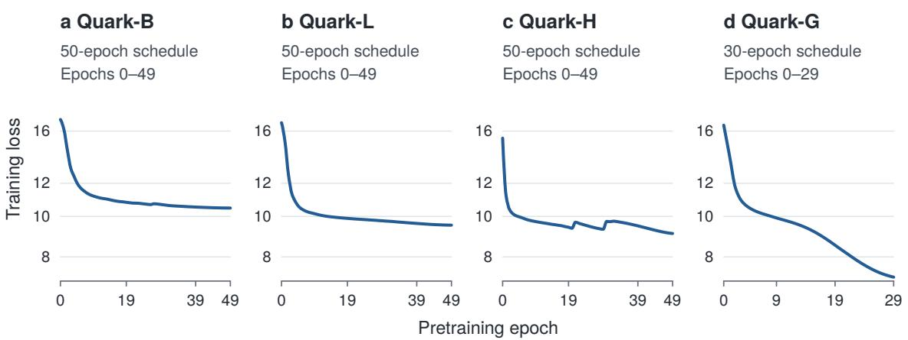  
Figure 12. Quark pretraining loss. Base, Large, and Huge use 50-epoch schedules; Giant uses 30 epochs. Each panel shows its full recorded range. Loss axes are logarithmic.

## G.1 Atom

Atom’s full-data and reduced-data runs use 50-epoch schedules. Figure 13 compares the full-data trajectories with the 10%, 20%, and 50% data fractions at each encoder size.

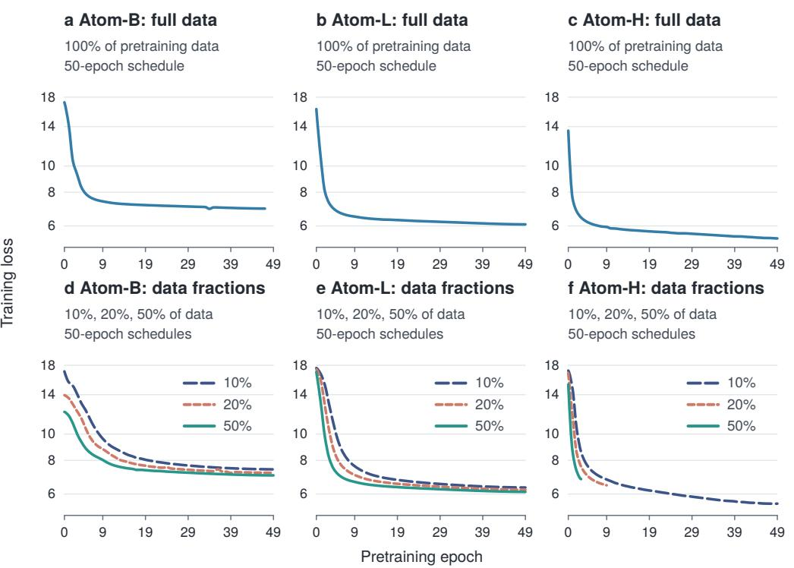  
Figure 13. Atom pretraining loss. Full-data runs appear separately from reduced-data runs. Loss axes are logarithmic.

## G.2 Molecule

Molecule-B uses a 50-epoch schedule. The Large continuation resumes ep29 with a separate two-epoch rewarm schedule; it has no downstream evaluation. Huge has 20 recorded epochs under a 50-epoch schedule, with its last evaluated checkpoint at ep9. Tokenizers and input preparation difer across collections, limiting direct comparison of their absolute losses.

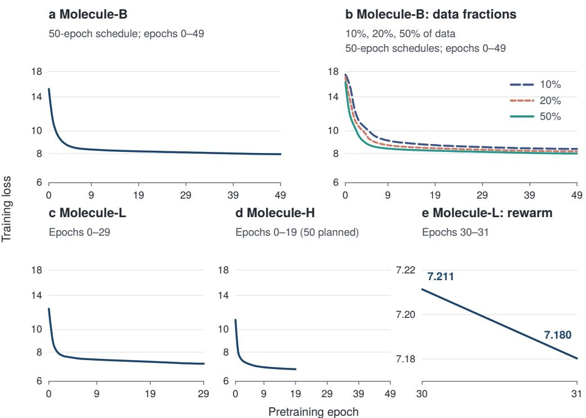  
Figure 14. Molecule pretraining loss for Base, reduced-data Base runs, Large, Huge, and the Large continuation. Loss axes are logarithmic except for the continuation.

## H Joint EEG–LLM Results

These experiments follow the joint-training protocol in Section 7. Ten EEG encoders are evaluated with six Qwen3 sizes, giving 60 configurations and 180 runs. Tables report test balanced accuracy (%) as mean ± sample SD over seeds 42, 10, and 5. The macro row averages the 23 tasks within each seed before aggregation. †ISRUC S2 retains the original channel-cache defect and remains in the macro mean.

Table 30. Joint EEG–LLM training and evaluation settings.
<table><tr><td>Setting</td><td>Value</td></tr><tr><td>EEG encoder</td><td>Frozen; the checkpoint is identified in each result-table caption.</td></tr><tr><td>Input preparation</td><td>Quark/Atom: input scale 0.01, no per-window z-scoring. Molecule: input scale 1, per-window z-scoring.</td></tr><tr><td>Cached features</td><td>Temporal patch features averaged across channels, standardized using the corre- sponding task and seed&#x27;s training-split statistics.</td></tr><tr><td>Temporal projector</td><td>32 tokens; adaptive average pooling or linear interpolation for shorter sequences; two-layer GELU MLP.</td></tr><tr><td>Language model</td><td>Qwen3-0.6B, 1.7B, 4B, 8B, 14B, or 32B; original weights frozen.</td></tr><tr><td>Trainable modules</td><td>Projector and LoRA adapters, trained jointly from step 0.</td></tr><tr><td>LoRA</td><td>Rank 16,  $\alpha = 3 2$  , dropout 0.1; q/k/v/o and gate/up/down projections.</td></tr><tr><td>Optimizer</td><td>AdamW;  $\beta _ { 1 } = 0 . 9 , \beta _ { 2 } = 0 . 9 8 .$ </td></tr><tr><td>Learning rate / weight decay</td><td>Projector:  $1 0 ^ { - 3 } / 0 ; \mathrm { L o R A : 1 0 ^ { - 4 } / 0 . 0 1 } .$ </td></tr><tr><td>Schedule</td><td>500-step linear warmup, followed by cosine decay to 0.1 × the base learning rate.</td></tr><tr><td>Global batch / gradient clipping Training length / early stopping</td><td>64 / 1.0. At most 16,000 steps; validation every 1,000 steps; stop after four evaluations without</td></tr><tr><td></td><td>improvement. Probability proportional to retained training-set size raised to 0.3; shuffled sampling</td></tr><tr><td>Task sampling</td><td>within each task.</td></tr><tr><td>Training supervision</td><td>Answer-token loss with inverse training-class-frequency weights for all tasks; prompt template and candidate order vary during training.</td></tr><tr><td>Validation selection</td><td>One shared checkpoint per seed, maximizing mean task balanced accuracy on up to 1,000 validation examples per task; the earlier checkpoint is retained on ties.</td></tr><tr><td>Final evaluation</td><td>All test examples; closed-set textual-candidate scoring. The macro score assigns equal weight to all 23 tasks.</td></tr></table>

Table 31. EEG–LLM results for Quark-B (epoch 49).  
The experiments share the data splits and 40-window subject–class training cap used for single-task evaluation (Appendix C). SleepEDF uses night identifiers as split units, allowing person-level overlap; EEGDenoiseNet uses a within-subject sample split. Validation and test use all available windows.
<table><tr><td>Task</td><td>Qwen3-0.6B</td><td>Qwen3-1.7B</td><td>Qwen3-4B</td><td>Qwen3-8B</td><td></td><td>Qwen3-14B</td><td>Qwen3-32B</td></tr><tr><td>AD65</td><td> $4 9 . 0 5 \pm 5 . 8 9$ </td><td> $4 9 . 8 0 \pm 7 . 6 3$ </td><td> $5 1 . 2 0 \pm 1 2 . 1 7$ </td><td> $4 7 . 2 3 \pm 6 . 0 3$ </td><td></td><td> $4 8 . 5 6 \pm 5 . 3 3$ </td><td> $5 0 . 2 1 \pm 6 . 7 4$ </td></tr><tr><td>PD31</td><td> $4 7 . 4 1 \pm 1 1 . 1 7$ </td><td> $3 9 . 6 8 \pm 1 5 . 0 9$ </td><td> $4 2 . 7 8 \pm 1 3 . 0 3$ </td><td> $4 3 . 7 1 \pm 1 4 . 8 5$ </td><td></td><td> $3 7 . 4 5 \pm 1 5 . 9 6$ </td><td> $4 3 . 0 3 \pm 1 5 . 8 8$ </td></tr><tr><td>BCIC IV-1</td><td> $4 9 . 3 3 \pm 1 . 4 4$ </td><td> $4 8 . 8 3 \pm 4 . 0 4$ </td><td> $4 8 . 3 3 \pm 1 . 7 6$ </td><td> $4 8 . 0 0 \pm 3 . 2 8$ </td><td></td><td> $5 0 . 0 0 \pm 4 . 5 0$ </td><td> $5 1 . 5 0 \pm 2 . 2 9$ </td></tr><tr><td>BCIC IV-2a</td><td> $3 4 . 4 3 \pm 0 . 3 6$ </td><td> $3 4 . 4 9 \pm 0 . 8 2$ </td><td> $3 4 . 9 0 \pm 0 . 5 2$ </td><td> $3 5 . 5 3 \pm 0 . 9 6$ </td><td></td><td> $3 6 . 0 5 \pm 1 . 0 6$ </td><td> $3 5 . 2 4 \pm 2 . 3 9$ </td></tr><tr><td>SHU MI</td><td> $5 0 . 6 7 \pm 1 . 0 1$ </td><td> $5 1 . 2 7 \pm 1 . 2 8$ </td><td> $5 1 . 2 6 \pm 1 . 6 6$ </td><td> $5 2 . 4 3 \pm 0 . 7 0$ </td><td></td><td> $5 0 . 5 8 \pm 0 . 9 8$ </td><td> $5 0 . 9 2 \pm 1 . 0 6$ </td></tr><tr><td>BETA SSVEP</td><td> $2 . 4 1 \pm 0 . 0 0$ </td><td> $2 . 3 2 \pm 0 . 3 6$ </td><td> $2 . 5 0 \pm 0 . 4 7$ </td><td> $2 . 4 4 \pm 0 . 3 1$ </td><td></td><td> $2 . 3 5 \pm 0 . 4 4$ </td><td> $2 . 6 2 \pm 0 . 4 6$ </td></tr><tr><td>Monitoring ErrP</td><td> $5 2 . 4 5 \pm 3 . 3 1$ </td><td> $5 4 . 8 4 \pm 2 . 3 6$ </td><td> $5 2 . 0 8 \pm 2 . 9 5$ </td><td> $5 4 . 8 9 \pm 1 . 9 5$ </td><td></td><td> $5 6 . 0 7 \pm 3 . 4 9$ </td><td> $5 2 . 9 3 \pm 3 . 4 9$ </td></tr><tr><td>EEGMAT</td><td> $6 6 . 0 7 \pm 4 . 1 9$ </td><td> $6 5 . 4 6 \pm 6 . 5 8$ </td><td> $6 3 . 7 5 \pm 1 1 . 6 3$ </td><td> $6 3 . 9 0 \pm 5 . 7 0$ </td><td></td><td> $6 1 . 6 2 \pm 5 . 5 9$ </td><td> $6 6 . 5 4 \pm 9 . 2 8$ </td></tr><tr><td>LEMON gender</td><td> $6 5 . 8 4 \pm 3 . 3 1$ </td><td> $6 5 . 9 9 \pm 1 . 7 8$ </td><td> $6 5 . 2 5 \pm 3 . 1 6$ </td><td> $6 3 . 8 3 \pm 2 . 3 9$ </td><td></td><td> $6 3 . 2 3 \pm 5 . 5 7$ </td><td> $6 3 . 3 8 \pm 3 . 9 3$ </td></tr><tr><td>LEMON extraversion</td><td> $5 1 . 0 4 \pm 1 . 6 0$ </td><td> $5 3 . 2 3 \pm 4 . 2 0$ </td><td> $5 1 . 9 5 \pm 0 . 4 3$ </td><td> $5 3 . 0 9 \pm 1 . 5 0$ </td><td></td><td> $5 2 . 0 2 \pm 1 . 2 6$ </td><td> $5 1 . 6 1 \pm 2 . 4 4$ </td></tr><tr><td>FACED</td><td> $1 4 . 9 6 \pm 0 . 8 3$ </td><td> $1 4 . 7 4 \pm 1 . 2 0$ </td><td> $1 4 . 8 9 \pm 0 . 7 5$ </td><td> $1 4 . 7 8 \pm 1 . 1 6$ </td><td></td><td> $1 2 . 9 6 \pm 1 . 1 2$ </td><td> $1 4 . 1 6 \pm 0 . 6 6$ </td></tr><tr><td>SEED</td><td> $4 8 . 1 8 \pm 1 . 2 0$ </td><td> $4 8 . 0 7 \pm 3 . 5 7$ </td><td> $4 7 . 8 9 \pm 2 . 0 1$ </td><td> $4 8 . 9 3 \pm 2 . 0 5$ </td><td></td><td> $4 7 . 5 2 \pm 1 . 9 1$ </td><td> $4 7 . 1 1 \pm 3 . 2 0$ </td></tr><tr><td>SEED-IV</td><td> $2 6 . 3 5 \pm 1 . 3 8$ </td><td> $2 7 . 2 9 \pm 0 . 8 2$ </td><td> $2 7 . 0 6 \pm 0 . 3 4$ </td><td> $2 6 . 1 6 \pm 1 . 0 7$ </td><td></td><td> $2 7 . 3 7 \pm 2 . 5 5$ </td><td> $2 6 . 5 0 \pm 2 . 1 6$ </td></tr></table>

Continued on the next page.

Table 31. EEG–LLM results for Quark-B (epoch 49) (continued).
<table><tr><td>Task</td><td>Qwen3-0.6B</td><td>Qwen3-1.7B</td><td>Qwen3-4B</td><td>Qwen3-8B</td><td>Qwen3-14B</td><td>Qwen3-32B</td></tr><tr><td>SEED-V</td><td> $2 3 . 1 2 \pm 1 . 1 1$ </td><td> $2 3 . 1 9 \pm 0 . 5 4$ </td><td> $2 2 . 6 6 \pm 1 . 0 7$ </td><td> $2 2 . 6 8 \pm 0 . 2 7$ </td><td> $2 2 . 4 5 \pm 0 . 5 2$ </td><td> $2 2 . 2 6 \pm 0 . 2 4$ </td></tr><tr><td>SEED-VII</td><td> $1 7 . 6 9 \pm 0 . 9 6$ </td><td> $1 6 . 5 4 \pm 0 . 6 5$ </td><td> $1 7 . 7 8 \pm 0 . 7 5$ </td><td>17.50 ± 0.94</td><td> $1 6 . 1 4 \pm 0 . 1 9$ </td><td> $1 6 . 5 6 \pm 0 . 3 8$ </td></tr><tr><td>ISRUC S2†</td><td> $2 4 . 3 5 \pm 5 . 8 0$ </td><td> $2 4 . 8 7 \pm 3 . 7 9$ </td><td> $2 4 . 2 1 \pm 6 . 8 0$ </td><td> $2 8 . 0 5 \pm 4 . 9 9$ </td><td> $2 8 . 9 3 \pm 0 . 9 2$ </td><td> $2 3 . 7 6 \pm 6 . 2 9$ </td></tr><tr><td>ISRUC S3</td><td> $7 1 . 1 0 \pm 1 . 4 5$ </td><td> $6 7 . 7 1 \pm 1 . 9 9$ </td><td> $7 1 . 1 8 \pm 5 . 7 5$ </td><td> $7 0 . 7 1 \pm 1 . 8 1$ </td><td> $7 3 . 3 0 \pm 4 . 4 1$ </td><td> $7 2 . 0 8 \pm 1 . 7 6$ </td></tr><tr><td>SleepEDF</td><td> $6 9 . 2 1 \pm 2 . 7 7$ </td><td> $7 1 . 5 2 \pm 0 . 1 1$ </td><td> $7 0 . 9 7 \pm 0 . 9 0$ </td><td> $7 1 . 0 8 \pm 0 . 7 7$ </td><td> $6 9 . 6 0 \pm 1 . 8 0$ </td><td> $6 9 . 9 8 \pm 1 . 0 6$ </td></tr><tr><td>HMC</td><td> $5 4 . 3 8 \pm 0 . 2 2$ </td><td> $5 5 . 2 3 \pm 2 . 0 5$ </td><td> $5 4 . 5 4 \pm 1 . 3 1$ </td><td> $5 4 . 8 8 \pm 2 . 3 7$ </td><td> $5 3 . 5 2 \pm 2 . 6 9$ </td><td> $5 4 . 0 3 \pm 1 . 7 1$ </td></tr><tr><td>TUAB</td><td> $7 5 . 8 1 \pm 1 . 3 0$ </td><td> $7 5 . 2 8 \pm 1 . 0 7$ </td><td> $7 5 . 5 0 \pm 1 . 1 3$ </td><td> $7 5 . 3 7 \pm 0 . 9 1$ </td><td> $7 4 . 1 4 \pm 2 . 0 8$ </td><td> $7 5 . 0 7 \pm 1 . 7 9$ </td></tr><tr><td>TUEV</td><td> $5 1 . 1 0 \pm 7 . 4 8$ </td><td>50.25 ± 3.11</td><td> $5 2 . 1 7 \pm 7 . 2 5$ </td><td> $4 8 . 7 7 \pm 7 . 5 8$ </td><td> $5 0 . 8 3 \pm 6 . 9 6$ </td><td> $4 6 . 9 2 \pm 4 . 8 2$ </td></tr><tr><td>TUSL</td><td> $5 4 . 8 5 \pm 1 2 . 5 5$ </td><td>53.52 ± 14.17</td><td> $5 2 . 8 1 \pm 3 4 . 7 7$ </td><td> $6 0 . 3 5 \pm 9 . 3 8$ </td><td> $5 2 . 2 2 \pm 2 4 . 5 1$ </td><td> $4 8 . 9 8 \pm 9 . 0 7$ </td></tr><tr><td>EEGDenoiseNet</td><td> $9 6 . 6 2 \pm 0 . 4 5$ </td><td> $9 5 . 8 0 \pm 0 . 6 4$ </td><td> $9 5 . 3 6 \pm 0 . 2 2$ </td><td> $9 5 . 0 2 \pm 0 . 5 1$ </td><td> $9 5 . 6 5 \pm 1 . 0 8$ </td><td> $9 5 . 6 2 \pm 0 . 1 5$ </td></tr><tr><td>Macro mean</td><td> $4 7 . 6 7 \pm 1 . 2 2$ </td><td> $4 7 . 3 9 \pm 1 . 1 6$ </td><td> $4 7 . 4 4 \pm 3 . 0 6$ </td><td> $4 7 . 8 0 \pm 1 . 5 9$ </td><td> $4 7 . 0 7 \pm 1 . 9 9$ </td><td> $4 7 . 0 0 \pm 1 . 3 1$ </td></tr></table>

Table 32. EEG–LLM results for Quark-L (epoch 49).
<table><tr><td>Task</td><td>Qwen3-0.6B</td><td>Qwen3-1.7B</td><td>Qwen3-4B</td><td>Qwen3-8B</td><td></td><td>Qwen3-14B</td><td>Qwen3-32B</td></tr><tr><td>AD65</td><td></td><td> $5 3 . 4 2 \pm 5 . 4 0 5 3 . 8 4 \pm 7 . 4 2$ </td><td> $5 1 . 9 2 \pm 1 . 4 9$ </td><td></td><td>49.66 ± 2.50</td><td> $5 3 . 9 9 \pm 6 . 6 1$ </td><td> $5 5 . 7 5 \pm 9 . 0 4$ </td></tr><tr><td>PD31</td><td></td><td> $5 2 . 5 4 \pm 1 5 . 4 5 4 1 . 5 2 \pm 5 . 8 6$ </td><td> $4 3 . 1 1 \pm 7 . 8 0$ </td><td>47.44 ± 8.81</td><td></td><td> $4 6 . 8 0 \pm 9 . 8 7$ </td><td> $4 2 . 6 8 \pm 1 0 . 4 6$ </td></tr><tr><td>BCIC IV-1</td><td></td><td> $5 0 . 6 7 \pm 1 . 2 6 4 9 . 8 3 \pm 4 . 1 6$ </td><td> $4 8 . 5 0 \pm 3 . 2 8$ </td><td></td><td> $4 6 . 5 0 \pm 1 . 3 2 4 8 . 3 3 \pm 1 . 2 6$ </td><td></td><td> $5 0 . 3 3 \pm 3 . 0 6$ </td></tr><tr><td>BCIC IV-2a</td><td></td><td>35.24 ± 3.22 38.43 ± 2.49</td><td> $3 6 . 1 1 \pm 4 . 2 1$ </td><td> $3 5 . 1 3 \pm 3 . 5 3$ </td><td></td><td> $3 1 . 0 8 \pm 2 . 5 2$ </td><td>32.70 ± 2.40</td></tr><tr><td>SHU MI</td><td></td><td> $5 0 . 9 1 \pm 1 . 8 1 5 2 . 8 2 \pm 1 . 2 3$ </td><td> $5 1 . 6 1 \pm 0 . 9 9$ </td><td> $5 2 . 2 4 \pm 1 . 8 7$ </td><td> $4 9 . 5 9 \pm 0 . 7 4$ </td><td></td><td> $5 1 . 1 8 \pm 0 . 9 2$ </td></tr><tr><td>BETA SSVEP</td><td></td><td> $2 . 4 1 \pm 0 . 3 1 \quad 2 . 8 0 \pm 0 . 2 2$ </td><td> $2 . 3 8 \pm 0 . 1 4$ </td><td>2.95 ± 0.82</td><td>2.65 ± 0.14</td><td></td><td> $2 . 4 7 \pm 0 . 1 9$ </td></tr><tr><td>Monitoring ErrP</td><td></td><td>56.24 ± 3.26 55.35 ± 2.06</td><td> $5 4 . 0 5 \pm 4 . 3 8$ </td><td> $5 5 . 0 4 \pm 4 . 4 4$ </td><td>50.92 ± 3.14</td><td></td><td>55.43 ± 5.20</td></tr><tr><td>EEGMAT</td><td>65.59 ± 7.47</td><td>67.91 ± 8.39</td><td>69.46 ± 3.01</td><td></td><td>64.05 ± 3.73 64.98 ± 6.37</td><td></td><td>71.77 ± 5.78</td></tr><tr><td>LEMON gender</td><td>66.17 ± 2.78</td><td>65.74 ± 3.62</td><td>66.27 ± 5.17</td><td>63.66 ± 3.01</td><td>63.13 ± 6.33</td><td></td><td>64.49 ± 3.36</td></tr><tr><td>LEMON extraversion</td><td>50.33 ± 1.36</td><td>52.14 ± 1.95</td><td>52.70 ± 2.90</td><td>51.47 ± 1.68</td><td>49.82 ± 2.48</td><td></td><td>51.31 ± 2.44</td></tr><tr><td>FACED</td><td>14.60 ± 0.76</td><td>17.57 ± 1.56</td><td>13.51 ± 0.26</td><td>15.86 ± 2.70</td><td>13.47 ± 0.36</td><td></td><td>15.17 ± 0.60</td></tr><tr><td>SEED</td><td>51.27 ± 0.14</td><td>50.24 ± 2.56</td><td>48.91 ± 4.40</td><td>50.69 ± 0.37</td><td>51.22 ± 2.91</td><td></td><td>49.86 ± 1.69</td></tr><tr><td>SEED-IV</td><td>26.04 ± 2.14</td><td>26.58 ± 0.99</td><td>27.87 ± 2.85</td><td>27.28 ± 0.71</td><td>26.78 ± 1.31</td><td></td><td>26.81 ± 0.81</td></tr><tr><td>SEED-V</td><td>24.68 ± 1.44</td><td>22.88 ± 1.01</td><td>24.31 ± 2.14</td><td>22.97 ± 1.61</td><td>22.45 ± 0.23</td><td></td><td>23.10 ± 2.32</td></tr><tr><td>SEED-VII</td><td>18.55 ± 1.59</td><td>18.65 ± 1.74</td><td> $1 7 . 4 6 \pm 1 . 6 3$ </td><td>18.57 ± 1.06</td><td>6 17.94 ± 1.99</td><td></td><td>18.33 ± 1.27</td></tr><tr><td>ISRUC S2†</td><td> $2 6 . 9 2 \pm 4 . 4 8 2 3 . 1 7 \pm 5 . 4 5$ </td><td></td><td>25.67 ± 5.22</td><td></td><td> $2 2 . 4 7 \pm 5 . 0 3 2 5 . 0 3 \pm 5 . 3 2$ </td><td></td><td>28.60 ± 1.20</td></tr><tr><td>ISRUC S3</td><td> $7 3 . 2 4 \pm 4 . 9 7 7 3 . 9 7 \pm 1 . 5 4$ </td><td></td><td> $7 3 . 2 8 \pm 0 . 9 7$ </td><td></td><td> $7 4 . 3 6 \pm 1 . 1 1 7 3 . 9 4 \pm 3 . 9 7$ </td><td></td><td>75.45 ± 2.09</td></tr><tr><td>SleepEDF</td><td>70.50 ± 1.18 71.79 ± 1.09</td><td></td><td> $7 0 . 8 1 \pm 3 . 0 2$ </td><td> $7 1 . 6 2 \pm 0 . 7 7$ </td><td>70.17 ± 0.41</td><td></td><td>71.83 ± 1.29</td></tr><tr><td>HMC</td><td> $4 4 . 6 9 \pm 1 . 3 4 4 5 . 9 7 \pm 1 . 8 5$ </td><td></td><td> $4 4 . 9 3 \pm 0 . 6 7$ </td><td></td><td>46.23 ± 1.89 43.70 ± 2.83</td><td></td><td> $4 6 . 9 0 \pm 2 . 6 1$ </td></tr><tr><td>TUAB</td><td> $7 4 . 8 6 \pm 2 . 0 2 7 5 . 6 2 \pm 0 . 9 4$ </td><td></td><td> $7 4 . 8 3 \pm 1 . 7 1$ </td><td></td><td> $7 5 . 3 0 \pm 2 . 0 7 7 3 . 8 7 \pm 1 . 6 4$ </td><td></td><td> $7 5 . 4 8 \pm 1 . 2 9$ </td></tr><tr><td>TUEV</td><td>47.80 ± 10.04 49.32 ± 9.54</td><td></td><td> $4 8 . 0 5 \pm 1 1 . 1 7$ </td><td></td><td>49.38 ± 7.15 47.69 ± 6.82</td><td></td><td> $4 8 . 8 2 \pm 1 0 . 3 9$ </td></tr><tr><td>TUSL</td><td></td><td> $6 7 . 2 2 \pm 3 . 5 4 6 5 . 2 6 \pm 1 . 3 2$ </td><td> $6 9 . 1 4 \pm 8 . 0 3$ </td><td>59.05 ± 11.37</td><td> $7 5 . 9 4 \pm 7 . 5 0$ </td><td></td><td> $6 5 . 4 7 \pm 8 . 7 7$ </td></tr><tr><td>EEGDenoiseNet</td><td> $9 2 . 4 8 \pm 1 . 5 7$ </td><td>92.81 ± 2.52</td><td> $9 2 . 8 3 \pm 1 . 6 9$ </td><td> $9 2 . 5 5 \pm 1 . 3 2$ </td><td>85.32 ± 1.20</td><td></td><td> $9 1 . 0 7 \pm 2 . 9 3$ </td></tr><tr><td>Macro mean</td><td>48.54 ± 1.33</td><td>48.44 ± 1.38</td><td> $4 8 . 1 6 \pm 1 . 4 5$ </td><td></td><td>47.59 ± 1.52 47.34 ± 1.35</td><td></td><td>48.48 ± 2.55</td></tr></table>

Table 33. EEG–LLM results for Quark-H (epoch 49).
<table><tr><td>Task</td><td>Qwen3-0.6B</td><td>Qwen3-1.7B</td><td>Qwen3-4B</td><td>Qwen3-8B</td><td>Qwen3-14B</td><td>Qwen3-32B</td></tr><tr><td>AD65</td><td> $5 1 . 6 0 \pm 1 0 . 1 8$ </td><td> $4 8 . 5 5 \pm 9 . 0 1$ </td><td> $4 5 . 6 3 \pm 6 . 4 9$ </td><td> $4 5 . 9 0 \pm 7 . 7 3$ </td><td> $4 5 . 9 1 \pm 1 . 0 0$ </td><td> $4 7 . 8 4 \pm 9 . 5 4$ </td></tr><tr><td>PD31</td><td> $4 3 . 4 2 \pm 1 1 . 4 3$ </td><td> $4 9 . 7 0 \pm 9 . 1 5$ </td><td> $4 4 . 6 2 \pm 1 1 . 3 4$ </td><td> $5 0 . 8 2 \pm 1 1 . 6 1$ </td><td> $4 7 . 7 8 \pm 1 3 . 3 8$ </td><td> $4 4 . 0 0 \pm 1 0 . 6 7$ </td></tr><tr><td>BCIC IV-1</td><td> $5 1 . 6 7 \pm 3 . 3 3$ </td><td> $4 8 . 8 3 \pm 3 . 8 8$ </td><td> $5 0 . 0 0 \pm 1 . 5 0$ </td><td> $5 2 . 5 0 \pm 1 . 3 2$ </td><td> $4 8 . 0 0 \pm 6 . 5 4$ </td><td> $4 9 . 3 3 \pm 0 . 5 8$ </td></tr><tr><td>BCIC IV-2a</td><td> $3 2 . 2 9 \pm 1 . 7 1$ </td><td> $3 4 . 0 3 \pm 3 . 9 3$ </td><td> $3 4 . 2 0 \pm 3 . 9 4$ </td><td> $3 3 . 6 2 \pm 1 . 9 7$ </td><td> $3 2 . 5 2 \pm 4 . 1 0$ </td><td> $3 0 . 2 1 \pm 1 . 5 9$ </td></tr><tr><td>SHU MI</td><td> $5 1 . 4 3 \pm 0 . 4 6$ </td><td> $5 2 . 5 0 \pm 1 . 3 7$ </td><td> $5 0 . 9 2 \pm 1 . 1 1$ </td><td> $5 3 . 2 8 \pm 0 . 7 6$ </td><td> $5 0 . 2 7 \pm 0 . 4 0$ </td><td> $5 1 . 4 7 \pm 0 . 7 0$ </td></tr><tr><td>BETA SSVEP</td><td> $2 . 3 5 \pm 0 . 3 4$ </td><td> $2 . 6 8 \pm 0 . 3 6$ </td><td> $2 . 7 1 \pm 0 . 3 6$ </td><td> $2 . 6 5 \pm 0 . 2 2$ </td><td> $2 . 8 6 \pm 0 . 2 4$ </td><td> $2 . 3 2 \pm 0 . 2 4$ </td></tr><tr><td>Monitoring ErrP</td><td> $5 4 . 8 5 \pm 1 . 5 9$ </td><td> $5 9 . 8 5 \pm 2 . 4 3$ </td><td> $5 7 . 4 3 \pm 3 . 3 9$ </td><td> $5 6 . 5 7 \pm 0 . 8 6$ </td><td> $5 9 . 0 5 \pm 3 . 5 1$ </td><td> $5 8 . 2 1 \pm 2 . 2 0$ </td></tr><tr><td>EEGMAT</td><td> $6 7 . 9 1 \pm 1 0 . 3 4$ </td><td> $6 3 . 2 8 \pm 1 0 . 2 7$ </td><td> $6 5 . 1 3 \pm 7 . 2 6$ </td><td> $6 8 . 6 9 \pm 1 0 . 5 1$ </td><td> $6 2 . 5 2 \pm 7 . 3 2$ </td><td> $6 1 . 5 9 \pm 1 0 . 4 8$ </td></tr><tr><td>LEMON gender</td><td> $6 6 . 1 2 \pm 1 . 6 4$ </td><td>65.74 ± 3.33</td><td> $6 7 . 5 1 \pm 3 . 0 3$ </td><td> $6 5 . 3 0 \pm 3 . 3 0$ </td><td> $6 4 . 9 1 \pm 4 . 6 0$ </td><td> $6 6 . 1 0 \pm 3 . 6 7$ </td></tr><tr><td>LEMON extraversion</td><td> $5 1 . 8 1 \pm 1 . 0 2$ </td><td> $5 1 . 8 7 \pm 0 . 9 3$ </td><td> $5 2 . 0 3 \pm 0 . 2 4$ </td><td> $5 3 . 2 1 \pm 1 . 5 4$ </td><td> $5 2 . 2 4 \pm 2 . 0 5$ </td><td> $4 9 . 4 7 \pm 0 . 5 7$ </td></tr><tr><td>FACED</td><td> $1 2 . 9 2 \pm 0 . 4 4$ </td><td> $1 4 . 3 2 \pm 1 . 2 1$ </td><td> $1 3 . 8 3 \pm 0 . 8 0$ </td><td> $1 5 . 1 2 \pm 1 . 8 3$ </td><td> $1 3 . 8 8 \pm 1 . 9 1$ </td><td> $1 3 . 2 3 \pm 0 . 9 2$ </td></tr><tr><td>SEED</td><td> $5 1 . 5 1 \pm 1 . 7 8$ </td><td> $4 9 . 1 4 \pm 1 . 7 4$ </td><td> $4 9 . 4 3 \pm 1 . 2 2$ </td><td> $5 0 . 8 3 \pm 1 . 6 2$ </td><td> $4 8 . 1 8 \pm 4 . 5 2$ </td><td> $4 7 . 8 5 \pm 2 . 9 7$ </td></tr><tr><td>SEED-IV</td><td> $2 7 . 9 3 \pm 1 . 1 9$ </td><td> $2 7 . 0 2 \pm 1 . 3 5$ </td><td> $2 6 . 9 6 \pm 1 . 4 7$ </td><td> $2 7 . 5 5 \pm 0 . 9 4$ </td><td> $2 7 . 6 4 \pm 0 . 3 1$ </td><td> $2 7 . 8 2 \pm 1 . 0 7$ </td></tr><tr><td>SEED-V</td><td> $2 5 . 2 6 \pm 0 . 9 5$ </td><td> $2 3 . 5 3 \pm 0 . 8 1$ </td><td> $2 5 . 1 9 \pm 2 . 5 0$ </td><td> $2 3 . 4 5 \pm 1 . 3 8$ </td><td> $2 3 . 6 5 \pm 0 . 6 6$ </td><td> $2 3 . 7 4 \pm 0 . 8 8$ </td></tr><tr><td>SEED-VII</td><td> $1 8 . 0 6 \pm 3 . 1 0$ </td><td> $1 8 . 0 7 \pm 0 . 7 4$ </td><td> $1 7 . 8 8 \pm 0 . 7 2$ </td><td> $1 8 . 3 6 \pm 0 . 7 5$ </td><td> $1 6 . 6 3 \pm 1 . 1 8$ </td><td> $1 8 . 4 3 \pm 1 . 5 8$ </td></tr></table>

Continued on the next page.

Table 33. EEG–LLM results for Quark-H (epoch 49) (continued).
<table><tr><td>Task</td><td>Qwen3-0.6B</td><td> $\mathrm { Q w e n } 3 { - } 1 . 7 \mathrm { B }$ </td><td>Qwen3-4B</td><td>Qwen3-8B</td><td>Qwen3-14B</td><td></td><td>Qwen3-32B</td></tr><tr><td>ISRUC S2†</td><td> $2 4 . 0 0 \pm 3 . 1 7$ </td><td> $2 9 . 5 0 \pm 4 . 7 9$ </td><td> $2 4 . 2 5 \pm 6 . 0 8$ </td><td> $2 7 . 8 7 \pm 5 . 1 2$ </td><td></td><td> $2 1 . 9 7 \pm 0 . 6 7$ </td><td> $2 4 . 5 1 \pm 3 . 3 9$ </td></tr><tr><td>ISRUC S3</td><td>75.31 ± 2.43</td><td> $7 3 . 7 4 \pm 2 . 7 7$ </td><td> $7 2 . 5 9 \pm 3 . 2 4$ </td><td>74.52 ± 2.10</td><td> $7 0 . 4 7 \pm 6 . 7 5$ </td><td></td><td>70.54 ± 1.09</td></tr><tr><td>SleepEDF</td><td> $6 9 . 0 4 \pm 1 . 9 2$ </td><td> $7 1 . 3 3 \pm 1 . 1 2$ </td><td> $6 9 . 6 1 \pm 2 . 5 8$ </td><td> $7 0 . 8 8 \pm 2 . 3 2$ </td><td> $6 8 . 0 4 \pm 2 . 3 8$ </td><td></td><td> $6 8 . 8 5 \pm 2 . 6 1$ </td></tr><tr><td>HMC</td><td> $5 2 . 5 7 \pm 1 . 5 7$ </td><td> $5 4 . 5 1 \pm 2 . 8 4$ </td><td> $5 3 . 3 3 \pm 2 . 4 6$ </td><td> $5 4 . 4 0 \pm 2 . 5 5$ </td><td> $5 1 . 4 3 \pm 4 . 1 4$ </td><td></td><td> $5 3 . 0 1 \pm 2 . 6 5$ </td></tr><tr><td>TUAB</td><td> $7 3 . 4 0 \pm 1 . 9 5$ </td><td> $7 6 . 0 4 \pm 0 . 4 4$ </td><td> $7 5 . 3 6 \pm 1 . 4 8$ </td><td> $7 6 . 5 7 \pm 1 . 3 3$ </td><td> $7 4 . 9 0 \pm 1 . 1 9$ </td><td></td><td> $7 4 . 5 8 \pm 0 . 4 4$ </td></tr><tr><td>TUEV</td><td> $4 9 . 6 3 \pm 7 . 6 8$ </td><td> $4 7 . 4 4 \pm 2 . 5 4$ </td><td> $5 3 . 1 3 \pm 6 . 4 1$ </td><td> $4 7 . 5 8 \pm 8 . 6 4$ </td><td> $4 6 . 6 6 \pm 5 . 5 8$ </td><td></td><td> $5 2 . 6 1 \pm 7 . 9 0$ </td></tr><tr><td>TUSL</td><td> $6 4 . 4 2 \pm 5 . 2 6$ </td><td> $7 0 . 5 7 \pm 3 . 3 8$ </td><td> $6 2 . 4 2 \pm 1 0 . 3 1$ </td><td> $6 2 . 2 5 \pm 1 0 . 0 6$ </td><td> $6 2 . 8 4 \pm 7 . 0 8$ </td><td></td><td> $6 7 . 7 2 \pm 1 1 . 6 0$ </td></tr><tr><td>EEGDenoiseNet</td><td> $9 2 . 3 7 \pm 0 . 7 4$ </td><td> $9 1 . 2 2 \pm 1 . 1 7$ </td><td> $9 0 . 6 9 \pm 2 . 8 5$ </td><td> $9 0 . 7 7 \pm 1 . 9 8$ </td><td> $8 9 . 3 4 \pm 1 . 8 5$ </td><td></td><td> $8 7 . 6 0 \pm 4 . 4 4$ </td></tr><tr><td>Macro mean</td><td> $4 8 . 2 5 \pm 0 . 8 2$ </td><td> $4 8 . 8 4 \pm 0 . 9 6$ </td><td> $4 8 . 0 4 \pm 1 . 2 8$ </td><td> $4 8 . 8 1 \pm 1 . 5 2$ </td><td> $4 7 . 0 3 \pm 0 . 3 3$ </td><td></td><td> $4 7 . 4 4 \pm 1 . 5 6$ </td></tr></table>

Table 34. EEG–LLM results for Quark-G (epoch 29).
<table><tr><td rowspan=1 colspan=14>Task                    Qwen3-0.6B   Qwen3-1.7B     Qwen3-4B    Qwen3-8B    Qwen3-14B    Qwen3-32B</td></tr><tr><td rowspan=1 colspan=14>AD65                  $5 2 . 8 1 \pm 5 . 6 3$   $5 1 . 5 4 \pm 5 . 1 5$   49.68 ± 5.41  $5 0 . 7 1 \pm 5 . 9 6$   $5 2 . 2 9 \pm 7 . 0 7$   $4 9 . 1 5 \pm 6 . 6 9$ </td></tr><tr><td rowspan=1 colspan=3>PD31                  $4 1 . 2 5 \pm 7 . 7 0$ </td><td rowspan=1 colspan=2> $3 9 . 6 1 \pm 1 0 . 3 1$ </td><td rowspan=1 colspan=3>38.41 ± 11.48</td><td rowspan=1 colspan=2>42.00 ± 5.90</td><td rowspan=1 colspan=2> $4 1 . 2 8 \pm 5 . 7 1$ </td><td rowspan=1 colspan=2> $4 4 . 5 2 \pm 2 . 4 0$ </td></tr><tr><td rowspan=1 colspan=3>BCIC IV-1             $5 2 . 5 0 \pm 1 . 8 0$ </td><td rowspan=1 colspan=2> $4 7 . 8 3 \pm 2 . 0 2$ </td><td rowspan=1 colspan=3> $4 5 . 3 3 \pm 5 . 5 1$ </td><td rowspan=1 colspan=1>49.33</td><td rowspan=1 colspan=1>± 1.76</td><td rowspan=1 colspan=2> $5 0 . 6 7 \pm 1 . 6 1$ </td><td rowspan=1 colspan=2>48.00 ± 2.18</td></tr><tr><td rowspan=1 colspan=1>BCIC IV-2a</td><td rowspan=1 colspan=2> $3 1 . 2 5 \pm 1 . 0 8$ </td><td rowspan=1 colspan=2> $3 5 . 7 6 \pm 1 . 5 1$ </td><td rowspan=1 colspan=3> $3 1 . 8 3 \pm 2 . 5 3$ </td><td rowspan=1 colspan=1>34.66</td><td rowspan=1 colspan=1>± 2.09</td><td rowspan=1 colspan=2> $3 6 . 2 8 \pm 0 . 9 2$ </td><td rowspan=1 colspan=2> $3 4 . 0 3 \pm 4 . 5 6$ </td></tr><tr><td rowspan=1 colspan=1>SHU MI</td><td rowspan=1 colspan=2> $5 4 . 7 4 \pm 1 . 0 3$ </td><td rowspan=1 colspan=2> $5 1 . 9 6 \pm 3 . 1 5$ </td><td rowspan=1 colspan=3> $5 1 . 9 4 \pm 1 . 3 4$ </td><td rowspan=1 colspan=1>52.97</td><td rowspan=1 colspan=1>± 2.03</td><td rowspan=1 colspan=2> $5 1 . 4 0 \pm 2 . 2 2$ </td><td rowspan=1 colspan=2> $5 1 . 4 2 \pm 1 . 3 1$ </td></tr><tr><td rowspan=1 colspan=1>BETA SSVEP</td><td rowspan=1 colspan=2> $2 . 7 7 \pm 0 . 5 4$ </td><td rowspan=1 colspan=2> $3 . 0 7 \pm 0 . 6 5$ </td><td rowspan=1 colspan=3> $2 . 8 9 \pm 0 . 2 2$ </td><td rowspan=1 colspan=2> $3 . 3 6 \pm 1 . 0 0$ </td><td rowspan=1 colspan=2> $2 . 8 3 \pm 0 . 4 2$ </td><td rowspan=1 colspan=2> $2 . 7 4 \pm 0 . 4 9$ </td></tr><tr><td rowspan=1 colspan=1>Monitoring ErrP</td><td rowspan=1 colspan=2> $5 8 . 1 3 \pm 2 . 4 3$ </td><td rowspan=1 colspan=2> $5 5 . 1 5 \pm 4 . 3 7$ </td><td rowspan=1 colspan=3> $5 6 . 9 1 \pm 2 . 1 7$ </td><td rowspan=1 colspan=1>56.84</td><td rowspan=1 colspan=1>± 4.17</td><td rowspan=1 colspan=2> $5 7 . 5 0 \pm 1 . 4 0$ </td><td rowspan=1 colspan=2>54.07 ± 3.37</td></tr><tr><td rowspan=1 colspan=1>EEGMAT</td><td rowspan=1 colspan=2>63.75 ± 10.88 7</td><td rowspan=1 colspan=2>3.32 ± 10.39</td><td rowspan=1 colspan=3>70.43 ± 8.40 7</td><td rowspan=1 colspan=1>0.86</td><td rowspan=1 colspan=1>± 9.99</td><td rowspan=1 colspan=2> $6 5 . 6 2 \pm 1 4 . 9 0$ </td><td rowspan=1 colspan=2> $6 7 . 7 9 \pm 8 . 9 7$ </td></tr><tr><td rowspan=1 colspan=1>LEMON gender</td><td rowspan=1 colspan=2>67.76 ± 5.26</td><td rowspan=1 colspan=2>65.73 ± 2.92</td><td rowspan=1 colspan=3>67.93 ± 5.68</td><td rowspan=1 colspan=1>65.91</td><td rowspan=1 colspan=1>± 2.74</td><td rowspan=1 colspan=2> $6 5 . 4 2 \pm 2 . 8 8$ </td><td rowspan=1 colspan=2>65.14 ± 2.79</td></tr><tr><td rowspan=1 colspan=1>LEMON extraversion</td><td rowspan=1 colspan=2>50.51 ± 2.83</td><td rowspan=1 colspan=2>51.08 ± 1.86</td><td rowspan=1 colspan=3>51.25 ± 0.89</td><td rowspan=1 colspan=1>51.75</td><td rowspan=1 colspan=1>± 2.21</td><td rowspan=1 colspan=2> $5 1 . 5 8 \pm 0 . 5 6$ </td><td rowspan=1 colspan=2>50.86 ± 1.34</td></tr><tr><td rowspan=1 colspan=1>FACED</td><td rowspan=1 colspan=2>15.84 ± 3.63</td><td rowspan=1 colspan=2>18.56 ± 3.00</td><td rowspan=1 colspan=2>13.43 ±</td><td rowspan=1 colspan=1>2.531</td><td rowspan=1 colspan=1>9.71</td><td rowspan=1 colspan=1>± 1.97</td><td rowspan=1 colspan=1>16.99</td><td rowspan=1 colspan=1>± 2.98</td><td rowspan=1 colspan=2>17.08 ± 2.99</td></tr><tr><td rowspan=1 colspan=1>SEED</td><td rowspan=1 colspan=1> $4 7 . 9 3 \pm 3</td><td rowspan=1 colspan=1>. 7 3$ </td><td rowspan=1 colspan=2>49.67 ± 1.89</td><td rowspan=1 colspan=1>44.46</td><td rowspan=1 colspan=1>± 5</td><td rowspan=1 colspan=1>.71</td><td rowspan=1 colspan=1>49.86</td><td rowspan=1 colspan=1>± 1.44</td><td rowspan=1 colspan=2>45.91 ± 2.80</td><td rowspan=1 colspan=2>45.50 ± 1.86</td></tr><tr><td rowspan=1 colspan=1>SEED-IV</td><td rowspan=1 colspan=1> $2 7 . 8 9 \pm 1</td><td rowspan=1 colspan=1>. 1 4$ </td><td rowspan=1 colspan=2>26.71 ± 0.36</td><td rowspan=1 colspan=1>28.83</td><td rowspan=1 colspan=1>± 0</td><td rowspan=1 colspan=1>.74 2</td><td rowspan=1 colspan=1>8.39</td><td rowspan=1 colspan=1>± 0.36</td><td rowspan=1 colspan=2> $2 7 . 9 3 \pm 0 . 4 6$ </td><td rowspan=1 colspan=1>27.38 ± 0</td><td rowspan=1 colspan=1>.90</td></tr><tr><td rowspan=1 colspan=1>SEED-V</td><td rowspan=1 colspan=1> $2 5 . 9 6 \pm 2</td><td rowspan=1 colspan=1>. 1 8$ </td><td rowspan=1 colspan=2>24.26 ± 1.08</td><td rowspan=1 colspan=1>26.00</td><td rowspan=1 colspan=1>±</td><td rowspan=1 colspan=1>1.522</td><td rowspan=1 colspan=1>4.16</td><td rowspan=1 colspan=1>± 1.21</td><td rowspan=1 colspan=2>24.99 ± 0.90</td><td rowspan=1 colspan=1>23.13 ± 1</td><td rowspan=1 colspan=1>.19</td></tr><tr><td rowspan=1 colspan=1>SEED-VII</td><td rowspan=1 colspan=2> $1 7 . 7 1 \pm 1 . 6 2$ </td><td rowspan=1 colspan=2> $1 9 . 1 2 \pm 0 . 5 3$ </td><td rowspan=1 colspan=1>16.05</td><td rowspan=1 colspan=1>±</td><td rowspan=1 colspan=1>2.18 1</td><td rowspan=1 colspan=1>8.49</td><td rowspan=1 colspan=1>± 0.95</td><td rowspan=1 colspan=2> $1 7 . 6 6 \pm 0 . 6 1$ </td><td rowspan=1 colspan=2> $1 8 . 2 9 \pm 0 . 9 2$ </td></tr><tr><td rowspan=1 colspan=1>ISRUC S2†</td><td rowspan=1 colspan=2> $3 0 . 0 5 \pm 4 . 8 1$ </td><td rowspan=1 colspan=2> $2 6 . 2 6 \pm 5 . 4 4$ </td><td rowspan=1 colspan=1>30.66</td><td rowspan=1 colspan=1>±</td><td rowspan=1 colspan=1>2.17 2</td><td rowspan=1 colspan=1>6.56</td><td rowspan=1 colspan=1>± 4.18</td><td rowspan=1 colspan=2> $3 1 . 7 3 \pm 6 . 4 8$ </td><td rowspan=1 colspan=1>29.65 ± 3</td><td rowspan=1 colspan=1>.84</td></tr><tr><td rowspan=1 colspan=1>ISRUC S3</td><td rowspan=1 colspan=1> $6 8 . 8 7 \pm 4</td><td rowspan=1 colspan=1>. 6 4$ </td><td rowspan=1 colspan=2> $7 1 . 0 2 \pm 3 . 0 9$ </td><td rowspan=1 colspan=1>67.82</td><td rowspan=1 colspan=1>±</td><td rowspan=1 colspan=1>9.26</td><td rowspan=1 colspan=1>70.34</td><td rowspan=1 colspan=1>± 2.74</td><td rowspan=1 colspan=2>70.13 ± 1.68</td><td rowspan=1 colspan=2>68.78 ± 3.72</td></tr><tr><td rowspan=1 colspan=1>SleepEDF</td><td rowspan=1 colspan=1> $6 8 . 6 3 \pm 3</td><td rowspan=1 colspan=1>. 3 2$ </td><td rowspan=1 colspan=2> $7 0 . 3 9 \pm 1 . 4 6$ </td><td rowspan=1 colspan=1> $6 7 . 5 4</td><td rowspan=1 colspan=1>\pm 3</td><td rowspan=1 colspan=1>. 5 8$ </td><td rowspan=1 colspan=1>70.44</td><td rowspan=1 colspan=1>± 1.77</td><td rowspan=1 colspan=1> $6 9 . 2 6 \</td><td rowspan=1 colspan=1>pm 3 . 5 8$ </td><td rowspan=1 colspan=2> $7 0 . 0 5 \pm 1 . 5 4$ </td></tr><tr><td rowspan=1 colspan=1>HMC</td><td rowspan=1 colspan=1> $4 9 . 2 8 \pm 2</td><td rowspan=1 colspan=1>. 1 7$ </td><td rowspan=1 colspan=2> $5 0 . 3 2 \pm 2 . 3 3$ </td><td rowspan=1 colspan=1>45.10</td><td rowspan=1 colspan=1>±</td><td rowspan=1 colspan=1>3.26</td><td rowspan=1 colspan=1>50.92</td><td rowspan=1 colspan=1>± 1.54</td><td rowspan=1 colspan=1> $5 0 . 1 6 \</td><td rowspan=1 colspan=1>pm 2 . 3 1$ </td><td rowspan=1 colspan=2> $4 9 . 0 4 \pm 0 . 6 2$ </td></tr><tr><td rowspan=1 colspan=1>TUAB</td><td rowspan=1 colspan=2> $7 5 . 6 8 \pm 1 . 8 9$ </td><td rowspan=1 colspan=1> $7 5 . 8 2 \pm 2</td><td rowspan=1 colspan=1>. 0 0$ </td><td rowspan=1 colspan=1>74.22</td><td rowspan=1 colspan=1>± 3</td><td rowspan=1 colspan=1>.10</td><td rowspan=1 colspan=1>76.59</td><td rowspan=1 colspan=1>± 0.90</td><td rowspan=1 colspan=1> $7 5 . 3 9 \</td><td rowspan=1 colspan=1>pm 1 . 8 0$ </td><td rowspan=1 colspan=2> $7 6 . 2 9 \pm 1 . 6 1$ </td></tr><tr><td rowspan=1 colspan=1>TUEV</td><td rowspan=1 colspan=2>54.26 ± 9.30</td><td rowspan=1 colspan=1> $5 3 . 8 7 \pm 1 2</td><td rowspan=1 colspan=1>. 4 0$ </td><td rowspan=1 colspan=1>48.82</td><td rowspan=1 colspan=1>± 5</td><td rowspan=1 colspan=1>.84 5</td><td rowspan=1 colspan=1>6.74</td><td rowspan=1 colspan=1>± 6.24 5</td><td rowspan=1 colspan=2>3.39 ± 11.05</td><td rowspan=1 colspan=2> $5 4 . 7 7 \pm 9 . 9 1$ </td></tr><tr><td rowspan=1 colspan=1>TUSL                <e</td><td rowspan=1 colspan=2>q>6 5 . 8 0 \pm 1 6 . 7 8</eq></td><td rowspan=1 colspan=2> $6 2 . 8 7 \pm 1 3 . 1 6$ </td><td rowspan=1 colspan=1> $6 7 . 0 5</td><td rowspan=1 colspan=1>\pm 4</td><td rowspan=1 colspan=1>. 9 4$ </td><td rowspan=1 colspan=1>63.83</td><td rowspan=1 colspan=1>± 9.57 5</td><td rowspan=1 colspan=2>0.31 ± 24.47</td><td rowspan=1 colspan=2> $6 1 . 0 5 \pm 1 1 . 5 7$ </td></tr><tr><td rowspan=1 colspan=1>EEGDenoiseNet</td><td rowspan=1 colspan=2> $8 4 . 1 8 \pm 3 . 7 1$ </td><td rowspan=1 colspan=2> $8 1 . 6 6 \pm 2 . 1 4$ </td><td rowspan=1 colspan=1> $8 0 . 8 2</td><td rowspan=1 colspan=2>\pm 6 . 8 4$ </td><td rowspan=1 colspan=1> $7 9 . 8 0</td><td rowspan=1 colspan=1>\pm 1 . 9 4$ </td><td rowspan=1 colspan=2> $7 4 . 6 5 \pm 7 . 7 9$ </td><td rowspan=1 colspan=2> $7 7 . 4 6 \pm 6 . 1 0$ </td></tr><tr><td rowspan=1 colspan=14>Macro mean           $4 8 . 1 5 \pm 2 . 0 2$   $4 8 . 0 7 \pm 1 . 8 6$   46.84 ± 1.62  $4 8 . 4 4 \pm 1 . 0 6$   $4 7 . 1 0 \pm 2 . 4 1$   $4 7 . 2 3 \pm 1 . 2 6$ </td></tr></table>

Table 35. EEG–LLM results for Atom-B (epoch 49).
<table><tr><td>Task</td><td>Qwen3-0.6B</td><td>Qwen3-1.7B</td><td>Qwen3-4B</td><td>Qwen3-8B</td><td>Qwen3-14B</td><td></td><td>Qwen3-32B</td></tr><tr><td>AD65</td><td> $4 9 . 3 0 \pm 5 . 2 7$ </td><td> $5 0 . 2 7 \pm 5 . 4 1$ </td><td> $5 4 . 8 0 \pm 1 0 . 8 9$ </td><td></td><td>54.85 ± 4.42 46.25 ± 6.19</td><td></td><td> $4 5 . 7 4 \pm 5 . 7 5$ </td></tr><tr><td>PD31</td><td> $4 0 . 5 6 \pm 7 . 3 6$ </td><td> $4 3 . 1 9 \pm 7 . 6 6$ </td><td> $4 6 . 3 0 \pm 1 2 . 8 1$ </td><td></td><td>47.04 ± 5.87 41.35 ± 6.01</td><td></td><td> $4 5 . 3 2 \pm 6 . 0 7$ </td></tr><tr><td>BCIC IV-1</td><td> $5 1 . 0 0 \pm 4 . 3 6$ </td><td> $4 9 . 6 7 \pm 4 . 0 4$ </td><td> $5 1 . 6 7 \pm 7 . 2 9$ </td><td> $5 0 . 0 0 \pm 1 . 8 0 5 1 . 8 3 \pm 3 . 8 8$ </td><td></td><td></td><td> $4 8 . 6 7 \pm 3 . 2 1$ </td></tr><tr><td>BCIC IV-2a</td><td> $3 3 . 6 2 \pm 5 . 4 9$ </td><td> $3 3 . 8 0 \pm 0 . 7 2$ </td><td> $3 4 . 8 4 \pm 2 . 3 7$ </td><td> $3 4 . 0 3 \pm 2 . 3 4 3 2 . 6 4 \pm 3 . 3 5$ </td><td></td><td></td><td> $3 3 . 1 0 \pm 5 . 2 8$ </td></tr><tr><td>SHU MI</td><td> $5 1 . 2 1 \pm 0 . 3 8$ </td><td> $5 0 . 4 2 \pm 1 . 2 4$ </td><td> $5 1 . 3 6 \pm 1 . 3 1$ </td><td>50.51 ± 1.91 51.54 ± 2.27</td><td></td><td></td><td> $4 9 . 8 8 \pm 0 . 8 9$ </td></tr><tr><td>BETA SSVEP</td><td> $2 . 7 7 \pm 0 . 2 4$ </td><td> $2 . 6 5 \pm 0 . 1 4$ </td><td> $2 . 4 4 \pm 0 . 3 1$ </td><td> $2 . 5 3 \pm 0 . 0 5 \quad 2 . 6 8 \pm 0 . 4 5$ </td><td></td><td></td><td> $2 . 9 8 \pm 0 . 1 9$ </td></tr><tr><td>Monitoring ErrP</td><td> $5 4 . 7 4 \pm 1 . 9 8$ </td><td> $5 5 . 8 7 \pm 2 . 7 1$ </td><td> $5 7 . 0 1 \pm 2 . 6 0$ </td><td> $5 4 . 5 8 \pm 1 . 7 0 5 6 . 4 8 \pm 0 . 5 7$ </td><td></td><td></td><td> $5 6 . 8 9 \pm 1 . 5 5$ </td></tr><tr><td>EEGMAT</td><td> $7 5 . 1 9 \pm 6 . 6 7$ </td><td> $6 8 . 2 4 \pm 8 . 3 7$ </td><td> $6 9 . 3 0 \pm 7 . 0 0$ </td><td>70.11 ± 12.01 67.14 ± 8.65</td><td></td><td></td><td> $7 1 . 1 6 \pm 2 . 2 6$ </td></tr><tr><td>LEMON gender</td><td> $6 1 . 9 1 \pm 2 . 5 1$ </td><td> $6 1 . 9 4 \pm 0 . 4 4$ </td><td> $6 1 . 6 0 \pm 3 . 0 2$ </td><td> $6 4 . 6 4 \pm 4 . 5 2 6 1 . 5 8 \pm 2 . 0 1$ </td><td></td><td></td><td> $6 2 . 0 6 \pm 3 . 6 7$ </td></tr><tr><td>LEMON extraversion</td><td> $5 0 . 2 4 \pm 1 . 2 1$ </td><td> $5 0 . 2 7 \pm 0 . 5 9$ </td><td> $5 0 . 3 7 \pm 0 . 2 1$ </td><td> $4 9 . 7 8 \pm 0 . 3 0 5 0 . 4 1 \pm 1 . 8 7$ </td><td></td><td></td><td> $4 9 . 6 4 \pm 0 . 1 6$ </td></tr><tr><td>FACED</td><td> $1 4 . 5 4 \pm 0 . 5 3$ </td><td> $1 3 . 5 8 \pm 0 . 7 9$ </td><td> $1 5 . 6 6 \pm 1 . 1 1$ </td><td></td><td>14.21 ± 0.49 13.68 ± 1.41</td><td></td><td> $1 4 . 2 9 \pm 1 . 0 8$ </td></tr><tr><td>SEED</td><td> $5 2 . 9 4 \pm 2 . 2 6$ </td><td> $5 2 . 8 7 \pm 1 . 7 1$ </td><td> $5 2 . 7 1 \pm 3 . 0 1$ </td><td> $5 1 . 7 0 \pm 2 . 1 7 5 0 . 5 2 \pm 0 . 4 6$ </td><td></td><td></td><td> $5 1 . 5 3 \pm 4 . 1 1$ </td></tr><tr><td>SEED-IV</td><td> $2 7 . 3 2 \pm 1 . 9 5$ </td><td> $2 9 . 4 2 \pm 2 . 8 2$ </td><td> $2 6 . 5 1 \pm 1 . 3 3$ </td><td> $2 9 . 3 7 \pm 0 . 3 8 \ : 2 7 . 5 3 \pm 1 . 9 2$ </td><td></td><td></td><td> $2 7 . 9 1 \pm 1 . 0 0$ </td></tr><tr><td>SEED-V</td><td> $2 2 . 4 0 \pm 0 . 9 6$ </td><td> $2 4 . 1 9 \pm 0 . 5 2$ </td><td> $2 3 . 4 4 \pm 0 . 6 5$ </td><td></td><td> $2 3 . 3 3 \pm 0 . 5 2 2 3 . 8 6 \pm 1 . 0 9$ </td><td></td><td> $2 2 . 8 2 \pm 2 . 3 2$ </td></tr><tr><td>SEED-VII</td><td> $1 8 . 8 0 \pm 0 . 7 9$ </td><td> $1 9 . 0 1 \pm 0 . 7 1$ </td><td> $1 9 . 5 4 \pm 0 . 6 7$ </td><td></td><td> $1 7 . 8 7 \pm 1 . 2 8 1 8 . 6 5 \pm 1 . 0 9$ </td><td></td><td> $1 7 . 9 0 \pm 1 . 0 6$ </td></tr><tr><td>ISRUC S2†</td><td> $2 7 . 0 6 \pm 5 . 0 8$ </td><td> $2 8 . 5 1 \pm 2 . 8 8$ </td><td> $2 7 . 1 6 \pm 4 . 2 7$ </td><td></td><td> $2 7 . 7 3 \pm 5 . 5 0 \ \ 2 3 . 9 6 \pm 4 . 6 3$ </td><td></td><td> $2 3 . 2 1 \pm 1 . 9 1$ </td></tr><tr><td>ISRUC S3</td><td> $7 3 . 5 4 \pm 1 . 9 4$ </td><td> $7 2 . 4 3 \pm 2 . 9 0$ </td><td> $7 5 . 1 5 \pm 3 . 9 0$ </td><td>72.86 ± 2.76</td><td></td><td> $7 3 . 6 0 \pm 1 . 8 7$ </td><td> $7 2 . 4 6 \pm 1 . 3 1$ </td></tr><tr><td>SleepEDF</td><td> $6 8 . 1 5 \pm 1 . 9 5$ </td><td> $6 7 . 4 9 \pm 2 . 5 5$ </td><td> $6 9 . 2 3 \pm 0 . 2 1$ </td><td> $6 6 . 0 4 \pm 4 . 5 4$ </td><td></td><td> $6 8 . 3 0 \pm 0 . 8 7$ </td><td> $6 7 . 5 9 \pm 0 . 7 7$ </td></tr><tr><td>HMC</td><td> $5 5 . 6 4 \pm 2 . 7 2$ </td><td> $5 5 . 9 8 \pm 3 . 0 9$ </td><td> $5 6 . 1 2 \pm 2 . 5 5$ </td><td> $5 4 . 4 9 \pm 5 . 9 5$ </td><td></td><td>55.36 ± 1.06</td><td> $5 5 . 5 0 \pm 1 . 9 9$ </td></tr><tr><td>TUAB</td><td> $7 4 . 8 8 \pm 2 . 1 5$ </td><td> $7 5 . 1 0 \pm 2 . 5 5$ </td><td> $7 5 . 6 0 \pm 1 . 0 4$ </td><td>75.45 ± 1.40</td><td> $7 5 . 0 0 \pm 1 . 3 9$ </td><td></td><td> $7 5 . 5 2 \pm 1 . 4 3$ </td></tr><tr><td>TUEV</td><td> $5 4 . 8 1 \pm 8 . 4 3$ </td><td> $5 2 . 1 1 \pm 1 0 . 3 2$ </td><td> $4 9 . 4 5 \pm 5 . 2 1$ </td><td>49.52 ± 13.89</td><td> $5 4 . 8 1 \pm 9 . 1 8$ </td><td></td><td> $5 3 . 2 8 \pm 1 2 . 0 3$ </td></tr><tr><td>TUSL</td><td> $5 0 . 1 2 \pm 1 9 . 0 1$ </td><td> $5 7 . 7 0 \pm 1 4 . 4 5$ </td><td> $5 4 . 7 5 \pm 1 5 . 8 9$ </td><td>65.59 ± 5.54</td><td> $6 0 . 0 9 \pm 9 . 5 7$ </td><td></td><td> $6 7 . 2 4 \pm 3 . 7 0$ </td></tr><tr><td>EEGDenoiseNet</td><td> $9 7 . 9 7 \pm 0 . 2 3$ </td><td> $9 8 . 0 4 \pm 1 . 2 7$ </td><td> $9 8 . 0 2 \pm 0 . 2 2$ </td><td> $9 7 . 9 3 \pm 0 . 1 8$ </td><td> $9 7 . 1 7 \pm 0 . 3 9$ </td><td></td><td> $9 7 . 3 8 \pm 0 . 4 0$ </td></tr><tr><td>Macro mean</td><td> $4 8 . 2 1 \pm 1 . 7 7$ </td><td> $4 8 . 3 8 \pm 1 . 7 8$ </td><td> $4 8 . 8 3 \pm 1 . 8 0$ </td><td> $4 8 . 8 8 \pm 1 . 9 6$ </td><td></td><td> $4 8 . 0 2 \pm 1 . 5 9$ </td><td> $4 8 . 3 5 \pm 1 . 4 0$ </td></tr></table>

Table 36. EEG–LLM results for Atom-L (epoch 49).
<table><tr><td>Task</td><td>Qwen3-0.6B</td><td>Qwen3-1.7B</td><td>Qwen3-4B</td><td>Qwen3-8B</td><td></td><td>Qwen3-14B</td><td>Qwen3-32B</td></tr><tr><td>AD65</td><td> $5 1 . 4 9 \pm 1 0 . 1 9$ </td><td>52.42 ± 6.16</td><td>50.67 ± 2.97</td><td>49.93 ± 4.99</td><td></td><td>50.04 ± 4.36</td><td>48.40 ± 1.47</td></tr><tr><td>PD31</td><td>39.16 ± 3.23</td><td>40.19 ± 12.95</td><td>42.85 ± 9.57</td><td>36.44 ± 5.79</td><td></td><td>41.83 ± 8.94</td><td>41.72 ± 11.59</td></tr><tr><td>BCIC IV-1</td><td>50.00 ± 1.32</td><td>49.50 ± 2.18</td><td>48.17 ± 3.01</td><td>46.83 ± 1.04</td><td></td><td>51.33 ± 1.26</td><td>50.67 ± 0.76</td></tr><tr><td>BCIC IV-2a</td><td>35.01 ± 1.76</td><td> $3 5 . 1 3 \pm 2 . 3 7$ </td><td>32.64 ± 2.87</td><td>33.91 ± 4.02</td><td></td><td>35.76 ± 2.46</td><td>33.28 ± 1.86</td></tr><tr><td>SHU MI</td><td>51.56 ± 0.92</td><td> $5 1 . 8 9 \pm 0 . 6 2$ </td><td>51.43 ± 1.15</td><td>51.96 ± 1.47</td><td></td><td>51.37 ± 0.91</td><td>51.08 ± 0.44</td></tr><tr><td>BETA SSVEP</td><td>2.86 ± 0.78</td><td>2.86 ± 0.78</td><td>2.47 ± 0.05</td><td>2.74 ± 0.10</td><td></td><td>2.83 ± 0.49</td><td>2.38 ± 0.05</td></tr><tr><td>Monitoring ErrP</td><td>54.32 ± 2.21</td><td>56.56 ± 0.80</td><td>53.19 ± 2.09</td><td>54.62 ± 2.55</td><td></td><td>54.68 ± 2.93</td><td>53.30 ± 3.20</td></tr><tr><td>EEGMAT</td><td>70.23 ± 6.54</td><td>72.55 ± 3.22</td><td>66.84 ± 11.51</td><td>64.68 ± 3.62</td><td></td><td>63.44 ± 5.09</td><td>69.02 ± 3.73</td></tr><tr><td>LEMON gender</td><td>61.87 ± 0.84</td><td>61.96 ± 2.07</td><td>60.24 ± 4.18</td><td>61.46 ± 3.51</td><td></td><td>60.56 ± 2.67</td><td>59.96 ± 1.57</td></tr><tr><td>LEMON extraversion</td><td>50.47 ± 3.13</td><td>51.02 ± 2.40</td><td>49.39 ± 1.22</td><td>50.57 ± 1.84</td><td></td><td>50.78 ± 2.34</td><td>50.89 ± 2.83</td></tr><tr><td>FACED</td><td>15.04 ± 1.49</td><td>13.45 ± 1.32</td><td>13.38 ± 0.40</td><td>13.07 ± 0.87</td><td></td><td>12.69 ± 0.55</td><td>13.60 ± 1.50</td></tr><tr><td>SEED</td><td>50.49 ± 2.43</td><td>52.50 ± 1.19</td><td>50.04 ± 1.71</td><td>52.65 ± 2.45</td><td></td><td>48.15 ± 1.99</td><td>51.25 ± 1.77</td></tr><tr><td>SEED-IV</td><td>26.29 ± 1.01</td><td>27.18 ± 1.20</td><td>28.48 ± 0.65</td><td>27.38 ± 2.39</td><td></td><td>27.24 ± 1.47</td><td>27.49 ± 1.82</td></tr><tr><td>SEED-V</td><td>24.37 ± 1.35</td><td>24.39 ± 1.54</td><td>25.84 ± 2.47</td><td>22.79 ± 0.50</td><td></td><td>22.88 ± 2.21</td><td>23.39 ± 1.05</td></tr><tr><td>SEED-VII</td><td>18.03 ± 0.42</td><td>18.50 ± 0.59</td><td>18.74 ± 1.98</td><td>18.77 ± 1.57</td><td></td><td>18.56 ± 1.73</td><td>18.77 ± 1.28</td></tr><tr><td>ISRUC S2†</td><td>30.23 ± 2.76</td><td>32.71 ± 1.75</td><td>30.70 ± 4.76</td><td>29.12 ± 4.55</td><td></td><td>30.72 ± 1.67</td><td>33.95 ± 2.96</td></tr><tr><td>ISRUC S3</td><td>74.01 ± 0.34</td><td>73.91 ± 1.75</td><td>73.46 ± 2.29</td><td>75.58 ± 2.95</td><td></td><td>76.17 ± 1.39</td><td>73.39 ± 2.06</td></tr><tr><td>SleepEDF</td><td>69.46 ± 2.17</td><td>69.22 ± 1.22</td><td>67.22 ± 2.64</td><td>69.64 ± 1.31</td><td></td><td>70.05 ± 0.84</td><td>67.44 ± 3.29</td></tr><tr><td>HMC</td><td>54.87 ± 1.44</td><td>54.01 ± 1.28</td><td>51.94 ± 1.46</td><td>54.37 ± 1.44</td><td></td><td>53.53 ± 0.83</td><td>53.57 ± 2.16</td></tr><tr><td>TUAB</td><td>77.16 ± 1.35</td><td>76.46 ± 1.31</td><td>75.45 ± 3.25</td><td>77.39 ± 1.64</td><td></td><td>76.29 ± 2.96</td><td>75.61 ± 2.11</td></tr><tr><td>TUEV</td><td>58.34 ± 9.75</td><td>57.20 ± 11.89</td><td>54.38 ± 8.74</td><td>55.22 ± 8.52</td><td></td><td>57.62 ± 11.37</td><td>51.81 ± 8.12</td></tr><tr><td>TUSL</td><td>63.25 ± 16.76</td><td>64.66 ± 14.33</td><td>63.22 ± 8.45</td><td>62.06 ± 9.91</td><td></td><td> $6 1 . 3 2 \pm 3 . 4 7$ </td><td>71.15 ± 1.24</td></tr><tr><td>EEGDenoiseNet</td><td> $9 6 . 9 5 \pm 1 . 0 6$ </td><td> $9 7 . 1 0 \pm 0 . 7 1$ </td><td> $9 8 . 1 7 \pm 0 . 4 2$ </td><td>96.95 ± 0.56</td><td></td><td> $9 6 . 8 7 \pm 0 . 5 6$ </td><td> $9 5 . 7 8 \pm 1 . 6 3$ </td></tr><tr><td>Macro mean</td><td> $4 8 . 9 3 \pm 2 . 0 5$ </td><td>49.36 ± 2.16</td><td>48.21 ± 1.26</td><td> $4 8 . 1 8 \pm 1 . 1 3$ </td><td></td><td> $4 8 . 4 7 \pm 0 . 8 2$ </td><td> $4 8 . 6 0 \pm 1 . 0 3$ </td></tr></table>

Table 37. EEG–LLM results for Atom-H (epoch 49).
<table><tr><td>Task</td><td>Qwen3-0.6B</td><td>Qwen3-1.7B</td><td>Qwen3-4B</td><td>Qwen3-8B</td><td>Qwen3-14B</td><td></td><td>Qwen3-32B</td></tr><tr><td>AD65</td><td> $5 4 . 4 3 \pm 5 . 6 1$ </td><td> $5 3 . 2 9 \pm 6 . 2 1$ </td><td> $5 2 . 3 1 \pm 9 . 0 7$ </td><td> $5 7 . 3 9 \pm 9 . 4 2$ </td><td>50.73 ± 6.36</td><td></td><td>53.02 ± 9.06</td></tr><tr><td>PD31</td><td> $4 5 . 2 9 \pm 1 0 . 8 4$ </td><td> $4 6 . 6 5 \pm 1 0 . 2 0$ </td><td>44.51 ± 4.30</td><td>48.46 ± 8.25</td><td>49.44 ± 5.88</td><td></td><td>41.32 ± 12.30</td></tr><tr><td>BCIC IV-1</td><td>50.83 ± 0.58</td><td>51.17 ± 3.06</td><td>48.50 ± 1.80</td><td>52.50 ± 4.58</td><td>49.50 ± 3.91</td><td></td><td>50.50 ± 3.50</td></tr><tr><td>BCIC IV-2a</td><td>32.47 ± 3.38</td><td>34.43 ± 0.70</td><td>35.59 ± 2.30</td><td>34.49 ± 1.94</td><td>34.78 ± 4.20</td><td></td><td>28.65 ± 2.56</td></tr><tr><td>SHU MI</td><td>51.07 ± 0.59</td><td>51.59 ± 0.96</td><td>50.82 ± 1.68</td><td>50.40 ± 0.46</td><td>52.21 ± 0.84</td><td></td><td>51.48 ± 0.94</td></tr><tr><td>BETA SSVEP</td><td>2.44 ± 0.19</td><td>3.69 ± 0.95</td><td>2.74 ± 0.34</td><td>2.86 ± 0.18</td><td>3.45 ± 0.67</td><td></td><td>3.01 ± 0.14</td></tr><tr><td>Monitoring ErrP</td><td>54.08 ± 3.30</td><td>57.07 ± 3.52</td><td>57.40 ± 4.72</td><td>56.56 ± 1.38</td><td>56.16 ± 3.38</td><td></td><td>58.08 ± 3.53</td></tr><tr><td>EEGMAT</td><td>70.68 ± 9.75</td><td>71.31 ± 7.63</td><td>70.24 ± 5.76</td><td>70.53 ± 10.29</td><td>69.46 ± 10.86</td><td></td><td>67.14 ± 3.03</td></tr><tr><td>LEMON gender</td><td>61.20 ± 1.02</td><td>62.33 ± 0.60</td><td>61.24 ± 1.40</td><td>63.23 ± 0.56</td><td>62.29 ± 1.66</td><td></td><td>61.87 ± 0.21</td></tr><tr><td>LEMON extraversion</td><td>51.49 ± 3.13</td><td>52.03 ± 0.61</td><td>49.99 ± 1.35</td><td>52.79 ± 1.51</td><td>50.77 ± 1.87</td><td></td><td>51.04 ± 1.25</td></tr><tr><td>FACED</td><td>14.26 ± 0.50</td><td>15.69 ± 2.53</td><td>13.13 ± 0.40</td><td>15.69 ± 0.83</td><td>14.78 ± 1.41</td><td></td><td>14.75 ± 0.18</td></tr><tr><td>SEED</td><td>52.66 ± 0.49</td><td>53.83 ± 0.82</td><td> $5 2 . 7 6 \pm 0 . 8 8$ </td><td>54.03 ± 1.08</td><td>53.01 ± 0.98</td><td></td><td>50.61 ± 1.70</td></tr><tr><td>SEED-IV</td><td>26.53 ± 0.39</td><td>26.98 ± 0.77</td><td>28.94 ± 0.81</td><td>27.39 ± 1.53</td><td>27.64 ± 1.51</td><td></td><td>27.69 ± 1.01</td></tr><tr><td>SEED-V</td><td>24.69 ± 1.10</td><td>22.86 ± 1.05</td><td>24.93 ± 2.38</td><td>23.78 ± 1.61</td><td>23.36 ± 2.01</td><td></td><td>22.82 ± 1.22</td></tr><tr><td>SEED-VII</td><td>19.22 ± 1.27</td><td> $1 9 . 6 2 \pm 2 . 2 3$ </td><td> $1 8 . 9 4 \pm 0 . 3 7$ </td><td>18.37 ± 0.89</td><td>18.69 ± 1.36</td><td></td><td> $1 7 . 8 4 \pm 1 . 0 1$ </td></tr><tr><td>ISRUC S2†</td><td>26.24 ± 1.86</td><td>25.03 ± 1.08</td><td>28.89 ± 5.78</td><td>23.22 ± 1.71</td><td>29.37 ± 5.71</td><td></td><td>32.77 ± 1.03</td></tr><tr><td>ISRUC S3</td><td>78.13 ± 2.36</td><td>76.30 ± 0.75</td><td>75.37 ± 3.41</td><td>76.88 ± 0.39</td><td>78.36 ± 2.42</td><td></td><td>74.78 ± 1.54</td></tr><tr><td>SleepEDF</td><td> $6 9 . 8 8 \pm 2 . 0 9$ </td><td> $7 1 . 1 6 \pm 1 . 1 7$ </td><td> $6 9 . 9 9 \pm 2 . 6 5$ </td><td>71.74 ± 1.56</td><td>71.20 ± 1.35</td><td></td><td>70.64 ± 1.09</td></tr><tr><td>HMC</td><td> $5 6 . 9 9 \pm 0 . 6 1$ </td><td>56.99 ± 1.06</td><td> $5 5 . 8 0 \pm 2 . 2 6$ </td><td> $5 6 . 5 4 \pm 1 . 1 6$ </td><td> $5 7 . 7 8 \pm 1 . 0 4$ </td><td></td><td></td></tr><tr><td></td><td></td><td></td><td></td><td></td><td></td><td></td><td> $5 6 . 3 3 \pm 1 . 4 1$ </td></tr></table>

Continued on the next page.

Table 37. EEG–LLM results for Atom-H (epoch 49) (continued).
<table><tr><td>Task</td><td>Qwen3-0.6B</td><td>Qwen3-1.7B</td><td>Qwen3-4B</td><td>Qwen3-8B</td><td>Qwen3-14B</td><td>Qwen3-32B</td></tr><tr><td>TUAB</td><td> $7 7 . 1 6 \pm 2 . 6 1$ </td><td> $7 7 . 8 2 \pm 0 . 7 0$ </td><td> $7 6 . 7 5 \pm 1 . 8 1$ </td><td> $7 7 . 9 7 \pm 1 . 3 2$ </td><td> $7 7 . 6 4 \pm 1 . 2 6$ </td><td> $7 7 . 4 3 \pm 0 . 9 5$ </td></tr><tr><td>TUEV</td><td> $5 7 . 3 2 \pm 1 0 . 0 7$ </td><td> $5 4 . 5 2 \pm 5 . 9 2$ </td><td> $4 9 . 1 4 \pm 4 . 5 1$ </td><td> $5 6 . 6 9 \pm 9 . 6 5$ </td><td> $5 3 . 6 6 \pm 4 . 8 2$ </td><td> $5 3 . 8 3 \pm 3 . 1 0$ </td></tr><tr><td>TUSL</td><td> $6 9 . 6 3 \pm 9 . 8 1$ </td><td> $5 6 . 2 1 \pm 1 6 . 8 3$ </td><td> $6 0 . 8 2 \pm 1 0 . 1 0$ </td><td> $5 4 . 2 9 \pm 1 5 . 2 1$ </td><td> $6 0 . 8 0 \pm 1 0 . 1 4$ </td><td> $6 8 . 5 1 \pm 1 2 . 2 8$ </td></tr><tr><td>EEGDenoiseNet</td><td> $8 6 . 3 0 \pm 3 . 8 1$ </td><td> $8 3 . 9 1 \pm 0 . 5 9$ </td><td> $8 4 . 5 2 \pm 1 . 9 7$ </td><td> $8 0 . 7 5 \pm 2 . 8 7$ </td><td> $8 4 . 8 5 \pm 2 . 8 1$ </td><td> $8 3 . 7 6 \pm 4 . 9 4$ </td></tr><tr><td>Macro mean</td><td> $4 9 . 2 6 \pm 1 . 8 7$ </td><td> $4 8 . 8 9 \pm 1 . 8 0$ </td><td> $4 8 . 4 1 \pm 1 . 6 9$ </td><td> $4 8 . 9 8 \pm 1 . 8 3$ </td><td> $4 9 . 1 3 \pm 1 . 6 9$ </td><td> $4 8 . 6 0 \pm 1 . 2 7$ </td></tr></table>

Table 38. EEG–LLM results for Molecule-B (epoch 49).
<table><tr><td rowspan=1 colspan=17>Task                    Qwen3-0.6B  Qwen3-1.7B    Qwen3-4B    Qwen3-8B    Qwen3-14B    Qwen3-32B</td></tr><tr><td rowspan=1 colspan=17>AD65                 46.89 ± 4.3045.28 ± 4.3943.48 ± 0.9045.92 ± 1.18 42.74 ± 3.92 46.25 ± 2.28</td></tr><tr><td rowspan=1 colspan=3>PD31                 48.05 ± 8.00</td><td rowspan=1 colspan=1>44.80</td><td rowspan=1 colspan=1>±</td><td rowspan=1 colspan=1>7.41</td><td rowspan=1 colspan=1>43.44</td><td rowspan=1 colspan=2>±7.11</td><td rowspan=1 colspan=1>44.52</td><td rowspan=1 colspan=2>± 5.00</td><td rowspan=1 colspan=2>44.61 ± 6.43</td><td rowspan=1 colspan=3>46.16 ± 7.66</td></tr><tr><td rowspan=1 colspan=3>BCIC IV-1            51.33± 0.58</td><td rowspan=1 colspan=1>46.83</td><td rowspan=1 colspan=1>±</td><td rowspan=1 colspan=1>3.40</td><td rowspan=1 colspan=1>50.67</td><td rowspan=1 colspan=2>± 1.89</td><td rowspan=1 colspan=1>48.67</td><td rowspan=1 colspan=1>± 2</td><td rowspan=1 colspan=1>.36</td><td rowspan=1 colspan=2>48.83 ± 2.36</td><td rowspan=1 colspan=3>46.33 ± 6.79</td></tr><tr><td rowspan=1 colspan=3>BCIC IV-2a           36.52± 4.34</td><td rowspan=1 colspan=1>33.10</td><td rowspan=1 colspan=1>±</td><td rowspan=1 colspan=1>1.26</td><td rowspan=1 colspan=1>33.91</td><td rowspan=1 colspan=2>±2.70</td><td rowspan=1 colspan=1>34.03</td><td rowspan=1 colspan=1>± 3</td><td rowspan=1 colspan=1>.81</td><td rowspan=1 colspan=2>33.51 ± 3.30</td><td rowspan=1 colspan=3>32.23 ± 0.72</td></tr><tr><td rowspan=1 colspan=3>SHU MI              51.70± 1.29</td><td rowspan=1 colspan=1>53.61</td><td rowspan=1 colspan=1>±</td><td rowspan=1 colspan=1>0.97</td><td rowspan=1 colspan=1>52.05</td><td rowspan=1 colspan=2>±1.73</td><td rowspan=1 colspan=1>51.47</td><td rowspan=1 colspan=1>± 0</td><td rowspan=1 colspan=1>.89</td><td rowspan=1 colspan=2>50.09 ± 0.26</td><td rowspan=1 colspan=3>50.78 ± 1.21</td></tr><tr><td rowspan=1 colspan=2>BETA SSVEP          2.41</td><td rowspan=1 colspan=1>± 0.56</td><td rowspan=1 colspan=1>2.53</td><td rowspan=1 colspan=1>±</td><td rowspan=1 colspan=1>0.34</td><td rowspan=1 colspan=1>2.89</td><td rowspan=1 colspan=2>± 0.10</td><td rowspan=1 colspan=1>2.74</td><td rowspan=1 colspan=1>± 0</td><td rowspan=1 colspan=1>.14</td><td rowspan=1 colspan=2>2.92 ± 0.22</td><td rowspan=1 colspan=3>2.50 ± 0.63</td></tr><tr><td rowspan=1 colspan=1>Monitoring ErrP</td><td rowspan=1 colspan=1>56.57</td><td rowspan=1 colspan=1>± 2.39</td><td rowspan=1 colspan=1>57.89</td><td rowspan=1 colspan=1>±</td><td rowspan=1 colspan=1>2.33</td><td rowspan=1 colspan=1>54.45</td><td rowspan=1 colspan=2>±2.46</td><td rowspan=1 colspan=1>54.21</td><td rowspan=1 colspan=1>± 4</td><td rowspan=1 colspan=1>.60</td><td rowspan=1 colspan=2>56.13 ± 1.98</td><td rowspan=1 colspan=1>53.53</td><td rowspan=1 colspan=2>± 1.76</td></tr><tr><td rowspan=1 colspan=1>EEGMAT</td><td rowspan=1 colspan=1>65.60</td><td rowspan=1 colspan=1>± 9.36</td><td rowspan=1 colspan=1>62.21</td><td rowspan=1 colspan=1>±</td><td rowspan=1 colspan=1>8.82</td><td rowspan=1 colspan=1>60.81</td><td rowspan=1 colspan=1>±</td><td rowspan=1 colspan=1>8.71</td><td rowspan=1 colspan=1>63.30</td><td rowspan=1 colspan=1>± 9</td><td rowspan=1 colspan=1>.95</td><td rowspan=1 colspan=2>64.52 ± 12.21</td><td rowspan=1 colspan=1>67.46 ±</td><td rowspan=1 colspan=2>10.67</td></tr><tr><td rowspan=1 colspan=1>LEMON gender</td><td rowspan=1 colspan=1>58.79</td><td rowspan=1 colspan=1>± 1.70</td><td rowspan=1 colspan=1>56.82</td><td rowspan=1 colspan=1>±</td><td rowspan=1 colspan=1>3.94</td><td rowspan=1 colspan=1>59.29</td><td rowspan=1 colspan=1>±</td><td rowspan=1 colspan=1>2.55</td><td rowspan=1 colspan=1>58.82</td><td rowspan=1 colspan=1>± 2</td><td rowspan=1 colspan=1>.05</td><td rowspan=1 colspan=1>55.76</td><td rowspan=1 colspan=1>± 4.31</td><td rowspan=1 colspan=1>59.19</td><td rowspan=1 colspan=1>± 3</td><td rowspan=1 colspan=1>.90</td></tr><tr><td rowspan=1 colspan=1>LEMON extraversion</td><td rowspan=1 colspan=1>49.88±</td><td rowspan=1 colspan=1>2.44</td><td rowspan=1 colspan=1>50.97</td><td rowspan=1 colspan=1>±1</td><td rowspan=1 colspan=1>.32</td><td rowspan=1 colspan=1>50.51</td><td rowspan=1 colspan=1>± 1</td><td rowspan=1 colspan=1>.13</td><td rowspan=1 colspan=1>50.06</td><td rowspan=1 colspan=1>± 2</td><td rowspan=1 colspan=1>.11</td><td rowspan=1 colspan=1>52.05</td><td rowspan=1 colspan=1>± 2.93</td><td rowspan=1 colspan=1>49.22</td><td rowspan=1 colspan=1>± 1</td><td rowspan=1 colspan=1>.86</td></tr><tr><td rowspan=1 colspan=1>FACED</td><td rowspan=1 colspan=1>13.89</td><td rowspan=1 colspan=1>± 1.20</td><td rowspan=1 colspan=1>15.30</td><td rowspan=1 colspan=1>±</td><td rowspan=1 colspan=1>0.51</td><td rowspan=1 colspan=1>14.03</td><td rowspan=1 colspan=1>± 1</td><td rowspan=1 colspan=1>.73</td><td rowspan=1 colspan=1>14.31</td><td rowspan=1 colspan=1>± 2</td><td rowspan=1 colspan=1>.06</td><td rowspan=1 colspan=1>13.62</td><td rowspan=1 colspan=1>± 0.32</td><td rowspan=1 colspan=1>13.51</td><td rowspan=1 colspan=1>± 0</td><td rowspan=1 colspan=1>.51</td></tr><tr><td rowspan=1 colspan=1>SEED</td><td rowspan=1 colspan=1>50.69</td><td rowspan=1 colspan=1>± 1.53</td><td rowspan=1 colspan=1>51.83</td><td rowspan=1 colspan=1>±</td><td rowspan=1 colspan=1>0.83</td><td rowspan=1 colspan=1>50.45</td><td rowspan=1 colspan=1>± 2</td><td rowspan=1 colspan=1>.51</td><td rowspan=1 colspan=1>50.56</td><td rowspan=1 colspan=1>± 1</td><td rowspan=1 colspan=1>.90</td><td rowspan=1 colspan=1>46.50</td><td rowspan=1 colspan=1>± 2.36</td><td rowspan=1 colspan=1>49.51</td><td rowspan=1 colspan=2>± 1.35</td></tr><tr><td rowspan=1 colspan=1>SEED-IV</td><td rowspan=1 colspan=1>27.13</td><td rowspan=1 colspan=1>± 2.13</td><td rowspan=1 colspan=1>26.36</td><td rowspan=1 colspan=1>±</td><td rowspan=1 colspan=1>1.32</td><td rowspan=1 colspan=1>27.31</td><td rowspan=1 colspan=2>±0.74</td><td rowspan=1 colspan=1>27.82</td><td rowspan=1 colspan=1>± 0</td><td rowspan=1 colspan=1>.80</td><td rowspan=1 colspan=2>27.43 ± 0.79</td><td rowspan=1 colspan=1>26.86</td><td rowspan=1 colspan=2>± 1.40</td></tr><tr><td rowspan=1 colspan=1>SEED-V</td><td rowspan=1 colspan=1>23.48</td><td rowspan=1 colspan=1>± 1.03</td><td rowspan=1 colspan=1>22.39</td><td rowspan=1 colspan=2>±0.98</td><td rowspan=1 colspan=1>23.13</td><td rowspan=1 colspan=2>± 0.95</td><td rowspan=1 colspan=1>23.44</td><td rowspan=1 colspan=1>± 1</td><td rowspan=1 colspan=1>.25</td><td rowspan=1 colspan=2>22.30 ± 1.54</td><td rowspan=1 colspan=1>23.14</td><td rowspan=1 colspan=2>± 1.02</td></tr><tr><td rowspan=1 colspan=1>SEED-VII</td><td rowspan=1 colspan=1>17.68</td><td rowspan=1 colspan=1>± 1.29</td><td rowspan=1 colspan=1>17.91</td><td rowspan=1 colspan=1>±</td><td rowspan=1 colspan=1>0.91</td><td rowspan=1 colspan=1>19.28</td><td rowspan=1 colspan=2>± 0.68</td><td rowspan=1 colspan=1>18.88</td><td rowspan=1 colspan=1>± 0</td><td rowspan=1 colspan=1>.52</td><td rowspan=1 colspan=1>17.43</td><td rowspan=1 colspan=1>± 1.32</td><td rowspan=1 colspan=1>18.43</td><td rowspan=1 colspan=2>± 0.82</td></tr><tr><td rowspan=1 colspan=1>ISRUC S2†</td><td rowspan=1 colspan=1>23.43</td><td rowspan=1 colspan=1>± 3.35</td><td rowspan=1 colspan=1>26.80</td><td rowspan=1 colspan=1>±</td><td rowspan=1 colspan=1>4.42</td><td rowspan=1 colspan=1>25.16</td><td rowspan=1 colspan=1>± 3</td><td rowspan=1 colspan=1>.46</td><td rowspan=1 colspan=1>29.92</td><td rowspan=1 colspan=1>± 3</td><td rowspan=1 colspan=1>.02</td><td rowspan=1 colspan=1>26.55</td><td rowspan=1 colspan=1>± 3.73</td><td rowspan=1 colspan=1>28.14</td><td rowspan=1 colspan=2>± 5.25</td></tr><tr><td rowspan=1 colspan=1>ISRUC S3</td><td rowspan=1 colspan=1>71.72</td><td rowspan=1 colspan=1>± 1.23</td><td rowspan=1 colspan=1>70.61</td><td rowspan=1 colspan=1>±</td><td rowspan=1 colspan=1>1.36</td><td rowspan=1 colspan=1>70.10</td><td rowspan=1 colspan=1>± 1</td><td rowspan=1 colspan=1>.08</td><td rowspan=1 colspan=1>71.29</td><td rowspan=1 colspan=1>± 2</td><td rowspan=1 colspan=1>.09</td><td rowspan=1 colspan=1>69.70</td><td rowspan=1 colspan=1>± 0.84</td><td rowspan=1 colspan=1>67.20</td><td rowspan=1 colspan=2>± 2.16</td></tr><tr><td rowspan=1 colspan=1>SleepEDF</td><td rowspan=1 colspan=1>66.34</td><td rowspan=1 colspan=1>± 1.40</td><td rowspan=1 colspan=1>66.95</td><td rowspan=1 colspan=1>土</td><td rowspan=1 colspan=1>2.09</td><td rowspan=1 colspan=1>66.37</td><td rowspan=1 colspan=1>± 1</td><td rowspan=1 colspan=1>.49</td><td rowspan=1 colspan=1>66.98</td><td rowspan=1 colspan=1>± 1</td><td rowspan=1 colspan=1>.90</td><td rowspan=1 colspan=1>65.97</td><td rowspan=1 colspan=1>± 1.32</td><td rowspan=1 colspan=1>64.24</td><td rowspan=1 colspan=1>± 1</td><td rowspan=1 colspan=1>.53</td></tr><tr><td rowspan=1 colspan=1>HMC</td><td rowspan=1 colspan=1>48.10</td><td rowspan=1 colspan=1>± 2.20</td><td rowspan=1 colspan=1>49.07</td><td rowspan=1 colspan=1>±</td><td rowspan=1 colspan=1>2.21</td><td rowspan=1 colspan=1>48.25</td><td rowspan=1 colspan=1>± 3</td><td rowspan=1 colspan=1>.75</td><td rowspan=1 colspan=1>48.65</td><td rowspan=1 colspan=1>± 3</td><td rowspan=1 colspan=1>.46</td><td rowspan=1 colspan=1>47.87</td><td rowspan=1 colspan=1>± 2.56</td><td rowspan=1 colspan=1>47.45</td><td rowspan=1 colspan=2>± 2.66</td></tr><tr><td rowspan=1 colspan=1>TUAB</td><td rowspan=1 colspan=1>74.66</td><td rowspan=1 colspan=1>± 3.24</td><td rowspan=1 colspan=1>76.05</td><td rowspan=1 colspan=1>±</td><td rowspan=1 colspan=1>2.50</td><td rowspan=1 colspan=1>75.15</td><td rowspan=1 colspan=1>±</td><td rowspan=1 colspan=1>± 1.15</td><td rowspan=1 colspan=1>74.48</td><td rowspan=1 colspan=1>± 2</td><td rowspan=1 colspan=1>.15</td><td rowspan=1 colspan=1>75.14</td><td rowspan=1 colspan=1>± 1.27</td><td rowspan=1 colspan=1>75.85</td><td rowspan=1 colspan=2>± 0.97</td></tr><tr><td rowspan=1 colspan=1>TUEV</td><td rowspan=1 colspan=1>51.43</td><td rowspan=1 colspan=1>± 6.57</td><td rowspan=1 colspan=1>53.35</td><td rowspan=1 colspan=2>±9.21</td><td rowspan=1 colspan=1>51.26</td><td rowspan=1 colspan=2>± 9.86</td><td rowspan=1 colspan=1>50.50</td><td rowspan=1 colspan=1>± 5</td><td rowspan=1 colspan=1>.51</td><td rowspan=1 colspan=1>49.71 ±</td><td rowspan=1 colspan=1>13.98</td><td rowspan=1 colspan=1>56.08</td><td rowspan=1 colspan=2>± 8.38</td></tr><tr><td rowspan=1 colspan=1>TUSL               6</td><td rowspan=1 colspan=1>7.26 ±</td><td rowspan=1 colspan=1>10.67</td><td rowspan=1 colspan=1>58.53</td><td rowspan=1 colspan=2>土6.61</td><td rowspan=1 colspan=1>62.35</td><td rowspan=1 colspan=2>± 3.76</td><td rowspan=1 colspan=1>70.57</td><td rowspan=1 colspan=1>± 6</td><td rowspan=1 colspan=1>.93</td><td rowspan=1 colspan=1>62.29</td><td rowspan=1 colspan=1>± 8.44</td><td rowspan=1 colspan=1>65.44</td><td rowspan=1 colspan=2>± 8.21</td></tr><tr><td rowspan=1 colspan=1>EEGDenoiseNet</td><td rowspan=1 colspan=2>90.84 ± 1.26</td><td rowspan=1 colspan=1>90.07</td><td rowspan=1 colspan=2>土1.39</td><td rowspan=1 colspan=1>89.29</td><td rowspan=1 colspan=2>± 1.80</td><td rowspan=1 colspan=1>90.34</td><td rowspan=1 colspan=1>± 0</td><td rowspan=1 colspan=1>.87</td><td rowspan=1 colspan=2>89.11 ± 0.69</td><td rowspan=1 colspan=1>91.92</td><td rowspan=1 colspan=2>± 1.15</td></tr><tr><td rowspan=1 colspan=3>Macro mean          47.58 ± 1.84</td><td rowspan=1 colspan=3>46.92 ± 1.41</td><td rowspan=1 colspan=3>46.68 ± 1.33</td><td rowspan=1 colspan=5>47.46 ± 1.37  $4 6 . 2 9 \pm 2 . 4 1$ </td><td rowspan=1 colspan=3> $4 7 . 0 2 \pm 1 . 5 9$ </td></tr></table>

Table 39. EEG–LLM results for Molecule-L (epoch 29).
<table><tr><td>Task</td><td>Qwen3-0.6B</td><td>Qwen3-1.7B</td><td>Qwen3-4B</td><td>Qwen3-8B</td><td>Qwen3-14B</td><td></td><td>Qwen3-32B</td></tr><tr><td>AD65</td><td>47.28 ± 4.37</td><td>45.84 ± 10.38</td><td>47.20 ± 6.55</td><td>48.55 ± 3.23</td><td></td><td>47.89 ± 1.52</td><td>51.18 ± 3.29</td></tr><tr><td>PD31</td><td>47.18 ± 7.62</td><td>52.61 ± 5.62</td><td>48.94 ± 5.80</td><td>48.48 ± 4.93</td><td></td><td>47.91 ± 9.01</td><td>49.00 ± 7.47</td></tr><tr><td>BCIC IV-1</td><td>47.50 ± 1.80</td><td>50.00 ± 2.65</td><td>49.33 ± 1.89</td><td>45.83 ± 5.13</td><td>50.67 ± 1.26</td><td></td><td>49.67 ± 1.89</td></tr><tr><td>BCIC IV-2a</td><td>35.47 ± 4.37</td><td>36.17 ± 2.54</td><td>38.60 ± 1.58</td><td>36.00 ± 1.58</td><td>34.49 ± 2.34</td><td></td><td>33.51 ± 1.67</td></tr><tr><td>SHU MI</td><td>52.05 ± 3.46</td><td>52.73 ± 0.59</td><td>52.10 ± 2.00</td><td>52.90 ± 2.36</td><td>52.39 ± 1.63</td><td></td><td>51.39 ± 1.08</td></tr><tr><td>BETA SSVEP</td><td>3.27 ± 0.41</td><td>2.83 ± 0.27</td><td>2.77 ± 0.67</td><td>3.12 ± 0.18</td><td>3.24 ± 0.44</td><td></td><td>2.56 ± 0.10</td></tr><tr><td>Monitoring ErrP</td><td>55.17 ± 2.94</td><td>54.99 ± 3.10</td><td>56.75 ± 1.94</td><td>53.46 ± 3.71</td><td>56.63 ± 1.21</td><td></td><td>58.47 ± 3.99</td></tr><tr><td>EEGMAT</td><td>64.67 ± 14.35</td><td>68.06 ± 5.91</td><td>71.31 ± 3.95</td><td>64.52 ± 12.43</td><td>62.05 ± 4.55</td><td></td><td>68.23 ± 8.38</td></tr><tr><td>LEMON gender</td><td>58.97 ± 1.22</td><td>57.56 ± 2.48</td><td>59.20 ± 3.18</td><td>59.51 ± 1.25</td><td>57.17 ± 0.62</td><td></td><td>59.98 ± 3.00</td></tr><tr><td>LEMON extraversion</td><td>50.64 ± 1.30</td><td>50.32 ± 0.79</td><td>50.24 ± 0.66</td><td>51.59 ± 0.80</td><td>50.95 ± 0.64</td><td></td><td>50.04 ± 2.34</td></tr><tr><td>FACED</td><td>15.72 ± 1.47</td><td>15.19 ± 0.86</td><td>14.93 ± 0.44</td><td>15.11 ± 1.18</td><td>13.61 ± 1.21</td><td></td><td>14.26 ± 1.63</td></tr><tr><td>SEED</td><td>51.72 ± 2.22</td><td>52.71 ± 1.91</td><td>50.86 ± 2.86</td><td>49.47 ± 1.17</td><td>49.30 ± 1.17</td><td></td><td>52.26 ± 0.85</td></tr><tr><td>SEED-IV</td><td>27.50 ± 0.61</td><td>26.97 ± 0.32</td><td>27.78 ± 1.50</td><td>27.01 ± 0.62</td><td>26.83 ± 0.85</td><td></td><td>28.43 ± 1.22</td></tr><tr><td>SEED-V</td><td>21.86 ± 0.74</td><td>22.24 ± 2.27</td><td>22.14 ± 0.94</td><td>20.96 ± 0.40</td><td></td><td>21.74 ± 0.20</td><td>23.21 ± 1.10</td></tr><tr><td>SEED-VII</td><td>18.75 ± 0.95</td><td>17.98 ± 0.94</td><td>1 18.18 ± 1.05</td><td>18.07 ± 1.19</td><td></td><td>17.54 ± 0.10</td><td>18.73 ± 1.09</td></tr><tr><td>ISRUC S2†</td><td>31.02 ± 4.99</td><td>28.17 ± 4.37</td><td>34.18 ± 2.89</td><td>24.18 ± 0.78</td><td></td><td>25.66 ± 1.18</td><td>28.62 ± 7.42</td></tr><tr><td>ISRUC S3</td><td>72.86 ± 2.72</td><td>72.97 ± 1.88</td><td>71.59 ± 0.43</td><td>74.36 ± 1.94</td><td></td><td>73.76 ± 2.17</td><td>70.69 ± 1.60</td></tr><tr><td>SleepEDF</td><td>70.30 ± 0.48</td><td>69.80 ± 0.48</td><td>69.50 ± 1.52</td><td>70.19 ± 0.86</td><td></td><td>67.82 ± 3.70</td><td>68.12 ± 2.54</td></tr><tr><td>HMC</td><td>54.38 ± 3.27</td><td>53.92 ± 3.57</td><td>53.65 ± 2.91</td><td>54.34 ± 4.14</td><td></td><td>52.96 ± 1.50</td><td>53.83 ± 3.77</td></tr><tr><td>TUAB</td><td>76.80 ± 1.61</td><td>76.49 ± 1.89</td><td>75.33 ± 1.95</td><td>76.32 ± 1.26</td><td></td><td>75.00 ± 2.88</td><td>75.65 ± 1.94</td></tr><tr><td>TUEV</td><td>53.91 ± 9.10</td><td>53.64 ± 11.65 54.91 ± 4.53</td><td></td><td>56.91 ± 8.48</td><td></td><td>47.72 ± 0.65</td><td>55.56 ± 8.29</td></tr></table>

Continued on the next page.

Table 39. EEG–LLM results for Molecule-L (epoch 29) (continued).
<table><tr><td>Task</td><td>Qwen3-0.6B</td><td>Qwen3-1.7B</td><td>Qwen3-4B</td><td>Qwen3-8B</td><td>Qwen3-14B</td><td>Qwen3-32B</td></tr><tr><td>TUSL</td><td> $6 2 . 6 7 \pm 4 . 2 1$ </td><td> $6 6 . 8 8 \pm 1 2 . 6 4$ </td><td> $6 8 . 1 1 \pm 6 . 2 0$ </td><td> $6 4 . 9 0 \pm 1 4 . 5 0$ </td><td> $6 0 . 3 2 \pm 6 . 9 3$ </td><td> $6 5 . 8 0 \pm 2 0 . 5 2$ </td></tr><tr><td>EEGDenoiseNet</td><td> $9 4 . 6 2 \pm 0 . 2 5$ </td><td> $9 5 . 5 1 \pm 0 . 5 9$ </td><td> $9 3 . 7 5 \pm 2 . 3 3$ </td><td> $9 3 . 8 5 \pm 1 . 6 0$ </td><td> $9 3 . 0 5 \pm 0 . 8 4$ </td><td> $9 3 . 0 5 \pm 2 . 7 9$ </td></tr><tr><td>Macro mean</td><td> $4 8 . 4 5 \pm 1 . 6 9$ </td><td> $4 8 . 8 5 \pm 1 . 8 1$ </td><td> $4 9 . 1 9 \pm 0 . 8 2$ </td><td> $4 8 . 2 5 \pm 1 . 6 0$ </td><td> $4 7 . 3 3 \pm 0 . 4 1$ </td><td> $4 8 . 7 9 \pm 2 . 0 6$ </td></tr></table>

Table 40. EEG–LLM results for Molecule-H (epoch 9).
<table><tr><td>Task</td><td>Qwen3-0.6B</td><td>Qwen3-1.7B</td><td>Qwen3-4B</td><td>Qwen3-8B</td><td></td><td>Qwen3-14B</td><td></td><td>Qwen3-32B</td></tr><tr><td>AD65</td><td> $5 3 . 5 0 \pm 4 . 6 1$ </td><td> $4 8 . 3 2 \pm 5 . 7 4$ </td><td> $4 9 . 6 9 \pm 1 . 7 2$ </td><td></td><td> $5 0 . 4 4 \pm 8 . 1 4$ </td><td> $4 9 . 3 0 \pm 0 . 4 9$ </td><td> $5 0 . 7 0 \pm 3 . 5 5$ </td><td></td></tr><tr><td>PD31</td><td> $4 3 . 7 8 \pm 6 . 0 5$ </td><td>45.64 ± 2.59</td><td>45.79 ± 8.54</td><td></td><td>45.41 ± 9.53</td><td>44.06 ± 12.60</td><td>47.94 ± 11.01</td><td></td></tr><tr><td>BCIC IV-1</td><td> $5 2 . 0 0 \pm 2 . 7 8$ </td><td>46.83 ± 2.25</td><td>52.83 ± 5.39</td><td>49.33 ± 3.51</td><td></td><td>48.50 ± 1.32</td><td>51.83 ± 2.52</td><td></td></tr><tr><td>BCIC IV-2a</td><td> $3 5 . 9 4 \pm 2 . 1 8$ </td><td>36.34 ± 0.20</td><td>34.78 ± 6.36</td><td>38.19 ± 4.96</td><td></td><td>34.95 ± 5.78</td><td>35.71 ± 1.82</td><td></td></tr><tr><td>SHU MI</td><td> $5 3 . 7 9 \pm 2 . 6 0$ </td><td>51.47 ± 2.28</td><td>51.01 ± 0.69</td><td>51.30 ± 2.53</td><td></td><td>49.58 ± 1.27</td><td>51.27 ± 2.98</td><td></td></tr><tr><td>BETA SSVEP</td><td> $3 . 8 4 \pm 1 . 0 3$ </td><td>3.69 ± 0.74</td><td>3.54 ± 0.74</td><td>3.24 ± 0.27</td><td></td><td>3.12 ± 0.59</td><td>3.42 ± 0.21</td><td></td></tr><tr><td>Monitoring ErrP</td><td> $5 4 . 6 6 \pm 3 . 4 3$ </td><td>57.80 ± 3.03</td><td>57.12 ± 3.45</td><td>56.25 ± 3.91</td><td></td><td>54.18 ± 2.21</td><td>58.06 ± 1.28</td><td></td></tr><tr><td>EEGMAT</td><td> $7 0 . 8 4 \pm 5 . 2 0$ </td><td>69.76 ± 6.16</td><td>69.45 ± 9.85</td><td>71.77 ± 10.23</td><td></td><td>65.29 ± 14.12</td><td>65.44 ± 4.19</td><td></td></tr><tr><td>LEMON gender</td><td>61.78 ± 0.84</td><td>60.94 ± 1.66</td><td>61.29 ± 1.79</td><td>62.04 ± 1.02</td><td></td><td>58.15 ± 1.88</td><td>62.30 ± 0.80</td><td></td></tr><tr><td>LEMON extraversion 50.40 ± 1.74</td><td></td><td>50.70 ± 2.33</td><td>51.68 ± 1.31</td><td>50.52 ± 3.62</td><td></td><td>50.43 ± 1.58</td><td>51.51 ± 1.60</td><td></td></tr><tr><td>FACED</td><td>16.26 ± 2.21</td><td>16.66 ± 1.67</td><td>14.80 ± 0.07</td><td>15.81 ± 1.29</td><td></td><td>12.80 ± 1.23</td><td>14.90 ± 0.44</td><td></td></tr><tr><td>SEED</td><td> $5 2 . 5 2 \pm 2 . 8 9$ </td><td>53.60 ± 2.38</td><td>52.52 ± 4.49</td><td>53.39 ± 1.46</td><td></td><td>51.55 ± 2.89</td><td>51.58 ± 1.04</td><td></td></tr><tr><td>SEED-IV</td><td>29.34 ± 1.37</td><td>28.00 ± 0.95</td><td>27.04 ± 0.57</td><td>28.73 ± 0.93</td><td></td><td>28.28 ± 1.07</td><td>26.50 ± 0.78</td><td></td></tr><tr><td>SEED-V</td><td>23.97 ± 2.54</td><td>22.95 ± 0.71</td><td>22.92 ± 0.65</td><td>23.14 ± 1.25</td><td></td><td>24.34 ± 1.93</td><td>22.18 ± 0.87</td><td></td></tr><tr><td>SEED-VII</td><td> $1 8 . 4 8 \pm 1 . 2 1$ </td><td>19.07 ± 1.08</td><td>18.37 ± 0.18</td><td>20.56 ± 1.05</td><td></td><td>17.93 ± 1.71</td><td>17.97 ± 1.45</td><td></td></tr><tr><td>ISRUC S2†</td><td> $3 2 . 4 6 \pm 6 . 2 0$ </td><td>33.03 ± 5.32</td><td>31.68 ± 4.54</td><td>36.28 ± 1.22</td><td></td><td>28.82 ± 4.32</td><td>30.41 ± 5.29</td><td></td></tr><tr><td>ISRUC S3</td><td> $7 5 . 8 9 \pm 1 . 6 3$ </td><td>75.96 ± 0.80</td><td>75.78 ± 2.83</td><td>75.32 ± 4.01</td><td></td><td>73.48 ± 4.63</td><td>76.74 ± 0.29</td><td></td></tr><tr><td>SleepEDF</td><td> $6 9 . 9 5 \pm 3 . 0 7$ </td><td>70.29 ± 2.09</td><td>70.40 ± 1.46</td><td>70.98 ± 1.83</td><td></td><td>68.80 ± 2.38</td><td>70.46 ± 1.50</td><td></td></tr><tr><td>HMC</td><td> $5 5 . 6 6 \pm 1 . 8 4$ </td><td>56.90 ± 2.28</td><td>57.02 ± 2.39</td><td>57.48 ± 3.51</td><td></td><td>56.32 ± 2.02</td><td>57.16 ± 0.67</td><td></td></tr><tr><td>TUAB</td><td> $7 5 . 9 0 \pm 4 . 0 5$ </td><td>77.46 ± 1.59</td><td>76.75 ± 1.89</td><td>76.99 ± 2.01</td><td></td><td>75.73 ± 1.55</td><td>77.50 ± 1.21</td><td></td></tr><tr><td>TUEV</td><td></td><td></td><td>56.60 ± 8.77 60.40 ± 13.00 58.65 ± 10.74 61.72 ± 14.45</td><td></td><td></td><td>54.27 ± 15.06 63.53 ± 12.64</td><td></td><td></td></tr><tr><td>TUSL</td><td> $6 3 . 0 8 \pm 4 . 7 5$ </td><td> $6 8 . 1 3 \pm 9 . 6 9$ </td><td> $6 1 . 8 3 \pm 1 6 . 1 1$ </td><td> $7 1 . 7 4 \pm 6 . 7 0$ </td><td></td><td> $6 6 . 1 1 \pm 1 3 . 0 9$ </td><td> $6 3 . 2 9 \pm 1 0 . 4 9$ </td><td></td></tr><tr><td>EEGDenoiseNet</td><td> $9 0 . 8 9 \pm 2 . 2 6$ </td><td> $8 9 . 2 4 \pm 0 . 4 8$ </td><td> $8 7 . 4 3 \pm 2 . 8 9$ </td><td> $9 0 . 9 6 \pm 1 . 1 2$ </td><td></td><td> $8 7 . 4 7 \pm 4 . 8 9$ </td><td> $8 9 . 7 1 \pm 1 . 8 3$ </td><td></td></tr><tr><td>Macro mean</td><td> $4 9 . 6 3 \pm 1 . 0 3$ </td><td> $4 9 . 7 0 \pm 1 . 6 8$ </td><td> $4 9 . 2 3 \pm 2 . 5 9$ </td><td> $5 0 . 5 0 \pm 2 . 1 7$ </td><td></td><td> $4 7 . 9 8 \pm 2 . 8 9$ </td><td> $4 9 . 5 7 \pm 1 . 4 9$ </td><td></td></tr></table>

## H.1 Training-set size

Table 41 gives the training-window counts shared by the EEG–LLM configurations. Sampling is applied to training only, with at most 40 windows per registered subject–class unit. The split conventions are described in Appendix C; Section 7 gives the joint-training settings.

Table 41. Training windows before and after the per-subject/class cap.
<table><tr><td></td><td colspan="2">Seed42</td><td colspan="2">Seed10</td><td colspan="2">Seed5</td></tr><tr><td>Task</td><td>Before → after Retained</td><td></td><td>Before → after Retained</td><td></td><td>Before → after Retained</td><td></td></tr><tr><td>AD65</td><td>5,500 → 2,790</td><td>50.7%</td><td>5,572 → 2,790</td><td>50.1%</td><td>5,609 → 2,790</td><td>49.7%</td></tr><tr><td>PD31</td><td>7,710 → 1,000</td><td>13.0%</td><td>7,354 → 1,000</td><td>13.6%</td><td>7,544 → 1,000</td><td>13.3%</td></tr><tr><td>BCIC IV-1</td><td>1,000 → 400</td><td>40.0%</td><td>1,000 → 400</td><td>40.0%</td><td>1,000 → 400</td><td>40.0%</td></tr><tr><td>BCIC IV-2a</td><td>4,032 → 1,120</td><td>27.8%</td><td>4,032 → 1,120</td><td>27.8%</td><td>4,032 → 1,120</td><td>27.8%</td></tr><tr><td>SHU MI</td><td>9,556 → 1,600</td><td>16.7%</td><td>9,559 → 1,600</td><td>16.7%</td><td>9,575 → 1,600</td><td>16.7%</td></tr><tr><td>BETA SSVEP</td><td>8,960 → 8,960</td><td>100.0%</td><td>8,960 → 8,960</td><td>100.0%</td><td>8,960 → 8,960</td><td>100.0%</td></tr><tr><td>Monitoring ErrP</td><td>4,313→320</td><td>7.4%</td><td>4,291 →320</td><td>7.5%</td><td>4,291 → 320</td><td>7.5%</td></tr><tr><td>EEGMAT</td><td>1,371 → 1,371</td><td>100.0%</td><td>1,380 → 1,380</td><td>100.0%</td><td>1,372 → 1,372</td><td>100.0%</td></tr><tr><td>LEMON gender</td><td>152,792 → 6,480</td><td>4.2%</td><td>152,706 → 6,480</td><td>4.2%</td><td>152,618 → 6,480</td><td>4.2%</td></tr><tr><td>LEMON extraversion</td><td>152,792 → 6,480</td><td>4.2%</td><td>152,706 → 6,480</td><td>4.2%</td><td>152,618 → 6,480</td><td>4.2%</td></tr><tr><td>FACED</td><td>8,232 → 8,232</td><td>100.0%</td><td>8,232 → 8,232</td><td>100.0%</td><td>8,232 → 8,232</td><td>100.0%</td></tr><tr><td>SEED</td><td>11,916→1,440</td><td>12.1%</td><td>11,916→ 1,440</td><td>12.1%</td><td>11,916 → 1,440</td><td>12.1%</td></tr><tr><td>SEED-IV</td><td>30,060 → 1,920</td><td>6.4%</td><td>30,060 → 1,920</td><td>6.4%</td><td>30,060 → 1,920</td><td>6.4%</td></tr><tr><td>SEED-V</td><td>95,667 → 2,600</td><td>2.7%</td><td>95,667 → 2,600</td><td>2.7%</td><td>95,667 → 2,600</td><td>2.7%</td></tr><tr><td>SEED-VII</td><td>21,872 → 4,480</td><td>20.5%</td><td>21,872 → 4,480</td><td>20.5%</td><td>21,872 → 4,480</td><td>20.5%</td></tr><tr><td>ISRUC S2</td><td>10,446 → 1,200</td><td>11.5%</td><td>10,446 → 1,200</td><td>11.5%</td><td>10,581 → 1,200</td><td>11.3%</td></tr><tr><td>ISRUC S3</td><td>7,058 → 1,600</td><td>22.7%</td><td>6,901 → 1,600</td><td>23.2%</td><td>6,910 → 1,600</td><td>23.2%</td></tr><tr><td>SleepEDF</td><td>330,638 → 22,790</td><td>6.9%</td><td>331,030 → 22,863</td><td>6.9%</td><td>330,374→ 22,861</td><td>6.9%</td></tr><tr><td>HMC</td><td>110,367 → 23,691</td><td>21.5%</td><td>110,139 → 23,488</td><td>21.3%</td><td>109,665 → 23,715</td><td>21.6%</td></tr><tr><td>TUAB</td><td>324,769 → 76,000</td><td>23.4%</td><td>327,890 → 76,280</td><td>23.3%</td><td>328,390 →76,320</td><td>23.2%</td></tr><tr><td>TUEV</td><td>87,239 → 16,409</td><td>18.8%</td><td>94,090 → 16,946</td><td>18.0%</td><td>93,048 → 16,691</td><td>17.9%</td></tr><tr><td>TUSL</td><td>201 → 201</td><td>100.0%</td><td>200 → 200</td><td>100.0%</td><td>218→218</td><td>100.0%</td></tr><tr><td>EEGDenoiseNet</td><td>10,809 → 80</td><td>0.7%</td><td>10,809 → 80</td><td>0.7%</td><td>10,809 → 80</td><td>0.7%</td></tr><tr><td>Total</td><td>1,397,300 → 191,164</td><td></td><td>13.7% 1,406,812 → 191,859</td><td></td><td>13.6% 1,405,361 → 191,879</td><td>13.7%</td></tr></table>

The cap retains at most 40 windows per registered subject–class unit from each training split; validation and test use all available windows. Retention is the after/before ratio. Totals count task entries within each seed, including separate LEMON tasks; seeds reuse overlapping windows.

## I Full-FT Duration–Capacity Response

We fit the shared response to the 12 Full-FT observations in Figure 9: four fractions each for Molecule-B, Atom-B, and Atom-L. Each score averages the same 23 tasks and three downstream seeds at the end of a 50-epoch run. Subset hours are estimated as the retained fraction times the collection duration.

In Equation 1, the shared response is $g ( u ) = 2 u / ( 1 + u ^ { 2 } ) = [ ( u + u ^ { - 1 } ) / 2 ] ^ { - 1 }$ . It approaches 2u for small u and $2 / u$ for large u, with a maximum at u = 1. We use this bounded, log-symmetric shape to describe the measured duration range. Both tails approach the series-specific level $A _ { i }$

There are six fitted parameters: three levels $A _ { i } .$ , one common amplitude B, and two peak durations. Weighted least squares profiles out the levels and amplitude while searching for the peaks. We set the peaksearch bounds to 1,000–1,000,000 hours for Base and 24,814–49,628 hours for Large. The size exponent is then $\eta = \log ( H _ { L } / H _ { B } ) / \log ( 4 6 . 3 / 5 . 8 )$

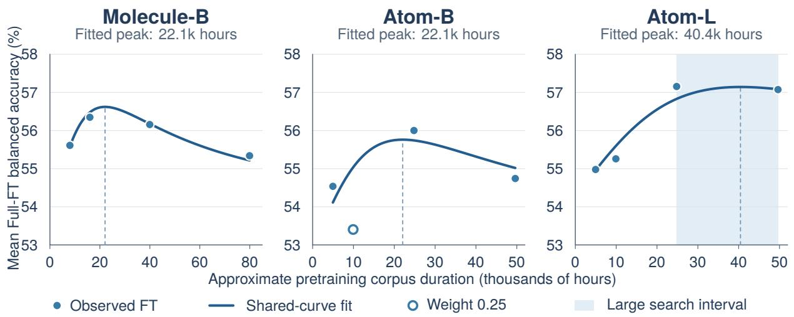  
Figure 15. Shared Full-FT response with Atom-B’s 20% point assigned weight 0.25. All 12 observations are shown; the hollow point receives reduced weight. Curves share the response shape and amplitude and are drawn only over observed duration ranges. Dashed lines mark fitted peaks; shading marks the imposed Large peak-search interval.

Table 42. Sensitivity to the weight of Atom-B’s 20% point. All other points have unit weight. Peaks are in thousands of hours; leave-one-point-out (LOO) RMSE uses all 12 held-out scores, in percentage points.
<table><tr><td>Weight</td><td></td><td>Base peak Large peak</td><td> $\eta$ </td><td>LOO RMSE</td><td>Constant LOO</td></tr><tr><td>1</td><td>25.22</td><td>40.81</td><td>0.232</td><td>0.919</td><td>1.094</td></tr><tr><td>0.25</td><td>22.07</td><td>40.45</td><td>0.292</td><td>0.707</td><td>1.076</td></tr><tr><td>0</td><td>20.45</td><td>40.09</td><td>0.324</td><td>0.680</td><td>1.080</td></tr></table>

The displayed fit gives $K = 2 2 , 0 6 5 . 7 7$ hours, $\eta = 0 . 2 9 1 6 8 9$ , and $B = 2 . 8 8 0 8$ percentage points. The fitted levels $A _ { i }$ are 52.8795, 54.2612, and 53.7392 for Atom-B, Atom-L, and Molecule-B. We use weight 0.25 for this fit and report weights 1 and 0 for sensitivity analysis. The three seeds measure downstream variability for each pretrained checkpoint.

## I.1 Response-shape sensitivity and the inverse relation

The peak estimates depend on how the FT response is modeled. For comparison, we fit $S _ { i } = a _ { i } - b _ { i } ( u - 1 ) ^ { 2 }$ and $S _ { i } = a _ { i } - b _ { i } [ \log u ] ^ { 2 }$ with separate levels and amplitudes for each series and the same peak-search bounds (Table 43). These alternatives have eight parameters for 12 observations. The raw-duration quadratic assumes symmetric declines per hour; the log-duration quadratic assumes symmetry per multiplicative change in duration.

Table 43. Alternative response shapes with series-specific amplitudes. Atom-B’s 20% point receives the indicated weight. Peak durations are in thousands of hours.
<table><tr><td>Response shape</td><td>Weight</td><td>Base peak</td><td> Large peak</td><td>η</td></tr><tr><td>Quadratic in duration</td><td>1</td><td>31.64</td><td>37.62</td><td>0.083</td></tr><tr><td rowspan="5">Quadratic in log duration</td><td>0.25</td><td>29.40</td><td>37.62</td><td>0.119</td></tr><tr><td>0</td><td>28.27</td><td>37.62</td><td>0.138</td></tr><tr><td>1</td><td>24.29</td><td>49.63†</td><td>0.344</td></tr><tr><td>0.25</td><td>21.92</td><td>49.63†</td><td>0.393</td></tr><tr><td>0</td><td>16.80</td><td>49.63†</td><td>0.521</td></tr></table>

†The fitted Large peak reaches the upper search bound.

An independent raw-duration quadratic places Molecule-B’s peak at 37,473 hours, compared with 15,982 hours for its best measured score. Response shape thus has a substantial efect on the inferred peak. The bounded response in Equation 1 gives an interior Large peak for all three point weights.

Sharing the amplitude lowers LOO error within the bounded-response family. At weight 0.25, allowing a separate amplitude for each of the three bounded curves gives a LOO RMSE of 1.259 points, compared with 0.707 for the common-amplitude model. Sharing only between Atom-B and Atom-L gives 0.879.

For each LOO prediction, we remove one observation and refit all parameters. The constant comparison fits one level per series with the same training weights and gives an RMSE of 1.076 points. We use LOO for internal model selection, with the same observations guiding the response shape and amplitude-sharing choices. Endpoint omissions require extrapolation; keeping only held-out 20% and 50% points gives 0.880 points for the shared response and 1.217 for the constant comparison.

The inverse of the fitted peak relation is

$$
P _ { \mathrm { r e f } } ( H ) = 5 . 8 \times 1 0 ^ { 6 } \left( \frac { H } { K } \right) ^ { 1 / \eta } , \qquad \frac { d \log P _ { \mathrm { r e f } } } { d \log H } = \frac { 1 } { \eta } .\tag{3}
$$

The fitted inverse exponent is 3.4283; Equation $^ 2$ uses 1/0.292 after rounding. Thus a relative change in duration produces a larger relative change in the corresponding parameter estimate. Here $P _ { \mathrm { r e f } } ( H )$ identifies the encoder size whose fitted peak occurs at duration H. Selecting a size for maximum FT performance at fixed duration additionally requires estimating how the series levels $A _ { i }$ vary with capacity and collection.

The exponent interpolates the two fitted peak locations for Base and Large. The resulting empirical scaling hypothesis describes FT under the current data collections and 50-epoch schedules, which couple corpus duration to optimization updates. Additional model sizes, intermediate fractions, and matched training exposure would test how this relation generalizes. LP follows a diferent fraction-dependent response and is analyzed separately in Section 6.3.