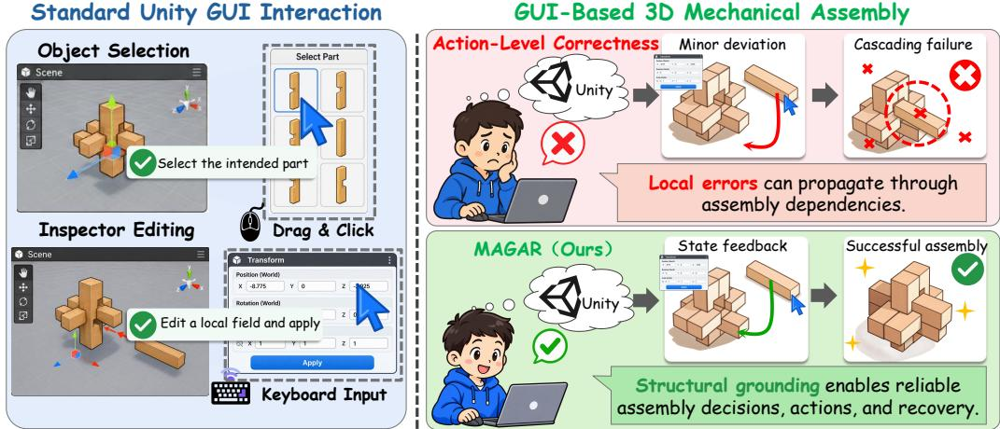
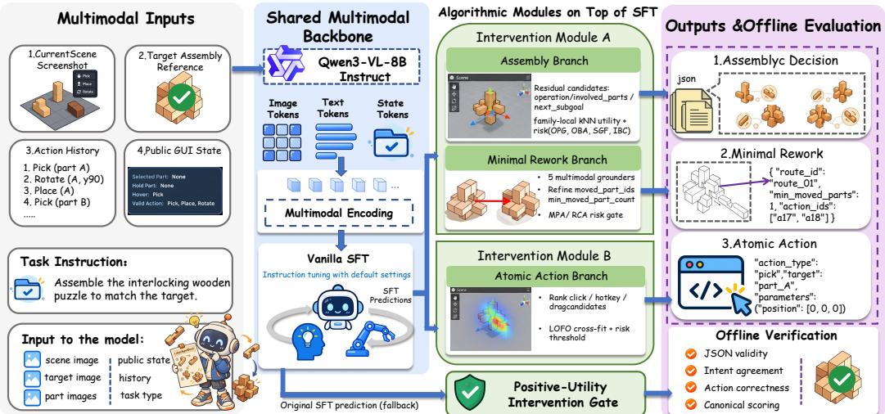
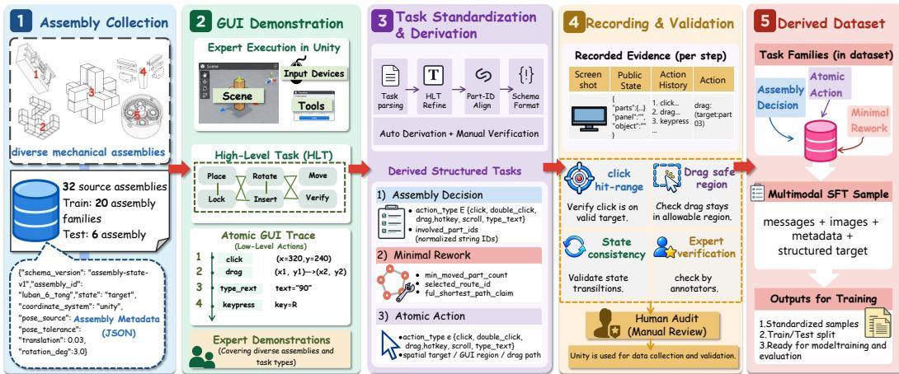
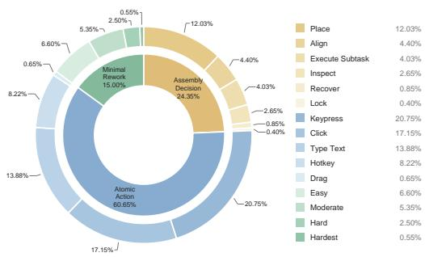
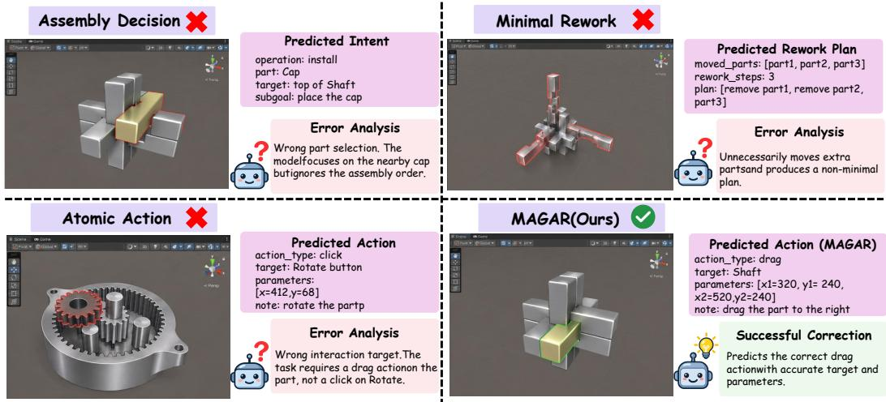
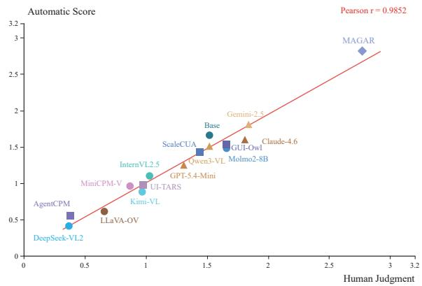
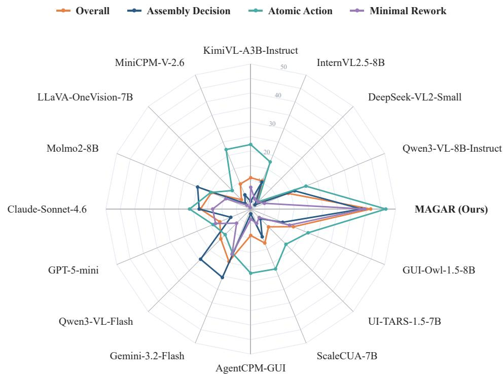
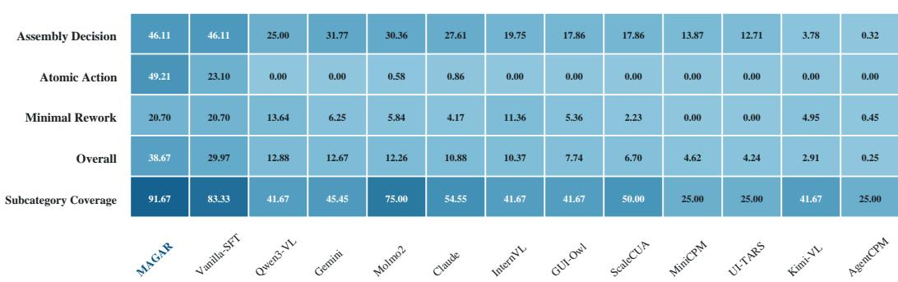
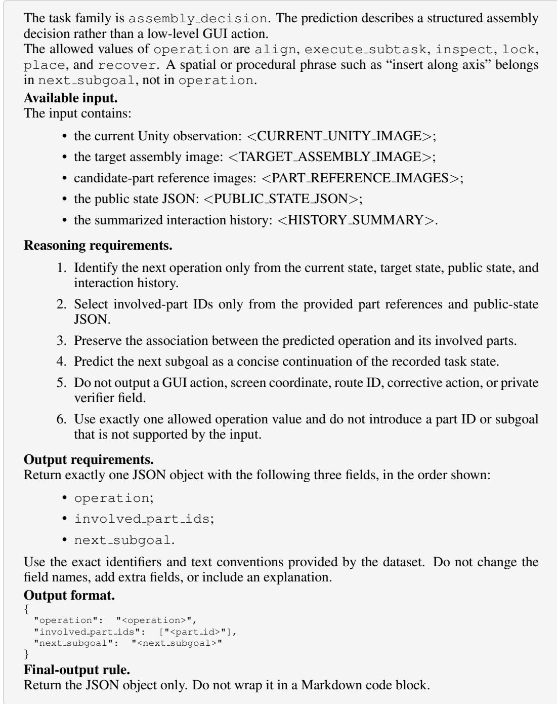
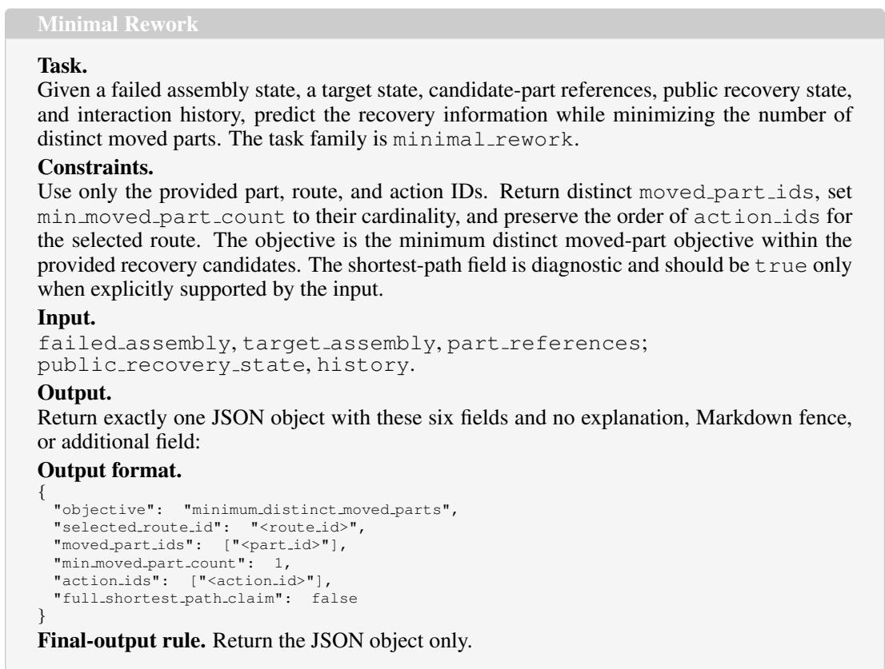

# MAGAR: MULTIMODAL AGENTS FOR GUI-BASED 3D MECHANICAL ASSEMBLY AND MINIMAL REWORK

Jingxuan Wei1,2, Jiahao Fu2, Fuqiang Wang2, Xiaoming Wu2 Yuwen Liu2,5, Kaiwen Wei3, Ming Yang2, Junnan Zhu4

1University of Chinese Academy of Sciences, Beijing, China

2Qilu University of Technology (Shandong Academy of Sciences),

Shandong Computer Science Center, Jinan, China

3College of Computer Science, Chongqing University, Chongqing, China

4Institute of Automation, Chinese Academy of Sciences, Beijing, China

5China University of Petroleum (East China), China

## ABSTRACT

A GUI command can be correct at the interface level yet still produce an incorrect assembly. An agent must identify the relevant components, respect their structural relationships, and determine which parts should move during recovery. We introduce MAGAR-Bench, a benchmark of 4,000 multimodal samples from 26 assembly families that separates Assembly Decision, Atomic Action, and Minimal Rework. For rework, the objective counts distinct moved parts within the validated recovery candidate set for each state, rather than the number of actions. We also introduce MAGAR, a selective correction framework built on a frozen policy obtained by supervised fine-tuning. Its key design matches correction granularity to output dependencies. Structured candidates revise assembly fields and rework scope, while complete action candidates keep native GUI primitives coupled with their parameters. A learned selector retains the original prediction unless a candidate passes a task-specific intervention threshold. On recorded states from held-out assembly families, MAGAR improves Overall, the task-balanced aggregate, from 37.50 to 41.39, with gains on all three tasks. Across 209 interventions, 70 correct an error and 22 introduce one. These results support task-specific correction while highlighting the remaining tradeoff between fixing errors and preserving reliable predictions.

## 1 INTRODUCTION

Correct GUI execution does not guarantee correct assembly modification. A command may target a valid interface element while selecting the wrong component, expressing an incompatible assembly intent, or disturbing parts that should remain fixed. When the current assembly is already incorrect, recovery adds another challenge, determining which components should actually move. GUI-based 3D assembly therefore requires more than control recognition. An agent must connect interface operations to object structure, part relationships, and the current assembly state.

Multimodal GUI agents have made substantial progress in visual grounding and computer interaction (Hong et al., 2024; Cheng et al., 2024; Qin et al., 2025). Benchmarks such as VisualWebArena, OSWorld, and AndroidWorld evaluate interaction in realistic software environments (Koh et al., 2024; Xie et al., 2024; Rawles et al., 2025). Geometry-aware GUI control and assembly error correction further emphasize the importance of structural dependencies (Wei et al., 2026; Wan et al., 2024). Together, these lines of work motivate an evaluation focused on assembly that separates three distinct failures, incorrect assembly intent, incorrect native action grounding, and incorrect recovery scope. Evaluating them separately makes it possible to identify not only whether a prediction improves, but also what was corrected.

We introduce MAGAR-Bench to make these distinctions measurable. Assembly Decision predicts an operation, the involved part set, and the next subgoal; Atomic Action predicts one native GUI primitive and its parameters; Minimal Rework predicts the moved part set and its cardinality, together with auxiliary recovery identifiers. The benchmark contains 4,000 samples from 26 assembly families, with six families held out for testing. Rework is measured by the number of distinct moved parts within the validated recovery candidate set for each state. Moving one part repeatedly is different from moving several parts once. This objective explicitly values preservation of the current assembly. All three tasks are evaluated on recorded Unity states rather than through online rollouts.

  
Figure 1: Motivation of MAGAR. Locally executable GUI actions may still violate the underlying assembly structure.

The same task decomposition motivates MAGAR, a selective correction framework anchored by a frozen policy obtained through supervised fine-tuning (SFT). Replacing an entire prediction can discard fields that are already correct, while correcting every field independently can violate output dependencies. We therefore align correction granularity with output structure. Module A proposes structured assembly candidates and field-preserving variants, and revises moved part sets and counts for rework. Module B proposes complete native actions, keeping each primitive coupled with its parameters. A learned selector retains the original SFT prediction unless a candidate passes a task-specific intervention threshold. Preserving prediction fields is a modeling choice, whereas minimizing moved components is a separate benchmark objective.

Our contributions are summarized as follows.

• We formulate assembly intent, native GUI action grounding, and minimal rework relative to validated recovery candidates in a multimodal benchmark containing 4,000 samples, with assembly families disjoint across the training and test splits.

• We develop a selective correction framework that uses structured field corrections for assembly and rework outputs and complete action replacements for native GUI actions, while retaining a common frozen SFT anchor.

• MAGAR improves the overall task-balanced aggregate, from 37.50 to 41.39 across all three tasks. Intervention accounting further reports both corrected and introduced errors rather than treating every prediction change as beneficial.

## 2 RELATED WORK

Multimodal GUI Agents. Multimodal GUI agents combine visual understanding, language reasoning, and executable action generation for interaction with digital interfaces. General-purpose vision-language models, including LLaVA, Qwen2-VL, Qwen3-VL, DeepSeek-VL2, InternVL2.5, Kimi-VL, MiniCPM-V, LLaVA-OneVision, and Molmo2, provide the visual representations and instruction-following capabilities used by such agents (Liu et al., 2023; Wang et al., 2024; Bai et al., 2025; Wu et al., 2024; Chen et al., 2024; Team et al., 2025; Yao et al., 2024; Li et al., 2024; Clark et al., 2026). Recent GUI-oriented systems improve screenshot understanding and interface-element grounding through explicit coordinate prediction or action-conditioned reasoning, as demonstrated by CogAgent, SeeClick, and Ferret-UI (Hong et al., 2024; Cheng et al., 2024; You et al., 2024). Agent S and GUI-Actor further study agentic computer interaction, while UI-TARS, AgentCPM-GUI, ScaleCUA, and Mobile-Agent-v3.5 extend native GUI control across desktop and mobile environments (Agashe et al., 2025; Wu et al., 2026; Qin et al., 2025; Zhang et al., 2025; Liu et al., 2026; Xu et al., 2026). Related vision-language-action systems, such as OpenVLA and Octo, connect multimodal observations to executable action policies (Kim et al., 2024; Team et al., 2024). These methods primarily target general action grounding and task completion. MAGAR instead separates structured assembly intent, atomic GUI execution, and minimal rework prediction, allowing intervention modules to correct different classes of errors while preserving reliable SFT outputs.

Benchmarks. Existing benchmarks evaluate multimodal agents across web, desktop, mobile, and general assistant settings. WebArena, VisualWebArena, and Mind2Web focus on browser-based task completion and web interaction (Zhou et al., 2024; Koh et al., 2024; Deng et al., 2023). OS-World and AndroidWorld provide execution-based evaluation for desktop and mobile environments, respectively, while BrowserGym studies interactive browser tasks (Xie et al., 2024; Rawles et al., 2025; Chezelles et al., 2024). GAIA evaluates broader assistant capabilities that require multimodal reasoning and tool use, and AgentBench measures language-model agents across multiple environments (Mialon et al., 2024; Liu et al., 2024). Assembly-oriented benchmarks introduce additional structural requirements: SCANet studies error identification and correction in LEGO assembly, while FurnitureBench evaluates long-horizon physical furniture assembly (Wan et al., 2024; Heo et al., 2025). These benchmarks measure functional completion, grounding, or physical assembly success, but do not jointly evaluate structured assembly decisions, native GUI action parameters, and the number of distinct parts requiring recovery. MAGAR-Bench addresses this gap through an assembly-family-disjoint evaluation setting with separate targets for Assembly Decision, Atomic Action, and Minimal Rework.

## 3 METHOD

## 3.1 PROBLEM FORMULATION

We study task-specific prediction for GUI-based 3D mechanical assembly. Each example contains the current assembly state, the target assembly state, candidate-part references, public GUI information, and summarized interaction history. We denote the multimodal input and task output by

$$
\begin{array} { r l } & { X = ( I _ { c } , I _ { g } , I _ { p } , S , H ) , \qquad I _ { p } = \{ I _ { p } ^ { j } \} _ { j = 1 } ^ { N _ { p } } , } \\ & { t \in \{ \mathrm { A s s e m b l y D e c i s i o n } , \mathrm { A t o m i c A c t i o n } , \mathrm { M i n i m a l R e w o r k } \} , } \\ & { y _ { t } = \left\{ \begin{array} { l l } { ( o , P , g ) , \qquad \quad t = \mathrm { A s s e m b l y D e c i s i o n } , } \\ { ( a , \theta ) , \qquad \quad t = \mathrm { A t o m i c A c t i o n } , } \\ { ( P _ { m } , n _ { m } , R , A ) , } \end{array} \right. } \end{array}\tag{1}
$$

Here, o is the assembly operation, P is the involved-part set, and g is the next subgoal. For Atomic Action, a is a GUI primitive and θ contains its typed parameters. For Minimal Rework, $P _ { m }$ denotes the moved-part set and $n _ { m }$ denotes the minimum number of distinct moved parts required for recovery among the validated recovery candidates for the state. The output also includes a recovery route R and corrective action sequence A to describe the associated recovery process. This task measures whether an agent can identify the necessary components to move while preserving the existing assembly as much as possible. The rework objective counts distinct moved parts rather than the total number of actions. Let ${ \mathcal { R } } _ { \mathrm { v a l } } ( X )$ denote the validated recovery candidates associated with state X. For a validated recovery candidate $\pi = ( a _ { 1 } , \ldots , a _ { L _ { \pi } } )$ , we define the recovery cost as

$$
\begin{array} { r } { J _ { \mathrm { m o v e } } ( \pi ) = \displaystyle \left. \bigcup _ { \ell = 1 } ^ { L _ { \pi } } P _ { \mathrm { m o v e } } ( a _ { \ell } ) \right. , \quad } \\ { \pi ^ { * } = \displaystyle \arg \operatorname* { m i n } _ { \pi \in \mathcal { R } _ { \mathrm { v a l } } ( X ) } J _ { \mathrm { m o v e } } ( \pi ) . } \end{array}\tag{2}
$$

  
Figure 2: Overview of MAGAR. A frozen SFT backbone provides task-specific predictions, while Module A performs structured assembly and rework intervention and Module B performs completeaction intervention.

## 3.2 MAGAR FRAMEWORK

MAGAR is a two-module intervention framework built on a supervised fine-tuned Qwen $3 \mathrm { - V L - 8 B - I n s t r u c t }$ backbone (Bai et al., 2025). Given a multimodal input X and a task family t, the frozen backbone first produces an anchor prediction $y _ { \mathrm { S F T } } ~ = ~ f _ { \theta _ { 0 } } ( X , t )$ MAGAR then constructs a task-specific candidate set $\mathcal { C } _ { t } ( X ) = \mathrm { C a n i } \overset { \cdot } { \mathrm { d } } _ { t } ( X , y _ { \mathrm { S F T } } )$ around this anchor and estimates whether replacing the anchor is likely to improve the corresponding task metrics. The candidate with the highest estimated utility is accepted only when it satisfies the task-specific reliability gate:

$$
\widehat { \boldsymbol { y } } = \left\{ \begin{array} { l l } { c ^ { * } , \quad } & { \Gamma _ { t } ( c ^ { * } \mid X , y _ { \mathrm { S F T } } ) = 1 , } \\ { y _ { \mathrm { S F T } } , } & { \mathrm { o t h e r w i s e } , } \end{array} \right. \quad \quad c ^ { * } = \arg \operatorname* { m a x } _ { c \in \mathcal { C } _ { t } ( X ) } \overline { { \boldsymbol { U } } } _ { t } ( c \mid X , y _ { \mathrm { S F T } } ) .\tag{3}
$$

The candidate generator is task-specific. Module A handles structured Assembly Decision and Minimal Rework outputs, whereas Module B handles Atomic Action outputs. Both modules use the same SFT prediction as the preservation anchor, making intervention optional rather than mandatory. The methodological contribution is the task-specific design of these two modules; the utility gate is a common rule for deciding when a generated candidate should replace the anchor.

For each task, the selector predicts a vector of metric changes $\widehat { \Delta } _ { t }$ and a benefit probability $\widehat { p _ { t } } ^ { + }$ . The utility and reliability gate are defined as

$$
\begin{array} { r l } & { \overline { { U } } _ { t } ( c \mid X , y _ { \mathrm { S F T } } ) = \mathbf { w } _ { t } ^ { \top } \widehat { \mathbf { \Delta } } \widehat { \mathbf { A } } _ { t } ( c \mid X , y _ { \mathrm { S F T } } ) , } \\ & { \Gamma _ { t } ( c \mid X , y _ { \mathrm { S F T } } ) = \mathbb { I } \big [ \overline { { U } } _ { t } ( c \mid X , y _ { \mathrm { S F T } } ) \geq \tau _ { t } , \widehat { p _ { t } ^ { + } } ( c \mid X , y _ { \mathrm { S F T } } ) \geq \tau _ { t } ^ { + } \big ] , } \end{array}\tag{4}
$$

where $\mathbf { w } _ { t }$ contains the task-specific metric weights, $\tau _ { t }$ is the minimum predicted utility, and $\tau _ { t } ^ { + }$ the minimum benefit probability required for intervention.

The selector supervision is constructed from candidates generated for training examples. Let $\mathcal { M } _ { t }$ denote the metrics associated with task $t , S _ { m }$ the score under metric $m ,$ and $y _ { i } ^ { * }$ the reference target of training example i. The realized metric-change vector and benefit label are

$$
\begin{array} { r l } &  \mathbf { \delta } \mathbf { \Delta } \mathbf { \phi } \mathbf { \Delta } \mathbf { \Sigma } \mathbf { \phi } \mathbf { \Sigma } \mathbf { \Sigma } \mathbf { \Sigma } \mathbf { \Sigma } \mathbf { \Sigma } \mathbf { \Sigma } \mathbf { \Sigma } \mathbf { \Sigma } \mathbf { \Sigma } \mathbf { \Sigma } \mathbf { \Sigma } \mathbf { \Sigma } \mathbf { \Sigma } \mathbf { \Sigma } \mathbf { \Sigma } \mathbf { \Sigma } \mathbf { \Sigma } \mathbf { \Sigma } \mathbf { \Sigma } \mathbf { \Sigma } \mathbf { \Sigma } \mathbf { \Sigma } \mathbf { \Sigma } \mathbf { \Sigma } \mathbf { \Sigma } \mathbf { \Sigma } \mathbf { \Sigma } \mathbf { \Sigma } \mathbf { \Sigma } \mathbf { \Sigma } \mathbf { \Sigma } \mathbf { \Sigma } \mathbf { \Sigma } \mathbf { \Sigma } \mathbf { \Sigma } \mathbf { \Sigma } \mathbf { \Sigma } \mathbf { \Sigma } \mathbf { \Sigma } \mathbf { \Sigma } \mathbf { \Sigma } \mathbf { \Sigma } \mathbf { \Sigma } \mathbf { \Sigma } \mathbf { \Sigma } \mathbf { \Sigma } \mathbf { \Sigma } \mathbf { \Sigma } \mathbf { \Sigma } \mathbf { \Sigma } \mathbf { \Sigma } \mathbf { \Sigma } \mathbf { \Sigma } \mathbf { \Sigma } \mathbf { \Sigma } \mathbf { \Sigma } \mathbf { \Sigma } \mathbf { \Sigma } \mathbf { \Sigma } \mathbf { \Sigma } \mathbf { \Sigma } \mathbf { \Sigma } \mathbf { \Sigma } \mathbf { \Sigma } \mathbf { \Sigma } \mathbf { \Sigma } \mathbf { \Sigma } \mathbf { \Sigma } \mathbf { \Sigma } \mathbf { \Sigma } \mathbf { \Sigma } \mathbf { \Sigma } \mathbf { \Sigma } \mathbf { \Sigma } \mathbf { \Sigma } \mathbf { \Sigma } \mathbf { \Sigma } \mathbf { \Sigma } \mathbf { \Sigma } \mathbf { \Sigma } \mathbf { \Sigma } \mathbf { \Sigma } \mathbf { \Sigma } \mathbf { \Sigma } \mathbf { \Sigma } \mathbf { \Sigma } \mathbf { \Sigma } \mathbf { \Sigma } \mathbf { \Sigma } \mathbf { \Sigma } \mathbf { \Sigma } \mathbf { \Sigma } \mathbf { \Sigma } \mathbf { \Sigma } \mathbf { \Sigma } \mathbf { \Sigma } \mathbf { \Sigma } \mathbf { \Sigma } \mathbf { \Sigma } \mathbf { \Sigma } \mathbf { \Sigma } \mathbf { \Sigma } \mathbf { \Sigma } \mathbf { \Sigma } \mathbf { \Sigma } \mathbf { \Sigma } \mathbf { \Sigma } \mathbf   \end{array}\tag{5}
$$

The metric-change head is trained by regression, while the reliability head predicts whether the candidate improves the weighted task score:

$$
\mathcal { L } _ { \mathrm { s e l } } = \sum _ { i } \sum _ { c \in \mathcal { C } _ { t _ { i } } ( X _ { i } ) } \left[ \left\| \widehat { \Delta } _ { t _ { i } } ( c ) - \Delta _ { i } ( c ) \right\| _ { 2 } ^ { 2 } + \lambda _ { \mathrm { r e l } } \mathrm { B C E } \left( \widehat { p } _ { t _ { i } } ^ { + } ( c ) , b _ { i } ( c ) \right) \right] .\tag{6}
$$

During selector training, candidate-level targets and the selector loss are constructed from trainingfamily examples under family-level cross-fitting. After calibration, the selector and gate thresholds are fixed before evaluation.

The gate makes preservation an explicit option. If the highest-utility candidate fails either reliability condition, MAGAR returns the original SFT output. This design separates candidate coverage from selection reliability: the intervention modules propose possible corrections, while the selector determines whether a proposed change has sufficient evidence to replace the anchor.

MAGAR reuses hidden representations from the frozen SFT backbone instead of performing a second autoregressive generation step. The hidden-token spans of the current state, target state, public GUI context, and candidate-part references are pooled into $h _ { c } , h _ { g } , h _ { p } .$ , and $\{ h _ { r } ^ { j } \} _ { j = 1 } ^ { N _ { p } }$ , respectively. Multi-head attention aligns the current and target states to produce their residual difference $d ,$ while attention pooling aggregates the reference-part features into $\bar { h } _ { r }$ . The task-conditioned plan is constructed as

$$
\begin{array} { r l } & { z _ { s } = \phi _ { z } \left( [ h _ { c } ; h _ { g } ; h _ { p } ; \bar { h } _ { r } ; d ; e _ { t } ] \right) , } \\ & { z _ { A } = z _ { s } + \rho _ { t } ( z _ { s } ) . } \end{array}\tag{7}
$$

where $e _ { t }$ is the task-family embedding, $z _ { s }$ is the shared multimodal plan, and $\rho _ { t }$ is a lightweight task-specific residual adapter initialized with zero impact. The resulting representation $z _ { A }$ summarizes the current-to-target change, candidate-part evidence, GUI context, and task identity while preserving compatibility with the frozen SFT representation at the start of training. Module A uses $z _ { A }$ for structured assembly and rework prediction, while Module B uses it to condition atomic-action grounding.

## 3.3 MODULE A: STRUCTURED ASSEMBLY AND REWORK INTERVENTION

Module A addresses the two outputs that require explicit structural reasoning: Assembly Decision and Minimal Rework. For Assembly Decision, the module predicts an operation, a compatible next subgoal, and an operation-conditioned set of involved parts. These fields are scored as one structured object rather than independently concatenated after decoding.

$$
p _ { A } ( o , P , g \mid X ) \propto p _ { o } ( o \mid z _ { A } ) p _ { g } ( g \mid o , z _ { A } ) p _ { P } ( P \mid o , X , z _ { A } ) \mathbb { I } [ ( o , g ) \in { \mathcal R } _ { \mathrm { v a l i d } } ] .\tag{8}
$$

where $\mathcal { R } _ { \mathrm { v a l i d } }$ is the set of valid operation–subgoal pairs. The operation-conditioned part scores use the reference-part representations together with the current–target difference, and $p _ { K }$ predicts the cardinality of the selected set. The resulting candidates are not required to replace the complete SFT answer. For each candidate, Module A enumerates residual variants that replace a non-empty subset of the fields $\{ o , P , g \}$ while retaining all other anchor fields. This allows the module to correct an incorrect operation without discarding a correct part set, or to correct the part set while preserving the anchor subgoal.

For Minimal Rework, Module A proposes moved-part sets and their counts. Five independently trained part grounders generate candidates from reference-part evidence and current–target differences. To retain the full output format, each candidate inherits the recovery route and corrective action sequence from the SFT anchor. Let $ { \mathcal { K } } _ { q } ( X , z _ { A } )$ denote the top-ranked moved-part and count pairs from the q-th Rework grounder. The candidate set is

$$
\mathcal { C } _ { A } ^ { \mathrm { r e w } } ( X ) = \bigcup _ { q = 1 } ^ { 5 } \left\{ ( P _ { m } , n _ { m } , R _ { \mathrm { S F T } } , A _ { \mathrm { S F T } } ) \ | \ ( P _ { m } , n _ { m } ) \in K _ { q } ( X , z _ { A } ) \right\} .\tag{9}
$$

Assembly and Rework candidates are passed to task-specific selectors, which estimate gains in the corresponding evaluated metrics and apply the utility gate in Eq. 4. For Minimal Rework, Module A predicts the recovery scope through the moved-part set and its corresponding count. The recovery route and corrective action sequence are inherited from the SFT anchor and kept as auxiliary recovery information. Thus, Module A improves component-level rework identification while preserving the original recovery trajectory.

## 3.4 MODULE B: PLAN-CONDITIONED ATOMIC ACTION INTERVENTION

Module B handles Atomic Action prediction. The action space contains click, drag, type text, keypress, and hotkey. Each action is represented as a complete primitive– parameter pair rather than as independently selected fields. The action router first selects a primitive,

after which the corresponding expert predicts its valid parameters. We define the action state as $h _ { B } = \phi _ { B } [ h _ { c } ; h _ { p } ; z _ { A } ; \bar { \phi _ { S } } ( S ) ; \bar { \phi } _ { H } ( \bar { H } ) ]$ . The resulting action distribution is

$$
\begin{array} { r } { p _ { B } ( a , \theta \mid X ) = p _ { \mathrm { r o u t e r } } ( a \mid h _ { B } ) p _ { \mathrm { e x p e r t } } ( \theta \mid a , h _ { B } , z _ { A } ) . } \end{array}\tag{10}
$$

The plan representation $z _ { A }$ conditions both primitive selection and parameter prediction. For each action group k, Module B introduces a small gated residual into the corresponding logits:

$$
\ell _ { k } ^ { \prime } = \ell _ { k } + \operatorname { t a n h } ( \alpha _ { k } ) W _ { k } z _ { A } , \qquad k \in \{ \mathrm { r o u t e r , c l i c k , d r a g , t y p e , k e y p r e s s , h o t k e y } \} .\tag{11}
$$

The gates and residual parameters are initialized near zero, allowing the action module to preserve the behavior learned by SFT before learning to exploit the structural plan. During training, Module A is frozen while Module B learns to consume its plan representation. At inference, Module B ranks complete action candidates with a task-specific selector and replaces the SFT action only when the predicted improvement satisfies the corresponding risk constraints.

## 4 DATASET

## 4.1 DATASET CONSTRUCTION

MAGAR-Bench is constructed from Unity-based 3D mechanical assembly episodes that record interaction with virtual components through native GUI operations. Figure 3 summarizes the construction pipeline. The dataset links assembly observations and public state to decision, action, and recovery targets, preserving the context needed to interpret each prediction. Episode recording and

  
Figure 3: Construction pipeline of MAGAR-Bench.

contextual organization. Each episode records the target assembly, intermediate states, interaction trajectories, and GUI actions executed in Unity. Task-specific inputs retain the relevant observations, part references, public state, and history. Assembly-decision targets. Assembly Decision pairs a recorded state with the next structured intent: the operation, involved-part set, and next subgoal. These targets retain the association between an intended operation and the components to which it applies.

Atomic-action targets. Atomic Action pairs an interface state and assembly objective with a native operation and its parameters. The action grammar preserves the parameterization of spatial, keyboard, and text interactions.

Minimal-rework targets. Minimal Rework pairs an incorrect assembly state with a moved-part set and the minimum number of distinct parts that must move among the validated recovery candidates associated with that state. Recorded recovery routes and corrective actions are retained as output fields and are scored only through the identifier-matching terms in RCA; their execution validity is not evaluated. The three task families provide separate prediction-level measurements within the same assembly domain.

## 4.2 DATASET ANALYSIS

Figure 4 summarizes MAGAR-BENCH. The benchmark contains 4,000 samples from 26 assembly families, with 3,000 samples from 20 families for training and 1,000 samples from six held-out families for testing. It includes 974 Assembly Decision, 2,426 Atomic Action, and 600 Minimal Rework samples, covering highlevel decisions, low-level execution, and assembly recovery. Atomic Action covers five native GUI operations: click, drag, hotkey, keypress, and type text. Minimal Rework includes recovery cases involving different numbers of moved parts.

  
Figure 4: Composition of MAGAR-Bench.

## 5 EXPERIMENTS

## 5.1 EXPERIMENTAL SETUP

We evaluate Assembly Decision, Atomic Action, and Minimal Rework on recorded task instances from held-out assembly families. MAGAR is built on a supervised fine-tuned Qwen3-VL-8B-Instruct backbone (Bai et al., 2025). All intervention configurations use the same frozen SFT anchor and activate the applicable module for each task. The task-specific selectors are trained through cross-fitting on the training families. Open-source multimodal models, proprietary models, GUI-specialized baselines, and MAGAR follow the same held-out test protocol, while LLM-as-judge evaluation uses a separate fixed subset. Overall is computed by first averaging the automatic metrics within each task family and then assigning equal weight to the three task-family scores; the LLM-as-judge score is reported separately. Implementation details and metric definitions are provided in the appendix.

## 5.2 MAIN RESULTS

Table 1 reports the main results. MAGAR reaches 41.39 Overall, improving on Vanilla-SFT’s 37.50 by 3.89 points under the reported cross-fitted protocol. It has the highest reported Overall among the systems evaluated on the complete Test split. The improvement is distributed across the three task families.

Table 1: Main results on recorded task instances. Models are grouped into open-source multimodal models, proprietary multimodal models, and GUI agent baselines. The best results are highlighted in bold, and the second-best results are underlined.
<table><tr><td rowspan="2">Model</td><td colspan="4">Assembly Decision</td><td colspan="3">Atomic Action</td><td colspan="2">Minimal Rework</td><td rowspan="2">Overall↑</td><td rowspan="2">|LLM-as-judge Score↑</td></tr><tr><td>OPG↑ OBA↑ SGF↑ IBC↑|</td><td></td><td></td><td></td><td>|ATA↑ PCA↑ WCS↑ |MPA↑</td><td></td><td></td><td></td><td>RCA↑</td></tr><tr><td colspan="10">Open-source multimodal models</td></tr><tr><td>Qwen3-VL-8B-Instruct (Bai et al., 2025)</td><td>28.97</td><td>25.31</td><td>7.56 3.78</td><td></td><td>28.40</td><td>16.81</td><td>16.65 6.00</td><td>4.25</td><td>14.05</td><td></td><td>1.66</td></tr><tr><td>DeepSeek-VL2-Small (Wu et al., 2024)</td><td>0.47</td><td>3.72</td><td>3.78</td><td></td><td>5.89</td><td></td><td>1.58</td><td>3.00</td><td>7.00</td><td>3.16</td><td>0.41</td></tr><tr><td>InternVL2.5-8B (Chen et al., 2024)</td><td>8.88</td><td>17.57</td><td>10.50</td><td>3.36</td><td>29.91</td><td>9.37</td><td>13.41</td><td>5.00</td><td>2.50</td><td>10.46</td><td>1.10</td></tr><tr><td>Kimi-VL-A3B-Instruct (Team et al., 2025)</td><td>0.93</td><td>5.85</td><td>3.78</td><td></td><td>29.91</td><td>18.84</td><td>17.96</td><td>7.00</td><td>8.00</td><td>10.79</td><td>0.88</td></tr><tr><td>MiniCPM-V-2.6 (Yao et al., 2024)</td><td>2.80</td><td>16.67</td><td>1.68</td><td></td><td>29.91</td><td>18.74</td><td>17.89</td><td></td><td>1.00</td><td>9.32</td><td>0.96</td></tr><tr><td>LLaVA-OneVision-7B (Li et al., 2024) Molmo2-8B (Clark et al., 2026)</td><td>26.17</td><td>10.84 17.86</td><td>23.53</td><td>11.76</td><td>17.07</td><td>3.29 6.28</td><td>6.66 13.62</td><td>1.00 7.00</td><td>2.75 11.50</td><td>4.53 14.67</td><td>0.61 1.48</td></tr><tr><td colspan="10">24.92 Proprietary multimodal models</td><td></td><td></td><td></td></tr><tr><td colspan="10"></td></tr><tr><td>Claude-Sonnet-4.6 (Anthropic, 2026)</td><td>13.64</td><td>22.06</td><td>22.92</td><td>12.50</td><td>28.79</td><td>18.27</td><td>16.21</td><td>10.00</td><td>16.25</td><td>17.33</td><td>1.60</td></tr><tr><td>GPT-5.4-Mini (OpenAI, 2026)</td><td></td><td>6.55</td><td>8.33</td><td></td><td>20.45</td><td>8.65</td><td>13.02</td><td>10.00</td><td>16.25</td><td>10.30</td><td>1.25</td></tr><tr><td>Qwen3-VL-Flash (Bai et al., 2025)</td><td>18.18</td><td>35.83</td><td>31.25</td><td>12.50</td><td>28.79</td><td>0.48</td><td>8.12</td><td>5.00</td><td>8.75</td><td>14.59</td><td>1.51</td></tr><tr><td>Gemini-2.5-Flash (Google, 2025)</td><td>38.64</td><td>28.13</td><td>20.83</td><td>14.58</td><td>27.27</td><td>10.10</td><td>11.98</td><td>15.00</td><td>18.75</td><td>19.62</td><td>1.81</td></tr><tr><td colspan="10">GUI agent baselines</td></tr><tr><td>AgentCPM-GUI (Zhang et al., 2025)</td><td></td><td>6.67</td><td></td><td></td><td>29.61</td><td>18.94</td><td>17.83</td><td>1.00</td><td>6.00</td><td>9.10</td><td>0.55</td></tr><tr><td>ScaleCUA-7B (Liu et al., 2026)</td><td>17.29</td><td>17.48</td><td>4.62</td><td>2.10</td><td>29.91</td><td>19.13</td><td>18.02</td><td>4.00</td><td>6.75</td><td>12.70</td><td>1.43</td></tr><tr><td>UI-TARS-1.5-7B (Qin et al., 2025) GUI-Owl-1.5-8B (Xu et al., 2026)</td><td>1.40</td><td>16.67 22.26</td><td>0.84</td><td></td><td>24.92</td><td>13.04</td><td>13.59</td><td></td><td>7.25</td><td>8.51</td><td>0.98</td></tr><tr><td></td><td>10.75</td><td></td><td>12.61</td><td>2.10</td><td>28.70</td><td>18.36</td><td>17.21</td><td>12.00</td><td>17.00</td><td>15.95</td><td>1.53</td></tr><tr><td>MAGAR(Ours)</td><td>39.25</td><td>33.62</td><td></td><td>44.54 35.29</td><td>48.19 37.39</td><td></td><td>54.24</td><td>30.00</td><td>48.75</td><td>41.39</td><td>2.82</td></tr></table>

The task-wise results clarify the complementary contributions of the two intervention modules. For Assembly Decision, Subgoal Fidelity rises from 42.86 to 44.54 and Intent Binding Consistency from 33.61 to 35.29. For Atomic Action, Parameter Correctness Accuracy rises from 29.37 to 37.39 and Workflow Consistency Score from 50.64 to 54.24. For Minimal Rework, Moved-Part Accuracy rises from 24.00 to 30.00 and RCA from 45.50 to 48.75. These measurements connect the improvements to structured intent, action parameterization, and recovery scope.

Supervised adaptation accounts for a substantial part of the overall performance: the unadapted Qwen3-VL backbone scores 14.05, compared with 37.50 after SFT. The intervention framework provides further gains over this shared anchor. On the fixed judgment subset, MAGAR receives an automatic score of 2.82, compared with 2.66 for Vanilla-SFT.

## 5.3 ABLATION STUDY

Table 2 examines the contributions of the two intervention modules using the same SFT anchor. Module A improves Assembly Decision and Minimal Rework, raising Overall from 37.50 to 39.63 while leaving Atomic Action unchanged. Module B improves Atomic Action prediction and reaches 39.26 Overall, with its largest task-metric gain in parameter correctness. MAGAR applies the corresponding module to each task and achieves 41.39 Overall. These results support the framework’s division between structured-field correction and complete-action selection. The comparisons include both candidate generation and candidate selection within each intervention module; they do not constitute a separate ablation of the common selection gate itself.

Table 2: Ablation of the two intervention modules. The best results are highlighted in bold.
<table><tr><td rowspan="2">Model</td><td colspan="4">Assembly Decision</td><td colspan="2">Atomic Action</td><td colspan="2">Minimal Rework</td><td rowspan="2">Overall↑</td><td rowspan="2">LLM-as-judge Score↑</td></tr><tr><td>OPG↑</td><td>OBA↑</td><td>SGF↑</td><td>IBC↑</td><td>ATA↑ PCA↑</td><td>WCS↑</td><td>MPA↑</td><td>RCA↑</td></tr><tr><td>Vanilla-SFT</td><td>36.45</td><td>32.76</td><td>42.86</td><td>33.61</td><td>43.96 29.37</td><td>50.64</td><td>24.00</td><td>45.50</td><td>37.50</td><td>2.66</td></tr><tr><td>SFT + Module A</td><td>39.25</td><td>33.62</td><td>44.54</td><td>35.29</td><td>43.96 29.37</td><td>50.64</td><td>30.00</td><td>48.75</td><td>39.63</td><td>2.67</td></tr><tr><td>SFT + Module B</td><td>36.45</td><td>32.76</td><td>42.86 33.61</td><td></td><td>48.19 37.39</td><td>54.24</td><td>24.00</td><td>45.50</td><td>39.26</td><td>2.79</td></tr><tr><td>MAGAR(Ours)</td><td>39.25</td><td>33.62</td><td>44.54 35.29</td><td></td><td>48.19 37.39</td><td>54.24</td><td>30.00</td><td>48.75</td><td>41.39</td><td>2.82</td></tr></table>

## 5.4 CASE STUDY AND ERROR ANALYSIS

Figure 5 presents representative cases from the three MAGAR task families, showing how task specific intervention modifies Vanilla-SFT predictions. For Assembly Decision, the intervention revises inconsistent operation, involved-part, or subgoal predictions while preserving reliable fields. For Atomic Action, MAGAR corrects action grounding and GUI-action parameters, such as the interaction target and its coordinates. For Minimal Rework, it improves the identification of parts that must be moved and the minimum rework count. These cases complement Table 1: Module A addresses structural assembly and rework reasoning, whereas Module B targets precise native GUI execution.

  
Figure 5: Representative MAGAR corrections across three task families.

## 5.5 CONSISTENCY WITH HUMAN JUDGMENTS

Figure 6 shows how automatic scores relate to human ratings across the evaluated models. Models with lower LLM-asjudge scores generally receive lower human ratings, while MAGAR lies in the high-scoring region on both axes, with an automatic score of 2.82 and a mean human score of 2.77. The strong correlation (r = 0.9852) indicates that the two evaluations track similar model-level performance trends. The automatic scores therefore provide a complementary signal for comparing relative performance across models. This comparison concerns aggregated model scores rather than agreement on individual predictions.

  
Figure 6: Automatic evaluation score vs. human rating.

## 6 CONCLUSION AND LIMITATIONS

GUI-based mechanical assembly requires predictions that connect part relationships, native GUI actions, and recovery scope to the current assembly state. We introduced MAGAR-Bench, a benchmark that separates Assembly Decision, Atomic Action, and Minimal Rework, together with MA-GAR, a selective correction framework built on a frozen SFT policy. MAGAR-Bench defines rework in terms of distinct moved parts, making preservation of the existing assembly an explicit recovery objective. MAGAR matches correction granularity to output dependencies through structured assembly and rework intervention in Module A and complete GUI action intervention in Module B. On recorded states from held-out assembly families, MAGAR improves the task balanced score from 37.50 to 41.39, with gains across all three tasks. Among 209 interventions, 70 correct an error, and 22 introduce one, highlighting both the benefit and the remaining cost of selective correction. Future work should extend this setting to long-horizon online assembly, globally consistent recovery planning, and broader CAD environments.

## AI USE STATEMENT

Generative AI assistance was used for literature processing, dataset construction, and auxiliary LLM-as-Judge evaluation. All generated records, annotations, and evaluation outputs were reviewed under the documented audit procedure. The authors are responsible for the final dataset, experimental results, analyses, and claims.

## REPRODUCIBILITY STATEMENT

Appendix A reports the aggregate and radar-chart results. Appendix B documents MAGAR-Bench construction, dataset composition, and data splits. Appendix C provides the training configuration, decoding settings, and evaluation metrics. Appendix D contains the prompt templates, Appendix E presents the error analyses, and Appendix F describes the human-evaluation protocol and modellevel agreement. All reported results use the fixed data splits and evaluation protocols described in these appendices.

## REFERENCES

Saaket Agashe, Jiuzhou Han, Shuyu Gan, Jiachen Yang, Ang Li, and Xin Wang. Agent s: An open agentic framework that uses computers like a human. In International Conference on Learning Representations, volume 2025, pp. 22924–22946, 2025.

Anthropic. Claude sonnet 4.6: Performance and safety updates. Technical report, Anthropic PBC, 2026. URL https://www.anthropic.com/news/claude-sonnet-4-6. Official announcement and technical overview.

Shuai Bai, Yuxuan Cai, Ruizhe Chen, Keqin Chen, Xionghui Chen, Zesen Cheng, Lianghao Deng, Wei Ding, Chang Gao, Chunjiang Ge, et al. Qwen3-vl technical report. arXiv preprint arXiv:2511.21631, 2025.

Zhe Chen, Weiyun Wang, Yue Cao, Yangzhou Liu, Zhangwei Gao, Erfei Cui, Jinguo Zhu, Shenglong Ye, Hao Tian, Zhaoyang Liu, et al. Expanding performance boundaries of open-source multimodal models with model, data, and test-time scaling. arXiv preprint arXiv:2412.05271, 2024.

Kanzhi Cheng, Qiushi Sun, Yougang Chu, Fangzhi Xu, Li YanTao, Jianbing Zhang, and Zhiyong Wu. Seeclick: Harnessing gui grounding for advanced visual gui agents. In Proceedings of the 62nd Annual Meeting of the Association for Computational Linguistics (Volume 1: Long Papers), pp. 9313–9332, 2024.

De Chezelles, Thibault Le Sellier, Sahar Omidi Shayegan, Lawrence Keunho Jang, Xing Han Lu,\` Ori Yoran, Dehan Kong, Frank F Xu, Siva Reddy, Quentin Cappart, et al. The browsergym ecosystem for web agent research. arXiv preprint arXiv:2412.05467, 2024.

Christopher Clark, Jieyu Zhang, Zixian Ma, Jae Sung Park, Rohun Tripathi, Sangho Lee, Mohammadreza Salehi, Jason Ren, Chris Dongjoo Kim, Yinuo Yang, et al. Molmo2: Open weights and data for vision-language models with video understanding and grounding. In Proceedings of the IEEE/CVF Conference on Computer Vision and Pattern Recognition, pp. 28652–28668, 2026.

Xiang Deng, Yu Gu, Boyuan Zheng, Shijie Chen, Sam Stevens, Boshi Wang, Huan Sun, and Yu Su. Mind2web: Towards a generalist agent for the web. Advances in Neural Information Processing Systems, 36:28091–28114, 2023.

Google. Gemini 2.5 flash. Google DeepMind technical documentation, 2025. URL https: //ai.google.dev/gemini-api/docs/models/gemini-2.5-flash.

Minho Heo, Youngwoon Lee, Doohyun Lee, and Joseph J Lim. Furniturebench: Reproducible realworld benchmark for long-horizon complex manipulation. The International Journal of Robotics Research, 44(10-11):1863–1891, 2025.

Wenyi Hong, Weihan Wang, Qingsong Lv, Jiazheng Xu, Wenmeng Yu, Junhui Ji, Yan Wang, Zihan Wang, Yuxiao Dong, Ming Ding, et al. Cogagent: A visual language model for gui agents. In 2024 IEEE/CVF Conference on Computer Vision and Pattern Recognition (CVPR), pp. 14281–14290. IEEE, 2024.

Moo Jin Kim, Karl Pertsch, Siddharth Karamcheti, Ted Xiao, Ashwin Balakrishna, Suraj Nair, Rafael Rafailov, Ethan Foster, Grace Lam, Pannag Sanketi, et al. Openvla: An open-source vision-language-action model. arXiv preprint arXiv:2406.09246, 2024.

Jing Yu Koh, Robert Lo, Lawrence Jang, Vikram Duvvur, Ming Lim, Po-Yu Huang, Graham Neubig, Shuyan Zhou, Russ Salakhutdinov, and Daniel Fried. Visualwebarena: Evaluating multimodal agents on realistic visual web tasks. In Proceedings ofthe 62nd Annual Meeting ofthe Association for Computational Linguistics (Volume 1: Long Papers), pp. 881–905, 2024.

Bo Li, Yuanhan Zhang, Dong Guo, Renrui Zhang, Feng Li, Hao Zhang, Kaichen Zhang, Peiyuan Zhang, Yanwei Li, Ziwei Liu, et al. Llava-onevision: Easy visual task transfer. arXiv preprint arXiv:2408.03326, 2024.

Haotian Liu, Chunyuan Li, Qingyang Wu, and Yong Jae Lee. Visual instruction tuning. Advances in neural information processing systems, 36:34892–34916, 2023.

Xiao Liu, Hao Yu, Hanchen Zhang, Yifan Xu, Xuanyu Lei, Hanyu Lai, Yu Gu, Hangliang Ding, Kaiwen Men, Kejuan Yang, et al. Agentbench: Evaluating llms as agents. In International Conference on Learning Representations, volume 2024, pp. 52989–53046, 2024.

Zhaoyang Liu, JingJing Xie, Zichen Ding, Zehao Li, Bowen Yang, Zhenyu Wu, Xuehui Wang, Qiushi Sun, Shi Liu, Weiyun Wang, et al. Scalecua: Scaling open-source computer use agents with cross-platform data. In International Conference on Learning Representations, volume 2026, pp. 62707–62766, 2026.

Gregoire Mialon, Cl´ ementine Fourrier, Thomas Wolf, Yann LeCun, and Thomas Scialom. Gaia: a´ benchmark for general ai assistants. In International Conference on Learning Representations, volume 2024, pp. 9025–9049, 2024.

OpenAI. Gpt-5.4 mini. Model documentation, 2026. URL https://developers.openai. com/api/docs/models/gpt-5.4-mini.

Yujia Qin, Yining Ye, Junjie Fang, Haoming Wang, Shihao Liang, Shizuo Tian, Junda Zhang, Jiahao Li, Yunxin Li, Shijue Huang, et al. Ui-tars: Pioneering automated gui interaction with native agents. arXiv preprint arXiv:2501.12326, 2025.

Chris Rawles, Sarah Clinckemaillie, Yifan Chang, Jonathan Waltz, Gabrielle Lau, Marybeth Fair, Alice Li, William Bishop, Wei Li, Folawiyo Campbell-Ajala, et al. Androidworld: A dynamic benchmarking environment for autonomous agents. In International Conference on Learning Representations, volume 2025, pp. 406–441, 2025.

Kimi Team, Angang Du, Bohong Yin, Bowei Xing, Bowen Qu, Bowen Wang, Cheng Chen, Chenlin Zhang, Chenzhuang Du, Chu Wei, et al. Kimi-vl technical report. arXiv preprint arXiv:2504.07491, 2025.

Octo Model Team, Dibya Ghosh, Homer Walke, Karl Pertsch, Kevin Black, Oier Mees, Sudeep Dasari, Joey Hejna, Tobias Kreiman, Charles Xu, et al. Octo: An open-source generalist robot policy. arXiv preprint arXiv:2405.12213, 2024.

Yuxuan Wan, Kaichen Zhou, Jinhong Chen, and Hao Dong. Scanet: Correcting lego assembly errors with self-correct assembly network. In 2024 IEEE/RSJ International Conference on Intelligent Robots and Systems (IROS), pp. 5940–5947. IEEE, 2024.

Peng Wang, Shuai Bai, Sinan Tan, Shijie Wang, Zhihao Fan, Jinze Bai, Keqin Chen, Xuejing Liu, Jialin Wang, Wenbin Ge, et al. Qwen2-vl: Enhancing vision-language model’s perception of the world at any resolution. arXiv preprint arXiv:2409.12191, 2024.

Jingxuan Wei, Xi Bai, Shan Liu, Caijun Jia, Zheng Sun, Xinglong Xu, Siyuan Li, Linzhuang Sun, Bihui Yu, Conghui He, et al. Pager: Bridging the semantic-execution gap in point-precise geometric gui control. arXiv preprint arXiv:2605.15963, 2026.

Qianhui Wu, Kanzhi Cheng, Rui Yang, Chaoyun Zhang, Jianwei Yang, Huiqiang Jiang, Jian Mu, Baolin Peng, Bo Qiao, Reuben Tan, et al. Gui-actor: Coordinate-free visual grounding for gui agents. Advances in Neural Information Processing Systems, 38:15101–15128, 2026.

Zhiyu Wu, Xiaokang Chen, Zizheng Pan, Xingchao Liu, Wen Liu, Damai Dai, Huazuo Gao, Yiyang Ma, Chengyue Wu, Bingxuan Wang, et al. Deepseek-vl2: Mixture-of-experts vision-language models for advanced multimodal understanding. arXiv preprint arXiv:2412.10302, 2024.

Tianbao Xie, Danyang Zhang, Jixuan Chen, Xiaochuan Li, Siheng Zhao, Ruisheng Cao, Toh J Hua, Zhoujun Cheng, Dongchan Shin, Fangyu Lei, et al. Osworld: Benchmarking multimodal agents for open-ended tasks in real computer environments. Advances in Neural Information Processing Systems, 37:52040–52094, 2024.

Haiyang Xu, Xi Zhang, Haowei Liu, Junyang Wang, Zhaozai Zhu, Shengjie Zhou, Xuhao Hu, Feiyu Gao, Junjie Cao, Zihua Wang, et al. Mobile-agent-v3. 5: Multi-platform fundamental gui agents. arXiv preprint arXiv:2602.16855, 2026.

Yuan Yao, Tianyu Yu, Ao Zhang, Chongyi Wang, Junbo Cui, Hongji Zhu, Tianchi Cai, Haoyu Li, Weilin Zhao, Zhihui He, et al. Minicpm-v: A gpt-4v level mllm on your phone. arXiv preprint arXiv:2408.01800, 2024.

Keen You, Haotian Zhang, Eldon Schoop, Floris Weers, Amanda Swearngin, Jeffrey Nichols, Yinfei Yang, and Zhe Gan. Ferret-ui: Grounded mobile ui understanding with multimodal llms. In European Conference on Computer Vision, pp. 240–255. Springer, 2024.

Zhong Zhang, Yaxi Lu, Yikun Fu, Yupeng Huo, Shenzhi Yang, Yesai Wu, Han Si, Xin Cong, Haotian Chen, Yankai Lin, et al. Agentcpm-gui: Building mobile-use agents with reinforcement fine-tuning. In Proceedings of the 2025 Conference on Empirical Methods in Natural Language Processing: System Demonstrations, pp. 155–180, 2025.

Shuyan Zhou, Frank F Xu, Hao Zhu, Xuhui Zhou, Robert Lo, Abishek Sridhar, Xianyi Cheng, Tianyue Ou, Yonatan Bisk, Daniel Fried, et al. Webarena: A realistic web environment for building autonomous agents. In International Conference on Learning Representations, volume 2024, pp. 15585–15606, 2024.

## A PERFORMANCE RESULTS WITH RADAR CHART ANALYSIS

To provide a task-level view of model behavior, we compare MAGAR with fifteen baselines from three categories: open-source multimodal models, proprietary multimodal models, and GUI specialized agents. Figure 7 summarizes four scores: Assembly Decision, Atomic Action, Minimal Rework, and Overall. The Assembly Decision score is the mean of OPG, OBA, SGF, and IBC. The Atomic Action score is the mean of ATA, PCA, and WCS. The Minimal Rework score is the mean of MPA and RCA. Overall is computed using the task-balanced aggregation defined in Appendix C.3.

The radar chart reveals substantial performance imbalance among existing models. Most baseline systems produce uneven profiles across the three task families. Several proprietary and GUIspecialized models obtain relatively stronger scores on Atomic Action, but their performance decreases on Assembly Decision and Minimal Rework. This pattern suggests that producing a locally executable GUI action is easier than maintaining consistency between the intended operation, the involved parts, the current assembly state, and the required recovery scope. Open-source models generally remain closer to the center of the chart, indicating that their errors are distributed across structural decisions, action parameters, and rework prediction.

MAGAR forms the largest and most balanced profile in the radar chart. It achieves an Assembly Decision score of 38.18 and an Atomic Action score of 46.61. The Minimal Rework score, computed as the mean of MPA and RCA, is 39.38, resulting in an Overall score of 41.39. The higher Atomic Action score reflects the benefit of task-specific action intervention and complete primitive–parameter selection. The Assembly Decision score indicates that structured-field intervention improves operation, part-set, subgoal, and joint-intent prediction. The Minimal Rework score shows that the intervention mechanism improves moved-part and count prediction while retaining the reliable recovery fields of the SFT anchor.

The comparison also shows that strong performance on one task family does not guarantee consistent performance across the benchmark. Models with moderate action-grounding scores can still fail on assembly-level constraints or recovery-scope decisions. MAGAR reduces this task-family imbalance through separate candidate generators and selectors for structured assembly outputs and complete GUI actions. Its larger and more uniform radar profile supports the complementary contributions of the two task-specific modules to assembly-consistent multimodal GUI prediction.

  
Figure 7: The curves report Overall, Assembly Decision, Atomic Action, and the task-balanced Minimal Rework score, computed as the mean of MPA and RCA.

## B MAGAR-BENCH DETAILS

MAGAR-Bench is constructed from recorded Unity assembly episodes and retains synchronized visual observations, public state, interaction history, and structured supervision. Its assembly-familydisjoint split assigns 20 families to training and six held-out families to Test, so an assembly family appears in only one split. Table 3 positions the benchmark relative to representative GUI and assembly benchmarks in terms of their explicit evaluation targets.

Table 3: Capability coverage of related benchmarks. A check mark denotes explicit coverage, and X denotes that the capability is not a dedicated evaluation target.
<table><tr><td>Benchmark / Work</td><td>GUI</td><td>Config. Target</td><td>3D Assembly</td><td>Error Repair</td><td>Min. Moved Parts</td></tr><tr><td>VisualWebArena (Koh et al., 2024)</td><td>√</td><td>X</td><td>X</td><td>X</td><td>X</td></tr><tr><td>OSWorld (Xie et al., 2024)</td><td>√</td><td>X</td><td>X</td><td>X</td><td>X</td></tr><tr><td>AndroidWorld (Rawles et al., 2025)</td><td>√</td><td>X</td><td>X</td><td>X</td><td>X</td></tr><tr><td>PAGE Bench / PAGER (Wei et al., 2026)</td><td>√</td><td>√</td><td>X</td><td>X</td><td>X</td></tr><tr><td>LEGO-ECA / SCANet (Wan et al., 2024)</td><td>X</td><td>√</td><td>√</td><td>√</td><td>X</td></tr><tr><td>FurnitureBench (Heo et al., 2025)</td><td>X</td><td>√</td><td>√</td><td>X</td><td>X</td></tr><tr><td>MAGAR-Bench</td><td>√</td><td>√</td><td>√</td><td>√</td><td>√</td></tr></table>

## C EXPERIMENTAL DETAILS

## C.1 TRAINING AND DECODING CONFIGURATION

MAGAR uses Qwen3-VL-8B-Instruct as its backbone. Table 4 summarizes the supervised adaptation and decoding configuration. The visual encoder and multimodal aligner remain frozen during LoRA adaptation, after which the SFT policy serves as the frozen anchor for the two intervention modules.

## C.2 MINIMAL-REWORK GROUND-TRUTH CONSTRUCTION

For each Minimal-Rework sample, the reference is selected from the validated recovery candidates associated with the failed and target states. Candidates are compared by the number of distinct moved parts, and the selected reference defines the minimum moved-part count within that validated candidate set. This benchmark does not claim unrestricted global optimality over all possible GUI action sequences. Recovery route and corrective action identifiers are retained as auxiliary fields; their matching does not verify execution success.

## C.3 EVALUATION METRICS

We evaluate every prediction with the frozen component-resolved evaluator. The nine primary metrics are reported as percentages. Invalid or unparseable predictions receive zero credit for the affected components and remain in the corresponding denominator. A dash in a result table denotes an observed score of zero (rather than a missing observation) and is retained as zero when computing Overall.

## C.3.1 ASSEMBLY-DECISION METRICS

The evaluator scores four complementary properties of the predicted assembly decision. An invalid structured decision receives no field-level credit. Operation–Part Grounding (OPG) is the fraction of samples with a nonempty reference part set for which both the operation and the involved-part set are exact; only these applicable samples enter its denominator. Operation-Balanced Accuracy (OBA) is the unweighted mean of per-operation recall over operation classes represented in the reference set. Subgoal Fidelity (SGF) is the fraction of samples whose next subgoal is exact after Unicode-text normalization. Intent Binding Consistency (IBC) is the fraction for which the oper-

Table 4: Backbone adaptation and decoding configuration.
<table><tr><td>Setting</td><td>Value</td></tr><tr><td>Backbone</td><td>Qwen3-VL-8B-Instruct</td></tr><tr><td>Adaptation</td><td>LoRA</td></tr><tr><td>LoRA rank / scaling factor</td><td>8/32</td></tr><tr><td>LoRA dropout</td><td>0.05</td></tr><tr><td>Frozen components</td><td>Visual encoder and multimodal aligner</td></tr><tr><td>Optimizer</td><td>AdamW</td></tr><tr><td>Learning rate</td><td> $1 \times 1 0 ^ { - 4 }$ </td></tr><tr><td>Training epochs</td><td>2</td></tr><tr><td>Effective batch size</td><td>16</td></tr><tr><td>Maximum sequence length</td><td>8,192 tokens</td></tr><tr><td>Numerical precision</td><td>bfloat16</td></tr><tr><td>Hardware</td><td>Two NVIDIA A100-SXM4-40GB GPUs</td></tr><tr><td>Decoding</td><td>Deterministic greedy decoding</td></tr><tr><td>Maximum generated tokens</td><td>256</td></tr></table>

ation, involved-part set, and next subgoal are jointly correct. Part IDs are compared as normalized sets, so their order does not affect any of these judgments; the high-level task ID is not included.

## C.3.2 ATOMIC-ACTION METRICS

Action-Type Accuracy (ATA) is the fraction of samples whose native action type matches the reference. The evaluator resolves documented primitive-key aliases before comparing action types, without relaxing parameter matching. Parameter Correctness Accuracy (PCA) is micro-averaged over all required action-specific parameter components, and a component receives credit only when its action type is correct. For a click, the button must match and the predicted screen point must lie in the reference hit range. For a drag, the button and both endpoint hit ranges must match, and the predicted duration must be within the larger of 50 ms and 10% of the reference duration d. Text is matched exactly, while keys and modifier sets are compared case-insensitively.

Workflow Consistency Score (WCS) first averages the correct type and parameter components at each step, then averages steps within each recorded high-level task, and finally assigns equal weight to the high-level tasks. Thus, WCS measures component coverage rather than the fraction of workflows whose complete action sequence is exact.

## C.3.3 MINIMAL-REWORK METRICS

For the $N _ { \mathrm { M R } } = 1 0 0$ Test rework samples, each reference and prediction contains a moved-part set $P _ { m } ,$ a moved-part count $n _ { m }$ , a recovery route ID R, and an ordered corrective action-ID sequence A. Part IDs are compared as normalized sets, and the moved-part count is checked against the cardinality of the predicted set. The recovery route ID and corrective action sequence describe the associated recovery process and contribute to RCA through identifier matching; this comparison does not execute the recovery.

Let $b _ { P } , b _ { n } , b _ { R } .$ and $b _ { A }$ denote binary correctness indicators for the moved-part set, moved-part count, recovery route ID, and corrective action-ID sequence, respectively.

$$
\begin{array} { r l } & { \mathrm { M P A } = \displaystyle \frac { 1 } { N _ { \mathrm { M R } } } \sum _ { i = 1 } ^ { N _ { \mathrm { M R } } } \mathbf { 1 } \Big [ b _ { P , i } \wedge b _ { n , i } \wedge | \widehat { P } _ { m , i } | = \widehat { n } _ { m , i } \Big ] , } \\ & { \mathrm { R C A } = \displaystyle \frac { 1 } { N _ { \mathrm { M R } } } \sum _ { i = 1 } ^ { N _ { \mathrm { M R } } } \frac { b _ { P , i } + b _ { n , i } + b _ { R , i } + b _ { A , i } } { 4 } . } \end{array}\tag{12}
$$

Moved-Part Accuracy (MPA) requires the moved-part set and its count to be jointly correct and internally consistent. RCA is a four-field consistency score that averages correctness of the movedpart set, count, recovery route ID, and corrective action-ID sequence. The recovery-objective string and shortest-path claim are diagnostic checks and do not contribute to MPA or RCA.

## C.3.4 OVERALL SCORE AND LLM-AS-JUDGE

Overall first averages the automatic metrics within each task family and then assigns equal weight to the three family-level scores:

$$
\mathrm { O v e r a l l } = { \frac { 1 } { 3 } } \left( { \frac { \mathrm { O P G } + \mathrm { O B A } + \mathrm { S G F } + \mathrm { I B C } } { 4 } } + { \frac { { \mathrm { A T A } } + \mathrm { P C A } + \mathrm { W C S } } { 3 } } + { \frac { \mathrm { M P A } + \mathrm { R C A } } { 2 } } \right)\tag{13}
$$

The LLM-as-judge score is reported separately and is not included in Overall. The automatic judge is qwen3.8-flash, run with temperature 0 and no reasoning effort. LLM-as-judge and human evaluation use the same fixed subset of 120 Test instances, obtained by stratified random sampling with 40 instances from each task family. The judge assigns a continuous score from 0.00 to 5.00 to each model-output item and is used only as an auxiliary comparison.

## C.4 FINE-GRAINED PERFORMANCE

Figure 8 decomposes the aggregate results into recorded subcategories. The Assembly Decision rows cover operation selection, part identification, subgoal prediction, and joint intent consistency. Atomic Action separates click, drag, keyboard, and text interactions, while Minimal Rework is grouped by the number of parts that must move.

  
Figure 8: Fine-grained performance across task subcategories. Rows denote subcategories of Assembly Decision, Atomic Action, and Minimal Rework, and columns denote evaluated models.

## D PROMPT TEMPLATES

This appendix provides the task-specific prompt templates used by MAGAR-Bench. Each template follows the corresponding dataset schema and output contract. The reference assistant response is removed during inference, while the input fields and formatting remain unchanged.

All three tasks use the same flat-output convention: the response is exactly one JSON object, the required fields are fixed by the task family, field names and value types must be preserved, and no wrapper object is used. Explanations, Markdown fences, comments, and additional fields are not allowed. The task family is supplied by the input prompt and is not repeated as an output field.

## D.1 ASSEMBLY DECISION PROMPT

## Assembly Decision

Role.

You are a multimodal assembly reasoning agent. Your task is to predict the next valid assembly intent from the current Unity state, the target assembly, the available part references, the public state, and the interaction history.

Task family.

  
Figure 9: Prompt template for the Assembly Decision task.

## D.2 ATOMIC ACTION PROMPT

Atomic Action   
Role.   
You are a GUI action execution agent. Your task is to predict exactly one executable native   
GUI action for the current Unity interface.   
Task family.   
The task family is atomic action. The output must contain one complete primitive and   
its native parameters.

## Available input.

## The input contains:

• the current Unity frame: <CURRENT UNITY FRAME>;

• the current assembly subgoal: <CURRENT SUBGOAL>;

• the public GUI state: <PUBLIC STATE JSON>;

• the summarized interaction history: <HISTORY SUMMARY>.

## Reasoning requirements.

1. Select exactly one native action type from click, drag, type text, keypress, and hotkey.

2. Predict parameters in the native format expected by the Unity interface.

3. Use screen coordinates only when they are supported by the current frame and public GUI state.

4. Preserve the pairing between the action type and its parameters.

5. Do not output a semantic part ID, normalized coordinate, bounding box, verifier field, future action, or action sequence.

6. Do not invent a coordinate, button, key, modifier, text string, or duration that is not supported by the input.

## Allowed action contracts.

• click: type, button, screen point px;

• drag: type, button, start screen point px, end screen point px, duration ms;

• type text: type, text;

• keypress: type, key;

• hotkey: type, key, modifiers.

## Output requirements.

Return exactly one JSON object for one action. The field type is the action discriminator and must be one of the five allowed native operations. Include exactly the parameter fields associated with that operation, using the native parameter names specified above. Do not include reasoning, a task-family field, or additional fields.

## Output format for a click.

"type": "click",   
"button": "<button>",   
"screen point px": [<x px>, <y px>]   
Output format for a drag.   
"type": "drag",   
"button": "<button>",   
"start screen point px": [<x 1>, <y 1>],   
"end screen point px": [<x 2>, <y 2>],   
"duration ms": <duration>   
Final-output rule.   
Return the JSON object only. Do not wrap it in a Markdown code block.  
Figure 10: Prompt template for the Atomic Action task.

  
Figure 11: Prompt template for the Minimal Rework task.

## E ERROR ANALYSIS

## E.1 INTERVENTION OUTCOMES

Table 5 reports how often the final prediction differs from the SFT anchor. Across the 209 interventions, 70 change an incorrect prediction to a correct one, 22 change a correct prediction to an incorrect one, and 117 leave strict correctness unchanged. The last group includes correct-to-correct and incorrect-to-incorrect changes that may still alter partial-credit metrics. These counts use a strict case-level criterion and therefore should not be interpreted as the task-balanced Overall score in Eq. 13.

Table 5: Intervention frequency by task family. Rates use the corresponding Test-set sizes.
<table><tr><td>Task family</td><td>Test samples</td><td>Interventions</td><td>Rate (%)</td></tr><tr><td>Assembly Decision</td><td>238</td><td>14</td><td>5.88</td></tr><tr><td>Atomic Áction</td><td>662</td><td>184</td><td>27.79</td></tr><tr><td>Minimal Rework</td><td>100</td><td>11</td><td>11.00</td></tr><tr><td>All tasks</td><td>1,000</td><td>209</td><td>20.90</td></tr></table>

## E.2 TASK-SPECIFIC FAILURE MODES

The three tasks expose different ways an intervention can correct an anchor prediction or introduce a new error. The intervention counts above do not separately quantify these failure modes.

Assembly Decision. Corrections to the operation, involved-part set, or next subgoal can improve individual fields without necessarily making the complete assembly intent consistent. Conversely, changing a reliable field can turn an otherwise correct anchor into an incorrect prediction.

Atomic Action. An action can have the correct type but incorrect parameters, such as a misplaced click point or drag endpoint. Selecting a complete action keeps the type and parameters together, but does not guarantee that either is correctly grounded in the current GUI state.

Minimal Rework. The moved-part set can omit required parts or include unnecessary ones, and the predicted count can disagree with the selected set. MPA evaluates the moved-part set and count jointly, while RCA additionally checks recovery route and corrective action identifiers. A higher RCA value still does not establish that the retained route and action sequence form a valid recovery.

## F HUMAN EVALUATION

## F.1 PROTOCOL AND AGGREGATION

Human ratings and automatic LLM-as-judge scores are compared on the same stratified-random subset of 120 Test instances, with 40 instances from each task family. Each point in Figure 6 represents the aggregate automatic and human scores of one of the 16 evaluated models. The comparison is therefore performed at the model level rather than at the level of individual predictions.

The automatic scores are produced by qwen3.8-flash with temperature 0 and no reasoning effort. Human evaluation was conducted by three experts with backgrounds in GUI interaction, mechanical assembly, or multimodal models. All three experts independently rated every evaluated model output. Annotators saw the same model outputs and task context used by the LLM judge, applied the same scoring rubric, and were blinded to model identities.

For each model output, we first averaged the three expert scores with equal weight. We then averaged these per-output scores over the 120 evaluation instances to obtain the model-level human score. Because the subset contains 40 instances from each task family, this aggregation assigns equal weight to the three task families.

## F.2 MODEL-LEVEL AGREEMENT

Let $J _ { m }$ and $H _ { m }$ denote the aggregate automatic and human scores for model $m ,$ respectively. For $M = 1 6$ evaluated models, Pearson correlation is computed as

$$
r = \frac { \sum _ { m = 1 } ^ { M } ( J _ { m } - \overline { { J } } ) ( H _ { m } - \overline { { H } } ) } { \sqrt { \sum _ { m = 1 } ^ { M } ( J _ { m } - \overline { { J } } ) ^ { 2 } } \sqrt { \sum _ { m = 1 } ^ { M } ( H _ { m } - \overline { { H } } ) ^ { 2 } } } ,\tag{14}
$$

where

$$
\overline { { J } } = \frac { 1 } { M } \sum _ { m = 1 } ^ { M } J _ { m } , \qquad \overline { { H } } = \frac { 1 } { M } \sum _ { m = 1 } ^ { M } H _ { m } .\tag{15}
$$

The reported model-level correlation is $r = 0 . 9 8 5 2$ . MAGAR obtains an automatic score of 2.82 and a mean human score of 2.77. The correlation indicates that the two evaluations track similar performance trends across models; it does not establish sample-level agreement or agreement among individual annotators.