# A Parametric Linear Conic Projection for Structured Sparse Attention

Michel Barlaud1, Clement Genninasca1, Maxime Zanella2, Benoit Macq2 and Benoˆıt Legat2

1 I3S Laboratory, CNRS, Universite Cˆote d’Azur, France 2 UCLouvain, Louvain-la-Neuve, Belgium.

November 4, 2026

## Abstract

Structured sparsity has become a fundamental ingredient for scaling modern Transformer and Large Language Model (LLM) architectures, where dense attention matrices remain one of the primary bottlenecks in both memory footprint and computational cost. While many existing approaches rely on heuristic pruning or fixed sparse attention patterns, they generally lack a principled geometric formulation and strong optimization guarantees.

In this paper, we introduce the Cone Alignment Index (CAI), a scaleinvariant sparsity measure associated with a Lorentz-cone geometry. We provide a probabilistic analysis of the distribution of the CAI score, including a general theorem and explicit corollaries for Gaussian and uniform distributions. As a consequence, we show that, in the high-sparsity regime, the probability that the samples lie within the convex cone tends to one. Building upon this formulation, we derive two complementary projections: the Parametric Linear Conic Projection (PLCP), an eficient closed-form approximation, and the Parametric Euclidean Conic Projection (PECP), the exact Euclidean projection onto the cone boundary.

Our analysis establishes several fundamental theoretical properties. We prove that PLCP and PECP are collinear, difer only by a positive radial scaling factor, and induce exactly the same sparsity threshold, thereby preserving an identical active support. Furthermore, we derive a support-identification theorem showing that, for any prescribed sparsity level $l < n$ , the number of coeficients discarded at each iteration is theoretically controlled.

These results lead to a simple and scalable two-stage algorithm. First, the active support is identified through a provably correct thresholding rule. Second, the final projection is obtained by a closed-form supportaware extrapolation coeficient, yielding an eficient bilevel projection algorithm whose computational complexity is essentially linear in the active support size.

Building on this theoretical foundation, we develop a bilevel PLCP framework for structured matrix sparsification. The proposed method naturally generates hardware-friendly structured sparsity patterns, including row-wise, column-wise, and diagonal masks, making it particularly well suited for accelerating Transformer attention mechanisms.

Experiments on large synthetic matrices and Transformer attention layers validate both the theoretical and practical advantages of the proposed approach. On GPUs, PLCP achieves a computational complexity comparable to structured pruning while providing up to a quadratic speedup over GSP-Hybrid. On GLUE and SuperGLUE benchmarks, PLCP reaches up to 90% attention sparsity with only minor accuracy degradation, consistently outperforming GSP, structured pruning, and fixed sparse-attention architectures such as BigBird at high sparsity levels.

Beyond sparse attention, the proposed framework provides a general geometric and optimization-based methodology for structured matrix sparsification, opening promising directions toward scalable, hardwareaware, and energy-eficient deep learning.

## 1 State of the art of neural network sparsification

## 1.1 Challenge and classical methods.

Many modern machine learning systems rely on the manipulation of large matrices whose computational and memory costs dominate both training and inference. Examples include weight matrices in deep neural networks, covariance matrices in inverse problems, and, more recently, attention matrices in transformer architectures Vaswani et al. (2017). As these matrices continue to grow in size, structured sparsity has emerged as a key mechanism for reducing computational complexity, memory footprint, and energy consumption [17, 49]. A central challenge is that efective sparsity mechanisms should simultaneously satisfy several desirable properties. First, they should provide explicit control over the sparsity level. Second, they should remain invariant to scale, since many optimization problems are unafected by a global rescaling of the variables. Third, they should induce structured sparsity patterns that can be efficiently exploited by modern hardware architectures. Finally, the associated projection or optimization procedures should remain computationally eficient even for very large matrices.

To address these challenges, a large body of research has focused on neural net work sparsification, i.e., reducing the number of nonzero weights in a model. We distinguish three main classes of methods for sparsifying attention matrices: pruning methods, architecture-based methods, and projection-based methods. One of the earliest and most widely adopted approaches to induce sparsity in neural networks is pruning [23, 2, 19, 8]. Classical pruning methods [43], RigL [16], and SparseGPT [21] eliminate weights using magnitude-based or gradientbased heuristics [27]. While efective in practice, these approaches yield empirical sparsity without enforcing explicit geometric constraints. More recent structured pruning methods [57, 3] attempt to overcome some of the ineficiencies of classical pruning techniques.

Among large-scale matrix applications, attention matrices in transformer architectures constitute a particularly important use case. Sparse transformer architectures such as BigBird [61] reduce attention complexity through predefined sparse patterns including local windows, block structures, and random-global connections. While computationally eficient, these masks remain largely handcrafted and may fail to adapt to the structure of the data. Note that BigBird was designed for large attention matrices.

The Least Absolute Shrinkage and Selection Operator (LASSO) [51, 24] promotes sparsity through an $\ell _ { 1 } { \mathrm { - n o r m ~ p e n a l t y } }$ . The $\ell _ { 0 }$ norm, which directly counts the number of nonzero weights, provides exact sparsity control and is scaleinvariant, but it is non-diferentiable [33]. $\ell _ { 1 }$ projection-based approaches directly enforce sparsity by projecting weight vectors onto norm balls, typically the $\ell _ { 1 }$ ball, using eficient algorithms [14, 11]. While such methods enjoy linear-time complexity, they are not scale-invariant and do not naturally induce structured sparsity. Since many modern hardware architectures implement multiply–add operations as a single instruction, such irregular sparsity patterns fail to translate into practical speed-ups and are poorly suited for eficient parallel execution.

## 1.2 Background on structured sparsity.

A key limitation of pruning-based methods, as well as $\ell _ { 1 } -$ and $\ell _ { 0 } \cdot$ -induced sparsity, is their unstructured nature, which typically produces randomly distributed zero-valued weights. To overcome the ineficiency of unstructured sparsity, research has increasingly turned toward structured sparsity methods [55], which aim to remove entire groups of parameters, such as filters, channels, or neurons. Group LASSO and its variants introduce regularizers that enforce sparsity at the group level [60, 31, 45, 59, 47, 35, 36, 9]. Of particular interest is the $\ell _ { 1 , \infty }$ projection, which promotes structured sparsity by enforcing group-wise shrinkage, for instance, by setting entire columns of a weight matrix to zero. Recent works have proposed eficient $\ell _ { 1 , \infty }$ projection algorithms based on proximal methods [4]. However, their worst-case time complexity remains O(nm log(nm)) for a matrix in $\mathbb { R } ^ { n \times m }$ , which may limit their scalability to very large neural networks.

An alternative is the Hoyer score [25], which balances sparsity and scale invariance. It has been successfully applied in a variety of contexts, including blind deconvolution [40], nonnegative least squares [15, 22], neural network regularization [58, 36, 50]. Nevertheless, these existing projections remain non-convex and typically require iterative numerical procedures.

Motivated by these limitations, we investigate whether a scale-invariant geometric constraint can provide a unified framework for structured matrix sparsification. Our objective is to derive a projection operator that simultaneously admits a closed-form solution, promotes structured sparsity, and remains computationally eficient at large scale. As a representative application, we demonstrate its efectiveness for sparsifying transformer attention matrices, while the proposed framework naturally extends to broader classes of matrix sparsification problems, including neural network parameter matrices and inverse problems.

## 1.3 Contributions and Organization of this Work

In summary, this paper makes the following contributions:

• We introduce the Cone Alignment Index (CAI), a novel sparsity constraint whose level sets naturally define a Lorentz-cone geometry. Based on this formulation, we develop a new conic projection framework through a parametric optimization model.

• We provide a probabilistic analysis of the distribution of the CAI score, including a general theorem and explicit corollaries for Gaussian and uniform distributions. As a consequence, we show that, in the high-sparsity regime, the probability that the samples lie within the convex cone tends to one.

• We derive two complementary projections: the Parametric Linear Conic Projection (PLCP), an eficient closed-form approximation, and the Parametric Euclidean Conic Projection (PECP), the exact Euclidean projection onto the cone boundary. We prove that PLCP and PECP are collinear, difer only by a positive radial scaling factor, and induce exactly the same sparsity threshold and active support.

• Building upon these theoretical results, we propose a closed-form conic projection algorithm requiring only a single support-aware extrapolation step after support identification. We further extend this framework to structured matrix sparsification through a bilevel projection strategy that naturally generates hardware-friendly row-wise, column-wise, and diagonal sparsity patterns.

• We perform an experimental evaluation on large-scale matrix sparsification and Transformer attention layers. PLCP is benchmarked against Group Lasso projections, structured pruning, GSP, and the widely used sparse-attention baseline BigBird. The proposed method achieves computational complexity comparable to structured pruning while providing up to a quadratic speed-up over GSP-Hybrid, and consistently delivers a superior accuracy-sparsity trade-of on GLUE and SuperGLUE benchmarks.

## 2 A new Cone Alignment Index (CAI)

We use the mathematical notation file math-commands.tex from the textbook, Deep Learning Goodfellow et al. (2016).

## 2.1 Definition and Geometric Interpretation

We define the Cone Alignment Index (CAI) constraint for a vector $\mathbf { \pmb { x } } \in \mathbb { R } _ { + } ^ { n }$ (nonnegative orthant) as

$$
C A I ( \pmb { x } ) = \frac { ( \sum _ { i = 1 } ^ { n } x _ { i } ) ^ { 2 } } { \sum _ { i = 1 } ^ { n } x _ { i } ^ { 2 } } = \frac { \| \pmb { x } \| _ { 1 } ^ { 2 } } { \| \pmb { x } \| _ { 2 } ^ { 2 } } = \frac { ( \mathbf { 1 } ^ { \top } \pmb { x } ) ^ { 2 } } { \pmb { x } ^ { \top } \pmb { x } } \leq l\tag{1}
$$

where 1 denotes the all-ones vector in $\mathbb { R } ^ { n }$ and l is the constraint level. Note that, in the nonnegative orthant, the ratio

$$
C A I ( x ) = { \frac { ( \mathbf { 1 } ^ { \top } x ) ^ { 2 } } { \| x \| _ { 2 } ^ { 2 } } }
$$

difers from the Hoyer score [25], while being closely related to the scale-invariant sparsity regularization term introduced in [58]. By construction, CAI is scaleinvariant.

Lemma 2.1 (Geometric structure). Consider now the constraint in Equation 2. It defines a homogeneous convex cone when restricted to the nonnegative orthant.

$$
\begin{array} { r } { \mathcal { C } _ { l , i n } ^ { + } : = \left\{ x \in \mathbb { R } _ { + } ^ { n } : ( \mathbf { 1 } ^ { \top } x ) ^ { 2 } > l \| x \| _ { 2 } ^ { 2 } \right\} , \quad l \in [ 1 , n ] . } \end{array}\tag{2}
$$

This equation corresponds to the interior of a revolution cone with apex at the origin and axis along the diagonal direction $\mathbf { 1 } = ( 1 , 1 , \ldots , 1 )$ and aperture angle $\delta = \operatorname { a r c c o s } ( \sqrt { l / n } )$

The interior of the cone is convex, whereas its boundary and exterior (Equation 3) are not:

$$
\begin{array} { r } { \mathcal { C } _ { l , o u t } ^ { + } : = \left\{ x \in \mathbb { R } _ { + } ^ { n } : ( { \mathbf { 1 } } ^ { \top } x ) ^ { 2 } \leq l \| x \| _ { 2 } ^ { 2 } \right\} , \quad l \in [ 1 , n ] . } \end{array}\tag{3}
$$

Note that $\mathcal { C } _ { l , o u t } ^ { + }$ is precisely the set satisfying the CAI constraint of Equation 1. The two regions are complementary within $\mathcal { R } _ { + } ^ { n } \colon \mathcal { C } _ { l , i n } ^ { + }$ is the (convex) region violating the constraint, while $\mathcal { C } _ { l , o u t } ^ { + }$ is the (non-convex) feasible region, i.e., $\mathcal { C } _ { l , o u t } ^ { + } = \mathcal { R } _ { + } ^ { n } \setminus \mathcal { C } _ { l , i n } ^ { + }$

For $l \in [ 1 , n ]$ , the quantity CAI(x) measures the alignment of x with the diagonal axis: $\operatorname { C A I } ( \mathbf { x } ) = n$ when x is collinear with 1, whereas its minimum value $\mathrm { C A I } ( \mathbf { x } ) = 1$ is attained for a one-sparse vector.

## 2.2 Geometric Interpretation of the CAI Projection

To compute the CAI projection, we first map the original data $\boldsymbol { y } ^ { 0 } \in \mathbb { R } ^ { n }$ to the nonnegative orthant $\boldsymbol { y } \in \mathbb { R } _ { + } ^ { n }$ by setting

$$
y _ { i }  | y _ { i } ^ { 0 } | , \qquad \forall i \in \{ 1 , \ldots , n \} .
$$

We then distinguish two cases depending on the position of y with respect to the CAI cone.

Case 1: Points satisfying the constraint. If y satisfies the constraint $( \mathbf { 1 } ^ { \top } x ) ^ { 2 } \leq l \| x \| _ { 2 } ^ { 2 }$ then y already lies in the feasible set and no projection is required. In this case, the point remains unchanged.

Case 2: Points violating the constraint. If $( \mathbf { 1 } ^ { \top } x ) ^ { 2 } > l \| x \| _ { 2 } ^ { 2 }$ then y lies strictly inside the CAI cone, which is a convex set, and must be projected onto its boundary.

## 2.3 Distribution of the CAI score

The objective of this section is to investigate the properties of the CAI score distribution.

Theorem 2.2 (Asymptotic distribution of the CAI score). Let $Y _ { 1 } , \dots , Y _ { n }$ be i.i.d. random variables such that

$$
0 < \mu _ { 2 } = \mathbb { E } [ Y ^ { 2 } ] < \infty , \qquad \mathbb { E } [ Y ^ { 4 } ] < \infty ,
$$

and define

$$
H _ { n } = \frac { \left( \sum _ { i = 1 } ^ { n } \left| Y _ { i } \right| \right) ^ { 2 } } { \sum _ { i = 1 } ^ { n } Y _ { i } ^ { 2 } } .
$$

Let

$$
\mu _ { 1 } = \mathbb { E } [ | Y | ] , \qquad \mu _ { 3 } = \mathbb { E } [ | Y | ^ { 3 } ] , \qquad \mu _ { 4 } = \mathbb { E } [ Y ^ { 4 } ] , \qquad m = \frac { \mu _ { 1 } ^ { 2 } } { \mu _ { 2 } } .
$$

Then

$$
{ \frac { H _ { n } } { n } } \ { \overset { P } { \longrightarrow } } m .
$$

Moreover,

$$
{ \sqrt { n } } \left( { \frac { H _ { n } } { n } } - m \right) { \overset { d } { \to } } { \mathcal { N } } ( 0 , V _ { H } ) ,
$$

where

$$
V _ { H } = \frac { 4 \mu _ { 1 } ^ { 2 } } { \mu _ { 2 } ^ { 2 } } \left( \mu _ { 2 } - \mu _ { 1 } ^ { 2 } \right) + \frac { \mu _ { 1 } ^ { 4 } } { \mu _ { 2 } ^ { 4 } } \left( \mu _ { 4 } - \mu _ { 2 } ^ { 2 } \right) - \frac { 4 \mu _ { 1 } ^ { 3 } } { \mu _ { 2 } ^ { 3 } } \left( \mu _ { 3 } - \mu _ { 1 } \mu _ { 2 } \right) .
$$

Therefore, for large $n ,$

$$
\boxed { \frac { H _ { n } } { n } \approx \mathcal { N } \left( m , \frac { V _ { H } } { n } \right) . }\tag{4}
$$

See proof in Appendix A.1

Corollary 2.3 (Gaussian case). Let $\mathbf { Y } = ( Y _ { 1 } , \ldots , Y _ { n } )$ with $Y _ { i } \stackrel { \mathrm { \scriptsize ~ i . i . d . } } { \sim } \mathcal { N } ( 0 , 1 )$ Then

$$
H ( \mathbf { Y } ) = { \frac { \| \mathbf { Y } \| _ { 1 } ^ { 2 } } { \| \mathbf { Y } \| _ { 2 } ^ { 2 } } } = \| \mathbf { Z } \| _ { 1 } ^ { 2 } ,
$$

where

$$
\mathbf { Z } = { \frac { \mathbf { Y } } { \| \mathbf { Y } \| _ { 2 } } }
$$

is uniformly distributed on the unit sphere.

Then

$$
\mu _ { 1 } = \sqrt { \frac { 2 } { \pi } } , \qquad \mu _ { 2 } = 1
$$

Hence

$$
m = \frac { \mu _ { 1 } ^ { 2 } } { \mu _ { 2 } } = \frac { 2 } { \pi } ,
$$

and

$$
\sigma _ { H } ^ { 2 } = \frac { 8 } { \pi } \left( 1 - \frac { 3 } { \pi } \right) .
$$

The linear-in-n parametrization naturally follows from the relation between the CAI parameter l and the normalized sparsity. Indeed, for a vector of dimension n, the CAI parameter satisfies $1 \leq l \leq n$ , and the normalized sparsity level is approximately characterized by the dimensionless ratio

$$
s \simeq 1 - { \frac { l } { n } } .
$$

Keeping a prescribed normalized sparsity level as the dimension increases requires l to scale linearly with n. This motivates the use of l/n as the natural dimension-independent parameter for comparing sparsity regimes across diferent dimensions. Therefore the normalized distribution is given by:

$$
\sqrt { \frac { H _ { n } } { n } \approx \mathcal { N } \left( \frac { 2 } { \pi } , \frac { 8 } { \pi n } \left( 1 - \frac { 3 } { \pi } \right) \right) . }
$$

Gaussian high-sparsity regime Applying Theorem 2.2, to i.i.d. Gaussian samples, we obtain the following high-sparsity regime:

$$
\frac { l } { n } < \frac { 2 } { \pi }
$$

with a fixed positive margin, then

$$
\mathbb { P } ( H _ { n } > l ) \longrightarrow 1 \qquad a s \ n \to \infty .
$$

Consequently, almost all samples lie inside the convex CAI cone with probability tending to one in the high-sparsity regime

$$
\frac { l } { n } \ll \frac { 2 } { \pi } ,
$$

Figure 1 shows the excellent agreement between the asymptotic distribution and the empirical distribution obtained from Gaussian data.

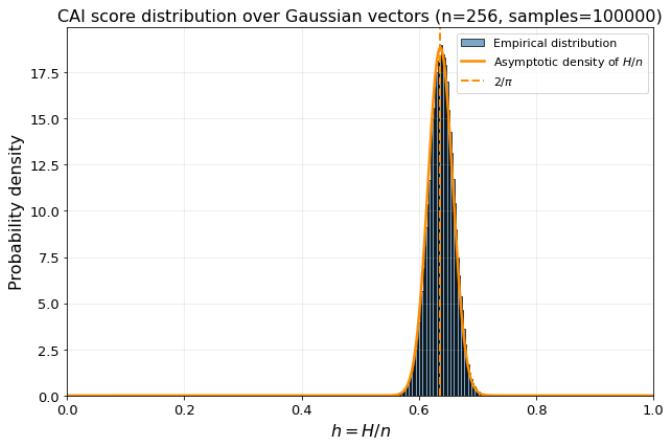  
Figure 1: CAI score asymptotic distribution.

Corollary 2.4 (Uniform distribution). Let $Y _ { 1 } , \dots , Y _ { n }$ be i.i.d. random variables with

$$
Y _ { i } \sim \mathcal { U } ( 0 , 1 ) .
$$

Then

$$
m = { \frac { \mu _ { 1 } ^ { 2 } } { \mu _ { 2 } } } = { \frac { 3 } { 4 } } .
$$

Moreover, for suficiently large n,

$$
{ \frac { H _ { n } } { n } } \approx { \mathcal { N } } \left( { \frac { 3 } { 4 } } , { \frac { 3 } { 4 0 n } } \right) .
$$

Equivalently,

$$
H _ { n } \approx \mathcal { N } \left( \frac { 3 n } { 4 } , \frac { 3 n } { 4 0 } \right) .
$$

Uniform high-sparsity regime For i.i.d. uniformly distributed samples, $i f$

$$
\frac { l } { n } < \frac { 3 } { 4 }
$$

with a fixed positive margin, then

$$
\mathbb { P } ( H _ { n } > l ) \longrightarrow 1 \qquad a s \ n \to \infty .
$$

Consequently, asymptotically, the samples lie inside the convex CAI cone and violate the target sparsity constraint $H _ { n } \leq l$

In particular, in the high-sparsity regime

$$
\frac { l } { n } \ll \frac { 3 } { 4 } ,
$$

almost all samples lie inside the CAI cone with probability tending to one.

Remark 2.5. Note that the random variable $H ( Y )$ where $Y \sim N ( 0 , 1 )$ can be equivalently defined as the L1 norm ∥Z∥2 of a vector $Z$ sampled uniformly over the unit sphere. This relates our result to [30, Theorem $\it 3 . 6 7$ and the particular case for $n = 1$ of $\begin{array} { r } { \beta \tilde { \eta } , } \end{array}$ Theorem $1 . 1 \AA$ which studies $\| Z \| _ { 1 }$

Since Theorem 2.2 considers the square of $\| Z \| _ { 1 }$ , our result can be derived from theirs by applying the delta method.

For large n, the second-order correction to the mean of the squared CAI score becomes negligible compared with the leading-order term. Moreover, the secondorder shift also becomes negligible compared with the standard deviation when n is large.

See proof in Appendix A.2

## 3 PLCP and PECP with Common Active-Set Selection

## 3.1 Sparse Active-Set Selection

We introduce a unified formulation of a Parametric Linear Conic Projection (PLCP) and a Parametric Euclidean Conic Projection (PECP). Both methods share the same CAI geometry and the same active-set selection procedure. In particular, they use the same threshold α and therefore identify the same active support.

They difer only in the final geometric projection. PLCP uses an afine parametric construction characterized by the extrapolation factor $\lambda ,$ whereas PECP performs a Euclidean projection characterized by the parameter $t ,$ or equivalently by the radial scaling factor κ. Let denote the CAI score of the original input by

$$
\boxed { H _ { 0 } = H ( \pmb { y } ) . }
$$

Since

$$
H ( \pmb { y } ) = H ( | \pmb { y } | ) ,
$$

the active-set selection can be performed on the nonnegative vector

$$
\begin{array} { r } { { \pmb x } ^ { ( 0 ) } = | { \pmb y } | . } \end{array}
$$

The overall construction is summarized by

PLCP projection,   
CAI geometry −→ common active-set selection −→   
PECP projection.

The active-set threshold is obtained directly from the CAI boundary condition

At iteration k, let

$$
\mathcal { A } _ { k } = \left\{ i : x _ { i } ^ { ( k ) } > 0 \right\}
$$

denote the current active support, with

$$
\nu _ { k } = | \mathcal { A } _ { k } | = \| \pmb { x } ^ { ( k ) } \| _ { 0 } .
$$

Consider the shifted vector on the current active support

$$
z ^ { ( k ) } = x ^ { ( k ) } - \alpha _ { k } \mathbf { 1 } _ { \mathcal { A } _ { k } } .
$$

The threshold $\alpha _ { k }$ is determined by requiring the shifted vector to lie on the CAI boundary:

$$
\boxed { H ( z ^ { ( k ) } ) = l . }
$$

The threshold is given by: (See Appendix A.4.1)

$$
\alpha _ { k } = \frac { \| \pmb { x } ^ { ( k ) } \| _ { 1 } } { \nu _ { k } } \left( 1 - \sqrt { \frac { l \left( \nu _ { k } - H ( \pmb { x } ^ { ( k ) } ) \right) } { H ( \pmb { x } ^ { ( k ) } ) ( \nu _ { k } - l ) } } \right) .\tag{5}
$$

The threshold $\alpha _ { k }$ is therefore a geometric threshold induced by the CAI boundary.

The active support is updated according to

$$
x _ { i } ^ { ( k + 1 ) } = \left\{ \begin{array} { l l } { x _ { i } ^ { ( k ) } , } & { x _ { i } ^ { ( k ) } \geq \alpha _ { k } , } \\ { 0 , } & { x _ { i } ^ { ( k ) } < \alpha _ { k } . } \end{array} \right.
$$

Thus the vector becomes progressively sparser across iterations (see Sparsity analysis in section 3.4). The active-set iterations are repeated until the support stabilizes (See convergence analysis in section 3.5)

Lemma 3.1. Let x be the final active-set vector, the last threshold α computed before stabilization is :

$$
\boxed { \alpha = \frac { \| \pmb { x } \| _ { 1 } } { \nu } \left( 1 - \sqrt { \frac { l \left( \nu - H ( \pmb { x } ) \right) } { H ( \pmb { x } ) ( \nu - l ) } } \right) . }\tag{6}
$$

Proposition 3.2 (Lower bound on the active support). Equation $( \boldsymbol { \theta } )$ becomes singular when $\nu = l ,$ since its denominator vanishes. However, the CAI boundary condition imposes a natural lower bound on the admissible support size.

Let $\pmb { x } \in \mathbb { R } _ { + } ^ { n }$ with support S and $| S | = \nu$ . By Cauchy-Schwarz applied to $S _ { i }$

$$
( \mathbf { 1 } ^ { \top } \mathbf { x } ) ^ { 2 } = { \Big ( } \sum _ { i \in S } x _ { i } { \Big ) } ^ { 2 } \leq { \Big ( } \sum _ { i \in S } 1 ^ { 2 } { \Big ) } { \Big ( } \sum _ { i \in S } x _ { i } ^ { 2 } { \Big ) } = \nu \| \mathbf { x } \| _ { 2 } ^ { 2 } .
$$

Hence, dividing both sides by $\begin{array} { r } { \sum _ { i \in S } x _ { i } ^ { 2 } = \| x \| _ { 2 } ^ { 2 } } \end{array}$ yields $C A I ( x ) \leq \nu$

$I f x \in \mathbb { R } _ { + } ^ { n }$ satisfies the cone-surface constraint, $C A I ( { \pmb x } ) = l$ , then the support

size ν necessarily satisfies $l \leq \nu$

Moreover, the support size $\nu \in \mathbb N ,$ , thus in particular, if

<table><tr><td>l∉N, then ν &gt; l.</td><td></td><td></td></tr></table>

(7)

This result establishes a fundamental lower bound on the active support size and guarantees that the support-selection procedure using Equation 6 in Algorithm 1 cannot collapse below this bound.

## 3.2 PLCP projection

For an original input vector satisfying

$$
H _ { 0 } = H ( \pmb { y } ) > l ,
$$

PLCP constructs the CAI boundary solution through the following afine parametrization

$$
\begin{array} { r } { \left| \widehat { \pmb { x } } _ { \mathrm { P L C P } } = \lambda \pmb { x } + ( 1 - \lambda ) \pmb { d } . \right| } \end{array}
$$

with

$$
\mathbf { d } = { \frac { \| \mathbf { x } \| _ { 1 } } { \nu } } \mathbf { 1 } .
$$

Lemma 3.3. Let x be the final active-set vector, the PLCP extrapolation factor λ is directly obtained from the final threshold α. (see proof in section A.5)

$$
\boxed { \lambda = \frac { 1 } { 1 - \frac { \alpha \nu } { \| \pmb { x } \| _ { 1 } } } . }
$$

Equivalently,

$$
\boxed { \lambda = \sqrt { \cfrac { H ( \pmb { x } ) ( \nu - l ) } { l \left( \nu - H ( \pmb { x } ) \right) } } . }
$$

Thus, α and λ are not independent parameters. Once the active support has stabilized and α is known, λ follows immediately.

Thus, the stabilized active-set quantities determine both the extrapolation factor and the scale of the diagonal reference vector. The PLCP construction can therefore be summarized as

$$
\boxed { H , l \longrightarrow \alpha \longrightarrow \pmb { x } \longrightarrow \lambda \longrightarrow \hat { \pmb { x } } _ { \mathrm { P L C P } } }
$$

PLCP is therefore a closed-form parametric construction satisfying the CAI geometry.

## 3.3 PECP Euclidean-norm Projection

PECP uses the same active support A identified by the common thresholding procedure. PECP selects the point on this CAI boundary generator that minimizes the Euclidean distance to the input vector.

For an original input vector satisfying $H _ { 0 } = H ( \pmb { y } ) > l ,$ PECP seeks, on the active support A identified by the common thresholding procedure, the closest point on the corresponding CAI boundary:

$$
{ \widehat { \pmb x } } _ { \mathrm { P E C P } } = \arg \operatorname* { m i n } _ { { \pmb x } } { \frac { 1 } { 2 } } \| { \pmb x } - { \pmb y } _ { A } \| _ { 2 } ^ { 2 } \qquad \mathrm { s u b j e c t ~ t o } \qquad H ( { \pmb x } ) = l .
$$

On the final active support of size $\nu ,$ define

$$
\mathbf { u } _ { \nu } = \frac { 1 } { \sqrt { \nu } } \mathbf { 1 } _ { A } .
$$

The input vector restricted to the active support is decomposed as

$$
\mathbf { y } _ { A } = s \mathbf { u } _ { \nu } + r \mathbf { v } ,
$$

where

$$
s = \mathbf { y } _ { A } ^ { \top } \mathbf { u } _ { \nu } = \frac { \| \mathbf { y } _ { A } \| _ { 1 } } { \sqrt { \nu } } , \qquad r = \| \mathbf { y } _ { A } - s \mathbf { u } _ { \nu } \| _ { 2 } .
$$

For $r > 0$ , define

$$
\mathbf { v } = { \frac { \mathbf { y } _ { A } - s \mathbf { u } _ { \nu } } { r } } .
$$

Hence, using these notations, PECP reduces to the one-dimensional minimization problem (see details in Appendix A.5.1)

$$
\left| \arg \operatorname* { m i n } _ { t \geq 0 } ( s - t ) ^ { 2 } + ( r - t q ) ^ { 2 } . \right|
$$

Lemma 3.4. Diferentiating with respect to $t ,$ the Euclidean projection onto the CAI boundary is

$$
\boxed { \widehat { \pmb { x } } _ { \mathrm { P E C P } } = t { \pmb u } + t q { \pmb v } , }\tag{8}
$$

where

$$
\boxed { t = \frac { s + q r } { 1 + q ^ { 2 } } } .
$$

The PECP construction can therefore be summarized as

$$
\boxed { H , l \longrightarrow \alpha \longrightarrow x \longrightarrow t \longrightarrow { \widehat x } _ { \mathrm { P E C P } } }
$$

Hence, the PECP solution is the Euclidean projection onto the corresponding CAI boundary generator. In the $( s , r )$ plane, this reduces to the orthogonal projection of the point $( s , r )$ onto the boundary line $r = q s$

Collinearity between PLCP and PECP PLCP and PECP use the same active support and reach the same generator of the CAI boundary. Consequently, their boundary solutions are collinear: (See proof in section A.3)

$$
\boxed { \widehat { \pmb { x } } _ { \mathrm { P E C P } } = \kappa \widehat { \pmb { x } } _ { \mathrm { P L C P } } . }
$$

with

$$
\boxed { \kappa = \frac { t } { s _ { \mathrm { P L C P } } } . }\tag{9}
$$

Algorithm 1 Iterative PLCP   
Require: $\overline { { \boldsymbol { y } \in \mathbb { R } ^ { n } } }$ , target parameter l   
Ensure: $\widehat { \mathbf { x } } \in \mathbb { R } ^ { n }$   
1: $H _ { 0 } \gets H ( \pmb { y } )$   
2: $x _ { i } \gets | y _ { i } | , \quad \forall i \in \{ 1 , \ldots , n \}$   
3: $\nu \gets \ell _ { 0 } ( { \pmb x } ) + 1$   
4: while $\nu \neq \ell _ { 0 } ( x )$ do   
5: ${ \boldsymbol \nu } \gets { \boldsymbol \ell } _ { 0 } ( { \boldsymbol \pmb x } )$   
6: $\alpha  \frac { \| \pmb { x } \| _ { 1 } } { \nu } ( 1 - \sqrt { \frac { l ( \nu - H ( \pmb { x } ) ) } { H ( \pmb { x } ) ( \nu - l ) } } )$   
7: $x _ { i }  \{ { \begin{array} { l l } { x _ { i } , } & { x _ { i } \geq \alpha , } \\ { 0 , } & { x _ { i } < \alpha , } \end{array} } $ $\forall i \in \left\{ 1 , \ldots , n \right\}$   
8: end while   
9: if $H _ { 0 } > l$ then   
10: $\lambda  { \frac { 1 } { 1 - { \frac { \alpha \nu } { \| { \pmb x } \| _ { 1 } } } } }$   
11: $d _ { i } \gets \left\{ \frac { \| \mathbf { x } \| _ { 1 } } { \nu } , \ : \ : \ : x _ { i } \neq 0 , \right.$ ∀i   
12: $\widehat { \pmb { x } }  \lambda \dot { \pmb { x } } + ( 1 - \lambda ) \pmb { d }$   
13: else   
14: ${ \widehat { \mathbf { x } } } \gets x$   
15: end if   
16: $\widehat x _ { i } \gets \widehat x _ { i }$ sign(yi), ∀i   
17: return x

Remark 3.5. Since Algorithms 1 and 2 use the same initialization and the same thresholding rule, they generate identical active-set iterates and therefore identify the same final active support. On this support, their respective projections lie on the same CAI boundary generator; hence, their final outputs are positively collinear. Therefore, PLCP preserves the direction and the support pattern of the Euclidean projection, while generally difering in radial scaling. We consequently refer to $P L C P$ as a parametric conic projection.

Algorithm 2 Iterative PECP   
Require: $\overline { { \boldsymbol { y } \in \mathbb { R } ^ { n } } }$ , target parameter l   
Ensure: $\widehat { \mathbf { x } } \in \mathbb { R } ^ { n }$   
1: $H _ { 0 } \gets H ( \pmb { y } )$   
2: $x _ { i } \gets | y _ { i } | , \quad \forall i \in \{ 1 , \dots , n \}$   
3: $\nu \gets \ell _ { 0 } ( { \pmb x } ) + 1$   
4: while $\nu \neq \ell _ { 0 } ( x )$ do   
5: ${ \boldsymbol \nu } \gets { \boldsymbol \ell } _ { 0 } ( { \boldsymbol \pmb x } )$   
6: $\alpha  \frac { \| \pmb { x } \| _ { 1 } } { \nu } ( 1 - \sqrt { \frac { l ( \nu - H ( \pmb { x } ) ) } { H ( \pmb { x } ) ( \nu - l ) } } )$   
7: $x _ { i }  \{ { x _ { i } , \begin{array} { l x _ { i } \geq \alpha , } \\ { 0 , \quad x _ { i } < \alpha , } \end{array} } $ $\forall i$   
8: end while   
9: if $H _ { 0 } > l$ then   
10: $\mathcal { A }  \{ i : x _ { i } \neq 0 \}$   
11: $\nu  \vert A \vert$   
12: ${ \pmb u } _ { \nu } \gets \frac { 1 } { \sqrt { \nu } } { \bf 1 } _ { \mathcal { A } }$   
13: $s  x ^ { \top } \pmb { u } _ { \nu } = \frac { \| \pmb { x } \| _ { 1 } } { \sqrt { \nu } }$   
14: $r \gets \lVert \underline { { \pmb { x } } } - s \pmb { u } _ { \nu } \rVert _ { 2 } ^ { * }$   
15: $q  \sqrt { \frac { \nu - l } { l } }$   
16: $t  \frac { s + q r } { 1 + q ^ { 2 } }$   
17: if $r > 0$ then   
18: $\mathbf { \sigma } _ { v  } \frac { \mathbf { \boldsymbol { x } } - s \mathbf { \boldsymbol { u } } _ { \nu } } { \mathbf { \sigma } _ { v } }$   
19: $\widehat { \pmb { x } }  t { \pmb u _ { \nu } } ^ { T } + t q \pmb { v }$   
20: end if   
21: else   
22: ${ \widehat { \mathbf { x } } } \gets x$   
23: end if   
24: ${ \widehat { x } } _ { i } \gets { \widehat { x } } _ { i } \operatorname { s i g n } ( y _ { i } )$ ∀i   
25: return xb  
Remark 3.6. Note that the test $H _ { 0 } \ > \ l$ in line 9 for $P L C P$ and line 9 for $P E C P$ is unnecessary in the case of the high-sparsity regime.

## 3.4 Sparsity analysis of the active set selection

Theorem 3.7. Let $y _ { 1 } , \ldots , y _ { n }$ be positive real numbers, and set

$$
l _ { 1 } : = \sum _ { i = 1 } ^ { n } y _ { i } , \qquad l _ { 2 } : = \sqrt { \sum _ { i = 1 } ^ { n } y _ { i } ^ { 2 } } , \qquad H : = \left( \frac { l _ { 1 } } { l _ { 2 } } \right) ^ { 2 } .
$$

Define

$$
\mu : = \frac { l _ { 1 } } { n } , \quad \quad \sigma ^ { 2 } : = \frac { 1 } { n } \sum _ { i = 1 } ^ { n } ( y _ { i } - \mu ) ^ { 2 } .
$$

Fix a positive number $l < n$ . Then the number of indices i such that

$$
\begin{array} { c c c } { { \boxed { y _ { i } < \displaystyle \frac { l _ { 1 } } { n } \left( 1 - \sqrt { \displaystyle \frac { l ( n - H ) } { H ( n - l ) } } \right) } \qquad i s \ a t \ m o s t \quad } } & { { - l } } \end{array}\tag{10}
$$

Proof. As detailed in [28], there are two approaches to prove such Laguerre-Samuelson style Inequality. A first one, following Laguerre’s style using Cauchy-Schwarz inequality, whereas a second one, following Samuelson’s style [42] uses a clustering argument. We provide both proofs in Appendix section A.7. The proof is based on the following lemma.

Lemma 3.8. $L e t$

$$
r : = \# \left\{ i : y _ { i } \leq \frac { l _ { 1 } } { n } \left( 1 - \sqrt { \frac { l ( n - H ) } { H ( n - l ) } } \right) \right\} = \# \left\{ i : y _ { i } \leq \mu - t \right\} ,
$$

where

$$
t : = \mu \sqrt { \frac { l ( n - H ) } { H ( n - l ) } } .
$$

Then

$$
r \leq { \frac { n \sigma ^ { 2 } } { \sigma ^ { 2 } + t ^ { 2 } } } .\tag{11}
$$

Consequence. Theorem 3.7 shows that the number r of coeficients removed by the thresholding rule satisfies

$$
r \leq n - l .
$$

Consequently, the remaining active support satisfies

$$
\nu = n - r \geq l .
$$

This result establishes a rigorous lower bound on the active support size and provides a direct relationship between the parameter l and the sparsity induced by the projection. Decreasing l increases the admissible number of removed coeficients and therefore promotes sparser solutions, whereas increasing l enforces a larger active support.

Although there is generally no closed-form expression relating (l) to an exact sparsity percentage since the final support also depends on the distribution of the input coeficients, the monotonic behavior makes the parameter straight forward to calibrate in practice. Figure 2 shows good agreement between the

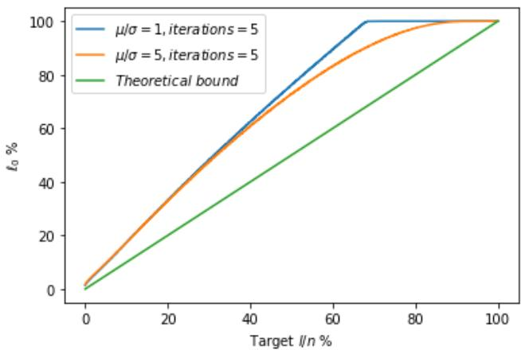  
Figure 2: Synthetic Gaussian distribution with $\frac { \mu } { \sigma }$ active size: Average activeset size after five PLCP iterations as a function of the target parameter l for synthetic Gaussian data. Results are reported for diferent values of $\mu / \sigma$ and compared with the theoretical bound (green).

bound established in Theorem 3.7 and the experimental Gaussian results. The theoretical lower bound provided by Theorem 3.7 guarantees that the active set size is at least l and the relationship between (l) and the achieved sparsity. Consequently, a desired sparsity ratio can be achieved reliably through a simple calibration procedure (for example, a monotonic search on a small validation set), after which the selected value of (l) generalizes consistently across the evaluation data. Moreover, Figure 2 illustrates the relationship between the target (l) and the achieved sparsity and thus the practical calibration procedure used to reach a target sparsity level.

## 3.5 Convergence of the active set selection

## 3.5.1 Finite-time convergence

Given a threshold $\alpha \geq 0$ , define the hard-thresholding operator $T _ { \alpha } : \mathbb { R } _ { + } ^ { n } \to \mathbb { R } _ { + } ^ { n }$ by

$$
{ \bigl ( } T _ { \alpha } ( \pmb { x } ) { \bigr ) } _ { i } = \left\{ { \begin{array} { l l } { x _ { i } , } & { \mathrm { i f ~ } x _ { i } \geq \alpha , } \\ { 0 , } & { { \mathrm { o t h e r w i s e } } , } \end{array} } \right. \qquad i = 1 , \ldots , n .\tag{12}
$$

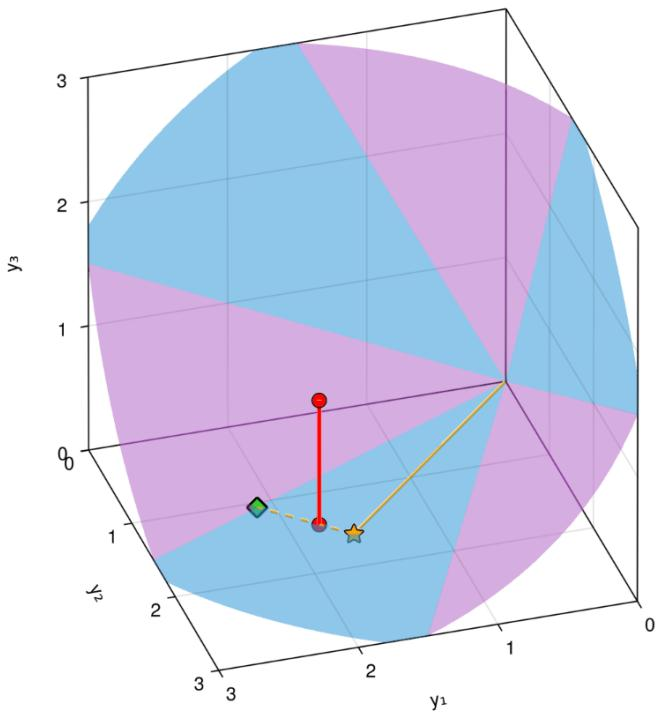  
Figure 3: Illustration of Algorithm 1 with $l = 1 . 8$ starting $\mathbf { x } = ( 1 . 7 8 , 1 . 4 , 1 )$ . The boundary of the CAI cone is represented by the blue and orange surfaces. The red circle in the interior of the cone is the starting x. After one iteration of the algorithm, $x _ { 3 }$ is set to 0 and we obtain the second red dot. This point belongs to the blue face in the $x _ { 1 } - x _ { 2 }$ plane which is itself a two-dimensional CAI cone. The yellow star represents d and the green circle is the output $\lambda \mathbf { x } + ( 1 - \lambda ) \mathbf { d }$

Proposition 3.9 (Finite-time convergence of the active support selection). The iterative loop for computing α converges in at most n iterations to a fixed point. More precisely, there exists $K \leq n$ such that:

$$
\boxed { \pmb { x } ^ { ( K + 1 ) } = \pmb { x } ^ { ( K ) } , }\tag{13}
$$

This follows immediately from the fact that every decreasing sequence of natural numbers is eventually constant.

## 3.5.2 Tightness of the ${ \mathcal { O } } ( n )$ Bound

A natural question is whether the bound $K \leq n$ of the previous proposition can be improved, for instance to O(log n), by exploiting the fact that several entries may fall below the threshold at a single step. The following argument, classical in the robust-statistics literature, shows that no such universal tightening is possible: there exist inputs on which the iteration removes exactly one entry per step. The obstruction is the so-called masking efect [12, 26], by which a small group of extreme entries inflates the summary statistics on which the threshold depends and thereby “masks” other, less extreme entries that would otherwise be eliminated. The same phenomenon is discussed in (author?) [26, Section 11.1] in the context of outlier-rejection rules, where it is precisely the inability of low-breakdown procedures to peel of more than one outlier per pass that motivates high-breakdown alternatives.

Adversarial construction. In our setting the threshold $\alpha ( { \pmb x } )$ is a smooth function of the $\ell _ { 1 }$ and $\ell _ { 2 }$ norms of the current iterate (equivalently, of the CAItype score $H ( { \pmb x } ) )$ . Removing an entry produces a finite, controllable change in these norms and hence in $\alpha .$ . We build an adversarial input recursively, from the stable core outward. Fix a terminal set $S _ { n }$ for which the iteration has already converged (e.g. a few equal positive values). Assuming a sequence $S _ { k + 1 } = \{ y _ { k + 1 } , . . . , y _ { n } \}$ has been constructed so that the iteration peels it one entry at a time, we prepend a single new entry $y _ { k }$ and require

$$
y _ { k } \ < \ \alpha \big ( \{ y _ { k } \} \cup S _ { k + 1 } \big ) \ \leq \ y _ { k + 1 } .
$$

The map $y _ { k } \mapsto \alpha ( \{ y _ { k } \} \cup S _ { k + 1 } ) - y _ { k }$ is continuous, is negative for $y _ { k }$ close enough to $y _ { k + 1 }$ (the entry survives), and is positive for $y _ { k }$ suficiently small (the entry inflates the norms enough to leave the threshold above it). The Intermediate Value Theorem therefore guarantees the existence of an admissible $y _ { k }$ , and recursion produces a sequence on which the iteration removes exactly one entry per step.

Toy illustration. The masking mechanism is most transparent for the simpler threshold $\bar { y } - \alpha s ( y )$ based on the empirical mean and standard deviation. Take $\pmb { y } = \{ - 1 0 0 , 0 , 8 , 1 0 , 1 0 \}$ with multipliers $\alpha = 1$ initially and $\alpha = 1 . 4$ after the first reduction:

• Iteration 1: $\bar { y } \approx - 1 4 , s ( y ) \approx 4 3$ , threshold $\approx - 5 7$ . The extreme value −100 is removed; the values 0 and 8 are masked by the inflated standard deviation.

• Iteration 2: on {0, 8, 10, 10}, ¯y = 7, s ≈ 4, threshold $\approx 1 . 4$ . The variance has collapsed and 0 is now exposed and removed.

• Iteration 3: on {8, 10, 10}, the same collapse exposes 8, which is removed.

• Iteration 4: {10, 10} has zero variance and the iteration terminates.

The general staircase construction is the recursive analogue of this 5-point example.

Consequence. The bound $K \ \leq \ n$ is therefore tight up to constants: no universal sub-linear bound on the number of support-update iterations can hold, because the threshold is computed from internal sample statistics that can be manipulated by an adversarial spacing of the input. The empirical observation (Figure 4) that K is small in practice is correspondingly a statement about typical inputs, not a worst-case guarantee, and is consistent with the absence on natural data of the exponentially-spaced staircase that the masking construction requires.

## 3.5.3 Comparison with other hard-thresholding iterations

We compare our hard-thresholding iteration with Torrent [6] in detail in $\mathrm { A p \mathrm { - } }$ pendix A.9.1. At a high level both methods can be read as instances of a long-standing heuristic, going back to Legendre, that alternates between selecting a subset of indices by thresholding and refitting on that subset. Torrent brings such a selection step inside the regression loop, whereas PLCP repurposes the same mechanism for projecting onto a structured sparsity cone. The two methods difer in what is being fitted (a regressor vs. a projection), in how the threshold is set (fixed cardinality vs. cone-induced), and in the type of guarantee obtained (geometric statistical recovery vs. deterministic finite-time termination).

Viewed jointly, by Luo [34] and our analysis (compared in detail in $\mathrm { A p \mathrm { - } }$ pendix A.9.2) describe two complementary regimes for iterative methods on LCP-like problems: a coordinate-wise regime with linear convergence under mild structural assumptions, and a block-thresholding regime where the combinatorial structure of the active support directly delivers finite-time termination. The PLCP iteration sits in the latter regime, which is what makes its complexity O(Kn) with a very small K in practice.

See Appendix A.9.3 and Appendix A.9.4 for the detailed comparison with [41] and [26] respectively.

## 3.6 Complexity Analysis of PLCP

The iterative PLCP algorithm typically converges in only a few support updates. Denoting by K the number of thresholding iterations, its actual computational cost is $\mathcal { O } ( K n )$ rather than $\scriptstyle { \mathcal { O } } ( n ^ { 2 } )$ . When K remains small, the algorithm exhibits near-linear behavior in practice.

An alternative is a sorted implementation which avoids the quadratic iterative thresholding loop by sorting the coeficients once and scanning the possible active support sizes using prefix sums. The total complexity is therefore the complexity of the sort: $T ( n ) = { \mathcal { O } } ( n \log n )$ . The sorted formulation systematically incurs the full sorting cost O(n log n). Moreover, in most sparse optimization problems, the final active support size ν is typically much smaller than the ambient dimension n $( \nu \ll n )$ . In such settings, sorting the entire vector introduces a significant amount of unnecessary computation. Rather than sorting all coefficients, the Topk method progressively extracts only the k largest entries and tests whether the resulting support satisfies the PLCP fixed-point condition. The resulting complexity for the Topk method is

$$
\mathcal { O } ( n + k _ { \mathrm { m a x } } \log k _ { \mathrm { m a x } } ) ,\tag{14}
$$

which improves over the full sorting cost O(n log n) whenever $k _ { \mathrm { m a x } } \ll n$

## 3.7 Related Work and Positioning of PLCP and PECP

## 3.7.1 Positioning versus SOCP methods

Conic programming provides a unified framework for convex optimization problems [7, 1, 44]. Most existing methods involving second-order cone programming (SOCP) rely on two major classes of approaches.

• Interior-point methods. These approaches exploit the geometry of the cone through barrier functions, typically of the form − log $\left( x _ { 0 } ^ { 2 } - \| \mathbf { x } \| _ { 2 } ^ { 2 } \right)$ and follow a central path toward the optimal solution. Although highly efective, the resulting trajectory is not based on an explicit afine parameterization.

• Projection-based methods. Many optimization algorithms, such as projected gradient methods, proximal algorithms, ADMM, and alternating projections, rely on Euclidean projections onto the cone. These methods use the cone geometry implicitly through projection operators, but do not introduce an explicit parameterized trajectory.

In contrast to standard SOCP projection approaches, PLCP explicitly constructs an afine parametric path toward the CAI boundary. PLCP and PECP may therefore be interpreted as a geometric parametric alternative to standard SOCP projections, combining analytical simplicity with additional flexibility while preserving the same sparsity properties.

## 3.7.2 Positioning PLCP and PECP versus GSP method

The GSP constraint (Group Sparse Projection), following the definition in [36], is given by

$$
G S P ( \pmb { x } ) = \left( \sum _ { i = 1 } ^ { r } \frac { \sqrt { n _ { i } } - \| x _ { i } \| _ { 1 } } { \sqrt { n _ { i } } - 1 } \right) .
$$

GSP addresses the projection problem through a scalar dual root-finding procedure derived from optimality conditions. Each iteration has linear complexity in the problem dimension, and the overall complexity is reported as ${ \mathcal { O } } ( n \log ( 1 / \varepsilon ) )$ , where $\varepsilon$ denotes the target accuracy. A bisection fallback ensures robustness, with worst-case complexity bounded by $\mathcal { O } ( n$ log n).

Note that the GSP-Hybrid constraint is non-convex, whereas PLCP exploits the convex geometry of the CAI interior in the high-sparsity regime. The active set selection is computed directly in the primal space via a finite sequence of active-set updates combined with thresholding operations, yielding a complexity of $\mathcal { O } ( k n )$ , where k denotes the number of active-set refinements. By combining closed-form projections, conic geometry, and hardware-friendly structured sparsity, the proposed framework ofers a scalable foundation for eficient inference and training of modern neural networks.

## 3.8 Bilevel PECP Projection

Recently, bilevel optimization (BLO) [10, 63, 5, 62] has become popular because it is a powerful method in modeling problems that involve optimizing nested objective functions. BLO is an optimization problem that involves two levels of hierarchy (i.e., upper and lower levels), wherein obtaining the solution to the upper-level problem requires solving the lower-level one. In this paper, we propose a specific bilevel method for enforcing structured sparsity. We provide a single-level characterization of the proposed bilevel operator as follows.

Let $Y \in \mathbb { R } ^ { n \times n }$ with columns $y _ { 1 } , \ldots , y _ { n } \in \mathbb { R } ^ { n }$ . Define the vector of column $\ell _ { 2 }$ norms

$$
v : = ( \| y _ { 1 } \| _ { 2 } , \ldots , \| y _ { n } \| _ { 2 } ) \in \mathbb { R } ^ { n } .
$$

Define the specific bilevel optimization problem and the bilevel operator $B P _ { P E C P , 2 } ^ { l } ( Y )$ as follows:

$$
\begin{array} { r } { \hat { u } = \underset { \pmb { u } } { \arg \operatorname* { m i n } } \left\| \pmb { u } - \pmb { v } \right\| _ { 2 } \mathrm { ~ s . t . ~ } H ( \pmb { u } ) < l . } \\ { x _ { j } = P _ { 2 } ^ { \hat { u } _ { j } } ( y _ { j } ) \quad \forall j \in \{ 1 , \dots , n \} . } \end{array}\tag{15}
$$

The resulting bilevel PECP algorithm is computationally inexpensive:

Proposition 3.10. Minimizing the Frobenius distance in matrix space is equivalent to minimizing the Euclidean distance between the vectors of column norms:

$$
\operatorname* { m i n } _ { X } \frac { 1 } { 2 } \| Y - X \| _ { F } ^ { 2 } = \operatorname* { m i n } _ { u : H ( u ) \leq l } \frac { 1 } { 2 } \| v - u \| _ { 2 } ^ { 2 } .
$$

Since $\widehat { u } = P _ { l } ^ { \mathrm { P E C P } } ( v )$ is the Euclidean CAI projection $o f v ,$ the matrix obtained from $x _ { j } = P _ { \widehat { u } _ { j } } ^ { 2 } ( y _ { j } )$ is the corresponding exact Frobenius projection.

Algorithm 3 bilevel PECP projection, $( B P _ { l } ^ { P E C P , 2 } ( { \pmb Y } ) )$   
Input: $Y \in \mathbb { R } ^ { n \times n } , l > 0$   
$\hat { \pmb { u } } \ll P _ { l } ^ { P E C P } \big ( \| \pmb { y } _ { 1 } \| _ { 2 } , \dots , \| \pmb { y } _ { n } \| _ { 2 } \big )$   
yj , if $\| y _ { j } \| _ { 2 } \le u _ { j }$   
$x _ { j } = P _ { 2 } ^ { \hat { u } _ { j } } ( y _ { j } )$ ↔ $\bigg \{ \frac { u _ { j } } { \| y _ { j } \| _ { 2 } } y _ { j } ,$ ${ \mathrm { i f ~ } } \| y _ { j } \| _ { 2 } > u _ { j } .$   
Output: $\pmb { X } = [ \pmb { x } _ { 1 } , \dots , \pmb { x } _ { n } ]$

See proof in appendix A.6

## 4 Experimental results

## 4.1 Benchmark of PLCP

We compare our method in terms of computation time with the Group Sparse LASSO using the GSP method [36]. For the implementation of the GSP-Hybrid method, we use the PyTorch implementation provided by Ohib et al. 1 We compare PLCP with a structured row/column pruning baseline inspired by the structured pruning method in [55]. For each attention matrix, rows and columns are ranked according to their $\ell _ { 2 }$ norm and the least important structures are removed while preserving the CLS row and column. Our PyTorch implementation is provided in the supplementary material.

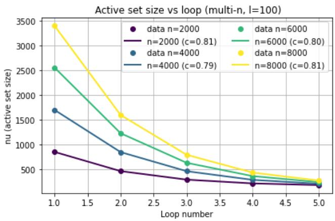  
Figure 4: Convergence of the active support size for diferent size of the Gaussian data as a function of loop number.

The PLCP iteration can be interpreted as an adaptive thresholding scheme, where the threshold is updated from the current active coeficients. Under the assumption that the threshold dynamics is locally contractive near its fixed point and that the tail of the coeficient distribution is suficiently smooth, the active-set size is expected to converge exponentially fast toward a limiting value $\nu _ { \infty }$

$$
\nu _ { k } - \nu _ { \infty } \approx ( \nu _ { 0 } - \nu _ { \infty } ) e ^ { - c k } ,
$$

where $c > 0$ is an efective decay constant. Figure 4 shows the convergence of the active support size for diferent size of the Gaussian data as a function of loop number. The best exponential fit is with parameter $c \approx 0 . 8$

Probabilistic geometric convergence of the active-set selection. We prove theoretically finite termination, but exponential convergence is only empirically observed. However, a geometric convergence rate can be established under a probabilistic assumption on the distribution of the active coeficients.

As shown with inequality 19, the threshold is a clipping on the z-score of the samples only depending on l and $n .$ Therefore, the Cumulative Density Function (CDF) of the distribution of the samples, evaluated at this threshold, gives a probability $p _ { i }$ for a sample to remain in the active set at iteration i. This matches a geometric convergence rate if $p _ { i }$ were constant which we know is not the case here as we don’t expect the active set size to converge to zero. The complex task of analysing this series is well studied as we discuss in appendix section A.9.

Instead, assume that, conditionally on the current active set, each incorrectly active coeficient has a probability at least $p > 0$ of falling below the updated threshold and being removed at the next iteration. Let $S _ { k }$ denote the active support at iteration $k ,$ , let $S _ { \star }$ be the final support, and define

$$
e _ { k } = | S _ { k } \setminus S _ { \star } | .
$$

Then

$$
\mathbb { E } [ e _ { k + 1 } \ | \ e _ { k } ] \le ( 1 - p ) e _ { k } .
$$

By iterating this inequality, we obtain

$$
\mathbb { E } [ e _ { k } ] \le ( 1 - p ) ^ { k } e _ { 0 } .
$$

Hence, the expected number of incorrectly active coeficients decreases geometrically. In particular, the expected active set converges toward the limiting support at an exponential rate with contraction factor $1 - p$

The key diference between PLCP and GSP is dimensional: GSP operates on a vectorized representation of the matrix, involving $n ^ { 2 }$ variables, and requires multiple passes over all entries due to its root-finding procedure. In contrast, PLCP exploits the group structure by reducing the problem to n variables via column norms, performing the core projection in O(n log n) similar to the pruning method. This structural diference explains the observed speed-up. Note that the GSP-Hybrid method constraint is non-convex, whereas PLCP enforces the convex geometry of the CAI interior in the high sparsity regime.

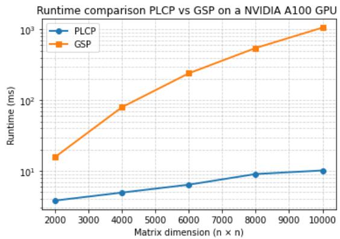

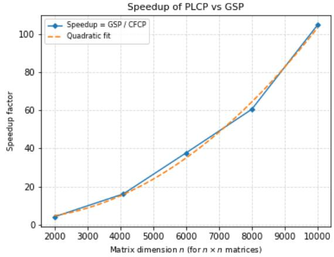  
Figure 5: Up: runtime comparison of PLCP vs GSP as a function of the size of matrices.

bottom: quadratic fit of the speed-up of PLCP vs GSP as a function of the size of matrices using an NVIDIA A100 GPU.

Figure 6 shows that the runtime of iterative PLCP is always better than that of PLCP with exhaustive sorting, while iterative PLCP is better than PLCP-TopK for large datasets. The runtime of iterative PLCP is very stable with respect to the dimension, whereas that of PLCP-TopK is not. Note that structured pruning exhibits a runtime comparable to that of the GPU-friendly TopK PLCP implementation.

## 4.2 Sparsification of Attention Matrices in Transformer Architectures

Constraint optimization Let $\boldsymbol { W } \in \mathbb { R } ^ { n \times n }$ denote the attention matrix, where n is the number of tokens. Let z represent the ground-truth labels, and $z ^ { * }$ denote the class probabilities predicted by the softmax classifier. To sparsify

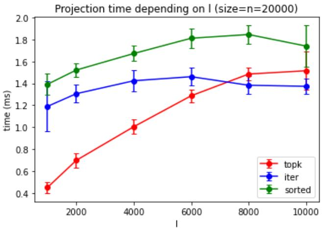  
Figure 6: Runtime comparison of diferent one-dimensional PLCP implementations: iterative PLCP (blue), GPU-friendly TopK PLCP (red), and fully sorted PLCP (green) on a M3 apple CPU

the weights W of the attention matrix, we employ the bilevel projection method $B P ^ { P L \breve { C } P , 2 }$ as a constraint to enforce structured sparsity in the model. The global optimization criterion is defined as:

$$
\operatorname* { m i n } _ { W } \quad \phi ( z , z ^ { * } ) \quad \mathrm { s . ~ t . } \quad C A I ( W ) \leq l ,\tag{16}
$$

where $\phi ( z , z ^ { * } )$ is the cross-entropy loss. To minimize this criterion, we follow the work developed by [19] and [20] who proposed a double-descent maskedgradient algorithm. We replace their threshold with our bilevel projection.

We apply our closed-form conic projection to the sparsification of attention matrices in Transformer architectures [52]. Specifically, we compare our learned diagonal mask, obtained via bilevel projection, against the uniform diagonal mask of BigBird [61]. The classification framework is implemented in PyTorch, including the model, schedulers, and loss functions. We chose the Adam optimizer (Adaptive Moment Estimation) [32] and the smooth SiLU activation function. For all sparsity levels and all datasets, we set the number of training epochs to 15, the batch size to 64 and the learning rate to 2e-5. We plot the curves of accuracy as a function of sparsity. The numerical labels in the following figures denote the window size for BigBird and the constraint level l for PLCP, GSP, and structured pruning, respectively.

Experiment on a natural language processing (NLP) task from the GLUE dataset [54] While pretrained models such as BERT are fully dense

Transformers, some later architectures (e.g., BigBird, Longformer) introduce sparse attention mechanisms. Specifically, we compare these methods with our PLCP projection on a pretrained transformer-based model [13]. For the QNLI, QQP and MNLI datasets, we used attention matrices with 256 tokens, and 128 tokens for the SST-2 dataset. Recall that a vertical band in an attention matrix corresponds to a global token attending to all tokens, whereas a horizontal band corresponds to all tokens attending to a global token. Such global attention patterns are known to play a critical role in Transformer-based classification models, as they enable long-range information aggregation and act as routing hubs for semantic context. From a theoretical perspective, removing these global interactions may severely limit the expressive power of the self-attention mechanism, since the first token (e.g., [CLS]) often serves as a summary representation of the entire sequence. Consequently, preserving the first row and the first column of the attention matrix ensures that global pairwise interactions are maintained, even under strong sparse constraints. Therefore, in all subsequent experiments, we explicitly include for the PLCP, GSP, Pruning and BigBird masks the first row and the first column in the sparsity mask.

In order to capture local dependencies, it is natural to focus on the diagonals of the attention matrix. The diagonal transformation used in PLCP reshapes the attention matrix into a structured representation where diagonal interactions become axis-aligned, enabling structured sparsity projections.

The SST-2 dataset The Stanford Sentiment Treebank consists of sentences from movie reviews and human annotations of their sentiment. The task is to predict the sentiment of a given sentence [48]. This dataset is composed of 67,349 samples and is available in the GLUE dataset.

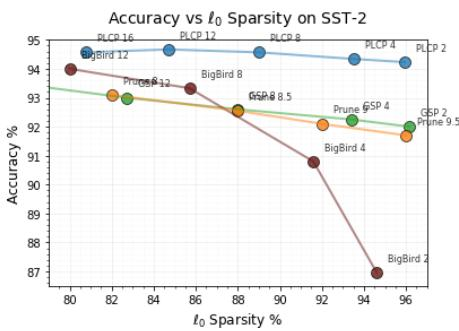  
Figure 7: PLCP vs GSP, Pruning and BigBird: sparsity–accuracy trade-of. SST-2 dataset

The Question Natural Language Inference (QNLI) dataset [39] is derived from the Stanford Question Answering Dataset (SQuAD) and reformulates question answering as a binary sentence-pair classification task. The task is to determine whether the context sentence contains the answer to the question. This dataset contains approximately 100K labeled examples.

The Quora Question Pairs dataset (QQP) is a collection of question pairs from the community question-answering website Quora. The task is to determine whether a pair of questions are semantically equivalent. This dataset consists of ≈ 400 K labeled samples.

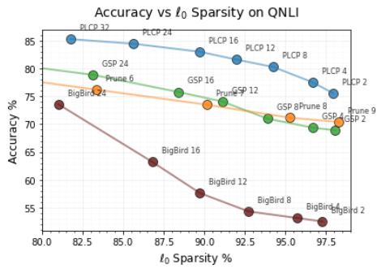

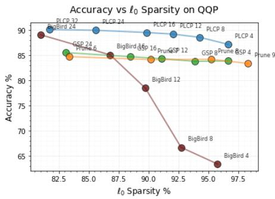  
Figure 8: PLCP vs GSP, Pruning and BigBird: sparsity–accuracy trade-of. Left: QNLI dataset. Right: QQP dataset.

The Multi-Genre Natural Language Inference Corpus [56] is a crowdsourced collection of sentence pairs with textual entailment annotations. Given a premise sentence and a hypothesis sentence, the task is to predict whether the premise entails the hypothesis (entailment), contradicts the hypothesis (contradiction), or neither (neutral). We report accuracy between true labels and predicted labels. This dataset consists of ≈ 400 K samples with labeled classification.

WiC (Word-in-Context) [38] is a word sense disambiguation task cast as binary classification of sentence pairs. Given two text snippets and a polysemous word that appears in both sentences, the task is to determine whether the word is used with the same sense in both sentences. This dataset consists of 6,000 samples with labeled classification.

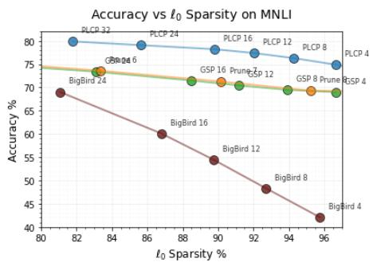

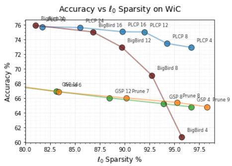  
Figure 9: PLCP vs GSP, Pruning and BigBird: sparsity–accuracy trade-of. Left: GLUE MNLI dataset; Right: SuperGLUE WiC dataset

Figures 7, 8 and 9 show accuracy-sparsity curves across five datasets. The accuracy-sparsity curves of PLCP, GSP, and structured pruning follow similar overall trends, but PLCP consistently dominates the competing methods. It delivers an accuracy gain of about 2% on the relatively easy SST-2 benchmark, while the margin widens to up to 6% on larger and more challenging datasets such as QNLI, QQP, and MNLI. On the particularly dificult WiC benchmark, PLCP achieves gains of up to 10%, highlighting its ability to preserve discriminative information even under aggressive sparsification.

PLCP leverages a column-wise bilevel projection that induces highly structured sparsity aligned with diagonal patterns while preserving locality after reshaping. This enables the model to retain the most informative interactions even at high sparsity levels.

In contrast, Group Lasso regularization promotes coarse structured sparsity by selecting or removing entire parameter groups. Although efective at the group level, such masks lack the flexibility required to capture fine-grained local dependencies, particularly diagonal structures, since sparsity is enforced uniformly within each group.

Structured pruning is a coarse-grained ranking strategy that enforces row-wise and column-wise sparsity. Although eficient, it is inherently unable to capture diagonal structures and fine-grained local dependencies, which often carry the most informative interactions in attention matrices.

The fixed BigBird mask performs adequately in the low-sparsity regime (large masks), but its rigid predefined structure becomes a significant limitation at high sparsity levels, where adaptivity becomes crucial.

These fundamental structural diferences explain the consistently superior accuracysparsity trade-of achieved by PLCP compared with GSP, structured pruning and BigBird across all datasets.

Accuracy Stability Across Random Seeds In addition to reporting the mean classification accuracy, we evaluate the robustness of each sparsification method with respect to the random seed. Our experiments involve four methods, five datasets, six hyperparameter settings, and three random seeds.

For each method m, dataset $d ,$ and hyperparameter setting h, we compute the standard deviation of the classification accuracy across the three experimental seeds.

$$
\begin{array} { r } { \sigma _ { m , d , h } = \mathrm { S t d } _ { s } \left( \operatorname { A c c u r a c y } _ { m , d , h , s } \right) , } \end{array}
$$

where s denotes the random seed.

In our experiments, several independent runs are considered. Therefore, $\sigma _ { m , d , h }$ measures the variability of the accuracy between these runs for a fixed method, dataset, and hyperparameter value. Second, to obtain a single global stability measure for each method, we average these standard deviations over all datasets and all considered hyperparameter values. Thus, the global stability criterion can be written as

$$
\begin{array} { r } { \left| \overline { { \sigma } } _ { m } = \mathrm { M e a n } _ { d , h } \left[ \mathrm { S t d } _ { s } \left( \operatorname { A c c u r a c y } _ { m , d , h , s } \right) \right] . \right| } \end{array}
$$

The random seeds are first used to estimate the variability of each individual experimental configuration. These configuration-wise standard deviations are then averaged across datasets and hyperparameter values. Consequently, $\overline { { \sigma } } _ { m }$ provides a compact measure of the overall sensitivity of method m to random initialization and other seed-dependent efects. A lower value of $\overline { { \sigma } } _ { m }$ indicates that the method produces more consistent classification accuracy across independent experimental runs.

We report the standard deviation of accuracy in Table 1, which allows us to compare the overall stability of the four sparsification strategies considered in this work: BigBird, PLCP, GSP, and structured pruning, independently of their average accuracy and sparsity levels. To compute this average, the number of runs is 35 for PLCP and GSP, whereas it is 30 for BigBird and Pruning. Note that BigBird was originally proposed for large attention matrices. Overall, the four methods exhibit comparable stability.

<table><tr><td rowspan=1 colspan=1></td><td rowspan=1 colspan=1>BigBird</td><td rowspan=1 colspan=1>PLCP</td><td rowspan=1 colspan=1>GSP</td><td rowspan=1 colspan=1>Pruning</td></tr><tr><td rowspan=1 colspan=1>Accuracy STD (%)</td><td rowspan=1 colspan=1>0.2460</td><td rowspan=1 colspan=1>0.2531</td><td rowspan=1 colspan=1>0.24449</td><td rowspan=1 colspan=1>0.2147</td></tr></table>

Table 1: Average standard deviation of classification accuracy across random seeds for BigBird, PLCP, GSP, and structured pruning.

<table><tr><td rowspan=1 colspan=1>1</td><td rowspan=1 colspan=1>2</td><td rowspan=1 colspan=1>4</td><td rowspan=1 colspan=1>8</td><td rowspan=1 colspan=1>12</td><td rowspan=1 colspan=1>16</td><td rowspan=1 colspan=1>24</td><td rowspan=1 colspan=1>32</td></tr><tr><td rowspan=1 colspan=1>PLCP</td><td rowspan=1 colspan=1>75.54</td><td rowspan=1 colspan=1>77.27</td><td rowspan=1 colspan=1>80.37</td><td rowspan=1 colspan=1>82.03</td><td rowspan=1 colspan=1>83.17</td><td rowspan=1 colspan=1>84.63</td><td rowspan=1 colspan=1>85.49</td></tr><tr><td rowspan=1 colspan=1>PECP</td><td rowspan=1 colspan=1>75.59</td><td rowspan=1 colspan=1>77.12</td><td rowspan=1 colspan=1>80.18</td><td rowspan=1 colspan=1>81.86</td><td rowspan=1 colspan=1>83.00</td><td rowspan=1 colspan=1>84.46</td><td rowspan=1 colspan=1>85.48</td></tr><tr><td rowspan=1 colspan=1>Difference</td><td rowspan=1 colspan=1>0.05</td><td rowspan=1 colspan=1>0.15</td><td rowspan=1 colspan=1>0.19</td><td rowspan=1 colspan=1>0.17</td><td rowspan=1 colspan=1>0.13</td><td rowspan=1 colspan=1>0.17</td><td rowspan=1 colspan=1>0.01</td></tr></table>

Table 2: Comparison between PLCP and PECP on QNLI dataset for diferent CAI constraint levels l.

Table 2 shows that PLCP and PECP achieve nearly identical classification accuracy on QNLI over the entire range of constraint levels. The mean absolute diference across all values of l is only 0.12%. This empirical result is consistent with our theoretical analysis.

Ablation study To better understand the impact of the PLCP projection, we conduct a comprehensive ablation study. We consider the following variants: Baseline, BigBird , PLCP, GSP and Pruning. All variants are evaluated under identical training protocols, initialization, and hyperparameters.

Table 3 reports the impact of each ablation setting on the sparsity level and predictive accuracy. Notably, on the SST-2 dataset, enforcing 90% sparsity leads to an improvement in accuracy, as it efectively removes noisy tokens. Table 3 shows that QQP and WiC are highly robust to an attention sparsity level of 90%, whereas QNLI and MNLI exhibit a stronger dependence on dense attention. The larger performance degradation observed on QNLI at 90% sparsity may be explained by the nature of the task. QNLI relies on semantic interactions between the question and the corresponding sentence, which may require a more distributed attention pattern. At very high sparsity levels, removing a large fraction of token-to-token interactions may therefore discard relevant cross-token dependencies. MNLI is a challenging natural language inference task, for which removing 90% of the token-to-token interactions may naturally have a more detrimental impact on performance. GSP and Pruning achieve comparable performance, while PLCP consistently outperforms both methods by approximately 5 to 9 percentage points. BigBird performs substantially worse than PLCP, GSP, and Pruning on most datasets, with WiC being the notable exception.

<table><tr><td rowspan=1 colspan=1>Accuracy</td><td rowspan=1 colspan=1>Baseline</td><td rowspan=1 colspan=1>BigBird</td><td rowspan=1 colspan=1>PLCP</td><td rowspan=1 colspan=1>GSP</td><td rowspan=1 colspan=1>Pruning</td></tr><tr><td rowspan=1 colspan=1>SST-2</td><td rowspan=1 colspan=1>92.7</td><td rowspan=1 colspan=1>88</td><td rowspan=1 colspan=1>94.56</td><td rowspan=1 colspan=1>92.43</td><td rowspan=1 colspan=1>92.80</td></tr><tr><td rowspan=1 colspan=1>QNLI</td><td rowspan=1 colspan=1>88.52</td><td rowspan=1 colspan=1>57</td><td rowspan=1 colspan=1>82.95</td><td rowspan=1 colspan=1>74.05</td><td rowspan=1 colspan=1>73.49</td></tr><tr><td rowspan=1 colspan=1>QQP</td><td rowspan=1 colspan=1>88.65</td><td rowspan=1 colspan=1>78.46</td><td rowspan=1 colspan=1>89.66</td><td rowspan=1 colspan=1>84.31</td><td rowspan=1 colspan=1>84.17</td></tr><tr><td rowspan=1 colspan=1>MNLI</td><td rowspan=1 colspan=1>78.9</td><td rowspan=1 colspan=1>54.23</td><td rowspan=1 colspan=1>78.20</td><td rowspan=1 colspan=1>70.51</td><td rowspan=1 colspan=1>71.19</td></tr><tr><td rowspan=1 colspan=1>WiC</td><td rowspan=1 colspan=1>69.55</td><td rowspan=1 colspan=1>72.76</td><td rowspan=1 colspan=1>75.13</td><td rowspan=1 colspan=1>66.15</td><td rowspan=1 colspan=1>65.16</td></tr></table>

Table 3: Ablation. Accuracy at 90% attention sparsity. Baseline (no projection), BigBird, PLCP, GSP and Pruning

## 5 Discussion and future work

## 5.1 Linguistic analysis

We analyze the inference computational cost of the proposed PLCP in section A.10 using a BERT-like attention block [13]. An important direction for future work is to investigate the linguistic impact of aggressive attention sparsification. Previous studies have shown that some attention heads capture linguistically interpretable patterns and that such specialized heads tend to be preserved during pruning [53]. In our experiments, we qualitatively observe that sparsification tends to suppress attention associated with punctuation and some less informative tokens while preserving the overall semantic content. A systematic linguistic analysis would therefore be valuable to determine whether PLCP preferentially preserves syntactic and semantic dependencies as sparsity increases. In particular, future work could compare PLCP with BigBird and structured pruning at matched sparsity levels by measuring the semantic content of the attention patterns that are retained.

## 5.2 Extension to Mixture-of-Experts Architectures

Although this work focuses on structured sparsification of Transformer attention matrices, the proposed PLCP framework naturally extends to a much broader class of structured matrix optimization problems. In particular, Mixture-of-

Experts (MoE) architectures [46, 18, 29] constitute a promising application domain.

In a standard Transformer, the feed-forward network (FFN) consists of two dense matrices

$$
W _ { 1 } \in \mathbb { R } ^ { d \times 4 d } , \qquad W _ { 2 } \in \mathbb { R } ^ { 4 d \times d } ,
$$

shared by all input tokens.

In contrast, an MoE layer replaces this single FFN by a collection of E independent experts,

$$
\left\{ W _ { 1 } ^ { \left( e \right) } , W _ { 2 } ^ { \left( e \right) } \right\} _ { e = 1 } ^ { E } ,
$$

where each expert possesses its own pair of weight matrices. A lightweight routing network selects only the most relevant experts for each input token, typically one expert (Switch Transformer) or two experts (Mixtral), considerably reducing the computational cost while maintaining a very large overall model capacity.

From a matrix viewpoint, the collection of expert weights can be interpreted as a block-diagonal operator, revealing a highly structured matrix organization that is particularly attractive for structured sparsification. Each expert matrix can be projected independently using PLCP or PECP, naturally producing structured sparsity patterns such as row-wise, column-wise or diagonal sparsity. This could reduce both memory consumption and inference latency without modifying the routing mechanism.

## 6 Conclusion

In this paper, we introduced the Cone Alignment Index (CAI), a scale-invariant sparsity measure associated with a Lorentz-cone geometry. Building on this formulation, we derived two complementary projections: the Parametric Linear Conic Projection (PLCP), an eficient closed-form approximation, and the Parametric Euclidean Conic Projection (PECP), the exact Euclidean projection onto the cone boundary. We proved that PLCP and PECP are collinear, difer only by a positive radial scaling factor, and induce exactly the same sparsity threshold, thereby preserving the same active support.

Experiments demonstrate that our approach achieves up to 90% structured attention sparsity on GLUE benchmarks while preserving predictive performance, consistently outperforming GSP, structured pruning, and the sparseattention BigBird.

By combining closed-form projections, conic geometry, and structured sparsity, the proposed framework ofers a scalable foundation for eficient inference and training of modern neural networks.

Future work will extend this framework well beyond attention mechanisms, investigating structured sparsification of general weight matrices and Mixtureof-Experts architectures.

## References

[1] Farid Alizadeh and Donald Goldfarb. Second-order cone programming. Mathematical Programming, 95(1):3–51, 2003.

[2] Jose M Alvarez and Mathieu Salzmann. Learning the number of neurons in deep networks. In Advances in Neural Information Processing Systems, pages 2270–2278, 2016.

[3] Saleh Ashkboos, Maximilian L. Croci, Marcelo Gennari do Nascimento, Torsten Hoefler, and James Hensman. Slicegpt: Compress large language models by deleting rows and columns. International Conference on Learning Representations, 2024.

[4] Benjamin Bejar, Ivan Dokmani´c, and Rene Vidal. The fastest $\ell _ { 1 , \infty }$ prox in the West. IEEE transactions on pattern analysis and machine intelligence, 44(7):3858–3869, 2021.

[5] Kristin Bennett, Jing Hu, Xiaoyun Ji, Gautam Kunapuli, and Jong-Shi Pang. Model selection via bilevel optimization. IEEE International Conference on Neural Networks - Conference Proceedings, 2006.

[6] Kush Bhatia, Prateek Jain, and Purushottam Kar. Robust regression via hard thresholding. In Advances in Neural Information Processing Systems (NIPS), 2015.

[7] S. Boyd and L. Vandenberghe. Convex optimization. Cambridge University Press., 2004.

[8] Tianyi Chen, Bo Ji, Tianyu Ding, Biyi Fang, Guanyi Wang, Zhihui Zhu, Luming Liang, Yixin Shi, Sheng Yi, and Xiao Tu. Only train once: A one-shot neural network training and pruning framework. In Advances in Neural Information Processing Systems, volume 34, pages 19637–19651. Curran Associates, Inc., 2021.

[9] Tianyi Chen, Guanyi Wang, Tianyu Ding, Bo Ji, Sheng Yi, and Zhihui Zhu. Half-space proximal stochastic gradient method for group-sparsity regularized problem, 2021.

[10] Benoˆıt Colson, Patrice Marcotte, and Gilles Savard. An overview of bilevel optimization. Annals of Operations Research, 153(1):235–256, 2007.

[11] Laurent Condat. Fast projection onto the simplex and the l1 ball. Mathematical Programming Series A, 158(1):575–585, 2016.

[12] Laurie Davies and Ursula Gather. The identification of multiple outliers. Journal of the American Statistical Association, 88(423):782–792, 1993.

[13] Jacob Devlin, Ming-Wei Chang, Kenton Lee, and Kristina Toutanova. BERT: Pre-training of deep bidirectional transformers for language understanding. Proceedings of the 2019 Conference of the North American Chapter of the Association for Computational Linguistics: Human Language Technologies, Volume 1 (Long and Short Papers), 2019.

[14] J. Duchi, S. Shalev-Shwartz, Y. Singer, and T. Chandra. Eficient projections onto the l 1-ball for learning in high dimensions. In Proceedings of the 25th international conference on Machine learning, pages 272–279. ACM, 2008.

[15] Ernie Esser, Yifei Lou, and Jack Xin. A method for finding structured sparse solutions to non-negative least squares problems with applications. arXiv, stat.ML, 2013.

[16] Utku Evci, Trevor Gale, Jacob Menick, Pablo Samuel Castro, and Erich Elsen. Rigging the lottery: Making all tickets winners, 2020.

[17] Ahmad Faiz, Sotaro Kaneda, Ruhan Wang, Rita Osi, Prateek Sharma, Fan Chen, and Lei Jiang. LLMCarbon: Modeling the end-to-end carbon footprint of large language models. In ICLR 2024, International Conference on Learning Representations, 2024.

[18] William Fedus, Barret Zoph, and Noam Shazeer. Switch transformers: Scaling to trillion parameter models with simple and eficient sparsity. Journal of Machine Learning Research, 23(120):1–39, 2022.

[19] Jonathan Frankle and Michael Carbin. The lottery ticket hypothesis: Finding sparse, trainable neural networks. International Conference on Learning Representations, 2019.

[20] Jonathan Frankle, Gintare Karolina Dziugaite, Daniel Roy, and Michael Carbin. Pruning neural networks at initialization: Why are we missing the mark? International Conference on Learning Representations, 2021.

[21] Elias Frantar and Dan Alistarh. Sparsegpt: Massive language models can be accurately pruned in one-shot, 2023.

[22] Nicolas Gillis and Fran¸cois Glineur. Accelerated multiplicative updates and hierarchical als algorithms for nonnegative matrix factorization. Neural Computation, 24(4):1085–1105, 04 2012.

[23] Song Han, Jef Pool, John Tran, and William Dally. Learning both weights and connections for eficient neural network. In Advances in neural information processing systems, pages 1135–1143, 2015.

[24] Trevor Hastie, Robert Tibshirani, and Martin Wainwright. Statistical learning with sparsity: The lasso and generalizations. CRC Press, 2015.

[25] Patrik O. Hoyer. Non-negative matrix factorization with sparseness constraints. Journal of Machine Learning Research, 2004.

[26] Peter J. Huber. Robust Statistics. John Wiley & Sons, 1981.

[27] Niall P. Hurley and Scott T. Rickard. Comparing measures of sparsity. CoRR, abs/0811.4706, 2008.

[28] Shane T. Jensen. The Laguerre–Samuelson Inequality with Extensions and Applications in Statistics and Matrix Theory. PhD thesis, McGill University, 1999.

[29] Albert Q. Jiang, Alexandre Sablayrolles, Antoine Roux, Arthur Mensch, et al. Mixtral of experts. arXiv preprint arXiv:2401.04088, 2024.

[30] Zakhar Kabluchko, Alexander E. Litvak, and Dmitry Zaporozhets. Mean width of regular polytopes and expected maxima of correlated gaussian variables. Journal of Mathematical Sciences, 225(5):770–787, 2017.

[31] Seyoung Kim and Eric P. Xing. Tree-guided group lasso for multi-task regression with structured sparsity. In Proceedings of the 27th International Conference on International Conference on Machine Learning, ICML’10, pages 543–550, 2010.

[32] D Kingma and Jimmy Ba. Adam: a method for stochastic optimization. International Conference on Learning Representations, pages 1–13, 2015.

[33] Christos Louizos, Max Welling, and Diederik P. Kingma. Learning sparse neural networks through $l _ { 0 }$ regularization. ICLR,International Conference on Learning Representations, 2018.

[34] Zhi-Quan Luo and Paul Tseng. On the convergence of the coordinate descent method for convex diferentiable minimization. Journal of Optimization Theory and Applications, 72(1):7–35, 1992.

[35] Rongrong Ma, Jianyu Miao, Lingfeng Niu, and Peng Zhang. Transformed $\ell _ { 1 }$ regularization for learning sparse deep neural networks. arXiv preprint arXiv:1901.01021, 2019.

[36] Riyasat Ohib, Nicolas Gillis, Niccol\`o Dalmasso, Sameena Shah, Vamsi K. Potluru, and Sergey Plis. Explicit group sparse projection with applications to deep learning and nmf. Transactions on Machine Learning Research, 2022.

[37] Grigoris Paouris, Peter Pivovarov, and Joel Zinn. A central limit theorem for projections of the cube. Probability Theory and Related Fields, 159(3–4), 2014.

[38] Mohammad Taher Pilehvar and Jose Camacho-Collados. WiC: the word-incontext dataset for evaluating context-sensitive meaning representations. In Proceedings of the 2019 Conference of the North American Chapter of the Association for Computational Linguistics: Human Language Technologies. Association for Computational Linguistics, 2019.

[39] Pranav Rajpurkar, Jian Zhang, Konstantin Lopyrev, and Percy Liang. SQuAD: 100,000+ questions for machine comprehension of text. In Jian Su, Kevin Duh, and Xavier Carreras, editors, Proceedings of the 2016 Conference on Empirical Methods in Natural Language Processing, pages 2383– 2392, Austin, Texas, November 2016. Association for Computational Linguistics.

[40] Audrey Repetti, Mai Quyen Pham, Laurent Duval, Emilie Chouzenoux, and Jean-Christophe Pesquet. Euclid in a taxicab: Sparse blind deconvolution with smoothed l1/l2 regularization. IEEE Signal Processing Letters, 22(5), 2015.

[41] Peter J. Rousseeuw. Least median of squares regression. Journal of the American Statistical Association, 79(388):871–880, 1984.

[42] Paul A Samuelson. How deviant can you be? Journal of the American Statistical Association, 63(324):1522–1525, 1968.

[43] Victor Sanh, Thomas Wolf, and Alexander Rush. Movement pruning: Adaptive sparsity by fine-tuning. In H. Larochelle, M. Ranzato, R. Hadsell, M.F. Balcan, and H. Lin, editors, Advances in Neural Information Processing Systems, volume 33, pages 20378–20389. Curran Associates, Inc., 2020.

[44] Sanjeev Saxena. A simple introduction to karmarkar’s algorithm for linear programming, 2017.

[45] Simone Scardapane, Danilo Comminiello, Amir Hussain, and Aurelio Uncini. Group sparse regularization for deep neural networks. Neurocomputing, 241:81–89, 2017.

[46] Noam Shazeer, Azalia Mirhoseini, Krzysztof Maziarz, Andy Davis, Quoc Le, Geofrey Hinton, and Jef Dean. Outrageously large neural networks: The sparsely-gated mixture-of-experts layer. International Conference on Learning Representations (ICLR), 2017.

[47] N Simon, J Friedman, T Hastie, and R Tibshirani. A sparse-group lasso. Journal of Computational and Graphical Statistics, 22(2):231–245, 2013.

[48] Richard Socher, Alex Perelygin, Jean Wu, Jason Chuang, Christopher D. Manning, Andrew Ng, and Christopher Potts. Recursive deep models for semantic compositionality over a sentiment treebank. Proceedings of the 2013 Conference on Empirical Methods in Natural Language Processing, 2013.

[49] Emma Strubell, Ananya Ganesh, and Andrew McCallum. Energy and policy considerations for deep learning in nlp. In ACL, 2019.

[50] Markus Thom, Matthias Rapp, and G¨unther Palm. Eficient dictionary learning with sparseness-enforcing projections. International Journal of Computer Vision, 114(2–3), 2015.

[51] Robert Tibshirani. Regression shrinkage and selection via the lasso. Journal of the Royal Statistical Society. Series B (Methodological), pages 267–288, 1996.

[52] Ashish Vaswani, Noam Shazeer, Niki Parmar, Jakob Uszkoreit, Llion Jones, Aidan N. Gomez, Lukasz Kaiser, and Illia Polosukhin. Attention is all you need. Advances in Neural Information Processing Systems, 2017.

[53] Elena Voita, David Talbot, Fedor Moiseev, Rico Sennrich, and Ivan Titov. Analyzing multi-head self-attention: Specialized heads do the heavy lifting, the rest can be pruned. In Proceedings of the 57th Annual Meeting of the Association for Computational Linguistics, pages 5797–5808, Florence, Italy, 2019. Association for Computational Linguistics.

[54] Alex Wang, Amanpreet Singh, Julian Michael, Felix Hill, Omer Levy, and Samuel R. Bowman. Glue: A multi-task benchmark and analysis platform for natural language understanding. International Conference on Learning Representations, 2019.

[55] Wei Wen, Chunpeng Wu, Yandan Wang, Yiran Chen, and Hai Li. Learning structured sparsity in deep neural networks. In Advances in Neural Information Processing Systems, pages 2074–2082. Curran Associates, Inc., 2016.

[56] Adina Williams, Nikita Nangia, and Samuel Bowman. A broad-coverage challenge corpus for sentence understanding through inference. In Proceedings of the 2018 Conference of the North American Chapter of the Association for Computational Linguistics: Human Language Technologies, Volume 1 (Long Papers), 2018.

[57] Mengzhou Xia, Tianyu Gao, Zhiyuan Zeng, and Danqi Chen. Sheared llama: Accelerating language model pre-training via structured pruning, 2024.

[58] Huanrui Yang, Wei Wen, and Hai Li. Deephoyer: Learning sparser neural network with diferentiable scale-invariant sparsity measures. ICLR, International Conference on Learning Representations, 2020.

[59] Jaehong Yoon and Sung Ju Hwang. Combined group and exclusive sparsity for deep neural networks. In Proceedings of the 34th International Conference on Machine Learning-Volume 70, pages 3958–3966. JMLR. org, 2017.

[60] Ming Yuan and Yi Lin. Model selection and estimation in regression with grouped variables. Journal of the Royal Statistical Society: Series B (Statistical Methodology), 68(1):49–67, 2006.

[61] Manzil Zaheer, Guru Guruganesh, Avinava Dubey, Joshua Ainslie, Chris Alberti, Santiago Ontanon, Philip Pham, Anirudh Ravula, Qifan Wang, Li Yang, and Amr Ahmed. Big bird: transformers for longer sequences. In Proceedings of the 34th International Conference on Neural Information Processing Systems, NIPS ’20. Curran Associates Inc., 2020.

[62] Yihua Zhang, Prashant Khanduri, Ioannis Tsaknakis, Yuguang Yao, Mingyi Hong, and Sijia Liu. An introduction to bilevel optimization: Foundations and applications in signal processing and machine learning. IEEE Signal Processing Magazine, 41(1):38–59, 2024.

[63] Yihua Zhang, Yuguang Yao, Parikshit Ram, Pu Zhao, Tianlong Chen, Mingyi Hong, Yanzhi Wang, and Sijia Liu. Advancing model pruning via bi-level optimization. Advances in Neural Information Processing Systems, 2022.

## A Appendix

## A.1 Asymptotic Distribution of the CAI score

Theorem A.1 (Asymptotic distribution of the CAI score). Let $Y _ { 1 } , \dots , Y _ { n }$ be i.i.d. random variables such that

$$
0 < \mu _ { 2 } = \mathbb { E } [ Y ^ { 2 } ] < \infty , \qquad \mathbb { E } [ Y ^ { 4 } ] < \infty ,
$$

and define

$$
H _ { n } = \frac { \left( \sum _ { i = 1 } ^ { n } \left| Y _ { i } \right| \right) ^ { 2 } } { \sum _ { i = 1 } ^ { n } Y _ { i } ^ { 2 } } .
$$

Let

$$
\mu _ { 1 } = \mathbb { E } | Y | , \qquad \mu _ { 3 } = \mathbb { E } | Y | ^ { 3 } , \qquad \mu _ { 4 } = \mathbb { E } [ Y ^ { 4 } ] ,
$$

and

$$
m = \frac { \mu _ { 1 } ^ { 2 } } { \mu _ { 2 } } .
$$

Then

$$
{ \frac { H _ { n } } { n } } \ { \stackrel { \mathbb { P } } { \to } } \ m .
$$

Moreover,

$$
{ \sqrt { n } } \left( { \frac { H _ { n } } { n } } - m \right) { \xrightarrow { d } } { \mathcal { N } } ( 0 , \sigma _ { H } ^ { 2 } ) ,
$$

where

$$
\boldsymbol { \sigma } _ { H } ^ { 2 } = \nabla g ( \mu _ { 1 } , \mu _ { 2 } ) ^ { \top } \Sigma \nabla g ( \mu _ { 1 } , \mu _ { 2 } ) ,
$$

with

$$
g ( a , b ) = \frac { a ^ { 2 } } { b } , \qquad \nabla g ( \mu _ { 1 } , \mu _ { 2 } ) = \binom { 2 \mu _ { 1 } / \mu _ { 2 } } { - \mu _ { 1 } ^ { 2 } / \mu _ { 2 } ^ { 2 } } ,
$$

and

$$
\Sigma = \binom { \mu _ { 2 } - \mu _ { 1 } ^ { 2 } } { \mu _ { 3 } - \mu _ { 1 } \mu _ { 2 } } \mu _ { 3 } - \mu _ { 1 } \mu _ { 2 } \Big ) .
$$

Equivalently, for large n,

$$
\boxed { \frac { H _ { n } } { n } \approx \mathcal { N } \left( m , \frac { \sigma _ { H } ^ { 2 } } { n } \right) . }
$$

Proof. Define

$$
A _ { n } = \frac { 1 } { n } \sum _ { i = 1 } ^ { n } | Y _ { i } | , \qquad B _ { n } = \frac { 1 } { n } \sum _ { i = 1 } ^ { n } Y _ { i } ^ { 2 } .
$$

Then

$$
{ \frac { H _ { n } } { n } } = { \frac { A _ { n } ^ { 2 } } { B _ { n } } } = g ( A _ { n } , B _ { n } ) .
$$

By the law of large numbers,

$$
( A _ { n } , B _ { n } ) \stackrel { \mathbb { P } } {  } ( \mu _ { 1 } , \mu _ { 2 } ) ,
$$

and therefore, by continuity of $g _ { \mathrm { : } }$

$$
{ \frac { H _ { n } } { n } } \ { \stackrel { \mathbb { P } } { \to } } \ { \frac { \mu _ { 1 } ^ { 2 } } { \mu _ { 2 } } } = m .
$$

Since $\mathbb { E } [ Y ^ { 4 } ] < \infty$ , the multivariate central limit theorem gives

$$
{ \sqrt { n } } \left[ { \binom { A _ { n } } { B _ { n } } } - { \binom { \mu _ { 1 } } { \mu _ { 2 } } } \right] { \overset { d } { \to } } { \mathcal { N } } ( 0 , \Sigma ) .
$$

Applying the delta method to $g ( a , b ) = a ^ { 2 } / b$ yields

$$
{ \sqrt { n } } \left( { \frac { H _ { n } } { n } } - m \right) { \overset { d } { \to } } { \mathcal { N } } ( 0 , \sigma _ { H } ^ { 2 } ) ,
$$

which proves the result.

Corollary A.2 (Gaussian case). $I f$

$$
Y _ { i } \overset { \mathrm { i . i . d . } } { \sim } { \mathcal { N } } ( 0 , 1 ) ,
$$

then

$$
\mu _ { 1 } = \sqrt { \frac { 2 } { \pi } } , \qquad \mu _ { 2 } = 1 , \qquad \mu _ { 3 } = 2 \sqrt { \frac { 2 } { \pi } } , \qquad \mu _ { 4 } = 3 .
$$

Hence

$$
m = \frac { \mu _ { 1 } ^ { 2 } } { \mu _ { 2 } } = \frac { 2 } { \pi } ,
$$

and

$$
\sigma _ { H } ^ { 2 } = { \frac { 8 } { \pi } } \left( 1 - { \frac { 3 } { \pi } } \right) .
$$

The linear-in-n parametrization naturally follows from the relation between the CAI parameter l and the normalized sparsity. Indeed, for a vector of dimension $n ,$ the CAI parameter satisfies $1 \leq l \leq n$ , and the normalized sparsity level is approximately characterized by the dimensionless ratio

$$
s \simeq 1 - { \frac { l } { n } } .
$$

Keeping a prescribed normalized sparsity level as the dimension increases requires l to scale linearly with n. This motivates the use of $l / n$ as the natural dimension-independent parameter for comparing sparsity regimes across diferent dimensions. Therefore the normalized distribution is given by:

$$
\sqrt { \frac { H _ { n } } { n } \approx \mathcal { N } \left( \frac { 2 } { \pi } , \frac { 8 } { \pi n } \left( 1 - \frac { 3 } { \pi } \right) \right) . }
$$

## A.2 Second-order Gaussian approximation

Note that the random variable $H ( Y )$ where $Y \sim N ( 0 , 1 )$ can be equivalently defined as the L1 norm $\| Z \| _ { 1 } ^ { 2 }$ of a vector $Z$ sampled uniformly over the unit sphere. This relates our result to [30, Theorem $3 . 6 ]$ and the particular case for $n = 1$ of [37, Theorem 1.1] which studies $\| Z \| _ { 1 }$

Since Theorem 2.2 considers the square of $\| Z \| _ { 1 }$ 1, our result can be derived from theirs by applying the delta method.

For Gaussian coeficients, the general second-order correction becomes

$$
B _ { H } = 1 - \frac { 2 } { \pi } .
$$

Hence,

$$
\boxed { \mathbb { E } [ H _ { n } ] = \frac { 2 n } { \pi } + 1 - \frac { 2 } { \pi } + o ( 1 ) . }
$$

Interestingly, in the Gaussian case this expression is not merely asymptotic. Spherical symmetry gives the exact finite-dimensional identity

$$
\boxed { \mathbb { E } [ H _ { n } ] = 1 + \frac { 2 ( n - 1 ) } { \pi } = \frac { 2 n } { \pi } + 1 - \frac { 2 } { \pi } . }
$$

We therefore obtain the refined approximation

$$
\boxed { H _ { n } \approx \mathcal { N } \left( \frac { 2 n } { \pi } + 1 - \frac { 2 } { \pi } , \frac { 8 n ( \pi - 3 ) } { \pi ^ { 2 } } \right) . }
$$

Equivalently,

$$
\boxed { \mathbb { P } ( H _ { n } \le l ) \approx \Phi \left( \frac { \pi l - 2 n - \pi + 2 } { \sqrt { 8 n ( \pi - 3 ) } } \right) . }
$$

Moreover, the asymptotic standard deviation of $H _ { n }$ is

$$
\operatorname { S t d } ( H _ { n } ) \sim { \sqrt { \frac { 8 n ( \pi - 3 ) } { \pi ^ { 2 } } } } \simeq 0 . 3 3 9 { \sqrt { n } } .
$$

Moreover, the natural fluctuations of $H _ { n }$ are of order $\mathcal { O } ( \sqrt { n } )$ . In particular,

$$
{ \frac { 1 - { \frac { 2 } { \pi } } } { \sqrt { \frac { 8 n ( \pi - 3 ) } { \pi ^ { 2 } } } } } = { \mathcal { O } } \left( { \frac { 1 } { \sqrt { n } } } \right) .
$$

## A.3 PLCP and PECP share a Common Active-Set Selection

We now introduce a unified one-sided formulation of PLCP and PECP. The key observation is that both methods can share the same active-set selection

procedure and therefore the same threshold $\alpha .$ They difer only in the final geometric projection applied once the active support has been identified.

More precisely, the algorithm is decomposed into two successive stages:

$$
\begin{array} { r } { \mathrm { \backslash A c t i v e - s e t ~ s e l e c t i o n ~ \omega ~ \longrightarrow ~ \Delta G e o m e t r i c ~ p r o j e c t i o n . } } \end{array}
$$

The first stage determines the active support and is common to both PLCP and PECP. The second stage is method-dependent: PLCP uses an afine extrapolation parameterized by λ, whereas PECP performs the Euclidean projection onto the CAI boundary, parameterized by t or, equivalently, by the radial factor κ.

Importantly, the geometric projection is performed only when the original input vector violates the target constraint,

$$
H _ { 0 } = H ( \pmb { y } ) > l .
$$

When

$$
H _ { 0 } \leq l ,
$$

the input is already feasible and no geometric projection toward the boundary is required.

## A.4 Common Active-Set Threshold for PLCP and PECP

Before introducing the one-sided PLCP and PECP algorithms, we derive the common threshold used to identify their active support.

The key point is that the support identification is determined solely by the CAI boundary condition and is therefore independent of the subsequent geometric projection. Consequently, PLCP and PECP share exactly the same active-set threshold.

## A.4.1 CAI boundary on the active support

Let

$$
\pmb { x } \in \mathbb { R } _ { + } ^ { n }
$$

and assume that the current active support contains $\nu$ coeficients. Restricting x to this support, the CAI boundary is defined by

$$
H ( { \pmb x } ) = l ,
$$

where

$$
H ( \pmb { x } ) = \frac { \| \pmb { x } \| _ { 1 } ^ { 2 } } { \| \pmb { x } \| _ { 2 } ^ { 2 } } .
$$

Let

$$
S _ { 1 } = \| { \pmb x } \| _ { 1 } , \qquad S _ { 2 } = \| { \pmb x } \| _ { 2 } ^ { 2 } , \qquad H = \frac { S _ { 1 } ^ { 2 } } { S _ { 2 } } .
$$

Consider the centered vector

$$
\begin{array} { r } { z = x - \alpha \mathbf { 1 } _ { \nu } , } \end{array}
$$

where α denotes the threshold associated with the current active support.

Its first two moments are

$$
\| z \| _ { 1 } = S _ { 1 } - \nu \alpha ,
$$

and

$$
\| z \| _ { 2 } ^ { 2 } = S _ { 2 } - 2 \alpha S _ { 1 } + \nu \alpha ^ { 2 } .
$$

Imposing the CAI boundary condition

$$
H ( z ) = l
$$

gives

$$
{ \frac { ( S _ { 1 } - \nu \alpha ) ^ { 2 } } { S _ { 2 } - 2 \alpha S _ { 1 } + \nu \alpha ^ { 2 } } } = l .
$$

Therefore,

$$
\nu ( \nu - l ) \alpha ^ { 2 } - 2 ( \nu - l ) S _ { 1 } \alpha + S _ { 1 } ^ { 2 } - l S _ { 2 } = 0 .
$$

Using

$$
S _ { 2 } = { \frac { S _ { 1 } ^ { 2 } } { H } } ,
$$

we obtain

$$
\nu ( \nu - l ) \alpha ^ { 2 } - 2 ( \nu - l ) S _ { 1 } \alpha + S _ { 1 } ^ { 2 } \left( 1 - \frac { l } { H } \right) = 0 .
$$

Dividing by $\nu ( \nu - l )$ gives

$$
\alpha ^ { 2 } - 2 \frac { S _ { 1 } } { \nu } \alpha + \frac { S _ { 1 } ^ { 2 } } { \nu ( \nu - l ) } \left( 1 - \frac { l } { H } \right) = 0 .
$$

Solving this quadratic equation gives

$$
\alpha = \frac { S _ { 1 } } { \nu } \left[ 1 \pm \sqrt { 1 - \frac { \nu } { \nu - l } \left( 1 - \frac { l } { H } \right) } \right] .
$$

The term inside the square root simplifies as

$$
1 - \frac { \nu } { \nu - l } \left( 1 - \frac { l } { H } \right) = \frac { l ( \nu - H ) } { H ( \nu - l ) } .
$$

Hence,

$$
\alpha = \frac { S _ { 1 } } { \nu } \left( 1 \pm \sqrt { \frac { l ( \nu - H ) } { H ( \nu - l ) } } \right) .
$$

The relevant root for the active-set selection is the smaller one, leading to the common threshold

$$
\boxed { \alpha = \frac { \| \pmb { x } \| _ { 1 } } { \nu } \left( 1 - \sqrt { \frac { l \big ( \nu - H ( \pmb { x } ) \big ) } { H ( \pmb { x } ) ( \nu - l ) } } \right) . }
$$

This threshold determines which coeficients remain active:

$$
\boxed { x _ { i }  \{ x _ { i } , \quad x _ { i } \geq \alpha ,  }
$$

The active-set procedure is repeated until the support size ν stabilizes.

## A.4.2 Why the threshold is common to PLCP and PECP

The derivation of α uses only the CAI boundary equation

$$
H = l
$$

and the current active support size ν.

It does not involve either the PLCP extrapolation coeficient λ or the PECP Euclidean projection parameter t.

Therefore, the threshold is independent of the particular geometric path used to reach the CAI boundary:

$$
\boxed { \alpha _ { \mathrm { P L C P } } = \alpha _ { \mathrm { P E C P } } = \alpha . }
$$

This provides the theoretical justification for using a single active-set selection procedure for both methods.

Once the support has stabilized, the two methods difer only in their geometric projection:

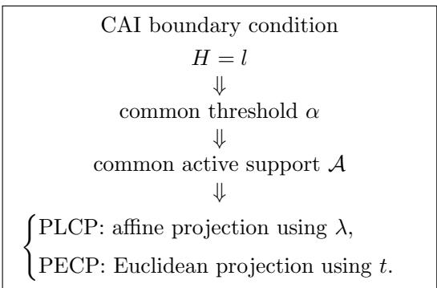

## A.5 Derivation of the PLCP Extrapolation Factor

Once the active support has stabilized, let

$$
A = \{ i : x _ { i } > 0 \} , \qquad | A | = \nu ,
$$

and let α denote the final threshold obtained from the CAI boundary condition.

On the active support, define the diagonal reference vector

$$
\mathbf { d } = \frac { \| \mathbf { x } \| _ { 1 } } { \nu } \mathbf { 1 } _ { A } .
$$

The shifted vector associated with the final threshold is

$$
\widetilde { \mathbf { x } } = \mathbf { x } - \alpha \mathbf { 1 } _ { A } .
$$

By construction of the threshold $\alpha _ { \mathrm { { ; } } }$

$$
H ( \widetilde { \mathbf { x } } ) = l .
$$

Since

$$
\mathbf { 1 } _ { A } = { \frac { \nu } { \left\| \mathbf { x } \right\| _ { 1 } } } \mathbf { d } ,
$$

the shifted vector can be rewritten as

$$
\widetilde { \mathbf { x } } = \mathbf { x } - \frac { \alpha \nu } { \Vert \mathbf { x } \Vert _ { 1 } } \mathbf { d } .
$$

Let

$$
c = { \frac { \alpha \nu } { \| \mathbf { x } \| _ { 1 } } } .
$$

Then

$$
{ \widetilde { \mathbf { x } } } = \mathbf { x } - c \mathbf { d } .
$$

The PLCP solution is defined by the afine extrapolation

$$
\widehat { \mathbf { x } } _ { \mathrm { P L C P } } = \lambda \mathbf { x } + ( 1 - \lambda ) \mathbf { d } .
$$

Choosing

$$
\lambda = { \frac { 1 } { 1 - c } }
$$

gives

$$
1 - \lambda = - \frac { c } { 1 - c } ,
$$

and therefore

$$
{ \widehat { \mathbf { x } } } _ { \mathrm { P L C P } } = { \frac { 1 } { 1 - c } } \mathbf { x } - { \frac { c } { 1 - c } } \mathbf { d } = { \frac { \mathbf { x } - c \mathbf { d } } { 1 - c } } .
$$

Using

$$
\mathbf { x } - c \mathbf { d } = \widetilde { \mathbf { x } } ,
$$

we obtain

$$
\begin{array} { r } { \widehat { \mathbf { x } } _ { \mathrm { P L C P } } = \lambda \widetilde { \mathbf { x } } . } \end{array}
$$

Since the CAI score is scale-invariant,

$$
H ( \widehat { \mathbf { x } } _ { \mathrm { P L C P } } ) = H ( \widetilde { \mathbf { x } } ) = l .
$$

Hence, the afine extrapolation lies on the CAI boundary.

Finally,

$$
\left\lceil \lambda = \frac { 1 } { 1 - \frac { \alpha \nu } { \| \mathbf { x } \| _ { 1 } } } \right\rceil
$$

Substituting the closed-form threshold

$$
\alpha = \frac { \| \mathbf { x } \| _ { 1 } } { \nu } \left( 1 - \sqrt { \frac { l \big ( \nu - H ( \mathbf { x } ) \big ) } { H ( \mathbf { x } ) ( \nu - l ) } } \right)
$$

yields

$$
\boxed { \lambda = \sqrt { \cfrac { H ( \mathbf { x } ) ( \nu - l ) } { l \big ( \nu - H ( \mathbf { x } ) \big ) } } . }
$$

Thus, once the final active support and the threshold α have been identified, the PLCP extrapolation factor is obtained directly in closed form, without any additional optimization.

## A.5.1 PECP from Euclidean-Norm Minimization

Let y denote the input vector restricted to the final active support. The PECP solution is defined by

$$
\widehat { \mathbf { x } } _ { \mathrm { P E C P } } = \arg \operatorname* { m i n } _ { \mathbf { x } } \frac { 1 } { 2 } \| \mathbf { x } - \mathbf { y } \| _ { 2 } ^ { 2 } \quad \mathrm { s u b j e c t ~ t o ~ } H ( \mathbf { x } ) = l .
$$

Axial-orthogonal decomposition. Let A denote the final active support and let

$$
| { \mathcal { A } } | = \nu .
$$

In the corresponding active subspace, define the normalized diagonal axis as

$$
\boxed { \pmb { u } = \frac { 1 } { \sqrt { \nu } } \mathbf { 1 } _ { \pmb { A } } . }
$$

The input vector restricted to the active support can be decomposed as

$$
\begin{array} { r } { \left| \pmb { y } _ { \mathcal { A } } = s \pmb { u } + r \pmb { v } , \right| } \end{array}
$$

where

$$
\boxed { s = { \pmb y } _ { \mathcal { A } } ^ { \top } { \pmb u } = \frac { \| { \pmb y } _ { \mathcal { A } } \| _ { 1 } } { \sqrt { \nu } } , }
$$

and

$$
\boxed { r = \| \pmb { y } _ { \mathcal { A } } - s \pmb { u } \| _ { 2 } . }
$$

For $r > 0$ , the unit orthogonal direction is

$$
{ \boxed { v = { \frac { y _ { A } - s u } { r } } . } }
$$

By construction,

$$
\| \pmb { u } \| _ { 2 } = \| \pmb { v } \| _ { 2 } = 1 , \qquad \pmb { u } ^ { \top } \pmb { v } = 0 .
$$

CAI boundary. The CAI boundary in the active subspace is defined by

$$
\boxed { H ( \pmb { x } ) = l . }
$$

Let $\theta _ { l }$ denote the half-opening angle of the CAI cone in this active subspace. Since

$$
\cos \theta _ { l } = { \sqrt { \frac { l } { \nu } } } ,
$$

we obtain

$$
\tan ^ { 2 } \theta _ { l } = \frac { 1 - \cos ^ { 2 } \theta _ { l } } { \cos ^ { 2 } \theta _ { l } } = \frac { \nu - l } { l } .
$$

Hence,

$$
\boxed { q = \tan \theta _ { l } = \sqrt { \frac { \nu - l } { l } } . }
$$

Any point on the CAI boundary generator contained in the plane spanned by u and v can therefore be parameterized as

$$
\boxed { \pmb { x } ( t ) = t \pmb { u } + t q \pmb { v } = t ( \pmb { u } + q \pmb { v } ) . }
$$

Indeed, its axial component is t, whereas the norm of its orthogonal component is $t q .$ and therefore

$$
\frac { \| \pmb { x } ( t ) - ( \pmb { x } ( t ) ^ { \top } \pmb { u } ) \pmb { u } \| _ { 2 } } { \pmb { x } ( t ) ^ { \top } \pmb { u } } = q .
$$

Euclidean-norm minimization. PECP selects the point on this CAI boundary generator that minimizes the Euclidean distance to the input vector.

$$
\sqrt { t ^ { \star } = \arg \operatorname* { m i n } _ { t \geq 0 } \frac { 1 } { 2 } \left\| \pmb { y } _ { \mathcal { A } } - t ( \pmb { u } + q \pmb { v } ) \right\| _ { 2 } ^ { 2 } . }
$$

Using the decomposition

$$
\pmb { y } _ { A } = s \pmb { u } + r \pmb { v } ,
$$

we obtain

$$
y _ { \mathcal { A } } - t ( \pmb { u } + q \pmb { v } ) = ( s - t ) \pmb { u } + ( r - q t ) \pmb { v } .
$$

Since u and v are orthonormal,

$$
\left\| y _ { \mathcal { A } } - t ( \pmb { u } + q \pmb { v } ) \right\| _ { 2 } ^ { 2 } = ( s - t ) ^ { 2 } + ( r - q t ) ^ { 2 } .
$$

Thus, the PECP problem reduces to the one-dimensional minimization

$$
\boxed { t ^ { \star } = \arg \operatorname* { m i n } _ { t \geq 0 } \frac { 1 } { 2 } \left[ ( s - t ) ^ { 2 } + ( r - q t ) ^ { 2 } \right] . }
$$

Define

$$
\phi ( t ) = \frac { 1 } { 2 } \left[ ( s - t ) ^ { 2 } + ( r - q t ) ^ { 2 } \right] .
$$

Diferentiating with respect to t gives

$$
\phi ^ { \prime } ( t ) = - ( s - t ) - q ( r - q t ) .
$$

The optimality condition

$$
\phi ^ { \prime } ( t ) = 0
$$

therefore yields

$$
- ( s - t ) - q ( r - q t ) = 0 .
$$

Rearranging,

$$
s + q r = ( 1 + q ^ { 2 } ) t .
$$

Consequently,

$$
\boxed { t ^ { \star } = \frac { s + q r } { 1 + q ^ { 2 } } . }
$$

Moreover,

$$
\phi ^ { \prime \prime } ( t ) = 1 + q ^ { 2 } > 0 ,
$$

so that $t ^ { \star }$ is the unique minimizer.

Hence, the PECP solution is the Euclidean projection onto the corresponding CAI boundary generator. In the $( s , r )$ plane, this reduces to the orthogonal projection of the point $( s , r )$ onto the boundary line $r = q s$

Closed-form PECP solution. The PECP solution is therefore

$$
\sqrt { \widehat { \pmb { x } } _ { \mathrm { P E C P } } = t ^ { \star } ( \pmb { u } + q \pmb { v } ) , }
$$

with

$$
\boxed { t ^ { \star } = \frac { s + q r } { 1 + q ^ { 2 } } . }
$$

Equivalently,

$$
\boxed { \widehat { \pmb { x } } _ { \mathrm { P E C P } } } = \frac { s + q r } { 1 + q ^ { 2 } } ( { \pmb { u } } + q { \pmb { v } } ) .
$$

Returning to the matrix representation gives

$$
\left| \widehat { \mathbf { X } } _ { \mathrm { P E C P } } = \mathrm { u n v e c } \left[ \frac { s + q r } { 1 + q ^ { 2 } } ( { \pmb u } + q { \pmb v } ) \right] . \right|
$$

Hence, the PECP solution is the Euclidean projection onto the corresponding CAI boundary generator. In the $( s , r )$ plane, this reduces to the orthogonal projection of the point $( s , r )$ onto the boundary line $r = q s$

$$
\boxed { r = q s . }
$$

Relation between PLCP and PECP Let

$$
\pmb { u } = \frac { 1 } { \sqrt { \nu } } \mathbf { 1 } _ { \mathcal { A } }
$$

denote the normalized diagonal axis of the active subspace, and let v denote the corresponding unit orthogonal direction.

The CAI boundary is characterized by

$$
q = \tan \theta _ { l } = \sqrt { \frac { \nu - l } { l } } .
$$

Therefore, any point lying on the corresponding CAI boundary generator can be written as

$$
\rho ( { \pmb u } + q { \pmb v } ) , \qquad \rho \geq 0 .
$$

The PLCP solution lies on this generator and can therefore be written as

$$
\boxed { \widehat { \pmb { x } } _ { \mathrm { P L C P } } = s _ { \mathrm { P L C P } } ( \pmb { u } + q \pmb { v } ) , }
$$

where $s _ { \mathrm { P L C P } }$ denotes the axial coordinate of the PLCP solution.

Similarly, from the Euclidean projection derived for PECP,

$$
\boxed { \widehat { \pmb { x } } _ { \mathrm { P E C P } } = t ( \pmb { u } + q \pmb { v } ) , }
$$

where

$$
t = \frac { s + q r } { 1 + q ^ { 2 } } .
$$

Here, s and $r$ denote respectively the axial and orthogonal coordinates of the vector to be projected:

$$
\begin{array} { r } { s = \pmb { y } _ { \pmb { A } } ^ { \top } \pmb { u } , } \end{array}
$$

and

$$
r = \| \pmb { y } _ { \pmb { \mathscr { A } } } - s \pmb { \mathscr { u } } \| _ { 2 } .
$$

Since both solutions lie on the same CAI boundary generator, they are collinear. Indeed,

$$
{ \widehat { \pmb { x } } } _ { \mathrm { P E C P } } = t ( \pmb { u } + q \pmb { v } )
$$

and

$$
{ \widehat { \pmb { x } } } _ { \mathrm { P L C P } } = s _ { \mathrm { P L C P } } ( \pmb { u } + q \pmb { v } ) .
$$

Consequently,

$$
{ \widehat { \pmb { x } } } _ { \mathrm { P E C P } } = { \frac { t } { s _ { \mathrm { P L C P } } } } { \widehat { \pmb { x } } } _ { \mathrm { P L C P } } .
$$

Therefore,

$$
\boxed { \kappa = \frac { t } { s _ { \mathrm { P L C P } } } . }\tag{17}
$$

Hence, the PECP and PLCP solutions satisfy

$$
\boxed { \widehat { \pmb { x } } _ { \mathrm { P E C P } } = \kappa \widehat { \pmb { x } } _ { \mathrm { P L C P } } . }
$$

Thus, the two methods difer only by a radial scaling once the common active support has been identified.

This yields the unified interpretation

$$
\begin{array} { c } { { \mathrm { C o m m o n ~ a c t i v e - s e t ~ s e l e c t i o n } } } \\ { { \alpha , \nu } } \\ { { \Downarrow } } \\ { { H _ { 0 } > l } } \\ { { H _ { 0 } > l } } \end{array} \left\{ \begin{array} { c } { { \mathrm { P L C P : a f f u e ~ p r o j e c t i o n ~ u s i n g ~ } \lambda , } } \\ { { \mathrm { P E C P : E u c l i d e a n ~ p r o j e c t i o n ~ u s i n g ~ } t ~ \mathrm { o r } ~ \kappa , } } \\ { { \mathrm { n o ~ g e o m e t r i c ~ p r o j e c t i o n . } } } \end{array} \right.
$$

Therefore, PLCP and PECP select exactly the same conic direction. They difer only by a radial scaling along that cone generator: PLCP reaches the boundary through the afine path joining y to the diagonal point d, whereas the Euclidean projection reaches the same generator through the shortest-distance path.

## A.6 Euclidean characterization of the bilevel PECP

Proposition A.3 (Euclidean characterization of the bilevel PECP). Let

$$
Y = [ y _ { 1 } , \dots , y _ { n } ] \in \mathbb { R } ^ { m \times n } , \qquad v = ( \| y _ { 1 } \| _ { 2 } , \dots , \| y _ { n } \| _ { 2 } ) ,
$$

and let

$$
\widehat { u } = P _ { l } ^ { \mathrm { P E C P } } ( v )
$$

denote the Euclidean CAI projection of the vector of column norms. Define

$$
x _ { j } = P _ { \widehat { u } _ { j } } ^ { 2 } ( y _ { j } ) , \qquad j = 1 , \ldots , n .
$$

Then, provided $0 \leq \widehat { u } _ { j } \leq \| y _ { j } \| _ { 2 }$ , the resulting matrix $X = [ x _ { 1 } , \ldots , x _ { n } ]$ minimizes the Frobenius distance to $Y$ among matrices whose vector of column $\ell _ { 2 }$ norms satisfies the corresponding CAI constraint.

Proof. For any prescribed vector of column radii $u = ( u _ { 1 } , \ldots , u _ { n } ) $ , the minimization of the Frobenius distance separates columnwise:

$$
\operatorname* { m i n } _ { \| \boldsymbol { x } _ { j } \| _ { 2 } \le { u } _ { j } } \| \boldsymbol { Y } - \boldsymbol { X } \| _ { F } ^ { 2 } = \sum _ { j = 1 } ^ { n } \operatorname* { m i n } _ { \| \boldsymbol { x } _ { j } \| _ { 2 } \le { u } _ { j } } \| \boldsymbol { y } _ { j } - \boldsymbol { x } _ { j } \| _ { 2 } ^ { 2 } .
$$

The Euclidean projection onto the $\ell _ { 2 }$ ball gives

$$
x _ { j } = P _ { u _ { j } } ^ { 2 } ( y _ { j } ) .
$$

Since $0 \leq u _ { j } \leq v _ { j } = \| y _ { j } \| _ { 2 }$ ,

$$
\lVert y _ { j } - x _ { j } \rVert _ { 2 } = v _ { j } - u _ { j } .
$$

Therefore,

$$
\| Y - X \| _ { F } ^ { 2 } = \sum _ { j = 1 } ^ { n } ( v _ { j } - u _ { j } ) ^ { 2 } = \| v - u \| _ { 2 } ^ { 2 } .
$$

Consequently, minimizing the Frobenius distance in matrix space is equivalent to minimizing the Euclidean distance between the vectors of column norms:

$$
\operatorname* { m i n } _ { X } \frac { 1 } { 2 } \| Y - X \| _ { F } ^ { 2 } = \operatorname* { m i n } _ { u : H ( u ) \le l } \frac { 1 } { 2 } \| v - u \| _ { 2 } ^ { 2 } .
$$

Since $\widehat { u } = P _ { \iota } ^ { \mathrm { P E C P } } ( v )$ is the Euclidean CAI projection of $v ,$ the matrix obtained from $x _ { j } = P _ { \hat { u } _ { j } } ^ { 2 } ( y _ { j } )$ is the corresponding exact Frobenius projection. □

## A.7 Laguerre’s style and Samuelson’s style bound

Let $y _ { 1 } , \ldots , y _ { n }$ be positive real numbers, and set

$$
l _ { 1 } : = \sum _ { i = 1 } ^ { n } y _ { i } , \qquad l _ { 2 } : = \sqrt { \sum _ { i = 1 } ^ { n } y _ { i } ^ { 2 } } , \qquad H : = \left( \frac { l _ { 1 } } { l _ { 2 } } \right) ^ { 2 } .
$$

Fix a positive number $l < n ,$ and define

$$
\mu : = \frac { l _ { 1 } } { n } , \quad \quad \sigma ^ { 2 } : = \frac { 1 } { n } \sum _ { i = 1 } ^ { n } ( y _ { i } - \mu ) ^ { 2 } .\tag{18}
$$

We will prove that the number of indices i such that

$$
y _ { i } \leq { \frac { l _ { 1 } } { n } } \left( 1 - { \sqrt { { \frac { l ( n - H ) } { H ( n - l ) } } } } \right)
$$

is at most $n - l .$

First, remark that, according to the following lemma, this threshold can be rewritten in terms of the standard score (aka z-score):

$$
\frac { y _ { i } - \mu } { \sigma } \leq - \sqrt { \frac { l } { n - l } } .\tag{19}
$$

Lemma A.4. The numbers $\mu$ and σ defined in equation 18 satisfy

$$
\sigma ^ { 2 } = \mu ^ { 2 } \left( { \frac { n - H } { H } } \right) .\tag{20}
$$

Proof. We have

$$
\sigma ^ { 2 } = \frac { 1 } { n } \sum _ { i = 1 } ^ { n } y _ { i } ^ { 2 } - \mu ^ { 2 } = \frac { l _ { 2 } ^ { 2 } } { n } - \mu ^ { 2 } .
$$

Using $H = ( l _ { 1 } / l _ { 2 } ) ^ { 2 }$ gives $l _ { 2 } ^ { 2 } = l _ { 1 } ^ { 2 } / H = n ^ { 2 } \mu ^ { 2 } / H$ , which gives equation 20. □

## Lemma A.5. Let

$$
r : = \# \left\{ i : y _ { i } \leq \frac { l _ { 1 } } { n } \left( 1 - \sqrt { \frac { l ( n - H ) } { H ( n - l ) } } \right) \right\} = \# \left\{ i : y _ { i } \leq \mu - t \right\} ,
$$

where

$$
t : = \mu \sqrt { \frac { l ( n - H ) } { H ( n - l ) } } .
$$

Then

$$
r \leq \frac { n \sigma ^ { 2 } } { \sigma ^ { 2 } + t ^ { 2 } } .
$$

As detailed in [28], there are two approaches to prove such Laguerre-Samuelson style inequality. A first one, following Laguerre’s style uses Cauchy-Schwarz and a second one, following Samuelson’s style uses a clustering argument. We provide both of them below.

Proof in Laguerre style. Write the deviations from the mean as

$$
d _ { i } : = y _ { i } - \mu , \qquad i = 1 , \ldots , n .
$$

Then

$$
\sum _ { i = 1 } ^ { n } d _ { i } = 0 \ ( \mathrm { z e r o \ s u m } ) , \qquad \sum _ { i = 1 } ^ { n } d _ { i } ^ { 2 } = n \sigma ^ { 2 } .
$$

We derive the desired result by bounding the total variation around the mean. Among the numbers $d _ { i }$ , exactly r of them satisfy $d _ { i } \leq - t$ . Let

$$
A : = \{ i : \ d _ { i } \leq - t \} , \qquad | A | = r .
$$

Set

$$
S _ { A } : = \sum _ { i \in A } d _ { i } , \qquad S _ { \overline { { { A } } } } : = \sum _ { i \notin A } d _ { i } .\tag{21}
$$

Since the total sum is zero, we have $S _ { \overline { { A } } } = - S _ { A }$ . Moreover, because each $i \in A$ satisfies $d _ { i } \leq - t$ , we get

$$
S _ { A } \leq - r t , \mathrm { h e n c e } S _ { \overline { { A } } } \geq r t .
$$

By Cauchy–Schwarz applied to the set ${ \overline { { A } } } .$

$$
S _ { A } ^ { 2 } \leq | \overline { { { A } } } | \sum _ { i \notin A } d _ { i } ^ { 2 } = ( n - r ) \sum _ { i \notin A } d _ { i } ^ { 2 } .
$$

Therefore

$$
\sum _ { i \notin A } d _ { i } ^ { 2 } \geq \frac { S _ { A } ^ { 2 } } { n - r } \geq \frac { r ^ { 2 } t ^ { 2 } } { n - r } .
$$

Also, for $i \in A$ we have $d _ { i } ^ { 2 } \geq t ^ { 2 }$ , so

$$
\sum _ { i \in A } d _ { i } ^ { 2 } \geq r t ^ { 2 } .
$$

Adding the two estimates gives

$$
\begin{array} { c } { { n \sigma ^ { 2 } = \displaystyle \sum _ { i = 1 } ^ { n } d _ { i } ^ { 2 } = \displaystyle \sum _ { i \in A } d _ { i } ^ { 2 } + \displaystyle \sum _ { i \notin A } d _ { i } ^ { 2 } } } \\ { { \geq r t ^ { 2 } + \displaystyle \frac { r ^ { 2 } t ^ { 2 } } { n - r } = \displaystyle \frac { r n t ^ { 2 } } { n - r } . } } \end{array}\tag{22}
$$

Rearranging,

$$
r \leq { \frac { n \sigma ^ { 2 } } { \sigma ^ { 2 } + t ^ { 2 } } } .
$$

Proof in Samuelson style. This proof uses the remark “putting 2 measurements at their common mean reduces the standard deviation while leaving the mean invariant” from Samuelson’s paper [42]. Consider the clustering operation replacing all samples in A by their mean $\mu _ { A }$ and all samples in $\overline { { A } }$ by their mean $\mu _ { \bar { A } } ;$ so let $y _ { i } ^ { \prime } = \mu _ { A } { \mathrm { ~ i f ~ } } i \in A$ and $y _ { i } ^ { \prime } = \mu _ { A } ^ { }$ otherwise. Let $\mu ^ { \prime }$ and $\sigma ^ { \prime }$ be their mean and standard deviation computed as in Equation 18. Define $S ^ { \prime }$ as in Equation 21. Using Samuelson’s remark, we know that $\sigma ^ { \prime } \leq \sigma$ . We have $S _ { A } ^ { \prime } + S _ { \overline { { A } } } ^ { \prime } = 0$ so $S _ { A } ^ { \prime } = - S _ { A } ^ { \prime }$ . As $d _ { i } < - t$ for all $i \in A$ , we have $S _ { A } ^ { \prime } \leq - r t$ . Therefore

$$
( \sigma ^ { \prime } ) ^ { 2 } = \frac { 1 } { n } ( S _ { A } ^ { 2 } / r + S _ { A } ^ { 2 } / ( n - r ) ) = \frac { S _ { A } ^ { 2 } } { n } ( 1 / r + 1 / ( n - r ) ) = \frac { S _ { A } ^ { 2 } } { r ( n - r ) } \geq \frac { r t ^ { 2 } } { n - r } .
$$

This is Equation 22 so the last step is shared with the Laguerre style proof.

Theorem A.6. $r \leq n - l$

Proof. By equation 20,

$$
\frac { t ^ { 2 } } { \sigma ^ { 2 } } = \frac { \mu ^ { 2 } \displaystyle \frac { l ( n - H ) } { H ( n - l ) } } { \mu ^ { 2 } \displaystyle \frac { n - H } { H } } = \frac { l } { n - l } .
$$

Lemma A.5 gives us

$$
r \leq \frac { n \sigma ^ { 2 } } { \sigma ^ { 2 } + t ^ { 2 } } .
$$

Substituting $t ^ { 2 } / \sigma ^ { 2 } = l / ( n - l )$ yields

$$
\begin{array} { c } { { r \le \displaystyle \frac { n } { 1 + t ^ { 2 } / \sigma ^ { 2 } } } } \\ { { = \displaystyle \frac { n } { 1 + \frac { l } { n - l } } } } \\ { { = \displaystyle \frac { n ( n - l ) } { n } } } \\ { { = n - l . } } \end{array}
$$

## A.8 Euclidean characterization of the bilevel PECP

Proposition A.7 (Euclidean characterization of the bilevel PECP). Let

$$
Y = [ y _ { 1 } , \dots , y _ { n } ] \in \mathbb { R } ^ { m \times n } , \qquad v = ( \| y _ { 1 } \| _ { 2 } , \dots , \| y _ { n } \| _ { 2 } ) ,
$$

and let

$$
\widehat { u } = P _ { l } ^ { \mathrm { P E C P } } ( v )
$$

denote the Euclidean CAI projection of the vector of column norms. Define

$$
x _ { j } = P _ { \widehat { u } _ { j } } ^ { 2 } ( y _ { j } ) , \qquad j = 1 , \ldots , n .
$$

Then, provided $0 \leq \widehat { u } _ { j } \leq \| y _ { j } \| _ { 2 }$ , the resulting matrix $X = [ x _ { 1 } , \ldots , x _ { n } ]$ minimizes the Frobenius distance to $Y$ among matrices whose vector of column $\ell _ { 2 }$ norms satisfies the corresponding CAI constraint.

Proof. For any prescribed vector of column radii $u = ( u _ { 1 } , \ldots , u _ { n } ) $ , the minimization of the Frobenius distance separates columnwise:

$$
\operatorname* { m i n } _ { \| \boldsymbol { x } _ { j } \| _ { 2 } \le \boldsymbol { u } _ { j } } \| \boldsymbol { Y } - \boldsymbol { X } \| _ { F } ^ { 2 } = \sum _ { j = 1 } ^ { n } \operatorname* { m i n } _ { \| \boldsymbol { x } _ { j } \| _ { 2 } \le \boldsymbol { u } _ { j } } \| \boldsymbol { y } _ { j } - \boldsymbol { x } _ { j } \| _ { 2 } ^ { 2 } .
$$

The Euclidean projection onto the $\ell _ { 2 }$ ball gives

$$
x _ { j } = P _ { u _ { j } } ^ { 2 } ( y _ { j } ) .
$$

Since $0 \leq u _ { j } \leq v _ { j } = \| y _ { j } \| _ { 2 }$ ,

$$
\lVert y _ { j } - x _ { j } \rVert _ { 2 } = v _ { j } - u _ { j } .
$$

Therefore,

$$
\| Y - X \| _ { F } ^ { 2 } = \sum _ { j = 1 } ^ { n } ( v _ { j } - u _ { j } ) ^ { 2 } = \| v - u \| _ { 2 } ^ { 2 } .
$$

Consequently, minimizing the Frobenius distance in matrix space is equivalent to minimizing the Euclidean distance between the vectors of column norms:

$$
\operatorname* { m i n } _ { X } \frac { 1 } { 2 } \| Y - X \| _ { F } ^ { 2 } = \operatorname* { m i n } _ { u : H ( u ) \leq l } \frac { 1 } { 2 } \| v - u \| _ { 2 } ^ { 2 } .
$$

Since $\widehat { u } = P _ { \iota } ^ { \mathrm { P E C P } } ( v )$ is the Euclidean CAI projection of $v ,$ the matrix obtained from $x _ { j } = P _ { \hat { u } _ { j } } ^ { 2 } ( y _ { j } )$ is the corresponding exact Frobenius projection. □

## A.9 Comparison of thresholding iteration with literature

## A.9.1 Comparison with Torrent family

Hard-thresholding iterations of the form Equation 12 are also at the heart of the Torrent family of algorithms introduced by [6] for Robust Least Squares Regression (RLSR). It is therefore instructive to delineate precisely how our PLCP iteration relates to, and difers from, that line of work.

Problem setting. Torrent addresses the regression model $\pmb { y } = \pmb { X } ^ { \top } \pmb { w } ^ { \star } + \pmb { b } ,$ where $\ b { b } \in \mathbb { R } ^ { n }$ is a sparse but adversarially chosen corruption vector with $\| \pmb { b } \| _ { 0 } \leq$ αn. The goal is to recover $\boldsymbol { w } ^ { \star }$ exactly despite an unknown set of corrupted responses. The algorithm alternates between (i) a hard-thresholding step that selects an active set $S _ { t } = \mathrm { H T } ( r ^ { t } , ( 1 - \beta ) n )$ of points with the smallest residuals, and (ii) a fit step (least squares for Torrent-FC, a gradient step for Torrent-GD, or a hybrid policy for Torrent-HYB) that re-estimates w on $S _ { t }$

By contrast, the PLCP iteration solves a Euclidean projection onto a structured sparsity cone arising from neural network compression. There is no statistical model, no corruption, and no regressor to recover: the iteration acts directly on the entries of x (or on the vector of column $\ell _ { 2 } { \mathrm { - n o r m s } } .$ , in the bilevel variant) and the active support is determined by a magnitude threshold $\alpha ( { \pmb x } )$ that is itself a function of the current iterate.

Form of the thresholding step. The hard-thresholding operator used in [6] selects a fixed-cardinality set of indices (the $( 1 - \beta ) n$ smallest residuals), so the active-set size is held constant across iterations. In our setting, the threshold $\alpha ( \pmb { x } ^ { ( t ) } )$ is computed from the current iterate via the cone characterization, and the cardinality of the active support $| \{ i : x _ { i } ^ { ( t ) } \geq \alpha ( \mathbf { } \mathbf { } x ^ { ( t ) } ) \} |$ is itself updated at each step. The PLCP iteration is therefore an adaptive-cardinality thresholding scheme, whereas Torrent is a fixed-cardinality one.

Convergence guarantee. The two analyses also difer in nature. Torrent establishes a geometric (linear) convergence rate $\| \pmb { w } ^ { t } - \pmb { w } ^ { \star } \| _ { 2 } \le C \rho ^ { t }$ under deterministic subset strong convexity/smoothness (SSC/SSS) assumptions on $\boldsymbol { X }$ which hold with high probability for sub-Gaussian designs; the iteration count to reach an ε-accurate solution scales as $\mathcal { O } ( \log ( \| b \| _ { 2 } / ( \sqrt { n } \varepsilon ) ) )$ , and exact recovery is only reached in the limit. The PLCP iteration, on the other hand, enjoys a finite-time guarantee: the active support is monotonically non-increasing along iterations, hence the loop reaches a fixed point in at most n steps, with no probabilistic or design assumption on the input vector. Empirically (see Figure 4), in most cases the active-set size collapses exponentially fast toward its limit, well before the worst-case n-iteration bound.

## A.9.2 Comparison with the Luo–Tseng convergence framework

A second, more classical line of work on the convergence of active-set iterations is the analysis of [34] for coordinate descent on problems of the form

$$
\operatorname* { m i n } _ { { \pmb x } \in { \mathcal X } } g ( { \pmb E x } ) + \langle { \pmb b } , { \pmb x } \rangle ,
$$

where $\mathcal { X }$ is a (possibly unbounded) box, E has no zero column, and $g$ is strictly convex and twice diferentiable on its efective domain. Their main result is that the iterates generated by coordinate descent converge to an optimal solution at a linear rate, without requiring that the cost function have bounded level sets or be strictly convex on the whole space. As a corollary, they obtain the first linear-convergence guarantee for the dual iterates of several methods for symmetric monotone linear complementarity problems, matrix balancing, and entropy optimization.

Common ground. The PLCP iteration shares with the Luo–Tseng setting two features that are central to their analysis. First, the constraint set involved in our projection is a polyhedral cone – in particular a Cartesian product of half-lines after the support has been selected – so the underlying feasibility set has the same box-like geometry as $\mathcal { X } .$ Second, the optimality conditions of the conic projection can be written as a linear complementarity system (positivity, primal feasibility, and complementary slackness on the active support), which is precisely the class of problems for which (author?) [34] establish linear convergence of coordinate descent. In that sense, the PLCP optimality conditions live in the LCP universe that Luo–Tseng’s analysis targets.

Where the analyses difer. The diferences are equally informative. [34] update one coordinate at a time (in an almost-cyclic or Gauss–Southwell order) and rely on an error-bound inequality to obtain a geometric rate of convergence on the iterates. The PLCP iteration, in contrast, performs a global activesupport update at each step: all coordinates below the current threshold $\alpha ( \pmb { x } ^ { ( t ) } )$ are zeroed simultaneously, and the threshold itself is recomputed in closed form from the resulting support. Because the support is a discrete object and only shrinks across iterations, this block update yields a strictly stronger guarantee than the linear rate of [34]: the iteration reaches its fixed point in at most n steps, with no error-bound or strict-convexity assumption. Empirically, the active-support size further decays exponentially fast (Figure 4), so that the worst-case n-iteration bound is almost never tight.

## A.9.3 Comparison with Least Median of Squares regression

Predating the modern hard-thresholding literature by several decades, [41] introduced Least Median of Squares (LMS) regression as a high-breakdown-point alternative to ordinary least squares:

$$
\hat { \pmb w } _ { \mathrm { L M S } } \ \in \ \arg \operatorname* { m i n } _ { { \pmb w } \in \mathbb { R } ^ { p } } \ \mathrm { m e d } _ { i = 1 , \dots , n } \big ( y _ { i } - { \pmb x } _ { i } ^ { \top } { \pmb w } \big ) ^ { 2 } .
$$

Because the median is, up to ties, the $\lfloor n / 2 \rfloor { \mathrm { - t h } }$ order statistic of the squared residuals, LMS implicitly identifies the half of the observations on which the regressor fits best and ignores the rest. In this sense it is the conceptual ancestor of Torrent’s hard-thresholding step and, more broadly, of every active-set scheme that discards the points with the largest residuals.

Selection mechanism. LMS and PLCP share the same underlying primitive – ranking quantities (residuals, respectively coeficient magnitudes) and keeping only those above a data-adaptive threshold – but they difer in three ways: (i) the threshold in LMS is fixed at the median rank (50% of the data), giving the estimator its maximal breakdown point $\varepsilon ^ { \star } = 1 / 2 ;$ in PLCP the threshold $\alpha ( { \pmb x } )$ is computed in closed form from the cone-alignment constraint and the active-set size is therefore data-driven rather than prescribed; (ii) LMS ranks squared residuals of a regression fit, whereas PLCP ranks the entries of the iterate itself (or the column $\ell _ { \mathrm { { 2 } ^ { - n o r m s } } }$ in the bilevel variant); (iii) LMS only specifies the optimization objective; PLCP, like Torrent, additionally specifies an iterative procedure for finding the active support, and we prove that this procedure terminates in finitely many steps.

Robustness vs. deterministic termination. The theoretical guarantee provided by (author?) [41] is statistical and worst-case: LMS attains the highest possible breakdown point among regression-equivariant estimators, meaning that up to almost half of the observations can be corrupted arbitrarily without the estimator drifting to infinity. Our guarantee for PLCP, by contrast, is algorithmic: there is no notion of breakdown point because the input is a deterministic vector to be projected, not a noisy sample; instead, the iteration is shown to reach a fixed point in at most n steps for any input. The two analyses therefore answer diferent questions about the same family of thresholding ideas – ”how much corruption can the answer survive?” versus ”how fast does the iteration stop?” – and are best read as complementary rather than competing.

Computational profile. A practical contrast worth noting is that exact LMS is NP-hard in p and is typically solved by random subsampling heuristics with no global guarantee, whereas the PLCP iteration is a deterministic procedure with closed-form updates and worst-case complexity O(Kn), $K \leq n$ . Combined with the empirical observation that K remains small (Figure 4), this makes PLCP attractive as the structured-sparsity analogue of the thresholding-by-ranking idea that LMS first crystallized in the robust-regression setting.

## A.9.4 Comparison with Huber’s M-estimators and IRLS

The most foundational reference for the convergence of ”trim and refit” iterations is the theory of M-estimators developed by [26] in Chapter 3 of Robust Statistics. An M-estimator is defined as the solution of

$$
\hat { \pmb { w } } _ { \mathrm { M } } \in \arg \operatorname* { m i n } _ { \pmb { w } } \sum _ { i = 1 } ^ { n } \rho \big ( y _ { i } - \pmb { x } _ { i } ^ { \top } \pmb { w } \big ) ,
$$

for a loss $\rho$ chosen to attenuate the influence of large residuals, and it is computed in practice by an Iteratively Reweighted Least Squares (IRLS) scheme of the form

$$
w ^ { ( t + 1 ) } = \arg \operatorname* { m i n } _ { w } \sum _ { i = 1 } ^ { n } w _ { i } \big ( { \pmb w } ^ { ( t ) } \big ) \big ( y _ { i } - { \pmb x } _ { i } ^ { \top } { \pmb w } \big ) ^ { 2 } , \qquad w _ { i } ( { \pmb w } ) = \frac { \psi \big ( r _ { i } ( { \pmb w } ) \big ) } { r _ { i } ( { \pmb w } ) } ,
$$

where $\psi = \rho ^ { \prime }$ is the influence function. Huber gives the foundational analysis of when this iteration converges and to what.

PLCP as IRLS with binary weights. The PLCP iteration fits squarely inside this framework once one notices that the hard-thresholding update Equation 12 is precisely IRLS with a binary weight function

$$
w _ { i } \big ( { \pmb x } ^ { ( t ) } \big ) ~ = ~ { \bf 1 } \Big [ x _ { i } ^ { ( t ) } \geq \alpha \big ( { \pmb x } ^ { ( t ) } \big ) \Big ] \in \{ 0 , 1 \} ,
$$

corresponding to the discontinuous ”hard” influence function $\psi ( u ) = u \mathbf { 1 } [ u \geq \alpha ]$ rather than Huber’s clipped-linear ψ. The pattern ”compute the (cone-adapted) statistic, threshold, recompute” is, in Huber’s terminology, a degenerate redescending M-iteration in which observations either count fully or not at all. Standard IRLS with continuous weights interpolates between these extremes; PLCP and Torrent both correspond to the binary-weight limit.

What Huber’s analysis buys us, and where it stops. Huber’s convergence proofs for IRLS rely on smoothness of $\rho$ and on the resulting majorizationminimization structure of the iteration. They give monotone descent of an explicit objective and asymptotic convergence under mild conditions. Specializing them to a discontinuous binary $\psi$ formally falls outside their regularity assumptions, but the underlying intuition – that the active-set update is a majorization step on a piecewise-quadratic surrogate – still applies and explains why such iterations tend to converge in practice. Our analysis can be read as supplying the missing piece in this degenerate regime: rather than invoking smoothness, we use the combinatorial fact that the active support is a monotone subset sequence to conclude finite-time termination in at most n steps. In this sense, the PLCP convergence result is the natural counterpart, on the structured-sparsity side, of Huber’s IRLS convergence theory: same iterative template, diferent mathematical tool for closing the proof.

## A.10 Basic Inference analysis

We provide a basic analysis of the computational cost of using PLCP within a BERT-like attention block [13].

In this simple illustrative setting, token importance is approximated by the embedding norm, and tokens associated with smaller norms are preferentially removed. Let the original sequence length be n and the head dimension be d. When the quadratic attention operations dominate the computational cost, the leading-order complexity becomes

$$
\boxed { T _ { \mathrm { t o t a l } } \simeq \mathcal { O } ( \rho ^ { 2 } n ^ { 2 } d ) . }
$$

Basic Linguistic Analysis In this section, we provide a preliminary linguistic analysis on real text data.

Example

Sentence: a densely constructed, highly referential film, and an audacious return

to form that can comfortably sit among jean-luc godard’s finest work. Label: Positive

## PLCP sparsified sentences:

• Level 2: referential audacious Kept: 17.6% (6/34) Predicted: Negative [WRONG]

• Level 4: referential audacious godard Kept: 23.5% (8/34) Predicted: Positive [OK]

• Level 8: referential audacious comfortably sit among jean luc godard finest Kept: 44.1% (15/34) Predicted: Positive [OK]

• Level 12: densely referential audacious return form comfortably sit among jean luc godard finest Kept: 52.9% (18/34) Predicted: Positive [OK]

• Level 16: densely highly referential film audacious return form can comfortably sit among jean luc godard s finest work Kept: 67.6% (23/34) Predicted: Positive [OK]

• Level 24: a densely constructed highly referential film and an audacious return to form that can comfortably sit among jean-luc godard’s finest work. Kept: 94.1% (32/34) Predicted: Positive [OK]

In this illustrative example, sparsification first tends to remove punctuation marks and some modifiers or function words while largely preserving the semantic content of the sentence. However, a systematic linguistic evaluation by a specialist would be required to draw general conclusions and is left for future work.