# ANCHOR: AUGMENTED CROSS-LAYER RECURRENT STATE FORLONG-CONTEXT RETRIEVAL IN TEST-TIME TRAINING

Vimal William 1 Yuanzhe Li 1 Danella Zhao 1 Huanrui Yang 1

## ABSTRACT

Parameter-efficient linearization turns a pretrained autoregressive Transformer into an efficient model by hybridizing sliding-window attention (SWA) with a constant-size recurrent memory. But does every layer’s recurrent state contribute to long-context retrieval? Investigating an SWA and Test-Time Training (TTT) hybrid, we find that retrieval is sparse across depth, concentrated in a few anchor layers, and that the remaining states hold similar information expressed through layer-specific transformations. We exploit both observations in ANCHOR: TTT memory placed only at the anchor layers, and a cross-layer recurrent state written once and read by many layers, each through its own learned read map that realizes a layer-specific stretch and rotation, along with demonstrated generalization to other hybrid attentions. On Llama-3.1-8B and Mistral-7B, ANCHOR delivers 2.3–3.1× higher recall and 6.7–8.9 points higher MMLU accuracy than LoLCATs with a 10× smaller recurrent state, retains 91–95% of the teacher’s MMLU accuracy, and cuts end-to-end latency by up to 4.3× relative to softmax attention.

## 1 INTRODUCTION

Cross-layer similarity

The self-attention mechanism at the core of large language models (LLMs) computes a similarity between every query and every preceding key, so both compute and memory grow with the sequence length. During autoregressive decoding, the keys and values of all previous tokens are retained in a KV cache that grows linearly with context, requiring $\mathcal { O } ( N d )$ memory per layer for a sequence of length N and head dimension $d ,$ while attention over the full sequence costs $\mathcal { O } ( N ^ { 2 } d )$ . This cache is what gives attention its defining property: every earlier token remains individually addressable, and recall over long contexts stays exact. It is also what makes long-context inference expensive. The cache must be held for the lifetime of a request and re-read at every decoding step, so it, rather than arithmetic, bounds the batch size a server can sustain and therefore the throughput it can deliver. As context windows extend from thousands to hundreds of thousands of tokens, the memory required to preserve exact recall becomes the dominant cost of deployment. This tension, between the growing state that gives attention its recall and the bounded state that makes inference affordable, motivates architectures that retain long-range information in a memory whose size does not grow with the context.

A natural response is to impose an upper bound on the state.

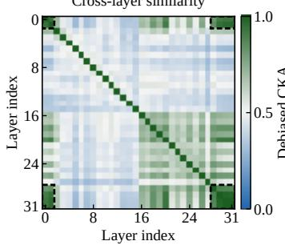

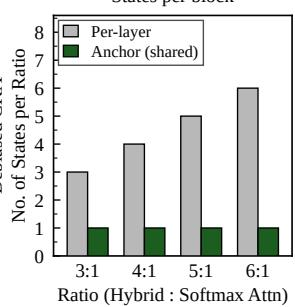  
Figure 1. Recurrent states across layers are redundant, so one shared state suffices. Left: Debiased CKA between the TTT states of every pair of layers in Llama-3.1-8B, measured on Wiki-Text for targets beyond the local window. The anchor layers $( \ell \in \{ 0 , 1 , 2 8 , \ldots , 3 1 \}$ , dashed boxes) are strongly aligned with one another (mean CKA 0.92), whereas the interior layers are not (0.49). Right: Number of recurrent states per block as the ratio of hybrid to softmax-attention layers grows. A per-layer design keeps one state per hybrid layer; ANCHOR keeps a single shared state, reducing the count by 3–6×.

Recency-based and importance-based architectures do so by restricting which past positions each query may attend to: sliding window attention (Beltagy et al., 2020) retains the w most recent tokens, and sparse attention (DeepSeek-AI et al., 2025) selects a fixed budget of earlier positions. The cache is then bounded at $\mathcal { O } ( w d )$ and the per-token retrieval cost becomes independent of the sequence length, restoring a predictable memory footprint at serving time. The bound, however, is enforced by discarding information rather than by compressing it. A token outside the retained set is no longer addressable at any later step, and no subsequent computation can recover it. The width w therefore fixes the receptive field of the architecture, and recall falls away once the distance between a query and its target exceeds that width. Bounding the state exchanges one limitation for another: the memory cost no longer grows with context, but neither does the span over which the model can retrieve.

The observed inefficiency in the recall accuracy due to the limitation in the receptive field motivates extending the receptive field through embedding a constant-sized recurrent state (Chen et al., 2021; Dong et al., 2024; Arora et al., 2025; Zhang et al., 2025; Lan et al., 2025; William et al., 2026) to enable longer-context retrieval without a major increase in memory footprint and with the retrieval complexity of $O ( d ^ { 2 } + w d )$ The recurrent state extends the span over which information is retained, but it remains an imperfect substitute for an explicit cache. Its capacity is limited by the low rank of the outer-product update, and because the state is written at every step with no mechanism for forgetting, recent tokens progressively overwrite earlier ones. A line of work addresses these limitations by modifying the update rule rather than the state itself: gating and decay terms control how much of the existing state is preserved at each step (Yang et al., 2023), and attentional-bias formulations replace the plain key-value association with an objective optimized online (Behrouz et al., 2025; von Oswald et al., 2026), connecting the update to the in-context learning behavior observed in large language models (von Oswald et al., 2026). These refinements improve how the state is written. The state itself, however, remains a single fixed-size summary maintained independently in every layer, and how much of it each layer actually requires has not been examined. This gap in understanding how long-term memory is distributed across depth leads us to ask: does long-context retrieval require a recurrent state in every layer and do states share information?

As a first step toward answering this question, we study the behavior of recurrent states in a hybrid attention formulation on the associative recall (AR) benchmark, and measure the similarity between the states of different layers using centered kernel alignment (CKA) and cosine similarity. Two observations follow (Figure 1): long-context retrieval is sparse across depth, concentrated in a small set of layers, and the states that carry it hold closely related information. Together these motivate ANCHOR, a recurrent state shared across layers rather than maintained independently in each, which we instantiate as a family of configurations spanning training and deployment. Our contributions are as follows:

1. Linearization for TTT states. We extend the twostage linearization recipe to Test-Time Training recurrent states, and show that supervising attention transfer with a next-token objective prevents the collapse that output matching alone produces (Section 3.1).

2. The anchor effect. We find that long-context recall is concentrated in a small set of boundary layers: disabling the TTT update in the remaining 26 layers leaves perplexity unchanged while shrinking the recurrent state by 5.3× (Section 3.1).

3. Cross-layer recurrent state. Layer states turn out to encode closely related information in different bases, which lets a single state serve many layers through learned per-layer read-maps $\chi _ { \ell } ( \cdot )$ (Section 3.2).

4. ANCHOR. The resulting family spans training and deployment and reaches 4.3× higher end-to-end throughput compared to vanilla softmax attention at 16× smaller recurrent state than per-layer hybrids, at comparable accuracy (Section 4.2).

## 2 PRELIMINARIES

We briefly review the attention mechanism, the core component of the autoregressive transformer architecture, and its impact on long-context inference; an extended discussion is provided in the Appendix A.

Notations. We denote by N the sequence length, L the number of layers, H the number of heads, $d _ { \mathrm { m o d e l } }$ the model width, and $d = d _ { \mathrm { m o d e l } } / H$ the per-head dimension. Layers are indexed by $\ell \in \{ 0 , \ldots , L - 1 \}$ and positions by i or t. For an input $x _ { i } \in \mathbb { R } ^ { d _ { \mathrm { m o d e l } } }$ , the query, key, and value are $\hat { \mathbf { q } } _ { i } = \mathbf { W _ { Q } } ^ { \top } \mathbf { x } _ { i } , \hat { \mathbf { k } } _ { i } = \mathbf { W _ { K } } ^ { \top } \mathbf { x _ { i } }$ , and $\mathbf { v _ { i } } = \mathbf { W _ { V } } ^ { \top } \mathbf { x _ { i } } ; o _ { i }$ is the output of a single branch and $O _ { i }$ that of the hybrid layer. W is the sliding-window size, ${ \mathcal W } ^ { ( c ) }$ is the weights of recurrent state after chunk c, and $x _ { \ell } ( \cdot )$ the learned read map at layer ℓ. We write A for cross-layer recurrent state memory, g for an anchor group, θ for the model parameters, sg[·] for the stop-gradient operator, and L for objectives.

Self-Attention. In vanilla softmax attention (Vaswani et al., 2017), for an input token representation $\mathbf { x } _ { i } \in \mathbb { R } ^ { d _ { \mathrm { m o d e l } } }$ the query, key, and value are obtained as $\hat { \mathbf { q } } _ { i } = \mathbf { W _ { Q } } ^ { \top } \mathbf { x } _ { i } \in$ Rdk , $\hat { \mathbf { k } } _ { i } = { \mathbf { W _ { \mathrm { K } } } } ^ { \top } \mathbf { x } _ { i } \in \mathbb { R } ^ { d _ { k } }$ , and $\hat { \mathbf { v } } _ { i } = { \mathbf { W } _ { \mathrm { V } } } ^ { \top } \mathbf { x } _ { i } \in \mathbb { R } ^ { d _ { v } }$ with projection matrices $\mathbf { W } _ { \mathrm { Q } } , \mathbf { W } _ { \mathrm { K } } \in \mathbb { R } ^ { d _ { \mathrm { m o d e l } } \times d _ { k } }$ and $\mathbf { W } _ { \mathbf { V } } \in$ $\mathbb { R } ^ { d _ { \mathrm { m o d e l } } \times d _ { v } }$ , replicated across H heads with $d _ { k } \ = \ d _ { v } \ =$ $d _ { \mathrm { m o d e l } } / H$ . Attention predicts the distribution over the next token auto-regressively by computing the similarity between the current query $\hat { \mathbf { q } } _ { i }$ and the keys of all preceding positions, retained together with their values as the KV cache $\{ ( \mathbf { k } _ { j } , \mathbf { v } _ { j } ) \} _ { j \leq i }$ . The weight assigned to position $j$ is $\begin{array} { r } { \pmb { \alpha } _ { i j } = \mathrm { s i m } ( \hat { \bf q } _ { i } , \hat { \bf k } _ { j } ) / \sum _ { j ^ { \prime } = 0 } ^ { i } \mathrm { s i m } ( \hat { \bf q } _ { i } , \hat { \bf k } _ { j ^ { \prime } } ) } \end{array}$ with sim $( \hat { \mathbf { q } } , \hat { \mathbf { k } } ) =$ exp $( \hat { \mathbf { q } } ^ { \top } \hat { \mathbf { k } } / \sqrt { d _ { k } } )$ , giving $\pmb { \alpha } _ { i } \in \mathbb { R } ^ { i + 1 }$ with $\textstyle \sum _ { j } \pmb { \alpha } _ { i j } = 1$ and the layer output $\begin{array} { r } { \mathbf o _ { i } = \sum _ { j \le i } \pmb { \alpha } _ { i j } \hat { \bf v } _ { j } \in \mathbb { R } ^ { d _ { v } } } \end{array}$ . Because the exponential similarity admits no finite-dimensional factorization, the sum over j cannot be accumulated into afixedsize state: thefull cache must be retained, costing $\mathcal { O } ( N ^ { 2 } d )$ compute and $\mathcal { O } ( N d )$ for a sequence oflength N.

In-Context Recall. Because the exponential similarity cannot be factorized, the cache must be kept in full, and softmax attention retains exact access to every earlier token. This is what gives it strong recall over long contexts, but it comes at two costs that both grow with the sequence length $N :$ the weighted sum $\textstyle \sum _ { j \leq i } \alpha _ { i j } \mathbf { v } _ { j }$ is taken over all preceding positions at every step, and the cache $\{ ( \mathbf { k } _ { j } , \mathbf { v } _ { j } ) \} _ { j \leq i }$ itself expands without bound. Alternative formulations address this by capping how much of the past each query may access. Sliding-window attention (Beltagy et al., 2020) restricts the sum to the W most recent positions, and sparse attention (Child et al., 2019; DeepSeek-AI et al., 2025) selects a subset of earlier positions under a fixed budget; in both cases the cache is bounded at $\mathcal { O } ( W d )$ rather than $\mathcal { O } ( N d )$ The overhead is removed, but so is access to anything outside the retained window, and recall on long-context retrieval degrades accordingly.

Recurrent State as Long-term Memory. The observed degradation in recall accuracy on long-context retrieval can be compensated either by augmenting self-attention with a constant-size recurrent state (Arora et al., 2025; Zhang et al., 2025; Lan et al., 2025; William et al., 2026) that serves as long-term memory, or by replacing self-attention with such a state entirely. One way to obtain this state is to linearize the attention sum $\textstyle \sum _ { j = 0 } ^ { i } \sin ( \hat { \mathbf { q } } _ { i } , \hat { \mathbf { k } } _ { j } )$ with a separable kernel feature map ϕ, which yields $\begin{array} { r } { \phi ( \hat { \mathbf { q } } _ { i } ) \sum _ { j = 0 } ^ { i } \phi ( \hat { \mathbf { k } } _ { j } ) ^ { \top } } \end{array}$ . The attention output $\mathbf { O } _ { i }$ under linearized attention (Katharopoulos et al., 2020) is then $\begin{array} { r } { \mathbf O _ { i } \ = \ \frac { \phi ( \hat { \mathbf q } _ { i } ) \mathbf S _ { i } } { \phi ( \mathbf q _ { i } ) \top \mathbf Z _ { i } } } \end{array}$ , where $\begin{array} { r l } { \mathbf { S _ { i } } } & { { } = } \end{array}$ $\textstyle \sum _ { j = 0 } ^ { i } \phi ( \mathbf { k _ { j } } ) ^ { \top } \mathbf { v _ { j } } \in \mathbb { R } ^ { d \times d }$ and the normalization factor is $\begin{array} { r } { \mathbf { Z _ { i } } = \sum _ { i = 0 } ^ { i } \phi ( \mathbf { k _ { j } } ) \in \mathbb { R } ^ { d } } \end{array}$ . The state accumulates a summary of the context through KV binding and is updated recurrently as $\mathbf { S } _ { i } = \mathbf { S } _ { i - 1 } + \phi ( \mathbf { k } _ { i } ) ^ { \top } \mathbf { v } _ { i }$ . In this form, the state is written at every step with no mechanism for forgetting, which limits its performance, and the effect can be reduced by introducing a gating mechanism into the update rule (Yang et al., 2023; 2025; Hatamizadeh et al., 2026; von Oswald et al., 2026). Beyond the update rule, linearized attention remains less expressive than softmax attention because the state is low-rank, and this limited expressiveness is reflected in poor recall accuracy.

Neural Network as Long-term Memory. Motivated by the need to improve the expressiveness of the recurrent state and to support online adaptation to the context, Test-Time Training (Sun et al., 2024; 2025) approximates the recurrent state with a neural network trained on a key-value binding objective $\ell \big ( \mathcal { M } _ { t - 1 } ; x _ { t } \big )$ (Behrouz et al., 2025; Zhang et al.,

2026) at step t. The state is updated by a gradient descent step on this key-value association, which is referred to as the attentional bias, and is read out as $\mathcal { M } _ { t } ( \hat { \mathbf { q } } _ { t } )$ . Subsequent work refines the objective used to encode the context: Atlas (Behrouz et al., 2026) encodes a sampled context window into the recurrent state rather than relying on the key-value association alone, and a recent formulation (Tandon et al., 2025) casts the state update as a next-token prediction objective. Despite its expressiveness, the inner-loop gradient modifications introduce a state-update overhead, and the reliance on expensive pre-training limits adaptivity.

Linearized Language Modeling. Given an input sequence $x _ { \le t } = ( x _ { 1 } , \dots , x _ { t } )$ , language modeling trains the model to predict the next token $x _ { t + 1 }$ by minimizing the cross-entropy between the predicted distribution and the true token, $\begin{array} { r } { \dot { \mathcal { L } } _ { \mathrm { C E } } = - \frac { 1 } { B ( T - 1 ) } \sum _ { b } \sum _ { t = 1 } ^ { T - 1 } \log p _ { \theta } ( x _ { b , t + 1 } \mid x _ { b , \le t } ) } \end{array}$ where B and T denote the batch size and sequence length. Linearization converts a pretrained Transformer into an efficient model by replacing its softmax attention with a sub-quadratic student layer while reusing the remaining weights (Zhang et al., 2025; Lan et al., 2025). It first performs attention transferring through distillation, matching the output of each student layer to the softmaxattention output of the frozen teacher through $\begin{array} { r } { \mathcal { L } _ { \mathrm { M S E } } ~ = ~ } \end{array}$ $\begin{array} { r } { \frac { 1 } { N } \sum _ { \ell = 1 } ^ { L } \frac { 1 } { B T d } \sum _ { b , t } \lVert \mathbf { o } _ { b , t } ^ { ( \ell ) } - \mathrm { s g } [ \mathbf { a } _ { b , t } ^ { ( \ell ) } ] \rVert _ { 2 } ^ { 2 } } \end{array}$ , where d is the head dimension, L the number of layers and $\mathrm { s g } [ \cdot ]$ the stopgradient operator, and then fine-tunes the model on $\mathcal { L } _ { \mathrm { C E } }$ with parameter-efficient adapters. Linearization preserves pretrained knowledge efficiently, yet its recall remains limited by the expressiveness ofthe sub-quadratic layer.

## 3 METHODOLOGY

In this section, we introduce our method ANCHOR, an effective linearization of LLMs through the combination of Sliding Window Attention (SWA) for strong short context and a Test-Time Training (TTT) module for efficient longer context memory. We initially present our improved linearization framework and an empirical study on the window attention and TTT module to understand the internal information processing (Sec.3.1). We position our long-term memory state unification method, driven by our findings, that longer-context retrieval is sparser and shares related information across layers.

## 3.1 Empirical Analysis

Improved Linearization Framework. Existing SWA– TTT hybrids are trained from scratch (Zhang et al., 2026; Behrouz et al., 2026; 2025), an approach whose cost scales poorly with model size. We therefore adopt the two-stage linearization of LoLCATs (Zhang et al., 2025) and use its attention-transfer stage to initialize the TTT module. This alone is insufficient: stage 1 drives the mean squared error (MSE) down rapidly while model quality collapses (Figure 3), indicating that the MSE objective alone is a poor proxy for the behavior we wish to transfer. We address this by casting attention transfer as next-token prediction (Tandon et al., 2025) regularized by the MSE term, which prevents the catastrophic degradation. We define the resulting attention-transfer objective ${ \mathcal { L } } _ { \mathrm { A T } }$ as

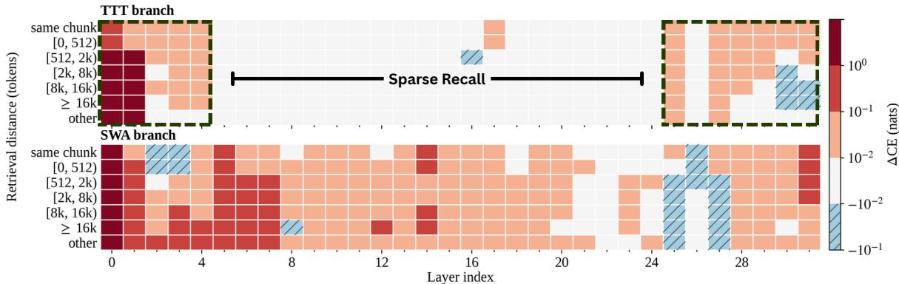  
Figure 2. Layer-wise contribution of each branch to long-context retrieval. ∆CE (nats) on AR-32k when the TTT (top) or SWA (bottom) branch is removed at a single layer, broken down by the distance between a query and its target. Warm cells indicate degradation, that $\mathrm { i s } , \mathrm { a }$ larger increase in loss when the branch is removed. The TTT branch contributes almost nothing across the interior layers $( \ell \in \{ 2 , \ldots , 2 7 \} )$ but dominates at the boundary layers $( \ell \in \{ 0 , 1 , 2 8 , \ldots , 3 1 \} )$ ), whereas SWA contributes broadly at every depth. The color scale is symmetric-log with a linear region below 0.01, and both panels share one scale.

Table 1. Ablation of the test-time-training (TTT) module on long-context performance. Disabling the TTT update in the anchor layers $( \ell \in \{ 0 , 1 , 2 8 , 2 9 , 3 0 , 3 1 \} )$ ) raises out-of-domain perplexity on WikiText by 48×, while disabling it in the interior layers $( \ell \in \{ 2 , \ldots , 2 7 \} )$ leaves perplexity unchanged and shrinks the persistent state by 5.3×. SWA remains active in all layers.
<table><tr><td>Configuration</td><td>PPL↓</td><td>State (MB) ↓</td></tr><tr><td>Llama-3.1-8B (baseline)</td><td>7.36</td><td>一</td></tr><tr><td>Non-unified state</td><td>10.19</td><td>201.3</td></tr><tr><td>− Anchor TTT</td><td>487.56</td><td>163.6</td></tr><tr><td>– Interior TTT</td><td>10.01</td><td>37.7</td></tr></table>

$$
{ \mathcal { L } } _ { \mathrm { A T } } = \lambda { \mathcal { L } } _ { \mathrm { M S E } } + w _ { \mathrm { L M } } { \mathcal { L } } _ { \mathrm { C E } } ,\tag{1}
$$

where $\begin{array} { r } { \mathcal { L } _ { \mathrm { M S E } } = \frac { 1 } { N } \sum _ { \ell = 1 } ^ { L } \frac { 1 } { B T d } \sum _ { b , t } \Bigl | \Bigl | \mathbf { o } _ { b , t } ^ { ( \ell ) } - \mathrm { s g } \left[ \mathbf { a } _ { b , t } ^ { ( \ell ) } \right] \Bigr | \Bigr | _ { 2 } ^ { 2 } } \end{array}$ pulls the output $\mathbf { o } _ { b , t } ^ { ( \ell ) }$ of each hybrid layer toward the softmaxattention output $\mathbf { a } _ { b , t } ^ { ( \ell ) }$ of the frozen teacher at the same layer and position, and $\begin{array} { r } { \mathcal { L } _ { \mathrm { C E } } ~ { = } ~ - \frac { 1 } { B ( T - 1 ) } \sum _ { b , t } \log p _ { \theta } \bigl ( x _ { b , t + 1 } } \end{array}$ | $x _ { b , \leq t } )$ is the next-token cross-entropy over $t = 1 , \dots , T - 1$ Here ${ \mathrm { i } } B , T , d ,$ and N denote the batch size, sequence length, head dimension, and number of layers, respectively; sg[·] is the stop-gradient operator, which confines gradients to the student branch; and λ and $w _ { \mathrm { L M } }$ control the trade-off between per-layer output matching and next-token prediction. Supervising attention transfer with $\mathcal { L } _ { \mathrm { C E } }$ stabilizes Stage 1 and yields an effective initialization of the TTT parameters. Stage 2 then applies LoRA finetuning on a long-context corpus (PG-19) whose sequences exceed the TTT chunk size and therefore engage the inner loop, providing a costefficient adaptation of the TTT module that supports incontext memorization. Together, the two stages recover a linearized model whose performance is close to that of the softmax-attention baseline (Table 1).

(a) LMSE only  
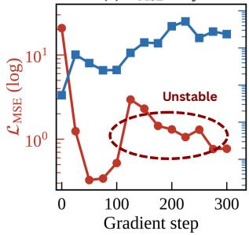

(b) $\mathcal { L } _ { \mathrm { M S E } } + \mathcal { L } _ { \mathrm { C E } }$  
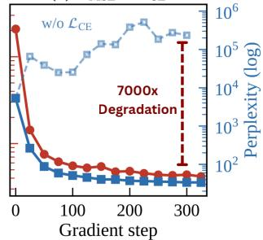  
Figure 3. Improved Attention Transfer in Stage-1 Linearization. Held-out attention-transfer loss $\mathcal { L } _ { \mathrm { M S E } }$ (left) and perplexity (right) during Stage 1. (a) Training on $\mathcal { L } _ { \mathrm { M S E } }$ alone matches the teacher’s attention outputs closely, reducing the loss by over 25×, yet perplexity rises from 5.3K to 236K: the student reproduces each layer’s output while losing the ability to model language. (b) Adding next-token supervision $\mathcal { L } _ { \mathrm { C E } }$ resolves this, lowering both losses together and reaching a perplexity of 34, which provides a stable initialization for the TTT parameters.

Anchor-Effect in Test-Time Training Branch. To understand what the TTT module actually does in the hybrid architecture, we run a layer-wise ablation on the Associative

Recall (AR) benchmark (Arora et al., 2024). At a single layer ℓ we remove one branch, either TTT or SWA, and measure how much the cross-entropy rises relative to the unablated model. We report this separately for each range of distances between a query and its target:

$$
\Delta \mathrm { C E } _ { k } ^ { ( \ell ) } = \frac { 1 } { \vert \mathcal { V } _ { \mathbf { k } } \vert } \sum _ { i \in \mathcal { V } _ { k } } \Big [ \bar { \ell } _ { k } ^ { ( i ) } ( \pmb { \theta } \setminus \pmb { \ell } ) - \bar { \ell } _ { k } ^ { ( i ) } ( \pmb { \theta } ) \Big ] ,\tag{2}
$$

where $\nu _ { k }$ is the set of evaluation examples whose retrieval distance falls in bucket $k ,$ and $\theta \backslash$ ℓ denotes the parameters with the branch at layer ℓ removed. A large $\Delta \mathrm { C E } _ { k } ^ { ( \ell ) }$ means that the removed branch was carrying retrieval information at that depth and distance which no other component supplies. Measured this way, the two branches behave very differently (Figure 2). SWA contributes at every depth and across all retrieval distances. TTT does not: its contribution is concentrated in a small set of boundary layers and is negligible everywhere in between $( \ell \in \{ 2 , \ldots , 2 7 \} )$ ). We call this concentration the anchor effect and the layers that show it anchor layers, and Table 1 confirms that these few layers carry the load. Disabling the TTT update in the anchor layers raises out-of-domain perplexity on WikiText from 10.19 to 487.56, a factor of 48, whereas disabling it in all 26 interior layers leaves perplexity where it was (10.01) and shrinks the persistent state from 201.3 MB to 37.7 MB, a factor of 5.3. The interior TTT state is therefore not just redundant: it can be dropped at no cost in quality, and it accounts for most of the model’s state budget.

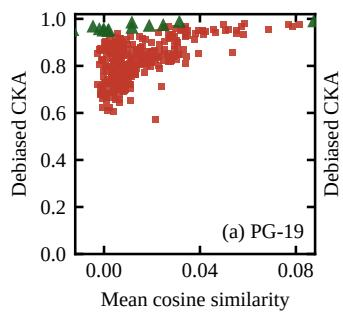

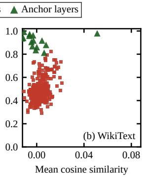  
Figure 4. Representational similarity of TTT states on (a) PG-19 and (b) WikiText. Each point is one layer pair, plotted as debiased CKA against mean cosine similarity on cross-window targets, that is, those whose source lies beyond the local window. Interior pairs $( \equiv , \ell \in \{ 2 , \ldots , 2 7 \} )$ ) are drawn separately from anchor pairs (▲, $\ell \in \{ 0 , 1 , 2 8 , \ldots , 3 1 \} )$ ). Anchor pairs are more strongly aligned than interior pairs on both corpora (0.97 versus 0.82 on PG-19, 0.92 versus 0.49 on WikiText). High CKA with near-zero cosine indicates closely related information encoded in different bases.

Shared Long-term Memory Across Layers. Since retrieval concentrates in the anchor layers, we next ask whether these layers store distinct information or largely the same. We compare the TTT states of every pair of layers on targets whose source lies beyond the local window, using two complementary measures: debiased centered kernel alignment (CKA) (Kornblith et al., 2019), which is invariant to rotations and isotropic scaling and thus detects shared information regardless of the coordinate frame, and mean cosine similarity, which compares representations coordinate by coordinate and is high only when two layers share the same frame. The two measures disagree sharply (Figure 4). CKA between anchor layers (▲) approaches unity on both corpora, exceeds that of interior layers ( ), lies far above a shuffled-label baseline, and remains high out of domain, yet the cosine similarity of the same pairs stays close to zero. Layers therefore encode closely related information in layer-specificframes. This has two consequences: keeping a separate state in every layer is largely redundant, yet the states cannot simply be reused, since a reader would interpret the shared content in the wrong frame. A single shared state can thus serve several layers only if each reader applies its own transformation, motivating the learned read maps introduced below (Appendix C).

## 3.2 Anchor: Cross-Layer Recurrent State

We present our method, ANCHOR, a cross-layer Test-Time Training (TTT)-based memory module that extends the receptive field of Sliding Window Attention (SWA) for longercontext inference through targeted adaptation. The method is built on two observations: 1) long-context retrieval is reinforced mainly by the early and later TTT modules in the hybrid attention (SWA & TTT), and 2) there is a representational relation between the TTT states across layers, with a higher concentration in the early and later modules. Based on these motivating observations, we design a cross-layer TTT module that can be shared by multiple Sliding Window Attentions (SWA). Each cross-layer module has a single writer and multiple readers, where every reader applies its own basis matrix as a read-map, and it can be defined as,

$$
o _ { \ell } = \chi _ { \ell } \big ( f _ { W ^ { ( c ) } } \big ( \hat { \mathbf { q } } _ { \ell } \big ) \big ) ,\tag{3}
$$

where $\hat { \mathbf { q } } _ { \ell }$ is the query at layer $\ell , \ f _ { W ^ { ( c ) } }$ is the shared memory with state $\mathbf { W } ^ { ( \mathbf { c } ) }$ which reads a context chunk $c ,$ and $\chi _ { \ell } ( \cdot )$ is a learnable read-map for the multiple readers across layers, which operate on a single state update mechanism. The layer that performs the state update carries a reader initialized with the identity matrix $( \chi = \mathbf { I } )$ since the reader in that layer shares the same basis as the writer and the state update rule can be defined as, $\mathbf { W } ^ { ( \mathbf { c } ) } \ = \ \mathbf { W } ^ { ( \mathbf { c } - \mathbf { 1 } ) } \ - \ \eta \Big ( \nabla _ { W } \mathcal { L } \big ( \mathbf { W } ^ { ( \mathbf { c } - \mathbf { 1 } ) } ; \hat { \mathbf { k } } _ { \mathbf { c } - \mathbf { 1 } } , \hat { \mathbf { v } } _ { \mathbf { c } - \mathbf { 1 } } \big ) \Big )$ Where the state update mechanism models the attentional bias through the objective function $( \mathcal { L } \big ( \mathbf { W } ^ { ( \mathbf { c } ) } ; \hat { \mathbf { k } } _ { \mathbf { c } } , \hat { \mathbf { v } } _ { \mathbf { c } } \big ) )$ in which the association within the KV-binding expresses as $\begin{array} { r l r } { { \mathcal L } ( { \bf W } ; \hat { { \bf k } } , \hat { \bf v } ) } & { = } & { \frac { 1 } { 2 } \left\| \int _ { { \cal W } } ( \hat { { \bf k } } ) - \hat { { \bf v } } \right\| _ { 2 } ^ { 2 } . } \end{array}$ which is an euclidean norm of estimating value $( f _ { W } ( { \hat { \mathbf { k } } } ) )$ and actual value (ˆv) at the instance of given chunk $c .$ Evaluating the hybrid across context lengths, we find that ANCHOR substantially improves in-context retrieval once the relevant content falls outside the window, whereas in the short-context regime, where SWA alone suffices, the cross-layer state adds a small amount of noise. Its contribution should therefore depend on whether the input requires memory beyond the window. We introduce a learned, input-dependent gate on the readout of the cross-layer recurrent state:

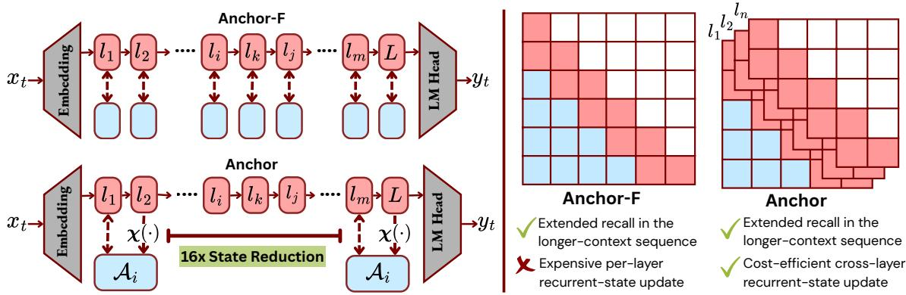  
Figure 5. Anchor architecture and recurrent-state coverage. Left: Anchor-F maintains a private recurrent state in every layer, while Anchor keeps one shared state per anchor group and removes the interior states entirely, reducing recurrent state by 16× (201.0 → 12.6 MB at 32k context). Each reader accesses the shared state through its own learned read map χ(·). Right: coverage over query (rows) and key (columns) positions. Green marks the local sliding window, red the span served by the recurrent state. Anchor-F requires one such state per layer; Anchor serves layers $l _ { 1 } , \ldots , L$ from a single shared state.

$$
\mathbf { O } _ { t } = \mathbf { O } _ { t } ^ { \mathrm { S W A } } + \gamma _ { t } \odot \mathbf { O } _ { t } ^ { \mathrm { T T T } } ,\tag{4}
$$

where $\gamma _ { t , h } = \sigma ( \mathbf { w } _ { h } ^ { \top } \mathbf { x } _ { t } + b _ { h } ) \in ( 0 , 1 )$ for head $h ,$ with learnable $\mathbf { w } _ { h } \in \mathbb { R } ^ { d _ { \mathrm { m o d e l } } }$ and $b _ { h } \in \mathbb { R } .$ , is broadcast across the head’s value dimension. $\mathbf { A s } \gamma _ { t , h } \to 0$ the layer reduces to sliding-window attention, and larger values admit more of the long-range readout while SWA retains the local context. The gate costs one vector–matrix product per token and leaves the cost ofthe hybrid layer essentially unchanged.

Efficient Deployment Configuration. The interior TTT branch is dispensable at inference, but not during fine-tuning. Training without it from the outset causes the loss to oscillate rather than converge smoothly, whereas the same configuration with the interior branch retained trains stably under identical settings. A plausible explanation lies in how the gradient reaches the shared anchor states. With the interior branch present, each interior layer contributes its own readout gradient. Once it is removed, the entire long-range signal must instead flow through the anchor groups, so a shared state $W _ { g } ^ { ( c ) }$ accumulates $\textstyle \sum _ { \ell \in g } \partial { \mathcal { L } } / \partial o _ { \ell }$ from every reader in its group $^ { g , }$ its effective step size grows with $| g |$ , and the number of independent states falls from $L { = } 3 2 ~ { \mathrm { t o } } ~ | { \mathcal { A } } | { = } 2$ We therefore adopt a deployment-aware configuration: the interior branch is retained throughout Stage-1 and Stage-2 fine-tuning, where it stabilizes optimization and yields a smooth attention transfer, and is discarded once the model is deployed. The recurrent state shrinks by roughly 16× between the training and deployment configurations. The interior memory is therefore a plug-in component: present when training needs $i t ,$ absent when it only costs state.

## 4 EXPERIMENTS

In this section we describe the experimental setup used to validate ANCHOR on language modeling and recallintensive tasks. We assess quality on downstream commonsense and recall benchmarks, and efficiency along three axes: the reduction in recurrent state, end-to-end latency across a range of sequence lengths, and the FLOPs required for the state update in the TTT branch. Together, these show that ANCHOR preserves recall quality while reducing both the memory and the compute cost of the recurrent state.

## 4.1 Experimental Setup

Implementation Details. We build our implementation on Liger (Lan et al., 2025) and LoLCATs (Zhang et al., 2025), and initialize the TTT module from the reference implementation of LaCT (Zhang et al., 2026). All finetuning runs on a single NVIDIA GH200 Grace Hopper with 96 GB of VRAM. The TTT module uses a base window of 512, a chunk size of 512, and 32 heads, with an $L _ { 2 }$ inner objective, momentum with Muon orthogonalization, and a sigmoid output gate whose bias is initialized $\mathrm { t o \ - 3 . 0 . }$ Following the two-stage LoLCATs recipe, we train attention transfer for 500 steps at a learning rate $\mathbf { \bar { \rho } } _ { \mathrm { o f 2 } \times 1 0 ^ { - 4 } }$ , then finetune autoregressively for 400 steps at $1 \times 1 0 ^ { - 4 }$ with rank-8 LoRA on the query, key, and value projections. Both stages use AdamW with gradient clipping at 1.0 and an effective batch size of 8, accumulated from microbatches of size 1. Training maintains 28 shared memories, of which 2 are retained at deployment and additional system configurations are discussed in appendix B.

Table 2. Zero-shot downstream reasoning and recall performance. Accuracy of the fine-tuned ANCHOR variants on six common-sense reasoning benchmarks (LAMBADA, PIQA, HellaSwag, WinoGrande, ARC-e, ARC-c) and three recall-intensive benchmarks (SWDE, FDA, SQuAD), compared against the softmax-attention baseline. ANCHOR-F gives every sliding window its own TTT module; ANCHOR-I shares one TTT module across the initial and final layers while the interior layers keep separate modules; ANCHOR shares one module across the anchor layers and removes the interior modules entirely. (k/s) - K Token/sec; measured at N = 8K and B = 19.
<table><tr><td></td><td></td><td>State</td><td>Tput</td><td colspan="7">Commonsense</td><td colspan="4">Recall</td></tr><tr><td>Model</td><td>Config</td><td>(MB)↓</td><td>(k/s)↑</td><td>LMB.</td><td>PIQA</td><td>Hella.</td><td>Wino.</td><td>ARC-e</td><td>ARC-c</td><td>Avg.</td><td>SWDE</td><td>FDA</td><td>SQuAD</td><td>Avg.</td></tr><tr><td rowspan="6">LLaMA</td><td>Baseline</td><td></td><td>1.73</td><td>75.28</td><td>81.12</td><td>79.04</td><td>73.64</td><td>81.52</td><td>53.50</td><td>74.02</td><td>91.81</td><td>81.03</td><td>53.82</td><td>75.55</td></tr><tr><td>SWA</td><td></td><td>8.32</td><td>75.00</td><td>80.47</td><td>78.45</td><td>73.09</td><td>81.10</td><td>52.73</td><td>73.47</td><td>27.72</td><td>12.43</td><td>48.66</td><td>29.60</td></tr><tr><td>LoLCATs</td><td>129.0</td><td>3.18</td><td>69.09</td><td>81.61</td><td>78.56</td><td>73.95</td><td>82.87</td><td>55.20</td><td>73.55</td><td>18.99</td><td>1.72</td><td>32.57</td><td>17.76</td></tr><tr><td>ANCHOR-F</td><td>201.0</td><td>3.41</td><td>74.21</td><td>80.36</td><td>76.63</td><td>72.69</td><td>80.56</td><td>49.40</td><td>72.31</td><td>50.50</td><td>18.60</td><td>60.46</td><td>43.19</td></tr><tr><td>ANCHOR-I</td><td>176.0</td><td>3.66</td><td>73.04</td><td>79.16</td><td>77.37</td><td>72.69</td><td>79.59</td><td>47.44</td><td>71.55</td><td>48.51</td><td>19.24</td><td>54.02</td><td>40.59</td></tr><tr><td>ANCHOR</td><td>12.6</td><td>7.25</td><td>72.27</td><td>78.35</td><td>76.49</td><td>73.88</td><td>79.17</td><td>47.27</td><td>71.24</td><td>49.86</td><td>24.32</td><td>50.50</td><td>41.56</td></tr><tr><td rowspan="6">Mistral</td><td>Baseline</td><td></td><td>1.65</td><td>75.61</td><td>80.58</td><td>81.10</td><td>73.56</td><td>80.89</td><td>50.34</td><td>73.68</td><td>89.83</td><td>71.42</td><td>51.41</td><td>70.88</td></tr><tr><td>SWA</td><td></td><td>8.44</td><td>75.98</td><td>80.79</td><td>81.33</td><td>75.37</td><td>80.01</td><td>47.87</td><td>73.56</td><td>33.57</td><td>12.34</td><td>53.85</td><td>33.25</td></tr><tr><td>LoLCATs</td><td>129.0</td><td>3.05</td><td>69.80</td><td>81.61</td><td>80.35</td><td>74.03</td><td>82.11</td><td>53.07</td><td>73.50</td><td>11.07</td><td>0.09</td><td>23.32</td><td>11.49</td></tr><tr><td>ANCHOR-F</td><td>201.0</td><td>3.26</td><td>74.73</td><td>80.85</td><td>80.73</td><td>72.93</td><td>79.59</td><td>48.81</td><td>72.94</td><td>48.15</td><td>15.06</td><td>52.92</td><td>38.71</td></tr><tr><td>ANCHOR-I</td><td>176.0</td><td>3.52</td><td>73.88</td><td>80.30</td><td>80.06</td><td>73.64</td><td>79.17</td><td>47.78</td><td>72.47</td><td>45.54</td><td>13.88</td><td>51.07</td><td>36.83</td></tr><tr><td>ANCHOR</td><td>12.6</td><td>7.15</td><td>74.60</td><td>80.69</td><td>80.69</td><td>73.09</td><td>78.70</td><td>47.78</td><td>72.59</td><td>44.82</td><td>12.25</td><td>49.53</td><td>35.53</td></tr></table>

Table 3. Study on End-to-end latency (ms) of ANCHOR variants compared with the softmax-attention baselines (Llama and Mistral) across sequence lengths with the batch-size (B) of 19. ANCHOR reduces end-to-end latency by up to 4.3× relative to the baseline at 8K, and still runs at 16K, where both baselines exhaust memory (OOM) : Out-Of-Memory.
<table><tr><td rowspan="2">Model</td><td rowspan="2">Config.</td><td colspan="4">E2E Latency Over Seq. Length (ms)</td></tr><tr><td>2K</td><td>4K</td><td>8K</td><td>16K</td></tr><tr><td rowspan="4">LLaMa</td><td>Baseline</td><td>29164</td><td>51049</td><td>95387</td><td>00M</td></tr><tr><td>ANCHOR-F</td><td>38028</td><td>40719</td><td>48471</td><td>56516</td></tr><tr><td>ANCHOR-I</td><td>38770</td><td>38333</td><td>45219</td><td>53775</td></tr><tr><td>ANCHOR</td><td>19050</td><td>20854</td><td>22816</td><td>27915</td></tr><tr><td rowspan="4">Mistral</td><td>Baseline</td><td>28872</td><td>53100</td><td>100300</td><td>00M</td></tr><tr><td>ANCHOR-F</td><td>42465</td><td>46782</td><td>50600</td><td>57700</td></tr><tr><td>ANCHOR-I</td><td>42318</td><td>42000</td><td>46700</td><td>54300</td></tr><tr><td>ANCHOR</td><td>20498</td><td>20200</td><td>23300</td><td>28600</td></tr></table>

Models & Datasets. We evaluate ANCHOR on two openweight models, Llama-3.1-8B and Mistral-7B. Three architectures are compared: ANCHOR-F, in which every sliding window has its own, non-shared TTT module; ANCHOR-I, which uses cross-layer TTT modules at the anchor layers while retaining the interior TTT modules; and ANCHOR, which uses cross-layer TTT modules at the anchor layers and removes the interior modules entirely. Each is finetuned on the Long-Alpaca dataset (Chen et al., 2023) for 500 steps in Stage 1 and 400 steps in Stage 2, and the resulting checkpoints are used to evaluate language modeling and recall. For the empirical analysis, we additionally fine-tune ANCHOR on PG-19 and use it to study long-context retrieval through associative recall and layer-wise representational similarity across TTT modules on PG-19 and WikiText.

## 4.2 Results and Discussion

We evaluate the ANCHOR-series of models against the baseline architectures along three axes: language modeling (Section 4.2.1), inference efficiency, and long-context sequence modeling (Section 4.2.2). Additionally, We study how architectural and training choices affect performance, and what they imply for redesigning the architecture to extend the performance–efficiency trade-off along with generalization.

## 4.2.1 Efficient Language Modeling

Efficient Common-sense reasoning. We first establish the cost of linearization on general language modeling before evaluating long-context retrieval. We compare the AN-CHOR series against the softmax-attention baselines (Llama and Mistral), their sliding-window variants, and LoLCATs linearization on six common-sense benchmarks covering sentence completion, which is illustrated in Table 2, physical and social reasoning, and science question answering. The sliding-window configurations provide the reference point: a 512-token window alone remains within one point of full attention on both models, indicating that the inputs in these benchmarks largely fall within the window and that the long-term memory is only weakly exercised. These benchmarks are therefore informative about whether linearization degrades general language modeling, rather than about memory design. We observe no such degradation. All ANCHOR configurations remain within three points of their respective baselines, and the differences among the variants are sufficiently small that none is uniformly best across models, so accuracy alone does not distinguish them. They differ instead in cost: ANCHOR attains comparable accuracy with 12.6 MB of recurrent state, 16× less than ANCHOR-F and 10× less than LoLCATs.

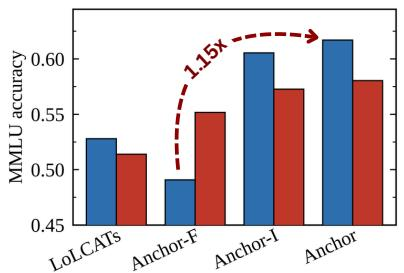

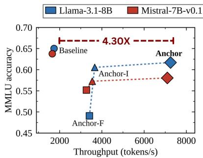

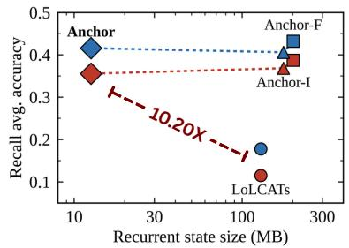  
Figure 6. Study on Performance–efficiency trade-off. ANCHOR evaluated on reasoning (MMLU) and recall (SWDE, FDA, SQuAD) benchmarks, together with end-to-end throughput and recurrent state size. (a) Reasoning accuracy of the ANCHOR series against LoLCATs; targeted placement of the cross-layer recurrent state improves reasoning. (b) Throughput (tokens/s) against reasoning accuracy; ANCHOR attains 4.3× higher throughput than the baseline at comparable accuracy. (c) Recall accuracy against recurrent state size; ANCHOR improves recall over LoLCATs by 2.3–3.1× while using a 10.2× smaller state.

Improved Recall Design. We next evaluate long-context retrieval on recall benchmarks following (Arora et al., 2025), reported in Table 2. On Llama, ANCHOR more than doubles the average recall of LoLCATs while using 10× less recurrent state. The margin is largest on the tasks whose targets lie furthest outside the local window: on SWDE and FDA, LoLCATs scores below two points, against 49.9 and 24.3 for ANCHOR. A 512-token sliding window carrying no persistent state outperforms LoLCATs, indicating that capacity alone does not recover long-context recall; the determining factor is how the state is written and read. ANCHOR then comes within two points of ANCHOR-F while replacing the per-layer states of all 32 layers with a single shared state per anchor group, a 16× reduction, and the same ordering holds on Mistral. A gap to softmax attention remains, so anchor placement improves linearized recall without fully recovering it. We further observe that the recall gap between linearized hybrids and either the quadratic baseline or a hybrid pretrained from scratch persists regardless of long-context fine-tuning, which may be a consequence ofthe supervised fine-tuning used in stage-2 (Zhou et al., 2026). To separate the architecture from the linearization procedure, we train it from scratch on the MAD synthetic tasks (Poli et al., 2024), where ANCHOR-I matches or exceeds the Transformer (93.5 versus 90.9; Table 4), notably on fuzzy recall, suggesting that the recall gap arises from linearization rather than the architecture (Appendix D).

Table 4. Mechanistic architecture design (MAD) synthetic tasks. Accuracy (%) of each architecture trained from scratch on the MAD suite. ANCHOR-I attains the highest average and the largest gain on fuzzy recall.
<table><tr><td>Model</td><td>IC &amp; Noisy</td><td>Fuzzy</td><td>Mem.</td><td> $\mathbf { \Pi } _ { \mathbf { C 0 p y } } ^ { \mathbf { S e l . } }$ </td><td>Comp.</td><td>Avg.</td></tr><tr><td rowspan="3">Transformer 3 : 1-Hybrid</td><td>98.7</td><td>55.7</td><td>100.0</td><td>99.9</td><td>100.0</td><td>90.9</td></tr><tr><td>96.8</td><td>37.7</td><td>99.9</td><td>86.4</td><td>100.0</td><td>84.1</td></tr><tr><td></td><td>58.0</td><td>100.0</td><td>99.9</td><td>100.0</td><td>91.6</td></tr><tr><td>ANCHOR-F ANCHOR-I</td><td>100.0 100.0</td><td>67.9</td><td>100.0</td><td>99.9</td><td>100.0</td><td>93.5</td></tr></table>

Pareto-Optimal Architecture. Across all configurations, the ANCHOR series sustains a favourable efficiency– performance trade-off relative to both the quadratic baselines and prior linearized architectures. ANCHOR is the lightest architecture evaluated yet attains the highest MMLU score among the linearized variants, retaining 91–95% of baseline accuracy and surpassing LoLCATs by 1.13–1.17× consistently across backbones (Figure 6(a)). On throughput, ANCHOR-F ( , ) and ANCHOR-I (▲, ▲) already exceed the Llama 3-8B (•) and Mistral-7B (•) baselines at a context length of 8K, and the deployment configuration ANCHOR (♦, ♦) decodes 4.30× faster than the baselines (Figure 6(b)). On the recall benchmarks, ANCHOR maintains higher accuracy than LoLCATs with a 10.2× smaller recurrent state (Figure 6(c)). ANCHOR therefore lies on the Pareto frontier, preserving broad knowledge and recall at afraction of the decoding cost and state size, which establishes anchor placement as a practical basis for scaling linearized models.

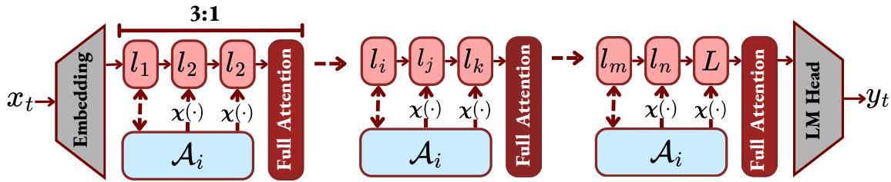  
Figure 7. Hybrid architecture of ANCHOR and full self-attention. ANCHOR and full self-attention layers are interleaved at a 3:1 ratio, so that softmax attention accounts for 25% of all layers. Within each group, the three ANCHOR layers retain their own sliding-window attention for local context but share a single recurrent state for long-range context: the leading layer writes the state, and each layer reads it through its own learned read map $\chi _ { \ell } ( \cdot )$ . The subsequent full self-attention layer attends over the entire sequence, providing exact retrieval at regular depth intervals, while the recurrent state per group remains constant in sequence length.

E2E Accumulated Latency. We further measure wallclock end-to-end latency (prefill plus decode) for the baselines (Llama-3.1-8B, Mistral-7B-v0.1) and the ANCHOR series in a batched serving setting on a single NVIDIA GH200 with 95.1 GiB of usable device memory. Each request comprises one prefill of N prompt tokens followed by 512 cached decode steps under greedy decoding with no EOS early exit. Prefill and decode are timed separately with device synchronization around each phase, and the reported latency includes the TTT inner-loop state update and the read-map overhead. We use a batch size of 19, the largest the softmax baseline sustains at 8K, to approximate concurrent multi-user requests, and vary the sequence length from 2K to 16K. All models run in BF16; each configuration is preceded by two excluded warm-up iterations, and we report the mean over 10 runs. As shown in Table 3, ANCHOR attains the lowest end-to-end latency among all architectures, a ≈4.3× reduction relative to the baselines, and the series sustains low latency as the context length grows without exceeding the baselines’ memory footprint.

## 4.2.2 Long-Context Sequence Modeling

Linearization Recipe. The recall gap between the linearized architecture and both the quadratic baseline and the pretrained hybrid motivates a linearization recipe tailored for long-context inference (Appendix D). We linearize the backbone by attention transfer (Stage 1) on LongAlpaca-12k (Chen et al., 2023), augmented with 4,000 unpacked short rows from alpaca-cleaned (Taori et al., 2023), at a maximum context length of 8192. We then fine-tune autoregressively (Stage 2) on a mixture of 80% ReactiveAI passkeyretrieval data and 20% synthetic needle-in-a-haystack data generated at 4K and 8K lengths.

Long-context retrieval Benchmark. We further evaluate a 3:1 hybrid configuration (Figure 7) in which every three ANCHOR layers are followed by one vanilla softmax attention layer, so that softmax attention accounts for 25% of all layers. This interleaving follows Kimi-Linear (Team et al.,

Table 5. Evaluation on Long-Context Retrieval (RULER). We evaluate ANCHOR-hybrid on RULER at sequence lengths from 4K to 16K tokens and compare it with the LLaMA-3-8B teacher and Lizard, a prior hybrid long-context linearization method.
<table><tr><td>Model</td><td>Attn. (%)</td><td>4K</td><td>8K</td><td>16K</td></tr><tr><td>LLaMA-3-8B (teacher)</td><td>100</td><td>92.3</td><td>90.5</td><td>85.7</td></tr><tr><td>Lizard (hybrid)</td><td>50</td><td>92.5</td><td>91.2</td><td>85.2</td></tr><tr><td>ANCHOR-Hybrid</td><td>25</td><td>98.3</td><td>97.3</td><td>82.9</td></tr></table>

2025) and is intended to narrow the gap between the linearized model and its pretrained teacher without reintroducing the full quadratic cost. We evaluate on RULER (Hsieh et al., 2024) at sequence lengths from 4K to 16K against the LLaMA-3-8B teacher (100% softmax attention) and Lizard (Nguyen et al., 2026) (50%), as reported in Table 5. At 4K and 8K, ANCHOR attains the highest accuracy of the three configurations while using the least softmax attention, exceeding the teacher by 6.0 and 6.8 points, respectively. At 16K the ordering reverses: accuracy falls to 82.9, below both the teacher (85.7) and Lizard (85.2). All three models degrade as the context grows, but the decline is steeper for ANCHOR (15.4 points, against 6.6 for the teacher and 7.3 for Lizard), indicating that the fine-tuning is introducing some level of bias towards attention along the near diagonal, which potentially limits the retrieval at the longer context.

## 4.2.3 Architectural Analysis and Discussion

Analysis of the Learned Read-Map. Our empirical analysis shows that the memory of previously generated tokens encoded in the TTT modules is similar across layers, but expressed in layer-specific bases (Figure 4). This naturally occurring similarity, together with the mismatch in basis, motivates ANCHOR, a cross-layer recurrent state that allows several short-term attention branches to share a single long-term memory. Within such a state, one designated layer updates the memory at every generated token, and the remaining layers read from it through a learned read-map χℓ(·). We expected these maps to learn the layer-specific rotations required to express the shared memory in each reader’s own basis. Each read-map is implemented as a linear projection whose dimensions match the per-head readout dimension, and is trained in both stages under the outer-loop objective. The projections are initialized to the identity, so that every reader begins from the representation written by the writer layer and departs from it only as far as the objective requires. The learned maps behave as anticipated, and their rotation proves to be concentrated in a small number of planes rather than spread across the readout dimension: at L31, the five largest planes account for 82% of the squared rotation angle for Llama-3.1-8B and 92% for Mistral-7B, against 26% for a random rotation of the same total magnitude, and the same concentration holds across all 128 heads of the four reader layers in both backbones (Figure 8). The read-maps are therefore effectively low-rank: a shared state can serve many layers through a correction that acts on only a few directions. A formal treatment of the layerspecific read-map, together with the statistical evidence for this behavior, is given in Appendix C.

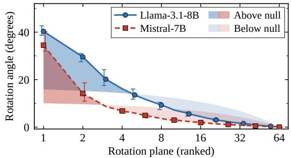  
Figure 8. The learned reader rotation is concentrated in a few planes. Rotation angles of Q’s planes, ranked (log scale), at L31; median over 32 heads, whiskers show the IQR. Shaded bands span from the learned profile to a random rotation with equal total squared angle (dark: learned above null; light: below). The learned map exceeds the null only in the leading planes (up to plane 5 for Llama-3.1-8B and plane 3 for Mistral-7B), and its top 5 planes carry 82% and 92% of the squared rotation versus 26% for the null.This holds in all 128 reader-layer heads of both backbones.

Generalizing the Cross-Layer Recurrent State. Having introduced a cross-layer recurrent state for the SWA–TTT hybrid, we ask: can the same cross-layer design extend to other hybrid attention architectures? As a first step, we repeat the similarity analysis of Section 3.1 on LoLCATs, which pairs a short sliding window with linear attention, and measure the representational similarity of its recurrent states on both the corpus (PG-19 & WikiText). The same phenomenon emerges on both. Recurrent states at different layers carry closely related information, with mean debiased CKA of 0.79 on PG-19 and 0.85 on WikiText, and 93–

100% of layer pairs exceeding 0.5, far above a shuffledlabel floor below 0.004. Yet their mean cosine similarity stays near zero (0.04 on both corpora), indicating that this shared information is encoded in different bases, as in our hybrid on the same inputs (mean CKA 0.36 and 0.40, mean cosine 0.02; Figure 9). That the pattern holds across three linearization methods suggests that cross-layer redundancy is a general property of linearized recurrent states rather than an artifact ofour architecture, and that a shared state read through per-layer maps can extend to other hybrids.

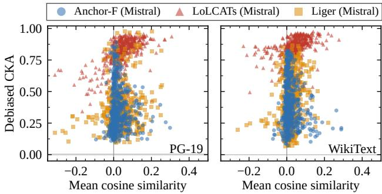  
Figure 9. Cross-layer similarity generalizes across linearization methods. Debiased CKA against mean cosine similarity for every pair of layers, on the recurrent-state readouts of our TTT hybrid (Anchor-F), LoLCATs, and Liger on Mistral-7B over identical PG-19 and WikiText inputs. In all three models, layers share information while their cosine similarity remains small, indicating that this information is encoded in different bases.

## 5 CONCLUSION

We propose ANCHOR, a cross-layer recurrent state for efficient long-context recall. A layer-wise ablation of the SWA–TTT hybrid shows that recall through the TTT modules concentrates in a few anchor layers while the interior layers can be removed, which we term the anchor effect. Because states at different layers encode closely related information in different coordinate frames, ANCHOR keeps a single state written by one layer and read by many through learned, identity-initialized read maps. Across Llama-3.1- 8B and Mistral-7B, it retains 91–95% of baseline MMLU, improves recall over LoLCATs by 2.3–3.1×, reduces the recurrent state by 16×, and lowers end-to-end latency by up to 4.3×, while running at 16K tokens where softmax baselines exhaust memory. The same structure emerges in LoLCATs, suggesting a general property of linearized recurrent states; position-aware state updates may further improve retrieval at the longest contexts.

## 6 ACKNOWLEDGMENT

This work used DeltaAI at the National Center for Supercomputing Applications (NCSA) through allocation

CIS260333 from the Advanced Cyberinfrastructure Coordination Ecosystem: Services & Support (ACCESS) program, which is supported by U.S. National Science Foundation grants #2138259, #2138286, #2138307, #2137603, and #2138296.

## REFERENCES

Arora, S., Eyuboglu, S., Timalsina, A., Johnson, I., Poli, M., Zou, J., Rudra, A., and Re, C. Zoology: Measuring and improving recall in efficient language models. In The Twelfth International Conference on Learning Representations, 2024.

Arora, S., Eyuboglu, S., Zhang, M., Timalsina, A., Alberti, S., Zinsley, D., Zou, J., Rudra, A., and Re, C. Sim-´ ple linear attention language models balance the recallthroughput tradeoff, 2025. URL https://arxiv. org/abs/2402.18668.

Behrouz, A., Zhong, P., and Mirrokni, V. Titans: Learning to memorize at test time. In The Thirty-ninth Annual Conference on Neural Information Processing Systems, 2025.

Behrouz, A., Li, Z., Kacham, P., Daliri, M., Deng, Y., Zhong, P., Razaviyayn, M., and Mirrokni, V. ATLAS: Learning to optimally memorize the context at test time. In Forty-third International Conference on Machine Learning, 2026.

Beltagy, I., Peters, M. E., and Cohan, A. Longformer: The long-document transformer, 2020. URL https: //arxiv.org/abs/2004.05150.

Chen, B., Dao, T., Winsor, E., Song, Z., Rudra, A., and Re,´ C. Scatterbrain: Unifying sparse and low-rank attention. In Beygelzimer, A., Dauphin, Y., Liang, P., and Vaughan, J. W. (eds.), Advances in Neural Information Processing Systems, 2021. URL https://openreview.net/ forum?id=SehIKudiIo1.

Chen, Y., Yu, S., Qian, S., Tang, H., Lai, X., Liu, Z., Han, S., and Jia, J. Long alpaca: Long-context instruction-following models. https://github. com/dvlab-research/LongLoRA, 2023.

Chen, Y., Thai, Z. L., Zhou, Z., Zhang, Z., Shen, X., Wang, S., Xiao, C., Han, X., and Liu, Z. Hybrid linear attention done right: Efficient distillation and effective architectures for extremely long contexts, 2026. URL https://arxiv.org/abs/2601.22156.

Child, R., Gray, S., Radford, A., and Sutskever, I. Generating long sequences with sparse transformers, 2019. URL https://arxiv.org/abs/1904.10509.

Dong, H., Yang, X., Zhang, Z., Wang, Z., Chi, Y., and Chen, B. Get more with less: synthesizing recurrence with kv cache compression for efficient llm inference. In Proceedings ofthe 41st International Conference on Machine Learning, ICML’24. JMLR.org, 2024.

Du, J., Hu, J., Zhang, T., Sun, W., and Cheng, Y. Native

hybrid attention for efficient sequence modeling, 2026. URL https://arxiv.org/abs/2510.07019.

Hatamizadeh, A., Choi, Y., and Kautz, J. Gated deltanet-2: Decoupling erase and write in linear attention, 2026. URL https://arxiv.org/abs/2605.22791.

Hsieh, C.-P., Sun, S., Kriman, S., Acharya, S., Rekesh, D., Jia, F., Zhang, Y., and Ginsburg, B. Ruler: What’s the real context size of your long-context language models?, 2024. URL https://arxiv.org/abs/2404.06654.

Katharopoulos, A., Vyas, A., Pappas, N., and Fleuret, F. Transformers are rnns: Fast autoregressive transformers with linear attention, 2020. URL https://arxiv. org/abs/2006.16236.

Kornblith, S., Norouzi, M., Lee, H., and Hinton, G. Similarity of neural network representations revisited. In International conference on machine learning, pp. 3519– 3529. PMlR, 2019.

Lan, D., Sun, W., Hu, J., Du, J., and Cheng, Y. Liger: Linearizing large language models to gated recurrent structures. In Forty-second International Conference on Machine Learning, 2025. URL https://openreview. net/forum?id=1PfZs0xC2v.

Liu, J., Elflein, S., Litany, O., Gojcic, Z., and Li, R. Testtime training with KV binding is secretly linear attention. In Forty-third International Conference on Machine Learning, 2026. URL https://openreview.net/ forum?id=MpBeXMurIb.

Nguyen, C. V., Nguyen, H. H., Zhang, R., Deilamsalehy, H., Mathur, P., Lai, V. D., Wang, H., Subramanian, J., Rossi, R. A., Bui, T., Vlassis, N., Dernoncourt, F., and Nguyen, T. H. Lizard: An efficient linearization framework for large language models. In Proceedings ofthe 64th Annual Meeting of the Association for Computational Linguistics (Volume 1: Long Papers), pp. 34935–34948. Association for Computational Linguistics, 2026. doi: 10.18653/ v1/2026.acl-long.1613. URL http://dx.doi.org/ 10.18653/v1/2026.acl-long.1613.

NVIDIA, :, Blakeman, A., Thomas, A., Jhunjhunwala, A., Gupta, A., Khattar, A., Rajfer, A., Renduchintala, A., Asif, A., Vavre, A., Miranda, A. F., Bilal, A., Zaman, A., Hotchandani, A., Shukla, A., Bercovich, A., Ficek, A., Gronskiy, A., Kondratenko, A., Steiner, A., Ye, A., Bukharin, A., Milesi, A., Taghibakhshi, A., Gatti, A., Liu, A., Kumar, A., Phanishayee, A., Mahabaleshwarkar, A. S., Klein, A., Zuker, A., Geifman, A., Bhiwandiwalla, A., Subramaniam, A., Santilli, A., Fulks, A., McHarg, A., Tao, A., Skliar, A., Agrusa, A., Srivastava, A., Verma, A., Shors, A., Warno, A., Llaquet, A.-J. S. I., Mehta, A., Nowaczynski, A., Jain, A., Aithal, A., Poojary, A.,

Ahamed, A., Mishra, A., Thekkumpate, A. K., Sohrabizadeh, A., Kaur, A., Vem, A., Dattagupta, A., Anandan, B. S., Sadeghi, B., Lanir, B., Schifferer, B., Nushi, B., Kartal, B., Thiede, B., Rouhani, B. D., Deng, B., Schatz, B., Ginsburg, B., Wang, B., Nemire, B., Norick, B., Dang, B., Westphal, B., Yu, B., Khailany, B., Catanzaro, B., del Mundo, C., Aarish, C., Lee, C., Hwang, C., Sakr, C., Wang, C., Truong, C., Cui, C., Cheng, C., Hsieh, C.-P., Zhang, C., Deng, C., Patel, C., Alexiuk, C., Cosgrove, C., Munley, C., Harvey, C., Parisien, C., Shen, C., Li, C., Neale, C., Gao, C., Meurillon, C., Gil, D., Su, D., Zhao, D., Corneil, D., Afrimi, D., Egert, D., Korzekwa, D., Lo, D., Machlab, D., Serebrenik, D., Sorokin, D., Gitman, D., Levy, D., Stosic, D., Mosallanezhad, D., Yu, D., Karamyan, D., Donia, D., Debroy, D., Narayanan, D., O’Kelly, D., Peri, D., Nathawani, D., Di, Wu, Rekesh, D., Kakwani, D., Plummer, D., Anh, D., Yu, D., Jiang, D., Kim, D., Poorkay, D., Riach, D., Stosic, D., VanStee, D., Meng, E., Minasyan, E., Lin, E., Long, E. M. P., Sarafin, E., Segal, E., Lantz, E., Evans, E., Ning, E., Chung, E., Harper, E., Pham-Hung, E., Tramel, E., Yang, E., Galinkin, E., Pounds, E., Goncalves, E. G., Briones, E., Wu, E., Bakhturina, E., Tsykunov, E., Dobrowolska, E., Ladhak, F., Memarian, F., Wang, F., Jia, F., Soares, F., Frujeri, F. V., Chen, F., Lin, F., Galko, F., Sun, F., Siino, F., Hou, F., Agam, G. H., Kaplun, G., Bhatt, G., Prasad, G., Kulshreshtha, G., Armstrong, G., Shen, G., Borghesi, G., Neskovic, G., Batmaz, G., Lam, G., Mason, G., Pauloski, G., Nalbandyan, G., Chlebus, G., Karch, G., Liu, G.-T., Zhang, G., Huang, G., Maron, H., Qian, H., Elisha, H., Ren, H., Kumar, H. K. S., Hud, H., Nover, H., Hall, H. S., Iso, H., Ngo, H., Hum, H., Sahota, H., Wang, H., Soni, H., Tamoyan, H., Li, H., Chen, H., Li, H., Wang, H., Nguyen, H., Chiles, I., Galil, I., Shahaf, I., Gitman, I., Shovkun, I., Loshchilov, I., Guehring, I., Schen, I., Levy, I., Neeman, I., Moshkov, I., Golan, I., Putterman, I., Choi, J., Slowikowski, J., Kautz, J., Scowcroft, J. P., Casper, J., Mitra, J., Glick, J., Chen, J., Oliver, J., Xu, J., Zhu, J., Song, J., Zhang, J., Jiao, J., Zeng, J., Lou, J., King, J., Zhang, J., Wang, J., Choi, J., Chu, J., Conway, J., Guman, J., Jatko, J., Rausch, J., Kamalu, J., Roberts, J., Greco, J., Mensel, J., Alben, J., Yang, J., Cohen, J., Raiman, J., Jennings, J., Mabry, J., Pierce, J., Daw, J., Vialard, J. V., Yi, J., Parmar, J., Jain, K., Zhu, K., Briski, K., Cheung, K., Luna, K., Willowhawk, K., Wyss, K., Santhanam, K., Shih, K., Kong, K., Nguyen, K., Bhardwaj, K., Sivamani, K. S., Krommydas, K., Puvvada, K. C., Pawelec, K., Anik, K., Keprios, K., Day, K., McAfee, L., Du, L., Derczynski, L., Ding, L., Liu, L., Wu, L., Kadoch, L., Wei, L., Vega, L., Robison, L., Su, L., Segbroeck, M. V., Mikulski, M. J., de Melo, M. R., Sypula, M., Fathi, M., Sreedhar, M. N., Chandran, M. T., Kilaru, M., Ashkenazi, M., Cuevas, M., Romeijn, M., Chochowski, M., Cai, M., Mozolewski, M., Kliegl, M., Stepniewska-Dziubinska, M., Patelka, M.,

Machczynski, M., Novikov, M., Ferrato, M., Golub, M., Samadi, M., Corpuz, M., Wang, M., Wu, M., Price, M., Boubdir, M., Schaffer, M., Andersch, M., Boone, M., Gschwind, M., Lightstone, M., Loh, M., Bien, M., Zawal ski, M., Gill, M., Martinez, M., Khona, M., Chrzanowski, M., Houston, M., Ma, M., Lee, M., Fawzy, M., Dabbah, M., Shoeybi, M., Patwary, M., Mulepati, N., Nabwani, N., Dhameja, N., Hennouni, N., Hereth, N., Pinckney, N., Algarici, N., Assaf, N., Haber, N., Knight, N., Rea maroon, N., Quak, N., Bhatia, N., Desai, N., Ludwig, N., Tajbakhsh, N., Xu, N., Ailon, N., Juluru, N., Nitin, N., Masad, O., Rybakov, O., Hrinchuk, O., Kuchaiev, O., Viessmann, O., Delalleau, O., Olabiyi, O., Argov, O. U., Puny, O., Tropp, O., Ribalta, P., Bhattacharya, P., Lampropoulos, P., Mannan, P., Shamis, P., Legresley, P., Gibbons, P., Molchanov, P., Morkisz, P., Dykas, P., Jin, P., Aquilanti, P.-Y., Xu, P., Januszewski, P., Laskiewicz, P., Jannaty, P., Gurumurthy, P., Thombre, P. P., Varshney, P., Gundecha, P., Tredak, P., Meng, P., Wan, Q., Mahabadi, R. K., Oberman, R., Garg, R., Sri-Tharan, R., Kandu, R., Sanadhya, R., El-Yaniv, R., Zilberstein, R., Shafipour, R., Macalisang, R., Tian, R., Kovacs, R., Pi, R., Izzo, R., Shahbazyan, R., Garg, R., Puri, R., Neves, R. F., Zhao, R., Borkar, R., Gala, R., Islam, R., Clark, R., Hesse, R., Kirby, R., Waleffe, R., Watve, R., Koren, R., Banner, R., Zhang, R., Hewett, R. J., Prenger, R., Stewart, R., Egashira, R., Mahdavi, S., Paliwal, S., Singh, S., Modi, S., Dave, S., Shinagawa, S., Kriman, S., Bhaskar, S., Lym, S., Kariyappa, S., Satheesh, S., Murari, S. V., Pasumarthi, S., Mishra, S., Muralidharan, S., Hara, S., Narentharen, S., Anandaraj, S., Na, S., Bak, S., Bak, S., Sameni, S., Mard, S., Panev, S., Henneman, S., Poulos, S., Mor, S., Acharya, S., Ghosh, S., Sreenivas, S. T., Mendelson, S., Kotek, S., Wang, S., Aharon, S., Gharghabi, S., Lin, S.-C., Chen, S., Fan, S., Baskaran, S., Gopa, S., Prabhumoye, S., Pachori, S., Toshniwal, S., Ding, S., Krishnamurthy, S., Singh, S., Sun, S., Das, S., Thottakara, S. A., Ithape, S., Majumdar, S., Singhal, S., Singudasu, S. H., Bhu vanapalli, S., Veccham, S., Sergienko, S., Alborghetti, S., Ge, S., Rong, S., Devare, S. D., Rao, S., Barua, S. K., Ha, S., Gai, S., Gunasekar, S., Panguluri, S., Gupta, S., Hinzburh, S., Priyadarshi, S., Akter, S. N., Abramovich, T., Bui, T., Varshney, T., Ter-Hovhannisyan, T., Ene, T.- D., Kong, T., Do, T., Zhang, T., Moore, T., Blankevoort, T., Moon, T., Mitra, T., Balough, T., Grzegorzek, T., Hli wiak, T., Asida, T., Natan, T. B., Keren, T., Ronen, T., Salim, T., Wang, T., Rebedea, T., Konuk, T., Vashishth, T., Karpas, U., De, U., Noorozi, V., Srinivasan, V., Elango, V., Agrawal, V., Cui, V., Korthikanti, V., Mehta, V., Rao, V., Wu, V., Kurin, V., Lavrukhin, V., Anisimov, V., Pham, V., Jiang, W., Ahmad, W. U., Ishihara, W., Du, W., Ping, W., Chai, W., Dai, W., Helmholz, W., Jennings, W., Zhu, W., Prazuch, W., Ren, X., Yu, X., Breek, Y., Chen, Y., Yu, Y., Chen, Y., Galron, Y., Karnati, Y., Choi, Y., Meyer,

Y., Wu, Y.-F., Zhang, Y., Lin, Y., Geifman, Y., Fu, Y., Kwon, Y., Yao, Y., Guvvala, Y., Huang, Y., Liu, Y., Moshe, Z., Newell, Z., Wang, Z., Li, Z., Zhu, Z., Yang, Z., Liu, Z., Yan, Z., and Wertheimer, Z.-A. Nemotron 3 ultra: Open, efficient mixture-of-experts hybrid mambatransformer model for agentic reasoning, 2026. URL https://arxiv.org/abs/2606.15007.

Poli, M., Thomas, A. W., Nguyen, E., Ponnusamy, P., Deiseroth, B., Kersting, K., Suzuki, T., Hie, B., Ermon, S., Re, C., Zhang, C., and Massaroli, S. Mechanistic de-´ sign and scaling of hybrid architectures, 2024. URL https://arxiv.org/abs/2403.17844.

Sun, Y., Li, X., Dalal, K., Hsu, C., Koyejo, S., Guestrin, C., Wang, X., Hashimoto, T., and Chen, X. Learning to (learn at test time), 2024. URL https://openreview. net/forum?id=l7n59aufeT.

Sun, Y., Li, X., Dalal, K., Xu, J., Vikram, A., Zhang, G., Dubois, Y., Chen, X., Wang, X., Koyejo, S., Hashimoto, T., and Guestrin, C. Learning to (learn at test time): RNNs with expressive hidden states, 2025. URL https: //openreview.net/forum?id=eifW0W0xgt.

Tandon, A., Dalal, K., Li, X., Koceja, D., Rød, M., Buchanan, S., Wang, X., Leskovec, J., Koyejo, S., Hashimoto, T., Guestrin, C., McCaleb, J., Choi, Y., and Sun, Y. End-to-end test-time training for long context. CoRR, abs/2512.23675, December 2025. URL https: //doi.org/10.48550/arXiv.2512.23675.

Taori, R., Gulrajani, I., Zhang, T., Dubois, Y., Li, X., Guestrin, C., Liang, P., and Hashimoto, T. B. Stanford alpaca: An instruction-following llama model. https://github.com/tatsu-lab/ stanford\_alpaca, 2023.

Team, K., Zhang, Y., Lin, Z., Yao, X., Hu, J., Meng, F., Liu, C., Men, X., Yang, S., Li, Z., Li, W., Lu, E., Liu, W., Chen, Y., Xu, W., Yu, L., Wang, Y., Fan, Y., Zhong, L., Yuan, E., Zhang, D., Zhang, Y., Liu, T. Y., Wang, H., Fang, S., He, W., Liu, S., Li, Y., Su, J., Qiu, J., Pang, B., Yan, J., Jiang, Z., Huang, W., Yin, B., You, J., Wei, C., Wang, Z., Hong, C., Chen, Y., Chen, G., Wang, Y., Zheng, H., Wang, F., Liu, Y., Dong, M., Zhang, Z., Pan, S., Wu, W., Wu, Y., Guan, L., Tao, J., Fu, G., Xu, X., Wang, Y., Lai, G., Wu, Y., Zhou, X., Yang, Z., and Du, Y. Kimi linear: An expressive, efficient attention architecture, 2025. URL https://arxiv.org/abs/2510.26692.

Vaswani, A., Shazeer, N., Parmar, N., Uszkoreit, J., Jones, L., Gomez, A. N., Kaiser, Ł., and Polosukhin, I. Attention is all you need. Advances in neural information processing systems, 30, 2017.

von Oswald, J., Scherrer, N., Kobayashi, S., Versari, L., Yang, S., Schlegel, M., Maile, K., Schimpf, Y., Sieberling, O., Meulemans, A., Lajoie, G., Saurous, R. A., Frenkel, C., Pascanu, R., y Arcas, B. A., and Sacramento, J. Mesanet: Sequence modeling by locally optimal testtime training. In The Fourteenth International Conference on Learning Representations, 2026. URL https: //openreview.net/forum?id=xa3OnTb6c3.

William, V., Tandon, R., and Dass, J. Glide: Guided layerwise hybrid attention for efficient llm inference. arXiv preprint arXiv:2607.24788, 2026.

Yang, S., Wang, B., Shen, Y., Panda, R., and Kim, Y. Gated linear attention transformers with hardware-efficient training. arXiv preprint arXiv:2312.06635, 2023.

Yang, S., Kautz, J., and Hatamizadeh, A. Gated delta networks: Improving mamba2 with delta rule. In International Conference on Learning Representations, volume 2025, pp. 29687–29707, 2025.

Zhang, M., Arora, S., Chalamala, R., Spector, B. F., Wu, A., Ramesh, K., Singhal, A., and Re, C. LoLCATs: On low-rank linearizing of large language models. In The Thirteenth International Conference on Learning Representations, 2025.

Zhang, T., Bi, S., Hong, Y., Zhang, K., Luan, F., Yang, S., Sunkavalli, K., Freeman, W. T., and Tan, H. Test-time training done right. In The Fourteenth International Conference on Learning Representations, 2026. URL https://openreview.net/forum? id=Tb9qAxT3xv.

Zhou, X., Zhu, B., Xu, Y., Li, Z., Chen, Y., Wang, H., and Guo, Z. Attention amnesia in hybrid llms: When cot fine-tuning breaks long-range recall, and how to fix it. arXiv preprint arXiv:2606.11052, 2026.

## AI USAGE DISCLOSURE

We used a state-of-the-art large language model (Claude, Anthropic) as a programming assistant to integrate open-source packages, to support the implementation of the proposed architecture, and to write scripts for the planned experiments. We also used the LLM to edit the manuscript for clarity and presentation, including rephrasing text and preparing figure layouts and styling. All architectural design decisions, experimental design, and scientific conclusions are the authors’ own. No reported data, results, or figure contents were generated by AI; every number and plot in the paper is derived from our own experiments. The authors take full responsibility for the content of this paper.

Table 6. Training Configuration of ANCHOR-F Architecture. we trained the architecture separately for motivational study and main study with different dataset to understand to architecture behavior in different corpus and to maintain the fairness with other baselines. Context Length = 8192 and Window Size = 512.
<table><tr><td colspan="2">Stage 1 Stage 2</td></tr><tr><td colspan="2">Motivational Study</td></tr><tr><td>Dataset</td><td>emozilla/pg19</td></tr><tr><td>Train / Val docs</td><td>200 / 20 200 / 20</td></tr><tr><td>Learning Rate (LR)  $2 \times 1 0 ^ { - 4 }$ </td><td> $1 \times 1 0 ^ { - 4 }$ </td></tr><tr><td>Max steps</td><td>400 200</td></tr><tr><td>Eval every 25</td><td>25</td></tr><tr><td>Objective  $\mathbf { M S E + C E }$ </td><td>CE</td></tr><tr><td colspan="2">Main Experiments</td></tr><tr><td>Dataset</td><td>Yukang/LongAlpaca-12k</td></tr><tr><td>Train / Val docs</td><td> $1 2 , 0 0 0 / 1 0 0$  12,000 / 100</td></tr><tr><td>Learning Rate (LR)</td><td> $2 \times 1 0 ^ { - 4 }$   $1 \times 1 0 ^ { - 4 }$ </td></tr><tr><td>Max steps</td><td>500 400</td></tr><tr><td>Eval every 25</td><td>100</td></tr><tr><td>Objective  $\mathbf { M S E + C E }$ </td><td>CE</td></tr></table>

## A PRELIMINARIES

Self-Attention. For an input hidden state ${ \bf x } _ { i } ,$ the query, key, and value are obtained as linear projections $\hat { \mathbf { q } } _ { i } ~ =$ $\mathbf { W } _ { Q } ^ { \top } \mathbf { x } _ { i } , \hat { \mathbf { k } } _ { i } = \mathbf { W } _ { K } ^ { \top } \mathbf { x } _ { i } ,$ , and $\hat { \mathbf { v } } _ { i } = \mathbf { W } _ { V } ^ { \top } \mathbf { x } _ { i }$ . The attention weights (Vaswani et al., 2017) $\alpha _ { i }$ form a distribution over the current query and all preceding tokens,

$$
\alpha _ { i j } = \frac { \exp \left( \hat { \mathbf { q } } _ { i } ^ { \top } \hat { \mathbf { k } } _ { j } / \sqrt { d _ { k } } \right) } { \sum _ { j ^ { \prime } = 0 } ^ { i } \exp \left( \hat { \mathbf { q } } _ { i } ^ { \top } \hat { \mathbf { k } } _ { j ^ { \prime } } / \sqrt { d _ { k } } \right) } ,\tag{5}
$$

and the layer output is formed by aggregating the values under these weights and projecting the result, $\mathbf { o } _ { i } \ =$ $\textstyle \big ( \sum _ { j \leq i } \alpha _ { i j } \hat { \mathbf { v } } _ { j } \big ) \mathbf { W } _ { O }$ . Because the exponential similarity admits no finite-dimensional factorization, the sum over j cannot be accumulated into a fixed-size state: every $( \hat { \mathbf { k } } _ { j } , \hat { \mathbf { v } } _ { j } )$ pair must be retained, which is the origin of the KV cache and of its linear growth with context.

Sliding Window Attention. Windowed attention (Beltagy et al., 2020) bounds the number of tokens retained in the KV cache by restricting each query to the W most recent positions, so that

$$
\alpha _ { i j } = \frac { \exp \left( \hat { \mathbf { q } } _ { i } ^ { \top } \hat { \mathbf { k } } _ { j } / \sqrt { d _ { k } } \right) } { \sum _ { j ^ { \prime } = i - W + 1 } ^ { i } \exp \left( \hat { \mathbf { q } } _ { i } ^ { \top } \hat { \mathbf { k } } _ { j ^ { \prime } } / \sqrt { d _ { k } } \right) } ,\tag{6}
$$

and $\alpha _ { i j } = 0$ otherwise. The cache therefore holds at most W key–value pairs per layer, and the per-token retrieval cost

becomes independent of the sequence length and with the significant performance degradation in longer-context.

Linear Attention. Self-attention can be linearized by replacing the softmax with a separable kernel feature map ϕ. The resulting linear attention (Katharopoulos et al., 2020) is

$$
\mathbf { o } _ { i } = \frac { \sum _ { j = 0 } ^ { i } \phi ( \hat { \mathbf { q } } _ { i } ) \phi ( \hat { \mathbf { k } } _ { j } ) ^ { \top } \hat { \mathbf { v } } _ { j } } { \sum _ { j = 0 } ^ { i } \phi ( \hat { \mathbf { q } } _ { i } ) \phi ( \hat { \mathbf { k } } _ { j } ) ^ { \top } } .\tag{7}
$$

By the associativity of matrix multiplication, the sums over j can be factored out of the query, giving $\begin{array} { r l } { \mathbf { o } _ { i } } & { { } = } \end{array}$ $\phi ( \hat { \mathbf { q } } _ { i } ) \mathbf { S } _ { i } / \phi ( \hat { \mathbf { q } } _ { i } ) \mathbf { Z } _ { i } .$ , where $\begin{array} { r c l } { \mathbf { S } _ { i } } & { = } & { \bar { \sum } _ { i = 0 } ^ { i } \bar { \phi ( \mathbf { k } _ { j } ) } ^ { \top } \hat { \mathbf { v } } _ { j } \quad \in } \end{array}$ $\mathbb { R } ^ { d _ { k } \times d _ { v } }$ is the recurrent state and $\begin{array} { r } { \mathbf { Z } _ { i } = \sum _ { j = 0 } ^ { i } \phi ( \hat { \mathbf { k } } _ { j } ) ^ { \top } \in \quad } \end{array}$ $\mathbb { R } ^ { d _ { k } }$ is the normalization factor. Both accumulate incrementally and are independent of sequence length, so the per-token cost no longer grows with context. Expressiveness then depends on the choice of $\phi ,$ and recall on the capacity of the state (Arora et al., 2025).

## B EXPERIMENTAL SETUP & DEFINITIONS

We introduces ANCHOR-series of linearized LLM architectures with the various level of efficiency-performance trade-offs. The Architectural definition and their training configurations can be illustrated as,

ANCHOR-Full (or) ANCHOR-F. ANCHOR-F is a linearized architecture that combines Sliding Window Attention (SWA) with a Test-Time Training (TTT) module to form a hybrid attention, in which each SWA layer maintains its own TTT module for long-context recall. This configuration is used throughout the motivational experiments, both for the layer-wise study of recall and for the analysis of cross-layer similarity between recurrent states. Table 6 reports its training configuration. In both the motivational study and the main experiments we use AdamW with a weight decay of 0.01 and BF16 precision.

ANCHOR-I and ANCHOR. Motivated by the cross-layer similarity and the sparsity of recall across TTT layers, we introduce ANCHOR-I, a training-specific configuration in which layers with high representational similarity are replaced by a shared recurrent state while the interior TTT layers are retained. The interior layers are kept only during training, where they prevent the gradient instability observed when ANCHOR is trained without them. ANCHOR-I uses the same training configuration as the main experiments in Table 6. ANCHOR is then the lightweight runtime configuration, in which the interior TTT layers are removed for efficient inference.

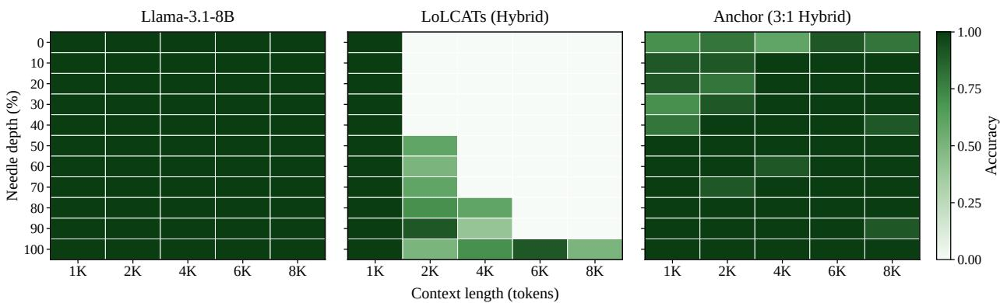  
Figure 10. Needle-in-a-haystack retrieval. Accuracy across context lengths (1K–8K) and needle depths for Llama-3.1-8B, a LoLCATs hybrid (18.75% SoftMax Attention), and the ANCHOR 3:1 hybrid. ANCHOR reaches a mean accuracy of 0.95 (baseline 1.00), whereas the LoLCATs hybrid (18.75% SoftMax Attention) (0.33) retrieves reliably only at 1K or when the needle lies near the end of the context.

## C RECURRENT STATE WITH

## LAYER-SPECIFIC TRANSFORMATION

Approximating Linear Attention with Neural Networks. Following prior work (Liu et al., 2026), the long-term memory can be approximated by a neural network trained online on the association between keys and values, an objective termed the attentional bias. This yields a more expressive form of linear attention whose recurrent state $\mathbf { S } _ { i }$ is updated by a gradient step,

$$
\begin{array} { r } { \mathbf { S } _ { i } = \mathbf { S } _ { i - 1 } - \eta \nabla _ { \mathbf { S } } \mathcal { L } ( \mathbf { S } _ { i - 1 } ( \mathbf { k } _ { i } ) , \mathbf { v } _ { i } ) , } \end{array}\tag{8}
$$

where $\eta$ is the inner learning rate and $\begin{array} { r } { \mathcal { L } ( \hat { \mathbf { v } } , \mathbf { v } ) = \frac { 1 } { 2 } \| \hat { \mathbf { v } } - \mathbf { v } \| _ { 2 } ^ { 2 } ; } \end{array}$ the state is read as a function of the query, $\mathbf { o } _ { i } = \mathbf { S } _ { i } ( \mathbf { q } _ { i } )$ Motivated by the layer-specific transformations we observe across linearized layers (Section 3.1), we generalize the readout of layer ℓ to

$$
\mathbf { o } _ { i } ^ { ( \ell ) } = \chi _ { \ell } \Big ( \mathbf { S } _ { i } \big ( \mathbf { q } _ { i } ^ { ( \ell ) } \big ) \Big ) \in \mathbb { R } ^ { d } ,\tag{9}
$$

where $x _ { \ell }$ is a layer-specific read map, initialized to the identity $\dot { \mathbf { I } } \in \mathbb { R } ^ { d \times d }$ so that each layer initially reads its state exactly as written. By polar decomposition, any such map factors as $\begin{array} { r } { \pmb { \chi } _ { \ell } = \mathbf { U } _ { \ell } \mathbf { P } _ { \ell } . } \end{array}$ , where $\mathbf { U } _ { \ell }$ is orthogonal, a rotation of the basis, and $\mathbf { P } _ { \ell }$ is symmetric positive semi-definite, a stretch along its principal axes. To compare layers, note that each layer writes its state in its own basis, so the identity read map of a per-layer model is the identity relative to that layer: for two layers $\ell _ { m }$ and $\ell _ { n } , \mathbf { I } _ { \ell _ { m } }$ and $\mathbf { I } _ { \ell _ { n } }$ act in different coordinate frames. Expressed in a common frame, the two are related by a transformation

$$
\mathbf { T } _ { \ell _ { m }  \ell _ { n } } = \mathbf { U } _ { m n } \mathbf { P } _ { m n } \neq \mathbf { I } ,\tag{10}
$$

Hence, to recover a state written in the basis of layer $\ell _ { m } ,$ the read map of layer $\ell _ { n }$ must realize an anisotropic stretch $\mathbf { P } _ { m n }$ followed by a rotation $\mathbf { U } _ { m n }$ . The cross-layer analysis (Figure 4) supports $\mathbf { T } _ { \ell _ { m } \to \ell _ { n } } \neq$ I: states of different layers attain high debiased CKA, which is invariant to rotation, while their mean cosine similarity is near zero, i.e., the layers encode related information in different coordinates.

Cross-Layer Recurrent State with a Learnable Transformation. A practical cross-layer recurrent state $\mathcal { A } _ { i }$ , shared by several short-range attention layers, needs each reading layer to realize the transformation in Eq. $( 7 ) , 6 .  g . , \mathbf { U } _ { m n } \mathbf { P }$ mn for a state written by layer $\ell _ { m }$ and read by layer $\ell _ { n }$ . We parameterize this transformation as a learnable bias-free linear map. For a cross-layer state led by layer $\ell _ { m } ,$ the transformation for layer $\ell _ { n }$ is

$$
\chi _ { \boldsymbol \ell _ { n } } ( \mathbf { x } ) = \mathbf { M } _ { \boldsymbol \theta _ { n } } \mathbf { x } \mathrm { w i t h } \mathbf { M } _ { \boldsymbol \theta _ { n } } \to \mathbf { T } _ { \boldsymbol \ell _ { m } \to \boldsymbol \ell _ { n } } ,\tag{11}
$$

where $\mathbf { x } = \mathcal { A } _ { i } ( \mathbf { q } _ { i } ^ { ( \ell _ { n } ) } )$ is the raw readout of the shared state and $\mathbf { M } _ { \theta _ { n } } \in \mathbb { R } ^ { d \times d }$ is initialized to I; the writer layer $\ell _ { m }$ keeps $\chi _ { \ell _ { m } } = \mathbf { I } .$ . Since every square matrix admits a polar decomposition, a single bias-free linear map can represent both the anisotropic stretch $\mathbf { P } _ { m n }$ and the rotation $\mathbf { U } _ { m n } .$ Figures 11a and 11b visualize the learned read maps on both backbones. Their departure from the identity is low-rank: the rotation is concentrated in a few planes, with the top five carrying 82% (Llama) and 92% (Mistral) of the rotation.

## D LONG-CONTEXT CONFIGURATION

We construct a hybrid architecture that interleaves vanilla softmax (Chen et al., 2026; Du et al., 2026; NVIDIA et al., 2026) with the ANCHOR cross-layer recurrent state at a 3:1 ratio: every three ANCHOR layers, which share a single recurrent state, are followed by one softmax layer, so that softmax attention accounts for 25% of all layers (Figure 7). The design narrows the gap between the linearized model and its pretrained teacher through minimal interleaving, without reintroducing the full quadratic cost. This hybridization makes the model competitive on long-context retrieval, as shown in Figure 10 and Table 5.

On Pre-training Scale. To assess the ANCHOR series under from-scratch pretraining rather than distillation, we additionally evaluate it on the mechanistic architecture design (MAD) suite (Poli et al., 2024), reported in Table 4. AN-CHOR-I attains the highest average accuracy (93.5), ahead of both the Transformer (90.9) and ANCHOR-F (91.6). Memorization, compression, and selective copying saturate across variants, so the comparison is decided by the two harder tasks. Both ANCHOR configurations reach 100.0 on incontext recall with noise, against 98.7 for the Transformer, and fuzzy recall separates the architectures most clearly, with ANCHOR-I at 67.9 against 55.7. The plain 3:1 hybrid trails at 84.1 overall and falls to 37.7 on fuzzy recall, indicating that the gain comes from the cross-layer recurrent state rather than from interleaving alone. Taken together, these results suggest that the cross-layer state is not merely a cost-efficient substitute obtained through distillation, but a mechanism that improves associative retrieval when trained from scratch.

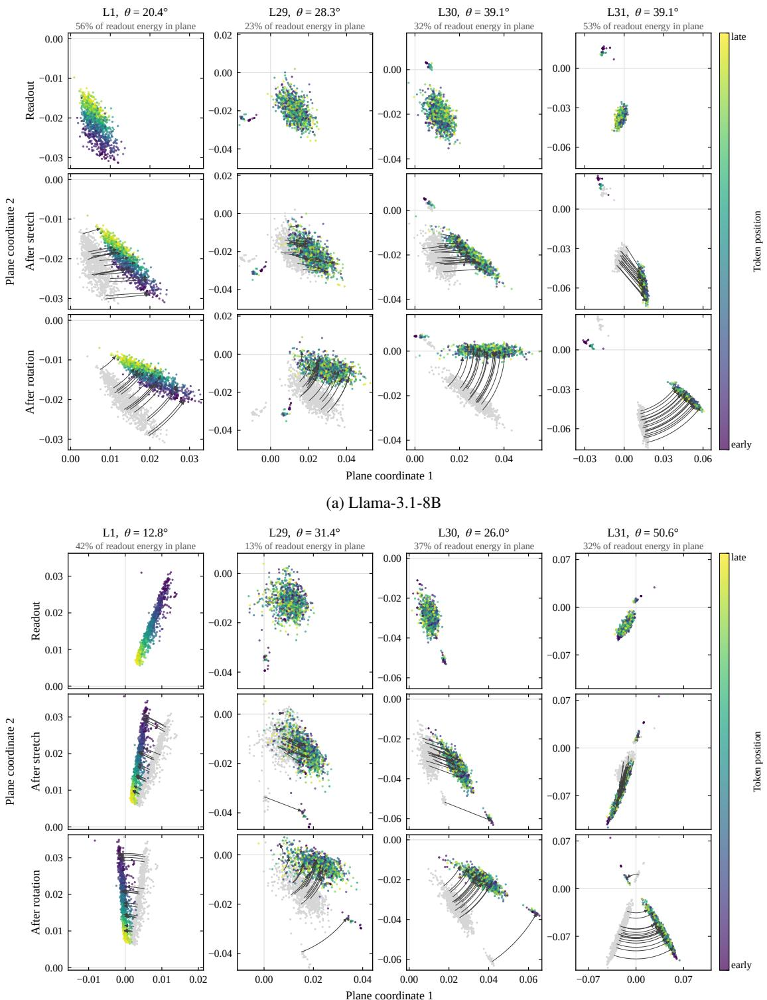  
(b) Mistral-7B-v0.1  
Figure 11. Geometry of the learned read maps. Each column is one reader layer, and the rows show the readout as it passes through the two stages of the read map $Q \colon$ a stretch followed by a rotation. Points are readout vectors projected onto the layer’s dominant rotation plane and coloured by position in the sequence; arcs trace the rotation step, which preserves the radius within the plane. Panel titles give the rotation angle θ in that plane and the share of readout energy it carries. Both backbones follow the same pattern, with the rotation concentrated in a few planes (Figure 8). Head 0 of 32; axes are scaled per layer.