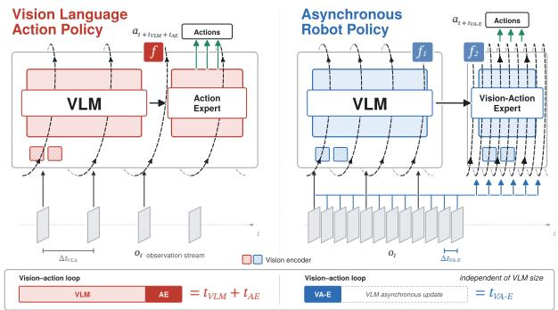
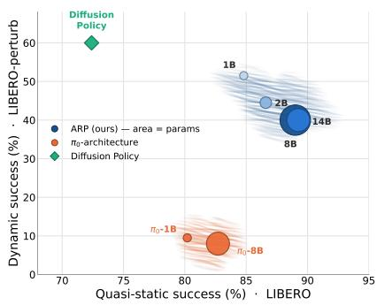
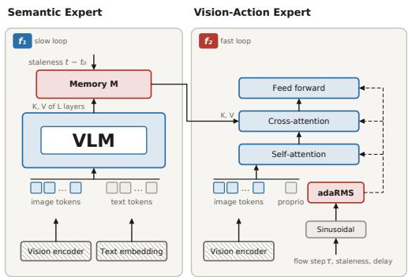
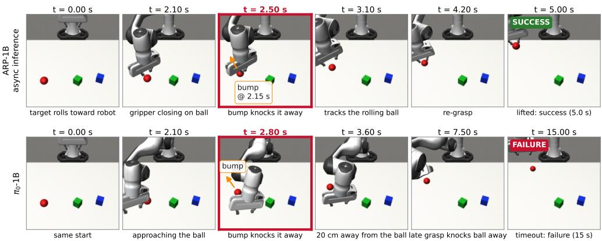
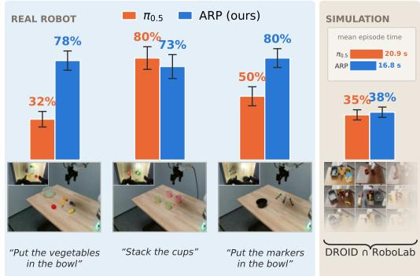
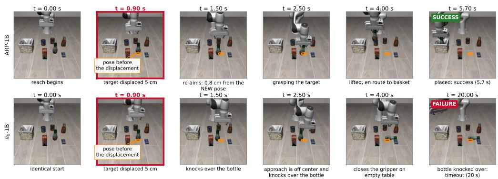
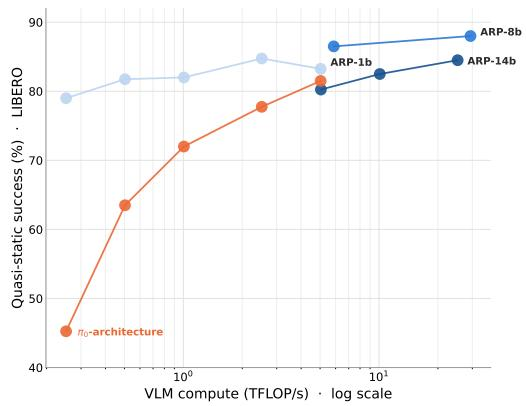
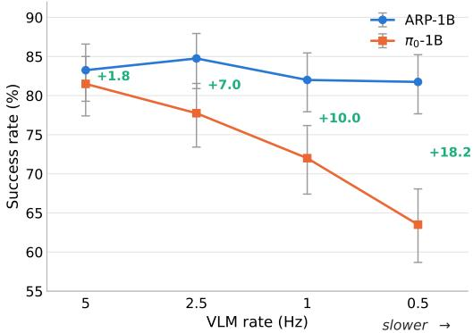

# ASYNCHRONOUS ROBOT POLICIES

Sombit Dey†, Luc Van Gool & Danda Pani Paudel INSAIT, Sofia Univeristy St. Kliment Ohridski {sombit.dey,luc.vangool,danda.paudel}@insait.ai

  
(a) Asynchronous Robot Policies

  
(b) Static vs. Dynamic Tasks  
Figure 1: a) Architectural and formulation differences between Asynchronous Robot Policies (ARP) and the standard Vision-Language-Action (VLA) paradigm. b) Performance comparison between ARP and standard VLAs across two key axes (both, higher the better): success rate and reactivity .

## ABSTRACT

Scaling vision-language foundation models has significantly advanced generalist robot manipulation, but the increased model scale introduces computational latency that degrades real-time physical reactivity. Existing Vision-Language-Action (VLA) architectures execute high-level semantic reasoning and action execution sequentially within the primary control loop, creating a fundamental tension between semantic-reasoning capability and robot agility. To address this, we propose Asynchronous Robot Policy (ARP), an architectural framework that decouples semantic reasoning from low-level action generation using asynchronous processes operating at independent frequencies. In ARP, a high-capacity Vision-Language Model (VLM) asynchronously updates a semantic memory at low frequency, while a lightweight Vision-Action Expert, conditioned on this semantic memory, generates robot actions at a much higher control frequency. Such a formulation, enables having a fast perception-action loop without compromising on the semantic capability. To overcome asynchronous memory staleness, ARP trains the vision-action expert on the semantic staleness and execution delay, with temporally mismatched observation across processes.

On Franka manipulation tasks, ARP achieves an 18% higher success rate and 20% less time need for execution in quasi-static setups, while 3-5× baseline performance in dynamic simulation environments. Furthermore, ARP enables operating the VLM at 10× lower than its nominal frequency with no significant performance loss making it much more efficient than the baseline. These results highlight the architectural advantages of modeling robot policies as asynchronous processes, enabling real-world reactive deployment without sacrificing the scale of foundation models. For code, checkpoints and more results, check out ARP Project.

## 1 INTRODUCTION

Scaling has become the dominant paradigm of modern artificial intelligence (Kaplan et al., 2020). However, scaling model size incurs a fundamental trade-off: increased capability at the cost of higher computational latency and degrading real-time responsiveness. While higher latency may be tolerable in static or text-based applications, it presents a critical failure mode in robotics. Physical robotics requires tight perception-action loops to handle real-time contact dynamics and sudden environmental shifts, such as grasping falling objects or absorbing unexpected bumps.

Existing Vision-Language-Action (VLA) (Brohan et al., 2022; Zitkovich et al., 2023) models fall victim to this bottleneck, creating a persistent tension between model capability, computational overhead, and closed-loop reactivity. Consequently, scaling the vision-language backbone improves high-level reasoning at the expense of motor agility, yielding a system that is semantically rich but physically lag-bound and depends on open-loop deployment. To resolve this friction, we propose Asynchronous Robot Policies (ARP). As illustrated in Fig. 1b, ARP breaks the reactivity-capability trade-off, enabling the seamless integration of significantly larger foundational models into robot pipelines without significantly compromising dynamic reactivity or real-time performance.

Existing generalist VLA policies execute the vision-language foundation model and the action expert sequentially within the primary control loop. Their latencies therefore add up, giving a total perception-to-action latency of $t _ { \mathrm { V L M } } + t _ { \mathrm { A E } }$ , as shown in Fig. 1(a). In contrast, ARP decouples VLM and action expert into asynchronous processes running at different frequencies. The VLM operates at a lower frequency $f _ { 1 }$ for high-level semantic reasoning, while a compact vision-action expert operates at a higher frequency $f _ { 2 } \gg f _ { 1 }$ . Under ARP, the effective perception-action loop latency is strictly reduced to the expert execution time $\left( { t _ { \mathrm { V A - E } } } \right)$ , so that control reactivity no longer grows linearly with the VLM scale. Importantly, this decoupling allows ARP to benefit from larger, more capable VLMs while maintaining reactivity, as shown in Fig. 1 (b).

Making robot policies asynchronous, however, introduces several new challenges. The fast action expert must continuously act on a compact semantic memory produced by a slower VLM, while the robot state evolves during both VLM and action expert inference. This creates two sources of mis match: the semantic memory may be stale relative to the current observation, and newly predicted actions may arrive after execution has already progressed. Performing the two loops asynchronously can therefore lead to outdated conditioning, delayed actions, and discontinuities across replanning cycles. ARP addresses these challenges by compressing rich VLM activations into fixed-width asynchronous memory, explicitly conditioning the action expert on semantic staleness and execution delay, and training with temporally mismatched memories and action-prefix conditioning to support smooth continuous replanning.

Asynchronous paradigms have been explored in prior work, mainly for cloud-to-edge VLA deployment, extending the action expert’s contextual history, or smoothing execution through asynchronous action chunking (Hirose et al., 2026; Hu et al., 2026; Tang et al., 2025; Black et al., 2025). However, these approaches still retain dependencies on the main model pipeline. To our knowledge, ARP is the first truly asynchronous robotic control framework, where one can vary the rate of two processes, featuring an autonomous Vision-Action Expert. This expert is capable of executing high-frequency reactive motor commands independently while continuously synthesizing semantic updates from the asynchronous VLM.

Evaluated on quasi-static Franka robot manipulation tasks, ARP achieves an 18% higher success rate while taking 20% less time than conventional VLA baselines. In dynamic environments, ARP achieves 3-5× the performance of the baseline, successfully handling target perturbations where synchronous policies fail. Furthermore, ARP reduces computational demand by running the VLM at 10× lower frequency with no significant loss in performance owing to the asynchronous nature of ARP. These results indicate that ARP offers a viable blueprint for bridging the gap between largescale semantic reasoning and agile physical control.

## 2 RELATED WORKS

## 2.1 GENERALIST ROBOT POLICIES

Inspired by the scaling laws and multi-modal pretraining paradigms established in Large Language Models (LLMs) (Touvron et al., 2023; Team et al., 2024; Alexandrov et al., 2024) and Vision-Language Models (VLMs) (Liu et al., 2024; Wang et al., 2024), VLA paradigm extend these generalist representations to robot control. Typically, VLAs adapt pretrained VLM backbones to map visual and natural language instructions directly to continuous or chunked robotic motor actions (Brohan et al., 2022; Kim et al., 2024; Black et al., 2024; Team et al., 2025; NVIDIA et al., 2025; Nikolov et al., 2025). Although VLA architectures represent the current state of the art in policy generalization, their real-world deployment is frequently bottlenecked by catastrophic forgetting during fine-tuning (Dey et al., 2024) as well as limitations in heterogeneous training data scale and diversity (Padalkar et al., 2023; Walke et al., 2023; Khazatsky et al., 2024). Another line of work relies on LLM and VLM driven program to ground the semantic reasoning in robotic primitives via code generation (Arenas et al., 2024), TAMP-based approach (Shen et al., 2026) or agentic-harnessstyle approaches (Chen et al., 2026b). A complementary research frontier leverages world-models (NVIDIA Cosmos Team, 2026) and video-generation models (Wan et al., 2025; NVIDIA, 2025) as alternative backbones in World-Action-Model(WAM). These paradigms learn predictive environmental representations by forecasting future states in pixel space (Hu et al., 2023), latent feature space (Chen et al., 2026a; Zhou et al., 2024), or directly in action space to carry out planning (Assran et al., 2025). While this work primarily benchmarks against standard VLM-based VLA architectures, ARP can be extended to make WAMs asynchronous, by incorporating world-models as the backbone for the semantic expert.

## 2.2 ASYNCHRONOUS SYSTEMS

AR-VLA (Hu et al., 2026) proposes an autoregressive action expert to decouple the VLM cache from action generation. Similarly, AsyncVLA (Hirose et al., 2026) shares architectural similarities with ARP by pairing a local action expert with a high-latency remote VLA. However, while AsyncVLA is deployed to handle latency from cloud server to edge devices, ARP investigates unconstrained, process-level asynchronous execution and training approach in an end-to-end manner. Meanwhile, VLASH (Tang et al., 2025) and Training-Time RTC (Black et al., 2025) introduce training-time augmentations to compensate for VLM latency, optimizing specifically for sequential action-chunk alignment. In contrast, ARP addresses latency at the inter-process boundary, conditioning a high frequency vision-action expert on temporally mismatched semantic memory representations.

More broadly, streaming VLMs (Xu et al., 2026; Wang et al., 2026) and duplex-audio architectures (Venus Team(Ant Group), Tsinghua University, 2026) have demonstrated the benefits of asynchronous processing for video understanding and conversational assistants. In robotics, the Robot Operating System (ROS) (Macenski et al., 2022) established non-blocking publisher-subscriber abstractions as a standard paradigm. Drawing direct inspiration from ROS, ARP adopts this publishersubscriber model to decouple high-level VLM reasoning from real-time policy execution.

## 3 METHOD

Generalist robotic manipulation requires rapid sensory-motor feedback, yet real-time execution often conflicts with the heavy computational footprint of high-capacity generalist Vision-Language Models (VLMs). Coupling action generation directly to the VLM forward pass tightly ties the robot’s control frequency to the scale and latency of the underlying language backbone. To resolve this bottleneck, we propose Asynchronous Robot Policies (ARP), an architecture that factors policy execution into two asynchronous computational loops operating at distinct rates:

1. Slow Semantic Loop (Semantic Expert): Periodically processes observations through a VLM to produce a compact, fixed-dimensional semantic memory representation.

2. Fast Action Loop (Vision-Action Expert): Predicts low-level motor control actions at a high control frequency by conditioning a lightweight policy on real-time sensory inputs and the most recently available semantic memory.

## 3.1 PROBLEM FORMULATION AND SYSTEM OVERVIEW

At step t, the robot observation $o _ { t } = ( I _ { t } , s _ { t } )$ combines visual inputs $I _ { t }$ and proprioceptive state $s _ { t } \in$ $\mathbb { R } ^ { D _ { s } }$ . The goal is to learn a policy π that predicts a sequence of future control actions $a _ { t : t + H - 1 } \in$ $\mathbb { R } ^ { H \times A }$ over an action horizon H, where A denotes the action dimension.

Due to the inherent computational latency $d _ { \mathrm { V L M } }$ of the semantic expert, the active semantic memory available at control step t necessarily corresponds to an earlier observation timestamp $\tau ( t ) \leq t .$ . We

define the memory staleness as $\begin{array} { r } { d _ { t } = t - \tau ( t ) } \end{array}$ and denote the inference latency of the fast action expert as $\ell _ { t }$ . The fast vision-action policy $\pi _ { \mathrm { V A - E } }$ computes the action trajectory independently of the VLM backbone scale according to:

$$
a _ { t : t + H - 1 } = \pi _ { \mathrm { V A - E } } \left( I _ { t } , s _ { t } , M _ { \tau ( t ) } , d _ { t } , \ell _ { t } \right) ,\tag{1}
$$

where $M _ { \tau ( t ) }$ represents the latent semantic memory exported by the slow loop at step $\tau ( t )$ . Crucially, the fast action loop path is completely free of computational operations whose scaling or latency depends on the parameter count of the VLM language backbone.

## 3.2 SLOW SEMANTIC LOOP (SEMANTIC EXPERT)

The slow semantic loop maintains high-level task context by periodically processing visual observations and natural language instructions using a high-capacity Vision-Language Model (VLM). At each semantic update step τ , the VLM encodes the multimodal inputs into a sequence of length $S _ { ☉ }$

To capture rich, hierarchical features rather than relying solely on text-level outputs, we tap Key-Value (KV) cache activations across $L$ intermediate transformer layers, yielding a joint representation $K V _ { \tau }$ . To isolate downstream action execution from the scale of the VLM backbone, $K V _ { \tau }$ is projected into a compact, fixed-width semantic memory $M _ { \tau } ~ \in ~ \mathbb { R } ^ { S \times D }$ via a learned adapter:

$$
M _ { \tau } = \mathrm { L N L i n e a r } ( K V _ { \tau } ) + P + E _ { \mathrm { s t a l e } } ( d _ { t } ) ,\tag{2}
$$

Figure 2: Architecture design behind ARP. The semantic expert populates the memory with the latest available observation, whereas the visionaction expert cross attends to the stale-memory. The adaptive normalization is influenced by both the flow step τ as well as staleness.

where LNLinear(·) applies Layer Normalization followed by a linear projection, $\mathbf { \boldsymbol { P } } \in \mathbb { R } ^ { S \times D }$ is a learned spatial-positional embedding, and $E _ { \mathrm { s t a l e } } ( d _ { t } )$ is a sinusoidal embedding that explicitly conditions the memory representation on its age $d _ { t } = t - \tau$

The resulting memory matrix $M _ { \tau }$ is then broadcast to the fast action loop. Because its dimensions $( S \times D )$ remain fixed regardless of the underlying VLM, M provides a rate-decoupled, uniform interface that continually streams semantic context without bottlenecking low-level motor control.

## 3.3 FAST ACTION LOOP (VISION-ACTION EXPERT)

The fast action loop operates at a high control frequency $f _ { 2 }$ to generate low-latency, reactive motor commands. At each control step t, the current visual observation $I _ { t }$ is processed by a vision encoder to extract $N _ { v }$ visual tokens $V _ { t } \doteq \mathbb R ^ { N _ { v } \times D }$ , where D denotes the hidden feature dimension.

The Vision-Action Expert is structured as a $N _ { \mathrm { A E } }$ -layer bidirectional Transformer. Its input sequence $X _ { t }$ aggregates real-time sensory tokens, structural tokens, and action trajectory tokens, $\dot { \boldsymbol X } _ { t } = [ \boldsymbol V _ { t } , \boldsymbol S _ { t } , \boldsymbol R , \boldsymbol A _ { t } ] \in \mathbb { R } ^ { N _ { \boldsymbol X } \times D }$ , where $V _ { t } \in \dot { \mathbb R } ^ { N _ { v } \times D }$ represents the visual tokens, $\boldsymbol { S } _ { t } ^ { } \in \mathbb { R } ^ { 1 \times D }$ is a linear projection of the proprioceptive state $s _ { t } , R \in \mathbb { R } ^ { N _ { r } \times D }$ denotes $N _ { r }$ learned register tokens, and $A _ { t } \in \dot { \mathbb { R } } ^ { H \times D }$ corresponds to the sequence of target action tokens over the prediction horizon H.

Because cross-attention to $M _ { \tau ( t ) }$ is integrated across every Transformer layer without direct sequence concatenation, the compressed semantic memory acts as an isolated, fixed-width channel through which high-level task context continuously modulates action generation.

To condition the action generator on flow-matching noise levels as well as dynamic system latencies, each layer incorporates Adaptive RMS Normalization (AdaRMS). For token index i input, the conditioning embedding $c _ { i }$ is formulated as , $c _ { i } = f _ { \tau } ( \sin \tau _ { i } ) + f _ { c } ( [ d _ { t } \ \lVert \ \ell _ { t } ] )$

where $\tau _ { i }$ denotes the flow-matching timestep $( \tau _ { i } = 0$ for non-action context tokens and $\tau _ { i } \in ( 0 , 1 ]$ for noisy action tokens), $d _ { t } = t - \tau ( t )$ represents the active memory staleness, $\ell _ { t }$ is the fast-loop execution delay, and $\left[ \cdot \parallel \cdot \right]$ denotes vector concatenation. The functions $f _ { \tau }$ and $f _ { c }$ are multi-layer perceptrons (MLPs) that project temporal and latency features into the model dimension D. This joint conditioning mechanism enables clean context tokens and noisy action tokens to be processed cohesively during iterative trajectory generation while maintaining robustness to execution delays.

## 3.4 TRAINING STRATEGY

Training with Stale Semantic Memory. To render the policy robust against variable inference latencies during asynchronous execution, the Vision-Action Expert is trained on temporally mismatched observation-memory pairs. For each training timestep t, the active visual observation $I _ { t }$ is paired with a historical observation frame $I _ { \tau }$ sampled from an earlier timestamp $\tau \leq t$ within the same demonstration trajectory. Additional details in Sec. A

The memory staleness $d _ { t } = t - \tau$ is sampled from a discrete mixture distribution during training:

$$
d _ { t } \sim p _ { 0 } \delta _ { 0 } + ( 1 - p _ { 0 } ) \mathcal { U } \{ 1 , \dots , d _ { \operatorname* { m a x } } \} ,\tag{3}
$$

where $p _ { 0 }$ denotes the probability of fully synchronized observation sampling, $\delta _ { 0 }$ represents a point mass at zero lag $( d _ { t } = 0 )$ , and $\grave { \mathcal { U } } \{ 1 , \ldots , \Breve { d } _ { \mathrm { m a x } } \}$ is a discrete uniform distribution over non-zero staleness horizons up to $d _ { \operatorname* { m a x } } .$ . The fast-loop execution time $\ell _ { t }$ is similarly sampled from an empirical distribution of runtime latencies, Sec. A. The sampled staleness $d _ { t }$ and execution duration $\ell _ { t }$ are provided directly to both the learned memory adapter and the AdaRMS context-conditioning modules of the action expert.

## 4 EXPERIMENTS AND RESULTS

To systematically evaluate the feasibility, efficiency, and benefits of Asynchronous Robot Policies (ARP), our experiments are designed to address the following primary Research Questions:

• RQ1 (Quasi-Static Performance): How does ARP compare against the standard VLA paradigm on conventional manipulation benchmarks?

• RQ2 (Closed-Loop Reactivity): Does asynchronous execution improve reactivity and trajectory recovery under dynamic real-time perturbations?

• RQ3 (Frequency Robustness): How robust is ARP when operating under varying VLM inference frequencies?

• RQ4 (Training Methodology): What role does cache staleness distribution during training play in enabling policies to act on delayed semantic context?

## 4.1 EXPERIMENTAL DETAILS

LIBERO Simulation Benchmark We employ LIBERO (Liu et al., 2023) as our primary simulation platform for controlled ablation studies. Following the multi-task protocol, a single policy is trained across all suites, 40 tasks totaling 2,000 demonstration episodes, and evaluated with 500 episodes per suite. Rather than purely optimizing for state-of-the-art metrics, we leverage LIBERO as a controlled testbed to isolate the specific contributions of the asynchronous VLM across both quasi-static and dynamic manipulation settings. For fine-tuning, the backbone models are updated using Low-Rank Adaptation (LoRA) to maintain parameter efficiency. Regarding visual observations, the VLM receives single-view inputs from the third-person agentview camera to remain strictly within the pretraining distribution of single-image vision-language models, whereas the Action Expert (AE) fuses multi-camera streams (agentview + wrist camera) to supply the fine-grained spatial details necessary for precise physical control.

LIBERO-Perturb To evaluate real-time policy reactivity under sudden spatial shifts, we introduce this diagnostic benchmark spanning 10 tasks selected from both the Spatial and Object suites of LIBERO. This benchmark applies a deterministic 5 cm mid-episode displacement to the target object orthogonal to the approach vector once the end-effector comes within 10 cm, testing trajectory replanning without changing task specifications. Implementation details, collision-checking rules are provided in Appendix B.

Dynamic Bump Benchmark To evaluate continuous tracking and dynamic trajectory synthesis, we introduce this benchmark, built on Robosuite simulation framework. The robot must track and grasp a moving target object (e.g., a rolling sphere or cylinder) amidst static visual distractors. During rollouts, a mid-episode velocity impulse rotates the target’s heading by up $\mathrm { t o } \pm 1 0 0 ^ { \circ }$ (with probability p). Complete environment configurations, metric details, and dataset parameters are provided in Appendix C.

DROID Dataset & RoboLab Evaluation To evaluate the scalability of ARP on large-scale, heterogeneous robotic data, we train policies on the DROID dataset (Khazatsky et al., 2024), which comprises diverse in-the-wild real-world manipulation trajectories recorded at 15 Hz. After applying standard trajectory filtering, we benchmark ARP against standard VLA architectures. Policies trained on DROID are evaluated in two distinct settings: simulation evaluation is conducted on the RoboLab evaluation framework (Yang et al., 2026), a rigorous, photorealistic simulation environment that closely correlates with physical real-world performance and provides direct comparisons against state-of-the-art generalist policies. Second, we deploy these policies trained on DROID on Franka robot following the DROID-hardware setup on 3 challenging tasks. Additional environment and implementation details are provided in Appendix D.

## 4.2 QUASI-STATIC MANIPULATION RESULTS (RQ1)

Table 1: LIBERO simulation benchmark results. Success rates (SR) across four LIBERO benchmark task suites (Liu et al., 2023). Row shading indicates execution settings: grey denotes the model are pretrained on large robot dataset.
<table><tr><td></td><td>Spatial SR (%)</td><td>Object SR (%)</td><td>Goal SR (%)</td><td>Long SR (%)</td><td>Average SR (%)</td></tr><tr><td>Diffusion Policy (Chi et al., 2023)</td><td>78.3</td><td>92.5</td><td>68.3</td><td>50.5</td><td>72.4</td></tr><tr><td>π0 (Black et al., 2024)</td><td>96.8</td><td>98.8</td><td>95.8</td><td>85.2</td><td>94.2</td></tr><tr><td>π₀-1b-replicated</td><td>83.2</td><td>95.2</td><td>90.6</td><td>51.8</td><td>80.2</td></tr><tr><td>π₀-8b-replicated</td><td>85.4</td><td>95.0</td><td>90.0</td><td>60.5</td><td>82.7</td></tr><tr><td>ARP-1B</td><td>89.4</td><td>97.6</td><td>89.8</td><td>62.4</td><td>84.8</td></tr><tr><td>ARP-2B</td><td>89.2</td><td>96.0</td><td>88.6</td><td>72.6</td><td>86.6</td></tr><tr><td>ARP-8B</td><td>92.8</td><td>98.6</td><td>90.4</td><td>75.2</td><td>89.3</td></tr><tr><td>ARP-14B</td><td>92.0</td><td>100</td><td>88.4</td><td>76.0</td><td>89.1</td></tr></table>

LIBERO Results 1 We benchmark ARP against a π -style baseline architecture on the LIBERO suite. To isolate the explicit contribution of scaling the language backbone while controlling for perceptual variations, we fix the visual encoder across all model variants. Specifically, we employ a ViT encoder of InternVL-4B which is frozen during training and is constant across all variants of ARP-1-14B, which utilize the InternVL LLM (Chen et al., 2024b;a) of the specified variant, in both semantic and the vision-action expert. While freezing visual representations constrains peak task performance, it provides a rigorous experimental isolation of the effect of LLM parameter scale. Evaluated under the standard LIBERO protocol (Liu et al., 2023), quantitative task success rates are detailed in Tab. 1.

As illustrated in Fig. 1b, expanding the LLM backbone scale produces a general upward trend in task success. In conventional VLA pipelines, however, this gain in semantic reasoning comes at the cost of a severe latency penalty, severely degrading real-time control reactivity as parameter count grows. These findings empirically validate the core design principle of ARP: by decoupling highlevel semantic reasoning (VLM) from low-level motor execution (Action Expert) into asynchronous processes, ARP captures the performance gains of scaled language models without sacrificing highfrequency closed-loop control, which is demonstrated in the later sections.

Franka-DROID Results We train ARP on the diverse dataset of DROID (Khazatsky et al., 2024) to test the feasibility of scaling ARP to generalist policies. We utilize PaliGemma-3B (Beyer et al.,

  
Figure 4: Qualitative example of Dynamic-Bump task. After bumping the ball, ARP is able to react in time to grasp it whereas the $\pi _ { 0 }$ model fails.

2024) as the semantic backbone for ARP, and utilize DINOv3 (Simeoni, 2025) for the vision-´ action expert. Following LAP (Zha et al., 2026), we jointly supervise the semantic backbone to predict language-based actions and the vision-action expert with the flow-matching objective for action chunking. ARP models are then deployed with prefix-action conditioning, with $d \ = \ 8 .$

Fig. 3 showcases the DROID training results. On the real-world robot experiments, we observe ARP being much more robust and therefore more efficient on tasks which are step-budget constrained (’vegetables in bowl’, ’markers in bowl’), hence obtaining higher throughput and progress compared to $\pi _ { 0 5 } \mathrm { D R O I D }$ . On general tasks which measure language-following, ability to handle distractors, precision, RoboLab tasks and ’stack the cups’ ARP is comparable to $\pi _ { 0 . 5 } – \mathrm { D R O I D }$ in performance, despite the latter being trained on proprietary data. Interestingly we observe that ARP policy has a 20% lower mean episode length compared to $\pi _ { 0 . 5 } – \mathrm { D R O I D }$ in RoboLab evals, corroborating with real-world

  
Figure 3: Franka Evaluation Results on Realworld experiments and RoboLab simulation.

evals where ARP being more efficient, which we attribute to the independent vision-action expert.

## 4.3 DYNAMIC TASKS (RQ2)

Table 2: Dynamic Bump Benchmark  
Table 3: LIBERO-Perturb Performance under target object perturbation of 5 cm displacement.
<table><tr><td>Policy</td><td>SR %  $( p = 1 )$ </td><td>SR %  $( p = 0 . 5 )$ </td></tr><tr><td> $\pi _ { 0 } \mathrm { - } 1 \mathbf { B }$ </td><td>12.7</td><td>20.0</td></tr><tr><td>ARP-1B</td><td>44.7</td><td>46.7</td></tr></table>

<table><tr><td>Policy</td><td>LIBERO-Perturb</td><td>LIBERO</td></tr><tr><td> $\pi _ { 0 } \mathrm { - } 1 \mathbf { B }$ </td><td>9.5</td><td>83.2</td></tr><tr><td>ARP-1B</td><td>51.5</td><td>89.4</td></tr></table>

To address RQ2, we evaluate policy reactivity under real-time environmental disturbances and dynamic displacements. As shown in Tab. 3, when target objects undergo a sudden 5 cm displacement during task execution, ARP-1B maintains a 51.5% success rate, whereas $\pi _ { 0 } \mathrm { - } 1 \mathbf { B }$ baseline collapses to 9.5% highlighting the asynchronous vision-action expert can act independently.

This robustness carries over to dynamic environments subject to external physical perturbations (Tab. 2). Under continuous physical bumps $( p = 1 )$ , ARP-1B achieves 44.7% task success com pared to just 12.7% for $\pi _ { 0 } \mathrm { - } 1 \mathbf { B }$ , and retains a similar margin under stochastic disturbances at $p = 0 . 5$ (46.7% vs. 20.0%). These results confirm that by decoupling the high-frequency Vision-Action Expert from VLM inference latency, ARP enables immediate closed-loop motor adjustments essential for operating in non-stationary physical environments.

  
Figure 5: A qualitative example from the LIBERO Perturb benchmark, target displaced by 5cm.

## 4.4 ROBUSTNESS TO COMPUTE BUDGET AND ASYNCHRONY (RQ3)

Figure 6 reports the policy’s performance to VLM computational throughput as its execution is throttled. For the synchronous π0-style baseline, throttling VLM updates severely degrades execution quality: performance drops precipitously from 81.5% at full compute to 45.0% at the lower end of the compute budget, a reduction of over 36pp.

In contrast, our asynchronous ARP-1B policy remains remarkably resilient to limited VLM inference cyles, maintaining generally strong performance across the entire spectrum (79.0% to 84.8%). Furthermore, scaling the slowloop backbone capacity (ARP-8B and ARP-14B) yields further gains, with ARP-8B reaching 89.3% success. These results confirm that factoring the policy into asynchronous loops successfully decouples high-level reasoning performance from VLM latency, enabling the deployment of larger, higher-capacity VLMs without significantly sacrificing real-time control quality.

  
Figure 6: Robustness to VLM slowdown. Success rates on LIBERO are reported as VLM inference is limited by a compute budget. Our asynchronous 1B policy remains robust across varying VLM compute budget compared to a π0-style baseline, indicating bigger backbones can be deployed in the proposed way.

## 4.5 ABLATION STUDY (RQ4)

Ablating Cache Staleness Distribution The training staleness distribution $( d _ { \mathrm { c a c h e } } )$ is the critical mechanism behind robust asynchronous execution. As shown in Tab. 4, training without staleness $( d _ { \mathrm { t } } \equiv 0 )$ leads to a severe performance collapse as VLM refresh rates drop—falling from 81.8% under synchronous control down to 23.5% at 2.5 Hz and 2.0% at 0.5 Hz. This indicates that

Table 4: Effect of cache-age distribution. Success rate (%) reported for the 1B model across 500 episodes per cell. Broader staleness bands substantially improve policy robustness under slow VLM refresh rates.
<table><tr><td>Training staleness</td><td>Sync</td><td>5Hz</td><td>2.5 Hz</td><td>1Hz</td><td>0.5 Hz</td></tr><tr><td> $d _ { \mathrm { t } } \equiv 0$ </td><td>81.8</td><td>63.0</td><td>23.5</td><td>4.8</td><td>2.0</td></tr><tr><td> $\mathcal { U } \{ 1 , \ldots , 8 \}$ </td><td>79.5</td><td>81.5</td><td>56.8</td><td>11.8</td><td>5.0</td></tr><tr><td> $\mathcal { U } \{ 1 , \ldots , 4 0 \}$  (default)</td><td>85.2</td><td>83.2</td><td>84.8</td><td>82.0</td><td>81.8</td></tr><tr><td> $\mathcal { U } \{ 1 , \ldots , 8 0 \}$ </td><td>81.0</td><td>84.5</td><td>87.5</td><td>87.5</td><td>86.5</td></tr></table>

a cached context interface alone is insufficient; policies must explicitly learn to operate on delayed

semantic features. While a narrow staleness window $( \mathcal { U } \{ 1 , \dots , 8 \} )$ offers only partial resilience (11.8% at 1 Hz), our default training range $( \mathcal { U } \{ 1 , . . . , 4 0 \} )$ yields stable performance across all evaluation frequencies, maintaining 85.2% synchronously and 81.8% at 0.5 Hz. Expanding the distribution further $( \mathcal { U } \{ 1 , \dots , 8 0 \} )$ achieves the strongest delay tolerance, reaching peak success rates of 87.5% at 1 Hz and 86.5% at 0.5 Hz. Because the underlying architecture remains identical across all variants, these results demonstrate that staleness augmentation is an essential training paradigm for executing actions over delayed memory.

ARP vs. Vision-Gated VLA We investigate whether simply equipping the Action Expert with direct visual observations is sufficient to achieve latency-robust control. We find that fast-path vision alone cannot withstand semantic delay: when trained exclusively on synchronized data $( d _ { \mathrm { t } } \equiv 0 )$ the policy collapses under slow VLM refresh rates, as shown in Tab. 4. Substantial performance recovery emerges only when this dual-path architecture is paired with stale-cache sampling during training, confirming that staleness augmentation is an indispensable counterpart to the asynchronous architecture itself. Crucially, staleness training does not merely confer delay robustness, it surprisingly yields a notable boost in overall baseline performance, even under fully synchronized execution. We hypothesize that training under variable memory staleness forces the slow VLM to construct temporally invariant, anticipatory representations that act as long-horizon semantic priors, while delegating real-time, reactive visual servoing to the fast Action Expert.

## Incorporating asynchronous action

chunking in ARP We evaluate the impact of prefix action conditioning during real-time inference for our ARP-DROID checkpoint, as the checkpoints were trained with prefixconditioning. Specifically, we compare two deployment strategies: standard deployment of ARP without prefix conditioning (ARP-DROID) versus asynchronous real-time control using d = 8 prefix action conditioning (ARP-DROID-RTC), with results

<table><tr><td>Policy</td><td>SR%</td><td>Time (s)</td><td>EE ISJ</td><td>EE SPARC</td></tr><tr><td>ARP-DROID</td><td>31.9</td><td>19.5</td><td>456</td><td>-5.11</td></tr><tr><td rowspan="2">ARP-DROID-RTC ∆</td><td>37.5</td><td>17.1</td><td>296</td><td>-3.90</td></tr><tr><td>+5.6</td><td>-15.3%</td><td>-39.4%</td><td>+24.9%</td></tr></table>

Table 5: Asynchronous vs. synchronous inference for the ARP-3B checkpoint on DROID RoboLab tasks. ISJ is integrated squared jerk (lower is smoother); SPARC is spectral arc length (closer to zero is smoother). Metrics from Robo-Lab (Yang et al., 2026), EE indicated end-effector.

summarized in Tab. 5. Incorporating asynchronous prefix conditioning yields consistent improvements, success rate increases by 5.6 percentage points (from 31.9% to 37.5%), while average execution time drops by 15.3%. Furthermore, prefix conditioning results in substantially smoother robot motion on both end-effector jerk and spectral arc length metrics.

## 5 DISCUSSION AND CONCLUSIONS

In this work, we introduced Asynchronous Robot Policies (ARP), an alternative paradigm that fundamentally models the physical robot control from traditional synchronous or state-machine pipelines toward decoupled, multi-rate asynchronous processes. By decoupling high-level semantic reasoning from low-level motor execution, ARP breaks the latency-capability trade-off inherent in generalist VLA architectures. Our extensive empirical evaluations demonstrate that ARP achieves superior closed-loop reactivity under dynamic perturbations, scalable compute efficiency. Furthermore, we observe that the proposed end-to-end training pipeline of ARP leads to enhanced overall task success, which we suspect is because both proccess need to account for discrepancy. The action expert needs to act in both stale and fresh memory scenarios, and the semantic expert needs generate features which models the task at both current timestamp as well as to anticipate the future states.

While ARP provides a practical framework for asynchronous policy execution, several critical design questions remain open for future investigation. Immediate implementation challenges include optimizing inter-process communication, establishing full-duplex memory streams, and evaluating transient cached features against persistent memory structures for long-horizon tasks. Beyond these technical hurdles, asynchronous representations eliminate the rigid temporal synchronization con straints that currently bottleneck Physical-AI. By enabling the seamless integration of models and multi-rate sensors operating across disparate frequencies and compute budgets, ARP opens new possibilities for heterogeneous robotic architectures. We hope this work serves as a foundation for future research into fully asynchronous, scalable, and reactive robotic systems.

## 5.1 ACKNOWLEDGMENT

This research was partially funded by the Ministry of Education and Science of Bulgaria (support for INSAIT, part of the Bulgarian National Roadmap for Research Infrastructure) and was supported with computational resources provided by Google Cloud Platform (GCP). We thank Petko for the help with robot simulation and helpful discussions.

## 5.2 ETHICS STATEMENT

Environmental Impact and Energy Consumption: Scaling vision-language foundation models incurs significant computational and energy costs. By decoupling high-level semantic reasoning from reactive control, ARP runs the primary VLM at a 10× lower frequency without performance degradation. This design directly reduces inference-time compute overhead, hardware thermal stress, and energy consumption, contributing toward more sustainable edge deployment of foundation models in robotics. We further hope our work can lead to more energy and compute efficient robot policies.

Model Biases and Data Integrity: High-capacity VLMs pre-trained on web-scale datasets can inherit implicit socio-cultural biases. In ARP, the VLM’s scope is strictly restricted to semantic scene representations for manipulation and robot actions. No human subject studies or personally identifiable information (PII) were involved in our dataset collection or physical evaluations.

## 5.3 REPRODUCIBILITY STATEMENT

To ensure the reproducibility of our framework and empirical results, we provide comprehensive documentation, code, and evaluation assets across the main text, appendix, and supplementary materials. Detailed descriptions of the asynchronous architecture, semantic memory buffer design, and training-time latency augmentation are provided in Section 3. Details regarding our experimental setups, hardware configurations for the Franka robot arm, dynamic perturbation protocols, and simulation environments are documented in Sec. D. Furthermore, we aim to provide : (i) complete inference code, (ii) pre-trained model checkpoints to facilitate direct deployment on physical robot hardware, and (iii) evaluation video recordings showcasing all simulated and real-world benchmark runs.

## 5.4 AI DISCLOSURE SECTION

In this work, we used generative AI tools for generating scripted planners which were then used for generating synthetic datasets and interpreting results, implement methods and baseline approaches. We have not used generative AI tools to help develop theoretical models, formulate mathematical claims, assist in writing proofs, propose or refine hypotheses, design research methodology, or support qualitative data analysis; assisting with translation and cleaning or reformatting datasets are not applicable to this work. Additionally, we used generative AI tools for brainstorming, creating or editing software code, running jobs on the compute clusters, creating scientific figures, and editing the manuscript to improve readability. We have reviewed all AI-assisted work: all AI-generated code and synthetic benchmarks were verified for correctness and validated against baseline standards by the authors, figure outputs were cross-checked against raw experimental data, and conceptual interpretations were manually evaluated for scientific rigour. We take responsibility for the final content of this work, including text, claims, or artifacts produced with the aid of generative AI.

## REFERENCES

Anton Alexandrov, Veselin Raychev, Mark Niklas Muller, Ce Zhang, Martin Vechev, and Kristina¨ Toutanova. Mitigating catastrophic forgetting in language transfer via model merging. arXiv preprint arXiv:2407.08699, 2024.

Montserrat Gonzalez Arenas, Ted Xiao, Sumeet Singh, Vidhi Jain, Allen Ren, Quan Vuong, Jake Varley, Alexander Herzog, Isabel Leal, Sean Kirmani, Mario Prats, Dorsa Sadigh, Vikas Sindhwani, Kanishka Rao, Jacky Liang, and Andy Zeng. How to prompt your robot: A promptbook

for manipulation skills with code as policies. In 2024 IEEE International Conference on Robotics and Automation (ICRA), pp. 4340–4348, 2024. doi: 10.1109/ICRA57147.2024.10610784.

Mido Assran, Adrien Bardes, David Fan, Quentin Garrido, Russell Howes, Matthew Muckley, Ammar Rizvi, Claire Roberts, Koustuv Sinha, Artem Zholus, et al. V-jepa 2: Self-supervised video models enable understanding, prediction and planning. arXiv preprint arXiv:2506.09985, 2025.

Lucas Beyer, Andreas Steiner, Andre Susano Pinto, Alexander Kolesnikov, Xiao Wang, Daniel´ Salz, Maxim Neumann, Ibrahim Alabdulmohsin, Michael Tschannen, Emanuele Bugliarello, Thomas Unterthiner, Daniel Keysers, Skanda Koppula, Fangyu Liu, Adam Grycner, Alexey Gritsenko, Neil Houlsby, Manoj Kumar, Keran Rong, Julian Eisenschlos, Rishabh Kabra, Matthias Bauer, Matko Bosnjak, Xi Chen, Matthias Minderer, Paul Voigtlaender, Ioana Bica, Ivana Bal-ˇ azevic, Joan Puigcerver, Pinelopi Papalampidi, Olivier Henaff, Xi Xiong, Radu Soricut, Jeremiah Harmsen, and Xiaohua Zhai. PaliGemma: A versatile 3B VLM for transfer. arXiv preprint arXiv:2407.07726, 2024.

Kevin Black, Noah Brown, Danny Driess, Adnan Esmail, Michael Equi, Chelsea Finn, Niccolo Fusai, Lachy Groom, Karol Hausman, Brian Ichter, et al. pi 0: A vision-language-action flow model for general robot control. arXiv preprint arXiv:2410.24164, 2024.

Kevin Black, Allen Z Ren, Michael Equi, and Sergey Levine. Training-time action conditioning for efficient real-time chunking. arXiv preprint arXiv:2512.05964, 2025.

Anthony Brohan, Noah Brown, Justice Carbajal, Yevgen Chebotar, Joseph Dabis, Chelsea Finn, Keerthana Gopalakrishnan, Karol Hausman, Alex Herzog, Jasmine Hsu, et al. Rt-1: Robotics transformer for real-world control at scale. arXiv preprint arXiv:2212.06817, 2022.

Jialei Chen, Kai Wang, Kang Chen, Shuaihang Chen, Feng Gao, Wenhao Tang, Zhiyuan Li, Weilin Liu, Zhuyu Yao, Boxun Li, et al. Lawam: Latent world action models for efficient dynamicsaware robot policies. arXiv preprint arXiv:2606.15768, 2026a.

Siyi Chen, Hugo Hadfield, Alex Zook, Mikaela Angelina Uy, Chan Hee Song, Erwin Coumans, Xuning Yang, Faisal Ladhak, Qing Qu, Stan Birchfield, Jonathan Tremblay, and Valts Blukis. Volo: A physical orchestrator for open-vocabulary long-horizon manipulation. arXiv preprint arXiv:2606.07723, 2026b. URL https://arxiv.org/abs/2606.07723.

Zhe Chen, Weiyun Wang, Yue Cao, Yangzhou Liu, Zhangwei Gao, Erfei Cui, Jinguo Zhu, Shenglong Ye, Hao Tian, Zhaoyang Liu, et al. Expanding performance boundaries of open-source multimodal models with model, data, and test-time scaling. arXiv preprint arXiv:2412.05271, 2024a.

Zhe Chen, Jiannan Wu, Wenhai Wang, Weijie Su, Guo Chen, Sen Xing, Muyan Zhong, Qinglong Zhang, Xizhou Zhu, Lewei Lu, et al. Internvl: Scaling up vision foundation models and aligning for generic visual-linguistic tasks. In Proceedings of the IEEE/CVF Conference on Computer Vision and Pattern Recognition, pp. 24185–24198, 2024b.

Cheng Chi, Siyuan Feng, Yilun Du, Zhenjia Xu, Eric Cousineau, Benjamin CM Burchfiel, and Shuran Song. Diffusion Policy: Visuomotor Policy Learning via Action Diffusion. In Proceedings of Robotics: Science and Systems, Daegu, Republic of Korea, July 2023. doi: 10.15607/RSS. 2023.XIX.026.

Sombit Dey, Jan-Nico Zaech, Nikolay Nikolov, Luc Van Gool, and Danda Pani Paudel. Revla: Reverting visual domain limitation of robotic foundation models. arXiv preprint arXiv:2409.15250, 2024.

Noriaki Hirose, Catherine Glossop, Dhruv Shah, and Sergey Levine. Asyncvla: An asynchronous vla for fast and robust navigation on the edge. arXiv preprint arXiv:2602.13476, 2026.

Anthony Hu, Lloyd Russell, Hudson Yeo, Zak Murez, George Fedoseev, Alex Kendall, Jamie Shotton, and Gianluca Corrado. Gaia-1: A generative world model for autonomous driving. arXiv preprint arXiv:2309.17080, 2023.

Yutong Hu, Jan-Nico Zaech, Nikolay Nikolov, Yuanqi Yao, Sombit Dey, Giuliano Albanese, Renaud Detry, Luc Van Gool, and Danda Paudel. Ar-vla: True autoregressive action expert for visionlanguage-action models. arXiv preprint arXiv:2603.10126, 2026.

Jared Kaplan, Sam McCandlish, Tom Henighan, Tom B Brown, Benjamin Chess, Rewon Child, Scott Gray, Alec Radford, Jeffrey Wu, and Dario Amodei. Scaling laws for neural language models. arXiv preprint arXiv:2001.08361, 2020.

Alexander Khazatsky, Karl Pertsch, Suraj Nair, Ashwin Balakrishna, Sudeep Dasari, Siddharth Karamcheti, Soroush Nasiriany, Mohan Kumar Srirama, Lawrence Yunliang Chen, Kirsty Ellis, et al. Droid: A large-scale in-the-wild robot manipulation dataset. In Robotics: Science and Systems, 2024.

Moo Jin Kim, Karl Pertsch, Siddharth Karamcheti, Ted Xiao, Ashwin Balakrishna, Suraj Nair, Rafael Rafailov, Ethan Foster, Grace Lam, Pannag Sanketi, et al. Openvla: An open-source vision-language-action model. arXiv preprint arXiv:2406.09246, 2024.

Yaron Lipman, Marton Havasi, Peter Holderrieth, Neta Shaul, Matt Le, Brian Karrer, Ricky TQ Chen, David Lopez-Paz, Heli Ben-Hamu, and Itai Gat. Flow matching guide and code. arXiv preprint arXiv:2412.06264, 2024.

Bo Liu, Yifeng Zhu, Chongkai Gao, Yihao Feng, Qiang Liu, Yuke Zhu, and Peter Stone. Libero: Benchmarking knowledge transfer for lifelong robot learning. Advances in Neural Information Processing Systems, 36:44776–44791, 2023.

Haotian Liu, Chunyuan Li, Qingyang Wu, and Yong Jae Lee. Visual instruction tuning. Advances in neural information processing systems, 36, 2024.

Steven Macenski, Tully Foote, Brian Gerkey, Chris Lalancette, and William Woodall. Robot operating system 2: Design, architecture, and uses in the wild. Science Robotics, 7(66):eabm6074, 2022. doi: 10.1126/scirobotics.abm6074. URL https://www.science.org/doi/abs/ 10.1126/scirobotics.abm6074.

Nikolay Nikolov, Giuliano Albanese, Sombit Dey, Aleksandar Yanev, Luc Van Gool, Jan-Nico Zaech, and Danda Pani Paudel. Spear-1: Scaling beyond robot demonstrations via 3d understanding, 2025. URL https://arxiv.org/abs/2511.17411.

NVIDIA. Cosmos-predict2: World simulation model for physical ai, 2025. URL https:// github.com/nvidia-cosmos/cosmos-predict2.

NVIDIA, :, Johan Bjorck, Fernando Castaneda, Nikita Cherniadev, Xingye Da, Runyu Ding,˜ Linxi ”Jim” Fan, Yu Fang, Dieter Fox, Fengyuan Hu, Spencer Huang, Joel Jang, Zhenyu Jiang, Jan Kautz, Kaushil Kundalia, Lawrence Lao, Zhiqi Li, Zongyu Lin, Kevin Lin, Guilin Liu, Edith Llontop, Loic Magne, Ajay Mandlekar, Avnish Narayan, Soroush Nasiriany, Scott Reed, You Liang Tan, Guanzhi Wang, Zu Wang, Jing Wang, Qi Wang, Jiannan Xiang, Yuqi Xie, Yinzhen Xu, Zhenjia Xu, Seonghyeon Ye, Zhiding Yu, Ao Zhang, Hao Zhang, Yizhou Zhao, Ruijie Zheng, and Yuke Zhu. Gr00t n1: An open foundation model for generalist humanoid robots, 2025. URL https://arxiv.org/abs/2503.14734.

NVIDIA Cosmos Team. Cosmos 3: Omnimodal world models for physical ai. Technical report, 2026. URL https://research.nvidia.com/labs/cosmos-lab/cosmos3/ technical-report.pdf.

Abhishek Padalkar, Acorn Pooley, Ajinkya Jain, Alex Bewley, Alex Herzog, Alex Irpan, Alexander Khazatsky, Anant Rai, Anikait Singh, Anthony Brohan, et al. Open x-embodiment: Robotic learning datasets and rt-x models. arXiv preprint arXiv:2310.08864, 2023.

William Shen, Nishanth Kumar, Sahit Chintalapudi, Ryan Lindeborg, Jie Wang, Christopher Watson, Edward S. Hu, Jing Cao, Dinesh Jayaraman, Leslie Pack Kaelbling, and Tomas Lozano-´ Perez. TiPToP: A modular open-vocabulary robot manipulation system that plans. ´ arXiv preprint arXiv:2603.09971, 2026.

... Simeoni. DINOv3.´ https://github.com/facebookresearch/dinov3, 2025.

Jiaming Tang, Yufei Sun, Yilong Zhao, Shang Yang, Yujun Lin, Zhuoyang Zhang, James Hou, Yao Lu, Zhijian Liu, and Song Han. Vlash: Real-time vlas via future-state-aware asynchronous inference. arXiv preprint arXiv:2512.01031, 2025.

Gemini Robotics Team, Saminda Abeyruwan, Joshua Ainslie, Jean-Baptiste Alayrac, Montserrat Gonzalez Arenas, Travis Armstrong, Ashwin Balakrishna, Robert Baruch, Maria Bauza, Michiel Blokzijl, et al. Gemini robotics: Bringing ai into the physical world. arXiv preprint arXiv:2503.20020, 2025.

Gemma Team, Thomas Mesnard, Cassidy Hardin, Robert Dadashi, Surya Bhupatiraju, Shreya Pathak, Laurent Sifre, Morgane Riviere, Mihir Sanjay Kale, Juliette Love, et al. Gemma: Open\` models based on gemini research and technology. arXiv preprint arXiv:2403.08295, 2024.

Hugo Touvron, Louis Martin, Kevin Stone, Peter Albert, Amjad Almahairi, Yasmine Babaei, Nikolay Bashlykov, Soumya Batra, Prajjwal Bhargava, Shruti Bhosale, et al. Llama 2: Open foundation and fine-tuned chat models. arXiv preprint arXiv:2307.09288, 2023.

Venus Team(Ant Group), Tsinghua University. Realtime-Venus: A full-duplex interaction system with asynchronous delegation. arXiv preprint arXiv:2609.13814, 2026.

Homer Walke, Kevin Black, Abraham Lee, Moo Jin Kim, Max Du, Chongyi Zheng, Tony Zhao, Philippe Hansen-Estruch, Quan Vuong, Andre He, Vivek Myers, Kuan Fang, Chelsea Finn, and Sergey Levine. Bridgedata v2: A dataset for robot learning at scale. In Proceedings of the Conference on Robot Learning (CoRL), 2023.

Team Wan, Ang Wang, Baole Ai, Bin Wen, Chaojie Mao, Chen-Wei Xie, Di Chen, Feiwu Yu, Haiming Zhao, Jianxiao Yang, Jianyuan Zeng, Jiayu Wang, Jingfeng Zhang, Jingren Zhou, Jinkai Wang, Jixuan Chen, Kai Zhu, Kang Zhao, Keyu Yan, Lianghua Huang, Mengyang Feng, Ningyi Zhang, Pandeng Li, Pingyu Wu, Ruihang Chu, Ruili Feng, Shiwei Zhang, Siyang Sun, Tao Fang, Tianxing Wang, Tianyi Gui, Tingyu Weng, Tong Shen, Wei Lin, Wei Wang, Wei Wang, Wenmeng Zhou, Wente Wang, Wenting Shen, Wenyuan Yu, Xianzhong Shi, Xiaoming Huang, Xin Xu, Yan Kou, Yangyu Lv, Yifei Li, Yijing Liu, Yiming Wang, Yingya Zhang, Yitong Huang, Yong Li, You Wu, Yu Liu, Yulin Pan, Yun Zheng, Yuntao Hong, Yupeng Shi, Yutong Feng, Zeyinzi Jiang, Zhen Han, Zhi-Fan Wu, and Ziyu Liu. Wan: Open and advanced large-scale video generative models. arXiv preprint arXiv:2503.20314, 2025.

Haibo Wang, Bo Feng, Zhengfeng Lai, Mingze Xu, Shiyu Li, Weifeng Ge, Afshin Dehghan, Meng Cao, and Ping Huang. Streambridge: Turning your offline video large language model into a proactive streaming assistant. Advances in Neural Information Processing Systems, 38:132332– 132359, 2026.

Peng Wang, Shuai Bai, Sinan Tan, Shijie Wang, Zhihao Fan, Jinze Bai, Keqin Chen, Xuejing Liu, Jialin Wang, Wenbin Ge, et al. Qwen2-vl: Enhancing vision-language model’s perception of the world at any resolution. arXiv preprint arXiv:2409.12191, 2024.

Ruyi Xu, Guangxuan Xiao, Yukang Chen, Liuning He, Kelly Peng, Yao Lu, and Song Han. Streamingvlm: Real-time understanding for infinite video streams. In International Conference on Learning Representations, volume 2026, pp. 61463–61475, 2026.

Xuning Yang, Rishit Dagli, Alex Zook, Hugo Hadfield, Ankit Goyal, Stan Birchfield, Fabio Ramos, and Jonathan Tremblay. RoboLab: A High-Fidelity Simulation Benchmark for Analysis of Task Generalist Policies. In Proceedings of Robotics: Science and Systems, Sydney, Australia, July 2026. URL https://arxiv.org/abs/2604.09860.

Lihan Zha, Asher J Hancock, Mingtong Zhang, Tenny Yin, Yixuan Huang, Dhruv Shah, Allen Z Ren, and Anirudha Majumdar. Lap: Language-action pre-training enables zero-shot crossembodiment transfer. arXiv preprint arXiv:2602.10556, 2026.

Gaoyue Zhou, Hengkai Pan, Yann LeCun, and Lerrel Pinto. Dino-wm: World models on pre-trained visual features enable zero-shot planning. arXiv preprint arXiv:2411.04983, 2024.

Brianna Zitkovich, Tianhe Yu, Sichun Xu, Peng Xu, Ted Xiao, Fei Xia, Jialin Wu, Paul Wohlhart, Stefan Welker, Ayzaan Wahid, Quan Vuong, Vincent Vanhoucke, Huong Tran, Radu Soricut, Anikait Singh, Jaspiar Singh, Pierre Sermanet, Pannag R. Sanketi, Grecia Salazar, Michael S. Ryoo, Krista Reymann, Kanishka Rao, Karl Pertsch, Igor Mordatch, Henryk Michalewski, Yao Lu, Sergey Levine, Lisa Lee, Tsang-Wei Edward Lee, Isabel Leal, Yuheng Kuang, Dmitry Kalashnikov, Ryan Julian, Nikhil J. Joshi, Alex Irpan, Brian Ichter, Jasmine Hsu, Alexander Herzog, Karol Hausman, Keerthana Gopalakrishnan, Chuyuan Fu, Pete Florence, Chelsea Finn, Kumar Avinava Dubey, Danny Driess, Tianli Ding, Krzysztof Marcin Choromanski, Xi Chen, Yevgen Chebotar, Justice Carbajal, Noah Brown, Anthony Brohan, Montserrat Gonzalez Arenas, and Kehang Han. Rt-2: Vision-language-action models transfer web knowledge to robotic control. In Jie Tan, Marc Toussaint, and Kourosh Darvish (eds.), Proceedings ofThe 7th Conference on Robot Learning, volume 229 of Proceedings ofMachine Learning Research, pp. 2165–2183. PMLR, 11 2023.

## A ARP: ADDITIONAL DETAILS

## A.1 METHOD DETAILS

Staleness Embedding The temporal staleness embedding $E _ { \mathrm { s t a l e } } ( d _ { t } ) \in \mathbb { R } ^ { S \times D }$ explicitly conditions the memory $M _ { \tau }$ on its age $\bar { d _ { t } } = t - \tau$ according to:

$$
E _ { \mathrm { s t a l e } } ( d _ { t } ) = \mathrm { S i n u s o i d a l E m b e d d i n g } ( d _ { t } , \sigma ) ,\tag{4}
$$

where $\sigma$ denotes a temporal scaling hyperparameter that normalizes memory delay relative to the control loop frequency.

Flow-Matching Objective. The Vision-Action Expert models multi-step trajectory generation as a continuous conditional vector field using flow matching (Lipman et al., 2024). Given a groundtruth action trajectory chunk $a \in \mathbb { R } ^ { H \times A }$ and standard Gaussian noise $\epsilon \sim \mathcal { N } ( 0 , \mathbf { I } )$ , we construct a linear probability path $x _ { r }$ at flow-matching timestep $r \in [ 0 , 1 ]$

$$
x _ { r } = ( 1 - r ) a + r \epsilon ,\tag{5}
$$

which defines a constant target velocity field $\begin{array} { r } { v ^ { * } = \frac { \mathrm { d } x _ { r } } { \mathrm { d } r } = \epsilon - a } \end{array}$ . The parameterized vector field network $u _ { \theta }$ is trained via the regression loss:

$$
\begin{array} { r } { \mathcal { L } _ { \mathrm { F M } } = \mathbb { E } _ { r , o _ { t } , M _ { \tau } , d _ { t } , \ell _ { t } , \epsilon } \left[ \left\| u _ { \boldsymbol { \theta } } ( \boldsymbol { x } _ { r } , r , o _ { t } , M _ { \tau } , d _ { t } , \ell _ { t } ) - v ^ { * } \right\| _ { 2 } ^ { 2 } \right] , } \end{array}\tag{6}
$$

where $r \sim U [ 0 , 1 ]$ is sampled continuously per action token. At inference, candidate action trajectory chunks are recovered by integrating $u _ { \theta }$ from pure noise $( r = 1 )$ ) to clean actions $( r = 0 )$ across $N _ { \mathrm { s t e p s } }$ numerical integration steps using an ODE solver.

Prefix Conditioning. To ensure smooth motor trajectory continuity across asynchronous replanning cycles, training incorporates action prefix conditioning. With probability $p _ { \mathrm { p r e f i x } } ,$ an initial prefix of $H _ { \mathrm { p r e f i x } } < H$ action tokens is maintained noise-free at $r = 0$ and excluded from the loss evaluation in Eq. 6. Consequently, the Vision-Action Expert learns to generate future trajectories smoothly conditioned on previously executed motor prefixes.

Runtime Latencies We carry out inference for both LIBERO as well as DROID on A6000 gpu. The $l _ { V L M }$ with prefil + adapter for 1B to 8B are 64.0ms, 64.0ms, 90.5ms, 125.ms. $l _ { V A - E }$ is 55ms and $l _ { A E }$ trunk is 51ms and 102ms for 5 and 10 euler integration steps. We report the mean times here.

  
Figure 7: Task success rate of ARP-1B compared to the $\pi _ { 0 } { \cdot } 1 \mathbf { B }$ baseline across varying VLM inference frequencies. ARP-1B maintains consistent performance despite lower update rates, outperforming the baseline by up to +18.2% at 0.5 Hz.

## A.2 ADDITIONAL ABLATIONS

VLM Rate Robustness We evaluate policy success rates across varying VLM inference frequencies, reducing the rate from 5 Hz down to 0.5 Hz. Notably, ARP maintains consistent performance even under a 10x reduction in update frequency, whereas the synchronous $\pi _ { 0 }$ baseline exhibits a sharp, expected performance drop. This resilience indicates that $\mathbf { A R P } \mathbf { \bar { s } }$ semantic memory captures both grounded spatial context and anticipatory features, providing sufficient guidance to sustain the autonomous action expert across multi-step horizons. However, the lower limit of this robustness, i.e. how infrequently the VLM can run before policy execution degrades remains an open question for future investigation.

## B LIBERO PERTURB BENCHMARK DETAILS

Intervention Protocol The target object is automatically identified via BDDL goal predicates. The perturbation is governed by the following deterministic rules:

• Trigger Condition: The displacement occurs when the end-effector-to-object distance drops below $d _ { \mathrm { t r i g g e r } } = 1 0 \mathrm { c m }$ . A deterministic fallback force-fires the intervention at step 120 if the distance condition is not met. The intervention is bypassed if the object has already been lifted off the workspace surface.

• Displacement Vector: The object is shifted by $\Delta x = 5$ cm along a direction orthogonal to the current end-effector bearing vector. Candidate target poses are evaluated in fixed order to guarantee table clearance and prevent collisions with adjacent workspace objects.

• State Reset: Immediately following displacement, object velocity is reset to zero to simulate a sudden positional shift rather than continuous dynamic motion.

## C DYNAMIC-BUMP BENCHMARK DETAILS

## Environment Setup and Action Space

• Robot & Controller: Mounted Franka Panda operating with an Operational Space Controller (OSC-POSE) at $f _ { \mathrm { c o n t r o l } } = 2 0 \mathrm { { H z } }$

• Observation Space: 3D end-effector position, 3D axis-angle orientation, 2D gripper state, and workspace visual observations.

• Action Space: 7-dimensional normalized delta commands $\Delta a = ( \Delta p , \Delta R , g ) \in \mathbb { R } ^ { 7 }$ comprising 3D Cartesian position, 3D axis-angle rotation, and 1D binary gripper control.

• Episode Dynamics: Target objects are initialized with a random velocity vector oriented toward the robot and decelerate under planar rolling friction. Episodes terminate after 300 steps, upon object drop, or upon task completion.

Perturbation Protocol In this benchmark, perturbations occur with probability $p \left( p = 1 . 0 \right.$ implies are bump is guaranteed) at a uniformly sampled step $t _ { \mathrm { p e r t u r b } } \in [ 3 0 , 1 0 0 ]$ , provided the target is not yet grasped. A planar velocity impulse rotates the target’s heading by $\bar { \theta } \in [ - 1 0 0 ^ { \circ } , 1 \bar { 0 0 } ^ { \circ } ]$ . All environmental randomness is seeded deterministically to guarantee bit-identical comparison across execution paradigms.

Demonstrations are generated using a scripted heuristic expert executing constant-velocity interception with a 0.23 s prediction horizon. The dataset contains 2,500 successful trajectories per task generated using disjoint seed streams from evaluation runs.

## D FRANKA EXPERIMENTAL DETAILS

The ARP-DROID model is trained on TPU v5p-256 for 30,000 steps on the DROID dataset using a batch size of 2,048.

Frame sampling for the VLM and action expert. Because the VLM accounts for most of the training compute, we decouple the observation sampling frequencies between the VLM and the action expert. For a sampled frame, the VLM processes the image, state, and prompt in a single forward pass, producing the language-action loss and populating the key-value (KV) cache. From the same episode, we then sample multiple subsequent frames as action-expert targets. Their temporal offsets match the staleness distribution encountered during deployment, with one target aligned with the VLM’s initial frame to maintain coverage of synchronous execution. Each target carries its own camera images, proprioceptive state, action chunk, and realized age.

The action expert evaluates all targets in parallel against the single cached VLM prefix. Consequently, one expensive VLM forward pass supervises multiple lightweight expert passes, pairing an older VLM context with fresh real-time observations, which closely mirrors the asynchronous deployment. To ensure training quality, target frames are snapped to valid frames that pass dataset quality filters, preventing the expert from training on idle or padded segments. Finally, frame selection occurs on encoded images directly within the input pipeline, decoding only the selected frames to prevent data loading from becoming an I/O bottleneck.

## D.1 ROBOLAB EVALUATIONS

For each task, we sample 8 spatial layouts with different target object locations to test the robustness The episodes are seeded, and highly photorealistic.

DROID ∩ RoboLab To test whether an advantage depends on a task being represented in pretraining, we partition the RoboLab tasks by how well DROID covers them. Each RoboLab task is hand-annotated with the concrete object nouns it manipulates and a goal key naming its target or interaction — a container (bin, bowl, shelf, crate, mug, pot), a relation (stack, upright, off-shelf), or bare prehension — and each key expands to a synonym list, so bin also matches basket, trash and container, and the prehension key matches pick up, grab, lift and take. We scan the natural-language instruction of every DROID episode and count that episode toward a task when the instruction contains a word-boundary match for at least one of the task’s object nouns and at least one of its goal phrases. Before thresholding we drop every task whose constraint type has no DROID analogue — counting, colour or size comparison, spatial relations, reorientation, ordering and category sorting — because for these the object can be well covered while the instruction the policy must satisfy is not. A task is DROID-covered when at least 100 DROID episodes co-occur with it, giving 31 tasks; intersecting with RoboLab’s own simple tier gives the 18-task split we report. The count is a lexical proxy for coverage rather than verified task identity: it measures how often DROID was asked for something describable in the same words, not how often the same manipulation was performed.

Table 6: Robolab Simulation results on 120 tasks and total 960 episodes per model.
<table><tr><td rowspan="2">Policy</td><td rowspan="2">Pretrain</td><td colspan="3">Simple</td><td colspan="2">Moderate</td><td colspan="2">Complex</td><td rowspan="2">Avg SR%</td></tr><tr><td>Dataset</td><td>SR% Score</td><td>Time (s)</td><td>SR%</td><td>Score</td><td>SR%</td><td>Score</td></tr><tr><td>π0.5</td><td>Proprietary</td><td>42.4%</td><td>36.6</td><td>16.7</td><td>37.5%</td><td>44.0</td><td>22.1%</td><td>31.5</td><td>37.9%</td></tr><tr><td>LAP-3B</td><td>OpenX</td><td>20.9%</td><td>20.2</td><td>20.0</td><td>18.6%</td><td>26.4</td><td>8.8%</td><td>20.7</td><td>18.4%</td></tr><tr><td>ARP-3B</td><td></td><td>25.8%</td><td>24.5</td><td>14.7</td><td>16.3%</td><td>23.1</td><td>6.6%</td><td>16.1</td><td>20.0%</td></tr></table>

RoboLab Results As summarized in Table 6, ARP-3B outperforms the baseline LAP-3B architecture (20.0% vs. 18.4% average success rate) despite lacking pretraining on large-scale datasets such as OpenX (Padalkar et al., 2023). This gain is especially pronounced on simple tasks, where ARP-3B achieves both higher success rates (25.8% vs. 20.9%) and faster execution times (14.7 s vs. 20.0 s for LAP-3B, and 16.7 s for $\pi _ { 0 . 5 } )$ , highlighting the operational efficiency of asynchronous policy execution. While $\pi _ { 0 . 5 }$ achieves higher overall success (37.9%), we attribute this advantage primarily to its training on a massive, highly diverse proprietary dataset. Extending ARP to larger and more diverse pretraining datasets thus represents the natural next progression of this work.

## D.2 REAL WORLD EVALUATIONS

We utilize the exact evaluation setup in DROID-Hardware setup. The models are run on a Nvidia-A6000 GPU

Evaluation Tasks & Scoring. Policies are evaluated across three tabletop tasks (10 trials each, 90 s limit) using a final-state progress score $s \in [ 0 , 1 ]$ , where $s = 1$ indicates full task success:

• Vegetables in Bowl: Place 5 toy vegetables into a bowl (+0.20 score per object).

• Stack Cups: Nest 4 cups into a single stack (+0.33 score per nested cup).

• Markers in Bowl: Place 3 markers into a bowl (+0.33 score per object).