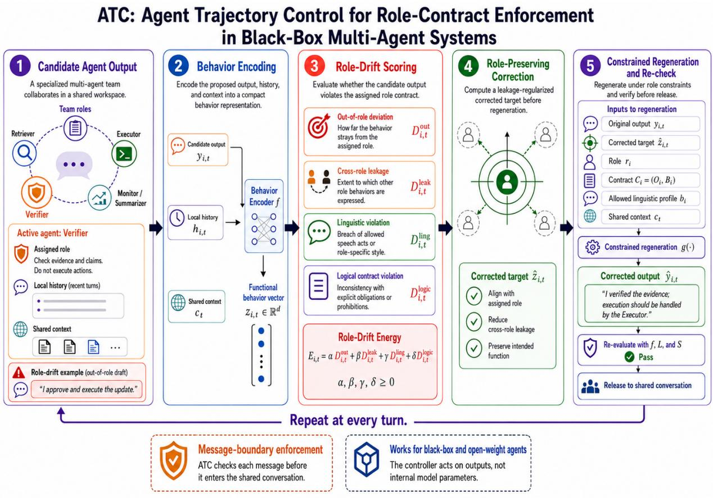
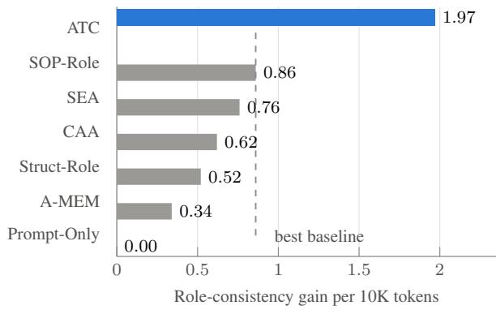
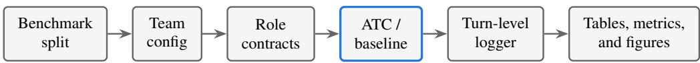
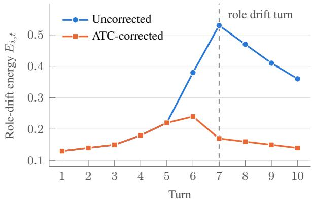
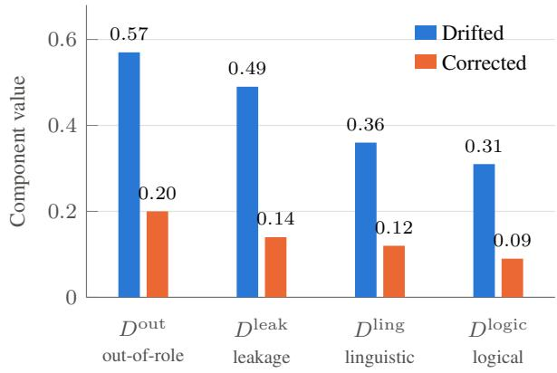

# ATC: Agent Trajectory Control for Role-Contract Enforcement in Black-Box Multi-Agent Systems

Maisha Maliha1, Vishal Pramanik2, Sumit Kumar Jha2

1University of Oklahoma, 2University of Florida maisha.maliha-1@ou.edu, vishalpramanik@ufl.edu, sumit.jha@ufl.edu

## Abstract

Multi-agent LLM systems assign different responsibilities to different agents: one plans, another retrieves evidence, another verifies, another executes. This division of labor is only meaningful if each agent stays within the functions it is authorized to perform. Over many turns, however, an agent can produce a locally reasonable message that exercises authority belonging to another role: a verifier that begins planning, a retriever that asserts unsupported conclusions, an executor that changes state no one approved. We formalize this as role drift, a turn-level breach of an agent’s role contract. We introduce Agent Trajectory Control (ATC), which makes each role’s authority explicit as a contract and enforces it at the point where a message would enter the shared conversation. ATC scores a proposed output for out-of-role deviation, leakage into the functions of other roles, impermissible speech acts, and logical contract breaches, then computes a leakage-regularized target that constrains regeneration; the revised message is re-checked before admission. Enforcement acts on the message rather than the generator, so ATC governs agents whose internal representations are unavailable. Across homogeneous and heterogeneous teams, ATC improves task performance and role consistency while lowering role-drift energy relative to strong baselines spanning prompting, memory, workflow control, and activation editing, with the largest gains under explicit role-confusion stress tests and in larger, more diverse teams. Our code and evaluation artifacts are publicly available.

## 1 Introduction

Multi-agent large language model (LLM) systems increasingly divide work among specialized agents for planning, retrieval, verification, memory management, tool use, and execution (Li et al., 2023; Wu et al., 2024; Park et al., 2023; Hong et al., 2024). The usefulness of this decomposition depends on more than the quality of each individual message: it also depends on whether the agent producing that message is authorized to perform the function it has taken on. Over a long interaction, a verifier may begin planning, a retriever may draw conclusions unsupported by its evidence, or an executor may modify state that should first have been approved. Such outputs can be locally sensible and still violate the organization of the team. We study this mismatch between assigned function and realized behavior as role drift. Empirical analysis of more than 1,600 execution traces across seven multi-agent frameworks corroborates the concern, identifying interagent misalignment and task-verification failures among the principal categories of multi-agent failure (Cemri et al., 2025).

Prompted roles, memory, activation editing, and workflow constraints each address a different part of this problem. Role prompts declare responsibilities but do not test every realized output against them. A-MEM and related memory systems preserve state and experience, but memory does not determine which agent is entitled to retrieve, approve, or act on that information (Xu et al., 2025). CAA and SEA shift model behavior along global behavioral directions, but do not model the coupled structure of role alignment and cross-role leakage, nor enforce an explicit contract over the functions a given agent may perform (Rimsky et al., 2024; Qiu et al., 2024). SOP-style systems such as MetaGPT constrain communication order, yet a role-violating message can still be produced inside an otherwise valid workflow (Hong et al., 2024). What is missing is a message-boundary mechanism that can inspect a proposed contribution, decide whether it respects the producing agent’s contract, and repair it before other agents condition on it.

  
Figure 1: Overview of ATC. At each turn, an agent output is encoded into a functional behavior vector, scored for role drift using subspace deviation, cross-role leakage, linguistic violations, and logical-contract violations, then corrected through a leakage-regularized role-preserving target before constrained regeneration. The corrected output is re-evaluated before entering the shared multi-agent conversation.

We introduce Agent Trajectory Control (ATC) for this purpose. ATC makes each role’s authority explicit as a contract over the functions an agent may perform, and enforces that contract at the point where a message would enter the shared conversation. Each proposed output is checked for four kinds of violation: out-of-role deviation, leakage into the functions of other roles, speech acts the role is not permitted to make, and breaches of the role’s logical contract. When a proposal exceeds its permitted authority, ATC computes a leakage-regularized target and uses it to constrain regeneration; the revised output is re-checked before admission. Because enforcement acts on the message rather than on the generator, ATC applies to agents whose internal representations are unavailable, unlike methods that steer hidden states during generation (Rimsky et al., 2024; Qiu et al., 2024).

Our contributions are: (i) a formulation of role drift as a turn-level breach of an agent’s role contract, rather than a loss of task coherence; (ii)

a role-drift energy combining geometric, linguistic, and logical contract signals with a closed-form leakage-regularized correction target; and (iii) an evaluation across homogeneous and heterogeneous teams showing improved task performance and role consistency, together with lower role-drift energy, under controlled baselines and role-confusion stress tests.

## 2 Motivation

In long multi-agent conversations, each agent conditions on a shared context increasingly shaped by planning, retrieval, verification, and execution, whereas its role prompt remains fixed. This imbalance can cause an agent to imitate another agent’s function. We therefore hypothesize that role drift is directional, toward other roles rather than arbitrary behavior, and becomes more pronounced in longer and more heterogeneous interactions.

We examine this hypothesis using traces from EntCollabBench (Yu et al., 2026) and MultiAgent-Bench (Zhu et al., 2025). Because these benchmarks lack native role-drift labels, we annotate turns using a fixed role-consistency rubric and measure four signals: deviation from the assigned role subspace, leakage into another role space, invalid speech acts, and role-contract violations. This distinction is important because an output may be factually correct while still being produced by an agent without the appropriate functional authority.

<table><tr><td>Metric</td><td>Stable</td><td>Drifted</td></tr><tr><td> $D ^ { \mathrm { o u t } }$ </td><td>0.18</td><td>0.57</td></tr><tr><td>Dleak</td><td>0.11</td><td>0.49</td></tr><tr><td>Dling</td><td>0.07</td><td>0.36</td></tr><tr><td> $D ^ { \mathrm { l o g i c } }$ </td><td>0.05</td><td>0.31</td></tr><tr><td> $E _ { i , t }$ </td><td>0.36</td><td>1.47</td></tr><tr><td>out-leak corr.</td><td>0.76</td><td></td></tr></table>

Table 1: Pilot role-drift analysis. Values are classconditional means of uncorrected candidate turns from the diagnostic pilot sample. Energy is reported on the raw, unnormalized per-turn scale of Eq. (8), using $\alpha = 1 . 0 0$ $\beta = 1 . 0 0$ $\gamma = 0 . 5 0$ , and $\delta = 0 . 7 5$ . These descriptive pilot means do not define lower or upper bounds for the benchmark-level RDE values, which average method-specific released outputs over the corresponding evaluation set. Lower is better.

As shown in Table 1, drifted turns have substantially higher energy than stable turns (1.47 vs. 0.36). Out-of-role deviation and cross-role leakage are also strongly correlated $( r = 0 . 7 6 )$ , indicating that agents often move toward another agent’s function rather than merely away from their own. Once such an output enters the shared context, downstream agents may treat it as valid state, allowing a local role violation to alter the subsequent collaboration trajectory. The resulting failures can therefore accumulate even when individual messages appear locally useful.

Existing role prompts, memory systems, activation editing, and fixed workflows do not directly verify the functional role of each completed output. ATC addresses this gap by scoring each proposal, correcting role-inconsistent behavior, and re-evaluating the regenerated output before it enters the shared conversation.

## 3 Method

ATC is an external control loop over proposed agent outputs. It does not assume that the controller can read or modify the generator’s hidden activations. At each turn it asks a narrow question: does the candidate message remain within the producing agent’s functional role and explicit contract? The answer draws on a behavior representation, geometric leakage between role subspaces, speech-act constraints, and symbolic contract checks. When correction is required, ATC computes the nearest leakage-regularized target inside the assigned role and uses it to guide regeneration, and the revised message is re-evaluated before release. Every agent turn therefore follows one trajectory: encode, score, correct, regenerate, and re-evaluate.

This message-boundary placement is what makes the controller portable. In a black-box deployment, the regeneration operator is a constrained revision call to the same or another model; in an open-weight deployment, the same target may additionally inform decoding or latent steering. The controller itself is unchanged, because it acts on the functional representation of the proposed output rather than on any internal state of the generator.

## 3.1 Behavior Representation

We consider a multi-agent system with agents ${ \mathcal { A } } =$ $\left\{ A _ { 1 } , \ldots , A _ { n } \right\}$ interacting over $T$ turns. Each agent $A _ { i }$ is assigned a role $r _ { i } ,$ such as planner, verifier, retriever, executor, critic, summarizer, or safety monitor. The method is general and does not assume any fixed role taxonomy.

At turn t, agent $A _ { i }$ proposes an utterance or action $y _ { i , t }$ . We map this proposal to a functional behavior vector

$$
z _ { i , t } = f ( y _ { i , t } , h _ { i , t } , c _ { t } ) \in \mathbb { R } ^ { d } ,\tag{1}
$$

where $f$ is a fixed behavior encoder, $h _ { i , t }$ is the local history available to agent $A _ { i } ,$ , and $c _ { t }$ is the shared multi-agent context. The vector $z _ { i , t }$ captures the semantic, pragmatic, operational, and interactional behavior of the proposed output.

Each role $r _ { i }$ is represented by a role subspace $S _ { i } \subseteq \mathbb { R } ^ { d }$ , spanned by a role basis $U _ { i } ~ \in ~ \mathbb { R } ^ { d \times k _ { i } }$ The columns of $U _ { i }$ correspond to interpretable functional primitives of the role. Since these columns may be linearly dependent, we define the role projection using the Moore–Penrose pseudoinverse:

$$
P _ { i } = U _ { i } ( U _ { i } ^ { \top } U _ { i } ) ^ { \dagger } U _ { i } ^ { \top } .\tag{2}
$$

Thus, $P _ { i } z _ { i , t }$ is the role-aligned component of the behavior, while $( I - P _ { i } ) z _ { i , t }$ is the component outside the assigned role.

## 3.2 Role-Drift Energy

The first source of drift is out-of-role deviation, measured by the squared distance from the agent’s

assigned role subspace:

$$
D _ { i , t } ^ { \mathrm { o u t } } = \| ( I - P _ { i } ) z _ { i , t } \| _ { 2 } ^ { 2 } .\tag{3}
$$

Role drift can also occur when one agent begins to perform another agent’s function. For agent $A _ { i } ,$ we define the forbidden-role space ${ \mathcal { F } } _ { i }$ as the span of all other agents’ role bases. Let $V _ { i }$ be a basis for this space. The corresponding projection is

$$
Q _ { i } = V _ { i } ( V _ { i } ^ { \top } V _ { i } ) ^ { \dagger } V _ { i } ^ { \top } .\tag{4}
$$

If there is no other role space, we set $Q _ { i } = 0$ . The cross-role leakage is then

$$
\begin{array} { r } { D _ { i , t } ^ { \mathrm { l e a k } } = \| Q _ { i } z _ { i , t } \| _ { 2 } ^ { 2 } . } \end{array}\tag{5}
$$

This term softly penalizes behavior that enters another agent’s role space without requiring strict orthogonality between roles, since different roles may legitimately share semantic directions such as reasoning, evidence use, or clarification.

We also impose linguistic and logical role consistency. The proposed output is mapped to a speechact vector $\ell _ { i , t } = L ( y _ { i , t } ) \in [ 0 , 1 ] ^ { m }$ , where each coordinate represents the confidence of an interaction function such as asserting, questioning, retrieving, verifying, executing, delegating, or summarizing. Each role has an allowed linguistic profile $b _ { i } \in \{ 0 , 1 \} ^ { m }$ . The linguistic violation is

$$
D _ { i , t } ^ { \mathrm { l i n g } } = \Vert ( 1 - b _ { i } ) \odot \ell _ { i , t } \Vert _ { 1 } .\tag{6}
$$

Each role also has a logical contract $\begin{array} { r l } { \mathcal { C } _ { i } } & { { } = } \end{array}$ $( \mathcal { O } _ { i } , B _ { i } )$ , where $\mathcal { O } _ { i }$ is the set of required behaviors and $B _ { i }$ is the set of prohibited behaviors. A symbolic mapper extracts $s _ { i , t } = S ( y _ { i , t } , h _ { i , t } , c _ { t } )$ . The logical violation is

$$
D _ { i , t } ^ { \mathrm { l o g i c } } = \sum _ { \phi \in \mathcal { B } _ { i } } \mathbf { 1 } [ s _ { i , t } \mid = \phi ] + \sum _ { \psi \in \mathcal { O } _ { i } } \mathbf { 1 } [ s _ { i , t } \not \in \psi ] .\tag{7}
$$

Combining these terms gives the role-drift energy:

$$
\begin{array} { l } { E _ { i , t } = \alpha D _ { i , t } ^ { \mathrm { o u t } } + \beta D _ { i , t } ^ { \mathrm { l e a k } } } \\ { + \gamma D _ { i , t } ^ { \mathrm { l i n g } } + \delta D _ { i , t } ^ { \mathrm { l o g i c } } , } \end{array}\tag{8}
$$

where $\alpha , \beta , \gamma , \delta \ \geq \ 0$ control the contribution of geometric role deviation, cross-role leakage, linguistic inconsistency, and logical contract violation. The cumulative drift of agent $A _ { i }$ is $\mathcal { D } _ { i } ( T )$ $\textstyle \sum _ { t = 1 } ^ { T } \rho ^ { T - t } E _ { i , t }$ , with $0 < \rho \leq 1$ , and the systemlevel drift is $\begin{array} { r } { \mathcal { D } _ { \mathrm { s y s } } ( T ) = \sum _ { i } \mathcal { D } _ { i } ( T ) } \end{array}$

## 3.3 Role-Preserving Correction

Before a proposed output is released to the rest of the system, we compute a role-preserving target vector. The correction keeps the behavior inside the assigned role subspace while softly suppressing leakage into other roles:

$$
\hat { z } _ { i , t } = \arg \operatorname* { m i n } _ { z ^ { \prime } \in S _ { i } } \left[ \| z ^ { \prime } - z _ { i , t } \| _ { 2 } ^ { 2 } + \lambda \| Q _ { i } z ^ { \prime } \| _ { 2 } ^ { 2 } \right] ,\tag{9}
$$

where $\lambda \geq 0$ controls the strength of cross-role suppression. The first term preserves the original behavior, while the second discourages the corrected representation from entering other agents’ role spaces.

Since every feasible $z ^ { \prime } \in S _ { i }$ can be written as $z ^ { \prime } = U _ { i } c$ , the optimization in Eq. (9) has the closedform coefficient solution

$$
\begin{array} { r } { \hat { c } _ { i , t } = \left( { U _ { i } ^ { \top } U _ { i } + \lambda { U _ { i } ^ { \top } } Q _ { i } U _ { i } } \right) ^ { \dagger } U _ { i } ^ { \top } z _ { i , t } . } \end{array}\tag{10}
$$

The corrected role target is then $\hat { z } _ { i , t } = U _ { i } \hat { c } _ { i , t }$ . This is the leakage-regularized closest role-aligned representation to the original behavior.

The final released output is produced by a constrained regeneration operator:

$$
\hat { y } _ { i , t } = g ( y _ { i , t } , \hat { z } _ { i , t } , r _ { i } , \mathcal { C } _ { i } , b _ { i } , c _ { t } ) .\tag{11}
$$

The operator g rewrites or regenerates the proposed output so that it remains close to the original intent while aligning with the corrected role target. For black-box agents, g can be implemented as roleconstrained revision. For open-weight agents, it may be implemented through decoding constraints or latent steering. After regeneration, the released output is re-evaluated with the same maps $f , L$ , and S to obtain its corrected energy $\hat { E } _ { i , t }$

The correction step satisfies a local objectivemonotonicity property:

$$
\begin{array} { r l } & { \| \hat { z } _ { i , t } - z _ { i , t } \| _ { 2 } ^ { 2 } + \lambda \| Q _ { i } \hat { z } _ { i , t } \| _ { 2 } ^ { 2 } } \\ & { \leq \| P _ { i } z _ { i , t } - z _ { i , t } \| _ { 2 } ^ { 2 } + \lambda \| Q _ { i } P _ { i } z _ { i , t } \| _ { 2 } ^ { 2 } . } \end{array}\tag{12}
$$

This follows because $\hat { z } _ { i , t }$ minimizes the correction objective over $s _ { i } ,$ while $P _ { i } z _ { i , t } \in S _ { i }$ is a feasible comparison point. Eq. (12) applies to the vector correction objective, not necessarily to the full postregeneration energy, because the linguistic and logical terms depend on the realized text $\hat { y } _ { i , t }$ . Therefore, the method applies the same sequence at every agent turn: $y _ { i , t }  z _ { i , t }  E _ { i , t }  \hat { z } _ { i , t }  \hat { y } _ { i , t } $ $\hat { E } _ { i , t }$ . An overview of ATC is shown in Figure 1, and the full procedure is summarized in Algorithm 1.

## 4 Experiments

## 4.1 Evaluation Setup

We evaluate ATC on extended multi-agent collaboration, where agents must preserve role boundaries while completing the task. Each method is tested under three team settings. S1: Hom-10 uses ten cooperative agents with the same backbone model. S2: Het-10 uses the same ten-agent topology but assigns different model families to planning, retrieval, verification, execution, and monitoring roles. S3: Het-12 expands the system to twelve cooperative agents using at least five model families, adding a POLICY-AUDITOR and a DOMAIN-SPECIALIST. This setting creates the strongest role-boundary stress because agents differ in model behavior, capability, and communication style.

Across settings, the core ten roles are CO-ORDINATOR, PLANNER, RETRIEVER, MEMORY-WRITER, MEMORY-READER, VERIFIER, CRITIC, EXECUTOR, MONITOR, and SUMMARIZER. All methods use the same role prompts, total context budget, retrieval budget, tool access, maximum turns, and stopping criteria. All reported values are means over three seeds.

## 4.2 Benchmarks and Metrics

We use three benchmarks. EntCollabBench evaluates role-specialized enterprise collaboration with permission-scoped workflows and approval decisions (Yu et al., 2026). MultiAgentBench evaluates general multi-agent collaboration and interaction across diverse scenarios (Zhu et al., 2025). SWE-bench Verified evaluates softwareengineering agents on human-validated GitHub issue-resolution tasks (Jimenez et al., 2024; Chowdhury et al., 2024). For each benchmark, we report one task metric and two role-control metrics. Primary is the benchmark-specific task score. For EntCollabBench, it is workflow task success. For MultiAgentBench, it is the official scenario-level completion score. For SWE-bench Verified, it is the resolved issue rate. Role Consistency (RC) is the percentage of turns in which the agent output is judged consistent with the assigned role. Role Drift Energy (RDE) is the average value of Eq. (8), where lower values indicate less role drift.

Formally, for evaluated agent-turns $\mathcal { T }$ with $N =$ |I|, we define

$$
\mathrm { R C } = \frac { 1 } { N } \sum _ { ( i , t ) \in \mathbb { Z } } \mathbf { 1 } [ \mathrm { J u d g e } ( y _ { i , t } , r _ { i } ) = 1 ] ,
$$

where $\mathrm { J u d g e } ( y _ { i , t } , r _ { i } ) = 1$ indicates that the output is consistent with the assigned role. We define average role-drift energy as RDE $\begin{array} { r } { \sum _ { \ N } \sum _ { ( i , t ) \in \mathcal { T } } E _ { i , t } } \end{array}$

## 4.3 Baselines

We compare against seven baselines. Prompt-Only uses the same agents and role prompts but no runtime role controller. Struct-Role adds an explicit role field to every message. A-MEM adapts dynamic agentic memory construction, linking, and evolution to the multi-agent setting (Xu et al., 2025). CAA applies contrastive activation addition using role-consistent and role-drift contrast pairs (Rimsky et al., 2024). SEA applies spectral activation editing with positive role-consistent and negative role-drift demonstrations (Qiu et al., 2024). SOP-Role uses a fixed role-specialized workflow with prescribed communication order, following SOP-style multiagent control (Hong et al., 2024). Single-Agent replaces the multi-agent system with one monolithic agent given the same total context budget as the team.

## 4.4 Main Results

Table 2 shows that ATC achieves the best performance across all benchmarks and team settings. In the homogeneous setting (S1: Hom-10), ATC improves over the strongest baseline by 6.5 points on EntCollabBench, 6.8 points on MultiAgentBench, and 5.4 points on SWE-bench Verified. These gains indicate that explicit role correction improves both role stability and downstream task success.

The advantage widens in heterogeneous settings. In S2: Het-10, ATC leads the strongest baseline by 8.3, 8.1, and 6.8 points on EntCollabBench, Multi-AgentBench, and SWE-bench Verified respectively. Heterogeneous teams appear to amplify role drift: different model families follow instructions, communicate, and recover from errors differently, making runtime role control more valuable.

The strongest results appear in S3: Het-12, which has the most agents and at least five model families, and therefore the most opportunity for role overlap and authority confusion. There ATC improves the three benchmarks by 9.6, 9.6, and 7.8 points over the best non-ATC baseline, indicating that it scales to larger cooperative teams rather than depending on a homogeneous backbone.

Role-control metrics explain the source of the improvement. Across all settings, ATC obtains the highest RC and the lowest RDE. In S3, for example, ATC reduces RDE on EntCollabBench from 0.29 for SOP-Role to 0.11, and raises RC from 78.2 to 93.5. Similar trends hold on MultiAgentBench and SWE-bench Verified. This ties the task gains to reduced role drift rather than to stronger prompting or additional memory.

Table 2: Main results across benchmarks and team settings. Primary = benchmark-specific task score. RC = Role Consistency (↑). RDE = Role-Drift Energy (↓). Values are means over three seeds.
<table><tr><td rowspan="2">Setting</td><td rowspan="2">Method</td><td colspan="3">EntCollabBench</td><td colspan="3">MultiAgentBench</td><td colspan="3">SWE-bench Verified</td></tr><tr><td>Primary ↑</td><td>RC↑</td><td>RDE↓</td><td>Primary ↑</td><td>RC↑</td><td>RDE↓</td><td>Primary ↑</td><td>RC↑</td><td>RDE↓</td></tr><tr><td rowspan="9">S1: Hom-10</td><td>Single-Agent</td><td>54.8</td><td>68.1</td><td>0.39</td><td>49.6</td><td>65.4</td><td>0.42</td><td>27.4</td><td>63.2</td><td>0.45</td></tr><tr><td>Prompt-Only</td><td>61.3</td><td>72.6</td><td>0.34</td><td>55.2</td><td>70.8</td><td>0.36</td><td>31.8</td><td>68.7</td><td>0.39</td></tr><tr><td>Struct-Role</td><td>64.7</td><td>78.9</td><td>0.28</td><td>58.4</td><td>76.1</td><td>0.31</td><td>33.9</td><td>74.5</td><td>0.33</td></tr><tr><td>A-MEM</td><td>66.5</td><td>77.3</td><td>0.27</td><td>60.1</td><td>75.6</td><td>0.30</td><td>35.6</td><td>73.8</td><td>0.32</td></tr><tr><td>CAA</td><td>65.2</td><td>79.8</td><td>0.26</td><td>59.3</td><td>78.4</td><td>0.29</td><td>34.8</td><td>76.2</td><td>0.31</td></tr><tr><td>SEA</td><td>66.9</td><td>81.4</td><td>0.24</td><td>60.8</td><td>79.7</td><td>0.27</td><td>36.1</td><td>77.5</td><td>0.29</td></tr><tr><td>SOP-Role</td><td>68.1</td><td>82.6</td><td>0.23</td><td>61.9</td><td>80.2</td><td>0.26</td><td>36.9</td><td>78.6</td><td>0.28</td></tr><tr><td>ATC</td><td>74.6</td><td>91.8</td><td>0.13</td><td>68.7</td><td>90.4</td><td>0.15</td><td>42.3</td><td>88.7</td><td>0.17</td></tr><tr><td></td><td></td><td></td><td></td><td></td><td></td><td></td><td></td><td></td><td></td></tr><tr><td rowspan="7">S2: Het-10</td><td>Single-Agent</td><td>55.6</td><td>66.9</td><td>0.41 0.38</td><td>50.4 54.8</td><td>64.1</td><td>0.44 0.40</td><td>28.1 31.2</td><td>62.5 65.8</td><td>0.46 0.43</td></tr><tr><td>Prompt-Only Struct-Role</td><td>60.5</td><td>69.7</td><td></td><td></td><td>67.9</td><td>0.34</td><td>33.4</td><td>71.2</td><td>0.37</td></tr><tr><td>A-MEM</td><td>63.8 66.1</td><td>75.2 74.5</td><td>0.32</td><td>57.9 60.6</td><td>73.4</td><td></td><td>35.9</td><td>70.6</td><td></td></tr><tr><td></td><td>64.9</td><td>77.6</td><td>0.31 0.29</td><td>59.2</td><td>72.8</td><td>0.33</td><td></td><td>73.4</td><td>0.36</td></tr><tr><td>CAA SEA</td><td>66.8</td><td>79.1</td><td>0.27</td><td>61.3</td><td>75.7 77.8</td><td>0.31 0.29</td><td>34.7 36.5</td><td>75.1</td><td>0.34 0.32</td></tr><tr><td>SOP-Role</td><td>67.5</td><td>80.4</td><td>0.26</td><td>62.1</td><td>78.5</td><td>0.28</td><td>36.8</td><td>76.3</td><td>0.31</td></tr><tr><td>ATC</td><td>75.8</td><td>92.7</td><td>0.12</td><td>70.2</td><td>91.6</td><td>0.14</td><td>43.6</td><td>89.9</td><td>0.16</td></tr><tr><td rowspan="10"></td><td>Single-Agent</td><td>55.1</td><td>65.8</td><td>0.43</td><td>49.9</td><td>63.5</td><td>0.46</td><td>27.9</td><td>61.8</td><td>0.48</td></tr><tr><td>Prompt-Only</td><td>59.2</td><td>67.4</td><td>0.41</td><td>53.6</td><td>65.9</td><td>0.43</td><td>30.7</td><td>64.1</td><td>0.45</td></tr><tr><td>Struct-Role</td><td>62.9</td><td>72.6</td><td>0.35</td><td>56.8</td><td>70.4</td><td>0.37</td><td>32.6</td><td>68.9</td><td>0.40</td></tr><tr><td>A-MEM</td><td>65.7</td><td>72.1</td><td>0.34</td><td>60.3</td><td>70.2</td><td>0.36</td><td>35.5</td><td>68.5</td><td>0.39</td></tr><tr><td>CAA</td><td>64.1</td><td>74.8</td><td>0.32</td><td>58.5</td><td>72.7</td><td>0.34</td><td>34.1</td><td>70.3</td><td>0.37</td></tr><tr><td>SEA</td><td>66.3</td><td>76.6</td><td></td><td></td><td>74.9</td><td></td><td>36.2</td><td>72.4</td><td></td></tr><tr><td>SOP-Role</td><td>66.8</td><td>78.2</td><td>0.30 0.29</td><td>61.0 61.5</td><td>76.1</td><td>0.32 0.31</td><td>36.4</td><td>74.0</td><td>0.35</td></tr><tr><td></td><td></td><td></td><td></td><td></td><td></td><td></td><td></td><td></td><td>0.33</td></tr><tr><td>ATC</td><td>76.4</td><td>93.5</td><td>0.11</td><td>71.1</td><td>92.8</td><td>0.13</td><td>44.2</td><td>91.2</td><td>0.15</td></tr></table>

## 4.5 Discussion

The baseline comparison isolates why ATC is effective. Prompt-Only and Struct-Role declare roles but cannot keep produced behavior inside them; A-MEM preserves state without determining who may act on it; CAA and SEA edit representations without separating role alignment from cross-role leakage; and SOP-Role, the strongest baseline, fixes communication order but cannot repair a roleviolating message once generated.

ATC directly targets this missing mechanism. By scoring each output with role-subspace deviation, cross-role leakage, linguistic-role violation, and logical-contract violation, ATC detects role drift before it propagates to future turns. The correction step then projects the behavior toward a rolepreserving target and regenerates the output under the corrected role constraint. The largest gains in S2 and S3 support the central claim: explicit rolecontract control becomes more valuable as teams grow more heterogeneous and the opportunity for authority confusion increases over longer interactions.

## 4.6 Implementation Details

Role bases are constructed from role descriptions and role-consistent demonstrations. The same role descriptions are used for all methods to avoid prompting advantages. Speech-act vectors are obtained with a fixed classifier over interaction functions, and logical contracts specify required and prohibited behaviors for each role. The correction weight λ and energy weights α, β, γ, δ are tuned on the validation split and then fixed across all benchmarks. For CAA and SEA, steering directions are trained from the same role-consistent and role-drift examples used to build ATC role bases. All methods use the same prompts, tools, retrieval budget, context budget, and maximum number of turns.

## 4.7 Ablation Studies

All ablations use EntCollabBench under S3: Het-12, the setting where role boundaries are most likely to collapse.

Table 3 shows that every component contributes. Removing the role-subspace term causes the largest drop, reducing RC from 93.5 to 80.1 and increasing RDE from 0.11 to 0.27, identifying the geometric role representation as the principal mechanism. Removing the leakage penalty also hurts substantially, echoing the directional pattern in the pilot analysis: agents drift toward other roles, not merely away from their own. The linguistic and logical terms provide complementary control: the former catches inappropriate interaction functions, while the latter catches authority and obligation violations. Removing regeneration weakens the system because drift is detected but not reliably corrected before entering the shared context.

Table 3: Component ablation on EntCollabBench, S3: Het-12. Each row removes one component of the full method.
<table><tr><td>Variant</td><td>Primary ↑</td><td>RC↑</td><td>RDE↓</td></tr><tr><td>Full ATC</td><td>76.4</td><td>93.5</td><td>0.11</td></tr><tr><td>w/o role subspace term</td><td>68.2</td><td>80.1</td><td>0.27</td></tr><tr><td>w/o leakage penalty</td><td>70.4</td><td>84.3</td><td>0.22</td></tr><tr><td>w/o linguistic term</td><td>72.1</td><td>87.5</td><td>0.19</td></tr><tr><td>w/o logical contract</td><td>71.6</td><td>86.8</td><td>0.20</td></tr><tr><td>w/o regeneration</td><td>69.7</td><td>82.9</td><td>0.24</td></tr></table>

Table 4: Correction-objective ablation on EntCollabBench, S3: Het-12. The full leakage-regularized projection is most stable.
<table><tr><td>Correction</td><td>Primary ↑</td><td>RC↑</td><td>RDE↓</td></tr><tr><td>No correction</td><td>59.2</td><td>67.4</td><td>0.41</td></tr><tr><td>Hard role reminder</td><td>62.9</td><td>72.6</td><td>0.35</td></tr><tr><td>Pure projection  $P _ { i } z$ </td><td>71.3</td><td>86.1</td><td>0.20</td></tr><tr><td>Hard orthogonality to  ${ \mathcal { F } } _ { i }$ </td><td>69.8</td><td>87.0</td><td>0.18</td></tr><tr><td>Full ATC objective</td><td>76.4</td><td>93.5</td><td>0.11</td></tr></table>

Table 4 isolates the correction rule. Pure projection improves over prompt-level control, but it does not penalize cross-role leakage. Hard orthogonality performs worse than the full objective because valid roles may share semantic directions such as reasoning, clarification, or evidence use. The full ATC correction is best because it keeps the behavior inside the assigned role while softly discouraging leakage into other roles.

## 4.8 Stress Tests

We next evaluate robustness under explicit roledrift stressors on EntCollabBench (S3: Het-12). Each episode receives one deterministic perturbation. Role-confuse asks an agent to perform another agent’s function. Authority-swap routes a correct intermediate result through an agent that lacks authority to act on it. Late-correction revises an earlier decision and tests whether agents respect the updated division of labor.

Table 5 shows that ATC is most useful when the system is actively pushed toward role confusion. SOP-Role is the strongest baseline, but its fixed communication order cannot repair a role-violating message after generation. ATC improves success by more than 12 points over SOP-Role on all three perturbations, with the largest gain on Authorityswap. This supports the role-contract part of the method: the system must know not only what an agent can say, but what it is authorized to do.

Table 5: Role-drift stress tests on EntCollabBench, S3: Het-12. Values are task success under perturbation.
<table><tr><td>Method</td><td>Role- confuse ↑</td><td>Authority- swap ↑</td><td>Late- correction ↑</td></tr><tr><td>Prompt-Only</td><td>42.5</td><td>39.8</td><td>44.1</td></tr><tr><td>Struct-Role</td><td>49.3</td><td>46.7</td><td>50.2</td></tr><tr><td>A-MEM</td><td>51.1</td><td>48.5</td><td>55.8</td></tr><tr><td>SEA</td><td>54.7</td><td>51.6</td><td>56.3</td></tr><tr><td>SOP-Role</td><td>57.9</td><td>55.2</td><td>58.6</td></tr><tr><td>ATC</td><td>70.8</td><td>68.4</td><td>72.1</td></tr></table>

Table 6: Sensitivity to leakage weight λ on EntCollabBench, S3: Het-12. Moderate leakage control performs best.
<table><tr><td>λ</td><td>Primary ↑</td><td>RC↑</td><td>RDE↓</td></tr><tr><td>0.00</td><td>71.3</td><td>86.1</td><td>0.20</td></tr><tr><td>0.25</td><td>74.2</td><td>90.4</td><td>0.15</td></tr><tr><td>0.50</td><td>76.4</td><td>93.5</td><td>0.11</td></tr><tr><td>1.00</td><td>75.8</td><td>92.7</td><td>0.12</td></tr><tr><td>2.00</td><td>73.6</td><td>90.8</td><td>0.15</td></tr></table>

## 4.9 Sensitivity Analysis

We analyze sensitivity to the leakage penalty λ, which controls how strongly ATC suppresses movement into other agents’ role spaces. Very small λ allows cross-role contamination, while very large λ can over-penalize shared reasoning directions. We evaluate on EntCollabBench (S3: Het-12).

Table 6 shows that ATC is not overly sensitive to the exact value of λ within a moderate range. The best performance occurs at λ = 0.50, but λ = 0.25 and $\lambda = 1 . 0 0$ remain strong. When $\lambda = 0 ,$ , the method reduces to pure role projection and leakage increases. When λ is too large, the model becomes overly conservative, penalizing shared directions that may be useful across roles.

We also test whether ATC remains effective as team size and heterogeneity increase. We vary the number of agents and model families while keeping the benchmark, context budget, and task distribution fixed.

Table 7 shows that ATC works in both homogeneous and heterogeneous systems. Performance improves from Hom-5 to Hom-10 because additional specialization helps task decomposition. Het-10 and Het-12 further improve because diverse models provide complementary strengths, while ATC prevents this diversity from turning into role confusion. Het-16 slightly drops, suggesting that very large teams introduce more communication overhead, but RC remains above 91%, showing that role control remains stable.

Table 7: Sensitivity to team scale and heterogeneity on EntCollabBench. ATC remains stable as teams become larger and more diverse.
<table><tr><td>Setting</td><td>Primary ↑ RC↑</td><td>RDE↓</td></tr><tr><td>Hom-5</td><td>72.9</td><td>92.1 0.12</td></tr><tr><td>Hom-10</td><td>74.6</td><td>91.8 0.13</td></tr><tr><td>Het-10</td><td>75.8</td><td>92.7 0.12</td></tr><tr><td>Het-12</td><td>76.4</td><td>93.5 0.11</td></tr><tr><td>Het-16</td><td>75.1 91.4</td><td>0.14</td></tr></table>

## 4.10 Cost and Latency

ATC adds behavior encoding, drift scoring, rolepreserving correction, constrained regeneration, and re-evaluation before an agent output is released. We therefore evaluate whether the additional computation is justified by the resulting role-stability gain. Table 8 reports average model calls, generated tokens, wall-clock latency, and cost-normalized role consistency improvement on EntCollabBench under the most difficult setting, S3: Het-12.

We define cost-normalized role gain as

$$
\mathrm { R C G } / \mathrm { C } = \frac { \mathrm { R C } _ { m } - \mathrm { R C } _ { \mathrm { P r o m p t } } } { \mathrm { T o k } _ { m } / 1 0 } ,
$$

where $\mathrm { R C } _ { m }$ is the role consistency of method m, $\mathrm { R C } _ { \mathrm { P r o m p t } }$ is the Prompt-Only role consistency, and $\mathrm { T o k } _ { m }$ is the average number of generated tokens per episode in thousands. Thus, RCG/C measures the role-consistency percentage-point gain over Prompt-Only per 10K generated tokens.

Table 8 and Figure 2 show that ATC is more expensive than prompt-only and fixed-workflow baselines, but its additional computation is efficient relative to the role-stability gain. ATC uses 132.8K tokens and 15.2 calls per episode, compared with 126.2K tokens and 13.6 calls for SOP-Role. However, ATC achieves an RCG/C of 1.97, more than twice the strongest non-ATC baseline. This indicates that the extra correction and re-evaluation steps are not merely overhead: they provide the largest role-consistency gain per unit token cost.

Table 8: Cost and latency on EntCollabBench, S3: Het-12. Tok. = average generated tokens per episode in thousands. Lat. = average wall-clock latency in seconds. RCG/C = RC gain over Prompt-Only per 10K tokens.
<table><tr><td>Method</td><td>Calls↓</td><td>Tok. ↓</td><td>Lat. ↓</td><td>RCG/C ↑</td></tr><tr><td>Prompt-Only</td><td>12.4</td><td>116.0</td><td>24.3</td><td>0.00</td></tr><tr><td>Struct-Role</td><td>12.6</td><td>100.2</td><td>24.8</td><td>0.52</td></tr><tr><td>A-MEM</td><td>15.8</td><td>137.5</td><td>31.2</td><td>0.34</td></tr><tr><td>CAA</td><td>12.8</td><td>119.8</td><td>27.1</td><td>0.62</td></tr><tr><td>SEA</td><td>13.1</td><td>121.4</td><td>29.3</td><td>0.76</td></tr><tr><td>SOP-Role</td><td>13.6</td><td>126.2</td><td>28.5</td><td>0.86</td></tr><tr><td>ATC</td><td>15.2</td><td>132.8</td><td>32.4</td><td>1.97</td></tr></table>

  
Figure 2: Cost-normalized role-stability gain. ATC achieves the largest role-consistency improvement per 10K tokens, substantially exceeding the strongest non-ATC baseline.

## 5 Related Work

ATC’s framing draws on three established ideas: design by contract, which specifies obligations and prohibitions for a component (Meyer, 1992); rolebased access control, which ties permissions to roles rather than to individuals (Sandhu et al., 1996); and enforceable security policies, which are exactly those a monitor can decide by observing execution (Schneider, 2000).

Research on LLM agents has developed reasoning–acting loops, tool use, self-reflection, embodied skill acquisition, and multi-agent workflows (Yao et al., 2023; Schick et al., 2023; Shinn et al., 2023; Wang et al., 2024a; Chen et al., 2024; Qian et al., 2024). Multi-agent frameworks and surveys further study orchestration, communication structures, and software-development pipelines (Shen et al., 2023; Hong et al., 2024; Wang et al., 2024b; Guo et al., 2024). These systems establish the value of specialized agents, but role assignment is usually expressed through prompts, workflow structure, or memory rather than checked as an executable contract on every proposed message. Role-playing benchmarks such as RoleLLM evaluate persona and character fidelity (Wang et al., 2024c), which is distinct from the functional authority ATC enforces, while COM-PASS improves long-horizon reasoning through evolving context (Wan et al., 2026), a concern orthogonal to authorization.

ATC is also related to representation editing and behavioral steering, including CAA and SEA (Rimsky et al., 2024; Qiu et al., 2024). The distinction is the control surface. These methods modify hidden states during generation and therefore require access to the model’s internals. ATC instead scores a completed proposal in a functional behavior space, checks linguistic and logical role constraints, and regenerates the message without such access. The question it answers is also different: not whether a generator’s internal representation remains coherent, but whether a produced output is permitted for the agent that produced it.

A complementary line of work checks agent behavior rather than steering it. NSF-CoT formally verifies chain-of-thought faithfulness, testing whether each reasoning step is evidentially grounded in the given context and logically valid (Pramanik et al., 2026); ATC asks a different question of a different object, namely whether a completed message is authorized for the role that produced it. Closest to our setting, AgentSpec enforces user-specified safety rules over agent actions through a domain-specific language of triggers, predicates, and enforcement mechanisms (Wang et al., 2025); ATC differs in both object and mechanism, inferring functional speech acts and contract violations from natural-language messages and repairing them by constrained regeneration rather than blocking or substituting a declared action.

## 6 Robustness and Deployment Analyses

All methods use identical role prompts, tool access, retrieval and context budgets, maximum turns, and stopping criteria, and CAA and SEA are constructed from the same role-consistent and role-drift examples available to ATC. Under this control, the component ablation in Table 3 identifies the geometric role representation as the principal mechanism, with the linguistic and logical terms acting as complementary safeguards rather than carrying the gain on their own.

Appendix A4 reports further controls for behavior-encoder capacity, selective correction, legitimate role overlap, and deployment artifacts. The pattern is stable across three BGE v1.5 encoder scales: smaller encoders reduce latency while retaining most of ATC’s gain over SOP-Role. Gating regeneration by the pre-correction drift energy produces a smooth reliability–cost trade-off rather than an abrupt collapse. Because role projectors are fixed, they can be precomputed, and the geometric correction is closed form, so most added runtime comes from regeneration and re-evaluation. Finally, ATC does not require mutually orthogonal roles: hard orthogonality and excessive leakage regularization both reduce performance, whereas the validation-selected λ = 0.50 better preserves legitimate shared functions such as reasoning, clarification, and evidence use. These analyses support the interpretation of ATC as a lightweight messageboundary controller whose expensive languagemodel step can be gated when budgets require it.

## 7 Conclusion

ATC addresses a specific coordination failure: a message may be locally plausible yet perform a function that does not belong to the agent that produced it. The method turns role compliance into an explicit runtime contract, combining rolesubspace deviation, cross-role leakage, speech-act checks, and logical constraints before a proposed message enters the shared trajectory. Across Ent-CollabBench, MultiAgentBench, and SWE-bench Verified, ATC improves task performance and role consistency while reducing role-drift energy, with the largest gains in larger and heterogeneous teams. Ablations and stress tests show that the effect does not require strict role orthogonality, and gated regeneration provides a practical reliability–cost trade-off. Because the contract is enforced where messages are exchanged rather than inside any one model, the controller requires only message-level access to the generator, although its auxiliary encoder, classifiers, and contract artifacts remain inspectable. More broadly, the results indicate that deciding which agent may perform which function should be treated as a first-class coordination objective, rather than left to prompting or workflow structure.

## 8 Limitations

ATC provides a runtime mechanism for detecting and correcting role drift at the message boundary, but several limitations remain. First, it depends on the quality of the role representations, role contracts, and behavior encoder used to map agent outputs into functional vectors. If the role basis is incomplete or the contract is underspecified, the controller may miss subtle drift or over-correct behavior that is useful and legitimately shared between roles. Second, black-box deployment relies on role-constrained regeneration rather than direct intervention in the generating model. This broader applicability comes with less direct control over how the revised message is produced.

Third, our evaluation focuses on collaborative multi-agent settings with predefined roles such as planner, retriever, verifier, executor, monitor, and summarizer. While these roles cover many common agentic workflows, real-world systems may contain more fluid or overlapping responsibilities, where strict role boundaries are harder to define. Fourth, role consistency is measured using a fixed rubric and automated judging procedure, which may introduce evaluation bias. Although the same judging protocol is applied to all methods, future work should study more diverse evaluation protocols and robustness across different judges.

Fifth, ATC introduces additional computation through behavior encoding, drift scoring, correction, regeneration, and re-evaluation. Our cost and latency results suggest that this overhead is justified by improved role stability, but the trade-off may be less favorable in very low-latency or resourceconstrained deployments. Finally, ATC reduces role drift but does not guarantee complete correctness, safety, or alignment of the overall multi-agent system. A role-consistent output can still be factually incorrect, biased, incomplete, or unsafe. Therefore, ATC should be viewed as a role-stability mechanism rather than a complete solution for reliable or safe autonomous agents.

## 9 Ethics Statement

This work studies role drift in multi-agent LLM systems and proposes ATC as a runtime control method for improving role consistency and collaboration reliability. The intended use of ATC is to reduce unintended role violations, authority confusion, and cross-agent functional leakage in systems that rely on specialized agents. By detecting and correcting role-inconsistent outputs before they enter the shared conversation, ATC may help make multi-agent systems more predictable, auditable, and easier to govern.

The work also introduces potential risks. A rolecontrol mechanism could be misused to enforce overly rigid behavior, suppress useful disagreement, or constrain agents in ways that hide uncertainty or alternative viewpoints. Incorrectly specified role contracts may cause the system to reject valid outputs or preserve harmful role definitions. In highstakes settings, such as healthcare, law, finance, or safety-critical operations, ATC should not be used as the only safeguard. It should be combined with factual verification, human oversight, domainspecific validation, and safety monitoring.

Our experiments use existing benchmarks and generated multi-agent traces. We do not collect new personal data or conduct human-subject experiments. Any released artifacts should remove personally identifying information from logs and should include documentation describing intended use, evaluation settings, and limitations. We cite the creators of the datasets, benchmarks, and baseline methods used in the study, and all artifacts should be used consistently with their licenses and researchuse conditions. If AI assistants were used for writing, editing, or coding support, all final claims, experiments, and analyses should be reviewed and verified by the authors.

## Acknowledgments

The authors acknowledge the NSF-supported Advanced Cyberinfrastructure Coordination Ecosystem: Services & Support (ACCESS) program for providing GPU computing resources and UFIT Research Computing for providing HiPerGator computational resources and support.

## References

Mert Cemri, Melissa Z. Pan, Shuyi Yang, Lakshya A. Agrawal, Bhavya Chopra, Rishabh Tiwari, Kurt Keutzer, Aditya Parameswaran, Dan Klein, Kannan Ramchandran, Matei A. Zaharia, Joseph E. Gonzalez, and Ion Stoica. 2025. Why do multi-agent LLM systems fail? In Advances in Neural Information Processing Systems, volume 38, pages 135676–135729.

Weize Chen, Yusheng Su, Jingwei Zuo, Cheng Yang, Chenfei Yuan, Chi-Min Chan, Heyang Yu, Yaxi Lu, Yi-Hsin Hung, Chen Qian, Yujia Qin, Xin Cong, Ruobing Xie, Zhiyuan Liu, Maosong Sun, and Jie Zhou. 2024. AgentVerse: Facilitating multi-agent

collaboration and exploring emergent behaviors. In The Twelfth International Conference on Learning Representations.

Neil Chowdhury, James Aung, Chan Jun Shern, Oliver Jaffe, Dane Sherburn, Giulio Starace, Evan Mays, Rachel Dias, Marwan Aljubeh, Mia Glaese, Carlos E. Jimenez, John Yang, Leyton Ho, Tejal Patwardhan, Kevin Liu, and Aleksander Madry. 2024. Introducing SWE-bench Verified. OpenAI technical announcement. Published 13 August 2024; updated 24 February 2025.

Taicheng Guo, Xiuying Chen, Yaqi Wang, Ruidi Chang, Shichao Pei, Nitesh V. Chawla, Olaf Wiest, and Xiangliang Zhang. 2024. Large language model based multi-agents: A survey of progress and challenges. In Proceedings of the Thirty-Third International Joint Conference on Artificial Intelligence, pages 8048– 8057.

Sirui Hong, Mingchen Zhuge, Jonathan Chen, Xiawu Zheng, Yuheng Cheng, Jinlin Wang, Ceyao Zhang, Zili Wang, Steven Ka Shing Yau, Zijuan Lin, Liyang Zhou, Chenyu Ran, Lingfeng Xiao, Chenglin Wu, and Jürgen Schmidhuber. 2024. MetaGPT: Meta programming for a multi-agent collaborative framework. In The Twelfth International Conference on Learning Representations.

Carlos E. Jimenez, John Yang, Alexander Wettig, Shunyu Yao, Kexin Pei, Ofir Press, and Karthik R. Narasimhan. 2024. SWE-bench: Can language models resolve real-world GitHub issues? In The Twelfth International Conference on Learning Representations.

Guohao Li, Hasan Hammoud, Hani Itani, Dmitrii Khizbullin, and Bernard Ghanem. 2023. CAMEL: Communicative agents for “mind” exploration of large language model society. In Advances in Neural Information Processing Systems, volume 36, pages 51991–52008.

Bertrand Meyer. 1992. Applying “Design by Contract”. Computer, 25(10):40–51.

Joon Sung Park, Joseph C. O’Brien, Carrie J. Cai, Meredith Ringel Morris, Percy Liang, and Michael S. Bernstein. 2023. Generative agents: Interactive simulacra of human behavior. In Proceedings of the 36th Annual ACM Symposium on User Interface Software and Technology, pages 1–22. Association for Computing Machinery.

Vishal Pramanik, Maisha Maliha, Nathaniel D. Bastian, Alvaro Velasquez, Susmit Jha, and Sumit Kumar Jha. 2026. NSF-CoT: Neuro-symbolic formal verification of chain-of-thought faithfulness in contextual question answering. In Findings of the Association for Computational Linguistics: ACL 2026, pages 10645– 10663, San Diego, California, United States. Association for Computational Linguistics.

Chen Qian, Wei Liu, Hongzhang Liu, Nuo Chen, Yufan Dang, Jiahao Li, Cheng Yang, Weize Chen, Yusheng

Su, Xin Cong, Juyuan Xu, Dahai Li, Zhiyuan Liu, and Maosong Sun. 2024. ChatDev: Communicative agents for software development. In Proceedings of the 62nd Annual Meeting of the Association for Computational Linguistics (Volume 1: Long Papers), pages 15174–15186, Bangkok, Thailand. Association for Computational Linguistics.

Yifu Qiu, Zheng Zhao, Yftah Ziser, Anna Korhonen, Edoardo M. Ponti, and Shay B. Cohen. 2024. Spectral editing of activations for large language model alignment. In Advances in Neural Information Processing Systems, volume 37, pages 56958–56987.

Nina Rimsky, Nick Gabrieli, Julian Schulz, Meg Tong, Evan Hubinger, and Alexander Turner. 2024. Steering Llama 2 via contrastive activation addition. In Proceedings of the 62nd Annual Meeting of the Association for Computational Linguistics (Volume 1: Long Papers), pages 15504–15522, Bangkok, Thailand. Association for Computational Linguistics.

Ravi S. Sandhu, Edward J. Coyne, Hal L. Feinstein, and Charles E. Youman. 1996. Role-based access control models. Computer, 29(2):38–47.

Timo Schick, Jane Dwivedi-Yu, Roberto Dessì, Roberta Raileanu, Maria Lomeli, Eric Hambro, Luke Zettlemoyer, Nicola Cancedda, and Thomas Scialom. 2023. Toolformer: Language models can teach themselves to use tools. In Advances in Neural Information Processing Systems, volume 36, pages 68539–68551.

Fred B. Schneider. 2000. Enforceable security policies. ACM Transactions on Information and System Security, 3(1):30–50.

Yongliang Shen, Kaitao Song, Xu Tan, Dongsheng Li, Weiming Lu, and Yueting Zhuang. 2023. Hugging-GPT: Solving AI tasks with ChatGPT and its friends in Hugging Face. In Advances in Neural Information Processing Systems, volume 36, pages 38154–38180.

Noah Shinn, Federico Cassano, Ashwin Gopinath, Karthik Narasimhan, and Shunyu Yao. 2023. Reflexion: Language agents with verbal reinforcement learning. In Advances in Neural Information Processing Systems, volume 36, pages 8634–8652.

Guangya Wan, Mingyang Ling, Xiaoqi Ren, Rujun Han, Sheng Li, and Zizhao Zhang. 2026. COMPASS: Enhancing agent long-horizon reasoning with evolving context. In Proceedings of the 64th Annual Meeting of the Association for Computational Linguistics (Volume 1: Long Papers), pages 3360–3380, San Diego, California, United States. Association for Computational Linguistics.

Guanzhi Wang, Yuqi Xie, Yunfan Jiang, Ajay Mandlekar, Chaowei Xiao, Yuke Zhu, Linxi Fan, and Anima Anandkumar. 2024a. Voyager: An open-ended embodied agent with large language models. Transactions on Machine Learning Research.

Haoyu Wang, Christopher M. Poskitt, and Jun Sun. 2025. Agentspec: Customizable runtime enforcement for safe and reliable llm agents. Preprint, arXiv:2503.18666.

Lei Wang, Chen Ma, Xueyang Feng, Zeyu Zhang, Hao Yang, Jingsen Zhang, Zhiyuan Chen, Jiakai Tang, Xu Chen, Yankai Lin, Wayne Xin Zhao, Zhewei Wei, and Ji-Rong Wen. 2024b. A survey on large language model based autonomous agents. Frontiers ofComputer Science, 18(6):186345.

Noah Wang, Z.Y. Peng, Haoran Que, Jiaheng Liu, Wangchunshu Zhou, Yuhan Wu, Hongcheng Guo, Ruitong Gan, Zehao Ni, Jian Yang, Man Zhang, Zhaoxiang Zhang, Wanli Ouyang, Ke Xu, Wenhao Huang, Jie Fu, and Junran Peng. 2024c. RoleLLM: Benchmarking, eliciting, and enhancing role-playing abilities of large language models. In Findings of the Association for Computational Linguistics: ACL 2024, pages 14743–14777, Bangkok, Thailand. Association for Computational Linguistics.

Qingyun Wu, Gagan Bansal, Jieyu Zhang, Yiran Wu, Beibin Li, Erkang Zhu, Li Jiang, Xiaoyun Zhang, Shaokun Zhang, Jiale Liu, Ahmed Hassan Awadallah, Ryen W. White, Doug Burger, and Chi Wang. 2024. AutoGen: Enabling next-gen LLM applications via multi-agent conversations. In First Conference on Language Modeling.

Wujiang Xu, Zujie Liang, Kai Mei, Hang Gao, Juntao Tan, and Yongfeng Zhang. 2025. A-mem: Agentic memory for llm agents. Preprint, arXiv:2502.12110.

Shunyu Yao, Jeffrey Zhao, Dian Yu, Nan Du, Izhak Shafran, Karthik Narasimhan, and Yuan Cao. 2023. ReAct: Synergizing reasoning and acting in language models. In The Eleventh International Conference on Learning Representations.

Tao Yu, Hao Wang, Changyu Li, Shenghua Chai, Minghui Zhang, Zhongtian Luo, Yuxuan Zhou, Haopeng Jin, Zhaolu Kang, Jiabing Yang, YiFan Zhang, Xinming Wang, Hongzhu Yi, Zheqi He, Jing-Shu Zheng, Xi Yang, Yan Huang, and Liang Wang. 2026. Beyond the all-in-one agent: Benchmarking role-specialized multi-agent collaboration in enterprise workflows. Preprint, arXiv:2605.08761.

Kunlun Zhu, Hongyi Du, Zhaochen Hong, Xiaocheng Yang, Shuyi Guo, Zhe Wang, Zhenhailong Wang, Cheng Qian, Xiangru Tang, Heng Ji, and Jiaxuan You. 2025. MultiAgentBench: Evaluating the collaboration and competition of LLM agents. In Proceedings of the 63rd Annual Meeting of the Association for Computational Linguistics (Volume 1: Long Papers), pages 8580–8622, Vienna, Austria. Association for Computational Linguistics.

## A1 Theoretical Properties

We establish three basic properties of the proposed correction mechanism. First, the matrices in Eq. (2) and Eq. (4) are valid orthogonal projectors onto the corresponding role subspaces. Second, the closed-form solution in Eq. (10) solves the correction objective in Eq. (9). Third, the correction step satisfies the local monotonicity property stated in Eq. (12). These results apply to the vector-space correction stage. They do not claim that the full post-regeneration energy always decreases, since the linguistic and logical terms in Eq. (8) depend on the realized text produced by the regeneration operator in Eq. (11).

## A1.1 Projection Validity

Proposition 1. Let $U _ { i } \in \mathbb { R } ^ { d \times k _ { i } }$ be any role-basis matrix, possibly with linearly dependent columns. Then

$$
P _ { i } = U _ { i } ( U _ { i } ^ { \top } U _ { i } ) ^ { \dagger } U _ { i } ^ { \top }
$$

is the orthogonal projector onto col $( U _ { i } )$

Proof. For any matrix $U _ { i } , U _ { i } ( U _ { i } ^ { \top } U _ { i } ) ^ { \dagger } U _ { i } ^ { \top }$ is the standard orthogonal projector onto its column space. We verify the two projector properties.

First, $P _ { i }$ is symmetric. Since $U _ { i } ^ { \top } U _ { i }$ is symmetric and positive semidefinite, its Moore–Penrose pseudoinverse is also symmetric. Therefore,

$$
\begin{array} { r } { P _ { i } ^ { \top } = \left( U _ { i } ( U _ { i } ^ { \top } U _ { i } ) ^ { \dagger } U _ { i } ^ { \top } \right) ^ { \top } } \\ { = U _ { i } ( U _ { i } ^ { \top } U _ { i } ) ^ { \dagger } U _ { i } ^ { \top } = P _ { i } . } \end{array}
$$

Second, $P _ { i }$ is idempotent. Let $G _ { i } = U _ { i } ^ { \top } U _ { i }$ . Then

$$
P _ { i } ^ { 2 } = U _ { i } G _ { i } ^ { \dagger } U _ { i } ^ { \top } U _ { i } G _ { i } ^ { \dagger } U _ { i } ^ { \top } = U _ { i } G _ { i } ^ { \dagger } G _ { i } G _ { i } ^ { \dagger } U _ { i } ^ { \top } .
$$

By the Moore–Penrose identity $G _ { i } ^ { \dagger } G _ { i } G _ { i } ^ { \dagger } = G _ { i } ^ { \dagger }$ , we obtain

$$
P _ { i } ^ { 2 } = U _ { i } G _ { i } ^ { \dagger } U _ { i } ^ { \top } = P _ { i } .
$$

A symmetric idempotent matrix is an orthogonal projector. Its range is $\operatorname { c o l } ( U _ { i } )$ , because $P _ { i } x$ is always a linear combination of columns of $U _ { i }$ , and every vector $u \in \mathrm { c o l } ( U _ { i } )$ satisfies $P _ { i } u = u$ . Hence, $P _ { i }$ is the orthogonal projector onto col(Ui). The same argument applies to $Q _ { i } = V _ { i } ( V _ { i } ^ { \top } V _ { i } ) ^ { \dagger } V _ { i } ^ { \top }$ in Eq. (4). □

## A1.2 Closed-Form Correction

Proposition 2. The coefficient vector in Eq. (10) solves the correction objective in Eq. (9).

Proof. The correction objective in Eq. (9) is

$$
\hat { z } _ { i , t } = \arg \operatorname* { m i n } _ { z ^ { \prime } \in S _ { i } } \left[ \| z ^ { \prime } - z _ { i , t } \| _ { 2 } ^ { 2 } + \lambda \| Q _ { i } z ^ { \prime } \| _ { 2 } ^ { 2 } \right] .
$$

Since $S _ { i } = \operatorname { c o l } ( U _ { i } )$ , every feasible vector can be written as $z ^ { \prime } = U _ { i } c ,$ . Substituting this into the objective gives

$$
J ( c ) = \| U _ { i } c - z _ { i , t } \| _ { 2 } ^ { 2 } + \lambda \| Q _ { i } U _ { i } c \| _ { 2 } ^ { 2 } .
$$

Expanding the objective,

$$
\begin{array} { r } { J ( c ) = ( U _ { i } c - z _ { i , t } ) ^ { \top } ( U _ { i } c - z _ { i , t } ) } \\ { + \lambda c ^ { \top } U _ { i } ^ { \top } Q _ { i } ^ { \top } Q _ { i } U _ { i } c . \quad } \end{array}
$$

Taking the gradient with respect to c gives

$$
\nabla _ { c } J ( c ) = 2 U _ { i } ^ { \top } ( U _ { i } c - z _ { i , t } ) + 2 \lambda U _ { i } ^ { \top } Q _ { i } ^ { \top } Q _ { i } U _ { i } c .
$$

Setting the gradient to zero yields the normal equation

$$
\left( U _ { i } ^ { \top } U _ { i } + \lambda U _ { i } ^ { \top } Q _ { i } ^ { \top } Q _ { i } U _ { i } \right) c = U _ { i } ^ { \top } z _ { i , t } .
$$

By Proposition $1 , Q _ { i }$ is an orthogonal projector, so it is symmetric and idempotent. Hence $Q _ { i } ^ { \top } Q _ { i } =$ $Q _ { i }$ , and the normal equation becomes

$$
\left( U _ { i } ^ { \top } U _ { i } + \lambda U _ { i } ^ { \top } Q _ { i } U _ { i } \right) c = U _ { i } ^ { \top } z _ { i , t } .
$$

When the coefficient matrix is invertible, this system has the usual inverse solution. In general, it may be singular, so the Moore–Penrose pseudoinverse gives a minimum-norm solution:

$$
\begin{array} { r } { \hat { c } _ { i , t } = \left( { U _ { i } ^ { \top } U _ { i } + \lambda { U _ { i } ^ { \top } } Q _ { i } U _ { i } } \right) ^ { \dagger } { U _ { i } ^ { \top } } z _ { i , t } , } \end{array}
$$

which is exactly Eq. (10). The corrected target is then $\hat { z } _ { i , t } = U _ { i } \hat { c } _ { i , t }$ □

## A1.3 Objective Monotonicity

Proposition 3. The role-preserving correction satisfies the local monotonicity property in Eq. (12):

$$
\begin{array} { r l } & { \| \hat { z } _ { i , t } - z _ { i , t } \| _ { 2 } ^ { 2 } + \lambda \| Q _ { i } \hat { z } _ { i , t } \| _ { 2 } ^ { 2 } } \\ & { \leq \| P _ { i } z _ { i , t } - z _ { i , t } \| _ { 2 } ^ { 2 } + \lambda \| Q _ { i } P _ { i } z _ { i , t } \| _ { 2 } ^ { 2 } . } \end{array}
$$

Proof. Define the correction objective

$$
J ( z ^ { \prime } ) = \| z ^ { \prime } - z _ { i , t } \| _ { 2 } ^ { 2 } + \lambda \| Q _ { i } z ^ { \prime } \| _ { 2 } ^ { 2 } , \qquad z ^ { \prime } \in \mathcal { S } _ { i } .
$$

By Eq. (9), $\hat { z } _ { i , t }$ is a minimizer of $J ( z ^ { \prime } )$ over $s _ { i }$ Therefore, for every feasible $v \in S _ { i }$

$$
J ( \hat { z } _ { i , t } ) \leq J ( v ) .
$$

□

By Eq. (2), $P _ { i }$ projects onto $S _ { i } = \operatorname { c o l } ( U _ { i } )$ . Hence $P _ { i } z _ { i , t } \in S _ { i }$ and is a feasible comparison point. Setting $v = P _ { i } z _ { i , t }$ gives

$$
J ( \hat { z } _ { i , t } ) \leq J ( P _ { i } z _ { i , t } ) .
$$

Substituting the definition of J yields

$$
\begin{array} { r l } & { \| \hat { z } _ { i , t } - z _ { i , t } \| _ { 2 } ^ { 2 } + \lambda \| Q _ { i } \hat { z } _ { i , t } \| _ { 2 } ^ { 2 } } \\ & { \leq \| P _ { i } z _ { i , t } - z _ { i , t } \| _ { 2 } ^ { 2 } + \lambda \| Q _ { i } P _ { i } z _ { i , t } \| _ { 2 } ^ { 2 } , } \end{array}
$$

which proves Eq. (12).

## A1.4 Interpretation of the Bound

The bound in Eq. (12) shows that the corrected target $\hat { z } _ { i , t }$ is never worse than the ordinary projection $P _ { i } z _ { i , t }$ under the leakage-regularized correction objective. The first term preserves closeness to the original behavior vector from Eq. (1), while the second term penalizes leakage into the forbidden-role space defined by Eq. (4). Thus, the correction simultaneously maintains role alignment and suppresses cross-role contamination.

This guarantee is intentionally local. It applies to the continuous behavior vector before regeneration. After applying the constrained regeneration operator in Eq. (11), the realized text $\hat { y } _ { i , t }$ is re-encoded and re-evaluated. Therefore, the full role-drift energy in Eq. (8) should be measured again on the released output rather than assumed to decrease.

## A2 Reproducibility Details

This appendix provides the implementation and evaluation details required to reproduce the ATC experiments. All methods use the same role prompts, tool interfaces, retrieval budget, context budget, maximum turn limit, and stopping criteria; only the role-control mechanism differs across methods.

## A2.1 Model and Team Configuration

Table 9 summarizes the model composition used in the three team settings. S1 evaluates whether ATC works when all agents share the same model behavior. S2 and S3 evaluate whether ATC remains stable when agents come from different model families and therefore differ in instruction following, verbosity, uncertainty expression, and tool use.

For S1, all agents use the same instruction-tuned backbone. For S2 and S3, planning, retrieval, verification, execution, and monitoring roles are assigned to distinct model families. The core ten roles are COORDINATOR, PLANNER, RETRIEVER,

Table 9: Model and team configuration. S1 is homogeneous; S2 and S3 are heterogeneous. S3 is the hardest setting, with 12 agents and at least five model families.
<table><tr><td>Setting</td><td></td><td></td><td>Agents Families Role Assignment</td></tr><tr><td>S1: Hom-10</td><td>10</td><td>1</td><td>same backbone for all roles</td></tr><tr><td>S2: Het-10</td><td>10</td><td>5</td><td>role groups by model family</td></tr><tr><td>S3: Het-12</td><td>12</td><td>5+</td><td> ${ \mathrm { S } } 2 + { \mathrm { a u d i t o r } } ,$  specialist</td></tr></table>

Table 10: Shared runtime settings. These settings are fixed across all methods unless otherwise stated.
<table><tr><td>Parameter</td><td>Value</td></tr><tr><td>Temperature</td><td>0.2</td></tr><tr><td>Top-p</td><td>0.95</td></tr><tr><td>Māx output tokens / turn</td><td>512</td></tr><tr><td>Max turns / episode</td><td>200</td></tr><tr><td>Context budget</td><td>128K tokens</td></tr><tr><td>Retrieval budget</td><td> $\mathsf { t o p } \cdot k = 1 0$ </td></tr><tr><td>Seeds</td><td>3</td></tr><tr><td>Summary interval</td><td>every 20 turns</td></tr><tr><td>Evaluation split</td><td>fixed across all methods</td></tr></table>

MEMORY-WRITER, MEMORY-READER, VERI-FIER, CRITIC, EXECUTOR, MONITOR, and SUM-MARIZER. S3 additionally includes a POLICY-AUDITOR and a DOMAIN-SPECIALIST. In the released code, we provide a configuration file listing each agent’s exact checkpoint name, provider, version/date, context window, and role assignment.

## A2.2 Decoding and Runtime Settings

Table 10 lists the shared decoding and runtime settings. We keep these fixed across ATC and all baselines to avoid confounding role control with decoding and context settings.

The behavior encoder f maps each candidate output, local history, and shared context into a normalized functional behavior vector. The speech-act mapper L is a fixed classifier over interaction functions such as ASSERT, RETRIEVE, VERIFY, EXE-CUTE, DELEGATE, SUMMARIZE, and REFUSE. The symbolic mapper S extracts role-relevant predicates used by the logical contract, including whether the agent executed an unauthorized action, modified state without authority, answered outside its role, or failed to satisfy a required role obligation.

## A2.3 ATC Hyperparameters

Table 11 reports the ATC hyperparameters used in the main experiments. We tune these values on the validation split and keep them fixed across all benchmarks and team settings. The same roleconsistent and role-drift examples used to build ATC role bases are also used to train the steering directions for CAA and SEA.

  
Logged per turn: original output $y _ { i , t } ,$ behavior vector $z _ { i , t } ,$ drift components, corrected target $\hat { z } _ { i , t }$ regenerated output $\hat { y } _ { i , t } ,$ tokens, latency  
Figure 3: Reproducibility pipeline. Each run loads a fixed benchmark split, team configuration, role contract file, and method configuration. The logger records agent outputs, behavior vectors, drift scores, corrections, latency, token usage, and final benchmark metrics.

Table 11: ATC hyperparameters. Values are selected on validation and fixed across benchmarks.
<table><tr><td>Symbol</td><td>Value</td><td>Meaning</td></tr><tr><td>α</td><td>1.00</td><td>out-of-role deviation weight</td></tr><tr><td>β</td><td>1.00</td><td>cross-role leakage weight</td></tr><tr><td>γ</td><td>0.50</td><td>linguistic violation weight</td></tr><tr><td>δ</td><td>0.75</td><td>logical violation weight</td></tr><tr><td>λ</td><td>0.50</td><td>leakage penalty in correction</td></tr><tr><td>ρ</td><td>0.95</td><td>temporal memory factor</td></tr><tr><td> $k _ { i }$ </td><td>16</td><td>role-basis rank per agent</td></tr></table>

## A2.4 Hardware and Release

All experiments are run with identical hardware and batching settings across methods. We report wall-clock latency using end-to-end episode time, including agent calls, retrieval, ATC scoring, correction, regeneration, and re-evaluation.

Figure 3 summarizes the logging pipeline. Each agent turn is stored with the original output $y _ { i , t }$ , behavior vector $z _ { i , t }$ , role-drift components, corrected target $\hat { z } _ { i , t }$ , regenerated output $\hat { y } _ { i , t }$ , role-consistency judgment, token usage, and latency. This allows every aggregate score in the main paper to be recomputed from the turn-level logs.

## A3 Qualitative Examples

Quantitative metrics show that ATC reduces role drift, but qualitative examples clarify what the correction changes at the turn level. Table 12 shows representative cases from EntCollabBench under S3: Het-12. Each example contains a drifted output, the ATC-corrected output, and the reason for the correction.

The examples show three common drift patterns. First, an agent may perform a neighboring role, such as a Verifier becoming a Planner. Second, an agent may exceed its authority, such as an Executor modifying shared memory. Third, an agent may transform evidence into a conclusion despite only being authorized to retrieve or store information. ATC corrects these failures by combining rolesubspace deviation, cross-role leakage, speech-act violation, and logical-contract violation.

  
Figure 4: Example role-drift trace. The drifted Verifier output causes a spike in role-drift energy due to crossrole leakage into the Planner subspace. ATC correction lowers the released output’s drift energy before it enters the shared conversation.

Figure 4 illustrates the same phenomenon as a turn-level trace. The original Verifier output has high cross-role leakage and therefore high role-drift energy. After correction, the regenerated output preserves the useful intent of the message but expresses it as a verification action rather than a planning action. This prevents the local role violation from becoming shared context for downstream agents.

Figure 5 breaks down the correction for one representative turn. The drifted output is fluent and task-relevant, but it uses the wrong functional mode. The corrected output remains useful while respecting the assigned role, illustrating why task-level correctness alone is insufficient for evaluating rolestable multi-agent systems.

## A4 Robustness and Deployment

This section provides additional analyses of ATC along four dimensions: dependence on auxiliary components and supervision, sensitivity to the behavior encoder, selective correction for lower-cost deployment, and preservation of legitimate overlap between agent roles.

Table 12: Qualitative role-drift corrections. ATC rewrites outputs so that each agent remains within its assigned function before the message is released to the shared conversation.
<table><tr><td>Agent</td><td>Drifted Output</td><td>ATC Correction</td><td>Why Corrected</td></tr><tr><td>Verifier</td><td>to the Memory-Reader, then ask I will check whether the retrieval step role. ATC suppresses plan- the Executor to submit the final an- matches the task constraints and whether ning behavior and restores swer.&quot;</td><td>“We should assign the retrieval task “The proposed plan requires verification. Verifier leaked into Planner the Executor has sufficient evidence be- verification behavior.</td><td></td></tr><tr><td>Retriever</td><td>answer is yes.&quot;</td><td>“The contract likely requires ap-&quot;I found the relevant policy passage but Retriever generated an proval from the finance lead, so the cannot infer the final decision. The Veri- unsupported conclusion in- fier should check whether the approval stead of returning evidence. condition is satisfied.&quot;</td><td></td></tr><tr><td>Executor</td><td>“I will update the shared memory to “I can produce the final response only af- Executor attempted an unau- mark this request as approved.&quot;</td><td>ter the Memory-Writer updates the state thorized state update. ATC and the Verifier confirms the approval enforces the logical role con- condition.&quot;</td><td>tract.</td></tr><tr><td>Memory- Writer</td><td>“The user should choose option B “I will store the updated constraint: op- Memory-Writer began mak- because it is cheaper.&quot;</td><td>tion B has the lowest cost among the ing a recommendation. ATC available choices.&quot;</td><td>restricts it to state mainte- nance.</td></tr></table>

  
Figure 5: Component breakdown for a corrected turn. ATC reduces out-of-role deviation, cross-role leakage, linguistic violation, and logical contract violation. The largest reduction occurs in cross-role leakage, matching the qualitative observation that the Verifier was drifting into the Planner role.

## A4.1 Controls and Component Dependence

ATC does not introduce a task-specific learned controller, nor does it receive privileged supervision relative to the compared methods. Across all experiments, the role prompts, tool access, retrieval budget, context budget, maximum number of turns, and stopping criteria are held fixed. Moreover, the role-consistent and role-drift examples used to construct the ATC role representations are also used to construct the steering directions for CAA and SEA.

The component ablation in Table 3 shows graceful degradation when the auxiliary linguistic and logical checks are removed. Without the linguistic term, ATC achieves 72.1 Primary and 87.5 RC; without the logical-contract term, it achieves 71.6 Primary and 86.8 RC. Both variants remain above SOP-Role at 66.8 Primary and 78.2 RC under the same S3: Het-12 setting. Removing the role-subspace term produces the largest degradation, supporting the geometric role representation as the principal control mechanism, while the linguistic mapper L and symbolic mapper S provide complementary checks on speech acts, authority, and obligations.

The runtime computation is also structured to avoid iterative optimization. Because each role basis is fixed during evaluation, the corresponding projectors $P _ { i }$ and $Q _ { i }$ can be precomputed once per agent. Given a candidate behavior vector, Eq. (10) then produces the leakage-regularized correction in closed form. As reported in Table 8, relative to SOP-Role, full ATC adds 6.6K generated tokens and 3.9 s of wall-clock latency per episode (126.2K/28.5 s versus 132.8K/32.4 s). This additional computation accompanies an increase in Primary from 66.8 to 76.4 and RC from 78.2 to 93.5, together with a reduction in RDE from 0.29 to 0.11. ATC also obtains the highest cost-normalized role-consistency gain, with RCG/C = 1.97 compared with 0.86 for SOP-Role. Constrained regeneration therefore constitutes the primary additional runtime cost, while the geometric correction itself remains inexpensive.

Algorithm 1 ATC: Agent Trajectory Control   
Require: Agents $\mathcal { A } = \{ A _ { i } \} _ { i = 1 } ^ { n }$ with roles $\{ r _ { i } \} _ { i = 1 } ^ { n }$   
Require: Role bases $\hat { U _ { i } } ~ \in ~ \mathbb { R } ^ { d \times k _ { i } }$ ; encoder $f ;$ speech-act   
mapper $L ;$ symbolic mapper S; regeneration operator g   
Require: Contracts ${ C _ { i } } ~ = ~ \mathrm { \overrightarrow { ( } } { O _ { i } } , B _ { i } \mathrm { ) } ;$ linguistic masks $b _ { i } ;$   
weights $\alpha , \beta , \gamma , \delta ;$ leakage weight λ; memory factor $\rho$   
Ensure: Corrected trajectory $\{ \hat { y } _ { i , t } \} .$ corrected drift scores   
$\{ \hat { E } _ { i , t } \}$ , and system drift $D _ { \mathrm { s y s } } ( T )$   
Precomputation   
1: for each agent $A _ { i } \in { \mathcal { A } }$ do   
2: $P _ { i }  \bigcup _ { i } ( U _ { i } ^ { \top } U _ { i } ) ^ { \dagger } U _ { i } ^ { \top }$   
3: $V _ { i } \gets \mathrm { b a s i s } \big ( [ U _ { j } ] _ { j \neq i } \big )$   
4: if $V _ { i }$ has no columns then   
5: $Q _ { i } \gets 0 _ { d \times d }$   
6: else   
7: $\overline { { Q _ { i } } }  V _ { i } ( \boldsymbol { V _ { i } ^ { \top } } \boldsymbol { V _ { i } } ) ^ { \dagger } \boldsymbol { V _ { i } ^ { \top } }$   
8: end if   
9: $M _ { i } \gets U _ { i . } ^ { \top } U _ { i } + \lambda U _ { i } ^ { \top } Q _ { i } U _ { i }$   
10: $R _ { i }  M _ { i } ^ { \dagger } U _ { i } ^ { \top }$   
11: $D _ { i } ( 0 )  0$   
12: end for   
Online control   
13: for $t = 1 , \dots , T$ do   
14: for each agent $A _ { i } \in { \mathcal { A } }$ do   
15: $D _ { i } ( t ) \stackrel { \bf { \bar { \theta } } } {  } \rho D _ { i } ( t - 1 )$   
16: end for   
17: for each active agent $A _ { i }$ do   
18: Generate $y _ { i , t }$ from history $h _ { i , t }$ and shared context   
$c _ { t }$   
19: $z _ { i , t } \gets f ( y _ { i , t } , h _ { i , t } , c _ { t } )$   
20: $D _ { i , t } ^ { \mathrm { o u t } } \gets \| ( I _ { d } - { \cal P } _ { i } ) z _ { i , t } \| _ { 2 } ^ { 2 }$   
21: $D _ { i , t } ^ { \mathrm { l e a k } } \gets \| Q _ { i } z _ { i , t } \| _ { 2 } ^ { 2 }$   
22: $D _ { i , t } ^ { \mathrm { l i n g } }  \Vert ( \mathbf { 1 } - b _ { i } ) \odot L ( y _ { i , t } ) \Vert _ { 1 }$   
23: $s _ { i , t } \gets S ( y _ { i , t } , h _ { i , t } , c _ { t } )$   
24: $\begin{array} { r } { D _ { i , t } ^ { \mathrm { l o g i c } }  \sum _ { \phi \in B _ { i } } \mathbf { 1 } [ s _ { i , t } \mid = \phi ] } \end{array}$   
25: $\begin{array} { r } { D _ { i , t } ^ { \mathrm { l o g i c } }  D _ { i , t } ^ { \mathrm { l o g i c } } + \sum _ { \psi \in O _ { i } } \mathbf { 1 } [ s _ { i , t } \not \in \psi ] } \end{array}$   
26: $E _ { i , t } \gets \alpha D _ { i , t } ^ { \mathrm { o u t } } + \beta D _ { i , t } ^ { \mathrm { l e a k } }$   
27: $E _ { i , t } \gets E _ { i , t } + \gamma D _ { i , t } ^ { \mathrm { l i n g } } + \delta D _ { i , t } ^ { \mathrm { l o g i c } }$   
28: $\hat { c } _ { i , t } \gets R _ { i } z _ { i , t }$   
29: $\hat { z } _ { i , t } \gets U _ { i } \hat { c } _ { i , t }$   
30: $\hat { y } _ { i , t } \gets g ( y _ { i , t } , \hat { z } _ { i , t } , r _ { i } , C _ { i } , b _ { i } , c _ { t } )$   
31: Recompute $\hat { E } _ { i , t }$ from $\hat { y } _ { i , t }$ using the same drift   
terms   
32: $D _ { i } ( t ) \gets D _ { i } ( t ) + \hat { E } _ { i , t }$   
33: Release $\hat { y } _ { i , t }$ and update the shared context   
34: end for   
35: end for   
36: $\begin{array} { r } { D _ { \mathrm { s y s } } ( T )  \sum _ { i = 1 } ^ { n } D _ { i } ( T ) } \end{array}$   
37: return $\{ \hat { y } _ { i , t } \} , \{ \hat { E } _ { i , t } \}$ , and $D _ { \mathrm { s y s } } ( T )$

## A4.2 Behavior-Encoder Sensitivity

We test whether ATC’s performance depends critically on the capacity of the fixed behavior encoder. To isolate encoder capacity without introducing a model-family confound, we compare the large, base, and small checkpoints of the BGE v1.5 family (exact model identifiers in Table 13). All experiments use EntCollabBench under S3: Het-12, with the interaction traces, role descriptions, role-consistent demonstrations, logical contracts, basis rank, ATC weights, and evaluation episodes held fixed. Because the checkpoints have different embedding dimensions, the role bases are reconstructed independently in each encoder’s native representation space.

Performance degrades smoothly rather than collapsing as encoder capacity is reduced. The small encoder reduces encoding latency by approximately two thirds while retaining 73.6 Primary and 89.4 RC, and the base encoder recovers most of the largeencoder performance at 0.62× relative encoding latency. All three configurations remain above SOP-Role (66.8 Primary, 78.2 RC, and 0.29 RDE). These results indicate that ATC’s benefit is not specific to the largest encoder; the essential requirement is an embedding space that preserves distinguishable functional role directions.

## A4.3 Gated Correction

Full ATC corrects every candidate output before it enters the shared conversation. This design maximizes role stability in extended collaboration, where a single role-violating output can become context for many subsequent decisions. For deployments with tighter latency or token budgets, we additionally evaluate a gated variant in which constrained regeneration is performed only when the pre-correction drift energy satisfies $E _ { i , t } > \tau .$

We evaluate $\tau \in \{ 0 . 2 0 , 0 . 3 5 , 0 . 5 0 \}$ on EntCollabBench under S3: Het-12. As reported in Table 1, stable and drifted turns have mean role-drift energies of 0.36 and 1.47, respectively. The selected thresholds range from below to slightly above the stable-turn mean while remaining below the driftedturn mean, allowing us to vary how selectively ATC invokes constrained regeneration.

Table 14 shows a smooth cost–performance tradeoff. Increasing the threshold reduces the fraction of regenerated turns, generated tokens, and latency, while progressively lowering task performance and role consistency. $\mathrm { A t } \tau = 0 . 2 0$ , ATC corrects 72.6% of turns, reducing usage to 131.5K tokens and 31.7 s while retaining 75.6 Primary, 92.1 RC, and 0.13 RDE. Higher thresholds provide further cost reductions but allow additional role drift. The all-turn ATC configuration remains strongest in Primary, RC, and RDE, whereas the gated variants provide lower-cost operating points when exhaustive correction is unnecessary.

Table 13: Sensitivity to behavior-encoder scale on EntCollabBench, S3: Het-12. Relative encoding latency is normalized to bge-large-en-v1.5.
<table><tr><td>Behavior encoder</td><td>Primary ↑</td><td>RC↑</td><td>RDE↓</td><td>Relative encoding latency ↓</td></tr><tr><td> $\mathsf { B A A I / b g e { - } l a r g e { - } e n { - } v } 1 . 5$ </td><td>76.4</td><td>93.5</td><td>0.11</td><td>1.00×</td></tr><tr><td> ${ \mathsf { B A A I / b g e  – b a s e – e n – v 1 } } . 5$ </td><td>75.2</td><td>91.8</td><td>0.14</td><td>0.62×</td></tr><tr><td> $\mathsf { B A A I / b g e - s m a l l - e n - v } 1 . 5$ </td><td>73.6</td><td>89.4</td><td>0.17</td><td>0.34×</td></tr></table>

Table 14: Gated ATC cost–performance trade-off on EntCollabBench, S3: Het-12. Full ATC corrects every turn, whereas ATC-Gated regenerates only when $E _ { i , t } > \tau$
<table><tr><td>Correction policy</td><td>Corrected turns (%)</td><td>Primary ↑</td><td>RC↑</td><td>RDE↓</td><td>Tokens (K) ↓</td><td>Latency (s) ↓</td></tr><tr><td>SOP-Role (no runtime correction)</td><td>0.0</td><td>66.8</td><td>78.2</td><td>0.29</td><td>126.2</td><td>28.5</td></tr><tr><td>ATC-Gated,  $E _ { i , t } > 0 . 5 0$ </td><td>24.7</td><td>71.3</td><td>85.1</td><td>0.21</td><td>128.1</td><td>29.7</td></tr><tr><td>ATC-Gated,  $E _ { i , t } > 0 . 3 5$ </td><td>46.8</td><td>73.9</td><td>89.2</td><td>0.16</td><td>129.9</td><td>30.8</td></tr><tr><td>ATC-Gated,  $E _ { i , t } > 0 . 2 0$ </td><td>72.6</td><td>75.6</td><td>92.1</td><td>0.13</td><td>131.5</td><td>31.7</td></tr><tr><td>ATC (correction at every turn)</td><td>100.0</td><td>76.4</td><td>93.5</td><td>0.11</td><td>132.8</td><td>32.4</td></tr></table>

## A4.4 Role Overlap and Over-Correction

ATC does not assume mutually exclusive or orthogonal role spaces. Different roles may legitimately share functional directions corresponding to reasoning, evidence use, clarification, or uncertainty expression. The leakage term in Eq. (9) is therefore a soft penalty rather than a hard orthogonality constraint. The correction-objective ablation in Table 4 supports this choice: enforcing hard orthogonality to the forbidden-role space yields 69.8 Primary, compared with 76.4 for the full leakage-regularized objective. Similarly, Table 6 shows that excessive leakage suppression is detrimental: increasing λ from the validation-selected 0.50 to 2.00 decreases Primary from 76.4 to 73.6 and increases RDE from 0.11 to 0.15.

To examine whether these changes correspond to harmful suppression of legitimate shared behavior, we conduct a targeted audit of 100 held-out turns containing valid overlap between agent responsibilities. We compare the selected $\lambda = 0 . 5 0$ with the deliberately over-constrained λ = 2.00.

At λ = 0.50, harmful over-correction occurs in only 5.6% of the audited cases and 94.3% of task-relevant content is preserved. Under the intentionally stronger λ = 2.00 penalty, harmful corrections rise to 18.4% and content preservation falls to 82.1%. This behavior is consistent with the accompanying decrease in Primary and increase in RDE. Together with the hard-orthogonality ablation, the audit indicates that validation-selected soft leakage control suppresses unauthorized role transfer without requiring semantic isolation between agents.

## A4.5 Per-Domain Role Artifacts and Curation

Instantiating ATC in a new domain requires three groups of per-role artifacts: (i) a role description, (ii) role-consistent demonstrations, and (iii) linguistic and logical constraints specifying permitted interaction functions together with required and prohibited behaviors. No task-specific controller is trained. Role bases are constructed from the role descriptions and role-consistent demonstrations; once a basis $U _ { i }$ is available, its role projector $P _ { i }$ is computed automatically using Eq. (2), and the corresponding forbidden-role projector $Q _ { i }$ is precomputed from the other role bases.

The demonstrations are not an ATC-specific supervision advantage: the same role-consistent and role-drift examples are provided to CAA and SEA for constructing their steering directions. The released artifact comprises the role prompts, role contracts, role-basis construction scripts, benchmark wrappers, evaluation scripts, hyperparameter files, and anonymized turn-level logs. Consequently, adapting ATC to a new domain primarily requires specifying the role artifacts rather than training a new controller. Per-role demonstration counts, logical-predicate counts, and curation time should be reported alongside these configurations to make this authoring cost explicit.

Table 15: Audit of legitimate role overlap on held-out EntCollabBench turns. Moderate leakage control substantially reduces harmful over-correction while preserving task-relevant content.
<table><tr><td>Leakage weight</td><td>Primary ↑</td><td>RC↑</td><td>RDE↓</td><td>Harmful over-correction ↓</td><td>Content preserved ↑</td></tr><tr><td> $\lambda = 0 . 5 0$ </td><td>76.4</td><td>93.5</td><td>0.11</td><td>5.6%</td><td>94.3%</td></tr><tr><td> $\lambda = 2 . 0 0$ </td><td>73.6</td><td>90.8</td><td>0.15</td><td>18.4%</td><td>82.1%</td></tr></table>