# Adversarial Speculative Reasoning Improves Long Horizon Agents

Hongyin Luo \* 1 2 Wei Fang \* 1 Lijie Yang 3 Owen Stepan 1 4 Daniel Suit 1 4 Jeff Krapf 1 4 Dana Wensberg 1 Jack O’Brien 1

1Subconscious Systems Technologies, Inc. 2Massachusetts Institute of Technology 3Princeton University 4Northeastern University \*Equal contribution

hongyin@subconscious.dev

## Abstract

Speculative decoding has been treated purely as a systems optimization that speeds up large language model decoding without changing the model behavior. Under this view, the growing effort to train better draft models has been focused solely on acceptance rate. We argue that this view does not hold true for long-horizon agent reasoning. Measuring frontier open-weight models on complex agentic tasks with different speculative decoding approaches, we found that numerical noise grows within verification windows, and the draft acceptance results of the thinking process can change the output distribution of the model after 30 steps, thus noticeably influencing the reasoning accuracy of long-horizon agents in random directions. In this work, we improve the reasoning capability of target models by controlling such noise. While we cannot change the overall token distribution verified by the target model, we can encode critical reasoning with highest precision by training the draft model to be rejected. We identify these points in agent traces and train the draft model to favor adversarial preference. At inference the trained draft and the target part ways precisely at these decision points, verification restarts, so that critical thinking tokens are sampled from the target model and encoded under its least noisy conditions. This approach makes critical reasoning better indexed and more durable over a long horizon. On complex agentic coding benchmarks, our approach raises end-to-end success rate with no change to the target model or its output distribution. Our results recast the speculative decoding mechanism from a pure accelerator into an active allocator for context precision that improves the accuracy of long-horizon agents by training 0.06% to 0.28% of hosted parameters.

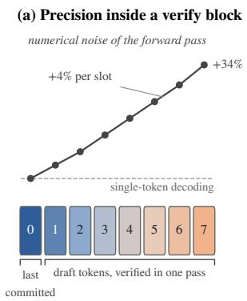

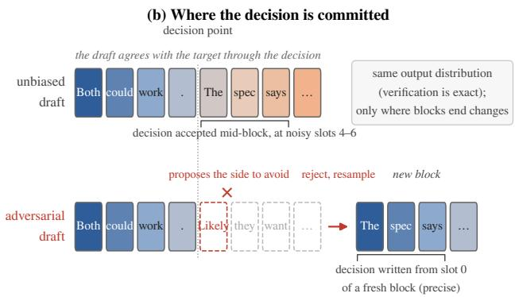

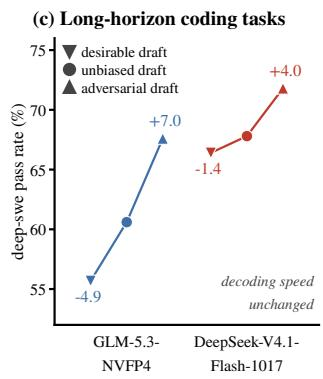

## 1 INTRODUCTION

Speculative decoding has become a popular way to serve large language models (Leviathan et al., 2023; Chen et al., 2023; Cheng et al., 2026). A small draft model proposes a block of tokens, the large target model scores the whole block in one forward pass, and a rejection-sampling rule accepts a prefix of the block. When a draft token is rejected, the rule resamples that position from a residual distribution.

The output is guaranteed to follow the target model’s distribution. Because of this constraint, speculative decoding is treated as an optimization solely for decoding speed, and earlier studies on better drafts, from EAGLE-style feature drafters (Li et al., 2024) to block-parallel drafters (Chen et al., 2026b; Cheng et al., 2026), measure success by a single number: how many tokens the target accepts per verification step.

However, the theoretical guarantee is stated for an idealized target, a fixed function from a prefix to a distribution. Frontier models are not hosted that way. They are served with low-precision weights, quantized key-value (KV) caches and sparse attention, and their inference outputs are not bitwise-reproducible. In this regime, the target’s logits are a noisy quantity depending on how the computation is laid out, and is relevant to the draft acceptence length. We measure this directly by rerunning the same forward pass on an identical prefix and compare the top-k log-probabilities. On GLM-5.3 (GLM-5-Team et al., 2026) with an 8-token DFlash verification block, the first slot of the block is exactly as noisy as single-token decoding. Beyond the first slot, the noise increases with each position in the block, by roughly 4% per slot, and large deviations grow faster still: by the last slot, log-probability shifts of more than 2 natural-log units (nats) are nearly twice as common as at the first. DeepSeek-V4.1-Flash-1017 (Xu et al. 2026; referred to in this study as DeepSeek-V4.1-Flash) with a 6-token DSPARK block shows the same pattern. Its absolute noise is about half that of GLM-5.3, but it grows at the same relative rate of roughly 4% per slot. Speculative verification is therefore lossless in distribution but not neutral in precision: where a token sits in a verification block determines how precisely the target encodes it.

This matters most for long-horizon agents. A softwareengineering agent runs for dozens to hundreds of turns over thousands to millions of tokens. Every token it generates is encoded and committed to the KV cache and read back by everything that follows. Most of these tokens can carry higher noises without hurting future reasoning, but some are not, especially for those critical phrases in the thinking process where the model frames a decision in its thinking, for example, as a matter of principle and evidence, as a guess about what is likely or risky, or settling a confusion by guessing, reading, or running tests. In our audit of agentic coding traces, principle-, evidence-framed, or actual testdriven decisions took the correct side about twice higher than likelihood- or risk-guided reasoning. It is worth noting that these decisions are not necessarily persistent across the lifespan of the entire agentic task. Some wrong decisions can be flipped according to environmental feedback signals, while correct ones could be ignored in long-horizon tasks.

These observations suggest a lever that the lossless view hides. We cannot change the distribution the target verifies, and we do not want to. However, we can decide where each token comes from to re-allocate context precision by training the draft model to be rejected. An accepted draft token is committed with the precision of whichever slot verified it. A rejected token is resampled by the target, its entry is written at the head of a fresh verification block, and the verification of everything after it restarts from the least noisy slot. A draft that is rejected exactly at critical reasoning phrases therefore routes the decisions that matter through the target’s most precise path. It leaves the routine thinking tokens to ordinary acceleration.

We call this approach Adversarial Speculative Reasoning. We locate critical thinking in agent traces and build preference pairs between alternative decision framings. We then train the draft with direct preference optimization (DPO; Rafailov et al., 2023) in the reverse direction: the draft learns to prefer the framing the target should avoid. At inference, the draft and the target diverge precisely at these points, so the target’s own choice is committed through residual sampling and encoded precisely in the KV cache. The target model is unchanged, and so is the verification rule and its exactness guarantee. Only the draft model is changed and context precision is re-allocated. With this approach, we significantly improve long-horizon agent reasoning accuracy without hurting inference efficiency. For example, on DeepSWE (Huang & Jiang, 2026), a benchmark of complex software-engineering tasks, Adversarial Speculative Reasoning raises the end-to-end success rate of GLM-5.3-nvfp4 from 60.6% to 67.6% (+7.0 points). It raises DeepSeek-V4.1-Flash from 67.8% to 71.8% (+4.0 points) with the standard evaluation harness and environments. Overall, we make the following contributions:

1. We show that speculative verification is lossless in distribution but not uniform in numerical precision. Noise grows with slot position inside a verification block, appearing in two frontier models with different draft architectures.

2. We recast the draft model from an accelerator into an allocator of context precision. Draft acceptance decides which tokens are committed through low-noise residual sampling, a degree of freedom that is traditionally treated as irrelevant.

3. We introduce reverse-direction preference training of the draft at decision points, so that the target model writes the decisions that shape a long-horizon trajectory.

4. We improve end-to-end success on long-horizon softwareengineering agentic tasks for two frontier models, with no change to the target model or to the exactness of verification.

## 2 RELATED WORK

Speculative decoding and draft training. Speculative decoding (Leviathan et al., 2023; Chen et al., 2023) speeds up autoregressive generation. A cheap drafter proposes a block of tokens, the target model scores the whole block in one forward pass, and a modified rejection-sampling rule keeps the target’s output distribution exactly. Since then, most studies have aimed at more accepted tokens per verification step. Medusa (Cai et al., 2024) attaches extra decoding heads to the target model. EAGLE (Li et al., 2024) and EAGLE-3 (Li et al., 2025) draft from the target’s hidden features. DFlash (Chen et al., 2026b) drafts a whole block in parallel with a lightweight block-diffusion model. DistillSpec (Zhou et al., 2024) distills the target into the draft to better align the two. In all of these methods the draft is trained to agree with the target, and the only metric is the decoding speed. We train the draft toward a different goal: to disagree with the target at chosen positions for stronger reasoning capability in long-horizon tasks.

Relaxing exactness. Another line of work gives up exact verification for speed. For example, Judge Decoding (Bachmann et al., 2025) accepts draft tokens that a learned judge considers high quality even when the target would reject them. These methods trade fidelity to the target for speed. Our method moves in the opposite direction. The verification rule and its exactness guarantee stay intact. We change only which tokens end up committed through acceptance and which through residual sampling, and use this choice to re-allocate context precision.

Numerical nondeterminism in LLM inference. Production inference does not evaluate the idealized function that exactness guarantees assume. Yuan et al. (2025) show that under bfloat16 with greedy decoding, reasoning models can vary by several accuracy points and by thousands of tokens of response length across system configurations. He & Lab (2025) trace much of the run-to-run variation in serving engines to kernels that are not batch-invariant. Frontier models are also routinely served with quantized key-value caches (Liu et al., 2024) and sparse attention (Liu et al., 2025), which add approximation errors on top. These studies treat precision as a property of the whole system and try to reduce or remove the variation. We instead measure how precision varies within a speculative verification block, and exploit that variation instead of eliminating it.

Error accumulation in long-horizon agents. Agent benchmarks such as SWE-bench (Jimenez et al., 2024) require dozens of steps over long contexts, and small per-step errors compound. Sinha et al. (2026) show that models become more likely to produce error once their context contain their own earlier mistakes, an effect they refer to as selfconditioning, and that larger models alone do not remove it. This line of work motivates our focus on the persistence of individual reasoning decisions. Once a decision point is encoded into the context, it conditions everything that follows.

Critical tokens and preference optimization. Several studies find that a small subset of tokens decides where reasoning goes. Lin et al. (2025) identify and replace critical tokens that turn failed reasoning chains into correct ones, and train on them with token-level DPO. Wang et al. (2025) find that about 20% of chain-of-thought tokens have high entropy and act as forks between reasoning paths, and that restricting reinforcement-learning updates to these tokens matches or exceeds full updates. Both studies change the larger target model, while we apply direct preference optimization (Rafailov et al., 2023) only to the draft, in reverse, so that the draft reliably proposes the framing the target should avoid. Li et al. (2026) found that even in a model routing system, critical reasoning in long-horizon tasks need to be handled by stronger models.

## 3 CHARACTERIZING CONTEXT PRECISION

Exactness guarantees for speculative decoding are stated for an idealized target: a fixed function from a prefix to a nexttoken distribution. A served target is not that function. Its logits are produced by low-precision kernels whose result depends on how the computation is laid out, and a verify forward pass lays the computation out differently from ordinary decoding by processing a block of tokens in one launch, and each position attends to key-value entries that were computed in that same launch. This section asks whether and where that difference matters. We use two complementary measurements. The first isolates the numerical noise of a single forward pass at each position of a verification block (§3.2). The second follows a verify-written context through the rest of a long agent trajectory (§3.2).

## 3.1 Setup

Models and serving configurations. We study two frontier open-weight reasoning models, each served the way it is deployed in our agent experiments, with SGLang (Zheng et al., 2024) on four NVIDIA B200 GPUs. GLM-5.3 runs with NVFP4 weights 1, FP8 key-value cache and DeepSeek sparse attention (DSA) (Liu et al., 2025), and is accelerated by a DFlash2 block-diffusion draft (Chen et al., 2026b) whose verification block has 8 positions. DeepSeek-V4.1- Flash runs with a DSPARK draft that proposes 5 tokens per step, so each verification block has 6 positions. We index the positions of a verification block by slot $s = 0 , \ldots , W - 1$ where W is the block width. Slot 0 holds the last committed token; slots $s \geq 1$ hold draft tokens. The next-token distribution computed at slot s is the one used to verify the draft token at slot $s + 1 ,$ , or to resample in its place.

Error metric. For a position and two forward passes that should agree, we compare log-probabilities token by token. At each position we take the four most likely tokens under a reference pass, together with the token the trajectory actually emits, and record $| \Delta \log p | = | \log p _ { 1 } ( v ) - \log p _ { 2 } ( v ) |$ for each such token v. Log-probabilities use the natural logarithm, so differences are in natural-log units (nats). A difference of 1 nat is a factor of $e \approx 2 . 7$ in probability, and 2 nats a factor of $e ^ { 2 } \approx 7 . 4 $ . We report the mean and the fraction of tokens whose difference exceeds 1, 2 or 3 nats. The tails matter because our agents sample at temperature 1 with $\mathrm { t o p } \cdot p = 0 . 9 5$ or 1.0. In agentic reasoning, a shift of 1–2 nats in the emitted token’s log-probability changes whether that token lies inside the sampling nucleus in 12% of cases, 2–3 nats in 47%, and more than 3 nats in over 84%.

## 3.2 Measurement Methods

Sliding-window verification. Comparing a verification pass against a separate decoding request mixes two noise sources: the forward pass of decoding, and the independent prefill that rebuilds the prefix in each request. To exclude the latter, we hold the prefix fixed in memory and repeat only the forward decode pass. We first generate a reference trajectory by greedy single-token decoding, so that the tokens under test are the target’s own choices rather than the draft’s. For each position q of the trajectory and each slot s, we prefill the prompt and the trajectory up to the block’s anchor $q - s ,$ write the next W trajectory tokens into the verify block, and execute that same verify forward pass R = 4 times on the unchanged key-value cache. Row s of each repetition gives the distribution at position q computed from slot s. For decoding, we prefill up to q and execute the same singletoken decode step R times. Differences between repetitions then contain only the numerical nondeterminism of one forward pass on identical inputs. We measure 1631 positions on GLM-5.3 and 1294 on DeepSeek-V4.1-Flash, drawn from DeepSWE prompts with 6k–24k tokens of context.

Following a verify-written context over a long horizon. Method 1 measures one forward pass. An agent, however, keeps every token it writes and reads it back for the rest of the task. In each GLM-5.3 DeepSWE trajectory we select the assistant turn with the longest reasoning and call it the source turn (median of 9k tokens, after a median of 45ktoken prefix). We write the source turn’s tokens into the key-value cache for two scenarios: (A) through DFlash blockwise-verification, with every source token forced and accepted through its verify slot; or (B) through single-token decoding. The token sequence is identical on both paths; only the computation that wrote its key-value entries differs. Reusing that cache, we then score the remainder of the real trajectory teacher-forced, up to 128k further tokens (a median of 95 subsequent assistant turns), and record the log-probability of every assistant token; tool outputs stay in the context but are not scored. Each path is built twice $( A , A ^ { \prime }$ and $B , B ^ { \prime } )$ . Because $\left| A - B \right|$ contains the variance of both paths, we compare the paths through their own buildto-build deviations, $| A - A ^ { \prime } |$ versus $| B - B ^ { \prime } |$ , and count tokens whose log-probability moves by more than 1, 2, 3 or 4 nats. We ran this study on 96 distinct tasks and scored 6.38M scored assistant tokens per build.

In summary, sliding-window verification shows the noise growth within a draft block and the latter measures the impact of the noise in long-horizon agent reasoning.

## 3.3 Findings

Precision falls along the verification block. Figure 1 reports the decoding error by slot. On GLM-5.3, slot 0 is exactly as noisy as single-token decoding (0.473 vs. 0.478 nats). Beyond slot 0 the noise rises with every position: the slope is +0.0195 nats per slot with 95% confidence interval (CI), about 4% of the slot-0 level per slot, and the last slot is 34% noisier than the first. Large deviations grow faster than the mean. Shifts beyond 2 nats rise from 3.2% of tokens at slot 0 to 6.2% at slot 7, and shifts beyond 3 nats from 1.1% to 2.1%. DeepSeek-V4.1-Flash shows the same pattern. Its slot-0 noise is half that of GLM-5.3 and its tails are much thinner, but the noise grows at the same relative rate: +0.0094 nats per slot), again about 4% of the slot-0 level per slot. Shifts beyond 1 nat rise from 3.1% to 4.5% (+1.4 points), and beyond 2 nats from 0.41% to 0.68%.

Observation 1. The first slot of a verification block is as precise as single-token decoding. Every later slot is less precise: numerical noise grows by roughly 4% per slot. The chance of high deviation nearly doubles by the end of a verify block.

Why the noise grows. We fix the input tokens and KV cache for repeated decoding and verifications inside the forward passes. A token at slot s attends to the key-value entries of slots $0 , \ldots , s - 1$ , and those entries are computed in the same launch rather than read from the cache. Each repetition recomputes them with its own rounding, and slot s inherits the accumulated variation of all earlier slots. Slot 0 reads only cached entries, which is why it matches decoding. Verification is therefore exact in distribution but not uniform in precision: the further into a block a distribution is computed, the noisier it is.

Verify-written context and long-range extreme deviations. Figure 2 reports the ratio of large deviations on the two paths by distance from the source turn. Beyond 30 turns, context written through verification produces more extreme deviations than context written by decoding. For deviations beyond 4 nats the ratio is 0.98 in turns 11–30, 1.09 in turns 31–50 and 1.16 in turns 51–70 ([0.98, 1.36]). An independent pair of builds on the same trajectories, continued to 64k tokens, gave 1.20 ([1.03, 1.40]) beyond turn 30, and the builds reported here give 1.07 ([0.91, 1.24]) on the same tokens. The two independent comparisons agree on the direction, and the size of the excess varies between them by about as much as it varies between bins, so we read the measurement as a 10 to 20% excess of extreme deviations that sets in after about 30 turns. The excess is confined to the extreme tail. For deviations up to 2 nats the two paths are indistinguishable at every distance pooled over turns 11–90.

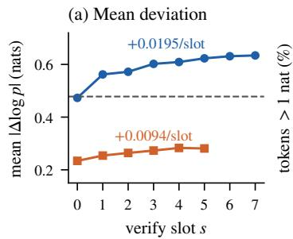

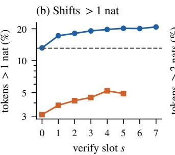

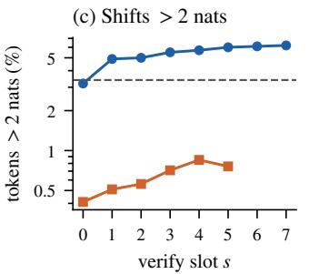

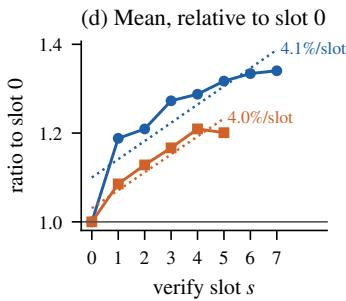  
Figure 1. Single-pass numerical noise |∆ log p| by verify slot between repeated forwards on an identical prefix. (a) Mean deviation, with the per-slot slope. (b, c) Fraction of tokens shifted by more than 1 and 2 nats (log scale). (d) Mean deviation relative to slot 0, with least-squares fits: both models grow by about 4% of their slot-0 level per slot. Slopes with 95% bootstrap CIs over positions: +0.0195 [+0.0174, +0.0214] (GLM-5.3) and +0.0094 [+0.0078, +0.0110] (DeepSeek-V4.1-Flash).

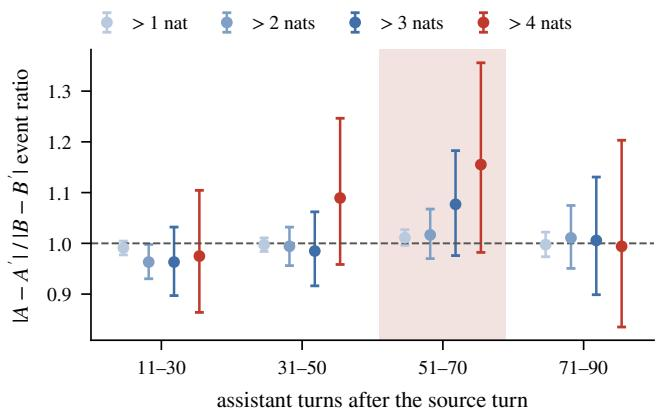  
Figure 2. Long-range deviations of verify-written vs. decodewritten context on GLM-5.3: ratio of assistant tokens whose emitted-token log-probability changes by more than each threshold the verify path and decode path, in 20-turn bins after the source turn. Error bars are 95% bootstrap CIs over trajectories. For deviations beyond 4 nats the ratio rises from 0.98 (turns 11–30) to 1.09 (31–50) and 1.16 (51–70, shaded; [0.98, 1.36]), then returns to 0.99 (71–90) since fixed teacher-forcing tokens correct the biases.

Observation 2. Context written through verification reads back like decode-written context for about 30 turns and then produces significantly more extreme deviations beyond 4 nats in output token distribution of the target model.

## 3.4 Implications

Taken together, the two measurements give a simple picture. Speculative verification preserves the target’s distribution but its precision is not uniform, and the loss of precision is structured: it grows along the verification block, concentrates in large deviations, and the encoding noises on thinking tokens can surface far downstream. This has no consequence for most tokens, which are routine and robust to small perturbations. It matters for the few tokens at which an agent commits to a decision, because those tokens shape every turn that follows. Standard speculative decoding is indifferent to where such tokens land: whether a decision is committed at the precise head of a block or at its noisy tail depends only on how many draft tokens happened to be accepted before it.

The position at which a token is committed is not determined by the target, however; it is decided by the draft. If the draft proposes something the target rejects, the target resamples that position itself, and the next verification block starts from slot 0. A draft that is reliably rejected at decision points therefore moves those decisions to the most precise slot and resets the precision of the tokens that follow, without changing the output distribution. Section 4 turns this observation into a training objective for the draft.

## 4 ADVERSARIAL SPECULATION

Section 3 showed that a verification block is exact in distribution but not uniform in precision. Slot 0 is as precise as single-token decoding, and every later slot is noisier. Which slot a token is committed from is decided by the draft, through how many of its proposals the target accepts. This section introduces how we turned the draft into a tool for controlling that choice and re-allocating the context precision. We train the draft adversarially. At the points where a model commits to a decision in its thinking, the draft learns to propose the undesirable behavior. The target rejects that proposal, writes the decision itself, and the tokens after it start from a fresh verification block. Because distribution is exact, the trained draft cannot change what the target would sample. It changes only where blocks end and which tokens are committed with higher precision into the KV cache. In this section, §4.1 states what a draft can and cannot control. §4.2 defines the decision points and the preferences we train on. §4.3 describes the training data and objective, §4.4 shows the two unbiased draft models are made trainable.

## 4.1 Rejection as a Control Channel

Let $p ( \cdot \mid x )$ be the target model’s next-token distribution at a position with prefix x, and $q ( \cdot \mid x )$ the draft’s. Speculative sampling accepts a draft token $v \sim q$ with probability min $\left( 1 , p ( v ) / q ( v ) \right)$ . On rejection it samples a replacement from the residual distribution

$$
r ( v ) \propto \mathrm { m a x } \big ( 0 , p ( v ) - q ( v ) \big ) .
$$

For every $q ,$ the committed token is distributed exactly as $p .$ The draft therefore cannot change the output distribution. What it does control is the probability that the block ends at this position,

$$
\mathrm { P r } [ \mathrm { r e j e c t } ] = 1 - \sum _ { v } \mathrm { m i n } \big ( p ( v ) , q ( v ) \big ) = \mathrm { T V } ( p , q ) ,
$$

the total-variation distance between the two distributions. A draft that places its mass where the target places little is rejected often. After a rejection, the replacement token becomes the last committed token, and the next verify forward places it at slot 0. Its key-value entries, and those of the tokens that follow it, are computed from the most precise slot of a new block rather than from the tail of the old one.

This gives a handle that standard speculative decoding mod els ignored. A draft trained only for acceptance keeps agreeing with the target through routine text and into a decision, so where a decision lands in a block is a matter of chance. A draft that disagrees with the target at decision points makes the target model write critical thinking tokens into the KV cache from the head of a block. We call such a draft adversarial: at decision points it proposes the side the target should reject, and the target’s verification step does the rejecting. For routine tokens the draft should remain an ordinary, high-acceptance draft to preserve decoding speed.

## 4.2 Decision Points and Preferences

An agent’s reasoning is mostly routine. The tokens that matter are the few at which it commits: it settles on how to read an ambiguous requirement, decides whether to test an edge case, or signs off on a change. We locate these points through the committing sentence, the sentence in the reasoning that confirms observations, states next steps, and commits decisions. A judge labels each segment of reasoning and returns the committing sentence verbatim (at most 35 words), which fixes the decision point in the token sequence. The judge is the target model itself, so no stronger external model is involved. Each preference splits behavior at a decision point into a desirable and an undesirable side. We use the following preferences.

Decision frame. Agent reasoning regularly reaches points of confusion: different readings of a requirement or implementation strategies are both plausible, and the agent has to commit to one. Agents resolve these points in a few recurring modes. A principle frame derives the choice from the task specification or from interface semantics, and an evidence frame cites something observed in the repository or previous test. A likely frame guesses which option is more likely to be expected in hidden tests, a risk frame picks the conservative option, and a simpler frame picks the option that needs less code changes. Analyzing reasoning traces, we find that the mode predicts whether the decision is correct: on GLM-5.3, decisions made in a principle or evidence frame are correct about 70% of the time, against 36% for likely and risk frames. Principle and evidence are therefore the preferred frames; likely, risk and simpler are adversarial.

Behavior preferences. DeepSeek-V4.1-Flash writes terser reasoning, and two thirds of its likely-framed sentences carry no lexical marker of the decision frames analyzed above. Its failures concentrate instead in decisions taken without validation: it signs off on a case, or trusts unreliable observation, without running actual tests to validate its reasoning. We therefore define a preference over the behavior around actually running tests on whether the agent runs a test before it commits to a plan or reacts to environment signals. The decision points are the moments at which a check is warranted: before committing to a plan, upon receiving a tool returning a failure or other unexpected output, and right after the reasoning raises a new scenario that the code may not handle or the task description did not specify clearly. At such a point the agent can construct and run a test, either to decide between the options in front of it or to find out what caused an anomaly in the environment before deciding how to handle it. It can also move on without that evidence, by only reading or editing files, or by questioning or dismissing the case in its reasoning. We found that testing is the more reliable side that leads to more correct behaviors. We label each continuation by the tool call issued after the thinking process. A continuation that executes a test or a script is labeled preferred, and one that issues only other commands is labeled adversarial.

Direction. A draft trained on preferences in the preferred direction would favor the side leading to correct reasoning. Recent work tunes a draft toward faithful responses in this way and relaxes verification so that the draft can steer the output (Chen et al., 2026a). We keep verification exact and train the adversarial draft in the reverse direction: its chosen side is the undesirable one (likely, risk or simpler frames on GLM-5.3; not running the tests on DeepSeek-V4.1-Flash), so that at a decision point it invites rejection and residual sampling. Because rejection sampling is left intact, the draft cannot make the target produce more desirable reasoning and the target produces it exactly as often as it would without speculation. What changes is how that reasoning is encoded. The trained draft model places little mass on the preferred tokens, so when the target does produce one, it is more likely to come from residual sampling after a rejection than from an accepted draft block. The resampled token then becomes slot 0 of the next verify block, the most precise slot (§3.3), and the reasoning that follows it starts from a fresh block. Undesirable tokens, which the draft proposes, are more often accepted inside a block and computed from its noisier later slots. We hypothesize that over a long horizon an agent holds on more easily to decisions committed at higher precision than to those with noisier key-value states, so that preferred decisions weigh more in long-horizon reasoning.

## 4.3 Fork Pairs and Decision Windows

Preference pairs built from two independent trajectories differ everywhere, and most of the difference is irrelevant to critical decisions. We instead build fork pairs, whose two sides share every token up to the decision point (Lai et al., 2024). For each decision point in a real trajectory, we take the reasoning up to the start of the committing sentence as the fork prefix, render it exactly with the served chat template, and resample n continuations from the target at temperature 1 with top- ${ \cdot } p = 0 . 9 5$ . The judge labels each continuation, which must state its own committing sentence in the newly sampled text. We pair a preferred continuation with an adversarial one from the same fork. Because the shared prefix cancels in the objective below, the gradient comes only from what happens after the fork.

Pairs are ranked by how informative they are. For decision frames, we only select fork points leading to both preferred and adversarial framings to teach the draft model about fram ing rather than the reasoning correctness. Forks reaching only one side are dropped. We cap the number of pairs per fork, per sample and per task, and hold out whole tasks for evaluation, since a random split leaks near-duplicate forks between training and evaluation.

On GLM-5.3, 29 tasks give 1,668 forks with n = 16 continuations each (28,356 samples) and 2,843 pairs from 28 tasks. Six tasks (619 pairs) are held out. On DeepSeek-V4.1-Flash, the run-tests preference gives 2,203 forks with n = 12 continuations of up to 1,536 tokens (26,418 samples) and 6,391 pairs from 92 tasks. We hold out 10% of tasks (719 pairs) and train on 5,100 pairs.

The objective is direct preference optimization (Rafailov et al., 2023) on the tokens restricted to a context window around the decision. For decision framing preference, $W ( y )$ starts 32 tokens before the committing sentence and runs to its end with weight $w _ { t } = 1$ , followed by a 128-token tail over which $w _ { t }$ decays linearly from 1 to 0, about 200 tokens in total. For preference over running tests, which has no single committing sentence, $W ( y )$ is the first 512 tokens of the continuation with $w _ { t } = 1$ . The reward is the weighted mean log-ratio of the trained draft $q _ { \theta }$ to the frozen original

draft $q _ { \mathrm { r e f } } .$

$$
r _ { \theta } ( y ) = \frac { \sum _ { t \in W ( y ) } w _ { t } \left[ \log q _ { \theta } ( y _ { t } \mid c ) - \log q _ { \mathrm { r e f } } ( y _ { t } \mid c ) \right] } { \sum _ { t \in W ( y ) } w _ { t } } ,
$$

$$
\mathcal { L } \ = \ - \log \sigma \big ( \beta \left[ r _ { \theta } ( y _ { w } ) - r _ { \theta } ( y _ { l } ) \right] \big ) \ + \ \alpha \mathrm { N L L } _ { \theta } ( y _ { w } )
$$

where c stands for the shared context, $y _ { w }$ is the chosen and $y _ { l }$ the rejected continuation, and $\beta = 1 0$ . The optional term α NLL anchors the chosen side’s likelihood will be discussed in §5.1.

## 4.4 Training Draft Models

The input of the draft models is the hidden states of the target, and the reward needs the draft’s distribution at every token of a continuation. We extract the hidden states once per sample from an inference instance hosting the target model, and train the draft model offline on these features.

GLM-5.3-NVFP4 DFlash2. The DFlash2 draft model reads hidden states from six layers of the target (layers 5, 19, 33, 47, 61 and 75), projected into the draft. We train its transformer layers and norms in bf16. Figure 3(a) shows which parts of the draft are trained.

DeepSeek-V4.1-Flash DSPARK. The DSPARK draft has about 14.3B parameters, 13.6B of them in FP4 routed experts, and its released implementation uses inference-only kernels. We port it to differentiable PyTorch operations, matching the reference kernels to within $1 0 ^ { - 7 }$ per expert and 3–5% per stage output. We train the attention projections, norms, hyper-connections, attention sinks and the draft’s bigram head (449M parameters) and keep the routed experts and the input projection frozen. Weights stored in FP8 are trained with quantization-aware training (QAT): the forward pass fake-quantizes them in their deployed block format $( 3 2 \times 3 2$ blocks with power-of-two scales), the gradient passes straight through, and the exported draft is requantized to the same format, so the deployed draft computes exactly the function that was evaluated. Reference log-probabilities are precomputed with the original draft. Figure 3(b) shows which parts of the draft are trained.

Size of the trainable parameters. Both targets have about 750B parameters (GLM-5.3: 753B; DeepSeek-V4.1-Flash: 749B, excluding its draft). The trainable set is 2.15B parameters for GLM-5.3 and 449M for DeepSeek-V4.1-Flash: 87% and 3.2% of the respective drafts (2.46B and 14.2B), and 0.28% and 0.06% of the deployed target-plus-draft systems. Adversarial speculative reasoning changes a model’s behavior by training well under one percent of its parameters, and the trained parameters never produce an output token outside of the target model’s distribution.

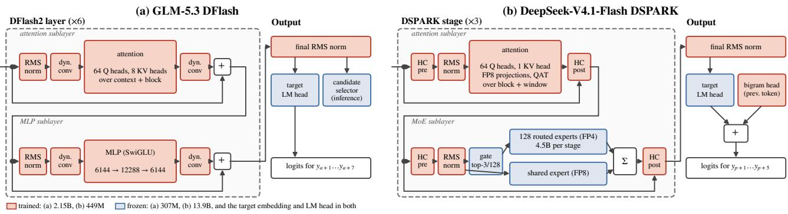  
Figure 3. The two production drafts, with the parameters trained in the deployed adversarial drafts in red and frozen parameters in blue (inputs not drawn). (a) GLM-5.3 DFlash predicts a block of seven tokens from the projected target features; we train its six transformer layers and the final norm (2.15B parameters), and freeze the feature projection, the candidate selector and the target’s embedding and LM head. (b) DeepSeek-V4.1-Flash DSPARK predicts a block of five tokens through three MoE stages; we train the attention sublayers (FP8 projections through quantization-aware training), the norms, the hyper-connection mixing and the bigram head (449M parameters), and freeze the experts, the router, the input projection and the target’s embedding and LM head.

## 5 EXPERIMENTS

The method rests on three claims, and we test one per subsection. First, a draft model can be trained to prefer the undesirable side of a decision while its agreement with the target elsewhere is unchanged (§5.1). Second, serving the target model with that draft improves its results on longhorizon coding tasks (§5.2). Third, the adversarial draft does not slow decoding (§5.3). Throughout, the two targets are GLM-5.3-nvfp4 with its DFlash2 draft and DeepSeek-V4.1-Flash with its DSPARK draft with exact verification, so a draft can change which tokens are proposed but not the distribution of the tokens emitted.

## 5.1 Drafts Learn the Preference

We evaluate a trained draft by the fraction of pairs from tasks unseen in training on which the draft’s windowed reward (§4.3) is higher for the chosen side, namely heldout preference accuracy. An untrained draft scores 0.5 by construction. What training costs in acceptance is measured separately, in §5.3: each trained draft model is compared with its untrained version slot by slot on the same tokens (Figure 5(c, d)). On GLM-5.3 we hold out 6 of the 29 tasks (619 pairs); on DeepSeek-V4.1-Flash we hold out 10% of the tasks (719 pairs for running tests). Each preference is trained in both directions: a preferred draft favors the desirable side, an adversarial draft the undesirable one. Alongside the two preferences we deploy (§4.2), we train two reference preferences on DeepSeek-V4.1-Flash that we do not use, to mark what a draft cannot learn: how long the model thinks, and whether the decision leads to correct outcome.

We found that the preferences we picked are learnable by the draft model. On GLM-5.3, adversarial training on decision frames achieves 0.635 held-out accuracy (seed-to-seed spread ±0.015). On DeepSeek-V4.1-Flash, the adversarial run-tests preference accuracy reaches 0.85.

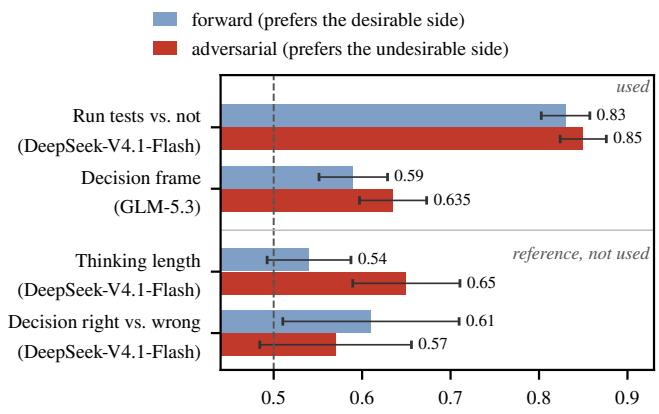  
Figure 4. Held-out preference accuracy of trained drafts on tasks unseen in training, best configuration per preference and direction; error bars are 95% binomial confidence intervals, the dashed line is chance. Top: the two preferences we deploy. Bottom: two reference preferences we do not use. For thinking length the preferred side is the shorter thinking; for right vs. wrong it is the right decision, and the bars shown are the best of 36 (forward) and 12 (adversarial) configurations whose medians are 0.52 and 0.46.

In evaluation, we adopt the draft models that actually learned the preference. Figure 4 puts the two preferences we proposed next to the two reference preferences. Whether the model runs its tests, and in which frame it commits to a decision, are learned in both directions: 0.83 and 0.85 for running tests, 0.59 and 0.635 for the decision frame. We found that whether a decision is right is closer to unlearnable by the small draft model, since it requires stronger reasoning capability. The best of 36 forward and 12 adversarial configurations reach 0.61 and 0.57 on 92 and 128 pairs, inside the confidence interval of chance, and the medians are 0.52 and 0.46. Thinking length sits in between, 0.54 forward and 0.65 adversarial. The reference preferences showed that a draft model can pick up how a decision is phrased and what the model does next, but is not strong enough to learn semantic correctness. We therefore train only preferences of the first kind, which is sufficent for our adversarial speculation design. The draft does not have to know which side is right, only to propose the framing the target rejects.

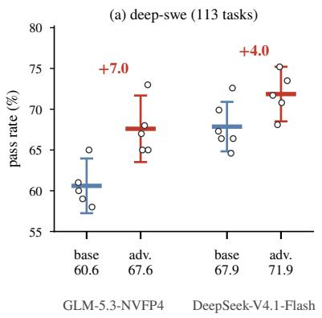

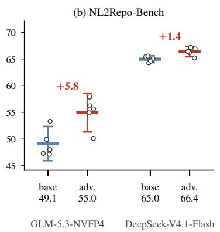

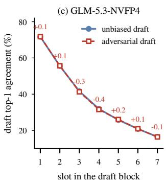

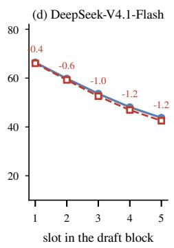  
Figure 5. (a, b) Pass rates (%) of each target model served with its unbiased draft (base) and with the adversarial draft (adv.), five independent end-to-end runs each. Dots are runs, the thick line is their mean (printed below), the error bar is the 95% confidence interval of the mean. Both panels span the same 25 points on the vertical axis, so spreads are comparable across benchmarks. The draft changes nothing but which tokens are proposed; the output distribution is identical under exact verification. (c, d) Top-1 agreement of the draft with the emitted token at each slot of the draft block, unbiased draft model against the deployed adversarial draft, teacher-forced on the target’s hidden states over held-out continuations (GLM-5.3-nvfp4: 30 continuations of 512 tokens; DeepSeek-V4.1-Flash: 240 continuations of 512 tokens, 160 at run-tests turns and 80 at decision points). The red numbers denote the change in points.

Training Details. We deploy the GLM-5.3 DFlash draft trained at $\beta = 1 0$ , a learning rate of $5 \times 1 0 ^ { - 6 }$ and a 128- token decay window to prefer undesirable decision frame. On DeepSeek-V4.1-Flash we deploy the adversarial runtests draft: QAT over the attention parameters, a learning rate of $2 \times 1 0 ^ { - 5 }$ , α = 0.2, a 512-token window, taken after the second epoch (held-out accuracy 0.70). Neither changes the target’s output distribution.

## 5.2 Agentic Coding Performance

We evaluate the adversarial draft models on two agentic coding benchmarks. On DeepSWE, the agent receives a repository and a task description, works in a mini-swe-agent harness with shell access, and is graded by hidden tests; we report the fraction of the 113 tasks whose all hidden tests pass. On NL2Repo-Bench (Ding et al., 2025), the agent receives a requirements document and an empty workspace and has to build a multi-module Python library from scratch; the 104 generated repositories are graded against the upstream project’s pytest suite, and we report the mean test pass rate. To avoid reward hacking, we prevented internet connection for the development workspace. Both benchmarks run for hundreds of turns per task, with contexts that grow past 200k tokens, so they exercise the long-horizon regime. For each target we compare two servers that differ only in the draft: the pretrained draft (base, standard speculative decoding) and the adversarial draft of §5.1. Everything else is held fixed: the target weights, the serving stack, exact verification, the sampling parameters, and the agent harness. Each configuration is tested five times independently.

We found the adversarial draft raises the pass rate of both targets models on both tasks. Figure 5(a, b) shows every run. On DeepSWE, GLM-5.3-nvfp4 served with the adversarial draft passes 67.6% of tasks against 60.6% with its unbiased draft, a gain of 7.0 points (95% CI 2.6 to 11.4). DeepSeek-V4.1-Flash gains 4.0 points on DeepSWE, 71.8% against 67.8% (95% CI −1.3 to 7.3), and 1.4 points on NL2Repo-Bench, 66.4% against 65.0% (95% CI 0.4 to 2.4, p = 0.011). The three mean gains are all positive and the two that reach significance are on different benchmarks, with different targets and different drafts.

The gain is not from a better model. Nothing in the output distribution changed. Different runs sample from the same targets and the same verified distribution, and the adversarial draft moves only where blocks end (§4.1), and §5.1 showed that it cannot tell a right decision from a wrong one. The gain is therefore evidence for our hypothesis. Forcing a rejection at decision points makes the target write critical reasoning from residual sampling, and the following reasoning are encoded from the head of a verification block. The gain is larger on GLM-5.3, whose thinking is longer and more diverse than DeepSeek-V4.1-Flash.

Training preference in the preferred direction hurts. If the gain comes from where rejections land, then a draft trained to prefer the preferred side at the same decision points should do the opposite: agree with the target exactly where the adversarial draft disagrees, so that decisions are accepted inside a block and written from its later slots. Figure 6 tests this with desirable drafts trained on the same fork pairs as the adversarial drafts, with chosen and rejected sides swapped. Both draft models land below the unbiased draft: GLM-5.3 drops from 60.6 to 55.7, and DeepSeek-V4.1-Flash from 67.8 to 66.4, against gains of 7.0 and 4.1 for the adversarial drafts trained on the same data. The forward drafts learn their preference at least as well as the adversarial ones (held-out accuracy 0.80 for the DeepSeek forward draft against 0.70 for the deployed adversarial one), so the preference of the draft model is the only factor of the performance gap. This result further proved that where critical tokens are encoded in a verification window can significantly bias reasoning in long horizon agent tasks.

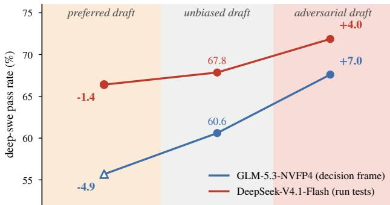

Figure 6. Direction of the trained preference against DeepSWE pass rate. The unbiased and adversarial points are the means of Figure 5(a); the desirable draft models are trained on identical datasets with only the preference reversed.  
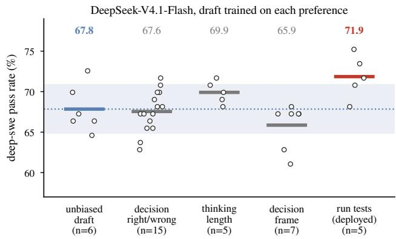  
Figure 7. DeepSWE pass rate of DeepSeek-V4.1-Flash served with drafts trained on different preferences. The band denotes the 95% confidence interval of the unbiased draft’s mean. Only the adversarial run-tests draft model shows meaningful improvement.

An unrelated preference changes nothing. If the gain came from serving with any trained draft, drafts trained on other preferences would show it too. Figure 7 collects every complete DeepSWE run of DeepSeek-V4.1-Flash served with a draft from this project, 27 runs with drafts trained on three preferences we did not deploy: whether the decision is right (15 runs), how long the model thinks (5), and the frame of the decision (7). Pooled, they pass 67.5% of tasks against 67.8% for the unbiased draft (Welch $p = 0 . 8 3 )$ , and no single group differs from the unbiased draft $( p \ge 0 . 1 6 )$ ; the deployed run-tests draft is 4.3 points above the pooled unrelated drafts $( p = 0 . 0 1 8 )$ . The decision right drafts, which did not learn their preference (§5.1), sit on the unbiased mean, as expected for a draft that proposes the same tokens; the decision-frame drafts learned theirs (0.64 to 0.69 held-out) and still change nothing, because on this target the committing sentence is not where runs are lost. The gain follows the preference that targets the behaviour behind the failures, not the act of training a draft.

## 5.3 Inference Efficiency

With rejection sampling, the draft model does not change the output distribution, so its only cost is the number of tokens can be emitted in every verification step. Each step accepts a prefix of the proposed block, and the mean accepted length per step sets the decoding speed. We train adversarial draft models to lower acceptance rate in critical reasoning sentences, and the question is whether it lowers acceptance anywhere else. We answer it by comparing the adversarial draft with the unbiased draft slot.

Figure 5(c, d) compares each deployed draft with its untrained version at every slot of the draft block, teacherforced on the target’s hidden states over held-out continuations, so both drafts see the same tokens. On GLM-5.3 the seven slots move by $+ 0 . 1 , + 0 . 1 , - 0 . 3 , - 0 . 4 , + 0 . 2 , + 0 . 1$ and −0.1 points. On DeepSeek-V4.1-Flash the five slots move b $\mathrm { ~ y ~ } { - 0 . 4 , - 0 . 6 , - 1 . 0 , - 1 . 2 }$ and −1.2 points. Both drafts keep the shape of their acceptance curve. Under the greedy-chain approximation, in which a block is accepted up to the first slot whose argmax misses, the expected number of accepted draft tokens per block is 2.28 before and after training on GLM-5.3, and 2.5 against 2.46 on DeepSeek-V4.1-Flash, a 1.8% difference. In other words, we traded up to 2% decoding speed for significantly improved reasoning capability.

## 6 CONCLUSION

Speculative decoding has been typically viewed purely as a systems optimization to improve the decoding speed since rejection sampling does not change the target distribution. We argue that the draft can decide what tokens in the context are encoded more accurately. An adversarial draft model utilizes this feature to improve reasoning capability. At decision points it proposes reasoning draft that the target model should reject, so the target encodes critical decisions more precisely from the start of a verification block, while everywhere else the draft stays an ordinary high-acceptance draft. With adversarial draft models, GLM-5.3 and DeepSeek-V4.1-Flash gain significantly improved pass rate on Deep-SWE and NL2Repo-Bench across independent runs without changing the output distribution of the target model. We take this as evidence that speculative decoding is more than an acceleration approach. By training the draft model to be a context precision re-allocator, the long-horizon agent reasoning capability of a large language model can be significantly improved.

## REFERENCES

Bachmann, G., Anagnostidis, S., Pumarola, A., Georgopoulos, M., Sanakoyeu, A., Du, Y., Schoenfeld, E., Thabet, A., and Kohler, J. Judge decoding: Faster speculative sampling requires going beyond model alignment. In Yue, Y., Garg, A., Peng, N., Sha, F., and Yu, R. (eds.), International Conference on Learning Representations, volume 2025, pp. 40894–40914, 2025.

Cai, T., Li, Y., Geng, Z., Peng, H., Lee, J. D., Chen, D., and Dao, T. Medusa: Simple llm inference acceleration framework with multiple decoding heads. In Proceedings of the 41st International Conference on Machine Learning, ICML’24. JMLR.org, 2024.

Chen, C., Borgeaud, S., Irving, G., Lespiau, J.-B., Sifre, L., and Jumper, J. Accelerating large language model decoding with speculative sampling. arXiv preprint arXiv:2302.01318, 2023. URL https://arxiv.org/ abs/2302.01318.

Chen, G., Wang, D., and Hu, L. Sfad: Speculative factualityaware decoding. In Findings ofthe Associationfor Computational Linguistics: EMNLP 2026, pp. 24221–24239, 2026a.

Chen, J., Liang, Y., and Liu, Z. DFlash: Block diffusion for flash speculative decoding. In Zhang, T., Dudik, M., Jaggi, M., Agarwal, A., Li, S., Schuurmans, D., Zhu, J., Berkenkamp, F., Dong, H., and Bietti, A. (eds.), Proceedings of the 43rd International Conference on Machine Learning, volume 306 of Proceedings ofMachine Learning Research, pp. 15343–15355. PMLR, 06–11 Jul 2026b. URL https://proceedings.mlr.press/v306/ chen26bv.html.

Cheng, X., Yu, X., Shao, C., Li, J., Xiong, Y., Qian, Y., Zhu, J., Ma, S., Zhang, X., Ye, J., et al. Dspark: Confidencescheduled speculative decoding with semi-autoregressive generation. arXiv preprint arXiv:2607.05147, 2026.

Ding, J., Long, S., Pu, C., Zhou, H., Gao, H., Gao, X., He, C., Hou, Y., Hu, F., Li, Z., Shi, W., Wang, Z., Zan, D., Zhang, C., Zhang, X., Chen, Q., Cheng, X., Deng, B., Gu, Q., Hua, K., Lin, J., Liu, P., Li, M., Pan, X., Peng, Z., Qin, Y., Shan, Y., Tan, Z., Xie, W., Wang, Z., Yuan, Y., Zhang, J., Zhao, E., Zhao, Y., Zhu, H., Zou, C., Ding, M., Jiao, J., Liu, J., Liu, M., Liu, Q., Tao, C., Yang, J., Yang, T., Zhang, Z., Chen, X., Huang, W., and Zhang, G. Nl2repo-bench: Towards long-horizon repository generation evaluation of coding agents. CoRR, abs/2512.12730, December 2025. URL https://doi. org/10.48550/arXiv.2512.12730.

GLM-5-Team, :, Zeng, A., Lv, X., Hou, Z., Du, Z., Zheng, Q., Chen, B., Yin, D., Ge, C., Huang, C., Xie, C., Zhu, C., Yin, C., Wang, C., Pan, G., Zeng, H., Zhang, H., Wang, H., Chen, H., Zhang, J., Jiao, J., Guo, J., Wang, J., Du, J., Wu, J., Wang, K., Li, L., Fan, L., Zhong, L., Liu, M., Zhao, M., Du, P., Dong, Q., Lu, R., Shuang-Li, Cao, S., Liu, S., Jiang, T., Chen, X., Zhang, X., Huang, X., Dong, X., Xu, Y., Wei, Y., An, Y., Niu, Y., Zhu, Y., Wen, Y., Cen, Y., Bai, Y., Qiao, Z., Wang, Z., Wang, Z., Zhu, Z., Liu, Z., Li, Z., Wang, B., Wen, B., Huang, C., Cai, C., Yu, C., Li, C., Hu, C., Zhang, C., Zhang, D., Lin, D., Yang, D., Wang, D., Ai, D., Zhu, E., Yi, F., Chen, F., Wen, G., Sun, H., Zhao, H., Hu, H., Zhang, H., Liu, H., Zhang, H., Peng, H., Tai, H., Zhang, H., Liu, H., Wang, H., Yan, H., Ge, H., Liu, H., Chu, H., Zhao, J., Wang, J., Zhao, J., Ren, J., Wang, J., Zhang, J., Gui, J., Zhao, J., Li, J., An, J., Li, J., Yuan, J., Du, J., Liu, J., Zhi, J., Duan, J., Zhou, K., Wei, K., Wang, K., Luo, K., Zhang, L., Sha, L., Xu, L., Wu, L., Ding, L., Chen, L., Li, M., Lin, N., Ta, P., Zou, Q., Song, R., Yang, R., Tu, S., Yang, S., Wu, S., Zhang, S., Li, S., Li, S., Fan, S., Qin, W., Tian, W., Zhang, W., Yu, W., Liang, W., Kuang, X., Cheng, X., Li, X., Yan, X., Hu, X., Ling, X., Fan, X., Xia, X., Zhang, X., Zhang, X., Pan, X., Zou, X., Zhang, X., Liu, Y., Wu, Y., Li, Y., Wang, Y., Zhu, Y., Tan, Y., Zhou, Y., Pan, Y., Zhang, Y., Su, Y., Geng, Y., Yan, Y., Tan, Y., Bi, Y., Shen, Y., Yang, Y., Li, Y., Liu, Y., Wang, Y., Li, Y., Wu, Y., Zhang, Y., Duan, Y., Zhang, Y., Liu, Z., Jiang, Z., Yan, Z., Zhang, Z., Wei, Z., Chen, Z., Feng, Z., Yao, Z., Chai, Z., Wang, Z., Zhang, Z., Xu, B., Huang, M., Wang, H., Li, J., Dong, Y., and Tang, J. Glm-5: from vibe coding to agentic engineering, 2026. URL https://arxiv.org/abs/2602.15763.

He, H. and Lab, T. M. Defeating nondeterminism in llm inference. Thinking Machines Lab: Connectionism, 2025. doi: 10.64434/tml. 20250910. https://thinkingmachines.ai/blog/defeatingnondeterminism-in-llm-inference/.

Huang, W. and Jiang, P. Deepswe v1.1: a cleaner, more reproducible benchmark for frontier coding agents, 2026. URL https://github.com/datacurve-ai/deep-swe.

Jimenez, C. E., Yang, J., Wettig, A., Yao, S., Pei, K., Press, O., and Narasimhan, K. R. SWE-bench: Can language models resolve real-world github issues? In The Twelfth International Conference on Learning Representations, 2024. URL https://openreview.net/forum? id=VTF8yNQM66.

Lai, X., Tian, Z., Chen, Y., Yang, S., Peng, X., and Jia, J. Step-dpo: Step-wise preference optimization for longchain reasoning of llms. CoRR, abs/2406.18629, 2024. URL https://doi.org/10.48550/arXiv.2406.18629.

Leviathan, Y., Kalman, M., and Matias, Y. Fast inference from transformers via speculative decoding. In Krause, A., Brunskill, E., Cho, K., Engelhardt, B., Sabato, S., and Scarlett, J. (eds.), Proceedings of the 40th International Conference on Machine Learning, volume 202 of Proceedings of Machine Learning Research, pp. 19274–19286. PMLR, 23–29 Jul 2023. URL https: //proceedings.mlr.press/v202/leviathan23a.html.

Li, J., Jiang, J., Fu, Y., Yao, J., Ye, H., Byeon, W., Belcak, P., Zhang, H., and Molchanov, P. Agentbaton: Efficient model collaboration in agentic tasks, 2026. URL https: //arxiv.org/abs/2610.35959.

Li, Y., Wei, F., Zhang, C., and Zhang, H. EAGLE: Speculative sampling requires rethinking feature uncertainty. In Salakhutdinov, R., Kolter, Z., Heller, K., Weller, A., Oliver, N., Scarlett, J., and Berkenkamp, F. (eds.), Proceedings of the 41st International Conference on Machine Learning, volume 235 of Proceedings ofMachine Learning Research, pp. 28935–28948. PMLR, 21–27 Jul 2024. URL https://proceedings.mlr.press/v235/ li24bt.html.

Li, Y., Wei, F., Zhang, C., and Zhang, H. Eagle-3: Scaling up inference acceleration of large language models via training-time test. In Belgrave, D., Zhang, C., Lin, H., Pascanu, R., Koniusz, P., Ghassemi, M., and Chen, N. (eds.), Advances in Neural Information Processing Systems, volume 38, Main Conference, pp. 136737–136756. Curran Associates, Inc., 2025. doi: 10.52202/085713-4562.

Lin, Z., Liang, T., Xu, J., Liu, Q., Wang, X., Luo, R., Shi, C., Li, S., Yang, Y., and Tu, Z. Critical tokens matter: Token-level contrastive estimation enhances LLM’s reasoning capability. In Singh, A., Fazel, M., Hsu, D., Lacoste-Julien, S., Berkenkamp, F., Maharaj, T., Wagstaff, K., and Zhu, J. (eds.), Proceedings of the 42nd International Conference on Machine Learning, volume 267 of Proceedings of Machine Learning Research, pp. 37906–37918. PMLR, 13–19 Jul 2025. URL https://proceedings.mlr.press/v267/lin25j.html.

Liu, A., Mei, A., Lin, B., Xue, B., Wang, B., Xu, B., Wu, B., Zhang, B., Lin, C., Dong, C., et al. Deepseek-v3. 2: Pushing the frontier of open large language models. arXiv preprint arXiv:2512.02556, 2025.

Liu, Z., Yuan, J., Jin, H., Zhong, S., Xu, Z., Braverman, V., Chen, B., and Hu, X. KIVI: A tuning-free asymmetric 2bit quantization for KV cache. In Salakhutdinov, R., Kolter, Z., Heller, K., Weller, A., Oliver, N., Scarlett, J., and Berkenkamp, F. (eds.), Proceedings of the 41st International Conference on Machine Learning, volume 235 of Proceedings ofMachine Learning Research, pp. 32332–32344. PMLR, 21–27 Jul 2024. URL https:// proceedings.mlr.press/v235/liu24bz.html.

Rafailov, R., Sharma, A., Mitchell, E., Manning, C. D., Ermon, S., and Finn, C. Direct preference optimization: Your language model is secretly a reward model. Advances in neural information processing systems, 36: 53728–53741, 2023.

Sinha, A., Arun, A., Goel, S., Staab, S., and Geiping, J. The illusion of diminishing returns: Measuring long horizon execution in llms. In International Conference on Learning Representations, volume 2026, pp. 35184–35211, 2026.

Wang, S., Yu, L., Gao, C., Zheng, C., Liu, S., Lu, R., Dang, K., Chen, X.-H., Yang, J., Zhang, Z., et al. Beyond the 80/20 rule: High-entropy minority tokens drive effective reinforcement learning for llm reasoning. Advances in Neural Information Processing Systems, 38:115452– 115486, 2025.

Xu, A., Li, B., Lin, B., Xue, B., Xian, B., Xu, B., Wu, B., Zhang, B., Deng, B., Yu, C., et al. Deepseek-v4. 1- flash: Pushing the limits of kv cache compression. arXiv preprint arXiv:2609.19969, 2026.

Yuan, J., Li, H., Ding, X., Xie, W., Li, Y.-J., Zhao, W., Wan, K., Shi, J., Hu, X., and Liu, Z. Understanding and mitigating numerical sources of nondeterminism in llm inference. Advances in Neural Information Processing Systems, 38:169819–169851, 2025.

Zheng, L., Yin, L., Xie, Z., Sun, C., Huang, J., Yu, C. H., Cao, S., Kozyrakis, C., Stoica, I., Gonzalez, J. E., et al. Sglang: Efficient execution of structured language model programs. Advances in neural information processing systems, 37:62557–62583, 2024.

Zhou, Y., Lyu, K., Rawat, A. S., Menon, A. K., Rostamizadeh, A., Kumar, S., Kagy, J.-F., and Agarwal, R. Distillspec: Improving speculative decoding via knowledge distillation. In Kim, B., Yue, Y., Chaudhuri, S., Fragkiadaki, K., Khan, M., and Sun, Y. (eds.), International Conference on Learning Representations, volume 2024, pp. 32011–32050, 2024.