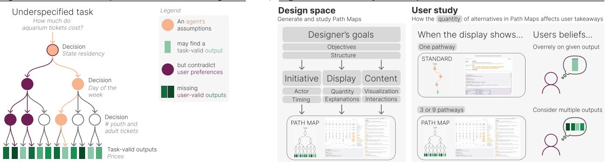
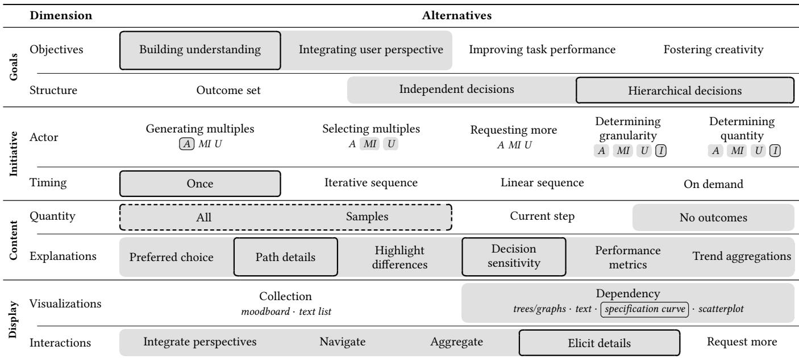
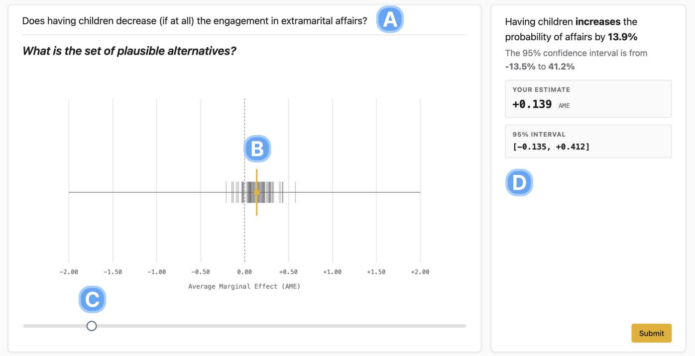
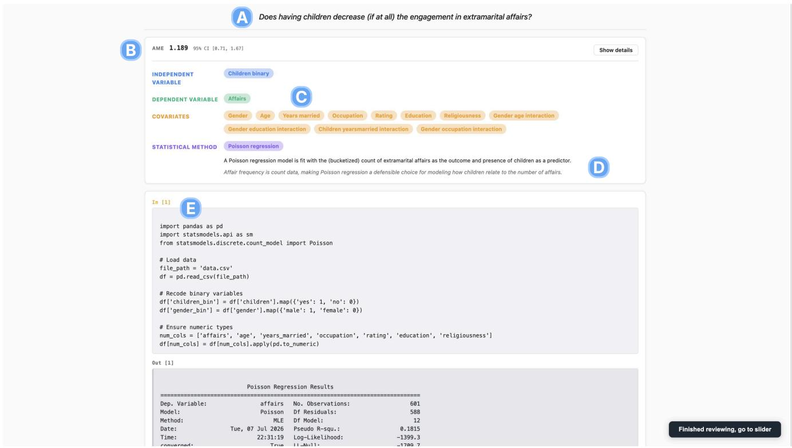
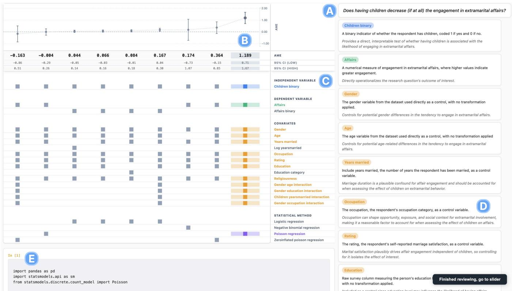
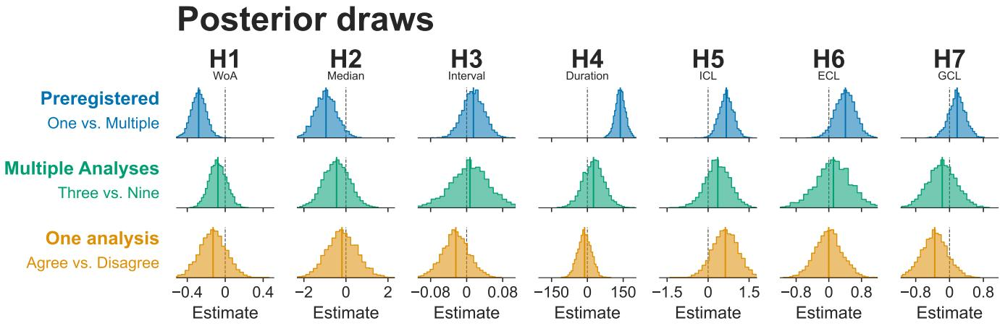
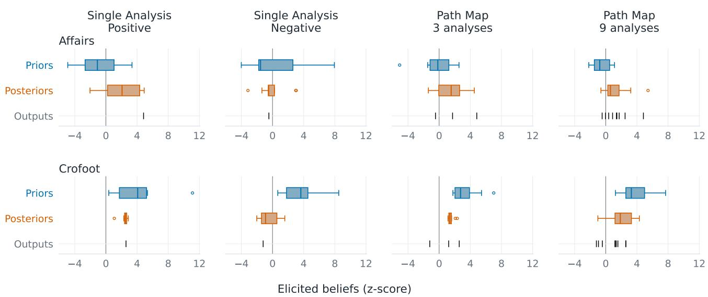
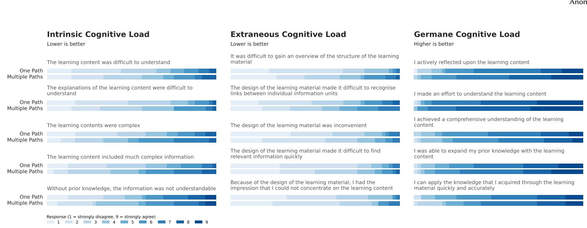
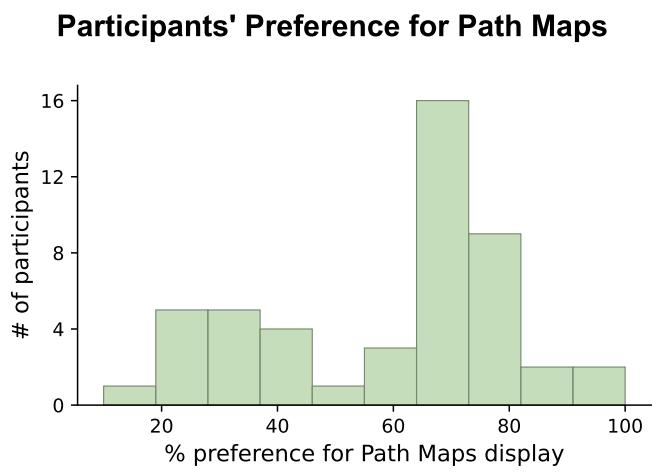

# Agentic Path Maps: Exposing an Agent’s Traversal Through the Garden of Forking Paths

Madeleine Grunde-McLaughlin mgrunde@cs.washington.edu University of Washington Seattle, Washington, USA

Emily Reif emreif@cs.washington.edu University of Washington Seattle, Washington, USA

Kevin Yu bigkyu@cs.washington.edu University of Washington Seattle, Washington, USA

Hafsah Usman   
husman@uw.edu   
University of Washington   
Seattle, Washington, USA

Nino Migineishvili ninom@cs.washington.edu University of Washington Seattle, Washington, USA

Jefrey Heer jheer@cs.washington.edu University of Washington Seattle, Washington, USA

Daniel Mitroshkov dmkov15@cs.washington.edu University of Washington Seattle, Washington, USA

Lakshya Chauhan lakshy16@cs.washington.edu University of Washington Seattle, Washington, USA

Daniel S. Weld   
danw@allenai.org   
Allen Institute for AI   
Seattle, Washington, USA   
University of Washington   
Seattle, Washington, USA

Agents make assumptions about users’ goals so we develop Agentic Path Maps to expose alternative choices

  
Figure 1: Agentic workflows make assumptions about user’s goals to complete underspecified tasks. Although the agent’s found output may be valid under the task constraints, it may not be valid given the users’ context and preferences. In this paper, we contribute Agentic Path Maps to communicate untaken alternative paths to users. We first distill a space of designs for generating and studying Agentic Path Maps. We then manipulate one dimension, the quantity of paths shown, in an empirical user study. We find that participants overrelied less and were more cognitively engaged when shown alternative paths.

## Abstract

When an AI agent executes an underspecified task, it embeds choices that may contradict unarticulated user context and preferences. However, interrupting the user for clarification on all such decisions is untenable. How might agents communicate impactful, but unexplored, paths to the user after execution? To investigate, we first distill a design space for communicating alternative paths, sup porting the generation of new systems and structuring dimensions of future study. We then measure the impact of one vital design space dimension on user comprehension: the number of alternatives displayed. Through a user study (n=48) in the data analysis domain, we find that participants rarely consider alternative paths of their own volition, but AI overreliance reduces when alternative paths are visualized for them. By revealing paths the agent did not take, we demonstrate how users can better interpret results and incorporate personal context.

## CCS Concepts

• Human-centered computing → Empirical studies in HCI;   
Interaction paradigms; Interactive systems and tools.

## 1 Introduction

Consider a teacher using an agent to help plan a field trip to the aquarium, who then finds they owe an unexpected surcharge upon arrival with students. Given that the teacher had taken precautions to carefully verify the agent’s found price, how did this error occur?

When inputting tasks to agents, users specify context that they think might impact the outcomes, but they cannot predict every thing. The teacher queried "How much do tickets to the aquarium cost for 50 7-9 year olds and 6 adults?", specifying ages because they predicted that youth tickets would be priced lower. After the agent returned the price, the teacher reviewed the agent’s actions, verified that it was faithful to the website, confirmed that the price was within budget, and requested the agent to purchase the tickets. However, when arriving at the aquarium, our teacher realized that the agent had incorrectly assumed all students were state residents and purchased tickets accordingly. Although the returned price was correct under the task’s stated constraints (task-valid), our teacher held personal context, knowledge, and preferences that made it incorrect for their particular needs (user-valid).

Underspecified and ambiguous tasks, in which a computing system does not know the user-valid subset of task-valid options, are well-recognized as a critical issue both for AI agents [13, 37] and other computing fields that interpret user context [38, 66, 78, 101]. Gelman and Lopez [47] coined the term “garden of forking paths” regarding specification ambiguity in hypothesis testing, referring to the branching space of possible analysis constructions. Users give agents complex tasks in open-world environments, so it is challenging to predict the agent’s “garden of forking paths” for that task before execution [13]. This issue persists even as agents improve: a seemingly “perfect” agent that invariably finds a task-valid output still may not meet the user’s needs.

For a user to know if a given outcome contradicts their personal context, they must first understand the space of decision points and how alternative choices at those points lead to diferent outcomes. If the teacher learned how residency impacts prices when receiving the estimate, they could consider the price that matches their needs before purchasing tickets and without being interrupted as the agent finds prices. This simple scenario illustrates a larger key human-AI interaction challenge: How can we support users in (1) understanding a diverging space of task-valid options for (2) underspecified tasks, while (3) still enabling the agent to execute automatically? Human understanding is a key aspect of auditing AI outputs, underspecified tasks are ubiquitous as no human can anticipate all possible choices [102], and automatic agentic execution mitigates the burden of constant monitoring or responding to excessive interruptions.

Many methods support some of these goals, but the means of supporting all three remains underexplored. In standard practice, an agent makes assumptions during automatic execution, allowing it to complete underspecified tasks. An interface may then transparently provide the trace ofagent actions for users to review [33, 53, 76, 109]. However, this approach does not explicitly support users in exploring the space ofpossibilities, instead relying on users to notice and verify decisions that they did not think to pre-specify. Interrupting the user to clarify underspecified options usefully nudges users to consider diverging options [39, 97, 154]. However, interruptions do not enable automatic execution and can put an undue burden on the user if many assumptions must be clarified in complex tasks. By modeling the user, personalization aims to reduce the need for users’ verification of assumptions by inferring user preferences when tasks are underspecified, enabling automatic task completion [89, 92, 160]. However, there will inevitably be some context of which the user model is unaware [122], so modeling cannot eliminate the need for users’ interpretation of alternatives.

In this paper, we instead consider agentic systems that explicitly represent multiple action paths and present them to users for posthoc review. We propose Agentic Path Maps: displays that enable users to review (1) alternative pathways with task-valid options, to narrow an (2) underspecified decision space down to their own user-valid subset of outcomes (3) after the agent executes. Towards this end, we contribute a generative design space for Agentic Path Maps and empirical results demonstrating how viewing alternative paths improves human sensemaking of agent actions.

With a large quantity of decision points and alternative paths, the information to communicate can be dense and complex, making it non-trivial to efectively communicate alternative paths to people. Rather than starting from scratch, we contribute a generative design space by gathering inspiration from other domains that display multiple options, such as counterfactual explanations, multiverse analysis, and decision trees. We reviewed 2,402 unique papers retrieved by ten keywords from related domains and filtered them to 56 papers with mixed-initiative artifacts displaying alternatives.

From these papers, we distill a design space of eight dimensions: objectives for communicating multiple items, the structure ofthe multiple items, if users or agents take initiative, initiative timing, the quantity ofcontent to display, additional explanatory content, the visualization, and user interactions. As the design space was informed by multiple domains, we highlight the elements for each dimension specifically relevant to Agentic Path Maps. We define connections between the dimensions, such that one can build an Agentic Path Map starting with one’s goals, then progressing through the dimen sions following relevant connections. The design space can also structure experiments manipulating one dimension to study the efect on objectives and define more detailed recommendations.

We next investigate the impact of the quantity ofcontent displayed dimension on the improving understanding goal on two levels with an empirical study (n=48). Our preregistered hypotheses manipulate whether participants see one or multiple paths to confirm whether displaying alternative paths improves user understanding. In additional analyses, we manipulate whether participants view nine paths or a sample of three. We study a data analysis agent [4], as data analysis tasks have measurable quantitative outputs and we can build on prior work from multiverse analysis. In multiverse analysis [47, 124, 128–130], analysts define a set of defensible analytic choices and then test multiple combinations, sometimes leading to substantially divergent outcomes.

As multiverse analysis can produce results with highly variable, even contradictory, estimates, it can serve as a petri dish to study human interpretation of AI outputs [56]. We first elicit participants’ prior beliefs about a data analysis question, then display AIgenerated analyses, and subsequently elicit their posterior beliefs. Although multiverses have no optimal takeaway, we consider it misleading if the participant’s posterior swings towards the extreme ends of the output distribution. The baseline condition displays a single analysis producing an extreme output to assess anchoring to one of many task-valid results. We measure overreliance as the Weight of Advice users place on extreme outputs [12, 70, 110]. We additionally measure Intrinsic, Extraneous, and Germane Cognitive Load [85].

Participants overrelied less and ended with posterior beliefs closer to the multiverse median when shown multiple paths. When asked what they would attempt next, participants rarely suggested specific alternative analysis choices of their own volition, instead anchoring to the AI’s displayed decisions. Although they report increased Intrinsic and Extraneous Cognitive Load when viewing multiple alternatives, we also find a small efect of increased Germane Cognitive Load, a measure of beneficial cognitive engagement. When displaying nine results rather than a sample of three, most benefits and drawbacks diminished, except for Germane Cognitive Load. We find instead a small efect that participants reported higher Germane Cognitive Load when shown the sample, indicating that displaying a sample of pathways is a promising middle ground. Our results demonstrate empirical evidence that providing users with a task-valid output can still be misleading, as users anchor to the agent’s chosen path.

We therefore encourage agentic system designers to consider if interruptions are necessary to adapt to underspecified tasks, or if a suite of possibilities can instead be displayed post-hoc. We discuss the conditions under which we see Agentic Path Maps as most useful, how studying them can redesign evaluation approaches for underspecified tasks and uncertain human overseers, and promising regions for expanding the design space. Thus, we contribute:

• A proposal for the development of Agentic Path Maps to support post-hoc communication of alternative paths.

• A design space for communicating alternative paths to human reviewers that is generative for interfaces and informative for structuring future studies.

• Empirical results that human reviewers overrelied on taskvalid outputs when they did not view alternative paths.

• Empirical results that increasing the number of alternatives shown (i.e., the quantity dimension of our design space) has diminishing returns.

## 2 Related work

We situate our work among methods for addressing task ambiguity (2.1), multiverse analysis (2.2), and interpretability (2.3).

## 2.1 Methods for addressing ambiguity

Agents must understand a goal, plan its completion, then implement the plan’s actions [116], but an ambiguous goal makes the completion criteria unknown. Ambiguous goals are a concern for both modern agents [13, 33, 37, 109] and other user-intent based applications [38, 66, 78, 101]. In fact, “considering uncertainty about a user’s goals” is a critical factor in Horvitz’s Principles of Mixed-Initiative User Interfaces [65]. Many approaches aim to address ambiguity for agents.

Techniques like Tree ofThought [149] and Graph ofThoughts [18] apply when an ambiguous path leads to one correct answer, while decision-theoretic approaches predefine one or more qualities to optimize in the ambiguous space [3, 35, 42]. For instance, AutoDiscovery adapts to underspecified scientific queries by optimizing for Bayesian surprise as a proxy for novelty [3]. However, these approaches cannot address cases where ambiguity rests in a user’s context and preferences.

Personalization approaches analyze user behavior over time to model the user’s intents [28, 89, 92, 160]. For instance, the tool-using Poppins system implements Just in Time Objectives by passively observing the user over time, interpreting their specific objectives, and inputting that into the model [89]. This approach can smooth interactions and provide more targeted results. However, models have limited knowledge of the user, may induce privacy concerns, and may not work if context abruptly changes.

Other approaches, from which we drew the introductory example, display assumptions for users to correct [33, 53, 76, 109]. For instance, the CRITICALITY system restructured the trace of agent actions to surface assumptions in retrieving information from large documents explicitly [33]. Nevertheless, the burden remains on the user to not only notice the contradiction, but also recognize what alternatives are available.

Systems may also interrupt the user to clarify ambiguity [23, 106, 121, 154, 155], or support constant user involvement with an interactive interface [7, 68, 114]. This interaction type works well when the user is amenable to interruption or constant oversight, but many users do not want to sit and watch an agent as it executes [53]. Much work investigates the optimum interruption rate to avoid excessive burden [32, 39, 84], but this approach inherently avoids some interruptions.

Most similar to us are systems for navigating multiple outputs from an AI, such as Luminate for creative writing [133] and Sensecape for sensemaking [134]. Concurrent work by Ye et al. conceptualizes Large Language Model outputs as multiverses for tasks like philosophical queries and poetry writing [150]. Our design space incorporates these designs and more to distill dimensions for displaying alternative agent actions in an open-world environment.

## 2.2 Multiverse Analysis

We draw from prior work in multiverse analysis to empirically study the efect of showing alternative paths. When testing a hypothesis, researchers reckon with decisions such as defining outliers, covariates, and statistical models [145]. Following diferent routes along the “garden of forking paths” [47] can lead to substantially diferent outcomes [47, 59, 124, 128], so multiverse analysis tests a set of defensible combinations of analytic choices to review the robustness of an efect [129, 130]. Bespoke systems, like the Boba [95] and Milliways [118] dashboards, support the creation and interpretation of multiverse analyses [40, 120, 152]. Other studies provide planning assistance while users create a data analysis [54, 112], and the BLADE benchmark evaluates AI on a branching decision space of possible analyses [56].

More recent work uses AI to build multiverses [16, 104], but there remain critical challenges. Poorly justified or a high quantity of alternatives can overwhelm and hide meaningful efects, and human interpretation remains essential as there is no "correct" multiverse or outcome [36, 118]. Furthermore, AI-created multiverses could facilitate �-hacking by producing many outcomes from which researchers choose desired results [63]. Rather than designing an AIbacked system for multiverse creation or improving upon bespoke systems for human-created multiverses, we scafold our empirical study with an expert-validated decision space from BLADE.

## 2.3 Interpretability and Explainable AI

Improving transparency and appropriate reliance on generative AI is a critical challenge [22, 70, 79, 125]. Towards these ends, Explainable AI (XAI) and interpretability methods aim to improve understanding of how models arrived at their answers [143]. XAI must be carefully designed to foster appropriate reliance [29, 141] and to address the challenge that Human-AI teams rarely perform better than either humans or AI alone [14, 138]. Although the faithfulness of agent traces is easier to verify than that of black-box model features [2], challenges arise from the overwhelming quantity of information to parse [13, 45, 125]. Agentic Path Maps help users interpret not only the agent’s main course of action, but also the broader decision and outcome spaces. Our design space draws on counterfactual explanations [131] and decision tree [21] interpretability methods.

## 3 Design space methodology

We create a design space for systems that present multiple items (3.1) by collecting papers (3.2) and defining themes (3.3).

## 3.1 Terms

For clarity, we define terms used in the design space. The system is the interface by which users query agents and receive outputs. Multiples are decision points, alternatives, or outcomes for which systems display multiple options. The designer is the person building the system. The user is the person interacting with the system. The agent is an AI agent for the purposes of our design space but can represent any automated process. A path is a set of decisions leading to one outcome.

## 3.2 Paper collection

We first brainstormed keywords for related domains, supplemented by querying Gemini [52] and Asta [6]. Three authors selected the final set of ten keywords: multiverse analysis, counterfactual explanations, divergent thinking, multi-agent debugging, degrees of freedom, planning assistance, user intent modeling, tree-of-thought (Asta), multi-criteria decision-making (Asta), and decision trees (Gemini). For broader coverage, we also appended the words “user,” “human,” and “survey” for a total of forty search terms. We then retrieved the top 100 papers for each term with the Semantic Scholar API [82]. This initial step surfaced 4,000 papers overall and 2,402 unique papers with abstracts.

As many irrelevant papers surfaced (e.g., environmental publications for “Tree-of-thought”), we used the Claude API (claudeopus-4-5) [9] to further filter for relevance. After hand-labeling the 400 surfaced papers from the keywords “multiverse analysis”, “tree of thought,” and “divergent thinking” as “relevant,” “unsure,” and “not relevant,” we prompt-engineered on the “multiverse analysis” keyword until there were no discrepancies between those Claude classified as irrelevant and those human coders deemed relevant. We tested our prompt on the other two keywords and found only three errors on edge cases. We then applied the filtering to data from the remaining keywords. All labeled “relevant” or “unsure” proceeded to the next round of filtering. To confirm no essential paper was missed, the first author read through all “non-relevant”

titles, finding three additional relevant publications. In total, 1,080 papers moved to the subsequent stage.

Next, the first author reviewed all titles and abstracts to rate papers by relevance on a five-level scale (“Definitely,” “A great option,” “If needed,” “Not relevant,” and “Error”), consulting the full paper as necessary. The top two ranked categories contained 75 papers, which we supplemented with two papers from the first author’s prior knowledge [133, 150]. Finally, three researchers codeveloped criteria to filter papers as they were read in detail. The paper must include 1) a visual artifact that 2) displays multiple items, 3) is non-deterministic, 4) is mixed-initiative, and 5) requires human interpretation of outcomes. Our final set has 56 papers.

## 3.3 Thematic analysis procedure

We followed the thematic analysis procedures described by Braun and Clarke’s original [26] and adapted [27] conceptualizations, particularly codebook thematic analysis. Such approaches are reflexive to the researchers’ assumptions and interpretations, putting the researcher in an active role throughout the process. We also consulted previously created generative [62, 64] and descriptive [11, 44, 88] design spaces and considerations in HCI.

Three authors took part in the thematic analysis procedure. First, we created an initial set of categories based on who, what, where, when, why, and how categories, refined through three rounds of paper annotation. Second, we deductively coded all papers with this protocol, which is available in Supplementary Materials1. We tagged relevant text with categories and short descriptions. Third, each researcher independently, then together, inductively coded hierarchical themes from the annotations within each code category. Next, we deductively re-categorized all relevant text, then inductively updated the themes to improve coverage. Finally, we repeated the deductive then inductive cycle within each dimension. All coding was completed by hand.

## 4 Design space

The design space contains four high-level categories: the designer’s goals (4.1), the system’s initiatives (4.2), the content shown to the user (4.3), and the display (4.4). It encapsulates the varied systems from our reference literature, so we indicate the subset relevant to Agentic Path Maps in Table 1. The design space provides the structure to design our user study and generate its stimulus (4.5).

## 4.1 Goals

The designer has objectives (4.1.1) for communicating multiples and knows the structure of the multiples they want to communicate (4.1.2).

4.1.1 Objectives: Reasons for communicating multiples. There are several benefits to communicating multiple outputs, rather than just one output.

Building understanding. Multiples can improve user understanding of the decision space [55, 115, 132, 133, 153], outcome space [57, 67, 133], agent’s process [1, 105, 113, 117, 132, 151], or underlying reality [34, 51, 57, 139]. Users can also improve their understanding of the robustness of the proposed outcome [41, 57, 90, 96, 98, 119] and the sensitivity of decision points on the outcome [57, 73, 113, 132, 133]. Visually displaying multiples can improve understanding of large-scale information [57, 81, 107, 126, 139].

Table 1: Design space dimensions. Our design space for Agentic Path Maps has eight dimensions in four categories: goals, initiative, content, and display. The space draws from ten related domains, so grey highlighting indicates options specifically relevant for Agentic Path Maps. Black outlines situate our empirical study’s stimulus within the design space, with the dotted outline around the quantity dimension we manipulate. In the actor row, A is agent, MI is mixed-initiative, U is user, and I is inherent.  
  
Hierarchical and independent structures often integrate user perspective and improving understanding. Outcome sets are often used for improve creativity and incorporate user perspectives.

Integrating user perspective. Users may hold knowledge that can verify or improve autonomously created outputs [43, 57, 99, 117, 132, 153] or decision points [57, 67]. Users may also have personal context and preferences they cannot articulate before engaging with multiples [115, 117, 139, 144]. By reviewing multiple options, users will understand what “feels right” [43, 144, 153] or will introspect on what is important to them [80, 133]. Multiples support this reflection and increase users’ control [25, 30, 139, 156].

Improving task performance. Including multiples can improve task performance metrics [25, 86, 93, 115, 153, 159].

Fostering creativity. Including multiples can spur creativity [1, 48, 133, 159], avoid writers block [1, 5, 15, 144, 159] and increase exposure to additional viewpoints [91, 98, 144]. Showing multiples supports divergent thinking to avoid early convergence on suboptimal outcomes [30, 31, 71, 133, 144, 159].

Connections. Creativity, task performance, and user perspective are all well supported by interactions for integrating perspectives. Improving understanding often must support a high quantity of infor mation, which can be supported by the navigation, eliciting detail, and aggregation interactions. Explanations are most used when supporting the goal of improved understanding, such as by display ing a sample and trend aggregation for a large scale of information.

4.1.2 Structure: Composition ofmultiples to communicate. Multiple decision points, alternatives, and outcomes relate to each other with difering structures.

Hierarchical decisions. Multiples can be structured hierarchically, such that early decisions impact the options available for later decisions. For example, tree-of-thought approaches involve sequential steps [25] and including a categorical variable in a data analysis pipeline limits the set of usable statistical models [96, 126].

Independent decisions. Decisions may also be independent. For example, model features can be independently manipulated for counterfactuals [19, 34, 50, 90, 113], and independent changes to agent personas can generate diferent outputs [91, 98, 151, 157].

Outcome set. Multiples can also be a set of outcomes without decision points or alternatives, such as story ideas [31], analogies or related words [1], conceptual associations [142], or metaphorical mappings in creative writing [159].

Connections. Hierarchical and independent decisions can use visualizations with dependencies to show their impact on outputs. Independent decisions and outcome sets may be visualized as collections, with decision points as an elicited details interaction for independent decisions.

## 4.2 Initiative

In systems that display multiples, diferent actors (4.2.1) take initiative at diferent times (4.2.2).

4.2.1 Actor: Who takes initiative. Systems generate multiples of some granularity at some frequency. They may enable selection of or requesting more multiples. These steps can be performed by the user, the agent, as mixed-initiative of the user and the agent, or as inherent to the system. Initiatives may difer for decision points, alternatives, and outputs (e.g., a user generates the multiverse alternatives and the agent generates the outcome).

Generating multiples. The agent typically generates the multiples [24, 96, 140, 142, 156], but the user may also do so [31]. In mixed-initiative settings, the agent generates the decision points or alternatives for the user to then edit [34, 61, 117, 126, 151, 156]. Alternatively, the user may create decision points or alternatives, while the agent generates outcomes [15, 57, 67, 94, 96, 126].

Selecting multiples. Most often, users select from a presented set of decision points or alternatives [41, 71, 71, 99, 156, 157], as well as selecting one from a list of presented outcomes or paths [77, 80, 81, 142, 148, 153]. Agents may select a preferred option among the multiples to present [25, 91].

Requesting more. If the provided multiples are insuficient, agents can call for user input and generation [55, 71, 98, 127, 139, 153], or users can request additional generation from the agent [5, 30, 77, 80, 108, 135].

Determining granularity. The granularity of items to communi cate, such as how specific a decision point should be, can be defined by the user [25, 31, 67, 94, 119, 158] or agent [60, 93, 144, 151], or inherently as defined by the designer [61] or input data [51, 107, 113, 153].

Determining quantity. The quantity of items to communicate can be defined by the user [25, 31, 67, 133] or the agent [60, 105], or inherently defined by the designer [77, 99, 107, 135].

Connections. An agent’s selection of a preferred option is displayed by preferred choice explanations. The user can generate or select multiples with interactions to integrate user perspectives in iterative, linear, or on demand initiative timing. Requesting more is associated with on demand initiative timing, triggered by interactions to request more. Navigation, eliciting details, and aggregation interactions help the user adjust the granularity and quantity of information.

4.2.2 Timing: When initiative takes place. Generation, selection, and requesting additional multiples can occur at diferent points of time in a workflow.

Once. The system returns a display of multiples all at once [15, 86, 96, 151, 159]. The user may optionally interact with the output display, such as through filtering and editing [43, 57, 58, 67, 77, 148].

Iterative sequence. The agent and user iterate on the same task set, such as by iteratively circling through convergent and divergent stages [30, 133, 144].

Linear sequence. There is a progression through a sequence of steps during which initiative shifts between the user and the agent [25, 153, 159].

On demand. Users can explicitly invoke alternatives on-the-fly as needed [5, 19, 30, 34, 48, 158]. Similarly, options can automatically compute and surface as a user adjusts the UI [43, 48, 55, 73, 156]. The agent may also monitor the user’s task and suggest multiples when relevant [48, 55, 55, 127, 139, 153].

Connections. Including content up to the current step best supports an iterative or linear progression of initiative. The interactions of requesting more and integrating perspectives support iterative, linear, and on demand progressions of initiative, while navigation, eliciting details, and aggregation are more often used to explore a display generated once.

## 4.3 Content

Systems can display varied quantities of the multiples’ content to the user (4.3.1), accompanied by additional explanatory content (4.3.2).

4.3.1 Quantity: What multiples to initially display. Systems display various subsets of the multiples available.

All. The system displays all options [24, 90, 98].

Samples. The system displays a subset of one or more multiples [43, 93, 115], sometimes continuously adding more as they are computed [94].

Current step. The system progressively reveals alternatives for the current step as the user advances through decision points [25, 98, 127, 148].

No outcomes. The system displays only the decision points and alternatives, such that user interaction is required to then show outcomes [133, 156].

Connections. A continuously updating sample of options while computing can be paired with explanatory performance metrics to reveal bugs or converging outcomes. Displaying all multiples can be paired with explanatory aggregations to improve interpretation despite a large scale. If only decision points are displayed initially, users may use navigation interactions to filter by decision points.

4.3.2 Explanations: What supplemental content to show. Systems may provide additional explanatory content alongside the main multiples information.

Preferred choice. The system can indicate an option deemed better than the alternatives using natural language [91, 105, 127, 148], color highlighting [24, 25, 60, 83, 99], or path ranking [15, 24, 25, 48, 73, 113].

Path details. Systems can provide additional descriptions of and rationales for path choices [98, 156, 159].

Diference highlighting. Displays can emphasize diferences through color [1, 83, 113, 117, 139, 140], text [86], clustering [1, 25, 94, 113], visual indicators like arrows [50, 51], and size and position [1, 113, 115, 156]. Color [132, 151, 159] and sorting [51] may also be used to support navigating large amounts of content.

Decision sensitivity. The sensitivity of diferent decision points on the outcomes can be shown with quantitative values [60, 83] or color [15, 19, 94, 96, 113].

Performance metrics. Systems can communicate errors or path quality with color [43, 94, 117, 132] or physical separation [94]. Designers may provide additional performance metrics, such as runtime warnings and summaries of model errors [94, 132].

Trend aggregations. Aggregated data can communicate trends and overviews [34, 57, 58, 67, 73, 132]. For instance, multiverse plots bin the frequency of decision points for a range of outcomes [83]. However, aggregation can be misleading, such as by conflating the probabilistic and possibilistic uncertainty of running many analyses [57].

Connections. Performance metrics, decision sensitivity, and highlighting diferences are generally used by visualizations with dependencies. If displays begin with aggregation, users can request details on demand.

## 4.4 Display

The final display shows the visualization (4.4.1) and enables user interactions (4.4.2).

4.4.1 Visualization: How to display multiples. Designers can visualize multiples as collections or with dependencies.

As collections. Unstructured sets of multiples without decision points visible can be displayed as a moodboard-like canvas [5, 31, 73, 144, 159] or a text list [48, 80, 91, 135, 148]. Other less common displays include a radial visualization [115], word cloud [1], or 3D environments [99, 157].

Dependency displays. Tree and graph visualizations can display decision points, alternative paths, and their outcomes [108, 117, 126, 127, 142, 158]. Node-link diagrams, pipe-diagrams, and icicle plots also display dependent paths and enable comparison of quality among them [25, 119, 132]. Other displays include paths as vertical straight sequences listed side by side [43, 77], a decision matrix in a specification curve design [57, 67, 83], superimposed entries to a radar chart visualization [90], a Sankey diagram [34], a table [86], or plain text [61, 105, 132].

Outputs for these displays can be raw values [132, 140], natural language text [90, 140], a value on a slider [50, 132, 140], or displayed graphically as a density plot [83, 96], dot plot [94], or line plot [58]. With just two selected decision points of interest, scatter plots [107, 133] or partial dependence plots [60] put plot outcomes along decision points as axes.

Connections. Collection displays may enable detail elicitation interactions to see input decisions. Interactions to integrate perspectives by comparing among decision trees can be supported by node link, pipe diagram, and icicle plot variations on tree displays.

4.4.2 Interactions: How users can interface with the display. Interactions allow users to engage with the display.

Integrate perspectives. Users can choose preferred [41, 55, 126, 135, 157], rank [31, 57, 115], delete or deprioritize unwanted multiple(s) [31, 55, 57, 126, 156]. Users can also edit [31, 108, 135, 151], add [25], add explanations to [126], split [132], or combine [5, 31,

126] multiples. Changed mid-level decisions may then re-execute [108,   
151].

Navigate. Users may navigate large swaths of information by filtering [24, 58, 67], selecting multiples of interest from given options [51, 96, 107, 133, 144, 156], brushing and linking [57, 94, 113, 119], and filtering subsets via sliders [51]. Users can also navigate by sorting [57], searching via a text box [133], or switching between multiple views [24, 94, 96].

Aggregate. To reduce detail, users may create their own aggregations by zooming out [25, 57, 159], manipulating the granularity of multiples [117, 133], or grouping multiples into higher-level conceptual categories [34, 156].

Elicit details. Users may zoom into the canvas [25, 115, 133] or interact with multiples [30, 43, 51, 98, 115, 144] to elicit additional detail. Users may also elicit details or explanations from a model [25, 77, 139, 151, 156].

Request more. Users can explicitly call for agent generation through the interface [80, 133, 135, 139, 156]. Alternatively, edits and interactions may automatically call the agent [5, 31, 43, 77, 80, 108]. Users can provide additional information to steer the generation [19, 30, 41, 48, 80, 159]. Displays enabling these calls may also enable return to previous states with an undo button [31] or displays of the history of edits [5, 77].

## 4.5 Utilizing the design space

We exemplify how the design space can aid the generation of Agentic Path Maps and empirical study with our user study design and stimulus. Empirical studies can refine our understanding of how decisions along the design space dimensions impact diferent objectives. We orient our study and stimulus design to support the improving understanding objective of a diverging decision space. We manipulate the stimulus along the quantity of content shown dimension since we predict Agentic Path Maps will increase computational and cognitive costs. We aim for simplicity to focus on this dimension of interest.

With our objective defined, we progress through each design space dimension to design the stimulus. Our user study uses a data analysis agent. Analysis decisions impact one another, so we must communicate information with a hierarchical structure. We next consider initiatives in the system. We will tell users that the content is generated by an agent, although for the purposes of controlling the study, the generation, granularity, and quantity will instead be determined by the designer. For simplicity, we will not have initiative for selection or callingfor more generation. Improving user understanding most often aligns with timing initiative to generate once and interact after.

We manipulate the quantity dimension to show all analyses or one or three samples. Additional explanatory content aids understanding, so we include path details and decision point sensitivity. As we are displaying hierarchical content, we refer to visualizations with dependencies, selecting the specification curve as it has prior grounding in the data analysis domain and can easily be manipulated to show samples. Finally, we enable a details on demand interaction to show path details and support improved understanding. We describe the final interface in Section 5.3.2.

  
Figure 2: Belief elicitation figure. Participants reviewed the analysis question [A] and input what they thought was the “most likely relationship” by moving the yellow bar [B]. They then used a slider [C] to adjust a distribution of grey bars indicating the “set of plausible alternatives.” The right panel contains the exact values and an interpretive sentence [D].

## 5 User study

We study Agentic Path Maps applied to the data analysis domain (5.1). We generate data with an AI agent (5.2) to display on interfaces showing one or multiple possibilities (5.3). After recruiting participants (5.4) we elicit their beliefs before and after viewing the interfaces (5.5). We measure variables related to their beliefs, duration of interaction, and cognitive load (5.6) and test them with preregistered hypotheses (5.7) and models (5.8). We provide details on data generation, study materials, and modeling code in Supplementary Materials.

## 5.1 Data analysis application

Data analysis agents, such as DataVoyager [4], allow users to input queries with data and return analysis code and a result. The data analysis domain provides useful grounding due to its quantitative outcomes and prior work on multiverse analyses. Multiverse analyses consider multiple traversals through the “garden of forking paths” in tandem [47, 129]. Rather than replacing bespoke interfaces [94, 95, 118], we use multiverses to test Agentic Path Maps.

## 5.2 Data generation

To ensure the displayed data is task-valid, we use multiverse specifications created by expert analysts in the BLADE benchmark [56]. We filter to datasets with results spanning from positive to negative: “afairs,” which measures if having children afects the rate of extramarital afairs, and “crofoot,” which measures if the size and location of capuchin monkey fights afect the likelihood of winning, for which we use the size coeficient. We use all nine remaining analyses from afairs and randomly select from crofoot to match, while ensuring the median, minimum, and maximum were included. To present results intuitively, we use average marginal efects for afairs and odds ratios with z-scores for crofoot. We prompt DataVoyager to complete each analysis’s specification and extract and verify DataVoyager’s output code by hand. We generate specifications and rationales using Claude Sonnet 5 [10] with default reasoning settings.

## 5.3 Interfaces

We design a baseline and treatment interface to display one or multiple analysis path(s), and an interface to elicit beliefs. We used Claude Code [8] while developing.

5.3.1 Baseline interface: displaying one path. The baseline interface (Figure 3) displays the analysis question [A] and DataVoyager’s result [B] near the top. It summarizes the analysis decision categories (e.g., statistical method) and displays buttons for choices made [C]. Clicking buttons, or the “Show details” button, reveals a short specification and rationale [D]. DataVoyager’s code displays at the bottom in notebook format [E].

5.3.2 Treatment interface: displaying multiple paths. The treatment interface (Figure 4) adopts a specification curve dependency visualization from the design space [129]. It displays the analysis question [A] and multiple outputs with raw and plotted numbers sorted from smallest to largest [B]. The rows of a decision matrix communicate decision points like “covariates” (sets of rows) and alternatives like “gender” (individual rows) [C]. Each column represents a diferent analysis path, with boxes indicating if an analysis used the alternative in that row. Clicking on a column, individual row header, or box reveals cards with specifications and rationales [D]. Clicking on a decision point header reveals a rationale describ ing the tradeofs among that decision point’s alternatives. The code for a selected column appears at the bottom [E].

  
Figure 3: Baseline interface displaying one analysis. The interface shows the [A] analysis question. [B] found output, [C] what analysis decisions were made, [D] specifications and rationales, as well as [E] code.

5.3.3 Beliefelicitation. We elicit participants’ beliefs about an analysis question [A] before and after viewing the output (Figure 2). We use a variant of the Line + cone approach by Karduni et al. [74], after consulting a variety of approaches [49, 72, 146, 147, 161]. Participants place a yellow line [B] on an axis representing the “most likely relationship,” then use a slider [C] to adjust the width of 100 gray lines drawn from a normal distribution to indicate the “set of plausible alternatives.” They view exact numbers and an interpretive sentence on the right panel [D].

## 5.4 Participant recruitment and assignment

Participant recruitment and the procedure were approved by our university’s Institutional Review Board. We recruited novice analysts who would be familiar with statistical methods but lack the expertise to create a multiverse analysis themselves. We recruited participants within our university’s message boards and participant pool, as well as through our networks. Our interest form requested self-reported familiarity with statistical methods and Python on a

1-5 scale. We moved forward with those who self-reported as a 3-4 on statistical methods and a 2-5 on Python. Participant assignments (16 cells, Table 3) followed a mixed design: the tasks and main conditions were within-subjects, and sub-conditions were betweensubjects [20]. We recruited 48 participants, the most feasible within our resource constraints.

## 5.5 Procedure

Sessions were conducted for one hour over Zoom and compensated with a \$50 gift card. Participants signed a consent form, confirmed they were unfamiliar with the datasets, read a text description of the study, and reviewed a practice elicitation example.

For each task, participants reviewed a summary of the dataset and relevant outcome measure. We then elicited participants’ prior beliefs. Next, participants viewed a practice example and answered a series of comprehension questions. They then viewed the results, which we referred to as AI-generated. We instructed participants to proceed when they felt ready, encouraging them to do so after ten minutes. We then elicited their posterior beliefs. They could not see the outcomes while reporting their posterior. Participants next completed a Cognitive Load questionnaire [85] and reflected on what they would do next.

After completing both tasks, participants completed an outtake questionnaire indicating their preference between interfaces, AI application use, and trust in AI [103]. We asked participants for open-ended reflection on the interfaces and elements they would change. Finally, we disclosed that the multiverse exists for both tasks and that analyses came from a human-made benchmark.

  
Figure 4: Treatment interface displaying multiple analyses. This Agentic Path Maps display of multiple analysis alternatives uses a specification curve dependency visualization. Every row indicates a defensible analysis choice, and every column an individual analysis with associated code and an output. The boxes indicate which combination of alternative analysis choices was used for that column’s analysis. The display shows the [A] analysis question, [B] found outputs, [C] what analysis decisions were made, [D] specifications and rationales, and [E] code.

## 5.6 Variables

We manipulate the number of analyses shown and measure outcomes related to elicited beliefs, duration of interaction, and cognitive load.

5.6.1 Manipulated. For our preregistered hypotheses, we manipulate whether participants see one or multiple analyses. For the baseline interface, we show the analysis with the minimum or maximum output. Using the outer results enables us to isolate the behavior of anchoring to one task-valid result to establish if an ef fect exists. Our non-preregistered analyses address sub-conditions. Baseline sub-conditions display values that agree or disagree with the polarity of participants’ initial beliefs. Treatment sub-conditions display a sample of three (the minimum, median, and maximum outputs), or all nine analyses.

5.6.2 Non-manipulated. Our quantitative metrics refer to the task valid set as a whole. Although there is no universally “correct” takeaway from a multiverse [36, 118], we consider heavily updating away from the multiverse median towards an extreme value to be a misleading takeaway. Weight of Advice (WoA) represents how heavily humans weigh displayed information against their prior. We use Weight of Advice, calculated as ((final\_value - initial\_value) / (displayed\_value - initial\_value)) [12], as a measurement of overreliance, using z-scores for consistency across tasks [70, 110]. In line with Bayesian reasoning, we use the value towards which the participant updates as the displayed\_value for the treatment condition. WoA outputs should be from 0 (ignore likelihood) to 1 (ignore prior) with rational behavior [12]. Our pilot data reflected that range, but the user study had large outliers, so we deviated from the preregistration by removing values lower than -0.5 or higher than 1.5.

We measure the absolute distance of the user’s posterior beliefs to the multiverse median using z-scores, the width of the posterior’s confidence interval normalized by the slider’s range, and the number of seconds users spent reviewing the outputs. We measure cognitive load using a validated questionnaire from Krieglstein et al. [85]. They distinguish among three types of Cognitive Load: Intrinsic (caused by task complexity), Extraneous (caused by presentation complexity), and Germane (productive cognitive efort involved in learning).2 Each score averages 5 items with a 1-9 scale.

  
Figure 5: Posterior draws. We report the posterior draws from our Bayesian linear mixed models for each of the preregistered hypotheses and sub-condition analyses. Showing nine analyses compared to three resulted in changes in the same direction as showing multiple analyses compared to one, with the exception of Germane Cognitive Load (H7).

## 5.7 Hypotheses

We preregistered3 seven hypotheses that are motivated by Bayesian models of cognition [87], in which human prior beliefs update towards viewed data, anchoring bias [137], in which humans anchor on initial seen outputs, and Cognitive Load theory, in which showing more complex learning materials increases burden on the user [136].

[H1] Participants’ Weight of Advice on an extreme output is lower when shown multiple paths than when shown one extreme path.

[H2] Participants’ posterior beliefs are closer to the multiverse median when shown multiple paths than when shown one extreme path.

[H3] Participants’ posterior confidence interval is wider when shown multiple paths than when shown one extreme path.

[H4] Participants spend more time reviewing when shown multiple paths than when shown one extreme path.

[H5] Participants’ Intrinsic Cognitive Load is higher when shown multiple paths than when shown one extreme path.

[H6] Participants’ Extraneous Cognitive Load is higher when shown multiple paths than when shown one extreme path.

[H7] Participants’ Germane Cognitive Load is higher when shown multiple paths than when shown one extreme path.

## 5.8 Statistical methods

For all hypotheses, we use a Bayesian linear mixed model with task as a fixed efect and participant as a random efect: ���������\_�������� ∼ ��������� + ���� + (1 | ���). We remove participant in sub-condition analyses and use the brms package (2.23.0) in R (4.6.1). We create weakly informed priors using pilot data, as there is no previous research on this topic [111]. We used

Claude [10] for assistance with interpreting jargon, data wrangling, and checking model code.

Bayesian statistics align with HCI methods and reduce the likelihood of inflating efect sizes with small � studies [75]. Rather than dichotomous inference [17], we report results from the brms ‘hypothesis()‘ and ‘summary()‘ functions as well as with default settings from the efectsize package (1.0.3) with default parameters. We do not adjust for multiple hypotheses as we do not use dichotomous inference. We use Funder et al.’s efect size thresholds for psychological research of 0.05 for very small, 0.1 for small, 0.2 for medium, 0.3 for large, and 0.4 for very large [46].

## 6 Results

We report results for our preregistered hypotheses (6.1), nonpreregistered analyses (6.2), and qualitative feedback (6.3). We provide model results and outtake questionnaire responses in Supplementary Materials.

## 6.1 Preregistered hypotheses

Detailed results for the preregistered hypotheses comparing viewing one or multiple analyses can be found in Table 2 and Figure 5. We additionally visualize participants’ updated beliefs (Figure 6), Cognitive Load questionnaire responses (Figure 7), and preference rating responses (Figure 8).

[H1] We find a 99.92% probability of support for H1, with a very large efect size of -0.63 regarding participants placing a lower Weight of Advice on extreme outputs when shown alternatives.

[H2] We find a 96.45% probability of support for H2, with a large efect size of -0.38 regarding participants’ final beliefs ending closer to the multiverse median when shown alternatives.

[H3] We find a 73.85% probability of support for H3, with a very small efect size of 0.09 regarding participants having a wider confidence interval when shown alternatives.

Table 2: Results for preregistered hypotheses. We find a large or very large efect with a high posterior probability (Post. Prob) that participants place a lower Weight of Advice on extreme values [H1] and end with beliefs closer to the multiverse median [H2] when shown alternative analysis pathways, but report higher Intrinsic [H5] and Extraneous Cognitive Load [H6]. Participants interacted for longer [H4] and reported higher beneficial Germane Cognitive Load with a small efect [H7].
<table><tr><td>Hypo.</td><td>Description</td><td>Effect</td><td>Effect CI</td><td>Estimate</td><td>Estimate CI</td><td>Post. Prob</td></tr><tr><td>H1</td><td>Lower WoA</td><td>-0.63</td><td>[-0.99, -0.24]</td><td>-0.28</td><td>[-0.41, -0.15]</td><td>0.9992</td></tr><tr><td>H2</td><td>Closer to median</td><td>-0.38</td><td>[-0.76, 0.00]</td><td>-0.95</td><td>[-1.78, -0.10]</td><td>0.9645</td></tr><tr><td>H3</td><td>Larger interval</td><td>0.09</td><td>[-0.23, 0.39]</td><td>0.02</td><td>[-0.02, 0.05]</td><td>0.7385</td></tr><tr><td>H4</td><td>Longer duration</td><td>0.96</td><td>[0.68, 1.25]</td><td>137.94</td><td>[103.30, 172.65]</td><td>1.0000</td></tr><tr><td>H5</td><td>Higher ICL</td><td>0.40</td><td>[0.10, 0.70]</td><td>0.67</td><td>[0.24, 1.09]</td><td>0.9935</td></tr><tr><td>H6</td><td>Higher ECL</td><td>0.31</td><td>[-0.06, 0.67]</td><td>0.41</td><td>[0.01, 0.80]</td><td>0.9522</td></tr><tr><td>H7</td><td>Higher GCL</td><td>0.17</td><td>[-0.17, 0.50]</td><td>0.18</td><td>[-0.15, 0.51]</td><td>0.8238</td></tr></table>

Table 3: Participant assignments. We recruit 48 participants such that each of the rows is assigned to three participants. Baseline (Agree) and Baseline (Disagree) are sub-conditions displaying an analysis agreeing or disagreeing with the user’s prior. Treatment (Three) and Treatment (Nine) are sub-conditions displaying three or nine analyses.
<table><tr><td>Trial 1 Interface</td><td>Trial 1 Task</td><td>Trial 2 Interface</td><td>Trial 2 Task</td></tr><tr><td>Baseline (Agree)</td><td>Affairs Affairs</td><td>Treatment (Three) Treatment (Nine) Treatment (Three)</td><td>Crofoot Crofoot</td></tr><tr><td>Baseline (Agree) Baseline (Agree)</td><td>Crofoot</td><td></td><td>Affairs</td></tr><tr><td>Baseline (Agree)</td><td>Crofoot</td><td>Treatment (Nine)</td><td>Affairs</td></tr><tr><td>Baseline (Disgree)</td><td>Affairs</td><td>Tretment (Three)</td><td>Crofoot</td></tr><tr><td>Baseline (Disgree)</td><td>Affairs</td><td>Treatment (Nine)</td><td>Crofoot</td></tr><tr><td>Baseline (Disgree)</td><td>Crofoot</td><td>Treatment (Three)</td><td>Affairs</td></tr><tr><td>Baseline (Disgree)</td><td>Crofoot</td><td>Treatment (Nine)</td><td>Affairs</td></tr><tr><td>Treatment (Three)</td><td>Affairs</td><td>Baseline (Agree)</td><td>Crofoot</td></tr><tr><td>Treatment (Three)</td><td>Affairs</td><td>Baseline (Disgree)</td><td>Crofoot</td></tr><tr><td>Treatment (Three)</td><td>Crofoot</td><td>Baseline (Agree)</td><td>Affairs</td></tr><tr><td>Treatment (Three)</td><td>Crofoot</td><td>Baseline (Disgree)</td><td>Affairs</td></tr><tr><td>Treatment (Nine)</td><td>Affairs</td><td>Baseline (Agree)</td><td>Crofoot</td></tr><tr><td>Treatment (Nine)</td><td>Affairs</td><td>Baseline (Disgree)</td><td>Crofoot</td></tr><tr><td>Treatment (Nine)</td><td>Crofoot</td><td>Baseline (Agree)</td><td>Affairs</td></tr><tr><td>Treatment (Nine)</td><td>Crofoot</td><td>Baseline (Disgree)</td><td>Affairs</td></tr></table>

[H4] We find a 100% probability of support for H4, with a very large efect size of 0.96 regarding participants spending longer on the interface when shown alternatives.

[H5] We find a 99.35% probability of support for H5, with a very large efect size of 0.40 regarding participants reporting a higher Intrinsic Cognitive Load when shown alternatives.

[H6] We find a 95.22% probability of support for H6, with a large efect size of 0.31 regarding participants reporting a higher Extraneous Cognitive Load when shown alternatives.

[H7] We find an 82.38% probability of support for H7, with a small efect size of0.17 regarding participants reporting a higher Germane Cognitive Load when shown alternatives.

Table 4: Sub-condition results. We test the diferences between showing three and nine analyses (T-) and showing one outcome that agrees or disagrees with their prior (B-). For the treatment sub-conditions, most efects are in the same direction as the main hypotheses but of a smaller magnitude, except for Germane Cognitive Load (T-H7).
<table><tr><td rowspan=1 colspan=3>Expl. Effect    Effect CI Estimate     Estimate CI</td></tr><tr><td rowspan=1 colspan=3>Treatment: Displaying 3 vs 9 samples</td></tr><tr><td rowspan=1 colspan=3>T-H1  -0.20 [-0.74, 0.34]     -0.08     [-0.25, 0.10]</td></tr><tr><td rowspan=1 colspan=3>T-H2  -0.24 [-0.80, 0.34]     -0.45     [-1.66, 0.77]</td></tr><tr><td rowspan=1 colspan=1>T-H3   0.03 [-</td><td rowspan=1 colspan=2>0.40, 0.44]      0.01     [-0.08, 0.09]</td></tr><tr><td rowspan=1 colspan=3>T-H4   0.18 [-0.42, 0.74]     25.65 [-64.49, 115.45]</td></tr><tr><td rowspan=1 colspan=1>T-H5   0.22 [-</td><td rowspan=1 colspan=2>0.36, 0.78]      0.35     [-0.56, 1.24]</td></tr><tr><td rowspan=1 colspan=1>T-H6   0.08 [-</td><td rowspan=1 colspan=2>0.47, 0.68]      0.11     [-0.77, 0.97]</td></tr><tr><td rowspan=1 colspan=3>T-H7  -0.14 [-0.75, 0.43]     -0.17     [-0.84, 0.49]</td></tr><tr><td rowspan=1 colspan=3>Baseline: Output agrees vs disagrees with prior</td></tr><tr><td rowspan=1 colspan=1>B-H1  -0.22 [-</td><td rowspan=1 colspan=1>0.75, 0.31]     -0.13     [</td><td rowspan=1 colspan=1>-0.40, 0.15]</td></tr><tr><td rowspan=1 colspan=1>B-H2  -0.09 [-</td><td rowspan=1 colspan=1>0.68, 0.47]     -0.19     [</td><td rowspan=1 colspan=1>-1.60, 1.24]</td></tr><tr><td rowspan=1 colspan=1>B-H3  -0.13 [-</td><td rowspan=1 colspan=2>0.54, 0.29]     -0.02     [-0.08, 0.04]</td></tr><tr><td rowspan=1 colspan=1>B-H4  -0.12 [-</td><td rowspan=1 colspan=2>0.71, 0.48]    -11.64   [-67.42, 42.60]</td></tr><tr><td rowspan=1 colspan=1>B-H5   0.38 [-</td><td rowspan=1 colspan=1>0.20, 0.92]      0.63     [-</td><td rowspan=1 colspan=1>0.31, 1.58]</td></tr><tr><td rowspan=1 colspan=1>B-H6  0.01 [-</td><td rowspan=1 colspan=1>0.59, 0.60]      0.00     [-</td><td rowspan=1 colspan=1>0.65, 0.65]</td></tr><tr><td rowspan=1 colspan=1>B-H7  -0.33 [</td><td rowspan=1 colspan=1>-0.89, 0.26]     -0.35     [</td><td rowspan=1 colspan=1>-0.98, 0.28]</td></tr></table>

## 6.2 Sub-condition analyses

Additional analyses compare between subconditions, for which detailed results can be found in Table 4 and Figure 5.

6.2.1 Seeing more alternatives shows diminishing returns. Most trends remained the same, but with a lower magnitude, as in the main hypotheses when comparing between viewing three or nine analyses. There remained medium efects on Weight of Advice (- 0.20), closeness of the posterior to the multiverse median (-0.24), and increased Intrinsic Cognitive Load (0.22). Unlike the main hypotheses, we find a small efect that seeing more alternatives reduced reported Germane Cognitive Load (-0.14). Results suggest that samples could provide a middle ground when optimizing for both understanding and efort.

Prior and posterior elicited beliefs  
  
Figure 6: Participant belief shifts. Participants’ posterior beliefs (orange) shift from their prior beliefs (blue) diferently based on which displayed value(s) they review (Outputs lines). When shown one output, the posterior shifts closer to the displayed extreme value. When shown multiple analysis paths, the posteriors place a lower Weight of Advice on the extremes and lie closer to the median value.

6.2.2 Overreliance and cognitive engagement reduce when the result disagrees with the prior. We find large efects that participants reported a higher Intrinsic Cognitive Load (0.38) and a lower Germane Cognitive Load (-0.33) when viewing a disagreeing output than an agreeing one. We also find a medium efect that participants placed a lower WoA when viewing a disagreeing output (-0.22). Results suggest that users do not engage uniformly with individual results.

## 6.3 Qualitative results

From participants’ reflections, we find they follow varied sensemaking strategies, rarely considered alternatives on their own, and wished for additional explanations and interactions.

6.3.1 Participants followed a variety ofself-described strategies to make sense of multiple outcomes. Participants interpreted multiple outputs by widening uncertainty [P25, P26, P29, P30, P33, P34, P36], anchoring to the median analysis [P24, P30, P32, P39, P41], trying to find the single “correct” analysis [P23, P33, P42, P43], discounting the analyses [P11], and choosing the analysis that most reflected their beliefs [P42]. P3 and P28 raised concerns about �-hacking.

Some participants felt more agency seeing alternatives [P23, P26, P27, P37, P43]. For instance, P37 shared that “Ifelt like I did more work while I was working on [the treatment interface], instead of... relying on the AI that this is the only way to do it.” P23 liked that they could “critically think myself of why a method was chosen,” and P26 appreciated that without a “definitive answer to the analysis question [I have to] like, pause and think about my decisions.”

6.3.2 Participants rarely thought of specific alternative analysis pathways on their own. Current practice expects users to notice, question, and provide alternatives for agent decisions. However, participants rarely suggested alternative methods of analysis construction when asked what they would attempt next. Only six suggested an alternative covariate [P10, P17, P29, P33] or model [P6, P19] specifically, with ten wanting to adjust covariates [P4, P34, P48] or models [P12, P14, P18, P22, P34, P36, P38, P47] generically. P47 wanted to test diferent models, but found thinking of alternatives on their own challenging: “I think I would maybe try diferent analysis approaches? I’m not sure what exactly those would entail because I’m kind of rusty on my pulling out suitable analysis methods of the top of my head.”

6.3.3 Participants wishedfor additional explanations and interactions. While two-thirds of participants preferred the treatment interface (Figure 8), they suggested improvements for explanations and interactions. Navigational supports for filtering paths [P4, P40] and for toggling individual alternatives [P1, P3, P34, P38] would aid comparison, particularly alongside additional diference highlighting [P4, P7, P22, P36, P40]. Details on demand interactions would enable an initial simpler overview [P5, P8, P9, P12, P20]. Some participants suggested more descriptive [P6, P22, P26, P34] and opinionated [P6, P37] rationales, including the agent’s preferred choice [P24, P43]. P43 would “like the AI to say which it recommended out of those combinations so that I’d be able to see which one it wanted most, but also, in case I disagree with it, I can see the diferent combinations as well.”

  
Figure 7: Cognitive Load questionnaire [85]. After viewing alternative paths, participants reported higher Intrinsic and Extraneous Cognitive Load. They also reported higher Germane Cognitive Load, a beneficial cognitive engagement associated with learning.

  
Figure 8: Participant preference for the Path Maps display. Participants rated each interface by preference such that the ratings added to 100. Some participants highly preferred each display, with the majority preferring the Path Maps display.

## 7 Discussion

Agentic Path Maps improve understanding of diverging outputs on underspecified, automatically executed, agentic tasks. We discuss tasks with a higher utility for Agentic Path Maps (7.1), methods for evaluating Agentic Path Maps (7.2), and promising directions for studying the design space (7.3).

## 7.1 Weighing the benefits of additional choice against higher costs

Agentic Path Maps provide both benefits (e.g., surfacing alternatives and less overreliance) and drawbacks (e.g., higher computational cost and Intrinsic Cognitive Load). The benefits of Agentic Path

Maps are particularly salient when tasks are high-stakes, responsive to user context, and involve many criteria, as they enable users to retain agency over the final output while reducing interruptions. When privacy is a concern, Agentic Path Maps enable personalization without modeling the user. However, other approaches serve better when users want to be iteratively engaged on a bespoke platform, contradictions to user context are low-stakes, or there is one task-valid output.

The Paradox of Choice [123] highlights a tension regarding the ideal number ofchoices in psychology. Without choices, people may not have their needs met, but excessive choices cause fatigue and reduce subjective experience. “Choosing when to choose” [123], by making high-level decisions about what low-level decisions to attend to, can reduce this tension and is reflected in both psychology [69, 123] and hierarchical planning [116]. Navigating this paradox is a rich path for future work, as optimal approaches will likely vary among domains and users.

## 7.2 Evaluating agentic systems for unique users who are not static oracles

We need methods to evaluate if agents can create Agentic Path Maps and if human reviewers can interpret them. Rather than using a dichotomous definition of correctness, evaluation of Agent-created Path Maps must review coverage of the task-valid set. BLADE’s coverage@k metric is a rare example of this breadth-focused approach [56]. Unlike standard approaches to interpretability research that define a correct and incorrect answer to measure appropriate reliance [14, 29, 141], evaluating human interpretation of Agentic Path Maps must consider correctness as unique to individual users. Rather than considering humans as oracles who can be queried at an optimal rate [32, 39, 84, 100], we must recognize that users may not know their preferences, want to explore multiple options, or change their underlying preferences when asked explicitly [53, 123].

## 7.3 Furthering recommendations in the design space

We encourage refinement through empirical study of recommendations for design space dimensions. Our user study results encourage further development of explanatory content, interactions, and what sample to display. In open-ended environments, agents’ decision spaces can explode in size, motivating study of who takes initiative for determining the granularity and quantity of content. Finally, engaging with the broader design space of displaying multiple items beyond Agentic Path Maps could build fruitful systems with mixed approaches to human involvement.

## 8 Limitations

Our work contains several limitations. Our user study uses convenience sampling from an academic institution for a participant sample size within our resource constraints. We study human-made decision paths weighted equally. Future study of Agentic Path Maps made by agents will complicate the determination of whether paths are task-valid. We study the data analysis domain, limiting generalizability to other domains. Data analysis stimuli were challenging to create, and some participants expressed confusion and reported unlikely belief elicitation values. Additionally, we did not concretely measure the resulting increase in computational costs. The extra cost of creating alternatives should be further understood, particularly for irreversible or purchasing tasks. Finally, there remain ethical considerations in evaluating what a “complete” task-valid set entails and how to incorporate that definition into evaluation.

## 9 Conclusion

With Agentic Path Maps, humans can review a set of task-valid alternatives, revealing their user-valid outputs to under-specified tasks without excessive interruptions. Our design space enables designers to implement and study this approach, and our empirical results demonstrate how users can be misled when viewing one output, even if that output is correct under the task constraints. In this work, we encourage and enable future study on designing Agentic Path Maps to improve human control of agentic outputs.

## Acknowledgments

This research was supported in part by NSF award IIS-2402647 and a gift from Google. Thank you to Brandon Kill and William Kumler for feedback on statistical testing procedures.

## References

[1] Agnese Addone, Renato De Donato, Giuseppina Palmieri, Maria Angela Pellegrino, Andrea Petta, Vittorio Scarano, and Luigi Serra. 2021. Novelette, a Usable Visual Storytelling Digital Learning Environment. IEEE Access 9 (2021), 168850–168868. doi:10.1109/ACCESS.2021.3137076

[2] Chirag Agarwal, Sree Harsha Tanneru, and Himabindu Lakkaraju. 2024. Faithful ness vs. plausibility: On the (un) reliability of explanations from large language models. arXiv preprint arXiv:2402.04614 (2024).

[3] Dhruv Agarwal, Bodhisattwa Prasad Majumder, Reece Adamson, Megha Chakravorty, Satvika Reddy Gavireddy, Aditya Parashar, Harshit Surana, Bha vana Dalvi Mishra, Andrew McCallum, Ashish Sabharwal, et al. 2025. AutoDiscovery: Open-ended Scientific Discovery via Bayesian Surprise. arXiv preprint arXiv:2507.00310 (2025).

[4] Ai2. 2025. Asta DataVoyager: Data-driven discovery and analysis. https:// allenai.org/blog/asta-datavoyager.

[5] Yuya Aikawa, Joohan Bae, and Daigo Misaki. 2025. Clay Play: A Metaphorical LLM Interface for Dynamic Idea Generation and Exploration. In Adjunct

Proceedings of the 38th Annual ACM Symposium on User Interface Software and Technology (UIST Adjunct ’25). ACM, New York, NY, USA, Article 81, 3 pages. doi:10.1145/3746058.3758345

[6] Allen Institute for AI. 2025. Asta. https://asta.allen.ai/ AI scholarly research assistant; accessed September 7, 2026.

[7] Tyler Angert, Miroslav Suzara, Jenny Han, Christopher Pondoc, and Hariharan Subramonyam. 2023. Spellburst: A Node-based Interface for Exploratory Creative Coding with Natural Language Prompts. In Proceedings ofthe 36th Annual ACM Symposium on User Interface Software and Technology (San Francisco, CA, USA) (UIST ’23). Association for Computing Machinery, New York, NY, USA, Article 100, 22 pages. doi:10.1145/3586183.3606719

[8] Anthropic. 2025. Claude Code. https://code.claude.com/docs/en/overview Agentic coding tool; accessed September 8, 2026.

[9] Anthropic. 2025. Claude Opus 4.5. https://www.anthropic.com/ news/claude-opus-4-5 Large language model; model identifier: claude-opus-4-5-20251101; accessed September 7, 2026.

[10] Anthropic. 2026. Claude Sonnet 5. https://www.anthropic.com/news/claudesonnet-5 Large language model; model identifier: claude-sonnet-5; accessed September 8, 2026.

[11] S. Sandra Bae, Clement Zheng, Mary Etta West, Ellen Yi-Luen Do, Samuel Huron, and Danielle Albers Szafir. 2022. Making Data Tangible: A Cross-disciplinary Design Space for Data Physicalization. In Proceedings ofthe 2022 CHIConference on Human Factors in Computing Systems (New Orleans, LA, USA) (CHI ’22). Association for Computing Machinery, New York, NY, USA, Article 81, 18 pages. doi:10.1145/3491102.3501939

[12] Phoebe E Bailey, Tarren Leon, Natalie C Ebner, Ahmed A Moustafa, and Gabrielle Weidemann. 2023. A meta-analysis of the weight of advice in decision making. Current Psychology 42, 28 (2023), 24516–24541.

[13] Gagan Bansal, Jennifer Wortman Vaughan, Saleema Amershi, Eric Horvitz, Adam Fourney, Hussein Mozannar, Victor Dibia, and Daniel S Weld. 2024. Challenges in human-agent communication. arXiv preprint arXiv:2412.10380 (2024).

[14] Gagan Bansal, Tongshuang Wu, Joyce Zhou, Raymond Fok, Besmira Nushi, Ece Kamar, Marco Tulio Ribeiro, and Daniel Weld. 2021. Does the whole exceed its parts? the efect of ai explanations on complementary team performance. In Proceedings of the 2021 CHI conference on human factors in computing systems. 1–16.

[15] Tomaž Berčič, Marko Bohanec, and Lucija Ažman Momirski. 2024. Integrating multi-criteria decision models in smart urban planning: a case study of architectural and urban design competitions. Smart Cities 7, 2 (2024), 786–805.

[16] Martin Bertran, Riccardo Fogliato, and Zhiwei Steven Wu. 2026. Many AI analysts, one dataset: Navigating the agentic data science multiverse. Proceedings ofthe National Academy ofSciences 123, 29 (2026), e2606495123.

[17] Lonni Besançon and Pierre Dragicevic. 2019. The Continued Prevalence of Dichotomous Inferences at CHI. In Extended Abstracts ofthe 2019CHIConference on Human Factors in Computing Systems (Glasgow, Scotland Uk) (CHI EA ’19). Association for Computing Machinery, New York, NY, USA, 1–11. doi:10.1145/ 3290607.3310432

[18] Maciej Besta, Nils Blach, Ales Kubicek, Robert Gerstenberger, Michał Podstawski, Lukas Gianinazzi, Joanna Gajda, Tomasz Lehmann, Hubert Niewiadomski, Piotr Nyczyk, and Torsten Hoefler. 2024. Graph of thoughts: solving elabo rate problems with large language models. In Proceedings ofthe Thirty-Eighth AAAI Conference on Artificial Intelligence and Thirty-Sixth Conference on Innovative Applications of Artificial Intelligence and Fourteenth Symposium on Educational Advances in Artificial Intelligence (AAAI’24/IAAI’24/EAAI’24). AAAI Press, Article 1972, 9 pages. doi:10.1609/aaai.v38i16.29720

[19] Aditya Bhattacharya, Tim Vanherwegen, and Katrien Verbert. 2025. "Show Me How": Benefits and Challenges of Agent-Augmented Counterfactual Explanations for Non-Expert Users. In Proceedings ofthe 33rd ACM Conference on User Modeling, Adaptation and Personalization (UMAP ’25). ACM, New York, NY, USA, 174–184. doi:10.1145/3699682.3728321

[20] London Bielicke, Anna Zhang, Shruti Tyagi, Emery Berger, Adam Chlipala, and Eunice Jun. 2025. PLanet: Formalizing and Analyzing Assignment Procedures in the Design of Experiments. arXiv preprint arXiv:2505.09094 (2025).

[21] Hendrik Blockeel, Laurens Devos, Benoît Frénay, Géraldin Nanfack, and Siegfried Nijssen. 2023. Decision trees: from eficient prediction to respon sible AI. Frontiers in artificial intelligence 6 (2023), 1124553.

[22] Jessica Y Bo, Sophia Wan, and Ashton Anderson. 2025. To Rely or Not to Rely? Evaluating Interventions for Appropriate Reliance on Large Language Models. In Proceedings of the 2025 CHI Conference on Human Factors in Computing Systems (CHI ’25). Association for Computing Machinery, New York, NY, USA, Article 905, 23 pages. doi:10.1145/3706598.3714097

[23] Craig Boutilier. 2002. A POMDP formulation of preference elicitation problems. In Eighteenth National Conference on Artificial Intelligence (Edmonton, Alberta, Canada). American Association for Artificial Intelligence, USA, 239–246.

[24] Clara Bove, Marie-Jeanne Lesot, Charles Albert Tijus, and Marcin Detyniecki. 2023. Investigating the Intelligibility of Plural Counterfactual Examples for Non-Expert Users: an Explanation User Interface Proposition and User Study.

In Proceedings of the 28th International Conference on Intelligent User Interfaces (Sydney, NSW, Australia) (IUI ’23). Association for Computing Machinery, New York, NY, USA, 188–203. doi:10.1145/3581641.3584082

[25] Alan Boyle, Isha Gupta, Sebastian Hönig, Lukas Mautner, Kenza Amara, Furui Cheng, and Mennatallah El-Assady. 2024. iToT: An interactive system for customized tree-of-thought generation. arXiv preprint arXiv:2409.00413 (2024).

[26] Virginia Braun and Victoria Clarke. 2006. Using thematic analysis in psychology. Qualitative research in psychology 3, 2 (2006), 77–101.

[27] Virginia Braun and Victoria Clarke. 2019. Reflecting on reflexive thematic analysis. Qualitative research in sport, exercise and health 11, 4 (2019), 589–597.

[28] Scott M Brown, Eugene Santos Jr, and Sheila B Banks. 1998. Utility theory based user models for intelligent interface agents. In Conference ofthe Canadian Society for Computational Studies of Intelligence. Springer, 378–392.

[29] Zana Buçinca, Maja Barbara Malaya, and Krzysztof Z Gajos. 2021. To trust or to think: cognitive forcing functions can reduce overreliance on AI in AI-assisted decision-making. Proceedings ofthe ACM on Human-computer Interaction 5, CSCW1 (2021), 1–21.

[30] Aubrey Cantrell, Becky Chen, and Orit Shaer. 2026. Collage Co-Collaborator: Creative Ideation for Divergent Thinking in Art Making. In Companion Proceedings ofthe 31st International Conference on Intelligent User Interfaces (IUI ’26 Companion). ACM, New York, NY, USA, 140–142. doi:10.1145/3742414.3794772

[31] Dashiel Carrera, Zixin Zhao, Ashish Ajin Thomas, and Daniel Wigdor. 2025. Nabokov’s Cards: An AI Assisted Prewriting System to Support Bottom-Up Creative Writing. In Proceedings of the 2025 Conference on Creativity and Cognition (C&C ’25). ACM, New York, NY, USA, 546–559. doi:10.1145/3698061.3726916

[32] Joel Chan, Pao Siangliulue, Denisa Qori McDonald, Ruixue Liu, Reza Moradinezhad, Safa Aman, Erin T. Solovey, Krzysztof Z. Gajos, and Steven P. Dow. 2017. Semantically Far Inspirations Considered Harmful? Account ing for Cognitive States in Collaborative Ideation. In Proceedings ofthe 2017 ACM SIGCHI Conference on Creativity and Cognition (Singapore, Singapore) (C&C ’17). Association for Computing Machinery, New York, NY, USA, 93–105. doi:10.1145/3059454.3059455

[33] Minsuk Chang, Arjun Srinivasan, and Srishti Palani. 2026. Criticality: Scafold ing Decision-Making with Interactive Critical Thinking and Evidence-Based Reasoning Traces. In Proceedings of the 31st International Conference on Intelligent User Interfaces (IUI ’26). Association for Computing Machinery, New York, NY, USA, 783–803. doi:10.1145/3742413.3789077

[34] Furui Cheng, Yao Ming, and Huamin Qu. 2021. DECE: Decision Explorer with Counterfactual Explanations for Machine Learning Models. IEEE Transactions on Visualization and Computer Graphics 27, 2 (2021), 1438–1447. doi:10.1109/ TVCG.2020.3030342

[35] Peng Dai, Daniel Weld, et al. 2010. Decision-theoretic control of crowd-sourced workflows. In Proceedings of the AAAI Conference on Artificial Intelligence, Vol. 24. 1168–1174.

[36] Marco Del Giudice and Steven W Gangestad. 2021. A traveler’s guide to the multiverse: Promises, pitfalls, and a framework for the evaluation of analytic decisions. Advances in Methods and Practices in Psychological Science 4, 1 (2021), 2515245920954925.

[37] Darshan Deshpande, Varun Gangal, Hersh Mehta, Jitin Krishnan, Anand Kannappan, and Rebecca Qian. 2025. Trail: Trace reasoning and agentic issue localization. arXiv preprint arXiv:2505.08638 (2025).

[38] Anind K. Dey and Jennifer Mankof. 2005. Designing mediation for contextaware applications. ACM Trans. Comput.-Hum. Interact. 12, 1 (March 2005), 53–80. doi:10.1145/1057237.1057241

[39] Yijiang River Dong, Tiancheng Hu, Zheng Hui, Caiqi Zhang, Ivan Vulić, Andreea Bobu, and Nigel Collier. 2026. Value of Information: A Framework for Human–Agent Communication. In Proceedings ofthe 64th Annual Meeting ofthe Association for Computational Linguistics (Volume 1: Long Papers). 42879–42896

[40] Pierre Dragicevic, Yvonne Jansen, Abhraneel Sarma, Matthew Kay, and Fanny Chevalier. 2019. Increasing the Transparency of Research Papers with Explorable Multiverse Analyses. In Proceedings of the 2019 CHI Conference on Human Factors in Computing Systems (Glasgow, Scotland Uk) (CHI ’19). Associa tion for Computing Machinery, New York, NY, USA, 1–15. doi:10.1145/3290605. 3300295

[41] Pierre Dragicevic, Yvonne Jansen, Abhraneel Sarma, Matthew Kay, and Fanny Chevalier. 2019. Increasing the Transparency of Research Papers with Ex plorable Multiverse Analyses. In Proceedings of the 2019 CHI Conference on Human Factors in Computing Systems (Glasgow, Scotland Uk) (CHI ’19). Associa tion for Computing Machinery, New York, NY, USA, 1–15. doi:10.1145/3290605. 3300295

[42] Hillel J Einhorn and Robin M Hogarth. 1986. Decision making under ambiguity. Journal ofbusiness (1986), S225–S250.

[43] Will Epperson, Gagan Bansal, Victor C Dibia, Adam Fourney, Jack Gerrits, Erkang (Eric) Zhu, and Saleema Amershi. 2025. Interactive Debugging and Steering of Multi-Agent AI Systems. In Proceedings ofthe 2025 CHI Conference on Human Factors in Computing Systems (CHI ’25). Association for Computing Machinery, New York, NY, USA, Article 156, 15 pages. doi:10.1145/3706598. 3713581

[44] Daniel A. Epstein, Clara Caldeira, Mayara Costa Figueiredo, Xi Lu, Lucas M. Silva, Lucretia Williams, Jong Ho Lee, Qingyang Li, Simran Ahuja, Qiuer Chen, Payam Dowlatyari, Craig Hilby, Sazeda Sultana, Elizabeth V. Eikey, and Yunan Chen. 2020. Mapping and Taking Stock of the Personal Informatics Literature. Proc. ACM Interact. Mob. Wearable Ubiquitous Technol. 4, 4, Article 126 (Dec. 2020), 38 pages. doi:10.1145/3432231

[45] Kevin Feng, Tae Soo Kim, Rock Yuren Pang, Faria Huq, Tal August, and Amy X Zhang. [n. d.]. On the Regulatory Potential of User Interfaces for AI Agent Governance. In NeurIPS 2025 Workshop on Regulatable ML.

[46] David C Funder and Daniel J Ozer. 2019. Evaluating efect size in psychological research: Sense and nonsense. Advances in methods and practices in psychological science 2, 2 (2019), 156–168.

[47] Andrew Gelman and Eric Loken. 2013. The garden of forking paths: Why multiple comparisons can be a problem, even when there is no “fishing expedition” or “p-hacking” and the research hypothesis was posited ahead of time. Department ofStatistics, Columbia University 348, 1-17 (2013), 3.

[48] Frederic Gmeiner, Nicolai Marquardt, Michael Bentley, Hugo Romat, Michel Pahud, David Brown, Asta Roseway, Nikolas Martelaro, Kenneth Holstein, Ken Hinckley, and Nathalie Riche. 2025. Intent Tagging: Exploring Micro-Prompting Interactions for Supporting Granular Human-GenAI Co-Creation Workflows. In Proceedings ofthe 2025 CHI Conference on Human Factors in Computing Systems (CHI ’25). Association for Computing Machinery, New York, NY, USA, Article 531, 31 pages. doi:10.1145/3706598.3713861

[49] Daniel G Goldstein and David Rothschild. 2014. Lay understanding of probability distributions. Judgment and Decision making 9, 1 (2014), 1–14.

[50] Oscar Gomez, Stefen Holter, Jun Yuan, and Enrico Bertini. 2020. ViCE: Visual Counterfactual Explanations for Machine Learning Models. In Proceedings of the 25th International Conference on Intelligent User Interfaces (IUI ’20). ACM, New York, NY, USA, 531–535. doi:10.1145/3377325.3377536

[51] Oscar Gomez, Stefen Holter, Jun Yuan, and Enrico Bertini. 2021. AdViCE: Aggregated Visual Counterfactual Explanations for Machine Learning Model Validation. In 2021 IEEE Visualization Conference (VIS). IEEE, 31–35. doi:10.1109/ VIS49827.2021.9623271

[52] Google. 2025. Gemini 2.5 Pro. https://ai.google.dev/gemini-api/docs/models/ gemini-2.5-pro Large language model; model identifier: gemini-2.5-pro; accessed September 7, 2026.

[53] Madeleine Grunde-McLaughlin, Hussein Mozannar, Maya Murad, Jingya Chen, Saleema Amershi, and Adam Fourney. 2026. Overseeing Agents Without Constant Oversight: Challenges and Opportunities. arXiv preprint arXiv:2602.16844 (2026).

[54] Ken Gu, Madeleine Grunde-McLaughlin, Andrew McNutt, Jefrey Heer, and Tim Althof. 2024. How Do Data Analysts Respond to AI Assistance? A Wizard-of-Oz Study. In Proceedings ofthe 2024 CHIConference on Human Factors in Computing Systems (Honolulu, HI, USA) (CHI ’24). Association for Computing Machinery, New York, NY, USA, Article 1015, 22 pages. doi:10.1145/3613904.3641891

[55] Ken Gu, Madeleine Grunde-McLaughlin, Andrew McNutt, Jefrey Heer, and Tim Althof. 2024. How Do Data Analysts Respond to AI Assistance? A Wizard-of-Oz Study. In Proceedings ofthe 2024 CHIConference on Human Factors in Computing Systems (Honolulu, HI, USA) (CHI ’24). Association for Computing Machinery, New York, NY, USA, Article 1015, 22 pages. doi:10.1145/3613904.3641891

[56] Ken Gu, Ruoxi Shang, Ruien Jiang, Keying Kuang, Richard-John Lin, Donghe Lyu, Yue Mao, Youran Pan, Teng Wu, Jiaqian Yu, Yikun Zhang, Tianmai M. Zhang, Lanyi Zhu, Mike A Merrill, Jefrey Heer, and Tim Althof. 2024. BLADE: Benchmarking Language Model Agents for Data-Driven Science. In Findings of the Association for Computational Linguistics: EMNLP 2024, Yaser Al-Onaizan, Mohit Bansal, and Yun-Nung Chen (Eds.). Association for Computational Linguistics, Miami, Florida, USA, 13936–13971. doi:10.18653/v1/2024.findingsemnlp.815

[57] Grace Guo, Lifu Deng, Animesh Tandon, Alex Endert, and Bum Chul Kwon. 2024. MiMICRI: Towards Domain-centered Counterfactual Explanations of Cardiovascular Image Classification Models. In Proceedings ofthe 2024 ACM Conference on Fairness, Accountability, and Transparency (FAccT ’24). ACM, New York, NY, USA. doi:10.1145/3630106.3659011

[58] Maissae Haddouchi and Abdelaziz Berrado. 2019. A Survey of Methods and Tools Used for Interpreting Random Forest. In 2019 1st International Conference on Smart Systems and Data Science (ICSSD). IEEE, 1–6.

[59] Brian D Hall, Yang Liu, Yvonne Jansen, Pierre Dragicevic, Fanny Chevalier, and Matthew Kay. 2022. A survey of tasks and visualizations in multiverse analysis reports. In Computer Graphics Forum, Vol. 41. Wiley Online Library, 402–426.

[60] Brian D Hall, Yang Liu, Yvonne Jansen, Pierre Dragicevic, Fanny Chevalier, and Matthew Kay. 2022. A survey of tasks and visualizations in multiverse analysis reports. In Computer Graphics Forum, Vol. 41. Wiley Online Library, 402–426.

[61] Gaole He, Gianluca Demartini, and Ujwal Gadiraju. 2025. Plan-Then-Execute: An Empirical Study of User Trust and Team Performance When Using LLM Agents As A Daily Assistant. In Proceedings ofthe 2025 CHIConference on Human Factors in Computing Systems (CHI ’25). Association for Computing Machinery, New York, NY, USA, Article 414, 22 pages. doi:10.1145/3706598.3713218

[62] Andrew Head, Kyle Lo, Dongyeop Kang, Raymond Fok, Sam Skjonsberg, Daniel S. Weld, and Marti A. Hearst. 2021. Augmenting Scientific Papers with Just-in-Time, Position-Sensitive Definitions of Terms and Symbols. In Proceedings ofthe 2021 CHI Conference on Human Factors in Computing Systems (Yokohama, Japan) (CHI ’21). Association for Computing Machinery, New York, NY, USA, Article 413, 18 pages. doi:10.1145/3411764.3445648

[63] Megan L Head, Luke Holman, Rob Lanfear, Andrew T Kahn, and Michael D Jennions. 2015. The extent and consequences of p-hacking in science. PLoS biology 13, 3 (2015), e1002106.

[64] Jefrey Heer and Maneesh Agrawala. 2008. Design considerations for collab orative visual analytics. Information Visualization 7, 1 (March 2008), 49–62. doi:10.1145/1391107.1391112

[65] Eric Horvitz. 1999. Principles of mixed-initiative user interfaces. In Proceedings ofthe SIGCHI conference on Human Factors in Computing Systems. 159–166.

[66] Botao Hu, Yuchen Zhang, Weizhu Chen, Gang Wang, and Qiang Yang. 2011. Characterizing search intent diversity into click models. In Proceedings ofthe 20th International Conference on World Wide Web (Hyderabad, India) (WWW ’11). Association for Computing Machinery, New York, NY, USA, 17–26. doi:10. 1145/1963405.1963412

[67] He Huang, Peter Burgherr, and Cathy Macharis. 2025. A collaborative group decision-support system: The survey based multi-actor multi-criteria analysis (MAMCA) software. Journal ofthe Operational Research Society 76, 5 (2025), 844–865.

[68] Oliver Huang, Muhammad Fatir, Tianyu Luo, Sangho Suh, Hariharan Subramonyam, and Carolina Nobre. 2026. Narrative Scafolding: A Narrative-First Framework for Data-Driven Sensemaking. In Proceedings ofthe 31stInternational Conference on Intelligent User Interfaces (IUI ’26). Association for Computing Machinery, New York, NY, USA, 1112–1140. doi:10.1145/3742413.3789062

[69] Quentin JM Huys, Neir Eshel, Elizabeth O’Nions, Luke Sheridan, Peter Dayan, and Jonathan P Roiser. 2012. Bonsai trees in your head: how the pavlovian sys tem sculpts goal-directed choices by pruning decision trees. PLoS computational biology 8, 3 (2012), e1002410.

[70] Lujain Ibrahim, Katherine M Collins, Sunnie SY Kim, Anka Reuel, Max Lamparth, Kevin Feng, Lama Ahmad, Prajna Soni, Alia El Kattan, Merlin Stein, et al. 2025. Measuring and mitigating overreliance is necessary for building human compatible AI. arXiv preprint arXiv:2509.08010 (2025).

[71] Youngseung Jeon, Seungwan Jin, Patrick C. Shih, and Kyungsik Han. 2021. FashionQ: An AI-Driven Creativity Support Tool for Facilitating Ideation in Fashion Design. In Proceedings ofthe 2021 CHI Conference on Human Factors in Computing Systems (CHI ’21). ACM, New York, NY, USA, Article 576, 18 pages. doi:10.1145/3411764.3445093

[72] Sindhu R Johnson, George A Tomlinson, Gillian A Hawker, John T Granton, and Brian M Feldman. 2010. Methods to elicit beliefs for Bayesian priors: a systematic review. Journal ofclinical epidemiology 63, 4 (2010), 355–369.

[73] Gyuwon Jung and Uichin Lee. 2025. CounterStress: Enhancing Stress Coping Planning through Counterfactual Explanations in Personal Informatics. In Proceedings of the 2025 CHI Conference on Human Factors in Computing Systems (CHI ’25). ACM, New York, NY, USA. doi:10.1145/3706598.3713730

[74] Alireza Karduni, Douglas Markant, Ryan Wesslen, and Wenwen Dou. 2021. A Bayesian cognition approach for belief updating of correlation judgement through uncertainty visualizations. IEEE Transactions on Visualization and Computer Graphics 27, 2 (2021), 978–988. doi:10.1109/TVCG.2020.3029412

[75] Matthew Kay, Gregory L. Nelson, and Eric B. Hekler. 2016. Researcher-Centered Design of Statistics: Why Bayesian Statistics Better Fit the Culture and Incentives of HCI. In Proceedings ofthe 2016 CHIConference on Human Factors in Computing Systems (San Jose, California, USA) (CHI ’16). Association for Computing Machinery, New York, NY, USA, 4521–4532. doi:10.1145/2858036.2858465

[76] Majeed Kazemitabaar, Jack Williams, Ian Drosos, Tovi Grossman, Austin Zachary Henley, Carina Negreanu, and Advait Sarkar. 2024. Improving Steering and Verification in AI-Assisted Data Analysis with Interactive Task Decomposition. In Proceedings of the 37th Annual ACM Symposium on User Interface Software and Technology (Pittsburgh, PA, USA) (UIST ’24). Association for Computing Machinery, New York, NY, USA, Article 92, 19 pages. doi:10.1145/3654777.3676345

[77] Majeed Kazemitabaar, Jack Williams, Ian Drosos, Tovi Grossman, Austin Zachary Henley, Carina Negreanu, and Advait Sarkar. 2024. Improving Steering and Verification in AI-Assisted Data Analysis with Interactive Task Decomposition. In Proceedings of the 37th Annual ACM Symposium on User Interface Software and Technology (Pittsburgh, PA, USA) (UIST ’24). Association for Computing Machinery, New York, NY, USA, Article 92, 19 pages. doi:10.1145/3654777.3676345

[78] Kimiya Keyvan and Jimmy Xiangji Huang. 2022. How to Approach Ambiguous Queries in Conversational Search: A Survey of Techniques, Approaches, Tools, and Challenges. ACM Comput. Surv. 55, 6, Article 129 (Dec. 2022), 40 pages. doi:10.1145/3534965

[79] Sunnie SY Kim, Q Vera Liao, Mihaela Vorvoreanu, Stephanie Ballard, and Jen nifer Wortman Vaughan. 2024. " I’m Not Sure, But...": Examining the Impact of Large Language Models’ Uncertainty Expression on User Reliance and Trust.

In Proceedings ofthe 2024 ACM conference on fairness, accountability, and transparency. 822–835.

[80] Taewan Kim, Donghoon Shin, Young-Ho Kim, and Hwajung Hong. 2024. DiaryMate: Understanding User Perceptions and Experience in Human-AI Collaboration for Personal Journaling. In Proceedings of the 2024 CHI Conference on Human Factors in Computing Systems (Honolulu, HI, USA) (CHI ’24). Association for Computing Machinery, New York, NY, USA, Article 1046, 15 pages. doi:10.1145/3613904.3642693

[81] Jayde King, John Kleber, Ashlee Harris, Barbara Chaparro, and Beth Blickensderfer. 2019. Preflight weather decision support tool (pwdst): User-centered design process and usability validation. In Proceedings ofthe Human Factors and Ergonomics Society Annual Meeting, Vol. 63. SAGE Publications Sage CA: Los Angeles, CA, 1915–1919.

[82] Rodney Kinney et al. 2023. The Semantic Scholar Open Data Platform. arXiv preprint arXiv:2301.10140 (2023). doi:10.48550/arXiv.2301.10140

[83] Daniel Krähmer and Cristobal Young. 2026. Visualizing vastness: Graphical methods for multiverse analysis. Plos one 21, 2 (2026), e0339452.

[84] Matthias Kraus, Nicolas Wagner, and Wolfgang Minker. 2020. Efects of Proactive Dialogue Strategies on Human-Computer Trust. In Proceedings ofthe 28th ACM Conference on User Modeling, Adaptation and Personalization (Genoa, Italy) (UMAP ’20). Association for Computing Machinery, New York, NY, USA, 107–116. doi:10.1145/3340631.3394840

[85] Felix Krieglstein, Maik Beege, Günter Daniel Rey, Christina Sanchez-Stockhammer, and Sascha Schneider. 2023. Development and validation of a theory-based questionnaire to measure diferent types of cognitive load. Educational Psychology Review 35, 1 (2023), 9.

[86] Ulrike Kuhl and Annika Bush. 2026. When Bias Backfires: The Modulatory Role of Counterfactual Explanations on the Adoption of Algorithmic Bias in XAI-Supported Human Decision-Making. In Explainable Artificial Intelligence. xAI 2025 (Communications in Computer and Information Science, Vol. 2580). Springer, Cham. doi:10.1007/978-3-032-08333-3\_12

[87] Thomas L Grifiths, Charles Kemp, and Joshua B Tenenbaum. 2008. Bayesian models of cognition. (2008).

[88] Vivian Lai, Chacha Chen, Alison Smith-Renner, Q. Vera Liao, and Chenhao Tan. 2023. Towards a Science of Human-AI Decision Making: An Overview of Design Space in Empirical Human-Subject Studies. In Proceedings ofthe 2023 ACM Conference on Fairness, Accountability, and Transparency (Chicago, IL, USA) (FAccT ’23). Association for Computing Machinery, New York, NY, USA, 1369–1385. doi:10.1145/3593013.3594087

[89] Michelle S. Lam, Omar Shaikh, Hallie Xu, Alice Guo, Diyi Yang, Jefrey Heer, James A. Landay, and Michael S. Bernstein. 2026. Just-In-Time Objectives: A General Approach for Specialized AI Interactions. In Proceedings ofthe 2026 CHI Conference on Human Factors in Computing Systems (CHI ’26). Association for Computing Machinery, New York, NY, USA, Article 802, 26 pages. doi:10. 1145/3772318.3790713

[90] Min Hun Lee and Chong Jun Chew. 2023. Understanding the Efect of Counterfactual Explanations on Trust and Reliance on AI for Human-AI Collaborative Clinical Decision Making. Proceedings of the ACM on Human-Computer Interaction 7, CSCW2, Article 369 (2023), 22 pages. doi:10.1145/3610218

[91] Haoran Li, Xusen Cheng, and Xiaoping Zhang. 2025. Accurate Insights, Trustworthy Interactions: Designing a Collaborative AI-Human Multi-Agent System with Knowledge Graph for Diagnosis Prediction. In Proceedings ofthe 2025 CHI Conference on Human Factors in Computing Systems (CHI ’25). ACM, New York, NY, USA, 15 pages. doi:10.1145/3706598.3713526

[92] Xiaopeng Li, Pengyue Jia, Derong Xu, Yi Wen, Yingyi Zhang, Wenlin Zhang, Wanyu Wang, Yichao Wang, Zhaocheng Du, Xiangyang Li, Yong Liu, Huifeng Guo, Ruiming Tang, and Xiangyu Zhao. 2026. A Survey of Personalization: From RAG to Agent. ACM Trans. Inf. Syst. 44, 4, Article 93 (May 2026), 39 pages. doi:10.1145/3802586

[93] Zenghua Liao, Jinzhi Liao, and Xiang Zhao. 2026. Prism: Towards Lowering User Cognitive Load in LLMs via Complex Intent Understanding. In Proceedings ofthe ACM Web Conference 2026. 4734–4745.

[94] Yang Liu, Tim Althof, and Jefrey Heer. 2023. Approximation and Progressive Display of Multiverse Analyses. arXiv preprint arXiv:2305.08323 (2023).

[95] Yang Liu, Alex Kale, Tim Althof, and Jefrey Heer. 2021. Boba: Authoring and Visualizing Multiverse Analyses. IEEE Transactions on Visualization and Computer Graphics 27, 2 (2021), 1753–1763. doi:10.1109/TVCG.2020.3028985

[96] Yang Liu, Alex Kale, Tim Althof, and Jefrey Heer. 2021. Boba: Authoring and Visualizing Multiverse Analyses. IEEE Transactions on Visualization and Computer Graphics 27, 2 (2021), 1753–1763. doi:10.1109/TVCG.2020.3028985

[97] Yiren Liu, Viraj Nischal Shah, Sangho Suh, Pao Siangliulue, Tal August, and Yun Huang. 2026. Perspectra: Choosing Your Experts Enhances Critical Thinking in Multi-Agent Research Ideation. In Proceedings ofthe 2026 CHI Conference on Human Factors in Computing Systems (CHI ’26). Association for Computing Machinery, New York, NY, USA, Article 1081, 27 pages. doi:10.1145/3772318. 3791560

[98] Yihan Liu, Zhen Wen, Luoxuan Weng, Ollie Woodman, Yi Yang, and Wei Chen. 2025. SPROUT: An Interactive Authoring Tool for Generating Programming

Tutorials With the Visualization of Large Language Models. IEEE Transactions on Visualization and Computer Graphics 31, 9 (2025), 4761–4775. doi:10.1109/ TVCG.2024.3410523

[99] Domagoj Majstorović and Frank Diermeyer. 2023. Dynamic collaborative path planning for remote assistance of highly-automated vehicles. In 2023 IEEE international automated vehicle Validation conference (IAVVC). IEEE, 1–6.

[100] Bodhisattwa Prasad Majumder, Harshit Surana, Dhruv Agarwal, Sanchaita Hazra, Ashish Sabharwal, and Peter Clark. 2024. Data-driven discovery with large generative models. arXiv preprint arXiv:2402.13610 (2024).

[101] Jennifer Mankof, Scott E. Hudson, and Gregory D. Abowd. 2007. Interaction techniques for ambiguity resolution in recognition-based interfaces. In ACM SIGGRAPH2007Courses (San Diego, California) (SIGGRAPH’07). Association for Computing Machinery, New York, NY, USA, 11–es. doi:10.1145/1281500.1281522

[102] John McCarthy and Patrick J. Hayes. 1987. SOME PHILOSOPHICAL PROB-LEMS FROM THE STANDPOINT OF ARTIFICIAL INTELLIGENCE. Machine intelligence (1987). https://api.semanticscholar.org/CorpusID:2823033

[103] Melanie J McGrath, Oliver Lack, James Tisch, and Andreas Duenser. 2025. Measuring trust in artificial intelligence: validation of an established scale and its short form. Frontiers in Artificial Intelligence 8 (2025), 1582880.

[104] Jiacheng Miao, Jonathan K Pritchard, and James Zou. 2026. The Agentic Garden of Forking Paths. arXiv preprint arXiv:2607.01507 (2026).

[105] Dimitry Mindlin, Meisam Booshehri, and Philipp Cimiano. 2025. Towards Co-Constructed Explanations: A Multi-Agent Reasoning-Based Conversational System for Adaptive Explanations. In Proceedings ofthe 13th International Conference on Human-Agent Interaction (HAI ’25). ACM, New York, NY, USA, 148–157. doi:10.1145/3765766.3765768

[106] Hussein Mozannar, Gagan Bansal, Cheng Tan, Adam Fourney, Victor Dibia, Jingya Chen, Jack Gerrits, Tyler Payne, Matheus Kunzler Maldaner, Madeleine Grunde-McLaughlin, et al. 2025. Magentic-ui: Towards human-in-the-loop agentic systems. arXiv preprint arXiv:2507.22358 (2025).

[107] Roquia Mushtaq, Naveed Ahmad, Aimal Rextin, and Muhammad Muddassir Malik. 2020. Improving usability of user centric decision making of multi attribute products on E-commerce websites. arXiv preprint arXiv:2004.12923 (2020).

[108] Tomoki Nakamaru and Shigeyuki Sato. 2022. Multiverse Notebook: A Notebook Environment for Safe and Eficient Exploration. In Companion Proceedings of the 2022 ACM SIGPLAN International Conference on Systems, Programming, Languages, and Applications: Software for Humanity (Auckland, New Zealand) (SPLASH Companion 2022). Association for Computing Machinery, New York NY, USA, 7–8. doi:10.1145/3563768.3564117

[109] Rock Yuren Pang, KJ Feng, Shangbin Feng, Chu Li, Weijia Shi, Yulia Tsvetkov, Jefrey Heer, and Katharina Reinecke. 2025. Interactive Reasoning: Visualizing and Controlling Chain-of-Thought Reasoning in Large Language Models. arXiv preprint arXiv:2506.23678 (2025).

[110] Samir Passi, Shipi Dhanorkar, and Mihaela Vorvoreanu. 2025. Addressing overreliance on AI. Handbook ofhuman-centered artificial intelligence (2025), 1–34.

[111] Chanda Phelan, Jessica Hullman, Matthew Kay, and Paul Resnick. 2019. Some Prior(s) Experience Necessary: Templates for Getting Started With Bayesian Analysis. In Proceedings ofthe 2019 CHI Conference on Human Factors in Computing Systems (Glasgow, Scotland Uk) (CHI ’19). Association for Computing Machinery, New York, NY, USA, 1–12. doi:10.1145/3290605.3300709

[112] Deepthi Raghunandan, Zhe Cui, Kartik Krishnan, Segen Tirfe, Shenzhi Shi, Tejaswi Darshan Shrestha, Leilani Battle, and Niklas Elmqvist. 2024. Lodestar: Supporting rapid prototyping of data science workflows through data-driven analysis recommendations. Information Visualization 23, 1 (2024), 21–39.

[113] Marcos M. Raimundo, Germain García-Zanabria, Luis Gustavo Nonato, and Jorge Poco. 2025. CounterCrime - Using Counterfactual Explanations to Explore Crime Reduction Scenarios. IEEE Transactions on Visualization and Computer Graphics 31, 10 (2025), 9008–9023. doi:10.1109/TVCG.2025.3586202

[114] Nathalie Riche, Anna Ofenwanger, Frederic Gmeiner, David Brown, Hugo Romat, Michel Pahud, Nicolai Marquardt, Kori Inkpen, and Ken Hinckley. 2025. AI-Instruments: Embodying Prompts as Instruments to Abstract & Reflect Graphical Interface Commands as General-Purpose Tools. In Proceedings of the 2025 CHI Conference on Human Factors in Computing Systems (CHI ’25). Associ ation for Computing Machinery, New York, NY, USA, Article 1104, 18 pages. doi:10.1145/3706598.3714259

[115] Tuukka Ruotsalo, Jaakko Peltonen, Manuel J. A. Eugster, Dorota Głowacka, Patrik Floréen, Petri Myllymäki, Giulio Jacucci, and Samuel Kaski. 2018. Interactive Intent Modeling for Exploratory Search. ACM Trans. Inf. Syst. 36, 4, Article 44 (Oct. 2018), 46 pages. doi:10.1145/3231593

[116] Stuart J. Russell and Peter Norvig. 1995. Artificial intelligence: A modern approach (1 ed.). Prentice Hall.

[117] Georgios Sarailidis, Thorsten Wagener, and Francesca Pianosi. 2022. Integrating Scientific Knowledge into Machine Learning Using Interactive Decision Trees. Computers & Geosciences 170, Article 105248 (2022). doi:10.1016/j.cageo.2022. 105248

[118] Abhraneel Sarma, Kyle Hwang, Jessica Hullman, and Matthew Kay. 2024. Mil liways: Taming Multiverses through Principled Evaluation of Data Analysis Paths. In Proceedings of the 2024 CHI Conference on Human Factors in Computing Systems (Honolulu, HI, USA) (CHI ’24). Association for Computing Machinery, New York, NY, USA, Article 607, 15 pages. doi:10.1145/3613904.3642375

[119] Abhraneel Sarma, Kyle Hwang, Jessica Hullman, and Matthew Kay. 2024. Mil liways: Taming Multiverses through Principled Evaluation of Data Analysis Paths. In Proceedings ofthe 2024 CHIConference on Human Factors in Computing Systems (Honolulu, HI, USA) (CHI ’24). Association for Computing Machinery, New York, NY, USA, Article 607, 15 pages. doi:10.1145/3613904.3642375

[120] Abhraneel Sarma, Alex Kale, Michael Jongho Moon, Nathan Taback, Fanny Chevalier, Jessica Hullman, and Matthew Kay. 2023. multiverse: Multiplexing Alternative Data Analyses in R Notebooks. In Proceedings of the 2023 CHI Conference on Human Factors in Computing Systems (Hamburg, Germany) (CHI ’23). Association for Computing Machinery, New York, NY, USA, Article 148, 15 pages. doi:10.1145/3544548.3580726

[121] David Schlangen. 2004. Causes and strategies for requesting clarification in dialogue. In Proceedings ofthe 5th SIGdial Workshop on Discourse and Dialogue at HLT-NAACL 2004. 136–143.

[122] Sven Schmit and Carlos Riquelme. 2018. Human interaction with recommendation systems. In International Conference on Artificial Intelligence and Statistics. PMLR, 862–870.

[123] Barry Schwartz. 2004. The paradox ofchoice: Why More Is Less. HarperCollins, New York.

[124] Martin Schweinsberg, Michael Feldman, Nicola Staub, Olmo R van den Akker, Robbie CM van Aert, Marcel ALM Van Assen, Yang Liu, Tim Althof, Jefrey Heer, Alex Kale, et al. 2021. Same data, diferent conclusions: Radical dispersion in empirical results when independent analysts operationalize and test the same hypothesis. Organizational Behavior and Human Decision Processes 165 (2021), 228–249.

[125] Yonadav Shavit, Sandhini Agarwal, Miles Brundage, Steven Adler, Cullen O’Keefe, Rosie Campbell, Teddy Lee, Pamela Mishkin, Tyna Eloundou, Alan Hickey, et al. 2023. Practices for governing agentic AI systems. Research Paper, OpenAI (2023).

[126] Cassie Ann Short, Yusuf Coşku Inceler, Maximilian Frank, and Andrea Hildebrandt. 2025. The systematic multiverse analysis registration tool for defining multiverse analyses. Royal Society Open Science 12, 10 (2025), 250800.

[127] Andrew Silva, Pradyumna Tambwekar, Mariah Schrum, and Matthew Gombolay. 2024. Towards Balancing Preference and Performance through Adaptive Personalized Explainability. In Proceedings ofthe 2024 ACM/IEEE International Conference on Human-Robot Interaction (HRI ’24). ACM, New York, NY, USA, 658–668. doi:10.1145/3610977.3635000

[128] Joseph P Simmons, Leif D Nelson, and Uri Simonsohn. 2011. False-positive psy chology: Undisclosed flexibility in data collection and analysis allows presenting anything as significant. Psychological science 22, 11 (2011), 1359–1366.

[129] Uri Simonsohn, Joseph Simmons, and Leif Nelson. 2015. Specification Curve: Descriptive and Inferential Statistics on All Reasonable Specifications. SSRN Electronic Journal (01 2015). doi:10.2139/ssrn.2694998

[130] Sara Steegen, Francis Tuerlinckx, Andrew Gelman, and Wolf Vanpaemel. 2016. Increasing transparency through a multiverse analysis. Perspectives on Psychological Science 11, 5 (2016), 702–712.

[131] Ilia Stepin, Jose M. Alonso, Alejandro Catala, and Martín Pereira-Fariña. 2021. A Survey of Contrastive and Counterfactual Explanation Generation Methods for Explainable Artificial Intelligence. IEEE Access 9 (2021), 11974–12001. doi:10. 1109/ACCESS.2021.3051315

[132] Dirk Streeb, Yannick Metz, Udo Schlegel, Bruno Schneider, Mennatallah El-Assady, Hansjörg Neth, Min Chen, and Daniel A. Keim. 2021. Task-Based Visual Interactive Modeling: Decision Trees and Rule-Based Classifiers. IEEE Transactions on Visualization and Computer Graphics 28, 9 (2021), 3307–3323. doi:10.1109/TVCG.2020.3045560

[133] Sangho Suh, Meng Chen, Bryan Min, Toby Jia-Jun Li, and Haijun Xia. 2024. Luminate: Structured Generation and Exploration of Design Space with Large Language Models for Human-AI Co-Creation. In Proceedings of the 2024 CHI Conference on Human Factors in Computing Systems (Honolulu, HI, USA) (CHI ’24). Association for Computing Machinery, New York, NY, USA, Article 644, 26 pages. doi:10.1145/3613904.3642400

[134] Sangho Suh, Bryan Min, Srishti Palani, and Haijun Xia. 2023. Sensecape: Enabling Multilevel Exploration and Sensemaking with Large Language Models. In Proceedings of the 36th Annual ACM Symposium on User Interface Software and Technology (San Francisco, CA, USA) (UIST ’23). Association for Computing Machinery, New York, NY, USA, Article 1, 18 pages. doi:10.1145/3586183.3606756

[135] Simeng Sun, Wenlong Zhao, Varun Manjunatha, RajivJain, Vlad Morariu, Franck Dernoncourt, Balaji Vasan Srinivasan, and Mohit Iyyer. 2021. IGA: An intent guided authoring assistant. In Proceedings ofthe 2021 Conference on Empirical Methods in Natural Language Processing. 5972–5985.

[136] John Sweller. 2011. Cognitive load theory. In Psychology of learning and motivation. Vol. 55. Elsevier, 37–76.

[137] Amos Tversky and Daniel Kahneman. 1974. Judgment under Uncertainty: Heuristics and Biases: Biases in judgments reveal some heuristics of thinking under uncertainty. science 185, 4157 (1974), 1124–1131.

[138] Michelle Vaccaro, Abdullah Almaatouq, and Thomas Malone. 2024. When combinations of humans and AI are useful: A systematic review and meta analysis. Nature Human Behaviour 8, 12 (2024), 2293–2303.

[139] Satya Gautam Vadlamudi, Tathagata Chakraborti, Yu Zhang, and Subbarao Kambhampati. 2016. Proactive decision support using automated planning. arXiv preprint arXiv:1606.07841 (2016).

[140] Peter M. VanNostrand, Daniel M. Hofmann, Liu Ma, and Elke A. Rundensteiner. 2024. Actionable Recourse for Automated Decisions: Examining the Efects of Counterfactual Explanation Type and Presentation on Lay User Understanding. In Proceedings of the 2024 ACM Conference on Fairness, Accountability, and Transparency (FAccT ’24). ACM, New York, NY, USA. doi:10.1145/3630106. 3658997

[141] Helena Vasconcelos, Matthew Jörke, Madeleine Grunde-McLaughlin, Tobias Gerstenberg, Michael S Bernstein, and Ranjay Krishna. 2023. Explanations can reduce overreliance on ai systems during decision-making. Proceedings of the ACM on Human-Computer Interaction 7, CSCW1 (2023), 1–38.

[142] Sitong Wang, Savvas Petridis, Taeahn Kwon, Xiaojuan Ma, and Lydia B Chilton. 2023. PopBlends: Strategies for conceptual blending with large language models. In Proceedings of the 2023 CHI Conference on Human Factors in Computing Systems. 1–19.

[143] Daniel S. Weld and Gagan Bansal. 2019. The challenge of crafting intelligible intelligence. Commun. ACM 62, 6 (May 2019), 70–79. doi:10.1145/3282486

[144] Chao Wen, Tung Phung, Pronita Mehrotra, Sumit Gulwani, Tomohiro Nagashima, and Adish Singla. 2025. Exploration vs. Fixation: Scafolding Divergent and Convergent Thinking for Human-AI Co-Creation with Generative Models. arXiv preprint arXiv:2512.18388 (2025).

[145] Jelte M Wicherts, Coosje LS Veldkamp, Hilde EM Augusteijn, Marjan Bakker, Robbie CM Van Aert, and Marcel ALM Van Assen. 2016. Degrees of freedom in planning, running, analyzing, and reporting psychological studies: A checklist to avoid p-hacking. Frontiers in psychology 7 (2016), 1832.

[146] Yuwei Xiao, Shuai Ma, Antti Oulasvirta, and Eunice Jun. 2026. PriorWeaver: Prior Elicitation via Iterative Dataset Construction. In Proceedings ofthe 2026 CHI Conference on Human Factors in Computing Systems (CHI ’26). Association for Computing Machinery, New York, NY, USA, Article 897, 21 pages. doi:10. 1145/3772318.3790349

[147] Cindy Xiong, Chase Stokes, Yea-Seul Kim, and Steven Franconeri. 2022. Seeing what you believe or believing what you see? belief biases correlation estimation. IEEE Transactions on Visualization and Computer Graphics 29, 1 (2022), 493–503.

[148] Yaniv Yacoby, Ben Green, Christopher L Grifin Jr, and Finale Doshi-Velez. 2022. “If it didn’t happen, why would I change my decision?”: How Judges Respond to Counterfactual Explanations for the Public Safety Assessment. In Proceedings ofthe AAAI Conference on Human Computation and Crowdsourcing, Vol. 10. 219–230.

[149] Shunyu Yao, Dian Yu, Jefrey Zhao, Izhak Shafran, Tom Grifiths, Yuan Cao, and Karthik Narasimhan. 2024. Tree of thoughts: Deliberate problem solving with large language models. Advances in Neural Information Processing Systems 36 (2024).

[150] Andre Ye, Jenny Y Huang, Alicia Guo, Rose Novick, Tamara Broderick, and Mitchell L Gordon. 2026. Navigating the Conceptual Multiverse. arXiv preprint arXiv:2604.17815 (2026).

[151] Andre Ye, Jenny Y Huang, Alicia Guo, Rose Novick, Tamara Broderick, and Mitchell L Gordon. 2026. Navigating the Conceptual Multiverse. arXiv preprint arXiv:2604.17815 (2026).

[152] Cristobal Young and Katherine Holsteen. 2017. Model uncertainty and robustness: A computational framework for multimodel analysis. Sociological Methods & Research 46, 1 (2017), 3–40.

[153] Jia Yu, Minghui Luo, Honggu Zhou, and Zhenzhong Lan. 2023. Unleashing the Second Brain: Enhancing Large Language Models through Chain of Thought with Human Feedback. In 2023 16th International Symposium on Computational Intelligence and Design (ISCID). 90–95. doi:10.1109/ISCID59865.2023.00029

[154] Michael JQ Zhang and Eunsol Choi. 2025. Clarify When Necessary: Resolving Ambiguity Through Interaction with LMs. In Findings of the Association for Computational Linguistics: NAACL 2025, Luis Chiruzzo, Alan Ritter, and Lu Wang (Eds.). Association for Computational Linguistics, Albuquerque, New Mexico, 5541–5558. doi:10.18653/v1/2025.findings-naacl.306

[155] Xuan Zhang, Yang Deng, Zifeng Ren, See-Kiong Ng, and Tat-Seng Chua. 2024. Ask-before-Plan: Proactive Language Agents for Real-World Planning. In Findings ofthe Association for Computational Linguistics: EMNLP 2024, Yaser Al-Onaizan, Mohit Bansal, and Yun-Nung Chen (Eds.). Association for Compu tational Linguistics, Miami, Florida, USA, 10836–10863. doi:10.18653/v1/2024. findings-emnlp.636

[156] Yu Zhang, Jingwei Sun, Li Feng, Cen Yao, Mingming Fan, Liuxin Zhang, Qianying Wang, Xin Geng, and Yong Rui. 2024. See Widely, Think Wisely: Toward Designing a Generative Multi-agent System to Burst Filter Bubbles. In Proceedings ofthe 2024 CHIConference on Human Factors in Computing Systems (CHI’24).

ACM, New York, NY, USA, Article 484, 24 pages. doi:10.1145/3613904.3642545

[157] Ziyi Zhang, Xin Yi, Zitong Dai, Xuewen Yu, Shuning Zhang, Bo Liu, Jiuxin Cao, and Hantao Zhao. 2026. Virtual Minds, Real Work: LLM-Powered Preference Based Planning through Spatial Multi-Agent-Human Collaboration. In Proceedings of the 2026 CHI Conference on Human Factors in Computing Systems (CHI ’26). Association for Computing Machinery, New York, NY, USA, Article 118, 20 pages. doi:10.1145/3772318.3791926

[158] Zhuoyun Zheng, Yu Dong, Gaorong Liang, Guan Li, Guihua Shan, Shiyu Cheng, Dong Tian, Jianlong Zhou, and Jie Liang. 2026. T2VTree: User-Centered Visual Analytics for Agent-Assisted Thought-to-Video Authoring. In 2026 IEEE 19th Pacific Visualization Conference (PacificVis). IEEE, 369–379.

[159] Qingyi Zhou, Jie Deng, Yu Liu, Yun Wang, Yan Xia, Yang Ou, Zhicong Lu, Sai Ma, Scarlett Li, and Yingqing Xu. 2025. ProductMeta: An Interactive System for Metaphorical Product Design Ideation with Multimodal Large Language Models. In Proceedings of the 2025 CHI Conference on Human Factors in Computing Systems (CHI ’25). ACM, New York, NY, USA. doi:10.1145/3706598.3713935

[160] Yuchen Zhuang, Haotian Sun, Yue Yu, Rushi Qiang, Qifan Wang, Chao Zhang, and Bo Dai. 2024. HYDRA: model factorization framework for black-box LLM personalization. In Proceedings of the 38th International Conference on Neural Information Processing Systems (Vancouver, BC, Canada) (NIPS ’24). Curran Associates Inc., Red Hook, NY, USA, Article 3196, 33 pages.

[161] Mariëlle Zondervan-Zwijnenburg, Wenneke Van de Schoot-Hubeek, Kimberley Lek, Herbert Hoijtink, and Rens Van de Schoot. 2017. Application and evaluation of an expert judgment elicitation procedure for correlations. Frontiers in psychology 8 (2017), 90.

Received 20 February 2007; revised 12 March 2009; accepted 5 June 2009