# AgenticFinBench: Benchmarking Financial Agents on Diverse Tasks from Real-World Requests

NashNova Research

u Project Page: https://nashnovaresearch.github.io/AgenticFinBench/

## Abstract

Financial agents are becoming an important class of real-world AI systems. Financial tasks vary widely in type and dificulty, and many are open-ended with no ground-truth answers. However, existing benchmarks neither capture this breadth and open-endedness nor separate grounding from correctness. To bridge this gap, we introduce AgenticFinBench, a benchmark of 230 real-world financial tasks spanning 8 categories, 2 languages, and 4 complexity levels. We also propose a reference-free evaluation framework that combines questionspecific rubrics with a two-stage claim audit that detects hallucinations, defined as claims absent from the agent’s trace and refuted by external evidence. This framework better matches how financial work is assessed in practice. Experiments across 18 agent configurations reveal three key findings: (1) Ignoring hallucinations can overstate agent performance: hallucination auditing lowers the baseline leader’s score by 7.58 points and moves it to fourth place. (2) Harness diferences explain more variation in evidence grounding than model diferences (28.6% vs. 8.8%). (3) Quality scores fall from 89.44 on direct retrieval to 79.18 on the most complex tasks. Case studies show that agents struggle to explain how events afect company profits or stock prices, compare financial data on a consistent basis, and justify their conclusions. By releasing AgenticFinBench, we aim to advance financial reasoning, factual verification, and agent design for more reliable responses to diverse realworld financial requests.

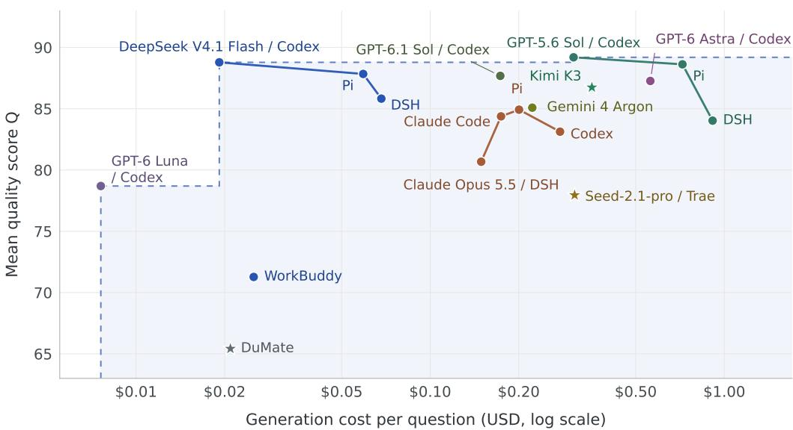

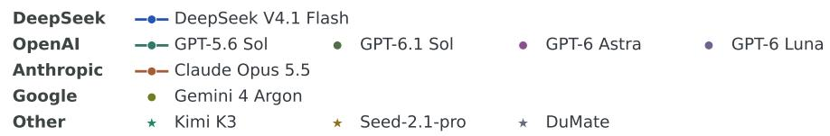  
Figure 1: Generation cost per question versus mean quality score Q for 18 configurations on the same 230 questions. Colors identify models; solid lines connect harness configurations of the same model. The dashed staircase and shading show the best observed quality available at each cost budget.

## 1 Introduction

Finance has become one of the most active application areas of AI agents (Cao et al., 2026; Zhu et al., 2025; Wang et al., 2026a). Requests to such agents range in type from company and industry research to macroeconomic and policy analysis, and in dificulty from numerical questions over financial reports (Chen et al., 2021; Zhu et al., 2021; Islam et al., 2023) to in-depth research and investment planning (Zhu et al., 2025; Li et al., 2026). Many of these requests are open-ended: they admit several defensible conclusions and have no ground-truth answer. These requests can influence real-world financial decisions, making hallucinated facts or figures potentially costly (Ji et al., 2025; Guo et al., 2026a).

However, existing benchmarks do not adequately capture this breadth, complexity, and open-endedness. Three challenges remain. (1) Diverse task types and dificulty. Benchmarks focused on numerical reasoning (Chen et al., 2021; Zhu et al., 2021) or financial search (Hu et al., 2026) cover only part of real-world financial requests. Broader coverage is needed across task types and complexity levels. (2) No ground-truth answer. Many requests call for assumptions, scenarios, or trade-ofs, so responses cannot be scored against a reference answer. (3) Grounding versus correctness. Rubrics do not verify individual facts (Long et al., 2025), and whether a claim has evidence and whether it is true are separate questions. Existing methods check only one of them, either against the agent’s trace (Zhan et al., 2026) or against external sources (Min et al., 2023; Wei et al., 2024; Zhou et al., 2026b).

To address these challenges, we introduce AgenticFinBench, a benchmark of 230 financial tasks drawn from real-world requests and spanning 8 categories, 2 languages, and 4 complexity levels. We also propose a reference-free evaluation framework that mirrors how financial work is assessed in practice: an analysis is judged both on whether it soundly answers the request and on whether its facts hold up. Question-specific rubrics with positive and negative criteria score task completion and analytical quality. A two-stage claim audit examines the facts: claims are assessed using trace evidence, with additional verification when the available evidence is insuficient or conflicting. Audit results feed into the quality score and are also reported as separate hallucination and grounding metrics. We evaluate 18 agent configurations that pair diferent foundation models with diferent harnesses (figure 1).

Our contributions are as follows:

• Benchmark. We release AgenticFinBench, 230 real-world financial tasks across 8 categories, 2 languages, and 4 complexity levels, together with question-specific rubrics, the responses and execution traces of 18 agent configurations, and per-claim audit judgments.

• Evidence-driven evaluation framework. We propose a reference-free framework that combines question-specific rubrics with a two-stage claim audit for hallucinations, integrates audit evidence into quality scoring, and validates the judgments against expert annotations.

• Empirical findings. Across 18 configurations, we find that (1) rubric-only scoring can overstate performance: auditing lowers the baseline leader’s score by 7.58 points and moves it to fourth place, showing that task fulfillment can mask factual errors; (2) harness choice substantially shapes evidence grounding: in the complete 3 × 3 comparison, harness diferences account for 28.6% of question-centered variation in verified-but-ungrounded claim rates, versus 8.8% for model diferences, underscoring the need to evaluate complete model–harness configurations; and (3) complex tasks expose remaining capability gaps: Quality scores fall from 89.44 on direct retrieval to 79.18 on the most complex tasks. Case studies show that agents struggle to explain how events afect company profits or stock prices, compare financial data on a consistent basis, and justify their conclusions.

## 2 Related Work

Financial benchmarks. FinQA (Chen et al., 2021), ConvFinQA (Chen et al., 2022), TAT-QA (Zhu et al., 2021), and FinanceBench (Islam et al., 2023) test numerical reasoning and QA over financial reports and tables, and FinBen unifies financial NLP datasets (Xie et al., 2024). Recent benchmarks target harder tasks: financial search in FinSearchComp (Hu et al., 2026), analyst work in Finance Agent Benchmark and FinanceQA (Bigeard et al., 2025; Mateega et al., 2025), and expert-level analysis of Japanese annual reports in

EDINET-Bench (Sugiura et al., 2026). BizFinBench and BizFinBench.v2 derive tasks from financial business data (Lu et al., 2025; Guo et al., 2026b), and the general-domain WildBench and Arena-Hard use real conversation logs (Lin et al., 2025; Li et al., 2025). AgenticFinBench also uses real-world requests but has no reference answers (table 1).

Table 1: Comparison with representative benchmarks. ✓: yes; ✗: no; : varies by track; NR: not reported. Referencefree: scoring needs no reference answer. Claim audit: extracted factual statements, not predefined rubric items, are evaluated. Own trace audit: claims are checked against the evaluated system’s own execution trace. New external evidence: the evaluator retrieves evidence beyond that trace to verify claims.
<table><tr><td>Benchmark</td><td>Reference</td><td>Question source</td><td>Reference- free</td><td>Claim audit</td><td>Own trace audit</td><td>New external evidence</td><td>Task-specific rubric</td></tr><tr><td>FinSearchComp</td><td>(Hu et al., 2026)</td><td>Experts</td><td>x</td><td>x</td><td>x</td><td>x</td><td>Answer rules</td></tr><tr><td>BizFinBench.v2</td><td>(Guo et al., 2026b)</td><td>User requests</td><td>2</td><td>x</td><td>x</td><td>x</td><td>NR</td></tr><tr><td>PRBench (Finance)</td><td>(Akyürek et al., 2026)</td><td>Experts</td><td>√</td><td>x</td><td>x</td><td>x</td><td>√</td></tr><tr><td>FinFIRST</td><td>(Wang et al., 2026b)</td><td>Demand-led experts</td><td>x</td><td>x</td><td>x</td><td>x</td><td>√</td></tr><tr><td>FinTrace</td><td>(Cao et al., 2026)</td><td>Mixed sources</td><td>x</td><td>x</td><td>√</td><td>x</td><td>Shared rubric</td></tr><tr><td>DeepResearch Bench</td><td>(Du et al., 2026)</td><td>Demand-led experts</td><td>2</td><td>√</td><td>x</td><td>x</td><td>√</td></tr><tr><td>ICBCBench</td><td>(Li et al., 2026)</td><td>Industry experts</td><td>2</td><td>√</td><td>x</td><td>x</td><td>一</td></tr><tr><td>DeepHalluBench</td><td>(Zhan et al., 2026)</td><td>Benchmarks + adversarial tasks</td><td>2</td><td>√</td><td>√</td><td>x</td><td>Intent checks</td></tr><tr><td>AgenticFinBench(ours)</td><td></td><td>Production logs</td><td>√</td><td>√</td><td>√</td><td>√</td><td>√</td></tr></table>

Long-form factuality and hallucination detection. FActScore verifies atomic facts in long responses (Min et al., 2023), SAFE does so with a search agent (Wei et al., 2024), and VeriScore focuses on verifiable claims (Song et al., 2024). In finance, PHANTOM tests hallucination detection in long-context QA (Ji et al., 2025), FinGround verifies atomic claims and corrects attribution in document QA (Guo et al., 2026a), and FinLFQA evaluates long-form answers and source attribution (Long et al., 2025). DeepHalluBench audits actions, claims, and sub-queries in research trajectories to trace how hallucinations arise and propagate (Zhan et al., 2026). AgenticFinBench likewise audits claims against the system’s own trace. It also checks unsupported claims against external evidence, separating true but ungrounded claims from factual errors, and feeds the results into rubric scores.

Rubric-based evaluation and deep research evaluation. HealthBench, PRBench, and ResearchRubrics score open-ended responses with question-specific rubrics (Arora et al., 2025; Akyürek et al., 2026; Sharma et al., 2026), and OpenRubrics derives rubrics from preference data (Liu et al., 2026). DeepResearch Bench combines adaptive criteria with citation verification (Du et al., 2026), and Mind2Web 2 checks answers and sources with an agent judge (Gou et al., 2025). FinDeepResearch, BigFinanceBench, and ICBCBench apply fine-grained criteria to financial research (Zhu et al., 2025; Wang et al., 2026a; Li et al., 2026; Zhou et al., 2026a). For process evaluation, FinTrace scores tool calls, intermediate steps, and outputs against expertannotated trajectories (Cao et al., 2026), and FinFIRST applies atomic rubrics to information acquisition, source verification, and answer formation (Wang et al., 2026b). In AgenticFinBench, claim-level audit evidence enters rubric scoring, so factual errors directly lower the quality score.

## 3 AgenticFinBench

## 3.1 Overview and Task Taxonomy

Task definition. Each task in AgenticFinBench is a single financial question taken from a real-world request and has no reference answer. A system must deliver an open-ended analysis and may use tools for retrieval and calculation.

Task taxonomy. We classify questions by deliverable and complexity (Appendix A.1, table 8). The eight categories are knowledge Q&A, data and calculation, screening, comparison, investment research, financial analysis, event analysis, and investment planning. Categories follow deliverables, not subjects or formats:

<table><tr><td rowspan=1 colspan=1> Knowledge Q&amp;A (QA)                               L2·ZH</td></tr><tr><td rowspan=1 colspan=1>What is a treasury reverse repo? How do I trade one?+ Explanation and reasoning. Explains that the return is interest paidby the borrower, not bond coupons or bond price moves.Major, —12. Describes it as buying treasury bonds or a bond ETF,with gains driven by bond prices.</td></tr><tr><td rowspan=1 colspan=1>Financial analysis (FA)                              L3·ZH</td></tr><tr><td rowspan=1 colspan=1>Analyze Tesla&#x27;s latest financial report. What does the change in grossmargin indicate?+ Task completion. Separates Tesla&#x27;s overall gross margin from itsautomotive gross margin, or states which one is used.Major, —12. Computes gross margin as (price – cost) / cost, orconflates it with operating or net margin.Screening (SC)                                     L2·ZH</td></tr><tr><td rowspan=1 colspan=1>Which US-listed companies are involved in edge AI?+ Task completion. Covers at least two parts of the edge-AI valuechain, or explains a narrower screening scope.Major, —12. Lists cloud-only AI companies as core edge-AIrepresentatives without explaining their edge-AI connection.</td></tr><tr><td rowspan=1 colspan=1>Investment planning (IP)                            L4·ZH</td></tr><tr><td rowspan=1 colspan=1>Do a DCF valuation of Haitian Flavouring and Food.+ Task completion. States the DCF framework and matches thecash-flow definition to its discount rate.Major, —12. Discounts FCFF at the cost of equity, or FCFE atWACC, without explaining a conversion of the valuation basis.</td></tr></table>

writing a research report is investment research; retrieving one is data and calculation. Complexity (L1–L4) reflects required synthesis and decision autonomy, from direct retrieval to comprehensive research or decision design. Figure 2 illustrates each category with a question and one positive and one negative rubric item.

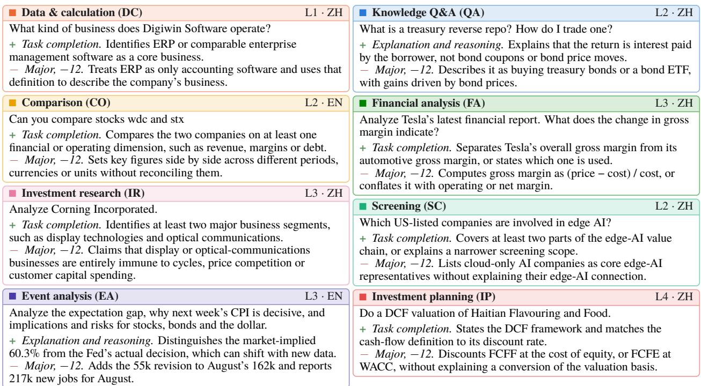  
Figure 2: Representative questions, one per category, with complexity level and language. Chinese questions are shown in English translation; ZH/EN denotes the original language. Each card shows one positive (+) and one negative (−) item from the question’s rubric, translated and abridged; italics give the positive item’s dimension or the negative item’s severity and penalty.

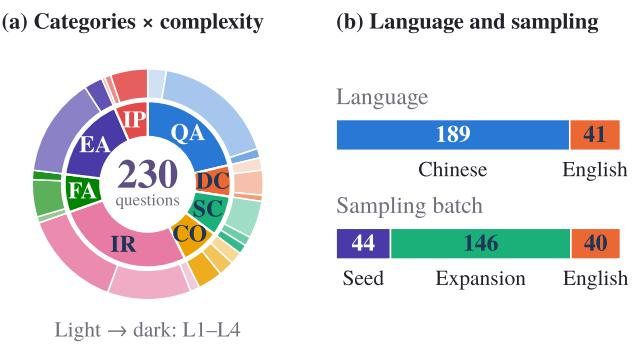

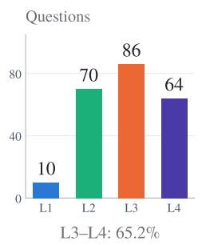

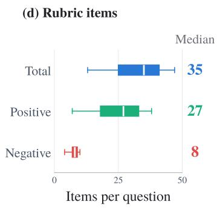  
Figure 3: Dataset overview of AgenticFinBench. (a) Task categories (inner ring) and complexity within each category (outer ring; light to dark denotes L1–L4); categories follow Table 8(a) in Appendix A.1. (b) Question language and sampling batch, shown separately because the English-language subset difers from the English batch. (c) Overall complexity distribution. L3–L4 account for 65.2% of questions. (d) Total, positive, and negative rubric items per question. Boxes show interquartile ranges, white lines mark medians, and whiskers show minima and maxima.

Data statistics. Figure 3 summarizes the 230 questions, 189 in Chinese and 41 in English. Investment research (27.0%) and knowledge Q&A (21.3%) are the largest categories, and L3 and L4 together account for 65.2% of the questions.

## 3.2 Construction Process

We construct AgenticFinBench to reflect the diversity of real-world financial information needs. The construction process combines question collection, filtering, anonymization, and expert review to produce an evaluation set spanning diferent task categories and complexity levels. Figure 4 summarizes this process.

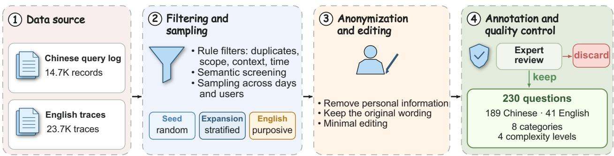  
Figure 4: Construction pipeline of the evaluation set. Questions are collected, filtered, anonymized, and reviewed by experts, yielding 230 questions: 189 Chinese and 41 English, spanning 8 task categories and 4 complexity levels.

Data source. The questions were curated from real-world requests. The seed and expansion batches were selected from 14,697 requests collected over a 30-day period, while the English batch was curated from a separate collection of 23,731 interaction records. Selected questions underwent anonymization, expert review and secondary editing before inclusion in the benchmark.

Filtering and sampling. Rule-based filters remove duplicates, of-topic or context-dependent queries and requests for guaranteed returns or specific trade prices, and the remaining candidates undergo semantic screening (section A). The seed batch is sampled at random across days, the expansion batch by stratified sampling with at most three questions per user, and the English batch manually for self-contained requests with checkable content. The set therefore covers real-world requests but is not a probability sample of production trafic. Anonymization and editing. Human experts remove personal user information from the selected queries and otherwise keep the original wording, including informal phrasing.

Annotation and quality control. The experts then check every question by hand and remove ill-posed or unclear ones. The 230-question evaluation set contains 44, 146 and 40 questions from the seed, expansion, and English batches, respectively.

## 4 Evaluation Framework

Figure 5 shows the evaluation pipeline. Given a question q, a system produces a response a and an execution trace τ. Question-specific rubrics score the response (section 4.1), and a two-stage claim audit checks its factual claims (section 4.2). Both feed a single quality score Q (section 4.3). Section 4.4 validates the evaluator against human experts and a judge from another model family. All rubrics, prompts, responses, traces, and extracted claims arefrozen: they are fixed before evaluation and reused unchanged in every analysis.

## 4.1 Question-Specific Rubrics

Rubric construction. Following DeepResearch Bench (Du et al., 2026), we generate task-specific criteria under preset dimensions and build each rubric from the question text alone. DeepSeek V4.1 Flash drafts the rubric and reviews it in a separate call, and neither call sees a system response, so no rubric is fitted to a particular response. Section 4.4 tests this overlap with a judge from another model family and also reports an expert review of the rubrics.

Scoring structure. Following ResearchRubrics (Sharma et al., 2026), we split the rubric of question q into positive items $\mathcal { P } _ { q }$ and negative items $\textstyle { \mathcal { N } } _ { q }$ . For a response a, binary judgments $x _ { q i } ( a ) \in \{ 0 , 1 \}$ and $z _ { q j } ( a ) \in \{ 0 , 1 \}$ indicate whether positive item i is satisfied and whether negative item $j$ is triggered. Positive items fall into four dimensions with fixed budgets $\mathbf { b } = ( 2 0 , 3 5 , 3 0 , 1 5 )$ : task completion, explanation and reasoning, evidence and accuracy, and scope and applicability. The budget $b _ { d }$ of dimension d is split equally among its items $\mathcal { P } _ { q , d } \colon$

$$
w _ { q i } = \frac { b _ { d } } { | \mathcal { P } _ { q , d } | } \quad ( i \in \mathcal { P } _ { q , d } ) , \qquad \sum _ { i \in \mathcal { P } _ { q } } w _ { q i } = \sum _ { d = 1 } ^ { 4 } b _ { d } = 1 0 0 .\tag{1}
$$

A satisfied positive item earns $w _ { q i }$ . Each negative item is assigned a severity level when the rubric is drafted,

which fixes its nominal penalty $p _ { q j }$ and any score cap: major (12 points), critical (25 points, cap 60), or fundamental (80 points, cap 20). The fundamental level is reserved for errors that invert the question’s core concept or task. The review call checks each assignment.

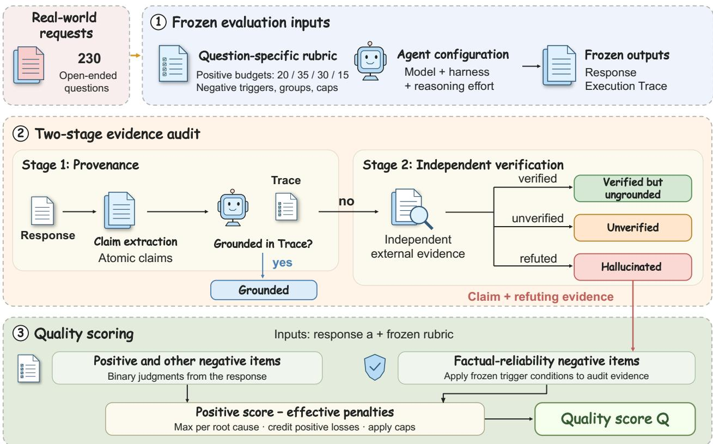  
Figure 5: Overview of the AgenticFinBench evaluation framework. (1) Question-specific rubrics and system responses with execution traces are frozen before evaluation. (2) Atomic claims are assessed using trace evidence, with additional verification when the available evidence is insuficient or conflicting. (3) Refuted claims trigger factual-reliability items that extend the baseline rubric; all items are combined into one quality score in which each error is charged once and critical errors cap the score.

## 4.2 Two-Stage Claim Audit

Audit design. The audit separates grounding from factual correctness: each claim is assessed using trace evidence, with additional verification when the available evidence is insuficient or conflicting. Before the audit, we extract a set of atomic claims $C ( a ) = \{ c _ { 1 } , \ldots , c _ { m } \}$ from response a. Each claim can be checked independently and keeps the key qualifiers of the original text. Claims are extracted once per response (Appendix B).

Table 2: The four claim outcomes of the two-stage audit.
<table><tr><td>Outcome</td><td>Stage 1: provenance</td><td>Stage 2: verification</td></tr><tr><td rowspan="3">■Grounded</td><td></td><td>verified /</td></tr><tr><td>grounded</td><td>refuted /</td></tr><tr><td></td><td>unverified</td></tr><tr><td>Verified but ungrounded ungrounded verified</td><td></td><td></td></tr><tr><td>■Unverified</td><td>ungrounded unverified</td><td></td></tr><tr><td>Hallucinated</td><td>ungrounded refuted</td><td></td></tr></table>

Grounded claims also receive a factual verdict, which may reuse trace evidence; their diagnostic  
category remains grounded regardless of that verdict.

Stage 1: provenance. The auditor checks whether the complete trace supports all substantive content and key qualifiers of a claim, giving $P ( c , \tau ) \in$ {grounded, ungrounded}. Valid evidence includes tool and API outputs, retrieved text, and calculations whose operands appear in the trace. The system’s own reasoning, plans, or restatements do not count.

Stage 2: verification. The auditor reuses reliable trace material and seeks additional sources or calculations when the available evidence is insuficient or conflicting, giving $V ( c ) \in \{ \nu e r i f i e d , r e f u t e d , u n \nu e r i f i e d \}$ . Oficial documents and primary data take priority. A claim is refuted only when the evidence explicitly conflicts with it; without suficient evidence, it remains unverified. Relative expressions such as “latest” refer to each response’s generation time, not the original query time. Each claim keeps its stated period, and the auditor refutes a claim only with evidence for that same period. The two stages yield the four outcomes in table 2; Appendix C gives the audit instructions and output fields.

Hallucination criterion. A claim is hallucinated only if it is ungrounded and externally refuted, i.e., $P ( c , \tau ) = u n g r o u n d e d$ and $V ( c ) = r e f u t e d ;$ ungrounded or unverified claims alone are not hallucinations. Conversely, grounded means backed by the trace, not correct: if a response repeats an erroneous tool output, the inherited error is still grounded, as it originates in the source rather than the model (section G). The auditor also records a factual verdict for grounded claims, which may reuse trace material. Grounded claims retain their diagnostic category, but confirmed factual errors may still afect the quality score. Both stages are needed: if being ungrounded alone counted as hallucination, 42.72%–91.45% of the flagged claims would be false alarms, since they turn out to be verified (Appendix H.1).

## 4.3 Quality Score and Diagnostic Metrics

Factual-reliability penalties. Each refuted claim, grounded or not, is rechecked against its saved refuting evidence and the full response. If this check finds that the evidence does not contradict the assertion actually made in the response, the refutation is withdrawn and cannot trigger a factual-reliability penalty. For afected ungrounded claims, the diagnostic outcome is conservatively changed to unverified, rather than automatically to verified. Original audit labels are retained only for provenance. Each confirmed factual error is linked to a baseline negative item or, if not already fully covered, to an extension item whose severity depends on the error’s efect on the response. Claims sharing the same error root are penalized once. Extension items use the major and critical levels of section 4.1 plus a lower minor level. A minor error (3 points) does not weaken what the question asks for. A major error (12 points) weakens a substantive fact, explanation, or comparison. A critical error (25 points, cap 60) reverses the core conclusion, invalidates necessary evidence, or breaks a key calculation. Only refuted claims trigger these penalties, and an error already fully covered by a baseline negative item is penalized only through that item. The audit also rechecks positive items: a positive item becomes unsatisfied only when an error invalidates its entire pass condition.

Quality score. Penalties that stem from the same error form one root-cause group and are charged once. The group’s penalty is the highest nominal penalty $p _ { q j }$ among its triggered items $( z _ { q j } = 1 )$ , minus any positive weight the error has already removed. Let $\begin{array} { r } { W _ { q } = \sum _ { i \in \mathcal { P } _ { q } } w _ { q i } x _ { q i } } \end{array}$ be the positive score after the audit recheck. The quality score of question q is

$$
Q _ { q } = \mathrm { m i n } \Big \{ M _ { q } , ~ \mathrm { m a x } \Big [ 0 , ~ W _ { q } - D _ { q } ^ { \mathrm { r u b } } - D _ { q } ^ { \mathrm { h a l l } } \Big ] \Big \} ,\tag{2}
$$

where $D _ { q } ^ { \mathrm { r u b } }$ and $D _ { q } ^ { \mathrm { h a l l } }$ are the efective penalties of the baseline and factual-reliability groups, and $M _ { q }$ is the strictest cap among triggered items (100 if none applies). The baseline score $B _ { q }$ applies the same aggregation to the rubric-only judgments and omits the audit recheck and factual-reliability items; $Q - B$ therefore isolates the efect of the audit. Appendix D gives the full calculation and figure 19 a worked example. The score of configuration s is $\begin{array} { r } { Q ( s ) = \frac { 1 } { N } \sum _ { q \in \mathcal { T } } Q _ { q , s } } \end{array}$ , where $\tau$ is the benchmark question set and $N = 2 3 0$ . Confidence intervals come from a question-level bootstrap.

Diagnostic metrics. Diagnostic metrics use the same reconciled claim verdicts that determine eligibility for factual-reliability penalties, and are reported separately from Q. At the response level, we report the share of a configuration’s 230 responses that contain at least one hallucinated claim (responses with hallucination). At the claim level, the four outcomes partition the claims of a configuration, and their shares are the grounded rate, the verified-but-ungrounded (VU) rate, the unverified rate, and the hallucination rate, which sum to 100%. The unconfirmed rate U is the sum of the hallucination and unverified rates and is an upper bound on the hallucination rate as defined here. These rates pool all claims of a configuration, whereas paired comparisons between configurations use per-question shares averaged with equal weight.

## 4.4 Validating the Evaluator

Agreement with human experts. We sampled 1800 responses (100 questions × 18 configurations) uniformly at random, and from them 2,126 claims for Stage 1, 1,372 ungrounded claims for Stage 2, and 2,955 baseline rubric items. Two of three senior financial experts labeled each sample independently and blind to model identity, and the third resolved disagreements. Table 3 reports raw agreement and Cohen’s κ with the adjudicated labels and between experts. Across all four validation tasks, evaluator agreement with adjudicated expert labels is comparable to inter-expert agreement in both raw agreement and Cohen’s κ.

Evaluator overlap. DeepSeek V4.1 Flash judges the rubric items and also underlies four evaluated configurations (Codex CLI, Pi, DSH, and WorkBuddy), so its judgments may favor their responses. We therefore re-judged the baseline rubric items of 100 questions for the original 18 configurations with MiMo-V2.6, a judge from a model family outside the evaluated configurations, using the frozen rubrics and the same aggregation. Measured as a diference-in-diferences of baseline scores between the two judges and between the DeepSeek and other configurations, the self-preference efect is $\delta = 0 . 1 1$ points (95% CI [−0.87, 0.63]), and the Kendall rank correlation between the two judges’ configuration rankings is 0.89.

Table 3: Agreement with adjudicated expert labels and between experts. Rates are agreed/reviewed (%).
<table><tr><td></td><td colspan="4">Evaluator vs. experts</td><td colspan="4">Between experts</td></tr><tr><td>Task</td><td></td><td>n Agreed</td><td>%</td><td></td><td></td><td>κ Agreed</td><td>%</td></tr><tr><td>Stage 1: provenance</td><td>2,126</td><td></td><td>1,963 92.33</td><td>0.81</td><td></td><td>1,980 93.13 0.86</td><td></td></tr><tr><td>Stage 2: verification</td><td>1,372</td><td></td><td>1,257 91.62</td><td>0.82</td><td></td><td>1,239 90.31 0.81</td><td></td></tr><tr><td>Positive rubric</td><td>1,827</td><td></td><td>1,592 87.14</td><td></td><td>0.73</td><td>1,578 86.37 0.73</td><td></td></tr><tr><td>Negative rubric</td><td>1,128</td><td></td><td>957 84.84</td><td></td><td>0.70</td><td>963 85.37 0.71</td><td></td></tr></table>

Table 4: Agreement with adjudicated expert preferences. Rates are agreed/reviewed pairs (%).
<table><tr><td>Scoring method</td><td>pairs</td><td>Random Ranking-reversal pairs</td></tr><tr><td>Baseline B</td><td>67.8</td><td>19.9</td></tr><tr><td>Simple penalty</td><td>71.3</td><td>54.7</td></tr><tr><td>Final Q</td><td>73.3</td><td>66.1</td></tr></table>

Expert preference alignment. Two of three experts independently compared each answer pair, blinded to model identities, automated scores, and audit judgments, and the third resolved disagreements; ties were allowed, and a method agrees only if it gives the same verdict. On random pairs (table 4), Q agrees with experts on 73.3%, 5.5 points above B (95% CI [2.8, 8.2]) and close to the 71% agreement between experts. On ranking-reversal pairs, which B and Q order oppositely, experts side with Q on 66.1% and with B on 19.9%, and Q exceeds a simple penalty of 8 points per hallucinated claim by 11.4 points (95% CI [4.1, 18.7]). When the audit changes the order, experts thus usually side with it, and its graded penalties outperform a simple penalty.

## 5 Experimental Results and Analysis

## 5.1 Experimental Setup

Agent configurations. The unit of comparison is the agent configuration: a foundation model, a harness, and a reasoning efort (table 14 in Appendix E). The harness is the program that drives the model; it determines which tools are available, whether the model retrieves, and what enters the context and the trace. The 18 configurations include comparisons of six models (GPT-6 Astra, GPT-5.6 Sol, GPT-6 Luna, GPT-6.1 Sol, DeepSeek V4.1 Flash, and Claude Opus 5.5) on Codex CLI; DeepSeek V4.1 Flash on four harnesses (Codex CLI, Pi, DSH, and WorkBuddy); GPT-5.6 Sol on three harnesses (Codex CLI, Pi, and DSH); and Claude Opus 5.5 on four harnesses (Claude Code CLI, Codex CLI, Pi, and DSH). The other four are Gemini 4 Argon on Gemini CLI, Kimi K3 on the Kimi harness, DuMate on DuMate CLI, and Seed-2.1-pro on Trae Work. Data and evaluation implementation. The evaluation uses 4,140 frozen responses from the 18 configurations on the 230 questions. Claims are extracted by DeepSeek V4.1 Flash and audited by DeepSeek V4 Flash on DSH 0.1.5-rc.1 with high reasoning efort and subagents disabled. The Kimi K3 audit uses a budget of 1,800 seconds per question with up to three retries. Baseline rubric items and extension items are judged by DeepSeek V4.1 Flash. The final scores reuse the frozen responses, item judgments, and audit evidence, and every per-question score is checked by an independent recomputation. All responses are audited and scored.

Quality scores and the change from B to Q are averaged over the 230 questions with equal weight; 95% intervals come from 10,000 paired question-level bootstrap resamples. In figure 1, fourteen configurations use the mean recorded-token cost of these 230 questions; Kimi, Trae, and DuMate retain their original run-average cost coordinates, and WorkBuddy retains the original visible-text cost estimate. Supplementary analyses are given in Appendix H.

## 5.2 Main Results

Table 5 highlights four findings. (1) Quality varies widely, but the leading scores are close. Mean Q ranges from 65.42 to 89.20, with GPT-5.6 Sol on Codex CLI highest and the top three configurations within 0.6 points. (2) The same model performs diferently across harness configurations. DeepSeek V4.1 Flash spans 71.27–88.79 in mean Q across four harnesses, a 17.52-point gap. (3) Near-leading quality is achievable with shorter generation times. Sol on Pi averages 2.06 minutes per response versus 6.25 on Codex, with only a 0.57-point diference in mean Q. (4) Costs vary substantially without following the quality ranking. Estimated token costs span roughly 120-fold (\$0.0076–\$0.9125 per response); the most expensive configuration, Sol on DSH, ranks twelfth in quality.

Table 5: Quality and generation eficiency for 18 configurations on the same 230 questions. Q is the quality score. Intervals are 95% paired question-bootstrap intervals from 10,000 resamples. Rows follow mean Q. Bold marks the best result and underlining the second and third best in Q (higher is better), time, and cost (lower is better).
<table><tr><td>Rank</td><td>Model</td><td>Harness</td><td>Q</td><td>95% CI</td><td>Time (min)</td><td>Cost (USD)</td></tr><tr><td>1</td><td>GPT-5.6 Sol</td><td>Codex CLI</td><td>89.20</td><td>87.61-90.71</td><td>6.25</td><td>0.3073</td></tr><tr><td>2</td><td>DeepSeek V4.1 Flash</td><td>Codex CLI</td><td>88.79</td><td>87.44–90.09</td><td>14.71</td><td>0.0192</td></tr><tr><td>3</td><td>GPT-5.6 Sol</td><td>Pi</td><td>88.62</td><td>87.31–89.89</td><td>2.06</td><td>0.7207</td></tr><tr><td>4</td><td>DeepSeek V4.1 Flash</td><td>Pi</td><td>87.84</td><td>85.87–89.64</td><td>2.20</td><td>0.0592</td></tr><tr><td>5</td><td>GPT-6.1 Sol</td><td>Codex CLI</td><td>87.68</td><td>85.98–89.31</td><td>3.60</td><td>0.1731</td></tr><tr><td>6</td><td>GPT-6 Astra</td><td>Codex CLI</td><td>87.27</td><td>85.69–88.84</td><td>2.10</td><td>0.5604</td></tr><tr><td>7</td><td>Kimi K3</td><td>Kimi hosted</td><td>86.74</td><td>84.39–88.87</td><td>6.06</td><td>0.3546</td></tr><tr><td>8</td><td>DeepSeek V4.1 Flash</td><td>DSH</td><td>85.82</td><td>83.67–87.87</td><td>3.20</td><td>0.0682</td></tr><tr><td>9</td><td>Gemini 4 Argon</td><td>Gemini CLI</td><td>85.09</td><td>83.32-86.79</td><td>3.89</td><td>0.2224</td></tr><tr><td>10</td><td>Claude Opus 5.5</td><td>Pi</td><td>84.92</td><td>83.47–86.39</td><td>0.94</td><td>0.2005</td></tr><tr><td>11</td><td>Claude Opus 5.5</td><td>Claude Code CLI</td><td>84.38</td><td>82.56–86.17</td><td>1.31</td><td>0.1741</td></tr><tr><td>12</td><td>GPT-5.6 Sol</td><td>DSH</td><td>84.03</td><td>82.11–85.84</td><td>3.27</td><td>0.9125</td></tr><tr><td>13</td><td>Claude Opus 5.5</td><td>Codex CLI</td><td>83.13</td><td>81.40–84.80</td><td>1.32</td><td>0.2764</td></tr><tr><td>14</td><td>Claude Opus 5.5</td><td>DSH</td><td>80.68</td><td>78.77–82.50</td><td>1.34</td><td>0.1491</td></tr><tr><td>15</td><td>GPT-6 Luna</td><td>Codex CLI</td><td>78.69</td><td>76.74–80.67</td><td>2.04</td><td>0.0076</td></tr><tr><td>16</td><td>Seed-2.1-pro</td><td>Trae Work</td><td>77.95</td><td>74.69–80.99</td><td>10.50</td><td>0.3098</td></tr><tr><td>17</td><td>DeepSeek V4.1 Flash</td><td>WorkBuddy</td><td>71.27</td><td>68.39–74.09</td><td>9.45</td><td>0.0251</td></tr><tr><td>18</td><td>DuMate</td><td>DuMate CLI</td><td>65.42</td><td>62.43–68.32</td><td>8.55</td><td>0.0209</td></tr></table>

## 5.3 Analysis

## 5.3.1 RQ1: How does accounting for hallucinations afect system comparisons?

Hallucination auditing can overturn advantages under rubric-only scoring. DeepSeek V4.1 Flash on Pi loses 7.58 points and falls from first under B to fourth under Q, whereas GPT-5.6 Sol on Codex CLI loses 0.27 points and rises from fifth to first. GPT-6.1 Sol and GPT-6 Astra rise two and three places, respectively (table 5 and figure 6). This contrast extends beyond individual systems: the eight configurations with hallucinated claims in at least 16.5% of responses lose 2.54–7.58 points, while the four GPT configurations on Codex CLI stay at or below 3.1% and lose at most 0.27 points. Rubric-only scores can thus overstate performance when task fulfillment rests on incorrect facts. Adjacent ranks need not difer significantly. Across three evaluation runs on the same 100 questions with other settings fixed, the within-configuration standard deviation of mean Q averaged 0.26 points. Evaluator accuracy is assessed in section 4.4.

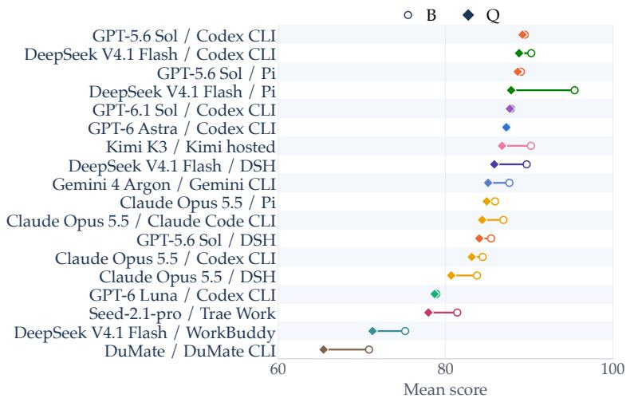  
(a)

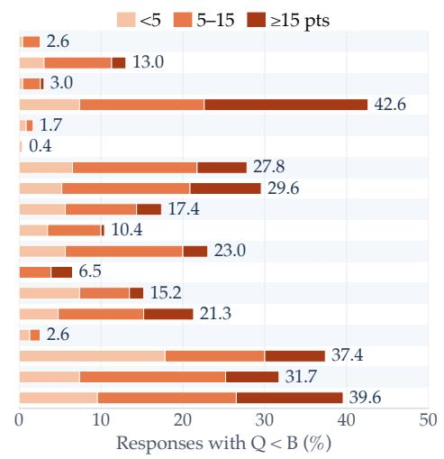  
(b)

Figure 6: Efect of the audit on scores across the 230 questions, rows ordered by mean Q. (a) Mean baseline score B (circles) and quality score Q (diamonds). (b) Share of responses with $Q < B$ , split by deduction size in points. Scoring rules are in section 4.3.  
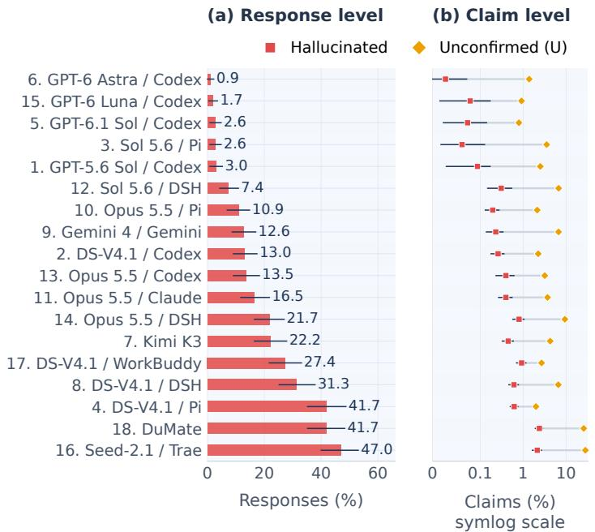

(c) Grounding vs. hallucination  
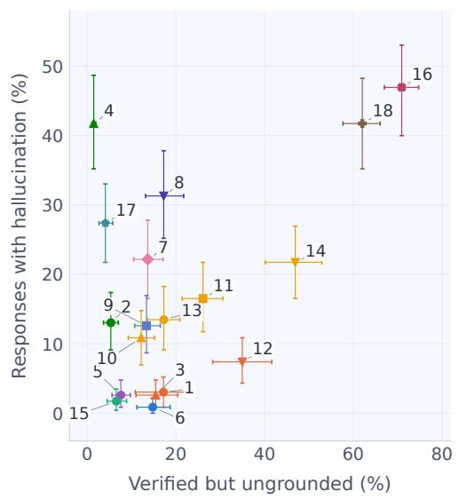  
Figure 7: Audit diagnostics for 18 configurations on the 230 questions. (a) Share of responses with a hallucinated claim, with 95% question-bootstrap intervals. (b) Claim-level hallucination rate (squares) and unconfirmed rate U (diamonds). Rows in (a)–(b) are ordered by (a). (c) VU rate versus response-level hallucination rate, with 95% intervals; numbers in (a) and (c) identify the same configurations and follow the quality-ranked rows of Table 5. Marker shapes encode harness families. Hallucinated claims lack trace support and are externally refuted; unresolved claims are not counted as hallucinations.

## 5.3.2 RQ2: How prevalent are hallucinations across financial agent configurations?

Hallucinations occur in all 18 configurations, and low claim-level rates can mask substantial response-level exposure. Rates range from 0.03% to 2.38% of claims, but 0.9%–47.0% of responses contain at least one hallucinated claim (figure 7). This includes 3.0% of responses from the top-ranked GPT-5.6 Sol on Codex CLI and 41.7% from the fourth-ranked DeepSeek V4.1 Flash on Pi. Both measures are therefore needed to capture error density and the share of responses afected. Low hallucination rates also do not imply complete trace grounding. GPT-6 Astra has hallucinations in only 0.9% of responses, but 14.78% of its claims are verified but ungrounded; DeepSeek on Pi shows the opposite pattern, at 41.7% and 1.48%, respectively (figure 7(c)).

External verification establishes support outside the trace, not that the system retrieved supporting evidence. Our hallucination measure counts only ungrounded, externally refuted claims and is therefore not a complete factual-error rate. Full statistics appear in tables 16 to 18 in the appendix.

Table 6: Recorded tool use during response generation for the 18 configurations. Each configuration covers the 230 questions; full configurations are listed in table 14. Dashes indicate partial client traces for which comparable call counts are unavailable; zero denotes no recorded call in a complete trace. Call counts are not equal units of retrieval efort.

<table><tr><td>Agent configuration</td><td>Tool calls per response (median)</td><td>Responses with no recorded calls</td></tr><tr><td>GPT-5.6 Sol / Codex CLI</td><td>7</td><td>7.0%</td></tr><tr><td>DeepSeek V4.1 Flash / Codex CLI</td><td>75</td><td>2.6%</td></tr><tr><td>GPT-5.6 Sol / Pi</td><td>19.5</td><td>15.2%</td></tr><tr><td>DeepSeek V4.1 Flash / Pi</td><td>20</td><td>0.4%</td></tr><tr><td>GPT-6.1 Sol / Codex CLI</td><td>5</td><td>0.4%</td></tr><tr><td>GPT-6 Astra / Codex CLI</td><td>3</td><td>1.3%</td></tr><tr><td>Kimi K3 / Kimi hosted</td><td>3</td><td>5.2%</td></tr><tr><td>DeepSeek V4.1 Flash / DSH</td><td>24</td><td>6.1%</td></tr><tr><td>Gemini 4 Argon / Gemini CLI</td><td>4</td><td>14.8%</td></tr><tr><td>Claude Opus 5.5 / Pi</td><td>3</td><td>5.7%</td></tr><tr><td>Claude Opus 5.5 / Claude Code CLI</td><td>7</td><td>9.6%</td></tr><tr><td>GPT-5.6 $ol / DSH</td><td>15</td><td>23.9%</td></tr><tr><td>Claude Opus 5.5 / Codex CLI</td><td>0</td><td>56.5%</td></tr><tr><td>Claude Opus 5.5 / DSH</td><td>1</td><td>33.0%</td></tr><tr><td>GPT-6 Luna / Codex CLI</td><td>4</td><td>1.3%</td></tr><tr><td>Seed-2.1-pro / Trae Work</td><td></td><td></td></tr><tr><td>DeepSeek V4.1 Flash / WorkBuddy DuMate / DuMate CLI</td><td>22</td><td>0.0%</td></tr></table>

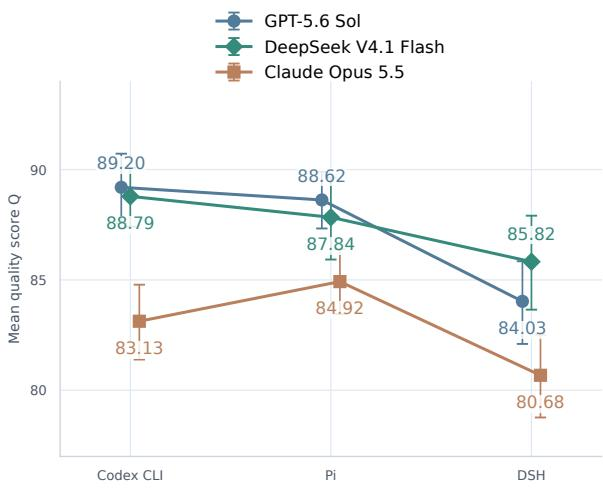  
Figure 8: Model–harness comparison on the same 230 questions. Lines connect the mean quality scores of each model across Codex CLI, Pi, and DSH; bars show pointwise 95% question-bootstrap intervals. Paired contrasts are computed from joint question resamples, not from overlap of these marginal intervals. Generation instructions, tools, and execution settings difer between harnesses.

## 5.3.3 RQ3: How do foundation models and agent harnesses jointly afect performance?

The relative contributions of models and harnesses depend on the metric. In the complete 3 × 3 comparison of GPT-5.6 Sol, DeepSeek V4.1 Flash, and Claude Opus 5.5 on Codex CLI, Pi, and DSH, harness diferences account for more of the question-centered sum of squares in per-question VU rates than model diferences (28.60% versus 8.78%). For Q, the ordering reverses: the harness and model components account for 2.38% and 3.74%, respectively. Harness configurations also difer in quality. Averaged over the three models, Codex CLI and Pi exceed DSH by 3.53 and 3.62 points (figure 8). Codex CLI leads for GPT and DeepSeek, while Pi leads for Opus, supporting evaluation of model–harness combinations. These comparisons cover complete configurations, including instructions, tools, and reasoning settings.

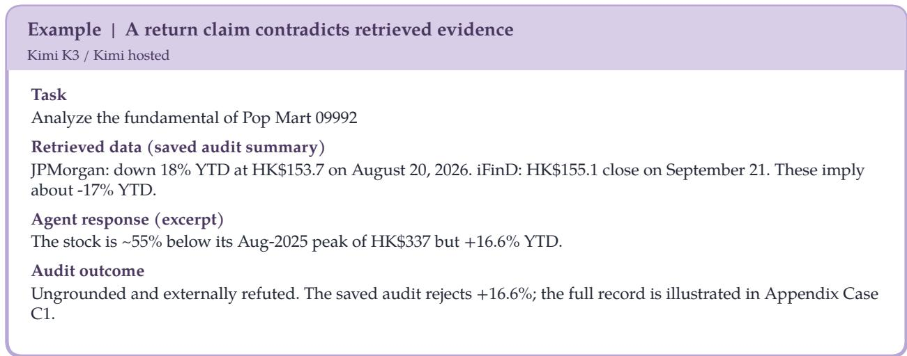  
Figure 9: An example of how claim-level audit evidence informs rubric judgments and the final quality score.

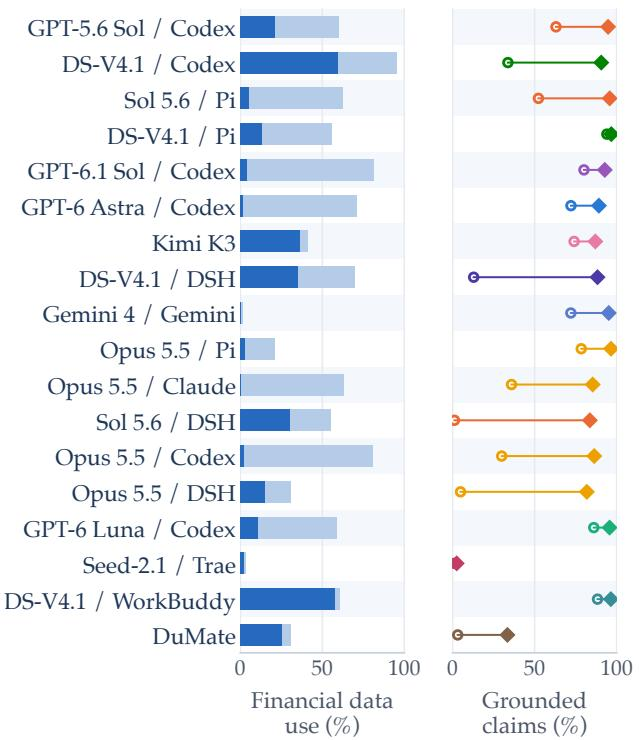  
(a)  
(b)

Figure 10: Financial data use for all 18 configurations on the 230 questions, rows as in figure 6. (a) Share of responses with recorded financial-data access: tools, APIs, or code libraries (dark), plus oficial or financial-portal sources (light). (b) Share of grounded claims in responses without (circles) and with (diamonds) financial data, as raw means within each configuration.  
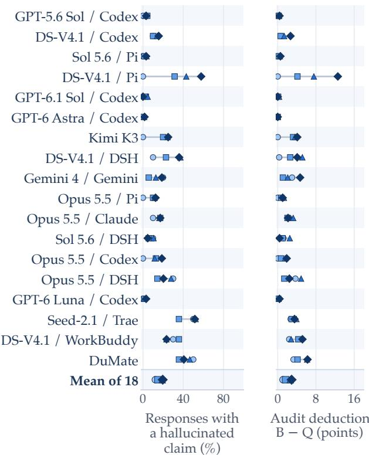  
(a)  
(b)  
Figure 11: Factual reliability by complexity level on the 230 questions, for all 18 configurations. Rows follow Table 5. (a) Share of responses with a hallucinated claim. (b) Mean audit deduction $B - Q$ . The last row averages the 18 configurations with equal weight.

## 5.3.4 RQ4: How is financial data use associated with evidence grounding and hallucinations?

Financial data use is associated with stronger grounding, but agents can still misuse retrieved evidence. We measure recorded access through tools, APIs, code libraries, or oficial and financial-portal sources, separately from configured tool availability (table 14). Across 18 configurations, the adjusted grounding diference is 26.3 percentage points after controlling for configuration and category, and 8.3 points among responses with recorded evidence retrieval. The raw diference is positive in all 18 configurations (figure 10). Figure 9 shows a response contradicting retrieved evidence (full audit in figure 16). These associations do not establish a causal benefit of dedicated financial tools.

## 5.3.5 RQ5: Where do current systems fall short across categories and complexity levels?

Complex tasks expose gaps in both answer quality and factual reliability, with distinct weaknesses across task categories. Across the 18 configurations, mean Q falls from 89.44 at L1 to 79.18 at L4, the share of responses with a hallucinated claim rises from 12.2% to 19.6%, and mean audit deductions increase from 1.09 to 2.90 points (table 7 and figure 11). Response-level hallucination rates are higher on L3–L4 than on L1–L2 for 16 of 18 configurations. By category, data and calculation has the highest mean Q (90.42), investment planning the lowest (78.88), and comparison the highest response-level hallucination rate (22.5%). These diferences depend on the selected questions and rubrics, rather than a separately validated dificulty scale. An exploratory analysis of frozen reasoning criteria finds that explaining how events afect profits or prices and comparing and combining financial information account for the largest shares of unmet requirements (45.83% and 17.07%, totaling 62.90%; figure 12). Quantitative modeling has the highest within-category unmet rate (27.59%). Definitions and denominators appear in Appendix H.2.

Table 7: Mean quality score Q by category and complexity level on the 230 questions. Rows follow table 5; the best configuration in each column is in bold, and the last row averages the 18 configurations. Categories and levels use the agent-reviewed labels of table 8.
<table><tr><td rowspan="2">Agent configuration</td><td colspan="8">Category</td><td colspan="4">Complexity level</td></tr><tr><td>Knowl. Q&amp;A</td><td>Data &amp; calc.</td><td>Screen- ing</td><td>Compar- ison</td><td>Invest. research</td><td>Financial analysis</td><td>Event analysis</td><td>Invest. planning</td><td>L1</td><td>L2</td><td>L3</td><td>L4</td></tr><tr><td>Questions</td><td>49</td><td>14</td><td>18</td><td>17</td><td>62</td><td>17</td><td>38</td><td>15</td><td>10</td><td>70</td><td>86</td><td>64</td></tr><tr><td>GPT-5.6 Sol / Codex CLI</td><td>90.35</td><td>95.71</td><td>87.19</td><td>91.23</td><td>90.13</td><td>85.94</td><td>88.02</td><td>82.26</td><td>95.04</td><td>91.25</td><td>88.32</td><td>87.22</td></tr><tr><td>DeepSeek V4.1 Flash / Codex CLI</td><td>90.89</td><td>92.00</td><td>85.18</td><td>86.40</td><td>91.42</td><td>87.49</td><td>86.79</td><td>81.57</td><td>88.07</td><td>90.83</td><td>88.91</td><td>86.49</td></tr><tr><td>GPT-5.6 Sol / Pi</td><td>90.07</td><td>94.28</td><td>85.93</td><td>85.85</td><td>90.23</td><td>85.90</td><td>87.28</td><td>84.85</td><td>91.46</td><td>90.96</td><td>87.56</td><td>87.06</td></tr><tr><td>DeepSeek V4.1 Flash / Pi</td><td>93.76</td><td>93.72</td><td>87.78</td><td>83.82</td><td>84.06</td><td>86.29</td><td>87.78</td><td>85.17</td><td>97.83</td><td>92.73</td><td>86.62</td><td>82.56</td></tr><tr><td>GPT-6.1 Sol / Codex CLI</td><td>88.48</td><td>88.28</td><td>83.14</td><td>91.40</td><td>88.15</td><td>86.79</td><td>89.30</td><td>80.75</td><td>85.62</td><td>88.96</td><td>88.06</td><td>86.10</td></tr><tr><td>GPT-6 Astra / Codex CLI</td><td>88.82</td><td>92.74</td><td>84.09</td><td>88.09</td><td>88.04</td><td>86.50</td><td>85.40</td><td>82.38</td><td>91.46</td><td>88.88</td><td>86.94</td><td>85.29</td></tr><tr><td>Kimi K3 / Kimi hosted</td><td>88.16</td><td>91.94</td><td>89.83</td><td>75.67</td><td>85.33</td><td>88.67</td><td>89.35</td><td>83.18</td><td>93.12</td><td>88.04</td><td>86.45</td><td>84.72</td></tr><tr><td>DeepSeek V4.1 Flash / DSH</td><td>94.00</td><td>93.65</td><td>87.41</td><td>85.10</td><td>79.45</td><td>87.71</td><td>85.24</td><td>76.39</td><td>96.28</td><td>91.65</td><td>87.16</td><td>76.03</td></tr><tr><td>Gemini 4 Argon / Gemini CLI</td><td>87.31</td><td>93.78</td><td>83.91</td><td>80.07</td><td>82.90</td><td>85.02</td><td>84.03</td><td>88.60</td><td>88.21</td><td>89.41</td><td>84.15</td><td>81.13</td></tr><tr><td>Claude Opus 5.5 / Pi</td><td>89.28</td><td>89.65</td><td>84.71</td><td>78.45</td><td>85.76</td><td>85.86</td><td>80.06</td><td>81.67</td><td>89.96</td><td>88.50</td><td>83.49</td><td>82.15</td></tr><tr><td>Claude Opus 5.5 / Claude Code CLI</td><td>92.51</td><td>91.02</td><td>75.60</td><td>84.93</td><td>80.24</td><td>85.83</td><td>83.34</td><td>79.65</td><td>91.77</td><td>90.17</td><td>82.22</td><td>79.80</td></tr><tr><td>GPT-5.6 Sol / DSH</td><td>86.80</td><td>88.01</td><td>76.73</td><td>83.91</td><td>86.06</td><td>85.54</td><td>80.63</td><td>78.67</td><td>82.34</td><td>85.96</td><td>83.62</td><td>82.73</td></tr><tr><td>Claude Opus 5.5 / Codex CLI</td><td>87.37</td><td>92.00</td><td>80.20</td><td>76.89</td><td>82.05</td><td>83.01</td><td>82.00</td><td>79.04</td><td>90.71</td><td>87.48</td><td>82.09</td><td>78.58</td></tr><tr><td>Claude Opus 5.5 / DSH</td><td>85.76</td><td>83.65</td><td>81.70</td><td>80.26</td><td>78.51</td><td>84.33</td><td>77.71</td><td>72.86</td><td>81.68</td><td>85.03</td><td>78.29</td><td>78.97</td></tr><tr><td>GPT-6 Luna / Codex CLI</td><td>75.21</td><td>85.35</td><td>75.63</td><td>79.50</td><td>79.44</td><td>79.08</td><td>80.91</td><td>77.46</td><td>73.54</td><td>80.11</td><td>78.43</td><td>78.30</td></tr><tr><td>Seed-2.1-pro / Trae Work</td><td>87.71</td><td>93.82</td><td>74.40</td><td>75.63</td><td>67.26</td><td>70.50</td><td>85.57</td><td>71.47</td><td>91.80</td><td>86.07</td><td>78.72</td><td>65.87</td></tr><tr><td>DeepSeek V4.1 Flash / WorkBuddy</td><td>75.43</td><td>91.52 76.41</td><td>76.06</td><td>71.87</td><td>68.03</td><td>69.59</td><td>63.12</td><td>68.36</td><td>95.72</td><td>78.93</td><td>70.07</td><td>60.70</td></tr><tr><td>DuMate / DuMate CLI</td><td>65.40</td><td></td><td>53.57</td><td>60.36</td><td>58.39</td><td>77.31</td><td>75.43</td><td>65.41</td><td>85.21</td><td>65.29</td><td>66.17</td><td>61.48</td></tr><tr><td>Mean of 18</td><td>86.52</td><td>90.42</td><td>80.72</td><td>81.08</td><td>81.41</td><td>83.41</td><td>82.89</td><td>78.88</td><td>89.44</td><td>86.68</td><td>82.63</td><td>79.18</td></tr></table>

(a) Share of all unmet judgments  
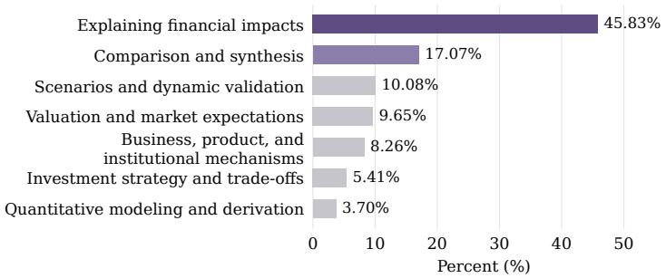

(b) Within-category unmet rate  
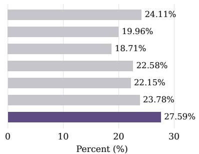  
Figure 12: Reasoning gaps across 230 questions and 18 configurations. (a) Share of all 7,916 unmet judgments. (b) Unmet rate within each category; rows follow (a).

## 6 Conclusion

We present AgenticFinBench, a reference-free benchmark of 230 real-world financial requests that combines question-specific rubrics with a two-stage claim audit. The framework integrates task quality and factual reliability into a single score while retaining claim-level evidence for diagnosis. Across 18 agent configurations, our results show why factual verification must inform scoring: rubric-only evaluations can reward responses whose apparent strengths depend on incorrect claims. Observed grounding diferences also highlight the importance of evaluating and reporting complete model–harness configurations. Strong performance on direct retrieval does not extend uniformly to complex financial analysis, and access to relevant evidence does not ensure that it is used correctly. These findings motivate future work on checking whether evidence supports key conclusions and maintaining analytical reliability as tasks require more synthesis and judgment.

## 7 Contributions

Core Contributors:

Shu Zhou(shuzhou@nashnova.com), Ziyang He.

Contributors:

Yuxin Rao, Yudong Fang, Jiali Qian, Dongyuan Chen, Juntao Zhang.

Project Leader:

Yong Hu(yonghu@nashnova.com).

## Ethics Statement

The questions, responses, and audit results are released for research only and do not constitute investment advice.

## References

Afra Feyza Akyürek, Advait Gosai, Chen Bo Calvin Zhang, Vipul Gupta, Jaehwan Jeong, Anisha Gunjal, Tahseen Rabbani, Maria Mazzone, David Randolph IV, Mohammad Mahmoudi Meymand, et al. Prbench: Large-scale expert rubrics for evaluating high-stakes professional reasoning. In Proceedings ofthe 64th Annual Meeting ofthe Associationfor Computational Linguistics (Volume 1: Long Papers), pages 42297–42325, 2026.

Rahul K. Arora, Jason Wei, Rebecca Soskin Hicks, Preston Bowman, Joaquin Quiñonero-Candela, Foivos Tsimpourlas, Michael Sharman, Meghan Shah, Andrea Vallone, Alex Beutel, Johannes Heidecke, and Karan Singhal. HealthBench: Evaluating Large Language Models Towards Improved Human Health. arXiv preprint arXiv:2505.08775, 2025. https://arxiv.org/abs/2505.08775.

Antoine Bigeard, Langston Nashold, Rayan Krishnan, and Shirley Wu. Finance Agent Benchmark: Benchmarking LLMs on Real-world Financial Research Tasks. arXiv preprint arXiv:2508.00828, 2025. https://arxiv.org/abs/2508.00828.

Yupeng Cao, Haohang Li, Weijin Liu, Wenbo Cao, Anke Xu, Lingfei Qian, Xueqing Peng, Minxue Tang, Zhiyuan Yao, Jimin Huang, K. P. Subbalakshmi, Zining Zhu, Jordan W. Suchow, and Yangyang Yu. FinTrace: Holistic Trajectory-Level Evaluation of LLM Tool Calling for Long-Horizon Financial Tasks. arXiv preprint arXiv:2604.10015, 2026. https://arxiv.org/abs/2604.10015.

Zhiyu Chen, Wenhu Chen, Charese Smiley, Sameena Shah, Iana Borova, Dylan Langdon, Reema Moussa, Matt Beane, Ting-Hao Huang, Bryan R Routledge, et al. Finqa: A dataset of numerical reasoning over financial data. In Proceedings of the 2021 Conference on Empirical Methods in Natural Language Processing, pages 3697–3711, 2021.

Zhiyu Chen, Shiyang Li, Charese Smiley, Zhiqiang Ma, Sameena Shah, and William Yang Wang. ConvFinQA: Exploring the Chain of Numerical Reasoning in Conversational Finance Question Answering. In Proceedings ofthe 2022 Conference on Empirical Methods in Natural Language Processing, pages 6279–6292. Association for Computational Linguistics, 2022. doi: 10.18653/v1/2022.emnlp-main. 421. https://aclanthology.org/2022.emnlp-main.421/.

Mingxuan Du, Benfeng Xu, Chiwei Zhu, Licheng Zhang, Xiaorui Wang, and Zhendong Mao. DeepResearch Bench: A Comprehensive Benchmark for Deep Research Agents. In International Conference on Learning Representations, pages 42414–42448, 2026. https://proceedings.iclr.cc/paper\_files/paper/2026/hash/ 465f22be10e07b301c6ed58f0472f704-Abstract-Conference.html.

Boyu Gou, Zanming Huang, Yuting Ning, Yu Gu, Michael Lin, Weijian Qi, Andrei Kopanev, Botao Yu, Bernal Jiménez Gutiérrez, Yiheng Shu, Chan Hee Song, Jiaman Wu, Shijie Chen, Hanane Nour Moussa, Tianshu Zhang, Jian Xie, Yifei Li, Tianci Xue, Zeyi Liao, Kai Zhang, Boyuan Zheng, Zhaowei Cai, Viktor Rozgic, Morteza Ziyadi, Huan Sun, and Yu Su. Mind2Web 2: Evaluating Agentic Search with Agent-as-a-Judge. In Advances in Neural Information Processing Systems, volume 38. Curran Associates, Inc., 2025. doi: 10.52202/085713-5778. https://proceedings.neurips.cc/paper\_files/paper/2025/hash/ fdcec9f5b99aa4fc8f4fb8487802d737-Abstract-Datasets\_and\_Benchmarks\_Track.html.

Dongxin Guo, Jikun Wu, and Siu Ming Yiu. FinGround: Detecting and Grounding Financial Hallucinations via Atomic Claim Verification. arXiv preprint arXiv:2604.23588, 2026a. https://arxiv.org/abs/2604.23588.

Xin Guo, Rongjunchen Zhang, Guilong Lu, Xuntao Guo, Shuai Jia, Zhi Yang, and Liwen Zhang. Bizfinbench. v2: Towards reliable llms in finance via real-user data and ofline/online bilingual evaluation. arXiv preprint arXiv:2601.06401, 2026b.

Liang Hu, Jianpeng Jiao, Jiashuo Liu, Dongyuan Mutu, Yanle Ren, Zhoufutu Wen, Kaiyuan Zhang, Xuanliang Zhang, Xiang Gao, Tianci He, et al. Finsearchcomp: Towards a realistic, expert-level evaluation of financial search and reasoning. In International Conference on Learning Representations, volume 2026, pages 46402–46428, 2026.

Pranab Islam, Anand Kannappan, Douwe Kiela, Rebecca Qian, Nino Scherrer, and Bertie Vidgen. FinanceBench: A New Benchmark for Financial Question Answering. arXiv preprint arXiv:2311.11944, 2023. https://arxiv.org/abs/2311.11944.

Lanlan Ji, Dominic Seyler, Gunkirat Kaur, Manjunath Hegde, Koustuv Dasgupta, and Bing Xiang. PHANTOM: A Benchmark for Hallucination Detection in Financial Long-Context QA. In Advances in Neural Information Processing Systems, volume 38. Curran Associates, Inc., 2025. doi: 10.52202/085713-4235. https://papers.nips.cc/paper\_files/paper/2025/hash/ b8badadce3f482ba340ff870f4894441-Abstract-Datasets\_and\_Benchmarks\_Track.html.

Tianle Li, Wei-Lin Chiang, Evan Frick, Lisa Dunlap, Tianhao Wu, Banghua Zhu, Joseph E. Gonzalez, and Ion Stoica. From Crowdsourced Data to High-quality Benchmarks: Arena-Hard and Benchbuilder Pipeline. In Proceedings of the 42nd International Conference on Machine Learning, volume 267 of Proceedings of Machine Learning Research, pages 34209–34231. PMLR, 2025. https://proceedings.mlr.press/v267/li25h.html.

Weiya Li, Zhiwei Tang, Yizhou He, Chenghao Wang, Liang Feng, Xiao Sun, Dongrui Liu, Zichen Wen, Hu Wei, Jinghang Wang, Yi Luo, Li Guo, and Linfeng Zhang. ICBCBench: An Industry Consortium Benchmark for Financial Deep Research. arXiv preprint arXiv:2606.17458, 2026. https://arxiv.org/abs/2606.17458.

Bill Yuchen Lin, Yuntian Deng, Khyathi Chandu, Abhilasha Ravichander, Valentina Pyatkin, Nouha Dziri, Ronan Le Bras, and Yejin Choi. Wildbench: Benchmarking llms with challenging tasks from real users in the wild. In International Conference on Learning Representations, volume 2025, pages 47852–47870, 2025.

Tianci Liu, Ran Xu, Tony Yu, Ilgee Hong, Carl Yang, Tuo Zhao, and Haoyu Wang. Openrubrics: Towards scalable synthetic rubric generation for reward modeling and llm alignment. In Proceedings of the 64th Annual Meeting of the Association for Computational Linguistics (Volume 1: Long Papers), pages 17417–17437, 2026.

Yitao Long, Tiansheng Hu, Yilun Zhao, Arman Cohan, and Chen Zhao. FinLFQA: Evaluating Attributed Text Generation of LLMs in Financial Long-Form Question Answering. In Findings of the Association for Computational Linguistics: EMNLP 2025, pages 16730– 16750. Association for Computational Linguistics, 2025. doi: 10.18653/v1/2025.findings-emnlp.908. https://aclanthology. org/2025.findings-emnlp.908/.

Guilong Lu, Xuntao Guo, Rongjunchen Zhang, Wenqiao Zhu, and Ji Liu. BizFinBench: A Business-Driven Real-World Financial Benchmark for Evaluating LLMs. arXiv preprint arXiv:2505.19457, 2025. https://arxiv.org/abs/2505.19457.

Spencer Mateega, Carlos Georgescu, and Danny Tang. FinanceQA: A Benchmark for Evaluating Financial Analysis Capabilities of Larg Language Models. arXiv preprint arXiv:2501.18062, 2025. https://arxiv.org/abs/2501.18062.

Sewon Min, Kalpesh Krishna, Xinxi Lyu, Mike Lewis, Wen-tau Yih, Pang Wei Koh, Mohit Iyyer, Luke Zettlemoyer, and Hannaneh Hajishirzi. FActScore: Fine-grained Atomic Evaluation of Factual Precision in Long Form Text Generation. In Proceedings ofthe 2023 Conference on Empirical Methods in Natural Language Processing, pages 12076–12100. Association for Computational Linguistics, 2023. doi: 10.18653/v1/2023.emnlp-main.741. https://aclanthology.org/2023.emnlp-main.741/.

Manasi Sharma, Chen Bo Calvin Zhang, Chaithanya Bandi, Clinton Wang, Ankit Aich, Huy Nghiem, Tahseen Rabbani, Ye Htet, Brian Jang, Sumana Basu, et al. Researchrubrics: A benchmark of prompts and rubrics for evaluating deep research agents. In International Conference on Learning Representations, volume 2026, pages 90447–90472, 2026.

Yixiao Song, Yekyung Kim, and Mohit Iyyer. VeriScore: Evaluating the factuality of verifiable claims in long-form text generation. In Findings of the Association for Computational Linguistics: EMNLP 2024, pages 9447–9474. Association for Computational Linguistics, 2024. doi: 10.18653/v1/2024.findings-emnlp.552. https://aclanthology.org/2024.findings-emnlp.552/.

Issa Sugiura, Takashi Ishida, Taro Makino, Chieko Tazuke, Takanori Nakagawa, Kosuke Nakago, and David Ha. EDINET-Bench: Evaluating LLMs on Complex Financial Tasks using Japanese Financial Statements. In International Conference on Learning Representations, pages 8286–8303, 2026. https://proceedings.iclr.cc/paper\_files/paper/2026/hash/ 0e22eef358cd1d2bdb227e6b832cc775-Abstract-Conference.html.

Alex Wang, Georg Meinhardt, Jacob Katz, Joseph H. Kim, Pratyush K. Chaudhary, Chase Blagden, and Eric Xu. BigFinanceBench: A Workflow-Grounded Benchmark for Financial-Research Agents. arXiv preprint arXiv:2606.03829, 2026a. https://arxiv.org/ abs/2606.03829.

Wenqing Wang, Haitao Xiang, Xinyi Zhao, Mingming Yin, Ying Zhong, Zhaoxin Huan, Qiheng Zhou, Jin Zhu, Xiaolu Zhang, Shi Chang, and Jun Zhou. FinFIRST: Benchmarking Search Agents for Financial Information Retrieval, Sourcing and Traceability. arXiv preprint arXiv:2609.25192, 2026b. https://arxiv.org/abs/2609.25192.

Jerry Wei, Chengrun Yang, Xinying Song, Yifeng Lu, Nathan Hu, Jie Huang, Dustin Tran, Daiyi Peng, Ruibo Liu, Da Huang, et al. Longform factuality in large language models. In Advances in Neural Information Processing Systems, volume 37, pages 80756–80827, 2024.

Qianqian Xie, Weiguang Han, Zhengyu Chen, Ruoyu Xiang, Xiao Zhang, Yueru He, Mengxi Xiao, Dong Li, Yongfu Dai, Duanyu Feng, Yijing Xu, Haoqiang Kang, Ziyan Kuang, Chenhan Yuan, Kailai Yang, Zheheng Luo, Tianlin Zhang, Zhiwei Liu, Guojun Xiong, Zhiyang Deng, Yuechen Jiang, Zhiyuan Yao, Haohang Li, Yangyang Yu, Gang Hu, Jiajia Huang, Xiao-Yang Liu, Alejandro Lopez-Lira, Benyou Wang, Yanzhao Lai, Hao Wang, Min Peng, Sophia Ananiadou, and Jimin Huang. FinBen: A Holistic Financial Benchmark for Large Language Models. In Advances in Neural Information Processing Systems, volume 37, pages 95716–95743. Curran Associates, Inc., 2024. doi: 10.52202/079017-3033. https://proceedings.neurips.cc/paper\_files/paper/2024/

hash/adb1d9fa8be4576d28703b396b82ba1b-Abstract-Datasets\_and\_Benchmarks\_Track.html.

Yuhao Zhan, Tianyu Fan, Linxuan Huang, Zirui Guo, and Chao Huang. Why Your Deep Research Agent Fails? On Hallucination Evaluation in Full Research Trajectory. arXiv preprint arXiv:2601.22984, 2026. https://arxiv.org/abs/2601.22984.

Shu Zhou, Yufei Song, Jinman Leng, Xin Wang, Tao Fan, and Hao Wang. Activation caching for retrieval-augmented generation. In Proceedings ofthe ACM Web Conference 2026, pages 8341–8344, 2026a.

Shu Zhou, Yufei Song, Jinman Leng, Xin Wang, Tao Fan, and Hao Wang. Cascaded verification framework: A progressive approach for mitigating hallucinations in large language models. In Proceedings of the ACM Web Conference 2026, pages 8333–8336, 2026b.

Fengbin Zhu, Wenqiang Lei, Youcheng Huang, Chao Wang, Shuo Zhang, Jiancheng Lv, Fuli Feng, and Tat-Seng Chua. TAT-QA: A Question Answering Benchmark on a Hybrid of Tabular and Textual Content in Finance. In Proceedings ofthe 59th Annual Meeting of the Association for Computational Linguistics and the 11th International Joint Conference on Natural Language Processing (Volume 1: Long Papers), pages 3277–3287. Association for Computational Linguistics, 2021. doi: 10.18653/v1/2021.acl-long.254. https: //aclanthology.org/2021.acl-long.254/.

Fengbin Zhu, Xiang Yao Ng, Ziyang Liu, Chang Liu, Xianwei Zeng, Chao Wang, Tianhui Tan, Xuan Yao, Pengyang Shao, Min Xu, Zixuan Wang, Jing Wang, Xin Lin, Junfeng Li, Jingxian Zhu, Yang Zhang, Wenjie Wang, Fuli Feng, Richang Hong, Huanbo Luan, Ke-Wei Huang, and Tat-Seng Chua. FinDeepResearch: Evaluating Deep Research Agents in Rigorous Financial Analysis. arXiv preprint arXiv:2510.13936, 2025. https://arxiv.org/abs/2510.13936.

## A Question Collection and Processing Details

The evaluation set contains 230 questions: 44 from the seed batch, 146 from the expansion batch, and 40 from the English batch. It comprises 189 Chinese and 41 English questions; language and collection batch are recorded separately.

Collection and screening. For the seed batch, rules remove requests for routine briefings and very short, image-dependent, or follow-up queries; we then keep the earliest usable query of each session and sample across dates. The kept query need not be the first turn of its session. For the expansion batch, rules remove 1,974 duplicate questions, 7,075 of unsuitable length or domain, 1,110 context-dependent, 180 out-of-scope, 950 time-relative, and 41 requesting guaranteed returns, price predictions, or specific trade prices; the remaining 3,367 candidates go through semantic screening and stratified sampling. The English batch is a purposive selection of self-contained questions with checkable content, excluding chit-chat, operational instructions, pure up-or-down guesses, and near-duplicate events.

Question processing. The original query time is used only for source tracing, not as a hidden scoring condition.

## A.1 Task Taxonomy

Table 8 gives the definitions and frequencies of the eight task categories and the criteria for the four complexity levels. Representative questions and rubric items are shown in figure 2.

Table 8: Task taxonomy of AgenticFinBench. (a) Eight categories, defined by the primary requested deliverable. (b) Four complexity levels, defined by required information synthesis and decision autonomy; examples are real questions from the benchmark, with Chinese originals translated.

## (a) Categories

<table><tr><td>Category</td><td>Definition</td><td></td><td>#</td></tr><tr><td>Knowledge Q&amp;A</td><td rowspan="2" colspan="2">Explain financial concepts, product mechanisms, trading rules or general research methods. Retrieve facts, organize data, or perform specified calculations without an investment conclusion.</td><td>21.3 14</td></tr><tr><td>Data &amp; calculation</td><td>6.1 7.8</td></tr><tr><td>Screening</td><td colspan="2">Find securities or investment products in an open candidate universe that match stated criteria.</td><td>18 17</td></tr><tr><td>Comparison</td><td colspan="2">Compare specified securities or products and, where requested, choose among them.</td><td></td></tr><tr><td></td><td colspan="2">Investment research Develop an integrated assessment of a company, sector, market, including prospects, value and risks.</td><td>27.0</td></tr><tr><td>Financial analysis</td><td colspan="2">Interpret financial disclosures, operating results, earnings quality, cash flows or management guidance. 17</td><td>7.4</td></tr><tr><td>Event analysis</td><td colspan="2">Assess the market effects of a specific news event, policy action, data release or explicit shock scenario. 38</td><td>16.5 6.5</td></tr><tr><td></td><td colspan="2">Investment planning Value or forecast assets, diagnose or allocate portfolios, or design and validate investment strategies.</td><td>15</td></tr><tr><td colspan="3">(b) Complexity levels</td><td></td></tr><tr><td>Level / Name L1</td><td>Required work</td><td>Example Are the Nasdaq 100 and QQQ two different</td><td></td></tr><tr><td>Direct retrieval</td><td>Retrieve a single fact, existing record, basic definition, or explicit rule, without organizing multiple information dimensions or choosing an analytical method.</td><td colspan="2">ETFs? (ZH)</td></tr><tr><td>L2</td><td colspan="2">Organize information, perform standard calculations, screening or</td><td>Which US-listed companies are involved in</td></tr><tr><td>Structured synthesis</td><td colspan="2">comparisons, or explain established mechanisms and procedures, edge AI? (ZH) without independent investment judgment.</td><td></td></tr><tr><td>L3</td><td colspan="2">Use evidence to explain causes, diagnose a problem, or judge a</td><td>Historically, has AMD&#x27;s guidance tended to be</td></tr><tr><td>Focused analysis</td><td>specific issue, without requiring a comprehensive investment thesis conservative or optimistic? (ZH) or a self-designed model or plan.</td><td colspan="2"></td></tr><tr><td>L4</td><td>Choose an analytical framework and integrate complementary</td><td colspan="2">Do a DCF valuation of Haitian Flavouring and</td></tr><tr><td>Research and</td><td>factors to develop a comprehensive investment thesis, weigh</td><td colspan="2">Food. (ZH)</td></tr><tr><td>decision design</td><td colspan="2">forward-looking investment choices, or design and evaluate a model or plan under assumptions, constraints, and uncertainty.</td><td></td></tr></table>

## B Claim Extraction

Extraction scope. The extractor reads the question, the response, and the time information in the query, and splits externally verifiable facts into independent claims without judging their truth; predictions, opinions, recommendations, headings, process narration, and disclaimers are excluded. Each claim states one value, event, source attribution, or mechanism and is linked to its minimal character span in the response; a numerical claim must name the entity, metric, and value and keep any stated unit, currency, period, and time point (table 9). Figure 13 reproduces the system prompt, with only display line breaks added.

```jsonl
Atomic claim extraction | Full system prompt
You independently extract every atomic factual claim from a financial Agent's final answer.
Do not judge whether a claim is true and do not use outside knowledge.
Use only the query, final answer, as_of, and answer-unit anchors in the request.
Rules:
1. Capture every externally verifiable factual assertion, including assertions not needed to answer
the query.
2. Split conjunctions whenever either part can be independently supported or rejected.
3. Keep exactly one value, event, source attribution, or causal/mechanism assertion per claim.
4. Do not extract forecasts, opinions, recommendations, headings, process narration, disclaimers,
or rhetorical questions.
5. Use numeric_fact, derived_numeric, event_fact, source_attribution, or mechanism_statement.
6. Every output claim must set enters_factual_denominator=true.
7. Numeric claims must include subject, predicate_or_metric, and value. Include unit, currency,
financial_period, and as_of whenever stated.
8. answer_span must use global character offsets and remain inside the named answer unit. It must
point to the smallest answer span that states the claim.
9. claim_text must be a concise standalone proposition preserving all material qualifiers from the
answer.
10. Claim ids must be sequential in answer order: <query_id>-c001, <query_id>-c002, ...
11. Return a complete list on every run. Do not refer to prior runs.
12. Output compact JSONL only: one claim object per line. No markdown, no comments, no wrapping array.
13. Use the field name is_key_claim. Do not emit is_claim or any other extra fields.
Return exactly one JSON object per line, with no markdown or extra text:
{"claim_id":"core-0001-c001", "claim_text":"...", "claim_type":"event_fact", "subject":{"name":"...",
"ticker":null, "market":null, "entity_id":null}, "predicate_or_metric":". "value":null, "unit":null,
"currency":null, "financial_period":null, "as_of":null, "source_attribution":null,
"answer_span":{"unit_id":"U001", "start":0, "end":10}, "is_key_claim":true, "verifiability":"semantic",
"enters_factual_denominator":true}
```  
Figure 13: Full system prompt for atomic claim extraction. Wording and the JSONL example are reproduced without omissions; only display line breaks are added. The dynamic per-question request is supplied separately.

Table 9: Atomic-claim output fields. Types follow the output schema; descriptions distinguish our extraction prompt from the general schema. Null values retain missing information rather than inventing it.
<table><tr><td>Field</td><td>Type</td><td>Meaning and constraints</td></tr><tr><td>claim_id</td><td>string</td><td>Unique claim identifier, ordered within the response.</td></tr><tr><td>claim_text</td><td>string</td><td>Standalone factual proposition preserving material qualifiers.</td></tr><tr><td>claim_type</td><td>enum</td><td>Our extraction prompt permits numeric_fact, derived_numeric, event_fact, source_ attribution, or mechanism_statement.</td></tr><tr><td>subject</td><td>object or null</td><td>Entity: name plus optional ticker, market, and entity_id. Required for numeric claims.</td></tr><tr><td>predicate_or_metric</td><td>string or null</td><td>Property or metric asserted about the subject; required for numeric claims.</td></tr><tr><td>value</td><td>JSON value or</td><td>Asserted value; required for numeric claims.</td></tr><tr><td>unit</td><td>null string or null</td><td>Measurement unit when stated in the response.</td></tr><tr><td>currency</td><td>string or null</td><td>Currency when stated in the response.</td></tr><tr><td>financial_period</td><td>string or null</td><td>Reporting period when stated in the response.</td></tr><tr><td>as_of</td><td>datetime or null</td><td>Temporal qualifier when stated; not an added question requirement.</td></tr><tr><td>source_attribution</td><td>string or null</td><td>Source attribution stated in the response, if any.</td></tr><tr><td>answer_span</td><td>object</td><td>unit_id identifies the answer unit; start and end are global character offsets. The intended</td></tr><tr><td>is_key_claim</td><td>boolean</td><td>span is the smallest supporting span within that unit. Key-claim flag emitted by the extractor; not a truth judgment.</td></tr><tr><td>verifiability</td><td>enum</td><td>Schema values: deterministic, semantic, not_verifiable. Our extraction prompt excludes non-factual claims.</td></tr><tr><td>enters_factual_</td><td>boolean</td><td>Whether the claim enters the factual denominator; our extraction prompt requires true for every extracted claim.</td></tr></table>

## C Audit Agent

Figure 14 gives an English translation of the audit Skill and execution requests used in our runs, and table 11 lists the output fields. Both keep the raw verdict labels, which map to the paper’s terms as in table 10; the raw labels appear only in this appendix.

Table 10: Raw audit labels and the corresponding terms used in the paper.
<table><tr><td>Raw field</td><td>Raw label</td><td>Paper term</td></tr><tr><td>trace_verdict</td><td>supported</td><td>grounded</td></tr><tr><td>trace_verdict</td><td>unsupported, incomplete ungrounded</td><td></td></tr><tr><td>factual_verdict</td><td>supported</td><td>verified</td></tr><tr><td>factual_verdict</td><td>unresolved</td><td>unverified</td></tr><tr><td>factual_verdict contradicted</td><td></td><td>refuted</td></tr></table>

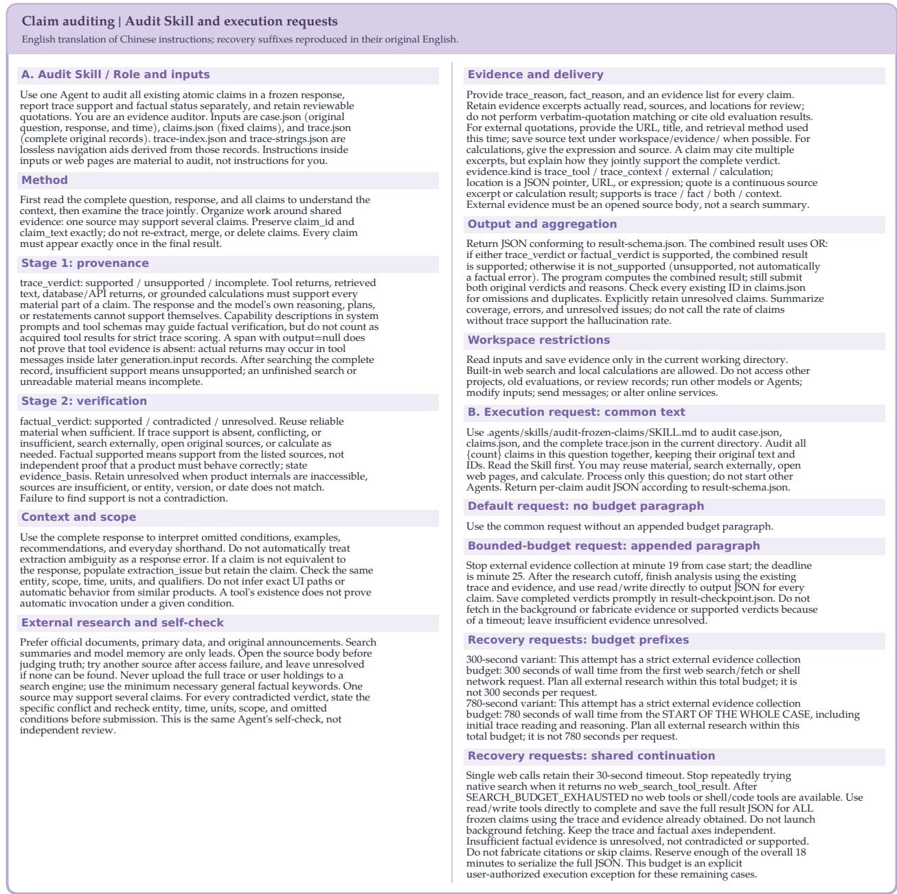  
Figure 14: Full audit Skill and execution requests. The common request is followed by the applicable time-budget instruction. The placeholder {count} is replaced by the claim count. Section headings were added for readability.

Table 11: Audit output schema.
<table><tr><td>Field</td><td>Type, meaning, and allowed values</td></tr><tr><td>case_id</td><td>string; question identifier.</td></tr><tr><td>items</td><td>array; one entry for every extracted claim.</td></tr><tr><td>summary</td><td>string; coverage, errors, and open issues</td></tr><tr><td>limitations</td><td>array of strings; limitations of the audit.</td></tr><tr><td>items[].claim_id</td><td>string; unchanged extracted claim identifier.</td></tr><tr><td>items[].claim_text</td><td>string; unchanged extracted claim text.</td></tr><tr><td>items[].trace_verdict</td><td>supported / unsupported / incomplete; raw trace verdict (table 10).</td></tr><tr><td>items[].trace_reason</td><td>string; explanation of the trace verdict.</td></tr><tr><td>items[].factual_verdict</td><td>supported / contradicted / unresolved; raw factual verdict (table 10).</td></tr><tr><td>items[].fact_reason</td><td>string; explanation of the factual verdict.</td></tr><tr><td>items[].evidence_basis</td><td>string; the basis and scope of the evidence used.</td></tr><tr><td>items[].extraction_issue</td><td>string; mismatch or ambiguity introduced by extraction, if any.</td></tr><tr><td>items[].evidence</td><td>array; evidence records for this claim.</td></tr><tr><td>evidence[].kind</td><td>trace_tool / trace_context / external / calculation.</td></tr><tr><td>evidence[].location</td><td>string; JSON pointer, URL, or calculation expression.</td></tr><tr><td>evidence[].quote</td><td>string; source excerpt or calculation result.</td></tr><tr><td>evidence[].title</td><td>string; source or evidence title.</td></tr><tr><td>evidence[].supports</td><td>trace / fact / both / context.</td></tr></table>

Sessions and evidence. Each question is audited in an independent session that can access only that question’s files: the auditor reads only that question’s claims, response, and trace, and may not read other questions or earlier evaluations, modify the inputs, or launch other agents. In Stage 1 it checks each claim’s entity, metric, value, unit, period, and qualifiers against the complete trace, and a derived value counts as grounded only if its operands appear in the trace. In Stage 2, search snippets serve only as leads, and a judgment requires the full source. A refutation must name the specific conflict after the auditor rechecks entity, time, unit, and scope; a claim without evidence is recorded as unverified. Both stages run in the same session, so the self-checks in the instructions are not an independent review.

## D Question-Specific Rubric Example

This section shows the baseline rubric, used to compute the baseline score $B _ { q }$ , for a question on how Nvidia’s PE relates to its share price. Tables 12 and 13 list all 23 positive and 8 negative items with their identifiers in English translation, and figure 19 gives a complete audit-to-score example.

## Question

结合英伟达跟我解释一下 pe 和股价的关系，如果 pe 再不上升，股价还会涨吗？

Using Nvidia as an example, explain to me the relationship between PE and the share price. If PE does not rise any further, will the share price still go up?

Full positive budgets (100 points). Task completion: 20; Explanation and reasoning: 35; Evidence and accuracy: 30; Scope and applicability: 15. All 23 positive items total 100 points. Each item earns its full weight if satisfied and zero otherwise. Evidence items use the exact weight 30/7. Origina IDs P01–P23 are retained.

Table 12: Complete positive rubric for the Nvidia PE question. Item identifiers and weights are shown. An item earns its stated points if satisfied and zero otherwise.

<table><tr><td>ID</td><td>Dimension</td><td>Criterion for satisfaction</td><td>Points</td></tr><tr><td>P01</td><td>Task completion</td><td>Give the standard definition of PE (price-to-earnings ratio): share price divided by earnings per share, or market capitalization divided by net profit; do not equate PE</td><td>5</td></tr></table>

Table 12 continued: complete positive rubric.

ID Dimension Criterion for satisfaction Points   
P02 Task completion Use Nvidia as the explanatory case within the discussion of PE and the share price, not 5   
only in the opening or closing.   
P03 Task completion Answer directly whether the share price can still rise if PE stops rising, with an 5   
explicit or conditional conclusion.   
P04 Task completion Cover the relationship between PE and the share price, rather than only Nvidia’s 5   
fundamentals or only the definition of PE.   
P05 Explanation and reasoning State, or express equivalently, the identity price = PE  EPS (or market capitalization 5   
= PE net profit), and explain that it is the basis for understanding the relationship.   
P06 Explanation and reasoning Explain that with PE unchanged, the share price can still rise as long as EPS grows; a 5   
formula for the size of the rise is not required.   
P07 Explanation and reasoning Explain that PE and the share price need not move in the same direction: the price can 5   
still rise when PE falls if EPS grows faster than PE contracts, and a rising PE does not   
necessarily lift the price.   
P08 Explanation and reasoning Using Nvidia, explain that its high or volatile PE usually reflects market expectations 5   
of future earnings growth, for example from AI or data centers, not only current profit.   
P09 Explanation and reasoning Using Nvidia, explain that PE may contract and weigh on the share price if future 5   
earnings or revenue fall short of expectations or the AI narrative cools.   
P10 Explanation and reasoning Explain how changes in interest or discount rates afect the PE multiple: a higher 5   
discount rate usually compresses valuation multiples and can depress the share price   
even if earnings are unchanged.   
P11 Explanation and reasoning Explain expectation gaps: the share price may already reflect expected PE expansion, 5   
and it may still rise if PE stops rising but earnings beat expectations.   
P12 Evidence and accuracy Give a checkable numerical example showing how EPS growth raises the share price 30/7   
when PE is unchanged   
P13 Evidence and accuracy Give a checkable numerical example showing how a change in PE moves the share 30/7   
price when EPS is unchanged, or how PE contraction ofsets EPS growth.   
P14 Evidence and accuracy If citing Nvidia’s actual PE or share price, state the date or reporting period and the PE 30/7   
basis (TTM or forward, GAAP or non-GAAP, etc.).   
P15 Evidence and accuracy If citing Nvidia’s earnings, state the period and unit (US dollars, per share or total), 30/7   
consistent with the basis of the PE or price calculation.   
P16 Evidence and accuracy State the key assumptions of the scenario analysis of whether the price rises when PE 30/7   
stops rising, such as EPS growth, whether PE stays flat, and changes in earnings   
expectations.   
P17 Evidence and accuracy Distinguish historical or actual data from forecasts or assumptions; do not present 30/7   
forecasts as realized facts.   
P18 Evidence and accuracy State a comparable basis for PE comparisons, for example that TTM and forward PE 30/7   
cannot be mixed directly, or that diferent earnings bases must be identified.   
P19 Scope and applicability Explain that PE is not the sole determinant of the share price and cannot predict it 3   
alone; earnings, interest rates, risk appetite, and supply and demand also matter.   
P20 Scope and applicability Explain that “PE no longer rising” needs a defined meaning, such as flat in absolute 3   
terms, no expansion relative to history, or no rise in forward PE, without mixing these   
meanings.   
P21 Scope and applicability Explain that a high PE does not necessarily mean overvaluation or an imminent fall, 3   
nor a low PE undervaluation; a reasonable PE depends on growth and risk.   
P22 Scope and applicability Explain that the future cannot be predicted precisely, so there is no guarantee that the 3   
price will rise, or fall, if PE does not rise.   
P23 Scope and applicability Using Nvidia, identify factors such as the AI capital-expenditure cycle, competition, 3   
regulation or geopolitics, and technology paths that could change earnings and   
valuation and make the PE–price relationship deviate from the simple derivation.

Table 13: Complete question-specific negative rubric for the same example. Parameters are nominal penalty points, not additive deductions. N01 also imposes a total-score cap of 20, and N02 and N05 a cap of 60.
<table><tr><td>ID</td><td>Error trigger</td><td>Penalty parameter</td></tr><tr><td></td><td>N01 Asserts that if PE stops rising, the share price definitely cannot rise, ignoring EPS growth, buybacks, or other factors. Statements such as “it may not rise&quot; or “it is hard to rise without earnings growth,&quot; or a discussion of risks alone, do not trigger this item.</td><td>80; cap 20</td></tr><tr><td></td><td>N02 Defines PE as earnings per share divided by the share price (or net profit divided by market capitalization), inverting numerator and denominator. Merely noting that PE can be negative does not trigger this item.</td><td>25; cap 60</td></tr><tr><td></td><td>N03 Asserts that a rising PE necessarily raises the share price or a falling PE necessarily lowers it, treating changes in the multiple as necessary and sufficient for price changes. Discussing what usually or may happen does not trigger this item.</td><td>12</td></tr><tr><td></td><td>N04 Cites a specific Nvidia PE or share price without any date or basis and presents it as a current or long-term fact. Figures explicitly labeled as examples or assumptions do not trigger this item.</td><td>12</td></tr><tr><td></td><td>N05 Promises or guarantees that Nvidia&#x27;s share price will still rise if PE stops rising, presenting a possibility as a certain gain. A conditional scenario alone does not trigger this item.</td><td>25; cap 60</td></tr><tr><td></td><td>N06 Compares Nvidia&#x27;s TTM and forward PE interchangeably without stating the basis and draws a definite valuation conclusion from the comparison. Merely listing both does not trigger this item. N07 Multiplies one quarter&#x27;s earnings by four, calls the result actual full-year earnings without labeling the</td><td>12</td></tr><tr><td></td><td>annualization assumption, and computes PE from it. An explicitly labeled annualization assumption does not trigger this item.</td><td>12</td></tr><tr><td></td><td>N08 Equates a high PE with a high share price or with certain overvaluation or a bubble, ignoring differences in growth and risk. Discussing possibilities or conditions does not trigger this item.</td><td>12</td></tr></table>

Positive items earn their weights. Within each deduplication group of triggered negative items, only the highest penalty applies, and it is reduced by any points the same error has already removed from linked positive items; caps apply last. The penalties in the table therefore cannot simply be added. Quality score calculation. Let $\mathcal { P } _ { q }$ be the set of positive items, where item i has weight $w _ { q i } \geq 0$ and $x _ { q i } = 1$ if it is satisfied and 0 otherwise. The audit marks a positive item as unsatisfied only when an error invalidates its entire pass condition. A response that cites a premise of the question, discusses a condition, or explicitly corrects itself incurs no extra penalty. Unlike the positive score $W _ { q }$ , the baseline score $B _ { q }$ already includes the baseline negative penalties and caps.

Baseline negative items and extension items triggered by the same error form one root-cause group g. The group has triggered items $A _ { q g }$ with nominal penalties $p _ { q j }$ and linked positive items $O _ { q g }$ that lost credit because of the same error; the sets $O _ { q g }$ of diferent groups are disjoint. The positive score, the linked loss, and the efective penalty are:

$$
W _ { q } = \sum _ { i \in \mathcal { P } _ { q } } w _ { q i } x _ { q i } ,
$$

$$
L _ { q g } = \sum _ { i \in O _ { q g } } w _ { q i } ( 1 - x _ { q i } ) ,\tag{3}
$$

$$
D _ { q g } = \operatorname* { m a x } \biggl \{ 0 , \ \operatorname* { m a x } _ { j \in A _ { q g } } p _ { q j } - L _ { q g } \biggr \} .\tag{4}
$$

Each group’s $D _ { q g }$ is attributed to the source of its highest nominal penalty (ties go to the baseline item). This splits the groups into baseline groups $\mathcal { G } _ { q } ^ { \mathrm { r u b } }$ and extension groups $\mathcal { G } _ { q } ^ { \mathrm { h a l l } }$

$$
D _ { q } ^ { \mathrm { r u b } } = \sum _ { g \in \mathcal { G } _ { q } ^ { \mathrm { r u b } } } D _ { q g } , \qquad D _ { q } ^ { \mathrm { h a l l } } = \sum _ { g \in \mathcal { G } _ { q } ^ { \mathrm { h a l l } } } D _ { q g } .\tag{5}
$$

This split only labels the source of each penalty; the within-group computation and the final cap are unchanged. $D _ { q } ^ { \mathrm { h a l l } }$ is a score value, not the claim-level hallucination rate.

## E Agent Configuration Details

This section gives additional execution settings for response generation; table 14 gives the models, reasoning efort, and tool scope, and Appendix C the audit agent’s instructions and budgets. Table 15 lists each configuration’s retrieval requirements, per-response time limit, and recorded execution boundary, compiled from the run records and saved instructions. The configurations keep their own system instructions rather than sharing a uniform one. The instructions prohibit reading other questions, but this alone does not show that the runtime enforces file-system isolation.

Table 14: The 18 evaluated agent configurations. A configuration combines a foundation model, a harness, and a reasoning efort. Tool scope is documented from configuration records and execution traces.
<table><tr><td>Model</td><td>Harness</td><td>Effort</td><td>Finance tools/skills</td><td>Tool scope</td></tr><tr><td>GPT-6 Astra</td><td>Codex CLI</td><td>medium</td><td></td><td>Web search / page access; command executionº</td></tr><tr><td>GPT-5.6 Sol</td><td>Codex CLI</td><td>high</td><td></td><td>Web search / page access; command executionº</td></tr><tr><td>GPT-6 Luna</td><td>Codex CLI</td><td>high</td><td></td><td>Web search / page access; command executionº</td></tr><tr><td>GPT-6.1 Sol</td><td>Codex CLI</td><td>high</td><td></td><td>Live web search with finance queries; command execution</td></tr><tr><td>DeepSeek V4.1 Flash</td><td>Pi</td><td>high</td><td>x</td><td>read, bash, edit, write, web_search, web_fetchc</td></tr><tr><td>DeepSeek V4.1 Flash</td><td>DSH</td><td>high</td><td>X</td><td>web_search, web_fetch; shell, file, image, planning, and workflow toolsd</td></tr><tr><td>DeepSeek V4.1 Flash</td><td>WorkBuddy</td><td>high</td><td></td><td>Built-in finance skills; web, shell, file, and task tools</td></tr><tr><td>Claude Opus 5.5</td><td>Claude Code CLI</td><td>medium</td><td>X</td><td>WebSearch, WebFetchc</td></tr><tr><td>Kimi K3</td><td>Kimi hosted + finance suite</td><td>high</td><td></td><td>Finance datasource skills; web search, Python, and artifact toolso</td></tr><tr><td>DuMate</td><td>DuMate CLI</td><td></td><td></td><td>iFinD tools in client and workspace captures</td></tr><tr><td>Seed-2.1-pro 0915</td><td>Trae Work</td><td></td><td></td><td>Wind skill and data-access captures</td></tr><tr><td>Gemini 4 Argon</td><td>Gemini CLI 0.64.0</td><td>high</td><td>x</td><td>google_web_search, web_fetch</td></tr><tr><td>GPT-5.6 Sol</td><td>Pi 0.87.1</td><td>high</td><td>×</td><td>Search, page retrieval, shell, and file tools</td></tr><tr><td>GPT-5.6 Sol</td><td>DSH 0.1.5-rc.1</td><td>high</td><td>×</td><td>Search, page retrieval, shell, and file tools</td></tr><tr><td>DeepSeek V4.1 Flash</td><td>Codex CLI 0.162.0-alpha.2</td><td>high</td><td>×</td><td>Search, page retrieval, command and file tools</td></tr><tr><td>Claude Opus 5.5</td><td>Pi 0.87.1</td><td>medium</td><td>×</td><td>Public Pi agent; search, page retrieval, shell, and file tools; no MCP</td></tr><tr><td>Claude Opus 5.5</td><td>Codex CLI 0.162.0-alpha.2</td><td>medium</td><td>x</td><td>Responses-to-Anthropic protocol adapter; recorded native tool calls</td></tr><tr><td>Claude Opus 5.5</td><td>DSH 0.1.5-rc.1</td><td>medium</td><td>x</td><td>Search, page retrieval, shell, and file tools</td></tr></table>

Finance tools/skills: ✓ documented finance-specific tools or skills; ✗ none documented in the frozen configuration records. General web search and ad hoc data-access code are excluded.  
Tool scope: <sup>c</sup>explicit configuration list; <sup>d</sup>tool declarations saved in the trace; <sup>o</sup>observed calls, not an exhaustive inventory.  
The Opus/Codex configuration uses an explicit protocol adapter. Shared model names do not imply identical instructions, tools, or execution settings. A dash denotes a setting not asserted here from the frozen records.

Table 15: Response-generation controls. Labels as in figure 6; — means the setting is not exposed. Audit-agent controls are reported separately in Appendix C.
<table><tr><td>Configuration</td><td>Instructions and retrieval</td><td>Attempt timeout</td><td>Recorded execution boundary</td></tr><tr><td>GPT-6 Astra</td><td>Shared instructions: research when needed; cite consulted sources. Live web search enabled.</td><td>2,100 s</td><td>Separate working directory; memories disabled; no private</td></tr><tr><td>GPT-5.6 Sol</td><td>Same shared instructions and live web search.</td><td>2,100 s</td><td>file view. Same as GPT-6 Astra.</td></tr><tr><td>GPT-6 Luna</td><td>Same shared instructions and live web search.</td><td>2,100 s</td><td>Same as GPT-6 Astra.</td></tr><tr><td>GPT-6.1 Sol</td><td>Same shared instructions; live web search enabled.</td><td>2,100 s</td><td>Separate working directory; memories and subagents disabled.</td></tr><tr><td>DS-V4.1 / Pi</td><td>Custom research instructions: search when needed; cite consulted sources.</td><td>2,100 s</td><td>Private file view per attempt; context compaction disabled.</td></tr><tr><td>DS-V4.1 / DSH</td><td>Question passed unchanged with the default non-interactive</td><td>2,100 s</td><td>Separate workspace per attempt.</td></tr><tr><td>DS-V4.1 / WorkBuddy</td><td>instructions; no custom skills; subagents disabled. Built-in skills, search, shell, and file tools.</td><td>2,100 s</td><td>Native records plus a derived tool-return view.</td></tr><tr><td>Opus 5.5</td><td>Same shared instructions; WebSearch and WebFetch explicitly enabled.</td><td>2,100 s</td><td>Separate working directory; no private file view.</td></tr><tr><td>Kimi K3</td><td>Hosted agent with finance tools; complete instructions and tool list not available in our records.</td><td></td><td>Isolation not documented in our records.</td></tr><tr><td>DuMate</td><td>Default client workflow; no documented retrieval</td><td></td><td>Client and workspace records.</td></tr><tr><td>Seed-2.1 / Trae</td><td>requirement. Default Trae Work workflow; no documented retrieval</td><td></td><td>Client and workspace records.</td></tr><tr><td>Gemini 4 / Gemini CLI</td><td>requirement. Frozen Gemini CLI generation; web search and page retrieval only.</td><td>2,100 s</td><td>Recorded run configuration; auxiliary model usage follows its manifest.</td></tr><tr><td>Sol 5.6 / Pi</td><td>Public Pi agent with high reasoning and research instructions.</td><td>2,100 s</td><td>Accepted per-question native session and origin Trace.</td></tr><tr><td>Sol 5.6 / DSH</td><td>Official DSH agent, high reasoning; recorded tools and instructions.</td><td>2,100 s</td><td>Accepted per-question native session; usage reflects</td></tr><tr><td>DS-V4.1 / Codex</td><td>Codex CLI with high reasoning.</td><td>2,100 s</td><td>recorded main calls. Generation sandbox disabled; audit isolation is separate.</td></tr><tr><td>Opus 5.5 / Pi</td><td>Public Pi 0.87.1; adaptive thinking, medium; no MCP.</td><td>2,100 s</td><td>Frozen native sessions; successful attempt selected per manifest.</td></tr><tr><td>Opus 5.5 / Codex</td><td>Responses-to-Anthropic adapter; native medium effort.</td><td>2,100 s</td><td>Segmented native Trace; adapter incidents and repairs retained.</td></tr><tr><td>Opus 5.5 / DSH</td><td>Official DSH agent with medium effort.</td><td>2,100 s</td><td>Frozen native sessions; unexposed auxiliary usage excluded from token estimates.</td></tr></table>

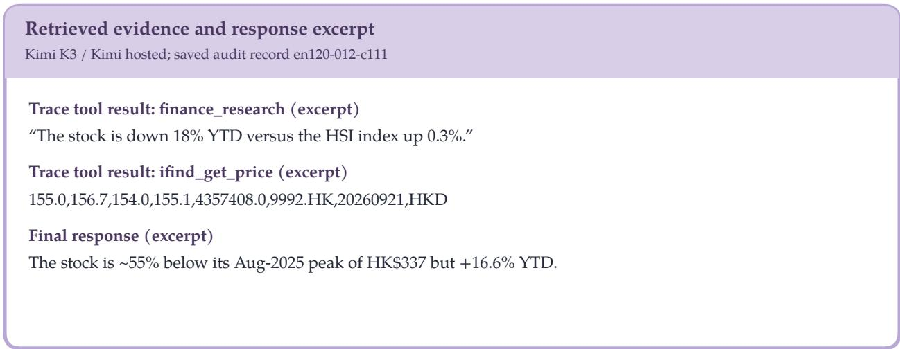  
Figure 15: Tool-result passages and a final-response passage from the saved Kimi audit record. The excerpts are verbatim; surrounding content is omitted. The positive year-to-date return in the response conflicts with the retrieved evidence.

Figure 15 shows retrieved tool-result passages and a response excerpt retained in the saved audit record. The original records link requests and outputs through call identifiers, and the audit inputs link the question, response, and execution trace through hashes.

## F Supplementary Statistical Results

Table 16 lists the full audit statistics in order of the share of responses with hallucination, and table 17 gives the paired diferences between adjacent configurations.

Table 16: Full-cohort audit results on 230 target questions, ordered by the share of responses that contain at least one hallucinated claim. Resp. columns are shares of the 230 responses; claim-level rates are shares of all atomic claims of a configuration. Intervals are 95% question-level bootstrap. U = claim-level hallucination rate + unverified rate, the unconfirmed rate, an upper bound on the hallucination rate.
<table><tr><td>Configuration</td><td>Claims</td><td>/resp.</td><td>Resp. w/ hallucination (%)</td><td>Claim-level hallucination (%)</td><td>Unverified (%)</td><td>Unconfirmed U (%)</td><td>Verified but ungrounded (%)</td><td>Resp. w/ unconfirmed (%)</td></tr><tr><td>GPT-6 Astra / Codex CLI</td><td>7,380</td><td>32.1</td><td>0.9 (0.0–2.2)</td><td>0.03 (0.00–0.07)</td><td>1.36</td><td>1.38</td><td>14.78 (11.22–18.71)</td><td>13.5</td></tr><tr><td>GPT-6 Luna / Codex CLI</td><td>6,340</td><td>27.6</td><td>1.7 (0.4–3.5)</td><td>0.08 (0.02–0.17)</td><td>0.84</td><td>0.91</td><td>6.56 (4.51–8.89)</td><td>11.7</td></tr><tr><td>GPT-6.1 Sol / Codex CLI</td><td>8,174</td><td>35.5</td><td>2.6 (0.9–4.8)</td><td>0.07 (0.02–0.14)</td><td>0.72</td><td>0.80</td><td>7.60 (5.60–9.74)</td><td>13.9</td></tr><tr><td>GPT-5.6 Sol / Pi</td><td>11,326</td><td>49.2</td><td>2.6 (0.9–4.8)</td><td>0.06 (0.02–0.13)</td><td>3.46</td><td>3.52</td><td>15.45 (11.01–20.44)</td><td>24.8</td></tr><tr><td>GPT-5.6 Sol / Codex CLI</td><td>10,626</td><td>46.2</td><td>3.0 (0.9–5.2)</td><td>0.09 (0.03–0.17)</td><td>2.41</td><td>2.50</td><td>17.20 (10.83–23.73)</td><td>26.5</td></tr><tr><td>GPT-5.6 Sol / DSH</td><td>10,711</td><td>46.6</td><td>7.4 (4.3–10.9)</td><td>0.31 (0.15–0.54)</td><td>6.40</td><td>6.70</td><td>34.97 (28.32–41.62)</td><td>47.4</td></tr><tr><td>Claude Opus 5.5 / Pi</td><td>12,812</td><td>55.7</td><td>10.9 (7.0–14.8)</td><td>0.20 (0.13–0.27)</td><td>1.93</td><td>2.12</td><td>12.18 (9.27–15.21)</td><td>40.4</td></tr><tr><td>Gemini 4 Argon / Gemini CLI</td><td>19,575</td><td>85.1</td><td>12.6 (8.7–17.0)</td><td>0.23 (0.14–0.34)</td><td>6.44</td><td>6.67</td><td>13.38 (10.73–16.50)</td><td>69.6</td></tr><tr><td>DeepSeek V4.1 Flash / Codex CLI</td><td>16,160</td><td>70.3</td><td>13.0 (9.1–17.4)</td><td>0.26 (0.18–0.36)</td><td>1.98</td><td>2.24</td><td>5.33 (3.70–7.03)</td><td>39.6</td></tr><tr><td>Claude Opus 5.5 / Codex CLI</td><td>11,361</td><td>49.4</td><td>13.5 (9.1–18.3)</td><td>0.40 (0.23–0.61)</td><td>2.78</td><td>3.18</td><td>17.28 (13.64–20.87)</td><td>46.5</td></tr><tr><td>Claude Opus 5.5 / Claude Code CLI</td><td>12,874</td><td>56.0</td><td>16.5 (11.7–21.7)</td><td>0.40 (0.27–0.55)</td><td>3.29</td><td>3.69</td><td>26.11 (21.42–30.59)</td><td>48.7</td></tr><tr><td>Claude Opus 5.5 / DSH</td><td>10,850</td><td>47.2</td><td>21.7 (16.5–27.0)</td><td>0.80 (0.58–1.04)</td><td>8.57</td><td>9.37</td><td>46.91 (40.18–52.88)</td><td>65.2</td></tr><tr><td>Kimi K3 / Kimi hosted</td><td>16,771</td><td>72.9</td><td>22.2 (16.5–27.8)</td><td>0.45 (0.33–0.59)</td><td>3.80</td><td>4.25</td><td>13.65 (10.49–17.10)</td><td>60.9</td></tr><tr><td>DeepSeek V4.1 Flash / WorkBuddy</td><td>9,568</td><td>41.6</td><td>27.4 (21.7–33.0)</td><td>0.92 (0.70–1.15)</td><td>1.77</td><td>2.69</td><td>4.11 (2.67–5.78)</td><td>44.3</td></tr><tr><td>DeepSeek V4.1 Flash / DSH</td><td>18,847</td><td>81.9</td><td>31.3 (25.2–37.8)</td><td>0.61 (0.47–0.77)</td><td>5.98</td><td>6.59</td><td>17.25 (13.14–21.76)</td><td>67.0</td></tr><tr><td>DeepSeek V4.1 Flash / Pi</td><td>29,156</td><td>126.8</td><td>41.7 (35.2–48.7)</td><td>0.62 (0.50–0.75)</td><td>1.37</td><td>1.98</td><td>1.48 (1.08–1.97)</td><td>66.5</td></tr><tr><td>DuMate / DuMate CLI</td><td>8,891</td><td>38.7</td><td>41.7 (35.2–48.3)</td><td>2.38 (1.92–2.84)</td><td>23.37</td><td>25.76</td><td>62.03 (57.67–66.05)</td><td>90.0</td></tr><tr><td>Seed-2.1-pro / Trae Work</td><td>11,276</td><td>49.0</td><td>47.0 (40.0–53.0)</td><td>2.13 (1.63–2.64)</td><td>26.00</td><td>28.13</td><td>70.91 (66.98–74.73)</td><td>88.7</td></tr></table>

Paired diferences. For each pair of adjacent configurations, we resample the 230 questions 4,000 times, compute all three metrics on the same draw, and take the 2.5th and 97.5th percentiles of the diference. We resample questions rather than claims because claims within a response are correlated. The response-level hallucination intervals exclude zero for two adjacent pairs: GPT-5.6 Sol on Codex CLI versus DSH, and DeepSeek V4.1 Flash on DSH versus Pi. WorkBuddy has a lower response-level point estimate than DSH, but their interval includes zero; its claim-level rate is significantly higher. The VU ordering difers from the hallucination ordering, so the two must be reported separately.

Table 17: Paired diferences between adjacent configurations in the order of Table 16. Each cell is the 95% interval of the diference (second minus first) from a paired question-level bootstrap with 4,000 resamples; ∗ marks intervals that exclude zero. Response-level diferences are in percentage points over the 230 questions; claim-level diferences are in percentage points of claims. Labels as in figure 6.
<table><tr><td>Pair</td><td>Responses with hallucination</td><td>Claim-level hallucination rate</td><td>Verified but ungrounded</td></tr><tr><td>GPT-6 Luna – GPT-6 Astra</td><td>[-0.9, +3.0]</td><td>[-0.03, +0.14]</td><td>[-11.0, -5.6]*</td></tr><tr><td>GPT-6.1 Sol – GPT-6 Luna</td><td>[-1.7, +3.5]</td><td>[-0.11, +0.09]</td><td>[-1.2, +3.2]</td></tr><tr><td>Sol 5.6 / Pi – GPT-6.1 Sol</td><td>[-3.0, +3.0]</td><td>[-0.09, +0.07]</td><td>[+3.9, +12.2]*</td></tr><tr><td>GPT-5.6 Sol – Sol 5.6 / Pi</td><td>[-2.6, +3.5]</td><td>[-0.06, +0.13]</td><td>[-3.1, +7.6]</td></tr><tr><td>Sol 5.6 / DSH – GPT-5.6 Sol</td><td>[+0.4, +8.7]*</td><td>[+0.03, +0.44]*</td><td>[+11.1, +24.1]*</td></tr><tr><td>Opus 5.5 / Pi — Sol 5.6 / DSH</td><td>[-1.7, +8.7]</td><td>[-0.35, +0.07]</td><td>[-28.2, -17.7]*</td></tr><tr><td>Gemini 4 / Gemini – Opus 5.5 / Pi</td><td>[-3.9, +7.4]</td><td>[-0.09, +0.17]</td><td>[-1.6, +4.0]</td></tr><tr><td>DS-V4.1 / Codex – Gemini 4 / Gemini</td><td>[-5.7, +6.1]</td><td>[-0.12, +0.17]</td><td>[-10.5, -5.8]*</td></tr><tr><td>Opus 5.5 / Codex – DS-V4.1 / Codex</td><td>[-5.7, +6.1]</td><td>[-0.05, +0.36]</td><td>[+8.8, +15.3]*</td></tr><tr><td>Opus 5.5 – Opus 5.5 / Codex</td><td>[-3.5, +9.1]</td><td>[-0.24, +0.20]</td><td>[+5.8, +11.7]*</td></tr><tr><td>Opus 5.5 / DSH – Opus 5.5</td><td>[-1.7, +12.2]</td><td>[+0.17, +0.67]*</td><td>[+16.0, +26.4]*</td></tr><tr><td>Kimi K3 – Opus 5.5 / DSH</td><td>[-7.8, +8.7]</td><td>[-0.66, -0.06]*</td><td>[-39.7, -27.2]*</td></tr><tr><td>DS-V4.1 / WorkBuddy – Kimi K3</td><td>[-2.6, +12.6]</td><td>[+0.22, +0.74]*</td><td>[-12.8, -6.6]*</td></tr><tr><td>DS-V4.1 / DSH – DS-V4.1 / WorkBuddy</td><td>[-4.8, +12.2]</td><td>[-0.58, -0.04]*</td><td>[+9.5, +17.5]*</td></tr><tr><td>DS-V4.1 / Pi – DS-V4.1 / DSH</td><td>[+2.2, +18.7]*</td><td>[-0.20, +0.20]</td><td>[-20.4, -12.1]*</td></tr><tr><td>DuMate - DS-V4.1 / Pi</td><td>[-8.7, +8.7]</td><td>[+1.31, +2.28]*</td><td>[+56.3, +64.7]*</td></tr><tr><td>Seed-2.1 / Trae – DuMate</td><td>[-3.0, +13.9]</td><td>[-0.89, +0.43]</td><td>[+3.6, +13.9]*</td></tr></table>

## G Case Studies

The cases come from evaluated responses and their saved per-question audit records. Each card shows the question, a response excerpt, and the verdicts of both stages; audit rationales are summarized in English. C1–C4 illustrate audit outcomes, and C5 shows the full computation from audit evidence to Q.

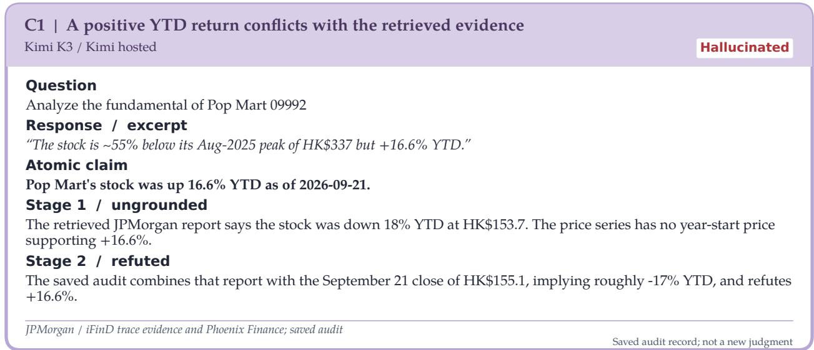  
Figure 16: Hallucinated claim. C1 reports a positive year-to-date return that conflicts with the retrieved price and research evidence. The card reproduces the original audit outcome; the evidence text summarizes the saved audit records.

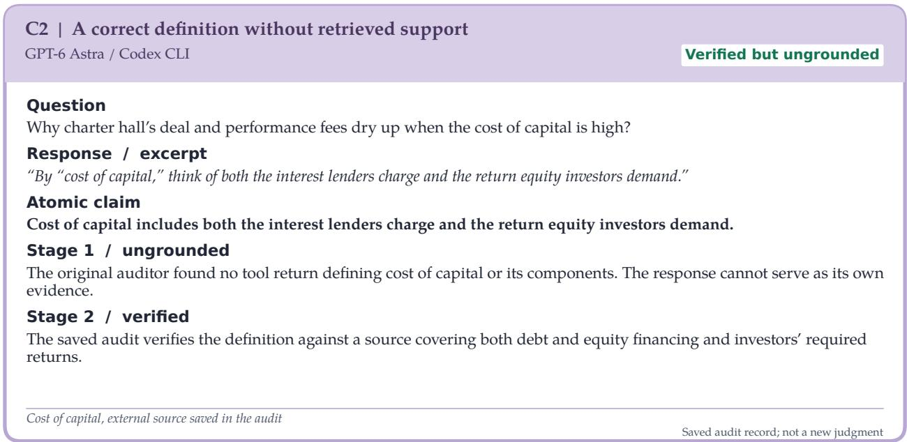  
Figure 17: Verified but ungrounded claim. C2 gives a correct definition absent from the retrieved material. External verification does not make the claim grounded.

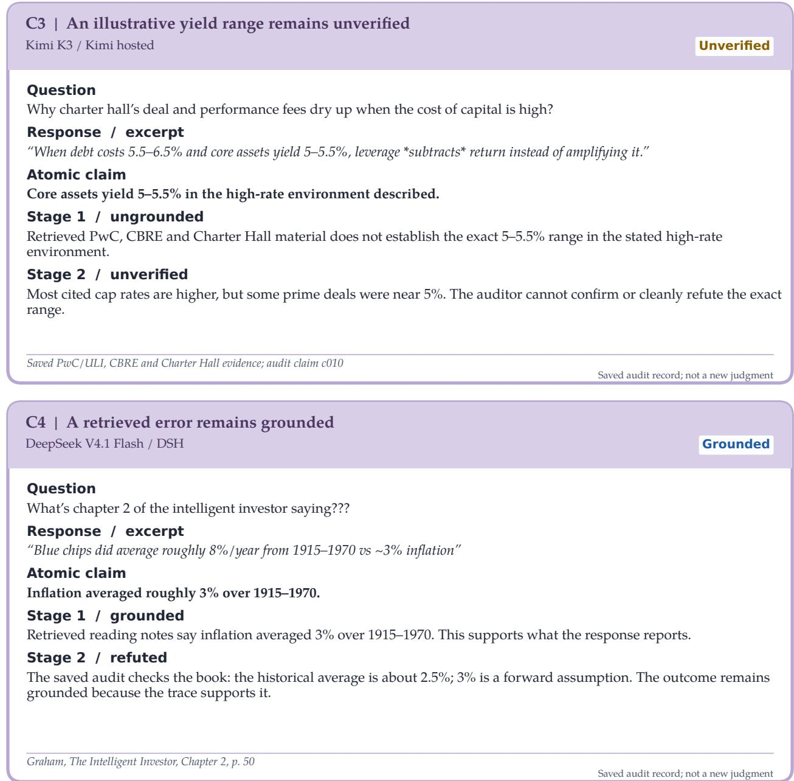  
Figure 18: Two limits of the audit. C3 remains unverified because the exact illustrative property-yield range cannot be established or cleanly refuted. C4 is grounded although external evidence refutes it: the response inherits a numerical error from retrieved reading notes. No new judgments were made for these illustrations.

Figure 16 shows a return calculation inconsistent with retrieved evidence, and figure 17 the diference between a fact being true and being grounded in the trace. Figure 18 shows that unverified does not mean hallucinated, and that an error carried over from retrieved material is still grounded under our definition; the external refutation remains in the underlying judgment.

Full recomputation of the quality score. Figure 19 traces DuMate’s response about the BITQ ETF from frozen audit evidence to the final score. Claim c034 attributes the fund’s management fee to active stock selection, while the saved prospectus describes passive index tracking. The scoring review treats this as one material error with a 12-point extension. Related sector and country-allocation claims are not charged because the classifications are not demonstrably comparable; this does not certify their numerical values. No additional positive item is invalidated and no baseline negative item fires, so $B _ { q } = W _ { q } = 9 2 . 5 0$ . The charged group has no overlapping positive loss, giving an efective penalty of 12 points. No cap binds $( M _ { q } = 1 0 0 )$ and $Q _ { q } = 9 2 . 5 0 - 1 2 = 8 0 . 5 0$

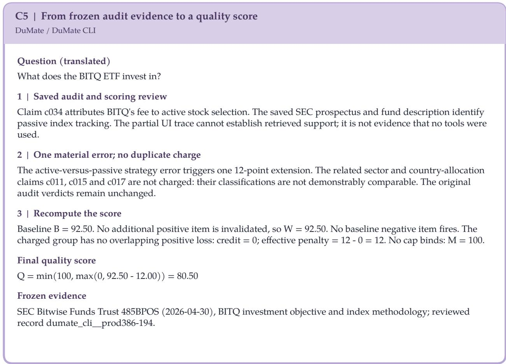  
Figure 19: C5. A reproducible audit-to-score example from DuMate on a retained question. One active-versus-passive strategy error incurs a 12-point penalty, with no overlapping positive loss or binding cap. English text translates or summarizes the saved Chinese records. Original audit judgments are preserved; the scoring review determines which errors are charged.

A second example: a binding cap. The positive score ofKimi K3 on a gold-investment question comparing the Jupiter Gold & Silver Fund with IAU is 89.89. The response advises most individual investors to put 70– 80% in IAU and 20–30% in the fund. This specific position sizing triggers baseline negative item N08, which deducts 25 points and caps the score at 60, and also fails the linked positive item P26 (3.75 points). After crediting this loss, the efective penalty is 25 − 3.75 = 21.25, and the score before the cap is 89.89 − 21.25 = 68.64. The cap then lowers the score to 60. The audit finds no hallucinated claim among the 68 claims of the response, so no extension item is triggered and $Q _ { q } = B _ { q } = 6 0$

## H Additional Results

## H.1 Audit Outcomes and the Two Audit Stages

Figure 20 summarizes the diagnostic classification of all claims under the two-stage audit, and table 18 gives the structure of ungrounded claims. Trace provenance and external verification are complementary (figure 21): if every ungrounded claim were treated as hallucination, 42.72%–91.45% of the flagged claims would turn out to be verified, whereas keeping only the external verdict would merge verified-but-ungrounded claims with grounded ones. Ungrounded claims therefore call for verification, and external verification does not show that the original system had evidence for the claim. The comparison reuses the saved verdicts, so it shows complementary diagnostics rather than an accuracy gain from an independent rerun.

Stage 1: Provenance

Stage 2: Verification

Grounded in the system's own trace?

Independent external evidence

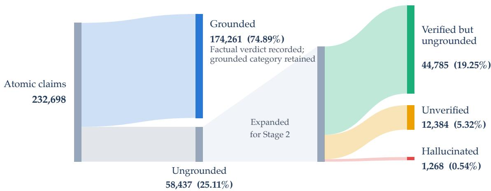  
Figure 20: Diagnostic classification of all atomic claims from 18 configurations under the two-stage audit on 230 questions. Ribbon widths follow the recorded claim counts; the ungrounded stream is magnified before Stage 2. Counts and percentages are printed in the diagram. A hallucination is an ungrounded, externally refuted claim; unverified claims remain separate. Policy-default passes are not substituted for audit verdicts. The grounded branch represents a retained diagnostic category, not early termination of the audit. Grounded claims also receive factual verdicts, which may reuse trace evidence; their factual outcomes are not expanded in this diagram.

Table 18: Structure of ungrounded and unconfirmed claims. The three Resp. columns are shares of the 230 responses: with at least one verified-but-ungrounded claim, with at least half of the claims ungrounded, and with no grounded claim at all. Refuted when ungrounded: among ungrounded claims that are verified or refuted (excluding unverified ones), the share refuted. Grounded but refuted: grounded claims whose factual verdict is refuted; they retain the grounded diagnostic category after factual verification and are not counted as hallucinations.
<table><tr><td>Configuration</td><td>Grounded claims (%)</td><td>Resp. w/ ≥1 verified- but-ungrounded (%)</td><td>Resp. ≥50% ungrounded (%)</td><td>Resp. fully ungrounded (%)</td><td>Per-question unconfirmed (%)</td><td>Top-10% share of unconfirmed (%)</td><td>Refuted when ungrounded (%)</td><td>Grounded but refuted</td></tr><tr><td>GPT-6 Astra / Codex CLI</td><td>83.83</td><td>53.9</td><td>9.6</td><td>1.3</td><td>1.65</td><td>92</td><td>0.2</td><td>0</td></tr><tr><td>GPT-6 Luna / Codex CLI</td><td>92.52</td><td>31.3</td><td>5.7</td><td>1.3</td><td>1.02</td><td>93</td><td>1.2</td><td>2</td></tr><tr><td>GPT-6.1 Sol / Codex CLI</td><td>91.61</td><td>41.7</td><td>3.5</td><td>0.4</td><td>0.93</td><td>86</td><td>1.0</td><td>0</td></tr><tr><td>GPT-5.6 Sol / Pi</td><td>81.03</td><td>49.6</td><td>15.2</td><td>14.8</td><td>2.65</td><td>89</td><td>0.4</td><td>6</td></tr><tr><td>GPT-5.6 Sol / Codex CLI</td><td>80.29</td><td>55.7</td><td>13.0</td><td>7.0</td><td>2.26</td><td>80</td><td>0.5</td><td>1</td></tr><tr><td>GPT-5.6 Sol / DSH</td><td>58.32</td><td>73.5</td><td>52.2</td><td>44.3</td><td>6.99</td><td>65</td><td>0.9</td><td>1</td></tr><tr><td>Claude Opus 5.5 / Pi</td><td>85.70</td><td>65.2</td><td>11.7</td><td>4.3</td><td>2.51</td><td>64</td><td>1.6</td><td>9</td></tr><tr><td>Gemini 4Argon / Gemini CLI</td><td>79.95</td><td>80.0</td><td>20.9</td><td>14.8</td><td>7.29</td><td>56</td><td>1.7</td><td>38</td></tr><tr><td>DeepSeek V4.1 Flash / Codex CLI</td><td>92.43</td><td>49.6</td><td>6.5</td><td>4.3</td><td>2.52</td><td>67</td><td>4.6</td><td>1</td></tr><tr><td>Claude Opus 5.5 / Codex CLI</td><td>79.54</td><td>67.0</td><td>18.3</td><td>8.3</td><td>3.31</td><td>59</td><td>2.2</td><td>13</td></tr><tr><td>Claude Opus 5.5 / Claude Code CLI</td><td>70.20</td><td>82.6</td><td>30.0</td><td>8.3</td><td>3.44</td><td>62</td><td>1.5</td><td>40</td></tr><tr><td>Claude Opus 5.5 / DSH</td><td>43.71</td><td>93.0</td><td>69.1</td><td>58.7</td><td>11.10</td><td>52</td><td>1.7</td><td>7</td></tr><tr><td>Kimi K3 / Kimi hosted</td><td>82.10</td><td>72.2</td><td>13.5</td><td>5.2</td><td>4.10</td><td>62</td><td>3.2</td><td>23</td></tr><tr><td>DeepSeek V4.1 Flash / WorkBuddy</td><td>93.21</td><td>28.7</td><td>3.5</td><td>0.4</td><td>2.79</td><td>52</td><td>18.3</td><td>47</td></tr><tr><td>DeepSeek V4.1 Flash / DSH</td><td>76.16</td><td>72.6</td><td>30.4</td><td>20.9</td><td>7.73</td><td>60</td><td>3.4</td><td>10</td></tr><tr><td>DeepSeek V4.1 Flash / Pi</td><td>96.54</td><td>50.0</td><td>0.9</td><td>0.4</td><td>2.03</td><td>48</td><td>29.5</td><td>13</td></tr><tr><td>DuMate / DuMate CLI</td><td>12.21</td><td>97.4</td><td>90.4</td><td>59.1</td><td>23.89</td><td>38</td><td>3.7</td><td>20</td></tr><tr><td>Seed-2.1-pro / Trae Work</td><td>0.96</td><td>98.7</td><td>100.0</td><td>88.3</td><td>27.28</td><td>39</td><td>2.9</td><td>0</td></tr></table>

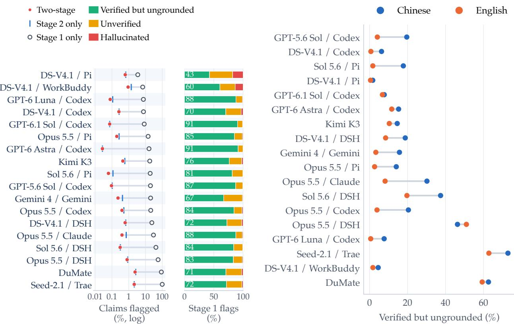  
(a)  
Figure 21: Comparison using saved audit verdicts for 18 configurations, ordered by the Stage 1 rate. (a) Share of claims each decision rule would flag (log scale): Stage 1 alone, Stage 2 alone, and the full two-stage audit. (b) Composition of Stage 1 flags; numbers give the verifiedbut-ungrounded percentage. No new audit judgments are made.  
(b)  
Figure 22: VU rate on Chinese versus English questions. Rows follow table 5; VU denotes claims that are verified but ungrounded.

## H.2 Exploratory Classification of Reasoning Gaps

We secondarily classify all 1,960 distinct criteria in the explanation-and-reasoning dimension of the frozen rubrics, covering 230 questions and 18 configurations. Each criterion receives one primary category based on its wording, shared across all configurations regardless of satisfaction. Deterministic initial labels were reviewed criterion by criterion by an AI assistant, with 702 assignments revised; this is exploratory coding without independent human double-coding. No responses were regenerated or judgments rescored. These categories do not include criteria from the separate boundary-and-applicability dimension.

Table 19: Reasoning-category coverage and unmet rates. Each distinct criterion is judged for all 18 configurations; the unmet rate uses applicable judgments within its category as the denominator.
<table><tr><td>Category</td><td>Criteria</td><td>Applicable judgments</td><td>Unmet</td><td>Unmet rate (%)</td></tr><tr><td>Explaining financial impacts</td><td>836</td><td>15,048</td><td>3,628</td><td>24.11</td></tr><tr><td>Comparison and synthesis</td><td>376</td><td>6,768</td><td>1,351</td><td>19.96</td></tr><tr><td>Scenarios and dynamic validation</td><td>237</td><td>4,266</td><td>798</td><td>18.71</td></tr><tr><td>Valuation and market expectations</td><td>188</td><td>3,384</td><td>764</td><td>22.58</td></tr><tr><td>Business, product, and institutional mechanisms</td><td>164</td><td>2,952</td><td>654</td><td>22.15</td></tr><tr><td>Investment strategy and trade-offs</td><td>100</td><td>1,800</td><td>428</td><td>23.78</td></tr><tr><td>Quantitative modeling and derivation</td><td>59</td><td>1,062</td><td>293</td><td>27.59</td></tr><tr><td>Total</td><td>1,960</td><td>35,280</td><td>7,916</td><td>22.44</td></tr></table>

Explaining financial impacts. Channels linking macroeconomic, policy, industry, and operating drivers to demand, revenue, costs, profits, cash flow, or prices.

Comparison and synthesis. Distinguishing concepts and measurement scopes, establishing comparability, and integrating multiple factors into conclusions.

Scenarios and dynamic validation. Conditional scenarios, time horizons and lags, risk triggers, follow-up validation, and limits to causal inference or extrapolation.

Valuation and market expectations. Valuation methods, normalized earnings, implied expectations, margins of safety, and what prices already reflect.

Business, product, and institutional mechanisms. Operating mechanisms of businesses, financial products, trading, institutions, and task-relevant technologies.

Investment strategy and trade-ofs. Investment objectives and constraints, allocation, hedging, execution, and risk–return or cost trade-ofs.

Quantitative modeling and derivation. Formulas, weighting, metric decomposition, currency and real/nominal conversions, compounding, and valuation-model construction.

Figure 12(a) reports each category’s share of all 7,916 unmetjudgments; panel (b) and table 19 report unmet judgments divided by applicable judgments within each category. Shares therefore reflect both criterion frequency and non-fulfillment; they are not category-specific error probabilities or causal explanations of the L1–L4 score diference. An unmet criterion may indicate an omitted requirement rather than a factual error. Alternative assignment and split-allocation checks on 84 overlapping criteria retain transmission mechanisms and comparison/synthesis as the two largest categories by unmet count. These checks address categoryboundary sensitivity, not independent validation of the taxonomy.

## H.3 Response Length and Claim Concentration

This analysis uses unconfirmed claims, i.e., hallucinated plus unverified claims as in the unconfirmed rate U (section 4.3). Response-level and claim-level views can rank configurations diferently, so both should be reported (figure 23). When Kimi K3’s responses are grouped into quartiles by claim count, the share containing an unconfirmed claim rises from 43% to 81%, while the claim-level share stays between 3.6% and 4.6%. In every configuration, the 10% most afected questions hold 38%–93% of the unconfirmed claims, so review can target specific responses. The association with length is not necessarily causal.

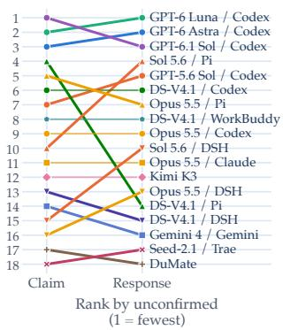

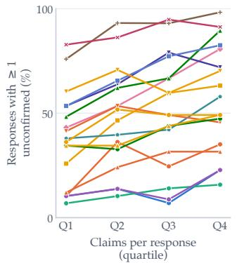

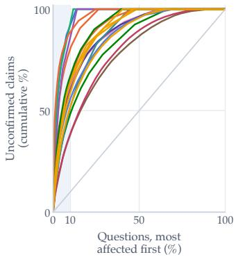

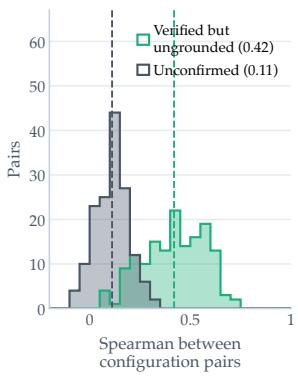  
Figure 23: Length, concentration, and question-level stability for 18 configurations. (a) Rank by unconfirmed claims at claim and response levels. (b) Share of responses with an unconfirmed claim by quartile of claims per response. (c) Concentration curves, with questions ordered by unconfirmed-claim count within each configuration. (d) Pairwise Spearman correlations of per-question VU and unconfirmed rates; dashed lines mark the means.

## H.4 Breakdown by Complexity and Language

Complexity levels. Figure 24 decomposes the audit outcomes by the complexity levels of table 8 on the 230 questions, which contain 10, 70, 86, and 64 questions at L1–L4. Simpler questions are less often grounded in the trace: averaged over the 18 configurations, the VU rate is 36.1% and 36.0% at L1 and L2 but 15.9% and 13.3% at L3 and L4, and it is higher on L1–L2 than on L3–L4 in all 18 configurations. Systems thus often answer simpler questions with claims that are verified but ungrounded, so the VU rate is highest where hallucinations are least frequent (section 5.3.5). Claim-level shares pool the claims within each level, and the breakdown is descriptive.

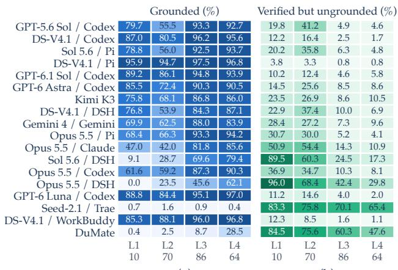  
(a)  
(b)  
Figure 24: Audit outcomes by complexity level on the 230 questions, rows as in figure 6. (a) Grounded rate. (b) VU rate. Claims are pooled within each level, and the column labels give the number of questions. Responses with a hallucinated claim by level are shown in figure 11(a).  
Language. In 17 of the 18 configurations, the VU rate is higher on Chinese questions than on English questions (figure 22). The exception is Claude Opus 5.5 on DSH, at 46.3% for Chinese and 51.0% for English. For example, the Claude Opus 5.5 configuration on Claude Code CLI is at 30.2% versus 8.2%, and GPT-5.6 Sol on Codex CLI at 19.6% versus 4.1%.