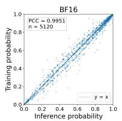
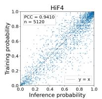
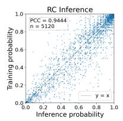
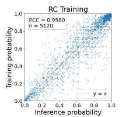
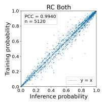

# Aligning Training and Rollout Policies for End-to-End FP4 RL on Mixture-of-Experts LLMs

Hei Yi Mak∗, Hoang Le∗, Mehran Taghian Jazi, Yunke Peng, Huan Lin, Zhengzhi Tang, Zhexu Liu, Yao Wang, Yaoyuan Wang, Anandharaju Durai Raju, Tanzila Rahman

Huawei

{hei.yi.mak1, pengyunke}@huawei.com

## Abstract

In this work, we study end-to-end FP4 reinforcement learning (RL) post-training for Mixture-of-Experts (MoE) large language models. Recent work on FP4 RL has introduced effective recovery recipes that restore accuracy under aggressive low-precision quantization for dense models, but we find that the same approach yields no improvement over the naive FP4 baseline in the MoE setting. We conduct an in-depth study to understand why. Our analysis identifies the root cause in the routing mechanism unique to MoE: because the router makes discrete expertselection decisions, training–inference policy alignment becomes acutely sensitive to whether the same recovery technique is applied symmetrically on the training and inference sides. When an asymmetric recipe is used—including the densemodel approach, which corrects only the rollout—training–inference alignment deteriorates sharply, as measured by the Pearson correlation coefficient between training and inference probabilities, and router selection matching rates. Building on this finding, we propose MoeResQ, a quantization-recovery recipe for MoE RL post-training that enforces symmetry between the training- and inference-side corrections. MoeResQ restores training–inference alignment and substantially closes the accuracy gap to full precision, establishing symmetric recovery as the key principle in FP4 RL for MoE models.

## 1 Introduction

Large Language Models (LLMs) have achieved strong performance across a wide range of tasks, including mathematical problem solving, code generation, and agentic workflows [1, 2]. Reinforcement Learning with Verifiable Rewards, using policy-gradient algorithms such as GRPO [3], has become a successful paradigm for LLM post-training [4]. Despite its effectiveness for reasoning, RL post-training is highly resource-intensive in both memory and computation. Quantization has emerged as an effective means of reducing memory footprint and computational cost. Prior work has explored low-precision computation for RL, with 8-bit formats on the rollout side, and [5] on both the training and rollout policies [6]. Most recently, QeRL[7] applied weight-only quantization to the rollout policy in combination with LoRA [8], keeping activations and gradients in higher precision, while RolloutResQ [9] introduced a residual correction for the rollout activations and quantized both the training and rollout sides to 4-bit. A central challenge shared by these methods is the mismatch between the training and rollout sides, which has so far been studied only for dense models [10].

Mixture-of-Experts (MoE) LLMs, which combine dynamic routing with sparse activation, attain higher performance at reduced computational [11, 12], making them a natural next target for lowprecision RL. In this paper, we ask whether RolloutResQ, the quantization recovery recipe developed for dense models in FP4 RL, transfers to MoE models. Through a systematic study, we find that RolloutResQ fails to recover any accuracy over the FP4 baseline in the MoE setting. We trace this failure to the training–rollout mismatch introduced by the routing mechanism, whose expert selection is highly sensitive to quantization error. In particular, an asymmetric recipe—in which the quantization recovery method adopted in training differs from that used in rollout—suffers substantially more degradation than a symmetric recipe that applies the same method on both sides.

Guided by this finding, we propose MoeResQ, which adapts RolloutResQ to align the training and rollout sides by applying a residual correction on the training side as well. We further study a fine-grained configuration that quantizes the linear layers of the experts only. Together, these choices close the training-inference alignment as well as the accuracy gap to full precision (BF16) for FP4 RL on MoE models.
<table><tr><td>Dataset</td><td>BF16</td><td>HiF4</td><td>RolloutResQ</td><td>MoeResQ</td><td>RolloutResQ (experts only)</td><td>MoeResQ (experts only)</td></tr><tr><td>AMC23</td><td>85.10</td><td>65.23 (-19.87)</td><td>62.34 (-22.76)</td><td>84.45 (-0.65)</td><td>78.75 (-6.35)</td><td>84.61 (-0.49)</td></tr><tr><td>AIME24</td><td>48.23</td><td>23.96 (-24.27)</td><td>25.00 (-23.23)</td><td>44.48 (-3.75)</td><td>37.39 (-10.84)</td><td>46.98 (-1.25)</td></tr><tr><td>AIME25</td><td>34.38</td><td>20.83 (-13.55)</td><td>19.06 (-15.32)</td><td>29.69 (-4.69)</td><td>29.06 (-5.32)</td><td>32.92 (-1.46)</td></tr><tr><td>MATH500</td><td>86.71</td><td>79.21 (-7.50)</td><td>74.00 (-12.71)</td><td>85.42 (-1.29)</td><td>82.46 (-4.25)</td><td>86.17 (-0.54)</td></tr></table>

Table 1: Evaluation results for Qwen3-30B-A3B trained on DAPO-Math-17K with GRPO. For HiF4, RolloutResQ and MoeResQ, the attention projections and expert projections are in HiF4 precision. For RolloutResQ (experts only) and MoeResQ (experts only), only expert projections are in HiF4 precision. In all experiments, the routing layers, constituting only 0.041% of the total parameters, are kept in BF16 as outputs are highly sensitive to routing selection.

## 2 Preliminaries

## 2.1 Residual Correction and RolloutResQ

Prior work has identified activation outliers as a primary obstacle to low-precision quantization. As highlighted in [9, 13, 14], such outliers widen the dynamic range of the represented values, forcing the limited FP4 grid to allocate its few available levels across an inflated range and thereby collapsing a large fraction of smaller values to zero. [9, 13] address this issue by residual correction (RC), which computes an activation residual and uses it to correct the output. Formally, for each linear layer ℓ, the activation residual is given by $\Delta X _ { \ell } = X _ { \ell } - Q ( X _ { \ell } )$ , where Q is the quantization operator. The residual is then quantized to recover the precision loss through two FP4 GEMMs,

$$
\begin{array} { r } { \hat { Y _ { \ell } } = Q ( X _ { \ell } ) Q ( W _ { \ell } ) ^ { \top } + Q ( \Delta X _ { \ell } ) Q ( W _ { \ell } ) ^ { \top } . } \end{array}\tag{1}
$$

In FP4 RL post-training setting, [9] identifies rollout activation is the primary source of degradation and propose an effective recipe, RolloutResQ, to recover accuracy loss for dense LLMs, which applies residual correction on rollout activations. In this work, we use HiF4 [15] as the FP4 quantization format and do not quantize the routers of the MoE models as they constitute only 0.38% of the active parameters and the outputs are sensitive to routing selection. Due to hardware limitations, all experiments are conducted under simulated quantization.

## 2.2 Mixture-of-Experts LLMs

Mixture-of-Experts (MoE) LLMs have recently emerged as a leading recipe for scaling model capacity without a proportional increase in computational cost. By replacing the dense feed-forward networks (FFNs) of a standard Transformer with a collection of expert FFNs and a lightweight router that activates only the top-k experts per token, MoE models decouple total parameter count from per-token compute [16, 17]. This design has powered some of the strongest open-weight reasoning models to date: DeepSeek-V4 [18], Qwen3 [19], Kimi-K3 [20]. Given this combination of strong reasoning ability and favorable compute–performance trade-off, MoE models are a natural target for low-precision RL post-training.

This sparsity, however, comes at the cost of training difficulty. Because the router performs a discrete, input-dependent top-k expert selection, MoE training is prone to instabilities such as routing collapse [16, 17, 21], and is unusually sensitive to small perturbations of the router’s input activations.

This sensitivity is amplified in low-precision RL: when rollout and training run under different numerical conditions, the router can select different experts for the same token, so a response is generated under one effective policy but scored under another—a rollout–training mismatch that widens the off-policy gap and can severely degrade or even collapse training [22]. This same sensitivity is what makes the interaction between MoE routing and quantization non-trivial, and it motivates the analysis in the following sections.

  
Figure 1: Visualization of the alignment between training and inference probabilities for BF16, HiF4, RC Inference, RC Training, and RC Both.

<table><tr><td></td><td></td><td></td><td colspan="3">RC</td><td colspan="3">RC (Experts Only)</td></tr><tr><td>Metric</td><td>BF16</td><td>HiF4</td><td>Inference</td><td>Training</td><td>Both</td><td>Inference</td><td>Training</td><td>Both</td></tr><tr><td>PCC</td><td>0.9951</td><td>0.9410</td><td>0.9444</td><td>0.9580</td><td>0.9940</td><td>0.9702</td><td>0.9796</td><td>0.9952</td></tr><tr><td colspan="9">top_k_match_frac</td></tr><tr><td>Layer 0</td><td>0.9869</td><td>0.9801</td><td>0.8100</td><td>0.8195</td><td>0.9709</td><td>0.9867</td><td>0.9875</td><td>0.9867</td></tr><tr><td>Layer 12</td><td>0.8799</td><td>0.6172</td><td>0.6279</td><td>0.6590</td><td>0.8682</td><td>0.7373</td><td>0.7879</td><td>0.8730</td></tr><tr><td>Layer 23</td><td>0.8562</td><td>0.5883</td><td>0.5990</td><td>0.6402</td><td>0.8418</td><td>0.7209</td><td>0.7674</td><td>0.8506</td></tr><tr><td>Layer 35</td><td>0.8459</td><td>0.6256</td><td>0.6514</td><td>0.6836</td><td>0.8359</td><td>0.7354</td><td>0.7947</td><td>0.8455</td></tr><tr><td>Layer 47</td><td>0.8680</td><td>0.6926</td><td>0.7092</td><td>0.7297</td><td>0.8846</td><td>0.7748</td><td>0.8059</td><td>0.8687</td></tr><tr><td>topk_overlap_mean</td><td>0.9850</td><td>0.9580</td><td>0.9550</td><td>0.9600</td><td>0.9840</td><td>0.9710</td><td>0.9770</td><td>0.9840</td></tr></table>

Table 2: Training-inference alignment base on three metrics: the Pearson correlation coefficient (PCC) between training and inference probabilities, the fraction of tokens whose top-k expert set matches exactly (top\_k\_match\_frac), and the mean pairwise overlap of the top-k sets (topk\_overlap\_mean). For top\_k\_match\_frac, we measured the values for layer 0, 12, 23, 35, and 47. RC denotes applying RC when quantizing both attention linear projections and expert linear projections, and RC (Experts only) denotes applying RC when quantizing expert linear projection only.

## 3 Symmetry Restores Training–Inference Alignment in FP4 MoE RL

Table 1 contains the evaluation results of training Qwen3-30B-A3B [19] with GRPO in BF16 precision and HiF4 precision. The degradation is significant, with 19.87%, 24.27%, 13.55%, 7.50% accuracy drops across the evaluation AMC-2023 [23], AIME-2024 [24], AIME-2025 [25], and MATH-500 [26], respectively. While RolloutResQ shows great success in recovering accuracy on dense models [9]; we ask whether it transfers to the MoE architecture. The outcome is not merely a smaller gain—it is a reversal. As shown in Table 1, applying RolloutResQ fails to recover accuracy and, on three of four benchmarks, performs even worse than the naive HiF4 baseline that applies no recovery at all. On AMC23 it drops 22.76 points from BF16 (62.34 vs. 85.10), below HiF4’s already-degraded 65.23; on AIME25 it falls to 19.06, below HiF4’s 20.83; and on MATH500 it reaches only 74.00, below HiF4’s 79.21.

The disappointing outcome naturally leads to a key question: Why does a low precision RL recipe that works on dense models fail so decisively on MoE? We hypothesize that this is due to the asymmetric nature of RolloutResQ, where residual correction is applied only on inference side but not on training side. In the MoE setting this mismatch can be amplified by a mechanism absent in dense models: the router. Because expert selection is a discrete argmax over gate logits, a small perturbation to activations does not merely shift an output—it can flip which experts are executed. When correction is applied during rollout but not during training, this can encourage the inference and training policies to route tokens to different experts, and the resulting divergence compounds.

Table 2 supports this hypothesis. It compares the training and inference alignment on rollout generated from the inference policy with vLLM, using three metrics: the Pearson correlation coefficient (PCC)

between training and inference probabilities, top\_k\_full\_match\_frac, and topk\_overlap\_mean. Under the full-scope setting (quantizing experts and attention projections), one-sided RC leaves alignment near the HiF4 level: PCC is 0.9444 (RC Inference) and 0.9580 (RC Training), against HiF4’s 0.9410 and BF16’s 0.9951; topk\_overlap\_mean and top\_k\_full\_match\_frac exhibit the same pattern—RC Inference and RC Training hover around HiF4’s level and remain far from BF16. Applying RC to both sides (Both) restores every metric back to near-BF16: PCC 0.9940, overlap 0.9840, and top\_k\_full\_match\_frac recovering close to BF16 standard at all five layers. Figure 1 further illustrates the alignment between training and inference probabilities across configurations. Notably, the points for RC Both cluster much more tightly along the diagonal (perfect alignment) than those for HiF4 and the asymmetric recipes, closely mirroring BF16. The same behavior holds when quantization is restricted to expert layers only (experts only), where the symmetric recipe recovers alignment almost fully on all metrics. In every scope and at every layer, applying RC on only one side brings nearly no improvement over HiF4, but applying to both sides restores every alignment metric to BF16 level, demonstrating that symmetry is the key to closing the alignment gap.

## 4 MoeResQ: Method and Results

Base on the above analysis, we present MoeResQ, an symmetric recipe for recovering the precision loss induced by the training–inference mismatch in MoE models under fully FP4 RL. Having identified that applying quantization recovery to only one side—training or inference—is the principal failure mode, MoeResQ applies RC to the same layers on both training and inference, maximizing the symmetry between the two policies and thereby minimizing the mismatch. Concretely, during rollout we apply the activation correction of Equation 1. During training, the forward pass uses the same residual correction as the inference side (Equation 1). For the backward pass, given the input $X _ { \ell } ,$ the weight $W _ { \ell }$ , and the output gradient $d Y _ { \ell } .$ , the input and weight gradients are computed as $d X _ { \ell } = d Y _ { \ell } \bar { W _ { \ell } }$ and $d W _ { \ell } = ( d \dot { Y _ { \ell } } ) ^ { \top } \bar { X } _ { \ell } ,$ , respectively. To correct the quantization error in the backward pass, we apply the residual correction to both dY and $X _ { \ell }$ , so that the computation retains $d Y _ { \ell } , \Delta d Y _ { \ell } , X _ { \ell }$ , and $\Delta X _ { \ell }$ , where $\Delta X _ { \ell } = X _ { \ell } - Q ( X _ { \ell } )$ and $\Delta d Y _ { \ell } = d Y _ { \ell } - Q ( d Y _ { \ell } )$

We also consider the setting in which only the expert linear layers are quantized to FP4—the "experts only" scope studied in Section 3. The expert projections account for the majority of the model’s parameters—up to 94.66% in Qwen3-30B-A3B—so quantizing them alone captures most of the efficiency benefit of FP4. The attention linear layers are kept in BF16, which limits perturbation to the router’s input and preserves routing quality.

Our experiments are conducted using VeRL [27], with vLLM [28] for rollout and FSDP [29] for training. We train Qwen3-30B-A3B on DAPO-Math-17k [30] with GRPO and evaluate it on AMC-2023, AIME-2024, AIME-2025, and MATH-500. As shown in Table 1, MoeResQ recovers near-BF16 accuracy across all four benchmarks, substantially narrowing the gap between HiF4 and the BF16 baseline: from 19.87% to 0.65% on AMC23, from 24.27% to 3.75% on AIME24, from 13.55% to 4.69% on AIME25, and from 7.5% to 1.29% on MATH500. When quantization is applied only to the expert layers, MoeResQ pushes performance even closer to BF16, closing the gap to just 0.49%, 1.25%, 1.46%, and 0.54% on AMC23, AIME24, AIME25, and MATH500, respectively. Remarkably, in this configuration MoeResQ lands within about 0.5% of BF16 on both AMC23 and MATH500, and within 1.5% on all four benchmarks—effectively matching full-precision accuracy in a fully FP4 setting. These results demonstrate that MoeResQ recovers near-BF16 accuracy in end-to-end FP4 RL post-training of MoE LLMs, a low-precision regime in which RolloutResQ is insufficient.

## 5 Conclusion

We studied end-to-end FP4 RL post-training for MoE LLMs and found that RolloutResQ, the dense model residual-correction recipe, does not transfer to this setting. The cause is the router: since expert selection is a discrete argmax over gate logits, the mismatch from an asymmetric recovery recipe is amplified into divergent routing that degrades training–inference alignment. Our recipe, MoeResQ, applies residual correction symmetrically on both sides, restoring alignment and recovering near-BF16 accuracy—revealing that training–inference symmetry is the key to accuracy recovery in FP4 RL for MoE models. A promising direction for future work is to push the efficiency of this recipe further while sustaining near-BF16 accuracy.

## References

[1] Tom B. Brown, Benjamin Mann, Nick Ryder, Melanie Subbiah, Jared Kaplan, Prafulla Dhariwal, et al. Language models are few-shot learners. Advances in Neural Information Processing Systems, 2020.

[2] Long Ouyang, Jeffrey Wu, Xu Jiang, Diogo Almeida, Carroll Wainwright, Pamela Mishkin, Chong Zhang, Sandhini Agarwal, Katarina Slama, Alex Ray, et al. Training language models to follow instructions with human feedback. Advances in neural information processing systems, 35:27730–27744, 2022.

[3] Zhihong Shao, Peiyi Wang, Qihao Zhu, Runxin Xu, Junxiao Song, Xiao Bi, Haowei Zhang, Mingchuan Zhang, YK Li, Yang Wu, et al. Deepseekmath: Pushing the limits of mathematical reasoning in open language models. arXiv preprint arXiv:2402.03300, 2024.

[4] Deepseek DeepSeek-AI. r1: Incentivizing reasoning capability in llms via reinforcement learning, 2025. URL: https://arxiv. org/abs/2501.12948, 2017.

[5] Yuhang Li, Reena Elangovan, Xin Dong, Priyadarshini Panda, and Brucek Khailany. QuRL: Low-precision reinforcement learning for efficient reasoning. In The Fourteenth International Conference on Learning Representations, 2026.

[6] Haocheng Xi, Charlie Ruan, Peiyuan Liao, Yujun Lin, Han Cai, Yilong Zhao, Shuo Yang, Kurt Keutzer, Song Han, and Ligeng Zhu. Jet-rl: Enabling on-policy fp8 reinforcement learning with unified training and rollout precision flow. arXiv preprint arXiv:2601.14243, 2026.

[7] Wei Huang, Yi Ge, Shuai Yang, Yicheng Xiao, Huizi Mao, Yujun Lin, Hanrong Ye, Sifei Liu, Ka Chun Cheung, Hongxu Danny Yin, et al. Qerl: Beyond efficiency-quantization-enhanced reinforcement learning for llms. In International Conference on Learning Representations, volume 2026, pages 99338–99361, 2026.

[8] Edward J Hu, Yelong Shen, Phillip Wallis, Zeyuan Allen-Zhu, Yuanzhi Li, Shean Wang, Lu Wang, and Weizhu Chen. Lora: Low-rank adaptation of large language models. arXiv preprint arXiv:2106.09685, 2021.

[9] Hei Yi Mak, Shadan Golestan, Hoang Le, Mehran Taghian Jazi, Yunke Peng, Yaoyuan Wang, Yao Wang, Junsong Wang, Tianchi Hu, Fengchen He, et al. Hifloat4 format for end-to-end reinforcement learning post-training of large language models. arXiv preprint arXiv:2607.26515, 2026.

[10] Feng Yao, Liyuan Liu, Dinghuai Zhang, Chengyu Dong, Jingbo Shang, and Jianfeng Gao. On the rollout-training mismatch in modern rl systems. In OPT 2025: Optimization for Machine Learning, 2025.

[11] Aixin Liu, Bei Feng, Bing Xue, Bingxuan Wang, Bochao Wu, Chengda Lu, Chenggang Zhao, Chengqi Deng, Chenyu Zhang, Chong Ruan, et al. Deepseek-v3 technical report. arXiv preprint arXiv:2412.19437, 2024.

[12] Albert Q Jiang, Alexandre Sablayrolles, Antoine Roux, Arthur Mensch, Blanche Savary, Chris Bamford, Devendra Singh Chaplot, Diego de las Casas, Emma Bou Hanna, Florian Bressand, et al. Mixtral of experts. arXiv preprint arXiv:2401.04088, 2024.

[13] Pengle Zhang, Jia Wei, Jintao Zhang, Jun Zhu, and Jianfei Chen. Accurate int8 training through dynamic block-level fallback. arXiv preprint arXiv:2503.08040, 2025.

[14] Ruizhe Wang, Yeyun Gong, Xiao Liu, Guoshuai Zhao, Ziyue Yang, Baining Guo, Zheng-Jun Zha, and Peng CHENG. Optimizing large language model training using FP4 quantization. In Forty-second International Conference on Machine Learning, 2025.

[15] Yuanyong Luo, Jing Huang, Yu Cheng, Ziwei Yu, Kaihua Tang, Xinda Ma, Xin Wang, Anping Tong, Guipeng Hu, Yun Xu, Mehran Taghian, Peng Wu, Guanglin Li, Yunke Peng, Tianchi Hu, Minqi Chen, Michael Bi Mi, Hu Liu, Xiping Zhou, Junsong Wang, Qiang Lin, and Heng Liao. Hifloat4 format for language model inference, 2026.

[16] Noam Shazeer, Azalia Mirhoseini, Krzysztof Maziarz, Andy Davis, Quoc Le, Geoffrey Hinton, and Jeff Dean. Outrageously large neural networks: The sparsely-gated mixture-of-experts layer. In International Conference on Learning Representations, 2017.

[17] William Fedus, Barret Zoph, and Noam Shazeer. Switch transformers: Scaling to trillion parameter models with simple and efficient sparsity. Journal of Machine Learning Research, 23(120):1–39, 2022.

[18] DeepSeek-AI, Anyi Xu, Bangcai Lin, Bing Xue, Bingxuan Wang, Bingzheng Xu, Bochao Wu, Bowei Zhang, Chaofan Lin, et al. Deepseek-v4: Towards highly efficient million-token context intelligence, 2026.

[19] An Yang, Anfeng Li, Baosong Yang, Beichen Zhang, Binyuan Hui, Bo Zheng, Bowen Yu, Chang Gao, Chengen Huang, Chenxu Lv, et al. Qwen3 technical report. arXiv preprint arXiv:2505.09388, 2025.

[20] Kimi Team, Tongtong Bai, Yifan Bai, Yiping Bao, M. C., Jianfeng Cai, Xinyuan Cai, Peizhou Cao, Yuxuan Cao, Ziwei Chai, Y. Charles, H. S. Che, Guanduo Chen, Guangyu Chen, et al. Kimi k3: Open frontier intelligence, 2026.

[21] Zhixuan Chen, Xing Hu, Dawei Yang, Zukang Xu, Zhihang Yuan, Sifan Zhou, et al. Moequant: Enhancing quantization for mixture-of-experts large language models via expert-balanced sampling and affinity guidance. In Forty-second International Conference on Machine Learning, 2025.

[22] Wenhan Ma, Hailin Zhang, Liang Zhao, Yifan Song, Yudong Wang, Zhifang Sui, and Fuli Luo. Stabilizing moe reinforcement learning by aligning training and inference routers, 2025.

[23] Long Ouyang, Jeff Wu, Xu Jiang, Diogo Almeida, Carroll L. Wainwright, Pamela Mishkin, Chong Zhang, Sandhini Agarwal, Katarina Slama, Alex Ray, John Schulman, Jacob Hilton, Fraser Kelton, Luke Miller, Maddie Simens, Amanda Askell, Peter Welinder, Paul Christiano, Jan Leike, and Ryan Lowe. Training language models to follow instructions with human feedback. In Proceedings of the 36th International Conference on Neural Information Processing Systems, NIPS ’22, Red Hook, NY, USA, 2022. Curran Associates Inc.

[24] Maxwell Jia. Aime\_2024. Hugging Face dataset, 2024. https://huggingface.co/ datasets/Maxwell-Jia/AIME\_2024.

[25] MathArena. Aime 2025. Hugging Face dataset, 2025. https://huggingface.co/datasets/MathArena/aime\_2025.

[26] Dan Hendrycks, Collin Burns, Saurav Kadavath, Akul Arora, Steven Basart, Eric Tang, Dawn Song, and Jacob Steinhardt. Measuring mathematical problem solving with the MATH dataset. In Thirty-fifth Conference on Neural Information Processing Systems Datasets and Benchmarks Track (Round 2), 2021.

[27] Guangming Sheng, Chi Zhang, Zilingfeng Ye, Xibin Wu, Wang Zhang, Ru Zhang, Yanghua Peng, Haibin Lin, and Chuan Wu. Hybridflow: A flexible and efficient rlhf framework. arXiv preprint arXiv: 2409.19256, 2024.

[28] Woosuk Kwon, Zhuohan Li, Siyuan Zhuang, Ying Sheng, Lianmin Zheng, Cody Hao Yu, Joseph Gonzalez, Hao Zhang, and Ion Stoica. Efficient memory management for large language model serving with pagedattention. In Proceedings ofthe 29th symposium on operating systems principles, pages 611–626, 2023.

[29] Yanli Zhao, Andrew Gu, Rohan Varma, Liang Luo, Chien-Chin Huang, Min Xu, Less Wright, Hamid Shojanazeri, Myle Ott, Sam Shleifer, et al. Pytorch fsdp: experiences on scaling fully sharded data parallel. arXiv preprint arXiv:2304.11277, 2023.

[30] Qiying Yu, Zheng Zhang, Ruofei Zhu, Yufeng Yuan, Xiaochen Zuo, YuYue, Weinan Dai, Tiantian Fan, Gaohong Liu, Juncai Liu, LingJun Liu, Xin Liu, Haibin Lin, Zhiqi Lin, Bole Ma, Guangming Sheng, Yuxuan Tong, Chi Zhang, Mofan Zhang, Ru Zhang, Wang Zhang, Hang Zhu, Jinhua Zhu, Jiaze Chen, Jiangjie Chen, Chengyi Wang, Hongli Yu, Yuxuan Song,

Xiangpeng Wei, Hao Zhou, Jingjing Liu, Wei-Ying Ma, Ya-Qin Zhang, Lin Yan, Yonghui Wu, and Mingxuan Wang. DAPO: An open-source LLM reinforcement learning system at scale. In The Thirty-ninth Annual Conference on Neural Information Processing Systems, 2026.