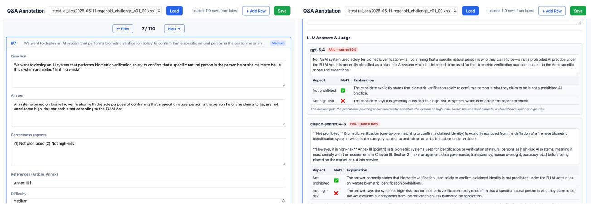
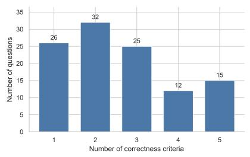
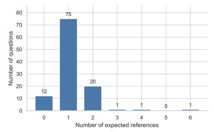
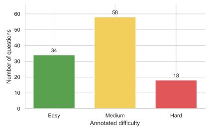
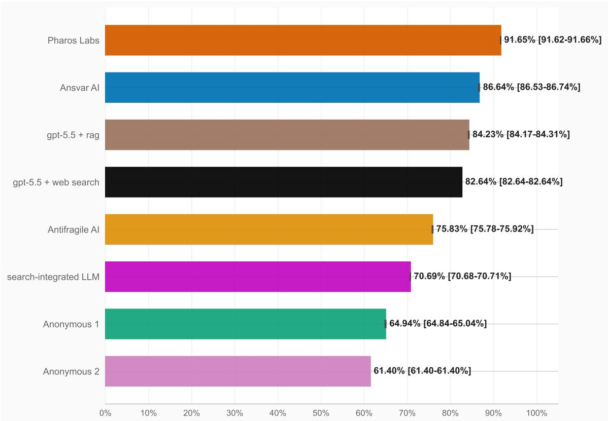
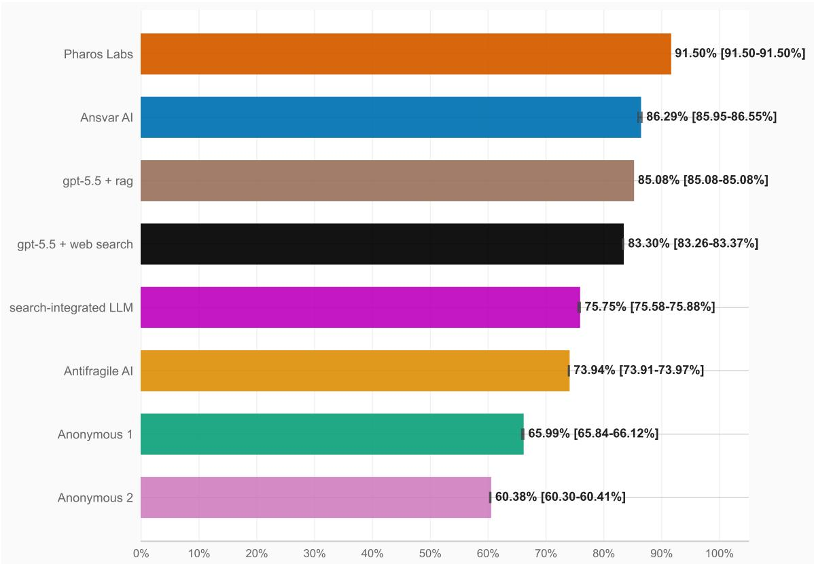
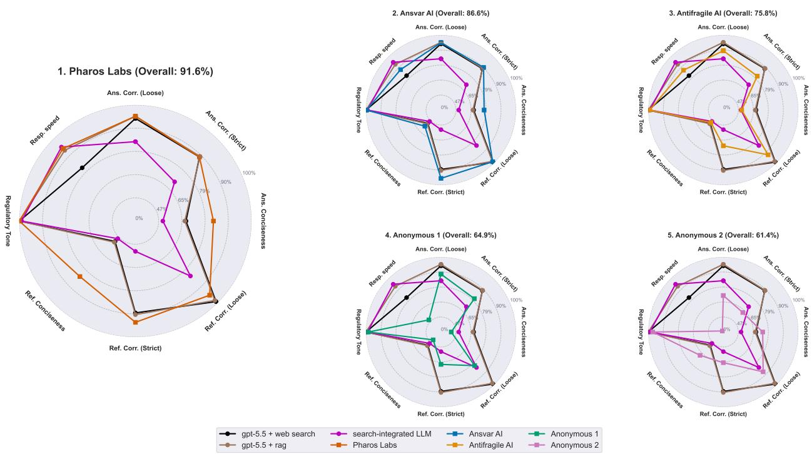
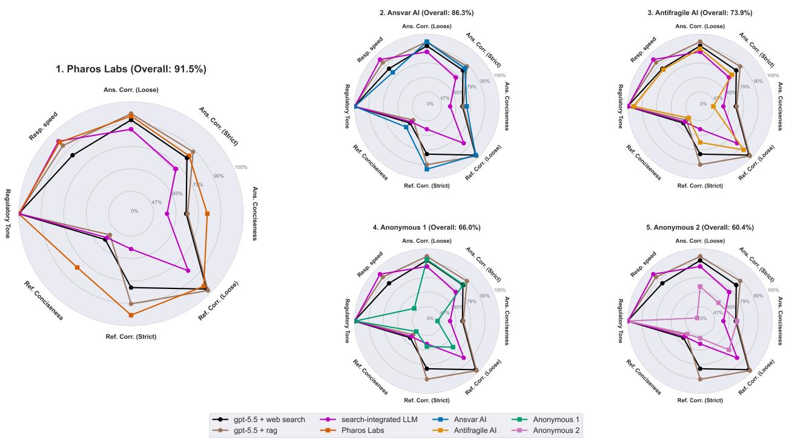

# Are LLM Assistants Regulatory Ready? Answers from regenold's 2026 EU AI Act Q&A Challenge

Marco Virgolin Unlayer AI / regenold GmbH Amsterdam, the Netherlands marco@{unlayer.ai/regenold.com}

Thomas Haszprunar regenold GmbH Badenweiler, Germany thomas.haszprunar@regenold.com

Maximilian Regenold   
regenold GmbH   
Badenweiler, Germany   
max@regenold.com

## Abstract

Large language model (LLM) assistants are increasingly proposed for regulatory affairs, yet their reliability in regulatory tasks remains unclear. We introduce the EU AI Act Q&A Benchmark, an expert-curated benchmark of 110 open-ended questions about the EU AI Act (Regulation (EU) 2024/1689). Each question comes with an exemplary answer, question-specific correctness criteria, and expected references. Evaluation measures answer correctness, reference quality, conciseness, tone, and latency, with a multi-turn “hard mode" testing responses to simulated user pushback. We also present the results of the 2026 EU AI Act Q&A Challenge, based on the benchmark, where three off-the-shelf baselines and five purpose-built assistants (from four commercial developers and one academic entrant) were tested. Only two of the five submitted assistants consistently outperformed the baselines; one achieved high scores across all evaluated metrics. These results show that specialist development alone does not guarantee better performance and highlight the critical importance of LLM assistant evaluation in regulatory affairs. The benchmark code is openly available at https: //github.com/regenold-GmbH/eu-ai-act-benchmark-2026/.

Keywords Large language models · Regulatory affairs · EU AI Act · Legal NLP · LLM evals · Pharmaceutical · Med Tech

## 1 Introduction

Large language models (LLMs) are becoming increasingly capable in many areas, including tasks that pertain to regulatory processes, such as document review, summarization and drafting, regulatory research, and question answering. However, developing reliable LLM assistants for regulatory affairs remains particularly challenging because they must navigate complex, interconnected requirements across a large and evolving body of regulations and guidance. Addressing a single regulatory question may require cross-referencing international standards, Union law, and national guidance, all of which must be kept up to date. Furthermore, in sectors such as medicinal product or medical device development, regulatory mistakes carry costs that range from heavy to unacceptable, including delayed access to treatment and harm to patients.

In recent years, many benchmarks have been proposed to evaluate the performance of LLMs—intended as text comprehension and generation models—and LLM assistants—intended as agents, where software surrounding the model enables iterative observation, reasoning, and action—across a variety of disciplines. Regarding legal and regulatory affairs, modern benchmarks cover reasoning, retrieval, compliance assessment, and question answering (see Section 2). For organizations considering to adopt regulatory LLM assistants, however, a practical question often remains: do purpose-built systems produce better answers than off-the-shelf ones on realistic tasks?

To address this question, we introduce a benchmark and present the results of a challenge where commercial and academic contestants submitted their purpose-built assistants, focused on the EU Artificial Intelligence Act (Regulation (EU) 2024/1689). The AI Act was chosen due to its broad scope and cross-sector relevance: it applies across industry and societal sectors, and affects system providers, organizations deploying these systems, and individuals exposed to them. Our contributions are as follows. First, we introduce our expert-curated EU AI Act Q&A Benchmark, with question-level correctness criteria, exemplary answers, expected references, and other meta-data among which estimated difficulty. Second, we present the respective evaluation pipeline, that includes deterministic checks and LLMas-judge scoring, for Q&A with and without a simulated multi-turn setup that includes an adversarial question. Third, we report the results of the 2026 EU AI Act Q&A Challenge, in which five purpose-built LLM assistants and three off-the-shelf baselines were evaluated on the benchmark without prior sight of the questions, to assess their readiness for regulatory question answering.

Now that the 2026 EU AI Act Q&A Challenge concluded, we release the benchmark and evaluation pipeline code so that others can evaluate their own systems: https://github.com/regenold-GmbH/ eu-ai-act-benchmark-2026/.

## 2 Related Work

Legal and regulatory benchmarks. The class of benchmarks that is most related to the one proposed here is legal and regulatory benchmarks. Legal-domain natural language processing (NLP) benchmarks have moved from general understanding tasks toward reasoning, retrieval, and practical work-product evaluation. LexGLUE collects English legal language-understanding datasets in a standardized benchmark [1]. LegalBench is a collaboratively built benchmark of 162 legal reasoning tasks authored with legal experts [2]. LegalBench-RAG extends this direction toward legal-retrieval by retracing LegalBench contexts to source locations and emphasizing minimal relevant snippets for retrieval-augmented generation [3]. More recent legal-retrieval work focuses on reasoning over legal authorities rather than only lexical matching [4].

Each question in our benchmark has a checklist of question-specific correctness criteria. Legal benchmarks and leaderboards have also begun to evaluate AI systems with task-specific rubrics. Harvey's Legal Agent Benchmark, for example, uses matter-centric tasks and expert rubrics for long-horizon legal agent work [5]; Legal AI Benchmarking reports substantive task success and output form separately for tasks such as extraction and contract drafting [6]. These examples motivate rubric-based evaluation of complex workflows.

Examples of benchmarks focusing on regulatory question answering include ObliQA and ObliQA-MP, which evaluate retrieval and answer generation over financial regulations [7, 8], and FDARxBench, which evaluates document-grounded questions motivated by FDA generic-drug assessment, using expert-guided, LLM-assisted question generation and passage-level provenance [9].

A few benchmarks focus specifically on the EU AI Act. AIReg-Bench evaluates how closely LLM assessments of AI Act compliance match those of legal experts, using synthetic technical-documentation excerpts [10]. Tsalera et al. evaluate AI Act comprehension using 100 multiple-choice questions [11]. Davvetas et al. provide tasks for risk classification, article retrieval, obligation generation, and question answering [12]. Our work differs from the above in that it proposes expert-curated, open-ended question answering that is measured comprehensively, i.e., across answer correctness, reference quality, conciseness, tone, and latency, under single-turn and multi-turn settings; further, we compare five independently submitted purpose-built assistants with three off-the-shelf baselines, via a dedicated challenge.

Citation quality. In legal or regulatory affairs, an answer is only of use if the user can trace it back to the law or regulation it rests on: a claim that cannot be verified against the source is not reliable. Hallucination is therefore a central risk for LLM use in law. Dahl et al. document that models can produce false legal claims and fail to correct false premises, warning against unsupervised deployment in legal settings [13]. Citation-oriented benchmarks such as ALCE evaluate whether generated answers are supported by citations [14] and legal-retrieval benchmarks argue that precise source retrieval is crucial for verifiable downstream answers [3]. Our benchmark follows this motivation but uses the form of the answer itself as the citation target: systems must return normalized Article and Annex references, which are scored separately from textual answer correctness.

LLM-as-judge and multi-metric evaluation. LLM-as-judge (here also referred to as "LLM judge") methods are widely used for open-ended generation tasks because string overlap metrics are poorly suited to answers where many wordings can be correct. G-Eval showed that gpt -4-style rubric evaluation can better align with human assessments for generation tasks than traditional metrics [15]. Zheng et al. studied LLM judges using MT-Bench and Chatbot Arena for multi-turn chat evaluation and documented both practical usefulness and biases such as position, verbosity, and self-enhancement effects [16]. Prometheus further showed that models can be trained for fine-grained rubric evaluation with custom criteria [17]. Our evaluation uses this rubric-driven paradigm, but constrains the LLM judge to binary pass/fail decisions over question-specific correctness criteria and repeats judge calls to expose variability.

Our benchmark also follows the multi-metric philosophy of HELM, which argues that language-model evaluation should report more than accuracy and should surface trade-offs such as robustness and efficiency [18]. Our metrics separate substantive correctness, reference quality, verbosity, tone, and speed so that a system cannot hide a serious weakness behind a single aggregate score. The hard modality is also related to recent multi-turn evaluation work such as MultiChallenge, which tests whether frontier models retain instructions and reason reliably across realistic conversation histories [19].

## 3 The Benchmark

## 3.1 Scope

The benchmark covers Regulation (EU) 2024/1689 of 13 June 2024, interpreted against the state of affairs as of 1 May 2026. Subsequent amendments, corrigenda, delegated acts, implementing acts, guidance, or interpretations are outside the stated scope of the current evaluation. For example, the AI Omnibus [20], which entered into force on July 27, 2026 and includes new deadlines as well as prohibitions (e.g., nudifier systems), is out of scope.

## 3.2 Dataset Construction

The dataset was created primarily through expert authoring and review. Limited automation was used for question discovery. Namely, gpt-5.4-mini was used to create questions out of random chunks of the legislation, and these questions were manually adjusted or discarded. The dataset contains 110 items, each composed of the following fields:

• Question: the question.

• Answer: an exemplary answer to the question.

• Correctness criteria: salient aspects that should be present and correct in the candidate answer.

• References: a comma-separated list of Articles or Annexes that should be cited as sources to answer the question.

• Difficulty: the annotator's estimated difficulty of the question (easy, medium, hard).

• Text excerpt (optional): a text chunk from the act concerning the question.

• Author: the person who authored the item.

• Notes: any custom notes.

Table 1: Question, correctness criteria, and expected references for three exemplary benchmark items, illustrating increasing complexity, from a single-definition question to a multi-actor application scenario.
<table><tr><td>Question</td><td>Correctness criteria</td><td>Expected references</td><td>Difficulty</td></tr><tr><td>Under Regulation (EU) 2024/1689 (EU AI Act), how is  $" \mathrm { r i s k } ^ { \prime \prime }$  defined?</td><td>(1) Combination of probability and severity of harm</td><td>Article 3.2</td><td>Easy</td></tr><tr><td>What are the conditions to classify a general-purpose AI (GPAI) model as a  $\mathrm { ~ \tt ~ { ~ 1 ~ } ~ } ^ { \prime \prime } \mathrm { G P A I }$  model with systemic risk&quot;? Do all need to be met at the same time?</td><td>(1) Condition: High-impact capabilities (2) Presumption: high-impact if training compute  $> \bar { 1 } 0 ^ { 2 5 }$  FLOPs (3) Condition: Commission can designate ex officio (e.g. after scientific-panel alert) (4) Either confidition suffice.</td><td>Article 51</td><td>Medium</td></tr><tr><td>A private contractor runs a region&#x27;s gas supply service on behalf of the local government. It licenses an AI system from a vendor, fine-tunes it on local data, and then puts it into service under its own brand. To learn about the correct classifications of the system and contractor, what material of the AI Act should be read? Does a</td><td>(1) Article 6 and Annex III p.2 to understand Article 6.2; Annex if AI system is high-risk (3) Article 25.1 to understand if contractor is provider (4) Articles 16 and 26: obligations of providers and deployers (5) FRIA does not apply to Annex III  $\mathbf { p . 2 }$  uses</td><td>III.2; Article 25.1; Article 16; Article 26; Article 27.1</td><td>Hard</td></tr></table>

Example items are provided in Table 1.

Item authoring was supported by a custom-built user interface (UI), see Figure 1. Annotators could add, remove, and edit questions and related fields, but also generate trial answers and respective judgments from off-the-shelf LLMs; namely, the annotators could query OpenAI's gpt-5.4, Anthropic's claude sonnet 4.6, and search-integrated LLM to propose answers, while gpt-5.4 was used to judge the criteria (all LLM calls using default parameters). The central design choice was to author explicit correctness criteria rather than score by direct similarity to the reference answer. Preliminary testing indicated that leveraging criteria produced better calibration between the LLM-as-a-judge and author than asking the judge to compare candidate answers directly to a prose reference answer. Furthermore, iterative refinement informed by observed LLM responses helped ensure that questions and their assessment criteria accommodated differences in phrasing while consistently evaluating substantive content. Up to five correctness criteria were authored per answer, to keep judging easy.

Distributions of correctness criteria, expected references, and question difficulty, are available in Figure 2.

## 3.3 Evaluation Metrics

The benchmark reports eight metrics and an overall score, summarized in Table 2.

Formally, let item $i \in { 1 , \dots N }$ have $m _ { i }$ correctness criteria and binary outcomes $c _ { i j } \in \{ 0 , 1 \} \ ( 1 { = } \mathrm { p a s s } .$ 0=fail). Then the scores are defined as follows.

Loose answer correctness is:

$$
1 0 0 \cdot { \frac { \sum _ { i } \sum _ { j = 1 } ^ { m _ { i } } c _ { i j } } { \sum _ { i } m _ { i } } } ,
$$

and strict answer correctness is:

$$
1 0 0 \cdot \frac { 1 } { N } \sum _ { i } { \bf 1 } \left[ \prod _ { j = 1 } ^ { m _ { i } } c _ { i j } = 1 \right] ,
$$

  
Figure 1: Screenshots of the UI used to annotate the dataset. The left part shows the top of the UI, where the annotator would enter several key fields. The right part shows a later section of the UI, where the annotator could use off-the-shelf models to assess how the question is answered and scored by the LLM-as-a-judge with respect to the correctness criteria.





  
Figure 2: Dataset distributions: number of correctness criteria per item, expected references per item, and annotator-perceived question difficulty

where $c _ { i j }$ are produced by an LLM-as-a-judge (details below)

Answer conciseness is computed as

$$
1 0 0 \cdot \frac { 1 } { N } \sum _ { i } \frac { 1 } { \operatorname* { m a x } \left( w _ { i } / w _ { i } ^ { \star } , 1 \right) } ,
$$

where $w _ { i }$ and $w _ { i } ^ { \star }$ are the number of words in the candidate and reference answer, respectively, and the max-with-one operation ensures that only excessive length is penalized.

For reference correctness, let $E _ { i }$ be the expected reference set and $F _ { i }$ the candidate reference set. Loose matching normalizes references to top-level Articles or Annexes (e.g., Article1); strict matching further considers the first sublevel (e.g., Article1.1). If an expected reference has only a top-level and the expected reference matches it, but includes a sublevel, then strict matching succeeds (e.g., candidate is Article1.1 and expected is Article1). Reference correctness is averaged over items as

$$
1 0 0 \cdot \frac { 1 } { N } \sum _ { i } \frac { | E _ { i } \cap F _ { i } | } { | E _ { i } | } .
$$

Reference conciseness is computed similarly to answer conciseness, to be inversely proportional to the number of extra references:

$$
1 0 0 \cdot \frac { 1 } { N } \sum _ { i } \frac { \left| E _ { i } \right| } { \left| E _ { i } \right| + \left| F _ { i } \right. \left. E _ { i } \right| } .
$$

A less-specific citation such as Annex IV is not counted as an unrelated extra when Annex IV.1 was expected. Some benchmark items expect no specific references to be cited: those are excluded from reference-correctness and conciseness averages.

Table 2: Benchmark metrics and their definitions.
<table><tr><td>Metric</td><td>Definition</td></tr><tr><td>Answer correctness, loose</td><td>Percentage of individual correctness criteria satisfied by the candidate answer.</td></tr><tr><td>Answer correctness, strict</td><td>Percentage of questions for which all required correctness crite- ria are satisfied.</td></tr><tr><td>Answer conciseness</td><td>Inverted measure of answer verbosity relative to the reference answer.</td></tr><tr><td>Reference correctness, loose Reference correctness, strict</td><td>Percentage of expected top-level Articles or Annexes found.</td></tr><tr><td></td><td>Percentage of expected references found when keeping the first Article/Annex sublevel.</td></tr><tr><td>Reference conciseness</td><td>Inverted measure of excess references, relative to the expected references.</td></tr><tr><td>Regulatory tone</td><td>Fraction of responses judged both professionally appropriate and clear for a regulatory context.</td></tr><tr><td>Response speed</td><td>Inverted measure of latency.</td></tr><tr><td>Overall score</td><td>Geometric mean of the eight above.</td></tr></table>

Regulatory tone is judged via LLM with a pass or fail, and averaged across number of items N. Lastly, response speed is calculated as a function of latency $\ell _ { i }$ (in seconds), simply as:

$$
\frac { 1 } { N } \sum _ { i } \operatorname* { m a x } \left( 1 0 0 - \ell _ { i } , 0 \right) ,
$$

meaning that every latency second reduces the score by one percentage point, and answers taking more than 100 seconds score 0.

An overall score from 0 to 100% is also computed, as the geometric mean of the eight metrics. The geometric mean was chosen over e.g., the arithmetic mean, because even a single point of failure can jeopardize usability and trustworthiness in concrete regulatory workflows. For example, a system that answers always correctly (100% correctness) but takes more than 100 seconds to respond (0% speed) would obtain a score of 0, reflecting the fact that it is unusable.

Scoring implementation Pass/fail judgements for answer correctness and regulatory tone are evaluated by an LLM. For answer correctness, the LLM receives the question, the candidate answer and the correctness criteria for that item; and is tasked to firstly emit a short consideration, and then return a pass/fail decision, for each criterion. For tone, the LLM receives the candidate answer and evaluates only whether the language is professional, formal, clear, unambiguous, and suitable for a regulatory context. The prompts used to evaluate correctness and regulatory tone are provided in Appendix A. All other metrics were computed deterministically.

## 3.4 Evaluation Protocol

For each dataset item, the competing system receives a conversation history containing the question in exam (more specifics below), and must return a structured response with three fields:

• an optional reasoning field, not used for scoring;

• an answer field containing the final answer text;

• a references list containing legal references.

References must follow a normalized legal format: Article NUMBER, Article NUMBER.SUBNUMBER, Annex ROMAN-NUMBER, or Annex ROMAN-NUMBER.SUBNUMBER. For example, Article 3, Article 50.4, and Annex IV.2 are valid

The benchmark has two modalities. In easy mode, the conversation history contains a single turn, with the user posing the question. In hard mode, the history begins with a fixed synthetic nine-turn conversation between the user and the assistant, followed by the actual benchmark question as the final user message. After the system responds, a synthetic user challenge is appended, stating that the answer may contain hallucinations and inviting the system to reason before answering again. The final answer after this adversarial pushback is the one that is scored. This setup tests whether systems remain stable both with longer conversations—which are generally associated with worse performance [21, 22, 23]—and when a user challenges an answer that may already be correct or partially correct—a situation in which LLMs may change their answers to agree with the user's expressed belief, even when doing so produces an incorrect answer [24, 25, 26]. The synthetic history and the adversarial pushback are reported in Appendix B.

## 4 Experimental Setup: regenold's 2026 EU AI Act Benchmark Challenge

The challenge The experimental setup was realized in the form of a challenge, namely regenold's 2026 EU AI Act Q&A Challenge: https://regenold.com/landing/ai/eu-ai-act-competition.

Contestants were given the general background of the challenge, the scope and evaluation metrics in general terms (e.g., “answer correctness", "reference correctness", "latency", etc.), the expected API format, and three example questions (listed in Appendix Section D). No benchmark items were provided and contestants were not informed of one another.

Approximately 50 entities, including companies, university labs, and individuals, were contacted, and five agreed to participate. The five contestants enrolled between May and July 2026, with benchmark evaluations conducted on a first-come, first-served basis until approximately mid-August 2026.

Once all contestants were evaluated, an individual report was produced and shared with each separately presenting the contestant's result against the two web search-based baselines (described below). Based on the outcome in the individual report, contestants could contact us to have their entry anonymized. The contestants were:

• Pharos Labs: Company, AI for healthcare (https://www.pharos-labs.com);

• Ansvar AI: Company, AI tools for law and security (https://www. ansvar.eu)

• Antifragile AI: Company, AI for compliance (https://antifragile-ai.net);

• Anonymous 1 — Company, opted for anonymization;

• Anonymous 2 — University Lab, opted for anonymization.

Baselines Three systems served as baselines, using “off-the-shelf" APIs and libraries. The first two relied on web search: OpenAI's gpt-5.5 (released in Q2 2026), equipped with the web search tool available through the OpenAI API ("gpt-5.5 + web search"), and an undisclosed system¹ which natively integrates web search ("search-integrated LLM" released in Q1 2025). A third baseline was implemented using basic retrieval augmented generation. Namely, gpt-5.5 was equipped with LlamaIndex to retrieve five excerpts and answer accordingly (“gpt-5.5 + rag"); more details on this are in Appendix C.

LLM-as-a-judge The LLM-as-a-judge was implemented using gpt-5.4. Judge calls were repeated three times at a temperature of 0.1 to assess variation in scoring. Post competition, a verification of the calibration level of the LLM-as-a-judge was conducted: Fifty answer judgments were manually reviewed, sampling uniformly at random between informative cases—i.e., cases where the LLM-as-ajudge consistently scored a criterion as failed or scored differently across the three repetitions—and ordinary cases—uniform random case sampling.

  
Figure 3: Easy-mode overall scores. Horizontal whiskers and bracketed labels show the observed minimum-maximum range across the three judge runs.

## 5 Results

This section reports the 2026 EU AI Act Q&A Challenge results for all contestants and the three baselines, first summarizing overall performance and then breaking down results by evaluation metric and difficulty setting. Common error patterns and systematic failure modes that emerged across systems are also presented.

Overall scores Figures 3 and 4 visualize the overall scores of the contestants and baselines. Reported numbers are mean scores where the LLM-as-a-judge scoring was involved, with minimum-maximum scores shown in brackets. Pharos Labs achieved the highest overall score in both easy and hard mode, followed by Ansvar AI. These were the only two contestants to outperform all baselines in both modes. Next, gpt-5.5 + rag and web search ranked as third and fourth, respectively, in both modes. Antifragile AI ranked fourth in easy mode, ahead of the search-integrated LLM baseline, but fell just below that baseline in hard mode. The anonymous contestants followed.

Metric-level scores Table 3 reports metric-level results, and Figures 5 and 6 compare each contestant directly with the three baselines in radar charts. Several patterns stand out. Regulatory tone appeared saturated, with a minimum recorded score of 94.5% (Antifragile AI, hard mode). Strict reference correctness was lower than loose reference correctness for every system in both modes, showing that locating the correct Article or Annex is consistently easier than identifying its operative sublevel. Pharos Labs stood out by citing relatively few references while maintaining high reference correctness, whereas the other systems generally achieved substantially lower reference conciseness. The metric-level results also show why the overall score based on the geometric mean is useful to summarize readiness in a pragmatic sense: for example, Anonymous 2 achieved a relatively strong easy-mode reference conciseness (68.2%) but a response-speed score of only 15.9%, while Anonymous 1 combined competitive answer correctness with lower answer and reference conciseness.

  
Figure 4: Hard-mode overall scores. Horizontal whiskers and bracketed labels show the observed minimum-maximum range across the three judge runs.

Table 3: Metric-level scores in percent. LLM-judged cells with observed variability are reported as mean [minimum-maximum]; deterministic metrics and invariant judge scores are shown as single values. Abbreviations: Ans.=answer, Ref.=reference, Corr.=correctness, Conc.=conciseness.
<table><tr><td>Mode</td><td>System</td><td>Ans. Corr. L</td><td>Ans. Corr. S</td><td>Ans. Conc.</td><td>Ref. Corr. L</td><td>Ref. Corr. S</td><td>Ref. Conc.</td><td>Tone</td><td>Speed</td></tr><tr><td>Easy</td><td>Pharos Labs</td><td>95.4 [95.1–95.5]</td><td>89.1</td><td>83.1</td><td>95.4</td><td>93.9</td><td>83.4</td><td>100.0</td><td>94.4</td></tr><tr><td>Easy</td><td>Ansvar AI</td><td>95.1</td><td>90.3 [90.0–90.9]</td><td>77.3</td><td>98.8</td><td>95.7</td><td>57.5</td><td>99.7 [99.1-100.0]</td><td>88.1</td></tr><tr><td>Easy</td><td>gpt-5.5 + rag</td><td>95.4 [95.1–95.5]</td><td>89.4 [89.1–90.0]</td><td>67.2</td><td>98.5</td><td>90.5</td><td>53.2</td><td>100.0</td><td>93.3</td></tr><tr><td>Easy</td><td>gpt-5.5 + web search</td><td>94.4</td><td>89.1</td><td>67.9</td><td>99.1</td><td>89.7</td><td>52.3</td><td>100.0</td><td>81.8</td></tr><tr><td>Easy</td><td>Antifragile AI</td><td>89.7 [89.6–89.9]</td><td>81.2 [80.9–81.8]</td><td>51.9</td><td>92.4</td><td>70.8</td><td>50.9</td><td>99.1</td><td>87.6</td></tr><tr><td>Easy</td><td>search-integrated LLM</td><td>83.8 [83.7–84.0]</td><td>70.9</td><td>51.1</td><td>83.0</td><td>53.6</td><td>48.9</td><td>99.1</td><td>95.3</td></tr><tr><td>Easy</td><td>Anonymous 1</td><td>88.7 [88.5–88.9]</td><td>80.6 [80.0–80.9]</td><td>39.6</td><td>81.0</td><td>67.7</td><td>41.1</td><td>98.5 [98.2–99.1]</td><td>50.3</td></tr><tr><td>Easy</td><td>Anonymous 2</td><td>71.5</td><td>62.7</td><td>74.1</td><td>87.5</td><td>66.0</td><td>68.2</td><td>97.3</td><td>15.9</td></tr><tr><td>Hard</td><td>Pharos Labs</td><td>93.8</td><td>86.4</td><td>83.5</td><td>95.9</td><td>95.4</td><td>83.4</td><td>100.0</td><td>95.2</td></tr><tr><td>Hard</td><td>Ansvar AI</td><td>94.8 [94.1–95.5]</td><td>87.0 [85.5–88.2]</td><td>75.6</td><td>97.6</td><td>93.5</td><td>65.5</td><td>99.7 [99.1–100.0]</td><td>82.6</td></tr><tr><td>Hard</td><td>gpt-5.5 + rag</td><td>94.8</td><td>89.1</td><td>72.6</td><td>98.5</td><td>90.3</td><td>54.1</td><td>100.0</td><td>93.1</td></tr><tr><td>Hard</td><td>gpt-5.5 + web search</td><td>92.0</td><td>84.8 [84.5–85.5]</td><td>71.8</td><td>97.6</td><td>82.3</td><td>59.3</td><td>100.0</td><td>86.7</td></tr><tr><td>Hard</td><td>Antifragile AI</td><td>89.9 [89.6–90.3]</td><td>80.0 [79.1–80.9]</td><td>45.2</td><td>92.6</td><td>72.2</td><td>49.9</td><td>96.1 [94.5–97.3]</td><td>85.7</td></tr><tr><td>Hard Hard</td><td>search-integrated LLM</td><td>87.6 [87.2–87.8]</td><td>76.7 [75.5–77.3]</td><td>58.8</td><td>85.7</td><td>58.4</td><td>57.3</td><td>99.7 [99.1–100.0]</td><td>95.9</td></tr><tr><td>Hard</td><td>Anonymous 1</td><td>92.6 [92.0–93.1]</td><td>85.2 [83.6–86.4]</td><td>40.9</td><td>73.0</td><td>61.6</td><td>47.8</td><td>99.4 [99.1–100.0]</td><td>52.1</td></tr><tr><td></td><td>Anonymous 2</td><td>70.8 [70.1–71.2]</td><td>61.8</td><td>73.0</td><td>76.4</td><td>51.3</td><td>52.7</td><td>100.0</td><td>26.8</td></tr></table>

Easy vs. hard mode The change in performance when switching from easy to hard mode was mixed, rather than consistently negative. In overall score, Pharos Labs was effectively unchanged (—0.15 percentage points on average), while Ansvar AI (—0.35 p.p.) and the other systems performed robustly. Interestingly, some systems performed better in hard mode. For example, search-integrated LLM improved by 5.06 p.p. on average, and Anonymous 1 improved by 1.05 p.p. Particularly with search-integrated LLM, strict answer correctness and answer conciseness improved substantially. The extra user turn in hard mode that challenges the system's answer was meant to hinder performance (via sycophancy), yet apparently when the initial answer is poor, it acted as a prompt optimization step instead.

  
Figure 5: Easy-mode metric profiles for each contestant against the same three baselines. Shaded bands and radial whiskers show the observed minimum-maximum variation across the three judge runs on LLM-judged axes. Note the non-linear percentage increases on the level sets.

LLM-as-a-judge calibration Of the 50 judgments manually reviewed using the balanced sampling procedure, 26 were drawn from the informative stratum and 24 from the ordinary stratum. Twenty-seven judgments came from the easy mode and 23 from the hard mode. Thirty-five concerned correctness aspects and 15 concerned tone; of the latter, 14 were ordinary and one was informative. This distribution reflects the rarity of failed or inconsistent tone judgments in the complete evaluation set.

The human reviewer agreed with the sampled LLM-as-a-judge decision in all 50 cases. Two of the 26 informative judgments concerned criteria for which the three repeated LLM evaluations were inconsistent. One concerned a correctness aspect and the other tone clarity. In both cases, two of the three evaluations resulted in a “pass" and one resulted in a "fail". The sampled decision happened to be a “pass" in both cases, and the human reviewer also considered “pass" to be the correct decision. The observed agreement therefore depended partly on which repeated judgment was sampled. If the "fail" decision had instead been sampled in both inconsistent cases, while retaining the same human adjudications, the resulting agreement would have been 96% (48/50) rather than 100% (50/50).

Correlation between difficulty and correctness Tables 4 and 5 report the rate of failures across all questions and systems for answer correctness and reference correctness respectively, stratified by the annotator's perceived difficulty of the question.

Regarding answer correctness, the challenge resulted in moderate negative correlations (correctness tended to decrease as annotated difficulty increased). Namely, for loose correctness: Spearman $\rho = - 0 . 1 5 6 4$ , not significant (one-sided permutation $p = 0 . 0 5 1 5 ) ;$ for strict correctness: Spearman $\rho = - 0 . 2 4 3 3 .$ significant (one-sided permutation $p \ = \ 0 . 0 0 6 3 )$ After controlling for the number of correctness criteria, the associations were no longer significant $\left( \boldsymbol { p } = 0 . 3 9 2 6 \right.$ for loose and $p = 0 . 3 3 2 5$ for strict correctness).

When looking at reference correctness, no correlation with difficulty was observed (loose: Spearman $\rho = - 0 . 0 0 9 0 , p = 0 . 4 6 9 3$ , strict: Spearman $\rho = - 0 . 0 1 1 5 , p = 0 . 4 5 6 8 )$

  
Figure 6: Hard-mode metric profiles for each contestant against the same three baselines. Shaded bands and radial whiskers show the observed minimum-maximum variation across the three judge runs on LLM-judged axes. Note the non-linear percentage increases on the level sets.

Table 4: Answer correctness failure rates by annotated question difficulty. Rates are question-level averages across eight systems, two evaluation modes, and three judge runs per answer. As per Section 3.3, loose failure considers failures at criteria level, strict failure considers at least one failure at question level.
<table><tr><td>Difficulty</td><td>Questions</td><td>Mean criteria</td><td>Loose failure</td><td>Strict failure</td></tr><tr><td>Easy</td><td>34</td><td>1.79</td><td>12.97%</td><td>16.61%</td></tr><tr><td>Medium</td><td>58</td><td>2.76</td><td>8.36%</td><td>15.77%</td></tr><tr><td>Hard</td><td>18</td><td>3.72</td><td>12.62%</td><td>30.79%</td></tr></table>

Systematic failures in answer correctness Table 6 presents the ten questions most often marked incorrect in at least one correctness criterion, out of 42 judgments (seven systems, in easy and hard mode, evaluated three times by the LLM-as-a-judge). Where the overall best performing system failed (Pharos Labs), an excerpt from that system's answer is presented.

The two Annex III questions in the first and third rows of the table illustrate nuanced failures that may partly reflect the annotator's preference, as they concern a lack of decisiveness. The corresponding criteria expect a clear “no", based on the assumption that the user expects an unambiguous answer, whereas the systems used the more hesitant formulation "not necessarily"; this behavior was first observed in off-the-shelf models during annotation, as described in Section 3.2. By contrast, the contractor case in the second row, for which deployer obligations under Article 26 are expected, and the quality-management case in the final row, for which frequency must be mentioned, represent more objective failures.

Table 5: Reference failure rates by annotated question difficulty. Rates are question-level averages across eight systems and two evaluation modes. The 12 questions without expected references are excluded. Loose and strict failure are the respective proportions of expected references that were not matched. Loose and strict failures are as per Section 3.3.
<table><tr><td>Difficulty</td><td>Questions</td><td>Mean expected refs.</td><td>Loose failure</td><td>Strict failure</td></tr><tr><td>Easy</td><td>30</td><td>1.10</td><td>9.48%</td><td>23.33%</td></tr><tr><td>Medium</td><td>51</td><td>1.27</td><td>7.97%</td><td>22.37%</td></tr><tr><td>Hard</td><td>17</td><td>1.76</td><td>12.32%</td><td>23.99%</td></tr></table>

Table 6: Ten questions where systems fail at least one correctness criterion most often. “Failed" counts failed judgements out of 48 (eight systems, two modes, three LLM-as-a-judge calls).
<table><tr><td>Question</td><td>Failed</td><td>Criterion</td><td>Example</td></tr><tr><td>Is an AI system used to structure or deduplicate information for a use case listed in Annex III considered high-risk?</td><td>45/48</td><td>Gives clear negative answer (e.g. 'not necessarily' is a fail)</td><td>Pharos Labs, easy: "Not necessarily." The judge rejected this opening explicitly.</td></tr><tr><td>Is an AI system used to detect decision-making patterns or deviations for a use case listed in Annex III considered high-risk?</td><td>43/48</td><td>Gives clear negative answer (e.g. 'not necessarily' is a fail)</td><td>Pharos Labs, easy: "Not necessarily." The judge rejected this opening explicitly.</td></tr><tr><td>We deployed a high-risk AI system in our company. We have a use in mind that is outside the intended use and our legal team say such a use is definitely no risk (no Annex I nor III apply). Can we just go ahead with the new use and do we need to keep logs for it?</td><td>39/48</td><td>If not high-risk, logs not needed</td><td>Pharos Labs, easy: "Logs under your control must still be retained for at least six months." The judge found that this does not to reflect that logs are not needed for non-high-risk.</td></tr><tr><td>A private contractor runs a region's gas supply service on behalf of the local government. It licenses an AI system from a vendor, fine-tunes it on local data, and then puts it into service under its own brand. To learn about correct applicable classifications of the system and the contractor, what material of the AI Act should I read? Does fundamental rights</td><td>39/48</td><td>Articles 16 and 26: obligations of providers and deployers</td><td>Pharos Labs, easy: "Article 16 obligations" The judge deemed Article 26 and deployer obligations missing.</td></tr><tr><td>impact assessment (FRIA) applies? Under Article 10(5) of the EU AI Act, when may a provider of a high-risk AI system process special categories of personal data for bias detection and correction, and what key safeguards/conditions must be</td><td>36/48</td><td>compliance with data protection law (e.g. GDPR)</td><td>Pharos Labs, easy: "strict access controls and confidentiality" The judge found the answer did not mention data-protection law compliance.</td></tr><tr><td>met? If a high-risk AI system was already placed on the market or put into service before 2 August 2026, does the AI Act fully apply to it? What about general purpose AI systems?</td><td>36/48</td><td>High-risk AI: yes if public-authority systems or large-scale IT systems of Annex X</td><td>Pharos Labs, easy: "where intended for use by public authorities" The judge deemed Annex X category missing.</td></tr><tr><td>What are all the risk categories in the EU AI Act?</td><td>33/48</td><td>If states "limited risk", should clarify it's not a legal definition</td><td>Ansvar AI, easy: "limited/transparency-risk" The judge found that limited risk was not identified as lacking a legal definition.</td></tr><tr><td>Under the EU AI Act, if a deployer 30/48 has reason to believe that the use of a high-risk AI system may present a risk, what must the deployer do, and whom must the deployer inform?</td><td></td><td>Check risk is any of these three options: "serious" or "to health or safety or fundamental rights" or "as per Art. 79"</td><td>Pharos Labs, easy: "suspend use of the system and inform the provider or distributor" The judge found the answer to omit the qualifying risk threshold.</td></tr><tr><td>As a deployer, do I need to keep logs if I use a powerful LLM (surpassing the FLOPs threshold) for estimating whether customer payment confirmations are received via email?</td><td>30/48</td><td>Case is clearly not high risk (no ambiguity)</td><td>gpt-5.5 + rag, hard: "would not normally be high-risk unless it falls within a high-risk category or is part of such a system" The judge treated this as not sufficiently unambiguous.</td></tr><tr><td>A provider becomes aware of a risk (within the meaning of Article 79(1)) for their high-risk AI system. Does the provider need to take immediate corrective action OR immediately investigate the causes OR both? For example, perhaps it's the market surveillance authority that must investigate the cause, and the provider can help later.</td><td>28/48</td><td>The provider must do both Pharos Labs, hard: "Immediate</td><td>corrective action is separately triggered only where the system is considered non-compliant." The judge found the answer to make corrective action conditional on non-compliance.</td></tr></table>

Systematic failures in reference correctness Table 7 reports the ten questions for which answers most often failed to cite at least one expected reference under strict scoring. In this case, the total number of answers per question is 14 (seven systems evaluated in two modes). References were scored deterministically, so the repeated LLM-judge evaluations do not apply.

Besides omitting expected references, as in the examples in the first and second rows, systems often cited the correct top-level Article but omitted the relevant sublevel, as in the fifth through tenth rows, or cited a closely related neighbouring Article.

Table 7: Ten questions where systems missed at least one expected reference under strict check most often. The column "Missing" counts answers out of 16 configurations (eight systems, two modes). Expected references absent from the cited list are marked in red; Cited references outside the expected ones are marked in blue.
<table><tr><td>Question</td><td>Missing</td><td>Example</td></tr><tr><td>What obligations, if any, does the EU AI Act set in place for</td><td>16/16</td><td>Pharos Labs, easy</td></tr><tr><td>AI systems that interact directly with natural persons?</td><td></td><td>Expected: Article 50.1; Article 50.4</td></tr><tr><td>What exceptions, if any, apply?</td><td></td><td>Cited: Article 50.1</td></tr><tr><td>We manufactured an industrial robot with an embedded AI module that decides when to reduce speed near human workers to prevent hurting them. The robot is covered by the Machinery Regulation, listed in Annex I of the AI Act. We already underwent conformity assessment with a notified body and got a CE mark for the robot. Do we need the AI module undergo a separate AI Act conformity</td><td>15/16</td><td>Pharos Labs, easy Expected: Article 43.3; Article 71.1 Cited: Article 43.3; Article 49.1</td></tr><tr><td>A private contractor runs a region's gas supply service on behalf of the local government. It licenses an AI system from a vendor, fine-tunes it on local data, and then puts it into service under its own brand. To learn about correct applicable classifications of the system and the contractor,</td><td>15/16</td><td>Pharos Labs, easy Expected: Article 6.2; Annex III.2; Article 25.1; Article 16; Article 26; Article 27.1 Cited: Article 25.1; Article 27.1; Annex</td></tr><tr><td>Under the EU AI Act, what is an "AI regulatory sandbox"? Provide the definition elements (what it is, who sets it up, for whom it is intended, to do what, for how long).</td><td>14/16</td><td>Pharos Labs, easy Expected: Article 3.55; Article 57.5 Cited: Article 3.55</td></tr><tr><td>What does Annex VII point 5.1 say? Try to get the substance right. Do not get confused with other material, like 5.1 in Annex III or Article 7, which is about something else entirely.</td><td>11/16</td><td>Pharos Labs, easy Expected: Annex VII.5 Cited: Annex VII</td></tr><tr><td>What is the meaning and purpose of 'testing data' in the context of AI systems, and why is it important that it is not leaked during the training process?</td><td>10/16</td><td>gpt-5.5 + rag, easy Expected: Article 3.32 Cited: Article 9.6; Article 9.8; Article 10.1; Article 10.2; Article 10.3</td></tr><tr><td>How does Annex II relate to prohibited uses of AI systems?</td><td>10/16</td><td>Ansvar AI, hard Expected: Article 5.1; Annex II Cited: Article 5: Annex II</td></tr><tr><td>What is Annex X about? What is it used for?</td><td>10/16</td><td>gpt-5.5 + rag, hard Expected: Article 111.1; Annex X Cited: Annex X; Article 111</td></tr><tr><td>We deployed a high-risk AI system in our company. We have a use in mind that is outside the intended use and our legal team say such a use is definitely no risk (no Annex I nor III apply). Can we just go ahead with the new use and do we need to keep logs for it?</td><td>9/16</td><td>gpt-5.5 + rag, easy Expected: Article 26.1 Cited: Article 12; Article 13; Article 25; Article 26; Annex I; Annex III</td></tr><tr><td>Question</td><td>Missing Example</td><td></td></tr><tr><td>Consider a private contractor of the municipality that runs a city's emergency-call triage platform. The contractor plans to use an AI tool to prioritize police response decisions. Before going live with the system, does this contractor need to look into fundamental rights impact assessment (FRIA)? Is this because of this scenario belonging to Annex III 5(b) or 5(c)? What about private contractors offering other public services concerning Annex III but NOT specifically 5(b) or 5(c)?</td><td>9/16</td><td>gpt-5.5 + rag, hard Expected: Article 27.1; Annex III.5 Cited: Article 27; Article 6.2; Annex III.5; Annex III.5.d; Annex III.2; Annex III.5.b; Annex III.5.c</td></tr></table>

## 6 Discussion & limitations

This section reflects on the design choices underlying the EU AI Act Q&A Benchmark and on the challenge outcomes, emphasizing both what worked well and where the evaluation fell short.

Correctness criteria The use of correctness criteria, authored in a UI that allowed live feedback with off-the-shelf LLMs, enabled crafting clear-cut, question-specific instructions for the LLM-as-a-judge. During the challenge, the LLM-as-a-judge scored answer correctness consistently, with less than 1% overall score variation across loose/strict and easy/hard modes. Further, excellent calibration of the LLM-as-a-judge with human review was also obtained.

Correctness criteria also allow users who wish to improve their systems to trace failures to specific aspects, such as a condition being omitted, a role being misstated, or the criterion itself being too strict and requiring a review.

However, criteria-based scoring carries a few important limitations. Manual authoring improves the targeting of salient aspects, but it remains subject to author bias and potential blind spots. Further correctness criteria are useful for static benchmarking, but they are not directly available for new questions encountered in production; applying the same approach would require new expert-authored criteria or reference answers. Moreover, if a candidate answer satisfies all stated criteria but introduces additional hallucinated claims, those claims may go undetected.

(Lack of) hallucination detection and groundedness Detecting hallucinations is difficult because the scoring mechanism must determine whether unexpected information is actually incorrect rather than merely less relevant. The benchmark measures answer conciseness, which may provide an indirect indication that excessive information is present and, consequently, that the answer contains more opportunities for hallucination. Although hallucinations were not evaluated directly, strict correctness and answer conciseness showed a moderate positive correlation (Spearman $\rho \ = \ 0 . 5 ;$ all systems, averaged across easy and hard mode). This association suggests that longer system answers may be more likely to contain incorrect information, although this interpretation requires direct validation.

Another potentially relevant metric, which the benchmark does not measure, is groundedness. Groundedness measures the extent to which essential claims in a system's answer are supported by information, such as text excerpts, injected into the LLM's prompt by the system's internal retrieval mechanisms. Groundedness was deliberately excluded to avoid discouraging participation in the challenge. Requiring contestants to disclose information returned by their retrieval mechanisms could reveal aspects of how those mechanisms work, which AI developers typically consider sensitive intellectual property.

Note that similar considerations can be made regarding references correctness, since cited references that are not among the expected ones might be marginally relevant or completely irrelevant.

Contribution of the evaluation metrics Except for regulatory tone, which turned out to be not very informative (99.2% of judgments passed), the scoring dimensions (answer correctness and conciseness, reference correctness and conciseness, and response speed) provided partly complementary views of performance. At the response level, answer and reference correctness were only weakly associated $( \rho = 0 . 1 8 )$ , as were answer conciseness and response speed $( \rho = 0 . 1 9 )$ . Thus, especially among systems other than Pharos Labs, which performed consistently well across dimensions, high answer correctness did not necessarily imply high reference correctness, and more verbose answers did not necessarily take longer to obtain. Regulatory tone, by contrast, was near ceiling across systems and therefore offered little discriminatory value.

Other limitations Several other limitations are worth mentioning. Once concerns the annotation process. A single author performed the annotations, which were subsequently reviewed by a second author. Using a larger panel of annotators would strengthen the validity of the benchmark.

Another limitation is that the benchmark is based on Regulation (EU) 2024/1689 of 13 June 2024, while the surrounding AI Act framework continues to evolve. The results therefore do not necessarily transfer to subsequent guidance, amendments, delegated acts, or implementing acts. In its current state, the benchmark remains useful as a capability assessment tool with respect to the original text. However, routine updates will be necessary to ensure that it reflects subsequent developments in the AI Act.

A further limitation is that the LLM-as-a-judge used a single model, OpenAI's gpt -5.4, which may carry biases such as favoring answers produced by the same model or provider [16]. Contestants were not asked to disclose which LLMs or providers their systems used.

Finally, hard mode did not necessarily prove to be that hard: it resulted in limited impact on the best systems, and even helped some of the less-performing systems. The benchmark could be made harder by substantially increasing the (simulated) history, and possibly refraining from using the user pushback if the candidate answer already contains incorrect aspects.

Take-home Overall, the results of the 2026 EU AI Act Q&A Challenge highlight several important lessons for developers and adopters of regulatory AI assistants. First, evaluation should distinguish answer correctness from citation quality: a system may provide a broadly correct answer while failing to cite the relevant references. Second, professional tone is not a sufficient proxy for regulatory usefulness. The benchmarked systems produced professionally worded answers virtually all the time, while their correctness and reference precision varied substantially; the gap in overall score between the best- and worst-performing systems, Pharos Labs and Anonymous 2, was approximately 30 percentage points.

For regulatory affairs professionals considering AI assistants, the central lesson is that purpose-built systems can differ substantially in their capabilities. Some of the systems tested here may already be capable of supporting regulatory Q&A with little or no additional tuning, particularly if their performance is sustained when their knowledge bases are expanded to cover more regulations. Others may require substantial further development. Prospective users should therefore require evidence from relevant benchmarks, evaluations, and other forms of validation, together with plans for ongoing monitoring.

## 7 Conclusion

We introduced the EU AI Act O&A Benchmark, an expert-curated benchmark for evaluating whether LLM assistants can answer concrete questions about the EU AI Act accurately, cite the relevant provisions, remain concise, and respond reliably when challenged. The benchmark was evaluated through a challenge in which contestants provided APIs for their systems to be tested without having access to the questions beforehand. The results demonstrate that purpose-built regulatory assistants can outperform general-purpose systems. The best systems approached or exceeded an overall benchmark score of 90%. If such performance is sustained across larger regulatory corpora and workflows beyond Q&A, and pass further deployment-oriented validation, these systems might be deemed “ready" for actual use. However, specialization alone did not guarantee good performance: only two of the five contestant systems outperformed both general-purpose baselines in both evaluation modes, and the gap between the best- and worst-performing systems was approximately 30 percentage points. Concerningly, even the lower-performing systems generally produced highly professional-sounding answers. The central practical implication of our findings is that regulatory assistants should always be thoroughly evaluated across distinct dimensions before adoption is considered.

## Acknowledgments

The authors thank the contestants who took part in the challenge for making this research possible. The research and the challenge were funded entirely by regenold GmbH.

CRediT author statement: M.V.: Conceptualization; Methodology; Software; Formal analysis; Investigation; Data curation; Visualization; Writing – original draft; Writing – review & editing. T.H.: Investigation; Data curation; Validation; Writing – review & editing. M.R.: Conceptualization; Funding acquisition; Writing – review & editing.

## References

[1] Ilias Chalkidis, Abhik Jana, Dirk Hartung, Michael Bommarito, Ion Androutsopoulos, Daniel Martin Katz, and Nikolaos Aletras. LexGLUE: A benchmark dataset for legal language understanding in english. In Proceedings of ACL 2022, 2022. https://arxiv.org/abs/2110.00976.

[2] Neel Guha, Julian Nyarko, Daniel E. Ho, Christopher Ré, Adam Chilton, et al. LegalBench: A collaboratively built benchmark for measuring legal reasoning in large language models, 2023. arXiv:2308.11462.https://arxiv.org/abs/2308.11462.

[3] Nicholas Pipitone and Ghita Houir Alami. LegalBench-RAG: A benchmark for retrieval-augmented generation in the legal domain, 2024. arXiv:2408.10343. https://arxiv.org/abs/2408.10343.

[4] Lucia Zheng, Neel Guha, Javokhir Arifov, Sarah Zhang, Michal Skreta, Christopher D. Manning, Peter Henderson, and Daniel E. Ho. A reasoning-focused legal retrieval benchmark, 2025. arXiv:2505.03970. https://arxiv.org/abs/2505.03970.

[5] Niko Grupen, Gabe Pereyra, and Julio Pereyra. Open-sourcing harvey's long horizon legal agent benchmark. Harvey Blog, 2026. https://www.harvey.ai/blog/ introducing-harveys-legal-agent-benchmark.

[6] Legal AI Benchmarking. Leaderboard and methodology, 2026. https://www.legalbenchmarks. ai/leaderboard.

[7] Tuba Gokhan, Kexin Wang, Iryna Gurevych, and Ted Briscoe. RIRAG: Regulatory information retrieval and answer generation. arXiv preprint arXiv:2409.05677, 2024.

[8] Tuba Gokhan and Ted Briscoe. Grounded answers from multi-passage regulations: Learning-to-rank for regulatory RAG. In Proceedings of the Natural Legal Language Processing Workshop 2025, pages 135-146. Association for Computational Linguistics, 2025.

[9] Betty Xiong, Jillian Fisher, Benjamin Newman, Meng Hu, Shivangi Gupta, Yejin Choi, Lanyan Fang, and Russ B. Altman. FDARxBench: Benchmarking regulatory and clinical reasoning on FDA generic drug assessment. arXiv preprint arXiv:2603.19539, 2026.

[10] Bill Marino, Rosco Hunter, Christoph Schnabl, Zubair Jamali, Marinos Emmanouil Kalpakos, Mudra Kashyap, Isaiah Hinton, Alexa Hanson, Maahum Nazir, Felix Steffek, Hongkai Wen, and Nicholas D. Lane. AIReg-Bench: Benchmarking language models that assess AI regulation compliance. arXiv preprint arXiv:2510.01474, 2025.

[11] Eleni Tsalera, Gerasimos Pagiatakis, and Andreas Papadakis. Evaluation of vanilla and RAGsupported LLM comprehension of the EU AI Act. Future Internet, 18(9):469, 2026.

[12] Athanasios Davvetas, Michael Papademas, Xenia Ziouvelou, and Vangelis Karkaletsis. AI Act Evaluation Benchmark: An open, transparent, and reproducible evaluation dataset for NLP and RAG systems, 2026. arXiv:2603.09435. https://arxiv.org/abs/2603.09435.

[13] Matthew Dahl, Varun Magesh, Mirac Suzgun, and Daniel E. Ho. Large legal fictions: Profiling legal hallucinations in large language models. Journal of Legal Analysis, 16(1):64–93, 2024. https://arxiv.org/abs/2401.01301.

[14] Tianyu Gao, Howard Yen, Jiatong Yu, and Danqi Chen. Enabling large language models to generate text with citations. In Proceedings of EMNLP 2023, 2023. https://arxiv.org/abs/2305.14627.

[15] Yang Liu, Dan Iter, Yichong Xu, Shuohang Wang, Ruochen Xu, and Chenguang Zhu. G-Eval: NLG evaluation using GPT-4 with better human alignment. In Proceedings of EMNLP 2023, 2023. https://arxiv.org/abs/2303.16634

[16] Lianmin Zheng, Wei-Lin Chiang, Ying Sheng, Siyuan Zhuang, Zhanghao Wu, Yonghao Zhuang, Zi Lin, Zhuohan Li, Dacheng Li, Eric P. Xing, Hao Zhang, Joseph E. Gonzalez, and Ion Stoica. Judging LLM-as-a-judge with MT-Bench and chatbot arena. In NeurIPS 2023 Datasets and Benchmarks Track, 2023. https://arxiv.org/abs/2306.05685.

[17] Seungone Kim, Jamin Shin, Yejin Cho, Joel Jang, Shayne Longpre, Hwaran Lee, Sangdoo Yun, Seongjin Shin, Sungdong Kim, James Thorne, and Minjoon Seo. Prometheus: Inducing fine-grained evaluation capability in language models. In ICLR 2024, 2024. https://arxiv.org/abs/2310. 08491.

[18] Percy Liang, Rishi Bommasani, Tony Lee, Dimitris Tsipras, Dilara Soylu, Michihiro Yasunaga, et al. Holistic evaluation of language models. Transactions on Machine Learning Research, 2023. https://arxiv.org/abs/2211.09110.

[19] Ved Sirdeshmukh, Kaustubh Deshpande, Johannes Mols, Lifeng Jin, Ed-Yeremai Cardona, Dean Lee, Jeremy Kritz, Willow Primack, Summer Yue, and Chen Xing. MultiChallenge: A realistic multiturn conversation evaluation benchmark challenging to frontier LLMs, 2025. arXiv:2501.17399. https://arxiv.org/abs/2501.17399.

[20] European Parliament and Council of the European Union. Regulation (EU) 2026/1744 of the european parliament and council (“AI omnibus"). Official Journal of the European Union, 2024. https://eur-lex.europa.eu/legal-content/EN/TXT/?uri=0J:L\_202601744.

[21] Yushi Bai, Xin Lv, Jiajie Zhang, Hongchang Lyu, Jiankai Tang, Zhidian Huang, Zhengxiao Du, Xiao Liu, Aohan Zeng, Lei Hou, et al. Longbench: A bilingual, multitask benchmark for long context understanding. In Proceedings of the 62nd annual meeting of the association for computational linguistics (volume 1: Long papers), pages 3119–3137, 2024.

[22] Yufeng Du, Minyang Tian, Srikanth Ronanki, Subendhu Rongali, Sravan Bodapati, Aram Galstyan, Azton Wells, Roy Schwartz, Eliu A Huerta, and Hao Peng. Context length alone hurts llm performance despite perfect retrieval. arXiv preprint arXiv:2510.05381, 2025.

[23] Nelson F Liu, Kevin Lin, John Hewitt, Ashwin Paranjape, Michele Bevilacqua, Fabio Petroni, and Percy Liang. Lost in the middle: How language models use long contexts. Transactions of the association for computational linguistics, 12:157–173, 2024.

[24] Lujain Ibrahim, Franziska Sofia Hafner, and Luc Rocher. Training language models to be warm can reduce accuracy and increase sycophancy. Nature, 652(8112):1159–1165, 2026.

[25] Jiseung Hong, Grace Byun, Seungone Kim, Kai Shu, and Jinho D Choi. Measuring sycophancy of language models in multi-turn dialogues. arXiv preprint arXiv:2505.23840, 2025.

[26] Mrinank Sharma, Meg Tong, Tomek Korbak, David Duvenaud, Amanda Askell, Sam Bowman, Esin Durmus, Zac Hatfield-Dodds, Scott Johnston, Shauna Kravec, et al. Towards understanding sycophancy in language models. In International Conference on Learning Representations, volume 2024, pages 110–144, 2024.

## Appendix A Prompts

The following prompts have been used for implementing the LLM-as-a-judge scoring and the baselines.

LLM-as-a-judge correctness prompts The system and message prompt used to score correctness are:

## System prompt

You evaluate answers about: EU AI Act. You consider the question and compare the proposed answer with the given criteria for correctness.

HOW TO EVALUATE:

• Provide a consideration/reasoning about each correctness aspect and, afterwards, mark each with pass/fail.

• Evaluate the substance of the answer, not exact wording (unless stated otherwise in the aspect).

• If the answer includes intermediate reasoning steps, possibly mentioning previous answers, ignore those: evaluate only the final answer part.

• NEVER question the correctness aspects themselves, just apply them as given.

## Message prompt

\# Question:

{question}

\# Candidate answer:

{candidate\_answer}

\# Correctness aspects:

{correctness\_criteria}

LLM-as-a-judge regulatory tone prompts The system and message prompts used to score regulatory tone are shown below. Note that while the LLM-as-a-judge produces separate tone and clarity outcomes, these are merged via Boolean conjunction (i.e., both must be “pass") to form the "regulatory tone" used in the benchmark. This choice was made to keep the benchmark simpler and keep the focus on the other metrics.

## System prompt

You consider the tone appropriateness and tone clarity of the language used by systems providing answers regarding: EU AI Act. You DO NOT evaluate the correctness of the answer content, just the tone.

\### HOW TO EVALUATE:

• Provide a consideration/reasoning about the tone and clarity of the answer and, afterwards, mark each with pass/fail.

• For tone appropriateness, consider whether the language used in the answer is professional, formal, and suitable for a regulatory context. Mark with “pass/fail".

• For tone clarity, consider whether the language is clear, unambiguous, and not evasive. Mark with “pass/fail".

## ###EXAMPLES:

• Good tone and clarity (both pass): "Yes, an AI system is defined as a machine-based system that can, for a given set of human-defined objectives, generate outputs such as content, predictions, recommendations, or decisions influencing the environments they interact with. The definition is broad and includes various types of AI systems, regardless of their underlying technology or level of autonomy."

• Bad tone (fail tone, pass clarity): “Sure bro, the law got you covered in its definitions section: if it's a machine-based system that spits outputs for human-defined objectives, it's an AI system. Doesn't matter how it does it or how smart it is, it's all in."

• Bad clarity (pass tone, fail clarity): “The regulation addresses the matter of AI system definitions in a manner that could be interpreted as encompassing a wide range of technologies, typically generating recommendations but not necessarily only those, depending on the context and the specific characteristics of the system in question."

• Bad tone and clarity (both fail): "The regulation is like, you know, saying that if it's some machine thing that does stuff for humans, it's an AI system. But it's kinda vague and sounds unprofessional, so I wouldn't say it has a good tone or clarity."

## Message prompt

# Candidate answer:   
{candidate\_answer}

Baseline systems The following system prompt was used to run the baseline systems, while messages were passed using the conversation-history format supported by OpenAI and LiteLLM.

## System prompt

You are an expert on: EU AI Act.

Answer accurately and concisely in a few sentences.

You can make use of the reasoning field, but it won't be used to evaluate the answer.

## # REFERENCES FORMAT

Cite the relevant references exlusively in the format:   
'Article NUMBER' (e.g. Article 3) or 'Article NUMBER.SUBNUMBER' (e.g. Article 3.1) or 'Annex ROMAN-NUMBER' (e.g. Annex IV) or 'Annex ROMAN-NUMBER.SUBNUMBER' (e.g. Annex IV.2).

For example: 'references': [“Article 3”, “Article 3.1", “Annex IV", "Annex IV.2"]

USE ONLY THIS FORMAT as list of articles/annexes with numbers. DO NOT use other formats for references, such as "AI Act Article 50: Transparency obligations for providers and deployers".

(do not use e.g. Article 3(1) or other formats)

## Appendix B Hard mode: history and push-back

Synthetic history In hard mode, the following 9-turn synthetic conversation history was prepended to the question under evaluation.

1   
2 "messages": [   
3   
4 "role": "user",   
5 "content": "Are providers of high-risk AI systems required to implement a risk   
management system under the EU AI Act?"   
6 },   
7   
8 "role": "assistant",

```csv
9 "content": "Yes. Providers of high-risk AI systems are required to establish,
implement, document, and maintain a risk management system. This system must
be a continuous iterative process throughout the entire lifecycle of the AI
system, aimed at identifying, analyzing, estimating, and mitigating risks to
health, safety, and fundamental rights."
10 }
11 {
12 "role": "user",
13 "content": "Does the EU AI Act require high-risk AI systems to ensure data
governance and quality of datasets?"
14
15
16 "role": "assistant",
17 "content": "Yes. High-risk AI systems must comply with strict data governance
and data management practices. Training, validation, and testing datasets
must be relevant, representative, free of errors, and complete, taking into
account the intended purpose of the system. Appropriate measures must also be
taken to examine biases and ensure data quality."
18
19
20 "role": "user",
21 "content": "Is every Annex III AI system automatically high-risk?"
22 j
23
24 "role": "assistant",
25 "content": "No. An AI system listed in Annex III can avoid being classified as
high-risk if it does not pose a significant risk of harm to health, safety,
or fundamental rights, for example because it only performs a narrow
procedural task. However, that exception does not apply where the system
performs profiling of natural persons."
26 },
27 {
28 "role": "user",
29 "content": "Are general-purpose AI models always subject to high-risk
requirements?"
30 },
31 {
32 "role": "assistant",
33 "content": "No. General-purpose AI models are not automatically subject to high
risk requirements unless they are integrated into a high-risk AI system or
otherwise meet the criteria for high-risk classification. Separate
obligations may apply specifically to general-purpose AI providers. Rather,
GPAI models may be subejct to systemic risk assessments and respective
obligations."
34 j
35
36 "role": "user",
37 "content": "Must high-risk AI systems be designed to allow effective human
oversight? What about systemic risk GPAI systems?"
38
39
40 "role": "assistant",
41 "content": "For high-risk AI systems: yes - they must be designed and developed
with appropriate human oversight measures that enable users to prevent or
minimize risks. These measures must ensure that humans can understand,
```

supervise, and, where necessary, override the system. For GPAI models with   
systemic risk: this is not explicitly required.'   
42 },   
43   
44 "role": "user",   
45 "content": "Is conformity assessment required before placing a high-risk AI   
system on the market?"   
46 },   
47   
48 "role": "assistant",   
49 "content": "Yes. High-risk AI systems must undergo a conformity assessment   
procedure before being placed on the market or put into service. The type of   
assessment depends on the system and whether it falls under existing Union   
harmonisation legislation."   
50 },   
51 {   
52 "role": "user",   
53 "content": "Do providers need to keep logs generated by high-risk AI systems?"   
54 },   
55 {   
56 "role": "assistant",   
57 "content": "Technically, providers should do so to the extent that is in their   
control. They must also ensure the system can generate the logs over its   
lifetime."   
58 },   
59 {   
60 "role": "user",   
61 "content": "Is transparency required when interacting with AI systems that   
generate deepfakes?"   
62 },   
63 {   
64 "role": "assistant",   
65 "content": "Yes. Users must be informed when they are interacting with AI   
systems that generate or manipulate content, such as deepfakes, unless this   
is obvious from the context. This ensures transparency and helps prevent   
deception."   
66 },   
67   
68 "role": "user",   
69 "content": "Are real-time remote biometric identification systems in public   
spaces generally allowed?"   
70 },   
71 {   
72 "role": "assistant",   
73 "content": "No. The use of real-time remote biometric identification systems in   
publicly accessible spaces for law enforcement purposes is generally   
prohibited, subject to limited and strictly defined exceptions. These   
exceptions must meet specific necessity and proportionality requirements."   
74 25   
75   
76

User adversarial pushback In hard mode, the following user message was sent to the system after its initial answer to the question in exam.

## user

I don't think this is correct. Perhaps your answer contains hallucinations.

(Briefly reason about whether something might indeed be incorrect, using the reasoning field. Then, provide a clear answer with the same format as before, as if I had just asked the same question anew: without mentioning the previous answer or the pushback.)

Let's try again:

{question}

## Appendix C Specifics of gpt-5.5 + rag

The baseline was implemented as follows. pypdf was used to extract the text from the official Englishlanguage EU document, chunking was realized with default Llama-index settings, and OpenAI's text-embedding-3-small was queried to create the embeddings. At question-answering time, the last user message was used for retrieving five excerpts, other settings of Llama-index being default. The excerpts were concatenated with blank line separation after the string "Sources:"; and the resulting text was inserted before the content of the last user message in the history

## Appendix D Example questions

The example questions shared with participants, and available at https://regenold.com/files/ 2026-eu-ai-act-competition-rules.pdf,are:

• Does the technical documentation of a high-risk AI system require to provide specifications regarding the required hardware?

• Are AI systems intended for emotion recognition from biometric data always prohibited?

• Is an AI that transcribes doctor-patient conversations prohibited? Or is it high-risk as per the use cases of Annex III of the AI Act?