# BEST-OF-DEPTH: LEARNING EXPLORATORY DYNAMICS IN LOOPED TRANSFORMERS

Shota Takashiro Takeshi Kojima Masanori Koyama

Kohei Hayashi Yusuke Iwasawa

The University of Tokyo takashiro@weblab.t.u-tokyo.ac.jp

## ABSTRACT

Looped Transformers extend inference-time computation through repeated latentstate updates, but final-depth training does not directly encourage useful intermediate alternatives. We introduce Best-of-Depth (BoD), which trains a recurrent trajectory as a candidate set by minimizing prediction loss across depths. Different valid targets can be matched at different depths without architectural changes or depth-specific labels. An exact-match analysis connects this objective to solution coverage. On N-Queens completion and graph coloring, BoD improves coverage over final-depth and intermediate-supervision objectives. N-Queens coverage reaches 91.03%, versus 45.75% for final-depth training. Further experiments show discovery beyond the training depth and recovery of solutions withheld from teacher pools on familiar inputs. Fine-tuning a pretrained looped language model with BoD yields higher pooled code-generation success than final-depth training when programs are generated separately at evaluated fixed depths. These results support training recurrent computation for solution discovery along its trajectory.

## 1 INTRODUCTION

Additional inference-time computation can improve a model’s ability to solve problems (Snell et al., 2025; Brown et al., 2024). Looped Transformers accumulate computation by repeatedly applying a shared transformation to a latent state (Dehghani et al., 2019; Giannou et al., 2023; Yang et al., 2024). This extends computational depth without adding parameters, and greater recurrent depth can improve reasoning performance (Saunshi et al., 2025; Geiping et al., 2025). Making these models effective therefore involves learning how successive updates should contribute to solving a problem.

The learning objective can reflect how predictions are used at inference. Best-of-N sampling generates and verifies multiple candidate solutions, increasing the opportunity to find a correct answer beyond a single attempt (Brown et al., 2024; Cobbe et al., 2021). Inference-aware Best-of-N training incorporates this procedure into learning (Chow et al., 2025), while Explorative Modeling (XM) trains on the candidate that best matches a target (Gladstone et al., 2026). These approaches illustrate how learning objectives shape candidate generation. Recurrent models also offer multiple predictions, read out at successive depths along one trajectory. We therefore ask: Can a single recurrent trajectory be trained to visit distinct useful solution candidates?

Simply increasing recurrent computation does not guarantee distinct useful candidates. Recent work promotes fixed-point convergence for stability (Yang et al., 2026) or uses convergence for halting (Movahedi et al., 2026), but convergence alone does not determine which alternatives a trajectory discovers. Supervising only the final prediction (Dehghani et al., 2019; Saunshi et al., 2025) does not directly reward useful intermediate alternatives; supervising every depth against the same target asks all readouts to reproduce that target. Candidate-set evaluation suggests another criterion: the target should be reached somewhere within the depth budget. Because later predictions depend on preceding latent states, the learning problem is to train these coupled predictions collectively.

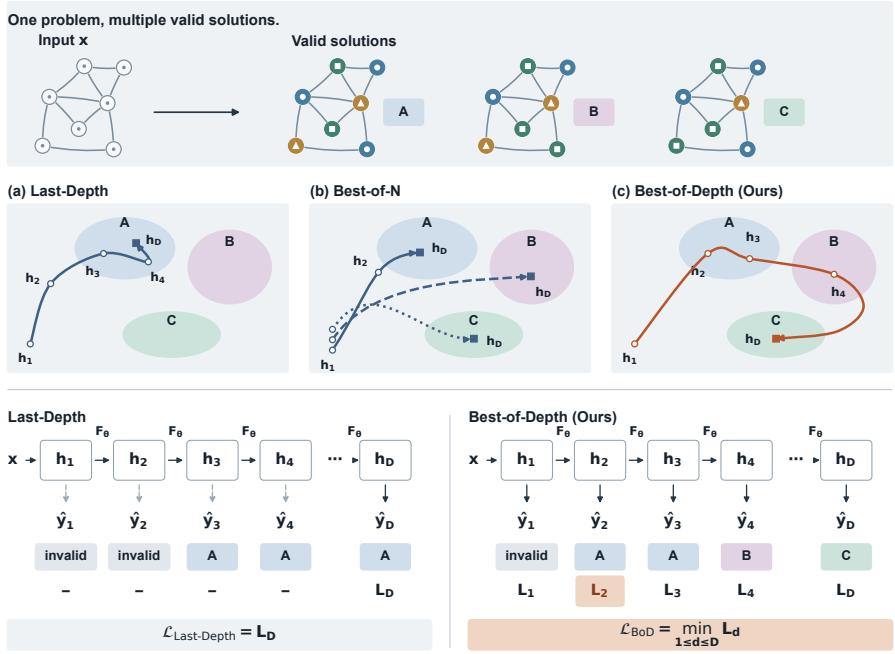  
Figure 1: Learning alternative solutions along one recurrent trajectory. Top: One input admits multiple valid solutions. Middle: Schematic latent trajectories illustrate (a) repeated predictions under Last-Depth, (b) independent candidates from Best-of-N, and (c) distinct solutions along one BoD trajectory; shaded regions decode to $\mathrm { A } { - } \mathrm { C }$ . Bottom: Both models reuse $F _ { \theta }$ across depths. Last Depth trains on $\mathit { L } _ { \mathit { D } } ;$ BoD trains on the lowest loss across depths (highlighted $L _ { 2 }$ for target A).

We introduce Best-of-Depth (BoD), which trains a recurrent trajectory as a candidate set using the minimum prediction loss across supervised depths (Figure 1). A shared decoder reads out predictions, and the loss at the selected depth trains the recurrent computation. Each target need only be matched at one depth, allowing different valid targets for the same input to be matched at different depths without a prescribed assignment or visitation order. The set-loss formulation is related to multiple-hypothesis learning (Guzmán-Rivera et al., 2012; Lee et al., 2016; Bhattacharyya et al., 2018); here, candidates are generated successively and coupled through shared latent dynamics. BoD requires no architectural changes, additional parameters, or depth-specific labels.

We study solution discovery theoretically and empirically. Under exact-match loss and uniformly sampled valid targets, minimizing expected BoD loss maximizes solution coverage. On N-Queens completion and graph coloring, where all valid solutions can be enumerated, Success@Depth measures whether any valid solution is found, while Coverage@Depth measures the fraction of the valid solution set recovered. Coverage therefore tests whether additional computation discovers alterna tives after an initial solution is found. We also test discovery beyond teacher pools and training depth, and compare trajectory counts and depths under a fixed recurrent-step budget on these controlled tasks. For autoregressive code generation, we fine-tune Huginn (Geiping et al., 2025) and evaluate programs generated separately at different fixed depths.

We find that BoD recovers more distinct valid solutions on both controlled tasks. The N-Queens coverage reaches 91.03coverage continues increasing after success nearly saturates, showing further discovery of valid alternatives. BoD also recovers solutions withheld from teacher pools on familiar inputs and finds new solutions beyond the training depth. BoD achieves higher pooled code-generation success than final-depth training on HumanEval and MBPP (Chen et al., 2021; Austin et al., 2021). On MBPP, it also gains more solved problems from pooling beyond depth 32 alone. Fixed-budget comparisons favor combining depth with multiple trajectories. Together with analyses of outputs and latent states, these results characterize how candidate-set training changes solution discovery along recurrent trajectories.

## 2 RELATED WORK

Recurrent Computation and Looped Transformers. Looped Transformers reuse layers across depth; the Universal Transformer also supports adaptive halting (Dehghani et al., 2019). Subsequent work studies algorithmic capabilities (Giannou et al., 2023; Yang et al., 2024; Gatmiry et al., 2024) and latent reasoning (Saunshi et al., 2025). At language-model scale, Geiping et al. (2025) study reasoning gains from increased recurrent depth. Flexible depth allocation uses learned exits (Zhu et al., 2026), token-level routing (Bae et al., 2025b), or shortcut consistency (Jeddi et al., 2026). Stable depth extrapolation motivates constraints on recurrent dynamics and depth sampling (Prairie et al., 2026), or depth-dependent residual scaling (Li et al., 2026).

Existing methods supervise final outputs at fixed depths (Dehghani et al., 2019; Saunshi et al., 2025) or sampled depths (Geiping et al., 2025), apply supervision over recurrent windows (Yang et al., 2024), or supervise intermediate outputs for early exit (Bae et al., 2025a). Other objectives weight losses by exit probabilities (Zhu et al., 2026). Unlike intermediate reasoning-token supervision (Fan et al., 2026), BoD needs only output targets and prescribes no solution order.

Test-Time Candidate Generation and Compute Scaling. Additional inference compute supports candidate generation and evaluation. Repeated sampling raises the chance of at least one correct candidate, while identifying it remains a separate problem (Brown et al., 2024). Best-of-N selects candidates with a verifier (Cobbe et al., 2021); self-consistency aggregates answers across reasoning paths (Wang et al., 2023). Process supervision assesses intermediate steps (Lightman et al., 2024), while tree-structured methods evaluate partial solutions to guide further expansion (Yao et al., 2023; Snell et al., 2025).

Snell et al. (2025) compare parallel sampling with sequential revisions, finding that the preferred allocation depends on difficulty and budget. Their revision process is conditioned on previous textual answers. Our fixed recurrent-step comparison instead allocates compute between recurrent latent updates and multiple trajectories (Section 4.5.1), with external candidate evaluation.

Learning to Generate Multiple Hypotheses. Multiple Choice Learning scores a prediction set through its best member’s loss against the target (Guzmán-Rivera et al., 2012). Stochastic MCL trains only the lowest-loss predictor per example, enabling deep ensembles to specialize without a predefined data partition (Lee et al., 2016). Best-of-Many uses the best reconstruction among latent samples in a variational objective for sequence prediction (Bhattacharyya et al., 2018). The forward formulation of Explorative Modeling learns from the candidate closest to a target, studying exploration as a scaling axis across generative tasks (Gladstone et al., 2026).

Chow et al. (2025) align imitation and reinforcement learning with verifier-based Best-of-N selection. BoD instead minimizes supervised prediction loss over recurrent readouts: later hypotheses depend on earlier states, and the selected loss trains the shared update and decoder.

## 3 BEST-OF-DEPTH

## 3.1 LOOPED TRANSFORMERS

A looped Transformer encodes an input x and repeatedly applies a shared transformation:

$$
h _ { 0 } =  { \mathrm { E n c } } _ { \theta } ( x ) , \qquad h _ { d } = F _ { \theta } ( h _ { d - 1 } ; x ) , \qquad p _ { d } =  { \mathrm { D e c } } _ { \theta } ( h _ { d } ) , \quad d = 1 , \ldots , D .\tag{1}
$$

One application of $F _ { \theta }$ is a loop, and d denotes recurrent depth. A shared decoder reads the prediction distribution $p _ { d }$ from each state. Let $y \in \mathcal { V } ^ { \star } ( x )$ be a valid target, ${ \hat { y } } _ { d } ( x )$ the greedy prediction, and $L _ { d } ( x , y ) = \ell ( p _ { d } , y )$ the per-example loss. We omit input and parameter dependence when unambiguous.

Supervising the final recurrent output is an established approach in fixed-depth looped models (Dehghani et al., 2019; Saunshi et al., 2025). We call this Last-Depth training: only the prediction at the maximum training depth contributes to the loss,

$$
\begin{array} { r } { \mathcal { L } _ { \mathrm { L a s t - D e p t h } } = L _ { D } . } \end{array}\tag{2}
$$

## 3.2 BEST-OF-DEPTH OBJECTIVE

At training depth $D = D _ { \mathrm { t r a i n } }$ , let $\mathcal { D } \subseteq \{ 1 , \dots , D \}$ denote the supervised depths, including D. BoD minimizes

$$
\mathcal { L } _ { \mathrm { B o D } } ( x , y ) = \operatorname* { m i n } _ { d \in \mathcal { D } } L _ { d } ( x , y ) .\tag{3}
$$

Each $L _ { d }$ averages losses over predicted positions. BoD selects one depth for the entire target and trains on its loss, breaking exact ties at random.

For an autoregressive target, the teacher-forced loss is

$$
L _ { d } ( x , y ) = - \frac { 1 } { T } \sum _ { t \in \mathcal { T } } \log p _ { d } ( y _ { t } \mid x , y _ { < t } ) , \qquad T = | \mathcal { T } | ,\tag{4}
$$

where $\tau$ contains target-token positions and $p _ { d }$ is the depth-d next-token distribution.

For the same readouts, Mean-Depth supervises all depths and Random-Depth samples one per example:

$$
{ \mathcal { L } } _ { \mathrm { M e a n - D e p t h } } = { \frac { 1 } { | { \mathcal { D } } | } } \sum _ { d \in { \mathcal { D } } } L _ { d } , \qquad { \mathcal { L } } _ { \mathrm { R a n d o m . D e p t h } } = L _ { \tilde { d } } , \quad \tilde { d } \sim \mathrm { U n i f o r m } ( { \mathcal { D } } ) .\tag{5}
$$

Soft-Depth smoothly relaxes the minimum:

$$
\mathcal { L } _ { \mathrm { S o f t - D e p t h } } ( x , y ) = - \tau \log \left( \frac { 1 } { | \mathcal { D } | } \sum _ { d \in \mathcal { D } } \exp [ - L _ { d } ( x , y ) / \tau ] \right) , \qquad \tau > 0 .\tag{6}
$$

Lower-loss depths receive greater gradient weight; the limits $\tau  0$ and $\tau  \infty$ recover BoD and Mean-Depth, respectively. All methods allow the same readouts at inference time.

## 3.3 INTERPRETING THE BEST-OF-DEPTH OBJECTIVE

For exact-match loss, write $\begin{array} { r } { \mathcal { L } _ { \mathrm { B o D } } ^ { \mathrm { 0 - 1 } } = \operatorname* { m i n } _ { d \in \mathcal { D } } \mathbf { 1 } [ \hat { y } _ { d } \neq y ] } \end{array}$ ]. The first two results connect this objective to target discovery and solution coverage.

Proposition 1 (First-hit interpretation). Let $\tau _ { y } = \operatorname* { m i n } \{ d \in \mathcal { D } : \hat { y } _ { d } = y \}$ , with $\tau _ { y } = \infty i f$ no readout matches y. Then

$$
\mathbb { E } [ \mathcal { L } _ { \mathrm { B o D } } ^ { 0 - 1 } ] = \operatorname* { P r } ( \tau _ { y } > D ) .\tag{7}
$$

BoD thus evaluates whether the target is reached anywhere within the depth budget.

Proposition 2 (Connection to solution coverage). Fix x and $S _ { D } ( x ) \ = \ \{ \hat { y } _ { d } ( x ) \ : \ d \in \mathcal { D } \}$ independently of the target $Y \sim$ Uniform $\left( \mathcal { V } ^ { \star } ( x ) \right)$ . Then

$$
\mathbb { E } _ { Y } [ \mathcal { L } _ { \mathrm { B o D ~ } } ^ { 0 - 1 } | \mathbf { \Psi } x ] = 1 - \frac { | S _ { D } ( x ) \cap \mathcal { V } ^ { \star } ( x ) | } { | \mathcal { V } ^ { \star } ( x ) | } = 1 - \mathrm { C o v e r a g e @ D e p t h } ( D ; x ) .\tag{8}
$$

Minimizing this risk maximizes coverage; repeated candidates do not increase coverage.

For cross-entropy, the following construction separates the objectives under shared recurrent computation.

Proposition 3 (Separation in solution discovery). There exist a multi-solution task, a shared recurrent model with depth budget D and factorized readouts, and a common symmetric initialization and SGD schedule such that, under cross-entropy training with uniformly resampled valid targets, greedy coverage satisfies

$$
\operatorname* { l i m } _ { n \to \infty } \mathrm { C o v e r a g e @ D e p t h } ( D ; \theta _ { A } ^ { ( n ) } ) = \left\{ \begin{array} { l l } { 0 , } & { A \in \{ L a s t , M e a n , R a n d o m , S o f t \} , } \\ { 1 , } & { A = B o D , } \end{array} \right.\tag{9}
$$

almost surely, where $\theta _ { A } ^ { ( n ) }$ denotes the parameters after n updates with objective A. The Soft-Depth result holds for every fixed $\tau > 0 ;$ ; BoD selects one loss-minimizing depth when losses $\mathrm { \Delta } t i e .$

In this prescribed cyclic recurrence, the other objectives retain or recover a symmetric predictor with invalid greedy outputs. BoD breaks symmetry by selecting one depth, allowing different targets to reinforce the same latent solution through different recurrent phases.

Proofs are in Appendices D.1 and D.3, including a numerical illustration of Proposition 3. Crossentropy coverage bounds are given in Appendices D.2 and D.4.

## 4 EXPERIMENTS

## 4.1 EXPERIMENTAL SETUP

Compared methods and candidate generation. We compare BoD, Last-Depth, Mean-Depth, Random-Depth, and Soft-Depth (τ = 0.25; Section 3). Within each task, all share the output head and a width-128 Transformer with two shared layers per loop and eight attention heads. Unless stated otherwise, we train with uniformly resampled valid targets at $\bar { D _ { \mathrm { t r a i n } } } = 1 6$ and evaluate greedy readouts through $D _ { \mathrm { t e s t } } = 6 4$ . For controlled-task experiments, we report means and sample standard deviations (SD) over three training seeds; randomized evaluations first average inference repeats within each seed. For multiple trajectories, we pool all intermediate predictions. Section 4.4 describes autoregressive generation; Appendix A gives implementation details.

Evaluation metrics. For the set of distinct candidates $S _ { D } ( x )$ (Section 3.3), with $D = D _ { \mathrm { t e s t } }$ , we report

$$
\operatorname { S u c c e s s } @ \operatorname { D e p t h } ( D ; x ) = \mathbf { 1 } [ S _ { D } ( x ) \cap \mathcal { V } ^ { \star } ( x ) \neq \emptyset ] ,\tag{10}
$$

$$
\operatorname { C o v e r a g e } @ \operatorname { D e p t h } ( D ; x ) = \frac { | S _ { D } ( x ) \cap \mathcal { V } ^ { \star } ( x ) | } { | \mathcal { V } ^ { \star } ( x ) | } .\tag{11}
$$

Both metrics are percentages averaged over problems. Coverage is our primary controlled-task metric; Success requires only a validity verifier. Single-depth accuracy measures the fraction of problems solved at depth D. We abbreviate cumulative metrics as Success@D and Coverage@D, or Success and Coverage when candidate sets have no common depth budget.

## 4.2 N-QUEENS COMPLETION

Settings. Each input specifies five fixed queens on a 10 × 10 board. The model completes it so no two queens share a row, column, or diagonal. We use 100 cell tokens and train on 24,320 problems. Evaluation uses 1,000 multi-solution test problems with all valid completions enumerated. Distinct completed boards are distinct solutions; symmetry-equivalent inputs remain in the same split (Appendix A.1).

Results. BoD outperforms all four objectives at depth 64, with 91.03% coverage and 99.03% suc cess (Figure 2, left). Its largest gains occur near the training depth, with further discoveries beyond it and saturation by depth 64. Deeper evaluation benefits all objectives, but the others recover fewer valid completions per problem. BoD thus improves both success and the fraction of alternatives recovered along one trajectory.

## 4.3 GRAPH COLORING

Settings. The model assigns one of three colors to each vertex so that adjacent vertices have different colors. We train on 4,096 connected 10-vertex graphs and test on 512, with adjacency rows encoded as vertex tokens. Each graph has 2–128 enumerated solution families; colorings that differ only in color names count as one solution. Isomorphic graphs do not cross splits (Appendix A.2).

Results. BoD achieves 72.16% coverage at depth 64 and solves nearly all test graphs (Figure 2, right). Success nearly saturates at the training depth, while coverage continues increasing: additional depth mainly recovers alternatives for already-solved graphs. Soft-Depth achieves high success but only 44.39% coverage, revealing differences in solution discovery despite similar success. Its coverage remains below BoD after development-set temperature selection (Appendix C.4).

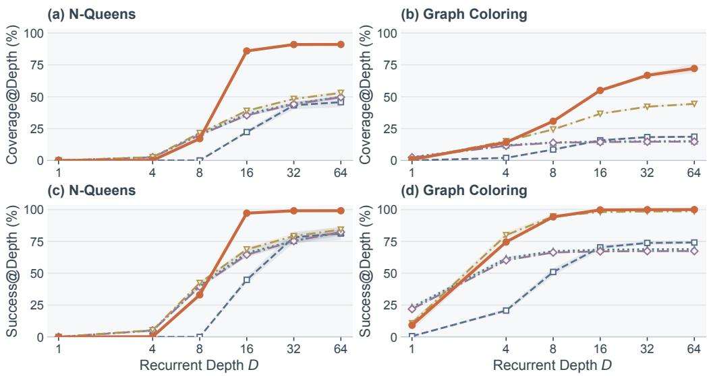  
Last-Depth Mean-Depth Random-Depth Soft-Depth Best-of-Depth  
Figure 2: Depth-wise solution discovery. Coverage@Depth (top) and Success@Depth (bottom) for greedy trajectories trained at depth 16. Bands indicate ±1 SD.

## 4.4 CODE GENERATION

Settings. We fine-tune Huginn, a pretrained 3B-parameter looped language model (Geiping et al., 2025), on 20,000 Python examples from CodeFeedback (Zheng et al., 2024), with 1,000 validation examples. We train models under all five objectives at depth 32; we also evaluate the pretrained model. On all 164 HumanEval and 500 MBPP problems (Chen et al., 2021; Austin et al., 2021), each model generates a complete program separately at each fixed depth in {4, 8, 12, 16, 24, 32} using greedy decoding. Success@32 pools these six candidates. We score completed programs using tests that do not guide generation or repair; MBPP uses the public tests included in the prompt. Appendix A.3 gives the full protocol.

Results. BoD achieves the highest Success@32 on both benchmarks (Table 1): 37.8% versus Last-Depth’s 34.8% on HumanEval, and 44.2% versus 39.2% on MBPP. BoD also has the highest depth-32 accuracy, although Mean-Depth, Random-Depth, and Soft-Depth perform better at shallow depths. Pooling BoD’s depth-specific programs solves problems missed at depth 32 alone, demonstrating useful shallow-depth candidates and extending BoD’s benefit to autoregressive generation.

Table 1: Code-generation results (%). Base is pretrained; other rows denote fine-tuning objectives. Depth columns show accuracy for one greedy program per problem. Success@32 pools the six evaluated depths {4, 8, 12, 16, 24, 32}. Bold marks each column’s best result.
<table><tr><td></td><td colspan="6">HumanEval</td><td colspan="4">MBPP</td></tr><tr><td></td><td colspan="3">Depth</td><td colspan="2">Success@Depth</td><td colspan="3">Depth</td><td>Success@Depth</td></tr><tr><td>Method</td><td>4</td><td>8</td><td>16</td><td>32</td><td>32</td><td>4</td><td>8</td><td>16</td><td>32</td><td>32</td></tr><tr><td>Base</td><td>0.0</td><td>12.8</td><td>24.4</td><td>25.6</td><td>30.5</td><td>1.2</td><td>17.0</td><td>29.0</td><td>29.8</td><td>39.8</td></tr><tr><td>Last-Depth</td><td>0.0</td><td>13.4</td><td>27.4</td><td>26.8</td><td>34.8</td><td>1.8</td><td>21.2</td><td>30.2</td><td>31.4</td><td>39.2</td></tr><tr><td>Mean-Depth</td><td>6.7</td><td>20.1</td><td>27.4</td><td>27.4</td><td>31.7</td><td>10.4</td><td>26.0</td><td>28.0</td><td>29.0</td><td>37.2</td></tr><tr><td>Random-Depth</td><td>4.9</td><td>20.1</td><td>26.8</td><td>28.7</td><td>30.5</td><td>8.8</td><td>25.8</td><td>29.6</td><td>29.6</td><td>37.4</td></tr><tr><td>Soft-Depth</td><td>6.1</td><td>20.7</td><td>26.2</td><td>26.8</td><td>32.9</td><td>9.4</td><td>25.2</td><td>29.2</td><td>30.8</td><td>39.4</td></tr><tr><td>Best-of-Depth</td><td>0.6</td><td>14.6</td><td>29.3</td><td>29.9</td><td>37.8</td><td>0.6</td><td>21.0</td><td>30.6</td><td>33.2</td><td>44.2</td></tr></table>

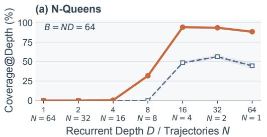

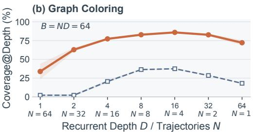

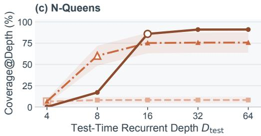

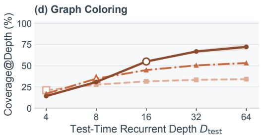  
BoD, Dtrain = 4 BoD, Dtrain = 8 BoD, Dtrain = 16  
Figure 3: Depth allocation and extrapolation. (a, b) Coverage pooling intermediate predictions from randomized trajectories under $N D = 6 4 . ( \mathrm { c } , \mathrm { d } )$ BoD with unperturbed greedy readouts; open markers denote training depth. Bands indicate ±1 SD.

## 4.5 ABLATION STUDIES

## 4.5.1 WIDTH VS. DEPTH UNDER A FIXED RECURRENT-STEP BUDGET

Figure 3(a, b) compares seven allocations of $B = N D = 6 4$ recurrent-block applications, with $\bar { D ^ { \prime } } \in \{ 1 , 2 , 4 , 8 , 1 6 , \bar { 3 2 } , 6 4 \}$ and $N = 6 4 / D .$ . Each method pools and deduplicates all intermediate predictions from N trajectories. We perturb the initial states with Gaussian noise for N-Queens and permute vertices for graph coloring, including at N = 1. Appendix C gives the protocols.

BoD achieves its highest mean coverage at $( N , D ) \ = \ ( 4 , 1 6 )$ on both tasks; Last-Depth peaks at (2, 32) on N-Queens and (4, 16) on graph coloring. These results favor combining depth with multiple trajectories.

## 4.5.2 TRAINING DEPTH AND TEST-TIME EXTRAPOLATION

We vary training depth to examine whether solution discovery continues beyond the supervised trajectory. Figure 3(c, d) evaluates BoD trained at $D _ { \mathrm { t r a i n } } \in \{ 4 , 8 , 1 6 \}$ using greedy readouts through $D _ { \mathrm { t e s t } } \in \{ 4 , 8 , 1 6 , 3 2 , 6 4 \}$ . All settings show further discoveries beyond the training depth, with diminishing gains. Models trained deeper reach higher coverage by depth 64, but can lag at shallower depths. Training depth thus shapes both the breadth of the candidate set and the depth at which alternatives become available. Success curves and numerical results are in Appendix C.

## 4.5.3 DISCOVERING SOLUTIONS BEYOND THE TRAINING TARGETS

We test discovery beyond supplied targets by restricting each graph’s teacher pool to one, two, three, or four valid solutions, with an all-solutions control. The pools are nested, and targets are sampled uniformly from each pool; all conditions use the same training budget and 3,034 training graphs with at least five solutions (Appendix C.5). Evaluation on these same graphs measures Seen Coverage, the fraction of teacher-pool solutions recovered, and Unseen Coverage, the fraction of withheld valid solutions recovered, averaged per graph. Table 2 compares Last-Depth, Last-Depth with multiple sampled trajectories (Last-Depth + BoN), and BoD under a recurrent-step budget of 64, collecting intermediate predictions for all three. BoD has the highest unseen coverage in every restricted-pool condition, increasing from 29.4% with one training solution to 46.2% with four. These are familiar training inputs, not unseen graphs.

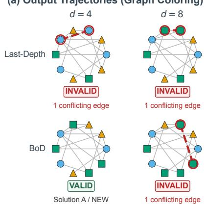

(a) Output Trajectories (Graph Coloring)  
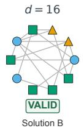

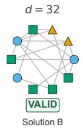

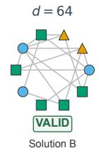

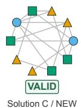  
(b) Solution Discovery

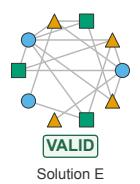

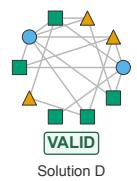  
(e) Depth Utilization (BoD)

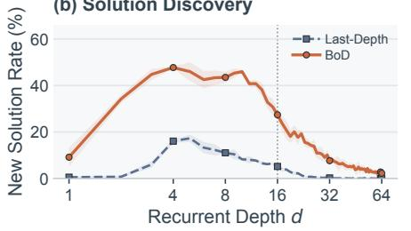  
(c) Latent Trajectories (Separate PCA)

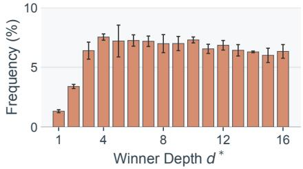

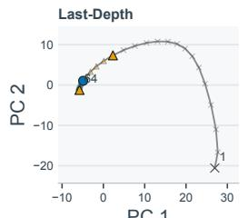

A B C D E F Invalid  
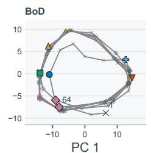

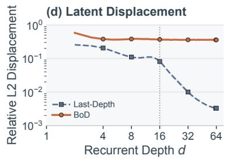  
Figure 4: Exploratory recurrent dynamics on graph coloring. (a) Example outputs; NEW marks first appearances. (b) Fraction of graphs with a new valid solution. (c) Separate PCA projections for the same example and seed as (a); markers identify solutions or invalid outputs. (d) Relative state displacement. (e) Loss-minimizing depths. Bands (b, d) and error bars (e) indicate ±1 SD. Dotted lines mark training depth 16.

Table 2: Discovery beyond the training targets on graph coloring. Seen Coverage and Unseen Coverage (%) on 3,034 training graphs under $N D = 6 4$ . All uses every valid solution as a training target candidate; Unseen Coverage is then undefined (N/A).
<table><tr><td rowspan="2">Training</td><td colspan="2">Last-Depth</td><td colspan="2">Last-Depth + BoN</td><td colspan="2">Best-of-Depth</td></tr><tr><td>Seen Coverage</td><td>Unseen Coverage</td><td>Seen Coverage</td><td>Unseen Coverage</td><td>Seen Coverage</td><td>Unseen Coverage</td></tr><tr><td>1</td><td> ${ \bf 9 9 . 8 \pm 0 . 0 }$ </td><td> $1 3 . 5 { \pm } 2 . 4 $ </td><td> $2 5 . 4 { \pm } 0 . 3 $ </td><td> $2 5 . 4 { \pm } 0 . 4 $ </td><td> $9 8 . 8 { \pm } 0 . 4 $ </td><td> ${ \bf 2 9 . 4 \pm 0 . 4 }$ </td></tr><tr><td>2</td><td> $4 6 . 6 { \pm } 0 . 6 $ </td><td> $1 2 . 9 { \pm } 1 . 2 $ </td><td> $2 2 . 8 { \pm } 0 . 7 \ $ </td><td> $2 2 . 9 { \pm } 0 . 9$ </td><td> ${ \bf 9 4 . 2 \pm 1 . 1 }$ </td><td> ${ \bf 3 7 . 0 { \pm } 0 . 8 }$ </td></tr><tr><td>3</td><td> $3 7 . 1 { \pm } 1 . 4 $ </td><td> $1 3 . 8 { \pm } 1 . 3 $ </td><td> $2 3 . 6 { \pm } 0 . 2 $ </td><td> $2 3 . 7 { \pm } 0 . 3 $ </td><td> ${ \bf 9 1 . 3 \pm 1 . 3 }$ </td><td> $\mathbf { 4 2 . 2 \pm 0 . 5 }$ </td></tr><tr><td>4</td><td> $2 8 . 4 { \pm } 0 . 3 $ </td><td> $1 3 . 8 { \pm } 0 . 4 $ </td><td> $2 4 . 4 { \pm } 0 . 6 $ </td><td> $2 4 . 4 { \pm } 0 . 6 $ </td><td> ${ \bf 8 7 . 7 \pm 1 . 6 }$ </td><td> ${ \bf 4 6 . 2 \pm 1 . 2 }$ </td></tr><tr><td>All</td><td> $1 1 . 8 { \pm } 0 . 2 $ </td><td>N/A</td><td> $2 5 . 0 { \pm } 0 . 4 $ </td><td>N/A</td><td> ${ \bf 6 7 . 4 \pm 4 . 4 }$ </td><td>N/A</td></tr></table>

## 4.5.4 COMPARISON WITH OTHER BASELINES

Table 14 in Appendix C.6 compares BoD with unshared and autoregressive Transformers, masked diffusion (Sahoo et al., 2024), HRM (Wang et al., 2025), TRM (Jolicoeur-Martineau, 2025), and an instance-level adaptation of Ouro’s objective (Zhu et al., 2026). Task splits and update counts are shared, but architectures and candidate counts vary. BoD achieves the highest mean success and coverage on both tasks. HRM has similar N-Queens success but substantially lower coverage, illustrating the distinction between finding one solution and many. Ouro’s adapted objective also yields lower coverage on the same looped backbone.

## 5 UNDERSTANDING EXPLORATORY RECURRENT DYNAMICS

Figure 4 relates BoD’s broader discovery to its recurrent dynamics on graph coloring. The statistics cover all 512 test graphs and three training seeds (Appendix B).

BoD discovers new valid solutions near and just beyond the training depth, where Last-Depth makes few discoveries (Figure 4b). This metric counts first solutions and subsequent alternatives. Discovery declines at greater depths (Figure 2). In panel (a), Last-Depth produces invalid outputs through depth 14 and reaches two distinct solutions by depth 64, whereas BoD reaches all six.

Separate PCA projections for this example show BoD moving among states decoding to different valid solutions (Figure 4c). Across the test set, BoD maintains greater relative state displacement near and beyond the training depth, while Last-Depth’s declines (panel (d)). Displacement is measured before projection relative to the preceding state’s norm. Panels (a, b) measure discovery; panels (c, d) characterize the accompanying dynamics.

Loss-minimizing depths span all 16 supervised depths (Figure 4e), providing the best predictions for different input–target pairs. The histogram weights graphs equally and valid targets uniformly within each graph. Together, these analyses associate broader discovery with sustained latent movement and useful intermediate readouts. Additional computation beyond the training depth yields further alternatives.

## 6 DISCUSSION AND LIMITATIONS

Our results highlight training objectives as a design choice for inference-time candidate generation. On controlled tasks, BoD improves coverage using the same architecture and inference readouts as the comparison objectives. This motivates aligning recurrent training with candidate-set evaluation so intermediate predictions contribute useful alternatives.

Fixed-budget results favor combining depth with multiple trajectories. For autoregressive generation, extensions include cross-depth sampling, branching, restarts, verification, and adaptive stopping.

Our evidence covers small combinatorial tasks and one pretrained language model; discovery saturates with depth. Generality requires testing larger tasks and additional models.

## 7 CONCLUSION

Best-of-Depth trains on the lowest-loss prediction along a looped Transformer’s trajectory, allowing different depths to match different valid targets without architectural changes. On N-Queens completion and graph coloring, it improves success and solution coverage, with further discoveries beyond the training depth. On familiar graph-coloring inputs, it also recovers solutions withheld from the teacher pool. Trajectory analyses show broader discovery alongside sustained latent movement and use of multiple intermediate depths. Under a fixed recurrent-step budget, combining depth with multiple trajectories yields higher coverage. Code-generation experiments show higher cumulative success when pooling programs from different fixed depths. These findings support training and evaluating recurrent trajectories as candidate sets of complementary valid solutions across depth.

## REPRODUCIBILITY STATEMENT

Appendix A describes the datasets, models, training objectives, and evaluation protocols. Appendix B specifies the trajectory analyses, Appendix C reports detailed results and aggregation procedures, and Appendix D provides the proofs. Table 4 lists the code-generation hyperparameters used for all five fine-tuning objectives.

## AI USE STATEMENT

AI tools assisted with manuscript editing, mathematical derivations and proof review, LaTeX formatting, and compilation.

## REFERENCES

Jacob Austin, Augustus Odena, Maxwell Nye, Maarten Bosma, Henryk Michalewski, David Dohan, Ellen Jiang, Carrie Cai, Michael Terry, Quoc Le, and Charles Sutton. Program synthesis with large language models. arXiv preprint arXiv:2108.07732, 2021. URL https://arxiv.org/abs/ 2108.07732.

Sangmin Bae, Adam Fisch, Hrayr Harutyunyan, Ziwei Ji, Seungyeon Kim, and Tal Schuster. Relaxed recursive transformers: Effective parameter sharing with layer-wise LoRA. In International Conference on Learning Representations, 2025a. URL https://openreview.net forum?id=WwpYSOkkCt.

Sangmin Bae, Yujin Kim, Reza Bayat, Sungnyun Kim, Jiyoun Ha, Tal Schuster, Adam Fisch, Hrayr Harutyunyan, Ziwei Ji, Aaron Courville, and Se-Young Yun. Mixture-of-recursions: Learning dynamic recursive depths for adaptive token-level computation. In Advances in Neural Information Processing Systems, 2025b. URL https://openreview.net/forum?id= QuqsEIVWIG.

Apratim Bhattacharyya, Bernt Schiele, and Mario Fritz. Accurate and diverse sampling of sequences based on a “best of many” sample objective. In Proceedings ofthe IEEE Conference on Computer Vision and Pattern Recognition, 2018. URL https://arxiv.org/abs/1806.07772.

Bradley Brown, Jordan Juravsky, Ryan Ehrlich, Ronald Clark, Quoc V. Le, Christopher Ré, and Azalia Mirhoseini. Large language monkeys: Scaling inference compute with repeated sampling. arXiv preprint arXiv:2407.21787, 2024. URL https://arxiv.org/abs/2407.21787.

Mark Chen, Jerry Tworek, Heewoo Jun, Qiming Yuan, Henrique Ponde de Oliveira Pinto, Jared Kaplan, et al. Evaluating large language models trained on code. arXiv preprint arXiv:2107.03374, 2021. URL https://arxiv.org/abs/2107.03374.

Yinlam Chow, Guy Tennenholtz, Izzeddin Gur, Vincent Zhuang, Bo Dai, Sridhar Thiagarajan, Craig Boutilier, Rishabh Agarwal, Aviral Kumar, and Aleksandra Faust. Inference-aware fine-tuning for best-of-N sampling in large language models. In International Conference on Learning Representations, 2025. URL https://arxiv.org/abs/2412.15287.

Karl Cobbe, Vineet Kosaraju, Mohammad Bavarian, Mark Chen, Heewoo Jun, Lukasz Kaiser, Matthias Plappert, Jerry Tworek, Jacob Hilton, Reiichiro Nakano, Christopher Hesse, and John Schulman. Training verifiers to solve math word problems. arXiv preprint arXiv:2110.14168, 2021. URL https://arxiv.org/abs/2110.14168.

Mostafa Dehghani, Stephan Gouws, Oriol Vinyals, Jakob Uszkoreit, and Łukasz Kaiser. Universal transformers. In International Conference on Learning Representations, 2019. URL https: //arxiv.org/abs/1807.03819.

Ying Fan, Anej Svete, and Kangwook Lee. Bridging the gap between latent and explicit reasoning with looped transformers. arXiv preprint arXiv:2606.31779, 2026. URL https://arxiv. org/abs/2606.31779.

Khashayar Gatmiry, Nikunj Saunshi, Sashank J. Reddi, Stefanie Jegelka, and Sanjiv Kumar. Can looped transformers learn to implement multi-step gradient descent for in-context learning? In Proceedings of the 41st International Conference on Machine Learning, volume 235 of Proceedings of Machine Learning Research, pp. 15130–15152. PMLR, 2024. URL https://proceedings.mlr.press/v235/gatmiry24b.html.

Jonas Geiping, Sean McLeish, Neel Jain, John Kirchenbauer, Siddharth Singh, Brian R. Bartoldson, Bhavya Kailkhura, Abhinav Bhatele, and Tom Goldstein. Scaling up test-time compute with latent reasoning: A recurrent depth approach. In Advances in Neural Information Processing Systems, 2025. URL https://openreview.net/forum?id=S3GhJooWIC.

Angeliki Giannou, Shashank Rajput, Jy-yong Sohn, Kangwook Lee, Jason D. Lee, and Dimitris Papailiopoulos. Looped transformers as programmable computers. In International Conference on Machine Learning, 2023. URL https://proceedings.mlr.press/v202/ giannou23a.html.

Alexi Gladstone, Heng Ji, and Yilun Du. Explorative modeling: Unlocking a third pretraining axis and end-to-end generation. arXiv preprint arXiv:2607.27372, 2026. URL https://arxiv. org/abs/2607.27372.

Abner Guzmán-Rivera, Dhruv Batra, and Pushmeet Kohli. Multiple choice learning: Learning to produce multiple structured outputs. In Advances in Neural Information Processing Systems, 2012. URL https://proceedings.neurips.cc/paper\_files/paper/ 2012/hash/cfbce4c1d7c425baf21d6b6f2babe6be-Abstract.html.

Ahmadreza Jeddi, Marco Ciccone, and Babak Taati. LoopFormer: Elastic-depth looped transformers for latent reasoning via shortcut modulation. In International Conference on Learning Repre sentations, 2026. URL https://openreview.net/forum?id=RzYXb5YWBs.

Alexia Jolicoeur-Martineau. Less is more: Recursive reasoning with tiny networks. arXiv preprint arXiv:2510.04871, 2025. URL https://arxiv.org/abs/2510.04871.

Stefan Lee, Senthil Purushwalkam, Michael Cogswell, Viresh Ranjan, David Crandall, and Dhruv Batra. Stochastic multiple choice learning for training diverse deep ensembles. In Advances in Neural Information Processing Systems, 2016. URL https://arxiv.org/abs/1606. 07839.

Shuzhen Li, Yifan Zhang, Jiacheng Guo, Quanquan Gu, and Mengdi Wang. DeepLoop: Depth scaling for looped transformers. arXiv preprint arXiv:2607.13491, 2026. URL https://arxiv. org/abs/2607.13491.

Hunter Lightman, Vineet Kosaraju, Yura Burda, Harri Edwards, Bowen Baker, Teddy Lee, Jan Leike, John Schulman, Ilya Sutskever, and Karl Cobbe. Let’s verify step by step. In International Conference on Learning Representations, 2024. URL https://openreview.net/forum? id=v8L0pN6EOi.

Sajad Movahedi, Vera Milovanovic, Shlomo Libo Feigin, Alexander Theus, Thomas Hofmann,´ Valentina Boeva, T. Konstantin Rusch, and Antonio Orvieto. Fixed-point reasoners: Stable and adaptive deep looped transformers. arXiv preprint arXiv:2606.18206, 2026. URL https://arxiv.org/abs/2606.18206.

Hayden Prairie, Zachary Novack, Taylor Berg-Kirkpatrick, and Daniel Y. Fu. Parcae: Scaling laws for stable looped language models. arXiv preprint arXiv:2604.12946, 2026. URL https:// arxiv.org/abs/2604.12946.

Subham Sekhar Sahoo, Marianne Arriola, Yair Schiff, Aaron Gokaslan, Edgar Marroquin, Justin T Chiu, Alexander Rush, and Volodymyr Kuleshov. Simple and effective masked diffusion language models. In Advances in Neural Information Processing Systems, 2024. URL https://arxiv. org/abs/2406.07524.

Nikunj Saunshi, Nishanth Dikkala, Zhiyuan Li, Sanjiv Kumar, and Sashank J. Reddi. Reasoning with latent thoughts: On the power of looped transformers. In International Conference on Learning Representations, 2025. URL https://arxiv.org/abs/2502.17416.

Charlie Snell, Jaehoon Lee, Kelvin Xu, and Aviral Kumar. Scaling LLM test-time compute optimally can be more effective than scaling parameters for reasoning. In International Conference on Learning Representations, 2025. URL https://openreview.net/forum?id= 4FWAwZtd2n.

Guan Wang, Jin Li, Yuhao Sun, Xing Chen, Changling Liu, Yue Wu, Meng Lu, Sen Song, and Yasin Abbasi Yadkori. Hierarchical reasoning model. arXiv preprint arXiv:2506.21734, 2025. URL https://arxiv.org/abs/2506.21734.

Xuezhi Wang, Jason Wei, Dale Schuurmans, Quoc Le, Ed Chi, Sharan Narang, Aakanksha Chowdhery, and Denny Zhou. Self-consistency improves chain of thought reasoning in language models. In International Conference on Learning Representations, 2023. URL https://arxiv.org/ abs/2203.11171.

Liu Yang, Kangwook Lee, Robert Nowak, and Dimitris Papailiopoulos. Looped transformers are better at learning learning algorithms. In International Conference on Learning Representations, 2024. URL https://arxiv.org/abs/2311.12424.

Xiao-Wen Yang, Ziyu Han, Xi-Hua Zhang, Wen-Da Wei, Jie-Jing Shao, Lan-Zhe Guo, and Yu-Feng Li. Stabilizing recurrent dynamics for test-time scalable latent reasoning in looped language models. In International Conference on Machine Learning, 2026. URL https: //openreview.net/forum?id=tbdSfBMlbq.

Shunyu Yao, Dian Yu, Jeffrey Zhao, Izhak Shafran, Thomas L. Griffiths, Yuan Cao, and Karthik Narasimhan. Tree of thoughts: Deliberate problem solving with large language models. In Advances in Neural Information Processing Systems, 2023. URL https://arxiv.org/abs/ 2305.10601.

Tianyu Zheng, Ge Zhang, Tianhao Shen, Xueling Liu, Bill Yuchen Lin, Jie Fu, Wenhu Chen, and Xiang Yue. OpenCodeInterpreter: Integrating code generation with execution and refinement. In Findings of the Association for Computational Linguistics: ACL 2024, pp. 12834– 12859, 2024. doi: 10.18653/v1/2024.findings-acl.762. URL https://aclanthology. org/2024.findings-acl.762/.

Rui-Jie Zhu, Zixuan Wang, Kai Hua, Tianyu Zhang, Ziniu Li, Haoran Que, Boyi Wei, Zixin Wen, Fan Yin, He Xing, Lu Li, Jiajun Shi, Kaijing Ma, Shanda Li, Taylor Kergan, Andrew Smith, Xingwei Qu, Mude Hui, Bohong Wu, Qiyang Min, Hongzhi Huang, Xun Zhou, Wei Ye, Jiaheng Liu, Jian Yang, Yunfeng Shi, Chenghua Lin, Enduo Zhao, Tianle Cai, Ge Zhang, Wenhao Huang, Yoshua Bengio, and Jason Eshraghian. Scaling latent reasoning via looped language models. arXiv preprint arXiv:2510.25741, 2026. URL https://arxiv.org/abs/2510.25741.

## A IMPLEMENTATION DETAILS

For N-Queens and graph coloring, Last-Depth, Mean-Depth, Random-Depth, Soft-Depth, and BoD use the same architecture and output head within each task. The supervised depth set for Mean-Depth, Random-Depth, Soft-Depth, and BoD is $\mathcal { D } = \{ 1 , \dots , D _ { \mathrm { t r a i n } } \}$ . Soft-Depth uses $\tau = 0 . 2 5$ except in the temperature sweep. At each presentation of an input, a target is sampled uniformly from its complete valid solution set, except in the withheld-solution ablation.

Table 3: Training settings for the N-Queens and graph-coloring objective comparisons.
<table><tr><td>Setting</td><td>Value</td></tr><tr><td>Recurrent transformation</td><td>Two shared Transformer layers per loop</td></tr><tr><td>Width / heads / FFN width</td><td>128 / 8 / 384</td></tr><tr><td>Output normalization</td><td>StableMax</td></tr><tr><td>Training depth  $D _ { \mathrm { t r a i n } }$ </td><td>16</td></tr><tr><td>Optimizer</td><td>AdamAtan2</td></tr><tr><td>Learning rate / batch size</td><td>10−⁴ / 768</td></tr><tr><td>Schedule</td><td>2,000 warmup updates, then constant learning rate</td></tr><tr><td>Weight decay / gradient clipping</td><td>1 / norm 1</td></tr><tr><td>EMA decay</td><td>0.999</td></tr><tr><td>Training updates</td><td>N-Queens: 20,000; graph coloring: 10,000</td></tr></table>

## A.1 N-QUEENS COMPLETION

Dataset. Each input specifies five fixed queens on a 10 × 10 board. The training, development, and test splits contain 24,320, 400, and 2,000 inputs, respectively, with equal numbers of single- and multi-solution inputs in each split. All valid completions are enumerated, and $D _ { 4 }$ -equivalent inputs do not cross splits. Reported coverage and success use the 1,000 multi-solution test inputs. Distinct completed boards count as different solutions; outputs are not merged under $D _ { 4 }$ symmetry.

Model and training. The model represents the board with 100 cell tokens and uses the shared recurrent architecture in Table 3. For the objective comparisons, we train each model for 20,000 updates and evaluate its EMA weights at that point. Evaluation collects the intermediate predictions of one trajectory through depth 64.

## A.2 GRAPH COLORING

Dataset. Inputs are connected graphs with 10 vertices, at least 10 edges, and 2–128 valid 3- coloring families. The training, development, and test splits contain 4,096, 512, and 512 graphs, respectively, with graph-isomorphic inputs separated across splits. All canonical solution families are enumerated; colorings related by a global permutation of color names belong to the same family. Every test graph has multiple valid solutions. Coverage is computed using each graph’s number of valid families and then averaged over graphs. The verifier checks edge constraints and color range independently of the sampled teacher.

Model and training. A projection of adjacency rows produces 10 vertex tokens. Only the 10 vertex colors contribute to the loss; trailing padding positions in the serialized representation are excluded. The model uses the shared configuration in Table 3, trains for 10,000 updates, and is evaluated using the EMA weights at that fixed update. The BoD objective minimizes graph-level mean cross-entropy over depths, after averaging over the valid output positions. Evaluation collects all greedy predictions from one trajectory through depth 64.

Temperature sweep. Figure 6 varies $\tau = 0 . 1 , 0 . 2 , \ldots , 1 . 0$ while retaining the graph-coloring configuration above. Each evaluation collects all outputs from one 64-step trajectory.

## A.3 CODE GENERATION

Fine-tuning. We use the 3.565B-parameter Huginn model and Python examples from CodeFeedback (Geiping et al., 2025; Zheng et al., 2024). The training and validation sets contain 20,000 and 1,000 examples, respectively. Examples whose combined prompt and target exceed 1,024 tokens are excluded. Table 4 summarizes the training settings.

Table 4: Shared fine-tuning settings for the five code-generation objectives.
<table><tr><td>Setting</td><td>Value</td></tr><tr><td>Model</td><td>Huginn 3.565B, shared recurrent parameters</td></tr><tr><td>Data</td><td>CodeFeedback Python examples; 20,000 train  $/ 1 { , } 0 0 0$  validation</td></tr><tr><td>Maximum sequence length</td><td>1,024 tokens, including prompt and target</td></tr><tr><td>Training duration</td><td>1 epoch, 625 updates</td></tr><tr><td>Effective batch size</td><td>32  $D _ { \mathrm { t r a i n } } = 3 2$ </td></tr><tr><td>Maximum training depth</td><td></td></tr><tr><td>Optimizer</td><td> $\mathrm { A d a m W } , \beta = ( 0 . 9 , 0 . 9 5 ) , \epsilon = 1 0 ^ { - 8 }$  , weight decay 0</td></tr><tr><td>Peak learning rate</td><td> $5 \times 1 0 ^ { - 7 }$ </td></tr><tr><td>Schedule</td><td>Warmup-Stable-Decay; first 63 updates warm up, final 63 decay</td></tr></table>

The loss at each depth is the mean teacher-forced cross-entropy over the entire response, excluding prompt and padding tokens, as in Eq. 4. Last-Depth uses the loss at depth 32. For BoD, all depths from 1 to 32 are scored along one recurrent trajectory, and a single depth with the lowest responselevel loss is selected for each example. This depth is then recomputed for backpropagation through its last at most eight recurrent updates; exact loss ties are broken randomly. The selected depth is shared by all response tokens in the example, not chosen separately for each token.

Mean-Depth averages response-level losses over depths 1 through 32; Random-Depth samples one depth uniformly per example, shared by all response tokens. Soft-Depth uses Eq. 6 with $\tau = 0 . 2 5$ and $\mathcal { D } = \{ 1 , . . . , 3 2 \}$ , applied to the response-level losses. The loss is computed per example and then averaged over the batch. All five objectives use the dataset and optimization settings in Table 4, with the final checkpoint at update 625.

Generation and scoring. We evaluated all 164 HumanEval and 500 MBPP problems. Each model generates one program greedily at each fixed depth in {4, 8, 12, 16, 24, 32}, giving six candidates per problem. There is no stochastic sampling, test-guided repair, or regeneration. Prompt and generated output together are limited to 1,024 tokens.

## B GRAPH-COLORING TRAJECTORY ANALYSIS

Figure 4 uses the Last-Depth and BoD checkpoints trained at depth 16 with uniformly sampled targets for 10,000 updates. We evaluate them greedily through depth 64 without input permutations or initial-state noise. Solution IDs denote canonical coloring families, with colorings related by global color-label permutations assigned the same ID. The new-solution indicator at depth d is

$$
\mathbf { 1 } \big [ \widehat { y } _ { d } ( x ) \in \mathcal { V } ^ { \star } ( x ) \mathrm { ~ a n d ~ } \widehat { y } _ { d } ( x ) \notin S _ { d - 1 } ( x ) \big ] ,\tag{12}
$$

where $S _ { 0 } ( x ) = \emptyset$ and membership is evaluated using canonical color families. Discovery indicators are checked against the preceding decoded outputs and enumerated valid families. Each population curve averages all 512 graphs within each seed.

Relative displacement is computed before PCA as

$$
\Delta _ { d } = \frac { \| \tilde { h } _ { d } - \tilde { h } _ { d - 1 } \| _ { 2 } } { \| \tilde { h } _ { d - 1 } \| _ { 2 } } , \qquad d = 2 , \ldots , 6 4 ,\tag{13}
$$

where $\tilde { h } _ { d }$ concatenates the ten recurrent core states at depth d. To construct the histograms of lossminimizing depths, we find the depth with the lowest graph-level mean loss for each graph–target pair among the 16 training depths. We weight graphs equally and valid targets uniformly within each graph. When losses tie exactly, we select the earliest depth attaining the minimum.

## C ADDITIONAL RESULTS

## C.1 SOLUTION DISCOVERY ACROSS DEPTH

Tables 5–8 give the numerical results for Figure 2. The evaluation sets and training budgets are specified in Appendices A.1 and A.2. All models are trained at depth 16 and read out greedily at every depth up to the stated budget.

Table 5: N-Queens Coverage@Depth (%) on 1,000 multi-solution test problems. Models are trained at $D _ { \mathrm { t r a i n } } = 1 6 .$
<table><tr><td>Method</td><td>@1</td><td>@4</td><td>@8</td><td>@16</td><td>@32</td><td>@64</td></tr><tr><td>Last-Depth</td><td> $0 . 0 0 { \scriptstyle \pm 0 . 0 0 }$ </td><td> $0 . 0 0 { \scriptstyle \pm 0 . 0 0 }$ </td><td> $0 . 0 0 { \scriptstyle \pm 0 . 0 0 }$ </td><td> $2 2 . 2 7 \pm 1 . 2 7$ </td><td> $4 3 . 2 9 \pm 3 . 1 2$ </td><td> $4 5 . 7 5 \pm 3 . 9 3$ </td></tr><tr><td>Mean-Depth</td><td> $0 . 0 0 { \scriptstyle \pm 0 . 0 0 }$ </td><td> $2 . 5 1 \pm 0 . 1 8$ </td><td> $2 0 . 4 2 \pm 1 . 2 0$ </td><td> $3 6 . 5 2 \pm 2 . 2 1$ </td><td> $4 4 . 5 2 \pm 1 . 6 6$ </td><td> $4 9 . 9 4 \pm 1 . 0 5$ </td></tr><tr><td>Random-Depth</td><td> $0 . 0 0 { \scriptstyle \pm 0 . 0 0 }$ </td><td> $2 . 4 6 \pm 0 . 1 1$ </td><td> $1 9 . 9 3 \pm 0 . 5 3$ </td><td> $3 5 . 4 2 \pm 0 . 9 1$ </td><td> $4 4 . 1 5 \pm 1 . 2 4$ </td><td> $4 9 . 6 3 \pm 1 . 3 4$ </td></tr><tr><td> $\mathrm { S o f t - D e p t h }$ </td><td> $0 . 0 0 { \scriptstyle \pm 0 . 0 0 }$ </td><td> $2 . 6 3 \pm 0 . 3 7$ </td><td> $2 1 . 5 3 \pm 0 . 8 2$ </td><td> $3 8 . 9 9 \pm 0 . 7 9$ </td><td> $4 8 . 2 6 \pm 0 . 8 3$ </td><td> $5 3 . 0 1 \pm 1 . 4 7 $ </td></tr><tr><td>Best-of-Depth</td><td> $0 . 0 0 { \scriptstyle \pm 0 . 0 0 }$ </td><td> $0 . 1 0 { \scriptstyle \pm 0 . 0 9 }$ </td><td> $1 7 . 1 1 \pm 1 . 2 5$ </td><td> $8 5 . 9 2 \pm 0 . 9 3 $ </td><td> $9 0 . 9 7 \pm 0 . 9 8 $ </td><td> $9 1 . 0 3 \pm 1 . 0 5$ </td></tr></table>

Table 6: N-Queens Success@Depth (%) on 1,000 multi-solution test problems. Models are trained at $D _ { \mathrm { t r a i n } } = 1 6$
<table><tr><td>Method</td><td>@1</td><td>@4</td><td>@8</td><td>@16</td><td>@32</td><td>@64</td></tr><tr><td>Last-Depth</td><td> $0 . 0 0 { \scriptstyle \pm 0 . 0 0 }$ </td><td> $0 . 0 0 { \scriptstyle \pm 0 . 0 0 }$ </td><td> $0 . 0 0 { \scriptstyle \pm 0 . 0 0 }$ </td><td> $4 4 . 8 0 \pm 2 . 5 2 $ </td><td> $7 8 . 2 3 \pm 4 . 4 8$ </td><td> $8 1 . 1 3 \pm 4 . 9 4$ </td></tr><tr><td>Mean-Depth</td><td> $0 . 0 0 { \scriptstyle \pm 0 . 0 0 }$ </td><td> $5 . 1 0 \pm 0 . 4 0$ </td><td> $4 0 . 3 7 \pm 1 . 8 3$ </td><td> $6 5 . 9 7 \pm 3 . 2 5$ </td><td> $7 5 . 3 7 \pm 2 . 5 0$ </td><td> $8 1 . 9 7 \pm 2 . 4 6 $ </td></tr><tr><td>Random-Depth</td><td> $0 . 0 0 { \scriptstyle \pm 0 . 0 0 }$ </td><td> $5 . 0 0 \pm 0 . 2 0$ </td><td> $3 9 . 4 3 \pm 1 . 3 4$ </td><td> $6 4 . 5 0 \pm 1 . 6 1$ </td><td> $7 5 . 2 7 \pm 1 . 7 2$ </td><td> $8 2 . 3 0 \pm 2 . 3 5$ </td></tr><tr><td>Soft-Depth</td><td> $0 . 0 0 { \scriptstyle \pm 0 . 0 0 }$ </td><td> $5 . 3 0 \pm 0 . 7 0$ </td><td> $4 2 . 3 7 \pm 1 . 1 1$ </td><td> $6 8 . 6 7 \pm 1 . 6 9$ </td><td> $7 9 . 1 3 \pm 2 . 1 0$ </td><td> $8 4 . 2 0 \pm 2 . 4 9$ </td></tr><tr><td> $\mathbf { B e s t - o f - D e p t h }$ </td><td> $0 . 0 0 { \scriptstyle \pm 0 . 0 0 }$ </td><td> $0 . 2 0 { \scriptstyle \pm 0 . 1 7 }$ </td><td> $3 3 . 0 3 \pm 2 . 2 0$ </td><td> $9 7 . 1 3 \pm 0 . 5 5$ </td><td> $9 9 . 0 0 { \scriptstyle \pm 0 . 1 0 }$ </td><td> $9 9 . 0 3 \pm 0 . 1 2 $ </td></tr></table>

Table 7: Graph-coloring Coverage@Depth (%) on 512 test graphs. Models are trained at $D _ { \mathrm { t r a i n } } =$ 16.
<table><tr><td>Method</td><td>@1</td><td>@4</td><td>@8</td><td>@16</td><td>@32</td><td>@64</td></tr><tr><td>Last-Depth</td><td> $0 . 0 5 \pm 0 . 0 1$ </td><td> $2 . 0 1 \pm 0 . 1 0$ </td><td> $8 . 5 5 \pm 0 . 7 7$ </td><td> $1 5 . 7 9 \pm 0 . 8 8$ </td><td> $1 8 . 3 0 { \scriptstyle \pm 0 . 8 8 }$ </td><td> $1 8 . 6 2 \pm 0 . 7 6$ </td></tr><tr><td>Mean-Depth</td><td> $2 . 6 7 \pm 0 . 0 9$ </td><td> $1 1 . 9 9 \pm 0 . 2 5$ </td><td> $1 4 . 1 1 \pm 0 . 0 5$ </td><td> $1 4 . 8 4 \pm 0 . 0 3$ </td><td> $1 5 . 0 9 \pm 0 . 0 7$ </td><td> $1 5 . 1 5 { \scriptstyle \pm 0 . 0 7 }$ </td></tr><tr><td>Random-Depth</td><td> $2 . 3 8 \pm 0 . 2 0$ </td><td> $1 1 . 5 1 \pm 0 . 1 5$ </td><td> $1 3 . 8 7 \pm 0 . 2 9$ </td><td> $1 4 . 4 2 \pm 0 . 2 5$ </td><td> $1 4 . 6 8 \pm 0 . 1 5$ </td><td> $1 4 . 7 5 \pm 0 . 1 6$ </td></tr><tr><td>Soft-Depth</td><td> $0 . 8 8 \pm 0 . 2 5$ </td><td> $1 5 . 1 7 \pm 0 . 5 9$ </td><td> $2 4 . 3 6 \pm 0 . 6 6$ </td><td> $3 6 . 6 4 \pm 0 . 5 3$ </td><td> $4 2 . 1 8 \pm 0 . 7 7$ </td><td> $4 4 . 3 9 \pm 0 . 8 0$ </td></tr><tr><td>Best-of-Depth</td><td> $0 . 7 1 \pm 0 . 4 2$ </td><td> $1 4 . 1 8 \pm 0 . 5 3$ </td><td> $3 0 . 7 6 \pm 0 . 7 0$ </td><td> $5 4 . 9 5 \pm 0 . 8 0$ </td><td> $6 6 . 7 9 \pm 1 . 8 9$ </td><td> $7 2 . 1 6 \pm 3 . 6 2$ </td></tr></table>

Table 8: Graph-coloring Success@Depth (%) on 512 test graphs. Models are trained at $D _ { \mathrm { t r a i n } } = 1 6 .$
<table><tr><td>Method</td><td>@1</td><td>@4</td><td>@8</td><td>@16</td><td>@32</td><td>@64</td></tr><tr><td>Last-Depth</td><td> $0 . 5 9 \pm 0 . 3 4$ </td><td> $2 0 . 7 0 \pm 1 . 4 7$ </td><td> $5 0 . 9 8 \pm 2 . 9 2$ </td><td> $7 0 . 3 1 \pm 1 . 8 6$ </td><td> $7 3 . 7 6 \pm 1 . 3 9$ </td><td> $7 4 . 0 9 \pm 1 . 3 0$ </td></tr><tr><td>Mean-Depth</td><td> $2 3 . 3 7 \pm 0 . 9 6$ </td><td> $6 1 . 7 2 \pm 1 . 2 2$ </td><td> $6 7 . 3 8 \pm 0 . 2 0$ </td><td> $6 8 . 4 2 \pm 0 . 1 1 \hphantom { 0 }$ </td><td> $6 8 . 8 2 \pm 0 . 1 1 \hphantom { 0 }$ </td><td> $6 8 . 8 8 \pm 0 . 1 1 $ </td></tr><tr><td>Random-Depth</td><td> $2 1 . 8 8 \pm 1 . 2 8$ </td><td> $6 0 . 1 6 \pm 0 . 5 2$ </td><td> $6 6 . 2 8 \pm 0 . 6 3$ </td><td> $6 7 . 1 2 \pm 0 . 3 0$ </td><td> $6 7 . 3 2 \pm 0 . 1 1$ </td><td> $6 7 . 3 8 \pm 0 . 0 0$ </td></tr><tr><td>Soft-Depth</td><td> $1 0 . 7 4 \pm 1 . 7 9$ </td><td> $7 9 . 8 8 \pm 2 . 3 4$ </td><td> $9 4 . 6 0 \pm 1 . 5 8 $ </td><td> $9 7 . 9 8 \pm 0 . 1 1 $ </td><td> $9 8 . 4 4 \pm 0 . 2 0 $ </td><td> $9 8 . 6 3 \pm 0 . 2 0 $ </td></tr><tr><td>Best-of-Depth</td><td> $9 . 1 8 \pm 4 . 0 4$ </td><td> $7 4 . 4 8 \pm 1 . 4 7$ </td><td> $9 4 . 2 1 \pm 0 . 7 4$ </td><td> $9 9 . 6 7 \pm 0 . 3 0 $ </td><td> $9 9 . 8 7 \pm 0 . 2 3 $ </td><td> $9 9 . 9 3 \pm 0 . 1 1 $ </td></tr></table>

At depth 64, graph-coloring BoD achieves $9 9 . 9 3 \pm 0 . 1 1 \%$ success and $7 2 . 1 6 \pm 3 . 6 2 \%$ coverage. On the multi-solution N-Queens test population, the corresponding values are $9 9 . 0 3 \pm 0 . 1 2 \%$ and $9 1 . 0 3 \pm 1 . 0 5 \%$

## C.2 WIDTH AND DEPTH UNDER A FIXED RECURRENT-STEP BUDGET

Tables 9 and 10 give the values plotted in Figure 3(a, b). All seven allocations use $N D = 6 4 .$ pooling valid predictions from every intermediate depth of all trajectories before computing perproblem coverage. Each training seed averages 32 inference repeats.

For each N-Queens trajectory, we initialize the recurrent state with independent Gaussian noise scaled by the encoded input:

$$
h _ { 0 } ^ { ( j ) } = 0 . 1 \mathrm { R M S } ( \mathrm { E n c } _ { \theta } ( x ) ) \epsilon _ { j } , \qquad \epsilon _ { j } \sim \mathcal { N } ( 0 , I ) ,\tag{14}
$$

where RMS is the root mean square over entries of the encoded input, which remains unchanged during initialization. The scale is selected from $\{ 0 , 0 . 0 3 , 0 . 1 , 0 . 3 \}$ by mean development coverage at $( N , D ) = ( 4 , 1 6 )$ across both methods and all three seeds. The selected value, 0.1, is fixed before test evaluation. For graph coloring, we instead independently permute vertices for each trajectory, map predictions back to the original vertex order, and canonicalize color names before pooling solutions. Both procedures also apply at $N = 1$

Table 9: N-Queens Coverage@Depth (%) at $N D = 6 4 .$ , pooling all N trajectories through depth D.
<table><tr><td></td><td>Depth D Trajectories N Last-Depth Best-of-Depth</td><td></td><td></td></tr><tr><td>1</td><td>64</td><td> $0 . 0 0 { \scriptstyle \pm 0 . 0 0 }$ </td><td> $0 . 0 0 { \scriptstyle \pm 0 . 0 0 }$ </td></tr><tr><td>2</td><td>32</td><td> $0 . 0 0 { \scriptstyle \pm 0 . 0 0 }$ </td><td> $0 . 0 0 { \scriptstyle \pm 0 . 0 0 }$ </td></tr><tr><td>4</td><td>16</td><td> $0 . 0 0 { \scriptstyle \pm 0 . 0 0 }$ </td><td> $0 . 5 0 \pm 0 . 3 0$ </td></tr><tr><td>8</td><td>8</td><td> $0 . 0 0 { \scriptstyle \pm 0 . 0 0 }$ </td><td> $3 1 . 7 8 \pm 1 . 8 1$ </td></tr><tr><td>16</td><td>4</td><td> $4 8 . 4 9 \pm 2 . 0 6$ </td><td> $9 4 . 1 3 \pm 0 . 5 6 $ </td></tr><tr><td>32</td><td>2</td><td> $5 6 . 2 5 \pm 2 . 4 0$ </td><td> $9 3 . 4 5 \pm 0 . 9 2 $ </td></tr><tr><td>64</td><td>1</td><td> $4 4 . 5 5 \pm 3 . 8 5$ </td><td> $8 8 . 2 8 \pm 1 . 3 2 $ </td></tr></table>

Table 10: Graph-coloring Coverage@Depth (%) at $N D = 6 4 .$ , pooling all N trajectories through depth D.
<table><tr><td></td><td>Depth D Trajectories N Last-Depth Best-of-Depth</td><td></td><td></td></tr><tr><td>1</td><td>64</td><td> $2 . 2 5 \pm 1 . 2 5$ </td><td> $3 3 . 8 5 \pm 1 0 . 3 4$ </td></tr><tr><td>2</td><td>32</td><td> $2 . 2 6 \pm 1 . 3 5$ </td><td> $6 2 . 8 6 \pm 2 . 6 3$ </td></tr><tr><td>4</td><td>16</td><td> $2 0 . 6 1 \pm 1 . 8 2$ </td><td> $7 7 . 2 8 \pm 0 . 6 7$ </td></tr><tr><td>8</td><td>8</td><td> $3 6 . 3 9 \pm 0 . 6 5$ </td><td> $8 2 . 8 0 { \scriptstyle \pm 0 . 2 0 }$ </td></tr><tr><td>16</td><td>4</td><td> $3 7 . 5 0 { \scriptstyle \pm 0 . 5 1 }$ </td><td> $8 5 . 8 6 \pm 0 . 4 9$ </td></tr><tr><td>32</td><td>2</td><td> $2 8 . 5 4 \pm 0 . 5 2$ </td><td> $8 2 . 6 7 \pm 1 . 4 4$ </td></tr><tr><td>64</td><td>1</td><td> $1 8 . 1 2 \pm 0 . 4 1$ </td><td> $7 2 . 1 4 \pm 3 . 4 7$ </td></tr></table>

## C.3 TRAINING DEPTH AND TEST-TIME EXTRAPOLATION

The training-depth ablation uses BoD models trained at depths 4, 8, and $^ { 1 6 , }$ each with three seeds. The protocol holds the evaluation population and training-update budget fixed within each task, as specified in Appendix A. Depth-16 models are the same as in Figure 2. Evaluation uses unperturbed greedy trajectories. Tables 11 and 12 give coverage values for Figure $3 ( \mathrm { c } , \mathrm { d } )$

Table 11: N-Queens BoD Coverage@Depth (%) across training and test depths.
<table><tr><td>Training depth</td><td>@4</td><td>@8</td><td>@16</td><td>@32</td><td>@64</td></tr><tr><td>4</td><td> $6 . 4 8 \pm 3 . 8 8$ </td><td> $8 . 1 1 \pm 3 . 9 6$ </td><td> $8 . 2 1 \pm 4 . 0 1$ </td><td> $8 . 2 1 \pm 4 . 0 1$ </td><td> $8 . 2 1 \pm 4 . 0 1$ </td></tr><tr><td>8</td><td> $6 . 6 1 \pm 2 . 7 3$ </td><td> $6 0 . 2 1 \pm 1 1 . 7 2$ </td><td> $7 5 . 1 5 \pm 1 1 . 9 9$ </td><td> $7 5 . 6 6 \pm 1 1 . 9 0$ </td><td> $7 5 . 7 0 \pm 1 1 . 9 5$ </td></tr><tr><td>16</td><td> $0 . 1 0 { \scriptstyle \pm 0 . 0 9 }$ </td><td> $1 7 . 1 1 \pm 1 . 2 5$ </td><td> $8 5 . 9 2 \pm 0 . 9 3$ </td><td> $9 0 . 9 7 \pm 0 . 9 8 $ </td><td> $9 1 . 0 3 \pm 1 . 0 5$ </td></tr></table>

Table 12: Graph-coloring BoD Coverage@Depth (%) across training and test depths.
<table><tr><td>Training depth</td><td>@4</td><td>@8</td><td>@16</td><td>@32</td><td>@64</td></tr><tr><td>4</td><td> $2 1 . 0 9 \pm 0 . 5 0$ </td><td> $2 7 . 6 4 \pm 0 . 8 3$ </td><td> $3 1 . 5 3 \pm 0 . 5 4$ </td><td> $3 3 . 3 2 \pm 0 . 6 4$ </td><td> $3 4 . 1 3 \pm 0 . 6 9$ </td></tr><tr><td>8</td><td> $1 7 . 0 2 \pm 0 . 5 5$ </td><td> $3 4 . 6 9 \pm 0 . 9 2$ </td><td> $4 4 . 8 6 \pm 0 . 9 0$ </td><td> $5 0 . 3 8 \pm 1 . 1 0$ </td><td> $5 3 . 1 1 \pm 1 . 5 7$ </td></tr><tr><td>16</td><td> $1 4 . 1 8 \pm 0 . 5 3$ </td><td> $3 0 . 7 6 \pm 0 . 7 0$ </td><td> $5 4 . 9 5 \pm 0 . 8 0$ </td><td> $6 6 . 7 9 \pm 1 . 8 9$ </td><td> $7 2 . 1 6 \pm 3 . 6 2$ </td></tr></table>

Figure 5 and Table 13 show the corresponding success results. Success increases beyond the training depth for the depth-4 and depth-8 models on both tasks. For graph coloring, success saturates earlier than coverage, separating initial solution finding from continued discovery of alternatives.

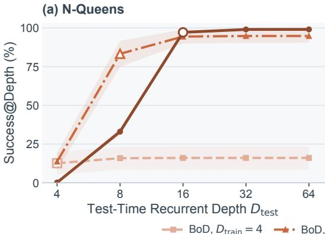

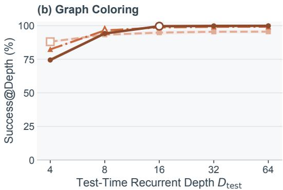  
Figure 5: Success across training and evaluation depths. Success@Depth for BoD trained at depths 4, 8, and 16, using the same checkpoints and evaluation problems as Figure 3(c, d). Open markers indicate evaluation at the training depth; bands indicate ±1 SD.

Table 13: BoD Success@Depth (%) for Figure 5.
<table><tr><td>Training depth</td><td>@4</td><td>@8</td><td>@16</td><td>@32</td><td>@64</td></tr><tr><td colspan="6">N-Queens</td></tr><tr><td>4</td><td> $1 2 . 6 7 \pm 7 . 3 1$ </td><td> $1 5 . 9 0 \pm 7 . 4 1$ </td><td> $1 6 . 0 7 \pm 7 . 5 1$ </td><td> $1 6 . 0 7 \pm 7 . 5 1$ </td><td> $1 6 . 0 7 \pm 7 . 5 1$ </td></tr><tr><td>8</td><td> $1 3 . 7 3 \pm 5 . 7 8$ </td><td> $8 3 . 2 7 \pm 8 . 4 2$ </td><td> $9 4 . 4 0 \pm 4 . 5 4$ </td><td> $9 4 . 7 7 \pm 4 . 3 7$ </td><td> $9 4 . 8 0 \pm 4 . 3 9$ </td></tr><tr><td>16</td><td> $0 . 2 0 { \scriptstyle \pm 0 . 1 7 }$ </td><td> $3 3 . 0 3 \pm 2 . 2 0$ </td><td> $9 7 . 1 3 \pm 0 . 5 5$ </td><td> $9 9 . 0 0 { \scriptstyle \pm 0 . 1 0 }$ </td><td> $9 9 . 0 3 \pm 0 . 1 2 $ </td></tr><tr><td colspan="6">Graph Coloring</td></tr><tr><td>4</td><td> $8 8 . 0 9 \pm 0 . 8 5$ </td><td> $9 3 . 2 9 \overset { \cdot } { \pm } 0 . 9 2$ </td><td> $9 4 . 8 6 \pm 1 . 7 1 $ </td><td> $9 5 . 5 1 \pm 1 . 2 8 $ </td><td> $9 5 . 5 7 \pm 1 . 3 0 $ </td></tr><tr><td>8</td><td> $8 2 . 3 6 \pm 0 . 5 6$ </td><td> $9 6 . 4 8 \pm 0 . 9 0$ </td><td> $9 8 . 7 0 { \scriptstyle \pm 0 . 4 5 }$ </td><td> $9 9 . 1 5 { \scriptstyle \pm 0 . 3 0 }$ </td><td> $9 9 . 2 2 \pm 0 . 3 9$ </td></tr><tr><td>16</td><td> $7 4 . 4 8 \pm 1 . 4 7$ </td><td> $9 4 . 2 1 \pm 0 . 7 4$ </td><td> $9 9 . 6 7 \pm 0 . 3 0 $ </td><td> $9 9 . 8 7 \pm 0 . 2 3 $ </td><td> $9 9 . 9 3 \pm 0 . 1 1 $ </td></tr></table>

## C.4 SENSITIVITY TO THE SOFT-DEPTH TEMPERATURE

The temperature in Soft-Depth controls how strongly learning concentrates on the lowest-loss readouts. We vary $\tau \in \{ 0 . 1 , 0 . 2 , \ldots , 1 . 0 \}$ on graph coloring and evaluate cumulative success and coverage through depth 64, keeping all other settings fixed (Appendix A.2). Coverage decreases as temperature increases, approaching Mean-Depth at larger temperatures (Figure 6). The developmentselected $\tau = 0 .$ 1 achieves 62.41% test coverage, compared with 72.16% for BoD, while both achieve success above 99%.

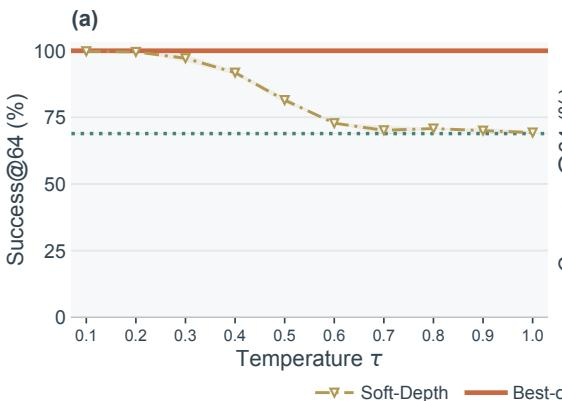

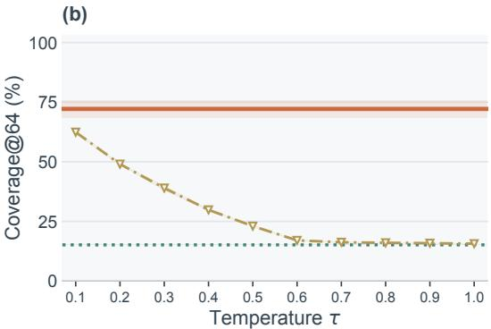  
Figure 6: Sensitivity to the Soft-Depth temperature on graph coloring. Test success and coverage use all greedy readouts through depth 64. The curve varies $\tau = 0 . 1 , 0 . 2 , \ldots , 1 . 0 ;$ horizontal lines show BoD and Mean-Depth under the same configuration. Bands indicate ±1 SD.

## C.5 WITHHELD-SOLUTION DISCOVERY PROTOCOL

The ablation in Section 4.5.3 uses 3,034 graphs from the graph-coloring training split with at least five canonical valid solutions per graph. The cohort contains 79,713 solutions in total, with 5– 128 per graph (mean 26.27). This restriction leaves withheld solutions in every one- through fourtarget condition; it changes the evaluation cohort relative to the full graph-coloring experiment. Al coloring families are identified up to a global permutation of color names, as in Appendix A.2.

For each graph and experimental seed, one random ordering of all valid solutions defines nested teacher pools of sizes one, two, three, and four. The all-solutions condition uses the complete pool. Pools remain fixed throughout each run; only the selected teacher is resampled at each presentation. Last-Depth and BoD share teacher pools, target draws, graph order, and initialization within each seed. The protocol uses the architecture and optimizer in Appendix A.2, training depth 16, 10,000 updates, and three paired seeds.

Last-Depth and BoD each run one unperturbed trajectory through depth 64. Last-Depth + BoN reuses the Last-Depth checkpoint and pools predictions from independently vertex-permuted trajectories under $N \dot { D } = 6 4$ The allocation is selected from the seven pairs in Section 4.5.1 using development-set coverage averaged across teacher conditions and seeds. This selects $N = 4 { \mathrm { t r a j e c - } }$ tories of depth $D = 1 6$ , fixed before evaluating withheld-solution discovery. Outputs are mapped back to the original vertex order before verification and canonicalization. Every method collects all intermediate readouts; Last-Depth + BoN therefore denotes sampling with all-depth readout, rather than terminal-only sampling. Randomized evaluation uses 32 repeats per training seed.

Seen and unseen coverage are macro-averaged over the same fixed graph cohort, using the teacher pool and its valid-solution complement as their respective denominators. Since increasing the teacher pool reduces the number of withheld solutions, supporting measurements include total coverage, the number of distinct unseen solutions recovered and the fraction of graphs with at least one such solution. The all-solutions condition has no withheld solutions, so its unseen coverage is undefined, while seen coverage equals total coverage.

## C.6 ADDITIONAL BASELINE PROTOCOLS

The comparisons in Table 14 use the same datasets, teacher sampling, optimization settings, width 128, eight attention heads, and FFN width 384 as the main experiments. Each method uses three training seeds and a fixed final EMA checkpoint after 20,000 updates for N-Queens or 10,000 updates for graph coloring. These are independent implementations under a common training recipe. Parameter counts and training and inference FLOPs are not matched.

Table 14: Baseline comparison on N-Queens and graph coloring. Success and Coverage (%) summarize each method’s candidate set. Ouro uses an instance-level adaptation of its training objective. Compute and candidate counts differ across architectures; Appendix C.6 gives the protocol.
<table><tr><td></td><td colspan="2">N-Queens</td><td colspan="2">Graph Coloring</td></tr><tr><td>Method</td><td>Success</td><td>Coverage</td><td>Success</td><td>Coverage</td></tr><tr><td>Transformer (8 layers)</td><td> $9 . 8 \pm 1 . 3$ </td><td> $4 . 8 \pm 0 . 6$ </td><td> $3 9 . 6 \pm { 1 . 8 }$ </td><td> $5 . 2 \pm 0 . 5$ </td></tr><tr><td>Transformer (32 layers)</td><td> $1 0 . 9 \pm 1 . 1$ </td><td> $5 . 4 \pm 0 . 6$ </td><td> $4 4 . 5 \pm 1 . 1$ </td><td> $6 . 3 \pm 0 . 3$ </td></tr><tr><td>Autoregressive Transformer</td><td> $5 7 . 4 \pm 3 . 0$ </td><td> $2 7 . 4 \pm 1 . 4$ </td><td> $6 7 . 9 \pm 1 . 5$ </td><td> $8 . 2 \pm 0 . 4$ </td></tr><tr><td>Masked Diffusion</td><td> $3 4 . 2 \pm 4 . 1$ </td><td> $1 6 . 3 \pm 2 . 0$ </td><td> $7 6 . 1 \pm 1 . 5$ </td><td> $1 0 . 3 \pm 0 . 3$ </td></tr><tr><td>HRM</td><td> $9 8 . 6 \pm 0 . 5$ </td><td> $4 8 . 0 \pm 0 . 6$ </td><td> $6 7 . 4 \pm 0 . 9$ </td><td> $1 3 . 7 \pm 0 . 2$ </td></tr><tr><td>TRM</td><td> $4 9 . 4 \pm 2 3 . 6$ </td><td> $2 3 . 8 \pm 1 1 . 4$ </td><td> $6 7 . 4 \pm 1 . 5$ </td><td> $1 4 . 3 \pm 0 . 3$ </td></tr><tr><td>Ouro</td><td> $7 7 . 9 \pm 4 . 5$ </td><td> $4 6 . 8 \pm 3 . 7$ </td><td> $7 3 . 3 \pm 1 . 3$ </td><td> $1 8 . 6 \pm 0 . 1$ </td></tr><tr><td>Best-of-Depth</td><td> ${ \bf 9 9 . 0 \pm 0 . 1 }$ </td><td> ${ \bf 9 1 . 0 \pm 1 . 0 }$ </td><td> ${ \bf 9 9 . 9 \pm 0 . 1 }$ </td><td> $7 2 . 2 \pm 3 . 6$ </td></tr></table>

The unshared Transformers have eight or 32 layers and produce one candidate per input. The autoregressive baseline uses a four-layer decoder and produces one complete candidate. Masked diffusion uses four layers with a SUBS parameterization and a completed 64-step denoising schedule. HRM uses four-layer low- and high-level modules with two cycles at each level; TRM uses two shared layers, four inner iterations, three cycles, and at most 16 outer training segments. HRM and TRM are evaluated with a fixed 64-step expansion rather than their native adaptive stopping rule. BoD and Ouro also collect all readouts through depth 64. Success and coverage are computed on the resulting candidate sets, using the definitions in Section 4.1. For the autoregressive and diffusion baselines, metrics are averaged across three inference seeds within each training seed, without pooling candidates across repeats.

The Ouro baseline applies its Stage I expected-loss and entropy-regularization objective to whole instances, using the same looped backbone as BoD. A shared linear gate pools the recurrent states over unknown cells for N-Queens and over vertices for graph coloring, then predicts a sigmoid exit hazard at each depth. The first 15 hazards define an exit distribution by survival products, with the remaining mass assigned to depth 16. The gate adds 129 parameters; its weights start at zero and its bias $\mathrm { a t } - \log 1 5 $ . Training minimizes the expected per-instance loss plus $\beta$ times the KL divergence of the exit distribution from the uniform distribution over the 16 training depths. Evaluation collects all greedy readouts through depth 64; the gate neither stops the trajectory nor filters candidates. This comparison adapts the learning objective, rather than evaluating a pretrained Ouro language model or reproducing its second training stage.

We select one positive coefficient per task by mean development Coverage@Depth at depth 64 over three training seeds, using the grid $\{ 0 . 0 0 1 , \dot { 0 } . 0 0 3 , 0 . 0 1 , 0 . \dot { 0 } 3 , 0 . 0 5 , 0 . 1 , \bar { 0 } . 2 5 , 1 \}$ . A separate $\beta = 0$ control is excluded from selection; exact ties favor the smaller coefficient. The selected values are $\beta = 0 . 0 3$ for N-Queens and $\beta = 0 . 0 0 1$ for graph coloring, using 200 multi-solution development puzzles and 512 development graphs, respectively.

## D THEORETICAL ANALYSIS

Throughout this appendix, fix a non-autoregressive input x and a deterministic recurrent trajectory. Targets are drawn from the finite valid solution set $\bar { \mathcal { V } } ^ { \star } ( x )$ , with cardinality $M \geq 1$ , uniformly unless otherwise specified. For the cross-entropy results, all depths $1 , \ldots , D$ are read out. The joint readout distribution on the complete output space Ω, with $p _ { d , j }$ the categorical distribution at predicted position $j ,$ is

$$
P _ { d } ( \boldsymbol { y } \mid \boldsymbol { x } ) = \prod _ { j = 1 } ^ { T ( x ) } p _ { d , j } ( y _ { j } \mid \boldsymbol { x } ) .\tag{15}
$$

It is normalized over $\Omega ,$ which includes invalid assignments. All logarithms are natural. For crossentropy, define the expected whole-example loss

$$
s _ { D } ( x ) = T ( x ) \mathbb { E } _ { Y } [ \mathcal { L } _ { \mathrm { B o D } } ( x , Y ) ] = \mathbb { E } _ { Y } \left[ - \log \operatorname* { m a x } _ { d \leq D } P _ { d } ( Y \mid x ) \right] .\tag{16}
$$

Here $T ( x )$ is the number of predicted positions; the factor $T ( x )$ reverses the position averaging in the training loss. We suppress x where the conditioning is unambiguous.

## D.1 PROOFS OF PROPOSITIONS 1 AND 2

For Proposition 1, the minimum of the binary losses is zero exactly when at least one readout equals the target, which is equivalent to $\tau _ { y } \leq D$ . Hence the loss equals $\mathbf { 1 } [ \tau _ { y } > D ]$ pointwise. Taking an expectation over any distribution of target–trajectory pairs gives Eq. 7.

For Proposition 2, fix the candidate set independently of the sampled target. For any distribution q supported on $\mathcal { V } ^ { \star } ( x )$ ,

$$
\mathbb { E } _ { Y } [ \mathcal { L } _ { \mathrm { B o D } } ^ { 0 - 1 } \mid x ] = \sum _ { y \in \mathcal { Y } ^ { \star } ( x ) } q ( y \mid x ) \mathbf { 1 } [ y \not \in S _ { D } ( x ) ]\tag{17}
$$

$$
= 1 - \sum _ { y \in S _ { D } ( x ) \cap y ^ { \star } ( x ) } q ( y \mid x ) .\tag{18}
$$

When $q ( y \mid x ) = 1 / M$ , the second term is exactly the fraction of valid solutions in the candidate set, proving Eq. 8. For a random candidate set, the same identity holds conditional on that set, provided it is independent of the target given x; averaging then yields expected coverage.

For graph-coloring family coverage, both the candidates in $S _ { D } ( x )$ and the predictions in the exactmatch loss are canonicalized in the same way. The target set contains one canonical representative per valid family. Using raw color-label equality on the left and family coverage on the right would not give this identity. The cross-entropy results below instead use the raw joint distribution in Eq. 15: generating a canonical target is sufficient to discover its family, so their coverage lower bounds also hold after canonicalization.

## D.2 DEPTH-WISE SAMPLING AND COVERAGE

Lemma 1 (Distinct valid solutions from depth-wise sampling). Draw $\tilde { Y } _ { d } \sim P _ { d } ( \cdot | \textit { x } )$ at each depth and set $S _ { D } ( x ) = \{ \tilde { Y } _ { d } : d \leq D \}$ . Let $K _ { D }$ count the distinct valid solutions in this random candidate set. Then

$$
\mathbb { E } [ K _ { D } \mid x ] \ge M e ^ { - s _ { D } ( x ) } , \qquad \mathbb { E } [ \mathrm { C o v e r a g e @ D e p t h } ( D ; x ) \mid x ] \ge e ^ { - s _ { D } ( x ) } .\tag{19}
$$

The expectations are over candidate sampling; independence between candidates is not required.

Proof. For each valid solution y, define $A _ { y } = \{ \tilde { Y } _ { d } = y$ for some $d \leq D \}$ . The union contains each individual event, hence

$$
\operatorname* { P r } ( A _ { y } \mid x ) \ge \operatorname* { m a x } _ { d \le D } \operatorname* { P r } ( \tilde { Y } _ { d } = y \mid x ) = \operatorname* { m a x } _ { d \le D } P _ { d } ( y \mid x ) .\tag{20}
$$

This uses only the marginal distribution of each candidate. Let

$$
a _ { D } ( y ) = \operatorname * { m a x } _ { d \leq D } P _ { d } ( y \mid x ) , \qquad Z _ { D } ^ { \star } = \sum _ { y \in \mathcal { V } ^ { \star } ( x ) } a _ { D } ( y ) .\tag{21}
$$

Linearity of expectation gives $\mathbb { E } [ K _ { D } \mid x ] \ge Z _ { D } ^ { \star }$ . Since targets are uniform, Jensen’s inequality for the convex function − log yields

$$
s _ { D } = \frac { 1 } { M } \sum _ { y \in \mathcal { V } ^ { \star } ( x ) } - \log a _ { D } ( y ) \geq - \log \left( \frac { Z _ { D } ^ { \star } } { M } \right) .\tag{22}
$$

Thus $Z _ { D } ^ { \star } \ge M e ^ { - s _ { D } }$ , proving the count bound. Dividing by M gives the coverage bound. If some valid target has $a _ { D } ( y ) = 0$ , then $s _ { D } = \infty$ and the stated lower bound is zero. □

The result also holds when additional candidates are drawn at any depth because adding candidates cannot remove the discovered solution. The sampling distributions must match those used in the loss function. For independent draws, the exact expected count for one sample per depth is

$$
\operatorname { \mathbb { E } } [ K _ { D } \mid x ] = \sum _ { y \in \mathcal { Y } ^ { \star } ( x ) } \left[ 1 - \prod _ { d = 1 } ^ { D } ( 1 - P _ { d } ( y \mid x ) ) \right] .\tag{23}
$$

Sharpness. Suppose M is divisible by D. Partition the valid solutions into D disjoint subsets of size $\bar { M } / D$ , and let $P _ { d }$ be uniform on the dth subset. Then $s _ { D } = \log ( M / D )$ , and one draw from each depth produces exactly $D = M e ^ { - s _ { D } }$ distinct valid solutions. This establishes sharpness as a bound on normalized readout distributions. It does not require that a particular factorized decoder can represent every such partition.

## D.3 A SHARED-RECURRENT CONSTRUCTION FOR PROPOSITION 3

Task and valid solutions. There is one input, the labeled complete bipartite graph $K _ { 3 , 3 }$ . Its valid outputs are the six perfect matchings, represented by the $3 \times 3$ permutation matrices in $\mathcal { M }$ . The output space is $\{ 0 , 1 \} ^ { 3 \times 3 } ;$ a selected edge has value one. A training target $Y$ is drawn independently and uniformly from M at each update. Every edge occurs in two matchings, so $\mathbb { E } [ Y ] = { \bar { J / 3 } }$ , where J is the all-ones matrix. The model does not receive the target as input, and decoding does not enforce the matching constraints.

One shared recurrence. Let $r = ( 1 2 3 )$ permute the left vertices and $c = ( 1 2 )$ permute the right vertices. Define the fixed linear map R by $( \mathcal { R } A ) _ { r ( i ) , c ( j ) } = A _ { i j }$ . This is a symmetry of the graph and preserves matchings. It satisfies $\mathcal { R } ^ { 6 } = I$ , and every matching has a full orbit:

$$
\{ { \mathcal { R } } ^ { d } M : d = 1 , \ldots , 6 \} = { \mathcal { M } } \qquad ( M \in { \mathcal { M } } ) .\tag{24}
$$

Indeed, identify a matching with a permutation π from left to right vertices. $\operatorname { f } \mathcal { R } ^ { d } M ^ { \pi } = M ^ { \pi }$ , then $c ^ { d } = \pi r ^ { d } \pi ^ { - 1 }$ . When $3 \nmid \bar { d } ,$ , the right side has order three while the left has order one or two. Thus $3 \mid d ,$ and the identity then also requires $2 \mid d .$ The orbit therefore has length six.

The only trainable parameter is a matrix $\theta \in \mathbb { R } ^ { 3 \times 3 }$ . Let Π denote the permutation matrix representing $\dot { \mathcal { R } }$ on vectorized matrices. A ten-dimensional hidden state with fixed initialization evolves according to

$$
h _ { 0 } = { \binom { 0 _ { 9 } } { 1 } } , \qquad h _ { d } = { \cal S } ( \theta ) h _ { d - 1 } , \qquad { \cal S } ( \theta ) = { \binom { \mathrm { I I } } { 0 _ { 1 \times 9 } } } \quad \quad 0 \quad ) .\tag{25}
$$

The first nine entries of $h _ { d }$ give a logit matrix $H _ { d } ;$ the last entry is zero after the first recurrent step. Consequently, $H _ { d } = \mathcal { R } ^ { d } \theta$ . The same parameter-dependent matrix $S ( \theta )$ is applied at every depth, but the trainable pattern is injected only at the first step. Subsequent steps apply the prescribed permutation. Thus, this construction studies how the objective uses an available recurrent orbit, rather than learning that orbit’s rule.

Readout and common training protocol. All methods use $D \ = \ 6$ and the shared factorized Bernoulli readout

$$
P _ { \theta , d } ( y ) = \prod _ { i , j } \sigma ( H _ { d , i j } ) ^ { y _ { i j } } [ 1 - \sigma ( H _ { d , i j } ) ] ^ { 1 - y _ { i j } } , \qquad L _ { d } ( \theta ; Y ) = - \frac { 1 } { 9 } \log P _ { \theta , d } ( Y ) ,\tag{26}
$$

where $\sigma$ is the sigmoid. Greedy decoding selects an edge exactly when its logit is positive. Each method starts at $\theta ^ { ( 0 ) } = b J ,$ , with $b = - \log 2$ , and uses single-example SGD with $\eta _ { n } = 9 / ( n + 1 )$ This is equivalent to step size $1 / ( n + 1 )$ on the summed loss; the factor nine accounts for the position averaging in $\operatorname { E q } .$ . 26. Random-Depth samples its depth independently of the target. BoD selects one minimizing depth uniformly when losses tie. Soft-Depth uses any fixed $\tau > 0$ in Eq. 6. All methods may share the same target sequence. For the one input in this construction,

$$
\mathrm { C o v e r a g e @ D e p t h } ( 6 ; \theta ) = \frac { \left| \left\{ \mathbf { 1 } [ \mathcal { R } ^ { d } \theta > 0 ] : d = 1 , \ldots , 6 \right\} \cap \mathcal { M } \right| } { 6 } .\tag{27}
$$

The indicator acts entrywise. This makes explicit the parameter dependence used in Proposition 3.

Proof of Proposition 3. Write $\begin{array} { r } { \Phi ( \theta ) = \sum _ { i , j } \log ( 1 + e ^ { \theta _ { i j } } ) } \end{array}$ and use the Frobenius inner product. Because $\mathcal { R }$ permutes entries,

$$
L _ { d } ( \theta ; Y ) = \frac { 1 } { 9 } \big [ \Phi ( \theta ) - \langle \theta , \mathcal { R } ^ { - d } Y \rangle \big ] , \qquad \nabla _ { \theta } L _ { d } ( \theta ; Y ) = \frac { 1 } { 9 } \big [ \sigma ( \theta ) - \mathcal { R } ^ { - d } Y \big ] .\tag{28}
$$

Baseline minimizers and stationary objectives. Let $R _ { A }$ denote the expected loss for objective A, including any random depth. Equation 24 implies $\textstyle { \frac { 1 } { 6 } } \sum _ { d = 1 } ^ { 6 } { \mathcal { R } } ^ { - d } Y = J { \bar { / } } 3$ for every target. Hence

$$
R _ { \mathrm { L a s t } } ( \theta ) = R _ { \mathrm { M e a n } } ( \theta ) = R _ { \mathrm { R a n d o m } } ( \theta ) = \frac { 1 } { 9 } \big [ \Phi ( \theta ) - \langle \theta , J / 3 \rangle \big ] .\tag{29}
$$

This risk has positive diagonal Hessian entries $\sigma ( \theta _ { i j } ) [ 1 - \sigma ( \theta _ { i j } ) ] / 9$ and the unique minimizer $b J$ For Mean-Depth the loss already equals this risk for each individual target, so its gradient is zero at initialization and it remains there.

At bJ, all depthwise losses tie. Soft-Depth therefore assigns weight $1 / 6$ to each gradient, independently of $\tau > 0$ . For every target,

$$
\left. \nabla _ { \theta } \mathcal { L } _ { \mathrm { S o f t - D e p t h } } \right| _ { b J } = \frac { 1 } { 9 } \left[ \frac { 1 } { 3 } J - \frac { 1 } { 6 } \sum _ { d = 1 } ^ { 6 } \mathcal { R } ^ { - d } Y \right] = 0 .\tag{30}
$$

It too remains exactly at initialization. Every logit is then $b < 0$ at every depth, so Mean-Depth and Soft-Depth always have zero greedy coverage.

Almost-sure convergencefor Last-Depth and Random-Depth. Their updates have the form $\theta ^ { ( n + 1 ) } =$ $\theta ^ { ( n ) } - a _ { n } [ \sigma ( \theta ^ { ( n ) } ) - Z _ { n } ]$ , where $a _ { n } = 1 / ( n + 1 )$ and, conditional on the training history $\mathcal { F } _ { n } , Z _ { n }$ is uniform over $\mathcal { M } .$ . Set $V _ { n } = \| \theta ^ { ( n ) } - b J \| _ { F } ^ { 2 }$ and $A ( \theta ) = \langle \theta - b J , \sigma ( \theta ) - J / 3 \rangle$ . Strict monotonicity of the sigmoid gives $A ( \theta ) > 0$ except at $b { \bar { J } } ;$ the bounded components of the stochastic gradient give

$$
\begin{array} { r } { \mathbb { E } [ V _ { n + 1 } \mid \mathcal { F } _ { n } ] \le V _ { n } - 2 a _ { n } A ( \theta ^ { ( n ) } ) + 9 a _ { n } ^ { 2 } . } \end{array}\tag{31}
$$

Thus $\textstyle V _ { n } + 9 \sum _ { k = n } ^ { \infty } a _ { k } ^ { 2 }$ is a nonnegative supermartingale. It converges almost surely, and summing its expected drift yields $\textstyle \sum _ { n } a _ { n } A ( \theta ^ { ( n ) } ) < \infty$ almost surely. Consequently $V _ { n }$ has a finite limit. If this limit were positive, the iterates would eventually lie in a compact annulus about $b J$ on which A has a positive minimum. This contradicts $\textstyle \sum _ { n } a _ { n } { \dot { = } } \infty$ . Therefore both methods converge almost surely to $b J$ . Since $b < 0$ , all logits eventually remain negative, and greedy coverage is eventually zero.

BoD breaks symmetry and retains one latent matching. The orbit identity gives, for every target,

$$
\mathcal { L } _ { \mathrm { B o D } } ( \theta ; Y ) = \frac { 1 } { 9 } \left[ \Phi ( \theta ) - \operatorname* { m a x } _ { M \in \mathcal { M } } \langle \theta , M \rangle \right] .\tag{32}
$$

At initialization, let the selected tied depth for $Y _ { 0 }$ be $d _ { 0 } ^ { \star }$ and set $M _ { \star } = \mathcal { R } ^ { - d _ { 0 } ^ { \star } } Y _ { 0 }$ . The first update gives

$$
\theta ^ { ( 1 ) } = b J + M _ { \star } - J / 3 .\tag{33}
$$

Its entries equal $\alpha _ { 1 } = b + 2 / 3$ on M and $\beta _ { 1 } = b - 1 / 3$ elsewhere. For any other matching sharing $t < 3$ edges with $M _ { \star }$ , the score gap is $( 3 - t ) ( \alpha _ { 1 } - \beta _ { 1 } ) > 0$ . Thus $M _ { \star }$ is now the unique maximumscore matching. For every subsequent target $Y .$ , BoD selects the phase satisfying $\mathcal { R } ^ { d ^ { \star } } M _ { \star } = Y$ so

$$
\nabla _ { \boldsymbol { \theta } } \mathcal { L } _ { \mathrm { B o D } } ( \boldsymbol { \theta } ; Y ) = \frac { 1 } { 9 } [ \sigma ( \boldsymbol { \theta } ) - M _ { \star } ] .\tag{34}
$$

All targets reinforce the same latent matching. The two logit values satisfy

$$
\alpha _ { n + 1 } = \alpha _ { n } + a _ { n } [ 1 - \sigma ( \alpha _ { n } ) ] , \qquad \beta _ { n + 1 } = \beta _ { n } - a _ { n } \sigma ( \beta _ { n } ) , \qquad n \geq 1 .\tag{35}
$$

Their gap grows, preserving the unique maximizing matching. Both are negative after the first update, but $\alpha _ { 2 } > - \log 2 + 2 / 3 + 1 / 4 > 0$ while $\beta _ { 2 } < 0$ . These signs persist. For every $n \geq 2 .$ greedy decoding therefore yields $\hat { y } _ { d } = \mathcal { R } ^ { d } M _ { \star }$ , whose six distinct values are all valid matchings. BoD has full coverage from the second update onward. This finite-update count uses the stated loss normalization and step sizes. Together with the baseline results, it proves the proposition. □

The Soft-Depth result relies on exact symmetry at initialization. The prescribed recurrent orbit makes this an existence result for a shared recurrent model.

Numerical illustration. We run the specified SGD updates for 4,096 iterations in float64 on 64 independent teacher streams (seeds 0–63), shared across objectives within each run. Independent random streams select Random-Depth readouts and resolve the initial BoD tie. Soft-Depth is eval uated at $\tau \in \{ 0 . 1 , 0 . 2 5 , 1 \}$ . Every reported checkpoint is decoded at all six depths and verified against the complete set of matchings. The Soft-Depth updates are computed from their actual weighted gradients; no special rule holds the parameters at initialization. Table 15 illustrates the proved distinction: BoD reaches full coverage after two updates in every run, whereas all four comparison objectives have zero coverage at the final checkpoint. Last-Depth and Random-Depth can temporarily produce valid solutions, consistent with the theorem, which describes eventual behavior rather than behavior at every iteration. The experiment is a numerical illustration of this construc tion, separate from the learned looped Transformer experiments. The implementation and per-run results accompany the paper.

Table 15: Numerical illustration of Proposition 3. Greedy Coverage@Depth at $D = 6 ( \% )$ , averaged over 64 independent SGD runs on the same matching problem. Columns count training updates. All objectives use the same teacher stream within each run and the same initialization and step sizes.
<table><tr><td>Training objective</td><td>0</td><td>2</td><td>16</td><td>256</td><td>4,096</td></tr><tr><td>Last-Depth</td><td>0.0</td><td>15.6</td><td>1.6</td><td>0.0</td><td>0.0</td></tr><tr><td>Mean-Depth</td><td>0.0</td><td>0.0</td><td>0.0</td><td>0.0</td><td>0.0</td></tr><tr><td>Random-Depth</td><td>0.0</td><td>18.8</td><td>1.6</td><td>0.0</td><td>0.0</td></tr><tr><td>Soft-Depth  $( \tau = 0 . 1 )$ </td><td>0.0</td><td>0.0</td><td>0.0</td><td>0.0</td><td>0.0</td></tr><tr><td>Soft-Depth (τ = 0.25)</td><td>0.0</td><td>0.0</td><td>0.0</td><td>0.0</td><td>0.0</td></tr><tr><td>Soft-Depth  $( \tau = 1 . 0 )$ </td><td>0.0</td><td>0.0</td><td>0.0</td><td>0.0</td><td>0.0</td></tr><tr><td>Best-of-Depth</td><td>0.0</td><td>100.0</td><td>100.0</td><td>100.0</td><td>100.0</td></tr></table>

## D.4 A CERTIFICATE FOR GREEDY SOLUTION COVERAGE

Let $S _ { D }$ contain the distinct positionwise-greedy predictions from the same readouts. Then

$$
\frac { | S _ { D } \cap \mathcal { V } ^ { \star } ( x ) | } { M } \geq \left[ 1 - \frac { s _ { D } ( x ) } { \log 2 } \right] _ { + } .\tag{36}
$$

To prove this, consider a valid target $y \notin S _ { D }$ . At every depth, at least one position is decoded to a token other than $y _ { j }$ . At that position, $p _ { d , j } ( y _ { j } \mid x ) \leq 1 / 2 ,$ so − log $P _ { d } ( y \mid x ) \overset { \cdot } { \geq } \log 2$ . Consequently,

$$
\mathbf { 1 } [ y \notin S _ { D } ] \leq { \frac { \operatorname* { m i n } _ { d \leq D } - \log P _ { d } ( y \mid x ) } { \log 2 } } .\tag{37}
$$

Averaging over the uniform target distribution proves Eq. 36. The result is nontrivial when the whole-example risk is below log 2; for the position-averaged loss, the corresponding threshold is log $2 / T ( x )$ . In graph coloring, matching a canonical target exactly is sufficient to discover its canonical family, so subsequent canonicalization preserves this lower bound.