# Basin2Vec: Learning Basin-Centric Embeddings for Scalable Hydrological Modeling

Muhammad Talha1 Xiaofeng Liu2 Yuan Yang3 Pang-Ning Tan1 A. Pouyan Nejadhashemi1

1Michigan State University 2University of Michigan 3University of California, San Diego

talhamuh@msu.edu, xiaofliu@umich.edu, yuy068@ucsd.edu ptan@msu.edu, pouyan@msu.edu

Accepted at the 2027 IEEE/CVF Winter Conference on Applications of Computer Vision (WACV).

## Abstract

Reliable streamflow prediction across time and in ungauged basins requires representations that capture hydrologically relevant basin characteristics. Existing methods rely on either fixed handcrafted attributes or general-purpose Earth observation embeddings not tailored to basin structure. We introduce Basin2Vec, a self-supervised framework that learns compact basin representations from hydroclimatic and physiographic data without observed streamflow. Basin2Vec organizes representation learning around basin scale and relationships across space and time. Across multiple forecasting architectures, it consistently outperforms predefined attributes and general-purpose geospatial embeddings in temporal generalization and zero-shot spatial transfer. Basin2Vec provides average relative gains of up to 8.3% temporally and achieves 3.5× the median predictive performance of the strongest baselines on unseen basins. These results demonstrate the efectiveness of basin-centric pretraining for transferable hydrologic prediction. Code is available at https://github.com/Muhammad-Talha-MT/basin2vec.

## 1 Introduction

Streamflow, or river discharge, is the volume of water passing through a river cross-section per unit time. Accurate streamflow prediction is critical for flood forecasting, drought monitoring, and water resources planning. However, streamflow observations are available at only a limited and unevenly distributed network of gauging stations [6, 30, 35]. Therefore, hydrological models must generalize in two ways: temporal generalization, in which they predict future streamflow in basins seen during training, and spatial generalization, in which they predict streamflow in basins that were not used for training [10, 18]. Accurate prediction in both settings requires a robust basin representation. In particular, the representation must capture the dynamic meteorological inputs, such as precipitation and temperature, along with a static basin descriptor that distinguishes characteristics of the target basin from others. Such a descriptor must summarize the factors governing how a basin converts weather into streamflow, including climate, terrain, soils, land cover, subsurface properties, and drainage area [1, 8, 24, 34]. An informative basin representation is particularly important for spatial

High Moderate Low

generalization because it enables the model to identify similarities and diferences between observed and previously unseen basins.

Regional streamflow models commonly represent each basin as a fixed-length feature vector derived from datasets such as CAMELS and GAGES-II [1, 8, 9, 19]. While these compact attributes may summarize the spatial characteristics of the basin using statistics such as mean elevation or forest fraction, they do not capture the spatial variation of these characteristics within the basin, causing the downstream models to be oblivious to their spatial heterogeneity. Gridded datasets such as CAMELS-SPAT preserve this information but introduce highdimensional spatial inputs [17]. This motivates learning compact representations directly from basin-aligned geospatial data.

Table 1: Comparison of basin representations across three design requirements. Scores indicate High, Moderate, or Low support.
<table><tr><td>Approach</td><td>Basin- indexed</td><td>Spatial &amp; scale-aware</td><td>Hydrologic relation-aware</td></tr><tr><td>CAMELS Attr. [1]</td><td>●●●</td><td></td><td>●●●</td></tr><tr><td>AlphaEarth [5]</td><td>●●●</td><td>●●●</td><td>●●●</td></tr><tr><td>TESSERA [11]</td><td>●●●</td><td>●●●</td><td></td></tr><tr><td>SatCLIP [16]</td><td>●●●</td><td>●●●</td><td>●●●</td></tr><tr><td>Basin2Vec (Ours)</td><td>●●●</td><td>●●●</td><td>●●●</td></tr></table>

General-purpose Earth observation (EO) embeddings provide reusable representations of satellite observations and geographic locations [5, 11, 16]. However, they are pretrained on pixels, image patches, or coordinates rather than drainage basins, requiring post hoc aggregation to construct basin descriptors. Moreover, their pretraining objectives do not explicitly encode physical basin scale or hydrologically meaningful relationships among basins.

Together, these limitations motivate three design requirements for basin-centric representation, as summarized in Table 1. First, the representation should be basin-indexed, meaning that its entities correspond to drainage basins rather than individual pixels or coordinates. Second, the learned embeddings must be spatial- and scale-aware, meaning that it learns from within-basin spatial inputs while retaining information about physical basin scale. Finally, it should be hydrologic relation-aware, meaning that the learned embedding geometry reflects the hydrological and physiographic relations among the basins.

To meet these requirements, we introduce Basin2Vec. Our contributions are threefold. (1) We formulate basin-centric self-supervision around a basin-year entity, producing reusable descriptors from gridded hydroclimatic and physiographic data without observed streamflow. (2) We propose a scale-aware encoder that preserves spatial and physical-scale information, together with a relation-aware contrastive objective that models temporal, overlapping, and nested basin relationships. (3) We evaluate the resulting descriptors with five forecasting architectures under temporal generalization and zero-shot spatial transfer. Basin2Vec consis tently outperforms predefined attributes and general-purpose EO embeddings, with average relative temporal gains of up to 8.3% and 3.5× the median predictive performance of the strongest alternative on unseen basins.

## 2 Related Work

Basin characterization in regional hydrological models. Large-sample hydrological models are commonly conditioned on curated basin descriptors from CAMELS or GAGES II [1, 8, 9, 26]. This paradigm, including entity-aware and regional LSTMs, has demonstrated the value of static attributes for shared prediction across multiple basins [10, 18, 19]. CAMELS-SPAT extends this foundation with basin-aligned rasters of climatic and physiographic variables [17], but using them directly requires each downstream model to process high dimensional spatial inputs.

Earth-observation representation learning. General-purpose EO representationlearning methods derive transferable features from remotely sensed or geographic data. SatMAE learns visual representations from satellite image patches [7]; AlphaEarth and TESSERA learn geospatial representations from EO observations; and SatCLIP learns location representations from geographic coordinates [5, 11, 16]. Recent studies have used these representations as inputs to hydrological models [21, 27, 28]. Because these representations are natively associated with pixels, patches, or coordinates, their application to hydrological basins typically requires post hoc spatial aggregation.

Hydrology-specific representation learning. Previous hydrology-specific learning methods have used encoder-decoder or autoencoder to infer hydrological signatures and landscape features from meteorological and streamflow time series [2, 4]. KG-SSL similarly learns basin representations from basin-level meteorological inputs and observed streamflow, treating samples from the same basin across diferent years as related and samples from diferent basins as unrelated [13]. However, these methods rely on observed streamflow during the representation learning, limiting their applicability to ungauged basins.

## 3 Basin2Vec

## 3.1 Overview

Basin2Vec learns basin-level representations from basin-year entities. Each entity corresponds to a basin-year tuple, $( b , y )$ , along with its monthly hydroclimatic rasters $\bar { X _ { b , y } ^ { \mathrm { d y n } } }$ , static or annual spatial variables $X _ { b , y } ^ { \mathrm { s t a } }$ , binary basin mask $M _ { b } ,$ and basin metadata $X _ { b } ^ { \mathrm { m e t a } }$ . Note that each basin has been resampled to a fixed $H \times W$ patch using the approach described in [33], although its boundary is irregular and its physical area may vary substantially. Details of the resampling approach are given in Appendix A.2. The monthly input has shape $X _ { b , y } ^ { \mathrm { d y n } } \in \mathbb { R } ^ { 1 2 \times \tilde { C } _ { d } \times \Breve { H } \times \Breve { W } }$ , where $C _ { d }$ is the number of hydroclimatic variables. The quasi-static input has shape $X _ { b , y } ^ { \mathrm { s t a } } \in \mathbb { R } ^ { C _ { s } \times H \times W }$ , where $C _ { s }$ is the number of static or annually varying physiographic variables. As shown in Figure 1, Basin2Vec uses a scale-aware encoder to map these masked basin-aligned inputs to a normalized basin-year embedding $z _ { b , y } \in \mathbb { R } ^ { d }$ , and a relation-aware contrastive objective to structure the embedding space using samebasin, temporal, spatial overlap, nesting, and physiographic relations. After pretraining, the basin-year embeddings $z _ { b , y } : y \in \mathcal { V } _ { b }$ are averaged across the available years $\mathcal { V } _ { b }$ to obtain the fixed basin-level descriptor $\bar { z } _ { b } \in \mathbb { R } ^ { d }$ for downstream streamflow prediction.

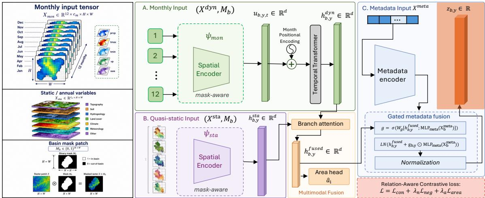  
Figure 1: Overview of Basin2Vec. The scale-aware encoder maps monthly and quasi-static basin-aligned grids, masks, and metadata to normalized basin-year embeddings $z _ { b , y }$ through mask-aware encoding, multimodal fusion, and area regularization.

## 3.2 Scale-Aware Basin Encoder

The encoder generates the basin-year embedding $z _ { b , y }$ by processing the inputs defined in Section 3.1 according to the following steps: mask-aware spatial encoding of the monthly and quasi-static inputs, fusion of the two resulting representations, and incorporation of basin metadata. Since the basins have been resampled to the same spatial dimensions, which removes the information about its physical size, an auxiliary drainage-area objective is also applied during pretraining.

Mask-Aware Spatial Encoding. Each basin-aligned input contains grid cells both inside and outside the irregular basin boundary. To prevent out-of-basin cells from afecting the representation, Basin2Vec applies the binary mask $M _ { b }$ during spatial encoding and pooling. Given a multi-channel input tensor X, whose last two dimensions correspond to the $H \times W$ spatial grid, a convolutional neural network (CNN) is used to extract a spatial feature map F from the masked input. The feature map is then aggregated via masked average pooling $\mathrm { A v g P o o l } _ { M _ { b } }$ and mask-normalized attention pooling $\mathrm { A t t n P o o l } _ { M _ { b } } .$ , as shown below:

$$
\begin{array} { r l } & { u = \psi ( X , M _ { b } ) } \\ & { \quad \equiv \mathrm { M L P } \left( \left[ \mathrm { A v g P o o l } _ { M _ { b } } ( F ) ; \mathrm { A t t n P o o l } _ { M _ { b } } ( F ) \right] \right) , } \end{array}\tag{1}
$$

where $\psi$ denotes the mask-aware spatial encoder, $F = \mathrm { C N N } \left( X \odot M _ { b } \right)$ denotes the masked spatial feature map, and ⊙ denotes element-wise multiplication. $\mathrm { A v g P o o l } _ { M _ { b } }$ averages the features across all valid basin cells, whereas $\mathrm { A t t n P o o l } _ { M _ { b } }$ assigns learned weights to these cells and normalizes the weights only within the basin boundary. The two pooled summaries are concatenated and transformed by an MLP to produce the spatial basin token $u \in \mathbb { R } ^ { d }$

The mask-aware spatial encoder ψ is applied separately to the dynamic and quasi-static inputs, each with its own learned parameters. For each month $t \in \{ 1 , \ldots , 1 2 \}$ , the dynamic encoder $\psi _ { \mathrm { d y n } }$ maps $X _ { b , y , t } ^ { \mathrm { d y n } }$ to a monthly basin token $u _ { b , y , t }$ . A learned month embedding $p _ { t } \in \mathbb { R } ^ { d }$ is added to identify the token’s position in the annual sequence, following standard positional encoding practice [36]. A Transformer with four attention heads and GELU feed-forward blocks then models its temporal relationships across the 12 months. The contextualized monthly tokens are aggregated to produce the annual dynamic representation:

$$
\begin{array} { c } { { u _ { b , y , t } = \psi _ { \mathrm { d y n } } \left( X _ { b , y , t } ^ { \mathrm { d y n } } , M _ { b } \right) , } } \\ { { { \displaystyle \left\{ \widetilde { u } _ { b , y , t } \right\} _ { t = 1 } ^ { 1 2 } = \mathrm { T r a n s f o r m e r } \left( \left\{ u _ { b , y , t } + p _ { t } \right\} _ { t = 1 } ^ { 1 2 } \right) , } } } \\ { { { \displaystyle h _ { b , y } ^ { \mathrm { d y n } } = \mathrm { M L P } _ { \mathrm { d y n } } \left( \sum _ { t = 1 } ^ { 1 2 } \beta _ { b , y , t } \widetilde { u } _ { b , y , t } \right) . } } } \end{array}\tag{2}
$$

Here, $\widetilde { u } _ { b , y , t }$ is the contextualized token for month t. The weight $\beta _ { b , y , t }$ is produced by a learned attention-pooling operation and normalized across the 12 months such that $\begin{array} { r } { \sum _ { t = 1 } ^ { 1 2 } \beta _ { b , y , t } = 1 } \end{array}$ The resulting vector $h _ { b , y } ^ { \mathrm { d y n } } \in \mathbb { R } ^ { d }$ summarizes the monthly hydroclimatic inputs for the basinyear.

The quasi-static input $X _ { b , y } ^ { \mathrm { s t a } }$ is represented by a single multi-channel tensor for each basin and therefore does not require temporal processing. A separate mask-aware spatial encoder ψsta processes its channels jointly with an MLP to produce the quasi-static embedding:

$$
h _ { b , y } ^ { \mathrm { s t a } } = \mathrm { M L P } _ { \mathrm { s t a } } \left( \psi _ { \mathrm { s t a } } \left( X _ { b , y } ^ { \mathrm { s t a } } , M _ { b } \right) \right) .\tag{3}
$$

Here, $h _ { b , y } ^ { \mathrm { s t a } } \in \mathbb { R } ^ { d }$ summarizes the static and annually varying physiographic inputs for basin b in year $y .$

Fusion and Metadata Conditioning. The dynamic and quasi-static representations are fused into a single spatial representation using learned branch-attention weights:

$$
\begin{array} { r l } & { \alpha _ { b , y } ^ { \ell } = \mathrm { s o f t m a x } _ { \ell \in \left\{ \mathrm { d y n } , \mathrm { s t a } \right\} } \left( W _ { \alpha } h _ { b , y } ^ { \ell } \right) , } \\ & { h _ { b , y } ^ { \mathrm { f u s e d } } = \displaystyle \sum _ { \ell \in \left\{ \mathrm { d y n } , \mathrm { s t a } \right\} } \alpha _ { b , y } ^ { \ell } h _ { b , y } ^ { \ell } . } \end{array}\tag{4}
$$

Here, $W _ { \alpha }$ is a learned scoring layer, and the weights $\alpha _ { b , y } ^ { \mathrm { d y n } }$ and $\alpha _ { b , y } ^ { \mathrm { s t a } }$ are normalized to sum to one. The resulting vector $h _ { b , y } ^ { \mathrm { f u s e d } } \in \mathbb { R } ^ { d }$ combines the spatial information learned from the static and dynamic input modalities.

Since all the basins have been mapped to the same $H \times W$ grid, their rescaled inputs do not directly convey physical basin size. Basin2Vec therefore uses an auxiliary prediction head $q _ { a }$ to estimate the standardized log drainage area from the fused spatial representation by minimizing the following smoothed L1 loss:

$$
\begin{array} { c } { { \displaystyle { \mathcal { L } } _ { \mathrm { a r e a } } = \frac { 1 } { B } \sum _ { i = 1 } ^ { B } \ell \left( \hat { a } _ { i } - a _ { i } \right) , } } \\ { { \ell ( e ) = \left\{ \frac { 1 } { 2 } e ^ { 2 } , \begin{array} { l } { { \vert e \vert < 1 , } } \\ { { \vert e \vert - \frac { 1 } { 2 } , } } \end{array} \right. } } \end{array}\tag{5}
$$

Here, B is the mini-batch size, $a _ { i }$ is the standardized log drainage area of the basin associated with sample i, $\hat { a } _ { i } = q _ { a } ( h _ { i } ^ { \mathrm { f u s e d } } )$ is its log drainage area estimated by the prediction head $q _ { a }$ , and $e _ { i } = { \hat { a } } _ { i } - a _ { i }$ is the prediction error. The loss is quadratic for small errors and linear for large errors, reducing sensitivity to extreme diferences in basin area. Applying this objective to the fused representation $h ^ { \mathrm { f u s e d } }$ encourages the spatial encoder to retain information about the physical basin scale.

Finally, basin-level metadata $X _ { b } ^ { \mathrm { m e t a } }$ , including drainage area, basin geometry, and efective patch resolution, are also incorporated into the embedding through gated conditioning.

An MLP initially maps the standardized metadata to the embedding dimension, while a dimension-wise gate g controls their contribution to the fused spatial representation:

$$
\begin{array} { r l } & { g _ { b , y } = \sigma \left( W _ { g } \left[ h _ { b , y } ^ { \mathrm { f u s e d } } ; M L P _ { \mathrm { m e t a } } ( X _ { b } ^ { \mathrm { m e t a } } ) \right] \right) , } \\ & { v _ { b , y } = \gamma \left( \mathrm { L N } \left( h _ { b , y } ^ { \mathrm { f u s e d } } + g _ { b , y } \odot M L P _ { \mathrm { m e t a } } ( X _ { b } ^ { \mathrm { m e t a } } ) \right) \right) , } \\ & { z _ { b , y } = \mathrm { N o r m a l i z e } \left( q _ { \phi } ( v _ { b , y } ) \right) . } \end{array}\tag{6}
$$

Here, [·; ·] denotes concatenation, σ is the sigmoid function, and $g _ { b , y } \in [ 0 , 1 ] ^ { d }$ is the metadata gate. The gated metadata are added to $h _ { b , y } ^ { \mathrm { f u s e d } }$ , after which layer normalization and another MLP γ is applied to produce the metadata-conditioned representation $v _ { b , y }$ . The projection head $q _ { \phi }$ maps this representation to the embedding space, and $\ell _ { 2 }$ normalization produces the final basin-year embedding $z _ { b , y } \in \mathbb { R } ^ { d }$

## 3.3 Relation-Aware Contrastive Objective

Standard contrastive learning treats augmented views of the same entity as positive examples and all other entities as negative examples. This assumption is insuficient for basin-year entities that could be related through basin identity, temporal proximity, or spatial relationship. To overcome this limitation, Basin2Vec considers three positive relations between basin-year entities: (1) a hard positive between two augmented views of the same basin-year entity, (2) a temporal positive between two basin-year entities of the same basin, and (3) a spatial overlap positive between entities with overlapping or nested basin boundaries. Other entity pairs without spatial overlap remain negative examples, but their repulsive strength is adjusted using basin-metadata similarity to be described below. Figure 2 summarizes these relations.

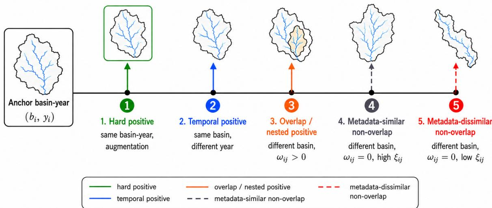  
Figure 2: Basin relations used by the relation-aware contrastive objective.

For a mini-batch of B basin-year entities, two independently augmented views of each entity are generated and encoded into $N = 2 B$ normalized embeddings $\{ z _ { i } \} _ { i = 1 } ^ { N }$ . Details of the augmentation procedure are provided in Appendix A.1. Each embedding is associated with a basin ID $b _ { i } ,$ year yi, and basin metadata $X _ { b _ { i } } ^ { \mathrm { m e t a } }$ . The generated embeddings form an anchor set $\mathcal { A } = \{ 1 , \ldots , N \}$ for computing contrastive loss.

For each anchor $i \in \mathcal { A }$ , we define the following relations:

$$
\begin{array} { r l } & { \mathcal { P } _ { i } ^ { \mathrm { h a r d } } = \{ j : b _ { i } = b _ { j } , y _ { i } = y _ { j } , i \neq j \} , } \\ & { \mathcal { P } _ { i } ^ { \mathrm { t e m p } } = \{ j : b _ { i } = b _ { j } , y _ { i } \neq y _ { j } \} , } \\ & { \quad \mathcal { P } _ { i } ^ { \mathrm { o v } } = \{ j : b _ { i } \neq b _ { j } , \omega _ { i j } > 0 \} , } \\ & { \mathcal { N } _ { i } ^ { \mathrm { n e g } } = \{ j : b _ { i } \neq b _ { j } , \omega _ { i j } = 0 \} . } \end{array}\tag{7}
$$

Here, $\mathcal { P } _ { i } ^ { \mathrm { h a r d } }$ contains the other augmented view of the same basin-year, $\mathcal { P } _ { i } ^ { \mathrm { t e m p } }$ contains other years of the same basin, $\mathcal { P } _ { i } ^ { \mathrm { o v } }$ contains spatially overlapping or nested basins, while $\mathcal { N } _ { i } ^ { \mathrm { n e g } }$ contains diferent-basin entities with no spatial overlap. We quantify the spatial overlap between embeddings i and $j$ using the Szymkiewicz–Simpson coeficient [32]:

$$
\omega _ { i j } = | { G _ { i } \cap G _ { j } } | / \operatorname* { m i n } ( | { G _ { i } } | , | { G _ { j } } | ) ,
$$

where $G _ { i }$ and $G _ { j }$ denote their corresponding basin polygons and $| \cdot |$ denotes polygon area. This coeficient reaches one when the smaller basin is fully nested within the larger, making it suitable for both overlapping and nested relations.

Based on the relation sets defined above, our relation-aware contrastive loss for anchor i is given by:

$$
{ \mathcal L } _ { i } ^ { \mathrm { c o n } } = - \sum _ { j \neq i } q _ { i j } \log \frac { d _ { i j } \exp ( s _ { i j } / \tau ) } { \sum _ { k \neq i } d _ { i k } \exp ( s _ { i k } / \tau ) } ,\tag{8}
$$

where $s _ { i j } = z _ { i } ^ { \top } z _ { j }$ is the cosine similarity between two normalized embeddings, $q _ { i j }$ measures the attraction (positive) strength between embeddings, $d _ { i j }$ measures the repulsive (negative) strength, while $\tau$ is a hyperparameter.

The attraction (positive) strength between embeddings i and $j$ is computed as follows:

$$
q _ { i j } = \frac { w _ { i j } ^ { + } } { \sum _ { k \neq i } w _ { i k } ^ { + } } , \qquad j \neq i .\tag{9}
$$

where

$$
w _ { i j } ^ { + } = \mathbf { 1 } _ { j \in \mathcal { P } _ { i } ^ { \mathrm { h a r d } } } + \lambda _ { t } \kappa _ { i j } \mathbf { 1 } _ { j \in \mathcal { P } _ { i } ^ { \mathrm { t e m p } } } + \lambda _ { o } \omega _ { i j } \kappa _ { i j } \mathbf { 1 } _ { j \in \mathcal { P } _ { i } ^ { \mathrm { o v } } } ,\tag{10}
$$

Here, $\lambda _ { t }$ and $\lambda _ { o }$ control the contributions due to temporal and spatial overlap relations. The temporal factor $\kappa _ { i j } = \exp ( - | y _ { i } - y _ { j } | / \tau _ { y } )$ decreases as the separation between years increases, with $\tau _ { y }$ controlling the decay rate. This factor is applied to both temporal and spatial overlap relations to ensure that basin-year entities observed far apart in time have lower attraction strengths. In this formulation, $q _ { i j }$ is nonzero only for embedding pairs with positive relations. Since every basin-year entity has two augmented views, each anchor must have at least one hard positive.

To avoid excessive repulsion between physiographically similar basins, Basin2Vec assigns each pair the weight

$$
d _ { i j } = \left\{ { \begin{array} { l l } { 1 , } & { w _ { i j } ^ { + } > 0 , } \\ { 1 - \lambda _ { m } \xi _ { i j } , } & { w _ { i j } ^ { + } = 0 , } \end{array} } \right.\tag{11}
$$

where $\lambda _ { m } \in [ 0 , 1 )$ controls the strength of metadata-based downweighting and $\xi _ { i j } \in [ 0 , 1 ]$ denotes the metadata similarity between the corresponding basins. The computation of $\xi _ { i j }$ is described in Appendix A.1. Positive pairs retain unit weight because their attraction is already controlled by $w _ { i j } ^ { + }$ and $q _ { i j }$ . For non-positive pairs, greater metadata similarity produces a smaller $d _ { i j }$ and therefore weaker repulsion. Metadata similarity is not treated as a positive relation since physiographic similarity does not necessarily imply similar hydrological behavior. The contrastive loss given in Equation (8) pulls each anchor toward its hard, temporal, and overlap positives while reducing unnecessary repulsion from metadata-similar non-overlapping basins.

The contrastive denominator provides relative negative pressure but does not directly bound the similarity of individual non-overlapping pairs. Basin2Vec therefore applies the following negative-margin loss

$$
\mathcal { L } _ { \mathrm { n e g } } = \frac { 1 } { | \mathcal { N } _ { \mathrm { n e g } } | } \sum _ { ( i , j ) \in \mathcal { N } _ { \mathrm { n e g } } } \left[ \operatorname* { m a x } ( 0 , s _ { i j } - \mu _ { i j } ) \right] ^ { 2 } ,\tag{12}
$$

where $\mathcal { N } _ { \mathrm { n e g } } = \{ ( i , j ) : i \in \mathcal { A } , \ j \in \mathcal { N } _ { i } ^ { \mathrm { n e g } } \}$ contains all non-overlapping negative pairs, and $\mu _ { i j } = \mu _ { \mathrm { { m i n } } } + ( \mu _ { \mathrm { { m a x } } } - \mu _ { \mathrm { { m i n } } } ) \xi _ { i j }$ is the metadata-dependent margin. Metadata-similar negative pairs receive a larger margin and may remain closer in the embedding space, whereas metadatadissimilar pairs receive a stricter margin.

Altogether, the overall pre-training objective is

$$
\mathcal { L } = \frac { 1 } { N } \sum _ { i \in \mathcal { A } } \mathcal { L } _ { i } ^ { \mathrm { c o n } } + \lambda _ { n } \mathcal { L } _ { \mathrm { n e g } } + \lambda _ { a } \mathcal { L } _ { \mathrm { a r e a } } ,\tag{13}
$$

where the coeficients $\lambda _ { n }$ and $\lambda _ { a }$ control the contributions of the negative-margin and areapreservation terms, respectively. Note that ${ \mathcal { L } } _ { i } ^ { \mathrm { c o n } }$ organizes the embedding space using known basin relations, $\mathcal { L } _ { \mathrm { n e g } }$ limits excessive similarity between non-overlapping basins, while $\mathcal { L } _ { \mathrm { a r e a } }$ encourages the encoder to retain information about physical basin scale.

## 3.4 Training and Embedding Generation

A basin-aware sampler selects the basins for each mini-batch and draws $K _ { \mathrm { y r } }$ years per basin, to ensure the same number of temporal positives for each basin within a mini-batch. After training, the unaugmented input for each original basin-year entity is encoded to obtain its final embedding $z _ { b , y }$

Finally, to obtain a fixed descriptor for each basin, we take the average annual embeddings for each basin and $\ell _ { 2 } \cdot$ -normalize the result:

$$
\bar { z } _ { b } = \mathrm { N o r m a l i z e } \left( \frac { 1 } { \left| \mathcal { N } _ { b } \right| } \sum _ { y \in \mathcal { Y } _ { b } } z _ { b , y } \right) ,\tag{14}
$$

where $\mathcal { V } _ { b }$ denotes the years available for basin b. This facilitates a fair downstream comparison since some EO baselines have diferent temporal coverages, i.e., do not provide embeddings for a common set of years as Basin2Vec.

## 4 Experimental Setup

We evaluate Basin2Vec through three research questions $\mathrm { ( R Q s ) }$ covering intrinsic embedding structure, temporal generalization, and zero-shot spatial transfer.

## 4.1 RQ1: Intrinsic Embedding Structure

RQ1 tests whether the learned representations (i) remain diverse rather than collapsing into a low-dimensional subspace and (ii) preserve metadata-defined scale and shape relationships. For each method, we average the available embeddings per basin, apply $\ell _ { 2 }$ normalization, and evaluate the same 9,067 basins.

Representation diversity. We measure representation diversity using entropy-based efective rank [29]. Given the eigenvalues $\{ \lambda _ { i } \} _ { i = 1 } ^ { d }$ of the covariance matrix of the embeddings, let $\begin{array} { r } { p _ { i } = \lambda _ { i } / \sum _ { j = 1 } ^ { d } \lambda _ { j } } \end{array}$ . The efective rank of the learned embeddings is

$$
r _ { \mathrm { e f f } } = \exp \left( - \sum _ { i = 1 } ^ { d } p _ { i } \log p _ { i } \right) .\tag{15}
$$

Since the embedding dimensions may difer for diferent methods, we report the normalized efective rank $\widetilde { r } _ { \mathrm { e f f } } = r _ { \mathrm { e f f } } / \operatorname* { m i n } ( d , N - 1 )$ , where d and N denote the embedding dimensions and number of basins, respectively. Higher values indicate that the embeddings are more diverse as their variance spans a larger fraction of the available dimensions.

Metadata consistency. The metadata incorporated into Basin2Vec include descriptors of basin scale and geometry (Appendix A.2), which influence basin hydrologic behavior. These descriptors are integrated through metadata fusion, while pairwise metadata similarity is used in the relation-aware objective. We therefore test whether metadata-similar basins are closer in the learned embedding space than metadata-dissimilar basins.

We use standardized scale-and-shape metadata (Appendix A.2), with no geographic coordinate inputs, and exclude overlapping and nested pairs. Metadata-similar pairs are defined using each basin’s nearest neighbors in Euclidean metadata space. Metadata-dissimilar pairs are selected as the most distant pairs within a randomly sampled pool of non-overlapping candidates. The same pair sets are evaluated for every method. We compare the ℓ2-distance distributions of normalized basin embeddings and summarize their separation as $\Delta _ { \mathrm { { m e t a } } } =$ $\mu _ { \mathrm { d i s s i m i l a r } } - \mu _ { \mathrm { s i m i l a r } } ,$ where the two terms denote the respective mean pairwise distances. A larger positive $\Delta _ { \mathrm { m e t a } }$ indicates clearer preservation of metadata-defined basin relationships.

## RQ2–RQ3: Downstream Streamflow Generalization

Task description. RQ2 and RQ3 evaluate basin representations as static conditioning vectors for daily streamflow prediction. For basin b and target day t, the downstream model predicts streamflow $Q _ { b , t }$ from an input sequence of meteorological forcings $\mathbf { x } _ { b , t } ^ { \mathrm { m e t } }$ and a fixed basin descriptor $c _ { b } \mathbf { : }$

$$
\widehat { Q } _ { b , t } = F _ { \eta } \left( [ \mathbf { x } _ { b , t - L + 1 } ^ { \mathrm { m e t } } , \ldots , \mathbf { x } _ { b , t } ^ { \mathrm { m e t } } ] , c _ { b } \right) .\tag{16}
$$

where $L \in \{ 1 2 0 , 3 6 5 \}$ is the forcing-window length. Meteorological forcings are available through day t, but no observed streamflow is provided as input.

Data description. Experiments use CAMELS-US basins with Daymet meteorological forcings and USGS daily streamflow [1, 26]. The dynamic inputs are precipitation, shortwave radiation, maximum and minimum temperature, and vapor pressure. Discharge is converted to basinmean runof (mm/day); the 27 CAMELS attributes include drainage area (area\_gages2).

The main benchmark compares basin descriptors obtained from Basin2Vec, AlphaEarth, TESSERA, SatCLIP, and CAMELS attributes.

Because the learned representations difer in temporal coverage and spatial sampling, we construct one fixed descriptor per basin using all samples available from each source. Basin2Vec uses the $\ell _ { 2 } { \mathrm { - n o r m a l i z e d } } .$ , year-averaged representation $\bar { z } _ { b }$ from Eq. (14). For the EO baselines, embeddings are averaged over the available years and sampled locations within each basin and then $\ell _ { 2 } { \mathrm { - n o r m a l i z e d } } .$ . This avoids selecting an arbitrary source-dependent year and provides a time-invariant descriptor comparable to the CAMELS attributes. All basin descriptors remain frozen during downstream training.

Evaluation protocol. For RQ2, temporal generalization is evaluated on the same 671 basins across disjoint periods. Data from 1990–2009 are used for model development, including early stopping, while 2010–2014 is held out for evaluation [10, 12].

For RQ3, zero-shot spatial transfer is evaluated using 6-fold ungauged-basin cross-validation. In each fold, held-out basins are excluded from supervised training and early stopping. The remaining basins use 1990–2004 for training and 2005–2014 for validation, while the held-out basins are evaluated over 1990–2014 [3, 18, 31].

The downstream predictor $F _ { \eta }$ is instantiated as LSTM [15], TFT [20], TimeXer [37], Timer-XL [23], or iTransformer [22]. Within each architecture, the dynamic inputs, conditioning mechanism, and training protocol are held fixed across representation sources; only the descriptor input width changes to match the source dimension. All inputs, targets, and conditioning vectors are standardized using training data only.

We additionally compare Basin2Vec with KG-SSL [13], a hydrology-specific self-supervised method, using its unsupervised reconstruction-and-contrastive setting without static-attribute supervision. KG-SSL is trained and its descriptors are constructed from 1990–2009 meteorology and observed streamflow, then frozen for 2010–2014 evaluation. The comparison uses the matched downstream LSTM with L = 365 and lead-zero prediction. KG-SSL is excluded from RQ3 because its descriptor construction requires streamflow from the held-out basin.

Models are optimized using MSE and AdamW with validation-based early stopping and gradient clipping. Each configuration is evaluated using three seeds (42, 123, and 456). For each seed, NSE [25] and KGE [14] are computed per basin and summarized by their median across basins. We report the mean and standard deviation of these medians over the three seeds; higher values indicate better performance, with 1 representing perfect agreement.

Complete hyperparameter and implementation details are provided in the appendix.

Table 2: Temporal generalization results. Values are median basin-level NSE and KGE. Bold and underlining indicate the best and second-best conditioning sources, respectively.
<table><tr><td colspan="9"></td></tr><tr><td rowspan="2">Model</td><td colspan="4">Median NSE ↑</td><td colspan="4">Median KGE ↑</td></tr><tr><td>Basin2Vec AlphaEarth</td><td>CAMELS Attr.</td><td>TESSERA</td><td>SatCLIP</td><td>Basin2Vec AlphaEarth</td><td>CAMELS Attr.</td><td>TESSERA</td><td>SatCLIP</td></tr><tr><td>LSTM</td><td>|0.782±0.009 0.641±0.017</td><td>0.747±0.010</td><td>0.662±0.025 0.719±0.018</td><td></td><td>|0.786±0.011 0.572±0.013</td><td>0.756±0.013</td><td>0.626±0.022 0.688±0.031</td><td></td></tr><tr><td>TFT</td><td>0.753±0.011 0.741±0.026</td><td>0.717±0.022</td><td>0.570±0.025 0.638±0.026</td><td></td><td>0.768±0.019 0.722±0.029</td><td>0.714±0.030</td><td></td><td>0.514±0.033 0.566±0.026</td></tr><tr><td>TimeXer</td><td>0.651±0.0180.630±0.012</td><td>0.502±0.019</td><td>0.573±0.033 0.603±0.015</td><td>0.691±0.009</td><td>0.579±0.023</td><td>0.446±0.030</td><td></td><td>0.517±0.023 0.571±0.033</td></tr><tr><td>Timer-XL iTrans.</td><td>0.730±0.0190.674±0.028 0.627±0.0220.559±0.020</td><td>0.591±0.026</td><td>0.627±0.019 0.402±0.021</td><td></td><td>0.708±0.0220.585±0.010</td><td>0.536±0.029</td><td></td><td>0.635±0.021 0.346±0.016</td></tr><tr><td></td><td></td><td>0.555±0.022</td><td>0.576±0.015 0.464±0.017</td><td></td><td>0.582±0.026 0.566±0.024</td><td>0.533±0.020</td><td></td><td>0.579±0.0280.450±0.022</td></tr><tr><td colspan="9">L = 120</td></tr><tr><td>LSTM</td><td>|0.754±0.014 0.619±0.015</td><td>0.737±0.013</td><td>0.638±0.016 0.704±0.030|</td><td></td><td>|0.775±0.009 0.563±0.023</td><td>0.741±0.031</td><td></td><td>0.592±0.031 0.705±0.025</td></tr><tr><td>TFT</td><td>0.737±0.019 0.719±0.020</td><td>0.712±0.012</td><td>0.551±0.029 0.668±0.026</td><td></td><td>0.744±0.020 0.719±0.032</td><td>0.668±0.030</td><td></td><td>0.479±0.014 0.600±0.020</td></tr><tr><td>TimeXer</td><td>0.677±0.011 0.675±0.010</td><td>0.645±0.026</td><td>0.592±0.014 0.530±0.028</td><td></td><td>0.679±0.0250.625±0.016</td><td>0.675±0.011</td><td></td><td>0.563±0.028 0.492±0.010</td></tr><tr><td>Timer-XL</td><td>0.705±0.018 30.650±0.026</td><td>0.529±0.021</td><td>0.602±0.019 0.566±0.016</td><td></td><td>0.693±0.014 0.580±0.016</td><td>0.440±0.029</td><td></td><td>0.540±0.027 0.533±0.025</td></tr><tr><td>iTrans.</td><td>0.594±0.0190.551±0.015</td><td>0.581±0.028</td><td>0.584±0.0170.398±0.025</td><td></td><td>0.580±0.009 0.545±0.010</td><td>0.554±0.012</td><td></td><td>0.535±0.031 0.349±0.024</td></tr></table>

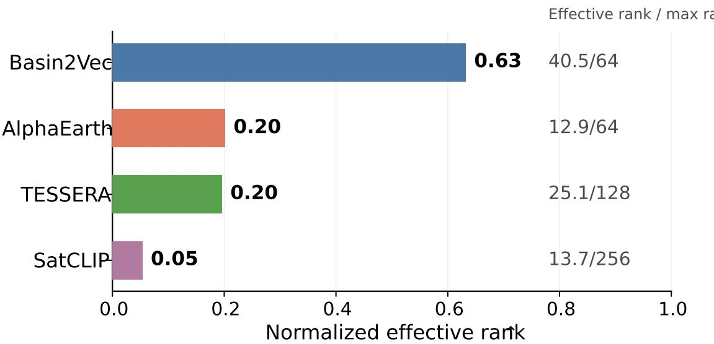  
Figure 3: Representation diversity. Normalized efective rank across 9,067 basins. Higher values indicate greater representation diversity.

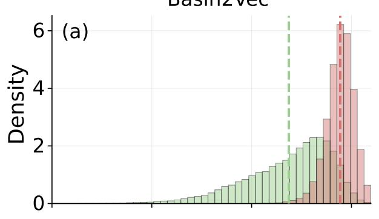

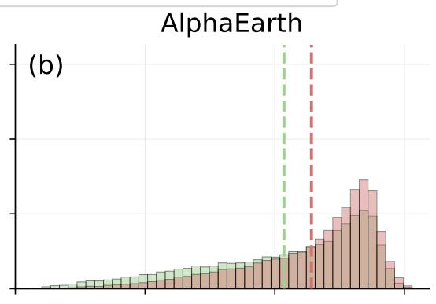

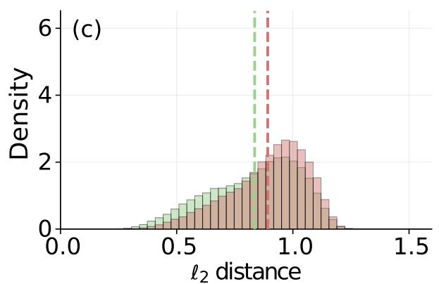

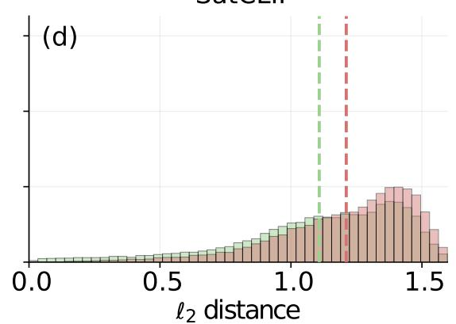  
Figure 4: Metadata consistency. ℓ2-distance distributions for metadata-similar and metadata-dissimilar non-overlapping pairs. Dashed lines denote means.

Table 3: Zero-shot spatial-transfer results for L = 365. Each value is the median per-basin NSE or KGE on held-out basins. Bold and underlining indicate the best and second-best conditioning sources, respectively.
<table><tr><td rowspan="2">Model</td><td colspan="4">Median NSE ↑</td><td colspan="5">Median KGE ↑</td></tr><tr><td>Basin2Vec AlphaEarth</td><td>CAMELS Attr.</td><td>TESSERA</td><td>SatCLIP</td><td>Basin2Vec</td><td>AlphaEarth</td><td>CAMELS Attr.</td><td>TESSERA</td><td>SatCLIP</td></tr><tr><td>LSTM</td><td>0.460±0.050 0.079±0.021</td><td>0.071±0.018</td><td>0.092±0.017</td><td>0.132±0.022</td><td>0.408±0.001</td><td>-0.084±0.025</td><td>-0.098±0.027</td><td>-0.049±0.020</td><td>-0.072±0.024</td></tr><tr><td>TFT</td><td>0.524±0.019 0.132±0.017</td><td>0.147±0.015</td><td>0.127±0.018</td><td>0.119±0.021</td><td>0.427±0.022</td><td>-0.077±0.028</td><td>-0.071±0.025</td><td>-0.055±0.019</td><td>-0.100±0.023</td></tr><tr><td>TimeXer</td><td>0.491±0.016 0.126±0.020</td><td>0.065±0.018</td><td>0.065±0.021</td><td>0.106±0.017</td><td>0.431±0.018</td><td>-0.050±0.022</td><td>-0.080±0.019</td><td>-0.055±0.020</td><td>-0.066±0.024</td></tr><tr><td>Timer-XL</td><td>0.498±0.0170.136±0.024</td><td>0.092±0.019</td><td>0.022±0.016 0.140±0.021</td><td></td><td>0.436±0.020</td><td>-0.038±0.021</td><td>-0.060±0.023</td><td>-0.114±0.029</td><td>-0.023±0.018</td></tr><tr><td>iTrans.</td><td>0.465±0.021 0.151±0.018</td><td>0.007±0.014</td><td>0.085±0.017 0.058±0.020</td><td></td><td>0.384±0.024</td><td>-0.039±0.020</td><td>-0.093±0.026</td><td>-0.098±0.024</td><td>-0.114±0.028</td></tr></table>

Table 4: Component ablations of Basin2Vec using LSTM with $L = 3 6 5$ . Bold and underlining denote the best and second-best results.
<table><tr><td rowspan="2">Category</td><td rowspan="2">Variant</td><td rowspan="2">Ablation setting</td><td colspan="2">Temporal</td><td colspan="2">Spatial</td></tr><tr><td>NSE ↑</td><td> $\overline { { \mathrm { K G E \uparrow } } }$ </td><td>NSE ↑</td><td>KGE ↑</td></tr><tr><td>Full model</td><td>Basin2Vec</td><td>All components</td><td></td><td>0.782 ± 0.009 0.786 ± 0.011</td><td>0.460 ± 0.050</td><td> $\mathbf { \overline { { 0 . 4 0 8 \pm 0 . 0 0 1 } } }$ </td></tr><tr><td rowspan="5">Scale-aware encoder</td><td> $\overline { { { \bf w } / { \bf o } } }$  monthly branch</td><td> $\frac { \mathrm { d } { \bf y } \mathrm { n } } { z _ { b , y } ^ { \mathrm { d y n } } }$  removed</td><td> $\overline { { 0 . 6 4 9 \pm 0 . 0 1 6 } }$ </td><td> $0 . 6 2 1 \pm 0 . 0 3 1$ </td><td> $0 . 4 2 3 \pm 0 . 0 2 1$ </td><td> $0 . 3 8 8 \pm 0 . 0 3 2$ </td></tr><tr><td> $\mathrm { w } / \mathrm { o }$  quasi-static branch</td><td> $z _ { b , y } ^ { \mathrm { s t a } } \mathrm { r e m o v e d }$ </td><td> $0 . 6 3 5 \pm 0 . 0 1 5$ </td><td> $0 . 6 2 3 \pm 0 . 0 1 4$ </td><td> $0 . 4 0 4 \pm 0 . 0 1 3$ </td><td> $0 . 3 9 7 \pm 0 . 0 0 7$ </td></tr><tr><td> $\mathrm { w } / \mathrm { o }$  metadata conditioning</td><td> $\mathrm { M L P } _ { \mathrm { m e t a } } ( )$  and  $g _ { b , y }$  removed</td><td> $0 . 6 3 4 \pm 0 . 0 2 2$ </td><td> $0 . 6 1 5 \pm 0 . 0 1 7$ </td><td> $0 . 0 6 4 \pm 0 . 0 4 4$ </td><td> $- 0 . 0 5 9 \pm 0 . 0 4 4$ </td></tr><tr><td> $\mathrm { w } / \mathrm { o }$  gated metadata fusion</td><td>gated fusion → concat. + MLP</td><td> $0 . 6 5 1 \pm 0 . 0 3 2$ </td><td> $0 . 6 2 0 \pm 0 . 0 5 9$ </td><td> $\underline { { 0 . 4 2 4 } } \pm 0 . 0 2 9$ </td><td> $\underline { { 0 . 3 9 9 } } \pm 0 . 0 4 2$ </td></tr><tr><td>w/o area regularization</td><td> $\lambda _ { a } = 0$ </td><td> $0 . 6 0 1 \pm 0 . 0 0 7$ </td><td> $0 . 5 7 1 \pm 0 . 0 0 1$ </td><td> $0 . 4 1 2 \pm 0 . 0 1 3$ </td><td> $0 . 3 8 9 \pm 0 . 0 1 4$ </td></tr><tr><td rowspan="6">objective</td><td>hard positive only</td><td> $\overline { { w _ { i j } ^ { + } = \mathbf { 1 } _ { j \in \mathcal { P } _ { i } ^ { \mathrm { h a r d } } } , \ d _ { i j } = 1 } }$ </td><td> $\overline { { 0 . 6 7 0 \pm 0 . 0 0 9 } }$ </td><td> $\overline { { 0 . 6 4 7 \pm 0 . 0 2 1 } }$ </td><td> $\overline { { 0 . 3 7 2 \pm 0 . 0 1 0 } }$ </td><td> $\overline { { 0 . 3 3 2 \pm 0 . 0 2 1 } }$ </td></tr><tr><td> $\mathrm { w } / \mathrm { o }$  temporal positives</td><td> $\lambda _ { t } = 0$ </td><td> $0 . 6 2 1 \pm 0 . 0 2 4$ </td><td> $0 . 6 2 8 \pm 0 . 0 5 6$ </td><td> $0 . 4 1 8 \pm 0 . 0 3 0$ </td><td> $0 . 3 9 8 \pm 0 . 0 1 1$ </td></tr><tr><td>Relation-aware w/o overlap/nesting positives</td><td> $\lambda _ { o } = 0$ </td><td> $0 . 6 3 3 \pm 0 . 0 1 2$ </td><td> $0 . 5 8 9 \pm 0 . 0 0 1$ </td><td> $0 . 4 0 8 \pm 0 . 0 1 7$ </td><td> $0 . 3 8 9 \pm 0 . 0 1 7$ </td></tr><tr><td>w/o metadata-weighted denominator</td><td> $d _ { i j } = 1$ </td><td> $0 . 6 3 8 \pm 0 . 0 2 8$ </td><td> $0 . 6 0 8 \pm 0 . 0 3 5$ </td><td> $0 . 3 8 4 \pm 0 . 0 1 7$ </td><td> $0 . 3 3 0 \pm 0 . 0 0 8$ </td></tr><tr><td>metadata as positive</td><td> $w _ { i j } ^ { + } \mathrel { + } = \lambda _ { p } \xi _ { i j }$ </td><td> $0 . 6 0 0 \pm 0 . 0 3 9$ </td><td> $0 . 5 8 0 \pm 0 . 0 4 0$ </td><td> $0 . 4 0 3 \pm 0 . 0 0 2$ </td><td> $0 . 3 9 0 \pm 0 . 0 0 4$ </td></tr><tr><td>w/o negative-margin loss</td><td> $\lambda _ { n } = 0$ </td><td> $0 . 6 4 3 \pm 0 . 0 3 2$ </td><td> $0 . 6 2 5 \pm 0 . 0 4 8$ </td><td> $0 . 4 0 9 \pm 0 . 0 2 4$ </td><td> $0 . 3 8 3 \pm 0 . 0 2 9$ </td></tr></table>

Table 5: Comparison with KG-SSL under the matched LSTM setting with $L = 3 6 5 .$
<table><tr><td>Method</td><td></td><td>Median NSE ↑ Median KGE ↑</td></tr><tr><td>KG-SSL</td><td> $0 . 6 2 0 { \pm } 0 . 0 1 8$ </td><td> $0 . 5 9 3 { \pm } 0 . 0 1 5$ </td></tr><tr><td> $\mathrm { B a s i n 2 V e c }$ </td><td> $\mathbf { 0 . 7 8 2 \pm 0 . 0 0 9 }$ </td><td> $\mathbf { 0 . 7 8 6 { \pm 0 . 0 1 1 } }$ </td></tr></table>

## 5 Experimental Results

## 5.1 Intrinsic Embedding Structure

(RQ1)

Basin2Vec achieves the highest normalized efective rank (Fig. 3), indicating that its variance is distributed across a larger fraction of the available dimensions rather than concentrated in a small subspace. All methods place metadata-dissimilar pairs farther apart on average than metadata-similar pairs, but Basin2Vec exhibits the largest separation $\Delta _ { \mathrm { m e t a } } ,$ while the baseline distributions overlap more substantially (Fig. 4). These results show that Basin2Vec produces a diverse, non-collapsed representation that more clearly preserves basin scale and geometry relationships.

## 5.2 Temporal Generalization

(RQ2)

Table 2 summarizes the temporal generalization performance of the embedding methods across five downstream architectures. Basin2Vec ranks first in both NSE and KGE for every architecture at forcing-window length $L \in \{ 1 2 0 , 3 6 5 \}$ . Its consistent gains across recurrent, attention-based, and transformer-style predictors indicate that the benefit is not specific to one architecture or forcing-window length. The right-shifted KGE distributions in Figure 5 further show that the gains extend across basins.

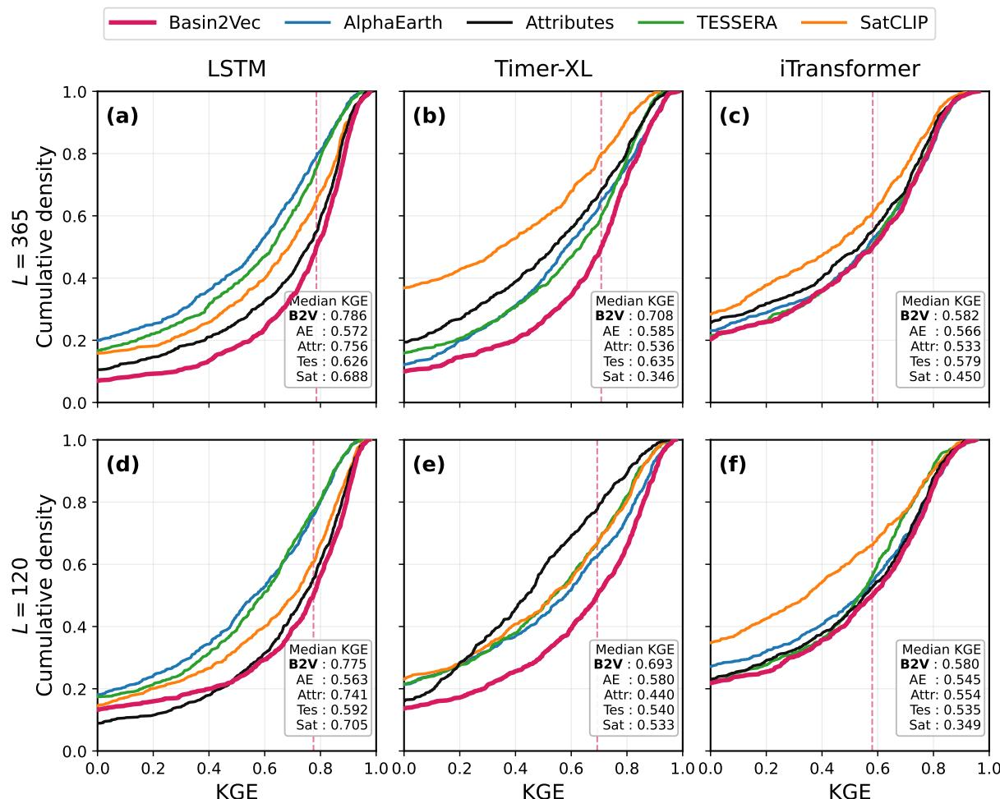  
Figure 5: Per-basin KGE CDFs for temporal generalization using selected downstream architectures.

Comparison with hydrology-specific SSL. With the same LSTM and L = 365, Basin2Vec increases median NSE from 0.620 to 0.782 and median KGE from 0.593 to 0.786 over KG-SSL [13] (Table 5). Although KG-SSL uses streamflow, it learns from lumped one-year sequences over 671 basins, making its descriptors more dependent on the observed flow regime. Basin2Vec instead learns from distributed inputs across 9,067 basins and enforces consistency across years, producing more stable descriptors for temporal transfer.

## 5.3 Zero-Shot Spatial Transfer

(RQ3)

Table 3 shows that Basin2Vec ranks first in NSE and KGE for every downstream architecture. Its median NSE exceeds the strongest alternative for each architecture by 0.314–0.377, and it is the only method with consistently positive median KGE, demonstrating substantially stronger transfer to unseen basins. We also examine the relative performance of the methods across diferent basin sizes. Figure 6 further shows that Basin2Vec maintains the strongest NSE and KGE distributions for small, medium, and large basins. Thus, the gains are not confined to a particular basin-size range.

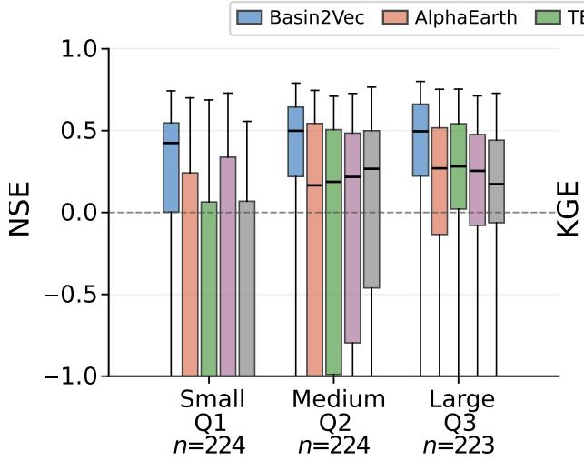  
Basin-size class

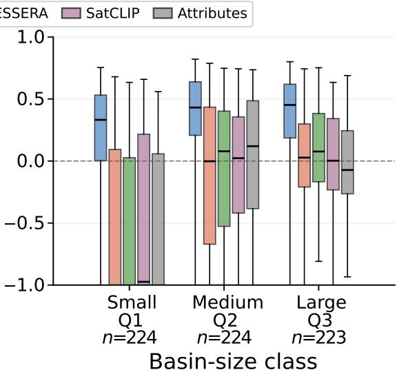  
Figure 6: Spatial-split performance across basin-size classes.

## 5.4 Ablation Study

We remove or replace individual components of the scale-aware encoder and relation-aware objective and evaluate the resulting variants under temporal and spatial generalization. Table 4 shows that the complete Basin2Vec model achieves the best result for every metric. Scale-aware encoder. Removing either input branch degrades generalization, while removing metadata conditioning causes the largest spatial decline and negative median KGE. Gated metadata fusion outperforms concatenation, and area regularization provides particularly strong temporal gains. Relation-aware objective. The full objective outperforms every relation ablation. Hard positives alone rank second temporally but transfer poorly to unseen basins. Removing temporal or overlap/nesting positives, metadata-weighted negatives, or the negative margin loss reduces performance. Treating metadata as a positive relation also performs worse, supporting its use to moderate negative repulsion rather than enforce attraction.

## 6 Conclusion

We presented Basin2Vec, a self-supervised framework for learning basin-centric representations from gridded hydroclimatic data without observed streamflow. Basin2Vec combines a scale-aware encoder for spatiotemporal inputs and metadata with a relation-aware contrastive objective that models hydrologic relationships across space and time. The resulting embeddings are diverse and hydrologically structured. Across architectures and forcing windows, Basin2Vec outperforms predefined attributes and general-purpose EO embeddings in temporal generalization and zero-shot transfer to unseen basins. Ablations validate its main design choices. These results show that explicitly modeling basin structure and relationships yields reusable representations for hydrologic prediction.

## Acknowledgments

Pang-Ning Tan acknowledges partial support from the U.S. National Science Foundation under grant IIS-2453100. A. Pouyan Nejadhashemi acknowledges support from the USDA National Institute of Food and Agriculture (NIFA) through Hatch project 1019654 and from the Institute of Water Research at Michigan State University.

## References

[1] Nans Addor, Andrew J Newman, Naoki Mizukami, and Martyn P Clark. The CAMELS data set: catchment attributes and meteorology for large-sample studies. Hydrology and Earth System Sciences, 21(10):5293–5313, 2017. doi: 10.5194/hess-21-5293-2017. URL https://hess.copernicus.org/articles/21/5293/2017/.

[2] Alberto Bassi, Marvin Höge, Antonietta Mira, Fabrizio Fenicia, and Carlo Albert. Learning landscape features from streamflow with autoencoders. Hydrology and Earth System Sciences, 28(22):4971–4988, 2024. doi: 10.5194/hess-28-4971-2024. URL https: //hess.copernicus.org/articles/28/4971/2024/.

[3] Günter Blöschl, Murugesu Sivapalan, Thorsten Wagener, Alberto Viglione, and Hubert Savenije (eds.). Runof Prediction in Ungauged Basins: Synthesis across Processes, Places and Scales. Cambridge University Press, 2013. doi: 10.1017/CBO9781139235761.

[4] Tom E Botterill and Hilary K McMillan. Using machine learning to identify hydrologic signatures with an encoder–decoder framework. Water Resources Research, 59(3): e2022WR033091, 2023. doi: 10.1029/2022WR033091.

[5] Christopher F Brown, Michal R Kazmierski, Valerie J Pasquarella, William J Rucklidge, Masha Samsikova, Chenhui Zhang, Evan Shelhamer, Estefania Lahera, Olivia Wiles, Simon Ilyushchenko, Noel Gorelick, Lihui Lydia Zhang, Sophia Alj, Emily Schechter, Sean Askay, Oliver Guinan, Rebecca Moore, Alexis Boukouvalas, and Pushmeet Kohli. AlphaEarth foundations: An embedding field model for accurate and eficient global mapping from sparse label data. arXiv preprint arXiv:2507.22291, 2025. doi: 10.48550/ arXiv.2507.22291. URL https://arxiv.org/abs/2507.22291.

[6] Manuela I Brunner, Louise Slater, Lena M Tallaksen, and Martyn Clark. Challenges in modeling and predicting floods and droughts: A review. WIREs Water, 8(3):e1520, 2021. doi: 10.1002/wat2.1520.

[7] Yezhen Cong, Samar Khanna, Chenlin Meng, Patrick Liu, Erik Rozi, Yutong He, Marshall Burke, David Lobell, and Stefano Ermon. SatMAE: Pre-training transformers for temporal and multi-spectral satellite imagery. In Advances in Neural Information Processing Systems, volume 35, pp. 197–211. Curran Associates, Inc., 2022. doi: 10.52202/068431-0015. URL https://proceedings.neurips.cc/paper\_files/paper/ 2022/file/01c561df365429f33fcd7a7faa44c985-Paper-Conference.pdf.

[8] James A Falcone. GAGES-II: Geospatial attributes of gages for evaluating streamflow. Usgs unnumbered series, U.S. Geological Survey, 2011. URL https://pubs.usgs.gov/ publication/70046617.

[9] James A Falcone, Daren M Carlisle, David M Wolock, and Michael R Meador. GAGES: A stream gage database for evaluating natural and altered flow conditions in the conterminous United States: Ecological archives E091-045. Ecology, 91(2):621–621, 2010. doi: 10.1890/09-0889.1.

[10] Kuai Fang, Daniel Kifer, Kathryn Lawson, Dapeng Feng, and Chaopeng Shen. The data synergy efects of time-series deep learning models in hydrology. Water Resources Research, 58(4):e2021WR029583, 2022. doi: 10.1029/2021WR029583.

[11] Zhengpeng Feng, Clement Atzberger, Sadiq Jafer, Jovana Knezevic, Silja Sormunen, Robin Young, Madeline C. Lisaius, Markus Immitzer, Toby Jackson, James Ball, David A. Coomes, Anil Madhavapeddy, Andrew Blake, and Srinivasan Keshav. TESSERA: Temporal embeddings of surface spectra for earth representation and analysis. In Proceedings of the IEEE/CVF Conference on Computer Vision and Pattern Recognition (CVPR), pp. 34818–34831, June 2026.

[12] Martin Gauch, Juliane Mai, and Jimmy Lin. The proper care and feeding of CAMELS: How limited training data afects streamflow prediction. Environmental Modelling & Software, 135:104926, 2021. doi: 10.1016/j.envsoft.2020.104926.

[13] Rahul Ghosh, Arvind Renganathan, Kshitij Tayal, Xiang Li, Ankush Khandelwal, Xiaowei Jia, Christopher Dufy, John Nieber, and Vipin Kumar. Robust inverse framework using knowledge-guided self-supervised learning: An application to hydrology. In Proceedings of the 28th ACM SIGKDD Conference on Knowledge Discovery and Data Mining, pp. 465–474, 2022. doi: 10.1145/3534678.3539448.

[14] Hoshin V Gupta, Harald Kling, Koray K Yilmaz, and Guillermo F Martinez. Decomposition of the mean squared error and NSE performance criteria: Implications for improving hydrological modelling. Journal of Hydrology, 377(1-2):80–91, 2009. doi: 10.1016/j.jhydrol.2009.08.003.

[15] Sepp Hochreiter and Jürgen Schmidhuber. Long short-term memory. Neural Computation, 9(8):1735–1780, 1997. doi: 10.1162/neco.1997.9.8.1735.

[16] Konstantin Klemmer, Esther Rolf, Caleb Robinson, Lester Mackey, and Marc Rußwurm. SatCLIP: Global, general-purpose location embeddings with satellite imagery. In Proceedings of the AAAI Conference on Artificial Intelligence, volume 39, pp. 4347–4355, 2025. doi: 10.1609/aaai.v39i4.32457.

[17] Wouter JM Knoben, Cyril Thébault, Kasra Keshavarz, Laura Torres-Rojas, Nathaniel W Chaney, Alain Pietroniro, and Martyn P Clark. Catchment attributes and meteorology for large-sample spatially distributed analysis (CAMELS-SPAT): streamflow observations, forcing data and geospatial data for hydrologic studies across North America. Hydrology and Earth System Sciences, 29(20):5791–5833, 2025. doi: 10.5194/hess-29-5791-2025. URL https://hess.copernicus.org/articles/29/5791/2025/.

[18] Frederik Kratzert, Daniel Klotz, Mathew Herrnegger, Alden K Sampson, Sepp Hochreiter, and Grey S Nearing. Toward improved predictions in ungauged basins: Exploiting the power of machine learning. Water Resources Research, 55(12):11344–11354, 2019. doi: 10.1029/2019WR026065.

[19] Frederik Kratzert, Daniel Klotz, Guy Shalev, Günter Klambauer, Sepp Hochreiter, and Grey Nearing. Towards learning universal, regional, and local hydrological behaviors via machine learning applied to large-sample datasets. Hydrology and Earth System Sciences, 23(12):5089–5110, 2019. doi: 10.5194/hess-23-5089-2019. URL https://hess. copernicus.org/articles/23/5089/2019/.

[20] Bryan Lim, Sercan Ö. Arık, Nicolas Loef, and Tomas Pfister. Temporal fusion transformers for interpretable multi-horizon time series forecasting. International Journal of Forecasting, 37(4):1748–1764, 2021. doi: 10.1016/j.ijforecast.2021.03.012.

[21] Haomei Lin, Peirong Lin, Fenghe Zhang, Louise Slater, Yuan Yang, Ming Pan, Qiming Qin, and Aizhong Hou. Fusing satellite embeddings to improve streamflow reconstruction across river networks. EGUsphere [preprint], 2026:1–26, 2026. doi: 10.5194/egusphere-2026-1834. URL https://egusphere.copernicus.org/preprints/ 2026/egusphere-2026-1834/.

[22] Yong Liu, Tengge Hu, Haoran Zhang, Haixu Wu, Shiyu Wang, Lintao Ma, and Mingsheng Long. iTransformer: Inverted transformers are efective for time series forecasting. In International Conference on Learning Representations, volume 2024, pp. 11116– 11140, 2024. URL https://proceedings.iclr.cc/paper\_files/paper/2024/file/ 2ea18fdc667e0ef2ad82b2b4d65147ad-Paper-Conference.pdf.

[23] Yong Liu, Guo Qin, Xiangdong Huang, Jianmin Wang, and Mingsheng Long. Timer-XL: Long-context transformers for unified time series forecasting. In International Conference on Learning Representations, volume 2025, pp. 83982– 84006, 2025. URL https://proceedings.iclr.cc/paper\_files/paper/2025/file/ d09820e292f915d77fa717d228c425ee-Paper-Conference.pdf.

[24] Hilary K. McMillan. A review of hydrologic signatures and their applications. WIREs Water, 8(1):e1499, 2021. doi: 10.1002/wat2.1499.

[25] J. E. Nash and J. V. Sutclife. River flow forecasting through conceptual models part I—a discussion of principles. Journal of Hydrology, 10(3):282–290, 1970. doi: 10.1016/0022-1694(70)90255-6.

[26] Andrew J Newman, Martyn P Clark, Kevin Sampson, Andrew Wood, Lauren E Hay, Andy Bock, Roland J Viger, David Blodgett, Levi Brekke, J. R. Arnold, T. Hopson, and Q. Duan. Development of a large-sample watershed-scale hydrometeorological data set for the contiguous USA: data set characteristics and assessment of regional variability in hydrologic model performance. Hydrology and Earth System Sciences, 19(1):209–223, 2015. doi: 10.5194/hess-19-209-2015. URL https://hess.copernicus.org/articles/ 19/209/2015/.

[27] Zhigang Ou and Yi Zheng. Foundation-scale satellite embeddings reframe hydrological generalization as a representation problem. Geophysical Research Letters, 53(7): e2025GL121604, 2026. doi: 10.1029/2025GL121604.

[28] Pengfei Qu, Wenyu Ouyang, Chi Zhang, Yikai Chai, Shuolong Xu, Lei Ye, Yongri Piao, Miao Zhang, and Huchuan Lu. Utilizing earth foundation models to enhance the simulation performance of hydrological models with AlphaEarth embeddings. arXiv preprint arXiv:2601.01558, 2026. doi: 10.48550/arXiv.2601.01558. URL https://arxiv. org/abs/2601.01558.

[29] Olivier Roy and Martin Vetterli. The efective rank: A measure of efective dimensionality. In 15th European Signal Processing Conference (EUSIPCO), pp. 606–610. EURASIP, 2007. URL https://www.eurasip.org/Proceedings/Eusipco/Eusipco2007/Papers/ a5p-h05.pdf.

[30] Luis Samaniego, Stephan Thober, Niko Wanders, Ming Pan, Oldrich Rakovec, Justin Shefield, Eric F Wood, Christel Prudhomme, Gwyn Rees, Helen Houghton-Carr, Matthew Fry, Katie Smith, Glenn Watts, Hege Hisdal, Teodoro Estrela, Carlo Buontempo, Andreas

Marx, and Rohini Kumar. Hydrological forecasts and projections for improved decisionmaking in the water sector in Europe. Bulletin of the American Meteorological Society, 100(12):2451–2472, 2019. doi: 10.1175/BAMS-D-17-0274.1.

[31] Murugesu Sivapalan, K Takeuchi, Stewart W Franks, VK Gupta, H Karambiri, V Lakshmi, X Liang, JJ McDonnell, Eduardo Mario Mendiondo, PE O’Connell, T. Oki, J. W. Pomeroy, D. Schertzer, S. Uhlenbrook, and E. Zehe. IAHS decade on predictions in ungauged basins (PUB), 2003–2012: Shaping an exciting future for the hydrological sciences. Hydrological Sciences Journal, 48(6):857–880, 2003. doi: 10.1623/hysj.48.6.857.51421.

[32] Dezydery Szymkiewicz. Une contribution statistique à la géographie floristique. Acta Societatis Botanicorum Poloniae, 11(3):249–265, 1934. doi: 10.5586/asbp.1934.012.

[33] Muhammad Talha, A Pouyan Nejadhashemi, Xiaofeng Liu, and Yuan Yang. BASINGRID: A distributed 40-year spatiotemporal hydrology dataset for U.S. basins. Scientific Data, 2026. doi: 10.1038/s41597-026-08030-4.

[34] Larisa Tarasova, Sebastian Gnann, Soohyun Yang, Andreas Hartmann, and Thorsten Wagener. Catchment characterization: Current descriptors, knowledge gaps and future opportunities. Earth-Science Reviews, 252:104739, 2024. doi: 10.1016/j.earscirev.2024. 104739.

[35] U.S. Geological Survey. USGS National Streamgaging Network. U.S. Geological Survey Water Resources Mission Area. https://www.usgs.gov/ mission-areas/water-resources/science/usgs-national-streamgaging-network, 2024. URL https://www.usgs.gov/mission-areas/water-resources/science/ usgs-national-streamgaging-network. Accessed: 2026-06-03.

[36] Ashish Vaswani, Noam Shazeer, Niki Parmar, Jakob Uszkoreit, Llion Jones, Aidan N Gomez, Łukasz Kaiser, and Illia Polosukhin. Attention is all you need. In Advances in Neural Information Processing Systems, volume 30, 2017.

[37] Yuxuan Wang, Haixu Wu, Jiaxiang Dong, Guo Qin, Haoran Zhang, Yong Liu, Yunzhong Qiu, Jianmin Wang, and Mingsheng Long. TimeXer: Empowering transformers for time series forecasting with exogenous variables. In Advances in Neural Information Processing Systems, volume 37, pp. 469–498. Curran Associates, Inc., 2024. doi: 10.52202/079017-0015. URL https://proceedings.neurips.cc/paper\_files/paper/ 2024/file/0113ef4642264adc2e6924a3cbbdf532-Paper-Conference.pdf.

[38] Ailing Zeng, Muxi Chen, Lei Zhang, and Qiang Xu. Are transformers efective for time series forecasting? In Proceedings of the AAAI Conference on Artificial Intelligence, volume 37, pp. 11121–11128, 2023. doi: 10.1609/aaai.v37i9.26317. URL https://ojs. aaai.org/index.php/AAAI/article/view/26317.

The appendix is organized as follows: Sec. A.1 provides additional Basin2Vec implementation details; Sec. A.2 describes the pretraining and baseline datasets; Sec. A.3 provides downstream training and evaluation details; Sec. A.4 reports extended results for RQ1–RQ3; and Sec. A.5 reports grouped metadata and objective ablations from Table 4.

## A Appendix

## A.1 Additional Basin2Vec Implementation Details

This section complements the Basin2Vec formulation in Sec. 3 of the main paper with the implementation details needed to reproduce pretraining and embedding extraction. We specify the metadata-similarity kernel, the exact parameterization of metadata-aware denominator weights and margins, mask-preserving augmentations, basin-aware distributed batching, and the embedding-extraction procedure.

Metadata similarity. Let $\widetilde { X } _ { b _ { i } } ^ { \mathrm { m e t a } }$ and $\widetilde { X } _ { b _ { i } } ^ { \mathrm { m e t a } }$ denote the standardized metadata vectors for the basins associated with samples i and $\dot { j }$ , respectively. The metadata fields are listed in Table A.3. For metadata dimension $M _ { \mathrm { m e t a } }$ , we compute the normalized Euclidean distance

$$
\delta _ { i j } ^ { m } = \frac { \left\| \widetilde { X } _ { b _ { i } } ^ { \mathrm { m e t a } } - \widetilde { X } _ { b _ { j } } ^ { \mathrm { m e t a } } \right\| _ { 2 } } { \sqrt { M _ { \mathrm { m e t a } } } } .\tag{A.1}
$$

The metadata similarity $\xi _ { i j }$ used by the denominator weight in Eq. (11) of the main paper and the negative-margin loss in Eq. (12) is then computed with a Gaussian kernel:

$$
\xi _ { i j } = \exp \left( - \frac { ( \delta _ { i j } ^ { m } ) ^ { 2 } } { 2 \tau _ { m } ^ { 2 } } \right) , \qquad \xi _ { i j } \in [ 0 , 1 ] ,\tag{A.2}
$$

where $\tau _ { m }$ is the metadata-similarity bandwidth. This normalization keeps the distance scale from increasing mechanically with the number of metadata fields.

Denominator-weight parameterization. For a non-positive pair, Eq. (11) of the main paper defines $d _ { i j } = 1 - \lambda _ { m } \xi _ { i j }$ . In the implementation, the same weight is parameterized using the minimum negative weight $d _ { \operatorname* { m i n } } = 1 - \lambda _ { m }$

$$
d _ { i j } = \left\{ \begin{array} { l l } { 1 , } & { w _ { i j } ^ { + } > 0 , } \\ { d _ { \operatorname* { m i n } } + ( 1 - d _ { \operatorname* { m i n } } ) ( 1 - \xi _ { i j } ) , } & { w _ { i j } ^ { + } = 0 . } \end{array} \right.\tag{A.3}
$$

The two expressions are algebraically equivalent. With $\lambda _ { m } = 0 . 8 0$ , the implementation uses $d _ { \operatorname* { m i n } } = 0 . 2 0$ , so metadata-similar non-positive pairs exert weaker repulsion but are never removed from the contrastive denominator. Positive pairs retain unit denominator weight because their attraction is already determined by $w _ { i j } ^ { + }$ and $q _ { i j }$

Metadata-dependent negative margin. For each non-overlapping negative pair, the margin in Eq. (12) of the main paper is

$$
\mu _ { i j } = \mu _ { \operatorname* { m i n } } + ( \mu _ { \operatorname* { m a x } } - \mu _ { \operatorname* { m i n } } ) \xi _ { i j } .\tag{A.4}
$$

We use $\mu _ { \mathrm { m i n } } = 0 . 2 0$ and $\mu _ { \mathrm { m a x } } = 0 . 6 0$ . Thus, metadata-similar negative pairs may retain a higher cosine similarity, whereas metadata-dissimilar negative pairs are subject to a stricter margin.

Mask-preserving augmentations. For every basin-year entity, two views are independently generated from $\mathrm { \bar { \chi } } _ { b , y } ^ { \mathrm { d y n } }$ and $X _ { b , y } ^ { \mathrm { s t a } }$ using weak perturbations that preserve the basin boundary. Continuous non-temperature variables are multiplicatively scaled by $1 + \epsilon ,$ where $\epsilon \sim \mathcal { N } ( 0 , 0 . 0 4 ^ { 2 } )$ , while standardized temperature channels receive an additive shift with $\epsilon \sim \mathcal { N } ( 0 , 0 . 0 3 ^ { 2 } )$ . Gaussian noise is applied with standard deviation 0.03. Spatial dropout uses one spatial mask shared across all 12 months so that it does not introduce artificial month-specific gaps. For the dynamic input, individual months are dropped with probability 0.08, and seasonal-block dropout removes a contiguous block of one to three months with probability 0.08. Whole-variable dropout is applied with probability 0.03. Categorical channels are not perturbed by noise, scaling, or spatial dropout and may undergo only whole-variable dropout. After augmentation, continuous values are clipped to [−10, 10], and the basin mask $M _ { b }$ is reapplied. We do not use cropping, rotation, or month permutation because they would alter basin geometry or seasonal ordering.

Table A.1: Default Basin2Vec pretraining and augmentation settings.
<table><tr><td>Setting</td><td>Value</td></tr><tr><td>Patch size</td><td>64 × 64</td></tr><tr><td>Embedding dimension d Monthly Transformer heads</td><td>64 4</td></tr><tr><td>Contrastive temperature τ</td><td>0.15</td></tr><tr><td>Temporal-decay scale  $\tau _ { y }$  Metadata bandwidth</td><td>8.0 1.5</td></tr><tr><td> $\tau _ { m }$  Temporal-positive weight  $\lambda _ { t }$ </td><td>0.35</td></tr><tr><td>Overlap-positive weight  $\lambda _ { o }$ </td><td>0.12</td></tr><tr><td>Metadata-denominator weight  $\lambda _ { m }$ </td><td>0.80</td></tr><tr><td>Minimum negative weight  $d _ { \mathrm { m i n } }$  Negative-margin weight  $\lambda _ { n }$ </td><td>0.20</td></tr><tr><td>Area-loss weight  $\lambda _ { a }$ </td><td>0.05 0.05</td></tr><tr><td>Margin bounds  $\left( \mu _ { \mathrm { m i n } } , \mu _ { \mathrm { m a x } } \right)$ </td><td>(0.20, 0.60)</td></tr><tr><td>Gaussian noise Spatial dropout Month dropout Seasonal-block dropout</td><td>σ = 0.03  $p = 0 . 0 3$   $p = 0 . 0 8$   $p =  { \mathrm { 0 . 0 8 } } ,  { \mathrm { 1 e n g t h ~ 1 - 3 } }$ </td></tr></table>

Objective coeficients and ablation scope. Table $\mathrm { A . 1 }$ specifies the reference objective coeficients, including $\lambda _ { t } = 0 . 3 5 , \lambda _ { o } = 0 . 1 2 , \lambda _ { m } = 0 . 8 0$ , and $\lambda _ { n } = \lambda _ { a } = 0 . 0 5$ . The componentremoval comparisons in Table 4 change the stated objective term while retaining the reference settings for other terms. Such comparisons assess component contributions; they do not constitute a coeficient search or establish an optimal setting. A validation-based search protocol, candidate-selection rule, and coeficient-selection metric are not documented here, so no claim of validation-optimal coeficients is made.

Basin-aware distributed batching. Each local minibatch is formed by sampling $B _ { b }$ distinct basins and $K _ { \mathrm { y r } }$ years per selected basin, giving $B _ { \mathrm { l o c } } = B _ { b } K _ { \mathrm { y r } }$ basin-year entities. This construction ensures that each selected basin contributes temporal positives. Under distributed training with R workers, embeddings, basin IDs, years, metadata, overlap information, and area targets are gathered across workers before the loss is evaluated. The efective global batch therefore contains $B = R B _ { \mathrm { l o c } }$ basin-year entities and $N = 2 B$ augmented embeddings. All hard, temporal, overlap/nesting, and non-overlapping relations are formed over this global batch rather than separately on each worker.

Algorithm A.1 Basin2Vec pretraining and basin-level embedding extraction   
Require: Basin-year data $\mathcal { D } = \{ ( X _ { b , y } ^ { \mathrm { d y n } } , X _ { b , y } ^ { \mathrm { s t a } } , M _ { b } , X _ { b } ^ { \mathrm { m e t a } } , a _ { b } ) \}$ , where $a _ { b }$ is standardized log drainage area   
Require: Overlap strengths $\omega _ { i j } ;$ encoder fθ; projection head $q _ { \phi } ;$ area head $q _ { a } ;$ augmentations $\tau _ { \mathrm { h y d r o } }$   
Require: Sampling parameters $B _ { b } , K _ { \mathrm { y 1 } }$ and objective parameters $\tau , \tau _ { y } , \tau _ { m } , \lambda _ { t } , \lambda _ { o } , \lambda _ { m } , \lambda _ { n } , \lambda _ { a } , \mu$ min, µmax   
Ensure: Basin-level descriptors {z¯b}   
1: for each pretraining epoch do   
2: for each distributed minibatch do   
3: Sample $B _ { b }$ basins and $K _ { \mathrm { y r } }$ years per basin to form $\scriptstyle B _ { \mathrm { l o c } }$   
4: for each $( b , y ) \in B _ { \mathrm { l o c } }$ do   
5: Generate two independent mask-preserving views with ${ \mathcal { T } } _ { \mathrm { h y d r o } } .$   
6: for $r \in \{ 1 , 2 \}$ do   
7: Encode the view to obtain $h _ { b , y } ^ { \mathrm { f u s e d } , ( r ) }$ and $v _ { b , y } ^ { ( r ) } .$   
8: $z _ { b , y } ^ { ( r ) } \gets$ Normalize $( q _ { \phi } ( v _ { b , y } ^ { ( r ) } ) )$   
9: $\widehat { a } _ { b , y } ^ { ( r ) } \gets q _ { a } ( h _ { b , y } ^ { \mathrm { f u s e d } , ( r ) } )$   
10: end for   
11: end for   
12: Gather embeddings, identifiers, metadata, overlap information, and area predictions and targets   
across all workers.   
13: Construct $\mathcal { P } _ { i } ^ { \mathrm { t } }$ ard $\mathcal { P } _ { i } ^ { \mathrm { t e m p } } , \mathcal { P } _ { i } ^ { \mathrm { o v } }$ , and $\mathcal { N } _ { i } ^ { \mathrm { n e g } }$ using Eq. (7) of the main paper.   
14: Compute $\kappa _ { i j }$ and $\boldsymbol { w _ { i j } ^ { + } }$ using Eq. (10), and normalize $\boldsymbol { w } _ { i j } ^ { + }$ to obtain $q _ { i j }$ using Eq. (9).   
15: Compute $\xi _ { i j }$ using Eq. $( \mathrm { A } . 2 ) , d _ { i j }$ using Eq. (A.3), and $\mu _ { i j }$ using Eq. $\left( \mathrm { { A . 4 } } \right)$   
16: Compute ${ \mathcal { L } } _ { \mathrm { c o n } }$ using Eq. (8), $\mathcal { L } _ { \mathrm { n e g } }$ using Eq. (12), and $\mathcal { L } _ { \mathrm { a r e a } }$ using Eq. (5) of the main paper.   
17: $\mathcal { L } \gets \mathcal { L } _ { \mathrm { c o n } } + \lambda _ { n } \mathcal { L } _ { \mathrm { n e g } } + \lambda _ { a } \mathcal { L } _ { \mathrm { a r e a } } .$   
18: Update the trainable parameters by backpropagating ${ \mathcal { L } } .$   
19: end for   
20: end for   
21: Set the trained network to evaluation mode.   
22: for each basin b do   
23: Encode every unaugmented available basin-year to obtain $\{ z _ { b , y } : y \in \mathcal { V } _ { b } \}$   
24: $\bar { z } _ { b } \gets$ Normalize $\left( \frac { 1 } { | \mathcal { V } _ { b } | } \sum _ { y \in \mathcal { V } _ { b } } z _ { b , y } \right)$   
25: end for   
26: return $\left\{ \bar { z } _ { b } \right\}$

Optimization and checkpointing. Basin2Vec is trained with distributed data parallelism using pre-stacked, grouped Zarr inputs. Optimization uses AdamW, mixed-precision training, and gradient clipping. Both views share the same encoder and projection head, and the area loss is averaged across the two views. Checkpoints store the encoder, projection head, and area head together with the input-channel configuration, metadata columns, normalization statistics, objective configuration, and sampling configuration required for embedding extraction.

Embedding extraction. After pretraining, the network is placed in evaluation mode and embeddings are computed from unaugmented inputs under no-gradient inference. During distributed extraction, dataset indices are sharded without padding so that each basin-year entity is evaluated exactly once. The annual embeddings are then averaged across all available years for each basin and $\ell _ { 2 } \cdot$ -normalized to obtain $\bar { z } _ { b } .$ , as defined in Eq. (14) of the main paper. Downstream experiments use only this final basin-level descriptor.

## A.2 Dataset Details

## A.2.1 Pretraining Data

BASINGRID. Basin2Vec is pretrained on BASINGRID, which provides basin-aligned gridded data for 9,067 GAGES-II basins across the contiguous United States from 1985– 2024 [8, 33]. BASINGRID combines daily meteorological forcings, annually varying variables, and distributed static attributes. Each variable is stored in Zarr format with dimensions organized by basin, year, time, channel, height, and width, together with a binary basin mask and basin-window metadata.

All source rasters are first harmonized to the common Daymet reference grid (approximately 1 km). Continuous variables are aligned using bilinear resampling, whereas categorical variables use nearest-neighbor resampling. For each basin, a padded extraction window is then resampled to a $6 4 \times 6 4$ patch and masked to exclude cells outside the basin boundary. The fixed array size ensures consistent model inputs and cross-variable alignment, but not a common physical resolution: the ground area represented by one patch pixel varies with basin extent. Basin-window dimensions and efective patch-pixel size are therefore retained in the metadata.

For Basin2Vec pretraining, the six daily meteorological variables are aggregated to monthly resolution, producing the 12-month dynamic input $X _ { b , y } ^ { \mathrm { d y n } }$ . Annual PET and land cover are matched to year y, while the remaining static variables are reused across years; together they form the quasi-static input $X _ { b , y } ^ { \mathrm { s t a } }$ . Table A.2 summarizes the BASINGRID variables and their use in Basin2Vec.

Table A.2: BASINGRID variables used for Basin2Vec pretraining. Native daily variables are aggregated to monthly resolution before pretraining. Source definitions follow BASIN-GRID [33].
<table><tr><td>Group</td><td>Variable</td><td>BASINGRID type Basin2Vec input</td><td></td><td>Unit</td><td>Source</td></tr><tr><td>Hydroclimate</td><td>Precipitation</td><td>Daily</td><td>Monthly dynamic</td><td> $\mathrm { m m / d a y }$ </td><td>Daymet</td></tr><tr><td></td><td>Minimum temperature</td><td>Daily</td><td>Monthly dynamic</td><td> $^ \circ \mathrm { C }$ </td><td>Daymet</td></tr><tr><td></td><td>Maximum temperature</td><td>Daily</td><td>Monthly dynamic</td><td> $^ \circ \mathrm { C }$ </td><td>Daymet</td></tr><tr><td></td><td>Downward shortwave radiation</td><td>Daily</td><td>Monthly dynamic</td><td> $\mathrm { W / m ^ { 2 } }$ </td><td>Daymet</td></tr><tr><td></td><td>Snow water equivalent</td><td>Daily</td><td>Monthly dynamic</td><td> $\mathrm { k g / m ^ { 2 } }$ </td><td>Daymet</td></tr><tr><td></td><td>Vapor pressure</td><td>Daily</td><td>Monthly dynamic</td><td> $\mathrm { P a }$ </td><td>Daymet</td></tr><tr><td></td><td>Potential evapotranspiration</td><td>Annual</td><td>Annual quasi-static</td><td> $\mathrm { m m / y e a r }$ </td><td>Hargreaves method us- ing CW3E</td></tr><tr><td>Topography</td><td>Elevation</td><td>Static</td><td>Quasi-static</td><td>m</td><td>USGS 3DEP</td></tr><tr><td>Soil</td><td>Clay fraction</td><td>Static, multi-depth</td><td>Quasi-static</td><td> $\mathrm { g / k g }$ </td><td>SoilGrids</td></tr><tr><td></td><td>Silt fraction</td><td>Static, multi-depth</td><td>Quasi-static</td><td> $\mathrm { g / k g }$ </td><td>SoilGrids</td></tr><tr><td></td><td>Sand fraction</td><td>Static, multi-depth</td><td>Quasi-static</td><td> $\mathrm { g / k g }$ </td><td>SoilGrids</td></tr><tr><td></td><td>Bulk density</td><td>Static, multi-depth</td><td>Quasi-static</td><td> $\mathrm { c g / c m ^ { 3 } }$ </td><td>SoilGrids</td></tr><tr><td></td><td>Hydrogeology Near-surface permeability</td><td>Static</td><td>Quasi-static</td><td> $\mathrm { m ^ { 2 } }$ </td><td>GLHYMPS</td></tr><tr><td></td><td>Hydraulic conductivity</td><td>Static</td><td>Quasi-static</td><td> $\mathrm { m } / \mathrm { s }$ </td><td>V2.0 GLHYMPS V2.0</td></tr><tr><td>Land cover</td><td>Land-cover classification</td><td>Annual</td><td>Annual quasi-static</td><td></td><td>NLCD</td></tr><tr><td>Agriculture</td><td>Tile drainage</td><td>Static</td><td>Quasi-static</td><td></td><td> $\mathrm { A g T i l e { - } U S }$ </td></tr></table>

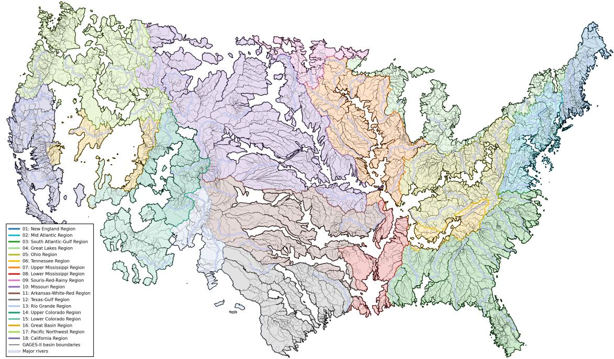  
Figure A.1: Spatial coverage of the 9,067 BASINGRID basins used for Basin2Vec pretraining. Colors denote HUC-2 hydrologic regions, and major rivers are shown in light blue.

Basin metadata. The BASINGRID metadata file contains raw basin geometry, patch-scale information, and derived standardized variables for all 9,067 basins. Basin2Vec constructs the metadata vector $X _ { b } ^ { \mathrm { m e t a } } \in \mathbb { R } ^ { 1 8 }$ from the standardized fields listed in Table A.3. Right-skewed scale, geometry, boundary, and resolution quantities are log-transformed during preprocessing, after which each feature is standardized across the pretraining basins. Basin identifiers, centroid coordinates, and topology counts are not included. The input schema has 18 fields, of which 15 vary across basins; the final three fields are constant zero. Thus, the metadata provides 15 nonconstant input features, not 18 independently varying quantities.

The same metadata vector is incorporated through gated conditioning in the scale-aware encoder and is used to compute metadata similarity for non-overlapping pairs in the relationaware objective. The pairwise overlap coeficient $\omega _ { i j }$ used to construct overlap and nesting positives is computed separately from basin polygons. The three overlap-summary fields are retained in the metadata schema but are constant zero in the supplied training file and therefore provide no basin-dependent information for conditioning or metadata similarity. They are distinct from the pair-specific polygon overlap coeficients: zero overlap-summary inputs do not imply zero overlap relations or remove overlap/nesting positives from the objective.

Metadata used for RQ1. The metadata-consistency analysis in RQ1 uses a restricted scaleand-shape subset comprising drainage area, perimeter, equivalent diameter, bounding-box width, height, area, diagonal, aspect ratio, and fill fraction, together with compactness, shape index, and solidity. These 12 quantities are standardized before pair construction. Centroid coordinates are not part of the encoder metadata and are not added for RQ1; geographic distance is therefore not an explicit feature in this evaluation. Efective patch-resolution, boundary-complexity, and overlap-summary variables are also excluded. Spatially overlapping and nested basin pairs are removed before selecting metadata-similar and metadata-dissimilar pairs.

Table A.3: Standardized basin metadata fields supplied to Basin2Vec. The final three overlapsummary fields are constant zero in the training metadata file; the remaining 15 fields are nonconstant.
<table><tr><td>Variable</td><td>Quantity</td></tr><tr><td>log_area_km2_z</td><td>Drainage area</td></tr><tr><td>log_perimeter_km_z</td><td>Basin perimeter</td></tr><tr><td>log_equivalent_diameter_km_z</td><td>Equivalent diameter</td></tr><tr><td>log_bbox_width_km_z</td><td>Bounding-box width</td></tr><tr><td>log_bbox_height_km_z</td><td>Bounding-box height</td></tr><tr><td>log_bbox_diagonal_km_z</td><td>Bounding-box diagonal</td></tr><tr><td>log_bbox_aspect_ratio_z</td><td>Bounding-box aspect ratio</td></tr><tr><td>bbox_fill_fraction_z</td><td>Basin-to-bounding-box area ratio</td></tr><tr><td>compactness_z</td><td>Basin compactness</td></tr><tr><td>solidity_z</td><td>Basin solidity</td></tr><tr><td>log_shape_index_z</td><td>Basin shape index</td></tr><tr><td>log_vertex_density_per_km_z</td><td>Boundary vertex density</td></tr><tr><td>log_patch_pixel_width_km_z</td><td>Effective patch-pixel width</td></tr><tr><td>log_patch_pixel_height_km_z</td><td>Effective patch-pixel height</td></tr><tr><td>log_patch_pixel_area_km2_z</td><td>Effective patch-pixel area</td></tr><tr><td>log_overlap_degree_z</td><td>Number of overlapping basins</td></tr><tr><td>max_overlap_strength_z</td><td>Maximum overlap strength</td></tr><tr><td>mean_overlap_strength_z</td><td>Mean overlap strength</td></tr></table>

## A.2.2 Baseline Data

CAMELS-US. The downstream experiments use the 671 CAMELS-US basins with Daymet meteorological forcings and USGS daily streamflow observations [1, 26]. The meteorological inputs are precipitation, shortwave radiation, maximum temperature, minimum temperature, and vapor pressure. Observed discharge is converted to basin-mean runof in mm/day using the corresponding CAMELS drainage area.

The hand-crafted descriptor baseline uses 27 CAMELS attributes describing climate, topography, vegetation, soil, and geology. Table A.4 lists the exact attributes. Categorical identifiers and attributes with missing values are excluded. The resulting vectors are standardized using statistics computed from the supervised training basins only.

Table A.4: CAMELS-US attributes used as the hand-crafted basin descriptor baseline. The descriptor contains 27 variables.  
Group Attributes   
Climate p\_mean, pet\_mean, p\_seasonality, frac\_snow, aridity, high\_prec\_freq, high\_prec\_dur,   
low\_prec\_freq, and low\_prec\_dur   
Topography elev\_mean, slope\_mean, and area\_gages2   
Vegetation frac\_forest, lai\_max, lai\_diff, gvf\_max, and gvf\_diff   
Soil soil\_depth\_pelletier, soil\_depth\_statsgo, soil\_porosity, soil\_conductivity,   
max\_water\_content, sand\_frac, silt\_frac, and clay\_frac   
Geology carbonate\_rocks\_frac and geol\_permeability

Earth-observation embeddings. We additionally compare Basin2Vec with three generalpurpose geospatial representations: AlphaEarth, TESSERA, and SatCLIP [5, 11, 16]. Because these representations are defined over pixels or geographic coordinates, they are spatially aggregated over each CAMELS basin to construct a fixed basin descriptor.

For AlphaEarth, the 64-dimensional annual embedding images are averaged over each basin polygon using Earth Engine region reduction. The resulting annual descriptors from 2017–2024 are then averaged to obtain one vector per basin. For TESSERA, 128-dimensional embeddings from the 2024 product are sampled at basin-interior locations and averaged across those locations. For SatCLIP, the time-invariant 256-dimensional location embeddings are evaluated at the same basin-interior locations and spatially averaged. Each aggregated EO descriptor is $\ell _ { 2 } \cdot$ -normalized and kept fixed during downstream training.

Thus, every representation source provides one time-invariant conditioning vector per basin: a year-averaged Basin2Vec embedding, a CAMELS attribute vector, or a spatially aggregated EO embedding. None of these descriptors is updated by the downstream forecasting models.

## A.3 Downstream Training and Evaluation Details

Task and preprocessing. Each basin representation is used as a fixed conditioning vector and is not fine-tuned during downstream training. The predictor receives Daymet precipitation, shortwave radiation, maximum temperature, minimum temperature, and vapor pressure over a forcing window of $L \in \{ 1 2 0 , 3 6 5 \}$ days and predicts streamflow for the final day of the window. Meteorological observations through the target day are available, corresponding to lead-zero prediction with horizon $H = 1$ . Past streamflow is never provided as an input.

Dynamic forcings and streamflow targets are standardized using statistics computed from the corresponding supervised training split. Predictions are transformed back to the original runof scale before evaluation. Static conditioning vectors are also standardized using the appropriate training scope: all 671 basins for temporal generalization, because the basin set is shared across periods, and only the non-test basins within each spatial fold.

Evaluation splits. Table A.5 summarizes the temporal and spatial evaluation protocols. In RQ2, the same basins appear during model development and evaluation, but the time periods are disjoint. Data from 1990–2009 are used for training and early stopping, while 2010–2014 is held out for final evaluation [10, 12].

In RQ3, the 671 basins are partitioned into six folds without HUC-2 stratification. For each fold, the held-out basins are excluded from supervised training, validation, early stopping, and feature standardization. The remaining basins use 1990–2004 for training and 2005–2014 for validation, while the held-out basins are evaluated over 1990–2014. Thus, every basin is evaluated exactly once as an unseen basin [3, 18, 31].

Descriptor conditioning. Descriptor construction is detailed in Appendix A.2. Basin2Vec uses the normalized year-averaged descriptor $\bar { z } _ { b }$ , whereas the EO baselines use spatially aggregated and normalized embeddings and CAMELS uses its predefined attribute vector. All descriptors remain fixed during downstream training.

Each architecture uses the same conditioning mechanism for every descriptor source. For the LSTM, the descriptor is first projected to a common hidden dimension and concatenated with the meteorological input at every time step. For the attention-based predictors, it is projected to the model dimension and provided as static or exogenous context according to the corresponding architecture. Only the input width of the descriptor projection changes across representation sources.

Optimization and repeatability. All downstream models minimize mean squared error using AdamW, gradient clipping, mixed-precision training, and validation-based early stopping. Reduce-on-plateau scheduling decreases the learning rate by a factor of 0.5 after five epochs without validation improvement. The optimization settings are given in Table A.6.

Table A.5: Downstream streamflow-prediction protocols.
<table><tr><td>Setting</td><td>Protocol</td></tr><tr><td>Task</td><td>Daily streamflow prediction, lead 0, horizon H = 1</td></tr><tr><td>Forcing windows</td><td>L ∈ {120, 365} days</td></tr><tr><td>Dynamic inputs</td><td>Five Daymet meteorological forcings through target day t</td></tr><tr><td>Static input</td><td>One fixed basin descriptor</td></tr><tr><td>Discharge input</td><td>None</td></tr><tr><td>Temporal development</td><td>Same 671 basins, 1990–2009</td></tr><tr><td>Temporal evaluation</td><td>Same 671 basins, 2010–2014</td></tr><tr><td>Spatial evaluation</td><td>Six-fold ungauged-basin cross-validation</td></tr><tr><td>Spatial training</td><td>Non-test basins, 1990–2004</td></tr><tr><td>Spatial validation</td><td>Non-test basins, 2005-2014</td></tr><tr><td>Spatial testing</td><td>Held-out basins, 1990–2014</td></tr><tr><td>Random seeds</td><td>42, 123, and 456</td></tr><tr><td>Metrics</td><td>Basin-level NSE and KGE</td></tr></table>

Each model–descriptor–window configuration is evaluated using seeds 42, 123, and 456. For each seed, evaluation metrics are first computed independently for every basin and summarized by their median across basins. The reported result is the mean and standard deviation of these three seed-specific medians.

Table A.6: Downstream optimization settings.
<table><tr><td>Setting</td><td>Temporal</td><td>Spatial</td></tr><tr><td>Maximum epochs</td><td>40</td><td>30</td></tr><tr><td>Early-stopping patience</td><td>5</td><td>8</td></tr><tr><td>Batch size per GPU</td><td>128</td><td>128</td></tr><tr><td>Optimizer</td><td>AdamW</td><td>AdamW</td></tr><tr><td>Initial learning rate</td><td>10-3</td><td>10-4</td></tr><tr><td>Weight decay</td><td>10-4</td><td>10⁻4</td></tr><tr><td>Training loss</td><td>MSE</td><td>MSE</td></tr><tr><td>Mixed precision</td><td>Yes</td><td>Yes</td></tr><tr><td>Gradient-norm clipping</td><td>1.0</td><td>1.0</td></tr><tr><td>Scheduler factor</td><td>0.5</td><td>0.5</td></tr><tr><td>Scheduler patience</td><td>5</td><td>5</td></tr><tr><td>Minimum learning rate</td><td>10-5</td><td>10-5</td></tr></table>

Model configurations. We evaluate LSTM, TFT, TimeXer, Timer-XL, and iTransformer [15, 20, 22, 23, 37]. Table A.7 reports the shared configuration used for each architecture group. Settings that are not applicable to a particular architecture are omitted by that implementation. KG-SSL comparison. KG-SSL is evaluated only for RQ2 using its unsupervised reconstruction-and-contrastive configuration without static-attribute supervision [13]. Its encoder is a one-layer bidirectional LSTM with hidden dimension 64 and receives the same five meteorological forcings together with observed streamflow. KG-SSL is trained using data from 1990–2009, after which one fixed descriptor is constructed for each basin and used with the matched downstream LSTM at L = 365. The descriptor remains frozen during evaluation over 2010–2014. KG-SSL is not evaluated in RQ3 because constructing its representation requires observed streamflow from the target basin, which is unavailable under zero-shot ungauged-basin transfer.

Evaluation metrics. Predictions are evaluated separately for each basin on the original, unstandardized runof scale. For basin $b ,$ with observed streamflow ${ q } _ { b , t }$ and predicted streamflow $\widehat { q } _ { b , t }$ over $T _ { b }$ evaluation days, the Nash–Sutclife eficiency is

Table A.7: Model hyperparameters used in downstream experiments.
<table><tr><td>Architecture</td><td>Hyperparameter</td><td>Temporal</td><td>Spatial</td></tr><tr><td rowspan="2">LSTM</td><td>Hidden dimension</td><td>128</td><td>256</td></tr><tr><td>Recurrent layers</td><td>2</td><td>2</td></tr><tr><td rowspan="4">Attention-based</td><td>Model dimension</td><td>128</td><td>128</td></tr><tr><td>Attention heads</td><td>8</td><td>8</td></tr><tr><td>Encoder layers</td><td>4</td><td>2</td></tr><tr><td>Feed-forward dimension</td><td>512</td><td>512</td></tr><tr><td rowspan="2">Patch-based</td><td>Patch length</td><td>16</td><td>16</td></tr><tr><td>Patch stride</td><td>8</td><td>8</td></tr><tr><td>All models</td><td>Dropout</td><td>0.15</td><td>0.15</td></tr></table>

$$
\mathrm { N S E } _ { b } = 1 - \frac { \sum _ { t = 1 } ^ { T _ { b } } \left( q _ { b , t } - \widehat { q } _ { b , t } \right) ^ { 2 } } { \sum _ { t = 1 } ^ { T _ { b } } \left( q _ { b , t } - \overline { { q } } _ { b } \right) ^ { 2 } } ,\tag{A.5}
$$

where $\overline { { q } } _ { b }$ is the mean observed streamflow. The Kling–Gupta eficiency is

$$
\mathrm { K G E } _ { b } = 1 - \sqrt { ( r _ { b } - 1 ) ^ { 2 } + ( \alpha _ { b } - 1 ) ^ { 2 } + ( \beta _ { b } - 1 ) ^ { 2 } } ,\tag{A.6}
$$

where

$$
r _ { b } = \mathrm { c o r r } ( q _ { b } , \widehat { q } _ { b } ) , \qquad \alpha _ { b } = { \frac { \sigma _ { \widehat { q } _ { b } } } { \sigma _ { q _ { b } } } } , \qquad \beta _ { b } = { \frac { \widehat { q } _ { b } } { \overline { { q } } _ { b } } } .\tag{A.7}
$$

Here, $r _ { b }$ measures temporal correlation, αb measures variability bias, and $\beta _ { b }$ measures meanflow bias. Both metrics have an optimum of 1, with larger values indicating better performance [14, 25].

For RQ2, each seed is summarized by the median metric across the 671 evaluation basins. For RQ3, predictions from all six held-out folds are combined so that each basin contributes once, and the median is then computed across the full held-out-basin population. In both settings, tables report the mean and standard deviation of these medians over the three seeds. Fold-specific RQ3 results are reported separately in Appendix A.4.

Aggregate improvement summaries. For each architecture $^ { a , }$ let $s _ { a }$ be the Basin2Vec score and $b _ { a }$ the highest score among the alternative descriptors for the same metric and forcing window. The mean relative improvement is 100 $\textstyle { \frac { 1 } { 5 } } \sum _ { a = 1 } ^ { 5 } ( s _ { a } / b _ { a } - 1 )$ . The largest of the four temporal summaries (NSE/KGE, $L = 1 2 0 / 3 6 5 )$ is 8.339% for KGE with $L = 3 6 5$ in Table 2, rounded to 8.3%. For spatial NSE in Table 3, the mean ratio $\textstyle { \frac { 1 } { 5 } } \sum _ { a = 1 } ^ { 5 } s _ { a } / b _ { a }$ is 3.5166, rounded to 3.5. These are arithmetic summaries of the reported basin-median scores across architectures, not ratios of prediction errors or measures of statistical significance.

## A.4 Extended Results for RQ1–RQ3

This section provides complementary analyses for the three research questions. For RQ1, reference-basin similarity maps illustrate the spatial organization of the Basin2Vec embedding space. For RQ2, basin-level distributions are reported for both forcing-window lengths. For RQ3, we report fold-level results and basin-level distributions for the representative L = 365 setting. Because higher NSE and KGE values indicate better performance, CDFs shifted farther to the right represent stronger performance across a larger fraction of basins.

## A.4.1 Reference-Basin Embedding Similarity (RQ1)

To qualitatively examine the organization of the Basin2Vec embedding space, we compute the cosine similarity between selected reference-basin descriptors and all other basin descriptors. For reference basin r and basin $b ,$ the similarity is

$$
s _ { r , b } = \frac { \bar { z } _ { r } ^ { \top } \bar { z } _ { b } } { \Vert \bar { z } _ { r } \Vert _ { 2 } \Vert \bar { z } _ { b } \Vert _ { 2 } } ,\tag{A.8}
$$

where $\bar { z } _ { r }$ and $\bar { z } _ { b }$ are the normalized basin-level descriptors defined in Eq.14.

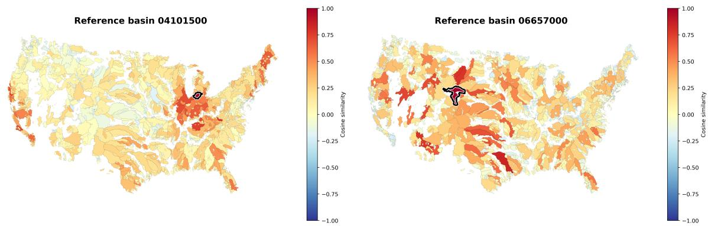  
Figure A.2: Example reference-basin similarity maps for RQ1. Each panel shows the cosine similarity between one selected reference-basin descriptor and all Basin2Vec basin descriptors. The reference basin is outlined in black. Similar basins occur both near and far from each reference, indicating that the learned neighborhoods are not determined solely by geographic proximity.

Figure A.2 shows distinct similarity patterns for the two reference basins. Some geographically distant basins have high similarity, whereas some nearby basins have lower similarity. These maps qualitatively complement the efective-rank and metadata-consistency results in the main paper by illustrating how individual basin neighborhoods vary across the embedding space.

## A.4.2 Basin-Level Temporal Generalization (RQ2)

Figure A.3 complements the aggregate RQ2 results with basin-level NSE distributions. The top and bottom rows correspond to $L = 3 6 5$ and $L = 1 2 0$ , respectively, and each column represents one downstream forecasting architecture. The accompanying boxplots summarize basin-level KGE, while the dashed vertical line in each CDF marks the Basin2Vec median.

The distributions show whether diferences in median performance reflect broad improvements across the basin population or gains concentrated in a smaller subset of basins. The rightward shift of the Basin2Vec curves across architectures and forcing-window lengths supports the aggregate temporal generalization results reported in the main paper.

## A.4.3 Basin-Level Zero-Shot Spatial Transfer (RQ3)

Table A.8 reports fold-level zero-shot spatial-transfer results for $L = 3 6 5$ . Each entry gives the median NSE/KGE across the held-out basins in one fold. Basin2Vec achieves the strongest performance in every fold and downstream architecture, showing that its spatial-transfer gains are not driven by a single basin partition.

Table A.8: Fold-level zero-shot spatial-transfer results for L = 365. Each entry reports median NSE/KGE across the unseen basins in that fold. B2V, AE, Attr., TES., and Sat. denote Basin2Vec, AlphaEarth, CAMELS attributes, TESSERA, and SatCLIP, respectively. Bold indicates the best result.
<table><tr><td>FoldModel</td><td></td><td>B2V</td><td>AE</td><td>Attr.</td><td>TES.</td><td>Sat.</td></tr><tr><td rowspan="4">0</td><td>LSTM</td><td>0.479/0.381</td><td>0.179/ /-0.064</td><td>0.093/-0.082 0.253/0.024</td><td>0.081/-0.127 0.127/-0.090</td><td>0.219/-0.016 0.154/-0.079</td></tr><tr><td>TFT TimeXer</td><td>0.516/0.420</td><td>0.209/0.004</td><td>0.010/-0.095</td><td></td><td></td></tr><tr><td>Timer-XL</td><td>0.489/0.408</td><td>0.088/-0.052 0.181/-0.038</td><td></td><td>-0.270/-0.319</td><td>0.211/0.019</td></tr><tr><td>iTrans.</td><td>0.515/0.504 0.440 /0.411</td><td>0.200/0.010 0.056</td><td>0.207/-0.009 /-0.011</td><td>-0.146/ /-0.123 0.077/ /-0.166</td><td>0.112/-0.022 0.123/ /-0.065</td></tr><tr><td rowspan="4">1</td><td>LSTM TFT</td><td>0.434/0.442 0.495/0.365</td><td>0.162 /-0.008 0.225/0.038</td><td>0.136 /-0.028 0.110/ /-0.126</td><td>-0.004/ /-0.118 0.204/0.016</td><td>0.017 /-0.047 0.206/-0.062</td></tr><tr><td>TimeXer</td><td>0.466/0.452</td><td>0.240/0.126</td><td>0.095/-0.041</td><td>0.187/0.000</td><td>0.140/-0.032</td></tr><tr><td>Timer-XL</td><td>0.486/0.402</td><td>0.207/0.088</td><td>0.133/0.016</td><td>0.020/-0.081</td><td>0.171/0.048</td></tr><tr><td>iTrans.</td><td>0.421 /0.362 0.239/</td><td>/0.103 0.043</td><td>/-0.096</td><td>0.157/-0.045</td><td>0.017/ /-0.142</td></tr><tr><td rowspan="5">2</td><td>LSTM TFT</td><td>0.437 /0.333 0.499/ /0.374-0.041/</td><td>-0.029 -0.147 /-0.146</td><td>0.000 -0.165</td><td>0.084/ /-0.057</td><td>0.050/ /-0.098</td></tr><tr><td>TimeXer</td><td>0.480/0.386</td><td>0.050/ /-0.143</td><td>0.158 /-0.118 0.061/ /-0.070</td><td>0.190/-0.034 0.026/-0.097</td><td>0.065/ /-0.144 0.000/-0.136</td></tr><tr><td>Timer-XL</td><td>0.482/0.383</td><td>/-0.066</td><td>-0.040/-0.122</td><td>0.025/-0.182</td><td>-0.036/-0.141</td></tr><tr><td>iTrans.</td><td>0.479 /0.339</td><td>0.070/ 9-0.083/</td><td></td><td></td><td></td></tr><tr><td>LSTM</td><td>0.466 /0.415</td><td>/-0.166-0.003/</td><td>/-0.141</td><td>0.071/-0.166</td><td>-0.077/-0.218</td></tr><tr><td rowspan="4">3</td><td>TFT TimeXer</td><td>0.515/0.425</td><td>0.089 /-0.055 0.136/ /-0.041</td><td>0.082 -0.047 0.113/-0.084</td><td>0.105/-0.001</td><td>0.015/ /-0.125 0.114/-0.025</td></tr><tr><td></td><td>0.494/0.450</td><td>0.205/0.083</td><td></td><td>0.102/-0.022</td><td></td></tr><tr><td>Timer-XL|</td><td>0.480/0.412</td><td></td><td>0.054/-0.029</td><td>0.092/0.051</td><td>0.062/-0.045</td></tr><tr><td>iTrans.</td><td>0.436 /0.343</td><td>0.198/0.045 0.069/ -0.099</td><td>-0.003 -0.104</td><td>0.051/ -0.088</td><td>0.160/0.016</td></tr><tr><td rowspan="4">4</td><td>LSTM TFT TimeXer</td><td>0.438 /0.407 0.533 /0.489</td><td>0.171/0.079 0.001/ -0.098 0.121/-0.136</td><td>-0.029/ -0.177</td><td>0.105 -0.063 0.085/ -0.021 0.096/-0.101</td><td>0.075/ /-0.036 0.215/ -0.028 0.046/-0.162</td></tr><tr><td></td><td>0.496/0.427</td><td>0.043 /-0.065</td><td>0.047/-0.140 -0.121/-0.150</td><td>0.071/-0.063</td><td>0.141/-0.058</td></tr><tr><td>Timer-XL| iTrans.</td><td>0.477/0.443</td><td>0.142/0.005</td><td>-0.082/-0.192-</td><td>2-0.048/ /-0.154</td><td>0.147/-0.094</td></tr><tr><td>LSTM TFT</td><td>0.481/0.390 0.130/ 0.496 /0.443 -0.006 0.564/0.515 0.113/ /-0.163</td><td>/-0.107 /-0.155 0.086</td><td>-0.162/ /-0.113 -0.090</td><td>0.054/ /-0.097 0.193/ /0.014</td><td>0.088/ /-0.119 0.110/ /-0.135</td></tr></table>

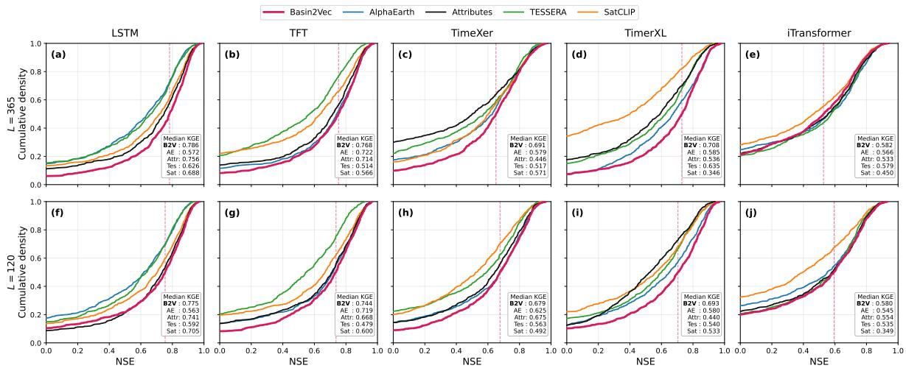  
Figure A.3: Basin-level performance distributions for RQ2 temporal generalization. Rows correspond to forcing-window lengths $L = 3 6 5$ and $L = 1 2 0$ , and columns correspond to downstream forecasting architectures. The CDFs report NSE, while the accompanying boxplots summarize KGE across the same evaluation basins.

Figure A.4 complements the fold-level results with basin-level NSE and KGE distributions aggregated across the held-out basins for $L = 3 6 5$ . The top row reports NSE, the bottom row reports KGE, and each column corresponds to a downstream forecasting architecture. The dashed vertical line marks the Basin2Vec median in each panel.

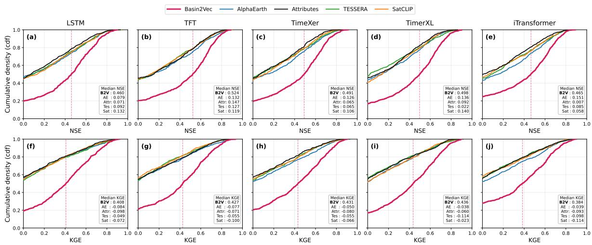  
Figure A.4: Basin-level performance distributions for RQ3 zero-shot spatial transfer at $L = 3 6 5$ . The top row reports NSE and the bottom row reports KGE across held-out basins. Columns correspond to downstream forecasting architectures, and curves compare Basin2Vec, AlphaEarth, CAMELS attributes, TESSERA, and SatCLIP.

Together, the fold-level results and CDFs show that Basin2Vec’s improvements persist across alternative basin partitions and throughout the held-out-basin population, including the lower-performing tail.

Why does the LSTM outperform the attention-based predictors? The LSTM generally performs better than the attention-based architectures in our experiments. This is consistent with large-sample hydrology studies showing that LSTMs provide a strong inductive bias for rainfall–runof modeling [19]. Attention-based models can capture longrange dependencies, but their advantage is not universal and depends on the task and data regime [20, 38]. In our setting, the forcing history is limited to $L \in \{ 1 2 0 , 3 6 5 \}$ days, and basinspecific information is already supplied through a fixed descriptor. This reduces the need for the downstream predictor to infer long-range basin context solely from meteorological inputs. We therefore interpret the LSTM’s stronger performance as specific to this experimental setting rather than a general superiority over attention-based architectures.

## A.5 Metadata Conditioning and Grouped Objective Ablations

Configuration identity. Table 4 provides the authoritative values for the configurations summarized here. Its “hard positive only” variant retains direct metadata conditioning while using augmentation positives and uniform contrastive-denominator weights. Accordingly, this row is labeled Base + metadata in Table A.10, rather than Base. Its temporal NSE/KGE is 0.670/0.647 and spatial NSE/KGE is 0.372/0.332. The separately supplied 0.68/0.69 temporal and 0.43/0.38 spatial summaries are not used for this configuration because their correspondence to a distinct run configuration has not been established. No verified result is available for Base without direct metadata conditioning; its cells remain unreported.

Scope of the grouped comparison. Table A.9 distinguishes the reported positive-pair and denominator rules. Other objective terms follow Table 4. In particular, the “hard positive only” row alone does not establish that the negative-margin objective was disabled. These rows therefore do not constitute a completed, strictly controlled two-by-two factorial experiment. Base + relations corresponds to Table 4’s variant without metadata conditioning, while Full uses all components. Area regularization remains active in these Table 4 variants. Polygon-based overlap relations are distinct from the constant-zero overlap-summary input fields in Table A.3.

Evaluation and interpretation. The reported Table 4 results use LSTM with L = 365 under temporal and six-fold spatial evaluation, summarized as mean ± standard deviation across three seeds. Full exceeds the metadata-conditioned hard-positive control by 0.112 NSE and 0.139 KGE temporally, and 0.088 NSE and 0.076 KGE spatially. Relative to the variant without direct metadata conditioning, the gains are 0.148/0.171 temporally and 0.396/0.467 spatially. These observations support the importance of metadata conditioning and the benefit of the complete objective over the hard-positive control. They do not isolate an individual loss component or establish statistical significance.

Limits. Table A.11 gives arithmetic diferences between the central values in Table 4. No factorial interaction is estimated because the Base cell is unreported, and paired uncertainty for the diferences cannot be recovered from marginal standard deviations alone. Every reported variant retains area supervision, and the relational objective can use metadata; “without direct metadata conditioning” is not equivalent to metadata-free learning. This comparison also does not establish metadata parity for external EO or CAMELS descriptors.

Table A.9: Configuration identities for the grouped comparison. Reported configurations and objective terms follow Table 4. Base is unreported and is not assigned an inferred result.
<table><tr><td>Configuration</td><td>Direct metadata</td><td>Positive-pair rule</td><td>Denominator weights</td></tr><tr><td>Base</td><td>Off</td><td>Not evaluated here</td><td>Not evaluated here</td></tr><tr><td>Base + metadata</td><td>On</td><td>Hard positives only</td><td>Uniform</td></tr><tr><td>Base + relations</td><td>Off</td><td>Full relation-aware positives</td><td>Metadata-weighted</td></tr><tr><td>Full Basin2Vec</td><td>On</td><td>Full relation-aware positives</td><td>Metadata-weighted</td></tr></table>

Table A.10: Grouped ablation results from Table 4 using LSTM with $L = 3 6 5$ . Values are mean ± standard deviation across three seeds; spatial evaluation uses six folds. Base + metadata is Table 4’s “hard positive only” variant; Base + relations is its “without metadata conditioning” variant. A dash indicates an unreported result, not zero.
<table><tr><td></td><td colspan="2">Temporal</td><td colspan="2">Spatial</td></tr><tr><td>Configuration</td><td>NSE ↑</td><td>KGE↑</td><td>NSE↑</td><td>KGE↑</td></tr><tr><td>Base</td><td></td><td></td><td></td><td></td></tr><tr><td> $\mathrm { B a s e \mathrm { ~ + ~ } m e t a d a t a }$ </td><td> $0 . 6 7 0 \pm 0 . 0 0 9$ </td><td> $0 . 6 4 7 \pm 0 . 0 2 1$ </td><td> $0 . 3 7 2 \pm 0 . 0 1 0$ </td><td> $0 . 3 3 2 \pm 0 . 0 2 1$ </td></tr><tr><td>Base + relations</td><td> $0 . 6 3 4 \pm 0 . 0 2 2$ </td><td> $0 . 6 1 5 \pm 0 . 0 1 7$ </td><td> $0 . 0 6 4 \pm 0 . 0 4 4$ </td><td> $- 0 . 0 5 9 \pm 0 . 0 4 4$ </td></tr><tr><td>Full Basin2Vec</td><td> $0 . 7 8 2 \pm 0 . 0 0 9$ </td><td> $0 . 7 8 6 \pm 0 . 0 1 1$ </td><td> $0 . 4 6 0 \pm 0 . 0 5 0$ </td><td> $0 . 4 0 8 \pm 0 . 0 0 1$ </td></tr></table>

Table A.11: Descriptive Full-model gains calculated from the central values in Table 4. No significance or factorial interaction is inferred.
<table><tr><td rowspan="2">Contrast</td><td colspan="2">Temporal</td><td colspan="2">Spatial</td></tr><tr><td>∆NSE</td><td>∆KGE</td><td>∆NSE</td><td>∆KGE</td></tr><tr><td>Full - metadata-conditioned hard-positive control</td><td>+0.112</td><td>+0.139</td><td>+0.088</td><td>+0.076</td></tr><tr><td>Full — without-metadata-conditioning control</td><td>+0.148</td><td>+0.171</td><td>+0.396</td><td>+0.467</td></tr></table>