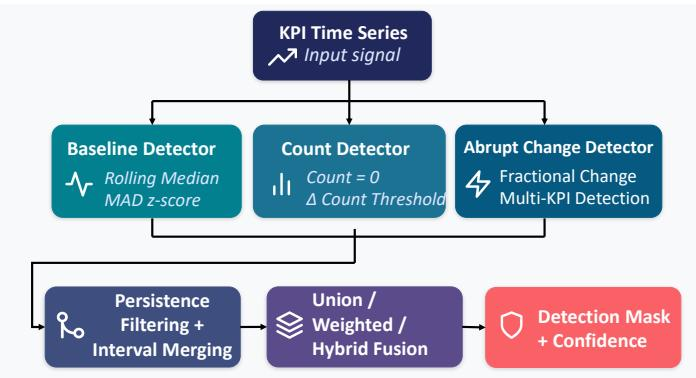
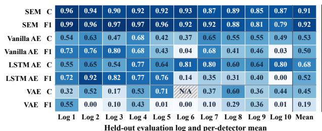
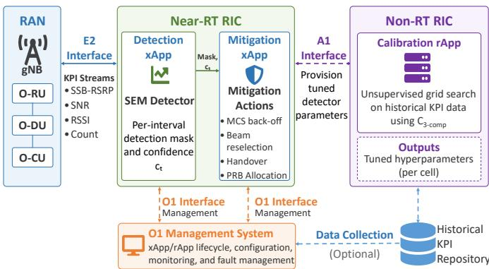

# Benchmarking Unsupervised Jamming Detection in 5G Open RAN

Sneihil Gopal‡†, Fernando J. Cintron´ ⋆, and Richard A. Rouil⋆

‡PREP Associate, National Institute of Standards and Technology (NIST), USA

†Department of Physics, Georgetown University, USA

⋆National Institute of Standards and Technology (NIST), USA.

Emails: {sneihil.gopal, fernando.cintron, richard.rouil}@nist.gov

Abstract—Radio Frequency (RF) jamming threatens fifthgeneration (5G) networks. Open Radio Access Network (Open RAN) telemetry enables jamming detection without dedicated spectrum monitoring equipment, but labeled attack data are rarely available across deployments, motivating unsupervised detectors. Comparing such detectors across algorithmic families, however, remains difficult without ground-truth labels. This paper benchmarks statistical and reconstruction-based unsupervised jamming detectors using a symmetric evaluation interface that combines detection confidence and temporal interval coherence into a detector-independent composite score. We compare a Statistical Ensemble Method (SEM) detector against Vanilla, Long Short-Term Memory (LSTM), and Variational Autoencoder (VAE) baselines on Key Performance Indicator (KPI) telemetry from ten heterogeneous 5G environments with fixed and variable jamming bursts and dynamic jammer gains. Under leave-oneout (LOO) evaluation, SEM achieves a mean composite score of 0.906, compared with 0.688 for the best autoencoder (AE) per fold. Ground-truth validation yields a mean F1-score of 0.918 for SEM, compared with 0.521 for the best AE variant. The composite ranks SEM first in all environments, consistent with F1 rankings. However, in both within-trace and cross-trace evaluation, it fails for detectors that flag far fewer samples than the jamming prevalence, indicating that rankings are reliable only when detection rate matches the expected prevalence.

## I. INTRODUCTION

Radio Frequency (RF) jamming poses a persistent threat to fifth-generation (5G) networks by disrupting legitimate transmissions at the physical layer without requiring protocol-level access [1]. The disaggregated Open Radio Access Network (Open RAN) architecture creates opportunities for interference detection through network telemetry, including Synchronization Signal Block (SSB)-Reference Signal Received Power (RSRP) statistics, the count of completed reference signal measurements, Signal-to-Noise Ratio (SNR), and Received Signal Strength Indicator (RSSI) [2]. These measurements provide observable signatures of jamming without additional spectrum monitoring equipment. However, their responses vary with jammer gain, burst duration, traffic conditions, and the number of connected User Equipments (UEs). Furthermore, representative labeled attack data are rarely available across deployment environments, motivating detection methods that operate without labeled attack examples.

Two widely used families of detectors meet this requirement. Statistical ensembles flag deviations from adaptive baselines, whereas autoencoders (AEs) learn nominal behavior and flag high reconstruction error [3,4]. Their outputs, however, are not directly comparable, since ensembles express confidence through agreement among component detectors and AEs through normalized reconstruction-error magnitude. Existing unsupervised evaluation methods assume a common anomaly-score representation or a single detector family [5], leaving cross-family comparison without ground truth largely unaddressed. To address this gap, we propose a symmetric evaluation interface that exposes only a binary detection mask and an associated confidence score from each detector. From these outputs, mean detection confidence and temporal interval coherence form a label-free composite score. However, a common interface does not imply equivalent confidence semantics or guarantee that higher composite scores correspond to better detection accuracy. For example, a detector that raises a few confident, contiguous alarms can score well while missing most jamming, and a detector that stays silent or flags almost everything is also unreliable. Composite rankings must therefore be checked against ground truth.

This paper performs that check on Open RAN telemetry from ten heterogeneous 5G environments with fixed and variable jamming bursts and dynamic jammer gains. It compares our previously proposed Statistical Ensemble Method (SEM) detector [6] with Vanilla, Long Short-Term Memory (LSTM), and Variational Autoencoder (VAE) baselines under homogeneous (within-trace) and heterogeneous (cross-trace) evaluation, where the latter employs leave-one-out (LOO) validation to examine cross-environment generalization. In contrast to [6], where SEM was evaluated against supervised Machine Learning (ML) and Deep Learning (DL) classifiers, in this work, we calibrate SEM without labels by maximizing an unsupervised composite score and compare it with detectors that also need no attack labels. Further, we use groundtruth annotations only to curate nominal AE training and validation samples and to assess performance independently. They play no role in SEM calibration, AE threshold selection, or composite score computation.

Our contributions are twofold. First, we propose a symmetric evaluation framework that compares statistical and reconstruction-based unsupervised jamming detectors while preserving each family’s native calibration, and we apply it across ten heterogeneous 5G Open RAN environments. Second, we validate the unsupervised composite against independent ground-truth metrics. Under LOO evaluation, the composite ranks SEM (mean F1-score of 0.918) above all AE baselines (at most 0.521) in every environment. Across the ten logs, SEM’s composite scores also correlate with its F1-scores. However, in both within-trace and cross-trace evaluation, composite score fails to rank detectors that flag far fewer samples than the true jamming prevalence, indicating that composite scores are reliable only when the detection rate is close to the expected prevalence.

The remainder of this paper is organized as follows. Section II reviews related work. Section III presents the detector families and the evaluation framework. Section IV describes the experimental methodology. Section V presents the results and Section VI concludes the paper.

## II. RELATED WORK

Statistical detection of cellular Key Performance Indicator (KPI) anomalies is well established. Robust z-score thresholding against a moving baseline is a standard approach [7], while ensemble methods fuse several such tests into one detector [3]. SEM [6] follows this line, making explicit the persistence filtering and interval merging such ensembles typically apply implicitly. The learning-based alternative, the AE, trains on nominal data and flags high reconstruction error [4], extended to time series via LSTM [8] and to a probabilistic form via VAEs [9], with applications to Internet of Things (IoT) jamming detection [10].

5G-specific jamming detection has been investigated through classification of In-Phase and Quadrature (IQ) samples using Bayesian methods [11] and spectrogram analysis using supervised and unsupervised models [12]. Closer to our setting, Open RAN testbeds detect jamming and signalingstorm anomalies from standard-interface telemetry [13,14], and our prior work compared SEM with supervised ML and DL classifiers across heterogeneous environments [6]. These studies, however, calibrate or score detectors against labeled reference data and focus on detector design rather than on the reliability of label-free comparisons across detector families.

Unsupervised evaluation itself has received relatively little attention. Excess-Mass and Mass-Volume curves provide Receiver Operating Characteristic (ROC)- and precision-recall (PR)-consistent rankings in many cases without labels, though volume estimation restricts their applicability in higher dimensions [5]. A composite of detection density and interval contiguity also anticipates one of our components [15]. Both approaches target a single detector or a shared anomalyscore representation, and neither establishes when label-free scores remain consistent with detection accuracy. This work addresses that gap. It checks label-free rankings of different detector families against the F1-score across heterogeneous Radio Access Network (RAN) environments, and shows that these rankings are reliable only when a detector’s detection rate matches the expected jamming prevalence.

  
Fig. 1: Overview of the SEM detection pipeline [6].

## III. PROPOSED FRAMEWORK

This section presents the two detector families evaluated in this work, followed by the symmetric evaluation framework used for their comparison.

## A. SEM Detector

Figure 1 summarizes the SEM pipeline [6]. SEM operates on nine KPIs: six SSB-RSRP statistics (minimum, first quartile, median, third quartile, maximum, and mean), the Count of completed SSB-RSRP measurements, SNR, and RSSI. It combines three complementary statistical sub-detectors: (i) the baseline detector b flags robust z-score deviations from rolling median baselines, (ii) the count detector c flags collapses and abrupt changes in the number of completed SSB-RSRP measurements, and (iii) the abrupt-change detector a flags sudden KPI transitions relative to each KPI’s range. Each sub detector $i \in \{ b , c , a \}$ produces a binary mask $M _ { i } = \{ M _ { i , t } \}$ where $M _ { i , t } = 1$ flags sample t as jamming.

Post-processing: Persistence filtering and interval merging suppress isolated flags and join nearby detections, rejecting runs shorter than N samples and merging intervals separated by at most G samples [6]. The refined masks are denoted M′.

Fusion: Three fusion schemes, Union, Weighted, and Hybrid, combine the refined masks into a final detection mask M and a per-sample confidence score

$$
c _ { t } = \frac { w _ { b } M _ { b , t } ^ { \prime } + w _ { c } M _ { c , t } ^ { \prime } + w _ { a } M _ { a , t } ^ { \prime } } { w _ { b } + w _ { c } + w _ { a } } ,\tag{1}
$$

where $( w _ { b } , w _ { c } , w _ { a } )$ are the sub-detector weights. All three schemes report the same confidence score but differ in how the final mask is determined. Union declares a detection whenever any sub-detector fires, $M _ { t } = M _ { b , t } ^ { \prime } \lor M _ { c , t } ^ { \prime } \lor M _ { a , t } ^ { \prime }$ . Weighted thresholds the confidence directly, $M _ { t } = \mathbb { 1 } [ c _ { t } \geq \tau ]$ . Hybrid gives Count unconditional priority because $\mathrm { C o u n t } _ { t } = 0$ is a strong signature of high-gain jamming under the considered testbed conditions, while requiring sufficient confidence before accepting detections from the remaining two sub-detectors:

$$
M _ { t } = M _ { c , t } ^ { \prime } \vee \left( M _ { b , t } ^ { \prime } \wedge ( c _ { t } \geq 0 . 5 ) \right) \vee \left( M _ { a , t } ^ { \prime } \wedge ( c _ { t } \geq 0 . 6 ) \right)\tag{2}
$$

Hybrid is used throughout the remainder of the paper. An ablation against the Union and Weighted rules is presented in Section V-C.

Unsupervised calibration: The detector thresholds, postprocessing lengths, fusion weights, and Weighted threshold $\tau$ defined in [6] are selected independently for each trace through a grid search, with the rolling-window length held fixed. Instead of the supervised criterion used in [6], the search maximizes the SEM-native three-component composite defined in Section III-C, using only detector outputs and the observed KPI time series.

## B. AE Baselines

We consider three AE baselines, namely Vanilla, LSTM, and VAE. Each learns a model of nominal KPI behavior and flags samples whose reconstruction error is anomalously high. Unlike SEM, which builds its baseline directly from the test trace, the AEs must first be trained on nominal data. This training data comes from the same trace in the homogeneous regime and from the other traces in the heterogeneous regime as described in Section IV.

Architectures: The three architectures span feedforward, temporal, and probabilistic reconstruction models trained with mean squared error (MSE) loss. The Vanilla AE uses a feedforward encoder-decoder with a 64-dimensional latent space [4], the LSTM AE encodes 10-sample windows into a 32-dimensional latent space to capture temporal dependencies [8], and the VAE learns a probabilistic 64-dimensional latent representation [9].

Training: The AEs take 414 temporal and statistical features engineered from the nine KPIs, including rolling statistics, lags, differences, cross-KPI ratios, and local spectral summaries, scaled to [0, 1] on the training partition. They are trained for 30 epochs with Adam (learning rate $1 0 ^ { - 3 }$ , batch size 32) only on nominal samples curated with the jammer trigger signal, an idealized clean-data assumption that favors the AEs. In contrast, SEM requires no training data.

Threshold selection: Each AE computes a per-sample reconstruction error $e _ { t } ,$ the discrepancy between the input at time t and its reconstruction. The anomaly threshold is defined as $\theta = \bar { e } _ { \mathrm { n o r m a l } } + k \sigma _ { e _ { \mathrm { n o r m a l } } }$ , where $\bar { e } _ { \mathrm { n o r m a l } }$ and $\sigma _ { e _ { \mathrm { n o r m a l } } }$ are the mean and standard deviation of the reconstruction error computed from the normal validation subset, and k is a sensitivity multiplier. We sweep $k \in \{ 1 . 0 , 1 . 5 , 2 . 0 , 2 . 5 , 3 . 0 \}$ and select the value maximizing the proposed unsupervised twocomponent composite on the complete, unlabeled validation partition, without using trigger labels. Under heterogeneous evaluation, this partition is drawn from the source traces, so the AEs are never tuned on the target trace. Each test sample is classified as $M _ { t } = \mathbb { 1 } [ e _ { t } > \theta ]$ , producing a binary detection mask with the same semantics as in Section III-A. A confidence score $c _ { t } = ( e _ { t } - e _ { \operatorname* { m i n } } ) / ( e _ { \operatorname* { m a x } } - e _ { \operatorname* { m i n } } )$ is then computed and clipped $\mathrm { t o } \ [ 0 , 1 ]$ , where $e _ { \mathrm { m i n } }$ and $e _ { \mathrm { m a x } }$ denote the minimum and maximum reconstruction errors over the test partition.

## C. Evaluation Framework

This subsection presents the symmetric evaluation framework used to compare both detector families while preserving their native calibration procedures.

Design properties: A metric supporting architectureindependent comparison of unsupervised detectors should satisfy four properties. Only metrics satisfying all four qualify as composite components.

• P1. Architecture-independent computability. Depends only on the detector output (mask and confidence) and the observed KPI series, not on internal representations like subdetector masks or latent-space reconstruction error.

• P2. Boundedness. Lies in a fixed range, here [0, 1], so detectors with different confidence scales can be aggregated.

• P3. Detection-conditioned monotonicity. Higher anomaly confidence and greater temporal coherence should not decrease the score.

• P4. Failure-mode visibility. Detectors producing no detections (silence) are distinguished from detectors producing poor detections, since these require different operational responses.

Two component scores satisfy all four properties. The mean confidence $c _ { \mathrm { c o n f } }$ is the average detector confidence over all detected samples. The interval coherence $c _ { \mathrm { c o h } }$ combines interval length and fragmentation, rewarding long contiguous detections. P1 and P2 ensure that the confidence measures are computable and share a common range, not that they have identical semantics. SEM’s confidence reflects sub-detector agreement, whereas AE confidence reflects normalized reconstructionerror magnitude. Accordingly, $c _ { \mathrm { c o n f } }$ compares the strength of each detector’s exported confidence signal rather than architecture-independent anomaly evidence. Unlike conventional formulations that assign zero to empty detection sets, the proposed framework reports the composite as undefined, explicitly identifying silence (P4). Because P3 conditions both components on detected samples, neither measures how much of the jamming activity is covered. This coverage gap is addressed by the detection-rate diagnostic below and examined empirically in Section V-B.

Several intuitive alternatives fail at least one property. Output entropy is not detection-conditioned (P3 and P4), coverage depends on KPI-specific normalization (P2), and detection rate is bounded but is not monotonically related to detector quality because both silence and saturation can correspond to poor operational behavior. Training stability based on repeated model fitting is not naturally applicable to deterministic statistical detectors such as SEM (P1), while cross-detector consensus is undefined for monolithic detectors like the AEs (P1).

Component scores and composites: For SEM, $c _ { \mathrm { c o n f } }$ is the weighted vote ratio defined in Section III-A, and for each AE it is the normalized reconstruction error defined in Section III-B. Given $N _ { \mathrm { d e t } }$ detected samples grouped into $n _ { \mathrm { i n t } }$ contiguous intervals of mean length $\bar { L } = N _ { \mathrm { d e t } } / n _ { \mathrm { i n t } }$

$$
c _ { \mathrm { c o h } } = 0 . 6 \ \operatorname* { m i n } \left( { \frac { \bar { L } } { 5 } } , 1 \right) + 0 . 4 \ \operatorname* { m a x } \left( 0 , 1 - { \frac { 2 } { \bar { L } } } \right) ,\tag{3}
$$

where the weights and the five-sample saturation length are set heuristically. The head-to-head composite is

$$
C _ { 2 - \mathrm { c o m p } } = \frac { c _ { \mathrm { c o n f } } + c _ { \mathrm { c o h } } } { 2 } ,\tag{4}
$$

and it is reported as undefined when a detector produces no detections. The SEM-native composite

$$
C _ { 3 - \mathrm { c o m p } } = \frac { c _ { \mathrm { c o n f } } + c _ { \mathrm { c o h } } + c _ { \mathrm { k p i } } } { 3 }\tag{5}
$$

adds the cross-KPI consistency $c _ { \mathrm { k p i } } ,$ , the mean fraction of the per-KPI abrupt-change masks that flag each detected sample. Because $c _ { \mathrm { k p i } }$ requires SEM’s internal per-KPI masks, it violates P1 and is used only for SEM hyperparameter selection.

Standalone diagnostics: Two diagnostics are reported alongside the composite but intentionally excluded from it. The detection rate $N _ { \mathrm { d e t } } / N$ , where N is the number of evaluated samples, is compared against an operator prior on jamming prevalence to identify silence, under-detection, and saturation. The interval count $n _ { \mathrm { i n t } }$ characterizes alarm fragmentation. Neither satisfies P3, but Section V-B shows that the detection rate is required to determine when composite rankings can be trusted.

## IV. EXPERIMENTAL METHODOLOGY

This section describes the telemetry and threat model, the ten-trace dataset and its cell-level aggregation, and the two cross-validation regimes used to evaluate both detector families. It also defines the ground-truth metrics used to validate the unsupervised composite independently of detector calibration.

Telemetry and KPIs: We consider a 5G Open RAN deployment operating in Band n78 (3.3 to 3.8 GHz) with one or more UEs under downlink traffic. The Next Generation Node-B (gNB) exposes the nine per-measurement-interval KPIs of Section III-A through standard Open RAN interfaces. SEM operates on these KPIs directly, whereas the AEs receive the 414 features engineered from them (Section III-B).

Threat model: The threat is an external RF jammer transmitting into the cell’s operating band and cycled on and off, with fixed or dynamically varying gain. Jamming disrupts reception of the SSBs from which the RSRP measurements are derived, so that under high-gain jamming the receiver may fail to complete the measurement procedure and Count collapses toward zero. The direction of the SSB-RSRP shift is testbeddependent, since the receiver may lose the legitimate signal (RSRP decreases) or lock onto the jammer (RSRP increases). SNR and RSSI exhibit similar variability.

Dataset: The dataset comprises ten KPI traces collected from a 5G Open RAN testbed and summarized in Table I, spanning 34.7 hours of heterogeneous operating conditions. Logs 1 to 8 use constant gains of 45 or 48 dB with fixed or variable burst durations, while Logs 9 and 10 use shorter irregular bursts with gains varying between 48 and 60 dB. The traces also vary the number of attached UEs and the recording duration. For multi-UE configurations, the 185,814 per-UE reports are aggregated into 123,040 cell-level observations by timestamp. Count and minimum RSRP use the minimum across UEs, maximum RSRP uses the maximum, and the remaining channels use the mean. The ground-truth state is combined using logical OR across UEs. Ground-truth labels derived from the jammer trigger are used only to curate the AE nominal training and validation subsets (Section III-B) and for independent performance assessment. They are never used for SEM calibration, selection of the AE multiplier k, detector inference, or composite computation.

<table><tr><td>Log</td><td>UEs</td><td>Duration ON (s)</td><td></td><td>Gain (dB)</td><td>Samples</td><td>Jam (%)</td></tr><tr><td>1</td><td>3</td><td>68 min</td><td>60</td><td>48</td><td>12,185</td><td>56.3</td></tr><tr><td>2</td><td>2</td><td>62 min</td><td>60</td><td>48</td><td>7,467</td><td>56.4</td></tr><tr><td>3</td><td>2</td><td>43 min</td><td>60</td><td>48</td><td>5,131</td><td>57.7</td></tr><tr><td>4</td><td>1</td><td>47 min</td><td>60</td><td>48</td><td>2,810</td><td>59.1</td></tr><tr><td>5</td><td>1</td><td>79 min</td><td>30</td><td>48</td><td>4,749</td><td>40.8</td></tr><tr><td>6</td><td>1</td><td>15 min</td><td>60</td><td>45</td><td>925</td><td>58.8</td></tr><tr><td>7</td><td>1</td><td>3.1 h</td><td>[10,30]</td><td>45</td><td>10,980</td><td>20.5</td></tr><tr><td>8</td><td>1</td><td>18.1 h</td><td>[10, 30]</td><td>45</td><td>65,074</td><td>22.7</td></tr><tr><td>9</td><td>3</td><td>2.0 h</td><td>[5, 14]</td><td>[48, 60]</td><td>17,465</td><td>26.0</td></tr><tr><td>10</td><td>3</td><td>6.3 h</td><td>[5, 14]</td><td>[48, 60]</td><td>59,028</td><td>19.9</td></tr></table>

TABLE I: Dataset summary. Samples are per-UE reports, and Jam is the fraction of labeled reports under jamming.

Cross-Validation (CV) protocol: Two regimes assess detector behavior within and across environments. In the homogeneous regime (single-file CV), each trace is evaluated independently. SEM operates retrospectively on the full trace, while the AEs use a 70/15/15 temporal train/validation/test split with nominal-only training and are evaluated on the test partition. SEM predictions are restricted to the same test observations, and Log 10 is excluded because its test partition contains no jamming. In the heterogeneous regime (multi-file LOO CV), each of the ten traces is held out once. The AEs train on nominal samples from the remaining nine traces, validate on their chronologically last 15 %, and are applied to the held-out trace without retraining, while SEM operates retrospectively on the held-out trace. Because SEM is calibrated directly on each evaluation trace, this regime tests cross-environment transfer for the AEs but not source-to-target parameter transfer for SEM.

Independent performance validation: All detection results are computed on the cell-level observations. Detector outputs are evaluated retrospectively against ground truth using precision, recall, F1-score, F2-score, event recall, false-alarm intervals per 1,000 evaluated samples, and onset delay. A jamming event is a contiguous labeled interval, detected if any alarm interval overlaps it. A false-alarm interval overlaps no event, and onset delay is the samples from event start to first alarm. Paired Wilcoxon signed-rank tests across folds assess whether F1-score differences between detectors are significant. Agreement between $C _ { 2 - \mathrm { c o m p } }$ and F1-score rankings is assessed per fold and through Spearman and Kendall correlations pooled over all scored detector-fold pairs. Finally, the ratio r of detection rate to jamming prevalence identifies when composite rankings are reliable.

  
Fig. 2: Per-log composite (C) and F1 under LOO evaluation.

## V. RESULTS AND DISCUSSION

This section compares the detectors under the composite and ground truth in both regimes, examines when composite rankings agree with ground truth and the prevalence condition for their reliability, and closes with the fusion ablation, limitations, and Open RAN deployment implications.

## A. Composite and Ground-Truth Performance

Heterogeneous evaluation: In Figure 2, SEM’s mean $C _ { 2 - \mathrm { c o m p } }$ is 0.906 versus 0.688 for the best AE per fold, and it ranks first in all 10 environments, including the dynamic-gain Logs 9 and 10. Ground truth confirms this lead: SEM reaches a mean F1-score of 0.918 (F2 of 0.934) versus 0.521, 0.503, and 0.185 for the LSTM AE, Vanilla AE, and VAE, beating every AE in all ten folds (two-sided Wilcoxon signed-rank $p = 0 . 0 0 2$ against each). It also catches almost every jamming event (event recall of 0.978) with 0.302 false-alarm intervals per 1,000 samples, whereas the AEs miss entire events, with event recall of 0.83, 0.72, and 0.47 for the Vanilla AE, LSTM AE, and VAE. SEM’s F1-score exceeds 0.9 on Logs 1 to 7 and drops to 0.876, 0.814, and 0.793 on Logs 8 to 10. On Logs 9 and 10, the short 5 to 14 s bursts break its detections into 188 and 304 intervals and lower its mean confidence to 0.77 and 0.81, making short irregular bursts its hardest case. The drop comes from precision (0.74 to 0.78), while recall stays high (0.85 to 1.00), so SEM tends to raise extra alarms rather than miss jamming, the safer failure mode for missioncritical networks. SEM also alarms sooner (0.8 versus 3.8 to 7.0 samples after onset), and its detection rate stays within 0.91 to 1.28 times the jamming prevalence, so it neither underdetects nor over-detects on any log. The VAE is silent on Log 6, so its composite is undefined.

Homogeneous evaluation: SEM’s composite is again 0.906, as its calibration is identical in both regimes. The best-AE composite rises to 0.798 over the 9 folds with a detecting AE (no AE detects on Log 6), suggesting that the AEs improve when trained on the test environment. Ground truth shows otherwise. On the matched test partitions of the nine traces with jamming, SEM reaches a mean F1 of 0.885 versus 0.501, 0.505, and 0.505 for the Vanilla AE, LSTM AE, and VAE, and again beats every AE on every trace $( p ~ = ~ 0 . 0 0 4 )$ , so a higher AE composite does not mean better detection. The reason is under-detection. With one training trace and a short test partition (139 to 9,762 samples), the composite favors high thresholds and selects the largest multiplier, $k = 3 . 0 ,$ in 20 of the 30 cases. The AEs then flag only 24 % to 28 % of samples, although jamming occupies 43 % on average, and detect only 45 % to 49 % of it. No AE that flags less than 40 % of the jamming prevalence $( r < 0 . 4 )$ exceeds an F1 of 0.53, the failure mode analyzed next.

<table><tr><td>Group</td><td>Results</td><td>Median  $C _ { 2 \mathrm { - } \mathrm { c o m p } }$ </td><td>Median F1</td><td>Max F1</td></tr><tr><td> $\mathrm { A E } , r < 0 . 3$ </td><td>12</td><td>0.51</td><td>0.07</td><td>0.43</td></tr><tr><td> $\mathrm { A E } , r \geq 0 . 5$ </td><td>17</td><td>0.60</td><td>0.68</td><td>0.92</td></tr><tr><td> $\operatorname { S E M } , r \in [ 0 . 9 1 , 1 . 2 8 ]$ </td><td>10</td><td>0.91</td><td>0.94</td><td>0.99</td></tr></table>

TABLE II: Composite and F1 grouped by the ratio r of detection rate to jamming prevalence under LOO evaluation.

## B. Consistency of Unsupervised Rankings

Across families and environments: In all 10 LOO folds, the composite ranks SEM above every AE, as does the F1- score. Pooled over all 39 scored detector-fold pairs (four detectors on ten folds, excluding the silent VAE on Log 6), higher composite scores go with higher F1-scores (Spearman 0.63, $p ~ < ~ 0 . 0 0 1$ Kendall $\tau ~ = ~ 0 . 4 5 )$ . This alone is weak evidence, since it mainly reflects the large gap between SEM and the AEs. A stricter test looks at SEM alone: on logs where its composite is lower, its F1-score is also lower (Spearman $0 . 7 6 , p = 0 . 0 1 )$ , so the composite reflects how difficult each environment is.

Within the AE family: Here the composite is unreliable. The highest-scoring AE is the most accurate in only 4 of 10 folds, and over the 29 scored AE results, composite and F1- score are nearly uncorrelated (Spearman 0.15, $p = 0 . 4 5 )$ . The worst case is Log 10, where the LSTM AE has the highest AE composite (0.80) yet detects only 5 of 3,291 jamming samples (F1 of 0.003). The LSTM AE on Log 6 (0.81, F1 of 0.14) and the VAE on Log 5 (0.71, F1 of 0.01) behave similarly. These AEs raise a few confident, contiguous alarms, which $c _ { \mathrm { c o n f } }$ and $c _ { \mathrm { c o h } }$ reward, while missing nearly all jamming. The cause is threshold transfer: thresholds learned on other traces can be far too low or too high for the target, so the Vanilla and LSTM AEs flag 94% and 99.5% of Log 1 samples but fewer than 1% of Log 10 samples. The composite penalizes over-detection, because flagging nearly every sample includes many low-error samples and lowers $c _ { \mathrm { c o n f } }$ (composites of 0.54 to 0.55), but not under-detection, because the few flagged samples are the highest-error ones and keep $c _ { \mathrm { c o n f } }$ high.

Reliability regime: Table II groups results by r to show when the composite can be trusted. All failures above fall in the AE group with $r \ < \ 0 . 3$ , which flags less than 30% of the jamming present and has a median F1-score of only 0.07. Yet its median composite (0.51) is close to that of the AE group with $r \geq 0 . 5 \ ( 0 . 6 0 )$ , whose median F1-score is 0.68. The composite therefore cannot tell under-detecting detectors from adequate ones. Knowing the prevalence would largely fix this: as a hindsight bound, multiplying $C _ { 2 - \mathrm { c o m p } }$ by $\operatorname* { m i n } ( r , 1 / r )$ raises best-AE agreement from 4 to 8 of 10 folds and the pooled AE Spearman correlation from 0.15 to 0.80. This uses ground truth and is not deployable, but it shows that even a coarse operator estimate of prevalence is the most useful complement to the composite. The composite thus reliably separates detector families, but choosing among similar detectors also requires checking the detection rate.

  
Fig. 3: Proposed SEM deployment in the Open RAN architecture.

## C. Fusion Ablation and Discussion

Fusion ablation: Hybrid is the best rule, with a mean F1- score of 0.918 versus 0.854 for Weighted and 0.670 for Union, and 0.302 false-alarm intervals per 1,000 samples versus 31.1 and 22.4. Union fails because it accepts every brief single-KPI shift flagged by the abrupt-change sub-detector, flagging every labeled sample of Log 6 and about 70 % of Logs 7 and 8, although jamming occupies only about 20 % of those logs. Hybrid avoids this by always accepting Count-based detections while requiring confidence for the others, keeping recall high without the false alarms.

Limitations: SEM is calibrated on each evaluation trace, whereas the AEs transfer from other environments, so the two families operate under different assumptions. Confidence scores share a range but not semantics, and $C _ { 2 \mathrm { - } \mathrm { c o m p } }$ penalizes neither under-detection nor false alarms. The compositeselected AE thresholds often lie at the sweep boundary, with $k = 3 . 0$ for the VAE in 9 of 10 LOO folds and $k = 1 . 0$ for the Vanilla AE in 6, so a wider sweep may shift individual AE results. Finally, all traces come from a single testbed, and causal operation and live evaluation remain future work.

## D. Open RAN Deployment Implications

Figure 3 illustrates how SEM can be deployed within the Open RAN architecture. SEM can run as a detection eXtended Application (xApp) on the Near-Real-Time (RT) RAN Intelligent Controller (RIC), consuming KPI streams over E2. Because its statistics are centered, it would decide over a buffered window, and this buffering latency is not included in the onset delay of Section V-A. A calibration RAN Application (rApp) on the Non-RT RIC can run the unsupervised grid search on historical telemetry and provision per-cell parameters over A1, so no stage would require labeled attack data. The confidence score can support graded mitigation, from Modulation and Coding Scheme (MCS) adaptation for weak detections to beam reselection, handover, or Physical Resource Block (PRB) reallocation for sustained strong ones. The same rApp can also compare candidate detectors with $C _ { 2 \mathrm { - c o m p } } ,$ accepting a ranking only when each detection rate is consistent with the expected prevalence.

## VI. CONCLUSION

This paper benchmarked statistical and reconstruction-based unsupervised jamming detectors on ten Open RAN telemetry logs using a symmetric composite of detection confidence and interval coherence. Under LOO evaluation, SEM achieved a mean composite of 0.906 and F1-score of 0.918, compared with 0.688 and 0.521 for the best AE, and ranked first in all ten environments under both measures. The composite tracked how SEM performance varied across environments. However, in both regimes it ranked AEs incorrectly when they flagged far fewer samples than the true jamming prevalence, so composite rankings are reliable only when detection rate matches the expected prevalence. Future work will evaluate additional testbeds, jammer behaviors, and detector families, and will explore prevalence-aware scoring and live evaluation within the Open RAN architecture.

## ACKNOWLEDGMENT

This work is partially funded by the Department of Homeland Security’s Science and Technology Directorate (S&T). U.S. Government work, not subject to U.S. Copyright.

## REFERENCES

[1] H. Pirayesh and H. Zeng, “Jamming attacks and anti-jamming strategies in wireless networks: A comprehensive survey,” IEEE Communications Surveys & Tutorials, vol. 24, no. 2, pp. 767–809, 2022.

[2] M. Polese, L. Bonati, S. D’Oro, S. Basagni, and T. Melodia, “Understanding O-RAN: Architecture, Interfaces, Algorithms, Security, and Research Challenges,” IEEE Communications Surveys & Tutorials, vol. 25, no. 2, pp. 1376–1411, 2023.

[3] G. F. Ciocarlie, U. Lindqvist, S. Novaczki, and H. Sanneck, “Detecting´ anomalies in cellular networks using an ensemble method,” in Proceedings of the 9th International Conference on Network and Service Management (CNSM). IEEE, 2013, pp. 171–174.

[4] M. Sakurada and T. Yairi, “Anomaly detection using autoencoders with nonlinear dimensionality reduction,” in Proceedings ofthe MLSDA 2014 2nd Workshop on Machine Learning for Sensory Data Analysis, 2014, pp. 4–11.

[5] N. Goix, “How to evaluate the quality of unsupervised anomaly detection algorithms?” arXiv preprint arXiv:1607.01152, 2016.

[6] S. Gopal, F. J. Cintron, and R. A. Rouil, “O-RAN-native jamming´ detection under network heterogeneity,” 2026. [Online]. Available: https://arxiv.org/abs/2610.20816

[7] B. Iglewicz and D. C. Hoaglin, How to Detect and Handle Outliers, ser. ASQC Basic References in Quality Control. Milwaukee, WI: ASQC Quality Press, 1993, vol. 16.

[8] P. Malhotra, A. Ramakrishnan, G. Anand, L. Vig, P. Agarwal, and G. Shroff, “LSTM-based encoder-decoder for multi-sensor anomaly detection,” in ICML Workshop on Anomaly Detection, 2016, arXiv:1607.00148.

[9] D. P. Kingma and M. Welling, “Auto-encoding variational Bayes,” in Proceedings of the International Conference on Learning Representations (ICLR), 2014, arXiv:1312.6114.

[10] M. S. Abdalzaher, M. Elwekeil, T. Wang, and S. Zhang, “A Deep Autoencoder Trust Model for Mitigating Jamming Attack in IoT Assisted by Cognitive Radio,” IEEE Systems Journal, vol. 16, no. 3, pp. 3635– 3645, 2022.

[11] S. Jere, Y. Wang, I. Aryendu, S. Dayekh, and L. Liu, “Bayesian inference-assisted machine learning for near real-time jamming detection and classification in 5G new radio (NR),” IEEE Transactions on Wireless Communications, vol. 23, no. 7, pp. 7043–7059, 2024.

[12] M. Varotto, S. Valentin, and S. Tomasin, “Detecting 5G signal jammers using spectrograms with supervised and unsupervised learning,” in Proceedings of the IEEE International Conference on Communications Workshops (ICC Workshops). IEEE, 2024, pp. 767–772.

[13] P. Kryszkiewicz and M. Hoffmann, “Open RAN for detection of a jamming attack in a 5G network,” in Proceedings of the IEEE 97th Vehicular Technology Conference (VTC2023-Spring). IEEE, 2023, pp. 1–2.

[14] H. Bogucka, M. Hoffmann, P. Kryszkiewicz, and Ł. Kułacz, “An Open-RAN testbed for detecting and mitigating radio-access anomalies,” IEEE Communications Magazine, 2025.

[15] J. Sipple, “Interpretable, multidimensional, multimodal anomaly detection with negative sampling for detection of device failure,” in Proceedings of the International Conference on Machine Learning (ICML). PMLR, 2020, pp. 9016–9025.