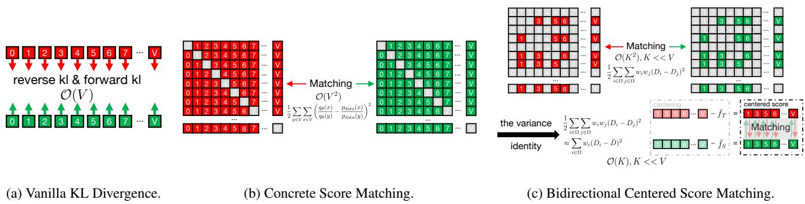
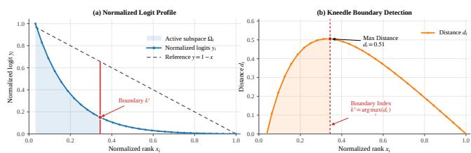
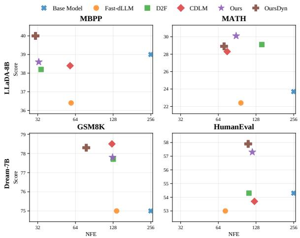
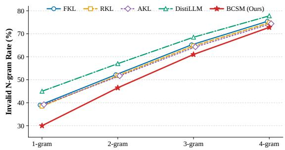
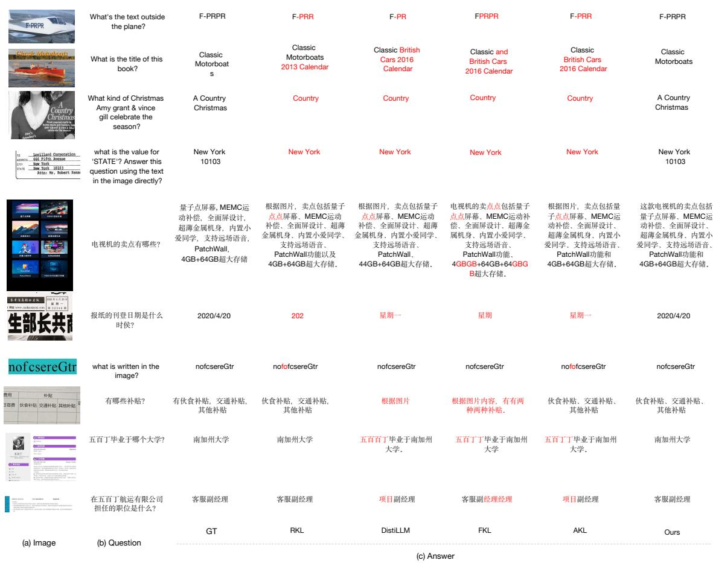
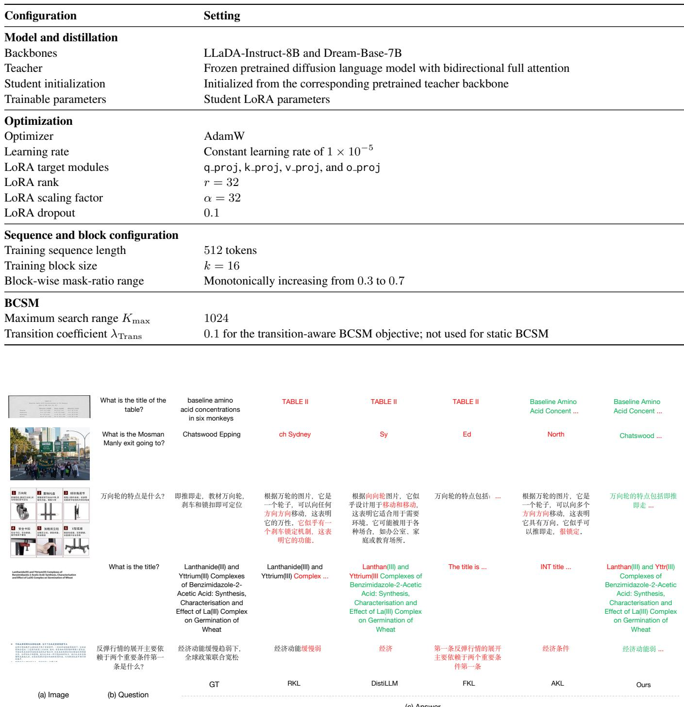

# Bidirectional Centered Score Matching for Discrete Diffusion Distillation

Peng Tu\*1, Baoyou Chen\*1, 3, Haoyuan Xia2, Zilong Dong4, Weihao Yuan5, Siyu Zhu†1, 2, 3

1Shanghai Academy of AI for Science, 2Shanghai Innovation Institute, 3Fudan University, 4Alibaba Group, 5Nanjing University

## Abstract

Discrete diffusion models with parallel decoding are often distilled using token-wise KL objectives. Although token-wise KL exactly matches the corresponding product-form block distributions, its probability-space optimization geometry and teacher-only candidate truncation may provide insufficient supervision under aggressive few-step distillation. Concrete Score Matching (CSM) provides an alternative within-position objective by aligning relative logit geometry, but its complete pairwise form incurs O(|V|2) complexity. We propose Bidirectional Centered Score Matching (BCSM), an efficient withinposition distillation objective that constructs an O(K) bidirectional active set, reduces pairwise comparisons to $\mathcal { O } ( K ^ { 2 } )$ , and factorizes them into an O(K) objective. We further introduce cross-timestep transition alignment. Experiments demonstrate strong quality–efficiency trade-offs, including up to 6× NFE reduction with a 16.9% relative HumanEval gain and a 15.1% relative MMMU gain at single-step inference.

## 1 Introduction

Discrete diffusion language models (Arriola et al. 2025; Nie et al. 2025; Ye et al. 2025) and diffusion vision-language models (Yu, Ma, and Wang 2025; Li et al. 2025; You et al. 2026) generate multiple tokens in parallel through iterative denoising, providing a promising alternative to left-to-right autoregressive decoding. However, high-quality generation often requires either a large model or multiple denoising steps, which limits the achievable acceleration under aggressive step reduction. Knowledge distillation is therefore commonly used to transfer the generation capability of a stronger or more expensive teacher to a student that can operate with fewer evaluations or lower computational cost (Ko et al. 2024; Wu et al. 2025; Wang et al. 2026).

Most existing distillation methods minimize token-wise Kullback–Leibler (KL) divergence (Ko et al. 2024; Wu et al. 2025) between teacher and student predictions at each sequence position. For parallel decoders, the distribution of a token block is commonly represented as a product of positionwise categorical distributions. Accordingly, token-wise KL exactly aligns the corresponding product-form block distributions, including within-position relative token preferences. However, this output factorization cannot represent dependencies excluded by its cross-position conditional-independence assumption, and may assign probability mass to combinations that are plausible position-wise but inconsistent jointly (Gu et al. 2018; Zhou, Gu, and Neubig 2020). This representational limitation is shared by all position-wise objectives, including ours. Rather than reconstructing the missing joint distribution, we study an alternative within-position optimization geometry for few-step discrete diffusion distillation. Concrete Score Matching (CSM) (Meng et al. 2022) directly aligns relative log-probability ratios between vocabulary states, whose global partition function cancels analytically, thereby matching the teacher’s within-position relative logit structure. However, complete pairwise CSM requires $\mathcal { O } \overline { { ( \vert \nu \vert ^ { 2 } ) } }$ comparisons, which is costly for large vocabularies. Moreover, practical teacher-only truncation creates an asymmetric candidate-coverage gap (Anshumann et al. 2025; Wang et al. 2021; Zhong, Yang, and Zhu 2026), leaving some student-preferred states outside the optimization support.

To address these within-position optimization, computational, and candidate-coverage challenges, we propose Bidirectional Centered Score Matching (BCSM), an efficient distillation framework that aligns the teacher’s withinposition relative logit geometry without complete-vocabulary quadratic pairwise matching. Unlike direct logit matching, BCSM removes additive logit offsets through mean-centering, allowing the student to match relative token preferences rather than absolute logit values. BCSM consists of three integrated mechanisms. First, we construct dynamic bidirectional active subspaces using a Kneedle-based maximumdistance criterion to extract adaptive boundaries for both teacher and student distributions. This dual formulation incorporates student-specific candidates while restricting the active set to O(K) states and the resulting pairwise comparisons to $\mathcal { O } ( K ^ { 2 } )$ , where $K \ll | \nu |$ . Second, we introduce a mean-centered formulation that anchors logits to an activeset weighted mean. By leveraging the variance identity, we factorize the $\mathcal { O } ( K ^ { 2 } )$ pairwise log-score objective into an O(K) pointwise alignment of centered log-scores. Matching centered log-scores preserves pairwise logit differences and is invariant to a shared additive shift. Third, we align centered log-score changes across two noise levels, providing cross-noise-level regularization for denoising. We extensively evaluate BCSM on diffusion vision-language models $( e . g .$ Bard-4B-VL (Chen et al. 2026)) and diffusion language models $( e . g .$ ., LLaDA-8B (Nie et al. 2025), Dream-7B (Ye et al. 2025)). Empirical results indicate improved local structural consistency and strong quality–efficiency trade-offs against competitive distillation baselines across various step budgets. For example, BCSM achieves 35.67 on MMMU at $\mathrm { N F E } = 1$ outperforming the undistilled student at $\mathrm { N F E } = 3 2 \ : ( 3 2 . 1 4 )$ and scores 42.1 on HumanEval at $\mathrm { N F E } = 4 2 . 9 ,$ , compared with 36.0 for the 256-step LLaDA-8B base model; see Section 5.2. Qualitative examples further show exact reference recovery where KL baselines produce fragmented or overextended strings, while additional cases reveal remaining limitations in long-sequence recovery (Section 5.4).

## 2 Related Work

## 2.1 Knowledge Distillation for Sequence Models

Knowledge Distillation transfers capabilities from a teacher to a compact student by aligning their output distributions. Autoregressive models use chain-rule factorization, whereas discrete diffusion models commonly represent parallel predictions as products of position-wise categorical distributions. In both cases, KL decomposes according to the chosen factorization. Thus, token-wise KL exactly aligns the corresponding product-form distribution but cannot recover dependencies excluded by the parallel output factorization (Gu et al. 2018; Zhou, Gu, and Neubig 2020). Existing objectives, including Forward/Reverse KL, DistiLLM (Ko et al. 2024), and AKL (Wu et al. 2025), mainly differ in weighting and optimization geometry. Alternatively, Direct Logit Distillation applies Mean Squared Error to unnormalized outputs, but absolute logit equivalence restricts the student’s solution space (Ba and Caruana 2014; Urban et al. 2017; Kim et al. 2021; Sun et al. 2024).

## 2.2 Score Matching in Discrete Domains

Score matching optimizes energy-based distributions without evaluating the intractable partition function (Hyvarinen¨ and Dayan 2005; Song and Kingma 2021). While continuous score matching relies on spatial derivatives (Song et al. 2023; Wang et al. 2023; Yin et al. 2024), these are ill-defined for discrete vocabularies. Concrete Score Matching (CSM) instead characterizes discrete energy landscapes through relative probability ratios between states (Meng et al. 2022). Aligning log-relative ratios cancels normalization constants and avoids exponential ratio amplification. However, a complete pairwise implementation over the vocabulary incurs $\mathcal { \hat { O } } ( | \mathcal { V } | ^ { 2 } )$ complexity, posing a severe computational bottleneck for large-scale models.

## 3 Preliminaries

## 3.1 Token-Wise Distillation under Parallel Factorization

In standard sequence modeling, knowledge distillation minimizes the KL divergence between teacher and student distributions. For autoregressive models, the joint probability follows $\begin{array} { r } { P ( Y | X ) = \prod _ { t = 1 } ^ { T } P ( y _ { t } | y _ { < t } , X ) } \end{array}$ , so token-level KL decomposes consistently with sequence-level optimization. Parallel discrete models $( e . g .$ ., block-wise discrete diffusion $( \mathrm { A r } \cdot$ riola et al. 2025)) instead use product-form probabilities, $\begin{array} { r } { P _ { \mathrm { b l o c k } } ( Y | X ) = \prod _ { t \in \mathrm { b l o c k } } P ( y _ { t } | \dot { X } ) } \end{array}$ . Token-wise KL exactly aligns this factorized block distribution, while cross-position dependencies excluded by the factorization remain unmodeled (Gu et al. 2018). We next review score matching as an alternative within-position objective under the same factorization.

## 3.2 Continuous vs. Discrete Score Matching

At a fixed prediction position, the categorical distribution can be framed as an Energy-Based Model $q _ { \theta } ( y | X ) \ =$ $\frac { \exp ( - E _ { \theta } ( y , X ) ) } { Z _ { \theta } ( X ) }$ , where $E _ { \theta } ( y , X )$ is an unnormalized energy function and $\begin{array} { r } { Z _ { \theta } ( X ) = \sum _ { v \in \mathcal { V } } \exp \left( - E _ { \theta } ( v , X ) \right) } \end{array}$ is the partition function. Score matching (Hyvarinen and Dayan 2005;¨ Song and Kingma 2021) characterizes such unnormalized distributions through quantities in which the shared partition function is eliminated.

Continuous Score Matching. In continuous spaces $( \mathbf { x } \in$ $\mathbb { R } ^ { d } )$ , taking the spatial derivative (Stein score) of the logdensity $q _ { \theta } ( \mathbf { x } ) \propto \exp ( - E _ { \theta } ( \mathbf { x } ) )$ eliminates the partition function: $\mathbf { s } _ { \theta } ( \mathbf { x } ) : = \nabla _ { \mathbf { x } } \log q _ { \theta } ( \mathbf { x } ) = - \nabla _ { \mathbf { x } } E _ { \theta } ( \mathbf { x } )$ . The continuous score matching objective aligns model and data score fields:

$$
\begin{array} { r } { \mathcal { L } _ { \mathrm { S M } } ( \theta ; p _ { \mathrm { d a t a } } ) = \mathbb { E } _ { { \mathbf { x } } \sim p _ { \mathrm { d a t a } } } \left[ \| \nabla _ { \mathbf { x } } \log q _ { \theta } ( { \mathbf { x } } ) - \nabla _ { \mathbf { x } } \log p _ { \mathrm { d a t a } } ( \mathbf { x } ) \| _ { 2 } ^ { 2 } \right] , } \end{array}\tag{1}
$$

enabling optimization without evaluating $Z _ { \theta }$ (Wang et al.   
2023; Yin et al. 2024; Song et al. 2023).

Discrete Concrete Score Matching. For discrete states $y \in \mathcal { V }$ with $q _ { \theta } ( y ) \propto \exp ( f _ { \theta , y } )$ , Concrete Score Matching (CSM) replaces spatial derivatives with the Concrete score $\mathbf { s } _ { \theta } ( y ) : = [ q _ { \theta } ( x ) / q _ { \theta } ( y ) ] _ { x \in \mathcal { V } }$ , which characterizes relative probability changes from y to all vocabulary states (Meng et al. 2022). The partition function cancels analytically:

$$
\frac { q _ { \theta } ( x ) } { q _ { \theta } ( y ) } = \frac { \exp ( f _ { \theta , x } ) / Z _ { \theta } } { \exp ( f _ { \theta , y } ) / Z _ { \theta } } = \exp \left( f _ { \theta , x } - f _ { \theta , y } \right) .\tag{2}
$$

With uniform pair weights, the complete-vocabulary CSM objective is

$$
\mathcal { L } _ { \mathrm { C S M } } ( \theta ; p _ { \mathrm { d a t a } } ) = \frac { 1 } { 2 } \sum _ { y \in \mathcal { V } } \sum _ { x \in \mathcal { V } } \left( \frac { q _ { \theta } ( x ) } { q _ { \theta } ( y ) } - \frac { p _ { \mathrm { d a t a } } ( x ) } { p _ { \mathrm { d a t a } } ( y ) } \right) ^ { 2 } .\tag{3}
$$

Matching relative ratios eliminates $Z _ { \theta } ,$ but the completevocabulary formulation incurs $\mathcal { O } ( | \mathcal { V } | ^ { 2 } )$ pairwise complexity.

## 4 Methodology

Extending score-based distillation to discrete diffusion models presents two bottlenecks. First, complete-vocabulary ratio matching (Eq. 2) requires $\mathcal { O } ( | \mathcal { V } | ^ { 2 } )$ pairwise comparisons, which is computationally expensive. Second, teacheronly truncation creates an asymmetric candidate-coverage gap (Anshumann et al. 2025; Wang et al. 2021; Zhong, Yang, and Zhu 2026), leaving student-preferred states outside the optimization support. To resolve these challenges, we propose Bidirectional Centered Score Matching (see Figure 1c) through three stages:

  
Figure 1: Conceptual comparison of discrete distillation objectives. (a) Vanilla KL Divergence aligns position-wise categorical probabilities with linear $\bar { \mathcal { O } } ( \vert \mathcal { V } \vert )$ complexity. (b) Concrete Score Matching aligns pairwise relative probability ratios but incurs $\mathcal { O } ( | \mathcal { V } | ^ { 2 } )$ complexity. (c) Bidirectional Centered Score Matching restricts evaluation to a dynamic subspace $( K \ll | \nu | )$ and applies mean-centering factorization, reducing the pairwise matching complexity to $\mathcal O ( K )$ while preserving relative logit differences within the active set.

1) dynamic bidirectional active subspaces that capture both distributions, restricting the active set to $\mathcal O ( K )$ states and pairwise comparisons to $\mathcal { O } ( K ^ { 2 } ) \left( K \ll | \mathcal { V } | \right)$

2) mean-centered discrete score matching that operates in logit space and reduces the pairwise matching complexity from $\mathcal { O } ( \bar { K } ^ { 2 } )$ to $\mathcal O ( K )$

3) score transition dynamics extension that incorporates temporal sequential denoising.

## 4.1 Dynamic Bidirectional Active Subspaces

To reduce pairwise complexity to $\mathcal { O } ( K ^ { 2 } )$ , we construct an active subspace of size $\bar { K } \ll | \bar { \nu } |$ . Standard distillation builds this subset only from teacher predictions $\Omega _ { T }$ (Zhong, Yang, and Zhu 2026; Anshumann et al. 2025), risking instability when the distributional gap is large. We establish a bidirectional active subspace where the teacher preserves target modes and the student incorporates its preferred candidate states.

Let $f _ { T } , f _ { S } \in \mathbb { R } ^ { | \nu | }$ denote the unnormalized logits. We apply the maximum-distance form of Kneedle (Satopaa et al. 2011) to locate the transition boundary within a search window $K _ { \mathrm { m a x } } \ll | \mathcal { V } |$ . Vocabulary sorting is inherited from top-k retrieval and implemented with partial sorting. For a sorted vector $\bar { f }$ and $i \in \{ 1 , \ldots , K _ { \operatorname* { m a x } } \}$ , we define

$$
x _ { i } = \frac { i - 1 } { K _ { \operatorname* { m a x } } - 1 } , y _ { i } = \frac { \bar { f } _ { i } - \bar { f } _ { K _ { \operatorname* { m a x } } } } { \operatorname* { m a x } \{ \bar { f } _ { 1 } - \bar { f } _ { K _ { \operatorname* { m a x } } } , \epsilon \} } ,\tag{4}
$$

where $\epsilon > 0$ prevents division by zero for flat logits. The dynamic boundary maximizes the distance to the baseline $y = 1 - x ,$ , and $k = \arg \operatorname* { m a x } _ { i \in \{ 1 , \dots , K _ { \operatorname* { m a x } } \} } \left( \left( 1 - x _ { i } \right) - y _ { i } \right)$ As visualized in Figure 2, this criterion measures the vertical gap between the normalized logit curve and the diagonal baseline. The boundary index $( k ^ { t }$ or $k ^ { s } )$ is identified at the maximum distance, capturing the transition from high-probability modes to the flat tail. Applying this independently to teacher and student distributions yields $k ^ { t }$ and $k ^ { s }$ . Their active subspaces are combined as $\Omega =$

Unique $\cdot ( \mathrm { T o p K } ( f _ { T } , k ^ { t } ) \cup \mathrm { T o p K } ( f _ { S } , k ^ { s } ) )$ . The teacher subset preserves principal target modes, while the student subset covers its current preferred states. Consequently, Ω reduces complete-vocabulary pairwise comparisons from $\mathcal { O } ( | \mathcal { V } | ^ { 2 } )$ to $\mathcal { O } ( \dot { K } ^ { 2 } )$ , enabling our linear $\mathcal O ( K )$ formulation.

## 4.2 Mean-Centered Discrete Score Matching

Based on the relative logit geometry of CSM (Section 3.2), we avoid explicitly computing exponential probability ratios by formulating a surrogate pairwise log-ratio objective directly in logit space. In this space, the discrepancy between states $i , j \in \Omega$ simplifies to $\Delta _ { i , j } = D _ { i } - \bar { D } _ { j }$ , where $D _ { i } = f _ { S , i } - f _ { T , i }$ . We align these relative logit structures by minimizing weighted squared pairwise discrepancies over Ω (Hyvarinen and Dayan 2005):¨

$$
\mathcal { L } _ { \mathrm { P a i r w i s e } } = \frac { 1 } { 2 W _ { \Omega } } \sum _ { i \in \Omega } \sum _ { j \in \Omega } p _ { i } p _ { j } ( D _ { i } - D _ { j } ) ^ { 2 } ,\tag{5}
$$

where $\begin{array} { r } { p _ { k } = \frac { \exp ( f _ { S , k } ) } { \sum _ { v \in \mathcal { V } } \exp ( f _ { S , v } ) } , W _ { \Omega } = \sum _ { v \in \Omega } p _ { v } } \end{array}$ , and $\alpha _ { k } =$ $p _ { k } / W _ { \Omega }$ , requiring $\mathcal { O } ( K ^ { 2 } )$ operations.

To reduce the pairwise matching complexity from $\mathcal { O } ( K ^ { 2 } )$ to $\mathcal O ( K )$ , we use the variance identity (see Appendix A.2 for proof):

$$
\frac { 1 } { 2 W _ { \Omega } } \sum _ { i , j \in \Omega } p _ { i } p _ { j } ( D _ { i } - D _ { j } ) ^ { 2 } = \sum _ { i \in \Omega } p _ { i } ( D _ { i } - \bar { D } ) ^ { 2 } .\tag{6}
$$

Here, $\begin{array} { r } { \bar { D } \ = \ \sum _ { k \in \Omega } \alpha _ { k } D _ { k } } \end{array}$ . The baseline shift $\bar { D } \ = \ \bar { f } _ { S } \ -$ $\bar { f } _ { T }$ is defined by the active-set weighted means $\bar { f } _ { S } ~ =$ $\textstyle \sum _ { k \in \Omega } \alpha _ { k } f _ { S , k }$ and $\begin{array} { r } { \bar { f } _ { T } = \sum _ { k \in \Omega } \alpha _ { k } f _ { T , k } } \end{array}$ . Substituting D¯ into Eq. (6) yields:

$$
\sum _ { i \in \Omega } p _ { i } \left( D _ { i } - ( \bar { f } _ { S } - \bar { f } _ { T } ) \right) ^ { 2 } = \sum _ { i \in \Omega } p _ { i } \left( \tilde { f } _ { S , i } - \tilde { f } _ { T , i } \right) ^ { 2 } ,\tag{7}
$$

where $\tilde { f } _ { M , i } = f _ { M , i } - \bar { f } _ { M }$ are centered log-scores for $M \in$ $\{ S , T \}$ , satisfying $\begin{array} { r } { \tilde { f } _ { M , i } - \tilde { f } _ { M , j } = \log q _ { M } ( i ) - \log q _ { M } ( j ) } \end{array}$ This derivation shows that our $\mathcal O ( K )$ formulation exactly factorizes the proposed $\mathcal { O } ( K ^ { 2 } )$ pairwise log-ratio objective.

  
Figure 2: Kneedle-based extraction of the dynamic active subspace. (a) The sorted logits are normalized to form the logit profile $y _ { i }$ over normalized rank $x _ { i } ;$ the prefix up to kt defines the active subspace $\Omega _ { t } .$ (b) The distance $d _ { i } \ =$ $( 1 - x _ { i } ) - y _ { i }$ reaches its maximum at $k ^ { t } = \arg \operatorname* { m a x } _ { i } d _ { i } ,$ which determines the adaptive boundary (red dotted line). The same procedure is applied independently to the student logits to obtain $k ^ { s }$ and $\Omega _ { s }$

Operating directly on logits rather than exponential probability ratios avoids exponential amplification of discrepancies while preserving relative differences among active states. Additionally, centering preserves pairwise differences $( \tilde { f } _ { S , i } - \tilde { f } _ { S , j } = f _ { S , i } - f _ { S , j } )$ and provides logit-shift invariance (Sun et al. 2024; Kim et al. 2021), yielding a more flexible solution space than absolute logit matching (Ba and Caruana 2014; Urban et al. 2017).

With the factorized discrepancy, we formulate BCSM as a gradient-injected surrogate loss. The corrective direction for the student logits is defined as the weighted discrepancy $2 p _ { i } ( \tilde { f } _ { S , i } - \tilde { f } _ { T , i } )$ . For automatic differentiation, the objective is implemented as the inner product between the student logits and the detached corrective direction:

$$
\mathcal { L } _ { \mathrm { B C S M } } = \sum _ { i \in \Omega } f _ { S , i } \cdot \mathrm { s g } \left( 2 p _ { i } \left( \tilde { f } _ { S , i } - \tilde { f } _ { T , i } \right) \right) ,\tag{8}
$$

where $\operatorname { s g } ( \cdot )$ denotes the stop-gradient operator $( e . g .$ .detach() in $\mathrm { P y }$ Torch). The training procedure is summarized in Algorithm 1 of the Appendix. While this static objective aligns relative logits at a single timestep, diffusion models operate over sequential timesteps. The following section extends this foundation to capture temporal score transition dynamics.

## 4.3 Formulating BCSM over Discrete Score Transition

While Eq. (8) aligns relative logits at a single noise level, diffusion models evolve across multiple noise levels. To capture this evolution, we evaluate teacher and student on the same paired states $\boldsymbol { x } _ { t _ { 1 } }$ and $x _ { t _ { 2 } }$ sampled from one forward diffusion trajectory, where $t _ { 2 } > t _ { 1 }$ . The score transition denotes the centered-score change between these paired states. Anchoring the subspace extraction on the lower-noise state $t _ { 1 }$ via the bidirectional strategy in Section 4.1, we form:

$$
\Omega _ { \mathrm { t r a n s } } = \mathrm { U n i q u e } \big ( \mathrm { T o p K } ( f _ { T , t _ { 1 } } , k _ { t _ { 1 } } ^ { t } ) \cup \mathrm { T o p K } ( f _ { S , t _ { 1 } } , k _ { t _ { 1 } } ^ { s } ) \big ) \ : .\tag{9}
$$

To maintain stability, we anchor the weights to $t _ { 1 }$ , defining $p _ { i } = \operatorname { S o f t m a x } _ { \gamma } ( f _ { S , t _ { 1 } } )$ and $\begin{array} { r } { \alpha _ { i } = p _ { i } / \sum _ { v \in \Omega _ { \mathrm { t r a n s } } } p _ { v } } \end{array}$ . Within $\Omega _ { \mathrm { t r a n s } } .$ , we calculate the centered scores $\tilde { f } _ { S , t _ { 1 } } , \tilde { f } _ { S , t _ { 2 } } , \tilde { f } _ { T , t _ { 1 } }$

and $\tilde { f } _ { T , t _ { 2 } }$ using $\alpha _ { i } .$ The transition vectors are the centeredscore differences between the two noise levels:

$$
\Delta _ { S } ^ { \mathrm { t r a n s } } = \tilde { f } _ { S , t _ { 1 } } - \tilde { f } _ { S , t _ { 2 } } , \quad \Delta _ { T } ^ { \mathrm { t r a n s } } = \tilde { f } _ { T , t _ { 1 } } - \tilde { f } _ { T , t _ { 2 } } .\tag{10}
$$

With the transition discrepancy $e _ { \mathrm { t r a n s } , i } = \Delta _ { S , i } ^ { \mathrm { t r a n s } } - \Delta _ { T , i } ^ { \mathrm { t r a n s } }$ the alignment loss is $\begin{array} { r } { \mathcal { L } _ { \mathrm { t r a n s } } = \sum _ { i \in \Omega _ { \mathrm { t r a n s } } } p _ { i } e _ { \mathrm { t r a n s } , i } ^ { 2 } } \end{array}$ . The total objective is $\mathcal { L } _ { \mathrm { T o t a l } } = \mathcal { L } _ { \mathrm { S t a t i c } , t _ { 1 } } + \tilde { \mathcal { L } } _ { \mathrm { S t a t i c } , t _ { 2 } } + \lambda _ { \mathrm { t r a n s } } \mathcal { L } _ { \mathrm { t r a n s } } ,$ where $\mathcal { L } _ { \mathrm { S t a t i c } , t _ { 1 } }$ and $\mathcal { L } _ { \mathrm { S t a t i c } , t _ { 2 } }$ are the static BCSM objectives. To integrate this joint objective into a surrogate loss, we define the static directions $g _ { \mathrm { s t a t i c } , t , i } = 2 p _ { i } ( \tilde { f } _ { S , t , i } - \tilde { f } _ { T , t , i } )$ for $t ~ \in ~ \{ t _ { 1 } , t _ { 2 } \}$ and the transition direction $g _ { \mathrm { t r a n s } , i } =$ $2 \lambda _ { \mathrm { t r a n s } } p _ { i } e _ { \mathrm { t r a n s } , i } .$ The transition term applies opposite corrections to $t _ { 1 }$ and $t _ { 2 } .$ . We inject these directions into the global logits via a stop-gradient surrogate loss:

$$
\begin{array} { r } { \mathcal { L } _ { \mathrm { D y n a m i c } } = \displaystyle \sum _ { i \in \Omega _ { \mathrm { t r a n s } } } \left[ f _ { S , t _ { 1 } , i } \cdot \mathrm { s g } \left( g _ { \mathrm { s t a t i c } , t _ { 1 } , i } + g _ { \mathrm { t r a n s } , i } \right) \right. } \\ { \left. + f _ { S , t _ { 2 } , i } \cdot \mathrm { s g } \left( g _ { \mathrm { s t a t i c } , t _ { 2 } , i } - g _ { \mathrm { t r a n s } , i } \right) \right] , } \\ { \left. \left( 1 \right) \mathrm { ~ } \mathrm { ~ } f \right. } \end{array}\tag{11}
$$

The forward pass and gradient injection process is summarized in Algorithm 2 of the Appendix.

## 5 Experiments

## 5.1 Experimental Setup

Implementation Details. To assess applicability across modalities, we evaluate BCSM on both discrete language and vision-language architectures. For discrete language modeling, we distill LLaDA-8B-Instruct (Nie et al. 2025) and Dream-7B-Base (Ye et al. 2025). Following the D2F protocol (Wang et al. 2026), these language models are trained on Qwen2.5-7B (Yang et al. 2024) responses to the Bespoke-Stratos-17k dataset (Labs 2025), truncated to a maximum sequence length of 600 tokens. For vision-language distillation, we train a student Bard-4B-VL (Chen et al. 2026) (block size of 32) from an 8B teacher (block size of 4) using 170K official image-text pairs. All models are trained on four NVIDIA H800 (80GB) GPUs, requiring approximately 23, $^ { 1 6 , }$ and 9 hours for Bard-4B-VL, LLaDA-8B-Instruct, and Dream-7B-Base, respectively.

Baselines. To evaluate the effectiveness of score matching in mitigating locally inconsistent generations relative to standard divergence minimization, we benchmark our static objective (Ours) and its transition-aware extension $( \mathrm { O u r s } _ { \mathrm { D y n } } )$ against established distillation paradigms. For language models, baselines comprise Fast-dLLM (Wu et al. 2026), D2F (Wang et al. 2026), and CDLM (Kim et al. 2025). For vision-language models, comparisons include Forward KL (FKL), Reverse KL (RKL), DistiLLM (Ko et al. 2024), and Adaptive KL (AKL) (Wu et al. 2025).

Benchmarks and Metrics. Textual capabilities are assessed on GSM8K/GSM8K-CoT (Cobbe et al. 2021), MATH (Hendrycks et al. 2021), HumanEval (Chen et al. 2021), and MBPP (Austin et al. 2021). Coding tasks are evaluated in a zero-shot setting, whereas mathematical benchmarks utilize standard few-shot configurations (Nie et al.

Table 1: Performance comparison on diffusion language models. Results for LLaDA-8B-Instruct and Dream-7B-Base on math and coding benchmarks. Undistilled base models (NFE=256.0) serve as references. Per CDLM (Kim et al. 2025), fractional NFEs denote average evaluations per block (BS=256).
<table><tr><td rowspan="2">Benchmark</td><td rowspan="2">Method</td><td colspan="2">LLaDA-8B</td><td colspan="2">Dream-7B</td></tr><tr><td>NFE↓</td><td>Score ↑</td><td>NFE↓</td><td>Score ↑</td></tr><tr><td rowspan="6">GSM8K (4-shot)</td><td>Base Model</td><td>256.0</td><td>77.4</td><td>256.0</td><td>75.0</td></tr><tr><td>Fast-dLLM</td><td>107.5</td><td>78.9</td><td>136.4</td><td>75.0</td></tr><tr><td>D2F</td><td>87.7</td><td>77.3</td><td>128.3</td><td>77.7</td></tr><tr><td>CDLM</td><td>89.7</td><td>73.9</td><td>125.2</td><td>78.5</td></tr><tr><td>Ours</td><td>86.9</td><td>77.6</td><td>126.7</td><td>77.8</td></tr><tr><td> $\mathrm { O u r s } _ { \mathrm { D y n } }$ </td><td>90.2</td><td>78.1</td><td>78.1</td><td>78.3</td></tr><tr><td rowspan="7">HumanEval (0-shot)</td><td>Base Model</td><td>256.0</td><td>36.0</td><td>256.0</td><td>54.3</td></tr><tr><td>Fast-dLLM</td><td>100.3</td><td>35.4</td><td>72.8</td><td>53.0</td></tr><tr><td>D2F</td><td>52.8</td><td>40.2</td><td>112.3</td><td>54.3</td></tr><tr><td>CDLM</td><td>42.3</td><td>40.2</td><td>124.3</td><td>53.7</td></tr><tr><td>Ours</td><td>42.9</td><td>42.1</td><td>119.6</td><td>57.3</td></tr><tr><td> $\mathrm { O u r s } _ { \mathrm { D y n } }$ </td><td>51.4</td><td>40.2</td><td>110.8</td><td>57.9</td></tr><tr><td>Base Model</td><td>256.0</td><td>23.7</td><td>256.0</td><td>35.8</td></tr><tr><td rowspan="5">MATH (4-shot)</td><td>Fast-dLLM</td><td></td><td></td><td></td><td></td></tr><tr><td>D2F</td><td>96.9 142.5</td><td>22.4</td><td>139.8 133.1</td><td>37.6 35.1</td></tr><tr><td>CDLM</td><td>75.3</td><td>29.1 28.3</td><td>180.1</td><td>32.6</td></tr><tr><td></td><td></td><td></td><td></td><td></td></tr><tr><td>Ours  $\mathrm { O u r s } _ { \mathrm { D y n } }$ </td><td>88.8 71.1</td><td>30.1 28.9</td><td>114.0 113.9</td><td>35.3 35.5</td></tr><tr><td rowspan="7">MBPP</td><td>Base Model</td><td>256.0</td><td>39.0</td><td>256.0</td><td>56.2</td></tr><tr><td>Fast-dLLM</td><td></td><td></td><td></td><td></td></tr><tr><td>D2F</td><td>59.1 34.0</td><td>36.4 38.2</td><td>94.6 114.9</td><td>51.0 54.4</td></tr><tr><td>CDLM</td><td>58.0</td><td>38.4</td><td>119.2</td><td>50.6</td></tr><tr><td>Ours</td><td>32.6</td><td>38.6</td><td>109.6</td><td>54.0</td></tr><tr><td></td><td></td><td></td><td>74.5</td><td>53.8</td></tr><tr><td> $\mathrm { O u r s } _ { \mathrm { D y n } }$ </td><td>30.7</td><td>40.0</td><td></td><td></td></tr></table>

2025; Ye et al. 2025; Wang et al. 2026). Multimodal capabilities are evaluated across six distinct dimensions: multi-image comprehension (MMMU-Pro (Yue et al. 2025), denoted as MMMU), spatial reasoning (RealWorldQA (xAI 2024), RWQA), video processing (MMVU val (Zhao et al. 2025)), diagram interpretation (AI2D (Kembhavi et al. 2016)), document understanding (OCRBench (Liu et al. 2024), OCR), and mathematical vision reasoning (MathVista testmini (Lu et al. 2024), Math), with OCRBench used for ablation studies. Finally, generation efficiency is measured by the Number of Function Evaluations (NFE) on a unified dual-H800 GPU setup under single-batch data parallelism.

## 5.2 Main Results

Evaluation on Diffusion Language Models. Following the D2F protocol, we evaluate LLaDA-8B and Dream-7B on coding and mathematical reasoning using fractional NFEs. As detailed in Table 1, BCSM achieves strong quality– efficiency trade-offs relative to undistilled full-step models and competitive distillation baselines. On HumanEval, our static formulation (Ours) achieves 42.1 at $\mathrm { N F E } = 4 2 . 9$ on LLaDA-8B, outperforming both the base model (36.0) and CDLM (40.2). Similarly, the dynamic variant $( \mathrm { O u r s } _ { \mathrm { D y n } } )$ reaches 57.9 at $\mathrm { N F E } = 1 1 \dot { 0 . 8 }$ on Dream-7B, exceeding the full-step baseline. These quality–efficiency gains also extend to the more challenging MATH benchmark, where Ours attains 30.1 at $\mathrm { N F E } = 8 8 . 8$ on LLaDA-8B, outperforming the base model (23.7) and D2F (29.1 at NFE = 142.5). Figure 3 further visualizes these quality–efficiency trade-offs across

Table 2: Performance comparison on Bard-4B-VL under varying NFEs. Teacher (BS=4, NFE=4) and undistilled student (BS=32, NFE=32) serve as references; others use BS=32. “OOM” denotes out of memory.
<table><tr><td rowspan="2">Method</td><td colspan="6">Bard-VL</td></tr><tr><td>MMMU</td><td>RWQA</td><td>AI2D</td><td>Math</td><td>MMVU</td><td>Avg.</td></tr><tr><td>Teacher (NFE=4)</td><td>35.26</td><td>72.68</td><td>82.32</td><td>67.33</td><td>43.90</td><td>60.30</td></tr><tr><td>Student (NFE=32)</td><td>32.14</td><td>68.10</td><td>79.79</td><td>61.93</td><td>37.50</td><td>55.89</td></tr><tr><td colspan="7"> $\mathbf { N F E } = \mathbf { 1 }$ </td></tr><tr><td>Student CSM</td><td>30.98</td><td>68.24</td><td></td><td>77.6640.40</td><td>35.30</td><td>50.52</td></tr><tr><td></td><td></td><td colspan="3">OOM</td><td></td><td></td></tr><tr><td>FKL RKL</td><td>32.49</td><td>69.28</td><td></td><td>79.60 50.63</td><td>31.90</td><td>52.78</td></tr><tr><td>DistiLLM</td><td>34.28</td><td>70.72</td><td>79.18</td><td>54.20</td><td>35.80</td><td>54.84</td></tr><tr><td></td><td>32.20</td><td>69.15</td><td>79.66</td><td>52.97</td><td>35.90</td><td>53.98</td></tr><tr><td>AKL</td><td>33.82</td><td>70.20</td><td>79.47</td><td>48.90</td><td>38.40</td><td>54.16</td></tr><tr><td>Ours</td><td>35.67 35.95</td><td>71.11 70.85</td><td>80.51 80.93</td><td>58.07</td><td>39.20</td><td>56.91</td></tr><tr><td> $\mathrm { O u r s } _ { \mathrm { D y n } }$ </td><td></td><td></td><td></td><td>57.97</td><td>38.70</td><td>56.88</td></tr><tr><td colspan="7">NFE = 8</td></tr><tr><td>Student CSM</td><td>31.04</td><td>68.24</td><td></td><td>79.89 55.10</td><td>38.60</td><td>54.57</td></tr><tr><td>FKL</td><td>33.01</td><td>71.11</td><td>OOM</td><td>79.95 57.63</td><td>38.80</td><td>56.10</td></tr><tr><td>RKL</td><td>34.45</td><td>70.07</td><td>79.31</td><td>58.17</td><td>39.20</td><td>56.24</td></tr><tr><td>DistiLLM</td><td>33.18</td><td>69.41</td><td>79.79</td><td>58.57</td><td>41.60</td><td>56.51</td></tr><tr><td>AKL</td><td>34.22</td><td>69.80</td><td>79.57</td><td>59.33</td><td>40.10</td><td>56.60</td></tr><tr><td>Ours</td><td>35.43</td><td>71.90</td><td>80.60</td><td>61.67</td><td>41.50</td><td>58.22</td></tr><tr><td> $\mathrm { O u r s } _ { \mathrm { D y n } }$ </td><td>35.49</td><td>72.03</td><td>80.76</td><td>61.70</td><td>41.40</td><td>58.28</td></tr><tr><td></td><td></td><td></td><td></td><td></td><td></td><td></td></tr><tr><td colspan="7">NFE = 16</td></tr><tr><td>Student</td><td>31.45</td><td>68.76</td><td></td><td>79.70 59.97</td><td>36.90</td><td>55.36</td></tr><tr><td>CSM</td><td>32.72</td><td></td><td>OOM</td><td></td><td>39.30</td><td>56.43</td></tr><tr><td>FKL RKL</td><td>34.33</td><td>70.85 70.07</td><td>79.21</td><td>80.12 59.17 59.17</td><td>39.70</td><td>56.50</td></tr><tr><td>DistiLLM</td><td>33.18</td><td>69.54</td><td>79.99</td><td>59.53</td><td>40.80</td><td>56.61</td></tr><tr><td>AKL</td><td>33.87</td><td>69.67</td><td>79.47</td><td>61.37</td><td>39.70</td><td>56.82</td></tr><tr><td>Ours</td><td>35.61</td><td>71.50</td><td>80.51</td><td>61.87</td><td>41.10</td><td>58.12</td></tr><tr><td></td><td></td><td></td><td></td><td></td><td></td><td></td></tr><tr><td> $\mathrm { O u r s } _ { \mathrm { D y n } }$ </td><td>35.49</td><td>72.30</td><td>80.80</td><td>61.73</td><td>41.30</td><td>58.32</td></tr></table>

the evaluated benchmarks.

Evaluation on Vision-Language Models. To preserve parallel decoding speedups while mitigating locally inconsistent token combinations, we employ cross-block distillation (teacher $\mathrm { { B S } ~ = ~ 4 ~  ~ }$ student $\mathrm { B S } ~ = ~ 3 2 )$ on Bard-4B-VL. Table 2 shows that our framework achieves the best average score across all tested step budgets. At NFE = 1, both BCSM variants surpass the undistilled 32-step student reference on the general benchmark MMMU. On Math, OursDyn reaches 61.73 at $\mathrm { N F E } = 1 6 ,$ , nearly matching the 32-step student (61.93) while outperforming RKL and AKL. At $\mathrm { N F E } = 8$ , both variants exceed the undistilled 32-step student on RWQA and MMVU. The complete-vocabulary CSM baseline runs out of memory across all tested settings, illustrating the practical cost of its $\mathcal { O } ( | \mathcal { V } | ^ { 2 } )$ pairwise formulation.

## 5.3 Ablation Studies

We ablate BCSM’s core components on Bard-4B-VL using the OCR task, a challenging benchmark with multi-token outputs, by investigating: 1) the necessity of probabilityweighted mean-centering over absolute-logit or post-softmax matching; 2) the bidirectional active subspace for addressing asymmetric candidate coverage; 3) dynamic boundary robustness to $K _ { \operatorname* { m a x } } ; 4 )$ ) cross-timestep transition alignment across NFE regimes; and 5) sensitivity to the transition weight $\left( \lambda _ { \mathrm { t r a n s } } \right)$ . Unless otherwise specified, variants are evaluated at NFE = 16 against the undistilled NFE = 32 student reference.

Table 3: Comprehensive ablation studies of BCSM on the OCR benchmark.  
(a) Necessity and design choices of the mean-centering mechanism.
<table><tr><td></td><td>Baseline</td><td colspan="4">Core &amp; Format Alternatives (NFE = 16)</td></tr><tr><td>Benchmark</td><td>Student (NFE = 32)</td><td>No Centering (Abs. Logits)</td><td>Local Softmax KD</td><td>Global Softmax KD</td><td>Ours</td></tr><tr><td>OCR</td><td>70.20</td><td>59.60</td><td>65.00</td><td>71.10</td><td>71.30</td></tr><tr><td></td><td>Baseline</td><td></td><td>Centering Strategies</td><td> $( \mathrm { N F E } = 1 6 )$ </td><td></td></tr><tr><td>Benchmark</td><td>Student  $( \mathrm { N F E } = 3 2 )$ </td><td>Uniform Weight</td><td>Local Weighted</td><td></td><td>Ours</td></tr><tr><td>OCR</td><td>70.20</td><td>51.90</td><td>55.10</td><td></td><td>71.30</td></tr></table>

(d) Transition weight sensitivity $\lambda _ { \mathrm { t r a n s } } .$

(c) Impact of the search window size $K _ { \mathrm { m a x } } .$
<table><tr><td rowspan="3">Bench</td><td colspan="6"> $K _ { \mathrm { m a x } } ~ ( \mathrm { N F E } = 1 6 )$ </td></tr><tr><td>64</td><td>128</td><td>256</td><td>512</td><td>768</td><td>1024 (ours)</td></tr><tr><td>OCR</td><td>65.4</td><td>67.3</td><td>66.6</td><td>69.6</td><td>70.9</td><td>71.3</td></tr></table>

<table><tr><td rowspan="2">Bench</td><td colspan="4">Transition Weight  $( \lambda _ { \mathrm { t r a n s } } ,$  NFE = 16)</td></tr><tr><td>0.0</td><td>0.05</td><td>0.1 0.15</td><td>0.2</td></tr><tr><td>OCR</td><td>71.3</td><td>71.5</td><td>71.9 70.5</td><td>69.0</td></tr></table>

(b) Components of the Dynamic Bidirectional Active Subspaces.

Necessity of Mean-Centering. We design two groups of ablations to isolate whether the gains arise from the matching representation or the weighting strategy (Table 3a). First, we compare mean-centering with three matching formats on the same active subspace Ω. No Centering (Abs. Logits) applies Direct Logit Distillation (Ba and Caruana 2014; Urban et al. 2017; Kim et al. 2021), matching $f _ { S , i }$ and $f _ { T , i }$ directly to test the necessity of removing additive logit shifts. Local Softmax KD applies Softmax separately to teacher and student logits within Ω and matches the resulting local distributions, testing whether local probability matching alone suffices. Global Softmax KD applies Softmax over the full vocabulary V and matches the probabilities indexed by Ω, testing the effect of preserving full-vocabulary normalization. As shown in Table 3a (top), No Centering yields 59.60 on OCR. While Global Softmax KD reaches 71.10, our meancentered method achieves 71.30, exceeding the undistilled student reference (70.20). Second, we vary the weights used for centering and loss computation while retaining centeredlogit matching. Uniform Weight uses $1 / | \Omega |$ for both operations, testing whether token probabilities are necessary, and yields 51.90. Local Weighted applies Softmax to student logits within Ω and uses the resulting probabilities for both centering and loss weighting, testing whether locally normalized confidence is sufficient, and yields 55.10. Our method computes full-vocabulary probabilities $p _ { i } = \mathrm { S o f t m a x } _ { \mathcal { V } } ( f _ { S } ) _ { i } ,$ uses $\begin{array} { r } { \alpha _ { i } = p _ { i } / \sum _ { v \in \Omega } \hat { p } _ { v } } \end{array}$ for centering, and retains $p _ { i }$ for loss weighting, preserving the active set’s global probability mass and achieving 71.30. These results support both mean-centering and probability-mass-aware weighting.

Impact of Bidirectional Subspace. We evaluate the effect of incorporating student-side candidates and dynamic boundary selection in the active subspace construction. First, we compare the bidirectional subspace with teacher-only selection under both fixed and dynamic settings. The teacheronly strategy restricts optimization to states selected from the teacher distribution, while the bidirectional strategy additionally includes student candidate states to enlarge the optimization support. Under the dynamic setting, the bidirectional subspace achieves an OCR score of 71.30, outperforming the teacher-only counterpart (68.60). This demonstrates that relying solely on teacher-selected states cannot fully cover student-side candidate states, leaving some student errors outside the optimization support. By incorporating student candidates, the bidirectional strategy provides more complete supervision over the student’s current prediction space. Second, we compare dynamic boundary selection against fixed Top-K configurations. Within the bidirectional subspace, fixed Top-K variants achieve scores between 64.00 and 66.60, while the dynamic strategy reaches 71.30. This indicates that adaptive boundary selection better identifies the transition between high-probability modes and low-information tail states, avoiding both insufficient coverage and unnecessary expansion of the active subspace.

<table><tr><td rowspan="3">Benchmark</td><td colspan="6">Teacher-Only Subspace  $( \Omega _ { T } , \mathrm { N F E } = 1 6 )$ </td></tr><tr><td colspan="6"></td></tr><tr><td>Top-64</td><td>Top-128</td><td>Fixed Top-256</td><td>Top-512</td><td>Top-1024</td><td>Dynamic</td></tr><tr><td>OCR</td><td>62.80</td><td>63.40</td><td>64.20</td><td>63.10</td><td>62.50</td><td>68.60</td></tr><tr><td rowspan="3">Benchmark</td><td colspan="6">Bidirectional Subspace  $( \Omega _ { T } \cup \Omega _ { S } , \mathrm { N F E } = 1 6 )$ </td></tr><tr><td colspan="5"></td></tr><tr><td>Top-64</td><td>Top-128</td><td>Fixed Top-256</td><td>Top-512</td><td>Top-1024</td><td>Dynamic</td></tr><tr><td>OCR</td><td>64.50</td><td>64.00</td><td>66.60</td><td>65.10</td><td>65.40</td><td>71.30</td></tr></table>

(e) Ablation on transition alignment.
<table><tr><td rowspan="2">Bench</td><td colspan="2"> $\mathrm { N F E } = 1$ </td><td colspan="2"> $\mathrm { N F E } = 8$ </td><td colspan="2"> $\mathrm { N F E } = 1 6$ </td></tr><tr><td>Ours</td><td>+Trans.</td><td>Ours</td><td>+Trans.</td><td>Ours</td><td>+Trans.</td></tr><tr><td>OCR</td><td>40.9</td><td>40.9</td><td>65.9</td><td>66.8</td><td>71.3</td><td>71.9</td></tr></table>

Robustness of Dynamic Boundary Selection. To assess the robustness of dynamic boundary selection, we vary the preliminary search window $K _ { \mathrm { m a x } }$ in Table 3c. As $K _ { \mathrm { m a x } }$ increases from 64 to 768, the OCR score generally improves from 65.40 to 70.90, and reaches 71.30 at the default setting of 1024. The small gain from 768 to 1024 indicates that performance has largely saturated once the search window is sufficiently large. This suggests that a sufficient initial window enables dynamic boundary selection to cover relevant candidate states without strong sensitivity near the default setting. Thus, we use $K _ { \operatorname* { m a x } } = \mathrm { \bar { 1 } 0 2 4 }$ by default.

Effectiveness of Transition Alignment. We evaluate transition alignment across different NFE regimes in Table 3e. At NFE = 1, models with and without transition alignment both achieve 40.90 on OCR. At NFE = 8, transition alignment increases the score from 65.90 to 66.80. At NFE = 16, the score increases from 71.30 to 71.90. These results indicate no gain at single-step inference but consistent improvements in multi-step generation.

  
Figure 3: Efficiency and performance comparison on diffusion language models. The top row reports LLaDA-8B results on MBPP and MATH, while the bottom row reports Dream-7B results on GSM8K and HumanEval. Each marker denotes a distillation method, with the number of function evaluations (NFE) on the x-axis and task performance on the y-axis. Lower NFE and higher scores are preferred. Across the four benchmarks, BCSM lies on the efficiency– performance Pareto frontier, attaining higher scores at similar NFE and comparable scores with substantially fewer evaluations.

Transition Weight Sensitivity. Finally, we examine the impact of the transition weight $\lambda _ { \mathrm { t r a n s } }$ in Eq. (11) at $\mathrm { N F E } = 1 6$ in Table 3d. Setting $\lambda _ { \mathrm { t r a n s } } = 0$ relies solely on static alignment and yields 71.30 on OCR. Increasing $\lambda _ { \mathrm { t r a n s } }$ to 0.05 and 0.1 improves the score to 71.50 and 71.90, respectively. Further increasing it to 0.15 and 0.2 reduces the score to 70.50 and 69.00. These results suggest that moderate transition weighting complements static alignment, whereas excessive weighting can weaken it. Thus, we set $\lambda _ { \mathrm { t r a n s } } = 0 . 1$ by default.

## 5.4 Discussion

Empirical Analysis of Local Generation Consistency. To analyze local generation consistency across position-wise distillation objectives, we evaluate on the MS COCO Caption 2014 validation set (20,252 samples). Image captioning requires structured text and provides a controlled setting for measuring agreement with reference captions. We define the non-reference n-gram rate as $1 0 0 ( 1 - p _ { n } ) \% .$ , where $p _ { n }$ is BLEU’s clipped n-gram precision $( n \in \{ 1 , . . . , 4 \} )$ ). Because clipping discounts excessive repetitions and n-grams unsupported by references, this metric measures local reference mismatch rather than invalidity directly. As Figure 4 illustrates, BCSM consistently yields the lowest non-reference n-gram rates across all levels compared with FKL, RKL, DistiLLM, and AKL. Specifically, BCSM reduces the 1-gram mismatch rate to 30.2%, versus 38.6%–45.0% for the baselines. This trend persists at the 4-gram level, where BCSM achieves 72.7% while all baselines exceed 74.5%. Complementing this corpus-level analysis, Figure 5 presents OCR examples where KL baselines produce fragmented or overextended strings, whereas BCSM exactly recovers the references in all three cases. Together, these results indicate improved local reference agreement and structural preservation under BCSM, without implying explicit cross-position dependency modeling (see Appendix A.3 for additional visualizations).

Figure 4: Comparison of non-reference n-gram rates (lower is better). BCSM yields lower reference mismatch across all n-gram orders than the baselines, providing empirical evidence of improved local consistency.
<table><tr><td rowspan=1 colspan=1>Question:F-PRPR     What&#x27;s the text outside the plane?</td><td rowspan=1 colspan=1>LG     Question:What is the MosmanManly exit going to?</td><td rowspan=1 colspan=1></td><td rowspan=1 colspan=1>Question:what is the title ofthis book?</td></tr><tr><td rowspan=1 colspan=1>Ground Truth: F-PRPR</td><td rowspan=1 colspan=1>Ground Truth: Chatswood Epping</td><td rowspan=1 colspan=2>Ground Truth: Classic Motorboats</td></tr><tr><td rowspan=1 colspan=1>RKL: F-PRR</td><td rowspan=1 colspan=1>RKL: ch Sydney</td><td rowspan=1 colspan=2>RKL: Classic Motorboats 2013 Calendar</td></tr><tr><td rowspan=1 colspan=1>FKL: FPRPR</td><td rowspan=1 colspan=1>FKL: Ed</td><td rowspan=1 colspan=2>FKL: Classic and British Cars 2016 Calendar</td></tr><tr><td rowspan=1 colspan=1>AKL: F-PR</td><td rowspan=1 colspan=1>AKL: Ch Ep</td><td rowspan=1 colspan=2>AKL: Classic British Cars 2016 Calendar</td></tr><tr><td rowspan=1 colspan=1>Ours: F-PRPR</td><td rowspan=1 colspan=1>Ours: Chatswood Epping</td><td rowspan=1 colspan=2>Ours: Classic Motorboats</td></tr></table>

Figure 5: Qualitative comparison of generated responses $( \mathrm { N F E } = 1 6 )$ . Red text indicates incorrect or fragmented spans.

Failure Cases and Limitations. We further examine cases where models fail to recover the exact reference (Figure 7 in the Appendix). In these cases, FKL and RKL produce fragmented tokens $( e . g . , \mathrm { \ " E d " ) }$ or irrelevant text $( \bar { e } . g . , \tilde { \mathrm { \Omega } } ^ { \mathrm { { s } 6 } } \mathrm { { R B L } \bar { E } }$ II”). BCSM often retains more coherent partial structures when the exact reference is missed. For example, outputs such as “Chatswood ...” preserve recognizable local structure. Nevertheless, BCSM still struggles with exact long-sequence recovery, occasionally producing truncated outputs or minor character deviations (see Appendix A.4 for additional qualitative comparisons).

## 6 Conclusion

We introduce Bidirectional Centered Score Matching (BCSM), an efficient within-position distillation framework for discrete diffusion models. By combining dynamic bidirectional active subspaces with mean-centered factorization, BCSM reduces the active-set pairwise matching complexity from $\mathcal { O } ( K ^ { 2 } )$ to $\mathcal O ( K )$ and aligns centered-score transitions across noise levels. Experiments on language and visionlanguage models demonstrate strong quality–efficiency tradeoffs across inference budgets, together with lower local reference mismatch and improved structural preservation in qualitative examples, while exact long-sequence recovery remains challenging.

## References

Anshumann, A.; Zaidi, M. A.; Kedia, A.; Ahn, J.; Kwon, T.; Lee, K.; Lee, H.; and Lee, J. 2025. Sparse logit sampling: Accelerating knowledge distillation in LLMs. In Proceedings ofthe 63rd Annual Meeting ofthe Associationfor Computational Linguistics (Volume 1: Long Papers), 18085–18108.

Arriola, M.; Gokaslan, A.; Chiu, J. T.; Yang, Z.; Qi, Z.; Han, J.; Sahoo, S. S.; and Kuleshov, V. 2025. Block Diffusion: Interpolating Between Autoregressive and Diffusion Language Models. In The Thirteenth International Conference on Learning Representations.

Austin, J.; Odena, A.; Nye, M.; Bosma, M.; Michalewski, H.; Dohan, D.; Jiang, E.; Cai, C.; Terry, M.; Le, Q.; et al. 2021. Program synthesis with large language models. arXiv preprint arXiv:2108.07732.

Ba, L. J.; and Caruana, R. 2014. Do deep nets really need to be deep? Advances in neural information processing systems, 27.

Chen, B.; Xia, H.; Tu, P.; Shi, H.; Mu, S.; Yuan, W.; and Zhu, S. 2026. BARD: Bridging AutoRegressive and Diffusion Vision-Language Models Via Highly Efficient Progressive Block Merging and Stage-Wise Distillation. In 34th ACM International Conference on Multimedia.

Chen, M.; Tworek, J.; Jun, H.; Yuan, Q.; de Oliveira Pinto, H. P.; Kaplan, J.; Edwards, H.; Burda, Y.; Joseph, N.; Brock-

H.; Sastry, G.; Mishkin, P.; Chan, B.; Gray, S.; Ryder, N.;Pavlov, M.; Power, A.; Kaiser, L.; Bavarian, M.; Winter, C.;

M.; Brundage, M.; Murati, M.; Mayer, K.; Welinder, P.; Mc-Grew, B.; Amodei, D.; McCandlish, S.; Sutskever, I.; and Zaremba, W. 2021. Evaluating Large Language Models Trained on Code. arXiv preprint arXiv:2107.03374.

Cobbe, K.; Kosaraju, V.; Bavarian, M.; Chen, M.; Jun, H.; Kaiser, L.; Plappert, M.; Tworek, J.; Hilton, J.; Nakano, R.; et al. 2021. Training verifiers to solve math word problems. arXiv preprint arXiv:2110.14168.

Gu, J.; Bradbury, J.; Xiong, C.; Li, V. O.; and Socher, R. 2018. Non-Autoregressive Neural Machine Translation. In International Conference on Learning Representations.

Hendrycks, D.; Burns, C.; Kadavath, S.; Arora, A.; Basart, S.; Tang, E.; Song, D.; and Steinhardt, J. 2021. Measuring Mathematical Problem Solving With the MATH Dataset. In Thirty-fifth Conference on Neural Information Processing Systems Datasets and Benchmarks Track (Round 2).

Hyvarinen, A.; and Dayan, P. 2005. Estimation of non-¨ normalized statistical models by score matching. Journal of Machine Learning Research, 6(4).

Kembhavi, A.; Salvato, M.; Kolve, E.; Seo, M.; Hajishirzi, H.; and Farhadi, A. 2016. A diagram is worth a dozen images. In European conference on computer vision, 235–251. Springer.

Kim, M.; Xu, C.; Hooper, C.; Singh, H.; Athiwaratkun, B.; Zhang, C.; Keutzer, K.; and Gholami, A. 2025. CDLM: Consistency Diffusion Language Models For Faster Sampling. arXiv preprint arXiv:2511.19269.

Kim, T.; Oh, J.; Kim, N. Y.; Cho, S.; and Yun, S.-Y. 2021. Comparing Kullback-Leibler Divergence and Mean Squared Error Loss in Knowledge Distillation. In Zhou, Z.-H., ed., Proceedings of the Thirtieth International Joint Conference on Artificial Intelligence, IJCAI-21, 2628–2635. International Joint Conferences on Artificial Intelligence Organization. Main Track.

Ko, J.; Kim, S.; Chen, T.; and Yun, S.-Y. 2024. DistiLLM: Towards Streamlined Distillation for Large Language Models. In Proceedings ofthe 41st International Conference on Machine Learning, volume 235 of Proceedings ofMachine Learning Research, 24872–24895. PMLR.

Labs, B. 2025. Bespoke-Stratos: The unreasonable effectiveness of reasoning distillation. https://www.bespokelabs.ai/blog/bespoke-stratos-theunreasonable-effectiveness-of-reasoning-distillation. Accessed: 2025-01-22.

Li, S.; Kallidromitis, K.; Bansal, H.; Gokul, A.; Kato, Y.; Kozuka, K.; Kuen, J.; Lin, Z.; Chang, K.-W.; and Grover, A. 2025. LaViDa: A Large Diffusion Language Model for Multimodal Understanding. In Advances in Neural Information Processing Systems, volume 38.

Liu, Y.; Li, Z.; Huang, M.; Yang, B.; Yu, W.; Li, C.; Yin, X.-C.; Liu, C.-L.; Jin, L.; and Bai, X. 2024. OCRBench: on the hidden mystery of OCR in large multimodal models. Science China Information Sciences, 67(12).

Lu, P.; Bansal, H.; Xia, T.; Liu, J.; Li, C.; Hajishirzi, H.; Cheng, H.; Chang, K.-W.; Galley, M.; and Gao, J. 2024. MathVista: Evaluating Mathematical Reasoning of Foundation Models in Visual Contexts. In The Twelfth International Conference on Learning Representations.

Meng, C.; Choi, K.; Song, J.; and Ermon, S. 2022. Concrete score matching: Generalized score matching for discrete data. Advances in Neural Information Processing Systems, 35: 34532–34545.

Nie, S.; Zhu, F.; You, Z.; Zhang, X.; Ou, J.; Hu, J.; Zhou, J.; Lin, Y.; Wen, J.-R.; and Li, C. 2025. Large Language Diffusion Models. In Advances in Neural Information Processing Systems, volume 38.

Satopaa, V.; Albrecht, J.; Irwin, D.; and Raghavan, B. 2011. Finding a” kneedle” in a haystack: Detecting knee points in system behavior. In 2011 31st international conference on distributed computing systems workshops, 166–171. IEEE.

Song, Y.; Dhariwal, P.; Chen, M.; and Sutskever, I. 2023. Consistency Models. arXiv preprint arXiv:2303.01469.

Song, Y.; and Kingma, D. P. 2021. How to train your energybased models. arXiv preprint arXiv:2101.03288.

Sun, S.; Ren, W.; Li, J.; Wang, R.; and Cao, X. 2024. Logit standardization in knowledge distillation. In Proceedings of

the IEEE/CVF conference on computer vision and pattern recognition, 15731–15740.

Urban, G.; Geras, K. J.; Kahou, S. E.; Aslan, O.; Wang, S.; Mohamed, A.; Philipose, M.; Richardson, M.; and Caruana, R. 2017. Do Deep Convolutional Nets Really Need to be Deep and Convolutional? In International Conference on Learning Representations.

Wang, F.; Yan, J.; Meng, F.; and Zhou, J. 2021. Selective knowledge distillation for neural machine translation. In Proceedings of the 59th Annual Meeting of the Association for Computational Linguistics and the 11th International Joint Conference on Natural Language Processing (Volume 1: Long Papers), 6456–6466.

Wang, X.; Xu, C.; Jin, Y.; Jin, J.; Zhang, H.; Yu, K.; and Deng, Z. 2026. Diffusion LLMs Can Do Faster-Than-AR Inference via Discrete Diffusion Forcing. In The Fourteenth International Conference on Learning Representations.

Wang, Z.; Lu, C.; Wang, Y.; Bao, F.; Li, C.; Su, H.; and Zhu, J. 2023. Prolificdreamer: High-fidelity and diverse text-to-3d generation with variational score distillation. Advances in neural information processing systems, 36: 8406–8441.

Wu, C.; Zhang, H.; Xue, S.; Liu, Z.; Diao, S.; Zhu, L.; Luo, P.; Han, S.; and Xie, E. 2026. Fast-dLLM: Training-free Acceleration of Diffusion LLM by Enabling KV Cache and Parallel Decoding. In The Fourteenth International Conference on Learning Representations.

Wu, T.; Tao, C.; Wang, J.; Yang, R.; Zhao, Z.; and Wong, N. 2025. Rethinking Kullback-Leibler Divergence in Knowledge Distillation for Large Language Models. In Proceedings of the 31st International Conference on Computational Linguistics, 5737–5755. Abu Dhabi, UAE: Association for Computational Linguistics.

xAI. 2024. Grok-1.5 Vision Preview. https://x.ai/news/grok-1.5v. Accessed: 2026-07-13.

Yang, A.; Yang, B.; Zhang, B.; Hui, B.; Zheng, B.; Yu, B.; Li, C.; Liu, D.; Huang, F.; Wei, H.; Lin, H.; Yang, J.; Tu, J.; Zhang, J.; Yang, J.; Yang, J.; Zhou, J.; Lin, J.; Dang, K.; Lu, K.; Bao, K.; Yang, K.; Yu, L.; Li, M.; Xue, M.; Zhang, P.; Zhu, Q.; Men, R.; Lin, R.; Li, T.; Xia, T.; Ren, X.; Ren, X.; Fan, Y.; Su, Y.; Zhang, Y.; Wan, Y.; Liu, Y.; Cui, Z.; Zhang, Z.; and Qiu, Z. 2024. Qwen2.5 Technical Report. arXiv preprint arXiv:2412.15115.

Ye, J.; Xie, Z.; Zheng, L.; Gao, J.; Wu, Z.; Jiang, X.; Li, Z.; and Kong, L. 2025. Dream 7B: Diffusion Large Language Models. arXiv preprint arXiv:2508.15487.

Yin, T.; Gharbi, M.; Zhang, R.; Shechtman, E.; Durand, F.; Freeman, W. T.; and Park, T. 2024. One-step diffusion with distribution matching distillation. In Proceedings of the IEEE/CVF conference on computer vision and pattern recognition, 6613–6623.

You, Z.; Nie, S.; Zhang, X.; Zhou, J.; Lu, Z.; Wen, J.-R.; and Li, C. 2026. LLaDA-V: Large Language Diffusion Models with Visual Instruction Tuning. In Proceedings of the IEEE/CVF Conference on Computer Vision and Pattern Recognition, 10093–10105.

Yu, R.; Ma, X.; and Wang, X. 2025. Dimple: Discrete Diffusion Multimodal Large Language Model with Parallel Decoding. arXiv preprint arXiv:2505.16990.

Yue, X.; Zheng, T.; Ni, Y.; Wang, Y.; Zhang, K.; Tong, S.; Sun, Y.; Yu, B.; Zhang, G.; Sun, H.; Su, Y.; Chen, W.; and Neubig, G. 2025. MMMU-Pro: A More Robust Multi-discipline Multimodal Understanding Benchmark. In Che, W.; Nabende, J.; Shutova, E.; and Pilehvar, M. T., eds., Proceedings of the 63rd Annual Meeting of the Association for Computational Linguistics (Volume 1: Long Papers), 15134–15186. Vienna, Austria: Association for Computational Linguistics. ISBN 979-8-89176-251-0.

Zhao, Y.; Zhang, H.; Xie, L.; Hu, T.; Gan, G.; Long, Y.; Hu, Z.; Chen, W.; Li, C.; Xu, Z.; et al. 2025. Mmvu: Measuring expert-level multi-discipline video understanding. In Proceedings of the Computer Vision and Pattern Recognition Conference, 8475–8489.

Zhong, Y.; Yang, Z.; and Zhu, Z. 2026. DUET: Distilled LLM Unlearning from an Efficiently Contextualized Teacher. In The Fourteenth International Conference on Learning Representations.

Zhou, C.; Gu, J.; and Neubig, G. 2020. Understanding Knowledge Distillation in Non-autoregressive Machine Translation. In International Conference on Learning Representations.

## A Appendix A.1 Additional Training Details Training On BARD-VL.

Training On BARD-VL. To adapt our approach to the mask-diffusion version of BARD-VL, we retain its memory-friendly packed sequence construction and standard absorbing-state masked diffusion process (Chen et al. 2026), while replacing the original token-wise KL distillation objective with Eq. 8 or Eq. 11:

• Memory-Friendly Sequence Construction. Following BARD, to mitigate memory limits caused by long visual contexts, a packed sequence layout $\tilde { x } = [ Q , \dot { x } _ { 1 } , \dot { x _ { t } } ]$ is utilized, where $Q$ is the multimodal context, $x _ { 1 }$ is the clean response, and $x _ { t }$ is the corrupted response. The context Q is stored once, with a causal mask applied to $Q$ and $x _ { 1 }$ . The attention scope for the i-th corrupted block $\boldsymbol { x } _ { t } ^ { i }$ is defined as $A t t n ( x _ { t } ^ { i } ) \stackrel { - } { = } Q \cup \{ x _ { 1 } ^ { 0 } , . . . , x _ { 1 } ^ { i - 1 } \} \cup x _ { t } ^ { i } ,$ , preventing information leakage and enabling block-level parallel computation.

• Masked Diffusion Scheduler. We employ standard absorbing-state masked diffusion, in which completion tokens are corrupted exclusively by the [MASK] token. Given a clean completion $x _ { 1 }$ , a timestep $t \sim \mathcal { U } ( 0 , 1 )$ is sampled, and each completion token is independently replaced by [MASK] according to the corresponding masking probability. The supervised positions are defined as $\bar { \mathcal { M } _ { t } } = \{ i \in \bar { \mathcal { C } } \vert x _ { t , i } = [ \mathsf { M A S K } ] \}$

• BCSM Distillation Process. Building upon this setup, we replace the original KL divergence with the proposed BCSM objective. The teacher is a fixed BARD-VL-4B model with block size 4, while the student is a BARD-VL-4B model with block size 32. We directly perform single-stage cross-block distillation without progressive block merging or repeated stage-wise distillation. Both models process the same packed sequence x˜ and the same corrupted response $x _ { t } .$ . Distillation is performed strictly at the masked positions in $\mathcal { M } _ { t }$ . The unnormalized teacher and student logits, denoted by $f _ { T }$ and $f _ { S } ,$ , are extracted at these positions. Kneedle determines the dynamic bidirectional active subspace, and the mean-centered variance identity computes the $\mathcal O ( K )$ BCSM objective used to update the student.

Training On D2F. When applied to the D2F architecture, the data preparation adheres to the block-wise partitioning and progressive noise scheduling of the baseline, with the network optimized through the BCSM mechanism.

• Sample Construction and Noise Scheduling. Following D2F, a clean text sequence $Y ^ { 0 }$ is divided into N distinct blocks of size k. During the forward process, a monotonically increasing continuous noise schedule $\{ t _ { 1 } < t _ { 2 } <$ $\dots < t _ { N } \big \}$ is assigned to the N blocks. Each block $Y _ { B _ { i } }$ is independently corrupted into $Y _ { B _ { i } } ^ { t _ { i } }$ by replacing tokens with the [MASK] token with probability $t _ { i } .$ Consequently, earlier blocks retain more clean tokens while later blocks are heavily masked, simulating an autoregressive progression from known context to uncertain predictions.

Algorithm 1: Bidirectional Centered Score Matching   
(BCSM) Distillation   
Input: Pretrained discrete diffusion teacher $\theta _ { T } ,$ student model $\theta _ { S } ,$ , training   
set $\mathcal { D } ,$ max search window $K _ { \mathrm { m a x } } ,$ learning rate η   
Output: Distilled student mode $\theta _ { S }$   
freeze teacher model $\theta _ { T } ;$   
while not converged do   
// Step 1: Sample data and compute logits   
sample clean data $x _ { 0 }$ from $\mathcal { D } ;$   
sample timestep $t \sim \mathrm { U } ( 1 , T )$ and corrupted state   
$x _ { t } \sim q ( x _ { t } \mid x _ { 0 } , t ) ;$   
compute teacher unnormalized logits $f _ { T } \gets \mathrm { M o d e l } _ { \theta _ { T } } ( x _ { t } , t ) ;$   
compute student unnormalized logits $f _ { S } \gets \mathrm { M o d e l } _ { \theta _ { S } } ( x _ { t } , t ) ;$   
compute global student probability w ← Softmax $( f s ) { \ ; }$   
// Step 2: Construct Dynamic Bidirectional Active   
Subspace   
compute dynamic boundaries $k ^ { t } , k ^ { s } \le K _ { \operatorname* { m a x } }$ via Kneedle algorithm   
on $f _ { T } , f _ { S } ;$   
extract active subsets $\Omega _ { T } \gets \mathrm { T o p K } ( f _ { T } , k ^ { t } )$ and   
$\Omega _ { S } \gets \mathrm { T o p K } ( f _ { S } , k ^ { s } ) ;$   
form global active subspace Ω ← Unique(Ω ∪ Ω );   
// Step 3: Mean-Centered Discrete Score Matching   
compute truncated weight sum $\begin{array} { r } { W _ { \Omega } \gets \sum _ { k \in \Omega } w _ { k } ; } \end{array}$   
for model $\in \{ T , S \}$ do   
compute local expected energy   
$\begin{array} { r } { \bar { f } _ { \mathrm { m o d e l } }  \frac { 1 } { W _ { \Omega } } \sum _ { k \in \Omega } } \end{array}$ wkfmodel,k;   
compute centered scores ${ \tilde { f } } _ { \mathrm { m o d e l } , i } \gets f _ { \mathrm { m o d e l } , i } - { \bar { f } } _ { \mathrm { m o d e l } }$ for   
$\forall i \in \Omega ;$   
end   
$/ /$ Step 4: Compute Loss and Update Student   
compute objective   
$\begin{array} { r l } & { \mathcal { L } _ { \mathrm { B C S M } } ^ { ' }  \sum _ { i \in \Omega } f _ { S , i } \cdot \mathrm { s g } \Big ( 2 w _ { i } ( \tilde { f } _ { S , i } - \tilde { f } _ { T , i } ) \Big ) ; } \end{array}$   
update student model $\theta _ { S } \gets \theta _ { S } - \eta \nabla _ { \theta _ { S } }$ LBCSM;   
end   
return $\theta _ { S }$

• Block-Wise Causal Attention. As established in the D2F framework, the student model utilizes a block-wise causal attention mask. This restricts the prediction of the i-th block to be conditioned strictly on the partially denoised preceding blocks and the current noisy block. This architecture forces the model to deduce future blocks from incomplete premises, enabling exact KV caching and inter-block parallel decoding during inference.

• BCSM Distillation Process. Building upon this setup, we replace the original asymmetric KL divergence distillation with the proposed BCSM to prevent probability leakage. The teacher model operates with standard bidirectional full attention to provide global-view predictions, while the student model utilizes the aforementioned block-wise causal attention. Unnormalized logits $( f _ { T }$ and $f _ { S } )$ are extracted at the masked positions, the Kneedle algorithm determines the dynamic active subspace, and the meancentered variance identity computes the $\mathcal O ( K )$ BCSM loss to update the student model.

Framework-Specific Hyperparameters. The preceding paragraphs describe the framework-specific sequence construction, corruption process, attention pattern, and application of the BCSM objective. To avoid repetition, we report here only the explicitly configured model, optimization, and BCSM hyperparameters. Parameters that are not separately configured, as well as task-specific inference thresholds, are omitted.

  
Figure 6: Qualitative comparison of generated responses across distillation methods. In these examples, the KL-based baselines exhibit spelling errors, token repetitions, or malformed compositions, whereas BCSM produces outputs with higher reference agreement. These examples illustrate empirical differences in output quality and do not imply explicit recovery of cross-position dependencies.

Table 4 reports the settings for the BARD-VL maskdiffusion experiments. Both the teacher and student use the 4B backbone, but operate with block sizes 4 and 32, respectively. We directly optimize the block-size-32 student under the supervision of the frozen block-size-4 teacher, without progressive block merging or multi-stage distillation. Table 5 reports the corresponding settings for D2F, for which the original parameter-efficient optimization and block-wise training configurations are retained.

## A.2 Proof of the Variance Identity for Mean-Centered Factorization

In Section 4.2 of the main text, we introduced a meancentered formulation to reduce the active-set pairwise logscore matching complexity from $\mathcal { O } ( K ^ { 2 } )$ to $\mathcal { O } ( \bar { K } )$ . The theoretical foundation of this factorization is the weighted variance identity. Here, we provide the formal proof for Eq. (6).

Lemma 1 (Weighted Variance Identity). Let Ω be a discrete state space and D be a scalarfunction over Ω. Given normalized nonnegative weights α such that $\textstyle \sum _ { k \in \Omega } \alpha _ { k } = 1$ define the weighted mean $\begin{array} { r } { \bar { D } = \sum _ { k \in \Omega } { \alpha _ { k } D _ { k } } . } \end{array}$ . Then,

$$
{ \frac { 1 } { 2 } } \sum _ { i \in \Omega } \sum _ { j \in \Omega } \alpha _ { i } \alpha _ { j } ( D _ { i } - D _ { j } ) ^ { 2 } = \sum _ { i \in \Omega } \alpha _ { i } ( D _ { i } - \bar { D } ) ^ { 2 } .\tag{12}
$$

Proof. We begin by expanding the squared term on the lefthand side (LHS):

$$
\mathrm { L H S } = \frac { 1 } { 2 } \sum _ { i \in \Omega } \sum _ { j \in \Omega } \alpha _ { i } \alpha _ { j } ( D _ { i } ^ { 2 } - 2 D _ { i } D _ { j } + D _ { j } ^ { 2 } ) .\tag{13}
$$

Since the summation indices i and j are independent, we can

Algorithm 2: Dynamic BCSM Distillation with Tran  
sition Alignment   
Input: Pretrained teacher $\theta _ { T } .$ , student model $\theta _ { S } ,$ dataset D, max search   
window $K _ { \operatorname* { m a x } } ,$ learning rate η, transition weight $\lambda _ { \mathrm { t r a n s } }$   
Output: Distilled student model $\theta _ { S }$   
freeze teacher model $\theta _ { T } ;$   
while not converged do   
// Step 1: Sample two states along the same trajectory   
sample clean data $x _ { 0 } \sim \mathcal { D } ;$   
sample timesteps $t _ { 1 } \sim \mathrm { U } ( 1 , T - 1 )$ and $t _ { 2 } > t _ { 1 } ;$   
sample $x _ { t _ { 1 } } \sim q _ { t _ { 1 } | 0 } ( x _ { t _ { 1 } }$ | x ), then continue the same forward   
diffusion trajectory to sample $\boldsymbol { x } _ { t _ { 2 } } \sim \boldsymbol { q } _ { t _ { 2 } | t _ { 1 } } ( \boldsymbol { x } _ { t _ { 2 } } \mid \boldsymbol { x } _ { t _ { 1 } } ) ;$   
compute teacher logits   
$f _ { T , t _ { 1 } } , f _ { T , t _ { 2 } } \gets \mathrm { M }$ odel $\theta _ { T } \left( x _ { t _ { 1 } } , t _ { 1 } \right)$ , Mode $_ { \theta _ { T } } ( x _ { t _ { 2 } } , t _ { 2 } ) ;$   
compute student logits   
$f _ { S , t _ { 1 } } , f _ { S , t _ { 2 } } \gets$ Mode $\mathsf { l } _ { \theta _ { S } } ( x _ { t _ { 1 } } , t _ { 1 } )$ , Mode $1 _ { \theta _ { S } } ( x _ { t _ { 2 } } , t _ { 2 } ) ;$   
// Step 2: Construct the bidirectional active subspace at   
$t _ { 1 }$   
compute dynamic boundaries $k _ { t _ { 1 } } ^ { t } , k _ { t _ { 1 } } ^ { s } \le K _ { \operatorname* { m a x } }$ via the   
Kneedle-based maximum-distance criterion on $f _ { T , t _ { 1 } }$ and $f _ { S , t _ { 1 } } ;$   
$\Omega _ { \mathrm { t r a n s } } \gets \mathrm { U n i q u e } \Big ( \mathrm { T o p K } ( f _ { T , t _ { 1 } } , k _ { t _ { 1 } } ^ { t } ) \cup \mathrm { T o p K } ( f _ { S , t _ { 1 } } , k _ { t _ { 1 } } ^ { s } ) \Big ) ;$   
$/ /$ Step 3: Compute $t _ { 1 }$ -anchored weights and centered   
scores   
compute full-vocabulary probabilities $p _ { i } \gets \operatorname { S o f t m a x } _ { \mathcal { V } } ( f _ { S , t _ { 1 } } ) _ { i } ;$   
compute $\begin{array} { r } { W _ { \Omega } \gets \sum _ { k \in \Omega _ { \mathrm { t r a n s } } } p } \end{array}$ and $\alpha _ { i } \gets p _ { i } / W _ { \Omega }$ for all   
i ∈ Ωtrans;   
for model $\in \{ T , S \}$ and t $\in \{ t _ { 1 } , t _ { 2 } \}$ do   
compute weighted mean   
$\begin{array} { r } { \bar { f } _ { \mathrm { m o d e l } , t } \gets \sum _ { k \in \Omega _ { \mathrm { t r a n s } } } } \end{array}$ αkfmodel,t,k;   
compute centered scores f˜model, $\mathbf { \Phi } _ { t , i } \gets f _ { \mathrm { m o d e l } , t , i } - \bar { f } _ { \mathrm { m o d e l } , t }$   
for all i ∈ Ωtrans;   
end   
// Step 4: Compute static and transition directions   
for ∀i ∈ Ωtrans do   
gstatic, ${ \bf \Phi } _ { t _ { 1 } , i } \gets 2 p _ { i } \left( \tilde { f } _ { S , t _ { 1 } , i } - \tilde { f } _ { T , t _ { 1 } , i } \right) ;$   
gstatic,t ,i $ 2 p _ { i } ( \tilde { f } _ { S , t _ { 2 } , i } - \tilde { f } _ { T , t _ { 2 } , i } ) ;$   
etrans, $\begin{array} { r } {  ( \tilde { f } _ { S , t _ { 1 } , i } - \bar { \tilde { f } } _ { S , t _ { 2 } , i } ) - \bar { ( \tilde { f } _ { T , t _ { 1 } , i } - \tilde { f } _ { T , t _ { 2 } , i } ) } ; } \end{array}$   
gtrans,i $ 2 \lambda _ { \mathrm { t } }$ ranspietrans,i;   
end   
// Step 5: Inject fused directions and update the student   
treat $\Omega _ { \mathrm { t r a n s } } , p _ { i } , \alpha _ { i }$ , and all centering statistics as stop-gradient   
quantities;   
$\begin{array} { r } { \mathcal { L } _ { \mathrm { D y n a m i c } }  \sum _ { i \in \Omega _ { \mathrm { t r a n s } } } \Big [ f _ { S , t _ { 1 } , i } \cdot \mathrm { s g } \big ( g _ { \mathrm { s t a t i c } , t _ { 1 } , i } + } \end{array}$   
gtrans,i + fS,t2,i · sggstatic,t2,i − gtrans,ii;   
update student model $\theta _ { S } \gets \theta _ { S } - \eta \nabla _ { \theta _ { S } } \mathcal { L }$ Dynamic;   
end   
return $\theta _ { S }$

distribute the sums and decouple the terms:

$$
\begin{array} { r l r } { \mathrm { L H S } = \displaystyle \frac { 1 } { 2 } \Bigg [ \left( \sum _ { i \in \Omega } \alpha _ { i } D _ { i } ^ { 2 } \right) \left( \displaystyle \sum _ { j \in \Omega } \alpha _ { j } \right) } & \\ { \displaystyle - 2 \left( \sum _ { i \in \Omega } \alpha _ { i } D _ { i } \right) \left( \displaystyle \sum _ { j \in \Omega } \alpha _ { j } D _ { j } \right) } & \\ { \displaystyle + \left( \sum _ { i \in \Omega } \alpha _ { i } \right) \left( \displaystyle \sum _ { j \in \Omega } \alpha _ { j } D _ { j } ^ { 2 } \right) \Bigg ] . } & \end{array}\tag{14}
$$

Using $\begin{array} { r } { \sum _ { k \in \Omega } \alpha _ { k } = 1 \mathrm { a n d } \sum _ { k \in \Omega } \alpha _ { k } D _ { k } = \bar { D } } \end{array}$ , the expression

becomes

$$
\begin{array} { r l } & { \mathrm { L H S } = \displaystyle \frac { 1 } { 2 } \Bigg [ \left( \sum _ { i \in \Omega } \alpha _ { i } D _ { i } ^ { 2 } \right) - 2 \bar { D } ^ { 2 } + \left( \sum _ { j \in \Omega } \alpha _ { j } D _ { j } ^ { 2 } \right) \Bigg ] } \\ & { \quad \quad \quad = \displaystyle \sum _ { i \in \Omega } \alpha _ { i } D _ { i } ^ { 2 } - \bar { D } ^ { 2 } . } \end{array}\tag{15}
$$

Next, we expand the right-hand side (RHS):

$$
{ \mathrm { R H S } } = \sum _ { i \in \Omega } \alpha _ { i } ( D _ { i } - { \bar { D } } ) ^ { 2 } = \sum _ { i \in \Omega } \alpha _ { i } ( D _ { i } ^ { 2 } - 2 D _ { i } { \bar { D } } + { \bar { D } } ^ { 2 } ) .\tag{16}
$$

Distributing the summation yields

$$
\begin{array} { r l } & { \mathrm { R H S } = \displaystyle \sum _ { i \in \Omega } \alpha _ { i } D _ { i } ^ { 2 } - 2 \bar { D } \left( \displaystyle \sum _ { i \in \Omega } \alpha _ { i } D _ { i } \right) + \bar { D } ^ { 2 } \left( \displaystyle \sum _ { i \in \Omega } \alpha _ { i } \right) } \\ & { \quad \quad = \displaystyle \sum _ { i \in \Omega } \alpha _ { i } D _ { i } ^ { 2 } - 2 \bar { D } ^ { 2 } + \bar { D } ^ { 2 } } \\ & { \quad \quad = \displaystyle \sum _ { i \in \Omega } \alpha _ { i } D _ { i } ^ { 2 } - \bar { D } ^ { 2 } . } \end{array}
$$

Since $\mathrm { L H S } = \mathrm { R H S } .$ , the identity follows.

(17)

□

Connection to the Dynamic Active Subspace. In BCSM, the student probabilities are computed over the full vocabulary as $p _ { i } = \mathrm { S o f t m a x } _ { \mathcal { V } } ( f _ { S } ) _ { : }$ i. For the active subspace $\Omega \subseteq \nu$ selected using the Kneedle-based boundary criterion, define its retained probability mass and normalized centering weights as

$$
W _ { \Omega } = \sum _ { k \in \Omega } p _ { k } , \qquad \alpha _ { i } = \frac { p _ { i } } { W _ { \Omega } } .\tag{18}
$$

Here, $0 < W _ { \Omega } \leq 1$ , and the discarded probability mass is $1 -$ $W _ { \Omega } .$ . Applying Lemma 1 with $\alpha _ { i } = p _ { i } / W _ { \Omega }$ and multiplying both sides by $W _ { \Omega }$ gives

$$
\frac { 1 } { 2 W _ { \Omega } } \sum _ { i \in \Omega } \sum _ { j \in \Omega } p _ { i } p _ { j } ( D _ { i } - D _ { j } ) ^ { 2 } = \sum _ { i \in \Omega } p _ { i } ( D _ { i } - \bar { D } ) ^ { 2 } ,\tag{19}
$$

where

$$
\bar { D } = \sum _ { k \in \Omega } \alpha _ { k } D _ { k } .\tag{20}
$$

Setting $D _ { i } = f _ { S , i } - f _ { T , i }$ i and centering the teacher and student logits using the same weights $\alpha _ { i }$ yields

$$
\bar { D } = \bar { f } _ { S } - \bar { f } _ { T } , \qquad D _ { i } - \bar { D } = \tilde { f } _ { S , i } - \tilde { f } _ { T , i } .
$$

Therefore,

(21)

$$
\begin{array} { r l r } {  { \frac { 1 } { 2 W _ { \Omega } } \sum _ { i \in \Omega } \sum _ { j \in \Omega } p _ { i } p _ { j } [ ( f _ { S , i } - f _ { S , j } ) - ( f _ { T , i } - f _ { T , j } ) ] ^ { 2 } } } \\ & { } & { = \sum _ { i \in \Omega } p _ { i } ( \tilde { f } _ { S , i } - \tilde { f } _ { T , i } ) ^ { 2 } . \ } \end{array}\tag{22}
$$

The normalization by $W _ { \Omega }$ is used only to define the centering weights $\alpha _ { i } ,$ while the pointwise objective retains the full-vocabulary probabilities $p _ { i }$ as its outer weights. Thus, the factorization is exact for any fixed active subspace with $W _ { \Omega } > 0 .$ , reducing its pairwise matching complexity from $\mathcal { O } ( K ^ { 2 } )$ to $\mathcal O ( K )$ . During surrogate gradient injection, $\Omega , p _ { i }$ $\alpha _ { i } ,$ and the derived centering statistics are treated as stopgradient quantities.

Table 4: Explicit hyperparameters for BCSM distillation under the BARD-VL mask-diffusion setting. Both teacher and student use the BARD-VL-4B backbone. A frozen teacher with block size 4 directly supervises a student with block size 32, without progressive block merging or multi-stage distillation.
<table><tr><td>Configuration</td><td>Setting</td></tr><tr><td>Model and distillation</td><td></td></tr><tr><td>Training variant</td><td>BARD-VL mask diffusion</td></tr><tr><td>Teacher</td><td>Frozen BARD-VL-4B with block size  $B _ { \mathrm { T } } = 4$ </td></tr><tr><td>Student</td><td>BARD-VL-4B with block size  $B _ { \mathrm { S } } = 3 2$ </td></tr><tr><td>Distillation route</td><td>Direct single-stage cross-block distillation: 4B  $( B _ { \mathrm { T } } = 4 )  4 \mathrm { B } ( B _ { \mathrm { S } } = 3 2 )$ </td></tr><tr><td>Trainable parameters</td><td>All student parameters</td></tr><tr><td>Optimization</td><td></td></tr><tr><td>Optimizer</td><td>AdamW with  $\beta _ { 1 } = 0 . 9$  and  $\beta _ { 2 } = 0 . 9 5$ </td></tr><tr><td>Peak learning rate</td><td> $2 \times 1 0 ^ { - 5 }$  for the language model and  $2 \times 1 0 ^ { - 6 }$  for the vision tower</td></tr><tr><td>Learning-rate scheduler</td><td>Linear warmup followed by cosine decay to  $1 \times 1 0 ^ { - 6 }$ </td></tr><tr><td>Warmup</td><td>1,000 optimization steps</td></tr><tr><td>Global batch size</td><td>256</td></tr><tr><td>Gradient clipping</td><td>Maximum gradient norm of 1.0</td></tr><tr><td>BCSM</td><td></td></tr><tr><td>Maximum search range  $K _ { \mathrm { m a x } }$ </td><td>1024</td></tr><tr><td>Transition coefficient  $\lambda _ { \mathrm { T r a n s } }$ </td><td>0.1 for the transition-aware BCSM objective; not used for static BCSM</td></tr></table>

## A.3 Empirical Analysis of Locally Inconsistent Generations in Multi-modal Understanding

As mathematically analyzed in Section 3.1, the application of locally factorized KL divergence in parallel decoding inherently leads to multi-modality collapse and sequence-level incoherence. Figure 6 provides direct empirical evidence of this vulnerability in multi-modal understanding tasks. When employing standard KL-based distillation methods (e.g., RKL, DistiLLM, FKL, AKL), the generated responses systematically exhibit degenerative artifacts. Because the tokenindependent KL objective forces the model to match marginal probabilities at each position without explicit inter-token sampling dependencies, probability mass is misallocated to invalid semantic combinations. This phenomenon empirically surfaces in three primary forms: spelling errors (e.g., generating “F-PRR” or “nofofcsereGtr”), improper structural compositions yielding incorrect semantics (e.g., generating mixed concepts like “Classic and British Cars 2016 Calendar” or ), and meaningless token repetitions (e.g., “4GBGB+64GB+64GBGB”, ). By transitioning to score matching and matching the unnormalized relative logit geometry, our proposed approach implicitly distills the contextual dependencies captured by the teacher, effectively eliminating these locally inconsistent generation artifacts and ensuring semantically valid predictions.

## A.4 Semantic Stability of Score Matching in Divergent Generations

In addition to the analysis of exact match accuracy, it is necessary to examine instances where all decoding methods deviate from the exact ground truth. Figure 7 presents such cases, providing further empirical evidence for the structural advantages of the proposed score matching approach theoretically discussed in Section 3.1. When standard KL distillation models fail to predict the exact target, they frequently exhibit severe structural degradation, yielding fragmented outputs $( e . g . , \mathrm {  g \mathrm {  { , } \cdot \mathrm {  { E d } ^ { \prime \prime } ) } } }$ or token repetitions $( e . g . , \stackrel {  } { \mathcal { H } } \acute { \Pi } ) \acute { \mathcal { H } } \acute { \Pi } ) ^ { \flat } )$ This degradation occurs because the localized conditional independence assumption lacks a structured fallback mechanism when the primary mode is missed.

Conversely, the proposed approach maintains structural integrity and semantic completeness even during divergent predictions. By preserving the teacher’s relative energy topol ogy via score matching, the model establishes a topological relationship for semantic transitions between tokens. Consequently, even when the exact ground truth is not fully recovered, the generated sequence remains constrained to a valid semantic manifold. For example, our method generates coherent partial semantic structures such as “Chatswood ...” and “Baseline Amino Acid Concent” instead of disjointed characters. Similarly, for Chinese queries, it generates coherent continuations (e.g., and ) rather than meaningless semantic loops. These empirical observations validate that establishing relative energy topologies at each position via score matching preserves semantic stability, ensuring that even suboptimal responses maintain logical coherence.

Table 5: Explicit hyperparameters for BCSM distillation under the D2F setting. The original D2F backbone initialization, LoRA optimization, sequence partitioning, and block-wise masking range are retained, while its asymmetric KL objective is replaced by BCSM.  
  
Figure 7: Qualitative comparison of cases where all methods fail to recover the exact reference. In these examples, KL-based methods produce fragmented tokens or repetitions, whereas BCSM retains longer recognizable spans and more complete local structures. The comparison reports an empirical property of the generated outputs rather than explicit cross-position dependency modeling.