# CALISPLAT: SPARSE GAUSSIAN FITTING AND CAL-IBRATED RATE ALLOCATION FOR IMAGE COMPRES-SION

Zhenbang Zhang, Zhengquan Luo, Kai Zhao & Zhiqiang Xu

Mohamed bin Zayed University of Artificial Intelligence

Zhenbang.Zhang@mbzuai.ac.ae, Zhengquan.Luo@mbzuai.ac.ae Kai.Zhao@mbzuai.ac.ae, Zhiqiang.Xu@mbzuai.ac.ae

## ABSTRACT

2D Gaussian representations provide an explicit and lightweight alternative for image representation, enabling fast deterministic decoding without a heavy neural synthesis network. However, existing per-image Gaussian codecs still require costly image-specific optimization to determine how limited Gaussian capacity should be distributed across heterogeneous regions. We introduce CaliSplat, an optimization-efficient Gaussian image codec that selectively explores candidate representations and globally allocates a constrained Gaussian budget. We exploit the closed-form reconstruction error of the single-Gaussian case as an inexpensive measure of local difficulty, fitting higher-capacity candidates only in regions where additional Gaussians are likely to be useful. To reduce selection errors caused by mismatched convergence rates across candidate sizes, a small set of longer-horizon fits is used to calibrate short-horizon distortion estimates before global budget-aware selection. The selected representation is then compressed into a bitstream. Across standard and large image datasets, CaliSplat achieves competitive or superior rate–distortion performance while reducing perimage fitting time by 3.0×–15.7× compared with representative Gaussian codecs. It further maintains high-throughput deterministic decoding at 175.9–478.2 MP/s. These results demonstrate that content-adaptive Gaussian compression can substantially reduce per-image optimization cost while preserving strong reconstruction quality and efficient explicit decoding.

## 1 INTRODUCTION

Image compression aims to represent visual signals compactly while preserving reconstruction quality and enabling efficient decoding. Modern learned codecs achieve strong rate–distortion performance through expressive transforms and entropy models (Balle et al., 2016; 2018; Minnen et al.,´ 2018; Cheng et al., 2020), while per-image approaches optimize compact representations for individual inputs and can employ substantially lighter decoders (Dupont et al., 2021; 2022; Ladune et al., 2023; Kim et al., 2024). More recently, 2D Gaussian Splatting has emerged as an attractive explicit alternative for per-image representation and compression (Zhang et al., 2024a; Zhu et al., 2025; Zeng et al., 2025; Pan et al., 2026). By reconstructing images from explicit Gaussian primitives through highly parallel rasterization, these methods offer lightweight and high-throughput decoding.

Despite these advantages, efficient Gaussian compression remains challenging because natural im ages require highly non-uniform representation capacity. GaussianImage establishes 2D Gaussian primitives for image compression (Zhang et al., 2024a), while LIG introduces hierarchical Gaussian representations (Zhu et al., 2025), Instant GaussianImage accelerates fitting through learned initialization and adapts the overall Gaussian count (Zeng et al., 2025), and SGI improves structure and optimization through seed-based generation and coarse-to-fine fitting (Pan et al., 2026). However, these methods do not explicitly address how a limited Gaussian budget should be distributed across spatially heterogeneous regions. Smooth areas may require only a few Gaussians, whereas edges and textures benefit from substantially larger local capacity. Determining such fine-grained allocation naively requires fitting many candidate representations that are ultimately discarded. This creates a central trade-off between content-adaptive capacity allocation and per-image optimization efficiency.

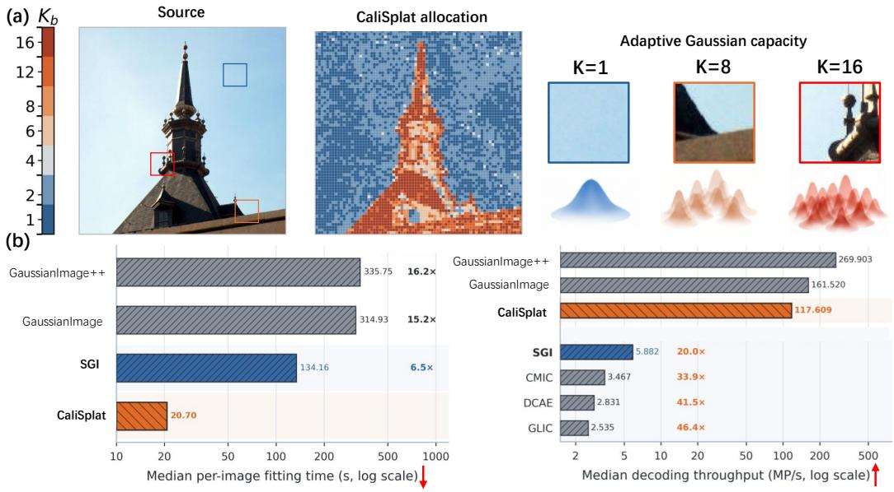

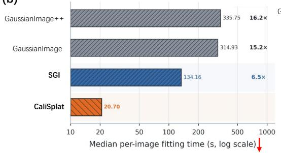

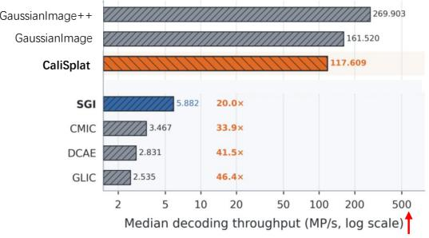  
Figure 1: (a) Content-adaptive Gaussian allocation assigns larger Gaussian capacity to more complex regions. (b) CaliSplat achieves fast fitting while maintaining high decoding throughput.

We introduce CaliSplat, a per-image Gaussian codec that addresses this trade-off through sparse candidate fitting and global budget-aware allocation. Our key observation is that the single-Gaussian case admits a closed-form solution: under squared error, its distortion $D _ { b } ( 1 )$ can be computed analytically and serves as an inexpensive measure of local representation difficulty. We therefore fit higher-capacity candidates only in regions likely to benefit from additional Gaussians, substantially reducing unnecessary optimization. Since short-horizon distortions may mis-rank candidates with different convergence rates, a small set of longer-horizon fits is used to calibrate their scores before global selection. The resulting scores guide image-level allocation of a constrained Gaussian budget, concentrating capacity in structurally complex regions as illustrated in Fig. 1(a). Finally, the selected Gaussians are compressed into a bitstream using deterministic geometric templates and structured template-relative parameter coding.

Experiments demonstrate both the component effectiveness and end-to-end efficiency of CaliSplat. The analytic difficulty gate reduces the K-weighted candidate-fitting workload to 65% of exhaustive search with essentially unchanged reconstruction quality, while budget-aware allocation improves PSNR by 1.20 dB over uniform allocation and by 2.92 dB over a matched spatially shuffled baseline. On the main datasets, CaliSplat achieves competitive rate–distortion performance on standard images and superior PSNR on large-image datasets, while reducing per-image fitting time by 3.0×– 15.7× compared with representative Gaussian codecs. As shown in Fig. 1(b), it additionally retains high-throughput deterministic decoding at 175.9–478.2 MP/s.

## Our contributions are summarized as follows:

• We introduce an analytic difficulty-guided sparse fitting strategy that leverages the closedform distortion of a single Gaussian to identify regions that require higher representation capacity, substantially reducing redundant per-image optimization.

• We propose a calibrated, budget-aware Gaussian allocation framework that calibrates inexpensive short-horizon candidate evaluations with a small set of longer-horizon fits, enabling globally optimized capacity allocation under a constrained image-level Gaussian budget.

• Extensive experiments demonstrate that CaliSplat achieves competitive or superior rate– distortion performance while substantially improving per-image optimization efficiency

and maintaining high decoding throughput, with particularly strong performance in highrate and high-resolution regimes.

## 2 RELATED WORK

## 2.1 IMAGE COMPRESSION

Learned image compression typically maps images to quantized latents and reconstructs them with a learned synthesis transform. Early work established end-to-end rate–distortion optimization, hyperpriors, autoregressive context modeling, and expressive likelihood models (Minnen et al., 2018; Cheng et al., 2020). Later methods improve coding efficiency and context modeling through space– channel grouping and hybrid Transformer–CNN architectures (He et al., 2022; Liu et al., 2023). Recent systems further explore linear attention, dictionary-based entropy models, content-adaptive state-space models, and hierarchical context modeling (Feng et al., 2025; Lu et al., 2025a; Qin et al., 2025; Li et al., 2025), while practical and adaptive codec design remains an active direction (Tatwawadi et al., 2026; Chen et al., 2026b; Ma et al., 2026).

Per-image codecs instead optimize a representation for each test image. COIN and subsequent INR-based methods encode image-specific representations (Dupont et al., 2021; Strumpler et al.,¨ 2022; Ladune et al., 2023). C3 further demonstrates strong rate–distortion performance with a lowcomplexity overfitted decoder (Kim et al., 2024), while recent work studies perceptual objectives and online image-specific optimization (Balle et al., 2025; Kuang et al., 2025). GaussianImage´ introduced 2D Gaussian splatting for image representation and compression (Zhang et al., 2024a). LIG explore content-adaptive or multilevel Gaussian representations (Zhu et al., 2025), while Instant GaussianImage reduces fitting cost and adapts the primitive count to image content (Zeng et al., 2025).

## 2.2 3D GAUSSIAN SPLATTING COMPRESSION

3D Gaussian Splatting represents radiance fields using explicit anisotropic primitives and differentiable rasterization (Kerbl et al., 2023). Because high-quality scenes often contain a large number of Gaussians with geometry, opacity, and appearance attributes, compression methods have explored pruning, masking, vector quantization, and compact parameter representations (Niedermayr et al., 2024; Fan et al., 2024). Subsequent work further exploits spatial dependencies through structured representations and contextual entropy models (Lu et al., 2024; Wang et al., 2024b), while MesonGS studies efficient post-training coding (Xie et al., 2024). Recent methods extend these directions with feed-forward compression (Chen et al., 2025), feature-plane coding with standard video codecs (Lee et al., 2025), and spatial-distribution optimization (Yang et al., 2026). These studies highlight that Gaussian compression benefits not only from compact attribute coding, but also from structured representations and adaptive allocation of limited Gaussian capacity.

## 3 PROPOSED METHOD: CALISPLAT

We introduce CaliSplat, a per-image compression framework based on explicit anisotropic Gaussians. Given an RGB image $I ,$ the encoder produces a bitstream $S ,$ from which the decoder recovers an explicit Gaussian representation $\widehat { \Theta }$ and deterministically reconstructs the image:

$$
\begin{array} { r l } { \widehat { \Theta } = \operatorname { D e c } _ { \Theta } ( S ) , \qquad } & { { } \widehat { I } = \mathcal { R } ( \widehat { \Theta } ) . } \end{array}\tag{1}
$$

The main challenge is to determine where Gaussian should be spent without fully optimizing every possible representation. As shown in Fig. 2, we first construct sparse candidates only where additional Gaussian is likely to be useful (Sec. 3.1). Since short optimization can favor candidate sizes that simply converge faster, we use a small number of longer-horizon reference fits to calibrate their scores (Sec. 3.2). These calibrated scores guide the global Gaussian-budget allocation, after which the selected parameters are compactly quantized and entropy-coded into the bitstream S (Sec. 3.3). The decoding only recovers the explicit Gaussian parameters from S and rasterizes them into the reconstructed image (Sec. 3.4). Alg. 1 and 2 summarize the complete encoding and decoding procedures, respectively.

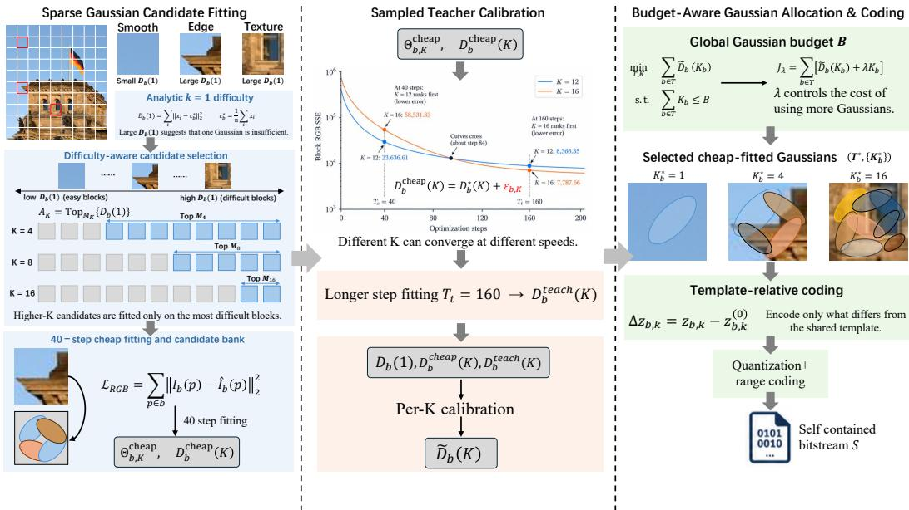  
Figure 2: The overview of the CaliSplat encoding pipeline. Sparse candidate fitting reduces unnecessary optimization, sampled teacher calibration corrects short-horizon scores, and budget-aware allocation selects and codes the final Gaussian representation.

## 3.1 SPARSE GAUSSIAN CANDIDATE FITTING

Local Gaussian representation. We partition the image into many blocks and represent each block with a variable number K of local anisotropic Gaussians. The smooth regions can often be represented with few Gaussians, whereas edges and textures may require more. A Gaussian in block b is parameterized as

$$
\begin{array} { r } { \theta _ { b , k } = \left( \mu _ { b , k } , s _ { b , k } , \phi _ { b , k } , a _ { b , k } , c _ { b , k } \right) , } \end{array}\tag{2}
$$

where $\mu , s = ( s _ { 1 } , s _ { 2 } ) , \phi , a$ , and c denote center, principal-axis scales, orientation, log-weight, and RGB color, respectively. We denote a K-Gaussian candidate by $\Theta _ { b , K } = \{ \theta _ { b , k } \} _ { k = 1 } ^ { K }$

For a local coordinate p, the Gaussian logit is

$$
\ell _ { b , k } ( \mathbf { p } ) = - \frac { 1 } { 2 } \left[ \left( \frac { d _ { 1 , b , k } ( \mathbf { p } ) } { s _ { 1 , b , k } } \right) ^ { 2 } + \left( \frac { d _ { 2 , b , k } ( \mathbf { p } ) } { s _ { 2 , b , k } } \right) ^ { 2 } \right] + a _ { b , k } ,\tag{3}
$$

where $d _ { 1 }$ and $d _ { 2 }$ are coordinates along the rotated principal axes. The normalized Gaussian weights and block reconstruction are

$$
\pi _ { b , k } ( \mathbf { p } ) = \frac { \exp ( \ell _ { b , k } ( \mathbf { p } ) ) } { \sum _ { j = 1 } ^ { K } \exp ( \ell _ { b , j } ( \mathbf { p } ) ) } , \qquad \widehat { I } _ { b } ( \mathbf { p } ) = \sum _ { k = 1 } ^ { K } \pi _ { b , k } ( \mathbf { p } ) c _ { b , k } .\tag{4}
$$

Thus, each pixel is reconstructed as a local mixture of Gaussian colors without depth ordering or alpha compositing. Although a larger $K$ provides more fitting capacity, optimizing every possible K for every block would make per-image encoding expensive. We therefore first ask a cheaper question: which blocks are likely to need more than the simplest representation?

Analytic difficulty estimation. We answer this question using the $K = 1$ case, which requires no iterative optimization. With a single Gaussian, the softmax weight is identically one, so the entire block reduces to one constant RGB color. Under squared error, the optimal color is simply the block mean:

$$
{ c } _ { b } ^ { \star } = \frac { 1 } { n } \sum _ { i = 1 } ^ { n } { \bf x } _ { i } , \qquad { D } _ { b } ( 1 ) = \sum _ { i = 1 } ^ { n } \left\| { \bf x } _ { i } - { \bf c } _ { b } ^ { \star } \right\| _ { 2 } ^ { 2 } .\tag{5}
$$

This gives an intuitive difficulty signal at essentially zero fitting cost. If $D _ { b } ( 1 )$ is small, a single color already explains the block well; if it is large, the block may benefit from additional Gaussians. We therefore use $D _ { b } ( 1 )$ to decide where more expensive candidates are worth trying.

(a) D1 gate targets high-gain blocks  
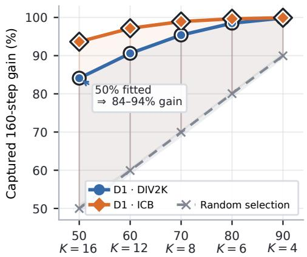

(b) Short fits mis-rank K  
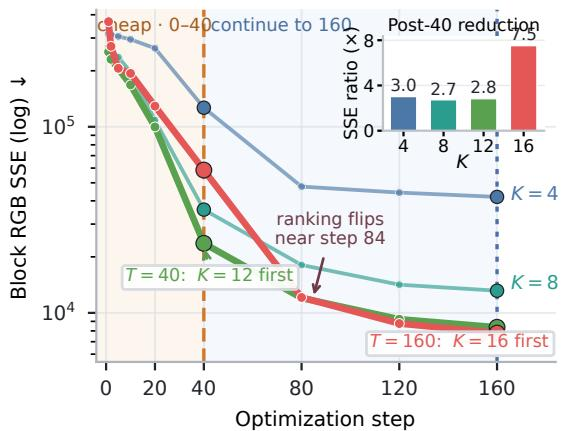  
Figure 3: (a) The analytic D1 gate preserves most long-horizon fitting gain while evaluating only a subset of candidates. DIV2K and ICB denote the datasets used for these analyses. (b) A real orderreversal example shows that short fitting can mis-rank different K due to convergence mismatch, motivating sampled teacher calibration.

Difficulty-aware sparse fitting. For each candidate size K, we rank all image blocks by the analytic difficulty $D _ { b } ( \bar { 1 } )$ and retain the top $M _ { K }$ blocks:

$$
\mathcal { A } _ { K } = \mathrm { T o p } _ { M _ { K } } \left\{ D _ { b } ( 1 ) \right\} _ { b } ,\tag{6}
$$

where $M _ { K }$ is determined by a predefined retention fraction. This gate $M _ { K }$ is a computational filter: it decides where optimization effort is spent, while the final Gaussian count is chosen later by the global allocator. As shown in Fig. 3(a), this simple ranking preserves most of the long-horizon fitting gain while evaluating only a subset of candidates.

For each admitted pair $( b , K ) , \theta _ { b , k }$ is initialized from a deterministic template defined by the block size $r _ { b }$ and Gaussian count K, and colors are initialized in closed form as

$$
C ^ { ( 0 ) } = W ^ { \dagger } X ,\tag{7}
$$

where $W$ is the template responsibility matrix and X is the flattened RGB block. Starting from this initialization, we perform only $T _ { c } ~ = ~ 4 0$ Adam steps. At each step, the current Gaussians are rasterized using Eq. 4, their RGB reconstruction error is computed against the source block, and gradients are backpropagated through the differentiable rasterizer. The resulting short-horizon candidate is

$$
\Theta _ { b , K } ^ { \mathrm { c h e a p } } , \qquad D _ { b } ^ { \mathrm { c h e a p } } ( K ) .\tag{8}
$$

Candidates outside $\boldsymbol { \mathcal { A } } _ { K }$ are simply skipped, so they incur no fitting cost. For the admitted candidates, the short optimization produces a sparse bank of cheap-fitted Gaussian representations $\Theta _ { b , K } ^ { \mathrm { c h e a p } }$ and their corresponding distortions $D _ { b } ^ { \mathrm { c h e a p } } ( K )$ . Template construction, retention fractions, and optimization details are provided in Appendices A.2.1 and A.2.2.

## 3.2 SAMPLED TEACHER CALIBRATION

The sparse fitting stage in Sec. 3.1 efficiently produces multiple candidates for each block. However, different candidate sizes can converge at different speeds, so their errors after only $T _ { c } = 4 0$ steps may not preserve their longer-horizon ranking. Fig. 3(b) shows a real order-reversal example: $K =$ 12 has lower error at 40 steps, whereas $K \ = \ 1 { \bar { 6 } }$ becomes better after longer optimization. We therefore use longer-horizon (teachers) fits as reference signals for correcting the short-fit scores.

Short-horizon optimization bias. We write

$$
D _ { b } ^ { \mathrm { c h e a p } } ( K ) = D _ { b } ^ { \star } ( K ) + \varepsilon _ { b , K } , \qquad \varepsilon _ { b , K } \geq 0 ,\tag{9}
$$

where $D _ { b } ^ { \star } ( K )$ denotes the distortion after sufficiently long optimization and $\varepsilon _ { b , K }$ is the remaining error caused by stopping early.

Sampled teacher fitting. We run teacher optimization only on a small representative subset. For each $K > 1$ , we sample at most 128 admitted candidates across the range of $D _ { b } ^ { \mathrm { c h e a p } } ( K )$ . Each sampled candidate is reinitialized from the same deterministic template and optimized for $T _ { t } = 1 6 0$ steps, producing the teacher error $D _ { b } ^ { \mathrm { t e a c h } } ( K )$ . The sampling rule is detailed in Appendix A.2.3.

Per-K distortion calibration. The teacher errors provide longer-horizon references for correcting the 40-step candidate scores. For each candidate, we construct

$$
\begin{array} { r } { \mathbf { x } _ { b , K } = \Big [ 1 , \log \Big ( 1 + D _ { b } ^ { \mathrm { c h e a p } } ( K ) \Big ) , \log ( 1 + D _ { b } ( 1 ) ) \Big ] ^ { \top } , } \end{array}\tag{10}
$$

where $D _ { b } ^ { \mathrm { c h e a p } } ( K )$ describes the observed short fit and $D _ { b } ( 1 )$ provides a simple measure of the block’s intrinsic difficulty. Since different values of K can have different convergence behavior, we fit a separate least-squares mapping for each K to predict the corresponding teacher distortion. This gives the calibrated score $\widetilde { D } _ { b } ( K )$ , with $\widetilde { D } _ { b } ( 1 ) = D _ { b } ( 1 )$

## 3.3 BUDGET-AWARE GAUSSIAN CODING

After calibration in Sec. 3.2, each block has several candidate representations with different Gaussian counts K. The remaining question is how to choose among these candidates when the entire image is allowed to use only a limited number of Gaussians.

Gaussian-budget allocation. A larger K usually gives a block more fitting capacity, but spending more Gaussians on one block leaves fewer for the others. We therefore allocate a global budget B by jointly choosing the image partition $\tau$ and the Gaussian count $K _ { b }$ for each selected block:

$$
\operatorname* { m i n } _ { T , { \bf K } } \quad \sum _ { b \in \mathcal { T } } \widetilde { D } _ { b } ( K _ { b } ) \qquad \mathrm { s . t . } \quad \sum _ { b \in \mathcal { T } } K _ { b } \leq B .\tag{11}
$$

Intuitively, the allocator spends more Gaussians on blocks where additional capacity reduces reconstruction error the most, and fewer on blocks that are already represented well with small K.

Directly enforcing the global budget while choosing both the block structure and K is difficult. We assign a cost λ to each Gaussian and minimize

$$
\mathcal { T } _ { \lambda } = \sum _ { b \in \mathcal { T } } \left[ \widetilde { D } _ { b } ( K _ { b } ) + \lambda K _ { b } \right] .\tag{12}
$$

A smaller λ allows more Gaussians, while a larger λ favors more compact representations. We adjust λ until the total number of selected Gaussians is close to the target budget B, and retain the corresponding cheap-fitted candidates $\Theta _ { b , K } ^ { \mathrm { c h e a p } }$ . The detailed allocation procedure is given in Appendix A.2.4.

Compression-aware parameter coding. Once the allocation is fixed, only the selected Gaussian parameters need to be transmitted. We encode the fitted geometry relative to the decoder-known template:

$$
\Delta \mathbf { z } _ { b , k } = \mathbf { z } _ { b , k } - \mathbf { z } _ { b , k } ^ { ( 0 ) } ,\tag{13}
$$

where $\mathbf { z } _ { b , k } ^ { ( 0 ) }$ and ${ \mathbf { z } } _ { b , k }$ denote the template and fitted geometry, respectively. The resulting geometry residuals, relative weights, colors, topology, and Gaussian counts are quantized and losslessly entropy-coded with a standard range coder (Witten et al., 1987), forming the self-contained bitstream S. Detailed coding settings are provided in Appendix A.3.

## 3.4 DETERMINISTIC GAUSSIAN DECODING

Since the bitstream stores an explicit Gaussian representation, decoding only requires entropy decoding, inverse quantization, and rasterization. The decoded block size $r _ { b }$ and Gaussian count $K _ { b }$ determine the shared geometric template, from which the fitted geometry is reconstructed as

$$
\widehat { \mathbf { z } } _ { b , k } = \mathbf { z } _ { b , k } ^ { ( 0 ) } ( r _ { b } , K _ { b } ) + Q _ { z } ^ { - 1 } \big ( \mathbf { q } _ { b , k } ^ { z } \big ) .\tag{14}
$$

The remaining attributes are recovered analogously, yielding ${ \widehat { \Theta } } ,$ which is rasterized using Eq. 4 to obtain the final reconstruction ${ \widehat { I } } .$ Details are provided in Appendix A.2.5.

<table><tr><td rowspan="2">Method</td><td colspan="4">Low-rate</td><td colspan="4">High-rate</td></tr><tr><td>PSNR (dB) ↑</td><td>MS-SSIM ↑</td><td>Training time (s) ↓</td><td>Decode speed (MP/s) ↑</td><td>PSNR (dB) ↑</td><td>MS-SSIM ↑</td><td>Training time (s)↓</td><td>Decode speed (MP/s) ↑</td></tr><tr><td colspan="9">Standard images</td></tr><tr><td>GaussianImage</td><td>26.21</td><td>0.8829</td><td>332.12</td><td>213.58</td><td>30.47</td><td>0.9596</td><td>345.42</td><td>129.41</td></tr><tr><td>GaussianImage++</td><td>26.30</td><td>0.8853</td><td>341.99</td><td>256.53</td><td>30.30</td><td>0.9578</td><td>346.98</td><td>241.74</td></tr><tr><td>Image-GS</td><td>27.95</td><td>0.8994</td><td>77.50</td><td>227.00</td><td>32.08</td><td>0.9607</td><td>71.51</td><td>205.51</td></tr><tr><td>CaliSplat</td><td>27.71</td><td>0.8866</td><td>22.03</td><td>215.82</td><td>32.95</td><td>0.9655</td><td>23.84</td><td>175.90</td></tr><tr><td colspan="9">Large images</td></tr><tr><td>LIG</td><td>23.64</td><td>0.7104</td><td>848.69</td><td>390.84</td><td>29.70</td><td>0.9163</td><td>1015.55</td><td>374.36</td></tr><tr><td>SGI</td><td>26.67</td><td>0.8634</td><td>958.89</td><td>8.49</td><td>30.55</td><td>0.9533</td><td>1617.21</td><td>1.93</td></tr><tr><td>CaliSplat</td><td>27.10</td><td>0.8504</td><td>94.86</td><td>478.19</td><td>31.86</td><td>0.9645</td><td>103.25</td><td>255.24</td></tr></table>

Table 1: Quantitative comparison on standard- and large-image datasets. We compare with GaussianImage (Zhang et al., 2024a), GaussianImage++ (Li et al., 2026), Image-GS (Zhang et al., 2024b), LIG (Zhu et al., 2025), and SGI (Pan et al., 2026). The best and second-best results within each setting are shown in bold and underlined, respectively.

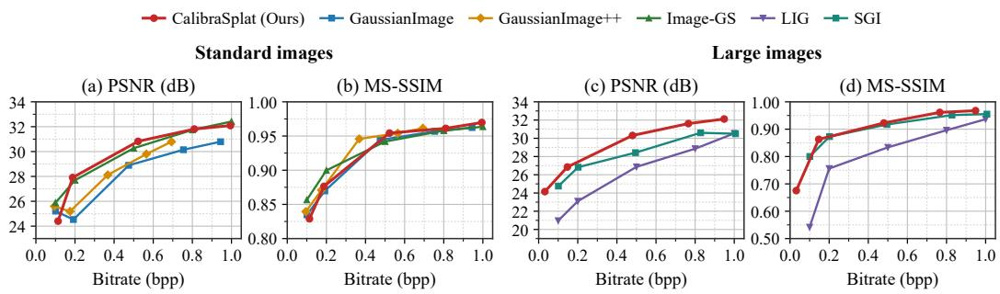  
Figure 4: Rate-distortion curves of CaliSplat and different baselines on standard images and large images datasets.

## 4 EXPERIMENTS

## 4.1 EXPERIMENTAL SETUP

Datasets and Baselines. We evaluate CaliSplat on two groups of datasets covering both standardresolution and large images. The standard-resolution set contains 75 images, with 25 images each from Kodak (Toderici et al., 2017), Tecnick (Asuni & Giachetti, 2013), and CLIC2020 (Cheng et al., 2020). The large-image set contains 9 images, with 3 images each from FGF2 (Wang et al., 2024a), ICB (Ororbia et al., 2019), and STimage (Chen et al., 2024). We compare with representative Gaussian-based methods, including GaussianImage (Zhang et al., 2024a), GaussianImage++ (Li et al., 2026), Image-GS (Zhang et al., 2024b), SGI (Pan et al., 2026), and LIG (Zhu et al., 2025).

Implementation details. We use 16 × 16 root blocks with candidate Gaussian counts $K \in$ {1, 2, 4, 6, 8, 12, 16}. Each admitted candidate is optimized for 40 Adam steps with a learning rate of 0.035, while the sampled teacher fits use 160 steps and at most 128 samples for each K. Additional parameterization and coding settings are provided in Appendix A.3.

## 4.2 RESULTS AND ANALYSIS

Rate–distortion performance. Fig. 4 compares rate–distortion performance on both standardand large-image datasets. On standard images, CaliSplat remains competitive across the bitrate range and becomes particularly strong at higher rates. As shown in Tab. 1, Image-GS achieves slightly higher low-rate PSNR (27.95 vs. 27.71 dB), while CaliSplat obtains the best high-rate performance with 32.95 dB PSNR and 0.9655 MS-SSIM. This trend suggests that the additional representation capacity available at higher rates can be more effectively assigned to regions that benefit from additional Gaussians.

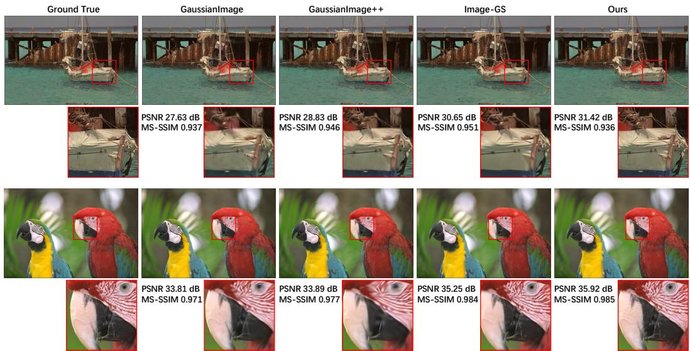  
Figure 5: Qualitative reconstruction comparison of CaliSplat with other baselines. Our method preserves sharper edges and finer local structures with fewer visible artifacts.

The advantage becomes more pronounced on large images. As shown in Fig. 4 and Tab. 1, CaliSplat achieves the best PSNR at both low and high rates, reaching 27.10 and 31.86 dB, respectively. At the high-rate point, it outperforms SGI and LIG by 1.31 dB and 2.16 dB, respectively, while also achieving the highest MS-SSIM of 0.9645. Although SGI performs better in MS-SSIM at the lowrate point, CaliSplat overtakes it as the bitrate increases. Fig. 5 further shows that CaliSplat preserves finer local structures with fewer visible artifacts. Overall, these results demonstrate that CaliSplat maintains competitive performance on standard images while scaling favorably to larger and more complex content.

Encoding and decoding efficiency. CaliSplat also substantially reduces the cost of per-image optimization. On standard images, Tab. 1 reports fitting times of only 22.03–23.84 seconds, corresponding to approximately 3.0×–15.5× faster optimization than the compared Gaussian baselines. Despite this substantial reduction in fitting cost, CaliSplat maintains high decoding throughput of 175.90–215.82 MP/s, remaining competitive with efficient explicit Gaussian decoders.

The efficiency gain is even more pronounced on large images, where expensive per-image optimization becomes a greater bottleneck. CaliSplat requires only 94.86–103.25 seconds of fitting, yielding approximately 8.9×–15.7× faster optimization than LIG and SGI, while retaining 255.24– 478.19 MP/s decoding throughput. These results indicate that the efficiency improvement primarily comes from reducing unnecessary encoder-side representation search rather than simplifying the final representation at the expense of reconstruction or decoding efficiency. Together with the RD results, CaliSplat provides a favorable trade-off between reconstruction quality, per-image fitting cost, and explicit Gaussian decoding efficiency.

## 4.3 ABLATION STUDIES

Structured parameter coding. Fig. 6(a) evaluates the contribution of our structured parameter coding. We keep the selected Gaussians, quantization, and entropy coder fixed, and cumulatively replace absolute coding with template-relative geometry, relative log-weights, and palette-based RGB coding. The result reports the resulting bitstream size relative to absolute coding. The full scheme reduces the stream by 25.57% on DIV2K and 28.07% on ICB, with the largest additional saving coming from palette-based RGB coding. These results show that exploiting the structure of the Gaussian representation substantially reduces the actual transmitted bits without changing the underlying Gaussian representation.

(a) Structured coding removes paid bytes  
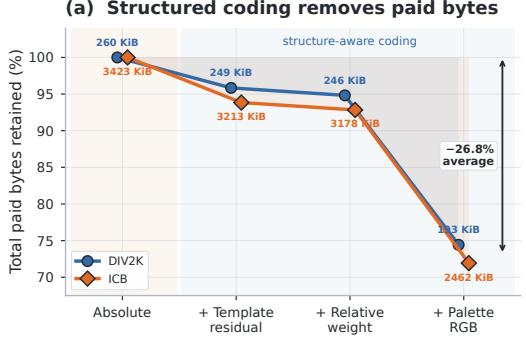

(b) Allocate Gaussians where they matter  
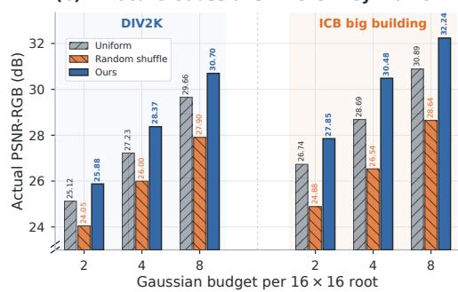  
Figure 6: Ablation of parameter coding and Gaussian-budget allocation. (a) Cumulative coding stages progressively reduce the actual transmitted bytes while keeping the selected Gaussians and quantization fixed. (b) Budget-aware allocation consistently outperforms uniform allocation and a histogram-matched random spatial shuffle under the same Gaussian budget.

<table><tr><td>Variant</td><td>Candidates fitted</td><td>Fit work(%) ↓</td><td>Enc.(s) ↓</td><td>bpp ↓</td><td>PSNR ↑</td><td>SSIM↑</td></tr><tr><td rowspan="2">Exhaustive Random gate</td><td>All</td><td>100.0</td><td>292.49</td><td>0.5165</td><td>30.485</td><td>0.8901</td></tr><tr><td>Random subset</td><td>65.0</td><td>280.76</td><td>0.5162</td><td>30.316</td><td>0.8859</td></tr><tr><td>Full Model</td><td> $D _ { b } ( 1 )$  subset</td><td>65.0</td><td>221.69</td><td>0.5164</td><td>30.509</td><td>0.8906</td></tr></table>

Table 2: Ablation of sparse candidate fitting at $B / N = 4 .$ Fit work denotes the K-weighted candidate-fitting work relative to exhaustive fitting. Bold values indicate the best result.

Budget-aware Gaussian allocation. Fig. 6(b) evaluates how the available Gaussian budget should be distributed after candidate fitting. We compare our method with Uniform, which assigns the same K to all root blocks, and Random shuffle, which keeps the same overall K distribution as our method but randomly moves these counts across spatial locations. Across three budgets $B / N \in \{ 2 , 4 , 8 \}$ our allocation outperforms both controls in all six cases. Compared with Uniform, it improves PSNR by 1.20 dB on average, showing that different regions benefit from different Gaussian counts. Compared with Random shuffle, the average gain increases to 2.92 dB, showing that these capacities must also be assigned to the appropriate spatial regions.

Sparse candidate fitting. Tab. 2 evaluates which higher-K candidates need to be fitted before Gaussian-budget allocation. Exhaustive fits all supported candidates. Random gate and the Full Model use the same reduced fitting work, but Random gate selects candidates randomly, whereas the Full Model uses $D _ { b } ( 1 )$ to decide which higher-K candidates are worth fitting. Compared with exhaustive fitting, the Full Model reduces the K-weighted fitting work from 100% to 65% while slightly improving PSNR from 30.485 to 30.509 dB. At the same 65% fitting work, random selection gives lower PSNR. This shows that many candidate fits can be skipped, but the candidates should be selected using $D _ { b } ( 1 )$ rather than removed at random.

## 5 CONCLUSION

We presented CaliSplat, an efficient per-image Gaussian codec that reduces content-adaptive representation search while preserving lightweight explicit decoding. By using the closed-form single-Gaussian distortion to guide sparse candidate fitting, followed by calibrated budget-aware allocation, CaliSplat concentrates optimization and Gaussian capacity where they are most useful. The selected representation is further compressed using deterministic templates and structured template-relative coding. Experiments on standard and large image datasets show competitive or superior rate– distortion performance with $3 . 0 { \times } \mathrm { - } 1 5 . 7 { \times }$ faster per-image fitting and high-throughput decoding. These results demonstrate the effectiveness of selective representation search for efficient contentadaptive Gaussian image compression.

## AI USE STATEMENT

In this work, we used generative AI tools to assist with feedback on experimental design and the interpretation and presentation of experimental results. We additionally used generative AI tools for drafting and editing parts of the manuscript, improving writing clarity and organization, literature search, identifying relevant references, and formatting citations. All AI-assisted technical statements were manually reviewed and verified by the authors. All reported quantitative results were obtained from author-run experiments and were not generated or modified by generative AI. We take responsibility for the final content of this work, including text, claims, and artifacts produced with the aid of generative AI.

## REFERENCES

Nicola Asuni and Andrea Giachetti. Testimages: A large data archive for display and algorithm testing. Journal ofGraphics Tools, 17(4):113–125, 2013.

Johannes Balle, Valero Laparra, and Eero P Simoncelli. End-to-end optimized image compression.´ arXiv preprint arXiv:1611.01704, 2016.

Johannes Balle, David Minnen, Saurabh Singh, Sung Jin Hwang, and Nick Johnston. Variational´ image compression with a scale hyperprior. arXiv preprint arXiv:1802.01436, 2018.

Jona Balle, Luca Versari, Emilien Dupont, Hyunjik Kim, and Matthias Bauer. Good, cheap, and´ fast: Overfitted image compression with wasserstein distortion. In 2025 IEEE/CVF Conference on Computer Vision and Pattern Recognition (CVPR), pp. 23259–23268. IEEE, 2025.

Jiawen Chen, Muqing Zhou, Wenrong Wu, Jinwei Zhang, Yun Li, and Didong Li. Stimage-1k4m: A histopathology image-gene expression dataset for spatial transcriptomics. Advances in Neural Information Processing Systems, 37:35796–35823, 2024.

Yihang Chen, Qianyi Wu, Mengyao Li, Weiyao Lin, Mehrtash Harandi, and Jianfei Cai. Fast feedforward 3d gaussian splatting compression. In International Conference on Learning Representations, 2025.

Yunuo Chen, Bing He, Zezheng Lyu, Hongwei Hu, Qunshan Gu, Yuan Tian, and Guo Lu. Adaptive learned image compression with graph neural networks. In Proceedings of the IEEE/CVF Conference on Computer Vision and Pattern Recognition (CVPR), pp. 12150–12161, June 2026a.

Yunuo Chen, Bing He, Zezheng Lyu, Hongwei Hu, Qunshan Gu, Yuan Tian, and Guo Lu. Adaptive learned image compression with graph neural networks. In Proceedings of the IEEE/CVF Conference on Computer Vision and Pattern Recognition, pp. 12150–12161, 2026b.

Yunuo Chen, Zezheng Lyu, Bing He, Hongwei Hu, Qi Wang, Yuan Tian, Li Song, Wenjun Zhang, and Guo Lu. Content-aware mamba for learned image compression. In International Conference on Learning Representations, volume 2026, pp. 78452–78477, 2026c.

Zhengxue Cheng, Heming Sun, Masaru Takeuchi, and Jiro Katto. Learned image compression with discretized gaussian mixture likelihoods and attention modules. In 2020 IEEE/CVF Conference on Computer Vision and Pattern Recognition (CVPR), pp. 7936–7945. IEEE, 2020.

Emilien Dupont, Adam Golinski, Milad Alizadeh, Yee Whye Teh, and Arnaud Doucet. Coin: Com-´ pression with implicit neural representations. arXiv preprint arXiv:2103.03123, 2021.

Emilien Dupont, Hrushikesh Loya, Milad Alizadeh, Adam Golinski, Yee Whye Teh, and Arnaud´ Doucet. COIN++: Neural compression across modalities. Transactions on Machine Learning Research, 2022.

Zhiwen Fan, Kevin Wang, Kairun Wen, Zehao Zhu, Dejia Xu, and Zhangyang Wang. Lightgaussian: Unbounded 3d gaussian compression with 15x reduction and 200+ fps. In Advances in Neural Information Processing Systems, volume 37, 2024. doi: 10.52202/079017-4447.

Donghui Feng, Zhengxue Cheng, Shen Wang, Ronghua Wu, Hongwei Hu, Guo Lu, and Li Song. Linear attention modeling for learned image compression. In Proceedings ofthe IEEE/CVF Con ference on Computer Vision and Pattern Recognition, pp. 7623–7632, 2025.

Dailan He, Ziming Yang, Weikun Peng, Rui Ma, Hongwei Qin, and Yan Wang. ELIC: Efficient learned image compression with unevenly grouped space-channel contextual adaptive coding. In Proceedings of the IEEE/CVF Conference on Computer Vision and Pattern Recognition, pp. 5718–5727, 2022.

Bernhard Kerbl, Georgios Kopanas, Thomas Leimkuhler, and George Drettakis. 3d gaussian¨ splatting for real-time radiance field rendering. ACM Transactions on Graphics, 2023. doi: 10.1145/3592433.

Hyunjik Kim, Matthias Bauer, Lucas Theis, Jonathan Richard Schwarz, and Emilien Dupont. C3: High-performance and low-complexity neural compression from a single image or video. In Proceedings of the IEEE/CVF Conference on Computer Vision and Pattern Recognition, pp. 9347– 9358, 2024.

Haowei Kuang, Wenhan Yang, Zongming Guo, and Jiaying Liu. Cross-granularity online optimization with masked compensated information for learned image compression. In Proceedings ofthe IEEE/CVF International Conference on Computer Vision, pp. 16514–16523, 2025.

Theo Ladune, Pierrick Philippe, F ´ elix Henry, Gordon Clare, and Thomas Leguay. COOL-CHIC:´ Coordinate-based low complexity hierarchical image codec. In Proceedings of the IEEE/CVF International Conference on Computer Vision, pp. 13515–13522, 2023.

Soonbin Lee, Fangwen Shu, Yago Sanchez, Thomas Schierl, and Cornelius Hellge. Compression of 3d gaussian splatting with optimized feature planes and standard video codecs. In Proceedings of the IEEE/CVF International Conference on Computer Vision, pp. 25496–25505, 2025.

Tiantian Li, Xinjie Zhang, Xingtong Ge, Tongda Xu, Dailan He, Jun Zhang, and Yan Wang. GaussianImage++: Boosted image representation and compression with 2d gaussian splatting. In Proceedings of the AAAI Conference on Artificial Intelligence, volume 40, pp. 6442–6449, 2026. doi: 10.1609/aaai.v40i8.37572.

Yuqi Li, Haotian Zhang, Li Li, and Dong Liu. Learned image compression with hierarchical progressive context modeling. In Proceedings of the IEEE/CVF International Conference on Computer Vision, pp. 18834–18843, 2025.

Jinming Liu, Heming Sun, and Jiro Katto. Learned image compression with mixed transformer– cnn architectures. In Proceedings ofthe IEEE/CVF Conference on Computer Vision and Pattern Recognition, pp. 14388–14397, 2023. doi: 10.1109/CVPR52729.2023.01383.

Jingbo Lu, Leheng Zhang, Xingyu Zhou, Mu Li, Wen Li, and Shuhang Gu. Learned image compression with dictionary-based entropy model. In Proceedings of the IEEE/CVF Conference on Computer Vision and Pattern Recognition, pp. 12850–12859, 2025a.

Jingbo Lu, Leheng Zhang, Xingyu Zhou, Mu Li, Wen Li, and Shuhang Gu. Learned image compression with dictionary-based entropy model. In 2025 IEEE/CVF Conference on Computer Vision and Pattern Recognition (CVPR), pp. 12850–12859. IEEE, 2025b.

Tao Lu, Mulin Yu, Linning Xu, Yuanbo Xiangli, Limin Wang, Dahua Lin, and Bo Dai. Scaffold-GS: Structured 3d gaussians for view-adaptive rendering. In Proceedings of the IEEE/CVF Conference on Computer Vision and Pattern Recognition, pp. 20654–20664, 2024.

Huidong Ma, Xinyan Shi, Hui Sun, Xiaofei Yue, Xiaoguang Liu, Gang Wang, and Wentong Cai. Learned image compression via sparse attention and adaptive frequency. In Proceedings of the IEEE/CVF Conference on Computer Vision and Pattern Recognition, pp. 41278–41287, 2026.

David Minnen, Johannes Balle, and George D. Toderici. Joint autoregressive and hierarchical priors´ for learned image compression. In Advances in Neural Information Processing Systems, volume 31, pp. 10794–10803, 2018.

Simon Niedermayr, Josef Stumpfegger, and Rudiger Westermann. Compressed 3d gaussian splatting ¨ for accelerated novel view synthesis. In Proceedings of the IEEE/CVF Conference on Computer Vision and Pattern Recognition, pp. 10349–10358, 2024.

Alexander G Ororbia, Ankur Mali, Jian Wu, Scott O’Connell, William Dreese, David Miller, and C Lee Giles. Learned neural iterative decoding for lossy image compression systems. In 2019 Data Compression Conference (DCC), pp. 3–12. IEEE, 2019.

Zixuan Pan, Kaiyuan Tang, Jun Xia, Yifan Qin, Lin Gu, Chaoli Wang, Jianxu Chen, and Yiyu Shi. SGI: Structured 2d gaussians for efficient and compact large image representation. In Proceedings of the IEEE/CVF Conference on Computer Vision and Pattern Recognition, 2026.

Shiyu Qin, Jinpeng Wang, Yimin Zhou, Bin Chen, Tianci Luo, Baoyi An, Tao Dai, Shu-Tao Xia, and Yaowei Wang. Cassic: Towards content-adaptive state-space models for learned image compression. In Proceedings of the IEEE/CVF International Conference on Computer Vision, pp. 15727–15736, 2025.

Yannick Strumpler, Janis Postels, Ren Yang, Luc Van Gool, and Federico Tombari. Implicit neural¨ representations for image compression. In European conference on computer vision, pp. 74–91. Springer, 2022.

Kedar Tatwawadi, Parisa Rahimzadeh, Zhanghao Sun, Zhiqi Chen, Ziyun Yang, Sanjay Nair, Divija Hasteer, and Oren Rippel. What matters in practical learned image compression. In Proceedings of the IEEE/CVF Conference on Computer Vision and Pattern Recognition, pp. 12095–12105, 2026.

George Toderici, Damien Vincent, Nick Johnston, Sung Jin Hwang, David Minnen, Joel Shor, and Michele Covell. Full resolution image compression with recurrent neural networks. In Proceedings of the IEEE conference on Computer Vision and Pattern Recognition, pp. 5306–5314, 2017.

Yingying Wang, Xuanhua He, Yuhang Dong, Yunlong Lin, Yue Huang, and Xinghao Ding. Crossmodality interaction network for pan-sharpening. IEEE Transactions on Geoscience and Remote Sensing, 62:1–16, 2024a.

Yufei Wang, Zhihao Li, Lanqing Guo, Wenhan Yang, Alex C. Kot, and Bihan Wen. ContextGS: Compact 3d gaussian splatting with anchor level context model. In Advances in Neural Information Processing Systems, 2024b.

Ian H Witten, Radford M Neal, and John G Cleary. Arithmetic coding for data compression. Communications ofthe ACM, 30(6):520–540, 1987.

Shuzhao Xie, Weixiang Zhang, Chen Tang, Yunpeng Bai, Rongwei Lu, Shijia Ge, and Zhi Wang. MesonGS: Post-training compression of 3d gaussians via efficient attribute transformation. In European Conference on Computer Vision, 2024.

Xianben Yang, Tao Wang, Yuxuan Li, Yi Jin, and Haibin Ling. GS2: Graph-based spatial distribution optimization for compact 3d gaussian splatting. In Proceedings of the IEEE/CVF Conference on Computer Vision and Pattern Recognition, pp. 33259–33268, 2026.

Zhaojie Zeng, Yuesong Wang, Tao Guan, Chao Yang, and Lili Ju. Instant GaussianImage: A generalizable and self-adaptive image representation via 2d gaussian splatting. In Proceedings ofthe IEEE/CVF International Conference on Computer Vision, pp. 27896–27905, 2025.

Xinjie Zhang, Xingtong Ge, Tongda Xu, Dailan He, Yan Wang, Hongwei Qin, Guo Lu, Jing Geng, and Jun Zhang. GaussianImage: 1000 FPS image representation and compression by 2d gaussian splatting. In Proceedings of the European Conference on Computer Vision, 2024a. doi: 10.1007/ 978-3-031-72673-6 18.

Yunxiang Zhang, Alexandr Kuznetsov, Akshay Jindal, Kenneth Chen, Anton Sochenov, Anton Kaplanyan, and Qi Sun. Image-GS: Content-adaptive image representation via 2d gaussians, 2024b.

Lingting Zhu, Guying Lin, Jinnan Chen, Xinjie Zhang, Zhenchao Jin, Zhao Wang, and Lequan Yu. Large images are gaussians: High-quality large image representation with levels of 2d gaussian splatting. In Proceedings of the AAAI Conference on Artificial Intelligence, volume 39, pp. 10977–10985, 2025. doi: 10.1609/aaai.v39i10.33193.

Algorithm 1 Per-Image Encoding with CaliSplat   
Require: RGB image I; Gaussian budget B   
Ensure: Self-contained bitstream S   
1: Partition I into supported spatial blocks   
Stage 1: Sparse Gaussian candidate fitting Sec. 3.1; Appendix. A.2.1, A.2.2   
2: for each block b do   
3: Compute the analytic $K = 1$ solution $( \boldsymbol { c } _ { b } ^ { \star } , D _ { b } ( 1 ) )$ ▷ Eq. 5   
4: end for   
5: for each supported $K > 1$ do   
6: Select admitted blocks $\boldsymbol { \mathcal { A } } _ { K }$ using $D _ { b } ( 1 )$ ▷ Eq. 6   
7: for each $b \in \mathcal { A } _ { K }$ do   
8: Initialize template geometry and $C ^ { ( 0 ) } = W ^ { \dagger } X$ ▷ Eq. 7   
9: for $t = 1 , \ldots , T _ { c }$ do   
10: Rasterize $\widehat { I } _ { b , K } ^ { ( t ) } = \mathcal { R } ( \Theta _ { b , K } ^ { ( t ) } )$ ▷ Eq. 4   
11: Compute $\begin{array} { r } { \mathcal { L } _ { b , K } ^ { ( t ) } = \sum _ { \mathbf { p } \in b } \| I _ { b } ( \mathbf { p } ) - \widehat { I } _ { b , K } ^ { ( t ) } ( \mathbf { p } ) \| _ { 2 } ^ { 2 } } \end{array}$   
12: Backpropagate $\nabla _ { \rho _ { b , K } } \mathcal { L } _ { b , K } ^ { ( t ) }$ and update ${ \rho } _ { b , K }$ with Adam   
13: end for   
14: Store $\bar { \Theta } _ { b , K } ^ { \mathrm { c h e a p } }$ and $D _ { b } ^ { \mathrm { c h e a p } } ( K )$ ▷ Eq. 8   
15: end for   
16: end for   
Stage 2: Sampled teacher calibration Sec. 3.2; Appendix. A.2.3   
17: for each $K > { \hat { 1 } }$ do   
18: Sample at most 128 admitted blocks across the $D _ { b } ^ { \mathrm { c h e a p } } ( K )$ range   
19: for each sampled block b do   
20: Reinitialize from the same deterministic template   
21: Repeat the same rasterization–loss–backpropagation loop for $T _ { t }$ steps   
22: Record $D _ { b } ^ { \mathrm { t e a c h } } ( K )$   
23: end for   
24: Construct calibration features ${ \bf x } _ { b , K }$ ▷ Eq. 10   
25: Fit the per-K least-squares mapping and predict $\widetilde { D } _ { b } ( K )$ for all admitted candidates   
26: end for   
27: Set $\widetilde { D } _ { b } ( 1 )  D _ { b } ( 1 )$   
28: Discard teacher parameters and retain $\Theta _ { b , K } ^ { \mathrm { c h e a p } }$ ▷ teachers calibrate scores only   
Stage 3: Budget-aware Gaussian allocation and coding Sec. 3.3; Appendix A.2.4   
29: Search λ and solve the hierarchical allocation using calibrated distortions ▷ Eqs. 11–12   
30: Obtain the selected topology $\mathcal { T } ^ { \star }$ and Gaussian counts $\{ K _ { b } ^ { \star } \}$   
31: for each selected leaf $\dot { b } \in \breve { \mathcal { T } } ^ { \star }$ do   
32: Retrieve the selected $\Theta _ { b , K _ { b } ^ { \star } } ^ { \mathrm { c h e a p } }$   
33: Encode template-relative geometry, relative weights, and palette-coded colors ▷ Eq. 13   
34: end for   
35: Quantize and range-code the selected topology, Gaussian counts and parameters into S   
36: return S

## A APPENDIX

## A.1 MORE RESULTS

## A.1.1 QUALITATIVE ALLOCATION ANALYSIS.

Fig. 7 examines where the available Gaussians are placed across different types of images. Each example contains the source image and its allocation map. As shonw in this visualization, blocks around locally detailed regions are often assigned larger $K _ { b } .$ , whereas smooth backgrounds and nearly empty regions tend to use smaller $K _ { b }$ . For example, detailed building facades and tissue

Algorithm 2 Deterministic Gaussian Decoding   
Require: CaliSplat bitstream $\overline { S }$   
Ensure: Reconstructed RGB image $\widehat { I }$   
Stage 1: Recover the explicit Gaussian representation   
Sec. 3.4; inverse details in Appendix A.2.5   
1: Decode the selected topology, Gaussian counts, and quantized Gaussian symbols   
2: for each selected leaf b do   
3: Reconstruct the deterministic template from $( r _ { b } , K _ { b } )$   
4: Recover coding-space geometry from the template and transmitted residual ▷ Eq. 14   
5: Recover relative weights and Gaussian colors   
6: Assemble the decoded Gaussian set $\widehat { \Theta } _ { b }$   
7: end for   
8: Assemble $\widehat { \Theta } = \bigcup _ { b } \widehat { \Theta } _ { b }$ ▷ Eq. 1   
Stage 2: Deterministic Gaussian rasterization   
9: for each selected leaf b do   
10: Rasterize $\widehat { \Theta } _ { b }$ using the local Gaussian mixture ▷ Eq. 4   
11: end for   
12: Assemble the reconstructed blocks and obtain $\widehat { I } = \mathcal { R } ( \widehat { \Theta } )$ ▷ Eq. 1   
13: return $\widehat { I }$

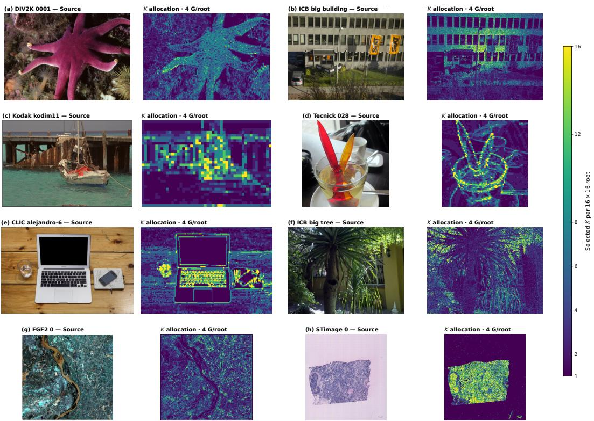  
Figure 7: Qualitative visualization of Gaussian-budget allocation across eight images. Each example shows the source image and the selected Gaussian count $K _ { b }$ for each $1 6 \times 1 6$ root block under the same average budget $\bar { B } / N = 4$ . Larger $K _ { b }$ values are concentrated in regions with richer local structure, while smoother regions receive fewer Gaussians.

regions receive more Gaussians than nearby smooth or low-detail areas. These results show that the allocator does not distribute the Gaussian budget uniformly. Instead, it gives more capacity to regions where additional Gaussians are more useful for reconstruction. The visualization supports that our method adapts both the amount and the spatial placement of Gaussian capacity to the image content. More results are in Fig. 8-11.

<table><tr><td rowspan="2">Method</td><td colspan="4">Low-rate</td><td colspan="4">High-rate</td></tr><tr><td>PSNR (dB) ↑</td><td>MS-SSIM ↑</td><td>Training time (s) ↓</td><td>Decode speed (MP/s) ↑</td><td>PSNR (dB) ↑</td><td>MS-SSIM ↑</td><td>Training time (s) ↓</td><td>Decode speed (MP/s) ↑</td></tr><tr><td>GLIC</td><td>33.34</td><td>0.9655</td><td>N/A</td><td>2.67</td><td>38.45</td><td>0.9874</td><td>N/A</td><td>2.65</td></tr><tr><td>CMIC</td><td>33.30</td><td>0.9654</td><td>N/A</td><td>3.44</td><td>38.43</td><td>0.9890</td><td>N/A</td><td>3.43</td></tr><tr><td>DCAE</td><td>33.26</td><td>0.9593</td><td>N/A</td><td>3.03</td><td>38.23</td><td>0.9891</td><td>N/A</td><td>3.00</td></tr><tr><td>CaliSplat</td><td>27.71</td><td>0.8866</td><td>22.03</td><td>215.82</td><td>32.95</td><td>0.9655</td><td>23.84</td><td>175.90</td></tr></table>

Table 3: Quantitative comparison with representative learned image codecs GLIC (Chen et al., 2026a), CMIC (Chen et al., 2026c), and DCAE (Lu et al., 2025b). The best and second-best result for each metric are shown in bold and underlined, respectively.

## A.1.2 COMPARISON WITH LEARNED IMAGE CODECS.

Tab. 3 further compares CaliSplat with recent learned image codecs, including GLIC (Chen et al., 2026a), CMIC (Chen et al., 2026c), and DCAE (Lu et al., 2025b). These methods achieve clearly stronger rate–distortion performance, benefiting from dataset-level priors learned offline from large image corpora. In contrast, Gaussian-based codecs optimize an explicit representation for each individual image and do not directly exploit the same cross-image priors, making this RD gap a broader limitation of the current per-image Gaussian compression paradigm. CaliSplat nevertheless offers a substantially different decoding trade-off: it reaches 175.90–215.82 MP/s, compared with 2.65– 3.44 MP/s for the learned codecs, corresponding to approximately $5 1 . 3 { \times } { - } 8 0 . 8 { \times }$ higher throughput. Together with Tab. 1, these results show that CaliSplat primarily improves the efficiency of explicit Gaussian compression by reducing per-image fitting cost while preserving its lightweight and highly efficient decoding.

## A.2 ADDITIONAL METHOD DETAILS

## A.2.1 GAUSSIAN PARAMETERIZATION AND INITIALIZATION

For a block of side length $r _ { b } ,$ pixel indices $i , j = 0 , \ldots , r _ { b } - 1$ are mapped to normalized local coordinates $\mathbf { p } _ { i j } = ( - 1 + 2 i / ( r _ { b } - 1 ) , - 1 + 2 j / ( r _ { b } - 1 ) )$ . For a Gaussian centered at $\pmb { \mu } = ( \mu _ { y } , \mu _ { x } )$ the coordinates along its rotated principal axes are $d _ { 1 } = ( p _ { y } - \mu _ { y } ) \cos \phi + ( p _ { x } - \mu _ { x } )$ sin ϕ and $d _ { 2 } = - ( p _ { y } - \mu _ { y } ) \sin { \phi } + ( p _ { x } - \mu _ { x } )$ cos ϕ. These normalized coordinates are used in Eq. 3 for all supported block sizes.

During gradient-based per-image fitting, Gaussian parameters are optimized through unconstrained raw variables $\rho$ and mapped to valid physical values by

$$
\mu = 1 . 1 5 \operatorname { t a n h } ( \rho _ { \mu } ) , \qquad s = \operatorname { s o f t p l u s } ( \rho _ { s } ) + 0 . 0 2 5 , \qquad \phi = \rho _ { \phi } , \quad a = \rho _ { a } , \quad c = 2 5 5 \sigma ( \rho _ { c } ) .\tag{15}
$$

The extended center range allows slight motion beyond the normalized block boundary, while the scale floor avoids degenerate ellipses. Gradients are backpropagated through these mappings and the differentiable Gaussian rasterizer.

For each $( r _ { b } , K )$ , we initialize the K Gaussians on the most balanced regular grid satisfying $n _ { y } n _ { x } =$ K. Among valid factor pairs, we choose the one with aspect ratio closest to one; ties and Gaussian ordering follow fixed deterministic rules shared by the encoder and decoder. For grid location $( i , j )$ the template is

$$
\mu _ { i , j } ^ { ( 0 ) } = \left( \frac { i + \frac { 1 } { 2 } } { n _ { y } ^ { \star } } \cdot 2 - 1 , \frac { j + \frac { 1 } { 2 } } { n _ { x } ^ { \star } } \cdot 2 - 1 \right) , \qquad s ^ { ( 0 ) } = \left( \frac { 1 . 3 5 } { n _ { y } ^ { \star } } , \frac { 1 . 3 5 } { n _ { x } ^ { \star } } \right) , \qquad \phi ^ { ( 0 ) } = 0 . 5 7 ,\tag{16}
$$

The factor 1.35 provides overlap between neighboring template Gaussians. Because the template is determined entirely by $( r _ { b } , K )$ , it requires no additional side information.

With the template geometry fixed and initial log-weights set to zero, the rasterizer defines a responsibility matrix $W \in \mathbb { R } ^ { r _ { b } ^ { 2 } \times K }$ . For a flattened RGB block $X \in \mathbb { R } ^ { r _ { b } ^ { 2 } \times 3 }$ , the initial Gaussian colors are

obtained in closed form:

$$
C ^ { ( 0 ) } = \arg \operatorname* { m i n } _ { C } \| W C - X \| _ { F } ^ { 2 } = W ^ { \dagger } X .\tag{17}
$$

Since $W$ depends only on $( r _ { b } , K )$ , its pseudoinverse is reused across blocks with the same configuration. For $\bar { K } = 1$ , the analytic mean is clipped to [0.5, 254.5] only when converted to raw sigmoid coordinates, avoiding infinite inverse-sigmoid values; the exact $D _ { b } \dot { ( 1 ) }$ in Eq. 5 is computed from the unclipped mean.

## A.2.2 SPARSE CANDIDATE CONSTRUCTION

For $1 6 \times 1 6$ blocks, we use

$$
{ K } _ { 1 6 } = \{ 1 , 2 , 4 , 6 , 8 , 1 2 , 1 6 \} , \qquad ( \rho _ { 1 } , \rho _ { 2 } , \rho _ { 4 } , \rho _ { 6 } , \rho _ { 8 } , \rho _ { 1 2 } , \rho _ { 1 6 } ) = ( 1 . 0 , 1 . 0 , 0 . 9 , 0 . 8 , 0 . 7 , 0 . 6 , 0 . 5 ) ,\tag{18}
$$

where $\rho _ { K }$ denotes the fraction of blocks retained for candidate size K. For a scale containing N blocks, the corresponding admission count is

$$
M _ { K } = \{ 0 , \rho _ { K } = 0 , \rho _ { K }\tag{19}
$$

Blocks are ranked by the analytic difficulty $D _ { b } ( 1 )$ as described in Eq. $\begin{array} { r } { 6 ; } \end{array}$ candidates outside $\boldsymbol { \mathcal { A } } _ { K }$ are treated as unavailable by assigning $D _ { b } ^ { \mathrm { c h e a p } } ( K ) = + \infty$

## A.2.3 TEACHER SAMPLING AND CALIBRATION

Let $N _ { K } = | \mathcal { A } _ { K } |$ and let $\sigma _ { K } ( 0 ) , \ldots , \sigma _ { K } ( N _ { K } - 1 )$ denote the admitted blocks sorted by increasing $D _ { b } ^ { \mathrm { c h e a p } } ( K )$ . For each $K > 1$ , we select at most 128 teachers, uniformly along this sorted error axis. With $m _ { K } = \operatorname* { m i n } ( 1 2 8 , N _ { K } )$ , the sampled set is

$$
\begin{array} { r } { \mathcal { S } _ { K } = \{ \sigma _ { K } ( q _ { i } ) \} _ { i = 0 } ^ { m _ { K } - 1 } , \qquad q _ { i } = \left\{ \begin{array} { l l } { 0 , } & { m _ { K } = 1 , } \\ { \mathrm { r o u n d } \left( \frac { i ( N _ { K } - 1 ) } { m _ { K } - 1 } \right) , } & { m _ { K } > 1 . } \end{array} \right. } \end{array}\tag{20}
$$

This sampling covers the cheap-distortion range rather than concentrating teachers around its most populated region.

Each sampled candidate is reinitialized from the same deterministic template used by the cheap fit and optimized independently for $T _ { t } = 1 6 0$ Adam steps. We use the same RGB squared-error objective, learning rate, and restart setting as in sparse fitting. Importantly, teacher optimization does not continue from $\Theta _ { b , K } ^ { \mathrm { c h e a p } }$ ; its purpose is to provide a longer-horizon reference $D _ { b } ^ { \mathrm { t e a c h } } ( K )$

For each sampled block, the regression target is $y _ { b , K } = \log ( 1 + D _ { b } ^ { \operatorname { t e a c h } } ( K ) )$ . Stacking the features ${ \bf x } _ { b , K }$ from $\operatorname { E q }$ . 10 and their targets gives $X _ { K }$ and $\mathbf { y } _ { K }$ . We fit a separate least-squares model for each $K \colon$

$$
\beta _ { K } = \arg \operatorname* { m i n } _ { \pmb { \beta } } \left\| X _ { K } \pmb { \beta } - \mathbf { y } _ { K } \right\| _ { 2 } ^ { 2 } .\tag{21}
$$

The least-squares system is solved directly, without explicitly forming $( X _ { K } ^ { \top } X _ { K } ) ^ { - 1 }$

For every admitted candidate, the predicted log-distortion is mapped back to the original distortion domain:

$$
\widetilde { D } _ { b } ( K ) = \mathrm { m a x } \left\{ \mathrm { e x p m 1 } \left( \mathbf { x } _ { b , K } ^ { \top } \beta _ { K } \right) , 0 \right\} .\tag{22}
$$

For $K = 1$ , we retain the exact analytic value $\widetilde { D } _ { b } ( 1 ) = D _ { b } ( 1 )$ , while candidates excluded by the sparse gate remain unavailable with infinite distortion.

## A.2.4 BUDGET-AWARE HIERARCHICAL ALLOCATION

For a fixed multiplier λ, each tree node chooses between remaining unsplit and being replaced by its children. Let $\kappa _ { n }$ denote the legal Gaussian counts at node n. The bottom-up dynamic program is

$$
\begin{array} { l } { { \displaystyle F _ { n } ^ { \mathrm { l e a f } } ( \lambda ) = \operatorname* { m i n } _ { K \in { \mathcal K } _ { n } } \left[ \widetilde D _ { n } ( K ) + \lambda K \right] , } } \\ { { \displaystyle F _ { n } ^ { \mathrm { s p l i t } } ( \lambda ) = \sum _ { c \in \mathrm { c h i l d } ( n ) } F _ { c } ( \lambda ) } , } \\ { { \displaystyle F _ { n } ( \lambda ) = \operatorname* { m i n } \left\{ F _ { n } ^ { \mathrm { l e a f } } ( \lambda ) , F _ { n } ^ { \mathrm { s p l i t } } ( \lambda ) \right\} . } } \end{array}\tag{23}
$$

At an unsplit node, candidate counts are considered in increasing order so that local ties favor the smaller $\bar { K ; }$ ties between split and unsplit configurations favor the unsplit node.

For a fixed candidate table and λ, this recursion gives the optimal legal configuration under the Lagrangian objective. The argument follows directly by induction on tree depth: terminal nodes choose their best legal candidate, while a split node combines optimal solutions from disjoint child regions and compares their total cost with its own best unsplit candidate.

To meet a target budget B, we search over λ using the total Gaussian count $\begin{array} { r l } { G ( \lambda ) } & { { } = } \end{array}$ $\begin{array} { r } { \sum _ { b \in \mathcal { T } ^ { \star } ( \lambda ) } K _ { b } ^ { \star } ( \check { \lambda } ) } \end{array}$ , which is non-increasing in λ. Starting from $\lambda _ { \mathrm { l o } } = 0$ and $\lambda _ { \mathrm { h i } } = 1$ , we double the upper bound until $G ( \lambda _ { \mathrm { h i } } ) \leq B$ , then perform 20 bisection iterations. Among the feasible configurations near the final boundary, we retain the one with lower calibrated distortion. Because the candidate space is discrete, varying λ need not recover the exact constrained optimum for every integer budget.

## A.2.5 DETERMINISTIC DECODING DETAILS

The decoder first recovers the selected topology, Gaussian counts, and quantized parameter symbols. For each leaf, the decoded pair $( r _ { b } , K _ { b } )$ uniquely reconstructs the same deterministic geometric template used by the encoder. Let $q _ { \mu }$ and $q \Sigma$ denote the quantization factors for center and logcovariance residuals. The coding-space geometry is recovered as

$$
\widehat { \mathbf { g } } _ { b , k } = \mathbf { g } _ { b , k } ^ { ( 0 ) } + \left[ \frac { z _ { \mu _ { y } } } { q _ { \mu } } , \frac { z _ { \mu _ { x } } } { q _ { \mu } } , \frac { z _ { m } } { q _ { \Sigma } } , \frac { z _ { u } } { q _ { \Sigma } } , \frac { z _ { v } } { q _ { \Sigma } } \right] ^ { \top } .\tag{24}
$$

Writing $\alpha = \sqrt { \widehat { u } ^ { 2 } + \widehat { v } ^ { 2 } }$ , the anisotropic scale and orientation are recovered by

$$
\begin{array} { r } { \widehat { \phi } = \left\{ \begin{array} { l l } { \frac { 1 } { 2 } \operatorname { a t a n 2 } ( \widehat { v } , \widehat { u } ) , } & { \alpha > 1 0 ^ { - 1 0 } , } \\ { 0 , } & { \mathrm { o t h e r w i s e } , } \end{array} \right. \qquad \widehat { s } _ { 1 } = 2 ^ { \widehat { m } + \alpha } , \qquad \widehat { s } _ { 2 } = 2 ^ { \widehat { m } - \alpha } . } \end{array}\tag{25}
$$

Relative weights and palette-coded colors are inverted analogously, yielding the explicit Gaussian representation ${ \widehat { \Theta } } .$ Each selected leaf is then rasterized using the same Gaussian formulation as in Eqs. 3–4. The reconstructed image is rounded and clipped to RGB8, assembled over all leaves, and cropped to the original $H \times W$ resolution.

## A.3 IMPLEMENTATION DETAILS

The global Gaussian budget is determined using 20 bisection iterations over the Lagrangian multiplier. For parameter coding, we use quantization denominators of 20, 10, and 3 for Gaussian centers, log-covariance parameters, and relative weights, respectively, together with a color quantization step of 2. The color palette contains at most 768 entries and is optimized with up to four Lloyd iterations.

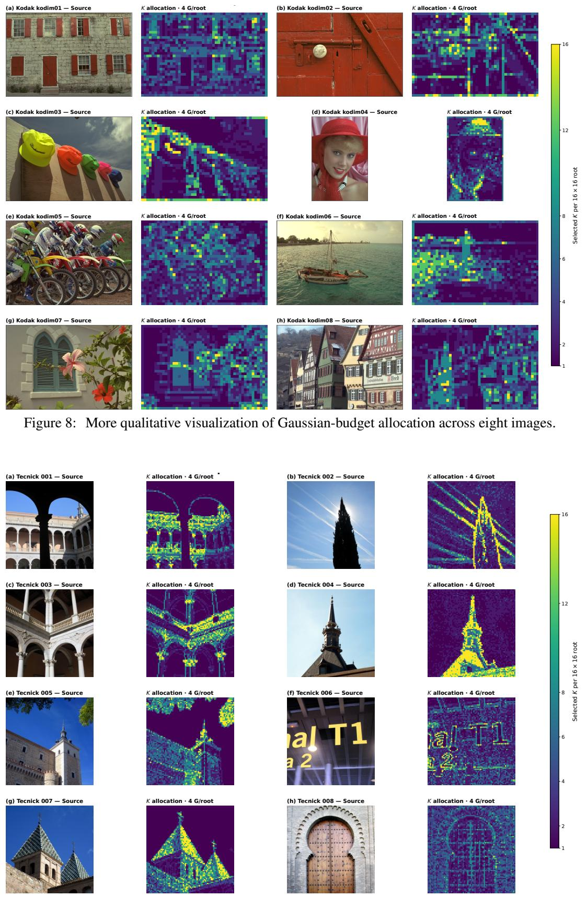  
Figure 9: More qualitative visualization of Gaussian-budget allocation across eight images.

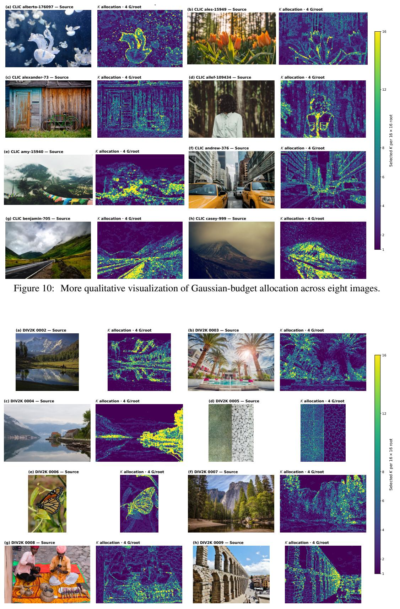  
Figure 11: More qualitative visualization of Gaussian-budget allocation across eight images.

Ground True

GaussianImage

GaussianImage++

Image-GS

Ours

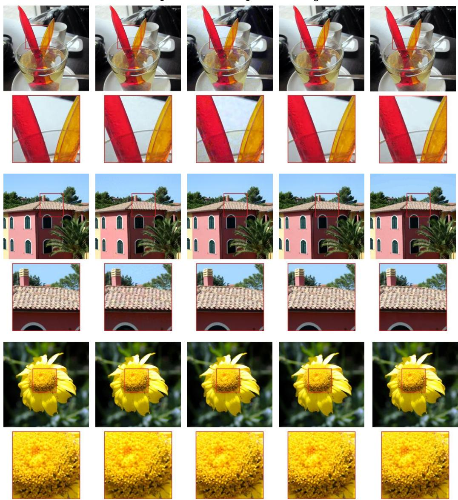  
Figure 12: More qualitative reconstruction results of CaliSplat with other baselines.

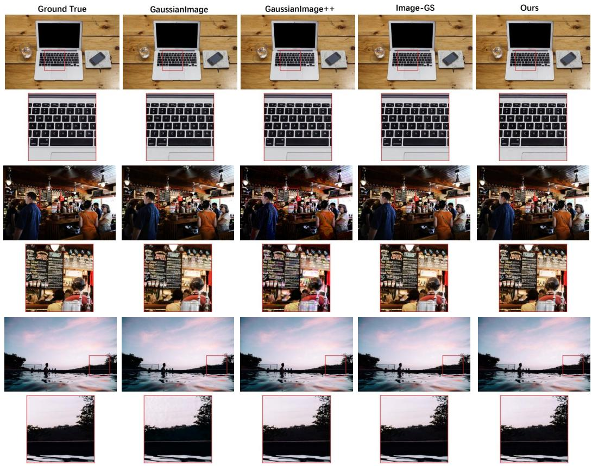  
Figure 13: More qualitative reconstruction results of CaliSplat with other baselines.

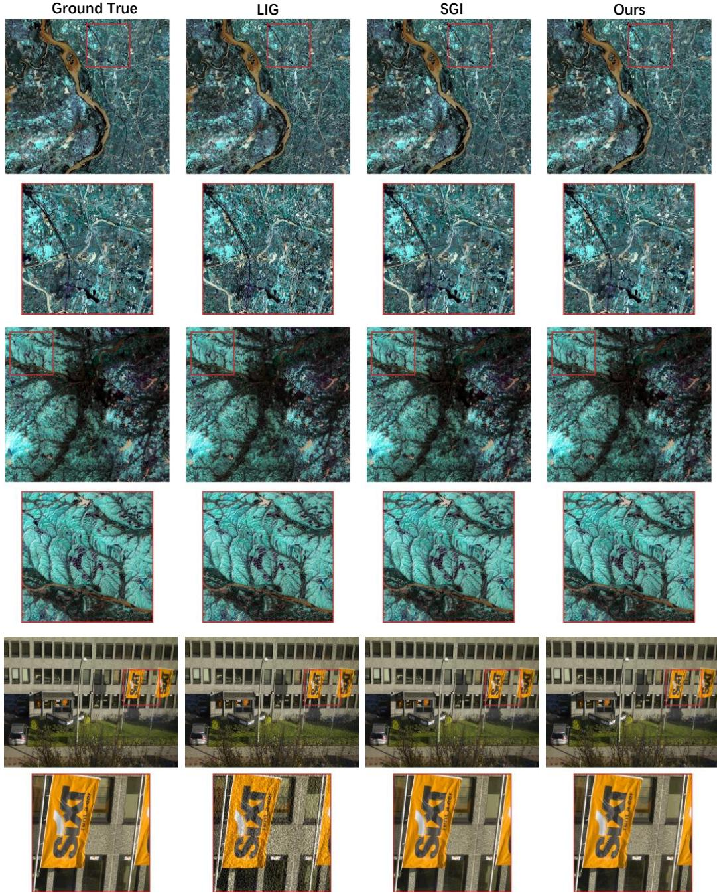  
Figure 14: More qualitative reconstruction results of CaliSplat with other baselines.

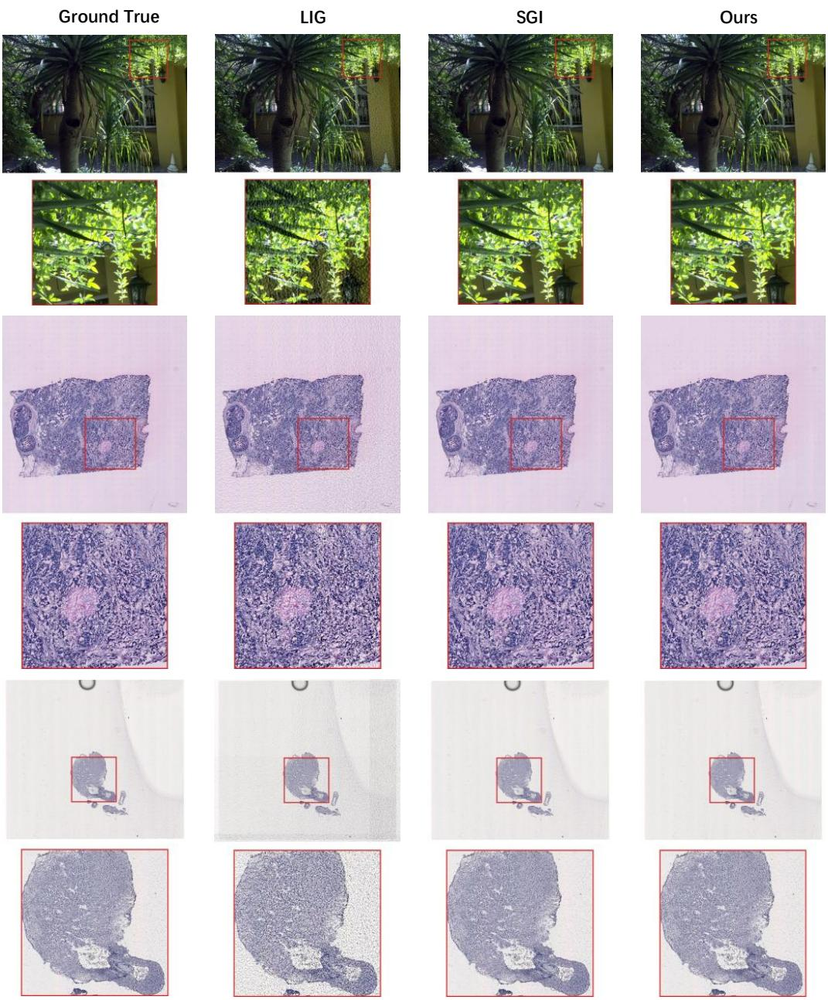  
Figure 15: More qualitative reconstruction results of CaliSplat with other baselines.

Table 4: Main notations used in CaliSplat.
<table><tr><td>Notation</td><td>Description</td></tr><tr><td> $I , { \widehat { I } }$ </td><td>Input and reconstructed RGB images.</td></tr><tr><td> $S$ </td><td>Self-contained compressed bitstream.</td></tr><tr><td> $b$ </td><td>Spatial image block.</td></tr><tr><td> $r _ { b }$ </td><td>Side length of block  $b .$ </td></tr><tr><td> $K$ </td><td>Number of Gaussians used by a candidate representation.</td></tr><tr><td> $k$ </td><td>Index of a Gaussian within a candidate.</td></tr><tr><td> $\theta _ { b , k }$ </td><td>Parameters of the k-th Gaussian in block  $b .$ </td></tr><tr><td> $\Theta _ { b , K }$ </td><td>K-Gaussian candidate representation for block  $b .$ </td></tr><tr><td> $\mathcal { R } ( \cdot )$ </td><td>Deterministic local Gaussian rasterization operator.</td></tr><tr><td> $D _ { b } ( 1 )$ </td><td>Analytic  $K = 1$  reconstruction error used as a block-difficulty signal.</td></tr><tr><td> $\boldsymbol { \mathcal { A } } _ { K }$ </td><td>Set of blocks admitted for fitting a K-Gaussian candidate.</td></tr><tr><td> $C ^ { ( 0 ) }$ </td><td>Closed-form color initialization for a Gaussian candidate.</td></tr><tr><td> $T _ { c }$ </td><td>Number of optimization steps used for cheap candidate fitting.</td></tr><tr><td> $\boldsymbol { \Theta }$  Θb,K</td><td>Gaussian parameters obtained from short-horizon candidate fitting.</td></tr><tr><td> $D _ { b } ^ { \mathrm { c h e a p } } ( K )$ </td><td>Reconstruction error of the cheap-fitted candidate.</td></tr><tr><td> $D _ { b } ^ { \star } ( K )$ </td><td>Reconstruction error associated with sufficiently long optimization.</td></tr><tr><td> $\varepsilon _ { b , K }$ </td><td>Residual optimization error caused by early stopping.</td></tr><tr><td> $T _ { t }$ </td><td>Number of optimization steps used for sampled teacher fitting.</td></tr><tr><td> $D _ { b } ^ { \mathrm { t e a c h } } ( K )$ </td><td>Longer-horizon reconstruction error produced by a sampled teacher fit.</td></tr><tr><td> ${ \bf x } _ { b , K }$ </td><td>Feature vector used for per-K score calibration.</td></tr><tr><td> $\bar { D } _ { b } ( K )$ </td><td>Calibrated candidate score used for global Gaussian allocation.</td></tr><tr><td> $B$ </td><td>Global Gaussian budget.</td></tr><tr><td> $\tau$ </td><td>Selected block structure under the global budget.</td></tr><tr><td> $K _ { b }$ </td><td>Number of Gaussians assigned to selected block  $b .$ </td></tr><tr><td> $\lambda$ </td><td>Cost assigned to each Gaussian during budget allocation.</td></tr><tr><td> ${ \bf z } _ { b , k }$ </td><td>Coding-space geometry representation of a selected Gaussian.</td></tr><tr><td> $\mathbf { z } _ { b , k } ^ { ( 0 ) }$ </td><td>Decoder-known geometry of the deterministic template.</td></tr><tr><td> $\Delta { \mathbf { z } } _ { b , k }$ </td><td> ${ \bf z } _ { b , k } - { \bf z } _ { b , k } ^ { ( 0 ) }$  Template-relative geometry residual,</td></tr><tr><td> $\widehat { \Theta }$ </td><td>Explicit Gaussian representation recovered by the decoder.</td></tr></table>