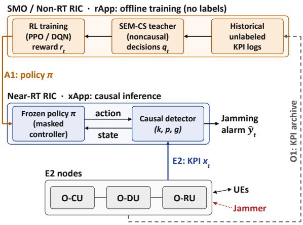
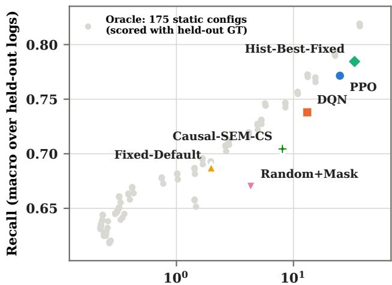
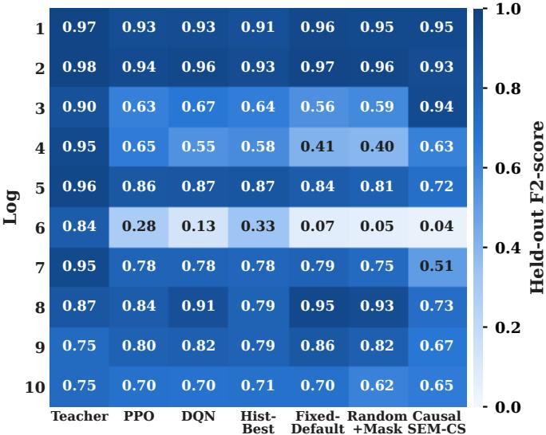

# CORA: Teacher-Guided Causal O-RAN Adaptation for Jamming Detection

Sneihil Gopal‡† and Richard A. Rouil⋆

‡PREP Associate, National Institute of Standards and Technology (NIST), USA

†Department of Physics, Georgetown University, USA

⋆National Institute of Standards and Technology (NIST), USA.

Emails: {sneihil.gopal, richard.rouil}@nist.gov

Abstract—In mission-critical networks, a missed jamming event is costlier than a false alarm, so detectors should favor recall, operate causally, and work without labeled attack data. Retrospective Key Performance Indicator (KPI) detectors meet the label-free requirement but rely on future context and cannot run in streaming operation. We present CORA, a teacher-guided reinforcement learning (RL) framework that transfers the hindsight of a retrospective detector to a causal one without labels during training or deployment. Offline, a retrospective KPI detector evaluated on unlabeled historical logs defines a recall-weighted reward for a masked controller that adapts the sensitivity, persistence, and grace of a causal KPI detector. At deployment, the teacher is removed and the frozen controller acts causally, with no ground-truth labels and no target-specific calibration. The design maps onto offline training in the Non-Real-Time RIC and causal control in the Near-Real-Time RIC of an Open Radio Access Network (O-RAN). Under leave-one-out transfer across ten 5G O-RAN testbed configurations, CORA reaches recall-oriented operating points on the deployable frontier that none of the evaluated baselines covers. A Proximal Policy Optimization (PPO) controller raises mean recall from 0.687 to 0.771 over a fixed default detector on all ten configurations, while a Deep Q-Network (DQN) achieves a comparable F2-score to the best teacher-selected static configuration, with 61 % fewer false alarms. Removing the teacher lowers recall on every configuration.

## I. INTRODUCTION

Radio Frequency (RF) jamming threatens network reliability by disrupting legitimate transmissions and degrading communication quality. Detecting it is difficult because its observable Key Performance Indicator (KPI) signatures vary with jammer gain, burst duration, traffic, and the number of active User Equipments (UEs). In an Open Radio Access Network (O-RAN) deployment, telemetry exposed through the RAN Intelligent Controller (RIC) enables jamming detection directly from network measurements rather than dedicated spectrum instrumentation [1]–[3]. In mission-critical settings such as command and control, public safety, and surveillance, an undetected jamming event is typically far costlier than a false alarm, so detectors for these settings should favor recall.

A key obstacle is that representative labeled attack data are rarely available for a new deployment. Supervised machine learning (ML) detectors require such labels, and statistical detectors depend on fixed operating rules or calibration with target telemetry [4]. Our earlier Statistical Ensemble Method

Cold-Start (SEM-CS) detector avoids labels altogether by combining physics-based statistics of KPI telemetry [5], but it relies on retrospective processing with centered windows, that is, on future context that a streaming detector does not have. To quantify the cost of causality, we constructed a causal variant of SEM-CS by replacing these operations with trailing statistics, and its mean F2-score, which prioritizes recall over precision [6], drops from 0.892 to 0.677 on our testbed corpus. This raises the question addressed here. Can the hindsight of a retrospective KPI detector, applied to historical unlabeled logs, teach a causal detector how to adapt when it is transferred to a held-out configuration?

We answer this question with CORA, a teacher-guided reinforcement learning (RL) framework for causal detector adaptation. Offline, Statistical Ensemble Method (SEM)-CS acts as a privileged teacher on historical training logs, in the spirit of learning using privileged information (LUPI) [7], and its decisions define a recall-weighted reward. A masked controller learns to adjust the sensitivity, persistence, and grace of a causal KPI detector and to release alarms. At deployment the policy is frozen, the teacher is removed, and the controller acts only on current and past observations. Although groundtruth (GT) labels are available for the testbed logs, they are used only for evaluation and never in training or inference. The design maps naturally onto offline training in the Non-Real-Time (Non-RT) RIC and causal control in the Near-Real-Time (Near-RT) RIC.

The main contributions are threefold. First, we introduce a teacher-student formulation in which a noncausal detector, evaluated only on unlabeled historical logs, supervises the reward of a causal detector-adaptation policy without GT labels or target-specific calibration. Second, we design an incremental masked controller whose mask encodes only stability constraints, train it from random starting configurations, and instantiate it with two learners, Proximal Policy Optimization (PPO) and Deep Q-Network (DQN). Third, we evaluate CORA under leave-one-out (LOO) transfer over ten heterogeneous fifth-generation (5G) O-RAN testbed configurations with five seeds, a pre-specified recall-weighted F2- score, paired statistics, ablations, and an oracle static frontier. Against two static baselines that keep a single detector configuration throughout, Fixed-Default (the detector’s default configuration) and Hist-Best-Fixed (the configuration with the highest teacher reward on the training logs), CORA reaches recall-oriented operating points on the deployable frontier that neither baseline covers. PPO raises mean recall from 0.687 to 0.771 over Fixed-Default on every held-out configuration, and DQN matches Hist-Best-Fixed in F2-score with 61 % fewer false alarms. The SEM-CS teacher and an oracle static frontier scored with GT labels serve as hindsight references rather than deployable alternatives. CORA’s contribution is to approach their recall-oriented operating points using only unlabeled historical logs. The remainder of this paper is organized as follows. Section II reviews related work, Section III presents CORA, Section IV describes the experimental methodology, Section V presents the results, and Section VI concludes the paper.

## II. RELATED WORK

RF jamming detection has been studied with statistical, anomaly-detection, and learning-based techniques, using features from physical-layer measurements to network-level telemetry [4,8]. O-RAN exposes such telemetry through the RIC [1], and prior work has demonstrated jamming detection in 5G O-RAN testbeds and recent work on deployable implementations [2,3,5], with detection and adaptive response identified as key functions for resilient operation [9]. Our earlier SEM-CS detector combines physics-based KPI statistics without labeled training data [5], but its centered windows and retrospective post-processing prevent causal operation. Unsupervised anomaly detectors apply a fixed decision rule after training, and supervised detectors require labeled attacks that are rarely available for a new deployment. None of these approaches adapts the operating point of a causal detector online, under a label-free deployment constraint, when it is transferred to a new configuration.

RL is widely used for closed-loop O-RAN control, where eXtended Applications (xApps) and Radio Access Network (RAN) Application (rApp) adjust RAN parameters from streaming KPIs [10]. These controllers typically optimize directly observable rewards such as throughput or latency, but jamming presence is unobservable at the controller and cannot serve directly as a reward without labels. LUPI [7] and knowledge distillation [11] address related settings using information or a teacher model available only during training. CORA departs from both: the privileged information is future context from a retrospective noncausal detector evaluated on unlabeled historical logs, and the student is an RL controller that adapts a causal detector rather than a classifier imitating the teacher. Because the teacher enters only through the reward, the student can weight recall above agreement and requires neither labels nor the teacher at deployment.

## III. TEACHER-GUIDED CAUSAL DETECTOR ADAPTATION

CORA learns to adapt the operating point of a causal KPIbased jamming detector. Training uses historical telemetry only, with a retrospective statistical detector operating on the same KPI telemetry as an offline teacher. Here the privileged information is future context. At deployment the teacher is removed, and the controller acts on current and past observations only. GT labels are not used in teacher generation, reward computation, policy training, or causal inference, and are reserved solely for evaluation. Next, we describe the three components of CORA: the causal detector, the teacher-guided control, and training and deployment.

Causal detector: Let $x _ { i , t }$ denote KPI $i \in \{ 1 , \ldots , N \}$ at sample t, where the $N = 9 ~ \mathrm { K P I s }$ are six Synchronization Signal Block (SSB)-Reference Signal Received Power (RSRP) statistics, namely the mean, minimum, three quartiles, and maximum, together with the Count of SSB-RSRP measurements, Signal-to-Noise Ratio (SNR), and Received Signal Strength Indicator (RSSI). The robust level deviation of KPI i is measured against the median and Median Absolute Deviation (MAD) of a trailing window of $W = 3 0$ samples ending at t,

$$
z _ { i , t } = \frac { | x _ { i , t } - \mathrm { m e d } _ { W } ( x _ { i } ) | } { \mathrm { M A D } _ { W } ( x _ { i } ) } ,\tag{1}
$$

and the change deviation $z _ { i , t } ^ { \Delta }$ is defined in the same way on the absolute first difference $\lvert x _ { i , t } - x _ { i , t - 1 } \rvert$ . The Count deviation $z _ { t } ^ { \mathrm { C } }$ measures how far Count, the number of completed measurements in a report, falls below its trailing median. The sensitivity level $k \in \{ 0 , \ldots , 6 \}$ selects three thresholds $\left( \zeta _ { k } , \zeta _ { k } ^ { \Delta } , v _ { k } \right)$ , where $\zeta _ { k }$ is the threshold on the level deviations, $\zeta _ { k } ^ { \Delta }$ is the threshold on the change deviations, and $v _ { k }$ is the threshold on the detector confidence defined next. All three decrease monotonically in k, so that a larger k yields a more sensitive detector. With $\mathbf { 1 } [ \cdot ]$ the indicator function, the detector confidence is

$$
h _ { t } = \frac { 0 . 4 0 } { N } \sum _ { i = 1 } ^ { N } \mathbf { 1 } [ z _ { i , t } > \zeta _ { k } ] + \frac { 0 . 2 5 } { N } \sum _ { i = 1 } ^ { N } \mathbf { 1 } [ z _ { i , t } ^ { \Delta } > \zeta _ { k } ^ { \Delta } ]\tag{2}
$$

that is, a weighted combination of the fractions of KPIs with level and change deviations above threshold and a Count-drop term, with weights set as in [5] and $\phi ( \cdot )$ mapping a deviation to [0, 1]. A raw detection occurs when $h _ { t } ~ \geq ~ v _ { k }$ or Count equals zero. An alarm is raised after $p \in \{ 2 , \ldots , 6 \}$ consecutive raw detections, or immediately when Count equals zero. To bridge short gaps within an alarm, the detector uses a causal evidence signal $e _ { t } ~ = ~ \operatorname* { m a x } ( u _ { t } , d _ { t } ) ~ \in ~ [ 0 , 1 ]$ where the unavailability indicator $u _ { t }$ equals one when Count is zero or the RSRP report is missing and zero otherwise, and the directional evidence $d _ { t } ~ \in ~ [ 0 , 1 ]$ measures how far SNR has decreased and RSSI has increased relative to a lagged reference window, as expected under jamming. While an alarm is active, the grace parameter $g \in \{ 0 , \ldots , 4 \}$ lets it bridge up to $g$ raw-negative samples when $e _ { t }$ remains high. The detector configuration is thus $( k , p , g )$ , with default (3, 2, 0).

Teacher-guided control: The teacher is the SEM-CS detector [5], whose parameters are derived from signal physics rather than labels. It uses centered windows and retrospective post-processing and therefore cannot run causally. It is evaluated per sample on each historical training log to produce a binary decision $q _ { t } \in \{ 0 , 1 \}$ , and it is never evaluated on the held-out configuration.

Every block of $B = 5$ samples, the controller selects one incremental action from

$$
\begin{array} { r } { A = \{ \mathrm { h o l d } , k ^ { \pm } , p ^ { \pm } , g ^ { \pm } , \mathrm { r e l e a s e } \} , } \end{array}\tag{3}
$$

where $k ^ { \pm } , \ p ^ { \pm }$ , and $g ^ { \pm }$ raise or lower sensitivity, persistence, or grace by one step, and release ends an active alarm without changing $( k , p , g )$ . The block interval amortizes control decisions over several KPI reports, giving the controller time to observe the effect of a configuration change before taking another. An action mask removes moves beyond the parameter bounds, enforces a minimum dwell of two blocks between configuration changes, and allows release only during an active alarm when Count is non-zero. The mask encodes stability constraints only, so the direction of adaptation is learned rather than prescribed. Let $\mathbf { s } _ { b }$ denote the 34-dimensional controller state at control block b. It contains the current, short-term (5 samples), and long-term (20 samples) values of the evidence $e _ { t } ,$ its trend, variability, and unavailability rate, the normalized $( k , p , g )$ , recent alarm and raw-detection rates, the alarm status and age, the blocks since the last change, the Count deviation, the previous action, and the level and change deviations $z _ { i , t }$ and $z _ { i , t } ^ { \Delta }$ of all N KPIs.

The reward compares the causal alarm state $\hat { y } _ { t } \in \{ 0 , 1 \}$ with the teacher decision $q _ { t }$ as

$$
\begin{array} { r l } & { r _ { t } = \hat { y } _ { t } \left( q _ { t } - \left( 1 - q _ { t } \right) \right) } \\ & { ~ + \left( 1 - \hat { y } _ { t } \right) \left( 0 . 5 \left( 1 - q _ { t } \right) - 1 . 5 q _ { t } \right) - 0 . 2 5 o _ { t } , } \end{array}\tag{4}
$$

where $o _ { t }$ indicates an alarm onset. Missing a teacher-positive sample therefore costs 1.5 times a teacher-negative alarm, reflecting the higher operational cost of undetected jamming, while the onset term discourages fragmented alarms. The 1.5 : 1 miss-to-false-alarm penalty reflects the same recalloriented objective as the F2-score and was fixed a priori. The onset and change penalties were set to the smallest values that visibly suppressed alarm fragmentation and oscillation during early training. The block reward is the mean of $r _ { t }$ over the block, minus 0.02 per configuration change.

Training and deployment: Each training episode spans 128 blocks of a uniformly sampled historical log and begins at a uniformly sampled position after a 120-sample warmup. The episode starts from a uniformly random $( k , p , g )$ , so that the policy learns how to move from any configuration rather than only from the default. The primary learner is PPO [12] with invalid-action masking [13], using two 64-unit layers, learning rate $3 \times 1 0 ^ { - 4 }$ , rollout length 1024, batch size 128, $\gamma = 0 . 9 9 , \lambda = 0 . 9 5$ , clip range 0.2, entropy coefficient 0.01, and 10 epochs per update. To test whether the results depend on the learning algorithm, we also train DQN [14] as a second learner under the same detector state, action space, mask constraints, and reward. DQN receives the action mask as part of its input and excludes masked actions from greedy selection, bootstrap targets, and ϵ-greedy exploration. It uses learning rate $1 0 ^ { - 4 }$ , a replay buffer of 50,000 transitions, batch size 32, updates every 4 steps, target updates every 1,000 steps, and ϵ decayed from 1.0 to 0.05 over the first 10% of training. These settings follow those of the original algorithms [12,14], with the rollout length, replay buffer, and target-update interval reduced for the short training budget, and none were tuned on held-out data. Both learners are trained for 50,000 control steps, a budget selected using the teacher-reward training return only. At deployment, the frozen policy starts from the default configuration and acts causally.

  
Fig. 1: O-RAN deployment of CORA.

As shown in Figure 1, CORA separates naturally across the two RIC control loops. In the Non-RT RIC, an rApp evaluates the retrospective teacher on archived KPI logs, trains the controller, and delivers the frozen policy to the Near-RT RIC over the A1 interface. In the Near-RT RIC, an xApp receives KPI reports over the E2 interface, updates the causal detector at each report, and applies a controller action every $B = 5$ reports. The deployed policy is a two-layer network with 64 units per layer, so inference adds negligible computation, and neither the teacher nor any label is required online. The same artifact ships whether the deployment has labeled attack data or not. As new unlabeled logs accumulate, the Non-RT RIC can periodically retrain the policy without interrupting causal detection.

## IV. EXPERIMENTAL METHODOLOGY

This section describes the testbed corpus and transfer protocol, the reference methods, and the metrics and statistical tests used to evaluate CORA.

Corpus and protocol: The corpus consists of ten logs recorded on a 5G O-RAN testbed, one per testbed configuration, with a total duration of 34.7 h (Table I). Logs 1 to 8 use a constant jammer gain with fixed or variable burst durations, whereas Logs 9 and 10 introduce short irregular bursts with dynamic gain. Each sample contains the nine KPIs defined in Section III, among which Count reflects measurement availability during jamming. Each UE reports once per second, and the reports of all UEs in a configuration are processed in recorded order as a single causal stream, modeling the cell as the unit of detection; per-UE processing is left to future work.

<table><tr><td>Log</td><td></td><td>UEs Duration</td><td>Burst (s)</td><td>Gain (dB)</td><td>Burst Pattern</td><td>Samples</td></tr><tr><td>1</td><td>3</td><td>68 min</td><td>60</td><td>48</td><td>Fixed</td><td>12,186</td></tr><tr><td>2</td><td>2</td><td>62 min</td><td>60</td><td>48</td><td>Fixed</td><td>7,468</td></tr><tr><td>3</td><td>2</td><td>43 min</td><td>60</td><td>48</td><td>Fixed</td><td>5,132</td></tr><tr><td>4</td><td>1</td><td>47 min</td><td>60</td><td>48</td><td>Fixed</td><td>2,811</td></tr><tr><td>5</td><td>1</td><td>79 min</td><td>30</td><td>48</td><td>Fixed</td><td>4,750</td></tr><tr><td>6</td><td>1</td><td>15 min</td><td>60</td><td>45</td><td>Fixed</td><td>926</td></tr><tr><td>7</td><td>1</td><td>3.1 h</td><td>[10, 30]</td><td>45</td><td>Variable</td><td>10,981</td></tr><tr><td>8</td><td>1</td><td>18.1h</td><td>[10, 30]</td><td>45</td><td>Variable</td><td>65,075</td></tr><tr><td>9</td><td>3</td><td>2.0h</td><td>[5, 14]</td><td>[48,60]</td><td>Variable</td><td>17,465</td></tr><tr><td>10</td><td>3</td><td>6.3h</td><td>[5, 14]</td><td>[48, 60]</td><td>Variable</td><td>59,028</td></tr></table>

TABLE I: Testbed configurations.

We use ten-fold LOO transfer. In each fold, one configuration is held out, and the retrospective teacher is evaluated only on the remaining nine, which provide the training experience. The held-out configuration is processed causally from the default detector configuration, with no teacher, retraining, or target-specific calibration. GT labels are loaded only after the held-out predictions are generated. PPO and DQN are each trained for 50,000 control steps with five seeds, and metrics are averaged across seeds within each fold before aggregation; statistical power comes from the per-fold paired comparison across ten configurations rather than seed variance. The ten configurations were used during method development, so although all design choices were frozen before the reported runs, they do not constitute an untouched validation set.

Reference methods: We compare CORA with five groups of reference methods. Two static baselines keep a single configuration throughout: Fixed-Default uses $( k , p , g ) = ( 3 , 2 , 0 )$ and Hist-Best-Fixed uses the configuration among the 175 combinations of $( k , p , g )$ with the highest teacher reward on the nine training logs. This is deployable but requires that the training logs represent the deployment conditions, and it ships a single globally-selected configuration rather than one adapted per deployment. Random+Mask selects uniformly among the same masked actions as the learners, testing whether the policy is actually learned. For existing causal detection we include Causal-SEM-CS, the causal reengineering of SEM-CS from Section I that replaces centered windows with trailing statistics, Adaptive-Hyst, a handdesigned hysteresis controller over $( k , p , g )$ , and Count-Zero, which alarms whenever Count equals zero. Three PPO ablations each remove one design choice: random training starts (replaced by always starting from the default), the dwell-only mask (replaced by an evidence-gated mask), and the teacher (replaced by a state-evidence reward). Finally, two nondeployable references bound what is achievable: the SEM-CS teacher shows what retrospective processing achieves, and an oracle frontier scores all 175 static configurations on each held-out log with GT labels.

Metrics and statistics: The pre-specified primary metric is the F2-score, the $\beta ~ = ~ 2$ case of the F-measure $( 1 + \beta ^ { 2 } ) P R / ( \beta ^ { 2 } P + R )$ [6], which weights recall above precision and reflects the higher cost of missed jamming. We also report F1-score, precision, recall, event recall, falsealarm intervals per 1,000 samples (FA/1k), and detection delay. A jamming event is a contiguous GT-positive interval, counted as detected if any alarm interval overlaps it; a false alarm is an alarm interval that overlaps no event; delay is the time from event onset to the first overlapping alarm, averaged over detected events. Metrics are computed per heldout configuration and macro-averaged, with pooled sampleweighted metrics as a secondary view. Comparisons use perfold paired differences with two-sided Wilcoxon signed-rank tests [15] and paired bootstrap 95 % confidence intervals (CIs) from 10,000 resamples. Holm correction [15] is applied separately for each learner and metric.

## V. RESULTS AND DISCUSSION

Table II reports macro-averaged held-out performance across the ten LOO folds. We first ask whether CORA improves detection and whether its policy is actually learned, then identify where the gain comes from, and finally examine operating points, controller behavior, and the conditions under which adaptation helps.

Overall performance: CORA shifts the causal detector to a higher-recall operating point. Relative to Fixed-Default, PPO raises recall from 0.687 to 0.771 on every held-out configuration (Holm-adjusted $p ~ = ~ 0 . 0 1 6 )$ , at the cost of more false alarms and lower precision, which is why Fixed-Default keeps the best F1-score. In mission-critical settings in which a missed attack is costlier than a false alarm, this trade is intended: PPO’s additional false alarms buy 8.4 percentage points of recall (0.771 versus 0.687) that Fixed-Default misses. The F2-scores reflect this trade without a clear winner: PPO attains the highest mean F2 among causal methods (0.742), but its margins over Hist-Best-Fixed (0.734), DQN (0.732), and Fixed-Default (0.711) are not statistically significant. Both learners match or exceed the event recall of all deployable baselines except Hist-Best-Fixed, and PPO alarms 6.9 s earlier than Causal-SEM-CS.

These gains come from learning rather than from the action space itself. Random+Mask falls below PPO and DQN in recall by 0.102 and 0.068 on every configuration (Holmadjusted $p \leq 0 . 0 1 6 )$ and misses many more jamming events.

Where the gain comes from: CORA combines two ingredients, the retrospective teacher, which provides the training signal, and the adaptation of $( k , p , g )$ during operation. To separate their contributions, we compare three methods that add them one at a time, namely Fixed-Default, which uses neither, Hist-Best-Fixed, which uses only the teacher to select one static configuration, and the CORA controllers PPO and DQN, which use both. The teacher alone already moves the detector to a higher-recall region. Hist-Best-Fixed raises recall over Fixed-Default by 0.097 on every configuration $( p = 0 . 0 0 2 )$ , but a single static configuration must be sensitive everywhere and therefore raises the most false alarms of all causal methods. Adding adaptation keeps most of this recall at a lower false-alarm cost. PPO keeps recall close to that of Hist-Best-Fixed (0.771 versus 0.784) with 25 % fewer false alarms, although this reduction is not significant after Holm correction, whereas DQN trades a little recall for a 61 % reduction in false alarms on every configuration (Holm-adjusted $p = 0 . 0 1 4 )$ . In short, the teacher tells the detector where to operate, and adaptation lets it operate there more efficiently than any single teacher-selected configuration. Both Hist-Best-Fixed and CORA require that the training logs cover the deployment regime, and neither recovers when this fails (Limitations). But within-regime, CORA offers an operational advantage that Hist-Best-Fixed does not. The deployed policy adjusts sensitivity per deployment rather than shipping a single globally-selected configuration to every target.

<table><tr><td>Method</td><td>Causal</td><td>F2-score</td><td>F1-score</td><td>Precision</td><td>Recall</td><td>Event recall</td><td>FA/1k</td><td>Delay (s)</td></tr><tr><td>SEM-CS teacher (offline reference)</td><td>No</td><td>0.892</td><td>0.830</td><td>0.753</td><td>0.945</td><td>0.979</td><td>21.63</td><td>0.30</td></tr><tr><td>PPO (proposed)</td><td>Yes</td><td>0.742</td><td>0.715</td><td>0.735</td><td>0.771</td><td>0.979</td><td>24.93</td><td>1.15</td></tr><tr><td>DQN (proposed)</td><td>Yes</td><td>0.732</td><td>0.733</td><td>0.820</td><td>0.738</td><td>0.969</td><td>13.11</td><td>1.75</td></tr><tr><td>Hist-Best-Fixed</td><td>Yes</td><td>0.734</td><td>0.688</td><td>0.681</td><td>0.784</td><td>0.985</td><td>33.26</td><td>0.69</td></tr><tr><td>Fixed-Default</td><td>Yes</td><td>0.711</td><td>0.758</td><td>0.963</td><td>0.687</td><td>0.973</td><td>1.98</td><td>1.61</td></tr><tr><td>Random+Mask</td><td>Yes</td><td>0.689</td><td>0.726</td><td>0.884</td><td>0.670</td><td>0.882</td><td>4.31</td><td>2.56</td></tr><tr><td>Causal-SEM-CS</td><td>Yes</td><td>0.677</td><td>0.649</td><td>0.631</td><td>0.704</td><td>0.865</td><td>8.05</td><td>8.03</td></tr><tr><td>Count-Zero</td><td>Yes</td><td>0.646</td><td>0.705</td><td>0.887</td><td>0.616</td><td>0.818</td><td>0.50</td><td>2.97</td></tr><tr><td>Adaptive-Hyst</td><td>Yes</td><td>0.642</td><td>0.667</td><td>0.791</td><td>0.634</td><td>0.830</td><td>16.14</td><td>2.62</td></tr></table>

TABLE II: Macro-average held-out performance over ten LOO folds

<table><tr><td>Variant</td><td>F2-score</td><td>Recall</td><td>FA/1k</td></tr><tr><td>Full PPO</td><td>0.742</td><td>0.771</td><td>24.93</td></tr><tr><td>No random training start</td><td>0.749</td><td>0.794</td><td>31.31†</td></tr><tr><td>Evidence-gated mask</td><td>0.724</td><td>0.708</td><td>4.51†</td></tr><tr><td>No teacher (evidence reward)</td><td>0.682</td><td>0.655†</td><td>3.34†</td></tr></table>

TABLE III: PPO ablations. The dagger (†) marks a difference from full PPO that is in the same direction on all ten folds with Holm-adjusted $p < 0 . 0 1$

Comparing the two learners tests whether these results depend on the learning algorithm. Although PPO and DQN use very different update rules, their F2-scores are statistically indistinguishable and stable across seeds (per-fold seed standard deviation below 0.01 on nine of ten folds for both learners), indicating that the qualitative behavior is not specific to a particular RL algorithm. The learners differ only in where they settle: DQN chooses a more conservative operating point and PPO a more recall-oriented one.

Ablations: Table III confirms that the teacher drives the recall gain. Replacing it with a reward computed from causal evidence alone lowers recall on every configuration (Holmadjusted $p = 0 . 0 0 6 )$ and brings PPO close to Fixed-Default, because such a reward only confirms what the causal detector can already observe. The other two design choices mainly decide where the policy settles. Without random training starts, the policy only learns to move from the default and becomes more aggressive, trading a slightly higher F2-score on this corpus for narrower exposure to starting configurations during training. The evidence-gated mask, which permits only evidence-supported moves, keeps the policy conservative. Neither changes the F2-score significantly.

  
False-alarm intervals per 1000 samples (log)  
Fig. 2: Recall versus FA/1k. Grey points: oracle frontier of 175 static configurations scored with held-out GT.

Operating point and controller behavior: Figure 2 places all methods in the recall versus false-alarm plane, together with the oracle frontier of static configurations scored with held-out labels. The oracle requires GT labels on the target configuration to select the best static (k, p, g) per deployment and is therefore not deployable. It bounds what any static choice could achieve in hindsight. PPO, DQN, and Hist-Best-Fixed lie on or slightly below this frontier. Among methods that could actually ship, CORA is the only one reaching intermediate false-alarm budgets at near-oracle recall. Hist-Best-Fixed reaches comparable recall only by always running at maximum sensitivity, and Fixed-Default meets strict falsealarm budgets only by missing more jamming. Under a strict budget of 5 FA/1k, however, Fixed-Default remains the right choice, since it meets this budget on nine configurations, whereas PPO meets it on none and DQN on one.

The controllers reach these operating points by adapting to each configuration rather than by applying one fixed setting. Hist-Best-Fixed always uses a high sensitivity, whereas the learners choose a sensitivity level per held-out configuration and then mostly hold it. Measured across all control blocks aggregated over the ten folds, DQN changes the configuration in only 8 % of blocks and Random+Mask in 31 %, while PPO lies between the two. DQN keeps the sensitivity near the default where Fixed-Default already performs well and raises it where Fixed-Default misses jamming (Figure 3), whereas PPO stays at high sensitivity on most configurations. Random+Mask, by contrast, changes the configuration without a consistent direction.

  
Fig. 3: Held-out F2-score per configuration and method (learners: mean of five seeds).

When does adaptation help? Figure 3 also shows that the benefit of adaptation varies strongly across configurations. A post hoc diagnostic, computed with GT after evaluation and not used by the method, explains this through the jamming signature. Where jamming causes the loss of SSB-RSRP measurements, the default detector already succeeds, and where it does not, detection depends on weaker SNR and RSSI shifts that the controllers compensate for by raising sensitivity. Across configurations, the rate of measurement loss tracks both the Fixed-Default F2-score (Spearman $\rho = 0 . 9 8 )$ and the recall gain of PPO $( \rho = - 0 . 8 5 )$ ; the negative sign reflects that where Fixed-Default already captures jamming events via measurement loss, PPO has little room to improve. For each learner and configuration, we define the recall transfer efficiency $\eta = ( R _ { \mathrm { s t u d e n t } } - R _ { \mathrm { f i x e d } } ) / ( R _ { \mathrm { t e a c h e r } } - R _ { \mathrm { f i x e d } } )$ . Across the seven configurations where $R _ { \mathrm { t e a c h e r } } - R _ { \mathrm { f i x e d } } > 0 . 0 5$ PPO recovers a median 43 % of the teacher’s advantage and DQN 26 %, least on Log 6, where jamming never removes measurements and all causal detectors remain weak while the teacher reaches F2 of 0.84. CORA therefore helps most where jamming is subtle, limited by how much of the teacher’s hindsight a causal detector can reproduce.

Limitations: The averages hide configurations where adaptation does not pay off. Fixed-Default remains strongest on the sample-dominant Logs 8 and 10, and in pooled sampleweighted metrics (dominated by these logs) its F2-score (0.836) exceeds that of both DQN (0.823) and PPO (0.801). For deployments resembling these high-sample measurementloss regimes, Fixed-Default is the better choice, and CORA’s advantage is concentrated in the measurement-preserving regimes typified by Logs 3 through 7. The student also inherits the biases of the teacher. When the learners are trained only on the constant-gain Logs 1 to 8 and tested on the dynamicgain Logs 9 and 10, the teacher becomes less precise, and both the teacher and the learners fall behind Fixed-Default (F2-scores of 0.750 for the teacher, 0.747 for PPO, and 0.735 for DQN, against 0.782 for Fixed-Default). Student quality is therefore bounded by teacher quality under distribution shift, so training logs should cover the deployment regimes. Finally, the ten configurations were also used in method development, so although the design was frozen before the reported evaluation, they are not an untouched validation set.

## VI. CONCLUSION

We presented CORA, a teacher-guided RL framework in which a retrospective KPI detector, evaluated offline on unlabeled historical logs, trains a controller that adapts a causal KPI detector without GT labels or target-specific calibration. Under LOO transfer across ten 5G O-RAN testbed configurations, CORA shifted the causal detector to a higherrecall operating point, raising recall over the fixed default on every configuration. The retrospective teacher drives this gain, which adaptation retains at fewer false alarms than any single teacher-selected configuration. PPO and DQN occupy different operating points on the deployable frontier at indistinguishable F2-scores, with PPO more recall-oriented and DQN more conservative on false alarms. Non-deployable references, the retrospective teacher and the oracle static frontier, bound what is achievable with future context and targetspecific labels respectively but are not operational alternatives. Future work includes regime-aware teachers, explicit falsealarm budgets, and per-UE processing.

## ACKNOWLEDGMENT

This work is partially funded by the Department of Homeland Security’s Science and Technology Directorate (S&T). U.S. Government work, not subject to U.S. Copyright.

## REFERENCES

[1] M. Polese, L. Bonati, S. D’Oro, S. Basagni, and T. Melodia, “Understanding O-RAN: Architecture, Interfaces, Algorithms, Security, and Research Challenges,” IEEE Communications Surveys & Tutorials, 2023.

[2] P. Kryszkiewicz and M. Hoffmann, “Open RAN for Detection of a Jamming Attack in a 5G Network,” in 2023 IEEE 97th Vehicular Technology Conference (VTC2023-Spring). IEEE, 2023, pp. 1–2.

[3] M. Hoffmann, L. Kulacz, O. Baldo, M. Pakula, and B. Raghothaman, “Jamming Detection in 5G/6G Networks: From O-RAN Concept to OCUDU Deployment,” 2026. [Online]. Available: https://arxiv.org/abs/ 2609.18499

[4] S. Jere, Y. Wang, I. Aryendu, S. Dayekh, and L. Liu, “Bayesian Inference-Assisted Machine Learning for Near Real-Time Jamming Detection and Classification in 5G New Radio (NR),” IEEE Transactions on Wireless Communications, vol. 23, no. 7, pp. 7043–7059, 2024.

[5] S. Gopal, F. J. Cintron, and R. A. Rouil, “O-RAN-Native Jamming´ Detection Under Network Heterogeneity,” 2026. [Online]. Available: https://arxiv.org/abs/2610.20816

[6] C. J. van Rijsbergen, Information Retrieval, 2nd ed. London: Butterworths, 1979.

[7] V. Vapnik and A. Vashist, “A New Learning Paradigm: Learning Using Privileged Information,” Neural Networks, vol. 22, no. 5–6, pp. 544– 557, 2009.

[8] H. Pirayesh and H. Zeng, “Jamming Attacks and Anti-Jamming Strategies in Wireless Networks: A Comprehensive Survey,” IEEE Communications Surveys & Tutorials, vol. 24, no. 2, pp. 767–809, 2022.

[9] S. Gopal, W. Garey, R. Rouil, and S. Kowdley, “Towards Adversary-Resilient Interference Management in O-RAN: Requirements and Gap Analysis,” National Institute of Standards and Technology, Gaithersburg, MD, NIST Interagency/Internal Report NISTIR 8560, 2025, accessed September 29, 2026. [Online]. Available: https: //tsapps.nist.gov/publication/get pdf.cfm?pub id=959243

[10] L. Bonati, S. D’Oro, M. Polese, S. Basagni, and T. Melodia, “Intelligence and Learning in O-RAN for Data-Driven NextG Cellular Networks,” IEEE Communications Magazine, vol. 59, no. 10, pp. 21– 27, 2021.

[11] G. Hinton, O. Vinyals, and J. Dean, “Distilling the Knowledge in a Neural Network,” 2015.

[12] J. Schulman, F. Wolski, P. Dhariwal, A. Radford, and O. Klimov, “Proximal Policy Optimization Algorithms,” 2017.

[13] S. Huang and S. Ontan˜on, “A Closer Look at Invalid Action Masking´ in Policy Gradient Algorithms,” in Proceedings of the International FLAIRS Conference, vol. 35, 2022.

[14] V. Mnih, K. Kavukcuoglu, D. Silver, A. A. Rusu, J. Veness, M. G. Bellemare, A. Graves, M. Riedmiller, A. K. Fidjeland, G. Ostrovski, S. Petersen, C. Beattie, A. Sadik, I. Antonoglou, H. King, D. Kumaran, D. Wierstra, S. Legg, and D. Hassabis, “Human-level control through deep reinforcement learning,” Nature, vol. 518, pp. 529–533, 2015.

[15] J. Demsar, “Statistical Comparisons of Classifiers over Multiple Dataˇ Sets,” Journal of Machine Learning Research, vol. 7, pp. 1–30, 2006.