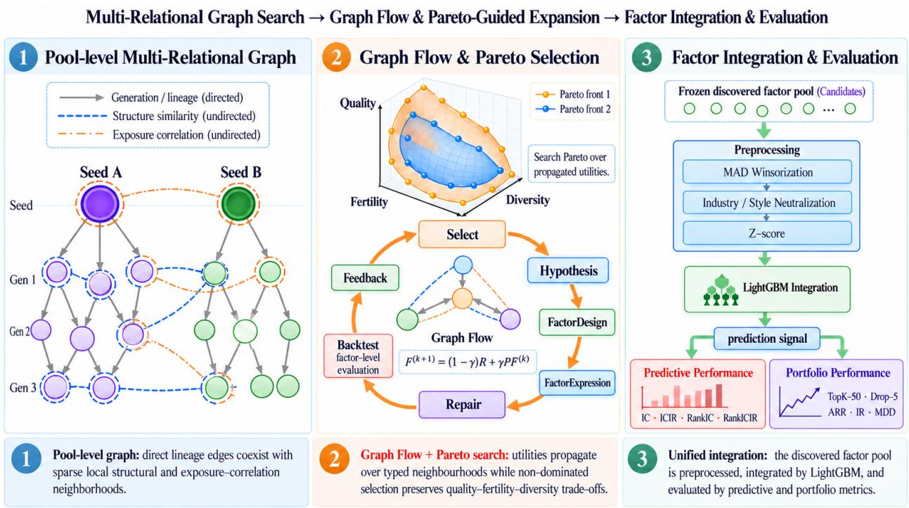
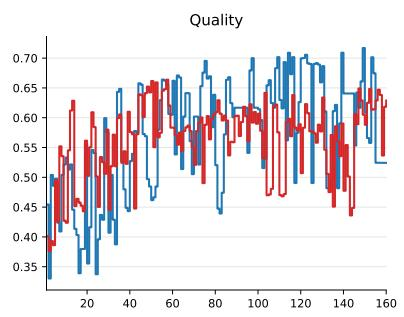
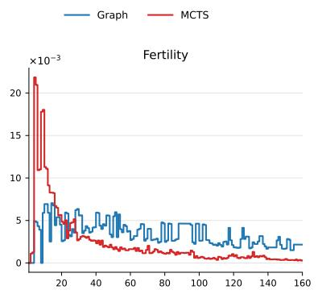
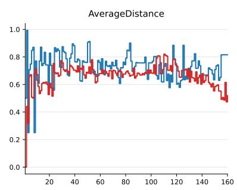
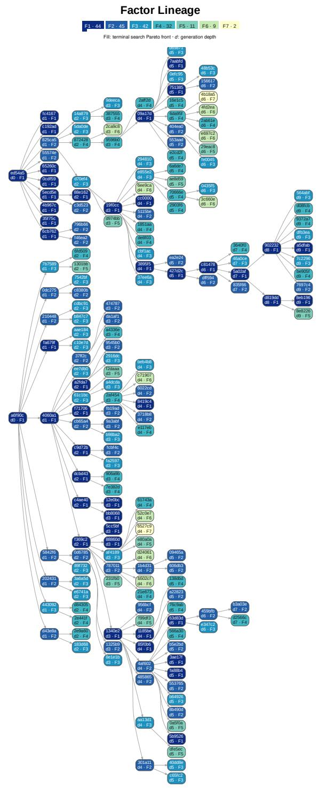

# CosmosAlpha: Multi-Relational Graph Search with Pareto-Guided Exploration for LLM-Driven Alpha Mining

Zhan-He Wang1 Zi-Yang Lang2 Yi-Yang Li1 Qing-Yu Lan1 Yun-Song Piao1,3

1Artificial Intelligence and Quantitative Finance Laboratory, School of Physical Sciences, University of Chinese Academy of Sciences 2School of Physics and Astronomy, Shanghai Jiao Tong University 3School of Fundamental Physics and Mathematical Sciences, Hangzhou Institute for Advanced Study, UCAS

wangzhanhe19@mails.ucas.ac.cn, langziyang413@sjtu.edu.cn liyiyang20@mails.ucas.ac.cn, lanqingyu19@mails.ucas.ac.cn, yspiao@ucas.edu.cn

## Abstract

Discovering predictive alpha factors from noisy financial data is a fundamental yet challenging problem in quantitative finance. LLM-driven formulaic alpha mining offers an attractive paradigm by combining interpretable symbolic expressions with iterative generation and refinement guided by quantitative feedback. However, existing generation-centric and tree-based search strategies primar ily organize factors through generation lineage, leaving structural and statistical relationships across search branches underutilized. Consequently, information remains localized along parent–child trajectories, which can confine exploration to redundant regions. Moreover, effective factor discovery must account for multiple distinct objectives that cannot be adequately captured by a single search criterion. We introduce CosmosAlpha, a graph-based LLM factor-mining framework that represents discovered factors as a multi-relational graph encoding generation lineage, expression-structure similarity, and cross-sectional exposure correlation. A Graph Flow mechanism propagates search utilities across the graph, allowing each factor to be assessed using relational evidence from nearby factors rather than in isolation. Pareto-guided selection jointly considers quality, fertility and diversity, explicitly modeling their trade-offs within a multi-objective search framework. Across CSI 300 and CSI 500, CosmosAlpha-Graph achieves the best mean rank over seven predictive and portfolio metrics and outperforms its controlled CosmosAlpha-MCTS counterpart on every reported metric, showing a consistent advantage for relational graph search in LLM-driven factor mining. The source code is available at https://github.com/wzhmtldswz/CosmosAlpha.

## 1 Introduction

Alpha mining seeks to discover quantitative signals from market data for predicting future stock returns (Jensen, 1968; Fama and MacBeth, 1973; Gu et al., 2020). In modern quantitative research, an alpha factor is a predictive signal used to rank stocks by their expected future returns; its predictive value is commonly assessed by the alignment between factor scores and subsequent cross-sectional returns and by the performance of portfolios formed from those scores (Fama and French, 1992; Gu et al., 2020). In formu laic alpha mining, the factor is represented as an explicit mathematical expression over observable market variables, making its construction and evaluation transparent (Kakushadze, 2016; Yu et al., 2023). Such expressions can capture diverse patterns in price, volume, and other market data. Established handcrafted libraries such as Alpha158 provide fixed collections of interpretable factors and serve as reference points for automated mining (Yang et al., 2020). Individual factors, whether handcrafted or automatically mined, are typically weak and noisy. Reliable discovery therefore requires searching a large expression space while controlling spurious correlations and redundant candidates (Harvey et al., 2016; Gu et al., 2020).

  
Figure 1: Overview of CosmosAlpha. (1) Evaluated factors form a pool-level multi-relational graph with generation, structure, and exposure-correlation edges. (2) Graph Flow propagates Quality, Fertility, and Diversity, after which Pareto-guided selection chooses parents for LLM-driven mutation and evaluated children return to the graph. (3) The fixed factor pool is preprocessed and integrated with LightGBM for common predictive and portfolio evaluation.

Automated alpha mining has progressively expanded both the symbolic search space and the feedback used to navigate it. Evolutionary approaches, including genetic programming (GP), search formula structures through mutation and selection; AutoAlpha and AlphaEvolve are representative examples of this direction (Zhang et al., 2020; Cui et al., 2021), while reinforcement-learning methods optimize expression construction or the quality of an emerging factor set (Yu et al., 2023; Zhao et al., 2025a;b; Zhu and Zhu, 2025). Large language models provide another route by introducing financial hypotheses, semantic reasoning, and iterative refinement from quantitative feedback (Li et al., 2024; Yu et al., 2026; Tang et al., 2025; Luo et al., 2026). Among recent LLM-based approaches, several systems also retain richer persistent search states: Alpha Jungle organizes refinements with Monte Carlo Tree Search (MCTS) (Shi et al., 2026), AlphaPROBE navigates a lineage-based directed acyclic graph (DAG) (Guo et al., 2026), QuantaAlpha evolves complete mining trajectories (Han et al., 2026), and AlphaAgentEvo learns multi-turn evolution through agentic reinforcement learning (Tang et al., 2026). Together, these developments move formulaic alpha mining from isolated generation toward iterative search that can reuse previous evaluations.

Despite this progress, many recent LLM-based methods still organize persistent search state primarily around provenance or trajectory. A generation edge records who generated whom, but it does not reveal whether factors from otherwise distant search paths reuse similar subexpressions or induce nearly identical exposure profiles across stocks. LLM-based systems address parts of this problem in different ways: AlphaAgent regularizes originality at the abstract syntax tree (AST) level, Alpha Jungle suppresses frequent subtrees, and AlphaPROBE reasons over global lineage (Tang et al., 2025; Shi et al., 2026; Guo et al., 2026). In a complementary GFlowNet-based approach, AlphaSAGE uses a structure-aware encoder for each expression’s AST while promoting diverse generation (Chen et al., 2026). These approaches expose complementary signals, but they do not jointly treat generation history, structure similarity, and empirical cross-sectional exposure correlation as coexisting relation types between complete evaluated factors. As a result, evidence obtained along one search path remains difficult to reuse for otherwise distant factors that share similar structures or cross-sectional exposure profiles, which can keep exploration localized in redundant regions.

Selecting which factors to expand remains a difficult part of automated alpha mining. We argue that a candidate parent should be assessed along three complementary dimensions: current quality, fertility, and diversity. Current quality measures a factor’s present predictive value;fertility measures whether its previous expansions produced high-quality descendants; and diversity measures whether it occupies a less redundant region of the factor pool. Existing methods often either prioritize quality alone or reduce these criteria to a fixed scalar, which can obscure meaningful trade-offs among candidate parents. Structure similarity and cross-sectional exposure correlation provide direct measures of redundancy for diversity estimation, while generation links preserve search provenance for relational propagation. Pareto-based multi-objective selection can then retain non-dominated trade-offs without collapsing these criteria to a single scalar (Zitzler and Thiele, 1999; Deb et al., 2002).

We introduce CosmosAlpha, an LLM-driven framework that treats the evaluated factor pool as an active multi-relational search state (Figure 1). Each node is a complete factor, and three relation types capture generation lineage, expression structure, and cross-sectional exposure correlation among factors. Graph Flow propagates node utilities through these typed neighborhoods so that parent assessment reflects both local measurements and evidence from related factors. Pareto-guided selection then preserves trade-offs among quality, fertility, and diversity, and the selected factors serve as parents for subsequent LLM-guided mutations. After evaluation, valid children enter the graph and update the state used by the next round. The factor archive is thus no longer a passive record of past attempts; it becomes the state that organizes subsequent exploration.

We evaluate CosmosAlpha on CSI 300 and CSI 500 under a common data and downstream LightGBM integration protocol. CosmosAlpha-Graph achieves the best overall mean rank on both universes and outperforms the controlled CosmosAlpha-MCTS counterpart on every reported predictive and portfolio metric. Component and relation ablations support the contributions of relational propagation and multi-objective selection, while experiments across three LLM backbones and three independent runs show that the overall advantage is not confined to a single model or stochastic run.

Our contributions are summarized as follows:

• We formulate LLM-driven formulaic alpha mining as iterative expansion over a pool-level multirelational graph that jointly represents generation lineage, expression structure, and empirical exposure correlation between complete factors.

• We develop Graph Flow and Pareto-guided expansion to combine relational evidence with distinct quality, fertility, and diversity criteria, preserving useful search trade-offs without fixed scalarization.

• We provide a controlled evaluation in which CosmosAlpha-Graph and CosmosAlpha-MCTS share the factor language, evaluator, LLM backbone, and downstream modeling protocol, thereby isolating the effect of relational graph search; cross-universe comparisons, ablations, LLM sensitivity, and multi-run analysis further test the robustness of the design.

## 2 Related Work

Formulaic alpha mining. Automated formulaic alpha mining has progressed from evolutionary search to methods that optimize factor sets and use learned feedback. Genetic programming systems such as AutoAlpha use hierarchical evolution and quality-diversity guidance (Zhang et al., 2020), while AlphaEvolve expands formula representations and prunes redundant candidates (Cui et al., 2021). Reinforcement-learning and feedback-driven generative methods instead explore factor-set construction and richer feedback mech anisms. AlphaGen and AlphaForge optimize factor-set construction, while QuantFactor REINFORCE and trajectory-level reward shaping improve the stability and density of RL signals; RiskMiner and AlphaQCM explore alternative tree-search and distributional-RL objectives (Yu et al., 2023; Shi et al., 2025; Zhao et al., 2025a;b; Ren et al., 2024; Zhu and Zhu, 2025). These approaches broaden formula generation and factorset construction, but generally do not represent the complete evaluated factor pool as a state with explicit relations among its members.

LLM-driven and agentic alpha search. LLM-based systems add semantic hypothesis generation and feedback-driven refinement to formula mining. FAMA and recent hybrid LLM–RL frameworks integrate LLM proposals with symbolic or optimization loops, while AlphaAgent organizes generation and feedback through a multi-agent workflow (Li et al., 2024; Yu et al., 2026; Tang et al., 2025). AlphaBench provides a systematic evaluation suite across factor generation, evaluation, and search (Luo et al., 2026). More structured systems preserve search history explicitly: Alpha Jungle uses MCTS, QuantaAlpha evolves complete trajectories, and AlphaAgentEvo learns multi-turn evolution with agentic reinforcement learning (Kocsis and Szepesvari´ , 2006; Shi et al., 2026; Han et al., 2026; Tang et al., 2026). R&D-Agent-Quant extends the scope to coordinated factor and model R&D (Li et al., 2025). These methods retain richer workflow state, but it remains tied to a particular trajectory or task-specific agent state rather than a shared factor-level representation. The remaining question is how the pool itself can serve as a persistent, relational state for formula search.

Relational graphs and multi-objective search. The closest structural precedents represent either factor lineage or an individual expression. AlphaPROBE represents complete factors in a lineage-based DAG for retrieval and biased evolution (Guo et al., 2026); AlphaSAGE encodes the AST of an individual expression with a structure-aware graph encoder and uses GFlowNets to promote diverse high-reward generation (Bengio et al., 2021; Chen et al., 2026). Graph Flow is conceptually related to diffusion-style propagation over graph neighborhoods, which shares information among locally connected nodes (Zhou et al., 2003; Klicpera et al., 2019). CosmosAlpha applies this principle over complete evaluated factors, with distinct relations for generation provenance, structure similarity, and cross-sectional exposure correlation, rather than learning an expression encoder or a generative flow policy. This factor-pool view jointly exposes relation types that prior methods handle separately, enabling the same state to support both information propagation and parent selection.

Multi-objective evolutionary optimization provides the complementary selection principle. Pareto archives and diversity-preserving selection maintain solutions with different trade-offs instead of imposing a single weighted objective (Zitzler and Thiele, 1999; Deb et al., 2002). CosmosAlpha applies this principle to propagated quality, fertility, and diversity, separating graph-based evidence sharing from parent selection and preserving non-dominated trade-offs during parent selection.

## 3 Method

## 3.1 Problem Formulation and Overview

We consider formulaic alpha discovery over a time-varying stock universe. Let $\boldsymbol { \mathcal { X } } _ { t } \in \mathbb { R } ^ { N _ { t } \times d }$ denote the market observations available on day t, and let a formulaic factor $f _ { i }$ produce a cross-sectional exposure vector $\mathbf { z } _ { i , t } = f _ { i } ( \boldsymbol { \mathcal { X } } _ { \le t } )$ . Given a finite search budget, the objective is to discover a factor library that is predictive while avoiding repeated exploration of redundant regions.

Existing LLM-based alpha-mining methods commonly organize search as sequential refinement, tree search, or generation-centric evolution (Tang et al., 2025; Shi et al., 2026; Guo et al., 2026). These representations primarily preserve who generated whom, but factors from different search branches may still share similar expressions or induce highly correlated stock exposures. CosmosAlpha therefore models factor discovery as search over a multi-relational graph

$$
\mathcal { G } = ( \mathcal { V } , \mathcal { E } ^ { \mathrm { g e n } } , \mathcal { E } ^ { \mathrm { s t r } } , \mathcal { E } ^ { \mathrm { c o r r } } ) ,\tag{1}
$$

where nodes are evaluated factors and the three edge types encode generation lineage, expression structure, and empirical exposure correlation. Each node is scored along quality, fertility, and diversity; these utilities are propagated through the graph by Graph Flow, and Pareto-guided selection chooses parents for LLM mutation. Valid children are evaluated and inserted back into the graph, yielding an iterative graph-search process.

## 3.2 Multi-Relational Factor Graph

The three relations capture complementary notions of factor proximity.

Generation relation. If factor $f _ { j }$ is produced by mutating factor $f _ { i } .$ , we record a directed provenance edge $i  j$ . For message propagation we use the symmetrized direct parent–child adjacency

$$
W _ { i j } ^ { \mathrm { g e n } } = \mathbb { I } [ i \mathrm { ~ a n d ~ } j \mathrm { ~ a r e ~ a ~ d i r e c t ~ p a r e n t - c h i l d ~ p a i r } ] .\tag{2}
$$

Longer-range lineage information is captured by multi-step propagation rather than explicit ancestor– descendant edges.

Structure relation. Let $s _ { i }$ be the set of canonical subexpressions extracted from the expression tree of $f _ { i }$ We define

$$
S _ { i j } ^ { \mathrm { s t r } } = \frac { \left| S _ { i } \cap S _ { j } \right| } { \left| S _ { i } \cup S _ { j } \right| } , \qquad d _ { i j } ^ { \mathrm { s t r } } = 1 - S _ { i j } ^ { \mathrm { s t r } } .\tag{3}
$$

Canonicalization preserves operator, topology, field, and parameter identities while removing spurious dif ferences caused by commutative argument ordering.

Correlation relation. Expression structure does not fully determine empirical factor behavior. We therefore measure behavioral proximity by first computing the daily cross-sectional Pearson correlation and then averaging equally over valid dates:

$$
C _ { i j } = \frac { 1 } { | { \mathcal T } _ { i j } | } \sum _ { t \in { \mathcal T } _ { i j } } \mathrm { P e a r s o n } _ { \mathrm { c s } } ( { \bf z } _ { i , t } , { \bf z } _ { j , t } ) , \qquad d _ { i j } ^ { \mathrm { c o r r } } = 1 - | C _ { i j } | .\tag{4}
$$

The absolute value treats strongly negative and strongly positive exposure correlations as equally redundant up to factor orientation. The structure and correlation graphs retain only local neighbors; exact construction rules are reported in Appendix A.3.

Let $W ^ { m }$ denote the weighted adjacency matrix for relation $m \ \in \ \{ \mathrm { g e n } , \mathrm { s t r } , \mathrm { c o r r } \}$ . For the retained structure and correlation neighbors, the edge weights are given by the corresponding similarities: $W _ { i j } ^ { \mathrm { s t r } } =$ $S _ { i j } ^ { \mathrm { s t r } }$ and $W _ { i j } ^ { \mathrm { c o r r } } = | C _ { i j } |$ . Each modality is row-normalized as $P ^ { m } = ( D ^ { m } ) ^ { - 1 } W ^ { m }$ , where $\begin{array} { r } { D _ { i i } ^ { m } = \sum _ { j } \dot { W } _ { i j } ^ { m } } \end{array}$ We combine the three modalities as

$$
\boxed { P = \frac { 1 } { 3 } \left( P ^ { \mathrm { g e n } } + P ^ { \mathrm { s t r } } + P ^ { \mathrm { c o r r } } \right) . }\tag{5}
$$

Separate normalization prevents denser similarity graphs from overwhelming the sparser generation graph.

## 3.3 Multi-Objective Search Utility

A useful parent should not be judged only by its current predictive strength: it may also be valuable because it repeatedly generates strong descendants or because it occupies an underexplored region. CosmosAlpha therefore assigns three complementary utilities to each node.

Intrinsic quality. We characterize standalone factor quality by

$$
\begin{array} { r } { \mathbf q _ { i } = \left( | \overline { { \mathrm { R a n k I C } _ { i } } } | , - \sigma ( \mathrm { R a n k I C } _ { i } ) , R _ { i } ^ { \mathrm { T o p 2 0 } } \right) , } \end{array}\tag{6}
$$

combining predictive strength, temporal stability, and a direction-aligned Top-20% return metric. A Quality Pareto Archive retains the non-dominated factors under these raw objectives. For scalar node quality, the three objectives are mapped through fixed pre-specified normalization functions and averaged to obtain $Q _ { i } ^ { \mathrm { s e l f } }$ . The method-specific normalization and archive semantics are given in Appendix A.4.

Fertility. Current quality does not measure whether a node reliably produces useful descendants. Let $\mathbf { \mathcal { A } } _ { r } ^ { - }$ denote the Quality Pareto Archive frozen before round r. For a newly evaluated child $^ { c , }$ its birth-time quality contribution is

$$
\left| \Delta H V _ { c } = H V ( A _ { r } ^ { - } \cup \{ c \} ) - H V ( A _ { r } ^ { - } ) . \right|\tag{7}
$$

All children in the same round use the same frozen archive, avoiding order-dependent rewards. The fertility of parent i, denoted ${ Q } _ { i } ^ { \mathrm { f e r t } }$ , aggregates its best historical expansion outcomes, so it measures the node’s demonstrated ability to produce frontier-expanding descendants rather than its current quality alone. The exact attempt-level aggregation is specified in Appendix A.4.

Exploration diversity. At the beginning of round r, we select a high-quality reference set $\textstyle { \mathcal { R } } _ { r }$ from the current Quality Pareto Archive and keep it fixed while computing diversity for that round. To discourage concentration around a few successful factor families, we measure novelty relative to this set. Using the structure and correlation distances defined above,

$$
Q _ { i } ^ { \mathrm { { d i v } } } = \frac { 1 } { 2 } \left[ { \tt A v g K N N } _ { j \in { \mathcal { R } } _ { r } } d _ { i j } ^ { \mathrm { { s t r } } } + { \tt A v g K N N } _ { j \in { \mathcal { R } } _ { r } } d _ { i j } ^ { \mathrm { { c o r r } } } \right] .\tag{8}
$$

Generation distance is excluded to avoid double-counting lineage information already represented in the graph topology. Reference-set construction is reported in Appendix $\mathrm { A . 4 }$

The resulting node utility is the three-dimensional vector

$$
\boxed { { \bf R } _ { i } = ( Q _ { i } ^ { \mathrm { s e l f } } , Q _ { i } ^ { \mathrm { f e r t } } , Q _ { i } ^ { \mathrm { d i v } } ) . }\tag{9}
$$

We deliberately preserve these objectives instead of assigning a fixed scalar trade-off among current quality, fertility, and diversity.

## 3.4 Graph Flow and Pareto-Guided Expansion

The raw utility $\mathbf { R } _ { i }$ reflects node-specific evidence but ignores the quality of its neighborhood. The transition matrix $P$ in Eq. 5 represents the generation, structure, and correlation links between factors and sets the weights for aggregating neighboring utilities. Stacking node utilities into $R ,$ Graph Flow iterates

$$
\boxed { F ^ { ( k + 1 ) } = ( 1 - \gamma ) R + \gamma P F ^ { ( k ) } , \qquad F ^ { ( 0 ) } = R , }\tag{10}
$$

where $\gamma \in [ 0 , 1 )$ controls the contribution of neighboring nodes. The first term preserves node-specific evidence, while the second propagates information through generation, structure, and correlation neighborhoods. Setting $\gamma = 0$ removes graph propagation and yields a natural ablation.

Parent selection operates directly on the propagated vectors $\mathbf F _ { i } = ( F _ { i } ^ { \mathrm { s e l f } } , F _ { i } ^ { \mathrm { f e r t } } , F _ { i } ^ { \mathrm { d i v } } )$ . We apply nondominated sorting rather than a manually weighted scalarization; parents are drawn from successive Pareto fronts, and crowding distance resolves a front that exceeds the remaining parent budget. This search Pareto mechanism is distinct from the intrinsic Quality Pareto Archive: the former controls exploration in propagated utility space, whereas the latter measures factor-quality frontier improvement for $\Delta H V$

For each selected parent, the LLM receives its factor expression and search context and generates parentgrounded mutations. Valid unique children are evaluated, inserted into the graph, and used to update the Quality Pareto Archive, parent fertility, and all affected graph relations. The complete round semantics, budget rules, and pseudocode are provided in Appendix $_ { \mathrm { A . 7 } }$

## 4 Experiments

## 4.1 Experimental Setup

Datasets. We evaluate factor mining on the CSI 300 and CSI 500 universes using daily A-share market data. Historical constituent membership and trading-eligibility masks are applied point-in-time, and all methods use the same data snapshot and preprocessing conventions. We use three chronological, nonoverlapping segments. The training set (April 1, 2010–May 31, 2019) provides feedback for factor mining and is subsequently used to fit the downstream LightGBM model (Ke et al., 2017). The validation set (June 1, 2019–December 31, 2020) is used only for LightGBM early stopping. The test set (January 1, 2021– December 31, 2025) is held out until the factor pools and fitted model configurations are fixed, and is used only to compute final out-of-sample predictions and portfolio results. Neither the validation nor test set is used to select factor expressions or tune the search methods.

Baselines and mining protocol. We compare against the handcrafted Alpha158 factor library (Yang et al., 2020), genetic programming (GP) (Koza, 1992), and representative recent automated factor-mining methods. The LLM-driven baselines include AlphaAgent (Tang et al., 2025), R&D-Agent (Li et al., 2025), Al phaPROBE (Guo et al., 2026), and QuantaAlpha (Han et al., 2026); we additionally evaluate AlphaGen (Yu et al., 2023), AlphaForge (Shi et al., 2025), and AlphaSAGE (Chen et al., 2026) as recent factor-collection and structure-aware search methods. We further include CosmosAlpha-MCTS as a controlled lineage-based search baseline using the same factor language and evaluation stack as our graph variant. AlphaJungle (Shi et al., 2026) is not included as a separate row because we did not identify an official public implementation at the time of submission; CosmosAlpha-MCTS therefore serves as a transparent MCTS-based proxy. It maintains multiple subtrees rather than a single large tree, which encourages more diverse factor-generation trajectories while preserving the lineage-based search structure. Unless otherwise specified, DeepSeek-V4- Flash is used as the LLM backbone for LLM-driven methods. We align the mining budget so that each automated method produces a factor pool of roughly 150 evaluable factors for downstream integration. Each method retains its own search procedure; the factors in its resulting pool are then recomputed on the common data snapshot and evaluated with the shared preprocessing, LightGBM, and portfolio protocol. Appendix C.7 describes the baselines and lists available public implementation repositories.

Evaluation protocol and metrics. To measure the information contained in a discovered factor set, we recompute each method’s factor pool under the common data protocol and use the factors jointly as Light GBM features. The same preprocessing, model, and backtest configuration is used for every method; metric definitions and implementation details are given in Appendices B and C, respectively. Predictive performance is measured from held-out LightGBM predictions using IC, ICIR, RankIC, and RankICIR. Portfolio performance is measured from the same signal using annualized return (ARR), information ratio (IR), and signed maximum drawdown (MDD). Higher is better for the first six metrics; because MDD is reported as a negative return, a value closer to zero is better.

## 4.2 Main Results

Tables 1 and 2 compare the integrated factor pools on CSI 300 and CSI 500, respectively. On CSI 300, CosmosAlpha-Graph attains the best mean rank (1.43), leading IC, RankIC, RankICIR, ARR, and IR. AlphaPROBE leads ICIR, while R&D-Agent has the best signed MDD (-24.87%) and CosmosAlpha-Graph is second (-25.07%). Alpha158 and AlphaForge tie for the next-best mean rank (3.86). CosmosAlpha-Graph still exceeds the controlled CosmosAlpha-MCTS baseline on all seven metrics, which isolates the benefit of changing the search organization while retaining a shared factor language and evaluation stack.

On CSI 500, CosmosAlpha-Graph attains the best mean rank (1.29) and leads IC, ICIR, RankIC, ARR, and signed MDD, while AlphaAgent leads IR. Alpha158 remains strongest on RankICIR. CosmosAlpha-MCTS is the best non-Graph method by mean rank (4.14) and is also the strongest non-Graph method on IC (0.0356), followed by Alpha158 at 4.43. These results indicate that the graph variant’s advantage also extends to CSI 500, although Alpha158 retains an advantage on RankICIR.

## 4.3 Ablation Study

We use the CSI 300 ablations to isolate five parts of the search: Graph Flow propagation, intrinsic-quality archive construction, parent ranking after Flow, utility composition, and graph relations. The propagation control sets $\gamma = 0$ . Quality scalarization replaces the intrinsic-quality Pareto archive with an equal-weight scalar score; this replacement also changes the high-quality reference set and the Fertility computation used by the search. Flow scalarization keeps Graph Flow but replaces Pareto fronts and crowding distance for parent ranking with an equal-weight score over normalized propagated (Q, F, D). The utility controls remove Fertility, remove Diversity, or retain Quality alone, and the relation controls remove Generation, Structure, or Correlation individually. Here Q, F, and D denote SelfQuality, Fertility, and AverageDistance, while G, S, and C denote the three relations. All variants use the same data split, LLM and prompt configuration, search budget, and downstream evaluation protocol.

Every ablation in Table 3 falls below the full model on all seven metrics. This consistent pattern supports the joint use of the quality archive, Flow-level parent selection, all three utility objectives, and all three graph relations. Appendix H gives the detailed changes to the quality reference set, Fertility, Flow normalization, and relation handling.

Table 1: Performance on CSI 300. All metrics are computed on the held-out test set after LightGBM integration of each method’s factor pool. ARR and signed MDD are percentages; the remaining metrics are on their native scales. The final column averages ranks over the seven metrics (rank 1 is best; ties receive average ranks). Best and second-best results in each column are bolded and underlined, respectively.
<table><tr><td colspan="4"></td><td colspan="4">Portfolio Performance Overall</td></tr><tr><td>Method</td><td>IC ↑</td><td>ICIR ↑ ↑</td><td>RankIC RankICIR ARR ↑</td><td>(%) ↑</td><td>IR ↑</td><td>MDD (%)↑</td><td>Mean rank</td></tr><tr><td>Alpha158</td><td>0.0320</td><td>0.3474</td><td>0.0479</td><td>0.5668</td><td>6.32</td><td>0.3945 -29.73</td><td>↓ 3.86</td></tr><tr><td>GP</td><td>0.0231 0.3098</td><td></td><td>0.0300 0.4483</td><td>4.32</td><td>0.2215</td><td>-42.45</td><td>9.71</td></tr><tr><td>AlphaGen</td><td></td><td>0.0301 0.31280.0452</td><td>0.5461</td><td>4.25</td><td>0.2490</td><td>-32.47</td><td>7.29</td></tr><tr><td>AlphaForge</td><td></td><td>0.03040.34040.0469</td><td></td><td>0.5615</td><td>6.88 0.4164</td><td>-25.41</td><td>3.86</td></tr><tr><td>AlphaSAGE</td><td></td><td>0.02430.25740.0432</td><td></td><td>0.4750</td><td>6.57 0.4007</td><td>-27.50</td><td>6.57</td></tr><tr><td>AlphaAgent</td><td>0.0235 0.27240.0390</td><td></td><td></td><td>0.4753</td><td>7.13 0.4393</td><td>-26.54</td><td>6.00</td></tr><tr><td>R&amp;D-Agent</td><td>0.0173 0.1811 0.0356</td><td></td><td></td><td>0.3945</td><td>5.99</td><td>0.3667 -24.87</td><td>8.43</td></tr><tr><td>QuantaAlpha</td><td>0.0211 0.21540.0393</td><td></td><td></td><td>0.4167</td><td>7.22 0.4303</td><td>-26.11</td><td>6.71</td></tr><tr><td>AlphaPROBE</td><td>0.03190.35360.0478</td><td></td><td></td><td>0.5652</td><td>6.20</td><td>0.3464 -35.12</td><td>5.00</td></tr><tr><td>CosmosAlpha-MCTS</td><td>0.0281 0.32380.0409</td><td></td><td></td><td>0.5145</td><td>5.68</td><td>0.3296 -31.56</td><td>7.14</td></tr><tr><td>CosmosAlpha-Graph (Ours) 0.0324 0.3441 0.0494</td><td></td><td></td><td></td><td>0.5670</td><td>8.44</td><td>0.5332 -25.07</td><td>1.43</td></tr></table>

## 4.4 Search Behavior Analysis

We examine how the search state evolves as the number of generated factors increases. Figure 2 compares node-level Quality, Fertility, and AverageDistance as the cumulative number of factor-generation steps increases. For MCTS, these quantities are computed post hoc for diagnostic comparison. Each point records these quantities for the newly generated factor at that step. All three quantities are higher-is-better signals.

The three panels reveal complementary differences between the search dynamics. During the first 20 steps, MCTS has higher Quality than Graph, but its trajectory subsequently becomes volatile and trends downward, whereas Graph improves steadily. MCTS also shows substantially higher Fertility at the beginning, indicating considerable early gains from its search process, but this signal then drops rapidly close to zero. Thus, after roughly 20 steps, most subsequent MCTS iterations produce little incremental improvement. In contrast, Graph maintains a stable Fertility signal throughout the search, indicating continued pro ductive improvement. This sustained Fertility is consistent with Graph’s continued Quality gains in the later stages. Finally, Graph has higher AverageDistance over nearly the entire trajectory. This pattern supports the role of the generation, structure, and correlation relations in preserving factor diversity and reducing the risk of local search. Overall, Graph steadily improves factor quality while preserving diversity.

## 5 Conclusion

We introduced CosmosAlpha, an LLM-driven framework that organizes evaluated factors as a multirelational search state. It connects generation lineage, expression structure, and cross-sectional exposure correlation, propagates quality, fertility, and diversity through Graph Flow, and uses Pareto-guided selection to guide expansion beyond local generation history.

Under a common LightGBM integration protocol, CosmosAlpha-Graph achieves the best mean rank on both CSI 300 and CSI 500 and outperforms the controlled CosmosAlpha-MCTS variant on every reported metric. Every tested ablation underperforms the full model across all seven metrics, supporting relational propagation, Pareto-guided selection, utility composition, and the three graph relations. The LLM and independent-run studies further show that this advantage is not confined to one backbone or stochastic run. Future work will apply CosmosAlpha to additional markets and to the discovery of high-frequency and fundamental factors.

Table 2: Performance on CSI 500 under the protocol of Table 1. All rows report final results. The final column averages ranks over the seven metric columns (rank 1 is best; ties receive average ranks). Best and second-best results in each column are bolded and underlined, respectively; for signed MDD, a value closer to zero is better.
<table><tr><td rowspan="3">Method</td><td colspan="4">Predictive Performance</td><td colspan="4">Portfolio Performance Overall</td></tr><tr><td>IC ↑</td><td>ICIR ↑</td><td>RankIC RankICIR ↑</td><td></td><td>ARR (%) ↑</td><td>IR</td><td>MDD</td><td>Mean rank</td></tr><tr><td></td><td></td><td></td><td>↑</td><td></td><td>↑</td><td>(%) ↑</td><td>↓</td></tr><tr><td>Alpha158</td><td>0.0339 0.3927</td><td></td><td>0.0618</td><td>0.7898</td><td>11.07</td><td>0.5856</td><td>-28.41</td><td>4.43</td></tr><tr><td>GP</td><td>0.0213 0.2752</td><td></td><td>0.0438</td><td>0.6092</td><td></td><td>12.52 0.6101</td><td>-38.06</td><td>8.57</td></tr><tr><td>AlphaGen</td><td>0.0296 0.36130.0573</td><td>0.0284 0.31290.0590</td><td></td><td>0.7147 0.7076</td><td></td><td>11.82 0.6077 11.08 0.5758</td><td>-34.26</td><td>6.43</td></tr><tr><td>AlphaForge</td><td></td><td>0.02450.2652</td><td>0.0531</td><td>0.6394</td><td></td><td>10.51 0.5533</td><td>-28.70 -27.69</td><td>6.64</td></tr><tr><td>AlphaSAGE</td><td></td><td>0.0227 0.25160.0522</td><td></td><td>0.5917</td><td></td><td>12.76 0.6798</td><td>-26.51</td><td>8.71 6.71</td></tr><tr><td>AlphaAgent R&amp;D-Agent</td><td></td><td>0.0236 0.26790.0543</td><td></td><td>0.6855</td><td></td><td>11.88 0.6239</td><td>-33.44</td><td>7.43</td></tr><tr><td>QuantaAlpha</td><td></td><td>0.02660.32210.0533</td><td></td><td>0.6629</td><td></td><td>12.16 0.6370</td><td>-29.20</td><td>6.07</td></tr><tr><td>AlphaPROBE</td><td></td><td>0.0309 0.36880.0585</td><td></td><td>0.7551</td><td></td><td>11.370.5937</td><td>-29.98</td><td>5.57</td></tr><tr><td>CosmosAlpha-MCTS</td><td></td><td>0.0356 0.38980.0590</td><td></td><td>0.7472</td><td></td><td>12.16 0.6258</td><td>-32.18</td><td>4.14</td></tr><tr><td>CosmosAlpha-Graph (Ours) 0.0360 0.3997 0.0627</td><td></td><td></td><td></td><td>0.7562</td><td></td><td>13.01 0.6689</td><td>-26.42</td><td>1.29</td></tr><tr><td></td><td></td><td></td><td></td><td></td><td></td><td></td><td></td><td></td></tr></table>

## AI use statement

Generative AI tools were used primarily for English-language editing, grammar correction, and local improvements in clarity and organization. The research question, core ideas, method design, experimental protocol, implementation, analysis, and conclusions were developed by the authors. The authors reviewed and verified all AI-assisted text, equations, citations, technical descriptions, and reported results, and take full responsibility for the final manuscript.

## Ethics statement

This work uses historical market data and does not involve human participants, personal data, or interaction with individual investors. The study is an offline research evaluation, and its backtest results should not be interpreted as financial advice or guaranteed live-trading performance. Automated factor discovery can encourage overfitting or unsafe deployment when used without independent validation and appropriate risk controls. We therefore report the temporal split and held-out test protocol and limit our claims to the evaluated stock universes and period.

## Reproducibility statement

Appendix C specifies the rolling-operator lookback window, temporal splits, factor-pool construction, preprocessing, LightGBM configuration, and portfolio protocol. It also states that factor mining and LightGBM early stopping use only the training and validation periods, respectively, while all reported metrics are computed on the held-out test period. Appendix I and Appendix J document the tested LLM identifiers and independent runs. The released artifacts will identify the exact code revision used for each experiment and provide the environment specification, prompts, model identifiers, run configurations, and scripts needed to regenerate the reported tables and figures.

Table 3: Ablation study on CSI 300 after LightGBM integration. Quality scalarization changes the intrinsicquality archive, reference-set construction, and Fertility computation; Flow scalarization changes parent ranking after Graph Flow. Remaining variants remove the named utility or relation. Higher is better for all seven metrics, including signed MDD; bold indicates the best result in each column.
<table><tr><td rowspan="2">Variant</td><td colspan="4">Predictive Performance</td><td colspan="4">Portfolio Performance</td></tr><tr><td>IC ↑</td><td>ICIR ↑</td><td>RankIC RankICIR ↑</td><td>←</td><td>ARR (%) ↑</td><td>IR ↑</td><td></td><td>MDD (%) ↑</td></tr><tr><td>Full Graph: (Q, F, D); relations</td><td>0.0324 0.3441</td><td></td><td>0.0494</td><td>0.5670</td><td>8.44</td><td></td><td>0.5332</td><td>-25.07</td></tr><tr><td>(G, S, C) w/o Flow: γ = 0</td><td></td><td>0.0278 0.2929</td><td>0.0436</td><td>0.4937</td><td>5.90</td><td>0.3541</td><td></td><td>-28.73</td></tr><tr><td>Quality scalarization: intrinsic quality</td><td>0.0284 0.3107</td><td></td><td>0.0452</td><td>0.5117</td><td>5.80</td><td>0.3539</td><td></td><td>-27.13</td></tr><tr><td>Flow scalarization: normalized (Q, F, D)</td><td>0.0289 0.2987</td><td></td><td>0.0474</td><td>0.5201</td><td>5.80</td><td></td><td>0.3486</td><td>-26.86</td></tr><tr><td>w/o Fertility: Pareto (Q, D)</td><td>0.0297 0.3181</td><td></td><td>0.0456</td><td>0.5286</td><td>6.71</td><td></td><td>0.4132</td><td>-26.35</td></tr><tr><td>w/o Diversity: Pareto (Q, F)</td><td>0.0286 0.3119</td><td></td><td>0.0448</td><td>0.5252</td><td>6.95</td><td></td><td>0.4273</td><td>-26.16</td></tr><tr><td>Quality only: Pareto (Q)</td><td>0.0296 0.3099</td><td></td><td>0.0475</td><td>0.5340</td><td>5.64</td><td></td><td>0.3421</td><td>-27.33</td></tr><tr><td>w/o Generation relation</td><td>0.0298 0.3189</td><td></td><td>0.0470</td><td>0.5499</td><td>6.59</td><td></td><td>0.3907</td><td>-28.55</td></tr><tr><td>w/o Structure relation</td><td>0.0276 0.30220.0453</td><td></td><td></td><td>0.5289 0.5304</td><td></td><td>4.37</td><td>0.2659</td><td>-29.27</td></tr><tr><td>w/o Correlation relation</td><td>0.0295 0.32900.0447</td><td></td><td></td><td></td><td></td><td>7.280.4401</td><td></td><td>-26.06</td></tr></table>

## Acknowledgments

This work is supported by the National Natural Science Foundation of China (Grant No. 12475064), the National Key Research and Development Program of China (Grant No. 2021YFC2203004), and the Fundamental Research Funds for the Central Universities.

## References

Emmanuel Bengio, Moksh Jain, Maksym Korablyov, Doina Precup, and Yoshua Bengio. Flow network based generative models for non-iterative diverse candidate generation. In Advances in Neural Informa tion Processing Systems, volume 34, pages 27381–27394, 2021.

Binqi Chen, Hongjun Ding, Ning Shen, Taian Guo, Jinsheng Huang, Luchen Liu, and Ming Zhang. AlphaSAGE: Structure-aware alpha mining via GFlowNets for robust exploration. In The Fourteenth International Conference on Learning Representations, 2026. URL https://openreview.net/ forum?id=zRKF4ln2VE.

Can Cui, Wei Wang, Meihui Zhang, Gang Chen, Zhaojing Luo, and Beng Chin Ooi. AlphaEvolve: A learning framework to discover novel alphas in quantitative investment. In Proceedings ofthe 2021 International Conference on Management ofData, pages 2208–2216. Association for Computing Machinery, 2021. doi: 10.1145/3448016.3457324.

Kalyanmoy Deb, Amrit Pratap, Sameer Agarwal, and T. Meyarivan. A fast and elitist multiobjective genetic algorithm: NSGA-II. IEEE Transactions on Evolutionary Computation, 6(2):182–197, 2002. doi: 10. 1109/4235.996017.

  
Cumulative factor-generation steps

  
Figure 2: Search-state trajectories of CosmosAlpha-Graph and CosmosAlpha-MCTS over cumulative factor-generation steps. From left to right, the panels show node-level Quality, Fertility, and AverageDistance. Each point reports these quantities for the newly generated factor at the aligned diagnostic factorgeneration index. Panels use native vertical scales.

Eugene F. Fama and Kenneth R. French. The cross-section of expected stock returns. The Journal of Finance, 47(2):427–465, 1992. doi: 10.1111/j.1540-6261.1992.tb04398.x.

Eugene F. Fama and James D. MacBeth. Risk, return, and equilibrium: Empirical tests. Journal of Political Economy, 81(3):607–636, 1973. doi: 10.1086/260061.

Shihao Gu, Bryan Kelly, and Dacheng Xiu. Empirical asset pricing via machine learning. The Review of Financial Studies, 33(5):2223–2273, 2020. doi: 10.1093/rfs/hhaa009.

Taian Guo, Haiyang Shen, Junyu Luo, Binqi Chen, Hongjun Ding, Jinsheng Huang, Luchen Liu, Yun Ma, and Ming Zhang. AlphaPROBE: Alpha mining via principled retrieval and on-graph biased evolution. arXiv preprint arXiv:2602.11917, 2026. URL https://arxiv.org/abs/2602.11917.

Jun Han, Shuo Zhang, Wei Li, Zhi Yang, Yifan Dong, Tu Hu, Jialuo Yuan, Xiaomin Yu, Yumo Zhu, Fangqi Lou, Xin Guo, Zhaowei Liu, Tianyi Jiang, Ruichuan An, Jingping Liu, Biao Wu, Rongze Chen, Kunyi Wang, Yifan Wang, Sen Hu, Xinbing Kong, Liwen Zhang, Ronghao Chen, and Huacan Wang. QuantaAl pha: An evolutionary framework for LLM-driven alpha mining. arXiv preprint arXiv:2602.07085, 2026. URL https://arxiv.org/abs/2602.07085.

Campbell R. Harvey, Yan Liu, and Heqing Zhu. ... and the Cross-Section of Expected Returns. The Review ofFinancial Studies, 29(1):5–68, 2016. doi: 10.1093/rfs/hhv059.

Michael C. Jensen. The performance of mutual funds in the period 1945–1964. The Journal of Finance, 23 (2):389–416, 1968. doi: 10.1111/j.1540-6261.1968.tb00815.x.

Zura Kakushadze. 101 formulaic alphas. Wilmott, 2016(84):72–81, 2016. doi: 10.1002/wilm.10525.

Guolin Ke, Qi Meng, Thomas Finley, Taifeng Wang, Wei Chen, Weidong Ma, Qiwei Ye, and Tie-Yan Liu. LightGBM: A highly efficient gradient boosting decision tree. In Advances in Neural Information Processing Systems, volume 30, pages 3146–3154, 2017. URL https://proceedings.neurips.cc/paper\_files/paper/2017/hash/ 6449f44a102fde848669bdd9eb6b76fa-Abstract.html.

Johannes Klicpera, Aleksandar Bojchevski, and Stephan Gunnemann. Predict then propagate: Graph neural¨ networks meet personalized PageRank. In International Conference on Learning Representations, 2019. URL https://openreview.net/forum?id=H1gL-2A9Ym.

Levente Kocsis and Csaba Szepesvari. Bandit based monte-carlo planning. In´ Machine Learning: ECML 2006, volume 4212 of Lecture Notes in Computer Science, pages 282–293. Springer, 2006. URL https: //doi.org/10.1007/11871842\_29.

John R. Koza. Genetic Programming: On the Programming of Computers by Means of Natural Selection. MIT Press, 1992.

Yuante Li, Xu Yang, Xiao Yang, Xisen Wang, Weiqing Liu, and Jiang Bian. R&D-Agent-Quant: A multiagent framework for data-centric factors and model joint optimization. In Advances in Neural Information Processing Systems, volume 38, 2025. doi: 10.52202/085713-3967.

Zhiwei Li, Ran Song, Caihong Sun, Wei Xu, Zhengtao Yu, and Ji-Rong Wen. Can large language models mine interpretable financial factors more effectively? a neural-symbolic factor mining agent model. In Findings ofthe Associationfor Computational Linguistics: ACL 2024, pages 3891–3902. Association for Computational Linguistics, 2024. doi: 10.18653/v1/2024.findings-acl.233.

Haochen Luo, Ho Tin Ko, Jiandong Chen, David Sun, Yuan Zhang, and Chen Liu. AlphaBench: Benchmarking large language models in formulaic alpha factor mining. In The Fourteenth International Conference on Learning Representations, 2026. URL https://openreview.net/forum?id= d97Q8r7ZKZ.

Tao Ren, Ruihan Zhou, Jinyang Jiang, Jiafeng Liang, Qinghao Wang, and Yijie Peng. RiskMiner: Discovering formulaic alphas via risk seeking monte carlo tree search. In Proceedings of the 5th ACM International Conference on AI in Finance, pages 752–760. Association for Computing Machinery, 2024. doi: 10.1145/3677052.3698613.

Hao Shi, Weili Song, Xinting Zhang, Jiahe Shi, Cuicui Luo, Xiang Ao, Hamid Arian, and Luis Angel Seco. AlphaForge: A framework to mine and dynamically combine formulaic alpha factors. In Proceedings of the AAAI Conference on Artificial Intelligence, volume 39, pages 12524–12532, 2025. doi: 10.1609/aaai. v39i12.33365.

Yu Shi, Yitong Duan, and Jian Li. Navigating the Alpha Jungle: An LLM-powered MCTS framework for formulaic alpha factor mining. In Proceedings of the AAAI Conference on Artificial Intelligence, volume 40, pages 997–1005, 2026. doi: 10.1609/aaai.v40i2.37069.

Ziyi Tang, Zechuan Chen, Jiarui Yang, Jiayao Mai, Yongsen Zheng, Keze Wang, Jinrui Chen, and Liang Lin. AlphaAgent: LLM-driven alpha mining with regularized exploration to counteract alpha decay. In Proceedings of the 31st ACM SIGKDD Conference on Knowledge Discovery and Data Mining, pages 2813–2822. Association for Computing Machinery, 2025. doi: 10.1145/3711896.3736838.

Ziyi Tang, Xuexiong Yin, Weixin Chen, Zechuan Chen, Yongsen Zheng, Wenxuan Ye, Keze Wang, and Liang Lin. AlphaAgentEvo: Evolution-oriented alpha mining via self-evolving agentic reinforcement learning. In The Fourteenth International Conference on Learning Representations, 2026. URL https: //openreview.net/forum?id=lNmZrawUMu.

Xiao Yang, Weiqing Liu, Dong Zhou, Jiang Bian, and Tie-Yan Liu. Qlib: An AI-oriented quantitative investment platform. arXiv preprint arXiv:2009.11189, 2020. URL https://arxiv.org/abs/ 2009.11189.

Shuo Yu, Hongyan Xue, Xiang Ao, Feiyang Pan, Jia He, Dandan Tu, and Qing He. Generating synergistic formulaic alpha collections via reinforcement learning. In Proceedings of the 29th ACM SIGKDD Conference on Knowledge Discovery and Data Mining, pages 5476–5486. Association for Computing Machinery, 2023. doi: 10.1145/3580305.3599831.

Shuo Yu, Hong-Yan Xue, Xiang Ao, and Qing He. A hybrid approach to formulaic alpha discovery with large language model assistance. Frontiers of Computer Science, 20(2):2002316, 2026. doi: 10.1007/ s11704-025-41061-5.

Tianping Zhang, Yuanqi Li, Yifei Jin, and Jian Li. AutoAlpha: An efficient hierarchical evolutionary algorithm for mining alpha factors in quantitative investment. arXiv preprint arXiv:2002.08245, 2020. URL https://arxiv.org/abs/2002.08245.

Junjie Zhao, Chengxi Zhang, Min Qin, and Peng Yang. QuantFactor REINFORCE: Mining steady formulaic alpha factors with variance-bounded REINFORCE. IEEE Transactions on Signal Processing, 73:2448– 2463, 2025a. doi: 10.1109/TSP.2025.3576781.

Junjie Zhao, Chengxi Zhang, Chenkai Wang, and Peng Yang. Learning from expert factors: Trajectory-level reward shaping for formulaic alpha mining. arXiv preprint arXiv:2507.20263, 2025b. URL https: //arxiv.org/abs/2507.20263.

Dengyong Zhou, Olivier Bousquet, Thomas Navin Lal, Jason Weston, and Bernhard Scholkopf. Learning¨ with local and global consistency. In Advances in Neural Information Processing Systems 16, pages 321–328. MIT Press, 2003.

Zhoufan Zhu and Ke Zhu. AlphaQCM: Alpha discovery in finance with distributional reinforcement learning. In Proceedings of the 42nd International Conference on Machine Learning, volume 267 of Proceedings of Machine Learning Research, pages 80463–80479. PMLR, 2025. URL https: //proceedings.mlr.press/v267/zhu25ag.html.

Eckart Zitzler and Lothar Thiele. Multiobjective evolutionary algorithms: A comparative case study and the strength Pareto approach. IEEE Transactions on Evolutionary Computation, 3(4):257–271, 1999. doi: 10.1109/4235.797969.

## A Additional Method Details

This appendix specifies the search semantics omitted from Section 3. We focus on choices that change graph state, node utility, or the search trajectory, and report mechanism-defining numerical settings where they clarify the algorithm. Metric definitions, prompt templates, and the factor-language catalog are kept separate from these algorithmic definitions. Appendix B defines the single-factor statistics used by the search.

## A.1 Initialization and Node Admission

Each run begins with an initial set of factors proposed by the LLM. These proposals pass through the same expression validation, factor calculation, and evaluation pipeline as factors generated in later rounds. Once the initial factors have been admitted, CosmosAlpha constructs their relation matrices and initializes the Quality Pareto Archive before selecting any parent for expansion.

Graph admission is a technical-validity condition rather than a quality-selection rule. A candidate must have a valid expression, successfully computed factor values, a completed evaluation under the run’s common data and preprocessing protocols, and finite values for mean RankIC, RankIC standard deviation, and direction-aligned Top-20% return. The evaluation must also contain at least two valid dates and cover at least 80% of the candidate evaluation dates. Candidates failing these conditions do not become graph nodes; quality comparisons are applied only after admission through the Quality Pareto Archive and parent-selection procedure.

## A.2 Canonical Factor Identity and Duplicate Handling

CosmosAlpha assigns graph identity from a canonicalized expression under a fixed data frequency and factor language. Canonicalization recursively normalizes the abstract syntax tree (AST) and orders the operands of supported commutative operators listed in Table 15, while retaining operator identity, tree topology, fields, constants, and window arguments. It therefore removes equivalent operand orderings without attempting general algebraic simplification.

Duplicate checking occurs after expression validation and before factor calculation. Each validated candidate is compared with all committed graph nodes and with the other candidates proposed in the same batch. If several same-batch candidates have the same canonical identity, one is retained by a deterministic ordering and the rest are treated as duplicates. Expressions that have already been evaluated but failed the graph-admission conditions are likewise not reevaluated. A duplicate candidate creates neither a node nor a generation edge, but its parent expansion still consumes one attempt; an attempt with no valid unique child contributes zero to Fertility.

## A.3 Multi-Relational Graph Construction

The three relation matrices are reconstructed over the currently admitted nodes. Generation records search provenance, whereas structure and correlation first define pairwise similarities and then project them into local neighborhoods for Graph Flow.

Generation relation. Every admitted child records the single selected factor from which it was mutated. The stored provenance is directed, but Graph Flow uses a symmetric unit-weight edge between each di rect parent–child pair. No explicit edges are added between more distant ancestors and descendants; their influence arises through repeated propagation. Invalid or duplicate proposals do not create generation edges.

Structure relation. For each factor, CosmosAlpha extracts the set of canonical subexpressions from its AST. A subexpression preserves its operator, child topology, primitive fields, constants, and window arguments, and commutative operands are ordered before extraction. Structural similarity is the Jaccard similarity in Eq. 3; because the representation is a set, repeated occurrences of an identical subtree are counted once.

Correlation relation. Correlation is calculated from the evaluated and preprocessed stock exposures, not from raw expression outputs. For a factor pair, the calculation first requires the two exposure histories to overlap on at least 80% of the evaluation calendar. On each overlapping date, Pearson correlation is computed over stocks for which both exposures are finite and eligible. A daily value is retained only if this intersection contains at least 100 stocks and covers at least 80% of that day’s eligible universe. The remaining daily correlations are averaged with equal date weights as in Eq. 4. A pair can form an edge only when valid daily correlations cover at least 80% of the full evaluation calendar and at least 80% of its overlapping dates. The signed value $C _ { i j }$ is retained as a correlation fact, while relation strength and distance use $| C _ { i j } |$ and $1 - | C _ { i j } |$ , respectively.

Local neighborhood projection. Structure candidates must satisfy $S _ { i j } ^ { \mathrm { s t r } } ~ \ge ~ 0 . 2 0$ , whereas reliable correlation candidates must satisfy $| C _ { i j } | \ge 0 . 1 0$ . For each relation separately, a node ranks the remaining candidates by similarity and retains at most its Top-30 neighbors. The final undirected graph uses union symmetrization: edge $( i , j )$ is retained if either i selects j or j selects i, with weight $S _ { i j } ^ { \mathrm { s t r } }$ or $| C _ { i j } |$ . A node’s final undirected degree can therefore exceed 30. Before the three modalities are combined, each is normalized independently; a row with no retained neighbor is replaced by a self-loop.

## A.4 Archive-Based Search Utilities

Quality normalization and archive. The Quality Pareto Archive applies dominance to the unclipped raw vector in Eq. 6. Fixed anchors are used only to construct scalar node Quality and to calculate hypervolume. The normalization ranges are [0, 0.05] for absolute mean RankIC, [0.05, 0.09] in the reverse direction for RankIC standard deviation, and $[ 0 , 8 \times 1 0 ^ { - 4 } ]$ for direction-aligned Top-20% return. The resulting coordi nates are

$$
\widetilde { q } _ { i } ^ { \mathrm { I C } } = \mathrm { c l i p } \left( \frac { \vert \overline { { \mathrm { R a n k I C } } } _ { i } \vert } { 0 . 0 5 } , 0 , 1 \right) ,\tag{11}
$$

$$
\widetilde { q } _ { i } ^ { \mathrm { s t d } } = \mathrm { c l i p } \left( \frac { 0 . 0 9 - \sigma ( \mathrm { R a n k I C } _ { i } ) } { 0 . 0 9 - 0 . 0 5 } , 0 , 1 \right) ,\tag{12}
$$

$$
\widetilde { q } _ { i } ^ { \mathrm { r e t } } = \mathrm { c l i p } \left( \frac { R _ { i } ^ { \mathrm { T o p 2 0 } } } { 8 \times 1 0 ^ { - 4 } } , 0 , 1 \right) .\tag{13}
$$

Node Quality is their equal-weight mean,

$$
Q _ { i } ^ { \mathrm { s e l f } } = \frac { \widetilde { q } _ { i } ^ { \mathrm { I C } } + \widetilde { q } _ { i } ^ { \mathrm { s t d } } + \widetilde { q } _ { i } ^ { \mathrm { r e t } } } { 3 } .\tag{14}
$$

The anchors are fixed before search and are never estimated from a current batch or graph. Hypervolume is calculated from the same normalized coordinates in $[ 0 , 1 ] ^ { 3 }$ with reference point $( 0 , 0 , 0 )$ ; archive dominance itself remains defined on the raw objectives.

Fertility. At the start of round r, the current Quality Pareto Archive is fixed as $\mathbf { \mathcal { A } } _ { r } ^ { - }$ . Every valid unique child in that round receives the birth-time gain in Eq. 7 relative to this same archive. These gains are computed independently, so neither completion order nor a sibling’s quality changes another child’s reward. The archive is updated jointly only after all birth-time gains have been assigned.

An expansion attempt may produce more than one valid child. If $\mathcal { C } _ { e }$ is the set of valid unique children from attempt e, its productive outcome is

$$
y _ { e } = \left\{ \begin{array} { l l } { \operatorname* { m a x } _ { c \in \mathcal { C } _ { e } } \Delta H V _ { c } , } & { \mathcal { C } _ { e } \neq \emptyset , } \\ { 0 , } & { \mathcal { C } _ { e } = \emptyset . } \end{array} \right.\tag{15}
$$

Thus, failed, invalid, duplicate-only, and otherwise childless attempts all contribute zero. Fertility operationalizes a parent’s productive potential as the mean of its three best attempt outcomes,

$$
Q _ { i } ^ { \mathrm { f e r t } } = \mathrm { T o p 3 M e a n } ( y _ { i , 1 } , y _ { i , 2 } , . . . ) ,\tag{16}
$$

where missing outcomes are padded with zero when fewer than three attempts have been observed.

Diversity reference set. At the beginning of each round, a high-quality reference set $\textstyle { \mathcal { R } } _ { r }$ is selected from the current Quality Pareto Archive. This set is held fixed throughout the round: children generated in round r are compared with $\textstyle { \mathcal { R } } _ { r }$ and can enter the reference set only from the following round onward. We use $K = 1 0$ for both relation spaces. For each relation $m \in \{ \mathrm { s t r } , \mathrm { c o r r } \}$ , the node itself is excluded and the closest available reference factors define

$$
D _ { i } ^ { m } = \frac { 1 } { | \mathcal { N } _ { K } ^ { m } ( i ) | } \sum _ { j \in \mathcal { N } _ { K } ^ { m } ( i ) } d _ { i j } ^ { m } , \qquad Q _ { i } ^ { \mathrm { d i v } } = \frac { D _ { i } ^ { \mathrm { s t r } } + D _ { i } ^ { \mathrm { c o r r } } } { 2 } .\tag{17}
$$

If fewer than K references are available for a modality, all available references are used; if none remains after self-exclusion and validity checks, that modality contributes zero. Generation distance is excluded because lineage is already represented directly by the generation graph.

## A.5 Graph Flow and Pareto Parent Selection

The relation matrices are row-normalized independently and combined as in Eq. 5. The self-loop assigned to an empty modality row preserves that node’s own signal for that modality. In particular, if a node is isolated under all three relations, its combined transition row is a self-loop and Graph Flow leaves its utility equal to its raw utility. Starting from $F ^ { ( 0 ) } = R$ , the implementation evaluates Eq. 10 with $\gamma = 0 . 7 5$ . Fixed-point iteration stops when the maximum absolute change in any utility coordinate is at most $1 0 ^ { - 8 }$ or after 100 iterations.

A node is eligible for expansion while it has made fewer than five previous attempts. Eligible nodes are sorted into non-dominated fronts in the propagated utility space $\mathbf { F } _ { i } \stackrel { \mathbf { \bar { \Delta } } } { = } ( F _ { i } ^ { \mathrm { s e l f } } , F _ { i } ^ { \mathrm { f e r t } } , F _ { i } ^ { \mathrm { d i v } } )$ . Up to four parents are taken without replacement from successive fronts in each round. If the next front exceeds the remaining slots, standard NSGA-II crowding distance prioritizes less crowded points (Deb et al., 2002); any remaining ties are resolved deterministically. Diversity therefore enters parent selection through the propagated AverageDistance objective and, when a front must be truncated, through crowding in the threedimensional utility space. The selected batch is the minimum of four, the number of eligible nodes, and the remaining global budget, so the final batch may be smaller than earlier batches.

The global budget counts parent expansion attempts. Each selected parent makes one attempt in the round, and success, duplication, expression invalidity, evaluation failure, and LLM failure all consume one unit. Expression-repair calls within that attempt do not consume additional graph-search budget.

Algorithm 1 CosmosAlpha Multi-Relational Graph Search   
Require: LLM, common factor evaluator, expansion-attempt budget B   
Ensure: Evaluated factor graph G and Quality Pareto Archive $\mathcal { A }$   
1: Generate, validate, deduplicate, and evaluate the initial factors   
2: Admit technically valid factors; construct $\mathcal { G }$ and A   
3: while fewer than B expansion attempts have been used do   
4: Fix the pre-round archive $\mathbf { \mathcal { A } } _ { r } ^ { - }$ and reference set $\textstyle { \mathcal { R } } _ { r }$   
5: Compute AverageDistance to R for all current nodes   
6: Build $P ;$ run Graph Flow from the current vector utilities   
7: Select an eligible parent batch by Pareto fronts and crowding distance   
8: if no eligible parent can be selected then   
9: break   
10: end if   
11: for each selected parent do   
12: Generate parent-grounded mutations with the LLM   
13: Validate candidates and resolve committed and same-batch duplicates   
14: Calculate and evaluate the surviving candidates   
15: end for   
16: Compute every valid child’s $\Delta H V$ against $\mathbf { \mathcal { A } } _ { r } ^ { - }$   
17: Record attempt outcomes and update parent Fertility   
18: Commit all valid unique children jointly to A   
19: Insert the children and update generation, structure, and correlation relations   
20: Compute new-node diversity against the fixed set $\textstyle { \mathcal { R } } _ { r }$   
21: end while   
22: return ${ \mathcal { G } } , A$

## A.6 Parent-Grounded Mutation

Each expansion is conditioned on one selected parent rather than on an undifferentiated collection of prior factors. The mutation context combines the parent expression with its raw quality metrics, current Quality, Fertility, AverageDistance, expansion history, objective-wise gaps to the current archive, and correlationneighborhood constraints. This context directs the LLM to propose up to two structural or signal-level mutations of the parent instead of unrelated factors.

The resulting designs are converted into expressions under the shared factor language and then pass through validation, optional repair, batch-level duplicate checking, factor calculation, and evaluation. Only valid unique candidates satisfying the node-admission conditions are inserted into the graph. The current implementation uses single-parent mutation; it does not combine two parents through crossover.

## A.7 Round-Level Search Procedure

Algorithm 1 makes the round boundaries explicit. The key invariant is that both the Quality Pareto Archive and the high-quality reference set are fixed before parent selection and remain unchanged while all attempts in the batch are evaluated.

Within a batch, deterministic duplicate resolution prevents candidate completion order from deciding which equivalent proposal is retained. Likewise, evaluating all children against $\mathcal { A } _ { r } ^ { - }$ makes birth-time hypervolume gains independent of child completion order. At the next round boundary, the updated archive determines a new reference set and all node utilities are refreshed before parent selection.

## B Metrics and Evaluation Definitions

This appendix defines the quantities used for search-time factor evaluation and for the final out-of-sample comparison. Following the experimental protocol in Appendix C, search-time statistics are computed only on the training period, whereas integrated predictive and portfolio metrics are computed on the held-out test period. All temporal averages below assign equal weight to each valid trading date.

## B.1 Single-Factor Metrics

For factor $f _ { i }$ on date t, let $z _ { i , j , t }$ denote its processed exposure for stock $j ,$ , and let $y _ { j , t }$ be the corresponding raw one-day forward return. The valid cross-section ${ { \mathcal { U } } _ { i , t } }$ contains eligible stocks for which both quantities are finite, with $n _ { i , t } = | \mathcal { U } _ { i , t } |$ . A date is retained when $n _ { i , t } \geq 1 0 0$ and the valid observations cover at least 80% of the eligible universe on that date. In addition, a factor admitted as a graph node must have at least two valid dates covering at least 80% of the candidate evaluation dates.

For two cross-sectional vectors a and b over a valid set U, we write their Pearson correlation as

$$
\mathrm { C o r r } _ { \mathcal { U } } ( a , b ) = \frac { \sum _ { j \in \mathcal { U } } ( a _ { j } - \bar { a } ) ( b _ { j } - \bar { b } ) } { \sqrt { \sum _ { j \in \mathcal { U } } ( a _ { j } - \bar { a } ) ^ { 2 } } \sqrt { \sum _ { j \in \mathcal { U } } ( b _ { j } - \bar { b } ) ^ { 2 } } } .\tag{18}
$$

The daily information coefficient and rank information coefficient are

$$
\begin{array} { r } { \mathrm { I C } _ { i , t } = \mathrm { C o r r } _ { \mathscr I _ { i , t } } ( z _ { i , \cdot , t } , y . , t ) , } \end{array}\tag{19}
$$

$$
\mathrm { R a n k I C } _ { i , t } = \mathrm { C o r r } _ { \mathcal { U } _ { i , t } } \big ( \mathrm { r a n k } ( z _ { i , \cdot , t } ) , \mathrm { r a n k } ( y _ { \cdot , t } ) \big ) ,\tag{20}
$$

where tied observations receive their average rank. Dates with a degenerate cross-section, for which either correlation is undefined, are excluded.

Let $\tau _ { i }$ be the factor’s valid-date set and $T _ { i } = | T _ { i } |$ . For $x _ { i , t } \in \{ \mathrm { I C } _ { i , t }$ , RankI $\left. \mathrm { C } _ { i , t } \right\}$ , its time-series mean, sample standard deviation, and information ratio are

$$
\bar { x } _ { i } = \frac { 1 } { T _ { i } } \sum _ { t \in \mathcal { T } _ { i } } x _ { i , t } ,\tag{21}
$$

$$
s ( x _ { i } ) = \sqrt { \frac { 1 } { T _ { i } - 1 } \sum _ { t \in \mathcal { T } _ { i } } ( x _ { i , t } - \bar { x } _ { i } ) ^ { 2 } } ,\tag{22}
$$

$$
\operatorname { I R } ( x _ { i } ) = { \frac { { \bar { x } } _ { i } } { s ( x _ { i } ) } } .\tag{23}
$$

The temporal means retain their signs; the absolute value is introduced only when mean RankIC enters the Quality vector in Eq. 6. Accordingly, ICIR and RankICIR are the unannualized ratios obtained from the daily IC and RankIC series. The search additionally uses $s ( \mathrm { R a n k I C } _ { i } )$ as its RankIC standard deviation. If fewer than two valid dates are available, or if the sample standard deviation is numerically zero, the corresponding ratio is set to zero; the graph-admission rule separately excludes factors without two valid dates.

The Top-20% return aligns each factor before forming the upper-exposure group. Its orientation is fixed from the factor’s mean RankIC,

$$
o _ { i } = \left\{ { \begin{array} { l l } { + 1 , } & { { \overline { { { \mathrm { R a n k I C } } } } } _ { i } \geq 0 , } \\ { - 1 , } & { { \overline { { { \mathrm { R a n k I C } } } } } _ { i } < 0 . } \end{array} } \right.\tag{24}
$$

Let $k _ { i , t } = \lfloor 0 . 2 n _ { i , t } \rfloor$ and let $\mathcal { H } _ { i , t }$ contain the $k _ { i , t }$ stocks with the largest values of $o _ { i } z _ { i , j , t }$ . Exposure ties at the selection boundary are resolved by instrument identifier. The daily and time-averaged returns are

$$
r _ { i , t } ^ { \mathrm { T o p 2 0 } } = \frac { 1 } { k _ { i , t } } \sum _ { j \in \mathcal { H } _ { i , t } } y _ { j , t } , \qquad R _ { i } ^ { \mathrm { T o p 2 0 } } = \frac { 1 } { T _ { i } } \sum _ { t \in \mathcal { T } _ { i } } r _ { i , t } ^ { \mathrm { T o p 2 0 } } .\tag{25}
$$

This quantity is a search-time single-factor statistic based on raw forward returns; it is distinct from the downstream TopK-Drop portfolio backtest.

## B.2 Integrated Predictive Metrics

The final predictive metrics use the same daily definitions but evaluate the integrated LightGBM signal rather than an individual factor. Specifically, the factor exposure in Eqs. 19 and 20 is replaced by the model prediction $\hat { y } _ { j , t }$ , while the correlation target remains the raw one-day forward return $y _ { j , t }$ . A test date is valid when at least 100 stocks have finite predictions and returns. The reported IC and RankIC are the signed means of the valid daily correlations; ICIR and RankICIR divide those means by their sample standard deviations as in Eq. 23, without annualization or taking absolute values.

## B.3 Portfolio Metrics

The LightGBM signal is converted into daily holdings by the Qlib TopK-Drop backtest described in $\mathsf { A p - }$ pendix C. Let $r _ { t }$ be its daily absolute portfolio return; neither a market benchmark nor a risk-free rate is subtracted. Consistent with Qlib’s daily arithmetic-return analysis (Yang et al., 2020), let $A = 2 3 8$ , and define

$$
\bar { r } = \frac { 1 } { T } \sum _ { t = 1 } ^ { T } r _ { t } , \qquad s _ { r } = \sqrt { \frac { 1 } { T - 1 } \sum _ { t = 1 } ^ { T } ( r _ { t } - \bar { r } ) ^ { 2 } } .\tag{26}
$$

Annualized return and portfolio information ratio are then

$$
{ \mathrm { A R R } } = A { \bar { r } } , \qquad { \mathrm { I R } } = { \sqrt { A } } { \frac { \bar { r } } { s _ { r } } } .\tag{27}
$$

For signed maximum drawdown, define the arithmetic cumulative return $\begin{array} { r } { C _ { t } = \sum _ { u = 1 } ^ { t } r _ { u } } \end{array}$ . We report

$$
\mathrm { M D D } = \operatorname* { m i n } _ { 1 \leq t \leq T } \left( C _ { t } - \operatorname* { m a x } _ { 1 \leq u \leq t } C _ { u } \right) \leq 0 .\tag{28}
$$

Thus, a larger signed MDD (closer to zero) indicates a smaller drawdown. ARR and MDD are multiplied by 100 when displayed as percentages in the tables.

For method $m ,$ , the final Mean Rank summarizes the four predictive and three portfolio metrics:

$$
\mathrm { M e a n R a n k } _ { m } = { \frac { 1 } { 7 } } \sum _ { q = 1 } ^ { 7 } \mathrm { r a n k } _ { m , q } .\tag{29}
$$

Rank 1 is best and ties receive their average rank. All seven columns are ranked in descending order because MDD is signed; hence a smaller Mean Rank is better.

## B.4 Repeated-Run Aggregation

The stability analysis uses $L = 3$ independent LLM runs under the same data, model, and search configuration. For a reported metric value $v _ { \ell }$ from run ℓ, the Mean and Std. rows are

$$
\bar { v } = \frac { 1 } { L } \sum _ { \ell = 1 } ^ { L } v _ { \ell } , \qquad \sigma _ { \mathrm { r u n } } = \sqrt { \frac { 1 } { L } \sum _ { \ell = 1 } ^ { L } ( v _ { \ell } - \bar { v } ) ^ { 2 } } .\tag{30}
$$

The reported run-level dispersion therefore uses the population standard deviation across the three observed runs. It should not be confused with the sample standard deviation across trading dates used by ICIR, RankICIR, and portfolio IR.

## C Experimental Configuration

This appendix consolidates the principal data, search, model, and backtest settings used in the reported experiments. Unless a row is explicitly marked as Graph-specific or ablation-only, the CSI 300 and CSI 500 experiments use the same setting. Metric formulas are defined separately in Appendix B.

## C.1 Data, Temporal Splits, and Common Evaluation

All methods are evaluated on the same daily A-share snapshot. Historical index membership and tradingeligibility masks are applied point-in-time. Factor mining and all search feedback use only the training period; the mined factor pool is then fixed before downstream validation and testing. Table 4 summarizes the common data and factor-evaluation protocol.

Table 4: Shared data, preprocessing, and factor-evaluation configuration.
<table><tr><td>Setting</td><td>Value</td><td>Scope or provenance</td></tr><tr><td>Universes</td><td>CSI 300 and CSI 500 with historical membership Shared across methods</td><td></td></tr><tr><td>Frequency and prices</td><td>Daily; post-adjusted prices</td><td>Shared data protocol</td></tr><tr><td>Rolling lookback start</td><td>January 4, 2010</td><td>Supports lagged operators</td></tr><tr><td>Mining and training</td><td>April 1, 2010–May 31, 2019</td><td>Search feedback and LightGBM fitting</td></tr><tr><td>Validation</td><td>June 1, 2019–December 31, 2020</td><td>LightGBM early stopping only</td></tr><tr><td>Test</td><td>January 1, 2021–December 31, 2025</td><td>Final prediction and portfolio evaluation only</td></tr><tr><td>Return label</td><td>One-trading-day forward close-to-close return</td><td>Shared across methods</td></tr><tr><td>Stock eligibility</td><td>At least one year since listing; blacklist and tradability masks enabled; financial stocks retained</td><td>Shared data protocol</td></tr><tr><td>Rolling-data requirement</td><td>At least two thirds of a window; sample standard Factor calculation deviation uses ddof = 1</td><td></td></tr><tr><td>Cross-sectional processing</td><td>MAD winsorization with multiplier 5, neutralization, then Z-score normalization</td><td>Shared across methods</td></tr><tr><td>Neutralization exposures</td><td>Industry, log market capitalization, 20-day return, Shared across methods turnover, and volatility</td><td></td></tr><tr><td>Minimum daily sample</td><td>100 finite eligible stocks and at least 80% daily</td><td>Factor evaluation</td></tr><tr><td>Minimum date coverage</td><td>coverage At least two valid dates covering 80% of candidate evaluation dates</td><td>Graph node admission</td></tr></table>

The downstream target is the same one-day return, cross-sectionally rank normalized for LightGBM training. Predictions are evaluated against the raw forward return as specified in Appendix B.2. No additional pairwise-correlation filter is applied before model fitting.

## C.2 Search Budget and Expression Generation

Each CosmosAlpha run begins with factors generated within that run. Automated methods are budget matched to produce approximately 150 evaluable factors for downstream integration. Because the search organizations consume proposals differently, this common output target is used for comparison rather than equating an MCTS iteration, a Chain step, and a Graph expansion attempt. Downstream integration uses the complete resulting factor pool.

Table 5: Search and expression-generation settings for CosmosAlpha-Graph.
<table><tr><td>Setting</td><td>Value</td><td>Role</td></tr><tr><td>Initial Graph factors</td><td>2</td><td>LLM-generated factors evaluated before the first expansion round</td></tr><tr><td>Parents per round</td><td>Up to 4</td><td>Parallel expansion width</td></tr><tr><td>Expansion cap per node</td><td>5 attempts</td><td>Prevents repeated use of one parent</td></tr><tr><td>Child proposals per attempt</td><td>Up to 2</td><td>Parent-grounded mutations</td></tr><tr><td>Factor-pool target</td><td>Approximately 150 evaluable factors</td><td>Common downstream budget across automated methods</td></tr><tr><td>Maximum expression depth</td><td>15</td><td>Expression-complexity constraint</td></tr><tr><td>Allowed rolling windows</td><td>{5, 10, 20} trading days</td><td>Shared factor language</td></tr><tr><td>Expression-repair attempts</td><td>At most 2</td><td>Applied after an invalid generated expression</td></tr><tr><td>Duplicate policy</td><td>Reject an existing canonical expression</td><td>Shared factor-identity rule</td></tr></table>

An expansion attempt remains part of the search budget when it yields an invalid or duplicate proposal, as detailed in Appendix A.2. Prompt text is provided in Appendix D; the complete factor language is specified in Appendix E.

## C.3 Graph Construction and Search Hyperparameters

Tables 6 and 7 collect the parameters that instantiate the Graph method described in Section 3. Relation thresholds are applied before per-node Top-K truncation, and all values are fixed before a run begins.

## C.4 LLM Configuration

DeepSeek-V4-Flash is the default backbone for the main comparison. The prompt renderer permits at most 32,000 input tokens, retains up to four history items, and requests at most 12,000 output tokens. At most two formatting retries are allowed. Table 8 lists the model-side settings; the GPT and Kimi rows apply only to the sensitivity study in Appendix I.

Table 8: LLM settings used in the main and backbone-sensitivity experiments.
<table><tr><td>Use</td><td>Model identifier</td><td>Temperature</td><td>Reasoning control</td></tr><tr><td>Main</td><td>DeepSeek-V4-Flash</td><td>0.0</td><td>Maximum</td></tr><tr><td>Sensitivity</td><td>GPT-5.6-Sol</td><td>0.0</td><td>xhigh</td></tr><tr><td>Sensitivity</td><td>Kimi K3</td><td>1.0</td><td>Maximum</td></tr></table>

Table 6: Graph relation and neighborhood settings.
<table><tr><td>Setting</td><td>Value</td><td>Role</td></tr><tr><td>Structure edge threshold</td><td>0.20</td><td>Minimum Jaccard similarity</td></tr><tr><td>Structure neighbors</td><td>Top-30 per node</td><td>Local structure neighborhood before union symmetrization</td></tr><tr><td>Correlation edge threshold</td><td> $| C _ { i j } | \geq 0 . 1 0$ </td><td>Minimum exposure-correlation strength</td></tr><tr><td>Correlation neighbors</td><td>Top-30 per node</td><td>Local correlation neighborhood before union symmetrization</td></tr><tr><td>Correlation daily validity</td><td>100 stocks and 80% coverage</td><td>Reliable daily cross-sectional correlation</td></tr><tr><td>Correlation date validity</td><td>80% of the evaluation calendar and 80% of</td><td>Reliable pairwise relation</td></tr><tr><td>AverageDistance neighbors</td><td>overlapping dates K = 10 per relation</td><td>Nearest high-quality references in structure and correlation spaces</td></tr><tr><td>Generation edge weight</td><td>1</td><td>Direct parent-child connection</td></tr></table>

Table 7: Quality, Fertility, Graph Flow, and parent-selection settings.
<table><tr><td>Setting</td><td>Value</td><td>Role</td></tr><tr><td>|RankIC| anchors</td><td>[0, 0.05]</td><td>Quality and hypervolume normalization</td></tr><tr><td>RankIC standard-deviation anchors</td><td> $[ 0 . 0 5 , 0 . 0 9 ] _ { \cdot }$  reversed</td><td>Quality and hypervolume normalization</td></tr><tr><td>Top-20% return anchors</td><td> $[ 0 , 8 \times 1 0 ^ { - 4 } ]$ </td><td>Quality and hypervolume normalization</td></tr><tr><td>Hypervolume reference point</td><td>(0,0, 0)</td><td>Quality Pareto Archive</td></tr><tr><td>Fertility history</td><td>Top-3 attempt outcomes</td><td>Productive-potential aggregation</td></tr><tr><td>Relation weights</td><td>1/3 each</td><td>Equal generation, structure, and correlation contribution</td></tr><tr><td>Graph Flow coefficient</td><td> $\gamma = 0 . 7 5$ </td><td>Neighbor-propagation strength</td></tr><tr><td>Graph Flow solver</td><td>At most 100 iterations; tolerance  $1 0 ^ { - 8 }$ </td><td>Fixed-point convergence</td></tr><tr><td>Parent selection</td><td>Pareto fronts with crowding Multi-objective selection distance</td><td></td></tr><tr><td>Crowding tolerance</td><td> $1 0 ^ { - 1 2 }$ </td><td>Degenerate-objective handling</td></tr></table>

Observed LLM usage. With a budget of 100 Graph expansion attempts, average per-run usage was 6.17 hours of cumulative LLM call time and 3.98M tokens (1.56M input and 2.41M output) for DeepSeek-V4-Flash; 6.87 hours and 1.42M tokens (0.96M input and 0.46M output) for Kimi K3; and 2.18 hours and 1.72M tokens (1.25M input and 0.47M output) for GPT-5.6-Sol. Cumulative call time sums recorded clientcall durations rather than end-to-end wall-clock time. Token totals are lower bounds because some termina records lack provider-reported counts.

## C.5 LightGBM and Portfolio Configuration

All factor pools are recomputed on the common data snapshot and passed to the same LightGBM and Qlib backtest pipeline. The LightGBM settings follow the Qlib Alpha158 benchmark (Yang et al., 2020). Table 9 reports the principal settings that affect the displayed predictive and portfolio results.

Table 9: Shared downstream LightGBM and portfolio configuration.
<table><tr><td>Component</td><td>Setting</td><td>Value</td></tr><tr><td>LightGBM</td><td>Objective</td><td>Mean squared error</td></tr><tr><td>LightGBM</td><td>Learning rate; boosting cap; early stopping</td><td>0.2; 1000 rounds; 50 rounds</td></tr><tr><td>LightGBM</td><td>Column and row subsampling</td><td>0.8879 and 0.8789</td></tr><tr><td>LightGBM</td><td> $L _ { 1 }$  and  $L _ { 2 }$  penalties</td><td>205.6999 and 580.9768</td></tr><tr><td>LightGBM</td><td>Maximum depth; leaves</td><td>8; 210</td></tr><tr><td>Portfolio</td><td>Initial account; invested fraction</td><td>10⁸; 0.95</td></tr><tr><td>Portfolio</td><td>TopK-Drop rule</td><td>Hold 50 stocks; replace up to 5 daily</td></tr><tr><td>Portfolio</td><td>Buy, sell, and minimum-hold rules</td><td>Buy highest scores; sell lowest scores; hold threshold 1 day</td></tr><tr><td>Portfolio</td><td>Execution and price-limit threshold</td><td>Open price; 0.095</td></tr><tr><td>Portfolio</td><td>Trade unit</td><td>100 shares</td></tr><tr><td>Portfolio</td><td>Return convention</td><td>Absolute return with a zero benchmark</td></tr></table>

Predictions formed from information available through trading day t are first used for portfolio decisions at the open of trading day t + 1.  
The implementation requires Python ≥ 3.12, LightGBM ≥ 4.6, < 5, and Qlib ≥ 0.9.7, < 0.10.

## C.6 Ablation-Only Configuration

The ablations share all preceding settings unless the variant explicitly changes a search decision. Table 10 records the numerical settings used only by the two scalarization controls. The Flow intervals were fixed from Quality, Fertility, and AverageDistance statistics collected across multiple Graph runs, rather than fitted to the reported ablation outcomes.

Table 10: Parameters used only by the scalarization ablations.
<table><tr><td>Setting</td><td>Value</td><td>Provenance</td></tr><tr><td>Quality-scalar archive capacity</td><td>20 factors</td><td>Fixed ablation design</td></tr><tr><td>Flow Quality interval</td><td>[0.44, 0.71]</td><td>Repeated Graph-run statistics</td></tr><tr><td>Flow Fertility interval</td><td>[0, 0.004]</td><td>Repeated Graph-run statistics</td></tr><tr><td>Flow AverageDistance interval</td><td>[0.60, 0.86]</td><td>Repeated Graph-run statistics</td></tr><tr><td>Flow scalar weights</td><td>1/3 each</td><td>Equal-weight control</td></tr></table>

## C.7 Baseline Implementations

The descriptions and, where available, repository links below document the implementation sources used for each baseline. Each baseline retains its own factor-discovery procedure. The factors in each resulting pool are recomputed on the common data snapshot and evaluated with the shared preprocessing, LightGBM, and backtest protocol; reported values are not copied from the source papers or repositories.

Alpha158. We use the 158 handcrafted Qlib features as a fixed factor pool. Implementation repository: https://github.com/microsoft/qlib.

GP. The GP baseline adapts the genetic-programming implementation in gplearn to the factor-mining task through a task-specific representation and search interface. Implementation repository: https:// github.com/trevorstephens/gplearn.

AlphaGen. AlphaGen uses reinforcement learning to generate synergistic collections of formulaic alpha factors (Yu et al., 2023). We include it as a factor-collection baseline and evaluate its resulting pool under the common downstream protocol. Implementation repository: https://github.com/ ICT-FinD-Lab/alphagen.

AlphaForge. AlphaForge mines formulaic alpha factors and dynamically combines them into factor collections (Shi et al., 2025). Its resulting pool is evaluated with the same preprocessing, LightGBM integration, and portfolio backtest as the other methods. Implementation repository: https://github.com/ dulyhao/alphaforge.

AlphaSAGE. AlphaSAGE performs structure-aware alpha mining with GFlowNets to encourage diverse exploration (Chen et al., 2026). We use it as an additional structure-aware search baseline and apply the common downstream evaluation protocol to its factor pool. Implementation repository: https: //github.com/BerkinChen/AlphaSAGE.

AlphaAgent. AlphaAgent organizes factor discovery as a multi-agent workflow for hypothesis generation, factor construction, and iterative feedback. Implementation repository: https://github.com/ RndmVariableQ/AlphaAgent/tree/legacy-main.

R&D-Agent. R&D-Agent is a multi-agent framework that jointly coordinates factor research and model development (Li et al., 2025). We include its factor-mining output as a baseline and recompute downstream metrics under the common evaluation protocol. Implementation repository: https://github.com/ microsoft/rd-agent.

AlphaPROBE. AlphaPROBE combines retrieval-guided factor proposal with graph-biased evolution. Implementation repository: https://github.com/gta0804/AlphaPROBE.

QuantaAlpha. QuantaAlpha performs LLM-guided evolutionary search over factor trajectories. Implementation repository: https://github.com/QuantaAlpha/QuantaAlpha.

AlphaJungle and CosmosAlpha-MCTS. AlphaJungle (Shi et al., 2026) is an MCTS-based factor-mining method, but we did not identify an official public implementation at the time of submission, so we do not claim a direct reimplementation. We instead use CosmosAlpha-MCTS as a transparent MCTS-based proxy. It maintains multiple subtrees rather than one large tree to encourage greater factor diversity, while sharing the factor language, evaluator, LLM backbone, and downstream protocol with CosmosAlpha-Graph.

## D Prompt Templates

The candidate-generation pipeline separates semantic factor design from expression synthesis. This appendix reports the fixed instructions used to create or repair a candidate factor; runtime JSON payloads are represented by placeholders and described separately below. These are paper-facing transcriptions: escaped line breaks are rendered directly, and implementation-only bookkeeping clauses that do not alter candidate construction are omitted.

Table 11 records which template is used by each search mode. Graph initialization uses the common hypothesis and factor-design templates, whereas later Graph expansions use the parent-grounded template. MCTS uses the common hypothesis template followed by its dedicated factor-design template for both root generation and subsequent expansion. Chain uses the common hypothesis and factor-design templates. All three modes share the expression and repair stages.

Table 11: Versioned prompt routes used for candidate generation.
<table><tr><td>Template</td><td>Version</td><td>Search stage</td><td>Structured output</td></tr><tr><td>Hypothesis</td><td>2.3.0</td><td>Graph initialization and expansion; MCTS root and expansion; Chain</td><td>One testable hypothesis</td></tr><tr><td>Factor design</td><td>2.2.0</td><td>Graph initialization; Chain</td><td>One or two semantic designs</td></tr><tr><td>Graph factor design</td><td>2.2.0</td><td>Graph expansion</td><td>Parent-grounded mutations</td></tr><tr><td>MCTS factor design</td><td>2.3.0</td><td>MCTS root and expansion</td><td>Initial designs or parent-grounded refinements</td></tr><tr><td>Factor expression</td><td>2.1.0</td><td>Shared</td><td>One DSL expression per design</td></tr><tr><td>Expression repair</td><td>2.1.0</td><td>Shared, when validation fails</td><td>One corrected DSL expression</td></tr></table>

The templates follow the version-2 prompt manifest used by the implementation.

## D.1 Runtime Substitution and Output Contracts

The fixed messages do not enumerate a particular run’s factors or numerical search state. Instead, the renderer inserts the stage-specific JSON objects in Table 12. This separation keeps the instructions unchanged while allowing the selected parent, measured search state, and available factor language to vary across calls.

Every response is parsed against a closed JSON contract: unrequested fields are rejected. A hy pothesis contains statement, rationale, mechanism, testable\_prediction, expected\_ direction, required\_fields, prediction\_horizon, and assumptions. A design re sponse contains a designs array; each item contains exactly name, description, mechanism\_ mapping, signal\_definition, variables, formulation, window\_choices, expected\_ direction, and failure\_conditions. The expression and repair stages return only proposed\_ expression. The maximum array length is supplied at runtime by generation\_constraints. max\_designs and is never greater than two.

Table 12: Runtime placeholders appearing in the prompt templates.
<table><tr><td>Placeholder</td><td>Runtime content</td></tr><tr><td>context_json</td><td>Research goal, market, stock universe, frequency, available fields, search constraints, and bounded prior search summaries. For Graph expansion, the search constraint carries the selected parent&#x27;s current guidance.</td></tr><tr><td>request_json</td><td>The current hypothesis and stage-specific request. A design request includes the universe, frequency, generation limit, and relevant parent reference. MCTS expansion additionally supplies the parent expression, scores, and target dimension. An expression request contains one semantic design and expression limits; a repair</td></tr><tr><td>prompt_view_json</td><td>request contains the previous expression and its deterministic validation issues. The runtime capability view: admissible raw fields, canonical operators and signatures, supported windows, and the bounded context permitted at that stage.</td></tr></table>

## D.2 Hypothesis and Common Factor Design Templates

The hypothesis stage asks for one falsifiable daily equity-factor hypothesis without allowing the model to write an expression. It is used by Chain, by both the initialization and expansion calls of Graph, and by MCTS root generation and subsequent expansion. The paper-facing transcription below retains the instructions that determine hypothesis content while omitting implementation-only evidence bookkeeping.

Hypothesis system message.   
You are the CosmosAlpha Hypothesis Agent. Produce one falsifiable daily equity-factor hypothesis   
from the supplied research context, runtime capability catalog, and bounded structured   
experiment lessons. Treat prior metrics, stage outcomes, and failure codes as evidence;   
treat summarized lessons and next actions as prior interpretation, not new evidence. Keep   
the hypothesis scoped to the configured universe in the research context; do not infer or   
replace it with current or future constituent membership. Use only available fields. Do not   
write a factor expression or invent evidence. Be concise and return only the exact JSON   
object requested.

Hypothesis user message.   
Research context JSON:   
\${context\_json}   
Use context\_json.universe as the research stock-pool scope. Do not replace it with another   
universe or use current or future constituent information.   
Runtime capability and structured lesson view JSON:   
\${prompt\_view\_json}   
Return exactly: statement, rationale, mechanism, testable\_prediction, expected\_direction,   
required\_fields, prediction\_horizon, assumptions. required\_fields must contain only field   
names present in prompt\_view\_json.catalog.fields. Use prompt\_view\_json.lessons when present   
and start normally when it is empty. prediction\_horizon is a string such as "1d" and   
assumptions is an array of strings.

The common factor-design stage, used by Chain and Graph initialization, converts one hypothesis into semantic designs. It deliberately prohibits executable syntax so that economic intent and DSL construction remain separate.

You are the CosmosAlpha Factor Design Agent. Decide what quantitative signal to construct, but   
do not write CosmosAlpha DSL or executable code. Every variable name and window must come   
from the supplied runtime capability view. Variables are raw input fields only; intermediate   
names such as rolling means, ratios, masks, or conditional values must not appear in   
variables and belong only in formulation or signal\_definition. Produce one or two distinct,   
testable designs concisely and return only the exact JSON object requested.

Common factor-design user message.   
Factor design request JSON:   
\${request\_json}   
Use request\_json.universe as the research stock-pool scope. Do not replace it with another   
universe or use current or future constituent information.   
Runtime capability view JSON:   
\${prompt\_view\_json}   
Return a designs array containing no more than generation\_constraints.max\_designs items. Each   
design must contain exactly: name, description, mechanism\_mapping, signal\_definition,   
variables (objects with name and role), formulation, window\_choices (objects with window and   
rationale), expected\_direction, failure\_conditions. Every variables[].name must exactly   
match one field name in prompt\_view\_json.catalog.fields; use only its raw catalog name and   
do not list intermediate variables. variables[].role should describe the field’s input role.   
Intermediate quantities belong only in formulation or signal\_definition. Every   
window\_choices[].window must be one of the supported\_windows shown by the catalog.   
formulation must be mathematical or natural-language construction guidance, not DSL.

## D.3 Graph Parent-Grounded Mutation Template

For a Graph expansion, the design call receives only the selected parent as its mutation reference. Before this call, the hypothesis stage receives Graph guidance containing the parent’s expression, measured utilities, expansion history, archive-relative gaps, and correlation-neighborhood constraints. The resulting hypothesis and the selected parent reference then form the design request described in Appendix A.6.

Graph factor-design system message.   
You are the CosmosAlpha Graph Factor Design Agent. Produce a parent-grounded mutation of the   
single current parent factor described by the factor-design request JSON. Use that parent as   
the sole design reference. Propose one or two distinct, testable designs that make an   
explicit structural or signal-level change to the parent. Do not write CosmosAlpha DSL or   
executable code. Every variable name and window must come from the supplied runtime   
capability view. Variables are raw input fields only; intermediate names such as rolling   
means, ratios, masks, or conditional values must not appear in variables and belong only in   
formulation or signal\_definition. Return only the exact JSON object requested.

Graph factor-design user message.   
Graph parent-grounded factor-design request JSON:   
\${request\_json}   
Use request\_json.universe as the research stock-pool scope. Do not replace it with another   
universe or use current or future constituent information.   
Runtime capability view JSON:   
\${prompt\_view\_json}   
The request must contain only the current parent in existing\_factor\_refs. Treat that parent as   
the sole mutation reference. Return a designs array containing no more than   
generation\_constraints.max\_designs items. Each design must contain exactly: name,   
description, mechanism\_mapping, signal\_definition, variables (objects with name and role),   
formulation, window\_choices (objects with window and rationale), expected\_direction,   
failure\_conditions. Every design must describe a mutation of the supplied parent rather than   
an unrelated factor. Every variables[].name must exactly match one field name in   
prompt\_view\_json.catalog.fields; use only its raw catalog name and do not list intermediate   
variables. variables[].role should describe the field’s input role. Intermediate quantities   
belong only in formulation or signal\_definition. Every window\_choices[].window must be one   
of the supported\_windows shown by the catalog. formulation must be mathematical or natural  
language construction guidance, not DSL.

## D.4 MCTS Factor-Design Template

MCTS uses the common hypothesis template followed by a dedicated factor-design template. At root generation, its parent-specific fields are unset and the hypothesis provides the initial design direction. During subsequent expansion, the request supplies the selected parent expression, its available scores, and the target search dimension; the model is instructed not to infer these quantities from the hypothesis prose.

MCTS factor-design system message.   
You are the CosmosAlpha MCTS Factor Design Agent. Refine the supplied parent factor rather than   
inventing an unrelated factor. The factor-design request JSON carries the MCTS search   
context: parent\_expression (the exact parent factor expression), parent\_scores (its measured   
RankIC, Stability, Diversity, and Turnover when present), focus\_dimension (the single   
search dimension this refinement must target), plus the parent metrics, target dimension,   
and refinement history or search guidance. Use parent\_expression, focus\_dimension, and   
parent\_scores as the authoritative design basis; never reconstruct or guess them from the   
hypothesis text. The hypothesis mechanism is only a suggestion: if it cannot be expressed   
with the listed operators (for example, if it uses unsupported conditions, thresholds, or   
transforms), ignore that detail and refine the parent toward focus\_dimension using only the   
listed operators. Propose one or two distinct, testable designs with an explicit   
relationship to the parent and a clear improvement objective for the target dimension. Do   
not write CosmosAlpha DSL or executable code. Every variable name and window must come from   
the supplied runtime capability view. Variables are raw input fields only; intermediate   
names such as rolling means, ratios, masks, or conditional values must not appear in   
variables and belong only in formulation or signal\_definition. Return only the exact JSON   
object requested.

MCTS factor-design user message.   
MCTS factor-design request JSON:   
\${request\_json}   
Use request\_json.universe as the research stock-pool scope. Do not replace it with another   
universe or use current or future constituent information.   
Runtime capability view JSON:   
\${prompt\_view\_json}   
Do not enumerate or exhaustively evaluate multiple alternative designs. Pick the single most   
promising refinement and commit to it; output it directly and keep any deliberation brief.   
Return a designs array containing no more than generation\_constraints.max\_designs items.   
Each design must contain exactly: name, description, mechanism\_mapping, signal\_definition,   
variables (objects with name and role), formulation, window\_choices (objects with window and   
rationale), expected\_direction, failure\_conditions. Every design must refine the supplied   
parent factor and address the supplied target dimension; do not silently replace the parent   
with an unrelated idea. Every variables[].name must exactly match one field name in   
prompt\_view\_json.catalog.fields; use only its raw catalog name and do not list intermediate   
variables. variables[].role should describe the field’s input role. Intermediate quantities   
belong only in formulation or signal\_definition. Every window\_choices[].window must be one   
of the supported\_windows shown by the catalog. formulation must be mathematical or natural  
language construction guidance, not DSL.

## D.5 Expression Synthesis and Repair Templates

The expression agent translates one semantic design into the canonical DSL; it is not allowed to redesign the signal. If deterministic validation fails, the repair agent receives the rejected expression and concrete validation issues and may correct only those errors. The numerical expression limits and validity rules are specified in Appendix E; the run-specific depth cap and repair budget are reported in Appendix C.

Factor-expression system message.

You are the CosmosAlpha Factor Expression Agent. Translate exactly one supplied FactorDesign   
into one CosmosAlpha DSL expression. Use only fields, canonical operator names, signatures,   
and windows in the runtime capability view. Do not redesign the signal or return metadata.   
Be concise and return only the exact JSON object requested.

Factor-expression user message.   
Factor expression request JSON:   
\${request\_json}   
Runtime capability view JSON:   
\${prompt\_view\_json}   
Return exactly {"proposed\_expression": "..."}. The expression must be a field, number, or   
lowercase function call. Do not use infix arithmetic, grouping parentheses, Qlib syntax,   
Python, strings, attributes, keyword arguments, IDs, descriptions, or directions.

Expression-repair system message.   
You are the CosmosAlpha Expression Repair Agent. Correct only the deterministic expression   
errors supplied in the request. Preserve the FactorDesign mechanism, signal definition,   
direction, and formulation. Use only fields, canonical operators, signatures, and windows in   
the runtime capability view. Do not claim validity or change the design. Be concise and   
return only the exact JSON object requested.

Expression-repair user message.   
Expression repair request JSON:   
\${request\_json}   
Runtime capability view JSON:   
\${prompt\_view\_json}   
The request contains the complete previous expression and deterministic validation issues.   
Repair those errors, then return exactly {"proposed\_expression": "..."}. Do not return IDs,   
metadata, explanations, design changes, or validation status.

## E Factor Language and Search Space

CosmosAlpha restricts candidate generation to a fixed domain-specific language (DSL). Versioned field and operator catalogs define the capabilities supplied to the LLM and accepted by the validator; a deterministic factor calculator then executes each accepted expression. This section defines the resulting search space: the admissible expression fields, the complete operator set, and the syntactic and complexity constraints imposed before evaluation.

## E.1 Field Catalog

Only the nine daily market fields in Table 13 may appear as terminals in a factor expression. Prices are postadjusted, turnover and returns are represented as dimensionless decimal values, and no additional clipping or rescaling is performed by the expression engine. Missing source observations are represented explicitly and handled according to the operator rules below.

Table 14 separates variables needed by the calculation and evaluation pipeline from terminals that the LLM may select. These variables therefore cannot be inserted directly into a generated expression. The industry code is consumed internally by indneutralize; all five context variables are also used by the common cross-sectional preprocessing protocol in Table 4. The forward return is an evaluation target only, as formalized in Appendix B.1, and is never exposed as a factor input.

Table 13: Fields admissible in factor expressions. All fields are observed at daily frequency. The domain column describes the natural data domain; entries may also be missing.
<table><tr><td>DSL field</td><td>Symbol</td><td>Definition</td><td>Scale or natural domain</td></tr><tr><td>open</td><td> $O _ { i , t }$ </td><td>Opening price on trading day t</td><td>Post-adjusted price; positive on eligible rows</td></tr><tr><td>high</td><td> $H _ { i , t }$ </td><td>Intraday highest price</td><td>Post-adjusted price; positive on eligible rows</td></tr><tr><td>low</td><td> $L _ { i , t }$ </td><td>Intraday lowest price</td><td>Post-adjusted price; positive on eligible rows</td></tr><tr><td>close</td><td> $P _ { i , t }$ </td><td>Closing price</td><td>Post-adjusted price; positive on eligible rows</td></tr><tr><td>volume</td><td> $V _ { i , t }$ </td><td>Daily trading volume</td><td>Source volume unit; nonnegative</td></tr><tr><td>vwap</td><td> $P _ { i , t } ^ { \mathrm { V W A P } }$ </td><td>Volume-weighted average price</td><td>Same adjusted-price scale</td></tr><tr><td>turn</td><td> $\tau _ { i , t }$   $\scriptstyle - { \mathrm { f r e e } }$ </td><td>Turnover relative to total shares outstanding</td><td>Decimal ratio; nonnegative</td></tr><tr><td>free_turn</td><td> $\tau _ { i , t } ^ { \mathrm { a 1 v e c } }$ </td><td>Turnover relative to free-float shares</td><td>Decimal ratio; nonnegative</td></tr><tr><td>returns</td><td> ${ \boldsymbol { r } } _ { i , t }$ </td><td>Daily return supplied by the data source</td><td>Decimal return; real-valued</td></tr></table>

Table 14: Context and target variables excluded from factor expressions. All variables are aligned daily and constructed point-in-time.
<table><tr><td>Variable</td><td>Symbol</td><td>Definition</td><td>Role and scale</td></tr><tr><td>industry_id</td><td> $^ { g _ { i , t } }$ </td><td>Point-in-time industry classification</td><td>Categorical operator and preprocessing context</td></tr><tr><td> $\mathrm { 1 0 9 \_ m k t \_ c a p }$ </td><td> $m _ { i , t }$ </td><td>Natural logarithm of point-in-time market capitalization</td><td>Real-valued preprocessing exposure</td></tr><tr><td>ret20</td><td> $r _ { i , t } ^ { ( 2 0 ) }$ </td><td>Close-to-close return over the trailing 20 trading days through t Decimal preprocessing</td><td>exposure</td></tr><tr><td>turn20</td><td> $\bar { \tau } _ { i , t } ^ { ( 2 0 ) }$ </td><td>Mean daily turnover over the trailing 20 trading days</td><td>Nonnegative preprocessing exposure</td></tr><tr><td>vol20</td><td> $\sigma _ { i , t } ^ { ( 2 0 ) }$ </td><td>Sample standard deviation of daily returns over the trailing 20 Nonnegative preprocessing trading days</td><td>exposure</td></tr><tr><td>Forward return</td><td> $^ { y _ { i , t } }$ </td><td>One-trading-day forward close-to-close return</td><td>Real-valued prediction target</td></tr></table>

## E.2 Operator Catalog

The DSL contains 26 canonical operator names: 13 non-windowed and 13 time-series operators. Every operator maps one or more aligned stock–date scalar series to another stock–date scalar series. The three supported windows yield 52 instantiated primitives—13 non-windowed and $1 3 \times 3$ windowed variants— before recursive composition. In Table 15, “Comm.” marks operators whose inputs are reordered only when CosmosAlpha constructs Graph identities and structural representations; ordinary expression serialization preserves the written argument order.

Table 15: Complete operator catalog. Here rankt is the same-day cross-sectional percentile rank over eligible finite stocks, with average ranks for ties; $\varepsilon = 1 0 ^ { - 1 \bar { 2 } }$ ; and every window argument is an integer w ∈ {5, 10, 20} measured in trading days.
<table><tr><td>Signature</td><td>Scope</td><td>Definition and numerical behavior</td><td>Comm.</td></tr><tr><td colspan="4">Non-windowed operators</td></tr><tr><td> $\mathsf { a d d } ( \mathbf { x } , \mathbf { y } )$ </td><td>Elementwise</td><td>x + y for finite inputs</td><td>Yes</td></tr><tr><td> $\operatorname { s u b } \left( \mathbf { x } , \mathbf { y } \right)$ </td><td>Elementwise</td><td> $x - y$  for finite inputs</td><td>No</td></tr><tr><td> $\mathtt { m u l } \left( \mathrm { x } , \mathrm { y } \right)$ </td><td>Elementwise</td><td>xy for finite inputs</td><td>Yes</td></tr><tr><td> $\mathtt { d i v } \left( \mathtt { x } , \mathtt { y } \right)$ </td><td>Elementwise</td><td> $x / y ;$  missing when  $| y | \le \varepsilon$ </td><td>No</td></tr><tr><td>abs(x)</td><td>Elementwise</td><td>|x|</td><td>No</td></tr><tr><td>sqrt (x)</td><td>Elementwise</td><td> $\sqrt { x } \mathrm { f o r } x \geq 0 ; \mathrm { o t h e r w i s e ~ m i s s i n g }$ </td><td>No</td></tr><tr><td>log(x)</td><td>Elementwise</td><td>log x for x &gt; 0; otherwise missing</td><td>No</td></tr><tr><td>inv(x)</td><td>Elementwise</td><td> $1 / x ; { \mathrm { m i s s i n g ~ w h e n ~ } } | x | \leq \varepsilon$ </td><td>No</td></tr><tr><td>rank(x)</td><td>Cross-sectional</td><td> $\mathrm { r a n k } _ { t } ( x ) \in ( 0 , 1 ]$ </td><td>No</td></tr><tr><td> $\mathtt { r a n k \_ s u b } ( \mathbf { x } , \mathtt { y } )$ </td><td>Cross-sectional</td><td> $\mathrm { r a n k } _ { t } ( x ) - \mathrm { r a n k } _ { t } ( y )$ </td><td>No</td></tr><tr><td> $\mathtt { r a n k \_ d i v ( x , y ) }$ </td><td>Cross-sectional</td><td> $\mathrm { r a n k } _ { t } ( x ) / \mathrm { r a n k } _ { t } ( y )$  with protected division</td><td>No</td></tr><tr><td>sigmoid(x)</td><td>Elementwise</td><td> $( 1 + \exp ( - x ) ) ^ { - 1 }$ </td><td>No</td></tr><tr><td> ${ \mathrm { i n d n e u t r a l i z e } } \left( \mathbf { x } \right)$ </td><td>Industry group</td><td>x minus its same-day mean over eligible finite stocks in industry  $^ { g _ { i , t } }$ </td><td>No</td></tr><tr><td colspan="4">Time-series operators</td></tr><tr><td>delay  $( \mathbf { x } , \mathbf { w } )$ </td><td>Time series</td><td>Value  $x _ { i , t - w }$  from exactly w trading rows earlier</td><td>No</td></tr><tr><td> $\mathsf { d e l t a } \left( \mathbf { x } , \mathbf { w } \right)$ </td><td>Time series</td><td> $x _ { i , t } - x _ { i , t - w }$ </td><td>No</td></tr><tr><td> $\mathtt { c o r r } ( \mathtt { x } , \mathtt { y } , \mathtt { w } )$ </td><td>Time series</td><td>Rolling Pearson correlation on pairwise finite observations</td><td>Yes</td></tr><tr><td> $\mathsf { C o v } \left( \mathsf { x } , \mathsf { y } , \mathsf { w } \right)$ </td><td>Time series</td><td>Rolling sample covariance on pairwise finite observations</td><td>Yes</td></tr><tr><td> $\mathsf { d e c a y \_ l i n e a r ( x , w ) }$ </td><td>Time series</td><td>Linearly weighted mean with weights  $1 , \ldots , w ,$  largest for the most recent observation</td><td>No</td></tr><tr><td> $\mathtt { t s \_ m i n } ( \mathtt { x } , \mathtt { w } )$ </td><td>Time series</td><td>Rolling minimum over finite observations</td><td>No</td></tr><tr><td> $\mathtt { t } s \_ \mathtt { m a x } \left( \mathtt { x } , \mathtt { w } \right)$ </td><td>Time series</td><td>Rolling maximum over finite observations</td><td>No</td></tr><tr><td> $\mathtt { t s \_ a r g m i n } \left( \mathbf { x } , \mathtt { w } \right)$ </td><td>Time series</td><td>One-based position of the first rolling minimum within the window</td><td>No</td></tr><tr><td> $\mathsf { t s \_ a r g m a x } \left( \mathbf { x } , \mathsf { w } \right)$ </td><td>Time series</td><td>One-based position of the first rolling maximum within the window</td><td>No</td></tr><tr><td> $\mathrm { t } s \_ \mathrm { r a n k } ( \mathrm { x } , \mathrm { w } )$ </td><td>Time series</td><td>Percentile rank of  $x _ { i , t }$  among finite window observations, with</td><td>No</td></tr><tr><td> $\mathtt { t } s \_ s \mathtt { u m } \left( \mathtt { x } , \mathtt { w } \right)$ </td><td>Time series</td><td>averaged ties Rolling sum over finite observations</td><td>No</td></tr><tr><td> $\mathtt { t s \_ s t d d e v } ( \mathtt { x } , \mathtt { w } )$ </td><td>Time series</td><td>Rolling sample standard deviation (ddof = 1)</td><td>No</td></tr><tr><td> $\mathsf { t s \_ z s c o r e } \left( \mathbf { x } , \mathbf { w } \right)$ </td><td>Time series</td><td> $( x _ { i , t } - \bar { x } _ { i , t , w } ) / s _ { i , t , w }$  using the rolling sample deviation</td><td>No</td></tr></table>

Elementwise operators propagate missing inputs. Window reducers require at least $\lceil 2 w / 3 \rceil$ finite observations, while binary rolling statistics apply the same rule to pairwise finite observations; delay and ${ \tt d e l t a }$ instead require the relevant current and lagged values. The linear-decay weights are renormalized over the available observations. Rolling standard deviations and z-scores are missing when their denominator is below ε, as are correlations with a degenerate input. Any remaining non-finite result is stored as missing before evaluation.

## E.3 Grammar, Validation, and Complexity Bounds

An expression is a field, a numeric constant, or a prefix function call whose arguments are themselves expressions:

$$
e : : = f \mid c \mid o ( e _ { 1 } , \ldots , e _ { k } ) \mid o _ { w } ( e _ { 1 } , \ldots , e _ { k } , w ) , \qquad f \in \mathcal { F } , \quad w \in \{ 5 , 1 0 , 2 0 \} ,\tag{31}
$$

where $\mathcal { F }$ is the expression-field set in Table 13. Function and field identifiers are lowercase, and numeric literals use ordinary integer or decimal notation. Arithmetic must use the registered prefix functions; infix operators, standalone grouping parentheses, scientific notation, free-form Python, Qlib syntax, strings, attributes, and keyword arguments are outside the language. Constants may occur within an expression, bu every complete factor must reference at least one admissible field.

Table 16 summarizes the hard checks applied before factor calculation. Operators may be nested without a separate operator-pair restriction, subject to the AST-depth and node-count caps. The validator also checks each function’s exact arity, its final window literal, the availability of any required context, the daily frequency, and backend support. Consequently, a syntactically valid expression can still be rejected when it lies outside the registered search space.

Table 16: Expression-space and validation constraints. Method-specific search budgets and repair limits are reported in Appendix C.
<table><tr><td>Constraint</td><td>Enforced rule</td></tr><tr><td>Data frequency</td><td>Daily (1 d) for every field and operator</td></tr><tr><td>Allowed windows</td><td>Final integer literal in {5, 10, 20} trading days</td></tr><tr><td>Expression length</td><td>At most 512 characters at the parser boundary</td></tr><tr><td>AST depth</td><td>Root counted at depth 1; the run-specific cap appears in Table 5</td></tr><tr><td>Operator count</td><td>At most 32 call nodes</td></tr><tr><td>Field count</td><td>At most 6 distinct expression fields and at least 1 field</td></tr><tr><td>Temporal access</td><td>Only contemporaneous or backward-looking fields and windows; target and future-return fields are unavailable</td></tr><tr><td>Catalog compliance</td><td>Registered lowercase fields and operators, exact arity, available context, and supported backend</td></tr><tr><td>Missing values</td><td>Undefined domains, insufficient rolling observations, and non-finite outputs remain missing</td></tr></table>

The syntax normalizer produces deterministic lowercase prefix text but does not perform algebraic simplification or reorder operands. Graph identity and structural extraction then apply the narrower commutative rule indicated in Table 15: the two inputs of add, mul, corr, and cov are sorted, while the window of a rolling operator remains fixed. Duplicate handling after this normalization is described in Appendix A.2.

## F Qualitative Factor Examples

This section makes the output of CosmosAlpha concrete through four factors from the finalized CSI 300 Graph run. The examples are descriptive rather than an additional performance comparison: each case reports its exact DSL expression, plain-language operation, cautious economic interpretation, and trainingperiod single-factor statistics. E1–E4 are case labels; their six-character factor IDs match the corresponding nodes in the following lineage figure.

## F.1 Case Selection and Reporting Protocol

We select cases only from technically valid, unique factors in the final Quality Pareto Archive and do not inspect validation- or test-period outcomes. E1 is the factor with the largest absolute mean RankIC; E2 is the remaining factor with the smallest RankIC standard deviation; and E3 is the remaining factor with the largest direction-aligned Top-20% return. E4 is the remaining archive factor with the largest final round AverageDistance. If one factor occupies more than one quality extreme, the next distinct factor under the corresponding ordering is used. This rule represents the three intrinsic-quality objectives and a comparatively non-redundant point, rather than selecting four cases by one scalar score or by held-out performance.

Table 17 records each case’s graph ID and generation round and depth. The first three statistics follow Appendix B.1; the Top-20 return is direction-aligned and shown in basis points per trading day. AverageDistance is the final-round value defined in Eq. 8. These are search-time diagnostics on the training split, not the integrated LightGBM test metrics in Tables 1 and 2.

Table 17: Training-period diagnostics for the representative CSI 300 Graph factors. Direction-aligned Top-20 return is reported in basis points (bp) per trading day.
<table><tr><td>Case</td><td>Graph ID</td><td>Round/d</td><td>|RankIC| ↑</td><td>σ(RankIC) ↓</td><td>Aligned Top-20 (bp/day) ↑</td><td>AverageDistance ↑</td></tr><tr><td>E1</td><td>63d83d</td><td>18/5</td><td>0.058165</td><td>0.073829</td><td>13.10</td><td>0.5092</td></tr><tr><td>E2</td><td>835f66</td><td>20/7</td><td>0.005304</td><td>0.057119</td><td>4.93</td><td>0.8182</td></tr><tr><td>E3</td><td>1b4d31</td><td>21/4</td><td>0.054396</td><td>0.072582</td><td>12.79</td><td>0.5040</td></tr><tr><td>E4</td><td>5a02af</td><td>19/7</td><td>0.017627</td><td>0.063906</td><td>3.85</td><td>0.8535</td></tr></table>

## F.2 Representative Factors

E1: RankIC-oriented case. Expression: decay\_linear(div(sub(close,vwap),sub(high, low)),5). Reading: For each stock, the expression scales the close–VWAP gap by the day’s high– low range, then applies a five-day linearly weighted mean that gives more weight to recent observations. Interpretation: Its signed training mean RankIC is −0.0582; the direction-aligned Top-20 statistic therefore reverses the raw factor orientation as specified in Appendix B.1. The expression can be read as a smoothed, range-normalized displacement from VWAP, while the observed association alone does not establish an economic mechanism.

E2: stability-oriented case. Expression: rank\_sub(ts\_zscore(free\_turn,5),ts\_ zscore(div(sub(high,low),open),5)). Reading: It computes five-day time-series zscores for free-float turnover and the high–low range relative to the opening price, then subtracts their same-day cross-sectional ranks. Interpretation: E2 has the smallest RankIC standard deviation among the remaining archive cases (0.0571), although its absolute mean RankIC is only 0.0053. It illustrates the stability criterion; the low variation does not by itself imply a strong mean cross-sectional association.

E3: Top-20-return-oriented case. Expression: mul(decay\_linear(div(sub(close,vwap) ,sub(high,low)),5),rank(free\_turn)). Reading: This multiplies the five-day smoothed, range-normalized close–VWAP gap by the same-day cross-sectional rank of free-float turnover. Interpreta tion: Among the remaining archive cases, it has the largest direction-aligned Top-20 training return (12.79 bp per trading day). This is a single-factor search diagnostic and does not establish downstream portfolio performance or explain the source of the association.

E4: diversity-oriented case. Expression: mul(div(close,open),sub(ts\_rank(free\_ turn,10),delay(ts\_rank(free\_turn,10),5))). Reading: It multiplies the close-to-open price ratio by the change in the ten-day time-series rank of free-float turnover relative to five trading days earlier. Interpretation: E4 has the largest final-round AverageDistance among the remaining archive cases (0.8535), indicating separation under the paper’s structure and cross-sectional exposure-correlation distances. This is a diversity diagnostic, not evidence of predictive strength or an economic mechanism.

Taken together, the four cases illustrate distinct selection criteria in the intrinsic Quality Pareto Archive. The next subsection lists all factors in the terminal search Pareto front; the subsequent lineage figure shows their generation paths and front assignments.

## F.3 Members of the First Search Pareto Front

The catalog in Table 18 lists all 44 nodes in the terminal first search Pareto front, ordered by generation round and graph ID. This front is formed by non-dominated sorting of propagated Quality, Fertility, and Diversity utilities. It differs from the intrinsic Quality Pareto Archive used to select E1–E4, although seven nodes belong to both sets. The six-character IDs match those in the lineage figure; d denotes generation depth. The two initial factors are marked Init. and have generation depth d = 0.

Table 18: Canonical expressions for all 44 factors in terminal search Pareto front 1. The ID is the six-character prefix used in the lineage figure; Round is the generation round and d is generation depth.
<table><tr><td>ID</td><td>Round/d</td><td>Canonical DSL expression</td></tr><tr><td>a6f90c</td><td>Init./0</td><td>mul (mul(sub(close,low),inv(sub (high,low))),ts_rank(volume,20))</td></tr><tr><td>ed54a5</td><td>Init./0</td><td>rank(mul(sub(div(close,vwap),1),div(turn,div(ts_sum(turn,20),20) )))</td></tr><tr><td>65260c</td><td>0/1</td><td>mul (div (turn, div (ts_sum(turn, 20), 20)), div (sub (vwap, close)</td></tr><tr><td>4060a1</td><td>1/1</td><td>, sub (high,low))) rank (mul (div(sub(close, vwap), sub (high, low)),ts_rank(volume, 20)))</td></tr><tr><td>19f0cc</td><td>2/3</td><td>mul(div(sub(close, open), open),ts_zscore(free_turn, 20))</td></tr><tr><td>f71706</td><td>2/2</td><td>mul (ts_zscore (div (sub (close, vwap), sub (high, low)), 10), div (volume, div(ts_sum(volume,20),20)))</td></tr><tr><td>4b967c</td><td>3/1</td><td>mul(div(sub(close,low),sub (high,low)),div(sub(turn,div(ts_</td></tr><tr><td></td><td></td><td>sum(turn,20),20)),ts_stddev(turn,20)))</td></tr><tr><td>c192ad Cc0000</td><td>3/1 3/4</td><td>mul(div(sub(close,vwap),vwap),ts_zscore(free_turn,20)) mul(sub(div(close,vwap),1),ts_rank(free_turn,20))</td></tr><tr><td>fa679f</td><td>3/1</td><td>rank (mul (rank (div (sub (vwap, low), sub (high, low))), rank (div (free_</td></tr><tr><td>dcbd43</td><td>4/2</td><td>turn, div(ts_sum(free_turn, 20), 20))))) mul (delta(div(sub(close,vwap),sub(high,low)),5),ts_rank(volume,</td></tr><tr><td>0cdf59</td><td>5/1</td><td>20)) mul (rank (div (sub (close, vwap), sub (high, low))), rank (sigmoid (ts_</td></tr><tr><td>a2fda7</td><td>5/2</td><td>zscore(turn,20)))) mul(sub(0,rank(sub(div(close,vwap),1))),rank(ts_zscore(free_turn,</td></tr><tr><td>c9d72b</td><td>5/2</td><td>5))) mul(sub(0,rank(ts_zscore(sub(div(close,vwap),1),10))),rank(free_</td></tr><tr><td>fc4167</td><td>5/1</td><td>turn)) mul(rank(sub(div(close,vwap),1)),rank(sigmoid(ts_zscore(free_turn,</td></tr><tr><td>09a17d</td><td>6/4</td><td>20)))) rank (mul(div(sub(vwap, low),sub (high, low)), corr(div(sub(vwap, low)</td></tr><tr><td>8419c4</td><td>6/4</td><td>,sub(high,low)),ts_zscore(turn,20),5))) mul(div(sub(close, vwap),ts_stddev(close, 20)),log(add(1,</td></tr><tr><td>c4ae40</td><td>6/2</td><td>div(volume,decay_linear(volume,10))))) mul(div(sub(close,vwap),sub(ts_max(high,10),ts_min(low,10))),ts_</td></tr><tr><td>f369c2</td><td>6/2</td><td>rank(volume,10)) mul(ts_sum(div(sub(close,vwap),sub(high,low)),5),ts_rank(volume,</td></tr><tr><td>35f75c</td><td>7/1</td><td>5)) mul(sub(turn,delay(turn,5)),div(sub(close,vwap),vwap))</td></tr><tr><td>5ecd5e</td><td>8/1</td><td>rank(mul(sub(div(close, vwap), 1), div(mul(turn, 20), ts sum(turn, 20)</td></tr><tr><td>6cb762</td><td>8/1</td><td>))) rank (mul (mul(sub(div(close,vwap),1),div(turn,div(ts_sum(turn,20)</td></tr><tr><td></td><td></td><td>, 20))), add(1, div(sub (high, low),close)))) decay_1inear (mul (free_turn, div (sub (close, vwap), sub (high, low))), 5)</td></tr><tr><td>1340e2 3895f5</td><td>10/3 13/4</td><td>mul(div(sub(sub(mul(2,close),high),low),sub (high,low)),</td></tr><tr><td>1185be</td><td>14/4</td><td>corr(div(sub(close,low),sub(high,low)),free_turn,10)) decay_linear (mul(rank(free_turn),ts_zscore(div(sub(close,vwap)</td></tr><tr><td></td><td></td><td>, sub(high,low)),20)),10)</td></tr><tr><td>85f0b6</td><td>14/4</td><td>decay_linear (mul(rank(free_turn),rank(div(sub(close,vwap) , sub (high,low)))),5)</td></tr><tr><td>3ae17f</td><td>17/5</td><td>mul(div(div(sub(close, vwap),vwap),ts_stddev(div(sub(close, vwap) , vwap), 10)), turn)</td></tr><tr><td>427d2c</td><td>17/5</td><td>rank (mul(ts_rank(free_turn,10),rank(sub(close,open))))</td></tr><tr><td>fa88b4</td><td>17/5</td><td>mul(div(sub(close,vwap),sub(high,low)),turn)</td></tr><tr><td>63d83d</td><td>18/5</td><td>decay_1inear (div (sub (close, vwap), sub (high, low)), 5)</td></tr><tr><td>c81478</td><td>18/6</td><td>mul(rank(div(close,open)),delta(ts_rank(free_turn,10),5))</td></tr><tr><td>12e0bc</td><td>19/3</td><td>mul(ts_zscore(sub(close,vwap),20),ts_rank(volume,10))</td></tr><tr><td>5a02af</td><td>19/7</td><td>mul(div(close, open), sub(ts_rank(free_turn,10),delay(ts_rank(free_ turn,10),5)))</td></tr><tr><td>751385</td><td>19/5</td><td>add(rank (div(sub(vwap, low), sub (high, low))), rank(cov(div(sub (vwap, low),sub(high,low)),ts_zscore(turn,20),10)))</td></tr><tr><td>7aabfd</td><td>19/5</td><td>add(rank (div(sub(vwap, low), sub (high, low))),rank(corr(div(sub(vwap, low), sub (high, low)), delta (ts_zscore(free_turn,20), 5),5)))</td></tr><tr><td>bb8068</td><td>19/3</td><td>mul(div(sub(close,vwap),sub(ts_max(high,10),ts_min(low,10)))</td></tr><tr><td>5b9526</td><td>20/5</td><td>mul (mul(div(div(sub (vwap, close), sub (high,low)), abs(div(sub(vwap, close),sub (high,low)))),rank(abs(div(sub(vwap, close),sub(high, low))))),rank(turn))</td></tr><tr><td>902232</td><td>20/8</td><td>mul(log(div(close, open)), sub(ts_rank (free_turn, 10), delay(ts_ rank(free_turn,10),5)))</td></tr><tr><td>d819dd</td><td>20/8</td><td>mul(sub(div(close,open),1),delta(ts_zscore(free_turn,10),5))</td></tr><tr><td>8eb196 5cc5bf</td><td>22/9</td><td>mul(rank (sub (div (close, open), 1)), rank (delta (free_turn, 5)))</td></tr><tr><td></td><td>23/3</td><td>rank (mul(ts_zscore(div(sub(vwap, close),sub(high,low)),10) , div(volume, delay(volume,5))))</td></tr><tr><td>88860d</td><td>23/3</td><td>rank (mul(div(sub(vwap, close),sub (high,low)),div(free_turn, delay(free_turn,5))))</td></tr><tr><td>88e162</td><td>24/2</td><td>mul(sub(div(close,vwap),1),ts_rank(turn,20))</td></tr><tr><td>a5dfab</td><td>24/9</td><td>mul(div(sub(close,vwap),vwap),ts_rank(free_turn,10))</td></tr></table>

The catalog provides the expressions for the full first front, while the four cases above give more detailed readings of selected archive members. The following lineage figure places both sets within the same generation graph.

## G Factor Lineage and Search Pareto Fronts

Figure 3 shows the generation lineage for the CSI 300 Graph run used in Appendix F. Each node’s fill color identifies its terminal search Pareto front, computed from the propagated Quality, Fertility, and Diversity utilities. Front 1 contains the non-dominated nodes; subsequent fronts are obtained by repeatedly removing the preceding front before sorting the remaining nodes. Thus, the fill colors encode a node’s rank in the three-objective search ordering, not its Quality alone. Counts beside F1–F7 in the legend give the number of nodes in each front.

Edges connect generated factors to their parents. Node labels show a shortened factor ID, generation depth (d), and front index.

## H Ablation Details

The ablation variants follow the common CSI 300 data split, LLM configuration, prompt protocol, search budget, and downstream LightGBM evaluation. The two scalarization variants modify separate decisions in the search process.

Intrinsic-quality scalarization. The control keeps the intrinsic-quality Pareto archive and computes the direction-aligned quality coordinates

$$
q _ { i } = \left( | \overline { { \mathrm { R a n k I C } } } _ { i } | , - \sigma ( \mathrm { R a n k I C } _ { i } ) , R _ { i } ^ { \mathrm { T o p 2 0 } } \right) .
$$

Quality scalarization retains the fixed normalization in Appendix A.4 and averages its three coordinates:

$$
S _ { i } = \frac { \widetilde { q } _ { i } ^ { \mathrm { I C } } + \widetilde { q } _ { i } ^ { \mathrm { s t d } } + \widetilde { q } _ { i } ^ { \mathrm { r e t } } } { 3 } .\tag{32}
$$

This score is also used as the node’s SelfQuality in the full model. The ablation additionally retains the highest-scoring factors up to the fixed archive capacity in Table 10, instead of retaining the Pareto first front. Search Pareto selection remains in place. This archive change affects two subsequent quantities.

  
Figure 3: Factor lineage and terminal search Pareto-front assignments for the finalized CSI 300 Graph run. Node fill color marks the front; the legend reports the number of nodes in each front. Edges show direct generation links, and each node lists its shortened ID, generation depth $d ,$ and front index.

Quality reference set. AverageDistance measures structure and correlation distance to a high-quality factor set from the current run. In the full model, this set is the intrinsic-quality Pareto archive. Under Quality scalarization, the same role is filled by the highest-scoring factors under $S _ { i }$ . Thus, the ablation changes which factors provide the structure and correlation references, while the pairwise-correlation formula and graph-edge construction remain unchanged. The reference set is fixed for each round and shared by all nodes in that round, and is built only from the current run’s factor archive.

Fertility. In the full model, a child’s contribution is its increment to the intrinsic-quality archive’s hypervolume. Quality scalarization instead measures its gain over the best scalar score in the archive frozen before the round:

$$
\Delta S ( c ) = \operatorname* { m a x } \left( 0 , S ( c ) - \operatorname* { m a x } _ { a \in \mathcal { A } _ { r } ^ { - } } S ( a ) \right) ,\tag{33}
$$

where $\mathbf { \mathcal { A } } _ { r } ^ { - }$ is the pre-round scalar archive. Each child is evaluated against that same archive, so siblings do not affect one another’s gain. An expansion attempt takes the largest gain among its valid children, and parent Fertility remains the Top-3 mean of historical attempt outcomes. The scalar archive also supplies the factor-quality gaps passed to the generation agent.

Flow scalarization. Flow scalarization retains the intrinsic-quality Pareto archive, hypervolume gain, and Graph Flow propagation. It replaces Pareto front and crowding-based parent ranking with an equal-weight score over the propagated utilities $( Q , F , D )$ . For utility $m \in \{ Q , F , D \}$ , let $( \ell _ { m } , u _ { m } )$ be its fixed normal ization interval from Table 10. The ablation uses

$$
z _ { m , i } = \mathrm { c l i p } \left( \frac { F _ { m , i } - \ell _ { m } } { u _ { m } - \ell _ { m } } , 0 , 1 \right) ,\tag{34}
$$

where $F _ { m , i }$ is node i’s propagated value for utility $m .$ The intervals were estimated from multiple Graph runs and fixed before the ablation. Eligible parents are then ranked by

$$
s _ { i } ^ { \mathrm { f l o w } } = \frac { z _ { Q , i } + z _ { F , i } + z _ { D , i } } { 3 } .\tag{35}
$$

The fixed intervals prevent the different numeric scales of the three utilities from determining the equalweight sum. Eligible parents are ranked by descending $s _ { i } ^ { \mathrm { f l o w } }$ ; eligibility, search budget, and the number of selected parents follow the full model.

Flow, utility, and relation controls. Setting $\gamma = 0$ removes neighbor propagation while retaining node utilities. Utility ablations restrict search Pareto selection to $( Q , D ) , ( Q , F ) , \operatorname { o r } \left( Q \right)$ for the Fertility, Diversity, and Quality-only rows, respectively. Removing Structure or Correlation excludes that relation from both Graph Flow and AverageDistance; removing Generation excludes it from Graph Flow. The remaining Flow relation weights are renormalized.

## I LLM Sensitivity Study

This appendix compares DeepSeek-V4-Flash, GPT-5.6-Sol, and Kimi K3 under the Graph, MCTS, and Chain modes of CosmosAlpha on CSI 300. All entries use the same factor-evaluation and downstream backtest conventions as the main tables.

Across all three backbone models, Graph delivers the strongest overall performance and leads all seven metrics for each backbone. The portfolio results particularly favor DeepSeek-V4-Flash in the Graph setting: it leads ARR, IR, and signed MDD for Graph. For MCTS, GPT-5.6-Sol has slightly higher ARR and IR than DeepSeek-V4-Flash (5.95 versus 5.68 and 0.3361 versus 0.3296), whereas DeepSeek-V4-Flash has the better signed MDD (-31.56% versus -33.81%). Across each search mode, the three backbone models remain relatively close on Predictive Performance, whereas the differences between Graph, MCTS, and Chain are more pronounced, especially for Portfolio Performance.

Table 19: LLM and search-mode sensitivity on CSI 300 under the main factor-pool integration protocol. ARR and signed MDD are percentages; higher values are better for every displayed metric because a signed MDD closer to zero denotes a smaller drawdown.
<table><tr><td rowspan="2">Mode</td><td rowspan="2">LLM</td><td colspan="4">Predictive Performance</td><td colspan="3">Portfolio Performance</td></tr><tr><td>IC ↑</td><td>ICIR ↑</td><td>RankIC RankICIR ↑</td><td>↑</td><td>ARR (%)↑</td><td>IR ↑</td><td>MDD (%) ↑</td></tr><tr><td rowspan="3">Chain</td><td>DeepSeek-V4-Flash</td><td>0.0241 0.2731</td><td>0.0373</td><td></td><td>0.4260</td><td>3.94</td><td>0.2223</td><td>-35.33</td></tr><tr><td>GPT-5.6-Sol</td><td>0.0280 0.2892</td><td>0.0411</td><td></td><td>0.4519</td><td>4.16</td><td>0.2599</td><td>-29.11</td></tr><tr><td>Kimi K3</td><td>0.0299 0.3156</td><td>0.0401</td><td></td><td>0.3932</td><td>4.28</td><td>0.2810</td><td>-33.60</td></tr><tr><td rowspan="3">MCTS</td><td>DeepSeek-V4-Flash</td><td>0.0281 0.3238</td><td>0.0409</td><td></td><td>0.5145</td><td>5.68</td><td>0.3296</td><td>-31.56</td></tr><tr><td>GPT-5.6-Sol</td><td>0.0259 0.2868</td><td></td><td>0.0419</td><td>0.4590</td><td>5.95</td><td>0.3361</td><td>-33.81</td></tr><tr><td>Kimi K3</td><td>0.0289 0.3025</td><td></td><td>0.0412</td><td>0.5143</td><td>4.23</td><td>0.2502</td><td>-34.99</td></tr><tr><td rowspan="3">Graph</td><td>DeepSeek-V4-Flash</td><td>0.03240.3441</td><td>0.0494</td><td></td><td>0.5670</td><td>8.44</td><td>0.5332</td><td>-25.07</td></tr><tr><td>GPT-5.6-Sol</td><td>0.02940.3379</td><td></td><td>0.0431</td><td>0.5119</td><td>7.51</td><td>0.4358</td><td>-26.59</td></tr><tr><td>Kimi K3</td><td>0.0324 0.38180.0463</td><td></td><td></td><td>0.5909</td><td>6.11</td><td>0.3519</td><td>-28.91</td></tr></table>

## J Independent-Run Stability Study

This appendix evaluates the stability of CosmosAlpha-Graph, CosmosAlpha-MCTS, and CosmosAlpha-Chain with DeepSeek-V4-Flash on CSI 300 across three independent LLM runs. All three methods are reported in one table under the same factor-pool integration protocol as the main results. The Mean and Std. rows are computed across the three runs for each method according to Appendix B.4. The data split and experimental configuration remain fixed across repetitions, so the variation reflects stochasticity in the factors generated by the LLM.

Table 20: Three-run stability of CosmosAlpha-Graph, CosmosAlpha-MCTS, and CosmosAlpha-Chain with DeepSeek-V4-Flash on CSI 300 under the main integration protocol. The table uses the same predictive and portfolio metric groups and metric directions as Tables 1 and 2. ARR and signed MDD are percentages. The Mean and Std. rows are computed across the three independent runs for each method; Std. uses the population standard deviation.
<table><tr><td rowspan="2">Mode</td><td rowspan="2">Run</td><td colspan="4">Predictive Performance</td><td colspan="3">Portfolio Performance</td></tr><tr><td>IC ↑</td><td>ICIR ↑</td><td>RankIC RankICIR ↑</td><td>↑</td><td>ARR (%)↑</td><td>IR ↑</td><td>MDD (%) ↑</td></tr><tr><td rowspan="5">Chain</td><td>Run 1</td><td>0.0230 0.2606</td><td></td><td>0.0369</td><td>0.4087</td><td>3.49</td><td>0.1839</td><td>-39.27</td></tr><tr><td>Run 2</td><td>0.0234 0.2732</td><td></td><td>0.0371</td><td>0.4261</td><td>4.06</td><td>0.2399</td><td>-33.13</td></tr><tr><td>Run 3</td><td>0.0242</td><td>0.2912</td><td>0.0352</td><td>0.4332</td><td>4.48</td><td>0.2631</td><td>-36.60</td></tr><tr><td>Mean</td><td>0.0235</td><td>0.2750</td><td>0.0364</td><td>0.4227</td><td>4.01</td><td>0.2290</td><td>-36.33</td></tr><tr><td>Std.</td><td>0.0005</td><td>0.0126</td><td>0.0009</td><td>0.0103</td><td>0.41</td><td>0.0332</td><td>2.51</td></tr><tr><td rowspan="5">MCTS</td><td>Run 1</td><td>0.0284</td><td>0.2993</td><td>0.0452</td><td>0.5024</td><td>5.93</td><td>0.3546</td><td>-26.50</td></tr><tr><td>Run 2</td><td>0.0277 0.3618</td><td></td><td>0.0398</td><td>0.5337</td><td>5.71</td><td>0.3253</td><td>-31.79</td></tr><tr><td>Run 3</td><td>0.0294</td><td>0.3204</td><td>0.0384</td><td>0.5173</td><td>5.50</td><td>0.3288</td><td>-35.40</td></tr><tr><td>Mean</td><td>0.0285</td><td>0.3272</td><td>0.0411</td><td>0.5178</td><td>5.71</td><td>0.3362</td><td>-31.23</td></tr><tr><td>Std.</td><td>0.0007</td><td>0.0260</td><td>0.0029</td><td>0.0128</td><td>0.18</td><td>0.0131</td><td>3.65</td></tr><tr><td rowspan="5">Graph</td><td>Run 1</td><td>0.0312 0.3318</td><td></td><td>0.0485</td><td>0.5449</td><td>8.87</td><td>0.5463</td><td>-24.68</td></tr><tr><td>Run 2</td><td>0.0331 0.3370</td><td></td><td>0.0512</td><td>0.5714</td><td>8.57</td><td>0.5320</td><td>-24.28</td></tr><tr><td>Run 3</td><td>0.0336 0.3712</td><td></td><td>0.0506</td><td>0.5935</td><td>7.92</td><td>0.5412</td><td>-26.33</td></tr><tr><td>Mean</td><td>0.0326 0.3467</td><td></td><td>0.0501</td><td>0.5699</td><td>8.45</td><td>0.5398</td><td>-25.10</td></tr><tr><td>Std.</td><td>0.0010 0.0175</td><td></td><td>0.0012</td><td>0.0199</td><td>0.40</td><td>0.0059</td><td>0.89</td></tr></table>

Using the three independent runs, CosmosAlpha-Graph has the highest mean in all seven metrics. Its mean IC, ICIR, RankIC, and RankICIR are 0.0326, 0.3467, 0.0501, and 0.5699, respectively, compared with 0.0285, 0.3272, 0.0411, and 0.5178 for MCTS and 0.0235, 0.2750, 0.0364, and 0.4227 for Chain. The same ordering holds for the portfolio metrics: Graph reaches a mean ARR of 8.45%, IR of 0.5398, and signed MDD of −25.10%, outperforming MCTS and Chain on the mean risk–return profile. Run-torun dispersion is metric-dependent. Graph’s ARR standard deviation is 0.40, between MCTS (0.18) and Chain (0.41), while its IR and MDD standard deviations (0.0059 and 0.89) are lower than those of MCTS (0.0131 and 3.65) and Chain (0.0332 and 2.51). Although Graph is not the least variable method on every predictive metric, it leads every metric on average, indicating that the overall advantage is not caused by a single favorable run.