# DGC-Net: Cross-Modal Dynamic Routing with Global-Guided Compensation in Multimodal Sentiment Analysis

Linan ZHU   
College of Computer   
Science and Technology   
Zhejiang University of   
Technology   
Hangzhou, China   
Wu Huaijing   
College of Computer   
Science and Technology   
Zhejiang University of   
Technology   
Hangzhou, China   
Xiao Han   
College of Computer   
Science and Technology   
Zhejiang University of   
Technology   
Hangzhou, China   
Yuhao Wang   
AIDC, Alibaba Group   
China   
Department of Data Science   
City University of Hong   
Kong   
Hong Kong SAR, China

## Abstract

User-generated videos, including opinion vlogs and video reviews, provide a rich source of people’s attitudes toward products, services, and social topics. Understanding the sentiment expressed by speakers is important for analyzing online opinions, as transcripts alone may not capture the attitude and intensity conveyed through vocal tone and facial expressions. Multimodal sentiment analysis (MSA) addresses this need by integrating textual, acoustic, and visual cues. However, these cues are often subtle, noisy, and inconsistent across modalities. Existing local afective cue modeling methods typically operate within individual modalities and overlook global contexts from other modalities. This may cause cross-modal afective cue inconsistency. Complementarily, hierarchical global–local fusion methods integrate global semantics with fine-grained local afective cues. However, they commonly determine the relative contributions of the two representations implicitly, preventing the global–local contributions from adapting to the sample-dependent reliability of local cues and resulting in either insuficient use of informative local cues or excessive interference from unreliable ones. To address these issues, we propose DGC-Net, a Dynamic Gating and Global-Guided Compensation Network for MSA. DGC-Net mitigates cross-modal afective cue inconsistency through cross-modal contribution-aware dynamic expert routing. This mechanism uses auxiliary global contexts to guide local expert selection. Moreover, global-guided dynamic compensation fusion alleviates sample-dependent global–local contribution imbalance while preserving global semantic as the primary anchor and adaptively incorporating expert-refined local cues. Extensive experiments on five multimodal benchmark datasets demonstrate the efectiveness and general applicability of DGC-Net, and ablation studies verify the contribution of each proposed component.

Relevance Statement: Online video reviews, opinion vlogs, and video conversations allow users to express attitudes through spoken words, vocal tone, and facial expressions. Conflicting cues across these modalities can make sentiment dificult to interpret from transcripts alone. This work investigates cross-modal cue selection and adaptive global–local fusion to support the analysis of speakers sentiment polarity and intensity.

## CCS Concepts

• Computing methodologies → Natural language processing;   
Neural networks.

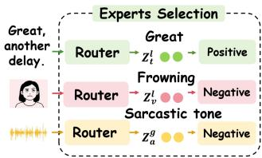  
(a) Cross-modal cue inconsistency

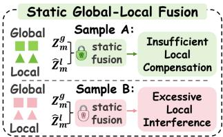  
(b) Static global–local fusion  
Figure 1: (a) Independent intra-modal afective cue selection may produce inconsistent sentiment cues across modalities. (b) Static global–local fusion cannot adapt to the varying reliability of local afective cues, resulting in either insuficient local compensation or excessive local interference.

## Keywords

Multimodal sentiment analysis, cross-modal expert routing, mixture of experts, global–local fusion, dynamic compensation

## 1 Introduction

Online video reviews, personal vlogs, and other forms of audiovisual communication allow people to express their opinions [1, 30]. Understanding the sentiment conveyed in these videos helps characterize how users evaluate products, services, and social topics, supporting the analysis of opinions expressed in online communities. Such understanding requires identifying both the polarity and intensity of a speaker’s attitude, which are not always explicit in the transcript. For example, an apparently positive statement may convey dissatisfaction when accompanied by a sarcastic tone or a contrasting facial expression [4]. Multimodal sentiment analysis (MSA) therefore integrates textual, acoustic, and visual information to interpret these expressions [25]. A central challenge is determining how to combine potentially conflicting cues while retaining the context needed to understand the speaker’s overall sentiment.

Existing studies mainly address this challenge from two complementary perspectives. The first focuses on selecting and refining informative local afective cues within each modality [15, 22]. The second models hierarchical interactions between global contexts and fine-grained local representations [13, 33]. The former determines which local cues should be retained, whereas the latter determines how these cues should complement global afective semantics. Despite substantial progress, both directions still face important limitations in cross-modal afective modeling.

Local afective cue modeling methods commonly employ attention, gating, or expert routing to emphasize informative segments and suppress modality-specific noise. Recent Mixture-of-Experts (MoE) approaches further introduce specialized experts to refine heterogeneous local cues. However, as depicted in Figure 1(a), their routing decisions are generally made within each modality independently of the other modalities.

Global contexts from other modalities are rarely considered during local expert selection. Consequently, a modality-specific router may overemphasize noisy cues or select local representations whose afective polarity conflicts with the broader multimodal context. Thus, local cue refinement should be guided by cross-modal global evidence rather than relying exclusively on the current modality.

Hierarchical fusion methods incorporate global afective contexts to alleviate inconsistencies among modality-specific local representations [13, 33].Nevertheless, existing methods determine the relative contributions of global and local representations implicitly through shared projections or fusion parameters. As illustrated in Figure 1(b), such implicit fusion cannot explicitly adapt the global local balance to the sample-dependent reliability of local cues. Infor mative local evidence may consequently be underutilized, whereas unreliable local cues may introduce excessive interference. An effective fusion mechanism should therefore preserve stable global semantics while adaptively incorporating reliable local information as complementary evidence for sentiment prediction.

To address the aforementioned challenges, this paper proposes DGC-Net, a Cross-Modal Dynamic Routing with Global-Guided Compensation framework in MSA, aiming to resolve the critical problem of fine-grained alignment of multimodal afective data. It first introduces a cross-modal contribution-aware dynamic expert routing mechanism. For each modality, this mechanism estimates the sample-dependent contributions of the current local rep resentation and auxiliary global contexts from the other modalities. Their contribution-weighted combination guides sparse expert selection, enabling cross-modal evidence to regulate the refinement of modality-specific local cues. This design improves the consistency of refined local representations without directly mixing auxiliary modality content into the expert outputs. Then, DGC-Net further develops a global-guided dynamic compensation fusion mechanism to explicitly regulate the contributions of global and local representations. It estimates a sample-specific global–local contribution ratio for each modality and constrains stable global semantics to serve as the primary representation. Expert-refined local cues are then incorporated as adaptive afective compensation according to their reliability. In this way, DGC-Net avoids both insuficient use of informative local cues and excessive interference from unreliable local evidence during multimodal fusion.

Our main contributions are summarized as follows:

• We propose a cross-modal contribution-aware dynamic expert routing mechanism that estimates the sampledependent contributions of auxiliary global contexts to guide expert selection for the current modality, thereby improving the consistency of local afective representations across the three modalities.

• We develop a global-guided dynamic compensation fusion mechanism that explicitly models the relative contributions of global and local representations. It preserves the dominance of stable global semantics while using expert-refined local cues as adaptive afective compensation.

• Extensive experiments are conducted on five multimodal benchmarks, including CMU-MOSI, CMU-MOSEI, UR-FUNNY, MUStARD, and CHERMA. The experimental results, ablation studies, and further analyses validate the efectiveness of the proposed components.

## 2 Related Work

Existing fine-grained multimodal afective modeling studies mainly focus on two directions: dynamic local-cue representation and hierarchical global–local fusion for multimodal sentiment analysis.

## 2.1 Critical Afective Cue Representation and Dynamic Expert Routing

Multimodal afective cues are often subtle and unevenly distributed. MulT [25], MAG-BERT [19], and M3SA [31] enhance salient interactions through attention or gating, while MISA [11] and C-MIB [17] reduce modality discrepancies and redundant information. Cube-MLP [22], PriSA [15], and MSG [13] further improve fine-grained afective representations for sentiment prediction.

Sparse MoE [21] and Switch Transformer [8] establish Top-� expert routing, while VLMo [3] and LIMoE [18] extend expert specialization to multimodal learning. For afective modeling, GLoMo [33] introduces modality-specific experts, MMA [5] combines multimodal adapters with expert selection, and TEXT [20] employs textrouted sparse experts with temporal alignment. However, existing routers rarely distinguish the contributions of the current local representation and auxiliary global contexts. DGC-Net therefore uses auxiliary global evidence to guide expert selection while keeping the refined representation modality-specific.

## 2.2 Hierarchical Multimodal Fusion and Global–Local Modeling

Early fusion methods model multimodal interactions through tensor products, low-rank decomposition, or shared and modality-specific factors, including TFN [29], LMF [14], and MFM [26]. Subsequent methods improve fine-grained fusion through cross-modal attention, gating, graph structures, or bidirectional interaction, including MulT [25], MAG-BERT [19], GFN [16], M3SA [31], and BBFN [9].

More recently, CubeMLP [22], PriSA [15], MSG [13], and GLoMo [33] jointly model global contexts and local cues. DPDF-LQ [32] adopts complementary global and local paths, while EBMC [12] coordinates modality contributions according to sample-level reliability. Nevertheless, within-modality global– local contributions are generally modeled implicitly, which may underutilize informative local cues or amplify local noise. DGC-Net explicitly estimates sample-level global–local ratios, using reliable local cues as compensation while preserving stable global semantics within each modality.

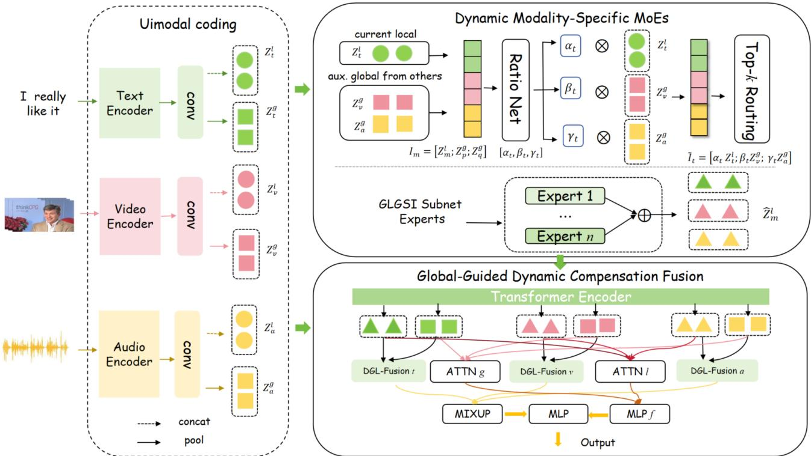  
Figure 2: Overall architecture of DGC-Net, consisting of unimodal global–local representation, cross-modal contribution-aware dynamic expert routing, and global-guided dynamic compensation fusion.

## 3 Methodology

## 3.1 Problem Formulation

In this section, we formally define the task of multimodal sentiment analysis. Let $U _ { m }$ denote the input sequence of modality �, where $m \in \mathcal { M } = \{ t , v , a \}$ corresponds to the textual, visual, and acoustic modalities, respectively. The comprehensive multimodal input is represented as ${ \mathcal { U } } = \{ U _ { t } , U _ { v } , U _ { a } \}$ . The primary objective of our work is to accurately predict sentiment labels or intensities based on these multimodal sequences. To achieve this, we propose a novel architecture, DGC-Net, which acts as a mapping function $f _ { \Theta }$ with trainable parameters Θ. Formally, the prediction process is defined for each input as:

$$
\begin{array} { r } { \hat { y } = f _ { \Theta } ( U _ { t } , U _ { v } , U _ { a } ) , } \end{array}\tag{1}
$$

where $\hat { y }$ denotes the predicted sentiment output. Specifically, depending on the downstream dataset, $\hat { y } \in \mathbb R$ represents a continuous sentiment intensity score for regression tasks, or $\hat { y } \in C$ denotes a predicted category for classification tasks over a discrete set of classes C specified by the dataset.

## 3.2 Model Overview

As illustrated in Figure 2, DGC-Net builds upon the global–local architecture of GLoMo [33] and consists of three modules. First, the Unimodal Coding Module extracts a global representation $Z _ { m } ^ { g }$ and a local representation $Z _ { m } ^ { l }$ for each modality � $\in \mathcal { M } = t , v , a$ .

Second, the Dynamic Modality-Specific MoEs Module uses RatioNet to estimate the contributions of the current local representation and two auxiliary global representations. Their contributionweighted representation guides sparse Top-� gating to select CLGSI Subnet Experts, producing the refined local representation $\widehat { Z } _ { m } ^ { l }$

Finally, the Global-Guided Dynamic Compensation Fusion (GDCF) Module contextualizes the global and refined local representations through a shared Transformer [27]. Its modalitywise path applies DGL-Fusion followed by MIXUP, while its feature-wise path summarizes global and local features using $A T T N _ { g } , A T T N _ { l } .$ , and $M L P _ { f }$ . The two outputs are concatenated for prediction. Overall, the routing and fusion modules respectively address cross-modal local-cue inconsistency and sample-dependent global–local imbalance within each modality.

## 3.3 Unimodal Coding Module

Expert selection in DGC-Net requires utterance-level context to interpret fine-grained cues, while subsequent compensation fusion requires access to both contextual and regional information. The unimodal coding module therefore constructs global and local representations for each modality. Global representations provide auxiliary cross-modal context for routing and form the global branches in compensation fusion. Local representations retain regional cues for modality-specific expert refinement and subsequent local compensation during the fusion stage.

We adopt the encoding scheme of GLoMo [33] to obtain these representations. For text, the final-layer [CLS] representation from BERT is projected into the common hidden space to construct the global representation. The local representation is derived from the token features of the last two BERT layers. Let $H _ { t } ^ { - 1 }$ and $H _ { t } ^ { - 2 }$ denote these token representations. The textual global and local representations are computed as

$$
\begin{array} { r l } & { Z _ { t } ^ { g } = \mathrm { F F } \left( \mathrm { C L S } ^ { - 1 } ( U _ { t } ) \right) , } \\ & { Z _ { t } ^ { l } = \mathrm { C O N C A T } \left( \mathrm { A d a M a x P o o l } _ { n } ( F _ { t } ^ { l } ) \right) , } \end{array}\tag{2}
$$

where FF denotes a feed-forward projection and $\begin{array} { r l } { F _ { t } ^ { l } } & { { } = } \end{array}$ $\mathrm { C o n v 1 D } _ { t } ( [ H _ { t } ^ { - 1 } ; ~ H _ { t } ^ { - 2 } ] )$ denotes the convolutionally encoded token features. The convolution captures local contextual patterns. Adaptive max pooling then extracts � regional vectors, which are concatenated to retain regional information for expert refinement.

For audio and video, a modality-specific convolution projects the input features, after which a Transformer encoder models their temporal dependencies. For � ∈ {�, � }, the global and local representations are computed as follows for the encoded sequence:

$$
\begin{array} { r l } & { Z _ { m } ^ { g } = \mathrm { M A X } ( F _ { m } ) , } \\ & { Z _ { m } ^ { l } = \mathrm { C O N C A T } \left( \mathrm { A d a M a x P o o l } _ { n } ( F _ { m } ) \right) , } \end{array}\tag{3}
$$

where $F _ { m } = \mathrm { T E } _ { m } \mathopen { } \mathclose \bgroup \left( \mathrm { C o n v 1 D } _ { m } \mathopen { } \mathclose \bgroup \left( U _ { m } \aftergroup \egroup \right) \aftergroup \egroup \right)$ denotes the temporally encoded features. Max pooling aggregates the sequence into an utterancelevel representation, whereas adaptive max pooling retains information from � temporal regions within each utterance.

For each modality, the coding module produces a global representation $Z _ { m } ^ { g } \in \mathbb { R } ^ { d }$ and a local representation $Z _ { m } ^ { l } \in \mathbb { R } ^ { n d }$ . When selecting experts for a target modality $m , Z _ { m } ^ { l }$ provides the local evidence to be refined, while $\dot { \boldsymbol { Z } } _ { p } ^ { g }$ and $Z _ { q } ^ { g }$ from the other two modalities provide auxiliary utterance-level context, where $\{ p , q \} = M \backslash \{ m \}$ Their relative influence on expert selection should adapt to each sample. This motivates the contribution-aware routing mechanism below, which estimates context weights to guide expert selection while keeping expert processing specific to the target modality.

## 3.4 Dynamic Modality-Specific MoEs Module

Conventional modality-specific routers primarily select experts according to the current local representation. Their decisions may therefore become unreliable when the current modality is noisy or afectively ambiguous.To incorporate cross-modal evidence into expert selection, we propose the Dynamic Modality-Specific MoEs Module. For each modality, RatioNet estimates sample-dependent contribution weights for its local representation and the global representations of the other modalities. These representations are individually weighted and concatenated to compute expert scores for Top-� selection. Each selected expert, implemented as a CLGSI Subnet [28], independently transforms the target modality’s local representation. The expert outputs are then aggregated using their corresponding routing weights according to Eq. (9) to obtain the refined local representation for the target modality.

Auxiliary global representations guide the routing decision, while each selected expert processes only the current local representation. This separation introduces cross-modal guidance without changing the modality-specific content. It uses other modalities as semantic evidence for choosing experts, rather than directly injecting their features into the target local representation.

For modality �, let $\boldsymbol { p }$ and $q$ denote the other two modalities. We first concatenate the current local representation and the two auxiliary global representations as ${ \cal I } _ { m } \stackrel { - } { = } [ Z _ { m } ^ { l } ; Z _ { p } ^ { g } ; Z _ { q } ^ { g } ]$ . RatioNet then estimates their normalized contribution coeficients:

$$
\left[ \alpha _ { m } , \beta _ { m } , \gamma _ { m } \right] = \mathrm { S o f t m a x } \left( \mathrm { R a t i o N e t } _ { m } ( I _ { m } ) \right) .\tag{4}
$$

RatioNet is a two-layer MLP with a 64-dimensional hidden layer:

$$
\mathrm { R a t i o N e t } _ { m } ( I _ { m } ) = W _ { r , 2 } ^ { m } \mathrm { R e L U } \big ( W _ { r , 1 } ^ { m } I _ { m } + b _ { r , 1 } ^ { m } \big ) + b _ { r , 2 } ^ { m } ,\tag{5}
$$

where $W _ { r , 1 } ^ { m } \in \mathbb { R } ^ { 6 4 \times d _ { I } } , W _ { r , 2 } ^ { m } \in \mathbb { R } ^ { 3 \times 6 4 }$ , and $d _ { I }$ is the dimension of $I _ { m }$

The Softmax normalization ensures $\alpha _ { m } + \beta _ { m } + \gamma _ { m } = 1$ , allowing the three information sources to be compared on the same scale. Their weighted concatenation forms the routing representation

$$
{ \widetilde { \cal I } } _ { m } = [ \alpha _ { m } Z _ { m } ^ { l } ; \beta _ { m } Z _ { p } ^ { g } ; \gamma _ { m } Z _ { q } ^ { g } ] .\tag{6}
$$

Thus, the auxiliary representations influence expert selection through their estimated contributions rather than being directly mixed into the expert content.

Following Top-� gating [21], the routing weights are obtained as

$$
G _ { m } = \mathrm { S o f t m a x } \left( \mathrm { K e e p T o p K } ( s _ { m } , k ) \right) ,\tag{7}
$$

where $\pmb { s } _ { m } = \widetilde { I } _ { m } W _ { g } ^ { m } + \pmb { \epsilon } \odot \delta _ { m }$ denotes the expert scores, and $\delta _ { m } =$ Softplus(e��� �) + �0 is the input-dependent noise scale. Here, � is Gaussian noise used only during training, and $\epsilon _ { 0 }$ prevents the noise scale from vanishing. The Top-� operation retains only the � highest-scoring experts, encouraging expert specialization while limiting redundant computation per input sample.

Each selected CLGSI Subnet Expert transforms the vectorized local representation through a bottleneck:

$$
\begin{array} { r } { E _ { i } ^ { m } ( Z _ { m } ^ { l } ) = \sigma \Big ( W _ { 2 , i } ^ { m } \mathrm { R e L U } \Big ( W _ { 1 , i } ^ { m } Z _ { m } ^ { l } + b _ { 1 , i } ^ { m } \Big ) + b _ { 2 , i } ^ { m } \Big ) . } \end{array}\tag{8}
$$

The intermediate dimension is set to $d _ { b } = \operatorname* { m a x } ( \lfloor n d / 8 \rfloor , 1 )$ , forming a compact bottleneck that suppresses redundant local information before projecting the feature to dimension �. Although all experts share this structure, their independent parameters allow them to capture diferent afective subspaces.

Expert outputs are aggregated using their routing weights:

$$
\widehat { Z } _ { m } ^ { l } = \log \left( \sum _ { i = 1 } ^ { N _ { e } } G _ { m , i } \exp \left( E _ { i } ^ { m } ( Z _ { m } ^ { l } ) \right) \right) .\tag{9}
$$

Only experts with nonzero Top-� weights contribute to $\widehat { Z } _ { m } ^ { l } .$ . Because their inputs contain only $\bar { Z } _ { m } ^ { l } .$ , the refined representation remains modality-specific, while its refinement path is selected using cross-modal global evidence from the auxiliary modalities.

## 3.5 Global-Guided Dynamic Compensation Fusion Module

Global representations provide stable utterance-level semantics, whereas the reliability of fine-grained local cues varies across samples. Conventional projection-based fusion models their interaction but does not explicitly control their relative contributions. We therefore propose the Global-Guided Dynamic Compensation Fusion Module, which preserves global priority in the explicit interpolation branch while adaptively incorporating reliable local evidence.

We arrange the global and expert-refined local representations as $S = [ Z _ { t } ^ { g } ; \stackrel {  } { \hat { Z } _ { t } ^ { l } } ; Z _ { v } ^ { g } ; \stackrel {  } { \hat { Z } _ { v } ^ { l } } ; Z _ { a } ^ { g } ; \stackrel {  } { Z _ { a } ^ { l } } ]$ . A shared Transformer contextualizes these global and local representations across modalities:

$$
\{ \overline { { Z } } _ { m } ^ { g } , \overline { { Z } } _ { m } ^ { l } \} _ { m \in { \cal M } } = \mathrm { T r a n s f o r m e r } ( S ) .\tag{10}
$$

This contextualization allows each global–local pair to incorporate complementary cross-modal information before its contribution ratio is estimated for dynamic fusion.

For each modality, a shared ratio network predicts the contribution of its global representation:

$$
\lambda _ { m } = \frac { 1 } { 2 } + \frac { 1 } { 2 } \sigma \left( \mathrm { M L P } _ { g l } ( [ \overline { { { Z } } } _ { m } ^ { g } ; \overline { { { Z } } } _ { m } ^ { l } ] ) \right) .\tag{11}
$$

The resulting coeficient satisfies $\lambda _ { m } \in ( 0 . 5 , 1 )$ . It adapts to the sample-dependent reliability of local cues while ensuring that the global representation receives no less weight than the local representation in the explicit interpolation branch.

For modality �, dynamic compensation yields

$$
D _ { m } = \lambda _ { m } \overline { { { Z } } } _ { m } ^ { g } + ( 1 - \lambda _ { m } ) \overline { { { Z } } } _ { m } ^ { l } + \frac { 1 } { 2 } \phi _ { m } ( [ \overline { { { Z } } } _ { m } ^ { g } ; \overline { { { Z } } } _ { m } ^ { l } ] ) .\tag{12}
$$

The first two terms explicitly control the global–local contributions, while $\phi _ { m }$ preserves their nonlinear complementary interaction. Thus, GDCF separates controlled contribution estimation from residual nonlinear complementarity instead of relying only on implicit projection-based fusion.

Global and local attention subsequently summarize the three modalities at the corresponding representation levels:

$$
\begin{array} { r } { ( { \pmb w } ^ { g } , Z ^ { g } ) = \mathrm { A T T N } _ { g } ( \overline { { Z } } _ { t } ^ { g } , \overline { { Z } } _ { v } ^ { g } , \overline { { Z } } _ { a } ^ { g } ) , } \\ { ( { \pmb w } ^ { l } , Z ^ { l } ) = \mathrm { A T T N } _ { l } ( \overline { { Z } } _ { t } ^ { l } , \overline { { Z } } _ { v } ^ { l } , \overline { { Z } } _ { a } ^ { l } ) . } \end{array}\tag{13}
$$

The summaries form the feature-wise fusion path, while global attention weights aggregate the compensated representations:

$$
\begin{array} { l } { \displaystyle { Z _ { f } = \mathrm { M L P } _ { f } ( [ Z ^ { g } ; Z ^ { l } ] ) , } } \\ { \displaystyle { Z _ { d } = \mathrm { M L U P } ( D _ { t } , D _ { v } , D _ { a } ) = \sum _ { m \in \mathcal { M } } w _ { m } ^ { g } D _ { m } . } } \end{array}\tag{14}
$$

The MIXUP operation uses the global attention weights because global contexts provide a relatively stable basis for estimating modality importance. Finally, the outputs ofthe two complementary fusion paths are combined for sentiment prediction:

$$
\begin{array} { r } { \hat { y } = \mathrm { M L P } ( [ Z _ { d } ; Z _ { f } ] ) . } \end{array}\tag{15}
$$

Evidence and feature-level global–local summaries, making the final prediction consistent with both design motivations.

## 3.6 Learning Objective

DGC-Net jointly optimizes task performance, expert utilization, and contribution estimation. For a batch of � samples, the task loss is defined according to the prediction target:

$$
\mathcal { L } _ { \mathrm { t a s k } } = \left\{ \begin{array} { l l } { \displaystyle \frac { 1 } { B } \sum _ { b = 1 } ^ { B } \left| y _ { b } - \hat { y } _ { b } \right| , } & { \mathrm { r e g r e s s i o n } , } \\ { \displaystyle C \mathrm { E } \left( \pmb { y } , \widehat { \pmb { y } } \right) , } & { \mathrm { c l a s s i f i c a t i o n } . } \end{array} \right.\tag{16}
$$

Accordingly, mean absolute error is used for sentiment regression, whereas cross-entropy is used for classification.

For modality $m ,$ let $G _ { m , b , i }$ denote the routing weight assigned to expert � for sample �. The importance of expert � is defined as $\begin{array} { r } { \mathrm { I m p } _ { m , i } \ = \ \sum _ { b = 1 } ^ { B } G _ { m , b , i } } \end{array}$ , while its load is defined as $\mathrm { L o a d } _ { m , i } ~ =$ $\begin{array} { r } { \sum _ { b = } ^ { B } } \end{array}$ $\mathrm { P r } ( i \in \mathrm { T o p K } _ { m } ( b ) )$ . The batch-level mean contribution vector 1 is $\begin{array} { r } { \overline { { r } } _ { m } = \frac { 1 } { B } \sum _ { b = 1 } ^ { B } [ \alpha _ { m , b } , \beta _ { m , b } , \gamma _ { m , b } ] } \end{array}$ . Using these quantities, the routing regularization is defined as

$$
\mathcal { L } _ { \mathrm { r o u t e } } ^ { m } = \mathrm { C V } ( \mathrm { I m p } _ { m } ) + \mathrm { C V } ( \mathrm { L o a d } _ { m } ) + \mu \mathrm { C V } ( \overline { { r } } _ { m } ) .\tag{17}
$$

The first two terms balance the accumulated routing weights and expected expert loads, respectively. The third term prevents RatioNet from consistently assigning most of its contribution to a single information source, and � controls its strength.

For a nonnegative vector �, the coeficient of variation is

$$
\operatorname { C V } ( x ) = \frac { \sqrt { \operatorname { V a r } ( x ) } } { \operatorname { M e a n } ( x ) + \epsilon } ,\tag{18}
$$

where � is a small constant for numerical stability.

The overall training objective combines the task loss with the routing regularization of all three modalities:

$$
\mathcal { L } = \mathcal { L } _ { \mathrm { t a s k } } + \lambda _ { \mathrm { m o e } } \sum _ { m \in \mathcal { M } } \mathcal { L } _ { \mathrm { r o u t e } } ^ { m } ,\tag{19}
$$

where $\lambda _ { \mathrm { m o e } }$ controls the overall contribution of routing regularization. This learning objective optimizes sentiment prediction while discouraging routing collapse, which helps keep the dynamic expert module efective across heterogeneous samples.

## 4 Experiments

## 4.1 Experimental Settings

Datasets. We conduct the main experiments on CMU-MOSI [30] and CMU-MOSEI [1], two widely used benchmarks for multimodal sentiment analysis. Both datasets contain aligned textual, acoustic, and visual signals with sentiment annotations ranging from −3 to +3. CMU-MOSI provides a relatively compact benchmark, whereas CMU-MOSEI contains substantially more speakers and utterances and is therefore used to evaluate scalability and generalization. We follow the standard train, validation, and test partitions used by GLoMo [33]. Experiments on UR-FUNNY [10], MUStARD [4], and CHERMA [23] are reported in the supplementary material.

Features and Evaluation Protocol. For a controlled comparison, all methods use the same pre-extracted and word-aligned features as GLoMo. Textual embeddings are obtained using BERT [7], while the acoustic and visual streams use COVAREP [6] and OpenFace [2] features, respectively. We report MAE and Pearson correlation (Corr) for sentiment regression, seven-class accuracy (Acc-7) for fine-grained sentiment prediction, and binary accuracy (Acc-2) and F1 for polarity recognition. For Acc-2 and F1, we report both the negative/non-negative and negative/positive settings.

Implementation Details. DGC-Net is implemented in PyTorch and optimized using AdamW on an NVIDIA RTX 3090 GPU. Each modality-specific MoE contains three CLGSI Subnet Experts and adopts Top-2 routing. The routing hidden dimension, bottleneck ratio, and dropout rate are set to 64, 1/8, and 0.3, respectively. The regularization coeficients are set to $\lambda _ { \mathrm { m o e } } = 1 0 ^ { - 2 }$ and $\mu = 0 . 1$ . The learning rate and common hidden dimension are adjusted for each dataset following GLoMo. Model selection is performed using validation performance without access to the test set. Additional preprocessing and training details are provided in the supplementary material for reproducing the experiments.

Table 1: Results on CMU-MOSI and CMU-MOSEI. For Acc-2 and F1, the values before/after “/” correspond to the negative/nonnegative and negative/positive settings, respectively. Bold and underlined values denote the best and second-best results. † denotes our reproduced results with checkpoints selected by validation MAE.
<table><tr><td></td><td colspan="5">CMU-MOSI</td><td colspan="5">CMU-MOSEI</td></tr><tr><td>Method</td><td>MAE↓</td><td>Corr↑</td><td>Acc-2↑</td><td>F1↑</td><td>Acc-7↑</td><td>MAE↓</td><td>Corr↑</td><td>Acc-2↑</td><td>F1↑</td><td>Acc-7↑</td></tr><tr><td>TFN</td><td>0.901</td><td>0.698</td><td>-/80.8</td><td>-/80.7</td><td>34.9</td><td>0.593</td><td>0.700</td><td>-/82.5</td><td>-/82.1</td><td>50.2</td></tr><tr><td>LMF</td><td>0.917</td><td>0.695</td><td>-/82.5</td><td>-/82.4</td><td>33.2</td><td>0.623</td><td>0.677</td><td>-/82.0</td><td>-/82.1</td><td>48.0</td></tr><tr><td>MFM</td><td>0.877</td><td>0.706</td><td>-/81.7</td><td>-/81.6</td><td>35.4</td><td>0.568</td><td>0.717</td><td>-/84.4</td><td>-/84.3</td><td>51.3</td></tr><tr><td>GFN</td><td>0.736</td><td>0.790</td><td>-/84.3</td><td>-/84.3</td><td>47.0</td><td>0.611</td><td>0.774</td><td>-/85.0</td><td>-/85.0</td><td>51.8</td></tr><tr><td>MulT</td><td>0.767</td><td>0.799</td><td>-/83.7</td><td>-/83.7</td><td>41.5</td><td>0.625</td><td>0.775</td><td>-/84.7</td><td>-/84.6</td><td>50.7</td></tr><tr><td>MAG-BERT</td><td>0.790</td><td>0.769</td><td>-/83.5</td><td>-/83.5</td><td>42.9</td><td>0.602</td><td>0.778</td><td>-/85.0</td><td>-/85.0</td><td>51.9</td></tr><tr><td>M3SA</td><td>0.730</td><td>0.793</td><td>-/85.3</td><td>-/85.3</td><td>45.5</td><td>0.599</td><td>0.781</td><td>-/85.2</td><td>-/85.1</td><td>52.5</td></tr><tr><td>ICCN</td><td>0.860</td><td>0.710</td><td>-/83.0</td><td>-/83.0</td><td>39.0</td><td>0.565</td><td>0.713</td><td>-/84.2</td><td>-/84.2</td><td>51.6</td></tr><tr><td>CubeMLP</td><td>0.770</td><td>0.767</td><td>-/85.6</td><td>-/85.5</td><td>45.5</td><td>0.529</td><td>0.760</td><td>-/85.1</td><td>-/84.5</td><td>54.9</td></tr><tr><td>MISA</td><td>0.783</td><td>0.761</td><td>81.8/83.4</td><td>81.7/83.6</td><td>42.3</td><td>0.555</td><td>0.756</td><td>83.6/85.5</td><td>83.8/85.3</td><td>53.2</td></tr><tr><td>BBFN</td><td>0.776</td><td>0.755</td><td>-/84.3</td><td>-/84.3</td><td>45.0</td><td>0.529</td><td>0.767</td><td>-/86.2</td><td>-/86.1</td><td>54.8</td></tr><tr><td>PriSA</td><td>0.714</td><td>0.792</td><td>83.4/85.5</td><td>83.2/85.5</td><td>47.3</td><td>0.523</td><td>0.772</td><td>82.8/85.9</td><td>83.2/85.9</td><td>54.7</td></tr><tr><td>C-MIB</td><td>0.728</td><td>0.793</td><td>-/85.2</td><td>-/85.2</td><td>48.2</td><td>0.584</td><td>0.789</td><td>-/86.2</td><td>-/86.2</td><td>53.0</td></tr><tr><td>MSG</td><td>0.748</td><td>0.782</td><td>-/85.7</td><td>-/85.6</td><td>45.3</td><td>0.583</td><td>0.787</td><td>-/85.4</td><td>-/85.4</td><td>52.8</td></tr><tr><td>MMA-BERT†</td><td>0.740</td><td>0.782</td><td>82.1/83.7</td><td>82.1/83.8</td><td>45.3</td><td>0.537</td><td>0.764</td><td>82.5/84.8</td><td>82.9/84.8</td><td>53.8</td></tr><tr><td>DPDF-LQ†</td><td>0.748</td><td>0.774</td><td>80.5/81.9</td><td>80.5/81.9</td><td>44.2</td><td>0.547</td><td>0.768</td><td>82.8/85.7</td><td>83.1/85.6</td><td>51.5</td></tr><tr><td>GLoMo</td><td>0.718</td><td>0.782</td><td>84.1/86.7</td><td>83.9/86.6</td><td>48.3</td><td>0.539</td><td>0.771</td><td>83.7/86.5</td><td>84.0/86.4</td><td>55.0</td></tr><tr><td>DGC-Net</td><td>0.698</td><td>0.800</td><td>84.7/86.4</td><td>84.1/86.4</td><td>45.1</td><td>0.526</td><td>0.782</td><td>82.3/87.0</td><td>84.4/87.0</td><td>55.7</td></tr></table>

## 4.2 Overall Performance

Table 1 reports the overall results on CMU-MOSI and CMU-MOSEI. DGC-Net achieves the best MAE and Corr on CMU-MOSI, demonstrating its efectiveness in modeling continuous sentiment intensity. On the larger CMU-MOSEI benchmark, it achieves leading Acc-7 and F1 results while maintaining competitive regression performance. These results show that DGC-Net performs consistently across sentiment regression, fine-grained classification, and binary polarity recognition on these sentiment benchmarks.

The gains are not uniform across all metrics. DGC-Net trails GLoMo on CMU-MOSI Acc-7 and slightly on the negative/positive Acc-2 and F1 metrics, while its CMU-MOSEI Corr and negative/non negative Acc-2 remain below the best results. This suggests that improvements in continuous estimation do not always transfer directly to fine-grained discretization or neutral-boundary classification on the evaluated sentiment benchmarks.

Compared with the closely related GLoMo model, DGC-Net provides clear improvements in regression and most polarity recog nition metrics under the same features and dataset partitions. This supports the efectiveness of using auxiliary global contexts to guide local expert selection and dynamically controlling the contribution ofexpert-refined local evidence during global–local fusion. Detailed comparisons with diferent baseline categories and metric-specific analyses are provided in the supplementary material.

Table 2: Ablation results on CMU-MOSI and CMU-MOSEI under the negative/positive setting. All values are percentages.
<table><tr><td></td><td colspan="2">CMU-MOSI</td><td colspan="2">CMU-MOSEI</td></tr><tr><td>Variant</td><td>Acc-2↑</td><td>F1↑</td><td>Acc-2↑</td><td>F1↑</td></tr><tr><td colspan="5">Role of GDCF</td></tr><tr><td>w/o DGL-Fusion</td><td>83.51</td><td>83.28</td><td>86.35</td><td>86.26</td></tr><tr><td>Static Equal Ratio</td><td>85.19</td><td>85.18</td><td>85.94</td><td>85.94</td></tr><tr><td>Static Global-heavy Ratio</td><td>83.05</td><td>83.12</td><td>85.91</td><td>85.87</td></tr><tr><td>No Global Weight Constraint</td><td>83.97</td><td>83.96</td><td>85.88</td><td>85.85</td></tr><tr><td colspan="5">Role of Dynamic Modality-Specific MoEs</td></tr><tr><td>w/o Dynamic MoEs</td><td>83.05</td><td>82.88</td><td>86.35</td><td>86.29</td></tr><tr><td>w/o Cross-modal Guidance</td><td>83.66</td><td>83.64</td><td>85.97</td><td>85.94</td></tr><tr><td>MLP Expert Replacement</td><td>84.27</td><td>84.32</td><td>86.08</td><td>86.03</td></tr><tr><td>Random Routing</td><td>84.12</td><td>84.13</td><td>86.35</td><td>86.35</td></tr><tr><td>Uniform Routing</td><td>85.80</td><td>85.73</td><td>85.28</td><td>85.32</td></tr><tr><td colspan="5">Global-Local Branch Controls</td></tr><tr><td>Global Branch Only</td><td>84.27</td><td>84.31</td><td>86.02</td><td>86.02</td></tr><tr><td>Local Branch Only</td><td>84.27</td><td>84.25</td><td>86.22</td><td>86.18</td></tr><tr><td colspan="5">Capacity Control</td></tr><tr><td>Parameter-matched MLP</td><td>81.98</td><td>82.06</td><td>86.16</td><td>86.16</td></tr><tr><td colspan="5">Unimodal Controls</td></tr><tr><td>Text Only</td><td>83.97</td><td>83.95</td><td>85.41</td><td>85.43</td></tr><tr><td>Audio Only</td><td>49.62</td><td>48.45</td><td>64.75</td><td>59.13</td></tr><tr><td>Vision Only</td><td>51.76</td><td>51.51</td><td>62.40</td><td>57.36</td></tr><tr><td>DGC-Net (Full)</td><td>86.41</td><td>86.38</td><td>86.96</td><td>86.95</td></tr></table>

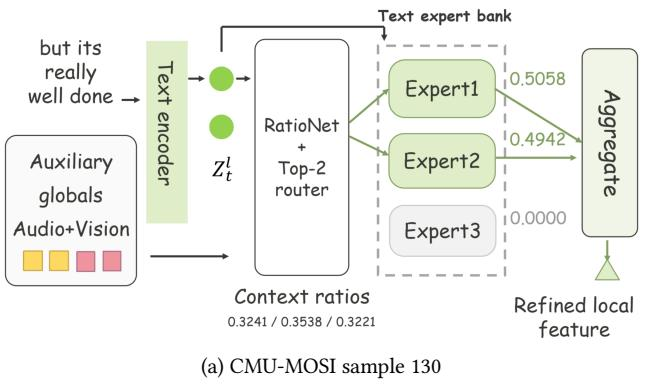

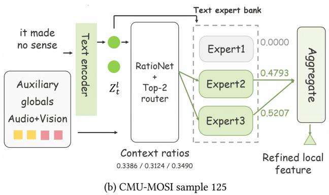  
Figure 3: Sample-dependent text expert routing on CMU-MOSI with � = 3 experts and Top-� = 2 selection. Green and gray boxes indicate active and inactive experts, respectively. Numbers beside experts denote gating weights. Context ratios follow the local-text, global-audio, and global-vision order.

## 4.3 Ablation Study

To identify the sources of DGC-Net’s performance gains, we conduct four controlled ablations targeting its fusion, routing, and expert designs. For GDCF, we replace DGL-Fusion to examine explicit dynamic global–local compensation. For the Dynamic Modality Specific MoEs Module, we remove the complete module and then separately evaluate cross-modal routing guidance and the CLGSI Subnet Expert architecture. All variants use the same input features, dataset partitions, and optimization settings as the full model, with only the evaluated component changed.

Role of DGL-Fusion. DGL-Fusion is the proposed dynamic compensation component of GDCF. We replace it with direct MLP fusion while retaining the remaining operations in GDCF. This replacement reduces Acc-2 and F1 on both datasets and causes degradation across most metrics, especially on CMU-MOSI. These results demonstrate that explicitly estimating sample-dependent global–local contributions is more efective than learning their relationship implicitly through an MLP.

Role ofDynamic Modality-Specific MoEs. We remove the complete Dynamic Modality-Specific MoEs Module and feed the original local representations directly into the subsequent fusion stage. This variant causes the largest Acc-2 and F1 reductions on CMU-MOSI and also weakens polarity recognition on CMU-MOSEI. The results demonstrate that modality-specific expert refinement is important for filtering noisy local cues before global–local fusion.

Role ofCross-modal Guidance. We remove RatioNet and the two auxiliary global representations while retaining the sparse router, CLGSI Subnet Experts, and GDCF. Expert selection therefore depends only on the current local representation. This variant causes substantial degradation across the CMU-MOSI metrics and the largest Acc-2 and F1 reductions among the routing variants on CMU-MOSEI. The results verify that auxiliary global contexts provide useful semantic evidence when local afective cues are ambiguous or inconsistent across modalities.

Role of CLGSI Subnet Experts. We retain the complete cross-modal contribution-aware routing mechanism but replace the CLGSI Subnet Experts with conventional MLP experts. Under identical routing decisions, this replacement reduces Acc-2 and F1 on both datasets and degrades most of the remaining metrics. This comparison confirms that the improvements do not arise from dynamic routing alone and verifies the efectiveness of the CLGSI Subnet Experts in extracting compact, task-relevant local representations.

Table 3: Selected CMU-MOSI cases. � and �ˆ denote true and predicted scores. Error is |� − �ˆ|. Weights follow text/audio/vision order.
<table><tr><td>Global weights</td><td>y</td><td>y</td><td>Error</td></tr><tr><td>Case 130: but its really well done (0.750, 0.750, 0.750)</td><td>2.20</td><td>2.09</td><td>0.11</td></tr><tr><td>Case 125: it made no sense (0.739, 0.735, 0.737)</td><td>-2.00</td><td>-2.04</td><td>0.04</td></tr><tr><td>Case 108: two out of five stars</td><td></td><td></td><td></td></tr><tr><td>(0.750, 0.750, 0.750)</td><td>-1.60</td><td>1.49</td><td>3.09</td></tr></table>

## 4.4 Case Study

Cases on CMU-MOSI. Table 3 includes two accurate predictions and one polarity error. The model correctly interprets “but its really well done” and “it made no sense,” with absolute errors of 0.11 and 0.04, respectively. However, “two out of five stars” receives a positive prediction despite its negative ground-truth score. The positive example and the failed example have similar global weights at the displayed precision, illustrating that these coeficients alone do not explain prediction correctness. Due to space limitations, the case study table and corresponding examples for CMU-MOSEI are provided in the appendix.

Sample-dependent expert routing. Figure 3 further illustrates the routing behavior of the two correctly predicted MOSI samples. The text expert bank contains � experts, with � = 3 and Top-� = 2 in these experiments. Sample 130 activates Experts 1 and 2 with weights of 0.5058 and 0.4942, whereas Sample 125 activates Experts 2 and 3 with weights of 0.4793 and 0.5207. The router combines local text features with auxiliary audio and visual global contexts, while the selected experts transform only local text features. These cases demonstrate sample-dependent expert selection, but do not establish polarity-specific expert specialization or a causal link between routing choices and prediction accuracy.

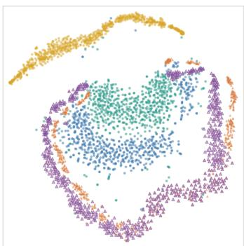  
(a) All representations

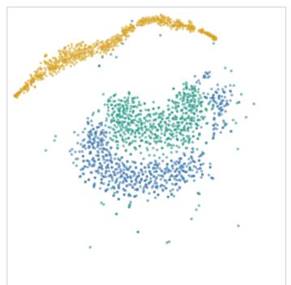  
(b) Global representations  
• Gt • Ga • Gv ▲ Lt △ La ▲ Lv

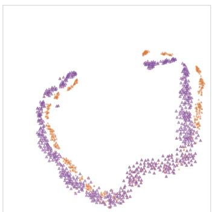  
(c) Local representations

Figure 4: Joint t-SNE visualization on CMU-MOSI. Panels (a)–(c) share the same coordinates and display all, global, and local representations, respectively. � and � denote global and local representations; �, �, and � denote text, audio, and vision.  
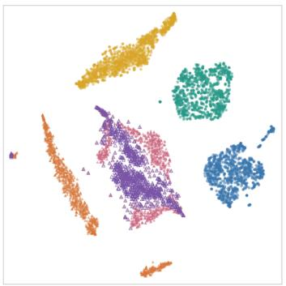  
(a) All representations

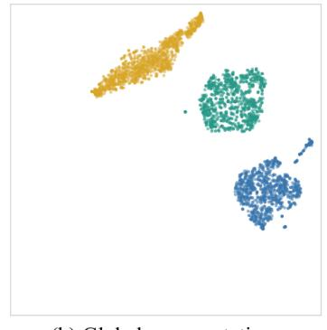  
(b) Global representations  
• Gt • Ga • G, ▲ Lt △ La ▲ Ly

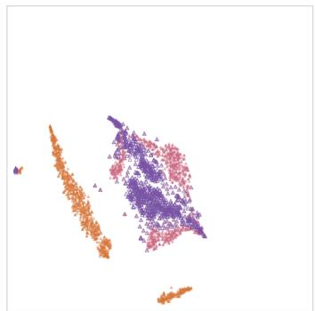  
(c) Local representations  
Figure 5: Joint t-SNE visualization on CMU-MOSEI. Panels (a)–(c) share coordinates within this dataset and display all, global, and local representations, respectively. Notation follows Figure 4.

## 4.5 Advanced Analysis

Additional results are provided in the supplementary material, including experiments on UR-FUNNY, MUStARD, and CHERMA, analyses of the learned routing and compensation coeficients, and sensitivity studies on the number of experts and activated experts. These experiments further evaluate cross-task generalization, sample-dependent behavior, and routing robustness.

## 4.6 Representation Analysis

Figures 4 and 5 visualize the global and local representations on CMU-MOSI and CMU-MOSEI, respectively. For each dataset, the six representation groups are jointly projected into a two-dimensional space using t-SNE. The three panels share the same coordinates and display all representations, global representations, and local representations, respectively. The latter two panels filter the joint projection for visual inspection rather than represent model ablations of individual model components.

On CMU-MOSI, global text representations occupy a region largely separate from global audio and visual representations, which partially overlap in this projection.

## 5 Conclusion

In this paper, we propose DGC-Net to address two critical limitations of global–local modeling in multimodal sentiment analysis: the inconsistency arising from the independent selection of local afective cues, and the sample-dependent reliability of global and local representations. Specifically, DGC-Net initially employs a Unimodal Coding Module to extract both stable global semantics and fine-grained local cues from each modality. Subsequently, it introduces a Dynamic Modality-Specific MoEs Module, where auxiliary global contexts and learned contribution ratios explicitly guide expert routing, empowering the CLGSI Subnet Experts to precisely refine the local representation of the target modality. Finally, a Global-Guided Dynamic Compensation Fusion Module adaptively estimates the relative contributions of global and local information, utilizing stable global semantics as the foundational anchor and reliable local cues as sample-dependent compensation. Extensive experiments on multiple multimodal afective computing benchmarks demonstrate the efectiveness and competitiveness of DGC-Net, and rigorous ablation studies validate the specific contributions of our proposed routing, expert, and dynamic compensation mechanisms for multimodal sentiment prediction. Together, the modules connect cross-modal guidance to local cue refinement and adaptive global–local feature compensation.

In future work, we aim to explore more robust modeling techniques for neutral and fine-grained sentiment boundaries, extend the framework to larger and more heterogeneous multimodal datasets, and optimize the computational overhead of dynamic expert routing for real-world applications.We will further examine how expert selection and global–local compensation respond to noisy or missing modalities. Evaluations across video sources and recording conditions will help clarify the framework’s applicability to sentiment understanding in user-generated Web videos.

## References

[1] AmirAli Bagher Zadeh, Paul Pu Liang, Soujanya Poria, Erik Cambria, and Louis-Philippe Morency. 2018. Multimodal Language Analysis in the Wild: CMU-MOSEI Dataset and Interpretable Dynamic Fusion Graph. In Proceedings ofthe 56th Annual Meeting ofthe Association for Computational Linguistics (Volume 1: Long Papers). Association for Computational Linguistics, 2236–2246. doi:10. 18653/v1/P18-1208

[2] Tadas Baltrušaitis, AmirAli Bagher Zadeh, Yao Chong Lim, and Louis-Philippe Morency. 2018. OpenFace 2.0: Facial Behavior Analysis Toolkit. In 2018 13th IEEE International Conference on Automatic Face & Gesture Recognition (FG 2018). IEEE, 59–66. doi:10.1109/FG.2018.00019

[3] Hangbo Bao, Wenhui Wang, Li Dong, Qiang Liu, Owais Khan Mohammed, Kriti Aggarwal, Subhojit Som, Songhao Piao, and Furu Wei. 2022. VLMo: Unified Vision-Language Pre-Training with Mixture-of-Modality-Experts. In Advances in Neural Information Processing Systems, Vol. 35. 32897–32912.

[4] Santiago Castro, Devamanyu Hazarika, Verónica Pérez-Rosas, Roger Zimmermann, Rada Mihalcea, and Soujanya Poria. 2019. Towards Multimodal Sarcasm Detection (An Obviously Perfect Paper). In Proceedings ofthe 57th Annual Meeting ofthe Association for Computational Linguistics. Association for Computational Linguistics, 4619–4629. doi:10.18653/v1/P19-1455

[5] Kezhou Chen, Shuo Wang, Huixia Ben, Shengeng Tang, and Yanbin Hao. 2025. Mixture of Multimodal Adapters for Sentiment Analysis. In Proceedings of the 2025 Conference of the Nations of the Americas Chapter of the Association for Computational Linguistics: Human Language Technologies (Volume 1: Long Papers). Association for Computational Linguistics, 1822–1833. doi:10.18653/v1/2025. naacl-long.90

[6] Gilles Degottex, John Kane, Thomas Drugman, Tuomo Raitio, and Stefan Scherer. 2014. COVAREP: A Collaborative Voice Analysis Repository for Speech Technologies. In 2014 IEEE International Conference on Acoustics, Speech and Signal Processing (ICASSP). IEEE, 960–964. doi:10.1109/ICASSP.2014.6853739

[7] Jacob Devlin, Ming-Wei Chang, Kenton Lee, and Kristina Toutanova. 2019. BERT: Pre-training of Deep Bidirectional Transformers for Language Understanding. In Proceedings ofthe 2019Conference ofthe North American Chapter ofthe Association for Computational Linguistics: Human Language Technologies, Volume 1 (Long and Short Papers). Association for Computational Linguistics, 4171–4186. doi:10. 18653/v1/N19-142

[8] William Fedus, Barret Zoph, and Noam Shazeer. 2022. Switch Transformers: Scaling to Trillion Parameter Models with Simple and Eficient Sparsity. Journal ofMachine Learning Research 23, 120 (2022), 1–39.

[9] Wei Han, Hui Chen, Alexander Gelbukh, Amir Zadeh, Louis-Philippe Morency, and Soujanya Poria. 2021. Bi-Bimodal Modality Fusion for Correlation-Controlled Multimodal Sentiment Analysis. In Proceedings ofthe 2021 International Conference on Multimodal Interaction. Association for Computing Machinery, 6–15. doi:10.1145/3462244.3479919

[10] Md Kamrul Hasan, Wasifur Rahman, AmirAli Bagher Zadeh, Jianyuan Zhong, Md Iftekhar Tanveer, Louis-Philippe Morency, and Mohammed Ehsan Hoque. 2019. UR-FUNNY: A Multimodal Language Dataset for Understanding Humor. In Proceedings ofthe 2019 Conference on Empirical Methods in Natural Language Processing and the 9th International Joint Conference on Natural Language Processing (EMNLP-IJCNLP). Association for Computational Linguistics, 2046–2056. doi:10.18653/v1/D19-1211

[11] Devamanyu Hazarika, Roger Zimmermann, and Soujanya Poria. 2020. MISA: Modality-Invariant and Specific Representations for Multimodal Sentiment Anal ysis. In Proceedings of the 28th ACM International Conference on Multimedia. Association for Computing Machinery, 1122–1131. doi:10.1145/3394171.3413678

[12] Kang He, Yuzhe Ding, Xinrong Wang, Fei Li, Chong Teng, and Donghong Ji. 2026. Enhance-then-Balance Modality Collaboration for Robust Multimodal Sentiment Analysis. In Proceedings of the IEEE/CVF Conference on Computer Vision and Pattern Recognition. 30183–30193.

[13] Ronghao Lin and Haifeng Hu. 2024. Dynamically Shifting Multimodal Representations via Hybrid-Modal Attention for Multimodal Sentiment Analysis. IEEE Transactions on Multimedia 26 (2024), 2740–2755. doi:10.1109/TMM.2023.3303711

[14] Zhun Liu, Ying Shen, Varun Bharadhwaj Lakshminarasimhan, Paul Pu Liang, AmirAli Bagher Zadeh, and Louis-Philippe Morency. 2018. Eficient Low-Rank Multimodal Fusion with Modality-Specific Factors. In Proceedings of the 56th Annual Meeting ofthe Association for Computational Linguistics (Volume 1: Long Papers). Association for Computational Linguistics, 2247–2256. doi:10.18653/v1/ P18-1209

[15] Feipeng Ma, Yueyi Zhang, and Xiaoyan Sun. 2023. Multimodal Sentiment Analysis with Preferential Fusion and Distance-Aware Contrastive Learning. In 2023 IEEE International Conference on Multimedia and Expo (ICME). IEEE, 1367–1372. doi:10. 1109/ICME55011.2023.00237

[16] Sijie Mai, Haifeng Hu, and Songlong Xing. 2020. Modality to Modality Translation: An Adversarial Representation Learning and Graph Fusion Network for Multimodal Fusion. In Proceedings ofthe AAAIConference on Artificial Intelligence, Vol. 34. 164–172. doi:10.1609/aaai.v34i01.5347

[17] Sijie Mai, Ying Zeng, and Haifeng Hu. 2023. Multimodal Information Bottleneck: Learning Minimal Suficient Unimodal and Multimodal Representations. IEEE Transactions on Multimedia 25 (2023), 4121–4134. doi:10.1109/TMM.2022.3171679

[18] Basil Mustafa, Carlos Riquelme, Joan Puigcerver, Rodolphe Jenatton, and Neil Houlsby. 2022. Multimodal Contrastive Learning with LIMoE: The Language-Image Mixture of Experts. In Advances in Neural Information Processing Systems, Vol. 35. 9564–9576.

[19] Wasifur Rahman, Md Kamrul Hasan, Sangwu Lee, AmirAli Bagher Zadeh, Chengfeng Mao, Louis-Philippe Morency, and Ehsan Hoque. 2020. Integrating Multimodal Information in Large Pretrained Transformers. In Proceedings ofthe 58th Annual Meeting ofthe Association for Computational Linguistics. Association for Computational Linguistics, 2359–2369. doi:10.18653/v1/2020.acl-main.214

[20] Dongning Rao, Yunbiao Zeng, Zhihua Jiang, and Jujian Lv. 2026. A Text-Routed Sparse Mixture-of-Experts Model with Explanation and Temporal Alignment for Multi-Modal Sentiment Analysis. Proceedings ofthe AAAI Conference on Artificial Intelligence 40, 39 (2026), 32799–32807. doi:10.1609/aaai.v40i39.40559

[21] Noam Shazeer, Azalia Mirhoseini, Krzysztof Maziarz, Andy Davis, Quoc V. Le, Geofrey E. Hinton, and Jef Dean. 2017. Outrageously Large Neural Networks: The Sparsely-Gated Mixture-of-Experts Layer. In International Conference on Learning Representations.

[22] Hao Sun, Hongyi Wang, Jiaqing Liu, Yen-Wei Chen, and Lanfen Lin. 2022. Cube MLP: An MLP-Based Model for Multimodal Sentiment Analysis and Depression Estimation. In Proceedings ofthe 30th ACM International Conference on Multimedia. Association for Computing Machinery, 3722–3729. doi:10.1145/3503161.3548025

[23] Jun Sun, Shoukang Han, Yu-Ping Ruan, Xiaoning Zhang, Shu-Kai Zheng, Yulong Liu, Yuxin Huang, and Taihao Li. 2023. Layer-wise Fusion with Modal ity Independence Modeling for Multi-modal Emotion Recognition. In Proceedings ofthe 61st Annual Meeting ofthe Association for Computational Linguistics (Volume 1: Long Papers). Association for Computational Linguistics, 658–670. doi:10.18653/v1/2023.acl-long.39

[24] Zhongkai Sun, Prathusha Sarma, William Sethares, and Yingyu Liang. 2020. Learning Relationships between Text, Audio, and Video via Deep Canonical Correlation for Multimodal Language Analysis. In Proceedings ofthe AAAIConference on Artificial Intelligence, Vol. 34. 8992–8999. doi:10.1609/aaai.v34i05.6431

[25] Yao-Hung Hubert Tsai, Shaojie Bai, Paul Pu Liang, J. Zico Kolter, Louis-Philippe Morency, and Ruslan Salakhutdinov. 2019. Multimodal Transformer for Unaligned Multimodal Language Sequences. In Proceedings ofthe 57th Annual Meeting of the Association for Computational Linguistics. Association for Computational Linguistics, 6558–6569. doi:10.18653/v1/P19-1656

[26] Yao-Hung Hubert Tsai, Paul Pu Liang, Amir Zadeh, Louis-Philippe Morency, and Ruslan Salakhutdinov. 2019. Learning Factorized Multimodal Representations. In International Conference on Learning Representations.

[27] Ashish Vaswani, Noam Shazeer, Niki Parmar, Jakob Uszkoreit, Llion Jones, Aidan N. Gomez, Łukasz Kaiser, and Illia Polosukhin. 2017. Attention Is All You Need. In Advances in Neural Information Processing Systems, Vol. 30. 5998– 6008.

[28] Yang Yang, Xunde Dong, and Yupeng Qiang. 2024. CLGSI: A Multimodal Sentiment Analysis Framework based on Contrastive Learning Guided by Sentiment Intensity. In Findings ofthe Association for Computational Linguistics: NAACL 2024. Association for Computational Linguistics, Mexico City, Mexico, 2099–2110. doi:10.18653/v1/2024.findings-naacl.135

[29] Amir Zadeh, Minghai Chen, Soujanya Poria, Erik Cambria, and Louis-Philippe Morency. 2017. Tensor Fusion Network for Multimodal Sentiment Analysis. In Proceedings of the 2017 Conference on Empirical Methods in Natural Language Processing. Association for Computational Linguistics, 1103–1114. doi:10.18653/ v1/D17-1115

[30] Amir Zadeh, Rowan Zellers, Eli Pincus, and Louis-Philippe Morency. 2016. Multimodal Sentiment Intensity Analysis in Videos: Facial Gestures and Verbal Messages. IEEE Intelligent Systems 31, 6 (2016), 82–88. doi:10.1109/MIS.2016.94

[31] Ying Zeng, Sijie Mai, and Haifeng Hu. 2021. Which Is Making the Contribution: Modulating Unimodal and Cross-Modal Dynamics for Multimodal Sentiment Analysis. In Findings ofthe Association for Computational Linguistics: EMNLP 2021. Association for Computational Linguistics, 1262–1274. doi:10.18653/v1/ 2021.findings-emnlp.109

[32] Miao Zhou, Lina Yang, Thomas Wu, Dongnan Yang, and Xinru Zhang. 2025. Dual-Path Dynamic Fusion with Learnable Query for Multimodal Sentiment Analysis. In Proceedings of the 2025 Conference on Empirical Methods in Natural Language Processing. Association for Computational Linguistics, 11355–11365. doi:10.18653/v1/2025.emnlp-main.571

[33] Yan Zhuang, Yanru Zhang, Zheng Hu, Xiaoyue Zhang, Jiawen Deng, and Fuji Ren. 2024. GLoMo: Global-Local Modal Fusion for Multimodal Sentiment Analysis. In Proceedings ofthe 32nd ACM International Conference on Multimedia. Association for Computing Machinery, 1800–1809. doi:10.1145/3664647.3681527

## A Supplementary Experimental Settings

## A.1 Datasets and Evaluation

We use GLoMo’s features and partitions [33]. CMU-MOSI [30] contains 2,195 utterances from 93 opinion videos and 89 speakers, with 1,281/229/685 training/validation/test samples. CMU MOSEI [1] contains 3,228 videos from approximately 1,000 speakers, with 16,265/1,869/4,643 samples. Both use sentiment labels in [−3, 3]. The cleaned UR-FUNNY [10] split contains 7,614/980/994 utterances; the MUStARD split [4] contains 539/68/68 utterances. CHERMA [23] contains 28,717 Chinese utterances covering seven emotions and uses a 6:2:2 split. Table 4 summarizes the tasks.

For sentiment regression, we report MAE and Pearson correlation; Acc-7 evaluates seven-class predictions. Binary Acc-2 and F1 either retain neutral samples as non-negative or exclude them for the negative/positive setting. Humor and sarcasm use binary accuracy; CHERMA uses accuracy and Overall-F1. Hyperparameters and checkpoints are selected on validation data, with the test set reserved for final evaluation.

Table 4: Tasks and principal evaluation metrics of the five multimodal benchmarks.
<table><tr><td>Dataset</td><td>Task</td><td>Label space</td><td>Main metric</td></tr><tr><td>CMU-MOSI</td><td>Sentiment</td><td>[-3,3]</td><td>MAE/Corr</td></tr><tr><td>CMU-MOSEI</td><td>Sentiment</td><td>[-3,3]</td><td>MAE/Corr</td></tr><tr><td>UR-FUNNY</td><td>Humor</td><td>Binary</td><td>Acc-2</td></tr><tr><td>MUStARD</td><td>Sarcasm</td><td>Binary</td><td>Acc-2</td></tr><tr><td>CHERMA</td><td>Emotion</td><td></td><td>Seven classes Acc/Overall-F1</td></tr></table>

## A.2 Baseline Models

For CMU-MOSI and CMU-MOSEI, we compare DGC-Net with four categories of representative baselines. Tensor-based and factorized fusion methods include TFN [29], LMF [14], and MFM [26], which model multimodal interactions through tensor products, low-rank decomposition, or factorized representations. Cross-modal inter action methods include GFN [16], MulT [25], MAG-BERT [19], M3SA [31], ICCN [24], and BBFN [9], which enhance information exchange through translation, attention, gating, or bidirectional interaction. Representation learning and information-constraint methods include CubeMLP [22], MISA [11], and C-MIB [17]. Adaptive and hierarchical fusion methods include PriSA [15], MSG [13], and GLoMo [33], which coordinate modality or global–local representations during fusion.

We additionally include two recent baselines reported in the main comparison table: MMA-BERT [5] and DPDF-LQ [32]. MMA-BERT combines multimodal adapter modeling with expert selection, providing a comparison with recent expert-based multimodal representation learning. DPDF-LQ adopts complementary global and local paths with dynamic fusion, providing a comparison with recent global–local modeling. For these two methods, the main table reports our reproduced results, with checkpoints selected by validation MAE, as indicated by †.

For UR-FUNNY and MUStARD, we follow the evaluation protocol ofGLoMo [33] and include MISA [11] and MAG-BERT [19] with diferent textual backbones. We also report AGM and MIL results provided under the same protocol in the GLoMo appendix [33]. GLoMo serves as the principal controlled baseline because DGC-Net uses the same features, dataset partitions, and unimodal coding pipeline.

For CHERMA, we follow its original benchmark setting [23], which includes Transformer-based early and late fusion methods and approaches using modality-wise emotion labels. Because DGC-Net does not require additional unimodal supervision, its comparison with GLoMo [33] directly evaluates the efects of cross-modal contribution-aware dynamic expert routing and Global-Guided Dynamic Compensation Fusion (GDCF).

## A.3 Implementation

For the four English benchmarks, inputs use BERT [7], CO-VAREP [6], and OpenFace [2]; acoustic and visual features are aligned to text. UR-FUNNY and MUStARD concatenate context with the target utterance. CHERMA uses Chinese BERT-base, wav2vec, and ResNet-18. Sequences are truncated or zero-padded. The model uses PyTorch, AdamW, and an RTX 3090. Transformer layers [27] encode context; RatioNet has 64 hidden units. CLGSI Subnet Experts [28] use a two-layer transformation with a 1/8 bottleneck and Sigmoid output. Dropout is 0.3 and $\mu = 0 . 1$ . Table 5 gives the remaining settings.

Table 5: Dataset-specific settings. �, � , and � denote encoder layers, maximum sequence length, and hidden dimension. All datasets use � = 3 local representations, three experts per modality, Top-� = 2, and $\lambda _ { \mathrm { m o e } } = 1 0 ^ { - 2 }$
<table><tr><td>Dataset</td><td>Batch</td><td>L</td><td>T</td><td>d</td><td>Learning rate</td></tr><tr><td>CMU-MOSI</td><td>240</td><td>4</td><td>60</td><td>48</td><td> $4 \times 1 0 ^ { - 5 }$ </td></tr><tr><td>CMU-MOSEI</td><td>64</td><td>3</td><td>80</td><td>192</td><td> $1 \times 1 0 ^ { - 5 }$ </td></tr><tr><td>UR-FUNNY</td><td>220</td><td>3</td><td>80</td><td>112</td><td> $2 \times 1 0 ^ { - 5 }$ </td></tr><tr><td>MUStARD</td><td>64</td><td>3</td><td>70</td><td>160</td><td> $2 \times { 1 0 } ^ { - 5 }$ </td></tr><tr><td>CHERMA</td><td>400</td><td>7</td><td>50</td><td>256</td><td> $2 \times 1 0 ^ { - 5 }$ </td></tr></table>

## B Algorithms

Algorithms 1 and 2 summarize routing and full-model optimization. Auxiliary globals guide selection, while each activated expert processes only the target local representation. In GDCF, the bound on $\lambda _ { m }$ favors global information within the interpolation term; it does not guarantee global dominance of the final prediction.

## C Results on Additional Benchmarks

Table 6 reports binary accuracy on UR-FUNNY and MUStARD, using baselines from the GLoMo appendix. DGC-Net improves GLoMo by 0.79 and 0.96 percentage points, respectively. These aggregate results extend the evaluation to humor and sarcasm but do not independently verify routing behavior.

Table 7 reports CHERMA Overall-F1, the metric available for earlier baselines. DGC-Net ranks second at 72.00%, exceeding LFMIM by 1.46 percentage points but remaining below GLoMo. Its accuracy is 72.16%, compared with GLoMo’s 73.74%.

Algorithm 1 Cross-Modal Contribution-Aware Dynamic Expert   
Routing   
Require: Current local representation $Z _ { m } ^ { l } ;$ auxiliary global representations $Z _ { p } ^ { g } , Z _ { q } ^ { g } ;$   
experts $\{ E _ { i } ^ { m } \} _ { i = 1 } ^ { N _ { e } }$ ; activated-expert number �; training indicator �   
Ensure: Refined local representation $\widehat { Z } _ { m } ^ { l } ,$ , routing weights $G _ { m } ,$ and contribution   
ratios $[ \alpha _ { m } , \beta _ { m } , \gamma _ { m } ]$   
1: $I _ { m } \gets [ Z _ { m } ^ { l } ; Z _ { p } ^ { g } ; Z _ { q } ^ { g } ]$   
2: $[ \alpha _ { m } , \beta _ { m } , \gamma _ { m } ] \gets \mathsf { S o i }$ ftmax(RatioNe $_ { m } ( I _ { m } ) )$   
3: $\underline { { r } } _ { m } \gets [ \alpha _ { m } , \beta _ { m } , \gamma _ { m } ]$   
4: $\widetilde { I } _ { m } \gets [ \alpha _ { m } Z _ { m } ^ { l } ; \beta _ { m } Z _ { p } ^ { g } ; \gamma _ { m } Z _ { q } ^ { g } ]$   
5: $s _ { m } \gets \widetilde { I } _ { m } W _ { g } ^ { m }$   
6: if � then   
7: $\epsilon \sim \mathcal { N } ( 0 , I )$   
8: $s _ { m } \gets s _ { m } + \epsilon \odot \left[ \mathrm { S o f t p l u s } ( \widetilde { I } _ { m } W _ { n } ^ { m } ) + \epsilon _ { 0 } \right]$   
9: end if   
10: $G _ { m } \gets$ Softmax (KeepTopK $\left( s _ { m } , k \right) )$   
11: $S _ { m } \gets \{ i \mid G _ { m , i } > 0 \}$   
12: for all $i \in S _ { m }$ do   
13: $\begin{array} { r } { E _ { i } ^ { m } ( Z _ { m } ^ { l } ) \gets \sigma \Big ( W _ { 2 , i } ^ { m } \mathrm { R e L U } ( W _ { 1 , i } ^ { m } Z _ { m } ^ { l } + b _ { 1 , i } ^ { m } ) + b _ { 2 , i } ^ { m } \Big ) } \end{array}$   
14: end for   
15: $\begin{array} { r } { \widehat { Z } _ { m } ^ { l } \gets \log \bigl ( \sum _ { i \in \cal S _ { m } } G _ { m , i } \exp ( E _ { i } ^ { m } ( Z _ { m } ^ { l } ) ) \bigr ) } \end{array}$   
16: return $\widehat { Z } _ { m } ^ { l } , G _ { m } , r _ { m }$

Algorithm 2 Forward Propagation and Optimization of DGC-Net   
Require: Multimodal utterance ${ \mathcal U } = \{ U _ { t } , U _ { v } , U _ { a } \} ;$ ; training indicator �; label �   
when � is true   
Ensure: Prediction �ˆ   
1: for all � $\in \mathcal { M } \overset { \vartriangle } { = } \{ t , \upsilon , a \}$ do   
2: $( Z _ { m } ^ { g } , Z _ { m } ^ { l } ) \gets $ UnimodalCodin $\rho _ { m } ( U _ { m } )$   
3: end for   
4: for all � ∈ M do   
5: Le $\{ p , q \} \gets M \backslash$ {�}   
6: $( \widehat { Z } _ { m } ^ { l } , G _ { m } , r _ { m } ) \gets \mathrm { D y }$ namicMo $\vec { \mathsf { z } } _ { m } ( Z _ { m } ^ { l } , Z _ { p } ^ { g } , Z _ { q } ^ { g } , k , \tau )$   
7: end for   
8: $\boldsymbol { S } \gets [ Z _ { t } ^ { g } ; \widehat { Z } _ { t } ^ { l } ; Z _ { v } ^ { g } ; \widehat { Z } _ { v } ^ { l } ; Z _ { a } ^ { g } ; \widehat { Z } _ { a } ^ { l } ]$   
9: $\{ \overline { { Z } } _ { m } ^ { g } , \overline { { Z } } _ { m } ^ { l } \} _ { m \in \mathcal { M } }  \mathrm { T }$ ransformer(�)   
10: for all � ∈ M do   
11: $\begin{array} { r } { \lambda _ { m } \gets \frac { 1 } { 2 } + \frac { 1 } { 2 } \sigma \Big ( \mathrm { M L P } _ { g l } ( [ \overline { { Z } } _ { m } ^ { g } ; \overline { { Z } } _ { m } ^ { l } ] ) \Big ) } \end{array}$   
12: $\begin{array} { r } { D _ { m } \gets \lambda _ { m } \overline { { Z } } _ { m } ^ { g } + \left( 1 - \lambda _ { m } \right) \overline { { Z } } _ { m } ^ { l } + \frac { 1 } { 2 } \phi _ { m } ( [ \overline { { Z } } _ { m } ^ { g } ; \overline { { Z } } _ { m } ^ { l } ] ) } \end{array}$   
13: end for   
14: $( { \pmb w } ^ { g } , Z ^ { g } ) \gets \mathrm { A T T N } _ { g } ( \overline { { Z } } _ { t } ^ { g } , \overline { { Z } } _ { v } ^ { g } , \overline { { Z } } _ { a } ^ { g } )$   
15: $( \mathbf { \sigma } _  \mathbf { w } ^ { l } , Z ^ { l } )  \mathrm { A T T N } _ { l } ( \overline { { Z } } _ { t } ^ { l } , \overline { { Z } } _ { v } ^ { l } , \overline { { Z } } _ { \alpha } ^ { l } )$   
16: $Z _ { f } \gets \mathrm { M L P } _ { f } ( [ Z ^ { g } ; Z ^ { l } ] )$   
17: $\begin{array} { r } { \dot { Z _ { d } } \gets \mathrm { M L X U P } ( D _ { t } , D _ { v } , D _ { a } ) = \sum _ { m \in \mathcal { M } } w _ { m } ^ { g } D _ { m } } \end{array}$   
18: $\hat { y } \gets \mathrm { M L P } ( [ Z _ { d } ; \bar { Z _ { f } } ] )$   
19: if � then   
20: $\mathcal { L } \gets \mathcal { L } _ { \mathrm { t a s k } } ( y , \hat { y } ) + \lambda _ { \mathrm { m o e } } \sum _ { m \in \mathcal { M } } \mathcal { L } _ { \mathrm { r o u t } } ^ { m }$   
21: Update Θ by AdamW using ∇Θ L   
22: end if   
23: return �ˆ

## D Extended Ablation Studies

Table 8 reports runs with seeds 87, 102, and 20 for UR-FUNNY, MUStARD, and CHERMA, respectively. Their full-model accuracies, 74.14%, 83.82%, and 72.16%, are the references for these ablations. The first two difer from the overall-comparison runs in Table 6.

Controlled variants. w/o DGL-Fusion substitutes direct MLP fusion. The static-ratio variants fix interpolation weights, and No Global Weight Constraint removes their bound. w/o Dynamic MoEs removes expert selection and refinement; w/o Cross-modal Guidance jointly removes RatioNet and auxiliary globals. MLP Expert Replacement changes the expert transformation, while Random and

Table 6: Acc-2 results on UR-FUNNY and MUStARD. Baseline values are taken from the GLoMo appendix. “–” indicates that the corresponding result was not reported. Bold and underlined values indicate the best and second-best results, respectively.
<table><tr><td>Method</td><td>UR-FUNNY↑</td><td>MUStARD↑</td></tr><tr><td>MISA (BERT)</td><td>69.62</td><td>66.18</td></tr><tr><td>MISA (ALBERT)</td><td>69.82</td><td>66.18</td></tr><tr><td>MAG-BERT (ALBERT)</td><td>67.20</td><td>69.12</td></tr><tr><td>MAG-BERT (XLNet)</td><td>72.43</td><td>76.47</td></tr><tr><td>AGM (BERT)</td><td>65.97</td><td></td></tr><tr><td>MIL (BERT)</td><td></td><td>76.36</td></tr><tr><td>GLoMo (BERT)</td><td>74.95</td><td>83.86</td></tr><tr><td>DGC-Net (BERT)</td><td>75.74</td><td>84.82</td></tr></table>

Table 7: Overall-F1 results on CHERMA. Baseline values are taken from the GLoMo appendix. All values are percentages. Bold and underlined values indicate the best and second-best results, respectively.
<table><tr><td>Method</td><td>Overall-F1↑</td></tr><tr><td>TFN</td><td>68.37</td></tr><tr><td>LMF</td><td>68.23</td></tr><tr><td>EFT</td><td>68.72</td></tr><tr><td>LFT</td><td>69.05</td></tr><tr><td>MulT</td><td>69.24</td></tr><tr><td>PMR</td><td>69.53</td></tr><tr><td>LFMIM</td><td>70.54</td></tr><tr><td>GLoMo</td><td>73.62</td></tr><tr><td>DGC-Net</td><td>72.00</td></tr></table>

Uniform Routing replace learned routing. Branch-only, parametermatched MLP, and unimodal variants provide branch, capacity, and input controls.

Efects ofFusion Design. Replacing DGL-Fusion with direct MLP fusion reduces accuracy by 3.42, 4.41, and 1.60 percentage points on UR-FUNNY, MUStARD, and CHERMA, respectively. Both fixedratio variants also perform below the full model on all three datasets. Removing the global weight constraint yields accuracies of 71.93%, 80.88%, and 71.99%. These comparisons support the evaluated dynamic compensation design, although accuracy diferences alone do not establish that the learned coeficients measure representation reliability.

Efects ofExpert Routing and Refinement. Removing the Dynamic Modality-Specific MoEs Module reduces accuracy by 2.91, 17.64, and 2.80 percentage points, respectively. Removing cross-modal guidance reduces accuracy by 4.02 and 25.00 percentage points on UR-FUNNY and MUStARD, but slightly increases CHERMA accuracy from 72.16% to 72.21%. Random and uniform routing underperform the full model on all three datasets. Replacing the CLGSI Subnet Experts with MLP experts reduces accuracy by 3.82 and 4.41 percentage points on UR-FUNNY and MUStARD, while

Table 8: Extended ablation results on UR-FUNNY, MUStARD, and CHERMA. Acc-2 is reported for UR-FUNNY and MUStARD, and overall accuracy for CHERMA. All values are percentages. Results use seeds 87, 102, and 20, respectively. Bold values indicate the highest accuracy in each column, including ties.

<table><tr><td>Variant</td><td>Acc-2↑</td><td>UR-FUNNY MUStARD CHERMA Acc-2↑</td><td>Acc↑</td></tr><tr><td colspan="4">Role of GDCF</td></tr><tr><td>w/o DGL-Fusion</td><td>70.72</td><td>79.41</td><td>70.56</td></tr><tr><td>Static Equal Ratio</td><td>70.93</td><td>82.35</td><td>71.47</td></tr><tr><td>Static Global-heavy Ratio</td><td>72.03</td><td>82.35</td><td>71.81</td></tr><tr><td>No Global Weight Constraint</td><td>71.93</td><td>80.88</td><td>71.99</td></tr><tr><td colspan="4">Role of Dynamic Modality-Specific MoEs</td></tr><tr><td>w/o Dynamic MoEs</td><td>71.23</td><td>66.18</td><td>69.36</td></tr><tr><td>w/o Cross-modal Guidance</td><td>70.12</td><td>58.82</td><td>72.21</td></tr><tr><td>MLP Expert Replacement</td><td>70.32</td><td>79.41</td><td>72.28</td></tr><tr><td>Random Routing</td><td>71.13</td><td>75.00</td><td>71.92</td></tr><tr><td>Uniform Routing</td><td>72.54</td><td>77.94</td><td>71.87</td></tr><tr><td colspan="4">Global-Local Branch Controls</td></tr><tr><td>Global Branch Only</td><td>72.33</td><td>79.41</td><td>72.01</td></tr><tr><td>Local Branch Only</td><td>70.32</td><td>66.18</td><td>70.40</td></tr><tr><td colspan="4">Capacity Control</td></tr><tr><td>Parameter-matched MLP</td><td>70.32</td><td>79.41</td><td>72.28</td></tr><tr><td colspan="4">Unimodal Controls</td></tr><tr><td>Text Only</td><td>71.43</td><td>73.53</td><td>52.37</td></tr><tr><td>Audio Only</td><td>54.43</td><td>47.06</td><td>67.03</td></tr><tr><td>Vision Only</td><td>51.81</td><td>55.88</td><td>56.46</td></tr><tr><td>DGC-Net (Full)</td><td>74.14</td><td>83.82</td><td>72.16</td></tr></table>

increasing CHERMA accuracy to 72.28%. The benefits of crossmodal guidance and the expert architecture therefore vary across tasks.

Branch and Capacity Comparisons. The full model exceeds both the global-only and local-only controls on all three datasets. Against the parameter-matched MLP, it improves accuracy by 3.82 and 4.41 percentage points on UR-FUNNY and MUStARD, but trails by 0.12 percentage points on CHERMA. These results support the combination of global and local branches in the evaluated runs, while showing that the proposed architecture does not uniformly outperform a dense model with matched parameter count.

Unimodal Comparisons. The full model exceeds every unimodal variant. Text is the strongest individual modality on UR-FUNNY and MUStARD, with accuracies of 71.43% and 73.53%, respectively, whereas audio is strongest on CHERMA at 67.03%. These runs indicate task-dependent unimodal performance and benefits from multimodal inputs. With one seed per variant and dataset, statistical significance across training runs remains unestablished.

## E Case Study

Table 9 presents two correct predictions for clear positive and negative expressions. Their absolute errors are 0.15 and 0.18, respectively, showing close agreement with the annotated scores. Both examples have higher global text weights than audio and visual weights. Case 2567 has a negative label but a near-zero positive prediction for an utterance containing both $\mathrm { ^ { * } e n j o y ^ { * } }$ and “did not.” For this failed sample, $y = - 1 . 3 3 , \hat { y } = 0 . 0 5 ,$ , and $| y - \hat { y } | = 1 . 3 8$ , so the near-zero output has the opposite polarity to its annotation. These examples illustrate gating behavior and remaining errors without establishing modality reliability.

Table 9: Selected CMU-MOSEI cases. � and �ˆ denote true and predicted scores. Error is $| y \mathrm { ~ - ~ } \hat { y } |$ . Weights follow text/audio/vision order.
<table><tr><td>Global weights</td><td>y</td><td>y</td><td>Error</td></tr><tr><td colspan="4">Case 3918: but it a great color I love (0.819, 0.737, 0.729)</td></tr><tr><td></td><td>2.00</td><td>2.15</td><td>0.15</td></tr><tr><td>Case 2771: it just so stupid. (0.827, 0.724, 0.732)</td><td>-3.00</td><td>-2.82</td><td>0.18</td></tr><tr><td colspan="4">Case 2567: enjoy this one I did not it has the same</td></tr><tr><td>(0.752, 0.736, 0.729)</td><td>-1.33</td><td>0.05</td><td>1.38</td></tr></table>

Interpretation of the global weights. The reported coeficients control the global–local interpolation term within each modality. They are not a probability distribution over modalities and therefore need not sum to one. Cases 3918 and 2771 have similar global text weights (0.819 and 0.827), although their sentiment labels have opposite polarities. Thus, a larger global weight should not be interpreted as a more positive prediction. Case 2567 also satisfies the global-favoring constraint but remains incorrectly predicted, showing that this constraint alone does not ensure accurate sentiment interpretation.

Local compensation in the selected cases. Within the interpolation branch, the local coeficient is $1 - \lambda _ { m } .$ The local text weights are therefore 0.181, 0.173, and 0.248 for Cases 3918, 2771, and 2567, respectively. The failed case assigns a larger interpolation weight to local text than either correctly predicted case. Its local audio and vision weights are (0.264, 0.271), compared with (0.263, 0.271) and (0.276, 0.268) for the two correct cases. These values are derived directly from the displayed global coeficients. They illustrate that the balance can vary across samples, while a larger local share does not necessarily accompany a correct prediction. The coeficients apply to the interpolation term; residual compensation and the attention-based fusion path also enter the final representation. Consequently, these shares should not be read as percentages of the final sentiment score attributable to individual modalities. These observations concern the selected examples and do not establish a dataset-wide relation between local weighting and prediction error. Assessing that relation would require aggregate analysis over the complete test set.