# DOES LINUCB NEED VALID CONFIDENCE SETS?

Ahmed Ben Yahmed<sup>1,2,3∗</sup>, Marc Abeille<sup>1,3</sup>, David Janz<sup>4</sup> & Clement Calauz´ enes\` <sup>1,3</sup>

<sup>1</sup> Criteo AI Lab, Paris, France

<sup>2</sup> CREST, ENSAE, Institut Polytechnique de Paris, France

<sup>3</sup> FairPlay joint team, Inria, France

<sup>4</sup> University of Oxford

## ABSTRACT

We show that replacing LinUCB’s usual confidence width $\beta$ by any fixed $\alpha > 0$ preserves sublinear regret when the action set is M-smooth and m-strongly convex. Our high-probability regret bound for this generalisation, α-LinUCB, establishes that valid confidence sets are not necessary for the success of LinUCB. We identify the mechanism behind this result: action-set curvature drives α-LinUCB to explore every direction, even when optimism is not guaranteed. To analyse this mechanism, we introduce a logarithmically capped spectral potential that, unlike the standard log-determinant potential, caps contributions from well-explored directions. This yields lower bounds on the smallest eigenvalue of the design matrix. At the standard confidence width $\alpha = \beta \asymp \sqrt { d \log T }$ , our T-round regret bound in d dimensions is $\mathcal { O } \big ( \textstyle { \frac { M } { m } } d \sqrt { T \log T } \big )$ , up to iterated-logarithmic factors, improving the horizon dependence of the classical LinUCB guarantee by a factor of $\sqrt { \log T }$

## 1 INTRODUCTION

A learner interacting with a bandit environment chooses actions sequentially to earn rewards while gathering the information needed to improve future decisions. We consider this exploration– exploitation trade-off in the stochastic linear bandit setting. Fix an unknown parameter $\theta ^ { \star } \in \mathbb { R } ^ { d }$ , a closed action set X contained in the unit ball of $\mathbb { R } ^ { d }$ , and an integer horizon $\dot { T } \geq 1$ . At each round $t \in \{ 1 , \ldots , T \}$ , the learner selects an action $x _ { t } \in \mathcal { X }$ and receives a reward $y _ { t } = \langle \theta ^ { \star } , x _ { t } \rangle + \eta _ { t }$ , where the noise $\eta _ { t }$ is conditionally centred and sub-Gaussian. We consider the T-round (pseudo-)regret,

$$
\mathcal { R } _ { T } : = \sum _ { t = 1 } ^ { T } \langle \theta ^ { \star } , x ^ { \star } - x _ { t } \rangle , \qquad x ^ { \star } \in \underset { x \in \mathcal { X } } { \arg \operatorname* { m a x } } \langle \theta ^ { \star } , x \rangle .
$$

LinUCB addresses this trade-off using upper confidence bounds on rewards (Dani et al., 2008; Li et al., 2010; Abbasi-Yadkori et al., 2011). We study α-LinUCB (Algorithm 1), a generalisation that treats the confidence width as a free parameter. Given fixed $\alpha , \lambda _ { 0 } > 0$ , at each round t, the algorithm selects $x _ { t }$ through

$$
( x _ { t } , \theta _ { t } ) \in \operatorname * { a r g m a x } _ { ( x , \theta ) \in \mathcal { X } \times \mathcal { C } _ { t } ( \alpha ) } \langle \theta , x \rangle , \qquad \mathcal { C } _ { t } ( \alpha ) : = \left\{ \theta \in \mathbb { R } ^ { d } : \| \theta - \hat { \theta } _ { t } \| _ { V _ { t } } \leq \alpha \right\} ,
$$

where $\begin{array} { r } { \hat { { \boldsymbol \theta } } _ { t } = { \boldsymbol V } _ { t } ^ { - 1 } \sum _ { s = 1 } ^ { t - 1 } x _ { s } y _ { s } } \end{array}$ is the ridge estimate of $\theta ^ { \star }$ with design $\begin{array} { r } { V _ { t } : = \lambda _ { 0 } \mathbf { I } + \sum _ { s = 1 } ^ { t - 1 } x _ { s } x _ { s } ^ { \top } } \end{array}$ Equivalently, the action satisfies

$$
x _ { t } \in \underset { x \in \mathcal { X } } { \arg \operatorname* { m a x } } \left\{ \langle \hat { \theta } _ { t } , x \rangle + \alpha \| x \| _ { V _ { t } ^ { - 1 } } \right\} .
$$

Thus, actions are selected through a combination of the mean and an α-weighted exploration bonus, with $\| x \| _ { V _ { t } ^ { - 1 } }$ 1 being large for x aligned with directions poorly represented by previous actions.

Standard LinUCB chooses a confidence width $\beta \asymp \sqrt { d \log T }$ so that $\theta ^ { \star } \in \cap _ { t = 1 } ^ { T } \mathcal { C } _ { t } ( \beta )$ with high probability. On this event, the selected pair $( x _ { t } , \theta _ { t } )$ satisfies the optimism inequality $\left. \theta _ { t } , x _ { t } \right. \geq$ $\langle \theta ^ { \star } , x ^ { \star } \rangle$ , which underlies its usual regret guarantee (Abbasi-Yadkori et al., 2011). For arbitrary $\alpha > 0 , \alpha \mathrm { - L i n U C B }$ retains an exploration bonus, but its ellipsoids need not be valid confidence sets. The optimism inequality is then no longer guaranteed, so the usual regret argument does not extend to arbitrary choices of α. This raises the question: Does LinUCB Need Valid Confidence $S e t s ?$

Under an additional curvature condition on the action set, we answer this question in the negative:

• Regret without valid confidence sets. When the squared support function of the action set is M-smooth and m-strongly convex, we prove a high-probability regret bound $\mathrm { o f } ^ { 1 }$

$$
\mathcal { R } _ { T } = \mathcal { O } \Big ( \frac { M } { m } \frac { \alpha ^ { 2 } + \beta ^ { 2 } } { \alpha } \sqrt { d T } \Big ) ,
$$

up to iterated-logarithmic factors (Theorem 4.2). The bound is sublinear for every fixed $\alpha > 0$ , including widths for which the exploration ellipsoids are not valid confidence sets. The geometric condition, stated in Assumption (A2), includes Euclidean balls, ellipsoids, and convex bodies with uniformly positive and bounded curvature.

• A geometric exploration mechanism. We identify the mechanism through which α-LinUCB works without optimism: action-set curvature drives α-LinUCB to explore every direction, even when optimism is not guaranteed. Our spectral theorem makes this precise by controlling the growth of the design matrix (Theorem 4.3). On the unit ball, it gives a lower bound proportional to $\sqrt { t }$ on $\lambda _ { \operatorname* { m i n } } ( V _ { t } )$ , holding with high probability at every round after a burn-in period; the general result controls the corresponding width in the action set geometry.

• A logarithmically capped potential. To analyse this exploration mechanism, we introduce a logarithmically capped spectral potential that, unlike the standard log-determinant potential, caps contributions from well-explored directions. The resulting spectral bounds yield regret control without the usual elliptical-potential argument. At the standard width $\alpha = \beta ,$ , this gives $\mathcal { O } \big ( \textstyle { \frac { M } { m } } d \sqrt { T \log T } \big )$ regret, improving the horizon dependence of the classical $\mathcal { O } ( d \sqrt { T } \log T )$ guarantee by a factor of $\sqrt { \log T }$ , up to iterated-logarithmic factors.

Moreover, we construct a counterexample confirming that assumptions on the action set are necessary: on a two-dimensional polygon, α-LinUCB incurs linear regret with constant probability, for every sufficiently small $\alpha > 0$ (Proposition 6.1). We support our theoretical findings with experiments: on the unit ball, the observed regret and smallest-eigenvalue growth are consistent with the predicted $\sqrt { t }$ rates, even when the ellipsoids exclude the true parameter in most rounds.

Notation. We write $[ T ] : = \{ 1 , \dots , T \}$ , I for the identity matrix in $\mathbb { R } ^ { d \times d }$ , and $\lambda _ { \operatorname* { m i n } } ( V )$ for the smallest eigenvalue of a symmetric matrix $V .$ . For $u , v \in \dot { \mathbb { R } } ^ { d }$ , let $\langle u , v \rangle$ denote their inner product, and define $\| u \| _ { 2 } : = \sqrt { \langle u , u \rangle }$ and $\| u \| _ { V } : = \sqrt { \langle u , V u \rangle }$ for $V \ \succ \ 0$ . We write $\mathbb { B } _ { 2 } ^ { d } ( r )$ for the $d -$ dimensional closed Euclidean ball of radius r centred at the origin.

## 2 RELATED WORK

Our work is closest to that of Abeille et al. (2025), who use the same geometric condition to analyse Thompson sampling without forced optimism or posterior inflation. Banerjee et al. (2023) also connect curvature with exploration, deriving growth of the smallest eigenvalue of the expected design matrix from an assumed $\mathcal { O } ( \sqrt { T } )$ regret guarantee. We discuss these and further connections below.

Optimism and confidence sets in linear bandits. The classical $\mathcal { O } ( d \sqrt { T } \log ( T ) )$ regret analysis of LinUCB/OFUL combines self-normalised concentration with the elliptical-potential lemma (Li et al., 2010; Abbasi-Yadkori et al., 2011). Each contributes a $\sqrt { \log ( T ) }$ factor, leaving a logarithmic gap to the $\Omega ( d \sqrt { T } )$ minimax lower bound (Dani et al., 2008; Rusmevichientong & Tsitsiklis, 2010; Lattimore & Szepesvari, 2020). Lattimore (2023) proves that the continuous-time counterpart of´ the self-normalised concentration bound cannot be improved for general adaptive covariates. Flynn et al. (2023) construct tighter confidence sequences using adaptive martingale mixtures, improving empirical performance while retaining $\mathcal { O } ( d \sqrt { T } \log ( T ) )$ worst-case regret. Our analysis uses the standard confidence bound but with a logarithmically capped potential.

Classical frequentist analyses of linear Thompson sampling also rely on optimism: posterior inflation ensures a constant probability of an optimistic draw, at the cost of an additional $\sqrt { d }$ factor in the regret bound (Agrawal & Goyal, 2013; Abeille & Lazaric, 2017). For finite-armed linear bandits, Lattimore & Szepesvari (2017) show that standard optimism-based algorithms can be suboptimal.´ Subsequent asymptotically optimal algorithms explicitly optimise exploration allocations to account for the information provided by suboptimal actions (Hao et al., 2020; Tirinzoni et al., 2020).

Action-set curvature and exploration. When the action set is smooth and strongly convex, the played arm $x _ { t } = \nabla J _ { \mathcal { X } } ( \theta _ { t } )$ moves continuously with the parameter, and perturbations of the estimate translate into exploration. The benefit of curvature is classical in online learning, where follow-theleader enjoys fast rates on strongly convex constraint sets for much the same reason (Huang et al., 2016). In stochastic bandits, Banerjee et al. (2023) quantify this: for action sets with bounded curvature around the optimal arm, any algorithm with $\mathcal { O } ( \sqrt { T } )$ expected regret has a design matrix whose minimum eigenvalue grows as $\Omega ( { \sqrt { T } } )$ in expectation; in contrast well-separated arms (Lattimore & Szepesvari, 2017) force eventual logarithmic growth. Abeille et al. (2025) exploit the same geome-´ try, under the assumption we adopt here, to analyse randomised exploration without forced optimism or posterior inflation, and show that Thompson sampling attains $\mathcal { O } ( d \sqrt { T } \log ( T ) )$ regret.

Taking $\alpha = 0$ in our decision rule gives the greedy policy. Greedy methods are studied in contextual bandits, but only known to succeed under diversity of contexts, either assumed (Bastani et al., 2021) or induced by smoothing (Kannan et al., 2018; Raghavan et al., 2023). On a fixed action set no such diversity is available and, accordingly, our bound degrades as $\alpha  0 .$

Inference under adaptive sampling. Conditions on the growth of the design matrix play a central role in inference from adaptively collected data, beginning with Lai & Wei (1982). Ordinary least squares can have non-Gaussian asymptotic distributions and inflated estimation error under adaptive designs (Khamaru et al., 2025; Lin et al., 2023), motivating debiasing procedures that recover asymptotic normality under conditions on the data-collection process (Deshpande et al., 2018; Khamaru et al., 2025; Ying et al., 2023; Lin et al., 2023). A complementary approach establishes stability of the design after deterministic normalisation; Praharaj & Khamaru (2026) use this to obtain asymptotically valid Wald intervals for a regularised EXP4 algorithm in linear contextual bandits.

## 3 ASSUMPTIONS

We use the following two assumptions, placed on the noise and the action set, respectively.

Stochasticity. Let $\mathcal { F } _ { t }$ be the σ-field generated by the history up to round t together with the next action, so that $x _ { t + 1 }$ is $\mathcal { F } _ { t }$ -measurable; namely, $\mathcal { F } _ { t } : = \sigma ( x _ { 1 } , y _ { 1 } , \dotsc , x _ { t } , y _ { t } , x _ { t + 1 } )$

(A1) (Sub-Gaussian Noise). The noise variables are conditionally µ-sub-Gaussian: for every $t \in [ T ]$

$$
\mathbb { E } [ \eta _ { t } \ \big \vert \ \mathcal { F } _ { t - 1 } ] = 0 \quad a n d \quad \mathbb { E } \left[ \exp \left( \upsilon \eta _ { t } \right) \ \big \vert \ \mathcal { F } _ { t - 1 } \right] \leq \exp \left( \frac { \mu ^ { 2 } \upsilon ^ { 2 } } { 2 } \right) \quad f o r \ a l l \ \upsilon \in \mathbb { R } .
$$

The sub-Gaussian property ensures the concentration of self-normalized martingales, which we shall leverage to control the cumulative effect of noise under adaptive design.

The geometry of the action set. We consider a generic action set $\mathcal { X }$ and impose the same assumptions as in Abeille et al. (2025), which are expressed in terms of the support function of $\mathcal { X } ,$

$$
J _ { \mathcal { X } } ( \theta ) : = \operatorname* { m a x } _ { x \in \mathcal { X } } \langle \theta , x \rangle .
$$

The optimal expected reward is denoted by $J _ { \star } : = J _ { \mathcal { X } } ( \theta ^ { \star } )$ . The support function plays a central role in the analysis: whenever it is differentiable at $\theta _ { t } ,$ , the action selected by the algorithm is $x _ { t } =$

$\nabla J _ { \mathcal { X } } ( \theta _ { t } )$ , so the instantaneous regret can be written entirely in terms of $J _ { \mathcal { X } }$

$$
r _ { t } = J _ { \mathcal { X } } ( \theta ^ { \star } ) - \langle \theta ^ { \star } , x _ { t } \rangle = J _ { \mathcal { X } } ( \theta ^ { \star } ) - J _ { \mathcal { X } } ( \theta _ { t } ) - \langle \nabla J _ { \mathcal { X } } ( \theta _ { t } ) , \theta ^ { \star } - \theta _ { t } \rangle = D _ { J _ { \mathcal { X } } } ( \theta ^ { \star } , \theta _ { t } ) ,
$$

where $D _ { f } ( u , v ) : = f ( u ) - f ( v ) - \langle \nabla f ( v ) , u - v \rangle$ denotes the Bregman divergence of a differentiable convex function $f .$

(A2) (Smooth, Strongly Convex Action Set). There exist a norm $\lVert \cdot \rVert _ { * }$ on $\mathbb { R } ^ { d }$ and constants $0 < m \le M$ such that ${ \dot { J } } _ { \mathcal { X } } ^ { 2 }$ is differentiable on $\mathbb { R } ^ { d }$ and, for all $\theta , \theta ^ { \prime } \in \mathbb { R } ^ { d }$

$$
\frac { m } { 2 } \lVert \theta - \theta ^ { \prime } \rVert _ { * } ^ { 2 } \leq D _ { J _ { \mathcal { X } } ^ { 2 } } ( \theta , \theta ^ { \prime } ) \leq \frac { M } { 2 } \lVert \theta - \theta ^ { \prime } \rVert _ { * } ^ { 2 } ;\tag{1}
$$

moreover, X is absorbing, i.e., it contains a neighborhood of the origin.

Assumption (A2) admits a simple geometric interpretation: the boundary of $\mathcal { X }$ must be uniformly curved, with neither flat faces nor corners. Polytopes are thus excluded.

Strong convexity and smoothness are imposed on the squared support function $J _ { \mathcal { X } } ^ { 2 }$ rather than on $J _ { \mathcal { X } }$ itself because its gradient, $\nabla J _ { \mathcal { X } } ^ { 2 } ( \theta ) \overset { \cdot } { = } 2 J _ { \mathcal { X } } ( \theta ) \nabla J _ { \mathcal { X } } ( \overset { \cdot } { \theta } )$ , remains well behaved as $\theta  0$ , where it vanishes, whereas $\bar { \nabla } J _ { \mathcal { X } }$ admits no limit at the origin. The absorbing property ensures that the multiplier $J _ { \mathcal { X } } ( \theta )$ is positive for every $\theta \neq 0$ . Assumption (A2) covers the following geometries:

• Unit ball. For $\mathcal { X } = \mathbb { B } _ { 2 } ^ { d } ( 1 )$ , the support function is $J _ { \mathcal { X } } ( \theta ) ~ = ~ \| \theta \| _ { 2 }$ and $D _ { J _ { \mathcal { x } } ^ { 2 } } ( \theta , \theta ^ { \prime } ) =$ $\| \theta - \theta ^ { \prime } \| _ { 2 } ^ { 2 }$ ; hence Assumption (A2) holds with $\lVert \cdot \rVert _ { * } = \lVert \cdot \rVert _ { 2 }$ and $m = M = 2$

• Ellipsoids. For $\mathcal { X } = \{ x : x ^ { \top } \mathbf { A } ^ { - 1 } x \leq 1 \} = \mathbf { A } ^ { 1 / 2 } \mathbb { B } _ { 2 } ^ { d } ( 1 )$ with a positive definite matrix A, the support function is $J _ { \mathcal { X } } ( \theta ) = \| \theta \| _ { \mathbf { A } }$ . Under the adapted norm $\| u \| _ { * } : = \| \mathbf { A } ^ { 1 / 2 } u \| _ { 2 }$ $D _ { J _ { x } ^ { 2 } } ( \theta , \theta ^ { \prime } ) = \| \theta - \theta ^ { \prime } \| _ { \mathbf { A } } ^ { 2 } = \| \theta - \theta ^ { \prime } \| _ { * } ^ { 2 } , \overset { . . . } { \operatorname { s o } }$ that, once again, $m = M = 2$

$C ^ { 2 }$ bodies. More generally, the assumption holds for $\mathcal { X } \subseteq \mathbb { B } _ { 2 } ^ { d } ( 1 )$ containing the origin in its interior with a $\bar { C } ^ { 2 }$ boundary whose principal radii are bounded away from zero.

See Section B for more details, including the parameters $M ,$ , m for the $C ^ { 2 }$ body example.

## 4 MAIN RESULTS

We now present our regret upper bound for α-LinUCB. Its statement uses the standard concentration width $\beta$ and the concentration event $\mathcal { E }$ of Abbasi-Yadkori et al. (2011), which we first reproduce.

Proposition 4.1 (Confidence event; Abbasi-Yadkori et al., 2011). Let Assumption (A1) hold, let $\| \theta ^ { \star } \| _ { 2 } \leq S ^ { \star }$ and $\mathcal { X } \subseteq \mathbb { B } _ { 2 } ^ { d } ( 1 )$ , and let $\widehat { \theta } _ { t }$ be the ridge estimate with regularisation $\lambda _ { 0 } > 0$ Fix a horizon T and a confidence level $\delta \in ( 0 , 1 )$ , and define

$$
\beta : = \mu \sqrt { 2 \log { \left( \frac { 1 } { \delta } \right) } + d \log { \left( \left( 1 + \frac { T } { d \lambda _ { 0 } } \right) \right) } + \sqrt { \lambda _ { 0 } } S ^ { \star } } ,
$$

$$
\mathcal { E } : = \Big \{ \| \hat { \theta } _ { t } - \theta ^ { \star } \| _ { V _ { t } } \le \beta \ f o r \ a l l t \in [ T ] \Big \} .
$$

Then $\mathbb { P } ( \mathcal { E } ) \geq 1 - \delta .$

The following regret bound holds for all $\alpha > 0 ;$ the confidence width $\beta$ and the event $\mathcal { E }$ are used in the analysis only.

Theorem 4.2 (α-LinUCB regret). Let Assumptions (A1) and (A2) hold. On the event E, hence with probability at least $1 - \delta _ { \mathrm { { \scriptsize \cdot } } }$

$$
\mathcal { R } _ { T } \ : = \ : \mathcal { O } \Bigl ( \frac { M } { m } \frac { \alpha ^ { 2 } + \beta ^ { 2 } } { \alpha } \sqrt { d T } \Bigr ) .
$$

Theorem 4.2 shows that α-LinUCB has sublinear regret for every $\alpha > 0$ , including values for which $\mathcal { C } _ { t } ( \alpha )$ is not a valid confidence set. The bound depends on the geometry of the action set through the ratio $M / m$ , similarly to the bound of Abeille et al. (2025) for randomised exploration algorithms.

As α decreases, the set $\mathcal { C } _ { t } ( \alpha )$ shrinks towards $\{ \widehat { \theta } _ { t } \}$ and the algorithm approaches the greedy pol icy; accordingly, the guarantee degrades. Likewise, the bound deteriorates as $\alpha  \infty ,$ , when the algorithm fails to exploit known information. Optimising the bound over $\alpha$ gives $\alpha = \beta ,$ and one recovers standard LinUCB, but with a regret bound of $\mathcal { O } ( ( M / m ) d \sqrt { T \log ( T ) } )$ , a $\sqrt { \log ( T ) }$ improvement over the $\mathcal { O } ( d \sqrt { T } \log ( T ) )$ upper bound of Abbasi-Yadkori et al. (2011).

The proof of Theorem 4.2 does not rely on the optimism inequality $\langle \theta _ { t } , x _ { t } \rangle \geq \langle \theta ^ { \star } , x ^ { \star } \rangle$ , which is no longer guaranteed when ${ \theta } ^ { \star } \notin \mathcal { C } _ { t } ( \alpha )$ but instead examines the exploration dynamics of α-LinUCB. The following bound shows that, in a precise sense, the algorithm explores every direction for every $\alpha > 0$ . It controls the squared ∥·∥<sub>∗</sub>-width of the unit $V _ { t ^ { - } } { \mathrm { e l l i p s o i d } }$

$$
\omega _ { t } : = \operatorname* { m a x } _ { u \in \mathbb { B } _ { 2 } ^ { d } ( 1 ) } \| V _ { t } ^ { - 1 / 2 } u \| _ { * } ^ { 2 } = \operatorname* { m a x } _ { \| g \| _ { * } ^ { \circ } \leq 1 } \| g \| _ { V _ { t } ^ { - 1 } } ^ { 2 } ,
$$

where $\begin{array} { r } { \| \cdot \| _ { * } ^ { \circ } : = \operatorname* { s u p } _ { \| v \| _ { * } \leq 1 } \left. \cdot , v \right. } \end{array}$ denotes the dual norm of $\left\| \cdot \right\| ,$ . When $\mathcal { X }$ is the unit ball and $\lVert \cdot \rVert _ { * } =$ $\lVert \cdot \rVert _ { 2 }$ , one has $\begin{array} { r } { \omega _ { t } = \operatorname* { m a x } _ { u \in \mathbb { B } _ { 9 } ^ { d } ( 1 ) } \| V _ { t } ^ { - 1 / 2 } u \| _ { 2 } ^ { 2 } = \lambda _ { \operatorname* { m i n } } ( V _ { t } ) ^ { - 1 } } \end{array}$ , so that upper bounding $\omega _ { t }$ amounts to lower bounding the smallest eigenvalue of the design, i.e. the growth of the least-explored direction.

Theorem 4.3 (Spectral Growth). Let Assumptions (A1) and (A2) hold, let E and $\beta$ be as in Proposition 4.1, and let $T _ { B } = \mathcal { O } ( \mathrm { p o l y } ( \log T ) )$ be the burn-in threshold. Then, on the event $\mathcal { E }$ (hence with probability at least $1 - \delta ) ,$ , for all $\begin{array} { r } { \dot { T } _ { B } \leq t \leq T , } \end{array}$

$$
\omega _ { t } = \operatorname* { m a x } _ { u \in \mathbb { B } _ { 2 } ^ { d } ( 1 ) } \| V _ { t } ^ { - 1 / 2 } u \| _ { * } ^ { 2 } \le \frac { 1 } { c _ { 0 } \sqrt { t } } , \qquad w h e r e \mathrm { ~ } \mathrm { ~ } c _ { 0 } = \Omega \Big ( \frac { m \alpha } { J _ { \star } \sqrt { d } } \Big ) .
$$

The bound is deterministic on $\mathcal { E }$ and holds at every round after the burn-in, not on average or asymptotically; it is stated in the geometry of the assumption, with a constant proportional to mα $/ ( J _ { \star } \sqrt { d } )$ and it holds for every $\alpha > 0$ , so the confidence set need not contain $\theta ^ { \star }$ for the algorithm to explore.

On $\mathcal { E } ,$ , the spectral growth bound shows immediately the following deviation bounds:

$$
\| \theta _ { t } - \hat { \theta } _ { t } \| _ { * } \leq \alpha \sqrt { \omega _ { t } } \leq \frac { \alpha } { \sqrt { c _ { 0 } } t ^ { 1 / 4 } } \qquad \mathrm { a n d } \qquad \| \hat { \theta } _ { t } - \theta ^ { \star } \| _ { * } \leq \beta \sqrt { \omega _ { t } } \leq \frac { \beta } { \sqrt { c _ { 0 } } t ^ { 1 / 4 } } ,
$$

so that the $\lVert \cdot \rVert _ { * }$ -radius of the confidence set and the estimation error both decay at the rate $t ^ { - 1 / 4 }$ , for all $\alpha > 0$ . In the unit-ball case, the bound reads $\begin{array} { r } { \lambda _ { \operatorname* { m i n } } ( V _ { t } ) = \Omega \big ( \frac { \alpha } { \sqrt { d } } \sqrt { t } \big ) } \end{array}$ . For $\alpha \asymp \beta \asymp \sqrt { d \log T }$ this improves on the $\Omega \left( { \sqrt { t } } / ( d \log t ) \right)$ lower bound for LinUCB implied by Banerjee et al. (2023).

## 5 PROOF SKETCH

The detailed proofs of Theorems 4.2 and 4.3 are given in Sections D and E. The argument has two parts: an energy argument, which shows that optimizing over $\mathcal { C } _ { t } ( \alpha )$ forces the design matrix to grow in every direction, and a regret decomposition, which uses this growth in place of the optimism inequality of the standard analysis. We now sketch the two proofs, starting with spectral growth.

## 5.1 SPECTRAL GROWTH

For ease of presentation, we sketch the proof in the unit-ball case, i.e. $\mathcal { X } = \mathbb { B } _ { 2 } ^ { d } ( 1 )$ . Take $\lVert \cdot \rVert _ { * } = \lVert \cdot \rVert _ { 2 }$ so that $\omega _ { t } = \lambda _ { t , d } ^ { - 1 }$ . Assume that $\theta ^ { \star } \neq 0 ,$ . The proof follows an energy argument, which tracks the amount of energy that α-LinUCB injects into the least-explored directions. Let $\lambda _ { t , 1 } \geq \cdot \cdot \cdot \geq \lambda _ { t , d }$ denote the eigenvalues of $V _ { t } .$ , and $v _ { t , 1 } , \ldots , v _ { t , d }$ the eigenvectors. We define the energy of an action $x _ { t }$ in the ith direction, $i \in [ d ]$ , as $x _ { t , i } ^ { 2 } / \lambda _ { t , i }$ , where $x _ { t , i } : = \langle x _ { t } , v _ { t , i } \rangle$ . The argument has three steps, summarized in Figure 1.

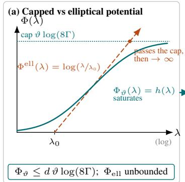

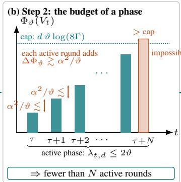

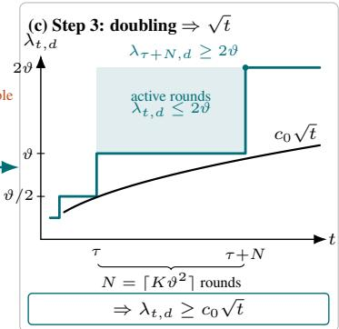  
Figure 1: The three steps of the proof of Theorem 4.3 in the unit-ball case.

Step 1. We first define a logarithmically capped potential, rather than the usual elliptical potential (denoted by $\Phi _ { \mathrm { e l l } }$ in Figure 1). Fix a reference scale $\vartheta > 0$ and let $\Gamma \geq 1$ (with a specific value of Γ fixed in Section D.3).

Definition 5.1 (Capped potential). For the scale ϑ, set $L : = 8 \Gamma \vartheta$ and define, for every $V \succeq 0 ,$

$$
\Phi _ { \vartheta } ( V ) : = \mathrm { t r } \ h ( V ) , \qquad h ( \lambda ) : = \vartheta \log \left( \frac { L \left( \lambda + \vartheta \right) } { \vartheta \left( \lambda + L \right) } \right) , \qquad \lambda \geq 0 .\tag{2}
$$

The map $\Phi _ { \vartheta }$ sends positive semidefinite matrices to R and is a rescaled trace in which each eigenvalue is counted through h. It can alternatively be expressed as a difference of ϑ- and L-regularised log-determinants,

$$
\Phi _ { \vartheta } ( V ) = \vartheta \big ( \log \operatorname* { d e t } ( V + \vartheta \mathbf { I } ) - \log \operatorname* { d e t } ( V + 8 \Gamma \vartheta \mathbf { I } ) + d \log ( 8 \Gamma ) \big ) ,
$$

where the additive constant d log(8Γ) ensures that $\Phi _ { \vartheta } ( 0 ) = 0$ . The growths of the two logdeterminant terms along directions of V that significantly exceed 8Γϑ essentially cancel out, so that the potential is capped; indeed

$$
0 \leq \Phi _ { \vartheta } ( V ) \leq d \vartheta \log ( 8 \Gamma ) \qquad \mathrm { f o r e v e r y } V \leq 0 .
$$

Step 2. After a burn-in of polylogarithmic length $T _ { B }$ (see Definition D.10), on the event $\mathcal { E } ,$ the whole set $\mathcal { C } _ { t } ( \alpha )$ lies in the neighbourhood $\{ \theta : \| \overline { { \theta } } - \theta ^ { \star } \| \leq \| \theta ^ { \star } \| / 2 \}$ (Proposition D.8). In particular, $\begin{array} { r } { \frac 1 2 \| \theta ^ { \star } \| \le \| \dot { \theta } \| \le \frac 3 2 \| \theta ^ { \star } \| } \end{array}$ for all $\theta \in \mathcal { C } _ { t } ( \alpha ) $ , and the played arms satisfy $\langle x _ { t } , x ^ { \star } \rangle \geq 1 / 2$ for every $t \geq T _ { B }$ . Since $x _ { t } \in \mathbb { B } _ { 2 } ^ { d } ( 1 )$ ,

$$
\| \theta _ { t } \| = \langle \hat { \theta } _ { t } , x _ { t } \rangle + \alpha \| x _ { t } \| _ { V _ { t } ^ { - 1 } } \leq \| \hat { \theta } _ { t } \| + \alpha \| x _ { t } \| _ { V _ { t } ^ { - 1 } } \implies \alpha \| x _ { t } \| _ { V _ { t } ^ { - 1 } } \geq \| \theta _ { t } \| - \| \hat { \theta } _ { t } \| ,
$$

where the equality follows from the definition of $( x _ { t } , \theta _ { t } )$ together with $x _ { t } = \theta _ { t } / \lVert \theta _ { t } \rVert$ . Next, by definition, $\hat { \theta } _ { t } \pm \alpha v _ { t , d } / \sqrt { \lambda _ { t , d } } \in \mathcal { C } _ { t } ( \alpha )$ , and since $\theta _ { t }$ maximises the norm over $\mathcal { C } _ { t } ( \alpha )$ , averaging over the two signs gives

$$
\| \theta _ { t } \| ^ { 2 } \geq \frac { 1 } { 2 } \| \hat { \theta } _ { t } + \frac { \alpha } { \sqrt { \lambda _ { t , d } } } v _ { t , d } \| ^ { 2 } + \frac { 1 } { 2 } \| \hat { \theta } _ { t } - \frac { \alpha } { \sqrt { \lambda _ { t , d } } } v _ { t , d } \| ^ { 2 } = \| \hat { \theta } _ { t } \| ^ { 2 } + \frac { \alpha ^ { 2 } } { \lambda _ { t , d } } .
$$

Combining the above with the previous display, we have

$$
\alpha \| x _ { t } \| _ { V _ { t } ^ { - 1 } } \geq \| \theta _ { t } \| - \| \hat { \theta } _ { t } \| = \frac { \| \theta _ { t } \| ^ { 2 } - \| \hat { \theta } _ { t } \| ^ { 2 } } { \| \theta _ { t } \| + \| \hat { \theta } _ { t } \| } \geq \frac { \alpha ^ { 2 } } { 3 \| \theta ^ { \star } \| \lambda _ { t , d } } ,
$$

where the last inequality uses that $\theta _ { t } , \hat { \theta } _ { t } \in \mathcal { C } _ { t } ( \alpha )$ , so that $\lVert { \boldsymbol { \theta } } _ { t } \rVert + \lVert \hat { { \boldsymbol { \theta } } } _ { t } \rVert \leq 3 \lVert { \boldsymbol { \theta } } ^ { \star } \rVert$ by assumption.

Fix a time-step τ and let $\vartheta : = \lambda _ { \tau , d } ,$ the smallest eigenvalue at round $\tau ,$ , and let $\tau ^ { \prime }$ be the last time-step for which $\bar { \lambda } _ { t , d } \overset { \bar { } } { \leq } 2 \vartheta$ . Call $t \in [ \tau , \tau ^ { \prime } ]$ the active time-steps.

We show in Lemma D.11 that for every round $t \geq \tau$

$$
\Phi _ { \vartheta } ( V _ { t + 1 } ) - \Phi _ { \vartheta } ( V _ { t } ) \geq \frac { \vartheta } { 4 } \sum _ { \stackrel { i \geq 2 } { \lambda _ { t , i } < \Gamma \vartheta } } \frac { x _ { t , i } ^ { 2 } } { \lambda _ { t , i } } ,
$$

a straightforward algebraic bound. Now, using our inequality on $\alpha \lVert x _ { t } \rVert _ { V _ { t } ^ { - 1 } }$

$$
\frac { x _ { t , 1 } ^ { 2 } } { \lambda _ { t , 1 } } + \ \sum _ { i \geq 2 } \ \frac { x _ { t , i } ^ { 2 } } { \lambda _ { t , i } } + \ \sum _ { i \geq 2 } \ \frac { x _ { t , i } ^ { 2 } } { \lambda _ { t , i } } = \Vert x _ { t } \Vert _ { V _ { t } ^ { - 1 } } ^ { 2 } \ \geq \ \frac { \alpha ^ { 2 } } { 9 \Vert \theta ^ { \star } \Vert ^ { 2 } \lambda _ { t , d } ^ { 2 } }\tag{3}
$$

If we show that the first two terms are small relative to the lower bound, we can conclude that

$$
\Phi _ { \vartheta } ( V _ { t + 1 } ) - \Phi _ { \vartheta } ( V _ { t } ) \gtrsim \frac { \vartheta \alpha ^ { 2 } } { \Vert \theta ^ { \star } \Vert ^ { 2 } \lambda _ { t , d } ^ { 2 } } ,\tag{4}
$$

where $\gtrsim$ denotes inequality up to absolute constants; this is precisely what is established in Lemma D.12 and Corollary D.13. Indeed, let $T _ { B }$ denote the first time-step after the burn-in, which ensures that $\langle x _ { t } , x ^ { \star } \rangle \geq 1 / \overset { \cdot } { 2 }$ for every $t \geq T _ { B }$ , and assume $t \geq 2 T _ { B }$ . Then

$$
\lambda _ { t , 1 } \geq \| x ^ { \star } \| _ { V _ { t } } ^ { 2 } \geq \sum _ { s = T _ { B } } ^ { t - 1 } \langle x _ { s } , x ^ { \star } \rangle ^ { 2 } \geq \frac { t - T _ { B } } { 4 } \geq \frac { t } { 8 } \implies \frac { x _ { t , 1 } ^ { 2 } } { \lambda _ { t , 1 } } \leq \frac { 1 } { \lambda _ { t , 1 } } \leq \frac { 8 } { t } .
$$

The upper bound $8 / t$ is negligible relative to the lower bound of equation 3 as long as $\lambda _ { t , d } =$ $o ( \sqrt { t } )$ ; and once that is no longer true, the conclusion of the theorem already holds at round $t .$ For the remaining term, a less immediate argument (step (b) of the proof of Lemma D.12) yields $\begin{array} { r } { \sum _ { i \geq 2 } x _ { t , i } ^ { 2 } \leq C _ { T } \Big | \lambda _ { t , d } , } \end{array}$ where $C _ { T } > 0$ is polylogarithmic in $T ,$ , and so

$$
\sum _ { \stackrel { i \geq 2 } { \lambda _ { t , i } \geq \Gamma \vartheta } } \frac { x _ { t , i } ^ { 2 } } { \lambda _ { t , i } } \leq \frac { 2 C _ { T } } { \Gamma \lambda _ { t , d } ^ { 2 } } .
$$

The choice of Γ is precisely what makes this upper bound small relative to the lower bound of (3).

Step 3. Set $N : = \lceil K \vartheta ^ { 2 } \rceil$ with $K \gtrsim d \log ( 8 \Gamma ) / \alpha ^ { 2 }$ , and suppose that all rounds $\tau , \dots , \tau + N - 1$ are active. By equation 4 with $\lambda _ { t , d } \leq 2 \vartheta$ , each of them increases the potential by $\gtrsim \alpha ^ { 2 } / \vartheta$ (absorbing $\| \theta ^ { \star } \|$ into the constant), hence

$$
\Phi _ { \vartheta } ( V _ { \tau + N } ) - \Phi _ { \vartheta } ( V _ { \tau } ) \gtrsim N \frac { \alpha ^ { 2 } } { \vartheta } > \frac { d \log ( 8 \Gamma ) } { \alpha ^ { 2 } } \vartheta ^ { 2 } \cdot \frac { \alpha ^ { 2 } } { \vartheta } = d \vartheta \log ( 8 \Gamma ) ,
$$

which, for a suitable choice of $K .$ , exceeds the cap $d \vartheta \log ( 8 \Gamma )$ of the potential: a contradiction. Hence the active phase ends before round $\tau + N$ , i.e. the smallest eigenvalue doubles within $N =$ $O ( d \vartheta ^ { 2 } \log ( 8 \Gamma ) / \dot { \alpha } ^ { 2 } )$ rounds: $\lambda _ { \tau + N , d } ~ \geq ~ 2 \lambda _ { \tau , d }$ . Finally, a backward induction on the first round t at which $\lambda _ { t , d } < c _ { 0 } \sqrt { t }$ would fail turns this doubling into $\lambda _ { t , d } \geq c _ { 0 } \sqrt { t }$ (see Proposition D.16).

While we chose to illustrate the proof sketch in the unit-ball case, the appendix presents the proof in the general case, in the geometry of $\lVert \cdot \rVert _ { * }$ . The key is a change of variables in the spirit of John’s theorem (see Section D.2): the Euclidean structure needed for the spectral bookkeeping is chosen adapted to $\left\| \cdot \right\| .$ <sub>∗</sub>, so that the two norms are compared only through the distortion $D _ { * } \leq \operatorname* { m i n } \{ \sqrt { d } , \sqrt { M / m } \}$ of the unit ball of $\lVert \cdot \rVert _ { * }$ <sub>∗</sub>, which enters the bounds only inside logarithms.

## 5.2 FROM SPECTRAL GROWTH TO REGRET

The argument has two steps. First, after the polylogarithmic burn-in phase T<sub>B</sub>(see Definition D.10), the parameters $\theta _ { t }$ lie in a neighbourhood of $\theta ^ { \star }$ on which $J _ { \mathcal { X } }$ is comparable to $J _ { \star }$ (Proposition D.8), and the instantaneous regret is controlled by the Bregman divergence of $J _ { \mathcal { X } } ^ { 2 }$ (Lemma E.1):

$$
r _ { t } ~ \le ~ \frac { D _ { J _ { \chi } ^ { 2 } } ( \theta ^ { \star } , \theta _ { t } ) } { J _ { \star } } .
$$

This upper bound does not require $\theta ^ { \star } \in { \mathcal { C } } _ { t } ( \alpha )$ . Second, the divergence is bounded by the width $\omega _ { t } .$ which Theorem 4.3 controls; summing over rounds then bounds the regret directly, and in particular the elliptical potential lemma, with the additional $\sqrt { \log ( T ) }$ factor it introduces, is never used to sum the widths.

In detail, the horizon is split at the burn-in time $T _ { B }$ . Before $T _ { B }$ , the instantaneous regret $r _ { t }$ is bounded by a constant, owing to the boundedness of $\theta ^ { \star }$ and of the action set. From $T _ { B }$ on, the smoothness half of equation 1 and the definition of the confidence sets reduce the divergence to a multiple of $\omega _ { t } ,$ , and Theorem 4.3 bounds the sum of the widths by $2 \sqrt { T } / c _ { 0 }$ . On the event $\mathcal { E } ,$

$$
\begin{array} { r l r l } & { \mathbb { R } _ { T } \leq \mathcal { O } ( | T \mathcal { R } _ { \delta } | ) + \frac { Y } { \epsilon _ { \mathcal { O } } \epsilon _ { \delta } } \frac { \mathcal { D } _ { \mathcal { O } } \epsilon _ { \delta } } { J _ { \epsilon } } } & & { \langle \mathrm { t } , \mathrm { e m m a t . } | \rangle } \\ & { \leq \mathcal { O } ( | T \mathcal { E } ) \rangle \begin{array} { c c } { \displaystyle \frac { M } { 2 } \sum _ { j , j ^ { \prime } \in \mathcal { D } _ { \epsilon } } \sum _ { \ell = 1 } ^ { N } | \mathcal { E } ^ { - } \cdot \mathcal { O } _ { \ell } | ^ { 2 } } & & { \langle \Lambda \mathrm { s u m p l i t ~ o } ( \Lambda \mathcal { D } ) \rangle } \\ { \displaystyle } & { \mathrm { ( A s u m p l i t ~ o } ( \Lambda \mathcal { D } ) ) } \end{array} } \\ & { \leq \mathcal { O } ( | T \mathcal { E } ) + \frac { M } { \mathcal { T } _ { \epsilon } } \frac { \overline { { Y } } } { \epsilon _ { \mathcal { O } } \epsilon _ { \delta } } \left( | \mathcal { E } ^ { - } \cdot \tilde { \partial } _ { \mathfrak { h } } | ^ { 2 } + | \tilde { \partial } _ { \mathfrak { h } } - \mathcal { O } _ { \ell } | ^ { 2 } \right) } & & { \left( ( \alpha + b ) ^ { 2 } \leq 2 \alpha ^ { 2 } + 2 \beta ^ { 2 } \right) } \\ & { \leq \mathcal { O } ( \mathcal { T } \pi ) + \frac { M } { \mathcal { T } _ { \epsilon } } \frac { \overline { { Y } } } { \epsilon _ { \mathcal { O } } \epsilon _ { \delta } } \frac { \overline { { Y } } } { \epsilon _ { \mathcal { O } } \epsilon _ { \delta } } } & & { \left( \bar { \rho } ^ { \epsilon } < \mathcal { C } _ { \epsilon } ( \mathcal { D } ) , \tilde { \rho } _ { \epsilon } \in \mathcal { C } _ { \epsilon } ( \mathfrak { M } ) \right) } \\ &  \leq \mathcal { O } ( T \pi ) + \frac  M ( \sigma _ { \epsilon } ^ { 2 } + \beta ^ \end{array}
$$

where the last step uses $c _ { 0 } = \Omega ( m \alpha / ( J _ { \star } \sqrt { d } ) )$ and $T _ { B } = \mathcal { O } ( \mathrm { p o l y } ( \log T ) )$ ).

## 6 CURVATURE MATTERS: A FAILURE CASE

Theorems 4.2 and 4.3 hold for every radius $\alpha \ > \ 0 ,$ and Section 5 explained what the curvature imposed by Assumption (A2) does for the algorithm: a perturbation of the optimistic parameter is transmitted to the played arm. On a body with a corner this transmission stops, and the next proposition shows that the conclusion of Theorems 4.2 and $\bar { 4 . 3 }$ then fails for every small radius: α-LinUCB locks on a suboptimal vertex with probability bounded away from zero, the design matrix does not grow, and the regret is linear. The instance is the simplest possible (presented in Figure $2 ) \colon$ in $\mathbb { R } ^ { 2 }$ , with canonical basis $( e _ { 1 } , e _ { 2 } )$ , for $a \in ( 0 , 1 )$ , let

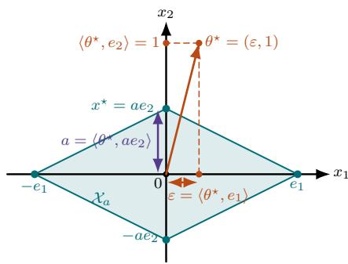  
Figure 2: Counter-example.

$$
\begin{array} { r } { \mathcal { X } _ { a } : = \mathrm { c o n v } \{ e _ { 1 } , - e _ { 1 } , a e _ { 2 } , - a e _ { 2 } \} , \qquad \theta ^ { \star } : = ( \varepsilon , 1 ) \quad \mathrm { w i t h } \ 0 < \varepsilon < a , \qquad \eta _ { t } \stackrel { \mathrm { i : i . d . } } { \sim } \mathcal { N } ( 0 , \mu ^ { 2 } ) , } \end{array}
$$

where conv denotes the convex hull; that is, $\mathcal { X } _ { a }$ is the diamond with vertices $\pm e _ { 1 }$ and $\pm a e _ { 2 }$

The set $\mathcal { X } _ { a }$ is a convex body containing the origin in its interior and contained in $\mathbb { B } _ { 2 } ^ { 2 } ( 1 )$ , whose support function is $J _ { \mathcal { X } _ { a } } ( \theta ) \overset { \cdot } { = } \operatorname* { m a x } \{ | \theta _ { 1 } | , \overset { \cdot } { , } a | \theta _ { 2 } | \}$ for $\theta = ( \theta _ { 1 } , \theta _ { 2 } ) ;$ ; it violates Assumption $( \mathbf { A } 2 )$ at its four corners and four flat faces (Figure 4(b)). The optimal arm is $x ^ { \star } = a e _ { 2 }$ , with $J _ { \star } = a .$ , and the gap of the two vertices ±e<sub>1</sub> is $\Delta : = a - \varepsilon > 0$

Proposition 6.1 (Linear regret on a polytope). In the instance above, for every $\lambda _ { 0 } > 0 ,$ every horizon T and every radius

$$
0 < \alpha \leq \alpha _ { 0 } : = \frac { ( 1 - a ^ { 2 } ) \sqrt { \lambda _ { 0 } } } { 2 a } \varepsilon ,
$$

with probability at least

$$
p _ { 0 } : = \frac { 1 } { 2 } \Big ( 1 - \exp \Big ( - \frac { ( 1 - a ^ { 2 } ) \lambda _ { 0 } \varepsilon ^ { 2 } } { 2 a ^ { 2 } \mu ^ { 2 } } \Big ) \Big ) > 0 ,
$$

α-LinUCB plays $x _ { t } \in \{ e _ { 1 } , - e _ { 1 } \}$ at every round $t \in [ T ]$ . On this event $\lambda _ { \operatorname* { m i n } } ( V _ { t } ) = \lambda _ { 0 } f o r a l l t$ and $\mathcal { R } _ { T } \geq \Delta T ,$ ; in particular $\mathbb { E } [ \mathcal { R } _ { T } ] \geq p _ { 0 } \Delta T$

The proof is given in Section B.1. For instance, $a = 1 / 2 , \varepsilon = 1 / 4 , \lambda _ { 0 } = 1$ and Gaussian noise with $\mu = 1 / 8$ give $p _ { 0 } > 0 . 4 9 \colon$ for every $\alpha \leq 3 / 1 6 .$ half of the runs never play the optimal arm and suffer $\mathcal { R } _ { T } \geq T / 4$ . The curvature imposed by Assumption (A2) is precisely what excludes such lock-ins, however small the radius; we do not claim that it is necessary, only sufficient for our analysis.

## 7 NUMERICAL SIMULATIONS

While the contribution of this paper is mainly theoretical, we corroborate our results with simulations. We run α-LinUCB on the unit ball for $d = 1 0 , \theta ^ { \star } = 1 _ { d } / \sqrt { d } .$ , Gaussian noise, $\beta = 2 0$ and $T = 1 6 { , } 3 0 0 { }$ , with $\alpha \in \{ \beta / 2 5 6 , \beta / 6 4 , \beta / 1 6 , \beta / 4 , \beta , 2 \beta \}$ . For each α we run 48 independent replications with the same noise streams, and report in Figure 3 the mean of the pseudo-regret $\mathcal { R } _ { t } ,$ , of $\lambda _ { \operatorname* { m i n } } ( V _ { t + 1 } )$ and of the failure frequency of the confidence set, ${ \theta } ^ { \star } \notin \mathcal { C } _ { t } ( \alpha )$ , with pointwise approximate 95% confidence intervals shaded.

In accordance with Theorem 4.2, the regret scales as $\sqrt { t }$ for every α (panel (a)), and the lowest regret is attained at $\alpha = \beta / 4$ , not at the valid radius $\beta \colon$ the latter minimises the bound, not the regret. In accordance with Theorem $4 . 3 , \lambda _ { \operatorname* { m i n } } ( V _ { t + 1 } )$ grows like $\sqrt { t }$ for every $\alpha ,$ with a constant increasing in α (panel (b)). Panel (c) confirms that the sets are invalid for small radii: for $\alpha \leq \beta / .$ 16 the confidence set fails at almost every round, whereas it never fails for $\alpha \in \{ \beta , 2 \beta \}$ . Finally, panel (d) shows that the trade-off between regret and validity is best at $\alpha = \beta / 4 \mathrm { : }$ its set fails in about three quarters of the rounds, yet it achieves ≈ 40% less regret than $\alpha = \beta$

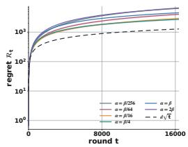  
(a) Regret

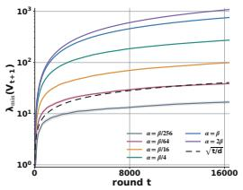  
(b) Minimum eigenvalue

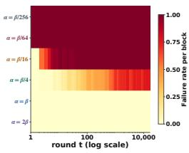  
(c) Confidence failures

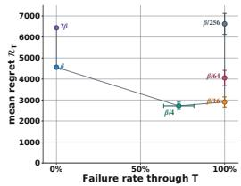  
(d) Failure frequency vs. regret

Figure 3: Effect of the confidence radius on the Euclidean unit ball for $d = 1 0 , \beta = 2 0$ , and $T \stackrel { - } { = } 1 6 { , } 3 0 0$ , with $\alpha \in \{ \beta / 2 5 6 , \beta / 6 4 , \beta / 1 6 , \beta / 4 , \beta , 2 \beta \}$ . Curves average 48 independent runs; shaded bands are pointwise 95% confidence intervals for their means. The dashed guides in (a) and (b) show $d { \sqrt { t } }$ and $\sqrt { t / d }$ without fitted constants; they are not finite-time bounds. In (c), a failure means $\theta ^ { \star } \notin C _ { t } ( \alpha )$ , and color shows its frequency in each time block. In (d), bars show pointwise 95% confidence intervals for run means.

## CONCLUSION

This paper studied the α-LinUCB family of algorithms for stochastic linear bandits, in which the exploration radius α is treated as a free parameter rather than as a statistical confidence width. Under a curvature assumption on the action set, we established a sublinear regret bound that holds for every $\alpha > 0$ , irrespective of whether $\mathcal { C } _ { t } ( \alpha )$ is a valid confidence set. The bound rests on a fine-grained analysis of the spectral growth of the design matrix, which shows that α-LinUCB explores every direction at a rate that we quantify explicitly. This analysis serves two purposes. It substitutes for the optimism inequality, which is no longer guaranteed once ${ \theta } ^ { \star } \notin \mathcal { C } _ { t } ( \bar { \alpha } )$ , and thereby extends the guarantee to arbitrary radii; and it circumvents the elliptical potential lemma, thereby improving by a factor $\sqrt { \log ( T ) }$ the best known regret bound for standard LinUCB.

A single factor $\sqrt { \log ( T ) }$ nonetheless separates our bound from the $\Omega ( d \sqrt { T } )$ lower bound, and it is now inherited from the concentration inequality for the adaptive design alone. While Lattimore (2023) rules out the removal of this factor in the general adaptive case, it may still be possible to dispense with it within the family of algorithms considered here, now that the dynamics of the algorithm, and the rate at which each direction of the design matrix grows, are better understood. This question is both interesting and far from straightforward, and we leave it for future work.

## AI USE STATEMENT

In this work, we used generative AI tools to edit the manuscript for readability and to check spelling, grammar, and the consistency of notation and citations. We have not used generative AI tools to develop theoretical models or conceptual frameworks, formulate mathematical claims, provide ingredients for or write proofs, propose or refine hypotheses, design or provide feedback on the methodology or experiments, implement methods, or interpret results; the remaining tasks with required disclosure (generating synthetic data, translation, dataset cleaning, and qualitative data analysis) are not applicable to this work. We have reviewed all AI-assisted work: every suggested edit was checked by the authors against the original text and the mathematical content. We take responsibility for the final content of this work, including text, claims, or artifacts produced with the aid of generative AI.

## REPRODUCIBILITY STATEMENT

This work is primarily theoretical. All assumptions required to derive our results are precisely stated and discussed in the main text (Assumptions (A1) and (A2)). Proof sketches are provided in the main text, and complete proofs are included in the appendices. The full protocol of the simulations (instance, parameters, number of replications) is specified in Section 7.

## REFERENCES

Yasin Abbasi-Yadkori, David P ´ al, and Csaba Szepesv ´ ari. Improved algorithms for linear stochastic´ bandits. In Advances in Neural Information Processing Systems, 2011.

Marc Abeille and Alessandro Lazaric. Linear Thompson sampling revisited. In Proceedings of the 20th International Conference on Artificial Intelligence and Statistics, 2017.

Marc Abeille, David Janz, and Ciara Pike-Burke. When and why randomised exploration works (in linear bandits). In Proceedings of the 36th International Conference on Algorithmic Learning Theory, 2025.

Shipra Agrawal and Navin Goyal. Thompson sampling for contextual bandits with linear payoffs. In Proceedings ofthe 30th International Conference on Machine Learning, 2013.

A. D. Alexandrov. Almost everywhere existence of the second differential of a convex function and some properties of convex surfaces connected with it. Leningrad State University Annals [Uchenye Zapiski], Mathematical Series, 6:3–35, 1939. In Russian.

Debangshu Banerjee, Avishek Ghosh, Sayak Ray Chowdhury, and Aditya Gopalan. Exploration in linear bandits with rich action sets and its implications for inference. In Proceedings of the 26th International Conference on Artificial Intelligence and Statistics, 2023.

Hamsa Bastani, Mohsen Bayati, and Khashayar Khosravi. Mostly exploration-free algorithms for contextual bandits. Management Science, 67(3):1329–1349, 2021.

Amir Beck. First-Order Methods in Optimization. Society for Industrial and Applied Mathematics, 2017.

Varsha Dani, Thomas P. Hayes, and Sham M. Kakade. Stochastic linear optimization under bandit feedback. In Proceedings of the 21st Annual Conference on Learning Theory, 2008.

Yash Deshpande, Lester Mackey, Vasilis Syrgkanis, and Matt Taddy. Accurate inference for adaptive linear models. In Proceedings ofthe 35th International Conference on Machine Learning, 2018.

Lawrence C. Evans and Ronald F. Gariepy. Measure Theory and Fine Properties of Functions. CRC Press, Boca Raton, FL, revised edition, 2015.

Hamish Flynn, David Reeb, Melih Kandemir, and Jan R. Peters. Improved algorithms for stochastic linear bandits using tail bounds for martingale mixtures. In Advances in Neural Information Processing Systems, 2023.

Botao Hao, Tor Lattimore, and Csaba Szepesvari. Adaptive exploration in linear contextual bandit.´ In Proceedings of the 23rd International Conference on Artificial Intelligence and Statistics, 2020.

Ruitong Huang, Tor Lattimore, Andras Gy´ orgy, and Csaba Szepesv¨ ari. Following the leader and´ fast rates in linear prediction: Curved constraint sets and other regularities. In Advances in Neural Information Processing Systems, 2016.

Sampath Kannan, Jamie Morgenstern, Aaron Roth, Bo Waggoner, and Zhiwei Steven Wu. A smoothed analysis of the greedy algorithm for the linear contextual bandit problem. In Advances in Neural Information Processing Systems, 2018.

Koulik Khamaru, Yash Deshpande, Tor Lattimore, Lester Mackey, and Martin J. Wainwright. Nearoptimal inference in adaptive linear regression. The Annals ofStatistics, 53(6):2329–2355, 2025.

Tze Leung Lai and Ching Zong Wei. Least squares estimates in stochastic regression models with applications to identification and control of dynamic systems. The Annals of Statistics, 10(1): 154–166, 1982.

Tor Lattimore. A lower bound for linear and kernel regression with adaptive covariates. In Proceedings ofthe 36th Conference on Learning Theory, 2023.

Tor Lattimore and Csaba Szepesvari. The end of optimism? an asymptotic analysis of finite-armed´ linear bandits. In Proceedings of the 20th International Conference on Artificial Intelligence and Statistics, 2017.

Tor Lattimore and Csaba Szepesvari.´ Bandit Algorithms. Cambridge University Press, 2020.

Lihong Li, Wei Chu, John Langford, and Robert E. Schapire. A contextual-bandit approach to personalized news article recommendation. In Proceedings of the 19th International Conference on World Wide Web, 2010.

Licong Lin, Mufang Ying, Suvrojit Ghosh, Koulik Khamaru, and Cun-Hui Zhang. Statistical limits of adaptive linear models: Low-dimensional estimation and inference. In Advances in Neural Information Processing Systems, 2023.

Samya Praharaj and Koulik Khamaru. Avoiding the price of adaptivity: Inference in linear contextual bandits via stability. arXiv:2512.20368v2, 2026.

Manish Raghavan, Aleksandrs Slivkins, Jennifer Wortman Vaughan, and Zhiwei Steven Wu. Greedy algorithm almost dominates in smoothed contextual bandits. SIAM Journal on Computing, 52(2): 487–524, 2023.

R. Tyrrell Rockafellar and Roger J.-B. Wets. Variational Analysis. Springer, 1998.

Paat Rusmevichientong and John N. Tsitsiklis. Linearly parameterized bandits. Mathematics of Operations Research, 35(2):395–411, 2010.

Rolf Schneider. Convex Bodies: The Brunn–Minkowski Theory. Cambridge University Press, 2 edition, 2014.

Andrea Tirinzoni, Matteo Pirotta, Marcello Restelli, and Alessandro Lazaric. An asymptotically optimal primal-dual incremental algorithm for contextual linear bandits. In Advances in Neural Information Processing Systems, 2020.

Jean Ville. Etude critique de la notion de collectif <sup>´</sup> . PhD thesis, Universite de Paris, 1939.´

Mufang Ying, Koulik Khamaru, and Cun-Hui Zhang. Adaptive linear estimating equations. In Advances in Neural Information Processing Systems, 2023.

## APPENDIX CONTENTS

A Self-normalised bound for adaptive designs 14   
B Further properties of the action set 14   
B.1 Failure case 16   
C Pseudo-code of α-LinUCB . 17   
D Spectral growth 18   
D.1 Preliminary results 18   
D.2 Geometric distortion and adapted coordinates 20   
D.3 Definition of the constants 22   
D.4 Exploration engine, burn-in and crude bound . . . 23   
D.5 Proof of Theorem 4.3 . 27   
E Regret of α-LinUCB . 31   
E.1 Regret decomposition. 31   
E.2 Proof of Theorem 4.2 31

## A SELF-NORMALISED BOUND FOR ADAPTIVE DESIGNS

Proposition 4.1 (Confidence event; Abbasi-Yadkori et al., 2011). Let Assumption (A1) hold, let $\| \theta ^ { \star } \| _ { 2 } \leq S ^ { \star }$ and $\mathcal { X } \subseteq \mathbb { B } _ { 2 } ^ { d } ( 1 )$ , and let $\widehat { \theta } _ { t }$ be the ridge estimate with regularisation $\lambda _ { 0 } > 0$ . Fix a horizon T and a confidence level $\delta \in ( 0 , 1 )$ , and define

$$
\begin{array} { r l } & { \displaystyle \beta : = \mu \sqrt { 2 \log \left( \frac { 1 } { \delta } \right) + d \log \left( \left( 1 + \frac { T } { d \lambda _ { 0 } } \right) \right) } + \sqrt { \lambda _ { 0 } } S ^ { \star } , } \\ & { \displaystyle \xi : = \Big \{ \| \hat { \theta } _ { t } - \theta ^ { \star } \| _ { V _ { t } } \leq \beta f o r a l l t \in [ T ] \Big \} . } \end{array}
$$

Then $\mathbb { P } ( \mathcal { E } ) \geq 1 - \delta .$

Proposition 4.1 is Theorem 2 of Abbasi-Yadkori et al. (2011), applied with noise parameter $\mu , \quad \| x _ { s } \| _ { 2 } \quad \leq \quad 1$ , regularisation $\lambda _ { 0 }$ and $\begin{array} { r l r } { \| \theta ^ { \star } \| _ { 2 } } & { { } \leq } & { S ^ { \star } } \end{array}$ ; the radius there is $\mu \sqrt { 2 \log ( ( 1 / \delta ) ) + \log ( ( \operatorname* { d e t } \left( V _ { t } \right) / \operatorname* { d e t } \left( \lambda _ { 0 } \mathbf { I } \right) ) ) } + \sqrt { \lambda _ { 0 } } S ^ { \star }$ , and det $( V _ { t } ) \leq ( \lambda _ { 0 } + t / d ) ^ { d }$ (since tr $V _ { t } \leq$ $d \lambda _ { 0 } + t )$ gives the horizon-dependent radius above. We comment on the role of this result in our analysis.

Adaptive design. The covariates $x _ { 1 } , x _ { 2 } , \ldots .$ . are not fixed in advance: $x _ { t }$ is chosen by the algorithm as a function of the past rewards, so that $( x _ { s } ) _ { s \leq t }$ and $( \eta _ { s } ) _ { s \leq t }$ are dependent and the classical confidence sets of fixed-design least squares, of radius $\ l \ l \asymp \mu \sqrt { d }$ with high probability, are not available. The bound of Abbasi-Yadkori et al. (2011) handles the sequential design through a self-normalised martingale inequality (the method of mixtures): the quantity $\begin{array} { r } { \| \sum _ { s < t } { x _ { s } \eta _ { s } } \| _ { V _ { \star } ^ { - 1 } } } \end{array}$ is controlled simultaneously for all t, whatever the dependence of $x _ { s }$ on the past, at the price of the log det $V _ { t } \leq d \log ( ( 1 + t / ( d \lambda _ { 0 } ) ) )$ term, i.e. of the factor $\sqrt { \log ( T ) }$ in $\beta \asymp \sqrt { d \log ( T ) }$ . This is the price ofadaptivity: it cannot be removed in general, since Lattimore (2023) shows that the bound is unimprovable for adversarially adaptive designs, and the same phenomenon governs estimation and inference from adaptively collected data (Khamaru et al., 2025; Lin et al., 2023). Sharper radii are known only under additional structure on the design, such as the stability condition of Lai & Wei (1982), i.e. convergence of the normalised covariance to a deterministic limit; we do not use such refinements, and the radius $\beta$ of Proposition 4.1 is the one that enters Theorems 4.2 and 4.3.

How the event is used. The event $\mathcal { E }$ is the only probabilistic input of the paper: every statement of Sections D and E is deterministic on $\mathcal { E } ,$ and the algorithm itself never uses $\beta .$ Its role is purely analytical, to locate $\theta ^ { \star }$ within $\left\| \cdot \right\| _ { V _ { t } }$ -distance $\beta$ of the estimate, which the width $\omega _ { t }$ converts into the ∥·∥<sub>∗</sub>-distance $\beta \omega _ { t } ^ { 1 / 2 }$ (Proposition D.2); the set $\mathcal { C } _ { t } ( \alpha )$ used by α-LinUCB may be smaller or larger than $\mathcal { C } _ { t } ( \beta )$ . We take $\beta$ horizon-dependent for simplicity; the anytime radius $\beta _ { t }$ with $\log ( \left( \operatorname * { d e t } \mathsf { \bar { \Psi } } ( V _ { t } ) / \operatorname * { d e t } \left( \operatorname * { \ddot { \lambda } } _ { 0 } \mathbf { \bar { I } } \right) \right) )$ ) in place of $d \log ( ( 1 \stackrel { . } { + } T / ( d \lambda _ { 0 } ) ) )$ ) can be used instead, at the cost of carrying a nondecreasing $\beta _ { t }$ through the burn-in constants.

## B FURTHER PROPERTIES OF THE ACTION SET

Consequences of Assumption (A2). Setting $\theta ^ { \prime } = 0$ in equation 1 yields $\begin{array} { r } { \frac { m } { 2 } \| v \| _ { * } ^ { 2 } \leq J _ { \mathcal { X } } ( v ) ^ { 2 } \leq } \end{array}$ $\textstyle { \frac { M } { 2 } } \| v \| _ { * } ^ { 2 }$ . Consequently, for $\theta ^ { \star } \neq 0$ , the scalars

$$
\begin{array} { r l } & { \ell _ { * } : = \displaystyle \operatorname* { s u p } _ { x \in \mathcal { X } } \| x \| _ { * } ^ { \circ } , J _ { \star } : = J _ { \mathcal { X } } ( \theta ^ { \star } ) , \varrho _ { * } : = J _ { \star } / \| \theta ^ { \star } \| _ { * } } \\ & { \mathrm { ~ s a t i s f y ~ } J _ { \star } > 0 , \sqrt { m / 2 } \le \varrho _ { * } \le \| x ^ { \star } \| _ { * } ^ { \circ } \le \ell _ { * } \le \sqrt { M / 2 } , } \end{array}\tag{5}
$$

where $x ^ { \star } : = \nabla J _ { \mathcal { X } } ( { \theta } ^ { \star } )$ . In particular, $\mathcal { X }$ is compact and $J _ { \mathcal { X } }$ is ℓ<sub>∗</sub>-Lipschitz with respect $\mathrm { t o } \parallel \cdot \parallel _ { * }$ These quantities enter the analysis only; the algorithm does not require them.

Unit ball and ellipsoids. For $\mathcal { X } = \mathbb { B } _ { 2 } ^ { d } ( 1 )$ , one has $\ell _ { * } = \varrho _ { * } = 1$ and $J _ { \star } = \| \theta ^ { \star } \| _ { 2 }$ . For $\mathcal { X } =$ $\mathbf { A } ^ { 1 / 2 } \mathbb { B } _ { 2 } ^ { d } ( 1 )$ , under the adapted norm $\| u \| _ { * } : = \| \mathbf { A } ^ { 1 / 2 } u \| _ { 2 }$ , one likewise has $\ell _ { * } = \varrho _ { * } = 1$

$C ^ { 2 }$ bodies. A convex body $\mathcal { X } \subseteq \mathbb { B } _ { 2 } ^ { d } ( 1 )$ containing the origin in its interior is a $C ^ { 2 }$ body if its boundary is a $C ^ { 2 }$ hypersurface whose principal radii of curvature lie in $[ r _ { - } , r _ { + } ]$ for some $0 < r _ { - } \le$ $r _ { + } < \infty$ (class $C _ { + } ^ { 2 ^ { \cdot } }$ in Schneider (2014, Sect. 2.5)). Its support function is $C ^ { 2 }$ on $\mathbb { R } ^ { d } \backslash \{ 0 \}$ . For a unit vector u, the Hessian $\nabla ^ { 2 } J _ { \mathcal { X } } ( u )$ vanishes on u (Euler’s relation) and coincides on $u ^ { \perp }$ with the reverse Weingarten map of $\partial \mathcal { X }$ at the point $x = \nabla J _ { x } ( u )$ with outer normal u; its eigenvalues are the principal radii of curvature of $\partial \mathcal { X }$ at x. Since $\ddot { \nabla ^ { 2 } } J _ { \mathcal { X } } ^ { \updownarrow } = 2 J _ { \mathcal { X } } \nabla ^ { 2 } J _ { \mathcal { X } } + 2 \nabla J _ { \mathcal { X } } \nabla \breve { J } _ { \mathcal { X } } ^ { \top }$ with both terms homogeneous of degree zero, writing $u = \theta / \lVert \theta \rVert _ { 2 }$ and $v = a u + w$ with w $\perp u$ gives

$$
\begin{array} { r } { \boldsymbol { v } ^ { \top } \nabla ^ { 2 } J _ { \mathcal { X } } ^ { 2 } ( \boldsymbol { \theta } ) \boldsymbol { v } = 2 J _ { \mathcal { X } } ( \boldsymbol { u } ) \boldsymbol { w } ^ { \top } \nabla ^ { 2 } J _ { \mathcal { X } } ( \boldsymbol { u } ) \boldsymbol { w } + 2 \left. \boldsymbol { x } , \boldsymbol { v } \right. ^ { 2 } , \qquad \quad \boldsymbol { r } _ { - } \| \boldsymbol { w } \| _ { 2 } ^ { 2 } \leq \boldsymbol { w } ^ { \top } \nabla ^ { 2 } J _ { \mathcal { X } } ( \boldsymbol { u } ) \boldsymbol { w } \leq \boldsymbol { r } _ { + } \| \boldsymbol { w } \| _ { 2 } ^ { 2 } . } \end{array}\tag{6}
$$

The first (tangential) term captures the curvature of $\partial \mathcal { X } ;$ the second (radial) term captures the position of the origin, since $\langle x , u \rangle = J _ { \mathcal { X } } ( u )$ is the distance from the origin to the supporting hyperplane with normal u. Let

$$
\rho _ { \operatorname* { m i n } } : = \operatorname* { m i n } _ { \| u \| _ { 2 } = 1 } J _ { \mathcal { X } } ( u ) \in ( 0 , 1 ]
$$

denote the distance from the origin to $\partial { \mathcal { X } } ,$ positive since $\mathcal { X }$ is absorbing and at most one since $\mathcal { X } \subseteq \mathbb { B } _ { 2 } ^ { d } ( 1 )$ . With $\lVert \cdot \rVert _ { * } = \lVert \cdot \rVert _ { 2 }$ , which is self-dual, $\ell _ { * } \leq 1$ and $\varrho _ { * } \geq \rho _ { \mathrm { m i n } }$

Upper bound. Using $J _ { \mathcal { X } } ( u ) \le 1$ and $\left. x , v \right. ^ { 2 } \leq \| v \| _ { 2 } ^ { 2 } ,$

$$
\begin{array} { r } { v ^ { \top } \nabla ^ { 2 } J _ { \mathcal { X } } ^ { 2 } ( \theta ) v \ \leq \ 2 r _ { + } \| w \| _ { 2 } ^ { 2 } + 2 \| v \| _ { 2 } ^ { 2 } \ \leq \ 2 ( r _ { + } + 1 ) \| v \| _ { 2 } ^ { 2 } = : M \| v \| _ { 2 } ^ { 2 } . } \end{array}
$$

Lower bound. Using $J _ { \mathcal { X } } ( u ) \ge \rho _ { \mathrm { m i n } }$ and $| \langle x , v \rangle | \geq \rho _ { \operatorname* { m i n } } | a | - \| w \| _ { 2 }$ ,

$$
v ^ { \top } \nabla ^ { 2 } J _ { \mathcal { X } } ^ { 2 } ( \theta ) v ~ \geq ~ 2 \rho _ { \operatorname* { m i n } } r _ { - } \| w \| _ { 2 } ^ { 2 } + 2 \big ( \rho _ { \operatorname* { m i n } } | a | - \| w \| _ { 2 } \big ) _ { + } ^ { 2 } .
$$

$\mathrm { I f } \parallel \boldsymbol { w } \parallel _ { 2 } \geq \rho _ { \mathrm { m i n } } | a | / 2$ , then $\| v \| _ { 2 } ^ { 2 } \leq 5 \| w \| _ { 2 } ^ { 2 } / \rho _ { \operatorname* { m i n } } ^ { 2 }$ and the first term is at least $\begin{array} { r } { \frac { 2 } { 5 } \rho _ { \mathrm { m i n } } ^ { 3 } r _ { - } \| v \| _ { 2 } ^ { 2 } } \end{array}$ . Otherwise, $\begin{array} { r } { \| v \| _ { 2 } ^ { 2 } \leq \frac { 5 } { 4 } a ^ { 2 } } \end{array}$ and the second term is at least $\begin{array} { r } { \frac { 2 } { 5 } \rho _ { \mathrm { m i n } } ^ { 2 } \Vert v \Vert _ { 2 } ^ { 2 } } \end{array}$ . Hence

$$
v ^ { \top } \nabla ^ { 2 } J _ { \mathcal { X } } ^ { 2 } ( \theta ) v \geq \frac { 2 \rho _ { \operatorname* { m i n } } ^ { 2 } } { 5 } \operatorname* { m i n } \{ 1 , \rho _ { \operatorname* { m i n } } r _ { - } \} \| v \| _ { 2 } ^ { 2 } \geq \frac { \rho _ { \operatorname* { m i n } } ^ { 2 } } { 9 } \operatorname* { m i n } \Big \{ 1 , \frac { \rho _ { \operatorname* { m i n } } r _ { - } } { 3 } \Big \} \| v \| _ { 2 } ^ { 2 } = : m \| v \| _ { 2 } ^ { 2 } ,
$$

. The two-sided bound of Assumption (A2) follows by integrating twice along the segment from $\theta ^ { \prime }$ to $\theta ;$ the segment may pass through the origin, since $J _ { \mathcal { X } } ^ { 2 }$ is $C ^ { 1 }$ on $\mathbb { R } ^ { d }$ (its gradient $\bar { 2 } J _ { \mathcal { X } } \nabla J _ { \mathcal { X } }$ is bounded by $2 \bar { \| \theta \| } _ { 2 }$ and extends continuously by 0 at the origin).

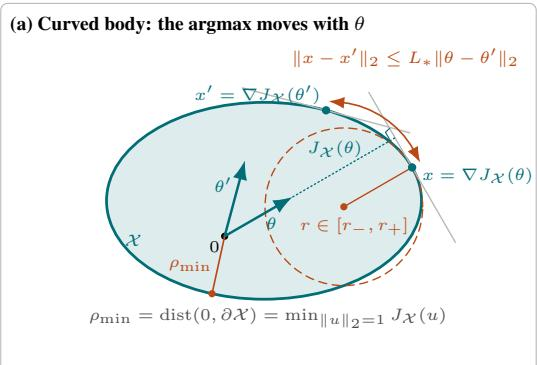

$$
( r _ { \pm } ) ,
$$

$$
\rho _ { \mathrm { m i n } } ^ { 2 }
$$

$$
\theta \neq 0
$$

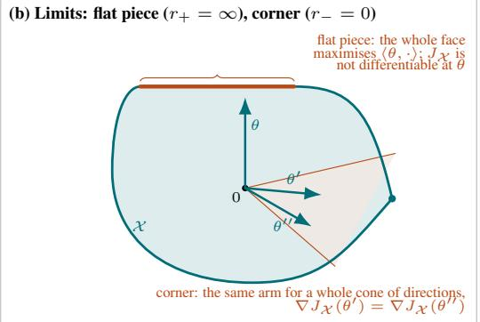  
Flat piece: r<sub>+</sub> = ∞ and $M = \infty$ (the upper bound of equation 1 fails, $J _ { \mathcal { X } } ^ { 2 }$ is not differentiable). Corner: $r _ { - } =$ 0 and $\begin{array} { r } { \begin{array} { r } { m = 0 \stackrel { . } { ( } j _ { \mathcal { X } } } \end{array} } \end{array}$ is linear on the cone, $D _ { J _ { \mathcal { X } } ^ { 2 } }$ vanishes tangentially). A polytope has both.  
Figure 4: Assumption (A2) illustrated (parameter and action spaces superimposed). (a) $\mathbf { A } C ^ { 2 }$ body: each direction θ selects a unique arm $x = \nabla J _ { \mathcal { X } } ( \theta )$ , the point of $\partial \mathcal { X }$ with outer normal θ, which moves Lipschitz-continuously with θ. The radius of curvature $r \in [ r _ { - } , r _ { + } ]$ at x governs the tangen tial term of equation $^ { 6 , }$ and $\rho _ { \mathrm { m i n } }$ its radial term. (b) The two degenerate limits: a flat face $( r _ { + } = \infty$ $M = \infty )$ and a corner $( r _ { - } = 0 , m = 0 )$ .

Role of curvature and excluded geometries. In tangential directions, the Hessian of $J _ { \mathcal { X } } ^ { 2 }$ equals $2 J _ { \mathcal { X } } ( u )$ times the reverse Weingarten map: flat regions $\left( r _ { + } \mathrm { l a r g e } \right)$ inflate M, and sharp regions $( r _ { - }$ small) deflate $m$ . In the radial direction, it equals $2 J _ { \mathcal { X } } ( \dot { u } ) ^ { 2 } \ge 2 \rho _ { \mathrm { m i n } } ^ { 2 } ,$ which deflates m as the origin approaches the boundary, irrespective of curvature $( { \mathrm { F i g u r e } } 4 )$ . The two limits are the excluded cases. A flat face is a direction θ with a whole face of maximisers: $J _ { \mathcal { X } }$ is not differentiable at $\theta ,$ the arm jumps across the face under arbitrarily small perturbations of θ, and $M = \infty . \mathrm { ~ A ~ }$ corner $x _ { k }$ is the common maximiser of a whole cone of directions: on this cone, $J _ { \mathcal { X } } ( \theta ) = \langle \theta , x _ { k } \rangle$ is linear, $\nabla ^ { 2 } J _ { \mathcal { X } } ^ { 2 } = 2 x _ { k } x _ { k } ^ { \top }$ has rank one, $D _ { J _ { \chi } ^ { 2 } } ( \theta , \theta ^ { \prime } ) = { \langle \theta - \theta ^ { \prime } , x _ { k } \rangle } ^ { 2 }$ vanishes for $\theta - \theta ^ { \prime } \perp x _ { k }$ , and $m = 0$ Polytopes and finite arm sets exhibit both. On a $C ^ { 2 }$ body, by contrast, every $\theta \neq 0$ has a unique maximiser, which moves Lipschitz-continuously with θ (Proposition D.3); this allows a perturbation of the optimistic parameter to reach the arm, and is what the energy argument of the proof exploits. The constants are not sharp: for the unit ball, $r _ { \pm } = \rho _ { \mathrm { m i n } } = 1$ and equation 6 equals $\mathbf { \dot { 2 } } \| v \| _ { 2 } ^ { 2 }$ , so that $m = M = 2$ , whereas the bounds above give $m = 2 / 5$ and $M = 4$

## B.1 FAILURE CASE

Proposition 6.1 (Linear regret on a polytope). In the instance above, for every $\lambda _ { 0 } ~ > ~ 0 ,$ , every horizon T and every radius

$$
0 < \alpha \leq \alpha _ { 0 } : = \frac { ( 1 - a ^ { 2 } ) \sqrt { \lambda _ { 0 } } } { 2 a } \varepsilon ,
$$

with probability at least

$$
p _ { 0 } : = \frac { 1 } { 2 } \Big ( 1 - \exp \Big ( - \frac { ( 1 - a ^ { 2 } ) \lambda _ { 0 } \varepsilon ^ { 2 } } { 2 a ^ { 2 } \mu ^ { 2 } } \Big ) \Big ) > 0 ,
$$

α-LinUCB plays $x _ { t } \in \{ e _ { 1 } , - e _ { 1 } \}$ at every round $t \in [ T ]$ . On this event $\lambda _ { \operatorname* { m i n } } ( V _ { t } ) = \lambda _ { 0 }$ for all t and $\mathcal { R } _ { T } \geq \Delta T ;$ in particular E ${ \dot { \left[ { \mathcal { R } } _ { T } \right] } } \geq p _ { 0 } \Delta T$

ProofofProposition 6.1. Step 1: the algorithm plays vertices. For $x \in \mathcal { X } _ { a } , \operatorname* { m a x } _ { \theta \in \mathcal { C } _ { t } ( \alpha ) } \left. x , \theta \right. =$ $\langle x , \hat { \theta } _ { t } \rangle + \alpha \| x \| _ { V _ { t } ^ { - 1 } } = : g _ { t } ( x )$ , so $x _ { t } \in \arg \operatorname* { m a x } _ { \mathcal { X } _ { a } } g _ { t }$ . The function $g _ { t }$ is convex, and strictly convex along every segment not contained in a line through the origin. Its maximum over the polytope is therefore attained at vertices only: a convex function with a maximum at the midpoint of a segment is constant on that segment, and $g _ { t }$ is constant on no segment, so no maximiser lies in the interior of $\mathcal { X } _ { a }$ or in the relative interior of an edge. Since the four vertices lie on the coordinate axes, $V _ { t } = \mathrm { d i a g } ( \lambda _ { 0 } + n _ { t , 1 } , \lambda _ { 0 } + a ^ { 2 } n _ { t , 2 } )$ , where $n _ { t , i }$ is the number of rounds $s < t$ with $x _ { s }$ on the i-th axis, $\begin{array} { r } { \hat { \theta } _ { t , 1 } = ( \lambda _ { 0 } + n _ { t , 1 } ) ^ { - 1 } \sum _ { s < t , x _ { s } = \pm e _ { 1 } } \left. x _ { s } , e _ { 1 } \right. y _ { s } } \end{array}$ , and the four indices are

$$
g _ { t } ( \pm e _ { 1 } ) = \pm \hat { \theta } _ { t , 1 } + \frac { \alpha } { \sqrt { \lambda _ { 0 } + n _ { t , 1 } } } , \qquad g _ { t } ( \pm a e _ { 2 } ) = \pm a \hat { \theta } _ { t , 2 } + \frac { a \alpha } { \sqrt { \lambda _ { 0 } + a ^ { 2 } n _ { t , 2 } } } .
$$

Step 2: a sufficient condition for locking on the first axis. Let $\tilde { \eta } _ { s } : = \langle x _ { s } , e _ { 1 } \rangle \eta _ { s } \mathrm { ~ i f ~ } x _ { s } \in \{ \pm e _ { 1 } \}$ and $\tilde { \eta } _ { s } : = \eta _ { s }$ otherwise, and $\begin{array} { r } { W _ { n } : = \sum _ { s \leq n } \tilde { \eta } _ { s } } \end{array}$ . As $\langle x _ { s } , e _ { 1 } \rangle \in \{ \pm 1 \}$ is $\mathcal { F } _ { s - 1 }$ -measurable and $\eta _ { s } \sim \mathcal { N } ( 0 , \mu ^ { 2 } )$ is independent of $\mathcal { F } _ { s - 1 }$ , the conditional law of $\tilde { \eta } _ { s }$ given $\mathcal { F } _ { s - 1 }$ is $\mathcal { N } ( 0 , \mu ^ { 2 } ) \colon ( \tilde { \eta } _ { s } ) .$ <sub>s</sub> is i.i.d. $\mathcal { N } ( 0 , \mu ^ { 2 } )$ . Suppose that $x _ { s } \in \{ \pm e _ { 1 } \}$ for all $s < t$ and put $n : = t - 1$ . Then $n _ { t , 1 } = n , n _ { t , 2 } = 0$ $\widehat { \theta } _ { t , 2 } = 0$ and, since $\left. x _ { s } , e _ { 1 } \right. y _ { s } = \varepsilon + \tilde { \eta } _ { s }$

$$
\hat { \theta } _ { t , 1 } = \frac { n \varepsilon + W _ { n } } { \lambda _ { 0 } + n } ,
$$

so that $x _ { t } \in \{ \pm e _ { 1 } \}$ as soon as

$$
| \hat { \theta } _ { t , 1 } | + \frac { \alpha } { \sqrt { \lambda _ { 0 } + n } } > \frac { a \alpha } { \sqrt { \lambda _ { 0 } } } ,\tag{7}
$$

the left-hand side being the larger of $g _ { t } ( \pm e _ { 1 } )$ and the right-hand side the common value of $g _ { t } ( \pm a e _ { 2 } )$ For $n < n _ { 0 } : = \lambda _ { 0 } ( a ^ { - 2 } - 1 )$ , equation 7 holds whatever the rewards, because $\alpha / \sqrt { \lambda _ { 0 } + n } >$ $a \alpha / \sqrt { \lambda _ { 0 } } \mathrm { : }$ the bonus of the long vertices alone exceeds the frozen bonus of the short ones. For $n \ge N _ { 0 } : = \lceil n _ { 0 } \rceil$ , equation 7 holds as soon as $\hat { \theta } _ { t , 1 } > a \alpha / \sqrt { \lambda _ { 0 } } ,$ i.e.

$$
W _ { n } + \delta n > c _ { \alpha } , \qquad \delta : = \varepsilon - \frac { a \alpha } { \sqrt { \lambda _ { 0 } } } , \qquad c _ { \alpha } : = a \alpha \sqrt { \lambda _ { 0 } } .
$$

Since $x _ { 1 } \in \{ \pm e _ { 1 } \} ( \mathrm { a t } t = 1 , g _ { 1 } ( \pm e _ { 1 } ) = { \alpha } / { \sqrt { \lambda _ { 0 } } } > a { \alpha } / { \sqrt { \lambda _ { 0 } } } = g _ { 1 } ( \pm a e _ { 2 } ) )$ , an induction on t gives

$$
\big \{ W _ { n } + \delta n > c _ { \alpha } \mathrm { ~ f o r ~ a l l ~ } n \geq N _ { 0 } \big \} \subseteq \big \{ x _ { t } \in \{ \pm e _ { 1 } \} \mathrm { ~ f o r ~ a l l ~ } t \geq 1 \big \} .
$$

Step 3: the probability of the left-hand event. For $\alpha \leq \alpha _ { 0 }$ we have aα $\langle \sqrt { \lambda _ { 0 } } \leq ( 1 - a ^ { 2 } ) \varepsilon / 2$ , hence $\delta \ge \varepsilon / 2$ and, using $( \mathrm { i } - \mathrm { } a ^ { 2 } ) ( \lambda _ { 0 } + N _ { 0 } ) \leq N _ { 0 }$ (which is $N _ { 0 } \geq n _ { 0 } )$ ,

$$
h : = \delta N _ { 0 } - c _ { \alpha } = \varepsilon N _ { 0 } - \frac { a \alpha } { \sqrt { \lambda _ { 0 } } } ( \lambda _ { 0 } + N _ { 0 } ) \ge \varepsilon N _ { 0 } - \frac { ( 1 - a ^ { 2 } ) \varepsilon } { 2 } ( \lambda _ { 0 } + N _ { 0 } ) \ge \frac { \varepsilon N _ { 0 } } { 2 } .
$$

Now $\{ W _ { n } + \delta n > c _ { \alpha } \forall n \geq N _ { 0 } \} \supseteq \{ W _ { N _ { 0 } } \geq 0 \} \cap \{ W _ { N _ { 0 } + k } - W _ { N _ { 0 } } + \delta k > - h \forall k \geq 1 \}$ : on the intersection, $W _ { N _ { 0 } } + \delta N _ { 0 } \ge c _ { \alpha } + h > c _ { \alpha }$ and $W _ { N _ { 0 } + k } \dot { + } \delta ( N _ { 0 } + k ) > \bar { ( } c _ { \alpha } + h ) - h$ . The first event is $\mathcal { F } _ { N _ { 0 } }$ -measurable and has probability $1 / 2 ,$ as $W _ { N _ { 0 } } \sim \mathcal { N } ( 0 , \mu ^ { 2 } N _ { 0 } )$ . For the second, let $\lambda : = 2 \delta / \mu ^ { 2 } ;$ conditionally on $\mathcal { F } _ { N _ { 0 } } , M _ { k } : = \exp \big ( - \lambda ( W _ { N _ { 0 } + k } - W _ { N _ { 0 } } ) - \lambda ^ { 2 } \mu ^ { 2 } k / 2 \big )$ is a nonnegative martingale with $M _ { 0 } = 1$ , and $W _ { N _ { 0 } + k } - W _ { N _ { 0 } } + \delta k \le - h$ implies log $M _ { k } \ge \lambda h + k ( \lambda \delta - \lambda ^ { 2 } \mu ^ { 2 } / 2 ) = \lambda h .$ Ville’s maximal inequality (Ville, 1939) therefore gives

$$
\mathbb { P } \big ( \exists k \ge 1 : W _ { N _ { 0 } + k } - W _ { N _ { 0 } } + \delta k \le - h \big | \mathcal { F } _ { N _ { 0 } } \big ) \le e ^ { - \lambda h } = e ^ { - 2 \delta h / \mu ^ { 2 } } \le e ^ { - \varepsilon ^ { 2 } N _ { 0 } / ( 2 \mu ^ { 2 } ) } \le \exp \Big ( - \frac { ( 1 - a ^ { 2 } ) \lambda _ { 0 } \varepsilon ^ { 2 } } { 2 a ^ { 2 } \mu ^ { 2 } } \Big ) ,
$$

using $N _ { 0 } \geq n _ { 0 } = ( 1 - a ^ { 2 } ) \lambda _ { 0 } / a ^ { 2 }$ . Multiplying by $\mathbb { P } ( W _ { N _ { 0 } } \ge 0 ) = 1 / 2$ gives the probability $p _ { 0 }$ Step 4: consequences. On the locking event, $\boldsymbol { x _ { s } x _ { s } ^ { \intercal } } = e _ { 1 } e _ { 1 } ^ { \intercal }$ for every s, so $V _ { t } = \mathrm { d i a g } ( \lambda _ { 0 } + t - 1 , \lambda _ { 0 } )$ and $\lambda _ { \operatorname* { m i n } } ( V _ { t } ) = \lambda _ { 0 } ;$ and $\langle \theta ^ { \star } , x ^ { \star } - x _ { t } ^ { \top } \rangle = a \mp \varepsilon \geq \Delta$ at every round, so $\mathcal { R } _ { T } \geq \Delta T$ 口

## C PSEUDO-CODE OF α-LINUCB

Algorithm 1 summarises the algorithm analysed in this paper; we briefly comment on its steps, complementing the description given in Section 1.

```perl
Algorithm 1: α-LinUCB
1 Input: Action set X, horizon T, regularization parameter $\lambda _ { 0 } > 0 ,$ and exploration radius $\alpha > 0$
2 Initialize: $V _ { 1 }  \lambda _ { 0 } \mathbf { I }$
3 for $t = 1 , \dots , T$ do
4 Compute the ridge estimate $\widehat { \theta } _ { t }$ ▷ Estimation
5 Select an action–parameter: $( x _ { t } , \theta _ { t } ) \in$ arg max $\langle x , \theta \rangle$ ▷ Decision rule
$( x , \theta ) { \in } \mathcal { X } { \times } \mathcal { C } _ { t } ( \alpha )$
6 Play $x _ { t }$ and observe the reward $y _ { t }$ ▷ Feedback
7 Update $V _ { t + 1 } \gets V _ { t } + x _ { t } x _ { t } ^ { \top }$ ▷ Design-matrix update
```

Estimation (line 4). The ridge estimate is $\begin{array} { r } { \hat { \theta } _ { t } = V _ { t } ^ { - 1 } \sum _ { s = 1 } ^ { t - 1 } x _ { s } y _ { s } } \end{array}$ with design matrix $V _ { t } = \lambda _ { 0 } \mathbf { I } +$ $\textstyle \sum _ { s = 1 } ^ { t - 1 } x _ { s } x _ { s } ^ { \top }$ ; both admit rank-one updates, so each round costs $\mathcal { O } ( d ^ { 2 } )$ beyond the decision rule.

Decision rule (line 5). The pair $( x _ { t } , \theta _ { t } )$ maximises $\langle x , \theta \rangle$ jointly over $\mathcal { X } \times \mathcal { C } _ { t } ( \alpha )$ , where $\mathcal { C } _ { t } ( \alpha ) =$ $\{ \theta : \| \theta - \hat { \theta } _ { t } \| _ { V _ { t } } \leq \alpha \}$ . Optimising first over θ at fixed x gives the equivalent bonus form

$$
x _ { t } \in \underset { x \in \mathcal { X } } { \arg \operatorname* { m a x } } \bigg \{ \langle \hat { \theta } _ { t } , x \rangle + \alpha \| x \| _ { V _ { t } ^ { - 1 } } \bigg \} ,
$$

the familiar upper-confidence-bound rule, with $\| x \| _ { V _ { t } ^ { - } }$ −1 largest along the directions least represented in the design; conversely, once $x _ { t }$ is chosen, $\theta _ { t } = \hat { \theta } _ { t } + \alpha V _ { t } ^ { - 1 } x _ { t } / \| x _ { t } \| _ { V _ { t } }$ −1 attains the inner maximum.

The radius α. The only departure from standard LinUCB is that the radius α is an arbitrary input, held fixed over the run, rather than the concentration width β of Proposition 4.1: for $\alpha = \beta$ the algorithm is exactly the optimistic algorithm of Abbasi-Yadkori et al. (2011), while for $\alpha < \beta$ the set $\mathcal { C } _ { t } ( \alpha )$ need not contain $\theta ^ { \star }$ at any round, and as $\alpha  0$ the rule approaches the greedy policy. Neither $\dot { \boldsymbol \beta }$ nor any property of the noise beyond the observations themselves is used by the algorithm; they appear in the analysis only.

## D SPECTRAL GROWTH

Let $\beta _ { + } : = \alpha + \beta _ { }$ , where $\alpha > 0$ is the radius of the set $\mathcal { C } _ { t } ( \alpha )$ used by α-LinUCB, no restriction on α is needed, and $\beta$ is the radius of the valid confidence set $\dot { \mathcal { C } _ { t } } ( \beta )$ of Proposition 4.1; the confidence event is

$$
\mathcal { E } : = \Big \{ \theta ^ { \star } \in \bigcap _ { t \in [ T ] } \mathcal { C } _ { t } ( \beta ) \Big \} = \big \{ \| \hat { \theta } _ { t } - \theta ^ { \star } \| _ { V _ { t } } \leq \beta \mathrm { ~ f o r ~ a l l ~ } t \in [ T ] \big \} , \qquad \mathbb { P } ( \mathcal { E } ) \geq 1 - \delta .
$$

## D.1 PRELIMINARY RESULTS

Localisation. We introduce the set $\mathcal { N } _ { * }$ of parameters lying within a controlled $\lVert \cdot \rVert$ <sub>∗</sub>-distance of $\theta ^ { \star }$ ; on this set, both $J _ { \mathcal { X } }$ and $\lVert \cdot \rVert$ <sub>∗</sub> remain comparable to their values at $\theta ^ { \star }$ :

$$
\begin{array} { r l r } { \mathcal { N } _ { * } : = \Big \{ \theta \in \mathbb { R } ^ { d } : \| \theta - \theta ^ { \star } \| _ { * } \leq \frac { J _ { \star } } { 2 \ell _ { * } } \Big \} , } & { } & \\ { \frac { 1 } { 2 } J _ { \star } \leq J _ { \mathcal { X } } ( \theta ) \leq \frac { 3 } { 2 } J _ { \star } \quad \mathrm { a n d } \quad \frac { 1 } { 2 } \| \theta ^ { \star } \| _ { * } \leq \| \theta \| _ { * } \leq \frac { 3 } { 2 } \| \theta ^ { \star } \| _ { * } \quad } & { ( \theta \in \mathcal { N } _ { * } ) , } \end{array}\tag{8}
$$

where the two-sided bounds follow from the ℓ<sub>∗</sub>-Lipschitz property of $J _ { \mathcal { X } }$ and from $J _ { \star } \leq \ell _ { * } \| \theta ^ { \star } \|$ ∗ (Proposition D.1(ii) below); in particular $\mathcal { N } _ { * }$ is a convex set not containing the origin.

Elementary propositions. The proofs rest on the following elementary propositions about the support function and about the width $\begin{array} { r } { \omega _ { t } = \operatorname* { m a x } _ { u \in \mathbb { B } _ { 2 } ^ { d } ( 1 ) } \| V _ { t } ^ { - 1 / 2 } u \| _ { * } ^ { 2 } } \end{array}$ ; none of them involves a Eu clidean structure beyond the one implicit in the formula for $\omega _ { t } .$ , which Proposition D.2(i) removes.

Proposition D.1 (Consequences of the assumption). Under Assumption $( A 2 ) _ { ; }$ , with X closed:

(i) $J _ { \mathcal { X } }$ is convex and positively homogeneous of degree one, $J _ { \mathcal { X } } ^ { 2 }$ is convex on $\mathbb { R } ^ { d } , J _ { \mathcal { X } } ( \theta ) > 0$ for every $\theta \neq 0 ,$ , and $J _ { \mathcal { X } } = ( J _ { \mathcal { X } } ^ { 2 } ) ^ { 1 / 2 }$ is differentiable on $\mathbb { R } ^ { d } \backslash \{ 0 \}$

(ii) $\begin{array} { r } { \frac { m } { 2 } \| v \| _ { * } ^ { 2 } \leq J _ { \mathcal { X } } ( v ) ^ { 2 } \leq \frac { M } { 2 } \| v \| _ { * } ^ { 2 } } \end{array}$ for all $v \in \mathbb { R } ^ { d }$ . Consequently $\ell _ { * } \leq \sqrt { M / 2 } ,$ , X is compact, $\lvert \tilde { J } _ { \mathcal { X } } ^ { \cdot } ( \Ddot { \theta } ) - J _ { \mathcal { X } } ( \dot { \theta } ^ { \prime } ) \rvert \leq \ell _ { * } ^ { ' } \lVert \Ddot { \theta } - \dot { \theta } ^ { \prime } \rVert .$ for all $\theta , \theta ^ { \prime }$ (in particular $J _ { \mathcal { X } } ( \theta ) \overset { \cdot } { \leq } \dot { \ell _ { * } } \lVert \theta \rVert _ { * } ) ,$ , and $\bar { \boldsymbol { J } } _ { \star } \geq$ $\sqrt { m / 2 } \left. \theta ^ { \star } \right. _ { * } > 0 .$

(iii) For every $\theta \neq 0 , x \mapsto \langle \theta , x \rangle$ has a unique maximiser on $x ,$ namely $\nabla J _ { \mathcal { X } } ( \theta ) ,$ ; moreover $\lVert \nabla J _ { \mathcal { X } } ( \dot { \theta } ) \rVert _ { * } ^ { \circ } \leq \ell _ { * }$ and $\dot { \nabla } J _ { \mathcal { X } } ^ { 2 } ( \theta ) = 2 J _ { \mathcal { X } } \dot { ( \theta ) } \nabla J _ { \mathcal { X } } ( \theta )$ . In particular $\dot { x ^ { \star } } = \nabla \dot { J } _ { \chi } ( \theta ^ { \star } )$ is the unique optimal arm and equation 5 holds.

(iv) the gradient of $J _ { \mathcal { X } } ^ { 2 }$ is M-Lipschitz from $( \mathbb { R } ^ { d } , \lVert \cdot \rVert _ { * } ) t o \left( \mathbb { R } ^ { d } , \lVert \cdot \rVert _ { * } ^ { \circ } \right) .$

$$
\| \nabla J _ { \mathcal { X } } ^ { 2 } ( \theta ) - \nabla J _ { \mathcal { X } } ^ { 2 } ( \theta ^ { \prime } ) \| _ { * } ^ { \circ } \ \le \ M \| \theta - \theta ^ { \prime } \| _ { * } \qquad ( \theta , \theta ^ { \prime } \in \mathbb { R } ^ { d } ) .\tag{9}
$$

(v) At every round t (recall $V _ { t } \succeq \lambda _ { 0 } \mathbf { I } \succ 0 )$ , the optimistic parameter satisfies ${ \theta } _ { t } \ne 0$ and the played arm is $x _ { t } = \nabla J _ { \mathcal { X } } ( \theta _ { t } )$

ProofofProposition $D . I . \ ( \mathrm { i } ) \ J _ { \mathcal { X } }$ is a supremum of linear functions, hence convex and positively homogeneous, with $J _ { \mathcal { X } } ( 0 ) = 0$ . Since X contains a neighbourhood of the origin and all norms on $\mathbb { R } ^ { \mathbf { \breve { d } } }$ are equivalent, there is $\varepsilon > 0$ with $\{ x : \| x \| _ { * } ^ { \circ } \leq \varepsilon \} \subseteq \tilde { \mathcal { X } } , \operatorname { s o } J _ { \mathcal { X } } ( \theta ) \geq \operatorname* { s u p } _ { \| x \| _ { * } ^ { \circ } \leq \varepsilon } \langle \theta , x \rangle = \varepsilon \| \theta \| _ { * } > 0$ for $\theta \neq 0$ . As $J _ { \mathcal { X } } \geq 0$ and $s \mapsto s ^ { 2 }$ is convex and nondecreasing on $[ 0 , \infty ) , J _ { \chi } ^ { 2 }$ is convex; as $J _ { \mathcal { X } } ^ { 2 }$ is differentiable and positive off the origin, so is $J _ { \mathcal { X } } = ( J _ { \mathcal { X } } ^ { 2 } ) ^ { 1 / 2 }$

(ii) $J _ { \mathcal { X } } ^ { 2 } ( 0 ) = 0$ and 0 minimises the differentiable function $J _ { \mathcal { X } } ^ { 2 } ~ \geq ~ 0 ,$ , so $\nabla J _ { \mathcal { X } } ^ { 2 } ( 0 ) = 0 ;$ hence $D _ { J _ { \chi } ^ { 2 } } ( \bar { v } , 0 ) ~ = ~ J _ { \chi } ( v ) ^ { 2 }$ , and equation 1 at $\theta ^ { \prime } = 0$ is the sandwich. For $\begin{array} { r } { \dot { x ^ { { \mathrm { ~ ~ } } } } \in ~ \mathcal { X } , \ \| x \| _ { * } ^ { \circ } ~ = ~ } \end{array}$ sup <sub>≤</sub> ⟨x, v⟩ ≤ sup <sub>≤</sub> J<sub>X</sub>(v) ≤ pM/2, so $\ell _ { * } \ \leq \ \sqrt { M / 2 } ;$ thus X is bounded and, being closed, compact. If $x \in \mathcal { X }$ maximises $\langle \theta , \cdot \rangle$ (a maximiser exists by compactness), then $J _ { \mathcal { X } } ( \tilde { \theta } ) - J _ { \mathcal { X } } ( \theta ^ { \prime } ) \dot { \leq } \langle \theta , x \rangle - \langle \theta ^ { \prime } , x \rangle \leq \| x \| _ { * } ^ { \circ } \| \theta - \dot { \theta } ^ { \prime } \| _ { * } \leq \ell _ { * } \| \theta - \theta ^ { \prime } \| _ { * }$ , because $J _ { \mathcal { X } } \mathbf { \bar { ( } } \theta ^ { \prime } \mathbf { ) } \geq \langle \theta ^ { \prime } , x \rangle \mathrm { ; }$ exchange the roles of $\theta , \theta ^ { \prime }$ , and take $\theta ^ { \prime } = 0$ for the bound $J _ { \mathcal { X } } ( \theta ) \leq \ell _ { * } \| \theta \| _ { * }$ . Finally, the sandwich at $v = \theta ^ { \star } \ne 0$ gives $J _ { \star } \geq \sqrt { m / 2 } \| \theta ^ { \star } \| _ { * } > 0$

(iii) A maximiser $x \in \mathcal { X }$ exists by compactness. For every $\theta ^ { \prime } , J _ { \mathcal { X } } ( \theta ^ { \prime } ) \ge \langle \theta ^ { \prime } , x \rangle = J _ { \mathcal { X } } ( \theta ) +$ $\langle \theta ^ { \prime } - \theta , x \rangle$ , i.e. x is a subgradient of the convex function $J _ { \mathcal { X } }$ at $\theta ;$ as $J _ { \mathcal { X } }$ is differentiable at $\theta \neq 0$ by $( \mathrm { i } ) .$ , its subdifferential there is $\{ \nabla J _ { \mathcal { X } } ( \theta ) \}$ (Rockafellar & Wets, 1998, Thm. 25.1), so every maximiser equals $\nabla J _ { \mathcal { X } } ( \theta ) \in \mathcal { X }$ , whence $\begin{array} { r } { \| \nabla J _ { \mathcal { X } } ( \theta ) \| _ { * } ^ { \circ } \le \ell _ { * } ; } \end{array}$ the chain rule gives $\nabla J _ { \mathcal X } ^ { 2 } = 2 J _ { \mathcal { X } } \nabla J _ { \mathcal { X } }$ off the origin. $\mathrm { A t } \theta = \theta ^ { \star } , J _ { \star } = \langle \theta ^ { \star } , x ^ { \star } \rangle ^ { } \leq \| x ^ { \star } \| _ { * } ^ { \circ } \| \theta ^ { \star } \|$ <sub>∗</sub> gives $\varrho _ { * } \leq \| x ^ { \star } \| _ { * } ^ { \circ } \leq \ell _ { * }$ , which together with (ii) is equation 5.

(iv) For a convex function that is differentiable on $\mathbb { R } ^ { d }$ , the upper bound in equation 1 is equivalent to M-Lipschitz continuity of the gradient from $( \mathbb { R } ^ { d } , \lVert \cdot \rVert _ { * } )$ to $( \mathbb { R } ^ { d } , \lVert \cdot \rVert _ { * } ^ { \circ } )$ (Beck, 2017, Thm. 5.8); apply this to $J _ { \mathcal { X } } ^ { 2 }$ , which is convex by (i).

(v) Since $V _ { t } \succ 0$ , the confidence set $\mathcal { C } _ { t } ( \alpha )$ is compact with nonempty interior, so it contains some $\theta \neq 0$ , and $J _ { \mathcal { X } } ( \theta ) > 0 \mathrm { b y } \mathrm { ( i ) }$ ). By definition of the optimistic pair,

$$
\langle \theta _ { t } , x _ { t } \rangle = \operatorname* { m a x } _ { \theta \in \mathcal { C } _ { t } ( \alpha ) } \operatorname* { m a x } _ { x \in \mathcal { X } } \langle \theta , x \rangle = \operatorname* { m a x } _ { \theta \in \mathcal { C } _ { t } ( \alpha ) } J _ { \mathcal { X } } ( \theta ) > 0 = J _ { \mathcal { X } } ( 0 ) ,
$$

so $\theta _ { t } \neq 0 ;$ ; and $x _ { t }$ maximises $\langle \theta _ { t } , \cdot \rangle$ on $\mathcal { X } , \mathrm { { s o } } \ \mathcal { x } _ { t } = \nabla J _ { \mathcal { X } } ( \theta _ { t } ) \mathrm { { b y } ( \mathrm { { i i i } ) } }$

Proposition D.2 (The width in the $\lVert \cdot \rVert$ <sub>∗</sub> geometry). For every t, let $\omega _ { t } = \operatorname* { m a x } _ { u \in \mathbb { B } _ { 2 } ^ { d } ( 1 ) } \| V _ { t } ^ { - 1 / 2 } u \| _ { * } ^ { 2 }$ be the width. Then:

(i) $\begin{array} { r } { ) \ \omega _ { t } = \operatorname* { m a x } \{ \| v \| _ { * } ^ { 2 } : \| v \| _ { V _ { t } } \leq 1 \} = \operatorname* { m a x } _ { \| g \| _ { * } ^ { \circ } \leq 1 } \| g \| _ { V _ { t } ^ { - 1 } } ^ { 2 } , } \end{array}$ , all maxima being attained;

(ii) for every $r > 0 ,$ , max $\{ \| v \| _ { * } : \| v \| _ { V _ { t } } \leq r \} = r \omega _ { t } ^ { 1 / 2 } ;$ ; in particular

$$
\operatorname* { m a x } _ { \theta \in \mathcal { C } _ { t } ( \alpha ) } \| \theta - \hat { \theta } _ { t } \| _ { * } = \alpha \omega _ { t } ^ { 1 / 2 } \qquad a n d , o n \mathcal { E } , \qquad \| \hat { \theta } _ { t } - \theta ^ { \star } \| _ { * } \leq \beta \omega _ { t } ^ { 1 / 2 } ;
$$

(iii) ∥ $g \| _ { V _ { t } ^ { - 1 } } \leq \| g \| _ { * } ^ { \circ } \omega _ { t } ^ { 1 / 2 }$ for every $g \in \mathbb { R } ^ { d } ;$ ; in particular $x ^ { \top } V _ { t } ^ { - 1 } x \leq \ell _ { * } ^ { 2 } \omega _ { t }$ for every $x \in { \mathcal { X } } ,$

(iv) $i f \left. \cdot \right. _ { \mathrm { E } }$ is a Euclidean norm on $\mathbb { R } ^ { d }$ with $\kappa ^ { \prime } \| u \| _ { \mathrm { E } } \leq \| u \| _ { * } \leq \kappa \| u \| _ { \mathrm { E } } ,$ , and $\lambda _ { \operatorname* { m i n } } ( V _ { t } )$ denotes the smallest eigenvalue of $\operatorname { \partial } : V _ { t }$ in $\lVert \cdot \rVert _ { \mathrm { E } } .$ -orthonormal coordinates, then $\kappa ^ { \prime 2 } / \lambda _ { \mathrm { m i n } } ( V _ { t } ) \leq \omega _ { t } \leq$ $\kappa ^ { 2 } / \lambda _ { \operatorname* { m i n } } ( V _ { t } ) ,$ ;

(v) $t \mapsto \omega _ { t }$ is nonincreasing.

ProofofProposition $D . 2 . \mathrm { ~ ( i ) ~ }$ Substituting $\begin{array} { r c l } { { v } } & { { = } } & { { { V } _ { t } ^ { - 1 / 2 } u } } \end{array}$ in the definition of $\omega _ { t }$ gives $\begin{array} { r l } { \omega _ { t } } & { { } = } \end{array}$ $\operatorname* { m a x } \{ \| v \| _ { * } ^ { 2 } : \ \| v \| _ { V _ { t } } \leq 1 \}$ Since $\begin{array} { r l r } { \| v \| _ { * } } & { { } = } & { \operatorname* { s u p } _ { \| g \| _ { * } \leq 1 } \left. g , v \right. } \end{array}$ (duality of norms) and $\operatorname* { s u p } _ { \| v \| _ { V _ { t } } \le 1 } \langle g , v \rangle = \| g \| _ { V _ { t } ^ { - 1 } }$ (duality of the quadratic norms $\left\| \cdot \right\| _ { V _ { t } }$ and $\lVert \cdot \rVert _ { V _ { t } ^ { - 1 } } )$ , exchanging the two suprema gives max $\begin{array} { r } { \{ \| { \boldsymbol v } \| _ { * } : \| { \boldsymbol v } \| _ { V _ { t } } \leq 1 \} = \operatorname* { m a x } _ { \| { \boldsymbol g } \| _ { * } ^ { \circ } \leq 1 } \| { \boldsymbol g } \| _ { V _ { t } ^ { - 1 } } ; } \end{array}$ square. All are suprema of continuous functions over compact sets. (ii) $\{ v : \| v \| _ { V _ { t } } \leq r \} = r \dot { \{ v : \| v \| _ { V _ { t } } \leq 1 \} }$ and $\left\| \cdot \right\| _ { * }$ is homogeneous, so the maximum is $r \omega _ { t } ^ { 1 / 2 }$ by (i); apply this to $v = \theta - \hat { \theta } _ { t }$ with $r = \alpha$ , and to $v = \widehat { \theta } _ { t } - \theta ^ { \star }$ with $r = \beta$ on $\mathcal { E } .$ (iii) ∥g $\begin{array} { r } { | _ { V _ { t } ^ { - 1 } } = \operatorname* { s u p } _ { \| v \| _ { V _ { t } } \leq 1 } \langle g , v \rangle \leq \operatorname* { s u p } _ { \| v \| _ { V _ { t } } \leq 1 } \| g \| _ { * } ^ { \circ } \| v \| _ { * } = \| g \| _ { * } ^ { \circ } \omega _ { t } ^ { 1 / 2 } } \end{array}$ , and $\| x \| _ { * } ^ { \circ } \leq \ell _ { * }$ for $x \in { \mathcal { X } } .$ . (iv) In $\lVert \cdot \rVert _ { \mathrm { E } } .$ -orthonormal coordinates, $\begin{array} { r } { \omega _ { t } = \operatorname* { s u p } _ { \| u \| _ { \mathrm { E } } \leq 1 } \| V _ { t } ^ { - 1 / 2 } u \| _ { * } ^ { 2 } } \end{array}$ , where

$$
\kappa ^ { \prime 2 } \| \boldsymbol { V } _ { t } ^ { - 1 / 2 } \boldsymbol { u } \| _ { \mathrm { E } } ^ { 2 } \ \le \ \| \boldsymbol { V } _ { t } ^ { - 1 / 2 } \boldsymbol { u } \| _ { * } ^ { 2 } \ \le \ \kappa ^ { 2 } \| \boldsymbol { V } _ { t } ^ { - 1 / 2 } \boldsymbol { u } \| _ { \mathrm { E } } ^ { 2 }
$$

$$
\| V _ { t } ^ { - 1 / 2 } u \| _ { \mathrm { E } } ^ { 2 } = \frac { 1 } { \lambda _ { \operatorname* { m i n } } ( V _ { t } ) } .
$$

(v) For each fixed $g , g ^ { \top } V _ { t } ^ { - 1 } g$ is nonincreasing in t because $V _ { t + 1 } ^ { - 1 } \preceq V _ { t } ^ { - 1 }$ ; take the maximum over $\| g \| _ { * } ^ { \circ } \leq 1$ in (i). □

Proposition D.3 (Lipschitz argmax). Under Assumption (A2), for all θ, $\theta ^ { \prime } \in \mathcal { N } _ { * }$

$$
\| \nabla J _ { \mathcal { X } } ( \theta ) - \nabla J _ { \mathcal { X } } ( \theta ^ { \prime } ) \| _ { * } ^ { \infty } \le L _ { * } \| \theta - \theta ^ { \prime } \| _ { * } , \qquad L _ { * } = \frac { M + 2 \ell _ { * } ^ { 2 } } { J _ { \star } } .\tag{10}
$$

Lipschitz continuity of the argmax map is the condition under which Rusmevichientong & Tsitsiklis (2010) call an arm set strongly convex; here it is derived, in the geometry of the assumption, from the smoothness of $J _ { \mathcal { X } } ^ { 2 }$ and the localisation $J _ { \mathcal { X } } \geq J _ { \star } / 2$ on $\mathcal { N } _ { * }$

Proof of Proposition D.3. Since $0 \not \in \mathcal { N } _ { * } , \nabla J _ { \mathcal { X } } = \nabla J _ { \mathcal { X } } ^ { 2 } / ( 2 J _ { \mathcal { X } } )$ on $\mathcal { N } _ { * }$ (Proposition D.1(iii)), so

$$
\begin{array} { r l } & { \| \nabla J _ { \mathcal { X } } ( \theta ) - \nabla J _ { \mathcal { X } } ( \theta ^ { \prime } ) \| _ { * } ^ { \infty } \leq \frac { \| \nabla J _ { \mathcal { X } } ^ { 2 } ( \theta ) - \nabla J _ { \mathcal { X } } ^ { 2 } ( \theta ^ { \prime } ) \| _ { * } ^ { \infty } } { 2 J _ { \mathcal { X } } ( \theta ) } + \frac { \| \nabla J _ { \mathcal { X } } ^ { 2 } ( \theta ^ { \prime } ) \| _ { * } ^ { \infty } | J _ { \mathcal { X } } ( \theta ^ { \prime } ) - J _ { \mathcal { X } } ( \theta ) | } { 2 J _ { \mathcal { X } } ( \theta ) J _ { \mathcal { X } } ( \theta ^ { \prime } ) } } \\ & { \qquad \leq \frac { M \| \theta - \theta ^ { \prime } \| _ { * } } { J _ { \star } } + \frac { 2 \ell _ { * } ^ { 2 } \| \theta - \theta ^ { \prime } \| _ { * } } { J _ { \star } } , } \end{array}
$$

where we used equation $9 , J _ { \mathcal { X } } ( \theta ) \ge J _ { \star } / 2$ from equation 8, $\| \nabla J _ { \mathcal { X } } ^ { 2 } ( \theta ^ { \prime } ) \| _ { * } ^ { \circ } = 2 J _ { \mathcal { X } } ( \theta ^ { \prime } ) \| \nabla J _ { \mathcal { X } } ( \theta ^ { \prime } ) \| _ { * } ^ { \circ } \leq$ $2 \ell _ { * } J _ { \mathcal { X } } ( \theta ^ { \prime } )$ (Proposition D.1(iii)), and the ℓ<sub>∗</sub>-Lipschitz property of $J _ { \mathcal { X } }$ □

## D.2 GEOMETRIC DISTORTION AND ADAPTED COORDINATES

Adapted Euclidean structure. The proofs perform spectral bookkeeping (eigenvalues and eigenvectors of $V _ { t } ,$ a top direction, a band of small eigenvalues, a determinant), which requires a Euclidean structure. Since α-LinUCB is equivariant under linear reparametrisations and $\omega _ { t }$ is intrinsic, this structure is a proof device, and it can be chosen adapted to $\lVert \cdot \rVert _ { * }$ . Call $D _ { * } \geq 1$ an admissible distortion if there is $\mathbf P \succ 0$ with

$$
\| u \| _ { * } \leq \| \mathbf { P } u \| _ { 2 } \leq D _ { * } \| u \| _ { * } \qquad ( u \in \mathbb { R } ^ { d } ) ,\tag{11}
$$

that is, the Euclidean unit ball E of $u \mapsto \| \mathbf { P } u \| _ { 2 }$ satisfies $D _ { * } ^ { - 1 } B _ { * } \subseteq E \subseteq B ,$ <sub>∗</sub>; the smallest admissible value is the Banach–Mazur distance of $B _ { * }$ to the Euclidean ball. By John’s theorem $D _ { * } = \sqrt { d }$ is admissible, and under Assumption (A2) so is $D _ { * } = \sqrt { M / m } \mathrm { ~ ( } \mathrm { I }$ Lemma D.4, from the Hessian of $J _ { \mathcal { X } } ^ { 2 }$ at a point of twice differentiability); when $B _ { * }$ is an ellipsoid, $D _ { * } = 1$ . We fix once and for all an admissible pair $( D _ { * } , \mathbf { P } )$ with

$$
D _ { * } \leq \operatorname* { m i n } \big \{ \sqrt { d } , \sqrt { M / m } \big \} ,\tag{12}
$$

and use it only inside the proofs (Lemma D.5). The distortion $D _ { * }$ enters the results through the burnin threshold, through $T _ { \star }$ , and through log(8Γ) (where $4 \log ( D _ { * } ) \leq 2 \log ( d ) )$ ; it never multiplies the rate constant.

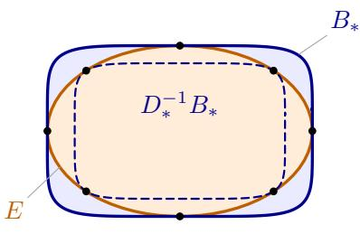  
(a) original coordinates D<sup>−1</sup><sub>∗</sub> B<sub>∗</sub> ⊆ E ⊆ B<sub>∗</sub>

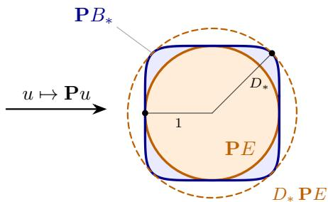  
(b) adapted coordinates PE ⊆ PB<sub>∗</sub> ⊆ D<sub>∗</sub> PE  
Figure 5: The adapted Euclidean structure of Section D.2. (a) The unit ball $B _ { * }$ of $\left\| \cdot \right\| .$ <sub>∗</sub> (blue), the Euclidean unit ball $E$ of $u \mapsto \| \mathbf { P } u \| _ { 2 }$ (orange) inscribed in $\mathbf { i t } ,$ and the rescaled copy $D _ { * } ^ { - 1 } B ,$ (dashed); dots mark tangencies. $( b )$ The reparametrisation $u \mapsto \mathbf { P } v$ makes E round and sandwiches $B _ { * }$ between two Euclidean balls whose radii differ exactly by the factor $D _ { * } ;$ this is equation 11, where all spectral bookkeeping takes place.

Lemma D.4 (Ellipsoidal distortion of $B _ { * }$ under the assumption). Under Assumption (A2), there is a symmetric matrix $\mathbf H \succ 0$ with

$$
m \| u \| _ { * } ^ { 2 } \leq u ^ { \top } \mathbf { H } u \leq M \| u \| _ { * } ^ { 2 } ( u \in \mathbb { R } ^ { d } ) .
$$

Consequently ${ \bf P } : = ( { \bf H } / m ) ^ { 1 / 2 }$ satisfies equation 11 with $D _ { * } ~ = ~ \sqrt { M / m } .$ the assumption itself forbids $B _ { * }$ from being far from an ellipsoid, and John’s $\sqrt { d }$ can always be replaced by min $\{ { \sqrt { d } } , { \sqrt { M / m } } \}$

ProofofLemma $D . 4 . \ J _ { \chi } ^ { 2 }$ is convex and finite on $\mathbb { R } ^ { d }$ (Proposition D.1(i)). By Alexandrov’s theorem (Alexandrov, 1939) (see also Rockafellar & Wets, 1998, Thm. 13.51, or Evans & Gariepy, 2015, Thm. 6.9), it is twice differentiable at almost every $\theta _ { 0 } \in \mathbb { R } ^ { d } \mathrm { : }$ : there is a symmetric H with

$$
\begin{array} { r } { D _ { J _ { x } ^ { 2 } } ( \theta _ { 0 } + v , \theta _ { 0 } ) = J _ { x } ^ { 2 } ( \theta _ { 0 } + v ) - J _ { x } ^ { 2 } ( \theta _ { 0 } ) - \langle \nabla J _ { x } ^ { 2 } ( \theta _ { 0 } ) , v \rangle = \frac { 1 } { 2 } v ^ { \top } \mathbf { H } v + o ( \| v \| _ { * } ^ { 2 } ) . } \end{array}
$$

Fix such a $\theta _ { 0 }$ . For $u \in \mathbb { R } ^ { d }$ and $\varepsilon > 0 .$ , equation 1 with $\theta = \theta _ { 0 } + \varepsilon u$ and $\theta ^ { \prime } = \theta _ { 0 }$ gives

$$
\frac { m } { 2 } \varepsilon ^ { 2 } \| u \| _ { * } ^ { 2 } \leq \frac { \varepsilon ^ { 2 } } { 2 } u ^ { \top } \mathbf { H } u + o ( \varepsilon ^ { 2 } ) \leq \frac { M } { 2 } \varepsilon ^ { 2 } \| u \| _ { * } ^ { 2 } .
$$

Dividing by $\varepsilon ^ { 2 } / 2$ and letting $\varepsilon  0$ yields $m \| u \| _ { * } ^ { 2 } \leq u ^ { \top } \mathbf { H } u \leq M \| u \| _ { * } ^ { 2 }$ ; in particular $\mathbf { H } \succ 0$ With $\mathbf { P } = ( \mathbf { H } / m ) ^ { 1 / 2 } , \| \mathbf { P } u \| _ { 2 } ^ { 2 } = u ^ { \top } \mathbf { H } u / m \in [ \| u \| _ { * } ^ { 2 } , ( M / m ) \| u \| _ { * } ^ { 2 } ]$ , which is equation 11 with $D _ { * } = \sqrt { M / m }$ □

Lemma D.5 (Adapted coordinates). Let $( D _ { * } , \mathbf { P } )$ be an admissible pair equation 11 and define the linear change ofvariables

$$
\tilde { x } : = \frac { \mathbf { P } ^ { - 1 } x } { \ell _ { * } } , \qquad \tilde { \theta } : = \ell _ { * } \mathbf { P } \theta , \qquad s o t h a t \qquad \langle \tilde { \theta } , \tilde { x } \rangle = \langle \theta , x \rangle ,
$$

and let ${ \tilde { \mathcal { X } } } : = \{ { \tilde { x } } : x \in { \mathcal { X } } \}$ and $\tilde { { \theta } } ^ { \star } : = \ell _ { * } \mathbf { P } { \theta } ^ { \star }$ . The norms $\lVert \cdot \rVert _ { * }$ <sub>∗</sub> and $\lVert \cdot \rVert _ { * } ^ { \circ }$ are not changed: they are simply read through the change of variables, i.e. a point described by <sup>˜</sup>θ has $\lVert \theta \rVert _ { * } = \lVert \mathbf { P } ^ { - 1 } \tilde { \theta } \rVert _ { * } / \ell _ { * }$ and an arm described by x˜ has $\| \dot { x } \| _ { * } ^ { \circ } = \| \ell _ { * } { \bf P } \tilde { x } \| _ { * } ^ { \circ }$

(i) $\| x \| _ { * } ^ { \circ } / ( D _ { * } \ell _ { * } ) \le \| \tilde { x } \| _ { 2 } \le \| x \| _ { * } ^ { \circ } / \ell _ { * }$ for every x; in particular $\tilde { \mathcal { X } } \subseteq \mathbb { B } _ { 2 } ^ { d } ( 1 )$ and $\| \tilde { x } ^ { \star } \| _ { 2 } \geq$ $\varrho _ { * } / ( D _ { * } \ell _ { * } )$

(ii) $\| \tilde { { \boldsymbol { \theta } } } \| _ { 2 } / ( D _ { * } \ell _ { * } ) \leq \| { \boldsymbol { \theta } } \| _ { * } \leq \| \tilde { { \boldsymbol { \theta } } } \| _ { 2 } / \ell _ { * }$ for every θ.

(iii) Every intrinsic quantity is unchanged: $J _ { \tilde { \chi } } ( \tilde { \theta } ) = J _ { \chi } ( \theta )$ , the gradient $\nabla J _ { \tilde { \chi } } ( \tilde { \theta } ) =$ $\mathbf { P } ^ { - 1 } \nabla J _ { \mathcal { X } } ( \theta ) / \ell ,$ is the image $o f \ \nabla J _ { \mathcal { X } } ( \theta ) \ ( g r a d i e n t s$ transform like arms), Bregman $d i -$ vergences of J<sup>2</sup>, distances $\lVert \theta - \theta ^ { \prime } \rVert _ { * }$ and $\| \bar { \boldsymbol { x } } - \boldsymbol { x } ^ { \prime } \| _ { * } ^ { \circ }$ , the scalars $\ell _ { * } , \ \varrho _ { * } , \ J _ { \star }$ and the ball $\mathcal { N } _ { * }$ (mapped onto $\ell _ { * } \mathbf { P } \mathcal { N } _ { * } )$ are the same; so Assumption $( A 2 )$ holdsfor the problem $( \tilde { \mathcal { X } } , \tilde { \theta } ^ { \star } )$ with the same $m , M .$ . Moreover α-LinUCB is equivariant: with

$$
\tilde { V } _ { t } : = \ell _ { * } ^ { - 2 } \mathbf { P } ^ { - 1 } V _ { t } \mathbf { P } ^ { - 1 } = \tilde { \mathbf { R } } + \sum _ { s < t } \tilde { x } _ { s } \tilde { x } _ { s } ^ { \top } , \qquad \tilde { \mathbf { R } } : = \lambda _ { 0 } \ell _ { * } ^ { - 2 } \mathbf { P } ^ { - 2 } ,
$$

the transported design matrix (the ridge penalty $\lambda _ { 0 } \| \theta \| _ { 2 } ^ { 2 } = \tilde { \theta } ^ { \top } \tilde { \mathbf { R } } \tilde { \theta }$ is no longer isotropic), and $\begin{array} { r } { \hat { \theta } _ { t } = V _ { t } ^ { - 1 } \sum _ { s < t } x _ { s } y _ { s } } \end{array}$ the ridge estimate,

$$
\tilde { V } _ { t } ^ { - 1 } \sum _ { s < t } \tilde { x } _ { s } y _ { s } = \ell _ { * } { \bf P } \hat { \theta } _ { t } , \qquad \lVert \tilde { { \boldsymbol { \theta } } } - \tilde { { \boldsymbol { \theta } } } ^ { \prime } \rVert _ { \tilde { V } _ { t } } = \lVert { \boldsymbol { \theta } } - { \boldsymbol { \theta } } ^ { \prime } \rVert _ { V _ { t } } , \qquad \lVert \tilde { { \boldsymbol { g } } } \rVert _ { \tilde { V } _ { t } ^ { - 1 } } = \lVert { \boldsymbol { g } } \rVert _ { V _ { t } ^ { - 1 } } ,
$$

so the confidence ellipsoid, the optimistic pair and the event $\mathcal { E }$ are the images of the original ones, $( \tilde { x } _ { t } , \tilde { \theta } _ { t } ) .$ <sub>t</sub> is a trajectory ofα-LinUCB on $( \tilde { \mathcal { X } } , \tilde { \theta } ^ { \star } )$ ) with the same rewards, and the width is unchanged: $\tilde { \omega } _ { t } = \omega _ { t }$

(iv) In the new coordinates the smallest eigenvalue satisfies $\tilde { \lambda } _ { t , d } ~ \geq ~ \omega _ { t } ^ { - 1 } / ( D _ { * } ^ { 2 } \ell _ { * } ^ { 2 } )$ , and $x ^ { \top } V _ { t } ^ { - 1 } x = \tilde { x } ^ { \top } \tilde { V } _ { t } ^ { - 1 } \tilde { x } \leq \operatorname* { m i n } \{ 1 / \tilde { \lambda } _ { t , d } , ~ \ell _ { * } ^ { 2 } \omega _ { t } \}$ for every $x \in \mathcal { X } ;$ in particular, at every round with $\omega _ { t } ^ { - 1 } \geq 2 D _ { * } ^ { 2 } \ell _ { * } ^ { 2 }$ , one has $\tilde { \lambda } _ { t , d } \geq 2$ and $x ^ { \top } V _ { t } ^ { - 1 } x \le 1 / 2$

ProofofLemma D.5. $\begin{array} { r } { \mathrm { ( i ) } \ \| \mathbf { P } ^ { - 1 } x \| _ { 2 } = \operatorname* { s u p } _ { \| v \| _ { 2 } < 1 } \left. x , \mathbf { P } ^ { - 1 } v \right. = \operatorname* { s u p } _ { \| \mathbf { P } u \| _ { 2 } < 1 } \left. x , u \right. } \end{array}$ . By equation 11 the constraint set contains $\{ u : \| u \| _ { * } \leq 1 / \overset { \cdot } { D _ { * } } \}$ and is contained in $\{ u : \| u \| _ { * } \leq 1 \}$ , so $\| x \| _ { * } ^ { \circ } / D _ { * } \leq$ $\| \mathbf { P } ^ { - 1 } x \| _ { 2 } \leq \| x \| _ { * } ^ { \circ }$ ; divide by $\ell _ { * }$ and use $\| \boldsymbol { x } ^ { \star } \| _ { * } ^ { \circ } \geq \varrho _ { * }$ . (ii) is equation 11 multiplied by $\ell _ { * } ,$ since $\lVert \tilde { { \boldsymbol { \theta } } } \rVert _ { 2 } = \ell _ { * } \lVert \mathbf { P } { \boldsymbol { \theta } } \rVert _ { 2 }$ . (iii) The pairing is invariant, so $J _ { \tilde { \chi } } ( \tilde { \theta } ) = \operatorname* { s u p } _ { x \in \mathcal { X } } \langle \theta , x \rangle = J _ { \mathcal { X } } ( \theta ) ;$ ; the chain rule gives $\nabla _ { \tilde { \theta } } J _ { \tilde { \chi } } = \ell _ { * } ^ { - 1 } { \bf P } ^ { - 1 } \nabla _ { \theta } J _ { \chi }$ , i.e. gradients transform like arms, hence $\langle \nabla J _ { \tilde { \nu } } ^ { 2 } ( \tilde { \theta } ^ { \prime } ) , \tilde { \theta } - \tilde { \theta } ^ { \prime } \rangle =$ $\langle \nabla J _ { \mathcal { X } } ^ { 2 } ( \theta ^ { \prime } ) , \theta - \theta ^ { \prime } \rangle$ and Bregman divergences are unchanged. The norms $\lVert \cdot \rVert _ { * } , \lVert \cdot \rVert _ { * } ^ { \circ }$ are by definition evaluated on the original points, so distances, $\ell _ { * } = \operatorname* { s u p } _ { \boldsymbol { \mathcal { X } } } \lVert \cdot \rVert _ { * } ^ { \circ } , \varrho _ { * } = \boldsymbol { \mathcal { I } } _ { \star } / \lVert \dot { \theta } ^ { \star } \rVert _ { * } , J _ { \star }$ and $\mathcal { N } _ { * }$ are unchanged, and equation 1 and equation 9 hold verbatim for the transported problem. For the algorithm: $\begin{array} { r } { \tilde { V } _ { t } = \ell _ { * } ^ { - 2 } \hat { \mathbf { P } } ^ { - 1 } ( \lambda _ { 0 } \mathbf { I } + \sum _ { s < t } x _ { s } x _ { s } ^ { \top } ) \mathbf { P } ^ { - 1 } = \tilde { \mathbf { R } } + \sum _ { s < t } \tilde { x } _ { s } \tilde { x } _ { s } ^ { \top } , \tilde { \mathbf { s 0 } } \tilde { V } _ { t } ^ { - 1 } \stackrel { \cdot } { = } \ell _ { * } ^ { 2 } \mathbf { P } V _ { t } ^ { - 1 } \mathbf { P } } \end{array}$ and $\begin{array} { r } { \tilde { V } _ { t } ^ { - 1 } \sum _ { s } \tilde { x } _ { s } y _ { s } = \ell _ { * } \mathbf { P } V _ { t } ^ { - 1 } \sum _ { s } x _ { s } y _ { s } = \ell _ { * } \mathbf { P } \hat { \theta } _ { t } ; } \end{array}$ the two norm identities follow by direct substitution. Hence $\tilde { \mathcal { C } } _ { t } : = \{ \tilde { \theta } : \theta \in \mathcal { C } _ { t } ( \alpha ) \}$ , the maximisers of the invariant pairing over $\tilde { \mathcal { X } } \times \tilde { \mathcal { C } } _ { t }$ are the images of those over $\mathcal { X } \stackrel { \cdot } { \times } \mathcal { C } _ { t } ( \alpha )$ (for each $\theta \neq 0$ the maximising arm is unique, Proposition D.1(iii), and the analysis below never uses a particular selection of $\theta _ { t }$ among maximising parameters), and the event $\mathcal { E }$ is the same event. Finally $\tilde { \omega } _ { t } = \operatorname* { m a x } \{ \| \theta \| _ { * } ^ { 2 } : \| \tilde { \theta } \| _ { \tilde { V } _ { t } } \leq 1 \} = \operatorname* { m a x } \{ \| \theta \| _ { * } ^ { 2 } : \| \theta \| _ { V _ { t } } \leq 1 \} = \omega _ { t }$ by Proposition D.2(i) and the second identity. (iv) By (ii) and Proposition D.2(iv) with $\kappa ^ { \prime } = 1 / ( D _ { * } \ell _ { * } )$ ， $\tilde { \lambda } _ { t , d } \geq \omega _ { t } ^ { - 1 } / ( D _ { * } ^ { 2 } \ell _ { * } ^ { 2 } )$ . The energy bound is Proposition D.2(iii) together with $\| \tilde { x } \| _ { 2 } \leq 1$ □

Convention. Throughout the proofs we keep the tildes of Lemma $\mathrm { D } . 5 \colon \tilde { x } , \tilde { \theta } , \tilde { V } _ { t }$ are the adapted coordinates of $x , \theta , V _ { t }$ , and every Euclidean object — the norm ∥·∥<sub>2</sub>, eigenvalues, eigenvectors, traces, determinants — is computed on tilded quantities. Untilded symbols denote the original objects, and the norms $\lVert \cdot \rVert _ { * } , \lVert \cdot \rVert _ { * } ^ { \circ }$ are always applied to original objects; a bound such as $\Vert \tilde { x } \Vert _ { 2 } \leq$ $\| \dot { x } \| _ { * } ^ { \circ } / \ell _ { : }$ therefore compares the Euclidean length of the adapted coordinate vector of a point with the intrinsic dual norm of that point. In this notation, Lemma D.5(i), (ii) and (iv) read: $\tilde { \mathcal { X } } \subseteq \mathbb { B } _ { 2 } ^ { d } ( 1 )$ $\| \tilde { x } _ { s } \| _ { 2 } \leq 1 , \operatorname { t r } \tilde { V } _ { t } \leq t - 1 + r _ { \lambda _ { 0 } }$ , where

$$
r _ { \lambda _ { 0 } } : = \mathrm { t r } \tilde { \mathbf { R } } = \lambda _ { 0 } \ell _ { * } ^ { - 2 } \mathrm { t r } \mathbf { P } ^ { - 2 } \leq \frac { \lambda _ { 0 } d } { \ell _ { * } ^ { 2 } \kappa ^ { \prime 2 } } , \qquad \kappa ^ { \prime } : = \operatorname* { m i n } _ { \| u \| _ { 2 } = 1 } \| u \| _ { * } ,\tag{13}
$$

is the trace of the transported regulariser (by equation $1 1 , \lambda _ { \operatorname* { m i n } } ( \mathbf { P } ) \geq \kappa ^ { \prime } ; r _ { \lambda _ { 0 } } = \lambda _ { 0 } d$ for the unit ball and $r _ { \lambda _ { 0 } } = \lambda _ { 0 } \operatorname { t r } \mathbf { A } ^ { - 1 }$ for the ellipsoid $\mathbf { A } ^ { 1 / 2 } \mathbb { B } _ { 2 } ^ { d } ( 1 )$ with its adapted norm), and

$$
\frac { \| \tilde { { \boldsymbol { \theta } } } \| _ { 2 } } { D _ { * } \ell _ { * } } \leq \| { \boldsymbol { \theta } } \| _ { * } \leq \frac { \| \tilde { { \boldsymbol { \theta } } } \| _ { 2 } } { \ell _ { * } } , \qquad \frac { \| { \boldsymbol { x } } \| _ { * } ^ { \circ } } { D _ { * } \ell _ { * } } \leq \| \tilde { { \boldsymbol { x } } } \| _ { 2 } \leq \frac { \| { \boldsymbol { x } } \| _ { * } ^ { \circ } } { \ell _ { * } } , \qquad \| \tilde { { \boldsymbol { x } } } ^ { \star } \| _ { 2 } \geq \frac { \varrho _ { * } } { D _ { * } \ell _ { * } } ,\tag{14}
$$

$$
\tilde { \lambda } _ { t , d } \geq \frac { \omega _ { t } ^ { - 1 } } { D _ { * } ^ { 2 } \ell _ { * } ^ { 2 } } , \qquad \mathrm { h e n c e ~ } \tilde { \lambda } _ { t , d } \geq 2 \mathrm { a t ~ e v e r y ~ r o u n d ~ w i t h ~ } \omega _ { t } ^ { - 1 } \geq 2 D _ { * } ^ { 2 } \ell _ { * } ^ { 2 } ,
$$

where $\tilde { \lambda } _ { t , 1 } \geq \cdot \cdot \cdot \geq \tilde { \lambda } _ { t , d } > 0$ are the eigenvalues of $\tilde { V } _ { t }$ with orthonormal eigenvectors $\tilde { v } _ { t , 1 } , \ldots , \tilde { v } _ { t , d } ;$ each eigenvalue is nondecreasing in t (because $\tilde { V } _ { t + 1 } \succeq \tilde { V } _ { t } )$ , Weyl’s inequality gives $\tilde { \lambda } _ { t + 1 , i } \leq \tilde { \lambda } _ { t , i } + 1$ and for a vector u of the adapted coordinates we write u $\mathbf { \Phi } _ { i } : = \left. u , \tilde { v } _ { t , i } \right.$ when the round is clear from context; in particular $\tilde { x } _ { t , i } : = \langle \tilde { x } _ { t } , \tilde { v } _ { t , i } \rangle$ . We also write $\tilde { e } ^ { \star } : = \tilde { x } ^ { \star } / \| \tilde { x } ^ { \star } \| _ { 2 }$ for the unit vector of the optimal arm, $\tilde { P } ^ { \perp } : = { \bf I } - \tilde { e } ^ { \star } ( \tilde { e } ^ { \star } ) ^ { \top }$ and $\tilde { \phi } _ { t } : = \angle ( \tilde { v } _ { t , 1 } , \tilde { e } ^ { \star } )$ , the sign of $\tilde { v } _ { t , 1 }$ being chosen so that cos $\tilde { \phi } _ { t } \geq 0$ . The scalars $\omega _ { t } , \| \theta - \theta ^ { \prime } \| _ { * } , \| x - x ^ { \prime } \| _ { * } ^ { \circ } , \| \theta - \theta ^ { \prime } \| _ { V _ { t } } = \| \tilde { \theta } - \tilde { \theta } ^ { \prime } \| _ { \tilde { V } _ { t } } , x ^ { \top } V _ { t } ^ { - 1 } x = \tilde { x } ^ { \top } \tilde { V } _ { t } ^ { - 1 } \tilde { x } .$ $J _ { \mathcal { X } } , m , M , \ell _ { \ast } , \varrho _ { \ast } , J _ { \star } , \alpha , \beta$ are the same in both descriptions (Lemma $\mathrm { D } . \dot { 5 } ( \mathrm { i i i } ) )$ , so every statement about them proved below is a statement about the original problem. Proposition 4.1 is applied in the original coordinates; the event E is invariant under the change of variables (Lemma D.5(iii)), and only $\mathbb { P } ( \mathcal { E } ) \geq 1 - \delta$ is used.

## D.3 DEFINITION OF THE CONSTANTS

Definition D.6 (Constants). All constants of this section are fixed here once, in dependency order. Two geometric inputs comefirst,

$$
c _ { \mathrm { e n g } } : = \frac { m } { 6 J _ { \star } } \qquad a n d \qquad L _ { \ast } : = \frac { M + 2 \ell _ { \ast } ^ { 2 } } { J _ { \star } } ,\tag{15}
$$

the exploration-engine constant and the Lipschitz constant of the argmax map $\theta \mapsto \nabla J _ { \mathcal { X } } ( \theta )$ from $( \mathcal { N } _ { * } , \bar { \Vert } . { } \Vert _ { * } ) t o \left( \mathcal { X } , \bar { \Vert } . { } \Vert _ { * } ^ { \circ } \right)$ (Proposition $D . 3 ) ,$ ; then

$$
c _ { 1 } : = \frac { c _ { \mathrm { e n g } } \alpha } { 2 \sqrt { d } } , \qquad C _ { 2 } : = \frac { 3 L _ { * } ^ { 2 } \beta _ { + } ^ { 2 } } { \ell _ { * } ^ { 2 } c _ { 1 } } , \qquad \Gamma : = \frac { 5 \times 1 0 ^ { 4 } d D _ { * } ^ { 4 } L _ { * } ^ { 4 } \beta _ { + } ^ { 4 } \log ( T ) } { c _ { \mathrm { e n g } } ^ { 4 } \alpha ^ { 4 } } ,
$$

$$
K : = \frac { 4 0 d \log ( 8 \Gamma ) } { c _ { \mathrm { e n g } } ^ { 2 } \alpha ^ { 2 } } , \qquad c _ { 0 } : = \operatorname* { m i n } \Big ( \frac { 1 } { 4 \sqrt { K } } , \frac { c _ { 1 } } { \sqrt { \log ( 9 T _ { \star } ) } } \Big ) ,\tag{16}
$$

where $T _ { \star }$ is the poly(log T) explicit burn-in threshold ofDefinition D.10 below.

Two facts about Γ are used repeatedly: since

$$
\frac { L _ { * } \beta _ { + } } { c _ { \mathrm { e n g } } \alpha } = \frac { 6 ( M + 2 \ell _ { * } ^ { 2 } ) \beta _ { + } } { m \alpha } \ \ge \ 6\tag{17}
$$

(as $M \geq m$ and β<sub>+</sub> ≥ α), d ≥ 2, D<sub>∗</sub> ≥ 1 and $\log ( T ) \geq 1$

$$
\Gamma \ge \frac { 8 0 D _ { * } ^ { 2 } L _ { * } ^ { 2 } \beta _ { + } ^ { 2 } } { c _ { \mathrm { e n g } } ^ { 2 } \alpha ^ { 2 } } \qquad \mathrm { a n d ~ } \qquad \Gamma \ge \frac { 1 2 8 0 D _ { * } ^ { 4 } \ell _ { * } ^ { 4 } C _ { 2 } ^ { 2 } \log ( T ) } { c _ { \mathrm { e n g } } ^ { 2 } \alpha ^ { 2 } } = \frac { 4 6 0 8 0 d D _ { * } ^ { 4 } L _ { * } ^ { 4 } \beta _ { + } ^ { 4 } \log ( T ) } { c _ { \mathrm { e n g } } ^ { 4 } \alpha ^ { 4 } } ,\tag{18}
$$

where $C _ { 2 } ^ { 2 } = 9 L _ { * } ^ { 4 } \beta _ { + } ^ { 4 } / ( \ell _ { * } ^ { 4 } c _ { 1 } ^ { 2 } ) = 3 6 d L _ { * } ^ { 4 } \beta _ { + } ^ { 4 } / ( \ell _ { * } ^ { 4 } c _ { \mathrm { e n g } } ^ { 2 } \alpha ^ { 2 } )$ ; in particular $\Gamma \geq 1$ . Note that $J _ { \star }$ cancels in $\Gamma ,$ that Γ depends on the geometry only through the invariant ratio equation 17 and $D _ { * }$ , and that by equation $1 \bar { 2 } 4 \log ( D _ { * } ) \leq 2 \log ( d )$ , so $\mathrm { \bar { l o g } ( 8 T ) } ^ { \mathrm { \bar { \nu } } } = { \cal O } \big ( \log ( e d ) + \log \big ( { \not e ^ { - } + ( M + 2 \ell _ { * } ^ { 2 } ) \beta _ { + } } / { ( m \alpha ) } \big ) .$ + log(e log(eT)); hence

$$
c _ { 0 } \asymp \frac { m \alpha } { J _ { \star } \sqrt { d } \sqrt { \log ( 8 \Gamma ) + \log ( 9 T _ { \star } ) } } .
$$

## D.4 EXPLORATION ENGINE, BURN-IN AND CRUDE BOUND

The first step of the analysis is a crude bound on the width, $\omega _ { t } ^ { - 1 } \gtrsim \sqrt { t / \log ( t ) }$ (Lemma D.9), obtained from an exploration inequality forced by optimism (the engine, Lemma D.7) and an ellipticpotential argument. The engine holds at every round, deterministically, with a constant that involves $J _ { \mathcal { X } } ( \widehat { \theta } _ { t } )$ ; on $\mathcal { E }$ it forces the width to decay from the first round on, which shows that the threshold $\Lambda _ { 0 } ^ { * }$ of the burn-in is reached at an explicit round $t _ { 0 }$ (Proposition D.8(i)). From $t _ { 0 }$ on, the estimate, the optimistic parameter and the whole set $\mathcal { C } _ { t } ( \alpha )$ lie in $\mathcal { N } _ { * }$ , where the argmax map is $L _ { * } { \bf - } 1$ Lipschitz (Proposition D.3), the played arms are well conditioned in the adapted coordinates (Proposition D.8(ii)–(v)), and the engine takes its final form with the constant $c _ { \mathrm { e n g } } .$

Lemma D.7 (Exploration engine). Recall $c _ { \mathrm { e n g } } = m / ( 6 J _ { \star } )$ and $\beta _ { + } = \alpha + \beta .$

(i) At every round $t \geq 1$ , deterministically, $x _ { t } \neq 0 ,$ , the optimistic parameter has the closed form

$$
\theta _ { t } \ = \ \hat { \theta } _ { t } + \alpha \frac { V _ { t } ^ { - 1 } x _ { t } } { \| x _ { t } \| _ { V _ { t } ^ { - 1 } } } ,\tag{19}
$$

and

$$
\| x _ { t } \| _ { V _ { t } ^ { - 1 } } \ge \frac { m \alpha \omega _ { t } } { 4 J _ { \mathcal { X } } ( \hat { \theta } _ { t } ) + 2 \ell _ { * } \alpha \omega _ { t } ^ { 1 / 2 } } .\tag{20}
$$

(ii) On $\mathcal { E } ,$ at every round $t \in [ T ]$

$$
x _ { t } ^ { \top } V _ { t } ^ { - 1 } x _ { t } \ \ge \ \frac { m ^ { 2 } \alpha ^ { 2 } } { 6 4 } \ \operatorname * { m i n } \Big \{ \frac { \omega _ { t } ^ { 2 } } { J _ { \star } ^ { 2 } } , \ \frac { \omega _ { t } } { \ell _ { * } ^ { 2 } \beta _ { + } ^ { 2 } } \Big \} .\tag{21}
$$

(iii) On $\mathcal { E } ,$ at every round $t \in [ T ]$ with $\ell _ { * } \beta _ { + } \omega _ { t } ^ { 1 / 2 } \leq J _ { \star } / 2$ (the exploration engine),

$$
\begin{array} { r } { \| x _ { t } \| _ { V _ { t } ^ { - 1 } } \geq c _ { \mathrm { e n g } } \alpha \omega _ { t } , \qquad h e n c e \qquad x _ { t } ^ { \top } V _ { t } ^ { - 1 } x _ { t } \geq c _ { \mathrm { e n g } } ^ { 2 } \alpha ^ { 2 } \omega _ { t } ^ { 2 } . } \end{array}\tag{22}
$$

The statements and their proof involve neither the burn-in nor a Euclidean structure.

Proof of Lemma $D . 7 .$ (i) Reduction to the confidence set. By definition of the optimistic pair and Proposition D.1(v),

$$
\langle \theta _ { t } , x _ { t } \rangle = \operatorname* { m a x } _ { \theta \in \mathcal { C } _ { t } ( \alpha ) } \operatorname* { m a x } _ { x \in \mathcal { X } } \langle \theta , x \rangle = \operatorname* { m a x } _ { \theta \in \mathcal { C } _ { t } ( \alpha ) } J _ { \mathcal { X } } ( \theta ) , \qquad x _ { t } = \nabla J _ { \mathcal { X } } ( \theta _ { t } ) , \qquad \langle \theta _ { t } , x _ { t } \rangle = J _ { \mathcal { X } } ( \theta _ { t } ) > 0 ,
$$

so $\theta _ { t } \in \arg \operatorname* { m a x } _ { \theta \in \mathcal { C } _ { t } ( \alpha ) } J _ { \mathcal { X } } ( \theta )$ and $x _ { t } \neq 0$

Stationarity identity. For $x ~ \neq ~ 0$ and $\theta \in \mathcal { C } _ { t } ( \alpha )$ , the Cauchy–Schwarz inequality in the $V _ { t ^ { - } }$ geometry gives $\begin{array} { r } { \langle \theta - \hat { \theta } _ { t } , x \rangle \ \leq \ \| x \| _ { V _ { t } ^ { - 1 } } \| \theta - \hat { \theta } _ { t } \| _ { V _ { t } } \ \leq \ \alpha \| x \| _ { V _ { t } ^ { - 1 } } } \end{array}$ , with equality if and only if $\theta = \hat { \theta } _ { t } + \alpha V _ { t } ^ { - 1 } x / \| x \| _ { V _ { t } ^ { - 1 } }$ . Since $\theta _ { t }$ maximises $\langle \cdot , x _ { t } \rangle$ over $\mathcal { C } _ { t } ( \alpha )$ , it is this point:

$$
\theta _ { t } - \hat { \theta } _ { t } = \frac { \alpha } { \lVert x _ { t } \rVert _ { V _ { t } ^ { - 1 } } } V _ { t } ^ { - 1 } x _ { t } , \qquad \lVert \theta _ { t } - \hat { \theta } _ { t } \rVert _ { V _ { t } } = \alpha ,\tag{23}
$$

which is the closed form in (i). It also gives the optimism inequality

$$
J _ { \mathcal { X } } ( \theta _ { t } ) = \langle \hat { \theta } _ { t } , x _ { t } \rangle + \langle \theta _ { t } - \hat { \theta } _ { t } , x _ { t } \rangle \ \leq \ J _ { \mathcal { X } } ( \hat { \theta } _ { t } ) + \alpha \left\| x _ { t } \right\| _ { V _ { t } ^ { - 1 } } .\tag{24}
$$

The multiplier, via strong convexity of $J _ { \mathcal { X } } ^ { 2 }$ . Let $v ^ { \circ }$ attain the maximum defining $\omega _ { t }$ in Proposition D.2(i), so $\| v ^ { \circ } \| _ { V _ { t } } \leq 1$ and $\| v ^ { \circ } \| _ { * } = \omega _ { t } ^ { 1 / 2 }$ , and set $\zeta : = \alpha v ^ { \circ }$ , so that

$$
\| \zeta \| _ { V _ { t } } \le \alpha , \qquad \| \zeta \| _ { * } = \alpha \omega _ { t } ^ { 1 / 2 } :
$$

the two points $\widehat { \theta } _ { t } \pm \zeta$ lie in $\mathcal { C } _ { t } ( \alpha )$ , in the least-explored direction of the $\left\| \cdot \right\| _ { : }$ <sub>∗</sub> geometry. Since $\theta _ { t }$ maximises $J _ { \mathcal { X } }$ over $\mathcal { C } _ { t } ( \alpha )$ , equation 24 gives

$$
\alpha \left. x _ { t } \right. _ { V _ { t } ^ { - 1 } } \ge G : = \operatorname* { m a x } \left\{ J _ { \mathcal { X } } ( \widehat { \theta } _ { t } + \zeta ) , J _ { \mathcal { X } } ( \widehat { \theta } _ { t } - \zeta ) \right\} - J _ { \mathcal { X } } ( \widehat { \theta } _ { t } ) \ge 0 ,\tag{25}
$$

the last inequality by convexity $\begin{array} { r } { ( G \geq \frac { 1 } { 2 } [ J _ { \mathcal { X } } ( \widehat { \theta } _ { t } + \zeta ) + J _ { \mathcal { X } } ( \widehat { \theta } _ { t } - \zeta ) ] - J _ { \mathcal { X } } ( \widehat { \theta } _ { t } ) ) } \end{array}$ . Now apply the lower bound in equation 1 at $\theta ^ { \prime } = \hat { \theta } _ { t }$ with $\theta = \widehat { \theta } _ { t } \pm \zeta$ and add: the linear terms $\pm \langle \zeta , \nabla J _ { \chi } ^ { 2 } ( \hat { \theta } _ { t } ) \rangle$ cancel, and

$$
J _ { \chi } ^ { 2 } ( \hat { \theta } _ { t } + \zeta ) + J _ { \chi } ^ { 2 } ( \hat { \theta } _ { t } - \zeta ) - 2 J _ { \chi } ^ { 2 } ( \hat { \theta } _ { t } ) = D _ { J _ { \chi } ^ { 2 } } ( \hat { \theta } _ { t } + \zeta , \hat { \theta } _ { t } ) + D _ { J _ { \chi } ^ { 2 } } ( \hat { \theta } _ { t } - \zeta , \hat { \theta } _ { t } ) \geq m \| \zeta \| _ { * } ^ { 2 } = m \alpha ^ { 2 } \omega _ { t } .\tag{26}
$$

On the other hand, for each sign,

$$
J _ { \chi } ^ { 2 } ( \hat { \theta } _ { t } \pm \zeta ) - J _ { \chi } ^ { 2 } ( \hat { \theta } _ { t } ) = \left[ J _ { \chi } ( \hat { \theta } _ { t } \pm \zeta ) - J _ { \chi } ( \hat { \theta } _ { t } ) \right] \left[ J _ { \chi } ( \hat { \theta } _ { t } \pm \zeta ) + J _ { \chi } ( \hat { \theta } _ { t } ) \right] \leq G \left( 2 J _ { \chi } ( \hat { \theta } _ { t } ) + G \right) ,
$$

because the product is nonpositive when the first factor is, and otherwise the first factor is at most G and the second at most $2 J _ { \mathcal { X } } ( \widehat { \theta } _ { t } ) + G$ . Summing over the two signs and comparing with equation 26, $2 G \left( 2 J _ { \mathcal { X } } ( \hat { \theta } _ { t } ) + G \right) \geq m \alpha ^ { 2 } \omega _ { t }$ . Finally $G \leq \alpha \| x _ { t } \| _ { V _ { t } ^ { - 1 } } \leq \ell _ { * } \alpha \omega _ { t } ^ { 1 / 2 }$ by equation 25 and Proposition D.2(iii), so

$$
\| x _ { t } \| _ { V _ { t } ^ { - 1 } } \geq \frac { G } { \alpha } \geq \frac { m \alpha \omega _ { t } } { 4 J _ { \mathcal { X } } ( \hat { \theta } _ { t } ) + 2 G } \geq \frac { m \alpha \omega _ { t } } { 4 J _ { \mathcal { X } } ( \hat { \theta } _ { t } ) + 2 \ell _ { * } \alpha \omega _ { t } ^ { 1 / 2 } } ,\tag{27}
$$

which is equation 20. The perturbation is chosen in the $\lVert \cdot \rVert$ <sub>∗</sub> geometry and strong convexity is used in that same geometry. (The radial direction, along which $J _ { \mathcal { X } }$ is linear, needs no separate treatment: it is controlled by the rank-one term $2 \nabla J _ { \mathcal { X } } \nabla J _ { \mathcal { X } } ^ { \top }$ of $\nabla ^ { 2 } J _ { \chi } ^ { 2 }$ , which is what strong convexity of the square buys.)

(ii) On $\mathcal { E } , \| \hat { \theta } _ { t } - \theta ^ { \star } \| _ { * } \leq \beta \omega _ { t } ^ { 1 / 2 }$ (Proposition D.2(ii)), so the ℓ<sub>∗</sub>-Lipschitz property of $J _ { \mathcal { X } }$ gives $J _ { \mathcal { X } } ( \hat { \theta } _ { t } ) \leq J _ { \star } + \ell _ { * } \beta \omega _ { t } ^ { 1 / 2 }$ , and the denominator in equation 20 is at most

$$
4 J _ { \star } + 4 \ell _ { * } \beta _ { + } \omega _ { t } ^ { 1 / 2 } \leq 8 \operatorname* { m a x } \{ J _ { \star } , \ell _ { * } \beta _ { + } \omega _ { t } ^ { 1 / 2 } \} .
$$

Hence $\| x _ { t } \| _ { V _ { t } ^ { - 1 } } \geq \frac { m \alpha } { 8 }$ min $\{ \omega _ { t } / J _ { \star } , \omega _ { t } ^ { 1 / 2 } / ( \ell _ { * } \beta _ { + } ) \}$ , and equation 21 follows by squaring.

(iii) If $\ell _ { * } \beta _ { + } \omega _ { t } ^ { 1 / 2 } \leq J _ { \star } / 2$ , the same denominator is at most $6 J _ { \star }$ , and equation 20 gives $\| x _ { t } \| _ { V _ { t } ^ { - 1 } } \geq$ mα $\omega _ { t } / ( 6 J _ { \star } ) = c _ { \mathrm { e n g } } \alpha \omega _ { t }$ □

Proposition D.8 (Burn-in). Recall $\beta _ { + } = \alpha + \beta$ and $L _ { * } = ( M + 2 \ell _ { * } ^ { 2 } ) / J _ { \star }$ , and define the burn-in threshold and the burn-in round

$$
\Lambda _ { 0 } ^ { * } : = \operatorname* { m a x } \Big \{ 2 D _ { * } ^ { 2 } \ell _ { * } ^ { 2 } , \frac { 1 6 \ell _ { * } ^ { 2 } \beta _ { + } ^ { 2 } } { J _ { * } ^ { 2 } } , \frac { 4 D _ { * } ^ { 2 } L _ { * } ^ { 2 } \beta _ { + } ^ { 2 } } { \varrho _ { * } ^ { 2 } } \Big \} ,\tag{28}
$$

$$
t _ { 0 } : = \operatorname* { m i n } \Big \{ t \geq 1 : \frac { t } { \log ( 1 + t / ( d \lambda _ { 0 } ) ) } > \operatorname* { m a x } \Big \{ 2 d , \frac { 1 2 8 d J _ { \star } ^ { 2 } \Lambda _ { 0 } ^ { * 2 } } { m ^ { 2 } \alpha ^ { 2 } } \Big \} \Big \} .
$$

The round $t _ { 0 }$ is finite and explicit, since $t \mapsto t / \log ( 1 + t / ( d \lambda _ { 0 } ) )$ increases to infinity. On $\mathcal { E } , f o r$ every $t _ { 0 } \leq t \leq \dot { T }$

(i) $\omega _ { t } ^ { - 1 } \geq \Lambda _ { 0 } ^ { * } ;$

$$
( i i ) \ \| \hat { \theta } _ { t } - \theta ^ { \star } \| _ { * } \leq \beta \omega _ { t } ^ { 1 / 2 } \leq J _ { \star } / ( 4 \ell _ { * } ) ; i n p a r t i c u l a r \hat { \theta } _ { t } \in  { \mathcal { N } } _ { * } ;
$$

(iii) $\lVert \theta _ { t } - \hat { \theta } _ { t } \rVert _ { * } \leq \alpha \omega _ { t } ^ { 1 / 2 } \leq J _ { \star } / ( 4 \ell _ { * } )$ and $\lVert \theta _ { t } - \theta ^ { \star } \rVert _ { * } \leq \beta _ { + } \omega _ { t } ^ { 1 / 2 } \leq J _ { \star } / ( 4 \ell _ { * } )$ ; hence $\theta _ { t } \in \mathcal { N } _ { * }$ and $\hat { \theta } _ { t } + \zeta \in \mathcal { N } _ { * }$ for every ζ with $\| \zeta \| _ { V _ { t } } \leq \alpha$ (the whole confidence ellipsoid lies in $\mathcal { N } _ { * } ) ;$

$$
\begin{array} { r } { ( i \nu ) \ x _ { t } = \nabla J _ { \mathcal { X } } ( \theta _ { t } ) , \ \| x _ { t } - x ^ { \star } \| _ { * } ^ { \circ } \leq L _ { * } \beta _ { + } \omega _ { t } ^ { 1 / 2 } , a n d \ \frac { 1 } { 2 } J _ { \star } \leq J _ { \mathcal { X } } ( \theta _ { t } ) \leq \frac { 3 } { 2 } J _ { \star } ; } \end{array}
$$

(v) in the adapted coordinates, $\| \tilde { x } _ { t } - \tilde { x } ^ { \star } \| _ { 2 } \leq L _ { * } \beta _ { + } \omega _ { t } ^ { 1 / 2 } / \ell _ { * } \leq \| \tilde { x } ^ { \star } \| _ { 2 } / 2 ;$ therefore

$$
\begin{array} { r } { \frac 1 2 \| \tilde { x } ^ { \star } \| _ { 2 } \leq \| \tilde { x } _ { t } \| _ { 2 } \leq \frac 3 2 \| \tilde { x } ^ { \star } \| _ { 2 } \qquad a n d \qquad \langle \tilde { e } ^ { \star } , \tilde { x } _ { t } \rangle \geq \frac 1 2 \| \tilde { x } ^ { \star } \| _ { 2 } . } \end{array}\tag{29}
$$

Nothing is assumed about the trajectory: (i) is derived from the engine equation 21 and an ellipticpotential argument runfrom thefirst round, and (ii)–(v)followfrom (i).

ProofofProposition D.8. (i) Fix $T ^ { \prime } \in [ T ]$ . In the original coordinates $V _ { 1 } = \lambda _ { 0 } \mathbf { I }$ and $\| x _ { t } \| _ { 2 } \leq 1$ (as $\mathcal { X } \subseteq \bar { \mathbb { B } _ { 2 } ^ { d } } ( 1 ) \rangle$ , so by the matrix determinant lemma, telescoping, and the arithmetic–geometric mean inequality (tr $V _ { T ^ { \prime } + 1 } \leq d \lambda _ { 0 } + T ^ { \prime } )$ ,

$$
\sum _ { t = 1 } ^ { T ^ { \prime } } \log \left( 1 + x _ { t } ^ { \top } V _ { t } ^ { - 1 } x _ { t } \right) = \log \left( \frac { \operatorname* { d e t } \left( V _ { T ^ { \prime } + 1 } \right) } { \operatorname* { d e t } \left( V _ { 1 } \right) } \right) \ \leq \ d \ \log \left( 1 + \frac { T ^ { \prime } } { d \lambda _ { 0 } } \right) .
$$

Since min $\{ 1 , y \} \leq 2 \log ( 1 + y )$ for $y \geq 0 ,$ , the left side is at least $\begin{array} { r } { { \frac { 1 } { 2 } } \sum _ { t \leq T ^ { \prime } } \operatorname* { m i n } \{ 1 , { x } _ { t } ^ { \top } V _ { t } ^ { - 1 } { x } _ { t } \} } \end{array}$ On $\mathcal { E } ,$ , insert equation 21: its right-hand side is $g ( \omega _ { t } )$ with $\begin{array} { r } { g ( \omega ) : = \frac { m ^ { 2 } \alpha ^ { 2 } } { 6 4 } } \end{array}$ min $\{ \omega ^ { 2 } / J _ { \star } ^ { 2 } , \ \omega / ( \ell _ { * } ^ { 2 } \beta _ { + } ^ { 2 } ) \}$ nondecreasing in $\omega ,$ while $\omega _ { t } \geq \omega _ { T ^ { \prime } }$ for $t \leq T ^ { \prime }$ (Proposition $\mathrm { D } . 2 ( \mathrm { v } ) )$ ; hence

$$
T ^ { \prime } \operatorname* { m i n } \{ 1 , g ( \omega _ { T ^ { \prime } } ) \} \leq \sum _ { t = 1 } ^ { T ^ { \prime } } \operatorname* { m i n } \{ 1 , x _ { t } ^ { \top } V _ { t } ^ { - 1 } x _ { t } \} \leq 2 d \log \biggl ( 1 + \frac { T ^ { \prime } } { d \lambda _ { 0 } } \biggr ) .
$$

Let $T ^ { \prime } \geq t _ { 0 }$ . Since $t \mapsto t / \log ( 1 + t / ( d \lambda _ { 0 } ) )$ is increasing, the defining inequality of $t _ { 0 }$ holds at $T ^ { \prime } { \mathrm { : } }$ $T ^ { \prime } > 2 d \log ( 1 + T ^ { \prime } / ( d \lambda _ { 0 } ^ { ' } ) )$ , so the minimum is $g ( \omega _ { T ^ { \prime } } ) < 1$ , and

$$
g ( \omega _ { T ^ { \prime } } ) \ \leq \ \frac { 2 d \log ( 1 + T ^ { \prime } / ( d \lambda _ { 0 } ) ) } { T ^ { \prime } } \ < \ \frac { m ^ { 2 } \alpha ^ { 2 } } { 6 4 J _ { \star } ^ { 2 } \Lambda _ { 0 } ^ { * 2 } } .
$$

If $\omega _ { T ^ { \prime } } > 1 / \Lambda _ { 0 } ^ { * }$ , then by monotonicity of $g$ and the second entry of $\Lambda _ { 0 } ^ { * } ( \ell _ { * } ^ { 2 } \beta _ { + } ^ { 2 } \le J _ { \star } ^ { 2 } \Lambda _ { 0 } ^ { * }$ , so that at $\omega = 1 / \Lambda _ { 0 } ^ { * }$ the first term of the minimum is the smaller one),

$$
g ( \omega _ { T ^ { \prime } } ) \geq g ( 1 / \Lambda _ { 0 } ^ { * } ) = \frac { m ^ { 2 } \alpha ^ { 2 } } { 6 4 } \operatorname* { m i n } \Big \{ \frac { 1 } { J _ { \star } ^ { 2 } \Lambda _ { 0 } ^ { * 2 } } , \frac { 1 } { \ell _ { * } ^ { 2 } \beta _ { + } ^ { 2 } \Lambda _ { 0 } ^ { * } } \Big \} = \frac { m ^ { 2 } \alpha ^ { 2 } } { 6 4 J _ { \star } ^ { 2 } \Lambda _ { 0 } ^ { * 2 } } ,
$$

a contradiction. Hence ω<sub>T</sub> $\leq 1 / \Lambda _ { 0 } ^ { * }$

For (ii)–(v), fix $t _ { 0 } ~ \le ~ t ~ \le ~ T ;$ throughout, $\omega _ { t } ^ { - 1 } \geq \Lambda _ { 0 } ^ { * }$ by (i), and $\alpha , \beta ~ \leq ~ \beta _ { + }$ . (ii) By Proposition D.2(ii), on $\begin{array} { r } { \varepsilon , \| \hat { { \boldsymbol \theta } } _ { t } - { \boldsymbol \theta } ^ { \star } \| _ { * } \leq \beta \omega _ { t } ^ { 1 / 2 } \leq \beta _ { + } / \sqrt { \Lambda _ { 0 } ^ { * } } \leq J _ { \star } / ( 4 \ell _ { * } ) } \end{array}$ by the second entry of $\Lambda _ { 0 } ^ { * }$ . (iii) $\theta _ { t } \ \in \mathcal { C } _ { t } ( \alpha )$ gives $\lVert \theta _ { t } - \hat { \theta } _ { t } \rVert _ { * } \leq \alpha \omega _ { t } ^ { 1 / 2 } \leq J _ { \star } / ( 4 \ell _ { * } )$ in the same way; the triangle inequality gives $\begin{array} { r } { \| \theta _ { t } - \theta ^ { \star } \| _ { * } \leq ( \alpha + \beta ) \omega _ { t } ^ { 1 / 2 } = \beta _ { + } \omega _ { t } ^ { 1 / 2 } \leq J _ { \star } / ( 4 \ell _ { * } ) . } \end{array}$ ; and if $\| \zeta \| _ { V _ { t } } ~ \le ~ \alpha$ then $\lVert \zeta \rVert _ { * } \ \leq \ \alpha \omega _ { t } ^ { 1 / 2 } \ \leq \ J _ { \star } / ( 4 \ell _ { * } )$ , so $\lVert \hat { { \boldsymbol { \theta } } } _ { t } + { \boldsymbol { \zeta } } - { \boldsymbol { \theta } } ^ { \star } \rVert _ { * } \leq J _ { \star } / ( 2 \ell _ { * } )$ . (iv) $x _ { t } = \nabla J _ { \mathcal { X } } ( \theta _ { t } )$ is Proposition D.1(v). By equation 10 with $\theta _ { t } , \theta ^ { \star } \in \mathcal { N } _ { * }$ and by (iii), $\begin{array} { r } { \| { x } _ { t } - { x } ^ { \star } \| _ { * } ^ { \circ } \leq L _ { * } \| \theta _ { t } - \theta ^ { \star } \| _ { * } \leq L _ { * } \beta _ { + } \omega _ { t } ^ { 1 / 2 } . } \end{array}$ the bounds on $J _ { \mathcal { X } } ( \theta _ { t } )$ are equation 8. (v) By equation 14, $\lVert \tilde { x } _ { t } - \tilde { x } ^ { \star } \rVert _ { 2 } \leq \lVert x _ { t } - x ^ { \star } \rVert _ { * } ^ { \circ } / \ell _ { * } \leq$ $L _ { * } \beta _ { + } \omega _ { t } ^ { 1 / 2 } / \ell _ { * } \leq L _ { * } \beta _ { + } / ( \ell _ { * } \sqrt { \Lambda _ { 0 } ^ { * } } ) \leq \varrho _ { * } / ( 2 D _ { * } \ell _ { * } ) \leq \| \tilde { x } ^ { \star } \| _ { 2 } / 2$ , using the third entry of $\Lambda _ { 0 } ^ { * }$ and $\| \tilde { x } ^ { \star } \| _ { 2 } ~ \geq ~ \varrho _ { * } / ( D _ { * } \ell _ { * } )$ . The bounds equation 29 follow from the triangle inequality and from $\ddot { \langle e ^ { \star } , \tilde { x } _ { t } \rangle } = \| \tilde { x } ^ { \star } \| _ { 2 } + \langle \tilde { e } ^ { \star } , \tilde { x } _ { t } - \tilde { x } ^ { \star } \rangle \geq \| \tilde { x } ^ { \star } \| _ { 2 } - \| \tilde { x } _ { t } - \tilde { x } ^ { \star } \| _ { 2 }$ □

Size of the burn-in. By equation 5 and equation $1 2 ( \ell _ { * } ^ { 2 } \leq M / 2 , \varrho _ { * } ^ { - 2 } \leq 2 / m , D _ { * } ^ { 2 } \leq M / m$ $L _ { * } \leq 2 M / J _ { \star } )$ ,

$$
\Lambda _ { 0 } ^ { * } \leq \operatorname* { m a x } \Big \{ \frac { M ^ { 2 } } { m } , \frac { 8 M \beta _ { + } ^ { 2 } } { J _ { \star } ^ { 2 } } , \frac { 3 2 M ^ { 3 } \beta _ { + } ^ { 2 } } { m ^ { 2 } J _ { \star } ^ { 2 } } \Big \} ;
$$

for the unit ball and for every ellipsoid with its adapted norm, $\Lambda _ { 0 } ^ { * } = \operatorname* { m a x } \{ 2 , 6 4 \beta _ { + } ^ { 2 } / J _ { \star } ^ { 2 } \}$ , whatever the anisotropy. Consequently $t _ { 0 } = \widetilde O \big ( d + d J _ { \star } ^ { 2 } \Lambda _ { 0 } ^ { * 2 } / ( m ^ { 2 } \alpha ^ { 2 } ) \big )$ , i.e.

$$
t _ { 0 } = \widetilde O \Bigl ( d + { \frac { d M ^ { 4 } J _ { \star } ^ { 2 } } { m ^ { 4 } \alpha ^ { 2 } } } + { \frac { d M ^ { 6 } \beta _ { + } ^ { 4 } } { m ^ { 6 } J _ { \star } ^ { 2 } \alpha ^ { 2 } } } \Bigr ) ,
$$

with a logarithmic dependence on $1 / ( d \lambda _ { 0 } )$

Lemma D.9 (Crude bound). Recall $c _ { 1 } ~ = ~ c _ { \mathrm { e n g } } \alpha / ( 2 \sqrt { d } ) ~ = ~ m \alpha / ( 1 2 J _ { \star } \sqrt { d } )$ , and let $T _ { 1 } : =$ $\operatorname* { m a x } ( 2 t _ { 0 } , 3 d )$ . On $\mathcal { E } ,$ , the engine equation 22 holds at every round $t _ { 0 } \leq \dot { t } \leq T$ , and

$$
\omega _ { t } ^ { - 1 } \geq c _ { 1 } \sqrt { \frac { t } { \log ( t ) } } \qquad f o r a l l T _ { 1 } \leq t \leq T .\tag{30}
$$

ProofofLemma D.9. For $t \ge t _ { 0 } , \ell _ { * } \beta _ { + } \omega _ { t } ^ { 1 / 2 } \le \ell _ { * } \beta _ { + } / \sqrt { \Lambda _ { 0 } ^ { * } } \le J _ { \star } / 4$ by Proposition $ { \mathrm { D } } . 8 (  { \mathrm { i } } )$ and the second entry of $\Lambda _ { 0 } ^ { * } .$ so Lemma D.7(iii) applies at every $t \geq t _ { 0 }$ . For the crude bound, an ellipticpotential argument converts equation 22 into equation 30. We use the adapted coordinates. By the matrix determinant lemma, det $\left( \tilde { V } _ { t + 1 } \right) = \operatorname* { d e t } \left( \tilde { V } _ { t } \right) \left( 1 + x _ { t } ^ { \top } V _ { t } ^ { - 1 } x _ { t } \right)$ , so telescoping over $t =$ $t _ { 0 } , \ldots , T ^ { \prime }$ for any $t _ { 0 } \leq T ^ { \prime } \leq T$

$$
\sum _ { t = t _ { 0 } } ^ { T ^ { \prime } } \log \bigl ( 1 + x _ { t } ^ { \top } V _ { t } ^ { - 1 } x _ { t } \bigr ) = \log \left( \frac { \operatorname* { d e t } \left( \tilde { V } _ { T ^ { \prime } + 1 } \right) } { \operatorname* { d e t } \left( \tilde { V } _ { t _ { 0 } } \right) } \right) \ \leq \ d \log ( T ^ { \prime } ) ,
$$

since $\begin{array} { r c l r c l } { \tilde { V } _ { T ^ { \prime } + 1 } } & { = } & { \tilde { V } _ { t _ { 0 } } + \sum _ { t = t _ { 0 } } ^ { T ^ { \prime } } \tilde { x } _ { t } \tilde { x } _ { t } ^ { \top } } & { \preceq } & { \tilde { V } _ { t _ { 0 } } + ( T ^ { \prime } - t _ { 0 } + 1 ) { \bf I } \mathrm { \Large ~ ( a s } \| \tilde { x } _ { s } \| _ { 2 } } & { \leq } & { 1 ) } \end{array}$ and $\tilde { \lambda } _ { t _ { 0 } , d } ~ \geq ~ 2$ by equation 14 and Proposition D.8(i), so that det $\begin{array} { r l } { \left( \tilde { V } _ { T ^ { \prime } + 1 } \right) / \operatorname* { d e t } \left( \tilde { V } _ { t _ { 0 } } \right) } & { { } = } \end{array}$ det $\begin{array} { r } { \left( \mathbf { I } + \tilde { V } _ { t _ { 0 } } ^ { - 1 / 2 } ( \tilde { V } _ { T ^ { \prime } + 1 } - \tilde { V } _ { t _ { 0 } } ) \tilde { V } _ { t _ { 0 } } ^ { - 1 / 2 } \right) \ \leq \ ( 1 + T ^ { \prime } / 2 ) ^ { d } \ \leq \ T ^ { \prime } ^ { d } } \end{array}$ for $T ^ { \prime } \geq 2$ . For $\begin{array} { r l } { t } & { { } \geq ~ t _ { 0 } , } \end{array}$ $x _ { t } ^ { \top } V _ { t } ^ { - 1 } x _ { t } ~ \leq ~ 1 / 2$ (Lemma $\mathrm { D } . 5 ( \mathrm { i v } ) .$ , as $\omega _ { t } ^ { - 1 } ~ \ge ~ \Lambda _ { 0 } ^ { * } ~ \ge ~ 2 D _ { * } ^ { 2 } \ell _ { * } ^ { 2 } )$ , so the elementary inequality $\log ( \mathrm { i } + y ) \geq y / 2$ on [0, 1] applies; inserting the engine equation 22 (Lemma D.7(iii), whose hypothesis $\ell _ { * } \beta _ { + } \omega _ { t } ^ { 1 / 2 } \leq J _ { \star } / 4$ holds for $t \geq t _ { 0 }$ by the second entry of $\Lambda _ { 0 } ^ { * } )$ and the monotonicity of $\omega . \cdot$

$$
( T ^ { \prime } - t _ { 0 } + 1 ) \frac { c _ { \mathrm { e n g } } ^ { 2 } \alpha ^ { 2 } \omega _ { T ^ { \prime } } ^ { 2 } } { 2 } \ \leq \ \frac { 1 } { 2 } \sum _ { t = t _ { 0 } } ^ { T ^ { \prime } } x _ { t } ^ { \top } V _ { t } ^ { - 1 } x _ { t } \ \leq \ d \log ( T ^ { \prime } ) .
$$

For $\begin{array} { c c c c } { T ^ { \prime } } & { \geq } & { T _ { 1 } } & { = } & { \operatorname* { m a x } ( 2 t _ { 0 } , 3 d ) } \end{array}$ we have $T ^ { \prime } \ - \ t _ { 0 } \ + \ 1 \ \geq \ T ^ { \prime } / 2$ , whence $\omega _ { T ^ { \prime } } ^ { - 2 } \quad \geq$ $c _ { \mathrm { e n g } } ^ { 2 } \alpha ^ { 2 } T ^ { \prime } / ( 4 d \log ( T ^ { \prime } ) ) = c _ { 1 } ^ { 2 } \dot { T } ^ { \prime } / \log ( T ^ { \prime } )$ ; renaming $T ^ { \prime }$ as t gives equation 30. □

## THE BURN-IN LADDER

All burn-in thresholds are collected in one explicit chain $t _ { 0 } ( i n$ P roposition $D . 8 ) \  \ T _ { 1 } : =$ ma $\mathrm { \Delta } \ i ( 2 t _ { 0 } , 3 d )  T _ { \star }  T _ { B }$

Definition D.10 (Burn-in ladder). With $T _ { 1 } ~ = ~ \mathrm { m a x } ( 2 t _ { 0 } , 3 d ) , ~ c _ { 1 } ~ = ~ m \alpha / ( 1 2 J _ { \star } \sqrt { d } )$ and $C _ { 2 } \ =$ $3 L _ { * } ^ { 2 } \beta _ { + } ^ { 2 } / ( \ell _ { * } ^ { 2 } c _ { 1 } )$ as in equation 16, define

$$
T _ { \star } : = \operatorname* { m i n } \Big \{ t \geq \operatorname* { m a x } ( T _ { 1 } , 2 0 ) \ : \ \forall s \geq t ,
$$

$$
4 T _ { 1 } + r _ { \lambda _ { 0 } } \leq { \frac { L _ { * } ^ { 2 } \beta _ { + } ^ { 2 } } { \ell _ { * } ^ { 2 } c _ { 1 } } } { \sqrt { s \log ( s ) } } a n d C _ { 2 } { \sqrt { s \log ( s ) } } \leq { \frac { \varrho _ { * } ^ { 2 } s } { 1 6 D _ { * } ^ { 2 } \ell _ { * } ^ { 2 } } } \leq \quad \quad
$$

$$
T _ { B } : = T _ { \star } .
$$

The first inequality makes the pre-T<sub>1</sub> chords and the regulariser negligible in (P1) below; the second is the spectral gap of (P2). The threshold is finite and explicit: writing

$$
A : = \frac { 2 5 6 D _ { * } ^ { 4 } \ell _ { * } ^ { 4 } C _ { 2 } ^ { 2 } } { \varrho _ { * } ^ { 4 } } , \qquad B : = \frac { ( 4 T _ { 1 } + r _ { \lambda _ { 0 } } ) ^ { 2 } c _ { 1 } ^ { 2 } \ell _ { * } ^ { 4 } } { L _ { * } ^ { 4 } \beta _ { + } ^ { 4 } } = \frac { ( 4 T _ { 1 } + r _ { \lambda _ { 0 } } ) ^ { 2 } c _ { \mathrm { e n g } } ^ { 2 } \alpha ^ { 2 } \ell _ { * } ^ { 4 } } { 4 d L _ { * } ^ { 4 } \beta _ { + } ^ { 4 } } ,
$$

the second inequality read $s / \log ( s ) \geq A$ and thefirst s $\log ( s ) \geq B _ { \mathrm { ~ } }$ ; both, once true, stay true, and they hold for every $s \geq \operatorname* { m a x } \{ 3 A ^ { \prime } \log ( A ^ { \prime } )$ , B, 3} with $A ^ { \prime } : = \operatorname* { m a x } \{ A , 3 \}$ . Hence

$$
T _ { \star } \ \leq \ \operatorname* { m a x } \{ T _ { 1 } , 2 0 , 3 A ^ { \prime } \log ( A ^ { \prime } ) , B \}\tag{31}
$$

Dependence on the horizon. $T _ { \star }$ depends on T only through $\beta _ { + } = \alpha + \beta$ . The terms ofequation 31 scales as $\beta _ { + } ^ { 4 } / \alpha ^ { 2 }$ times a polynomial in $( d , M / m , \dot { J } _ { \star } ^ { - 1 } )$ . Hence, up to such polynomialfactors,

$$
T _ { B } = T _ { \star } = \mathcal { O } ( \mathrm { p o l y } ( \log T ) ) .
$$

## D.5 PROOF OF THEOREM 4.3

The engine equation 22 is a lower bound on $x _ { t } ^ { \top } V _ { t } ^ { - 1 } x _ { t }$ , while the crude bound equation 30 is an upper bound on the sum of these quantities. To go from $\sqrt { t / \log ( t ) }$ to $\sqrt { t }$ we replace the elliptic potential by a logarithmically capped potential whose capacity does not grow with t, and record how much of the engine’s energy it captures. The structure of the argument is a two-scale separation: a doubling lemma shows that $\omega _ { t } ^ { - 1 }$ doubles within $O ( \vartheta ^ { 2 } )$ rounds of the moment it equals ϑ, and a backward induction turns this into $\omega _ { t } ^ { - 1 } \geq c _ { 0 } \sqrt { t }$ from the initialisation window onwards.

EPOCHS, BAND, AND THE CAPPED POTENTIAL

Epochs are measured on the inverse width $\omega _ { t } ^ { - 1 }$ , while the potential that records the exploration is a spectral function of $\tilde { V }$ in the adapted coordinates. Fix an epoch start $\tau \geq T _ { \star }$ with reference scale $\begin{array} { r } { \dot { \vartheta } : = \omega _ { \tau } ^ { - 1 } } \end{array}$ ; a round $t \geq \tau$ is active if $\omega _ { t } ^ { - 1 } \leq 2 \vartheta$ (active rounds form an initial segment, by monotonicity of ω<sub>·</sub>, and $\omega _ { t } ^ { - 1 } \geq \vartheta$ for all $t \geq \tau )$ . Set

$$
\bar { \vartheta } : = \frac { \vartheta } { D _ { \ast } ^ { 2 } \ell _ { \ast } ^ { 2 } } , \qquad \mathrm { s o t h a t } \qquad 0 < \bar { \vartheta } \leq \tilde { \lambda } _ { t , d } \quad \mathrm { f o r ~ a l l } \ t \geq \tau ,\tag{32}
$$

because $\tilde { \lambda } _ { t , d } \geq \tilde { \lambda } _ { \tau , d } \geq \omega _ { \tau } ^ { - 1 } / ( D _ { * } ^ { 2 } \ell _ { * } ^ { 2 } )$ by equation $1 4 ; \bar { \vartheta }$ is the Euclidean shadow of the epoch scale, and it will cancel from every constant. With $\Gamma \geq 1$ the band width of equation 16, define the band, the mid-scale set, and the band energy

$$
\mathcal { B } _ { t } : = \big \{ i \geq 2 : \tilde { \lambda } _ { t , i } < \Gamma \bar { \vartheta } \big \} , \qquad \mathcal { I } _ { t } : = \big \{ i \geq 2 : \tilde { \lambda } _ { t , i } \geq \Gamma \bar { \vartheta } \big \} , \qquad E _ { t } ^ { \mathcal { B } } : = \sum _ { i \in B _ { t } } \widetilde { \widetilde { \lambda } } _ { t , i } ^ { 2 } ,
$$

and, with $L : = 8 \Gamma \bar { \vartheta }$ (not to be confused with the Lipschitz constant $L _ { * } )$ , the logarithmically capped potential

$$
\Phi _ { \vec { v } } ( \mathbf { W } ) : = \operatorname { t r } h ( \mathbf { W } ) = \sum _ { i = 1 } ^ { d } h ( \lambda _ { i } ( \mathbf { W } ) ) , \qquad h ( \lambda ) : = \bar { \vartheta } \log \biggr ( \frac { L \left( \lambda + \bar { \vartheta } \right) } { \bar { \vartheta } \left( \lambda + L \right) } \biggr ) , \qquad \mathbf { W } \succeq 0 ,\tag{33}
$$

where W is any symmetric matrix of the adapted coordinates (it will be $\tilde { V } _ { t } )$ . The function h increases from $h ( 0 ) = \bar { 0 \ t o \ h } ( \infty ) = \bar { \vartheta } \log \bigl ( L / \bar { \vartheta } \bigr ) = \bar { \vartheta } \bar { \log } ( 8 \Gamma )$ : it counts ϑ<sup>¯</sup>-units of growth on the logarithmic scale, but only between $\bar { \vartheta }$ and $L ,$ so that its total capacity is bounded independently of the horizon.

Lemma D.11 (Capacity and per-round gain of the capped potential). Let $\tau \geq T _ { \star } , \vartheta : = \omega _ { \tau } ^ { - 1 }$ $\bar { \vartheta } = \vartheta / ( D _ { \ast } ^ { 2 } \ell _ { \ast } ^ { 2 } )$ and $L \doteq 8 \Gamma \bar { \vartheta }$ be as above.

(i) For every $\mathbf { W } \succeq 0 , \ 0 \leq \Phi _ { \bar { \vartheta } } ( \mathbf { W } ) \leq d \bar { \vartheta } \log ( 8 \Gamma )$

(ii) For every $\begin{array} { r } { t \geq \tau , \ \Phi _ { \bar { \vartheta } } ( \tilde { V } _ { t + 1 } ) - \Phi _ { \bar { \vartheta } } ( \tilde { V } _ { t } ) \geq \frac { \bar { \vartheta } } { 4 } E _ { t } ^ { \mathcal { B } } \geq 0 . } \end{array}$

ProofofLemma D.11. Step 0: a determinant representation. Since

$$
h ( \lambda ) = \bar { \vartheta } \big [ \log \big ( \lambda + \bar { \vartheta } \big ) - \log ( \lambda + L ) \big ] + \bar { \vartheta } \log \big ( L / \bar { \vartheta } \big ) ,
$$

we have, for $\mathbf { W } \succeq 0 .$

$$
\Phi _ { \vec { \vartheta } } ( \mathbf { W } ) = \bar { \vartheta } \Big [ \log \big ( \operatorname* { d e t } \big ( \mathbf { W } + \bar { \vartheta } \mathbf { I } \big ) \big ) - \log \big ( \operatorname* { d e t } \big ( \mathbf { W } + L \mathbf { I } \big ) \big ) \Big ] + d \bar { \vartheta } \log \big ( L / \bar { \vartheta } \big ) .
$$

Proof of (i). h is nondecreasing on $\lbrack 0 , \infty )$ with $h ( 0 ) ~ = ~ 0$ (because $\bar { \vartheta } ~ < ~ L )$ , and $h ( \lambda ) \ \leq$ $\bar { \vartheta } \log \bigl ( L / \bar { \vartheta } \bigr ) = \bar { \vartheta } \log ( 8 \Gamma )$ for every $\lambda \geq 0 ;$ ; sum over the d eigenvalues.

Proof of (ii). Fix $t \geq \tau$ and abbreviate ${ \tilde { V } } : = \tilde { V } _ { t } , { \tilde { x } } : = \tilde { x } _ { t } , \tilde { \lambda } _ { i } : = \tilde { \lambda } _ { t , i } , \tilde { x } _ { i } : = \tilde { x } _ { t , i } .$ so that $\tilde { V } _ { t + 1 } =$ $\tilde { V } + \tilde { x } \tilde { x } ^ { \top }$ ; recall $\bar { \vartheta } \leq \tilde { \lambda } _ { d }$ by equation 32 and $\tilde { \lambda } _ { d } \geq 2$ by equation 14, since $\omega _ { t } ^ { - 1 } \geq \Lambda _ { 0 } ^ { * } \geq 2 D _ { * } ^ { 2 } \ell _ { * } ^ { 2 }$ for $t \geq t _ { 0 }$ (Proposition $ { \mathrm { D } } . 8 (  { \mathrm { i } } ) )$ . Set

$$
a : = \tilde { x } ^ { \top } ( \tilde { V } + \bar { \vartheta } \mathbf { I } ) ^ { - 1 } \tilde { x } = \sum _ { i = 1 } ^ { d } \frac { \tilde { x } _ { i } ^ { 2 } } { \tilde { \lambda } _ { i } + \bar { \vartheta } } , \qquad b : = \tilde { x } ^ { \top } ( \tilde { V } + L \mathbf { I } ) ^ { - 1 } \tilde { x } = \sum _ { i = 1 } ^ { d } \frac { \tilde { x } _ { i } ^ { 2 } } { \tilde { \lambda } _ { i } + L } .
$$

(a) Determinant lemma. By the matrix determinant lemma applied to $\tilde { V } + \bar { \vartheta } \mathbf { I }$ and to $\tilde { V } + L \mathbf { I }$ , the representation of Step 0 yields $\Phi _ { \bar { \vartheta } } ( \tilde { V } + \tilde { x } \tilde { x } ^ { \top } ) - \Phi _ { \bar { \vartheta } } ( \tilde { V } ) = \bar { \vartheta } \log ( ( 1 + a ) / ( 1 + b ) )$ ), with $0 \leq b \leq a$ (because $L > \bar { \vartheta } )$ and $a \leq \tilde { x } ^ { \top } \tilde { V } ^ { - 1 } \tilde { x } \leq 1 / \tilde { \lambda } _ { d } \leq 1 / 2$ , since $( \tilde { V } + \bar { \vartheta } \mathbf { I } ) ^ { - 1 } \preceq \tilde { V } ^ { - 1 } , \| \tilde { \boldsymbol { x } } \| _ { 2 } \leq 1$ and $\tilde { \lambda } _ { d } \geq 2$

(b) Logarithm. For $\begin{array} { r } { 0 \leq b \leq a \leq 1 / 2 , \log ( ( 1 + a ) / ( 1 + b ) ) = \log \left( 1 + \frac { a - b } { 1 + b } \right) \geq \frac { a - b } { ( 1 + b ) ( 1 + \frac { a - b } { 1 + b } ) } = } \end{array}$ $\begin{array} { r } { \frac { a - b } { 1 + a } \geq \frac { 2 } { 3 } ( a - b ) } \end{array}$ , using log $( 1 + y ) \geq y / ( 1 + y )$ for $y \geq 0$

(c) Term-by-term difference. Each summand of $a - b$ is nonnegative:

$$
a - b = \sum _ { i = 1 } ^ { d } \tilde { x } _ { i } ^ { 2 } \Big ( \frac { 1 } { \tilde { \lambda } _ { i } + \bar { \vartheta } } - \frac { 1 } { \tilde { \lambda } _ { i } + L } \Big ) = \sum _ { i = 1 } ^ { d } \frac { ( L - \bar { \vartheta } ) \tilde { x } _ { i } ^ { 2 } } { ( \tilde { \lambda } _ { i } + \bar { \vartheta } ) ( \tilde { \lambda } _ { i } + L ) } \ \geq \ \sum _ { i \in B _ { t } } \frac { ( L - \bar { \vartheta } ) \tilde { x } _ { i } ^ { 2 } } { ( \tilde { \lambda } _ { i } + \bar { \vartheta } ) ( \tilde { \lambda } _ { i } + L ) } .
$$

(d) Band coordinates. For $i \in \mathcal { B } _ { t } , \bar { \vartheta } \leq \tilde { \lambda } _ { d } \leq \tilde { \lambda } _ { i } < \Gamma \bar { \vartheta }$ , hence $\tilde { \lambda } _ { i } + \bar { \vartheta } \leq 2 \tilde { \lambda } _ { i } , \tilde { \lambda } _ { i } + L < ( \Gamma + 8 \Gamma ) \bar { \vartheta } =$ 9Γϑ<sup>¯</sup> and $L - \bar { \vartheta } \geq 7 \Gamma \bar { \vartheta }$ , so

$$
\frac { ( L - \bar { \vartheta } ) \tilde { x } _ { i } ^ { 2 } } { ( \tilde { \lambda } _ { i } + \bar { \vartheta } ) ( \tilde { \lambda } _ { i } + L ) } \geq \frac { 7 \Gamma \bar { \vartheta } \tilde { x } _ { i } ^ { 2 } } { 2 \tilde { \lambda } _ { i } \cdot 9 \Gamma \bar { \vartheta } } = \frac { 7 } { 1 8 } \frac { \tilde { x } _ { i } ^ { 2 } } { \tilde { \lambda } _ { i } } .
$$

(e) Conclusion. Combining $\begin{array} { r } { ( \mathrm { a } ) - ( \mathrm { d } ) , \ \Phi _ { \bar { \vartheta } } \bigl ( \tilde { V } _ { t + 1 } \bigr ) - \Phi _ { \bar { \vartheta } } \bigl ( \tilde { V } _ { t } \bigr ) \geq \bar { \vartheta } \cdot \frac { 2 } { 3 } \cdot \frac { 7 } { 1 8 } \sum _ { i \in \mathcal { B } _ { t } } \tilde { x } _ { i } ^ { 2 } / { \tilde { \lambda } _ { i } } = \frac { 7 } { 2 7 } \bar { \vartheta } E _ { t } ^ { \mathcal { B } } \geq } \end{array}$ $\textstyle { \frac { \bar { \vartheta } } { 4 } } E _ { t } ^ { B }$ □

## LEAKAGE DECOMPOSITION

Lemma D.12 (Leakage decomposition). Let $\tau \geq T _ { \star }$ be an epoch start with $\vartheta = \omega _ { \tau } ^ { - 1 } , \bar { \vartheta } = $ $\vartheta / ( D _ { \ast } ^ { 2 } \ell _ { \ast } ^ { 2 } )$ , band $B _ { t }$ and band energy $\dot { E } _ { t } ^ { B }$ as above. Let max $\mathsf { \bar { \Gamma } } ( \tau , T _ { \star } ) \ \leq \ t \ \leq \ T$ be active (i.e. $\vartheta \leq \omega _ { t } ^ { - 1 } \leq 2 \vartheta )$ . Then, on $\mathcal { E } ,$

$$
x _ { t } ^ { \top } V _ { t } ^ { - 1 } x _ { t } \ \leq \ E _ { t } ^ { \mathcal { B } } \ + \ \frac { 2 4 } { t } \ + \ \frac { c _ { \mathrm { e n g } } ^ { 2 } \alpha ^ { 2 } \omega _ { t } ^ { 2 } } { 1 0 } .\tag{34}
$$

Proof of Lemma $D . I 2 .$ . Step 0: spectral preliminaries. We first establish, for every $T _ { \star } \leq t \leq T$ on E, the three facts

$$
( \mathbf { P } 1 ) \tilde { Q } _ { t } + r _ { \lambda _ { 0 } } \leq C _ { 2 } \sqrt { t \log ( t ) } , \qquad \mathrm { w h e r e } \tilde { Q } _ { t } : = \sum _ { s = 1 } ^ { t - 1 } \lVert \tilde { x } _ { s } - \tilde { x } ^ { \star } \rVert _ { 2 } ^ { 2 } ,
$$

$$
( \mathbf { P } 2 ) ~ \tilde { \lambda } _ { t , 1 } \geq \frac { \| \tilde { x } ^ { \star } \| _ { 2 } ^ { 2 } t } { 8 } , ~ \tilde { \lambda } _ { t , 1 } - \tilde { \lambda } _ { t , 2 } \geq \frac { \| \tilde { x } ^ { \star } \| _ { 2 } ^ { 2 } t } { 1 6 } , \qquad ( \mathbf { P } 3 ) ~ \| \tilde { x } ^ { \star } \| _ { 2 } ^ { 2 } \sin ^ { 2 } \tilde { \phi } _ { t } \cdot \tilde { \lambda } _ { t , d } \leq 1 6 C _ { 2 } ^ { 2 } \log ( t ) .\tag{35}
$$

Note that the chord sum $\tilde { Q } _ { t }$ dominates the tangential energy $\begin{array} { r } { \sum _ { s < t } \lVert \tilde { P } ^ { \perp } \tilde { x } _ { s } \rVert _ { 2 } ^ { 2 } } \end{array}$ , since $\| \tilde { P } ^ { \perp } \tilde { x } _ { s } \| _ { 2 } \stackrel { , } { = }$ $\| \tilde { P } ^ { \perp } ( \tilde { x } _ { s } - \tilde { x } ^ { \star } ) \| _ { 2 } \leq \| \tilde { x } _ { s } - \tilde { x } ^ { \star } \| _ { 2 }$

$( P l ) .$ : a per-round chord bound, summed against the crude bound. For $t _ { 0 } ~ \le ~ s ~ \le ~ T$ , on $\mathcal { E } ,$ Proposition $ { \mathrm { D } } . 8 (  { \mathbf { v } } )$ gives $\lVert \tilde { x } _ { s } - \tilde { x } ^ { \star } \rVert _ { 2 } ^ { 2 } \leq L _ { * } ^ { 2 } \beta _ { + } ^ { 2 } \omega _ { s } / \ell _ { * } ^ { 2 }$ . Splitting $\tilde { Q } _ { t } \ \mathrm { a t } \ T _ { 1 }$ , using the trivial bound $\| \tilde { x } _ { s } - \tilde { x } ^ { \star } \| _ { 2 } ^ { 2 } \le 4$ before $T _ { 1 }$ (arms lie in $\mathbb { B } _ { 2 } ^ { d } ( 1 ) )$ , the crude bound equation 30 on $\omega _ { s }$ after, and

$$
\begin{array} { r l r } & { \sum _ { s = T _ { 1 } } ^ { t - 1 } \sqrt { \log ( s ) / s } \le 2 \sqrt { t \log ( t ) } , } & \\ & { \tilde { Q } _ { t } + r _ { \lambda _ { 0 } } \le 4 T _ { 1 } + r _ { \lambda _ { 0 } } + \frac { L _ { * } ^ { 2 } \beta _ { + } ^ { 2 } } { \ell _ { * } ^ { 2 } } \displaystyle \sum _ { s = T _ { 1 } } ^ { t - 1 } \sqrt { \displaystyle \frac { \log ( s ) } { s } } \le 4 T _ { 1 } + r _ { \lambda _ { 0 } } + \frac { 2 L _ { * } ^ { 2 } \beta _ { + } ^ { 2 } } { \ell _ { * } ^ { 2 } c _ { 1 } } \sqrt { t \log ( t ) } \le C _ { 2 } \sqrt { t \log ( t ) } , } & \end{array}
$$

the last step by the first defining inequality of $T _ { \star }$ , since $t \geq T _ { \star }$

(P2): Rayleigh quotient of $\cdot \tilde { e } ^ { \star }$ and the gap. Let $\tilde { B } _ { t } : = \tilde { \mathbf { U } } ^ { \top } \tilde { V } _ { t } \tilde { \mathbf { U } }$ be the compression of $\tilde { V } _ { t }$ to $( \tilde { e } ^ { \star } ) ^ { \perp }$ (U<sup>˜</sup> an orthonormal basis of $( \tilde { e } ^ { \star } ) ^ { \perp } )$ ; then tr $\begin{array} { r } { \tilde { B } _ { t } = \mathrm { t r } ( \tilde { \mathbf { U } } ^ { \top } \tilde { \mathbf { R } } \tilde { \mathbf { U } } ) + \sum _ { s < t } \lVert \tilde { P } ^ { \perp } \tilde { x } _ { s } \rVert _ { 2 } ^ { 2 } \leq r _ { \lambda _ { 0 } } + \tilde { Q } _ { t } } \end{array}$ , and by Cauchy interlacing $\tilde { \lambda } _ { t , 2 } \leq \lambda _ { \operatorname* { m a x } } ( \tilde { B } _ { t } ) \leq \mathrm { t r } \tilde { B } _ { t } \leq \tilde { Q } _ { t } + r _ { \lambda _ { 0 } } \leq C _ { 2 } \sqrt { t \log ( t ) }$ . On the other hand, by equation 29, $\langle \tilde { e } ^ { \star } , \tilde { x } _ { s } \rangle \geq \| \tilde { x } ^ { \star } \| _ { 2 } / 2$ for every $s \geq t _ { 0 }$ , so the Rayleigh quotient of the unit vector $\tilde { e } ^ { \star }$ gives

$$
\tilde { \lambda } _ { t , 1 } \geq ( \tilde { e } ^ { \star } ) ^ { \top } \tilde { V } _ { t } \tilde { e } ^ { \star } \geq \sum _ { s < t } \langle \tilde { e } ^ { \star } , \tilde { x } _ { s } \rangle ^ { 2 } \geq \frac { \| \tilde { x } ^ { \star } \| _ { 2 } ^ { 2 } ( t - t _ { 0 } ) } { 4 } \geq \frac { \| \tilde { x } ^ { \star } \| _ { 2 } ^ { 2 } t } { 8 } ,
$$

as $\tilde { \mathbf { R } } \succeq 0$ and $t \geq T _ { 1 } \geq 2 t _ { 0 }$ . Hence $\tilde { \lambda } _ { t , 1 } - \tilde { \lambda } _ { t , 2 } \geq \| \tilde { x } ^ { \star } \| _ { 2 } ^ { 2 } t / 8 - C _ { 2 } \sqrt { t \log ( t ) } \geq \| \tilde { x } ^ { \star } \| _ { 2 } ^ { 2 } t / 1 6$ , by the second defining inequality of $T _ { \star }$ and $\| \tilde { x } ^ { \star } \| _ { 2 } ^ { 2 } \geq \varrho _ { * } ^ { 2 } / ( D _ { * } ^ { 2 } \ell _ { * } ^ { 2 } )$ equation 14.

(P3): misalignment of the top eigenvector. For the unit vector $\tilde { e } ^ { \star } , ( \tilde { e } ^ { \star } ) ^ { \top } \tilde { V } _ { t } \tilde { e } ^ { \star } = \mathrm { t r } \tilde { V } _ { t } - \mathrm { t r } \tilde { B } _ { t }$ (both sides equal $\begin{array} { r } { ( \tilde { e } ^ { \star } ) ^ { \top } \tilde { \mathbf { R } } \tilde { e } ^ { \star } + \sum _ { s < t } \langle \tilde { e } ^ { \star } , \tilde { x } _ { s } \rangle ^ { 2 } , \mathrm { a s } \| \tilde { x } _ { s } \| _ { 2 } ^ { 2 } = \langle \tilde { e } ^ { \star } , \tilde { x } _ { s } \rangle ^ { 2 } + \| \tilde { P } ^ { \perp } \tilde { x } _ { s } \| _ { 2 } ^ { 2 } ) } \end{array}$ , so that $( \tilde { e } ^ { \star } ) ^ { \top } \tilde { V } _ { t } \tilde { e } ^ { \star } \geq$ $\tilde { \lambda } _ { t , 1 } - \tilde { Q } _ { t } - r _ { \lambda _ { 0 } } ,$ , while expanding $\tilde { e } ^ { \star }$ in the eigenbasis, $( \tilde { e } ^ { \star } ) ^ { \top } \tilde { V } _ { t } \tilde { e } ^ { \star } \le \cos ^ { 2 } \tilde { \phi } _ { t } \tilde { \lambda } _ { t , 1 } + \sin ^ { 2 } \tilde { \phi } _ { t } \tilde { \lambda } _ { t , 2 }$ Comparing,

$$
\sin ^ { 2 } \tilde { \phi } _ { t } \big ( \tilde { \lambda } _ { t , 1 } - \tilde { \lambda } _ { t , 2 } \big ) \leq \tilde { Q } _ { t } + r _ { \lambda _ { 0 } } , \qquad \mathrm { s o } \qquad \sin ^ { 2 } \tilde { \phi } _ { t } \leq \frac { 1 6 ( \tilde { Q } _ { t } + r _ { \lambda _ { 0 } } ) } { \| \tilde { x } ^ { \star } \| _ { 2 } ^ { 2 } t } \leq \frac { 1 6 C _ { 2 } } { \| \tilde { x } ^ { \star } \| _ { 2 } ^ { 2 } } \sqrt { \frac { \log ( t ) } { t } }
$$

by (P1)–(P2). Multiplying by $\tilde { \lambda } _ { t , d } \leq \tilde { \lambda } _ { t , 2 } \leq C _ { 2 } \sqrt { t \log ( t ) }$ (here d $\geq 2$ is used) proves (P3).

Step $\mathit { l } \colon$ the decomposition. Split the energy according to $\{ 1 \} \cup \mathcal { T } _ { t } \cup B _ { t }$ (the scalar $x _ { t } ^ { \top } V _ { t } ^ { - 1 } x _ { t }$ invariant, and we expand it in the adapted eigenbasis):

$$
x _ { t } ^ { \top } V _ { t } ^ { - 1 } x _ { t } = \tilde { x } _ { t } ^ { \top } \tilde { V } _ { t } ^ { - 1 } \tilde { x } _ { t } = \frac { \tilde { x } _ { t , 1 } ^ { 2 } } { \tilde { \lambda } _ { t , 1 } } + \sum _ { i \in \mathcal { I } _ { t } } \frac { \tilde { x } _ { t , i } ^ { 2 } } { \tilde { \lambda } _ { t , i } } + E _ { t } ^ { \mathcal { B } } .
$$

(a) Top direction. By equation 29 and (P2),

$$
\frac { \tilde { x } _ { t , 1 } ^ { 2 } } { \tilde { \lambda } _ { t , 1 } } \leq \frac { \| \tilde { x } _ { t } \| _ { 2 } ^ { 2 } } { \tilde { \lambda } _ { t , 1 } } \leq \frac { 9 \| \tilde { x } ^ { \star } \| _ { 2 } ^ { 2 } / 4 } { \| \tilde { x } ^ { \star } \| _ { 2 } ^ { 2 } t / 8 } = \frac { 1 8 } { t } \leq \frac { 2 4 } { t } .
$$

(b) Mid-scale coordinates. Write $\tilde { x } _ { t , i } = \langle \tilde { x } _ { t } - \tilde { x } ^ { \star } , \tilde { v } _ { t , i } \rangle + \langle \tilde { x } ^ { \star } , \tilde { v } _ { t , i } \rangle$ for $i \in \mathcal { I } _ { t }$ and use $( u + v ) ^ { 2 } \leq$ $2 u ^ { 2 } + 2 v ^ { 2 }$ :

$$
q _ { t } ^ { \mathcal { I } } : = \sum _ { i \in \mathcal { I } _ { t } } \tilde { x } _ { t , i } ^ { 2 } \ \leq \ 2 \| \tilde { x } _ { t } - \tilde { x } ^ { \star } \| _ { 2 } ^ { 2 } + 2 \sum _ { i \geq 2 } \langle \tilde { x } ^ { \star } , \tilde { v } _ { t , i } \rangle ^ { 2 } = 2 \| \tilde { x } _ { t } - \tilde { x } ^ { \star } \| _ { 2 } ^ { 2 } + 2 \| \tilde { x } ^ { \star } \| _ { 2 } ^ { 2 } \sin ^ { 2 } \tilde { \phi } _ { t } ,
$$

since $\begin{array} { r } { \sum _ { i > 2 } \big \langle \tilde { x } ^ { \star } , \tilde { v } _ { t , i } \big \rangle ^ { 2 } = \| \tilde { x } ^ { \star } \| _ { 2 } ^ { 2 } - \big \langle \tilde { x } ^ { \star } , \tilde { v } _ { t , 1 } \big \rangle ^ { 2 } = \| \tilde { x } ^ { \star } \| _ { 2 } ^ { 2 } \sin ^ { 2 } \tilde { \phi } _ { t } } \end{array}$ . Now $\begin{array} { r } { \operatorname* { m i n } _ { i \in \mathcal { I } _ { t } } \tilde { \lambda } _ { t , i } \ \ge \ \Gamma \bar { \vartheta } \ = \ } \end{array}$ $\Gamma \vartheta / ( D _ { \ast } ^ { 2 } \ell _ { \ast } ^ { - } ) \geq \Gamma / ( 2 D _ { \ast } ^ { 2 } \ell _ { \ast } ^ { 2 } \omega _ { t } )$ by activity $( \vartheta \geq \omega _ { t } ^ { - 1 } / 2 ) ;$ ; dividing,

$$
\sum _ { i \in \mathcal { I } _ { t } } \frac { \tilde { x } _ { t , i } ^ { 2 } } { \tilde { \lambda } _ { t , i } } \leq \frac { 2 D _ { * } ^ { 2 } \ell _ { * } ^ { 2 } \omega _ { t } q _ { t } ^ { \mathcal { I } } } { \Gamma } \leq \frac { 4 D _ { * } ^ { 2 } \ell _ { * } ^ { 2 } \omega _ { t } \| \tilde { x } _ { t } - \tilde { x } ^ { \star } \| _ { 2 } ^ { 2 } } { \Gamma } + \frac { 4 D _ { * } ^ { 2 } \ell _ { * } ^ { 2 } \omega _ { t } \| \tilde { x } ^ { \star } \| _ { 2 } ^ { 2 } \sin ^ { 2 } \tilde { \phi } _ { t } } { \Gamma } .
$$

Estimation part. By Proposition D.8(v) and the first fact in equation 18,

$$
\frac { 4 D _ { * } ^ { 2 } \ell _ { * } ^ { 2 } \omega _ { t } \| \tilde { x } _ { t } - \tilde { x } ^ { \star } \| _ { 2 } ^ { 2 } } { \Gamma } \leq \frac { 4 D _ { * } ^ { 2 } L _ { * } ^ { 2 } \beta _ { + } ^ { 2 } \omega _ { t } ^ { 2 } } { \Gamma } \leq \frac { c _ { \mathrm { e n g } } ^ { 2 } \alpha ^ { 2 } \omega _ { t } ^ { 2 } } { 2 0 } .
$$

Misalignment part. By (P3), $\log ( t ) \leq \log ( T ) , \tilde { \lambda } _ { t , d } \geq \omega _ { t } ^ { - 1 } / ( D _ { * } ^ { 2 } \ell _ { * } ^ { 2 } )$ and the second fact in equation 18,

$$
\frac { 4 D _ { * } ^ { 2 } \ell _ { * } ^ { 2 } \omega _ { t } \Vert \tilde { x } ^ { \star } \Vert _ { 2 } ^ { 2 } \sin ^ { 2 } \tilde { \phi } _ { t } } { \Gamma } \leq \frac { 6 4 D _ { * } ^ { 2 } \ell _ { * } ^ { 2 } C _ { 2 } ^ { 2 } \log ( T ) \omega _ { t } } { \Gamma \tilde { \lambda } _ { t , d } } \leq \frac { 6 4 D _ { * } ^ { 4 } \ell _ { * } ^ { 4 } C _ { 2 } ^ { 2 } \log ( T ) \omega _ { t } ^ { 2 } } { \Gamma } \leq \frac { c _ { \mathrm { e n g } } ^ { 2 } \alpha ^ { 2 } \omega _ { t } ^ { 2 } } { 2 0 } .
$$

Conclusion. Adding (a) and the two parts of (b) to $E _ { t } ^ { B }$ gives equation 34, with $\begin{array} { r } { \frac { 1 } { 2 0 } + \frac { 1 } { 2 0 } = \frac { 1 } { 1 0 } . } \end{array}$ □

Corollary D.13 (Band energy capture). Under the hypotheses of Lemma D.12, combining equation 34 with the engine equation 22,

$$
E _ { t } ^ { \mathcal { B } } \ \ge \ \left( 1 - \frac { 1 } { 1 0 } \right) c _ { \mathrm { e n g } } ^ { 2 } \alpha ^ { 2 } \omega _ { t } ^ { 2 } - \frac { 2 4 } { t } \ \ge \ \frac { 9 c _ { \mathrm { e n g } } ^ { 2 } \alpha ^ { 2 } } { 4 0 \vartheta ^ { 2 } } - \frac { 2 4 } { t } ,
$$

the last step since $\omega _ { t } ^ { - 1 } \leq 2 \vartheta$ on active rounds.

DOUBLING

Lemma D.14 (Doubling). Let $\tau \geq T _ { \star }$ with $\vartheta : = \omega _ { \tau } ^ { - 1 }$ , let $K = 4 0 d \log ( 8 \Gamma ) / ( c _ { \mathrm { e n g } } ^ { 2 } \alpha ^ { 2 } )$ as in equation 16, and suppose $\tau + \lceil K \vartheta ^ { 2 } \rceil \leq T$ . Then, on $\mathcal { E } ,$

$$
\omega _ { \tau + \lceil K \vartheta ^ { 2 } \rceil } ^ { - 1 } \geq \operatorname* { m i n } \Big ( 2 \vartheta , \frac { c _ { \mathrm { e n g } } \alpha \sqrt { \tau } } { 3 2 } \Big ) .
$$

ProofofLemma D.14. Set $\begin{array} { r l r } { N } & { { } : = } & { \left\lceil K \vartheta ^ { 2 } \right\rceil } \end{array}$ and suppose, for contradiction, that $\omega _ { \tau + N } ^ { - 1 } <$ min $( 2 \vartheta , c _ { \mathrm { e n g } } \alpha \sqrt { \tau } / 3 2 )$ . Then all rounds $t \in [ \tau , \tau + N )$ are active (by monotonicity, $\omega _ { t } ^ { - 1 } \leq \dot { \omega _ { \tau + N } ^ { - 1 } } <$ $2 \vartheta )$ , and $\tau > 1 0 2 4 \vartheta ^ { 2 } / ( c _ { \mathrm { e n g } } ^ { 2 } \alpha ^ { 2 } )$ , so that $2 4 / t \leq 2 4 / \tau < 2 4 c _ { \mathrm { e n g } } ^ { 2 } \alpha ^ { 2 } / ( 1 0 2 4 \vartheta ^ { 2 } ) \leq c _ { \mathrm { e n g } } ^ { 2 } \alpha ^ { 2 } / ( 4 0 \stackrel { . . } { \vartheta } ^ { 2 } )$ for every $t \geq \tau$ . By Corollary D.13, for every $t \in [ \tau , \tau + N )$ ,

$$
E _ { t } ^ { \vartheta } \geq \frac { 9 c _ { \mathrm { e n g } } ^ { 2 } \alpha ^ { 2 } } { 4 0 \vartheta ^ { 2 } } - \frac { c _ { \mathrm { e n g } } ^ { 2 } \alpha ^ { 2 } } { 4 0 \vartheta ^ { 2 } } = \frac { c _ { \mathrm { e n g } } ^ { 2 } \alpha ^ { 2 } } { 5 \vartheta ^ { 2 } } .
$$

By Lemma D.11(ii), each such round deposits at least $\begin{array} { r } { { \frac { \bar { \vartheta } } { 4 } } \cdot { \frac { c _ { \mathrm { e n g } } ^ { 2 } \alpha ^ { 2 } } { 5 \vartheta ^ { 2 } } } = { \frac { \bar { \vartheta } c _ { \mathrm { e n g } } ^ { 2 } \alpha ^ { 2 } } { 2 0 \vartheta ^ { 2 } } } } \end{array}$ into the potential, and the potential never decreases; so

$$
\Phi _ { \bar { \vartheta } } \bigl ( \tilde { V } _ { \tau + N } \bigr ) - \Phi _ { \bar { \vartheta } } \bigl ( \tilde { V } _ { \tau } \bigr ) \geq N \frac { \bar { \vartheta } c _ { \mathrm { e n g } } ^ { 2 } \alpha ^ { 2 } } { 2 0 \vartheta ^ { 2 } } \geq K \vartheta ^ { 2 } \frac { \bar { \vartheta } c _ { \mathrm { e n g } } ^ { 2 } \alpha ^ { 2 } } { 2 0 \vartheta ^ { 2 } } = 2 d \bar { \vartheta } \log \bigl ( 8 \Gamma \bigr ) .
$$

But by Lemma D.11(i) the left side is at most $d \bar { \vartheta } \log ( 8 \Gamma )$ : contradiction. The Euclidean scale $\bar { \vartheta }$ appears on both sides of the budget count and cancels, which is why K depends neither on $D _ { * }$ nor on $\ell _ { * } ;$ its factor d is the capacity d ${ \bar { \vartheta } } \log ( 8 \Gamma )$ of the potential, the engine contributing $\alpha ^ { 2 }$ only.

PROOF OF THE MAIN THEOREM

Lemma D.15 (Initialisation window). On $\mathcal { E } , \omega _ { t } ^ { - 1 } \geq c _ { 0 } \sqrt { t }$ for all $t \in [ T _ { B } , \operatorname* { m i n } ( 9 T _ { B } , T ) ]$ ].

ProofofLemma D.15. For $t \ge T _ { B } = T _ { \star } \ge T _ { 1 }$ , the crude bound gives $\omega _ { t } ^ { - 1 } \geq c _ { 1 } \sqrt { t / \log ( t ) } ;$ and for $t \leq 9 T _ { \star } , \sqrt { t / \log ( t ) } \geq \sqrt { t } / \sqrt { \log ( 9 T _ { \star } ) }$ , so $\omega _ { t } ^ { - 1 } \geq c _ { 1 } \sqrt { t } / \sqrt { \log ( 9 T _ { \star } ) } \geq c _ { 0 } \sqrt { t }$ by the definition of $c _ { 0 }$ . □

Proposition D.16 (Induction). On $\mathcal { E } , \omega _ { t } ^ { - 1 } \geq c _ { 0 } \sqrt { t } f o r a l l T _ { B } \leq t \leq T .$

Proof of Proposition D.16. Suppose not, and let $t ^ { \dagger } : = \mathrm { m i n } \{ t \in [ T _ { B } , T ] : \omega _ { t } ^ { - 1 } < c _ { 0 } \sqrt { t } \}$ be the first failure. By Lemma D.15, $t ^ { \dagger } \mathrm { ~ > ~ } 9 T _ { B }$ . Put $\vartheta : = \omega _ { t ^ { \dagger } } ^ { - 1 } < c _ { 0 } \sqrt { t ^ { \dagger } }$ and $N : = \ \lceil K \vartheta ^ { 2 } \rceil$ ; then $K \vartheta ^ { 2 } < K c _ { 0 } ^ { 2 } t ^ { \dagger } \le t ^ { \dagger } / 1 6$ since $c _ { 0 } \leq 1 / ( 4 \sqrt { K } )$ , so $N \leq t ^ { \dagger } / 1 6 + 1 \leq t ^ { \dagger } / 8$ (as $t ^ { \dagger } \geq 2 0 \geq 1 6 )$ Let $\begin{array} { r } { \tau : = t ^ { \dagger } - N \geq \frac { 7 } { 8 } t ^ { \dagger } > 7 T _ { B } \geq T _ { \star } ; } \end{array}$ by minimality of $t ^ { \dagger } , \dot { \omega } _ { \tau } ^ { - 1 } \ge c _ { 0 } \sqrt { \tau }$ , while by monotonicity $\omega _ { \tau } ^ { - 1 } \leq \omega _ { t ^ { \dagger } } ^ { - 1 } = \vartheta . \mathrm { { A p p l y } }$ Lemma D.14 at τ with reference scale $\vartheta ^ { \prime } : = \omega _ { \tau } ^ { - 1 } \leq \vartheta \mathrm { : }$ since $\lceil K \vartheta ^ { \prime 2 } \rceil \leq N$ and $\tau + \bar { \lceil } K \vartheta ^ { \prime 2 } \rceil \leq t ^ { \dagger } \leq T$ , monotonicity gives

$$
\begin{array} { r } { \vartheta = \omega _ { t ^ { \dagger } } ^ { - 1 } \ \geq \ \omega _ { \tau + \lceil K \vartheta ^ { \prime 2 } \rceil } ^ { - 1 } \ \geq \ \operatorname* { m i n } \Big ( 2 \vartheta ^ { \prime } , \ \frac { c _ { \mathrm { e n g } } \alpha \sqrt { \tau } } { 3 2 } \Big ) . } \end{array}
$$

Two cases. If the minimum is $2 \vartheta ^ { \prime }$ , then $\vartheta \geq 2 \vartheta ^ { \prime } \geq 2 c _ { 0 } \sqrt { \tau } \geq 2 c _ { 0 } \sqrt { 7 t ^ { \dagger } / 8 } > c _ { 0 } \sqrt { t ^ { \dagger } }$ , contradicting $\vartheta < c _ { 0 } \sqrt { t ^ { \dagger } }$ . If the minimum is $c _ { \mathrm { e n g } } \alpha \sqrt { \tau } / 3 2$ , then $\vartheta \ge \frac { c _ { \mathrm { e n g } } \alpha } { 3 2 } \sqrt { 7 t ^ { \dagger } / 8 } \ge c _ { 0 } \sqrt { t ^ { \dagger } }$ , because $c _ { 0 } \leq$ $\begin{array} { r } { \frac { 1 } { 4 \sqrt { K } } = \frac { c _ { \mathrm { e n g } } \alpha } { 4 \sqrt { 4 0 d \log ( 8 \Gamma ) } } \le \frac { c _ { \mathrm { e n g } } \alpha } { 4 \sqrt { 1 6 0 } } < \frac { c _ { \mathrm { e n g } } \alpha } { 3 2 } \sqrt { \frac { 7 } { 8 } } } \end{array}$ (using $\log ( 8 \Gamma ) \geq \log ( 8 ) \geq 2 , d \geq 2$ and $4 \sqrt { 1 6 0 } >$ $3 2 { \sqrt { 8 / 7 } } )$ , again contradicting the definition of ϑ. □

With this in hand, the proof of Theorem 4.3 is straightforward.

Theorem 4.3 (Spectral Growth). Let Assumptions (A1) and (A2) hold, let E and β be as in Proposition 4.1, and let $T _ { B } = \mathcal { O } ( \mathrm { p o l y } ( \log T ) )$ be the burn-in threshold. Then, on the event E (hence with probability at least $1 - \delta ) , f o r a l l T _ { B } \leq t \leq T$

$$
\omega _ { t } = \operatorname* { m a x } _ { u \in \mathbb { B } _ { 2 } ^ { d } ( 1 ) } \| V _ { t } ^ { - 1 / 2 } u \| _ { * } ^ { 2 } \le \frac { 1 } { c _ { 0 } \sqrt { t } } , \qquad w h e r e \qquad c _ { 0 } = \Omega \Big ( \frac { m \alpha } { J _ { \star } \sqrt { d } } \Big ) .
$$

Proof of Theorem 4.3. By Proposition $\mathrm { D } . 1 6 , \omega _ { t } ^ { - 1 } \geq c _ { 0 } \sqrt { t }$ on $\mathcal { E }$ for $T _ { B } \leq t \leq T ;$ ; since $\omega _ { t }$ is invariant under the change of coordinates of Lemma D.5, this is a statement about the original problem, and it is the first display by Proposition D.2(ii). The three consequences are Proposition D.8(ii)–(iv) with $\omega _ { t } ^ { - 1 } \geq c _ { 0 } \sqrt { t }$ . The event E has probability at least $1 - \delta$ by Proposition 4.1. For the constant, $\begin{array} { r } { \frac { 1 } { 4 \sqrt { K } } \stackrel {  } { = } \frac { c _ { \mathrm { e n g } } \alpha } { \sqrt { 6 4 0 d \log ( 8 \Gamma ) } } \mathrm { a n d } \frac { c _ { 1 } } { \sqrt { \log ( 9 T _ { \star } ) } } \stackrel { \cdot } { = } \frac { c _ { \mathrm { e n g } } \alpha } { \sqrt { 4 d \log ( 9 T _ { \star } ) } } , \mathrm { s o } } \end{array}$

$$
c _ { 0 } ~ \geq ~ \frac { c _ { \mathrm { e n g } } \alpha } { \sqrt { 6 4 0 d ( \log ( 8 \Gamma ) + \log ( 9 T _ { \star } ) ) } } ~ \geq ~ \frac { m \alpha } { 1 5 2 J _ { \star } \sqrt { d } \sqrt { \log ( 8 \Gamma ) + \log ( 9 T _ { \star } ) } } ;
$$

where, by Definitions D.6 and D.10, the factor $\log ( 8 \Gamma ) + \log ( 9 T _ { \star } ) = \mathcal { O } \bigl ( \log \log T \bigr )$ up to terms logarithmic in the problem parameters, i.e. it contributes only an iterated-logarithm factor in T.

## E REGRET OF α-LINUCB

## E.1 REGRET DECOMPOSITION

Lemma E.1 (Per-round regret). On the event $\mathcal { E } , f o r$ every $T _ { B } \leq t \leq T$ , the instantaneous regret $r _ { t } : = J _ { \star } - \langle \theta ^ { \star } , x _ { t } \rangle$ satisfies

$$
r _ { t } ~ \le ~ \frac { D _ { J _ { \chi } ^ { 2 } } ( \theta ^ { \star } , \theta _ { t } ) } { J _ { \star } } .
$$

ProofofLemma E.1. Fix $T _ { B } \ \leq \ t \ \leq \ T$ . By Proposition D.1(iii), $\nabla J _ { \mathcal { X } } ^ { 2 } ( \theta _ { t } ) \ : = \ : 2 J _ { \mathcal { X } } ( \theta _ { t } ) \ : x _ { t }$ with $\langle \theta _ { t } , x _ { t } \rangle = J _ { \mathcal { X } } ( \theta _ { t } )$ ; by Proposition D.8(iv), $J _ { \mathcal { X } } ( \theta _ { t } ) \geq \frac { 1 } { 2 } J _ { \star }$ , as $t \geq T _ { B } \geq t _ { 0 } ;$ and $\langle \theta ^ { \star } , x _ { t } \rangle \leq J _ { \star }$ since $x _ { t } \in \mathcal { X }$ . Hence

$$
\begin{array} { r l } & { \frac { D _ { \mathcal { I } _ { x } ^ { 2 } } ( \theta ^ { \star } , \theta _ { t } ) } { J _ { \star } } - r _ { t } = J _ { \star } - \frac { J _ { x } ^ { 2 } ( \theta _ { t } ) } { J _ { \star } } - \frac { 2 J _ { x } ( \theta _ { t } ) } { J _ { \star } } \langle x _ { t } , \theta ^ { \star } - \theta _ { t } \rangle - J _ { \star } + \langle \theta ^ { \star } , x _ { t } \rangle } \\ & { \phantom { m m m m m m m m } = \frac { J _ { x } ^ { 2 } ( \theta _ { t } ) } { J _ { \star } } - \Big ( \frac { 2 J _ { x } ( \theta _ { t } ) } { J _ { \star } } - 1 \Big ) \langle \theta ^ { \star } , x _ { t } \rangle } \\ & { \phantom { m m m m m m m m } \geq \frac { J _ { x } ^ { 2 } ( \theta _ { t } ) } { J _ { \star } } - \Big ( \frac { 2 J _ { x } ( \theta _ { t } ) } { J _ { \star } } - 1 \Big ) J _ { \star } \qquad ( J _ { x } ( \theta _ { t } ) \geq \frac { 1 } { 2 } J _ { \star } , \ \langle \theta ^ { \star } , x _ { t } \rangle \leq J _ { \star } ) } \\ & { \phantom { m m m m m m m m } = \frac { \big ( J _ { x } ( \theta _ { t } ) - J _ { \star } \big ) ^ { 2 } } { J _ { \star } } \geq 0 . } \end{array}
$$

## E.2 PROOF OF THEOREM 4.2

Theorem 4.2 (α-LinUCB regret). Let Assumptions (A1) and (A2) hold. On the event E, hence with probability at least 1 − δ,

$$
\mathcal { R } _ { T } \ : = \ : \mathcal { O } \Bigl ( \frac { M } { m } \frac { \alpha ^ { 2 } + \beta ^ { 2 } } { \alpha } \sqrt { d T } \Bigr ) .
$$

Proof of Theorem 4.2. We have $\textstyle { \mathcal { R } } _ { T } = \sum _ { t = 1 } ^ { T } r _ { t }$ with $r _ { t } = J _ { \star } - \langle \theta ^ { \star } , x _ { t } \rangle \geq 0$ . For the rounds $t < T _ { B }$ we use the crude bound

$$
r _ { t } ~ = ~ \langle \theta ^ { \star } , x ^ { \star } - x _ { t } \rangle ~ \leq ~ \| \theta ^ { \star } \| _ { * } \| x ^ { \star } - x _ { t } \| _ { * } ^ { \circ } ~ \leq ~ 2 \ell _ { * } \| \theta ^ { \star } \| _ { * } ~ \leq ~ \frac { 2 \ell _ { * } J _ { \star } } { \varrho _ { * } } ,
$$

since $\| x \| _ { * } ^ { \circ } \leq \ell _ { * }$ on X and $\varrho _ { * } \| \theta ^ { \star } \| _ { * } \le J _ { \mathcal { X } } ( \theta ^ { \star } ) = J _ { \star }$ by equation 5. On E, for every $T _ { B } \leq t \leq T$

$$
\begin{array} { r l r } { r _ { t } \le \displaystyle \frac { D _ { J _ { \chi } ^ { 2 } } ( \theta ^ { \star } , \theta _ { t } ) } { J _ { \star } } \le \displaystyle \frac { M } { 2 J _ { \star } } \| \theta ^ { \star } - \theta _ { t } \| _ { * } ^ { 2 } } & { \qquad } & { \mathrm { ( L e m m a ~ E . 1 ~ a n d ~ e q u a t i o n ~ 1 ) } } \\ { \le \displaystyle \frac { M } { J _ { \star } } \Big ( \| \theta ^ { \star } - \hat { \theta } _ { t } \| _ { * } ^ { 2 } + \| \hat { \theta } _ { t } - \theta _ { t } \| _ { * } ^ { 2 } \Big ) } & { \qquad } & { ( ( a + b ) ^ { 2 } \le 2 a ^ { 2 } + 2 b ^ { 2 } ) } \\ { \le \displaystyle \frac { M } { J _ { \star } } \big ( \alpha ^ { 2 } + \beta ^ { 2 } \big ) \omega _ { t } } & { \qquad } & { \mathrm { ( P r o p o s i t i o n ~ D . 2 ( i i ) ) , } } \end{array}
$$

where the last step uses $\theta ^ { \star } \in { \mathcal { C } } _ { t } ( \beta )$ on $\mathcal { E }$ and $\theta _ { t } \in \mathcal { C } _ { t } ( \alpha )$ (see Proposition D.2(ii)). Summing,

$$
\begin{array} { r l } & { \mathcal { R } _ { T } \leq \frac { 2 \ell _ { * } J _ { * } } { \varrho _ { * } } T _ { B } + \frac { M \left( \alpha ^ { 2 } + \beta ^ { 2 } \right) } { J _ { * } } \displaystyle \sum _ { t = T _ { B } } ^ { T } \omega _ { t } } \\ & { \qquad \leq \frac { 2 \ell _ { * } J _ { * } } { \varrho _ { * } } T _ { B } + \frac { M \left( \alpha ^ { 2 } + \beta ^ { 2 } \right) } { J _ { * } c _ { 0 } } \displaystyle \sum _ { t = T _ { B } } ^ { T } \frac { 1 } { \sqrt { t } } \qquad ( \mathrm { T h e o r e m } 4 . 3 , t \geq T _ { B } ) } \\ & { \qquad \leq \frac { 2 \ell _ { * } J _ { * } } { \varrho _ { * } } T _ { B } + \frac { 2 M \left( \alpha ^ { 2 } + \beta ^ { 2 } \right) } { J _ { * } c _ { 0 } } \sqrt { T } \qquad \quad \Big ( \sum _ { t \leq T } t ^ { - 1 / 2 } \leq 2 \sqrt { T } \Big ) , } \\ & { \qquad = \mathcal { O } \Big ( \frac { M } { m } \sqrt { d } \frac { \alpha ^ { 2 } + \beta ^ { 2 } } { \alpha } \sqrt { T } \Big ) . } \end{array}
$$

The last step uses $c _ { 0 } \ \stackrel { > } { \sim } \ m \alpha / ( J _ { \star } \sqrt { d } )$ (Theorem 4.3), so that the second term is at most $\begin{array} { r } { \mathcal { O } ( \frac { M } { m } \sqrt { d } \frac { \alpha ^ { 2 } + \beta ^ { 2 } } { \alpha } \sqrt { T } ) } \end{array}$ , and $T _ { B } = \mathcal { O } ( \mathrm { p o l y } ( \log T ) )$ (Definition D.10). □