# DiMuRe: Diagnosis-Guided Multilevel Recovery for Robotic Task Execution

Renkai Yi1, Yuwei Wu1,2, Haoyu Zhang1,2, Penghao Dai1,

Zhi Gao1,2, Jin Chen3, and Che Sun2

1Beijing Institute of Technology, Beijing, China

2Shenzhen MSU-BIT University, Shenzhen, China

3AInnovation Technology Group Co., Ltd.

{renkaiyi, wuyuwei, zhanghaoyu, penghaodai, gaozhibit}@bit.edu.cn chen\_jin@bit.edu.cn; sunche@smbu.edu.cn

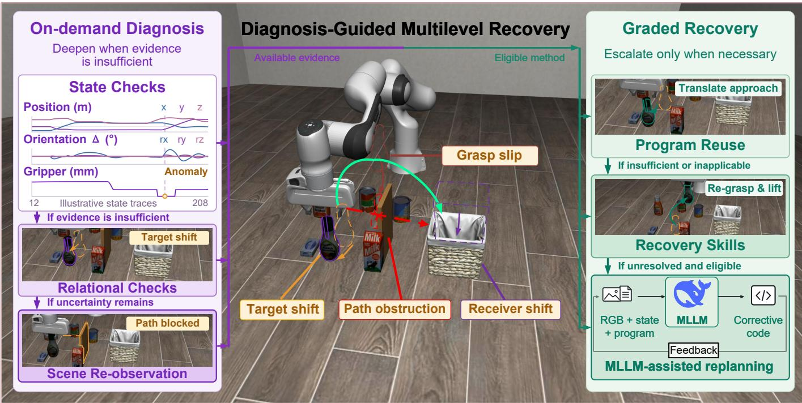  
Fig. 1. Conceptual overview of diagnosis-guided recovery in DiMuRe. The center illustrates target shift, grasp slip, path obstruction, and receiver shift. On the left, diagnosis starts with state checks and adds relational checks or new scene observations when more evidence is needed. On the right, diagnostic evidence and method preconditions determine whether to reuse the program, invoke a recovery skill, or use MLLM-assisted replanning. The local recovery examples show a translated approach and a regrasp followed by a lift. The replanning loop generates corrective code from RGB observations, execution state, program context, and execution feedback.

Abstract—Disturbances can invalidate the conditions required by a robot’s next action even when much of its task program remains useful. A recovery system must therefore choose a response suited to the current state. We present DiMuRe (diagnosis-guided multilevel recovery), a framework for robotuse agents that uses phase-specific evidence and method preconditions to select program reuse or predefined recovery skills, including bounded vision-language-action (VLA) grasping. After the original program exits, a multimodal large language model (MLLM) can generate corrective code from images and execution feedback. Local verification checks the outcome of each recovery attempt. We also introduce LIBERO-Disturb, a benchmark for robustness and recovery under mid-execution disturbances, supporting program-based agents and VLA policies. On 801 scheduled disturbed Encore development cases, Local DiMuRe (program reuse and recovery skills) achieves 77.65% completetask success, compared with 58.68% for the original program under the same physical-step allowance. Full DiMuRe achieves 81.90% with terminal replanning, an additional step allowance, and early handoff. Local DiMuRe also uses fewer physical steps per scheduled episode than the original program.

## I. INTRODUCTION

When a target object moves during manipulation, a previously valid grasp command may fail even though much of the task program remains useful. Robot-use agents express perception, motion, and feedback through executable programs [1, 2], which can already include checks and retries. Recovery therefore requires determining which parts of the existing behavior still apply. If the object has only shifted in position, translating a recorded grasp segment may suffice. If the grasp assumptions no longer hold, a different recovery procedure may be needed.

Each recovery option has limits. Program reuse preserves task-specific motions but depends on the available segments and how they can be adapted. Predefined recovery skills, including bounded vision-language-action (VLA) grasping, handle particular failures when their preconditions are met. A multimodal large language model (MLLM) can compose new action sequences from visual observations and execution feedback, at the cost of additional inference and verification. Choosing among these options requires more than a failure alarm. The system needs evidence that a response is applicable and must then check whether it restores the state needed to continue the task. Obtaining this evidence also takes time, so the decision must account for the cost of further sensing and reasoning.

To study these choices, an evaluation must introduce con  
trolled disturbances during execution. Specifying a disturbance   
does not guarantee that it was applied, had its intended   
physical effect, or prevented task completion. Recording these   
outcomes separately makes it possible to assess both the   
original program’s resilience and the benefit of added recovery. To address these challenges, we make two contributions:

• DiMuRe uses phase-specific diagnostic evidence to select among program reuse, predefined recovery skills, and MLLM-assisted replanning. It checks each method’s preconditions and verifies the result of recovery before deciding how to continue.

• LIBERO-Disturb is a benchmark for mid-execution disturbance robustness and recovery in robotic manipulation. It separates disturbance injection and task evaluation from the tested system, supporting both program-based robotuse agents and VLA policies.

The central hypothesis is that different recovery capabilities handle different failure conditions. The evaluation tests whether combining them improves task success while preserving the original program’s successful outcomes. It also measures execution time and model use. Figure 1 illustrates the approach.

## II. RELATED WORK

Benchmarks as controlled evaluation settings. LIBERO [3] organizes manipulation tasks to study knowledge transfer in robot learning. LIBERO-Disturb builds on these tasks and their goal predicates to evaluate responses to disturbances during manipulation. The disturbance protocol is separate from the tested controller, allowing evaluation of both program-based agents and VLA policies. DiMuRe is a recovery framework evaluated within this setting.

Program structure as a source $o f$ recovery capability. Program-based control combines perception and action with feedback loops and precondition checks [1, 2]. These structures provide behaviors that can be reused when execution deviates from its nominal path. Encore constructs task programs before evaluation [4], while interactive coding interfaces allow observations and execution feedback to inform further actions [5, 6]. DiMuRe retains existing routines and uses execution evidence to decide when to invoke additional recovery.

From execution evidence to recovery decisions. Monitoring can assess explicit task constraints [7] or use visual, temporal, and multisensor evidence to detect execution failures [8, 9, 10]. Such evidence supports both failure explanation and intervention: summarized execution histories can guide corrective planning [11], while policy uncertainty or grasp-state checks can trigger recovery actions [12, 13]. The time and inference required for a decision also matter. AESOP [14] connects fast anomaly detection to slower fallback selection while accounting for reasoning latency through model predictive control. DiMuRe uses diagnostic evidence to assess a candidate method’s preconditions and verifies whether its execution restores the state required to continue the task.

Restoring execution conditions and revising plans. Recovery methods can restore a required manipulation state or revise the actions used to complete a task. Geometric constraints and learned recovery skills support corrective actions [15, 16, 17], while corrected strategies and recovery experience can be retained for later reuse [18, 19]. At the planning level, execution feedback can support new task plans, motion corrections, or code repair [20, 21, 22]. The timing of this reasoning also differs: DoReMi [23] monitors plan-execution constraints to trigger recovery, whereas AgentChord [24] prepares recovery branches before execution for activation by compiled monitors. DiMuRe selects among recorded program segments, predefined skills including VLA grasping, and MLLM-assisted replanning using method preconditions and local verification. Its evaluation compares the individual recovery levels with their combined use, reporting task completion and execution costs under each configuration’s stated budget.

## III. PROBLEM SETTING

The agent executes an original task program $\mathsf { P } _ { \mathrm { o r i g } } .$ . Its source remains fixed, including its original feedback and retry logic. Disturbances may displace a target, break a grasp, or move a receiving region. The task goal remains unchanged, but subsequent commands may fail unless the affected conditions are restored. Additional recovery is needed when the original program cannot handle these changes.

Given the task instruction, program context, sensor observations, and action feedback, the problem is to determine when recovery is needed, which available method applies, and whether its outcome allows the task to continue. The objective is to complete the original task within a declared total physicalstep budget $B ,$ reusing existing behavior where possible and choosing additional recovery from the available evidence and resources. Online decisions do not use hidden simulator state, disturbance labels, or the native success predicate. The native evaluator assesses complete-task success independently.

## IV. LAYERED DIAGNOSIS AND MULTILEVEL RECOVERY

Figure 2 summarizes how phase-specific diagnosis connects original-program execution with local recovery and terminal

MLLM-assisted replanning.

## A. Program Interface and Observations

An execution monitor intercepts motion and gripper calls, records grasp and placement segments, and matches objects and receiving regions named in the program to sensor observations. In the Encore integration [4], the monitor uses RGB-D geometry, robot state, and gripper state to track object identity and motion and to assess grasping and release. It evaluates relations expressed in the task instruction using measured geometry. The index t denotes an observation or decision event, which need not advance physical execution. Positions are expressed in the robot base frame, and all lengths are in meters. A hat denotes an estimate obtained from RGB-D geometry.

## B. Layered Diagnosis: When to Intervene

The diagnoser checks execution conditions for the current manipulation phase using robot and gripper state, measured object geometry, and task relations. It requests additional observations when missing geometry or poor visibility prevents a decision. The diagnostic record is

$$
d _ { t } = \mathcal { D } ( \phi _ { t } , \mathcal { E } _ { t } ) .\tag{1}
$$

Here D is the rule-based diagnoser, $\phi _ { t }$ ∈ {grasp, transport, place, verify} is the current phase, and $\mathcal { E } _ { t }$ contains robot state, measured object geometry, task relations, action feedback, prior verification results, and budget information. The output $d _ { t }$ contains a diagnostic code, rule-based confidence, a suggested response, and supporting evidence. Missing measurements are treated as unknown. The confidence is not a calibrated probability of success.

During original-program execution, the monitor first checks the gripper opening, then compares object and tool motion to assess whether the object is attached to the gripper. Their displacement residual is

$$
e _ { t } ^ { \mathrm { f o l l o w } } = \left. \left( \hat { \mathbf { c } } _ { t } - \hat { \mathbf { c } } _ { \mathrm { r e f } } \right) - \left( \mathbf { p } _ { t } - \mathbf { p } _ { \mathrm { r e f } } \right) \right. _ { 2 } .\tag{2}
$$

The vectors $\hat { \mathbf { c } } _ { t }$ and $\mathbf { p } _ { t }$ are the current estimated object center and measured end-effector position. Subscript ref denotes the reference measurements stored for the current grasp check. The Euclidean norm $\| \cdot \| _ { 2 }$ measures the difference between the object and tool displacements. The test requires sufficient visible geometry and tool displacement $\| \mathbf { p } _ { t } - \mathbf { p } _ { \mathrm { r e f } } \| _ { 2 } > \tau _ { \mathrm { m o v e } } ,$ where $\tau _ { \mathrm { m o v e } }$ is the minimum tool displacement required to evaluate attachment. A verified grasp additionally requires $e _ { t } ^ { \mathrm { f o l l o w } } < \tau _ { \mathrm { f o l l o w } }$ and $g _ { \mathrm { m i n } } < g _ { t } < g _ { \mathrm { m a x } } ,$ , where $\tau _ { \mathrm { f o l l o w } }$ is the maximum accepted displacement residual, $g _ { t }$ is the measured gripper opening, and $g _ { \mathrm { m i n } }$ and $g _ { \mathrm { m a x } }$ are its lower and upper admissible bounds. These thresholds and measurements are lengths in meters. The monitor also requires evidence that the object is no longer supported. Insufficient motion or visibility leaves attachment unconfirmed. If the measurements suggest contact near the receiving region, the diagnoser requests release verification before classifying the object as held or slipped. After release, placement checks assess whether the object has detached from the gripper and is supported by the receiving region.

## C. Three Levels of Recovery Capability

a) Level 1: Original-program reuse: Level 1 reuses the original program’s feedback, retries, and recorded grasp and placement segments. When reference geometry is available, grasp replay translates the recorded waypoints as

$$
\begin{array} { r l } & { \delta _ { t } = \left[ \hat { c } _ { t , x } - \hat { c } _ { x } ^ { \mathrm { t p l } } \right] } \\ & { \delta _ { t } = \left[ \hat { c } _ { t , y } - \hat { c } _ { y } ^ { \mathrm { t p l } } \right] , } \\ & { \qquad \quad \mathbf { \mathscr { s } } _ { t } - s ^ { \mathrm { t p l } } \mathbf { \mathscr { s } } ^ { \prime } } \\ & { \mathbf { q } _ { j } ^ { \prime } = \mathbf { \mathscr { q } } _ { j } + \delta _ { t } , \qquad R _ { j } ^ { \prime } = R _ { j } . } \end{array}\tag{3}
$$

Here $j$ indexes motion waypoints in the recorded segment; $\mathbf { q } _ { j }$ is the original commanded end-effector position, and the prime denotes its adapted value. The vector $\delta _ { t }$ is the measured translation. The scalars $\hat { c } _ { t , x }$ and $\hat { c } _ { t , y }$ are the horizontal components of the current object-center estimate. Superscript tpl denotes the template’s stored object center and support height, while $s _ { t }$ is the current support height. Any recorded orientation $R _ { j }$ , a $3 \times 3$ rotation matrix from tool to base coordinates, is preserved. Replay does not add an orientation command where the recorded segment has none.

Replay requires a recorded segment and an object-center reference. When reference shape data are available, the system checks shape compatibility and the change in support height before execution. Otherwise, it omits the shape comparison and sets the vertical component of $\delta _ { t }$ to zero. Replay is rejected if the horizontal displacement exceeds its threshold. Equation 3 describes the waypoint translation. Execution also includes clearance moves, limits on command duration, and grasp verification. Updated receiving-region estimates can similarly be used to adjust placement targets.

b) Level 2: Predefined recovery skills: Level 2 uses geometric procedures or learned policies for targeted corrections. Geometry-based regrasp uses the measured target shape to choose the approach, gripper orientation, closure, and lift, subject to the skill’s object-size limits. Bounded VLA grasping uses GraspVLA [25] as a predefined skill. The policy receives a grasp instruction and a target hint derived from sensor observations, and the execution monitor verifies the resulting grasp. Placement recovery uses an updated receiving-region estimate together with grasp and release checks. It may reuse level-1 motion segments or invoke level-2 grasping skills. These skills apply only when their preconditions hold, and their success still requires verification.

c) Level 3: MLLM-assisted replanning: After the original program exits, an MLLM generates code that composes corrective actions. This code can combine original functions with level-2 skills, including bounded VLA grasping, to attempt recovery beyond a recorded segment or a single skill. It also adds inference and verification costs. All three levels use the same robot interface and physical-step accounting.

The source of a recovery behavior is distinct from its physical effect. For example, replaying an original-program regrasp still counts as a physical intervention. Verifying a grasp or release does not establish complete-task success.

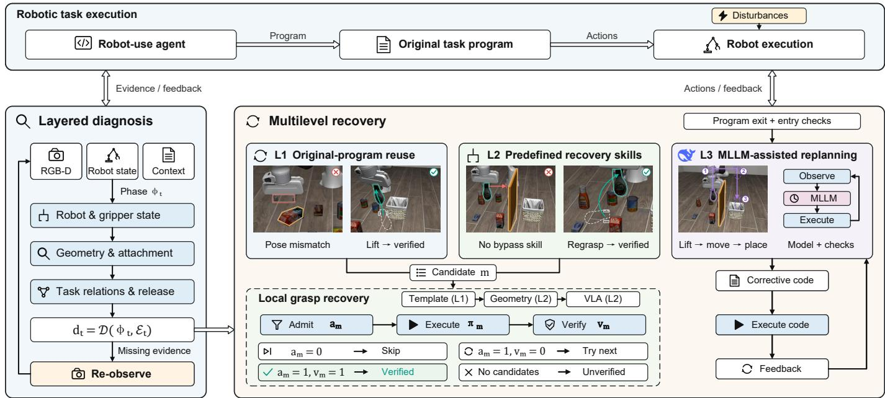  
Fig. 2. DiMuRe system architecture and recovery flow. Phase-specific diagnosis uses RGB-D observations, robot state, and program context, and requests new observations when evidence is insufficient. The dashed box shows local grasp recovery. The system considers template replay (L1), geometry-based regrasp (L2), and bounded VLA grasping (L2) in that order, checking admission $( a _ { m } ) .$ , executing the method $( \pi _ { m } ) ,$ , and verifying the grasp $( v _ { m } ) .$ It skips ineligible candidates and tries the next candidate if an attempt does not produce a verified grasp. A verified grasp ends the local search. MLLM-assisted replanning (L3) starts separately after the original program exits and its entry checks pass. The planner revises corrective code using new observations and execution feedback.

## D. Conditional Switching and Verification

Local grasp recovery considers candidates in a fixed order. The diagnostic record $d _ { t }$ , manipulation phase $\phi _ { t }$ , and method preconditions determine which candidates can run. A candidate method m is represented by

$$
\mathscr { R } _ { m } = ( \mathscr { P } _ { m } , \pi _ { m } , \mathscr { V } _ { m } ) ,\tag{4}
$$

where $\mathcal { R } _ { m }$ denotes the method, $\mathcal { P } _ { m }$ is its pre-execution admission predicate, $\pi _ { m }$ its executable recovery routine, and $\nu _ { m }$ its local grasp-verification rule. The admission predicate checks that the method and the required geometry or recorded program state are available, and that any minimum budget requirement is met. The index $m$ ranges over template replay, geometry-based regrasp, and bounded VLA grasping, considered in that order. Template replay belongs to level 1; geometry-based regrasp and VLA grasping are level-2 recovery skills. The level-3 MLLM planner starts separately after the original program exits.

The system obtains a fresh target observation before considering each candidate. If the required geometry is missing, the robot retreats upward and obtains a refined observation. The procedure ends if the geometry remains unavailable. Let $a _ { m } = 1$ when $\mathcal { P } _ { m }$ admits execution and $a _ { m } = 0$ otherwise. For an admitted candidate that returns normally, $v _ { m } = 1$ only if the execution monitor verifies the resulting grasp. Missing or unsuccessful verification gives $v _ { m } = 0$ . The transition is

$$
\begin{array} { r } { \mathrm { n e x t } ( m ) = \left\{ \begin{array} { l l } { \mathrm { s k i p ~ c a n d i d a t e , } } & { a _ { m } = 0 , } \\ { \mathrm { r e t u r n ~ v e r i f i e d ~ g r a s p , } } & { a _ { m } = 1 , \ v _ { m } = 1 , } \\ { \mathrm { a d v a n c e ~ c a n d i d a t e , } } & { a _ { m } = 1 , \ v _ { m } = 0 . } \end{array} \right. } \end{array}\tag{5}
$$

Here next is the decision about how to continue. Both skipping and advancing move to the next candidate, but only advancing follows execution of a recovery method. If no candidate remains, the procedure returns without a verified grasp. Native termination or budget exhaustion stops the procedure. Candidate attempts share a task-wide integer limit $A _ { \mathrm { m a x } }$ . Each candidate consumes one attempt before its preconditions are checked, even if it is then skipped. No further candidates are considered once the limit is reached. After a grasp is verified, movement toward the adapted target is checked separately. Equation 5 describes grasp recovery. Placement recovery uses its own release checks.

a) Shared budget and completion reserve: Let $n _ { t }$ be the cumulative number of physical control steps consumed by event t, and let $B _ { t } ~ \leq ~ B$ be the active ceiling. Here $B$ is the total budget declared for the configuration. The remaining budget is $b _ { t } = \operatorname* { m a x } ( 0 , B _ { t } - n _ { t } )$ . The evaluation protocol may assign different ceilings to the native and terminal phases. Within a recovery procedure, ordinary motion, gripper, and settling commands are admitted only if $n _ { t } + \bar { c } ( u ) \le C$ . The ceiling is fixed on entry as

$$
C = \operatorname* { m i n } \left\{ B _ { t } - r , \ n _ { \mathrm { s t a r t } } + C _ { \operatorname* { m a x } } , \ C _ { \mathrm { o u t e r } } \right\} .\tag{6}
$$

During the procedure, the cumulative physical-step count may not exceed C. The nonnegative integer r reserves steps for task completion, $n _ { \mathrm { s t a r t } }$ is the count at procedure entry, and $C _ { \mathrm { m a x } }$ caps the additional steps the procedure may consume. An enclosing procedure imposes $C _ { \mathrm { o u t e r } }$ , set to +∞ if no such procedure exists. The command u specifies a primitive and its requested duration. The implementation estimates its maximum step cost as c¯(u). All budget quantities are measured in physical steps. Commands are also rejected when native execution has stopped or $n _ { t } \ge B _ { t }$

Procedure entry additionally requires $b _ { t } \geq b _ { \operatorname* { m i n } }$ , where $b _ { \mathrm { m i n } }$ is that procedure’s minimum remaining physical-step budget. This threshold, the reserve r, and the cap $C _ { \mathrm { m a x } }$ are specified for each procedure. Nested VLA calls are also subject to tool-specific entry and completion-reserve checks. Recovery parameters and invocation limits are provided in Appendix A.

## E. Terminal MLLM-Assisted Replanning

Planner entry and round continuation require $b _ { t } \geq b _ { \mathrm { e n t r y } } ^ { \mathrm { p l a n } }$ and $b _ { t } \geq b _ { \mathrm { r o u n d } } ^ { \mathrm { p l a n } }$ , respectively, where the two thresholds specify the minimum remaining physical-step budgets for these decisions and plan identifies the terminal planner. At each round, the MLLM generates corrective code from current RGB images, structured state evidence, program context, and execution history. After the code runs, the planner receives updated observations, local verification results, and action feedback to revise its next actions. If the model proposes stopping without geometric evidence of completion, the system requests another review, subject to the review limit.

## V. LIBERO-DISTURB: MID-EXECUTION DISTURBANCE BENCHMARK

a) Benchmark overview: LIBERO-Disturb evaluates whether a robot can complete a manipulation task when a disturbance changes its execution conditions. Built on LIBERO tasks and goal predicates [3], it introduces controlled disturbances while retaining the original instruction and task objective. This setting tests both the resilience of existing behavior and the benefit of added recovery. Disturbance injection and task evaluation are separated from the tested controller, supporting program-based agents and VLA policies through their respective native execution interfaces.

b) Disturbance design: The nine disturbance types affect four aspects of execution (Fig. 3). Four change object location or motion: XY displacement changes position, object bump adds a velocity increment, slow drift applies repeated small translations, and object retrieval returns a carried object to its saved initial position.

Two disturbances affect pose: pose change applies a prescribed resting orientation, and tipover imposes a tipping rotation. These changes challenge the geometry assumed during approach and grasping. Grasp slip displaces a held object relative to the gripper, while arm retraction perturbs arm joint positions, challenging attachment and motion continuity. Finally, receiving-region shift moves the destination during transport, which can invalidate a previously selected placement target. Affected objects follow the declared selection rule and need not be the task’s named target. Together, these disturbances test when the original behavior remains useful and when additional recovery is needed.

c) Evaluation protocol: Each case specifies the task initialization, random seeds, disturbance rule, and execution limits. An intervention is applied only when its trigger and eligibility conditions are met; one event may extend over several control steps. The evaluation records disturbance application, its observed physical effect, and native completetask success separately. A disturbance with a verified physical effect need not cause an execution fault. All scheduled cases remain in the task-success denominator, and unapplied events are reported separately. Within a fixed system and protocol, configurations are paired by scheduled case to compare task success, physical steps, elapsed time, and model use. Existing Encore and VLA results are reported separately because their native protocols and evaluated coverage differ. Trigger rules, intervention parameters, and system-specific coverage are specified in Appendix C.

## VI. EXPERIMENTS

DiMuRe is evaluated on Encore for task completion, recovery-level ablation, execution costs, and anomaly response. The separate native-policy evaluation of $\pi _ { 0 . 5 }$ [26] is reported in Appendix C.

## A. Experimental Setup

The evaluation compares five configurations on the same 801 scheduled disturbed cases, using 30 fixed Encore task programs and three reset seeds. All configurations use the same disturbance injector and native evaluator and retain the original program’s checks and retries. Original has no added DiMuRe recovery. L1-only adds program reuse, and L2-only adds predefined geometry and VLA skills. Local (L1+L2) enables both, while Full (L1+L2+L3) also enables terminal MLLM replanning. L2-only disables the mixed placement retry because that procedure replays program segments.

Original, L1-only, L2-only, and Local share the same native physical-step allowance. Full has an additional terminal allowance and can hand off to the planner early. Its comparison with Local therefore does not isolate the effect of L3 under an equal budget. Original, Local, and Full also run on 90 clean cases. The disturbed subset follows an earlier development selection. The full 891-case set and both receiving-region-shift amplitudes are reported in Table S6. Run settings are given in Appendix B.

## B. Evaluation Metrics

a) Task performance: Task success rate (SR) is the fraction of scheduled episodes completed according to the native evaluator. The denominator includes episodes in which the disturbance trigger is never reached or the intervention has no effect. Changes in SR (∆SR) are measured relative to Original on the same scheduled cases and reported in percentage points (pp), using unrounded rates.

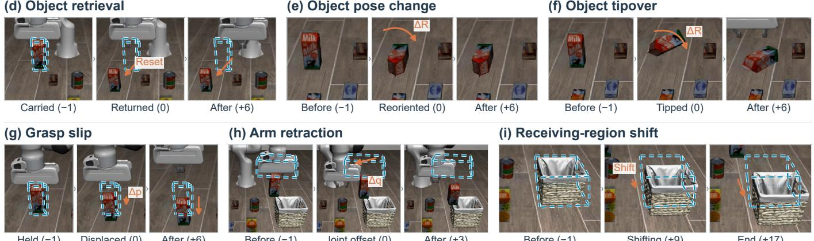

(a) Object XY displacement  
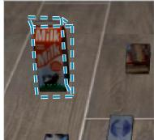  
Before (−1)

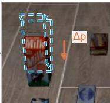  
Displaced (0)

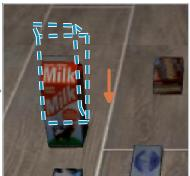  
After (+6)

(b) Object bump  
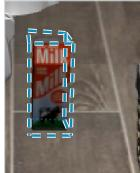  
Before (−1)

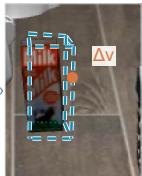  
Velocity kick (0)  
(d) Object retrieval

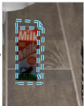  
After (+12)

(c) Slow object drift  
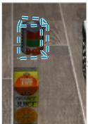  
Before (−1)

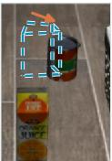  
Drifting (+29)  
End (+59)  
Held (−1)  
Displaced (0)  
Before (−1)  
Joint offset (0)  
After (+3)  
Before (−1)  
End (+17)

(f) Object tipover

Shifting (+9)

Fig. 3. Nine mid-execution disturbances in LIBERO-Disturb, shown in recorded Encore episodes: (a)–(d) object location and motion, (e)–(f) object pose, (g)–(h) grasp and robot state, and (i) receiving-region location. The three images in each example use the same camera and crop. Blue dashed wireframes mark the approximate pre-intervention position. Orange annotations indicate position (∆p), velocity (∆v), orientation (∆R), or joint-position (∆q) changes and their visible effects; grey chevrons indicate time order. Values in parentheses are relative native control-step indices ∆k. Zero marks the first recorded post-injection frame, captured after one native control step following the first intervention. The overlays are qualitative visual guides.

b) Execution costs: Task time includes online sensing, inference, service waits, execution, and recovery. Physical steps count executed native control steps, including recovery. All-case means include failed episodes. Successful episodes are measured up to the first native success, and successful-case means use each configuration’s own successful subset. These subsets can differ. Wall-clock comparisons are descriptive because configurations shared services and their runs were not fully interleaved.

c) Recorded recovery time: For each episode, recorded local and terminal recovery intervals are summed separately, counting only time within the task interval. Each mean uses the episodes that entered the corresponding stage, including failed episodes. The logs do not isolate diagnosis and adaptations made outside these recorded intervals. Detailed timing boundaries are given in Appendix B-E.

d) Anomaly response and diagnosis: Anomaly-response coverage is measured on fault episodes that can be labeled independently. It is the fraction with an explicit alarm or an observation-driven grasp or placement adjustment within the fault window. Task SR after response is the fraction of responding episodes that subsequently achieve native task success. Diagnostic accuracy separately requires the correct fault category and object role. Detailed labeling rules, diagnostic results, paired outcomes, and terminal MLLM use are reported in Appendix B.

TABLE I  
NATIVE TASK SR (%) ON 90 CLEAN AND 801 SCHEDULED DISTURBED ENCORE CASES PER CONFIGURATION.
<table><tr><td>Configuration</td><td>Clean SR (%)</td><td>Disturbed SR (%)</td></tr><tr><td>Encore</td><td></td><td></td></tr><tr><td>Original</td><td>100.00</td><td>58.68</td></tr><tr><td>Local DiMuRe (L1+L2)</td><td>100.00</td><td>77.65</td></tr><tr><td>Full DiMuRe</td><td>100.00</td><td>81.90</td></tr></table>

## C. Task Performance and Ablation

a) Overall disturbance robustness: Table I reports disturbed-task SRs of 58.68% for Original, 77.65% for Local, and 81.90% for Full. All three configurations complete all 90 clean cases, so no loss of clean-task success is observed in these runs.

b) Recovery-level ablation: L1-only and L2-only exceed Original by 14.98 and 6.87 percentage points, respectively (Table II(a)). Combining them in Local gives a larger gain of 18.98 points. L1-only completes more grasp-slip cases, whereas L2-only completes more object-pose-change cases (Table S9). These results suggest that the two recovery levels address different failures.

Across all scheduled cases, Local uses fewer physical steps than Original on average (310.20 versus 328.90), but takes more time (5.47 versus 4.65 s). Among successful episodes, Local averages 3.94 s and 226.89 steps, compared with 2.93 s and 213.46 steps for Original. Thus, Local’s lower step count over all cases does not imply a lower mean among successful episodes, whose membership differs between configurations.

TABLE II  
RECOVERY-LEVEL ABLATION, EXECUTION COSTS, AND PROCESS ANALYSIS. PANEL (A) USES 801 SCHEDULED DISTURBED CASES; ∆SR IS RELATIVE TO ORIGINAL. ALL-CASE MEANS INCLUDE FAILURES; SUCCESSFUL-CASE MEANS USE EACH CONFIGURATION’S SUCCESSFUL SUBSET. FULL HAS AN ADDITIONAL ALLOWANCE AND DISTINCT HANDOFF.  
(a) Task outcomes and execution costs
<table><tr><td rowspan="2">Configuration</td><td rowspan="2">SR (%)</td><td rowspan="2">∆SR (pp)</td><td colspan="2">Mean task time (s)</td><td colspan="2">Mean physical steps</td></tr><tr><td>All cases</td><td>Successful cases</td><td>All cases</td><td>Successful cases</td></tr><tr><td colspan="8">Encore: shared native allowance</td></tr><tr><td>Original program</td><td>58.68</td><td>0.00</td><td>4.65</td><td>2.93</td><td>328.90</td><td>213.46</td></tr><tr><td>L1-only</td><td>73.66</td><td>+14.98</td><td>5.24</td><td>3.68</td><td>317.32</td><td>229.20</td></tr><tr><td>L2-only</td><td>65.54</td><td>+6.87</td><td>5.91</td><td>3.95</td><td>349.72</td><td>229.49</td></tr><tr><td>Local DiMuRe (L1+L2)</td><td>77.65</td><td>+18.98</td><td>5.47</td><td>3.94</td><td>310.20</td><td>226.89</td></tr><tr><td colspan="8">Full configuration: additional allowance and distinct handoff</td></tr><tr><td>Full DiMuRe</td><td>81.90</td><td>+23.22</td><td>19.59</td><td>7.05</td><td>361.30</td><td>248.25</td></tr></table>

(b) Anomaly response (161/801 cases) and recovery timing (all 801 logs)
<table><tr><td rowspan="2">Configuration</td><td rowspan="2">Response coverage (%)</td><td rowspan="2">Task SR after response (%)</td><td colspan="4">Local recovery (L1+L2)</td></tr><tr><td>Episodes</td><td>Mean (s)</td><td>Terminal recovery (L3) Episodes</td><td>Mean (s)</td></tr><tr><td>Local DiMuRe (L1+L2)</td><td>126/161 (78.26)</td><td>94/126 (74.60)</td><td>271</td><td>1.80</td><td>0</td><td>N/A</td></tr><tr><td>Full DiMuRe</td><td>126/161 (78.26)</td><td>101/126 (80.16)</td><td>271</td><td>1.78</td><td>180</td><td>62.86</td></tr></table>

Response entries are count/denominator (%). Recovery time is summed within each episode up to the task-time endpoint, then averaged over episodes that entered the stage, including failures. It includes sensing, reasoning, waits, actions, and verification within the recorded intervals. Monitoring and adaptation outside those intervals are not measured separately. Local and L3 episode sets may overlap. N/A denotes no entry.

Full exceeds Local by a further 4.24 percentage points in SR. It also has the highest all-case means: 19.59 s and 361.30 steps. Among successful episodes, the means are 7.05 s and 248.25 steps. Full therefore completes more tasks at greater execution cost, under its additional allowance and early-handoff rules.

## D. Anomaly Response and Recovery Time

Saved ground-truth trajectories and video from the same trial allow fault windows to be identified in 161 of 801 episodes per configuration. Episodes without sufficient evidence are left unlabeled, not treated as normal. In Table II(b), response coverage is 78.26% for both configurations, while subsequent task SR among responding episodes is 74.60% for Local and 80.16% for Full.

Recovery timing uses all 801 episode logs per configuration, regardless of whether a fault label is available. Each mean covers the episodes that enter that stage. Because these episode sets differ, the means do not compare recovery speed on matched inputs. Timing boundaries and coverage are given in Appendix B-E.

## VII. LIMITATIONS AND DISCUSSION

Occlusion and incorrect object matching can cause errors in both method selection and local verification. A fixed candidate order may also exhaust the budget before a suitable VLA skill or the MLLM planner can be used. A more reliable taskcompletion check is needed to decide whether terminal replanning is necessary. The contributions of its perception, memory, and reasoning components also require further ablation. Any stored recovery experience must be fixed before evaluation and kept separate from test cases.

The single-level comparisons do not fully isolate each component because placement retries can combine program replay with recovery skills. Full’s additional allowance and early handoff also prevent attributing its gains over Local to L3 alone. The retrospective diagnostic analysis covers only fault windows that can be labeled independently. Normal states and faults across the full evaluation set have not been exhaustively annotated. Further controls should use equal physical-step budgets and identical diagnostic inputs.

The existing Encore and VLA evaluations use different disturbance versions and execution protocols. They show that disturbances can be evaluated with both program-based agents and VLA policies, but direct performance comparisons require aligned conditions and scoring. Current evidence is limited to simulation.

## VIII. CONCLUSION

LIBERO-Disturb evaluates robustness and recovery under mid-execution disturbances, recording disturbance application, physical effects, and task outcomes separately. DiMuRe uses diagnostic evidence to select program reuse, predefined recovery skills including bounded VLA grasping, or MLLMassisted replanning, and verifies the result before continuing. In the Encore development experiments, Local DiMuRe achieves higher native complete-task success than the original program under the same step allowance. Full DiMuRe achieves further gains with a larger allowance and early handoff, at the cost of additional online time and terminal model use.

## REFERENCES

[1] J. Liang, W. Huang, F. Xia, P. Xu, K. Hausman, B. Ichter, P. Florence, and A. Zeng. Code as Policies: Language

model programs for embodied control. In IEEE International Conference on Robotics and Automation (ICRA), pages 9493–9500, 2023. doi: 10.1109/ICRA48891.2023. 10160591.

[2] I. Singh, V. Blukis, A. Mousavian, A. Goyal, D. Xu, J. Tremblay, D. Fox, J. Thomason, and A. Garg. Prog-Prompt: Generating situated robot task plans using large language models. In IEEE International Conference on Robotics and Automation (ICRA), pages 11523–11530, 2023. doi: 10.1109/ICRA48891.2023.10161317.

[3] B. Liu, Y. Zhu, C. Gao, Y. Feng, Q. Liu, Y. Zhu, and P. Stone. LIBERO: Benchmarking knowledge transfer for lifelong robot learning. In Advances in Neural Information Processing Systems, volume 36, pages 44776–44791, 2023. doi: 10.52202/075280-1939.

[4] Y. Kang, Z. Wang, Z. Fan, and B. Liu. Encore: Fewshot agentic discovery of manipulation strategies. arXiv preprint arXiv:2609.37359, 2026.

[5] Z. Chu, E. T. Barr, C. Le Goues, P. O’Hearn, M. Harman, F. Sarro, and H. Ye. OpenRUA: Robot-use agents are zero-shot visuomotor policies. arXiv preprint arXiv:2610.02459, 2026.

[6] R. Si, J. Bi, S. Yang, R. Ni, W. Huang, Q. Wang, S. Jiang, Y. Zhang, F. Ruan, K. Zhang, et al. Fewer tokens, better action: GPT-6 Astra robot agents with 14% higher success rate but 65% fewer tokens. arXiv preprint arXiv:2610.01939, 2026.

[7] E. Zhou, Q. Su, C. Chi, Z. Zhang, Z. Wang, T. Huang, L. Sheng, and H. Wang. Code-as-Monitor: Constraintaware visual programming for reactive and proactive robotic failure detection. In Proceedings of the IEEE/CVF Conference on Computer Vision and Pattern Recognition, pages 6919–6929, 2025. doi: 10.1109/ CVPR52734.2025.00649.

[8] J. Duan, W. Pumacay, N. Kumar, Y. R. Wang, S. Tian, W. Yuan, R. Krishna, D. Fox, A. Mandlekar, and Y. Guo. AHA: A vision-language-model for detecting and reasoning over failures in robotic manipulation. In International Conference on Learning Representations, 2025.

[9] C. Agia, R. Sinha, J. Yang, Z. Cao, R. Antonova, M. Pavone, and J. Bohg. Unpacking failure modes of generative policies: Runtime monitoring of consistency and progress. In Proceedings of the 8th Conference on Robot Learning, volume 270 of Proceedings of Machine Learning Research, pages 689–723. PMLR, 2025.

[10] A. V. Periasami, X. Luo, H. Li, and X. Cheng. FRAMES: Failure recovery and monitoring of embodied skills for humanoid loco-manipulation. arXiv preprint arXiv:2609.22538, 2026.

[11] Z. Liu, A. Bahety, and S. Song. REFLECT: Summarizing robot experiences for failure explanation and correction. In Proceedings of the 7th Conference on Robot Learning, volume 229 of Proceedings of Machine Learning Research, pages 3468–3484. PMLR, 2023.

[12] C.-M. Hung, L. Sun, Y. Wu, I. Havoutis, and I. Posner. Introspective visuomotor control: Exploiting uncertainty

in deep visuomotor control for failure recovery. In IEEE International Conference on Robotics and Automation (ICRA), pages 6293–6299, 2021. doi: 10.1109/ ICRA48506.2021.9561749.

[13] W. Wang, M. Hosseinzadeh, and F. Dayoub. A physical agentic loop for language-guided grasping with execution-state monitoring. arXiv preprint arXiv:2604.07395, 2026.

[14] R. Sinha, A. Elhafsi, C. Agia, M. Foutter, E. Schmerling, and M. Pavone. Real-time anomaly detection and reactive planning with large language models. In Proceedings of Robotics: Science and Systems, 2024. doi: 10.15607/ RSS.2024.XX.114.

[15] W. Huang, C. Wang, Y. Li, R. Zhang, and L. Fei-Fei. ReKep: Spatio-temporal reasoning of relational keypoint constraints for robotic manipulation. In Proceedings of the 8th Conference on Robot Learning, volume 270 of Proceedings of Machine Learning Research, pages 4573– 4602. PMLR, 2025.

[16] S. Vats, M. Likhachev, and O. Kroemer. Efficient recovery learning using model predictive meta-reasoning. In IEEE International Conference on Robotics and Automation (ICRA), pages 7258–7264, 2023. doi: 10.1109/ ICRA48891.2023.10160382.

[17] G. Zhao, Z. Tang, X. Chen, Z. Kuang, Y. Tian, and G. Li. FLARE: A failure-aware framework for autonomous correction and recovery in visual-language robotic manipulation. In Proceedings of the IEEE/CVF Conference on Computer Vision and Pattern Recognition, pages 22391–22401, 2026.

[18] Z. Luo, Y. Yang, Y. Zhang, and F. Zheng. RoboReflect: A robotic reflective reasoning framework for grasping ambiguous-condition objects. arXiv preprint arXiv:2501.09307, 2025.

[19] I. Liu, A.-C. Cheng, J. Bjorck, Z. Yu, H. Yin, J. Kautz, L. Fan, Y. Zhu, and S. Liu. Recova: Agent-guided failure recovery for autonomous robotic manipulation. arXiv preprint arXiv:2610.01178, 2026.

[20] W. Huang, F. Xia, T. Xiao, H. Chan, J. Liang, P. Florence, A. Zeng, J. Tompson, I. Mordatch, Y. Chebotar, et al. Inner Monologue: Embodied reasoning through planning with language models. In Proceedings of the 6th Conference on Robot Learning, volume 205 of Proceedings of Machine Learning Research, pages 1769–1782. PMLR, 2023.

[21] H. Chen, Y. Yao, R. Liu, C. Liu, and J. Ichnowski. Robot failure recovery using vision-language models with optimized prompts. In American Control Conference (ACC), pages 1983–1988, 2025. doi: 10.23919/ACC63710.2025. 11107751.

[22] Y. Liu, Z. Liang, Z. Chen, T. Chen, M. Hu, W. Dong, C. Xu, Z. Han, Y. Qin, and Y. Mu. HyCodePolicy: Hybrid language controllers for multimodal monitoring and decision in embodied agents. arXiv preprint arXiv:2508.02629, 2025.

[23] Y. Guo, Y.-J. Wang, L. Zha, and J. Chen. DoReMi:

Grounding language model by detecting and recovering from plan-execution misalignment. In IEEE/RSJ International Conference on Intelligent Robots and Systems (IROS), pages 12124–12131, 2024. doi: 10.1109/ IROS58592.2024.10802284.

[24] S. Xu, R. Jin, H. Zhou, B. Yue, G. Qiao, Y. Tai, Y. Deng, K. Jia, and G. Liu. From reaction to anticipation: Proactive failure recovery through agentic task graph for robotic manipulation. In Proceedings of Robotics: Science and Systems, 2026. doi: 10.15607/RSS.2026. XXII.180.

[25] S. Deng, M. Yan, S. Wei, H. Ma, Y. Yang, J. Chen, Z. Zhang, T. Yang, X. Zhang, H. Cui, et al. GraspVLA: A grasping foundation model pre-trained on billion-scale synthetic action data. In Proceedings of the 9th Conference on Robot Learning, volume 305 of Proceedings of Machine Learning Research, pages 1004–1029. PMLR, 2025.

[26] Physical Intelligence, K. Black, N. Brown, J. Darpinian, K. Dhabalia, D. Driess, A. Esmail, M. Equi, C. Finn, N. Fusai, et al. π0.5: A vision-language-action model with open-world generalization. arXiv preprint arXiv:2504.16054, 2025. doi: 10.48550/arXiv.2504. 16054.

[27] N. Carion, L. Gustafson, Y.-T. Hu, S. Debnath, R. Hu, D. Suris Coll-Vinent, C. Ryali, K. V. Alwala, H. Khedr, A. Huang, et al. SAM 3: Segment anything with concepts. In International Conference on Learning Representations, 2026.

## APPENDIX A RECOVERY PARAMETERS

The following thresholds and budgets specify DiMuRe’s recovery settings in the reported experiments. Symbols retain their main-text meanings.

## A. Program-Execution Grasp Verification

Table S1 gives the thresholds for the strict inequalities and evidence checks associated with Eq. 2.

TABLE S1  
THRESHOLDS FOR GRASP VERIFICATION DURING ORIGINAL-PROGRAM EXECUTION.
<table><tr><td>Symbol</td><td>Meaning</td><td>Value</td><td>Unit</td></tr><tr><td>Tmove</td><td>Minimum tool displacement for evaluating attachment</td><td>0.025</td><td>m</td></tr><tr><td>Tfollow</td><td>Maximum accepted object/tool displacement residual</td><td>0.035</td><td>m</td></tr><tr><td>9min</td><td>Lower admissible gripper opening</td><td>0.003</td><td>m</td></tr><tr><td>gmax</td><td>Upper admissible gripper opening</td><td>0.070</td><td>m</td></tr></table>

## B. Recovery Attempts and Physical-Step Budgets

Table S2 instantiates Eq. 6. Attempts are counted before candidate preconditions are checked. All step quantities refer to native physical control steps.

TABLE S2  
CANDIDATE-ATTEMPT LIMITS AND PHYSICAL-STEP BUDGETS.
<table><tr><td>Symbol</td><td>Applicable procedure or invocation</td><td>Value</td><td>Unit</td></tr><tr><td>Amax</td><td>Shared candidate-attempt limit across the task</td><td>3</td><td>attempts</td></tr><tr><td> $b _ { \mathrm { m i n } }$ </td><td>Grasp-recovery entry</td><td>250</td><td>steps</td></tr><tr><td>bmin</td><td>Placement-retry entry</td><td>230</td><td>steps</td></tr><tr><td>r</td><td>Grasp recovery and placement retry</td><td>150</td><td></td></tr><tr><td> $C _ { \mathrm { m a x } }$ </td><td>Grasp-recovery procedure</td><td>450</td><td>steps</td></tr><tr><td>Cmax</td><td></td><td>500</td><td>steps</td></tr><tr><td>bvla</td><td>Placement-retry procedure</td><td>420</td><td>steps</td></tr><tr><td>min</td><td>VLA candidate within the ordered grasp route</td><td></td><td>steps</td></tr><tr><td> $C _ { \mathrm { r e q } } ^ { \mathrm { v 1 a } }$ </td><td>Requested VLA cap within the ordered grasp route</td><td>280</td><td>steps</td></tr><tr><td> $r _ { \mathrm { v l a } }$ </td><td>Bounded VLA tool, including terminal-planner calls</td><td>150</td><td>steps</td></tr><tr><td>r</td><td>Terminal planner&#x27;s outer procedure</td><td>0</td><td>steps</td></tr><tr><td> $C _ { \mathrm { m a x } }$ </td><td>Terminal planner&#x27;s outer procedure</td><td>B-  ${ \underline { { n _ { \mathrm { s t a r t } } } } }$ </td><td>steps</td></tr></table>

The outer procedure for terminal replanning can use the budget remaining at entry. A nested VLA call retains its own 150-step completion reserve and starts only if at least 120 steps remain after applying the requested cap, active ceiling, and reserve. VLA requests from the terminal planner are limited to [120, 260] steps. The ordered grasp route requests at most 280 steps.

## C. Terminal MLLM-Assisted Replanning

After normal program exit, the system performs final release checks and eligible placement retries. Early handoff may instead interrupt the program after persistent faults, before those retries. The terminal allowance becomes available before the planner’ entry checks. The planner can be invoked at most once, provided physical execution is still available and the entry threshold in Table S3 is met. Subsequent rounds use the round-continuation threshold. Its verifier compares successive observations without using the stored grasp reference in Eq. 2.

Generic reviews of unverified stop proposals share the cap $K _ { \mathrm { r e v i e w } }$ . Contact-release and skill-availability branches can each request one additional review; all reviews consume rounds within $K _ { \mathrm { p l a n } }$

TABLE S3  
TERMINAL MLLM PLANNER ENTRY THRESHOLDS AND EXECUTION LIMITS.
<table><tr><td>Symbol</td><td>Meaning</td><td>Value</td><td>Unit</td></tr><tr><td> $\overline { { b _ { \mathrm { e n t r v } } ^ { \mathrm { p l a n } } } }$ </td><td>Minimum remaining budget for planner entry</td><td>80</td><td>steps</td></tr><tr><td> $b ^ { \mathrm { p l a n } ^ { \circ } }$ </td><td>Minimum remaining budget for beginning a round</td><td>40</td><td>steps</td></tr><tr><td>round</td><td>Maximum planning rounds within the invocation</td><td>32</td><td>rounds</td></tr><tr><td> $K _ { \mathrm { p l a n } }$  Kreview</td><td></td><td>2</td><td>requests</td></tr><tr><td></td><td>Shared cap on generic reviews of unverified stop proposals Maximum counted physical-command calls per fragment</td><td>12</td><td>commands</td></tr><tr><td> $K _ { \mathrm { c m d } }$  Texec</td><td>Wall-clock execution limit per generated fragment</td><td>45</td><td>S</td></tr></table>

The time limit for a generated fragment covers its execution and any calls made from within it. Automatic observations and model requests outside the fragment are excluded from this limit but included in end-to-end task time (Appendix B-B).

## A. Experimental Settings and Configurations

The completed evaluation contains 4,545 runs with the settings in Table S4. The 801-case subset used in the main text excludes the 90 cases with 6 cm receiving-region shifts and retains those with 12 cm shifts. This subset was chosen during earlier development and was not preregistered as a held-out evaluation. Results for both amplitudes and the full set are reported in Table S6.

TABLE S4  
RUN SETTINGS AND RECOVERY CONFIGURATIONS. ORIGINAL-PROGRAM CHECKS AND RETRIES ARE RETAINED THROUGHOUT.
<table><tr><td>Setting</td><td>Value</td></tr><tr><td>Task programs</td><td>30 fixed Encore programs</td></tr><tr><td>Random seeds</td><td>Environment reset: 51, 52, 53; disturbance RNG: 700 + seed</td></tr><tr><td>Evaluation sets</td><td>Original/Local/Full: 90 clean and 891 disturbed each; L1-only/L2-only: 801 disturbed each</td></tr><tr><td>Controlled components</td><td>Fixed task programs, perception models, and disturbance settings</td></tr><tr><td>Disturbance protocol</td><td>Trigger rules, perturbation parameters, and validity checks in Appendix C</td></tr><tr><td>Recovery configurations</td><td>Original: no added recovery; L1-only: program reuse; L2-only: geometry/VLA skills; Local: L1+L2; Full:</td></tr><tr><td>Configuration differences</td><td>Local plus terminal replanning</td></tr><tr><td>Physical-step allowance</td><td>L2-only disables mixed program-segment placement retry; Full enables early handoff Original/Local/L1-only/L2-only: 1,000; Full: 1,000 native + 400 terminal</td></tr><tr><td>Execution conditions</td><td>Two GPUs, one episode per GPU; shared SAM 3 [27] perception and GraspVLA [25] services</td></tr><tr><td>Terminal model</td><td>DeepSeek V4.1 Flash</td></tr></table>

Full raises the cumulative step ceiling from 1,000 to 1,400 without resetting the counter, so unused native steps remain available. Because Full also changes the budget and handoff timing, its gains over Local cannot be attributed to L3 alone. Disabling the mixed placement retry in L2-only also prevents fully isolating the effect of L1.

## B. Metric Definitions

Table S5 defines each metric and the episodes included in its denominator. Rates are shown as percentages. A zero denominator is reported as N/A, and unmeasured values are not replaced by zero.

The task interval begins with the first online observation or program operation, whichever occurs first. It ends at the first native success or, for a failed run, the first recorded native termination. If a failed run has no termination record, the interval ends when online execution ends. Program exit or handoff to the planner does not by itself end the interval. Task time includes sensing, preprocessing, service waits, inference, execution, and retries. It excludes reset, loading, warm-up, and offline program construction. Physical steps count executed native control steps within the same interval, including recovery. Simulator substeps and high-level calls are not counted as control steps.

TABLE S5  
METRIC DEFINITIONS AND STATISTICAL POPULATIONS. ALL TASK-SUCCESS MEASURES USE NATIVE COMPLETE-TASK SUCCESS; LOCAL GRASP
<table><tr><td>Metric</td><td>Definition and denominator</td></tr><tr><td>SR and ∆SR</td><td>Native task successes divided by all scheduled episodes, including unreached or ineffective disturbances. ∆SR is the difference from Original in percentage points, computed from unrounded rates.</td></tr><tr><td>Recovery and retention</td><td>Successful outcomes among Original failures and among Original successes, respectively, paired by scheduled case</td></tr><tr><td>Mean task time and steps</td><td>Arithmetic means over all scheduled episodes, including failures, or over each configuration&#x27;s successful subset as labeled. Successful subsets can differ between configurations.</td></tr><tr><td>Recorded recovery time</td><td>Sum of logged stage intervals within the task interval, averaged over episodes entering that stage before the endpoint, including failed episodes. Local and terminal stages are measured separately.</td></tr><tr><td>Anomaly-response coverage</td><td>Auditable first-fault windows containing a qualifying alarm or target adaptation, divided by all auditable windows; repeated responses count once.</td></tr><tr><td>Task SR after response Diagnostic accuracy</td><td>Native task successes strictly after the first qualifying response, divided by responding windows.</td></tr><tr><td></td><td>Correct class-and-role diagnoses in the final eligible formal output, divided by all auditable first-fault windows.</td></tr><tr><td>Task SR after correct diagnosis</td><td>Subsequent native task successes divided by correctly diagnosed windows, including windows in which recovery is not executed.</td></tr><tr><td>Terminal-model use</td><td>Submitted L3 requests and recorded tokens averaged over all scheduled episodes, including episodes without planner entry and requests whose responses are rejected. Cached input is already included in input tokens.</td></tr></table>

Recorded recovery time includes sensing, reasoning, waits, actions, and verification within each stage. These costs are already included in task time. The logs do not separately time routine monitoring or inline adaptations without recorded start and end times, so this measure does not capture all diagnosis and recovery overhead. Each stage’s mean uses its own episode set, and an episode may enter more than one stage.

Time and step records are complete for the 801-case subset. Successful-case means use 470, 590, 525, 622, and 656 episodes for Original, L1-only, L2-only, Local, and Full, respectively. Configurations shared services, and their runs were not fully interleaved. Wall-clock comparisons are therefore descriptive.

## C. Full Evaluation Set and Disturbance Verification

The task-success denominator includes all scheduled cases, even when a trigger is not reached, a disturbance has no effect, or execution ends because of budget exhaustion or a safety stop. Table S6 also reports the 6 cm cases, on which Local and Full complete fewer tasks than Original.

TABLE S6  
NATIVE TASK SUCCESS ON THE FULL DISTURBED DEVELOPMENT SET, THE MAIN-TEXT SUBSET, AND EACH RECEIVING-REGION SHIFT AMPLITUDE ENTRIES ARE SUCCESSFUL EPISODES / SCHEDULED EPISODES. CASES REMAIN IN THE DENOMINATOR WHETHER OR NOT THE INTERVENTION HAS A VERIFIED EFFECT.
<table><tr><td>Evaluation set</td><td>N</td><td>Original</td><td>Local</td><td>Full</td></tr><tr><td>Main-text subset (without 6 cm)</td><td>801</td><td>470/801</td><td>622/801</td><td>656/801</td></tr><tr><td>Full disturbed set</td><td>891</td><td>549/891</td><td>689/891</td><td>725/891</td></tr><tr><td>Receiving-region shift, 6 cm</td><td>90</td><td>79/90</td><td>67/90</td><td>69/90</td></tr><tr><td>Receiving-region shift, 12 cm</td><td>90</td><td>49/90</td><td>77/90</td><td>77/90</td></tr></table>

Table S7 distinguishes whether an intervention was applied from whether its physical effect was verified (realized). A missing effect check remains unknown. The official goal predicate is also checked after each run. This final-time check is separate from the native evaluator’s complete-task success signal.

TABLE S7  
DISTURBANCE APPLICATION, EFFECT VERIFICATION, AND FINAL-TIME CHECKS ON 801 SCHEDULED CASES PER CONFIGURATION. APPLICATION RECORDS ARE COMPLETE. EFFECT CHECKS ARE EITHER POSITIVE OR MISSING; MISSING CHECKS REMAIN UNKNOWN.
<table><tr><td></td><td></td><td>Effect verified</td><td>Effect check</td><td>Final check</td></tr><tr><td>Configuration Original</td><td>Applied 631</td><td>105</td><td>missing 696</td><td>passed 470</td></tr><tr><td>L1-only</td><td>632</td><td>105</td><td>696</td><td>590</td></tr><tr><td>L2-only</td><td>632</td><td>105</td><td>696</td><td>523</td></tr><tr><td>Local DiMuRe</td><td>632</td><td>105</td><td>696</td><td>620</td></tr><tr><td>Full DiMuRe</td><td>632</td><td>105</td><td>696</td><td>654</td></tr></table>

Across all 4,545 runs, eight episodes achieve native success but fail the final-time check: three Local runs, their three matched Full runs, and two L2-only runs. No run passes the final-time check without achieving native success. Task SR uses the native evaluator’s complete-task success signal. The available records do not explain these discrepancies.

## D. Paired and Per-Type Outcomes

Table S8 measures how often each configuration recovers a case that Original fails or retains a case that Original completes. The denominators are Original’s failures and successes, respectively.

TABLE S8  
PAIRED NATIVE OUTCOMES ON THE 801-CASE DISTURBED SUBSET. COUNTS AND PERCENTAGES USE ORIGINAL’S FAILURES (LEFT) OR SUCCESSES(RIGHT) AS THE DENOMINATOR.
<table><tr><td>Configuration</td><td>Original failures recovered (%)</td><td>Original successes retained (%)</td></tr><tr><td>Full DiMuRe</td><td>194/331 (58.61)</td><td>462/470 (98.30)</td></tr><tr><td>Local DiMuRe (no L3)</td><td>159/331 (48.04)</td><td>463/470 (98.51)</td></tr><tr><td>L1-only</td><td>125/331 (37.76)</td><td>465/470 (98.94)</td></tr><tr><td>L2-only</td><td>69/331 (20.85)</td><td>456/470 (97.02)</td></tr></table>

Relative to Local, Full succeeds on 35 additional cases and fails on one case that Local completes. In that lost case, Full invokes early handoff while the matched Local run continues to success. Comparing the single-level configurations, 106 cases succeed only with L1-only and 41 only with L2-only. Local succeeds on three cases where both single-level configurations fail and fails on two where both succeed. Runs are paired by scheduled case, but their subsequent states can differ. Table S9 reports outcomes by disturbance type.

TABLE S9  
NATIVE TASK SUCCESSES BY SCHEDULED DISTURBANCE TYPE ON THE 801-CASE DEVELOPMENT SUBSET. EACH ENTRY IS A SUCCESS COUNT WITH THE ROW DENOMINATOR N. FULL HAS A LARGER ALLOWANCE AND USES EARLY HANDOFF. SCHEDULED CASES REMAIN IN THE DENOMINATOR EVEN WHEN NO DISTURBANCE IS APPLIED.
<table><tr><td>Disturbance</td><td>N</td><td>Original</td><td>L1-only</td><td>L2-only</td><td>Local</td><td>Full</td></tr><tr><td>Arm retraction</td><td>90</td><td>83</td><td>83</td><td>84</td><td>84</td><td>84</td></tr><tr><td>Grasp slip</td><td>90</td><td>38</td><td>72</td><td>49</td><td>70</td><td>76</td></tr><tr><td>Object bump</td><td>90</td><td>90</td><td>90</td><td>90</td><td>90</td><td>90</td></tr><tr><td>Object pose change</td><td>81</td><td>26</td><td>26</td><td>47</td><td>47</td><td>47</td></tr><tr><td>Receiving-region shift (12 cm)</td><td>90</td><td>49</td><td>77</td><td>49</td><td>77</td><td>77</td></tr><tr><td>Object retrieval</td><td>90</td><td>24</td><td>58</td><td>29</td><td>58</td><td>69</td></tr><tr><td>Slow object drift</td><td>90</td><td>85</td><td>85</td><td>83</td><td>85</td><td>88</td></tr><tr><td>Object tipover</td><td>90</td><td>43</td><td>44</td><td>56</td><td>55</td><td>59</td></tr><tr><td>Object XY displacement</td><td>90</td><td>32</td><td>55</td><td>38</td><td>56</td><td>66</td></tr><tr><td>Total</td><td>801</td><td>470</td><td>590</td><td>525</td><td>622</td><td>656</td></tr></table>

## E. Timing Audit of Recorded Recovery Procedures

The timing analysis uses all 801 logs per configuration, regardless of fault-label availability. All procedure entry and exit times are recorded in order. Within the task interval defined in Appendix B-B, 271 episodes enter local recovery in each of Local and Full, and 180 Full episodes enter terminal recovery. Local and terminal intervals do not overlap in time, although an episode can enter both stages.

## F. Retrospective Diagnostic Evaluation

a) Independent labels and coverage: In each of Local and Full, 161 of 801 episodes (20.10%) contain a first-fault window that can be labeled independently. Labels were assigned from ground-truth (GT) states and video from the same trial, without access to diagnostic outputs, disturbance names, or final task outcomes. Each label identifies the earliest fault supported by the evidence and the role of the affected object. Naturally occurring faults are included. Labels were fixed before comparison with diagnostic outputs. The other 640 episodes per configuration lack sufficient evidence about the fault or its timing, contain ambiguous concurrent faults, or undergo recovery before the first fault can be established. These episodes remain unlabeled.

A fault window starts at fault onset and ends when recovery first changes the faulty condition, the condition disappears, or the task terminates. Taking a new observation alone does not end the window. GT steps and diagnostic timestamps are aligned using the recorded start of online execution, native control-step records, and video frame indices. If onset is uncertain, an output is accepted only if it occurs after the latest possible onset or adjacent step records establish that it follows the fault. Unresolved temporal orderings remain unscorable.

b) Response and diagnostic criteria: A response counts if it occurs within the fault window and either raises an execution anomaly alarm or adjusts a grasp or placement target using new observations. This includes an adjustment that ends the window. Insufficient-evidence outputs, positive checks, budget-status messages, recovery entry without a qualifying response, and alarms after task success do not count.

Diagnostic accuracy uses the last eligible formal output before the window ends. That output must match both the labeled fault class and the object role. Missing, incorrect, or unresolved outputs count as incorrect, even if an earlier output was correct. All correctly diagnosed windows enter the denominator for subsequent task success, including those in which recovery is not admitted or executed.

TABLE S10  
ANOMALY RESPONSES, FORMAL DIAGNOSES, AND SUBSEQUENT NATIVE TASK SUCCESS ON 161 AUDITABLE WINDOWS PER CONFIGURATION. ENTRIES SHOW NUMERATOR / DENOMINATOR. THE SHARED COLUMNS HAVE IDENTICAL OBSERVED COUNTS FOR LOCAL AND FULL; SUCCESS AFTER RESPONSE AND AFTER CORRECT DIAGNOSIS USE DIFFERENT POPULATIONS.
<table><tr><td rowspan="2">Fault family</td><td rowspan="2">Response (both)</td><td rowspan="2">Correct diagnosis (both)</td><td colspan="2"></td><td rowspan="2">Task success after correct diagnosis (both)</td></tr><tr><td>Task success after response</td><td></td></tr><tr><td></td><td></td><td></td><td>Local</td><td>Full</td><td></td></tr><tr><td>Grasp not established</td><td>31/34</td><td>15/34</td><td>23/31</td><td>24/31</td><td>15/15</td></tr><tr><td>Holding lost</td><td>30/34</td><td>12/34</td><td>15/30</td><td>21/30</td><td>11/12</td></tr><tr><td>Receiving region moved</td><td>31/36 34/57</td><td>30/36 0/57</td><td>28/31</td><td>28/31</td><td>28/30 N/A</td></tr><tr><td>Target state changed Total</td><td>126/161</td><td>57/161</td><td>28/34 94/126</td><td>28/34 101/126</td><td>54/57</td></tr></table>

Both configurations have 78.26% response coverage and 35.40% formal diagnostic accuracy (Table S10). Task success after a correct diagnosis is 94.74%. A response may address a later problem in the window without correctly identifying the first fault. In the target-state category, no formal diagnosis matches the label (0/57), although target adjustments can still count as responses.

These conditional success rates do not establish a causal effect of recovery. Labels use object roles because diagnostic logs do not identify individual object instances. Normal states were not exhaustively labeled, so these rates cannot be generalized to all 801 episodes or used to estimate false alarms. The logs also do not consistently record when diagnostic processing begins, and some fault onset times remain uncertain. They therefore do not support complete diagnostic-latency measurement or reliably aligned onset-to-alarm delays.

## G. Terminal MLLM Use

Full invoked the terminal planner in 180 of 801 disturbed episodes and submitted 1,547 requests, including requests whose responses were rejected. Original and Local had terminal replanning disabled and made no L3 requests. Table S11 covers terminal-model requests only; usage by perception, VLA, and diagnosis-only calls was not fully recorded.

TABLE S11  
FULL DIMURE TERMINAL-MODEL USE, AVERAGED OVER ALL 801 SCHEDULED EPISODES, INCLUDING THOSE WITHOUT PLANNER ENTRY. CACHED INPUT IS INCLUDED IN INPUT TOKENS. VALUES ARE ROUNDED FROM RECORDED REQUEST USAGE.
<table><tr><td></td><td>L3</td><td>Input</td><td>Output</td><td>Cached input</td></tr><tr><td>Configuration</td><td>requests</td><td>tokens</td><td>tokens</td><td>tokens</td></tr><tr><td>Full DiMuRe</td><td>1.93</td><td>204,421</td><td>570</td><td>30,825</td></tr></table>

## APPENDIX C

## LIBERO-DISTURB PROTOCOLS AND VLA EVIDENCE

## A. Disturbance Definitions and Encore Settings

All nine disturbance types in Fig. 3 are represented in the Encore evaluation. Table S12 lists their triggers and intended interventions in the same order as the figure. Object pose change is configured for 27 programs (81 cases). Each other type has 90 cases per amplitude. Receiving-region shifts of 6 and 12 cm are two settings of one type, giving 891 disturbed cases in total. The 801-case main-text subset retains only the 12 cm setting.

TABLE S12  
NINE DISTURBANCE TYPES IN THE EVALUATED ENCORE PROTOCOL. STEPS ARE NATIVE PHYSICAL CONTROL STEPS. THE SETTINGS DESCRIBE INTENDED INTERVENTIONS, NOT GUARANTEED PHYSICAL EFFECTS OR TASK FAILURES.
<table><tr><td>Disturbance</td><td>Trigger or target selection</td><td>Nominal intervention</td></tr><tr><td>Object XY displacement</td><td>Step 30; declared task target</td><td>Random horizontal shift of 6–10 cm; bounded by workspace, separation, and penetration checks</td></tr><tr><td>Object bump</td><td>Step 40; random free object excluding the nearest to the tool</td><td>Horizontal velocity increment of 0.3-0.6 m/s in a random direction</td></tr><tr><td>Slow object drift</td><td>Step 20; object nearest to the tool</td><td>Horizontal translation of 1 mm per step for 60 steps in a random direction</td></tr><tr><td>Object retrieval</td><td>Poll every 5 steps from step 80; held object displaced more than 8 cm in XY</td><td>Reset the object&#x27;s position to its initial position and zero its velocity</td></tr><tr><td>Object pose change</td><td>Poll every 10 steps from step 20 to 520; eligible resting target</td><td>Apply the predefined orientation assigned to the case, subject to clearance and settling checks</td></tr><tr><td>Object tipover</td><td>Step 40; object nearest to the tool</td><td>Rotate by 90° about a random horizontal axis and raise by 3 cm</td></tr><tr><td>Grasp slip</td><td>Poll every 5 steps during steps 60–500; held- object eligibility</td><td>Lower the object by 3-5 cm and shift each horizontal coor- dinate by at most 2 cm</td></tr><tr><td>Arm retraction</td><td>Stochastic trigger during steps 30–149</td><td>Add independent joint-position offsets in [-0.15, 0.15] rad to seven arm joints</td></tr><tr><td>Receiving-region shift</td><td>Poll every 10 steps from step 20; held object transported at least 4 cm in XY, tool-receiver XY distance at least 15 cm</td><td>Move the declared receiver along world +X by 6 or 12 cm over 18 steps</td></tr></table>

The nearest object is selected by horizontal distance to the tool and may differ from the task target. The injector treats an object as held only if its height has increased by more than 5 cm and the mean finger-joint position is below 4 cm. This trigger rule differs from the recovery system’s grasp verification. For arm retraction, a new trigger step is sampled at each step. The intervention occurs only when the sampled index equals the current one. Each episode contains at most one intervention event, which may span several steps.

Proposed XY displacements are clipped to the horizontal workspace [−0.35, 0.35] m per axis. A proposal is accepted only if the resulting shift is 5–12 cm, the horizontal distance to the tool is at least 10 cm, and the horizontal distance to other objects is at least 7 cm. If penetration into a non-supporting object exceeds 5 mm, the proposal is rejected and the previous state restored. Pose changes use the orientation fixed for each case, require a tool distance of 15–25 cm, and check clearance at nine points along the rotation. A 1 s settling test then holds the robot fixed and restores the simulation state after the test, before applying the accepted intervention. Drift and receiver shifts are also clipped to the workspace. These checks use simulator state within the injector. That state is not supplied to online diagnosis or recovery. Application and effect verification are reported separately in Table S7.

## B. Native VLA Execution Protocol

The separate π0.5 evaluation contains 120 episodes: the same 40 tasks (30 short and 10 long) under clean, empty-hook, and receiving-region-shift conditions. The empty-hook condition enables the disturbance interface without applying a perturbation. This evaluation covers one disturbance type using a policy-specific injector. It does not evaluate all nine types or apply DiMuRe recovery to the VLA policy. The adapter preserves the policy’s original action queue and control clock and adds no settling steps, queue clearing, replanning, or recovery assistance. Fixed settings are given in Table S13.

TABLE S13  
FIXED SETTINGS OF THE NATIVE π0.5 EVALUATION.
<table><tr><td>Setting</td><td>Value or rule</td></tr><tr><td>Initial state</td><td>Official state index 0 for each task</td></tr><tr><td>Random seeds</td><td>Environment 7; policy 7; disturbance 51</td></tr><tr><td>Native physical-step limits</td><td>Spatial: 220; Object: 280; Goal: 300; Long: 520</td></tr><tr><td>Initialization and action queue</td><td>10 native wait steps; 5-action chunks</td></tr><tr><td>Trigger polling</td><td>Begin after 20 policy steps; retry after 10 steps if rejected</td></tr><tr><td>Transported-object eligibility</td><td>Lift ≥ 2.5 cm; tool-to-object distance ≤ 13 cm; closing command; bilateral contact for 3</td></tr><tr><td>Transport condition</td><td>consecutive steps Target XY displacement from its initial position ≥ 4 cm</td></tr><tr><td>Relocation eligibility</td><td>Empty, unambiguously identified free-joint receptacle; tool distance ≥ 15 cm; valid full</td></tr><tr><td>Target and event count</td><td>movement path First in/on placement relation specified by the task; at most one applied event per episode</td></tr><tr><td>Nominal relocation</td><td>World +X: 12 cm over 0.9 s; Long task 0: 9 cm over 0.9 s</td></tr></table>

## C. VLA Outcomes and Disturbance Verification

Table S14 includes all 40 scheduled tasks in each condition, including cases with inapplicable or unreached triggers. An episode counts as successful only when a completed native control step returns the task-success signal. Satisfying a goal predicate in the final state, including after a safety stop, does not replace this criterion.

TABLE S14  
COMPLETE NATIVE-TASK OUTCOMES IN THE REPORTED π0.5 SUBSET. SR IS THE COMPLETE-TASK SUCCESS PERCENTAGE. APPLIED COUNTS INDICATE THAT AN INTERVENTION BEGAN, WITHOUT IMPLYING THAT ITS INTENDED EFFECT WAS VERIFIED. SAFETY-STOPPED RUNS COUNT AS UNSUCCESSFUL.
<table><tr><td>Condition</td><td>Runs</td><td>Successes</td><td>SR (%)</td><td>Applied</td><td>Safety stops</td></tr><tr><td>Clean</td><td>40</td><td>39</td><td>97.5</td><td>0</td><td>0</td></tr><tr><td>Empty hook</td><td>40</td><td>39</td><td>97.5</td><td>0</td><td>0</td></tr><tr><td>Receptacle relocation</td><td>40</td><td>36</td><td>90.0</td><td>22</td><td>1</td></tr></table>

A relocation is applied when at least one movement increment is executed. Of the 22 applied events, 21 complete the prescribed motion with endpoint error at most 1 cm and one is partial. The 18 unapplied cases comprise 13 inapplicable cases and five unreached triggers. Application, completed shift, and native task success are recorded separately.

Each episode is linked to its own video, native trajectory, and intervention log. The audit compares clean and emptyhook trajectories and checks trajectory agreement before injection. Calibration replays and preliminary validation runs are excluded from task-success denominators. Encore and VLA results are reported separately because their triggers, allowances, and execution protocols differ.