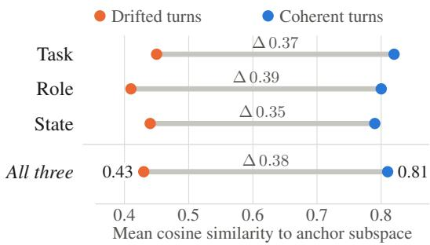
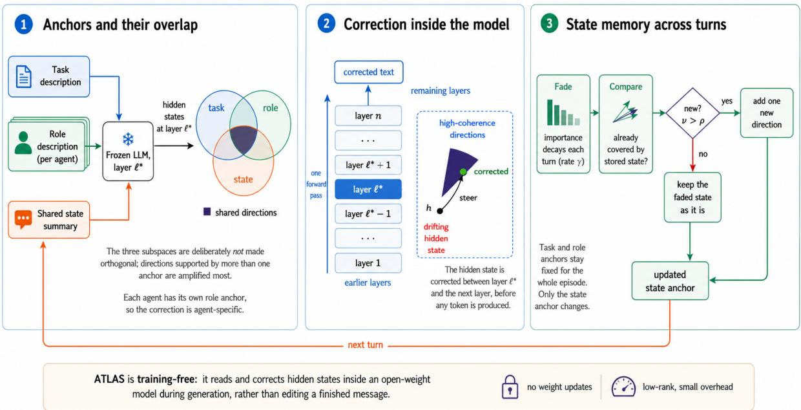
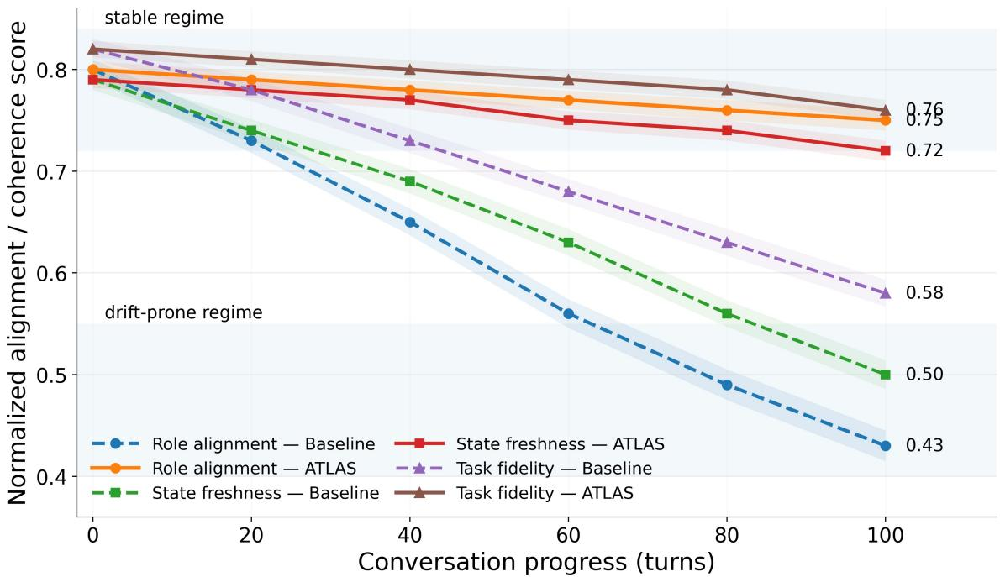
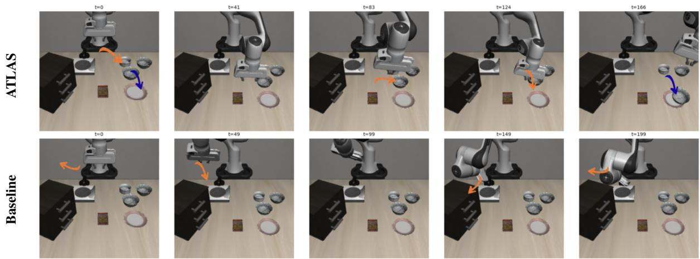
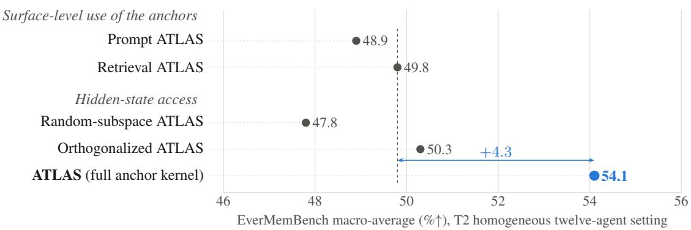

# Drift No More: Spectral Locking for Long-Horizon Open-Weight Multi-Agent AI

Vishal Pramanik1, Maisha Maliha2, Susmit Jha3, Sumit Kumar Jha1

1University of Florida, 2University of Oklahoma, 3SRI International vishalpramanik@ufl.edu, maisha.maliha-1@ou.edu, susmit.jha@berkeley.edu, sumit.jha@ufl.edu

## Abstract

Long-horizon multi-agent systems suffer from three tightly coupled failures: task drift, role drift, and state staleness. We test the hypothe sis that these share a common representational cause: agent hidden states move away from the directions encoding the active task, assigned role, and current shared state. A pilot study over 14,832 annotated turns supports this: drifted turns collapse near-uniformly across all three anchor subspaces (pairwise r = 0.72–0.78). Existing methods address these failures separately, operating at the surface-text level or treating control directions independently. We introduce ATLAS (Algebraic Task–role Locking with Adaptive Spectral Memory), a training-free intervention acting on hidden states before a token is generated. ATLAS builds a positivesemidefinite anchor kernel over task, role, and state subspaces and steers hidden states toward their shared high-coherence eigendirec tions; a low-rank Gram decomposition keeps this tractable. Across long-horizon memory, state maintenance, tool use, least-privilege co ordination, and embodied stress tests, ATLAS outperforms prompting, retrieval, memory, and activation-steering baselines. Against A-MEM it improves memory macro-average accuracy by up to 5.7 points and reduces write/read failures by up to 31.7%/24.8%; against MemoryArena Agent it gains up to 4.8 points. It gains 10.7– 12.1 points under perturbation, reaches 93.5% role consistency, and transfers to a 72B backbone (macro-average 61.0 vs. 56.2). Ablating the joint task–role–state span costs 7.2 points against 0.8 for a matched-rank random span, in dicating these directions are functionally implicated, not incidental; supplying them by prompt or retrieval recovers 4.3 points less. ATLAS is therefore a representation-level controller for open-weight multi-agent systems, complementary to output-level protocols for black-box agents.1

  
Figure 1: Anchor alignment at layer ℓ⋆ over 14,832 annotated turns (200 ten-agent Qwen3-8B conversations). Drifted turns collapse from ∼0.80 to ∼0.43, nearuniformly across all three anchors.

## 1 Introduction

Large language model agents are increasingly deployed as collaborative systems in which multiple specialized agents plan, retrieve, write memory, call tools, verify outputs, and coordinate over long interaction traces (Li et al., 2023a; Wu et al., 2023; Park et al., 2023). This decomposition is useful when a task requires persistent memory, role specialization, and tool-mediated execution rather than a single monolithic response. It also creates a failure mode that ordinary single-turn accuracy does not capture: as an interaction lengthens, an agent may continue to produce fluent, locally plausible text while its internal representation moves away from the active task, its assigned role, or the latest shared state. We refer to these three coupled failures as task drift, role drift, and state staleness. Recent memory and agent benchmarks show that long-term conversational memory, on-policy state maintenance, and multi-session memory use remain difficult even for strong LLM systems (Hu et al., 2026; Jiayang et al., 2026; He et al., 2026). In a long-horizon multi-agent workflow, a single stale write, role-inappropriate assertion, or unauthorized tool action can propagate across many downstream

  
Figure 2: Overview of ATLAS. ATLAS constructs task, role, and state anchor subspaces at layer ℓ⋆, combines them into an agent-specific low-rank PSD kernel $F ^ { ( t ) } ( F ^ { ( t ) } ) ^ { \top }$ , and steers hidden states toward coherent high-eigenvalue directions. The state component is updated by uniformly decaying existing state eigenvalues and appending a novel residual direction when $\nu > \rho ,$ after which the corrected hidden state is passed to downstream layers.

turns.

Existing approaches address parts of this problem, but at different control surfaces. Role prompts and structured-agent frameworks specify agent responsibilities, yet a prompt-level schema does not itself maintain the model’s internal task–role–state representation over a long trajectory (Li et al., 2023a). Retrieval-augmented and agentic-memory systems improve access to past information, but they do not directly correct a hidden state that is already using stale or role-inappropriate information (Park et al., 2023; Xu et al., 2025). Scopedcontext methods enforce access boundaries rather than repairing representational drift (Agostino and D’Souza, 2026). Activation-steering methods do intervene inside the model, but commonly construct control directions independently, whereas task, role, and state constraints in collaborative work are coupled (Turner et al., 2023). Each therefore improves one isolated aspect of coordination— prompt discipline, retrieval, memory organization, or activation control—without jointly stabilizing task, role, and state. The question addressed here is specifically representation-level: when intermediate model states are accessible, can a single intervention preserve the shared geometry of task, role, and evolving state over a long interaction?

We introduce ATLAS, an anchor-kernel intervention for this setting. For each agent, ATLAS represents the active task, assigned role, and current shared state as subspaces at an intervention layer, and combines them into a single positivesemidefinite kernel that retains their overlap. Hidden states are then steered toward directions that are jointly supported by these anchors, and the state component is refreshed as the conversation evolves. This places ATLAS at a different control surface from output-level role enforcement, which inspects or revises a message at the agent boundary and therefore needs no access to internal activations: ATLAS instead requires hidden-state access and corrects the representation during generation, before a token is emitted.

Our contributions are threefold. First, we formulate task drift, role drift, and state staleness as coupled representational failures in long-horizon multi-agent systems, and support this with a pilot study over 14,832 annotated turns. Second, we develop a low-rank spectral anchor kernel with adaptive state refresh for inference-time hidden-state correction. Third, we evaluate the method across homogeneous, expanded, and heterogeneous teams on long-horizon memory, interactive state maintenance, tool use, least-privilege coordination, and appendix-only embodied stress tests, and probe the functional role of the learned anchor geometry through targeted subspace removal. The resulting evidence establishes when a representation-level controller helps, and where its access assumptions limit deployment.

## 2 Motivation

We now state the hypothesis that organizes the rest of the paper. Task drift, role drift, and state staleness are not independent failures but surface manifestations of a single representational one: the agent’s hidden state moves away from the directions encoding the current task, assigned role, and latest shared state. We evaluate this hypothesis below with diagnostic, temporal, and interventional evidence. If it holds, one intervention that restores alignment along all three directions should outperform methods that target each failure mode independently.

We test this hypothesis in a pilot study of 200 tenagent Qwen3-8B conversations comprising 14,832 turns labeled as coherent or drifted using a frontier LLM-as-judge protocol with GPT-5.5 as the primary evaluator; the full protocol is provided in Appendix A8. For each turn, we measure the cosine similarity between the agent’s hidden state at layer $\ell ^ { \star }$ and the task, role, and state anchor subspaces. Figure 1 shows that coherent turns remain strongly aligned with all three subspaces, whereas drifted turns undergo a near-uniform collapse across task, role, and state. The failures are also tightly coupled, with pairwise Pearson correlations of $r ~ = ~ 0 . 7 8$ (task–role), 0.74 (task–state), and 0.72 (role–state), indicating that the onset of one drift mode reliably predicts the others.

This coupling explains why existing approaches recover so little of the lost alignment (Appendix Table 14). Prompt-level schemas and retrieval mechanisms recover at most +0.03 over Prompt-Only, because they modify inputs without correcting internal geometry. Activation-steering methods reach +0.06, but their independent or orthogonalized directions discard the task–role–state overlap that characterizes coordination failure. ATLAS recovers +0.31—more than five times the strongest alternative—by encoding all three anchors in a single positive-semidefinite kernel whose shared eigendirections concentrate correction where the failure modes are most entangled. The remainder of the paper formalizes this mechanism and evaluates it across benchmarks spanning long-horizon memory, tool use, least-privilege coordination, and embodied stress tests.

## 3 Method

## 3.1 Overview

ATLAS operates on intermediate representations, not on completed agent messages. At turn t, the method asks whether the hidden state of agent a remains jointly compatible with three pieces of information: the active task, the authority attached to the agent’s role, and the current shared state. These are encoded as anchor subspaces and combined into a single spectral object, the anchor kernel. The kernel is deliberately non-orthogonal: directions supported by more than one anchor should exert greater influence, because task, role, and state are not independent in collaborative work.

For token i of agent a at turn t, let $\mathbf { h } _ { t } ^ { ( a , i ) } \in \mathbb { R } ^ { d }$ denote the hidden state at intervention layer $\ell ^ { \star }$ ATLAS constructs task, role, and state anchor subspaces from anchor texts, combines them in a positive-semidefinite kernel $\mathbf { K } ^ { \left( t \right) }$ , and steers $\mathbf { h } _ { t } ^ { ( a , i ) }$ toward the high-eigenvalue directions of that kernel before the next layer is evaluated. After each turn, only the state component is refreshed. The mechanism therefore carries a clear access assumption: it requires a model whose hidden states can be read and modified at inference time, unlike messageboundary controllers that detect or repair a completed output without intervening in the generator’s latent state.

We select $\ell ^ { \star }$ in the middle third of the model using a linear probe that separates on-topic from offtopic continuations, following prior representationengineering work (Zou et al., 2023; Li et al., 2023b). Appendix A9.1 gives the layer-selection details. Corrections are applied after layer $\ell ^ { \star }$ and before layer $\ell ^ { \star } + 1$ , so downstream layers receive the corrected representation.

## 3.2 Anchor Subspaces

ATLAS begins by converting task, role, and state descriptions into geometric anchors. For each anchor type

$$
c \in \{ T , R ^ { ( a ) } , S ^ { ( t ) } \} ,
$$

we pass the corresponding anchor text through the frozen model and collect hidden states at layer $\ell ^ { \star }$ These hidden states are stacked into a matrix

$$
\mathbf { X } _ { c } \in \mathbb { R } ^ { d \times m _ { c } } .
$$

A thin SVD gives

$$
\mathbf { X } _ { c } = \mathbf { U } _ { c } \mathbf { S } _ { c } \mathbf { W } _ { c } ^ { \top } .
$$

We retain the smallest number of directions $k _ { c }$ that explain a variance fraction τ:

$$
k _ { c } = \operatorname* { m i n } \left\{ k : \frac { \sum _ { j = 1 } ^ { k } s _ { j } ^ { 2 } } { \sum _ { j } s _ { j } ^ { 2 } } \geq \tau \right\} .\tag{1}
$$

The resulting basis $\mathbf { U } _ { c } \in \mathbb { R } ^ { d \times k _ { c } }$ represents the subspace for that anchor. In our experiments, $k _ { c }$ is typically between 5 and 30 for hidden dimension $d = 4 0 9 6$

ATLAS therefore does not orthogonalize these bases. The entanglement is concrete: a Planner’s next step is task-specific, constrained by its role, and conditioned on the latest memory, so a single hidden direction can carry all three constraints at once. Orthogonalizing discards exactly that shared structure, and costs 3.8 points on EverMemBench (50.3 vs. 54.1; Appendix A9.3).

## 3.3 Anchor Kernel

The anchor kernel combines the three anchor sources into one positive-semidefinite matrix. For agent a at turn t, we define

$$
\begin{array} { r } { \mathbf { K } ^ { ( t ) } = w _ { T } \mathbf { U } _ { T } \mathbf { U } _ { T } ^ { \top } + w _ { R } \mathbf { U } _ { R } ^ { ( a ) } ( \mathbf { U } _ { R } ^ { ( a ) } ) ^ { \top } } \\ { + w _ { S } \mathbf { V } _ { S } ^ { ( t ) } \pmb { \Sigma } _ { S } ^ { ( t ) } ( \mathbf { V } _ { S } ^ { ( t ) } ) ^ { \top } , \quad \quad } \end{array}\tag{2}
$$

where $w T + w R + w S = 1$ . The first two terms encode the fixed task and role anchors. The third term is the evolving state component. Here, $\mathbf { V } _ { S } ^ { ( t ) }$ contains state directions and $\Sigma _ { S } ^ { ( t ) }$ stores their importance values.

The kernel gives stronger weight to directions supported by multiple anchors. If a direction is relevant to both the task and the current state, its effective eigenvalue receives contributions from both terms. This is the main reason we use a joint PSD kernel instead of independently steering along task, role, and state vectors.

Although $\mathbf { K } ^ { \left( t \right) }$ is a $d \times d$ matrix, ATLAS never needs to form it explicitly. We use the low-rank factorization

$$
\mathbf { K } ^ { ( t ) } = \mathbf { F } ^ { ( t ) } ( \mathbf { F } ^ { ( t ) } ) ^ { \top } ,\tag{3}
$$

where

$$
\begin{array} { r } { { \bf F } ^ { ( t ) } = \big [ \sqrt { w _ { T } } { \bf U } _ { T } , ~ \sqrt { w _ { R } } { \bf U } _ { R } ^ { ( a ) } , } \\ { \sqrt { w _ { S } } { \bf V } _ { S } ^ { ( t ) } ( { \bf \Sigma } { \bf \Sigma } _ { S } ^ { ( t ) } ) ^ { 1 / 2 } \big ] . } \end{array}\tag{4}
$$

If $p = k _ { T } + k _ { R } + k _ { S }$ , then $\mathbf { F } ^ { ( t ) } \in \mathbb { R } ^ { d \times p }$ with $p \ll d .$ . We compute eigenpairs using the small Gram matrix

$$
\mathbf { G } ^ { ( t ) } = ( \mathbf { F } ^ { ( t ) } ) ^ { \top } \mathbf { F } ^ { ( t ) } \in \mathbb { R } ^ { p \times p } .
$$

The nonzero eigenvalues of $\mathbf { G } ^ { ( t ) }$ and $\mathbf { K } ^ { \left( t \right) }$ are identical, and the eigenvectors of $\mathbf { K } ^ { \left( t \right) }$ are recovered by lifting. This reduces eigendecomposition cost from cubic in d to $O ( d p ^ { 2 } + p ^ { 3 } )$ . Full details are in Appendix A9.2.

## 3.4 Coherence Score

Given the anchor kernel, ATLAS measures whether a hidden state is aligned with the current task–role– state geometry. Let $\begin{array} { r } { \mathbf { K } ^ { \left( t \right) } = \sum _ { j = 1 } ^ { r } \lambda _ { j } \mathbf { v } _ { j } \mathbf { v } _ { j } ^ { \top } } \end{array}$ be the nonzero eigendecomposition of the kernel. The coherence of a hidden state h is its Rayleigh quotient:

$$
\mathcal { C } ( \mathbf { h } ) = \frac { \mathbf { h } ^ { \top } \mathbf { K } ^ { ( t ) } \mathbf { h } } { \| \mathbf { h } \| ^ { 2 } } .\tag{5}
$$

Equivalently,

$$
\mathcal { C } ( \mathbf { h } ) = \sum _ { j = 1 } ^ { r } \lambda _ { j } p _ { j } ( \mathbf { h } ) , \qquad p _ { j } ( \mathbf { h } ) = \frac { ( \mathbf { v } _ { j } ^ { \top } \mathbf { h } ) ^ { 2 } } { \| \mathbf { h } \| ^ { 2 } } .\tag{6}
$$

Thus, $\mathcal { C } ( \mathbf { h } )$ is high when the hidden state places more mass on high-eigenvalue anchor directions.

We also use the spectral variance

$$
\mathcal { V } ( \mathbf { h } ) = \frac { \mathbf { h } ^ { \top } ( \mathbf { K } ^ { ( t ) } ) ^ { 2 } \mathbf { h } } { \| \mathbf { h } \| ^ { 2 } } - \mathcal { C } ( \mathbf { h } ) ^ { 2 } .\tag{7}
$$

This quantity is small when h is already concentrated in a coherent eigenspace, and larger when its mass is spread across inconsistent eigendirections. Appendix A9.4 shows that this variance controls the coherence increase induced by ATLAS steering.

## 3.5 Spectral Steering

ATLAS steers each token by amplifying the kernelaligned components of its hidden state:

$$
\widetilde { \mathbf { h } } _ { t } ^ { ( a , i ) } = ( \mathbf { I } + \alpha _ { \mathrm { e f f } } \mathbf { K } ^ { ( t ) } ) \mathbf { h } _ { t } ^ { ( a , i ) } .\tag{8}
$$

Using the eigendecomposition of $\mathbf { K } ^ { \left( t \right) }$ , this can be written as

$$
\begin{array} { r l } { \widetilde { \mathbf { h } } _ { t } ^ { ( a , i ) } = \mathbf { h } _ { t } ^ { ( a , i ) } } & { } \\ & { \quad + \alpha _ { \mathrm { e f f } } \displaystyle \sum _ { j = 1 } ^ { r } \lambda _ { j } ( \mathbf { v } _ { j } ^ { \top } \mathbf { h } _ { t } ^ { ( a , i ) } ) \mathbf { v } _ { j } . } \end{array}\tag{9}
$$

The gain is capped as

$$
\alpha _ { \mathrm { e f f } } = \operatorname* { m i n } ( \alpha , \xi / \lambda _ { 1 } ) ,\tag{10}
$$

where $\xi$ limits the largest per-direction correction.   
We use $\xi = 0 . 1 5$ by default.

Under the continuous dynamics $d { \bf h } / d \alpha = { \bf K } { \bf h }$ coherence is non-decreasing, with $d \mathcal { C } / d \alpha$ $2 \mathcal { V } ( { \bf h } ) \geq 0 .$ . The increase is larger when h has mass across eigenspaces with different eigenvalues, but can vanish when it is concentrated in a single eigenspace, including the null space. Appendix A9.4 proves this continuous result and the monotonicity of the discrete steering update in Eq. (8).

## 3.6 Adaptive State Memory

The task and role anchors remain fixed during an episode, but the state anchor must evolve as the conversation changes. ATLAS updates only the state component ${ \bf K } _ { \mathrm { s t a t e } } ^ { ( \bar { t } ) }$ after each turn. The update has three steps: decay, novelty extraction, and enrichment.

First, existing state eigenvalues are decayed:

$$
\bar { \sigma } _ { j } ^ { ( t ) } = \gamma \sigma _ { j } ^ { ( t ) } , \qquad j = 1 , \dotsc , k _ { S } .\tag{11}
$$

This geometrically reduces the influence of all previously stored state directions. Novel residual directions are appended during the enrichment step described below. Second, ATLAS computes a turnlevel representation from the steered token states:

$$
\bar { \widetilde { \mathbf { h } } } _ { t } ^ { ( a ) } = \frac { 1 } { L _ { t } } \sum _ { i = 1 } ^ { L _ { t } } \widetilde { \mathbf { h } } _ { t } ^ { ( a , i ) } .\tag{12}
$$

It then projects this representation away from the current state subspace:

$$
\mathbf { m } _ { t } ^ { ( a ) } = \left( \mathbf { I } - \mathbf { V } _ { S } ^ { ( t ) } ( \mathbf { V } _ { S } ^ { ( t ) } ) ^ { \top } \right) \bar { \mathbf { h } } _ { t } ^ { ( a ) } .\tag{13}
$$

The novelty score is

$$
\nu = \frac { \Vert \mathbf { m } _ { t } ^ { ( a ) } \Vert ^ { 2 } } { \Vert \bar { \tilde { \mathbf { h } } } _ { t } ^ { ( a ) } \Vert ^ { 2 } } .\tag{14}
$$

If $\nu \leq \rho ,$ the turn is treated as a restatement of existing state. If $\nu > \rho ,$ , the normalized novel direction is appended to the state basis:

$$
\begin{array} { c } { { \displaystyle { \bf V } _ { S } ^ { ( t + 1 ) } \gets [ { \bf V } _ { S } ^ { ( t ) } , \hat { \bf m } _ { t } ^ { ( a ) } ] , } } \\ { { \displaystyle \hat { \bf m } _ { t } ^ { ( a ) } = \frac { { \bf m } _ { t } ^ { ( a ) } } { \| { \bf m } _ { t } ^ { ( a ) } \| } . } } \end{array}\tag{15}
$$

The new direction receives initial importance $\beta _ { 0 } \colon$

$$
\Sigma _ { S } ^ { ( t + 1 ) } \gets \mathrm { d i a g } ( \bar { \sigma } _ { 1 } ^ { ( t ) } , \dots , \bar { \sigma } _ { k _ { S } } ^ { ( t ) } , \beta _ { 0 } ) .\tag{16}
$$

If the state rank exceeds $k _ { S } ^ { \mathrm { m a x } }$ , ATLAS drops the smallest-eigenvalue state direction. Every $\Delta$ turns, the state basis is re-orthonormalized. This update lets ATLAS forget stale information while incorporating new decisions, constraints, and corrections. Appendix A9.5 gives implementation details and Appendix A9.6 gives the stability bound for enrichment. Figure 2 summarizes the intervention, and Algorithm 1 gives the complete procedure.

## 4 Experiments and Results

## 4.1 Setup

We evaluate the coupled-failure hypothesis of §2 under three increasingly difficult multi-agent settings. T1 is a homogeneous ten-agent role-structured team. It follows the same basic role decomposition used by role-prompting baselines such as Struct-Role, but all agents share one backbone so that the setting isolates coordination under a common representation space. T2 is a homogeneous twelve-agent expanded memory team. It is based on the memorycentric design of A-MEM (Xu et al., 2025), but we increase the number of agents and split memory, verification, planning, and summarization into more specialized roles to increase coordination complexity while keeping the backbone fixed. T3 is a heterogeneous twelve-agent team in which the twelve roles are distributed across six different model families. This is the hardest setting: agents differ not only in role and context, but also in capability profile and latent representation geometry. The tenagent set spans coordination, planning, memory read/write, execution, verification, critique, routing, summarization, and monitoring; T2 and T3 add Tool-Executor, the only role permitted to invoke external tools, and Safety-Checker, which validates privilege boundaries, unsafe actions, and out-ofscope context exposure. Full role definitions, privilege boundaries, and agent-to-model assignments are in Appendix A1.1 and A1.2.

Backbones and heterogeneous team. For T1 and T2, all agents within a run share the same backbone. T1 uses Llama-4-Scout-17B-16E (Meta AI, 2025), and T2 uses Qwen3-8B (Qwen Team, 2025b), which we also use as the primary backbone for ablations because it provides a strong trade-off between capability and evaluation cost. For T3, the twelve agents are distributed across six model families: Our heterogeneous agent stack comprises Llama-4-Scout-17B-16E-Instruct (Meta AI, 2025),

Qwen3-8B (Qwen Team, 2025b), Qwen2.5-7B-Instruct (Qwen Team, 2024), Phi-4 (14B) (Abdin et al., 2024), Gemma-2-9B-IT (Gemma Team, 2024), and Mistral-7B-Instruct-v0.1 (Jiang et al., 2023). The heterogeneous assignment places stronger reasoning models on planning and routing, compact instruction-following models on memory operations, and separate critic-style models on verification, monitoring, and safety checking. Exact assignments are listed in Appendix A1.2.

Benchmarks and protocols. The main paper focuses on two primary text-based long-horizon coordination benchmarks:

1. EverMemBench (Hu et al., 2026): 2,400 QA pairs over long multi-party conversations, evaluating long-horizon memory across Fine-Grained Recall (FGR), Memory Awareness (MA), and Profile Understanding (PU).

2. AMemGym (Jiayang et al., 2026): 1,000 interactive, on-policy episodes per configuration, where earlier system choices influence later observations, with diagnostic write/read/utilization failure rates.

We report two secondary text-based stress tests in the appendix: ToolACE (Liu et al., 2025), which probes robustness in multi-step tool-use chains, and ALARA (Agostino and D’Souza, 2026), which evaluates least-privilege context discipline in agentic workflows. We also include LIBERO (Liu et al., 2023) as an appendix-only multimodal embodied stress test. Because LIBERO is not a native multi-agent dialogue benchmark, we wrap each language-conditioned manipulation episode in our multimodal multi-agent controller and inject one of three controlled perturbations: role-confuse, statedelay, or task-switch. Full ToolACE and ALARA results are reported in Appendix A3, and the complete LIBERO protocol and results are reported in Appendix A4. Across all runs, we use a 128K token context budget, top-k = 10 retrieval, summaries every 20 turns, a 200-turn episode cap, temperature 0.0, and means over three seeds (42, 137, 256) with 95% paired bootstrap confidence intervals. Full benchmark protocols, hyperparameter search ranges, and reporting conventions are provided in Appendix A1.3.

Baselines. We compare against seven general baselines plus two benchmark-specific recent baselines. Single-Agent uses one monolithic agent with the full context budget, establishing a nocoordination lower bound. Prompt-Only deploys the same agent topology without structured memory or communication control, isolating the effect of agent count alone. Struct-Role adds explicit JSON-schema role declarations per message, representing a role-structured prompting baseline. RAG-Mem equips the topology with a shared vector store and periodic summaries, representing a standard retrieval-augmented memory baseline. A-MEM adapts A-Mem’s (Xu et al., 2025) Zettelkasteninspired agentic memory—dynamic indexing, linking, and memory evolution—to the multi-agent setting, serving as the strongest memory baseline. ActAdd (Turner et al., 2023) applies Activation Addition steering to the Coordinator, Executor, and Monitor, using role-specific contrast pairs to compute steering vectors. SEA (Qiu et al., 2024) applies Spectral Editing of Activations to the same three agents, representing a prior activation-steering approach.

For memory-specific comparisons, we include MemoryArena-Agent (He et al., 2026), which adapts the MemoryArena memory-agentenvironment loop to our EverMemBench and AMemGym settings using the same topology, context budget, retrieval depth, and reporting metrics. We include this baseline only for memory and statemaintenance evaluations, where the comparison is metric-compatible. For least-privilege evaluation, we include ALARA-Scoped (Agostino and D’Souza, 2026), which uses ALARA’s declarative context-agent-tool scoping to enforce per-agent context and tool access. We include this baseline only on ALARA, where the task success, privilege violation, and overexposure metrics directly match its design objective. Together, these baselines test whether ATLAS’s gains arise from role prompting, retrieval, memory management, activation steering, scoped context access, or simply the multi-agent topology.

## 4.2 Long-Horizon Memory

Table 1 shows that ATLAS consistently outperforms all baselines across the three coordination settings. MemoryArena-Agent is the strongest non-ATLAS memory baseline, but ATLAS still improves over it by +4.7 pp on T1, +4.8 pp on T2, and +4.2 pp on T3. The gains are balanced across all three evaluation dimensions rather than concentrated in a single metric. Profile Understanding shows the largest relative lift, which is consistent with ATLAS’s design: role stabilization helps the Memory-Writer maintain evolving persona attributes—communication style, skills, and organizational titles—more faithfully than flat-state baselines. The performance gap remains strong in T3, where twelve agents from six model families must coordinate despite heterogeneous capabilities and representational spaces. This supports the claim that ATLAS is not merely exploiting a shared backbone representation, but provides a coordination mechanism that remains useful under cross-model collaboration. Coordinationspecific diagnostics are reported in Appendix A6: ATLAS raises role consistency to 93.5% on T2, against 82.0% for the strongest baseline, and halves turn-wise drift area from 0.21 to 0.11. A turn-wise visualization of how ATLAS suppresses coupled task drift, role drift, and state staleness over longhorizon interactions is provided in Appendix A2.

Table 1: EverMemBench results (%). FGR = Fine-Grained Recall (%↑), MA = Memory Awareness (%↑), PU = Profile Understanding (%↑), Avg = macro-average (%↑). T1 is a homogeneous 10-agent role-structured team; T2 is a homogeneous 12-agent A-MEM-expanded team; T3 is a heterogeneous 12-agent team using six model families. Values are means over 3 seeds; average standard deviation across cells within each setting block is shown in the header. Best in bold.
<table><tr><td rowspan="2"></td><td colspan="4">T1: Homogeneous-10 (σ = 1.1)</td><td colspan="4">T2: Homogeneous-12 (σ = 0.8)</td><td colspan="4">T3: Heterogeneous-12/6M (σ = 1.3)</td></tr><tr><td>FGR</td><td>MA</td><td>PU</td><td>Avg</td><td>FGR</td><td>MA</td><td>PU</td><td>Avg</td><td>FGR</td><td>MA</td><td>PU</td><td>Avg</td></tr><tr><td>Single-Agent</td><td>41.2</td><td>33.8 29.4</td><td></td><td>34.8</td><td>43.5</td><td>35.1</td><td>31.2</td><td>36.6</td><td>38.7</td><td>31.6</td><td>27.8</td><td>32.7</td></tr><tr><td>Prompt-Only</td><td>46.3</td><td>38.2</td><td>34.5</td><td>39.7</td><td>48.1</td><td>39.7</td><td>36.0</td><td>41.3</td><td>43.8</td><td>35.9</td><td>32.1</td><td>37.3</td></tr><tr><td>Struct-Role</td><td>49.1</td><td>40.6</td><td>36.8</td><td>42.2</td><td>51.4</td><td>42.3</td><td>38.4</td><td>44.0</td><td>46.5</td><td>38.4</td><td>34.6</td><td>39.8</td></tr><tr><td>RAG-Mem</td><td>52.7</td><td>43.1</td><td>38.9</td><td>44.9</td><td>54.6</td><td>44.8</td><td>40.5</td><td>46.6</td><td>49.8</td><td>41.0</td><td>36.7</td><td>42.5</td></tr><tr><td>A-MEM</td><td>54.3</td><td>45.7</td><td>40.2</td><td>46.7</td><td>56.1</td><td>47.2</td><td>41.8</td><td>48.4</td><td>51.5</td><td>43.4</td><td>38.1</td><td>44.3</td></tr><tr><td>MemoryArena-Agent</td><td>55.1</td><td>46.4</td><td>41.0</td><td>47.5</td><td>57.0</td><td>48.3</td><td>42.7</td><td>49.3</td><td>52.2</td><td>44.1</td><td>38.8</td><td>45.0</td></tr><tr><td>ActAdd</td><td>50.8</td><td>42.4</td><td>37.6</td><td>43.6</td><td>53.2</td><td>43.9</td><td>39.1</td><td>45.4</td><td>48.1</td><td>39.8</td><td>35.2</td><td>41.0</td></tr><tr><td>SEA</td><td>51.5</td><td>43.8</td><td>38.4</td><td>44.6</td><td>53.9</td><td>45.1</td><td>39.9</td><td>46.3</td><td>49.2</td><td>40.7</td><td>36.0</td><td>42.0</td></tr><tr><td>ATLAS</td><td>59.4</td><td></td><td>51.3 45.8</td><td>52.2</td><td>61.7</td><td>53.1 47.6</td><td></td><td>54.1</td><td>56.2</td><td>48.5</td><td>43.0</td><td>49.2</td></tr></table>

Table 2: AMemGym results. OA = Overall Accuracy (%↑), NMS = Normalized Memory Score (%↑), W/R/U = Write/Read/Utilization failure rate (%↓). T1 and T2 are homogeneous settings; T3 is the heterogeneous 12-agent/6-model setting. Means over 3 seeds; σ¯ in header.
<table><tr><td rowspan="2"></td><td colspan="5">T1: Homogeneous-10  $( \bar { \sigma } = 1 . 2 )$ </td><td colspan="5">T2: Homogeneous-12</td><td colspan="5">T3: Heterogeneous-12/6M (σ = 1.4)</td></tr><tr><td>OA</td><td>NMS</td><td>W</td><td>R</td><td>U</td><td>OA</td><td>NMS</td><td>W</td><td>R</td><td>U</td><td>OA</td><td>NMS</td><td>W</td><td>R</td><td>U</td></tr><tr><td>Single-Agent</td><td>38.1</td><td>34.6</td><td>28.3</td><td>21.5</td><td>12.1</td><td>40.7</td><td>37.2</td><td>26.1</td><td>20.3</td><td>12.9</td><td>35.4</td><td>32.1</td><td>30.5</td><td>22.8</td><td>11.3</td></tr><tr><td>Prompt-Only</td><td>43.5</td><td>40.2</td><td>24.7</td><td>19.2</td><td>12.6</td><td>45.9</td><td>42.5</td><td>22.8</td><td>18.1</td><td>13.2</td><td>40.6</td><td>37.8</td><td>26.9</td><td>20.4</td><td>12.1</td></tr><tr><td>Struct-Role</td><td>46.2</td><td>42.8</td><td></td><td>22.4 18.5</td><td>12.9</td><td>48.3</td><td>45.1</td><td>20.6</td><td>17.3</td><td>13.8</td><td>43.5</td><td>40.1</td><td>24.5</td><td>19.6</td><td>12.4</td></tr><tr><td>RAG-Mem</td><td>48.9</td><td>45.4</td><td>21.1</td><td>16.8</td><td>13.2</td><td>51.2</td><td>47.9</td><td>19.3</td><td>15.7</td><td>13.8</td><td>46.1</td><td>42.5</td><td>23.1</td><td>18.2</td><td>12.6</td></tr><tr><td>A-MEM</td><td>51.3</td><td>48.1</td><td>18.5</td><td>15.2</td><td>15.0</td><td>53.8</td><td>50.6</td><td>16.7</td><td>14.1</td><td>15.4</td><td>48.7</td><td>45.3</td><td>20.4</td><td>16.8</td><td>14.1</td></tr><tr><td>MemoryArena-Agent</td><td>52.8</td><td>49.5</td><td>17.4</td><td>14.6</td><td>15.8</td><td>55.4</td><td>52.1</td><td>15.6</td><td>13.2</td><td>16.2</td><td>50.4</td><td>47.2</td><td>18.9</td><td>15.7</td><td>14.9</td></tr><tr><td>ActAdd</td><td>47.6</td><td>44.2</td><td>22.0</td><td>17.4</td><td>13.0</td><td>50.1</td><td>46.8</td><td>20.2</td><td>16.3</td><td>13.4</td><td>44.8</td><td>41.5</td><td>24.0</td><td>18.9</td><td>12.3</td></tr><tr><td>SEA</td><td>48.4</td><td>45.0</td><td></td><td>21.3 16.9</td><td>13.4</td><td>50.9</td><td>47.5</td><td>19.5</td><td>15.9</td><td>14.1</td><td>45.7</td><td>42.1</td><td>23.3</td><td>18.4</td><td>12.6</td></tr><tr><td>ATLAS</td><td>57.6</td><td>54.3</td><td></td><td>13.2 11.8</td><td>17.4</td><td>60.1</td><td>56.9</td><td>11.4 10.6</td><td></td><td>17.9</td><td>54.5</td><td>51.2</td><td>15.1 13.3</td><td></td><td>16.1</td></tr></table>

## 4.3 Interactive State Maintenance

Table 2 reveals the mechanistic source of ATLAS’s gains through AMemGym’s diagnostic failure-rate decomposition. MemoryArena-Agent improves over A-MEM by strengthening the memory-agentenvironment loop, but ATLAS remains ahead on both overall accuracy and normalized memory score. On T2, ATLAS reduces write failures from 15.6% to 11.4% and read failures from 13.2% to 10.6% relative to MemoryArena-Agent. These reductions are especially consequential because AMemGym is on-policy: a single missed write at turn t can propagate errors across every subsequent turn that depends on the unrecorded state. The utilization failure rate increases modestly because ATLAS successfully persists and retrieves more state, leaving the Executor with a richer set of recalled facts to integrate. The same pattern holds across T1, T2, and T3, confirming that ATLAS’s gains stem from better state maintenance rather than a superficial retrieval improvement.

## 4.4 Ablations and Cost

To isolate the contribution of each ATLAS component, we conduct a leave-one-out ablation on T2

Table 3: Ablations on EverMemBench with T2. Top: each row removes one ATLAS component while keeping the rest intact. Bottom: only the anchors entering the steering kernel are varied, with the remaining pipeline fixed; omitted anchor terms are zeroed without renormalizing the retained weights, so $T { \ + } S$ coincides with “w/o role stabilization” by construction. Every singleton and pairwise kernel underperforms the full coupled kernel, and $T { + } R { + } S$ is the only composition that exceeds the no-steering variant. $\bar { \sigma } = 0 . 7 .$
<table><tr><td>Variant</td><td>Avg</td><td> $\Delta$ </td></tr><tr><td>Full ATLAS</td><td>54.1</td><td></td></tr><tr><td>Component (leave-one-out)</td><td></td><td></td></tr><tr><td>w/o role stabilization</td><td>49.1</td><td>-5.0</td></tr><tr><td>w/o state refresh</td><td>48.9</td><td>-5.2</td></tr><tr><td>w/o task-switch correction</td><td>51.2</td><td>-2.9</td></tr><tr><td>w/o steering</td><td>52.1</td><td>-2.0</td></tr><tr><td>w/o Monitor agent</td><td>49.6</td><td>-4.5</td></tr><tr><td>Kernel composition</td><td></td><td></td></tr><tr><td>Task only (T)</td><td>46.8</td><td>-7.3</td></tr><tr><td>Role only (R)</td><td>47.6</td><td>-6.5</td></tr><tr><td>State only (S)</td><td>48.3</td><td>-5.8</td></tr><tr><td> $T + R$ </td><td>50.4</td><td>-3.7</td></tr><tr><td> $T { \ + { S } }$ </td><td>49.1</td><td>-5.0</td></tr><tr><td> $R { + } S$ </td><td>51.6</td><td>-2.5</td></tr></table>

EverMemBench: each row of Table 3 removes exactly one component while keeping the remaining system intact. The five ablated components are role stabilization (the role anchor $\mathbf { U } _ { R }$ is zeroed), state refresh (the decay–novelty–enrichment pipeline is disabled and the state basis is frozen at initialization), task-switch correction (the task anchor $\mathbf { U } _ { T }$ is not re-projected after an objective change), steering (the spectral correction in Eq. 8 is removed entirely, leaving only the memory and role-prompting mechanisms), and the Monitor agent (continuous invariant checking is disabled, though the Verifier’s post-hoc checks remain). T2 is used because its twelve-agent topology exercises all components, including Tool-Executor and Safety-Checker, while keeping a single backbone for cleaner attribution.

State refresh (−5.2 pp) and role stabilization (−5.0 pp) are the two most critical components, consistent with the pilot study’s finding that stale state and role drift are the dominant long-horizon failure modes (Appendix A8). Removing the Monitor agent causes a nearly equal drop (−4.5 pp) despite the Monitor being an observer rather than a correction mechanism: without continuous invariant checking, small drift events accumulate undetected and eventually cascade. Removing steering produces a smaller but consistent drop (−2.0 pp), indicating that the representational intervention complements, rather than replaces, the prompt-level and memory-level mechanisms—but the residual gap confirms that correcting hidden-state geometry before generation contributes beyond what those mechanisms can achieve alone.

Varying which anchors enter the kernel isolates the same effect at the level of the kernel itself. Every singleton and pairwise configuration underperforms the full kernel, and $T { + } R { + } S$ is the only composition that exceeds the no-steering variant (52.1). The gain therefore does not come from stacking independent modules: it requires steering against a joint PSD kernel that preserves the overlap among task, role, and state directions (Appendix A10.2).

ATLAS is more expensive than a single-agent system, as expected for any multi-agent approach, but it is more efficient than the strongest memory baselines. On T2 EverMemBench, ATLAS uses 96.8K tokens per episode compared with 118.5K for A-MEM and 112.6K for MemoryArena-Agent, while achieving a higher macro-average score. Full cost breakdowns, latency measurements, cost-normalized performance, and topology-scaling results are provided in Appendix A7.

## 4.5 Additional Stress Tests

We evaluate ATLAS on three supplementary benchmarks (full tables in Appendices A3 and A4). On ToolACE (Liu et al., 2025), which tests multi-step tool-use chains where a single incorrect call invalidates the entire downstream sequence, ATLAS improves Multi-Step Chain Completion by $+ 6 . 9$ pp over A-MEM through reliable intermediate-output propagation and pre-execution verification. On ALARA (Agostino and D’Souza, 2026), which evaluates least-privilege context discipline, ATLAS improves task success by +4.9 pp over the declarative-scoping baseline ALARA-Scoped (Agostino and D’Souza, 2026) while reducing privilege violations (−2.5 pp) and overexposure (−3.0 pp), indicating that prompt-level scoping alone does not prevent boundary violations rooted in latent role drift. On LIBERO (Liu et al., 2023), an appendix-only embodied stress test with role-confuse, state-delay, and task-switch perturbations, ATLAS yields moderate clean success-rate gains (+4.2–4.6 pp) but substantially larger perturbation gains (+10.7–12.1 pp), with the strongest improvement on state-delay (+15.6 pp), consistent with adaptive state refresh being the main contributor to robustness under mid-episode environmental changes.

## 5 Related Work

ATLAS sits at the intersection of multi-agent coordination, long-horizon memory, and representationlevel control. Role-specialized agent frameworks such as CAMEL and AutoGen organize interaction through prompts and orchestration, while Generative Agents, A-MEM, EverMemBench, AMemGym, and MemoryArena study persistent memory, evolving state, and the use of remembered information over long horizons (Li et al., 2023a; Wu et al., 2023; Park et al., 2023; Xu et al., 2025; Hu et al., 2026; Jiayang et al., 2026; He et al., 2026). These systems motivate the need for durable coordination, but their principal control surface is context, memory, or workflow rather than the model’s intermediate representation.

ATLAS instead follows representation engineering and inference-time activation control, including ITI, Representation Engineering, ActAdd, and SEA (Li et al., 2023b; Zou et al., 2023; Turner et al., 2023; Qiu et al., 2024). Its distinctive feature is a single non-orthogonal task–role–state kernel whose overlap determines both the direction and the strength of hidden-state correction. This also separates ATLAS from message-boundary controllers, which evaluate a completed output against an explicit role contract and repair it before it is admitted to the shared conversation: such methods need no access to internal activations, whereas ATLAS alters generation before an output is produced. The two families therefore address related coordination failures under different access assumptions and with different mathematical objects.

## 6 Additional Validation and Robustness

We examine whether the gains depend on component redundancy, model scale, evaluator choice, anchor wording, or heterogeneous-model tuning; Appendix A10 gives the complete protocols and tables. All studies preserve the agent topology, episodelevel 128K context budget, top-k=10 retrieval, decoding configuration, seeds, and evaluation procedure of the corresponding main experiments.

Beyond the kernel-composition results in Table 3, the benefit persists at substantially larger scale: under the same T2 EverMemBench protocol, ATLAS reaches a macro-average of 61.0 on Qwen2.5-72B-Instruct, against 56.2 for MemoryArena-Agent and 55.3 for A-MEM. A blinded 200-turn human audit agrees with the multi-model drift labels on 89.5% of turns $( \kappa = 0 . 7 9 )$ . Removing the joint task–role– state span from held-out representations costs 7.2 points, whereas removing a matched-rank random span at the same layer costs only 0.8, indicating that the identified subspace is functionally relevant rather than incidental.

Performance is also stable under semanticspreserving anchor paraphrases, moderate shortening, and neighboring hyperparameter settings, while contradictory anchors, role swaps, and stronger lexical corruption degrade results as expected. Heterogeneous agents need not share a hidden dimension or a common latent coordinate system: each constructs and applies its kernel within its own frozen backbone, and under a common midpoint-layer rule ATLAS remains ahead of both ActAdd and SEA. Together, these controls make topology, evaluator choice, anchor wording, model scale, and preferential model-specific tuning less plausible explanations for the main results.

## 7 Conclusion

ATLAS treats long-horizon multi-agent coordination as the problem of maintaining a coherent internal representation of task, role, and evolving state. A non-orthogonal anchor kernel uses their shared spectrum to correct intermediate hidden states, while adaptive refresh lets superseded state decay. Across the settings studied here, this representationlevel intervention improves long-horizon memory, interactive state maintenance, tool-use robustness, least-privilege coordination, and embodied stresstest performance, and the low-rank Gram formulation keeps the controller tractable. The method has a deliberate boundary: it requires hidden-state access and does not replace message-level contracts, factual verification, or safety controls. Within that boundary, the results suggest that preserving shared representational geometry can reduce coordination drift over extended interactions.

## Limitations

ATLAS requires access to intermediate hidden states, so it is most directly applicable to openweight or otherwise controllable inference settings. Its anchor subspaces are constructed from task, role, and state descriptions, which means that poor role specifications or incomplete state summaries can reduce the quality of the intervention. Although ATLAS improves long-horizon coordination, memory freshness, and role consistency, it does not guarantee factual correctness, safety, or optimal tool use in all cases. The current evaluation focuses on controlled multi-agent topologies and appendix-only embodied stress tests; broader deployment settings with dynamic agent creation, changing tool permissions, or untrusted external memory may require additional safeguards and validation.

## Ethics Statement

This work aims to improve the reliability of longhorizon multi-agent AI systems by reducing task drift, role drift, and stale-state usage. However, stronger coordination can also make agentic systems more capable, so ATLAS should be deployed with appropriate access controls, logging, human oversight, and external safety checks in high-stakes settings. Our experiments use benchmarked tasks and simulated multi-agent workflows rather than real user data. We encourage future users of ATLAS to evaluate both performance and misuse risks, especially when agents can call tools, modify shared memory, or operate in safety-sensitive environments.

## References

Marah Abdin, Jyoti Aneja, Harkirat Behl, Sébastien Bubeck, Ronen Eldan, Suriya Gunasekar, Michael Harrison, Russell J. Hewett, Mojan Javaheripi, Piero Kauffmann, James R. Lee, Yin Tat Lee, Yuanzhi Li, Weishung Liu, Caio C. T. Mendes, Anh Nguyen, Eric Price, Gustavo de Rosa, Olli Saarikivi, and 8 others. 2024. Phi-4 technical report. Preprint, arXiv:2412.08905.

Christopher J. Agostino and Nayan D’Souza. 2026. Herding cats: Alara for agent harness engineering in portable composable multi-agent teams. Preprint, arXiv:2603.20380.

Vardhan Dongre, Ryan A. Rossi, Viet Dac Lai, David Seunghyun Yoon, Dilek Hakkani-Tür, and Trung Bui. 2025. Drift no more? context equilibria in multi-turn LLM interactions. Preprint, arXiv:2510.07777.

Cornelius Emde, Alexander Rubinstein, Anmol Goel, Ahmed Heakl, Sangdoo Yun, Seong Joon Oh, and Martin Gubri. 2026. MASEval: Extending multiagent evaluation from models to systems. Preprint, arXiv:2603.08835.

Gemma Team. 2024. Gemma 2: Improving open language models at a practical size. Preprint, arXiv:2408.00118.

Akash Gupta, Ivaxi Sheth, Vyas Raina, Mark Gales, and Mario Fritz. 2024. LLM task interference: An initial study on the impact of task-switch in conversational history. In Proceedings of the 2024 Conference on Empirical Methods in Natural Language Processing.

Zexue He, Yu Wang, Churan Zhi, Yuanzhe Hu, Tzu-Ping Chen, Lang Yin, Ze Chen, Tong Arthur Wu, Siru Ouyang, Zihan Wang, Jiaxin Pei, Julian McAuley, Yejin Choi, and Alex Pentland. 2026. MemoryArena: Benchmarking agent memory in interdependent multisession agentic tasks. Preprint, arXiv:2602.16313.

Chuanrui Hu, Tong Li, Xingze Gao, Hongda Chen, Yi Bai, Dannong Xu, Tianwei Lin, Xiaohong Li, Yunyun Han, Jian Pei, and Yafeng Deng. 2026. Evaluating long-horizon memory for multi-party collaborative dialogues. Preprint, arXiv:2602.01313.

Albert Q. Jiang, Alexandre Sablayrolles, Arthur Mensch, Chris Bamford, Devendra Singh Chaplot, Diego de las Casas, Florian Bressand, Gianna Lengyel, Guillaume Lample, Lélio Renard Lavaud, Lucile Saulnier, Marie-Anne Lachaux, Pierre Stock, Teven Le Scao, Thibaut Lavril, Thomas Wang, Timothée Lacroix, and William El Sayed. 2023. Mistral 7B. Preprint, arXiv:2310.06825.

Cheng Jiayang, Dongyu Ru, Lin Qiu, Yiyang Li, Xuezhi Cao, Yangqiu Song, and Xunliang Cai. 2026. Amemgym: Interactive memory benchmarking for assistants in long-horizon conversations. Preprint, arXiv:2603.01966.

Moo Jin Kim, Karl Pertsch, Siddharth Karamcheti, Ted Xiao, Ashwin Balakrishna, Suraj Nair, Rafael Rafailov, Ethan Foster, Grace Lam, Pannag Sanketi, Quan Vuong, Thomas Kollar, Benjamin Burchfiel, Russ Tedrake, Dorsa Sadigh, Sergey Levine, Percy Liang, and Chelsea Finn. 2024. OpenVLA: An open-source vision-language-action model. Preprint, arXiv:2406.09246.

Guohao Li, Hasan Abed Al Kader Hammoud, Hani Itani, Dmitrii Khizbullin, and Bernard Ghanem. 2023a. CAMEL: Communicative agents for “mind” exploration of large language model society. In Advances in Neural Information Processing Systems.

Kenneth Li, Oam Patel, Fernanda Viégas, Hanspeter Pfister, and Martin Wattenberg. 2023b. Inferencetime intervention: Eliciting truthful answers from a language model. In Advances in Neural Information Processing Systems, volume 36.

Bo Liu, Yifeng Zhu, Chongkai Gao, Yihao Feng, Qiang Liu, Yuke Zhu, and Peter Stone. 2023. LIBERO: Benchmarking knowledge transfer for lifelong robot learning. In Advances in Neural Information Processing Systems, volume 36.

Weiwen Liu, Xu Huang, Xingshan Zeng, Xinlong Hao, Shuai Yu, Dexun Li, Shuai Wang, Weinan Gan, Zhengying Liu, Yuanqing Yu, Zezhong Wang, Yuxian Wang, Wu Ning, Yutai Hou, Bin Wang, Chuhan Wu, Xinzhi Wang, Yong Liu, Yasheng Wang, and 8 others. 2025. ToolACE: Winning the points of LLM function calling. In The Thirteenth International Conference on Learning Representations.

Meta AI. 2025. The Llama 4 herd: The beginning of a new era of natively multimodal AI innovation. https://ai.meta.com/blog/ llama-4-multimodal-intelligence/.

Joon Sung Park, Joseph C. O’Brien, Carrie Jun Cai, Meredith Ringel Morris, Percy Liang, and Michael S. Bernstein. 2023. Generative agents: Interactive simulacra of human behavior. In Proceedings ofthe 36th Annual ACM Symposium on User Interface Software and Technology. Association for Computing Machinery.

Shishir G. Patil, Huanzhi Mao, Fanjia Yan, Charlie Cheng-Jie Ji, Vishnu Suresh, Ion Stoica, and Joseph E. Gonzalez. 2025. The Berkeley function calling leaderboard (BFCL): From tool use to agentic evaluation of large language models. In Proceedings of the International Conference on Machine Learning.

Yifu Qiu, Zheng Zhao, Yftah Ziser, Anna Korhonen, Edoardo M. Ponti, and Shay B. Cohen. 2024. Spectral editing of activations for large language model alignment. In Advances in Neural Information Processing Systems.

Qwen Team. 2024. Qwen2.5 technical report. Preprint, arXiv:2412.15115.

Qwen Team. 2025a. Qwen2.5-VL technical report. Preprint, arXiv:2502.13923.

Qwen Team. 2025b. Qwen3 technical report. Preprint, arXiv:2505.09388.

Qwen Team. 2025c. Qwen3-VL technical report. Preprint, arXiv:2511.21631.

Sarath Shekkizhar, Romain Cosentino, Adam Earle, and Silvio Savarese. 2025. Echoing: Identity failures when LLM agents talk to each other. Preprint, arXiv:2511.09710.

Alexander Matt Turner, Lisa Thiergart, Gavin Leech, David Udell, Juan J. Vazquez, Ulisse Mini, and Monte MacDiarmid. 2023. Steering language models with activation engineering. Preprint, arXiv:2308.10248.

Qingyun Wu, Gagan Bansal, Jieyu Zhang, Yiran Wu, Beibin Li, Erkang Zhu, Li Jiang, Xiaoyun Zhang,

Shaokun Zhang, Jiale Liu, Ahmed Hassan Awadallah, Ryen W. White, Doug Burger, and Chi Wang. 2023. AutoGen: Enabling next-gen LLM applications via multi-agent conversation. Preprint, arXiv:2308.08155.

Wujiang Xu, Zujie Liang, Kai Mei, Hang Gao, Juntao Tan, and Yongfeng Zhang. 2025. A-MEM: Agentic memory for LLM agents. In Advances in Neural Information Processing Systems.

Andy Zou, Long Phan, Sarah Chen, James Campbell, Phillip Guo, Richard Ren, Alexander Pan, Xuwang Yin, Mantas Mazeika, Ann-Kathrin Dombrowski, Shashwat Goel, Nathaniel Li, Michael J. Byun, Zifan Wang, Alex Mallen, Steven Basart, Sanmi Koyejo, Dawn Song, Matt Fredrikson, and 2 others. 2023. Representation engineering: A top-down approach to AI transparency. Preprint, arXiv:2310.01405.

## Appendix

Contents   
Introduction 1   
2 Motivation 3   
3 Method 3   
3.1 Overview 3   
3.2 Anchor Subspaces 3   
3.3 Anchor Kernel 4   
3.4 Coherence Score 4   
3.5 Spectral Steering 4   
3.6 Adaptive State Memory 5   
4 Experiments and Results 5   
4.1 Setup 5   
4.2 Long-Horizon Memory 6   
4.3 Interactive State Maintenance 7   
4.4 Ablations and Cost . 7   
4.5 Additional Stress Tests 8   
5 Related Work 9   
6 Additional Validation and Robustness 9   
7 Conclusion 9   
Appendix 12   
A1 Experimental Details 13   
A1.1 Agent Architecture 13   
A1.2 Backbones and Model Stacks 15   
A1.3 Benchmark Protocols 16   
A1.4 Shared Experimental Settings 18   
A1.5 Baselines 18   
A1.6 Component Ablation 19   
A2 Turn-Wise Drift Closure over Long-Horizon   
Conversations 19   
A3 Secondary Stress Tests 21   
A3.1 ToolACE 21   
A3.2 ALARA 21   
A4 Multimodal Stress Test: LIBERO 21   
A5 Does ATLAS Require Hidden-State Access? 22   
A6 Coordination Diagnostics 24   
A7 Cost and Topology Scaling 25   
A8 Pilot Study Details 25   
A9 Additional Method Details 26   
A9.1 Intervention Layer Selection . 26   
A9.2 Low-Rank Kernel Computation 26   
A9.3 Why Anchor Overlap Matters 27   
A9.4 Steering Analysis 27   
A9.5 Adaptive State-Memory Update 27   
A9.6 State-Enrichment Stability 27   
A10 Additional Validation, Robustness, and Scaling 28   
A10.1 Controlled Evaluation Setting 28   
A10.2 Component Complementarity and Ker  
nel Composition 28   
A10.3 Scaling to a Larger Dense Backbone 29   
A10.4 Evaluator Reliability and Interventional   
Evidence 29   
A10.5 Anchor Quality and Hyperparameter Ro  
bustness 30   
A10.6 Heterogeneous-Model Instantiation and   
Layer Selection 30

## A1 Experimental Details

ATLAS targets long-horizon multi-agent coordination, which we decompose into three coupled failure modes—role drift, task drift, and state staleness— and measure through their complements. Role stability measures whether each agent preserves its assigned authority throughout an episode; this is motivated by evidence that agent–agent conversations can induce identity and role failures such as echoing, where agents abandon their assigned roles and mirror their conversational partners (Shekkizhar et al., 2025). Task fidelity measures whether agents remain aligned with the current objective despite misleading earlier context, mid-conversation objective changes, or task interference; prior work on task switching shows that conversational history can degrade LLM performance when the active task changes (Gupta et al., 2024). State freshness measures whether agents reference the latest valid shared state rather than stale or superseded memory (Hu et al., 2026; Jiayang et al., 2026). These failure modes are evaluated through two primary text-based long-horizon coordination benchmarks in the main paper, EverMemBench and AMemGym, and through appendix-only stress tests covering tool-use chains (ToolACE), least-privilege context discipline (ALARA), embodied multimodal coordination (LIBERO), coordination diagnostics, and cost and topology scaling.

The evaluation uses three text-agent settings of increasing difficulty. T1 is a homogeneous ten-agent role-structured setting. It tests whether ATLAS improves coordination in a controlled same-backbone team where the primary challenges are long-horizon role adherence and state flow. T2 is a homogeneous twelve-agent memory-expanded setting based on the memory-centric structure of A-MEM (Xu et al., 2025), augmented with dedicated Tool-Executor and Safety-Checker roles. It tests whether ATLAS remains effective as the number of specialist agents increases and state must pass through additional role boundaries. T3 is a heterogeneous twelveagent setting in which the twelve specialized roles are distributed across six model families. It tests whether the anchor-kernel mechanism transfers to cross-model coordination when agents differ in capability, verbosity, instruction following, and latent representation geometry.

All experiments run through a MASEval-based orchestration layer with standardized logging, peragent tracing, and structured event records (Emde et al., 2026). Each trace records the active role, source and target agents, retrieved state identifiers, proposed state updates, tool calls, verifier decisions, and drift alerts. This logging layer supports both benchmark scoring and the coordination diagnostics reported in Appendix A6, making long-horizon coordination failures observable at the level of individual turns rather than only through final-answer accuracy.

## A1.1 Agent Architecture

We use role-specialized multi-agent topologies to make coordination failures observable and testable. The roles are not intended to maximize raw answer quality merely by adding inference calls; rather, they expose the three coordination axes targeted by ATLAS: who is allowed to act (role stability), which objective the system is pursuing (task fidelity), and which state entries remain current (state freshness). Within each setting, all methods use the same role topology so that performance differences do not arise from unequal agent counts or access to additional functional roles.

T1: homogeneous ten-agent role-structured team. T1 uses a homogeneous ten-agent topology in which all agents share one backbone. Coordination difficulty arises from long-horizon role boundaries and state flow rather than cross-model heterogeneity. This setting is closest to a standard role-structured multi-agent baseline and provides the most controlled evaluation of ATLAS. The ten agents and their responsibilities are:

1. COORDINATOR: receives every user turn, maintains a running objective summary, and dispatches the turn to the appropriate downstream agent or agents. The Coordinator has read-only access to shared state and cannot modify it directly. It serves as the central hub in a hub-andspoke communication topology: all inter-agent messages pass through the Coordinator, which maintains a structured message log and enforces routing rules.

2. PLANNER: decomposes the current objective into an ordered list of subgoals. The Planner has read-only access to shared state and produces structured plans consumed by the Executor. Plans are evaluated by the Critic before execution and by the Verifier after execution.

3. MEMORY-WRITER: is the sole agent permitted to insert, update, or delete entries in the shared state store. Other agents must route statechange requests through the Memory-Writer, which maintains a write-ahead log for auditability. This single-writer constraint makes write failures in AMemGym attributable: if exposed information is not persisted, the Memory-Writer is the identifiable point of failure.

4. MEMORY-READER: retrieves state entries on behalf of other agents but cannot modify them. Separating read and write paths prevents accidental overwrites and makes privilege boundaries testable. Read failures in AMemGym indicate that the Memory-Reader failed to retrieve a stored entry when needed.

5. EXECUTOR: produces final answers and carries out approved task-level actions. It receives plans from the Planner and state from the Memory-Reader and returns structured outputs for verification before they are surfaced to the user. In T1, the Executor also handles tool invocations; in T2 and T3, tool invocation is delegated to the Tool-Executor.

6. VERIFIER: checks consistency among task objectives, role assignments, and current shared state after each candidate Executor action. If an inconsistency is detected, it triggers a replanning cycle through the Coordinator. The Verifier operates post hoc on generated outputs, whereas the Critic evaluates plans before execution.

7. CRITIC: flags ambiguity, contradiction, and under-specification in plans and state entries. It operates proactively on candidate plans before execution, catching potential failures before they reach the Executor.

8. ROUTER: dispatches subqueries to domainspecific tools, knowledge sources, or specialized retrieval endpoints. When a plan involves multiple information needs, the Router parallelizes retrieval and returns aggregated context to the Executor. It has no state-modification authority.

9. SUMMARIZER: compresses the conversation trace every k turns, with default k = 20, to keep the effective context within the 128Ktoken episode budget. Each summary is a structured digest of key decisions, state changes, unresolved constraints, and active subgoals. Summaries are appended to shared state and replace the corresponding raw trace segments for downstream consumption.

10. MONITOR: checks role, task, and state invariants after every agent turn and raises drift alerts before the next action is committed. Alerts are routed to the Coordinator, which invokes the existing verification and re-planning path when necessary. The Monitor does not directly modify shared state or produce user-facing answers. The same Monitor procedure is used across methods.

The full system prompt for each agent, including role boundaries, permitted actions, and input/output schemas, is provided in the supplementary code release. These prompts define explicit privilege boundaries: the Memory-Reader cannot update state, the Planner cannot surface final answers, and the Executor cannot directly rewrite memory. Such constraints are important because role drift can appear as a locally useful shortcut—an agent performs a task outside its authority because doing so appears efficient at that moment. The topology makes these shortcuts measurable violations in the coordination diagnostics reported in Appendix A6.

T2: homogeneous twelve-agent A-MEMexpanded memory team. T2 expands T1 to twelve agents while keeping all agents on one backbone. The setting is motivated by memory-centric systems such as A-MEM (Xu et al., 2025): rather than assigning broad responsibility to one module, T2 separates memory access, tool execution, verification, and safety checking into specialized roles. The setting is more difficult because more agents must coordinate over the same long-horizon trace, but it remains homogeneous because all agents share the same model family.

T2 uses the ten T1 roles plus two additional roles:

1. TOOL-EXECUTOR: is the only role permitted to invoke external APIs, function calls, or tool endpoints. The Executor may request a tool call, but the Tool-Executor validates its arguments, executes it, and returns the result as structured state to be persisted through the Memory-Writer.

2. SAFETY-CHECKER: validates privilege boundaries, unsafe actions, out-of-scope context exposure, and user-visible leakage before an action is committed. It is especially important for ALARA-style scoped-context tasks, where agents must complete tasks without accessing or disclosing information outside their declared scope. It operates before output commitment, complementing the Verifier’s post-hoc consistency checks.

T2 increases coordination complexity while preserving a common representation space. If ATLAS worked only because the role topology was small and simple, its advantage should shrink as memory and tool boundaries become more specialized. T2 therefore tests whether anchor-kernel correction remains useful when coordination is fragmented and state passes through additional role boundaries. T2 is also the primary setting for ablation studies (Appendix A1.6) because it balances evaluation complexity and computational cost.

T3: heterogeneous twelve-agent/six-model team. T3 uses the same twelve roles as T2 but distributes them across six model families: Llama-4-Scout-17B-16E (Meta AI, 2025), Qwen3-8B (Qwen Team, 2025b), Qwen2.5-7B-Instruct (Qwen Team, 2024), Phi-4-14B (Abdin et al., 2024), Gemma-2-9B-Instruct, and Mistral-7B-Instruct. This is the most difficult text setting because failures can arise from role drift, stale state, task interference, and model mismatch: agents differ in reasoning strength, instruction following, verbosity, tool-use reliability, and latent representation geometry.

T3 tests whether ATLAS depends on a shared backbone or remains useful for heterogeneous multi-agent collaboration. It uses the same privilege rules as T2: state writes pass through the Memory-Writer, state reads through the Memory-Reader, tool calls through the Tool-Executor, and safetysensitive outputs through the Safety-Checker. Because roles run on different model families, the Coordinator must also normalize differences in generation style, token length, formatting conventions, and structured-output reliability. The agent-to-model mapping places stronger reasoning models on planning and routing, compact instruction-following models on memory operations, and separate criticstyle models on verification, monitoring, and safety checking. Exact assignments are given in Table 4.

Multimodal setting for LIBERO. LIBERO (Liu et al., 2023) is not a native multi-agent longconversation benchmark. We therefore use it only as an appendix-only embodied coordination stress test (Appendix A4). Each languageconditioned manipulation episode is wrapped in a multimodal multi-agent controller with ten roles:

COORDINATOR, PLANNER, PERCEPTION (RGB input), DEPTH-ESTIMATOR (depth/point cloud), STATE-TRACKER (persistent world state), ACTION-PLANNER (subgoal-to-primitive mapping), ACTU-ATOR (sole motor-command authority, backed by OpenVLA-7B (Kim et al., 2024)), VERIFIER, MON-ITOR, and SAFETY-CHECKER (workspace limits, kinematic constraints, and collision avoidance).

The multimodal topology preserves the privilegeseparation principles used in the text settings: only the State-Tracker can write to the world model, and only the Actuator can issue motor commands. RGB observations are routed exclusively to Perception, while depth maps are routed exclusively to the Depth-Estimator. These agents emit structured summaries of detected objects, spatial relations, positions, and grasping affordances, which the State-Tracker fuses into the persistent world model. This separation tests whether ATLAS prevents role drift in embodied coordination without treating LIBERO itself as a multi-agent dialogue benchmark.

## A1.2 Backbones and Model Stacks

T1 and T2 homogeneous teams. For T1 and T2, all agents within a run share one backbone. T1 uses Llama-4-Scout-17B-16E (Meta AI, 2025), a natively multimodal mixture-of-experts model with 17B active parameters, 16 experts, and 109B total parameters. It is evaluated under the shared 128Ktoken episode budget used by all methods. T2 uses Qwen3-8B (Qwen Team, 2025b), an 8B-parameter dense transformer. Qwen3-8B is also the primary backbone for ablations and diagnostic analysis because it provides a strong trade-off between capability and evaluation cost. Homogeneous teams isolate the effects of topology and coordination complexity while avoiding confounds from cross-model differences in representation geometry.

T3 heterogeneous twelve-agent stack. T3 distributes twelve roles across six model families. The assignment in Table 4 is role-sensitive: stronger reasoning models (Llama-4-Scout and Qwen3-8B) are assigned to planning, routing, and coordination; compact instruction-following models (Qwen2.5- 7B-Instruct) handle memory operations; and separate models (Gemma-2-9B-Instruct and Mistral-7B-Instruct) handle verification, criticism, and safety checking.

All models are used through their publicly released instruction-tuned checkpoints without additional fine-tuning. This ensures that ATLAS’s gains cannot be attributed to task-specific model adaptation.

Table 4: T3 heterogeneous twelve-agent stack. Twelve specialized agents are distributed across six model families to test cross-model coordination. Stronger reasoning models handle planning and routing, compact instruction-following models handle memory operations, and separate models handle verification, monitoring, and safety checking.
<table><tr><td>Agent</td><td>Backbone</td><td>Purpose</td></tr><tr><td>Coordinator</td><td>Llama-4-Scout-17B</td><td>routing, objective tracking</td></tr><tr><td>Planner</td><td>Qwen3-8B</td><td>subgoal decomposition</td></tr><tr><td>Memory-Writer</td><td>Qwen2.5-7B-Inst.</td><td>state insertion &amp; update</td></tr><tr><td>Memory-Reader</td><td>Qwen2.5-7B-Inst.</td><td>state retrieval</td></tr><tr><td>Executor</td><td>Phi-4-14B</td><td>final response generation</td></tr><tr><td>Verifier</td><td>Gemma-2-9B-Inst.</td><td>consistency checking</td></tr><tr><td>Critic</td><td>Mistral-7B-Inst.</td><td>ambiguity &amp; contradiction</td></tr><tr><td>Router</td><td>Qwen3-8B</td><td>subquery dispatch</td></tr><tr><td>Summarizer</td><td>Phi-4-14B</td><td>trace compression</td></tr><tr><td>Monitor</td><td>Llama-4-Scout-17B</td><td></td></tr><tr><td></td><td></td><td>invariant checking</td></tr><tr><td>Tool-Executor</td><td>Qwen3-8B</td><td>tool invocation</td></tr><tr><td>Safety-Checker</td><td>Gemma-2-9B-Inst.</td><td>privilege &amp; safety</td></tr></table>

Multimodal LIBERO stacks. For LIBERO, we use three heterogeneous vision-language-action stacks separate from T1–T3. Each stack assigns a text model to language-only coordination roles, a vision-language model to perception roles, and OpenVLA-7B (Kim et al., 2024) to the Actuator:

1. M1: Llama-4-Scout + Qwen3-VL-8B-Instruct (Qwen Team, 2025c) + OpenVLA-7B.

2. M2: Qwen3-8B + Qwen2.5-VL-32B-Instruct (Qwen Team, 2025a) + OpenVLA-7B.

3. M3: Phi-4 + Phi-4-Reasoning-Vision-15B + OpenVLA-7B.

In each stack, the text model handles coordination, planning, verification, monitoring, and safety checking; the vision-language model handles perception and depth interpretation; and OpenVLA handles actuation. The State-Tracker and Action-Planner run on the text backbone and receive structured perceptual outputs rather than raw images. LIBERO results are reported only in Appendix A4.

## A1.3 Benchmark Protocols

EverMemBench. EverMemBench (Hu et al., 2026) evaluates multi-party, multi-group, longhorizon collaborative dialogues. It contains 2,400 QA pairs drawn from synthetic multi-party conversations spanning 50–200 turns and collectively covering long contexts exceeding one million tokens. Each QA pair tests whether the system recalls, attributes, or reasons over information introduced many turns earlier, including information that may subsequently have been updated or contradicted.

We evaluate all methods on the complete 2,400- QA set under T1, T2, and T3. We report three metrics and their unweighted macro-average:

1. Fine-Grained Recall (FGR): exact-match accuracy on factual questions whose gold answer is a specific entity, date, or numeric value. FGR includes single-hop recall, multi-hop recall across speakers or conversation segments, and temporal recall of when facts were introduced or updated.

2. Memory Awareness (MA): accuracy on questions requiring the system to reason over stored memories rather than merely retrieve them. MA includes constraint satisfaction, proactive retrieval of implicitly relevant memories, and distinguishing original facts from superseding facts.

3. Profile Understanding (PU): accuracy on questions requiring multiple memory entries to be integrated into a coherent profile, including communication style, skills and expertise, titles, and organizational roles inferred from interaction history.

The macro-average is the unweighted mean of FGR, MA, and PU. We use the official EverMemBench evaluation scripts with exactmatch scoring for FGR and GPT-4o semantic matching for MA and PU, following the benchmark protocol.

EverMemBench directly tests state freshness over long contexts. A system may retrieve a correct old fact and still fail if a later turn superseded it. It may also preserve factual memory while assigning responsibility for maintaining that memory to the wrong role. The benchmark therefore tests whether ATLAS improves memory through joint task–role– state stabilization rather than retrieval alone.

AMemGym. AMemGym (Jiayang et al., 2026) is an interactive, on-policy memory benchmark in which earlier system choices influence later observations. It predefines user profiles, state-dependent questions, and state-evolution trajectories, then uses simulated users to expose latent states through roleplay. A missed write at turn t can propagate errors across subsequent turns that depend on the unrecorded state. This structure enables root-cause analysis: a system that improves final accuracy by reducing write failures is better at state maintenance, whereas one that reduces only read failures may simply retrieve better.

We run 1,000 episodes per method and setting. Each episode contains 30–100 interactive turns. Because episodes are generated interactively, each seed produces a different trajectory; the standard deviation therefore reflects behavioral variance rather than only sampling noise. We report:

1. Overall Accuracy (OA): fraction of episodes producing a fully correct final answer.

2. Normalized Memory Score (NMS): continuous [0, 1] score giving partial credit for correct intermediate memory operations even when the final answer is incorrect.

3. Write failure rate (W): fraction of turns in which exposed information was not persisted to shared state.

4. Read failure rate (R): fraction of turns in which stored state was not retrieved when needed.

5. Utilization failure rate (U): fraction of turns in which correctly retrieved state was not used appropriately by the Executor.

We use the official AMemGym evaluator, which annotates each turn with ground-truth memory operations and computes failure rates against the oracle trace. AMemGym separates writing, reading, and utilization failures, allowing us to determine whether improvements arise from better state maintenance or only from final-answer generation.

MemoryArena-Agent adaptation. MemoryArena-Agent (He et al., 2026) is included only where the comparison is metriccompatible: EverMemBench and AMemGym. We adapt its memory-agent-environment loop to the topology, context budget, retrieval depth, summary interval, and reporting metrics used by ATLAS. In EverMemBench, MemoryArena-Agent maintains persistent entries across the long conversation trace and answers the same 2,400 QA pairs. In AMemGym, it operates in the same on-policy loop and is scored with OA, NMS, W, R, and U.

We do not evaluate MemoryArena-Agent on ToolACE, ALARA, or LIBERO because those settings do not provide compatible memory-agentenvironment metrics. ToolACE evaluates tool chains, ALARA evaluates least-privilege scoped context, and LIBERO evaluates embodied manipulation. Adapting MemoryArena to these tasks would require changing its objective rather than merely its evaluation wrapper. Such entries are marked as “–” in the corresponding tables.

ToolACE. ToolACE (Liu et al., 2025) is a toolcalling evaluation resource built through a multiagent synthesis pipeline. Its API pool contains 26,507 APIs spanning finance, health, transport, entertainment, and more than 50 other domains. Dialogues are generated through multi-agent interaction guided by a complexity evaluator and validated by rule-based and model-based verification. We include ToolACE because coordination should also affect tool use: accurate state from the Memory-Reader and coherent plans from the Planner should reduce hallucinated or inconsistent calls.

We evaluate 500 multi-step dialogues requiring 2–6 chained function calls across 3–15 candidate APIs. Evaluation follows the BFCL protocol (Patil et al., 2025) with three metrics:

1. AST Accuracy (AST): the predicted function call is parsed into an abstract syntax tree and compared with the ground-truth AST, including the API name, required parameters, and parameter types.

2. Argument Correctness (AC): whether every argument value, not only its type, matches the expected output, including optional parameters.

3. Multi-Step Chain Completion (MC): fraction of dialogues for which all sequential calls are correct. Because each step may feed into the next, one error invalidates the chain.

ALARA. ALARA (Agostino and D’Souza, 2026) evaluates least-privilege context discipline across 115 tasks spanning file operations, web search, tool chaining, scripting, and multi-agent delegation. Its central principle is that an agent should receive only the minimum context required for its current task. We report:

1. Task Success (TS): fraction of tasks completed correctly under scoped context.

2. Privilege Violation Rate (PV): fraction of agent turns accessing information or tools outside the declared privilege scope. Lower is better.

3. Overexposure Rate (OE): fraction of agent turns disclosing information that should not have been exposed downstream. Lower is better.

We include ALARA because role stability and state discipline are mechanistically related to scoped-context safety. A system that preserves role boundaries should also be easier to constrain in terms of what information each agent may access or disclose.

ALARA-Scoped baseline. ALARA-Scoped (Agostino and D’Souza, 2026) is included only in the ALARA evaluation. It uses ALARA’s declarative context-agent-tool scoping to enforce per-agent access boundaries without ATLAS’s representational correction. This is the appropriate comparison because the ALARA metrics directly measure scoped task success, privilege violations, and overexposure. We do not include ALARA-Scoped in EverMemBench, AMemGym, ToolACE, or LIBERO because those benchmarks do not primarily evaluate least-privilege context access.

## A1.4 Shared Experimental Settings

Following the view of multi-turn drift as divergence from goal-consistent behavior (Dongre et al., 2025), we measure degradation relative to a goal-consistent reference policy rather than only a static gold oracle. Across all runs, we use the following settings:

1. Context budget: 128K tokens shared across all agents within an episode. The budget is applied at the episode level rather than independently per agent, preventing multi-agent methods from multiplying the available context. When cumulative token count approaches 90% of the budget, the Summarizer compresses the oldest unsummarized trace segment.

2. Retrieval depth: top-k = 10 for all retrievalbased methods, including RAG-Mem, A-MEM, MemoryArena-Agent, and the ATLAS Memory-Reader. We use cosine similarity over text-embedding-3-small embeddings. Retrieval depth is fixed so that methods differ in how they write, organize, update, and use memory rather than in the number of retrieved entries.

3. Summary interval: every 20 turns. Each summary compresses the preceding turns into a structured digest of key decisions, state changes, unresolved constraints, and active subgoals.

4. Episode length: capped at 200 turns. Episodes that do not terminate naturally are evaluated on partial progress.

5. Steering hyperparameters: intervention layers are selected using the probe procedure in Appendix A9.1. For ATLAS, ActAdd, and SEA, steering strength α is tuned on a held-out validation set of 50 conversations per backbone. For ATLAS, we search $\alpha ~ \in ~ \{ 0 . 0 5 , 0 . 1 0 , 0 . 1 5 , 0 . 2 0 \}$ $\gamma \in$ {0.90, 0.95, 0.98}, $\rho \in \{ 0 . 0 5 , 0 . 1 0 , 0 . 1 5 \}$ , and $\beta _ { 0 } \in \{ 0 . 5 , 1 . 0 , 1 . 5 \}$ . The selected values are α = 0.15, γ = 0.95, ρ = 0.10, and $\beta _ { 0 } = 1 . 0$

6. Memory-method hyperparameters: for RAG-Mem and A-MEM, we tune retrieval depth $k \in$ {5, 10, 15, 20} and summary interval $s _ { \mathrm { s u m } } ~ \in$ {10, 15, 20, 30} on the same validation set.

7. Random seeds: values are means over three seeds (42, 137, and 256). The average standard deviation σ¯ across cells is reported in the corresponding table header.

8. Temperature: 0.0 (greedy decoding), supporting reproducibility and clearer attribution of coordination failures.

9. Hardware: experiments run on an eight-GPU NVIDIA H200 node (141 GB HBM3e per GPU). Runs use subsets of the node according to model and stack memory requirements.

## A1.5 Baselines

We compare against seven general baselines and two benchmark-specific baselines.

General baselines. Single-Agent uses one monolithic agent with the full context budget, establishing a no-coordination lower bound. Prompt-Only deploys the same role topology without structured memory control, representational intervention, or role stabilization, isolating the effect of agent count. Struct-Role adds explicit JSON-style role declarations and message schemas. RAG-Mem equips the topology with shared vector memory and periodic summaries. A-MEM adapts the Zettelkasteninspired memory operations of A-Mem (Xu et al., 2025) to the multi-agent setting, including dynamic indexing, linking, and memory evolution. ActAdd (Turner et al., 2023) applies activation-addition steering to the Coordinator, Executor, and Monitor using role-specific contrast pairs. SEA (Qiu et al., 2024) applies spectral editing of activations to the same three agents.

Table 5: Component ablation, EverMemBench, T2. Each row removes one component while retaining the rest of ATLAS. ∆ is relative to the full system. σ¯ = 0.7.
<table><tr><td>Variant</td><td>FGR</td><td>MA</td><td>PU</td><td>Avg</td><td>∆</td></tr><tr><td>Full ATLAS</td><td>61.7</td><td>53.1</td><td>47.6</td><td>54.1</td><td></td></tr><tr><td>w/o role stabilization</td><td>56.8</td><td>48.3</td><td>42.1</td><td>49.1</td><td>-5.0</td></tr><tr><td>w/o state refresh</td><td>57.2</td><td>45.6</td><td>43.8</td><td>48.9</td><td>-5.2</td></tr><tr><td>w/o task-switch correction</td><td>58.4</td><td>50.2</td><td>44.9</td><td>51.2</td><td>-2.9</td></tr><tr><td>w/o steering</td><td>59.1</td><td>51.4</td><td>45.7</td><td>52.1</td><td>-2.0</td></tr><tr><td>w/o Monitor agent</td><td>57.9</td><td>47.8</td><td>43.2</td><td>49.6</td><td>-4.5</td></tr></table>

ActAdd and SEA therefore intervene only on the Coordinator, Executor, and Monitor, whereas ATLAS steers every active agent. Their results compare the evaluated method configurations and do not isolate the steering rule under matched intervention coverage.

Benchmark-specific baselines. MemoryArena-Agent (He et al., 2026) is included only for EverMemBench and AMemGym, where memoryagent-environment evaluation is metric-compatible. It adapts the MemoryArena loop to our topology, context budget, and reporting metrics. ALARA-Scoped (Agostino and D’Souza, 2026) is included only for ALARA, where scoped context-agent-tool access is the evaluation target. It enforces declarative per-agent context and tool scopes without representational correction. We do not use these benchmark-specific baselines outside their compatible settings, where adaptation would change the evaluation objective.

## A1.6 Component Ablation

We ablate each ATLAS component individually on T2 EverMemBench while keeping the remaining system fixed. T2 is used because it is the primary homogeneous twelve-agent setting and balances evaluation complexity with computational cost.

State refresh (−5.2 pp) and role stabilization (−5.0 pp) are the two largest leave-one-componentout effects in Table 5. Removing state refresh affects Memory Awareness most strongly (−7.5 pp), consistent with the role of the decay– novelty–enrichment pipeline in distinguishing current from superseded state. Removing role stabilization affects Profile Understanding most strongly (−5.5 pp), indicating that maintaining profiles depends not only on retrieving relevant facts but also on preserving responsibility for their updates.

Removing the Monitor lowers the macro-average by 4.5 points. Under the implemented topology, Monitor alerts enter the Coordinator’s verification and re-planning path; without those alerts, small role or state inconsistencies can remain undetected and propagate across later turns. This effect is particularly relevant in AMemGym’s on-policy setting, where one missed intervention can affect subsequent states.

Removing steering lowers the macro-average by 2.0 points while retaining role stabilization, state refresh, task-switch correction, memory operations, and monitoring. This row therefore measures the marginal contribution of spectral steering within the complete ATLAS pipeline. It should not be interpreted as a standalone comparison between steering and role stabilization.

## A2 Turn-Wise Drift Closure over Long-Horizon Conversations

To directly visualize the phenomenon targeted by ATLAS, we track how coordination quality evolves over the course of a long-horizon interaction. While the main paper reports aggregate improvements in memory performance, role consistency, and robustness, these summary metrics do not explicitly show how drift accumulates turn by turn. Figure 3 addresses this by plotting the temporal trajectories of the three coordination dimensions that ATLAS is designed to stabilize: task fidelity, role alignment, and state freshness.

  
Figure 3: Turn-wise drift closure over a long-horizon multi-agent conversation. We track three coupled coordination dimensions: task fidelity, role alignment, and state freshness, using normalized alignment/coherence scores over the course of the interaction. The baseline progressively drifts across all three dimensions as the horizon increases, with the strongest degradation in role alignment and substantial decay in state freshness and task fidelity. In contrast, ATLAS keeps all three trajectories substantially closer to the stable regime throughout the interaction, indicating that anchor-kernel steering together with adaptive state refresh suppresses the buildup of long-horizon coordination drift. Shaded bands show variability across runs.

Each curve represents a normalized alignment/coherence score computed at successive points in the interaction. Task fidelity measures how closely the current agent representation remains aligned with the active task specification, role alignment measures consistency with the assigned role-anchor subspace, and state freshness measures how well the agent remains coupled to the latest shared state rather than stale or superseded information. Because these three quantities are modeled jointly by the ATLAS anchor kernel, they provide a compact view of the long-horizon coordination dynamics that the method is intended to control.

The figure shows a clear qualitative difference between the baseline and ATLAS trajectories. In the baseline, all three dimensions degrade as the conversation progresses, showing that long-horizon failures are coupled rather than isolated. Role alignment exhibits the sharpest collapse, which is consistent with the paper’s pilot evidence that coherent turns occupy a much higher role-alignment regime than drifted turns. State freshness also declines steadily, reflecting the accumulation of stale or partially superseded memory over long interactions. Task fidelity remains more stable early on, but still decays as the interaction grows longer, indicating that long-range coordination failures eventually pull the system away from the intended task trajectory as well.

In contrast, ATLAS keeps all three curves substantially higher throughout the interaction. This behavior is consistent with the mechanism proposed in the method section. By constructing a joint positivesemidefinite anchor kernel over task, role, and state subspaces, ATLAS repeatedly steers hidden representations toward directions that are simultaneously supported by these sources of coherence. At the same time, the adaptive state-refresh procedure prevents outdated state from dominating later turns. The resulting effect is not merely an improvement in the final response, but an active reduction in the rate at which representational drift accumulates over time.

This diagnostic complements the aggregate experimental results in the main paper. The higher role consistency, stronger long-horizon memory performance, and improved perturbation robustness can be interpreted as downstream consequences of the drift-closure behavior visualized here. In this sense, Figure 3 provides a mechanistic bridge between the ATLAS intervention and the task-level gains reported in the main tables.

Table 6: ToolACE results on 500 multi-step dialogues with Qwen3-8B. AST = AST Accuracy, AC = Argument Correctness, MC = Multi-Step Chain Completion. MemoryArena-Agent and ALARA-Scoped are not applicable (“–”) because ToolACE does not evaluate memory-agent-environment loops or least-privilege scoping. σ¯ = 1.0.
<table><tr><td>Method</td><td>AST</td><td>AC</td><td>MC</td></tr><tr><td>Single-Agent</td><td>74.6</td><td>61.7</td><td>42.1</td></tr><tr><td>Prompt-Only</td><td>78.3</td><td>65.4</td><td>47.8</td></tr><tr><td>Struct-Role</td><td>80.1</td><td>67.9</td><td>50.5</td></tr><tr><td>RAG-Mem</td><td>82.5</td><td>69.8</td><td>53.2</td></tr><tr><td>A-MEM</td><td>83.9</td><td>70.2</td><td>54.3</td></tr><tr><td>MemoryArena-Agent ActAdd</td><td>80.8</td><td>68.3</td><td>51.0</td></tr><tr><td>SEA</td><td>81.6</td><td>68.1</td><td>51.6</td></tr><tr><td>ALARA-Scoped</td><td>一</td><td>一</td><td>一</td></tr><tr><td>ATLAS</td><td>88.2</td><td>75.8</td><td>61.2</td></tr></table>

## A3 Secondary Stress Tests

## A3.1 ToolACE

Table 6 reports the supplementary tool-use stress test. ATLAS improves all three ToolACE metrics over the strongest applicable baseline, A-MEM, with gains of +4.3 on AST, +5.6 on AC, and +6.9 on MC. The disproportionately large gain on MC is significant because this is the strictest metric: every function call in the chain must be correct, and a single incorrect intermediate call invalidates the entire dialogue.

ATLAS’s advantage comes from three mechanisms working together. First, the Tool-Executor (in T2/T3) ensures that tool invocation is localized to a dedicated role, reducing the chance that other agents issue unauthorized tool calls. Second, the Memory-Writer reliably persists intermediate tool outputs so that later calls can retrieve them. Third, the Verifier checks whether the proposed next call is consistent with previous tool outputs, catching type mismatches and hallucinated parameter values before they propagate. MemoryArena-Agent is not included because ToolACE does not expose memory-agent-environment metrics, and ALARA-Scoped is not included because ToolACE does not evaluate privilege scoping.

Table 7: ALARA results on 115 tasks with Qwen3- 8B. TS = Task Success, PV = Privilege Violation Rate, OE = Overexposure Rate. Higher is better for TS; lower is better for PV and OE. MemoryArena-Agent is not applicable (“–”). σ¯ =1.2.
<table><tr><td>Method</td><td>TS</td><td>PV</td><td>OE</td></tr><tr><td>Single-Agent</td><td>54.2</td><td>18.7</td><td>23.4</td></tr><tr><td>Prompt-Only</td><td>58.6</td><td>15.3</td><td>19.8</td></tr><tr><td>Struct-Role</td><td>63.8</td><td>12.1</td><td>16.5</td></tr><tr><td>RAG-Mem</td><td>62.4</td><td>13.5</td><td>17.2</td></tr><tr><td>A-MEM</td><td>65.1</td><td>11.2</td><td>14.6</td></tr><tr><td>MemoryArena-Agent</td><td></td><td></td><td></td></tr><tr><td>ActAdd</td><td>61.7</td><td>13.8</td><td>17.9</td></tr><tr><td>SEA</td><td>62.4</td><td>12.8</td><td>16.3</td></tr><tr><td>ALARA-Scoped</td><td>67.4</td><td>9.3</td><td>12.1</td></tr><tr><td>ATLAS</td><td>72.3</td><td>6.8</td><td>9.1</td></tr></table>

## A3.2 ALARA

Table 7 reports the least-privilege stress test. ALARA-Scoped improves over generic baselines because it directly enforces declarative contextagent-tool scopes. However, ATLAS further improves task success from 67.4% to 72.3% while reducing PV from 9.3% to 6.8% and OE from 12.1% to 9.1%. This indicates that explicit scoping is helpful but incomplete: scoped access can define what each agent is allowed to see or do, but it does not by itself prevent an agent’s latent behavior from drifting toward another role’s authority. ATLAS complements scoping by stabilizing the role–task– state representation before output generation, reducing both input-side (PV) and output-side (OE) violations.

## A4 Multimodal Stress Test: LIBERO

LIBERO (Liu et al., 2023) is included as an appendix-only multimodal embodied stress test. It is not a native multi-agent long-conversation benchmark; we use it to test whether the same role–task– state stabilization mechanism transfers to embodied coordination when each manipulation episode is wrapped in a multimodal multi-agent controller.

Protocol. LIBERO provides 130 languageconditioned robot manipulation tasks across spatial, object-centric, goal-conditioned, and long-horizon suites. Standard VLA baselines report 90–98% success on clean evaluation, but recent work shows near-total collapse under perturbations such as displaced objects or rephrased instructions. At each timestep, the environment renders 128 × 128 RGB and depth observations at 10 Hz. Perception and Depth-Estimator emit structured summaries that

Table 8: LIBERO results (%). SR = Success Rate, PE = Path Efficiency, SP = Success under Perturbation. LIBERO is appendix-only. MemoryArena-Agent and ALARA-Scoped are not applicable and marked “–”. σ¯: M1≈1.8, M2≈1.5, M3≈2.1.
<table><tr><td rowspan="2">Method</td><td colspan="3">M1: Llama+Qwen3VL</td><td colspan="3">M2: Qwen3+Qwen2.5VL M3: Phi4+Phi4V</td><td colspan="3"></td></tr><tr><td>SR</td><td>PE</td><td>SP</td><td>SR</td><td>PE</td><td>SP</td><td>SR</td><td>PE</td><td>SP</td></tr><tr><td>Single-Agent</td><td>72.3</td><td>64.8</td><td>18.5</td><td>75.1</td><td>67.3</td><td>20.2</td><td>68.9</td><td>61.4</td><td>15.7</td></tr><tr><td>Prompt-Only</td><td>78.6</td><td>70.2</td><td>24.3</td><td>81.2</td><td>73.1</td><td>27.1</td><td>75.1</td><td>66.9</td><td>21.4</td></tr><tr><td>Struct-Role</td><td>81.4</td><td>73.6</td><td>29.7</td><td>84.0</td><td>76.2</td><td>32.5</td><td>78.3</td><td>70.1</td><td>26.2</td></tr><tr><td>RAG-Mem</td><td>83.7</td><td>75.9</td><td>33.1</td><td>86.4</td><td>78.5</td><td>36.4</td><td>80.8</td><td>72.4</td><td>29.8</td></tr><tr><td>A-MEM</td><td>85.2</td><td>77.4</td><td>36.8</td><td>87.9</td><td>80.1</td><td>39.6</td><td>82.1</td><td>74.3</td><td>33.4</td></tr><tr><td>MemoryArena-Agent</td><td></td><td></td><td></td><td></td><td></td><td></td><td></td><td></td><td></td></tr><tr><td>ActAdd</td><td>82.1</td><td>74.3</td><td>31.5</td><td>85.0</td><td>77.1</td><td>34.8</td><td>79.3</td><td>71.0</td><td>28.2</td></tr><tr><td>SEA</td><td>83.0</td><td>75.1</td><td>32.7</td><td>85.8</td><td>77.9</td><td>35.9</td><td>80.2</td><td>71.8</td><td>29.3</td></tr><tr><td>ALARA-Scoped</td><td>一</td><td>一</td><td>一</td><td>一</td><td>一</td><td>一</td><td>一</td><td>一</td><td>一</td></tr><tr><td>ATLAS</td><td>89.8</td><td>82.6</td><td>48.3</td><td>92.1</td><td>85.4</td><td>51.7</td><td>86.7</td><td>79.2</td><td>44.1</td></tr></table>

State-Tracker fuses into the world model. Planner produces subgoals, Action-Planner maps them to motor templates, and Actuator (OpenVLA-7B) emits 7-DoF continuous actions. We evaluate 3 seeds × 500 rollouts (10 tasks × 50 rollouts) per method-stack pair.

Each perturbed episode receives exactly one deterministic perturbation injected between 30% and 70% of the expected episode length:

1. Role-confuse: a distractor message instructs the Coordinator to directly execute an action or ignore the Planner.

2. State-delay: an object position is revised (e.g., 0.15 m displacement) after Planner has committed to a plan.

3. Task-switch: the language instruction is replaced mid-episode.

ATLAS provides moderate clean-SR gains (+4.2– 4.6 pp) but much larger SP gains (+10.7–12.1 pp). The main benefit is robustness under coordination stress rather than raw manipulation skill, which is largely determined by the VLA backbone.

Figure 4 provides a qualitative view of the robustness measured quantitatively in Table 8. In the ATLAS trajectory, the multimodal controller preserves the intended manipulation objective while updating the world state as the scene evolves. This enables the Planner, State-Tracker, and Actuator to remain coordinated over the full episode. In contrast, the non-ATLAS trajectory shows the characteristic failure mode targeted by our method: small state or role inconsistencies accumulate over time, causing the action sequence to diverge from the intended placement behavior. This qualitative example is consistent with the perturbation breakdown in Table 9, where ATLAS improves most strongly under state-delay perturbations.

Table 9: Perturbation-type breakdown, LIBERO M2 (%). SP per perturbation category. σ¯ = 2.3.
<table><tr><td>Method</td><td>Role-Conf.</td><td>State-Del.</td><td>Task-Sw.</td></tr><tr><td>Prompt-Only</td><td>34.1</td><td>12.8</td><td>34.4</td></tr><tr><td>Struct-Role</td><td>41.3</td><td>16.5</td><td>39.7</td></tr><tr><td>RAG-Mem</td><td>44.8</td><td>20.6</td><td>43.8</td></tr><tr><td>A-MEM</td><td>48.2</td><td>24.1</td><td>46.5</td></tr><tr><td>ActAdd</td><td>42.5</td><td>19.3</td><td>42.6</td></tr><tr><td>SEA</td><td>44.6</td><td>22.3</td><td>40.8</td></tr><tr><td>ATLAS</td><td>58.9</td><td>39.7</td><td>56.5</td></tr></table>

State-delay is the hardest perturbation for all methods (Table 9) because it requires State-Tracker to detect an environmental change after Planner has committed, propagate corrected world state, and trigger re-planning before Actuator executes stale commands. ATLAS improves most strongly on this category (+15.6 pp over A-MEM), confirming that the decay–novelty–enrichment pipeline effectively incorporates mid-episode state changes. Roleconfuse is comparatively easier because Verifier and Monitor catch most routing violations. Taskswitch lies between the two because the system must discard stale subgoals and re-orient toward a new objective.

## A5 Does ATLAS Require Hidden-State Access?

A central question for ATLAS is whether its gains require direct access to hidden representations, or whether the same task–role–state information could be supplied only through prompts or retrieval. This distinction is important because the main claim of ATLAS is not simply that agents benefit from being reminded of their task, role, and current state. Rather, ATLAS claims that long-horizon coordination failures arise when the internal representation of an agent drifts away from the coupled geometry of these three constraints. If this claim is correct, then exposing the same anchors at the surface-text level should help only partially, while an intervention that corrects the hidden state itself should recover a larger gain.

  
Figure 4: Qualitative LIBERO trajectory under coordination perturbation. We show representative frames from a long-horizon manipulation episode; overlaid arrows mark the intended gripper motion at each frame. The top row shows ATLAS, which maintains the task objective and updated object state across the episode, allowing the controller to recover from intermediate state changes and complete the placement sequence. The bottom row shows the corresponding non-ATLAS trajectory, where coordination drift accumulates over time: the planner and actuator gradually move away from the intended object–target relation, leading to unstable or incomplete execution. The example illustrates the same pattern reflected in Table 8 and Table 9: ATLAS provides moderate gains on clean success, but substantially larger gains under perturbations that require role-stable planning and fresh state tracking.

To test this, we compare five variants that all use the same task, role, and state anchor texts but apply them at different levels of the system. This ablation is run on EverMemBench under the T2 homogeneous twelve-agent setting, which is the main ablation setting in the paper because it contains the full role set, including Tool-Executor and Safety-Checker, while keeping the backbone fixed. The setting therefore isolates whether the benefit comes from the anchor-kernel intervention rather than from heterogeneous model capacity.

Variants. Prompt ATLAS inserts the task, role, and state anchors into each agent prompt as explicit natural-language reminders. It receives the same anchor content as ATLAS, but no hidden-state correction is applied. This variant tests whether ATLAS’s improvement can be explained by stronger prompt conditioning.

Retrieval ATLAS uses the same anchors only to re-rank retrieved memories, summaries, and state entries before generation. This variant tests whether the benefit comes from better memory selection rather than from representational correction.

Random-subspace ATLAS preserves the same intervention rank, layer, and steering strength as the full method, but replaces the learned task–role–state anchor subspaces with random orthonormal directions. This serves as a control for the possibility that any low-rank perturbation at the intervention layer improves performance.

Orthogonalized ATLAS constructs task, role, and state subspaces from the correct anchors, but orthogonalizes the three bases before steering. This variant keeps hidden-state access and meaningful anchors, but removes the cross-anchor overlap that the full positive-semidefinite kernel is designed to preserve.

Hidden ATLAS is the full method. It combines task, role, and state anchors into a single positivesemidefinite anchor kernel and steers token hidden states toward the kernel’s principal eigendirections. Unlike Orthogonalized ATLAS, it preserves directions jointly supported by multiple anchors.

Table 10 and Figure 5 show three consistent trends. First, surface-level access to the anchors is not sufficient. Prompt ATLAS and Retrieval ATLAS improve over ordinary prompt-only or retrieval-only coordination, but they remain below the full hidden-state intervention. This indicates that repeatedly exposing agents to the active task,

  
Figure 5: Hidden-access ablation. Average EverMemBench performance under different ways of using the same task–role–state anchors. Surface-level use through prompting or retrieval improves coordination only partially. Random control subspaces do not recover the gain, and orthogonalizing anchors weakens performance relative to the full positive-semidefinite anchor kernel.

Table 10: Hidden-access ablation on EverMemBench under the T2 homogeneous twelve-agent setting. All variants use the same task–role–state anchors but apply them through prompting, retrieval ranking, random control subspaces, orthogonalized hidden steering, or the full ATLAS anchor kernel. Retrieval ATLAS is the best non-hidden variant. FGR = Fine-Grained Recall, MA = Memory Awareness, and PU = Profile Understanding.

<table><tr><td>Variant</td><td>FGR</td><td>MA</td><td>PU</td><td>Avg</td></tr><tr><td>Prompt ATLAS</td><td>56.4</td><td>47.5</td><td>42.8</td><td>48.9</td></tr><tr><td>Retrieval ATLAS</td><td>57.2</td><td>48.6</td><td>43.6</td><td>49.8</td></tr><tr><td>Random-subspace ATLAS</td><td>55.0</td><td>46.8</td><td>41.7</td><td>47.8</td></tr><tr><td>Orthogonalized ATLAS</td><td>58.4</td><td>48.9</td><td>43.6</td><td>50.3</td></tr><tr><td>Hidden ATLAS</td><td>61.7</td><td>53.1</td><td>47.6</td><td>54.1</td></tr><tr><td>∆ vs. best non-hidden control</td><td>+4.5</td><td>+4.5</td><td>+4.0</td><td>+4.3</td></tr><tr><td>∆ vs. Orthogonalized ATLAS</td><td>+3.3</td><td>+4.2</td><td>+4.0</td><td>+3.8</td></tr></table>

role boundary, and current state helps, but does not fully prevent internal drift once generation begins.

Second, the random-subspace control performs worse than the structured anchor variants. This rules out a trivial explanation in which ATLAS improves only because it injects a low-rank perturbation at the intervention layer. The direction of the intervention matters: steering must be aligned with task, role, and state geometry rather than with arbitrary directions of the same rank.

Third, Orthogonalized ATLAS performs better than the surface-level controls but worse than Hidden ATLAS. This is the most direct evidence for the anchor-kernel design. Orthogonalized ATLAS has hidden-state access and uses the correct anchor texts, but it removes overlap among task, role, and state directions. The full method preserves this overlap, allowing directions supported by multiple anchors to receive larger effective eigenvalues. The resulting gap shows that the coupling among task intent, role authority, and shared state is not noise to be removed; it is useful coordination structure.

The gains are largest on Memory Awareness and Profile Understanding. This pattern is consistent with the intended mechanism. Memory Awareness requires distinguishing current state from superseded state, while Profile Understanding requires the correct agent role to maintain and update persistent attributes over long interaction horizons. Both settings are sensitive to coupled role–state failures: a memory entry may be available in the context, but the system can still fail if the wrong agent updates it, if the Executor uses an outdated version, or if the Coordinator routes the query according to a stale objective. Hidden ATLAS directly corrects the representation before downstream generation, which helps prevent these failures from propagating across turns.

Overall, this ablation supports the central claim that ATLAS requires more than better prompting or retrieval. The same anchors are useful at the surface level, but the largest improvement comes from applying them inside the model as a coupled spectral object. The result also justifies preserving anchor overlap rather than orthogonalizing task, role, and state into independent directions.

## A6 Coordination Diagnostics

Table 11 reports coordination-specific diagnostics that isolate the three failure modes independently of final-answer accuracy. Role Consistency (RC) measures whether each agent stays within its assigned authority, scored by an independent GPT-4o judge. State Freshness (SF) measures whether state-dependent turns use the latest valid entry.

Table 11: Coordination metrics on EverMemBench. RC = Role Consistency (%↑), SF = State Freshness (%↑), TSR = Task-Switch Robustness (ratio↑), TDA = Turn-wise Drift Area (↓). σ¯: RC≈1.1, SF≈1.3, TSR≈.03, TDA≈.02.
<table><tr><td></td><td colspan="4">T1: Homogeneous-10</td><td colspan="4">T2: Homogeneous-12</td><td colspan="4">T3: Heterogeneous-12/6M</td></tr><tr><td>Method</td><td>RC</td><td>SF</td><td>TSR</td><td>TDA</td><td>RC</td><td>SF</td><td>TSR</td><td>TDA</td><td>RC</td><td>SF</td><td>TSR</td><td>TDA</td></tr><tr><td>Prompt-Only</td><td>71.3</td><td>52.4</td><td>0.61</td><td>0.38</td><td>73.8</td><td>54.9</td><td>0.64</td><td>0.35</td><td>68.5</td><td>49.7</td><td>0.57</td><td>0.41</td></tr><tr><td>Struct-Role</td><td>79.6</td><td>56.1</td><td>0.67</td><td>0.31</td><td>82.1</td><td>58.7</td><td>0.70</td><td>0.28</td><td>76.9</td><td>53.4</td><td>0.63</td><td>0.34</td></tr><tr><td>RAG-Mem</td><td>76.4</td><td>62.8</td><td>0.69</td><td>0.29</td><td>78.9</td><td>65.3</td><td>0.72</td><td>0.26</td><td>73.8</td><td>59.7</td><td>0.65</td><td>0.32</td></tr><tr><td>A-MEM</td><td>78.2</td><td>67.5</td><td>0.72</td><td>0.26</td><td>80.7</td><td>70.1</td><td>0.75</td><td>0.23</td><td>75.6</td><td>64.8</td><td>0.68</td><td>0.29</td></tr><tr><td>MemArena-Ag.</td><td>79.1</td><td>69.0</td><td>0.73</td><td>0.24</td><td>82.0</td><td>72.4</td><td>0.77</td><td>0.21</td><td>77.2</td><td>66.1</td><td>0.70</td><td>0.27</td></tr><tr><td>ActAdd</td><td>80.5</td><td>60.1</td><td>0.66</td><td>0.30</td><td>83.0</td><td>62.7</td><td>0.69</td><td>0.27</td><td>77.8</td><td>57.3</td><td>0.62</td><td>0.33</td></tr><tr><td>SEA</td><td>81.3</td><td>61.4</td><td>0.67</td><td>0.29</td><td>83.8</td><td>63.9</td><td>0.70</td><td>0.26</td><td>78.6</td><td>58.6</td><td>0.63</td><td>0.32</td></tr><tr><td>ATLAS</td><td>91.7</td><td>78.4</td><td>0.84</td><td>0.14</td><td>93.5</td><td>81.2</td><td>0.87</td><td>0.11</td><td>89.1</td><td>75.6</td><td>0.81</td><td>0.17</td></tr></table>

Table 12: Cost per episode, T2 EverMemBench. Tok. = total tokens (K), Lat. = wall-clock latency (s), C-N = cost-normalized performance. σ¯: Tok.≈6.1, Lat.≈1.3.
<table><tr><td>Method</td><td>Tok.</td><td>Calls</td><td>Lat.</td><td>C-N↑</td></tr><tr><td>Single-Agent</td><td>28.4</td><td>1.0</td><td>4.2</td><td>1.29</td></tr><tr><td>Prompt-Only</td><td>84.7</td><td>10.3</td><td>14.6</td><td>0.49</td></tr><tr><td>RAG-Mem</td><td>107.3</td><td>14.1</td><td>19.3</td><td>0.43</td></tr><tr><td>A-MEM</td><td>118.5</td><td>16.7</td><td>22.1</td><td>0.41</td></tr><tr><td>MemArena-Ag.</td><td>112.6</td><td>15.4</td><td>20.8</td><td>0.44</td></tr><tr><td>SEA</td><td>91.2</td><td>10.8</td><td>16.8</td><td>0.51</td></tr><tr><td>ATLAS</td><td>96.8</td><td>12.4</td><td>17.5</td><td>0.56</td></tr></table>

Task-Switch Robustness (TSR) measures accuracy recovery in a 10-turn window after an objective change. Turn-wise Drift Area (TDA) measures cumulative time below a coherence threshold of 0.55.

MemoryArena-Agent improves SF relative to A-MEM because its memory-agent-environment loop strengthens persistent maintenance, but it does not close the gap on RC or TDA because it does not directly correct role/task/state representations. Activation-steering baselines improve RC more than retrieval-based methods but remain weaker on SF because they do not maintain evolving state. ATLAS achieves the best score on every metric in all three settings by addressing both failure modes through a single anchor kernel.

## A7 Cost and Topology Scaling

ATLAS is more expensive than a single-agent system but more efficient than the strongest memory baselines (Table 12). Compared with A-MEM, ATLAS uses 18% fewer tokens, 26% fewer calls, and 21% lower latency while achieving a higher macro-average. The savings come from reduced re-planning (representational correction prevents cascading failures) and more effective summarization (well-organized state requires fewer correction turns). ATLAS’s spectral operations contribute <2% of wall-clock time because they operate on a small $p \times p$ Gram matrix with $p \ll d .$

Table 13: Topology ablation, EverMemBench with ATLAS. The 12-agent setting corresponds to T2. σ¯ =0.8.
<table><tr><td>N</td><td>FGR</td><td>MA</td><td>PU</td><td> $\operatorname { A v g }$ </td><td>Tok.</td><td>C-N</td></tr><tr><td>1</td><td>43.5</td><td>35.1</td><td>31.2 40.1</td><td>36.6</td><td>28.4</td><td>1.29</td></tr><tr><td>3 5</td><td>54.3 58.1</td><td>45.6 49.8</td><td>44.3 46.5</td><td>46.7 50.7 53.2</td><td>58.2 74.5 90.1</td><td>0.80 0.68 0.59</td></tr></table>

Gains are sublinear: the largest jump is 1→3 agents (+10.1 pp), which introduces coordination, execution, and memory separation. Moving 10→12 adds Tool-Executor and Safety-Checker for a smaller +0.9 pp gain. Practical deployments should match topology to latency budget: the 3-agent ATLAS achieves 86% of 12-agent accuracy at 60% of token cost.

## A8 Pilot Study Details

We conduct a pilot study to test whether task drift, role drift, and state staleness arise from a common representational pattern. The study uses 200 ten-agent conversations generated with Qwen3-8B, each exceeding 100 turns and spanning collaborative planning, debate, information synthesis, and sequential decision-making, for a total of 14,832 annotated turns.

Annotation protocol. For each turn, we extract the hidden state at layer ℓ⋆ and compute cosine similarity to the task, role, and state anchor subspaces. Failure labels are assigned using a frontier LLM-as-judge protocol with GPT-5.5 as the primary evaluator and Claude Opus 4.7 and Gemini 3.1 Pro as independent secondary evaluators. Each evaluator receives the dialogue trace, active task, assigned role, current shared state, and role-specific permission boundary, and classifies the turn along three binary dimensions: task drift (departure from the active objective), role drift, and state staleness. A turn is labeled “drifted” if it exhibits any failure type. The final label is obtained by majority vote across the three evaluators. On a 500-turn audit subsample, the three evaluators reach substantial agreement, with Fleiss’ $\kappa = 0 . 7 8$ . Pairwise agreement is 0.86 for GPT-5.5–Claude Opus 4.7, 0.84 for GPT-5.5–Gemini 3.1 Pro, and 0.82 for Claude Opus 4.7–Gemini 3.1 Pro. Disagreements concentrate on borderline role-drift cases where an agent performs a locally helpful action outside its assigned authority.

Table 14: Pilot study: alignment and drift correlation. 200 conversations, 14,832 turns. ¯cos = cosine similarity to the anchor subspace at ℓ⋆. r = Pearson correlation between failure indicators. ∆ ¯cos = recovery vs. Prompt-Only. σ¯ ≈ 0.02.
<table><tr><td>Measure</td><td>Coherent Drifted</td></tr><tr><td>cōs(task) 0.82 0.45 cōs(role) 0.80 0.41 cōs(state) 0.79 0.44</td></tr><tr><td>cōs(all) 0.81 0.43 Pairwise drift correlation (Pearson r)</td></tr><tr><td>task ↔ role 0.78 task ↔ state 0.74 role ↔ state</td></tr><tr><td>0.72 Alignment recovery (∆cōs)</td></tr><tr><td>Struct-Role +0.02</td></tr><tr><td>RAG-Mem +0.03</td></tr><tr><td>ActAdd +0.06 SEA +0.06 ATLAS +0.31</td></tr></table>

The anchor subspaces used for this measurement are the same construction ATLAS steers toward, so alignment and intervention are not independent by design. Two controls separate them. A matchedrank random subspace at the same intervention layer recovers only 47.8 when steered, against 54.1 for the learned anchors (Appendix A5), and removing the learned span from held-out representations costs 7.2 points against 0.8 for a matched-rank random span (Appendix A10). The alignment signal is therefore specific to the identified geometry rather than an artifact of measuring distance to the method’s own target.

Mean alignment drops from 0.81 to 0.43 on drifted turns $( p < 1 0 ^ { - 6 }$ , paired bootstrap). The drop is consistent across all three anchor types (task:

−0.37, role: −0.39, state: −0.35), supporting the hypothesis that the failures reflect a shared representational phenomenon. Pairwise correlations $( r \geq 0 . 7 2 )$ confirm co-occurrence. Overall, 87% of failures occur within two turns of the aggregate alignment score crossing below 0.55, suggesting that representational misalignment precedes observable drift.

ATLAS recovers +0.31 in alignment— more than 5× the best non-ATLAS baseline (ActAdd/SEA at +0.06). This gap motivates the joint PSD anchor-kernel design over independent or orthogonalized steering directions.

Illustrative failure. At turn 47, the Memory-Writer begins answering user queries directly (role violation), the Planner references a budget value overridden 12 turns earlier (state staleness), and the Coordinator routes toward the pre-switch objective (task drift). Their hidden-state trajectories align: role-subspace cosine similarity falls from 0.83 to 0.39 between turns 42–47, with task and state alignment declining in parallel. This illustrates the coupled nature of the three failure modes.

## A9 Additional Method Details

## A9.1 Intervention Layer Selection

ATLAS intervenes at a single layer $\ell ^ { \star }$ in the middle third of the model, selected using a linear probe that separates task-consistent from task-inconsistent continuations (Zou et al., 2023; Li et al., 2023b). For each candidate layer ℓ in the range $[ L / 3 , 2 L / 3 ]$ we collect hidden states from 500 validation conversations and train an L2-regularized logistic regression (C = 1.0). The layer with the highest validation AUROC is selected: ℓ⋆ = 18 for Qwen3- 8B (AUROC = 0.91), ℓ⋆ = 28 for Llama-4-Scout (0.89), and ℓ⋆ = 24 for Phi-4 (0.90). All selected layers lie near the midpoint of the eligible range, consistent with mid-layer representations capturing abstract semantic properties. On Qwen3-8B, the macro-average varies by less than 0.8 pp across $\ell ^ { \star } \pm 2 .$

## A9.2 Low-Rank Kernel Computation

The anchor kernel is never materialized as a dense $d \times d$ matrix. We use the factorization $\mathbf { K } ^ { ( t ) } =$ $\mathbf { F } ^ { ( t ) } ( \mathbf { F } ^ { ( t ) } ) ^ { \top }$ where $\mathbf { F } ^ { ( t ) } \in \mathbb { R } ^ { d \times p }$ with $p \leq 6 0$ for $d = 4 0 9 6$ . The Gram matrix $\mathbf G ^ { ( t ) } = ( \mathbf F ^ { ( t ) } ) ^ { \top } \mathbf F ^ { ( t ) } \in$ $\mathbb { R } ^ { p \times p }$ has cost $O ( d p ^ { 2 } )$ to form and $O ( p ^ { 3 } )$ to eigendecompose. Eigenvectors of $\mathbf { K } ^ { \left( t \right) }$ are recovered by lifting: $\mathbf { v } _ { j } = \mathbf { F } ^ { ( t ) } \mathbf { z } _ { j } / \| \mathbf { F } ^ { ( t ) } \mathbf { z } _ { j } \|$ . Total per-turn cost is $O ( d p ^ { 2 } + p ^ { 3 } )$ , giving a ∼4,500× speedup over dense $O ( d ^ { 3 } )$ . The fixed task/role blocks are cached across turns; only state columns are updated.

## A9.3 Why Anchor Overlap Matters

If a direction u lies in both the task and state subspaces, its effective eigenvalue receives additive contributions: $\lambda \approx w _ { T } \alpha _ { T } ^ { 2 } + w _ { S } \sigma _ { j } \alpha _ { S } ^ { 2 }$ . Overlap makes jointly relevant directions more prominent during steering. Orthogonalizing anchors removes this coupling, treating task, role, and state as independent constraints. On Qwen3-8B EverMemBench, orthogonalized ATLAS achieves 50.3% vs. 54.1% for the full method $( - 3 . 8 \mathrm { p p } )$ , concentrated in MA (−4.2) and PU (−3.9), confirming that anchor overlap is empirically important.

## A9.4 Steering Analysis

The coherence score

$$
\mathcal { C } ( \mathbf { h } ) = \frac { \mathbf { h } ^ { \top } \mathbf { K } \mathbf { h } } { \| \mathbf { h } \| ^ { 2 } }
$$

and spectral variance

$$
\mathcal { V } ( \mathbf { h } ) = \frac { \mathbf { h } ^ { \top } \mathbf { K } ^ { 2 } \mathbf { h } } { \Vert \mathbf { h } \Vert ^ { 2 } } - \mathcal { C } ( \mathbf { h } ) ^ { 2 }
$$

govern ATLAS steering.

Theorem 1 (Continuous coherence monotonicity). For h $\neq \mathbf { 0 }$ evolving according to $d { \bf h } / d \alpha = { \bf K } { \bf h }$ with $\mathbf { K } \succeq 0$

$$
\frac { d \mathcal { C } } { d \alpha } = 2 \nu ( { \bf h } ) \geq 0 .
$$

Proof. Differentiating $\begin{array} { r l r } { \mathcal { C } ( { \bf h } ) } & { { } = } & { { \bf h } ^ { \top } { \bf K } { \bf h } / ( { \bf h } ^ { \top } { \bf h } ) } \end{array}$ along $d \mathbf { h } / d \alpha = \mathbf { K } \mathbf { h }$ gives

$$
{ \frac { d { \mathcal { C } } } { d \alpha } } = 2 \left( { \frac { \mathbf { h } ^ { \top } \mathbf { K } ^ { 2 } \mathbf { h } } { \| \mathbf { h } \| ^ { 2 } } } - \left( { \frac { \mathbf { h } ^ { \top } \mathbf { K } \mathbf { h } } { \| \mathbf { h } \| ^ { 2 } } } \right) ^ { 2 } \right) = 2 { \mathcal { V } } ( \mathbf { h } ) .
$$

Extending the eigendecomposition of K to include its null space, let $p _ { j } ~ = ~ ( \mathbf { v } _ { j } ^ { \top } \mathbf { h } ) ^ { 2 } / \| \mathbf { h } \| ^ { 2 }$ Then $\begin{array} { r } { \sum _ { j } p _ { j } = 1 } \end{array}$ , and $\mathcal { V } ( \mathbf { h } )$ is the variance of the eigenvalues $\{ \lambda _ { j } \}$ under $\{ p _ { j } \}$ ; hence it is nonnegative. □

Theorem 2 (Discrete coherence monotonicity). For the steering update in Eq. (8), with $a = \alpha _ { \mathrm { e f f } } \ge 0 ,$

$$
\mathcal { C } ( ( \mathbf { I } + a \mathbf { K } ) \mathbf { h } ) \geq \mathcal { C } ( \mathbf { h } ) .
$$

Proof. Using the full eigenbasis of K and the probabilities $p _ { j }$ defined above,

$$
\mathcal { C } ( ( \mathbf { I } + a \mathbf { K } ) \mathbf { h } ) = \frac { \sum _ { j } \lambda _ { j } ( 1 + a \lambda _ { j } ) ^ { 2 } p _ { j } } { \sum _ { j } ( 1 + a \lambda _ { j } ) ^ { 2 } p _ { j } } .
$$

Because $g ( \lambda ) = ( 1 + a \lambda ) ^ { 2 }$ is non-decreasing for $a \geq 0$ and $\lambda \geq 0$ , Chebyshev’s association inequality gives

$$
\operatorname { C o v } _ { p } ( \lambda , g ( \lambda ) ) \geq 0 .
$$

Consequently,

$$
\mathcal { C } ( ( \mathbf { I } + a \mathbf { K } ) \mathbf { h } ) - \mathcal { C } ( \mathbf { h } ) = \frac { \mathrm { C o v } _ { p } ( \lambda , g ( \lambda ) ) } { \mathbb { E } _ { p } [ g ( \lambda ) ] } \geq 0 .
$$

Thus, coherence is non-decreasing under both the continuous dynamics and the discrete update. Its continuous increase is governed by spectral variance and can vanish when h is concentrated in a single eigenspace, including the null space. The cap $\alpha _ { \mathrm { e f f } } = \operatorname* { m i n } ( \alpha , \xi / \lambda _ { 1 } )$ with $\xi = 0 . 1 5$ is not required for monotonicity; it limits the largest per-direction correction.

## A9.5 Adaptive State-Memory Update

The state component evolves via three steps. Decay: existing eigenvalues are multiplied by $\gamma = 0 . 9 5$ so every retained direction loses half its current importance in ∼14 turns. Novelty: the turn-level representation is projected away from the current state subspace; if the residual norm fraction ν exceeds threshold $\rho = 0 . 1 0$ , the normalized residual is treated as a novel state direction. Enrichment: the novel direction is appended with initial importance $\beta _ { 0 } = 1 . 0 ;$ if rank exceeds $k _ { S } ^ { \mathrm { m a x } } = 3 0$ , the weakest direction is pruned. Re-orthonormalization via modified Gram–Schmidt is applied every $\Delta = 5$ turns. Multi-agent updates within a turn are appended sequentially; the Gram-matrix eigendecomposition is invariant to column ordering.

## A9.6 State-Enrichment Stability

Each enrichment adds a rank-one PSD perturbation $w _ { S } \beta _ { 0 } \hat { \mathbf { m } } \hat { \mathbf { m } } ^ { \top }$

Theorem 3 (Bounded spectral shift). Each eigenvalue shifts by at most wSβ0; the trace increases by exactly wSβ0.

Proof. The perturbation has operator norm $w _ { S } \beta _ { 0 }$ Weyl’s inequality bounds individual eigenvalue shifts. Trace increase is $w _ { S } \beta _ { 0 } \| \hat { \mathbf { m } } \| ^ { 2 } = w _ { S } \beta _ { 0 }$ □

With $w _ { S } = 1 / 3$ and $\beta _ { 0 } = 1 . 0$ , the maximum per-step eigenvalue change is ${ \sim } 0 . 3 3$ . Decay offsets most trace growth, and pruning bounds rank, so the kernel remains stable over episodes of several hundred turns.

## A10 Additional Validation, Robustness, and Scaling

This section provides additional controls for the principal design choices in ATLAS. We examine component complementarity, scaling to a substantially larger dense backbone, evaluator reliability and interventional evidence, robustness to anchor specification and hyperparameters, and the implementation of ATLAS in heterogeneous model teams.

## A10.1 Controlled Evaluation Setting

The gains reported below do not arise from an ATLAS-specific agent topology or evaluation protocol. Within each experimental setting, all methods use the same agent roles, episode-level 128K context budget, top-k=10 retrieval depth, 20-turn summarization interval, 200-turn episode limit, greedy decoding, random seeds, and evaluation procedure. The topology is fixed across methods as described in Appendix A1.1, while Appendix A1.4 specifies the shared experimental settings and validation procedure. ATLAS, ActAdd, and SEA receive the same held-out validation budget for intervention-layer and steering-strength selection; memory baselines are tuned on the same validation set.

Benchmark-specific methods are used only where their objectives and metrics remain compatible. MemoryArena-Agent is evaluated on EverMemBench and AMemGym, where its memory-agent-environment loop can be adapted without changing the evaluation objective. ALARA-Scoped is used only for the least-privilege ALARA evaluation. LIBERO remains an appendix-only embodied stress test, with its task definitions, observations, action space, and success criterion preserved. This avoids attributing differences to incompatible baseline adaptations.

The controlled hidden-access experiment in Appendix A5 provides an additional system-level control. With the surrounding topology and memory pipeline fixed, Prompt ATLAS, Retrieval ATLAS, Random-subspace ATLAS, and Orthogonalized ATLAS obtain averages of 48.9, 49.8, 47.8, and 50.3, respectively, compared with 54.1 for full Hidden ATLAS. The 3.8-point gap over the strongest controlled variant isolates the benefit of hiddenstate intervention while preserving task–role–state overlap.

<table><tr><td>Kernel configuration</td><td>Avg.</td></tr><tr><td>Task only (T)</td><td>46.8</td></tr><tr><td>Role only (R)</td><td>47.6</td></tr><tr><td>State only (S)</td><td>48.3</td></tr><tr><td>T + R</td><td>50.4</td></tr><tr><td> $T + S$ </td><td>49.1</td></tr><tr><td> $R + S$ </td><td>51.6</td></tr><tr><td>Full  $( T + R + S )$ </td><td>54.1</td></tr></table>

Table 15: Kernel-composition ablation on T2 EverMemBench. Only the anchors included in the steering kernel are varied; the remaining ATLAS pipeline is held fixed. Every singleton and pairwise kernel underperforms the full coupled kernel.

## A10.2 Component Complementarity and Kernel Composition

Role stabilization and spectral steering operate at different stages of ATLAS and are therefore not interchangeable. The agent-specific role basis $U _ { R } ^ { ( a ) }$ is an input to the joint task–role–state kernel $\dot { K } ^ { ( t ) }$ in Eq. (2), whereas spectral steering in Eq. (8) is the operation that applies this kernel to token hidden states. The role basis specifies which representational directions encode the agent’s assigned authority; steering performs the corresponding hiddenstate correction.

The leave-one-out ablation in §4.4 already separates these effects. Removing steering while retaining role prompting, state refresh, task-switch correction, and monitoring reduces the EverMemBench T2 average from 54.1 to 52.1 (−2.0). Conversely, removing the role anchor while retaining steering reduces performance to 49.1 (−5.0), and removing adaptive state refresh reduces it to 48.9 (−5.2). Thus, the role anchor provides role-specific geometry, while steering converts that geometry into an internal representational correction.

We further vary which anchors enter the kernel while leaving all other components unchanged. For reduced kernels, the omitted anchor term is zeroed while the retained terms use the same weights as in the full configuration; the remaining weights are not renormalized. Consequently, the $T { \ + } S$ configuration is identical to the “w/o role stabilization” ablation.

Every singleton and pairwise configuration underperforms the full kernel. Moreover, the full $T { + } R { + } S$ configuration is the only kernel composition that exceeds the no-steering variant (52.1). Together with the 50.3 result for Orthogonalized ATLAS in Appendix A5, these results show that the improvement is not produced by several independent modules being stacked: it depends on applying steering to a joint PSD kernel that preserves useful overlap among task, role, and state directions.

<table><tr><td>Method</td><td>FGR MA</td><td>PU</td><td> $\operatorname { A v g } .$ </td></tr><tr><td>A-MEM</td><td>63.4 54.1</td><td>48.5</td><td>55.3</td></tr><tr><td>MemoryArena-Agent</td><td>64.1 55.0</td><td></td><td>49.5 56.2</td></tr><tr><td>ATLAS</td><td>69.0</td><td>59.8 54.2 61.0</td><td></td></tr></table>

Table 16: Dense-backbone scaling on T2 EverMemBench using Qwen2.5-72B-Instruct. All methods use the same topology, context budget, retrieval settings, decoding procedure, and evaluation.

## A10.3 Scaling to a Larger Dense Backbone

The main evaluation already includes Llama-4- Scout-17B-16E, a mixture-of-experts model with 17B active parameters, 16 experts, and 109B total parameters, as well as a heterogeneous six-model T3 configuration. This nevertheless leaves open performance on a dense model substantially above 20B parameters.

ATLAS’s additional spectral cost depends primarily on the hidden dimension d and combined anchor rank $p ,$ rather than directly on the backbone’s total parameter count. As described in Appendix A9.2, the dense d × d kernel is never materialized. The intervention operates through the $p \times p$ Gram matrix with cost $O ( d p ^ { 2 } + p ^ { 3 } )$ . The underlying forwardpass cost naturally grows with model size, but the ATLAS intervention requires no retraining and uses the same layer-selection, anchor-construction, and steering procedure.

We therefore evaluate Qwen2.5-72B-Instruct (72.7B parameters, 80 layers) under the T2 EverMemBench protocol. The experiment uses the same twelve-agent topology, 128K episode-level context budget, top-k=10 retrieval, decoding procedure, and evaluation metrics, with means over three seeds.

ATLAS obtains a macro-average of 61.0, improving over MemoryArena-Agent, the strongest memory baseline, by 4.8 points. The magnitude of the gain is therefore comparable to that observed with the smaller primary backbones, indicating that the anchor-kernel intervention remains effective at substantially larger dense-model scale.

<table><tr><td>Comparison</td><td></td><td>Turns Agreement Cohen&#x27;s κ</td><td></td></tr><tr><td>Human 1 vs. Human 2</td><td>200</td><td>91.0%</td><td>0.82</td></tr><tr><td>Human consensus vs. model majority</td><td>200</td><td>89.5%</td><td>0.79</td></tr><tr><td>Human consensus vs. GPT-4o RC judge</td><td>200</td><td>88.5%</td><td>0.76</td></tr></table>

Table 17: Human audit of judge-based diagnostics. Human annotations are produced independently and without access to the model-judge decisions.

## A10.4 Evaluator Reliability and Interventional Evidence

The headline EverMemBench and AMemGym results do not depend on the multi-model judges used in the pilot drift analysis. EverMemBench Fine-Grained Recall is exact-match against gold answers, while Memory Awareness and Profile Understanding use the benchmark’s official semanticmatching scorer identically for every method. AMemGym write, read, and utilization failures are scored against its oracle traces. The GPT-5.5/Claude/Gemini judge ensemble is used for the diagnostic coupling study in Appendix A8, while GPT-4o is used separately for the Role-Consistency diagnostic.

Appendix A8 reports pairwise agreement of 0.82– 0.86 among the three pilot evaluators and Fleiss’ $\kappa = 0 . 7 8$ . Disagreements are concentrated in borderline cases in which an agent performs a useful action while exceeding its assigned authority. We additionally audit 200 randomly sampled turns. Two independent annotators with graduate-level research training label the turns using the same definitions of task drift, role drift, and state staleness while remaining blinded to the model-judge decisions. Human consensus is obtained after the two independent annotations; for comparison with the GPT-4o Role-Consistency judge, the corresponding human role-consistency label is used.

The human audit shows close correspondence between independent human decisions and the judgebased labels, with residual disagreements again dominated by useful-but-role-exceeding actions.

The evidence for the proposed anchor geometry also extends beyond correlation. In the pilot study, aggregate anchor alignment falls from 0.81 on coherent turns to 0.43 on drifted turns, and 87% of observed failures occur within two turns after aggregate alignment crosses below 0.55. This establishes temporal precedence in the observed traces. Appendix A5 further provides intervention-based controls: matched-rank random-subspace steering reaches only 47.8, while orthogonalizing the correct task–role–state anchors reduces the average from 54.1 to 50.3.

<table><tr><td>Hidden-state condition</td><td>Avg.</td><td>Change</td></tr><tr><td>No removal</td><td>54.1</td><td></td></tr><tr><td>Matched-rank random removal</td><td>53.3</td><td>-0.8</td></tr><tr><td>Remove task-role-state span</td><td>46.9</td><td>-7.2</td></tr></table>

Table 18: Anchor-removal intervention on T2 EverMemBench. Removing the learned task–role–state span produces a substantially larger degradation than removing a random span of the same rank.
<table><tr><td>Anchor condition</td><td>Avg.</td><td>∆</td></tr><tr><td>Original anchors</td><td>54.1</td><td></td></tr><tr><td>Paraphrased, 3 sets</td><td>53.8</td><td>-0.3</td></tr><tr><td>75% length</td><td>53.6</td><td>-0.5</td></tr><tr><td>50% length</td><td>52.4</td><td>-1.7</td></tr><tr><td>25% length</td><td>49.2</td><td>-4.9</td></tr><tr><td>30% lexical noise</td><td>50.1</td><td>-4.0</td></tr><tr><td>Contradiction injection</td><td>46.5</td><td>-7.6</td></tr><tr><td>Role-swap corruption</td><td>44.4</td><td>-9.7</td></tr></table>

Table 19: Robustness to anchor quality on T2 EverMemBench. Semantics-preserving paraphrases and moderate shortening have little effect, whereas severe semantic corruption produces predictable degradation.

To probe the functional role of the anchor span more directly, we remove either the learned joint task–role–state span or a matched-rank random span at the same intervention layer and rank on held-out coherent episodes.

Removing the learned anchor span produces a 7.2-point degradation, compared with 0.8 points under the matched-rank random control. Together with the temporal and random-steering analyses, this result supports a functional role for the proposed task–role–state geometry. We therefore interpret the shared-cause account as a hypothesis supported by diagnostic, temporal, and interventional evidence rather than as a causal claim established from correlation alone.

## A10.5 Anchor Quality and Hyperparameter Robustness

Because anchor subspaces are constructed from natural-language task, role, and state descriptions, their quality is a potential source of sensitivity. We therefore perturb the anchor descriptions while holding all other T2 EverMemBench settings fixed.

ATLAS is stable to paraphrasing and moderate shortening but degrades as anchor semantics are progressively damaged. Contradiction injection reduces the average to 46.5, close to RAG-Mem (46.6 in T2), while role-swap corruption reaches 44.4, close to Struct-Role (44.0). These conditions provide an empirical lower-bound characterization when the anchor specification itself is unreliable.

<table><tr><td>Parameter</td><td>Alternative settings</td><td>EverMemBench Avg.</td></tr><tr><td>α</td><td>0.05 / 0.10 / 0.20</td><td>51.4 / 53.2 / 53.6</td></tr><tr><td> $\gamma$ </td><td>0.90 / 0.98</td><td>52.7 / 54.3</td></tr><tr><td> $\rho$ </td><td>0.05 / 0.15</td><td>53.0 / 53.8</td></tr><tr><td> $\beta _ { 0 }$ </td><td>0.5 / 1.5</td><td>52.9 / 54.0</td></tr><tr><td> $\tau$ </td><td>0.85 / 0.95</td><td>53.4 / 54.2</td></tr><tr><td>3s</td><td>0.10 / 0.20</td><td>53.5 / 53.9</td></tr></table>

Table 20: One-at-a-time hyperparameter sensitivity on T2 EverMemBench. All unlisted hyperparameters remain at their default values.

We also vary each principal hyperparameter independently while holding the others at their default $\mathrm { \ v a l u e s : } \ \alpha = 0 . 1 5 , \gamma = 0 . 9 5 , \rho = 0 . 1 0 , \beta _ { 0 } = 1 . 0 ,$ $\tau = 0 . 9 0 ,$ , and $\xi = 0 . 1 5$ . The default configuration obtains 54.1 average.

Most neighboring configurations remain close to the default, and the largest degradation occurs under very weak steering $( \alpha = 0 . 0 5 )$ . The intervention therefore does not rely on a single narrowly tuned configuration. The search ranges for α, γ, ρ, and $\beta _ { 0 }$ and their selected values are reported in Appendix A1.4; the variance threshold τ and steering cap ξ are included here to make the complete default configuration explicit.

## A10.6 Heterogeneous-Model Instantiation and Layer Selection

ATLAS does not require agents to share a hidden dimension or a common representation coordinate system. For each agent a, task, role, and state anchors are constructed using that agent’s own frozen backbone. Its kernel $K _ { a } ^ { ( t ) }$ and spectral intervention therefore remain entirely within that model’s native hidden space. No hidden state, anchor basis, or spectral direction is projected between different model families. Cross-model coordination occurs through natural-language messages and the shared state, as in the corresponding baselines.

The T3 configuration distributes the twelve roles across six model families: Llama-4-Scout-17B-16E, Qwen3-8B, Qwen2.5-7B-Instruct, Phi-4-14B, Gemma-2-9B-Instruct, and Mistral-7B-Instruct. The role-to-model assignments are given in Appendix A1.2. Intervention layers are selected separately within each backbone using the same middle-third linear-probe procedure described in

<table><tr><td>Method</td><td>Midpoint</td><td>Per-backbone  $\ell ^ { \star }$ </td><td>Gain</td></tr><tr><td>ActAdd</td><td>40.4</td><td>41.0</td><td> $+ 0 . 6$ </td></tr><tr><td>SEA</td><td>41.3</td><td>42.0</td><td> $+ 0 . 7$ </td></tr><tr><td>ATLAS</td><td>47.9</td><td>49.2</td><td> $+ 1 . 3$ </td></tr></table>

Table 21: Layer-selection control in the heterogeneous T3 setting. “Midpoint” applies $\ell = \lfloor 0 . 5 L \rfloor$ ⌋ uniformly to every backbone, whereas the second column uses the per-backbone probe-selection procedure.

Appendix A9.1. For the primary reported backbones, the selected layers are $\ell ^ { \star } = 1 8$ for Qwen3- 8B $( \mathrm { A U R O C } = 0 . 9 1 )$ , $\ell ^ { \star } = 2 8$ for Llama-4-Scout (0.89), and $\ell ^ { \star } = 2 4$ for Phi-4 (0.90). On Qwen3- 8B, moving the intervention by $\ell ^ { \star } \pm 2$ changes the macro-average by less than 0.8 points. ActAdd and SEA receive the same per-backbone layer-selection and steering-strength validation budget.

To determine whether ATLAS benefits disproportionately from per-backbone layer selection, we additionally evaluate all three activation-steering methods using the same relative-depth rule, $\ell =$ $\lfloor 0 . 5 L \rfloor$ , for every backbone.

Per-backbone selection improves each activationsteering method modestly, while ATLAS remains substantially ahead under the common midpoint rule. The heterogeneous gain therefore cannot be explained by preferential layer tuning.

Finally, ATLAS requires access to intermediate hidden states and is therefore most directly applicable to open-weight or otherwise controllable inference stacks. Stronger coordination does not by itself guarantee factual correctness, safety, or optimal tool use, and increased agent capability may also facilitate harmful workflows. In safety-sensitive deployments, the representational intervention should therefore be combined with privilege controls, logging, human oversight, and external safety checks, consistent with the limitations and ethics discussion in the main paper.

Algorithm 1 ATLAS   
Require: Frozen LLM, layer $\ell ^ { \star } ;$ anchors $T , \{ R ^ { ( a ) } \} , S ^ { ( 0 ) } ;$   
weights $w _ { T } , w _ { R } , w _ { S } ;$ gain α, cap $\xi ;$ decay $\gamma ,$ threshold $\rho ,$   
importance $\beta _ { 0 } ,$ , max rank $k _ { S } ^ { \mathrm { m a x } } .$ , period $\Delta \dot { }$   
Offline: anchor subspaces   
1: for $c \in \{ T \} \cup \{ R ^ { ( \grave { a } ) } \} _ { a } \cup \{ S ^ { ( 0 ) } \}$ do   
2: Collect layer- $\cdot \ell ^ { \star }$ states $\dot { \mathbf { X } } _ { c }$   
3: $\mathbf { U } _ { c } \gets \mathrm { t o p } { \cdot } k _ { c }$ left singular vectors of $\mathbf { X } _ { c }$ covering   
variance $\tau$ ▷ Eq. 1   
4: end for   
Online inference   
5: for turn $t = 1 , 2 , . . . ,$ active agent a do   
6: $\mathbf { F } ^ { ( t ) }  [ \sqrt { w _ { T } } \mathbf { U } _ { T } , \sqrt { w _ { R } } \mathbf { U } _ { R } ^ { ( a ) } , $   
$\sqrt { w _ { S } } { \bf V } _ { S } ^ { ( t ) } ( { \bf { \Sigma } } { \bf { \Sigma } } _ { S } ^ { ( t ) } ) ^ { 1 / 2 } ]$ ▷ Eq. 4   
7: Eigendecompose $( \mathbf { F } ^ { ( t ) } ) ^ { \top } \dot { \mathbf { F } ^ { ( t ) } }$ ; lift to $\{ ( \lambda _ { j } , \mathbf { v } _ { j } ) \} _ { j = 1 } ^ { r }$   
of $\mathbf { K } ^ { \left( t \right) }$   
8: ${ \alpha _ { \mathrm { e f f } }  \mathrm { m i n } ( \alpha , \xi / \lambda _ { 1 } ) }$ ▷ Eq. 10   
9: for token $i = 1 , \dots , L _ { t }$ do   
10: $\widetilde { \mathbf { h } } _ { t } ^ { ( a , i ) } \gets \mathbf { h } _ { t } ^ { ( a , i ) } +$   
$\begin{array} { r } { \alpha _ { \mathrm { e f f } } \sum _ { j } \lambda _ { j } ( \mathbf { v } _ { j } ^ { \top } \mathbf { h } _ { t } ^ { ( a , i ) } ) \mathbf { v } _ { j } } \end{array}$ ▷ Eq. 9   
11: end for   
State memory update   
12: $\bar { \sigma } _ { j } ^ { ( t ) }  \gamma \sigma _ { j } ^ { ( t ) } , j = 1 , \ldots , k s$ ▷ Eq. 11   
13: $\begin{array} { r } { \bar { \widetilde { \mathbf { h } } } _ { t } ^ { ( a ) } \gets \frac { 1 } { L _ { t } } \sum _ { i } \widetilde { \mathbf { h } } _ { t } ^ { ( a , i ) } } \end{array}$ ▷ Eq. 12   
14: $\mathbf { m } \gets ( \mathbf { I } - \mathbf { V } _ { S } ^ { ( t ) } ( \mathbf { V } _ { S } ^ { ( t ) } ) ^ { \top } ) \bar { \widetilde { \mathbf { h } } } _ { t } ^ { ( a ) }$   
15: $\nu  \Vert \mathbf { m } \Vert ^ { 2 } / \Vert \bar { \tilde { \mathbf { h } } } _ { t } ^ { ( a ) } \Vert ^ { 2 }$ ▷ Eq. 14   
16: if $\nu > \rho$ then ▷ enrich   
17: $\mathbf { V } _ { S } ^ { ( \dot { t } + 1 ) }  [ \mathbf { V } _ { S } ^ { ( t ) } , \mathbf { m } / \| \mathbf { m } \| ]$   
18: $\Sigma _ { S } ^ { ( t + 1 ) } \gets \mathrm { d i a g } ( \bar { \sigma } _ { 1 } ^ { ( t ) } , \dots , \bar { \sigma } _ { k _ { S } } ^ { ( t ) } , \beta _ { 0 } )$   
19: if rank $> k _ { S } ^ { \mathrm { m a x } }$ then   
20: Drop smallest-eigenvalue direction   
21: end if   
22: else ▷ carry forward   
23: $\mathbf { V } _ { S } ^ { ( t + 1 ) }  \mathbf { V } _ { S } ^ { ( t ) }$   
24: $\pmb { \Sigma } _ { S } ^ { ( t + 1 ) }  \mathrm { d i a g } ( \bar { \sigma } _ { 1 } ^ { ( t ) } , \dots , \bar { \sigma } _ { k _ { S } } ^ { ( t ) } )$   
25: end if   
26: if t mod $\Delta = 0$ then   
27: Re-orthonormalize $\mathbf { V } _ { S } ^ { ( t + 1 ) }$   
28: end if   
29: end for