# DualWorldBench: Can Agents Plan Deliveries across Symbolic and Grounded Worlds?

Yang Chen<sup>1,2∗</sup> Bin Wen<sup>1,2,4∗</sup> Danyang Peng<sup>1,2</sup> Hong-Jie You<sup>1,3</sup> Zi-Qiao Shang<sup>1,2</sup> Lan-Zhe Guo<sup>1,2†</sup>

<sup>1</sup> National Key Laboratory for Novel Software Technology, Nanjing University <sup>2</sup> School of Intelligence Science and Technology, Nanjing University <sup>3</sup> School of Artificial Intelligence, Nanjing University <sup>4</sup> Shanghai Innovation Institute

## Abstract

Recent multimodal agents have shown promising progress in embodied planning and web interaction. However, existing evaluations often rely on simplified tasks with limited combinatorial structure, leaving it unclear whether current agents can robustly integrate perception and reasoning for multi-goal planning under temporal, physical, and multimodal constraints. We introduce DualWorldBench, a unified benchmark for evaluating agent planning under controlled symbolic– temporal and grounded–topological complexity. Built around a shared pickup– delivery interface, DualWorldBench consists of three complementary components: TextWorld, which isolates symbolic planning under varying task compositions and release dynamics; SimWorld, which evaluates grounded path planning under controlled topological variation with text, image, or multimodal inputs; and DualWorld-VQA, a diagnostic suite spanning perception, scene understanding, and planning. Experiments reveal a common gap between local understanding and globally consistent planning. In TextWorld, agents struggle to derive optimal task sequences under interacting temporal constraints; in SimWorld, grounded observations are not reliably converted into feasible action sequences. DualWorld-VQA further confirms that perception and topology understanding do not necessarily translate into constrained planning. Together, these results identify the central challenge as composing symbolic or grounded evidence into globally feasible and efficient multi-goal plans. These findings establish DualWorldBench as a challenging testbed for agents with tighter perception–reasoning–planning integration. All datasets and code are publicly available at our project website https://dualworld.netlify.app/.

## 1 Introduction

Recent years have witnessed rapid progress in multimodal agents for embodied planning [11; 33; 5; 14], web interaction [8; 34; 13], and visual reasoning [39; 7; 30; 35]. Yet, despite their strong performance on benchmark tasks, current agent systems are largely evaluated in simplified settings: they reason over text and images under limited constraints, with little pressure to jointly handle temporal dependencies, physical feasibility, and multi-source evidence. In realistic deployments, however, agents must make decisions under coupled symbolic and grounded constraints. A webstyle workflow may involve temporally ordered actions and delayed task release; an embodied agent may need to infer physically feasible routes from visual observations rather than rely on coordinate proximity alone. The central question is not only whether agents can perceive or reason, but whether they can integrate both capabilities into effective planning under complex constraints.

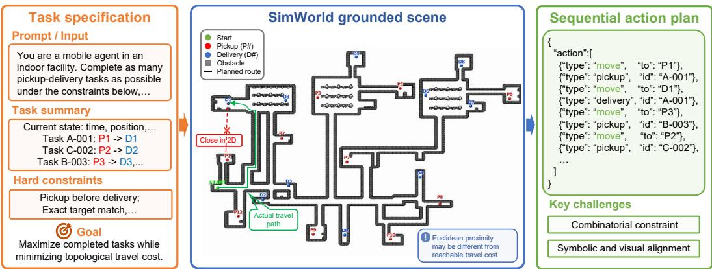  
Figure 1: DualWorldBench task overview. The agent maps task specifications and a grounded scene into a topology-aware pickup–delivery action plan under combinatorial constraints.

We study this problem through a unified pickup–delivery setting, shown in Fig. 1. An agent is given user demands together with textual and/or visual information about task locations and environment structure, and must execute a sequence of pickup and delivery actions. Success requires jointly reasoning over order timing, task reward, pickup–delivery precedence, capacity limits, and travel cost. This setting exposes two core difficulties. First, planning difficulty grows combinatorially with the number of goals and constraints: the agent must balance reward, deadline, and execution cost at the sequence level rather than solve isolated subtasks. Second, symbolic descriptions and visual environments are not trivially aligned: locations that are close in 2D coordinates may be far apart in actual navigable distance due to scene topology. Effective planning therefore requires both grounded scene understanding and structured constraint reasoning.

Delivery-style tasks have recently emerged as a practical testbed for embodied decision making. Existing delivery-oriented benchmarks study city-scale courier scenarios or human-centered indoor service delivery, showing that delivery naturally involves task ordering, temporal constraints, physical feasibility, and cost–reward trade-offs [14; 31; 29]. These efforts highlight the relevance of delivery as a realistic long-horizon planning problem beyond isolated navigation or perception.

However, despite the importance of this setting, existing benchmarks do not cleanly characterize the joint challenge we aim to study. Some emphasize realistic simulation or end-to-end embodied interaction, where perception, control, and planning are tightly entangled [10]; others stress symbolic routing or scheduling while abstracting away visual grounding and topology-aware feasibility [25]. As a result, it remains difficult to diagnose whether failures arise from weak perception, incomplete spatial grounding, or flawed combinatorial planning. We therefore use pickup–delivery not merely as an application domain, but as a unified task interface for evaluating agent planning that is both integrated, in the sense of assessing perception and planning together, and decomposable, in the sense of isolating symbolic–temporal difficulty from grounded–topological difficulty.

To address this gap, we introduce DualWorldBench, a benchmark for studying agent planning under controlled combinatorial constraints and modality/topology variation. We cast tasks under a shared pickup–delivery interface and instantiate three complementary components. (1) TextWorld isolates symbolic–temporal planning. It procedurally generates delivery tasks with different reward structures and temporal urgency, and evaluates global planning and online replanning under synchronous or time-triggered task release. (2) SimWorld isolates grounded–topological planning. Built on Gazebo, it contains procedural scenes with controlled topology complexity as well as transfer environments with realistic indoor layouts and large-scale campus traversal, and supports text-only, image-only, and multimodal inputs. (3) DualWorld-VQA serves as a diagnostic suite spanning perception, understanding, and planning, allowing us to probe where and why models fail.

We evaluate a broad range of state-of-the-art LLM-based agents and identify a consistent gap between local competence and globally consistent planning. In TextWorld, frontier agents approach strong online combinatorial baselines but remain below the theoretical optimum when heterogeneous task values, deadlines, and online arrivals interact, indicating that they still struggle to construct the optimal task sequence under temporal constraints. In SimWorld, weaker models often preserve task coverage yet produce infeasible action sequences, whereas stronger models remain reliable across modalities. DualWorld-VQA further shows that, despite improved perception–planning integration, constrained route optimization remain challenging. Overall, DualWorldBench reveals that the central unresolved challenge is converting symbolic or grounded evidence into globally feasible, constraint-consistent multi-goal plans as temporal and topological complexity increases.

Our contributions are threefold:

• We introduce DualWorldBench, a new benchmark for evaluating agent planning under controlled and decomposable symbolic–temporal constraints and grounded–topological constraints within a unified pickup–delivery interface.

• We design a decomposable evaluation framework with TextWorld, SimWorld, and DualWorld-VQA, enabling systematic analysis of scheduling, grounding, topology-aware planning, and their interactions.

• We provide extensive empirical evidence that current state-of-the-art LLM agents are still brittle under growing combinatorial constraints and multi-source inputs, establishing DualWorldBench as a challenging testbed for future integrated agents.

## 2 Related Work

Grounded spatial reasoning and embodied agents. Web agent benchmarks [6; 38; 9] evaluate instruction following and visual grounding through browser interactions. Spatial reasoning benchmarks probe visual relation understanding, multimodal spatial inference, and spatial belief construction through active exploration [12; 22; 36]. Embodied benchmarks further extend evaluation to long-horizon household interaction, dialogue, manipulation, and vision-driven decision making [23; 16; 15]. Complementary methodological work explores training-free embodied navigation [4; 37] and neuro-symbolic approaches to spatial reasoning, feasibility tracking, and skill induction [24; 26; 21; 3]. These efforts advance grounded reasoning and long-horizon execution, but end-to-end task outcomes often couple perception, grounding, control, and planning, making individual sources of failure difficult to diagnose. Local spatial judgments do not necessarily translate into globally feasible multi-goal plans.

Constrained planning and pickup–delivery benchmarks. Pickup–delivery and dynamic vehicle routing are established problems in operations research, encompassing routing constraints, transportation requests, and changing operational conditions [17; 18]. Recent benchmarks examine spatial planning, path-plan assessment, and multi-criteria route planning for vision-language and multimodal models [1; 27; 19]. Delivery-oriented benchmarks introduce courier-style or service-oriented tasks with deadlines, travel costs, and resource constraints [14; 28; 20]. Here, route choices affect deadline feasibility, while task timing changes which routes and action sequences remain viable. Effective planning thus requires coordinating task selection, pickup–delivery precedence, and resource allocation across the full execution sequence. In grounded environments, these decisions further depend on navigable connectivity, which cannot be inferred from coordinate proximity alone. Building on these directions, DualWorldBench focuses on distinguishing symbolic–temporal reasoning from grounded–topological planning under a unified task interface. Its shared pickup–delivery formulation enables controlled variation along both axes, supporting targeted analysis of how temporal constraints and grounded topology affect planning beyond aggregate task completion. This design probes the gap between local task competence and globally constraint-consistent planning.

## 3 Problem Formulation

We study a unified pickup–delivery planning problem underlying all components of DualWorld-Bench. The benchmark varies decision complexity, input modality, and environment topology while keeping the task interface fixed. This design enables direct comparison of symbolic planning, grounded multimodal planning, and cross-scene generalization within a common formal framework.

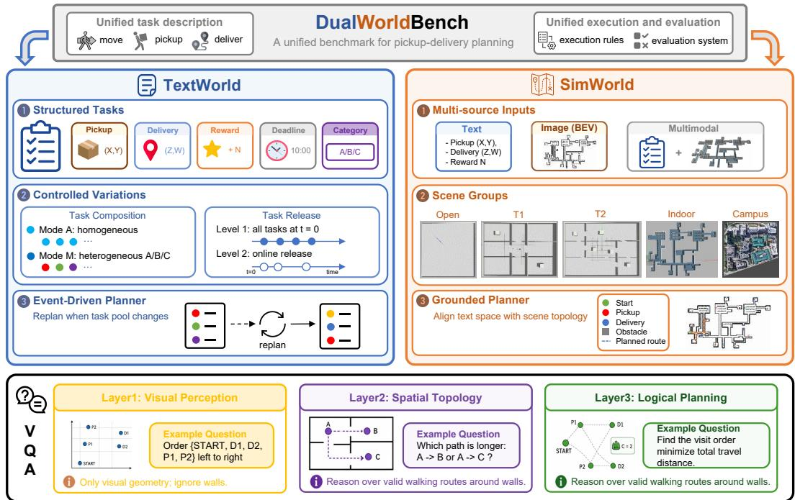  
Figure 2: DualWorld framework. A unified pickup–delivery benchmark with TextWorld for sym bolic planning, SimWorld for grounded planning, and DualWorld-VQA for diagnostic evaluation.

Both worlds instantiate the same pickup-delivery planning problem. A benchmark instance is

$$
\begin{array} { r } { \mathcal { T } = ( \boldsymbol { s } _ { 0 } , \mathcal { T } , \mathcal { E } ) , } \end{array}\tag{1}
$$

where $s _ { 0 } = ( \mathbf { x } _ { 0 } , \mathcal { L } _ { 0 } , b _ { 0 } , t _ { 0 } )$ denotes the initial robot state, with initial location $\mathbf { x } _ { 0 } ,$ , initial carrying set $\mathcal { L } _ { 0 } .$ , remaining payload capacity $b _ { 0 }$ , and initial time $t _ { 0 } . \ T = \{ \tau _ { i } \} _ { i = 1 } ^ { N }$ is the task set, and E is the environment model used to evaluate motion cost. Each task is

$$
\tau _ { i } = \big ( c _ { i } , \mathbf { p } _ { i } , \mathbf { d } _ { i } , t _ { i } ^ { \mathrm { t r i g } } , t _ { i } ^ { \mathrm { e n d } } , r _ { i } \big ) ,\tag{2}
$$

where $c _ { i } \in \{ A , B , C \}$ is the task type, p<sub>i</sub> and $\mathbf { d } _ { i }$ are pickup/delivery coordinates, $t _ { i } ^ { \mathrm { t r i g } }$ is the release time, $t _ { i } ^ { \mathrm { e n d } }$ is the deadline, and $r _ { i }$ is the base reward. The executable plan is represented as an action sequence

$$
\pi = ( a _ { 1 } , a _ { 2 } , \ldots , a _ { M } ) ,\tag{3}
$$

with actions from {move, pickup, deliver}. Feasibility requires pickup-before-delivery precedence, capacity limits, and execution at correct coordinates. The realized reward is

$$
R _ { i } = \operatorname* { m a x } \bigl ( 0 , r _ { i } - \lambda ( c _ { i } ) \operatorname* { m a x } ( 0 , t _ { i } ^ { \mathrm { a r r } } - t _ { i } ^ { \mathrm { e n d } } ) \bigr ) ,\tag{4}
$$

where $t _ { i } ^ { \mathrm { a r r } }$ is the delivery time and $\lambda ( c _ { i } )$ is a class-dependent penalty rate. In our implementation, task types A, B, and $\check { C }$ induce increasingly sharp trade-offs among travel distance, urgency, and value. The benchmark objective is to maximize cumulative revenue

$$
J ( \pi ) = \sum _ { i } R _ { i } ,\tag{5}
$$

subject to the feasibility constraints above.

This formulation is the backbone of DualWorldBench. It keeps the objective fixed while varying the evaluation setting. TextWorld instantiates the full heterogeneous setting above, whereas the current SimWorld release uses a static, uniform-reward subset to foreground grounded spatial reasoning.

## 4 DualWorldBench

DualWorldBench is a benchmark for evaluating the planning capabilities of LLMs under controlled variations in task dynamics, input modality, and environment topology. Built upon a shared

pickup–delivery interface, the benchmark decomposes evaluation into TextWorld, SimWorld, and DualWorld-VQA. The overall framework is illustrated in Fig. 2.

## 4.1 TextWorld Benchmark

Design Objective. TextWorld is designed to isolate the symbolic–temporal component of planning. It focuses exclusively on the agent’s ability to perform offline and online planning under combinatorial constraints. As such, TextWorld measures multi-task scheduling, temporal priority reasoning, and online replanning in a purely symbolic decision space.

Task Setup. We procedurally generate pickup–delivery instances, each specified by pickup/delivery coordinates, task category, reward, and deadline. Valid execution must satisfy both precedence constraints and capacity limits. The agent must reason over these constraints to produce a task sequence that maximizes return while minimizing completion time.

To disentangle different sources of symbolic difficulty, we vary TextWorld along two controlled dimensions. First, we vary the task composition. In Mode A, all tasks are of Type-A, forming a homogeneous task pool with a simple value structure. In Mode M, tasks are sampled from Type-$A / B / C$ , introducing heterogeneous reward scales, deadline urgency, and penalty sensitivity. This A/M split separates pure ordering complexity from value-aware scheduling: Mode A primarily tests combinatorial sequencing, whereas Mode M further requires the model to prioritize across task types with different constraint profiles. Second, we vary the task release mechanism. In Level 1, all tasks are available at $t = 0$ , yielding a static scheduling problem. In Level 2, tasks are released online according to predefined triggering rules, causing the active task pool to evolve over time and requiring the planner to repeatedly revise its decisions. The resulting factorial design, $\{ A , M \} \times \{ L \bar { 1 } , L 2 \}$ allows TextWorld to separately evaluate the difficulty of combinatorial growth, heterogeneous value trade-offs, and interruption-driven replanning within a unified symbolic benchmark.

Planning and Evaluation Interface. TextWorld is evaluated through a unified event-driven simulator. The simulator maintains the current time, agent state, active task set, carried task set, and completed task set, and invokes the planner whenever the task pool changes or the current plan is exhausted. If a new task arrives while the agent is in motion, execution is interrupted at the interpolated stopping point, and planning restarts from the updated state. Because the input is fully symbolic and the executor is deterministic, this benchmark directly tests whether a planner can convert structured states into executable action sequences and remain consistent across repeated replanning calls.

## 4.2 SimWorld Benchmark

Design Objective. SimWorld is designed to isolate the grounded-topological component of planning. Complementary to TextWorld, which emphasizes temporally dynamic planning, SimWorld focuses on grounded path planning in structured environments. Its central challenge is that path quality is determined not only by geometric proximity in textual coordinates, but also by topological connectivity in visual scenes. The model must therefore integrate multi-source inputs, align task specifications with scene structure, and generate globally feasible multi-goal plans.

Accordingly, SimWorld primarily evaluates grounded path planning under controlled variations in modality and topology, including spatial information extraction, alignment between symbolic tasks and grounded scene structure, cross-modal robustness, and cross-scene generalization.

Task Setup. SimWorld adopts a static task mechanism in which all tasks are available at $t = 0$ and share a unified reward. It retains the same pickup–delivery action space and core feasibility rules as TextWorld: each task still consists of a pickup location and a delivery location, and valid execution must still satisfy precedence and capacity constraints. We design five scene groups with distinct topological characteristics: open, T1, T2, indoor, and campus. Among them, open contains no obstacles and serves as a simulated counterpart to the simplified setting of TextWorld. T1 and T2 are deliberately constructed procedural environments for parameterizing topological complexity. T1 features relatively regular corridor-style layouts, where locally reasonable choices often align with globally short paths. T2, by contrast, increases difficulty through denser branching structures and more frequent detours, making Euclidean proximity an unreliable proxy for actual navigation cost.

The indoor group emphasizes complex enclosed topologies, whereas campus emphasizes semi-open environments that require long-range traversal.

Together, these settings define a controlled topology gradient: T1/T2 provide an interpretable and procedural axis of increasing spatial difficulty, while indoor and campus test transfer beyond synthetic layouts. This design enables the benchmark to distinguish failure modes arising from local grounding, topological reasoning, and cross-scene generalization.

Planning and Evaluation Interface. Each SimWorld instance is evaluated under three input modalities. Text provides only symbolic task descriptions and coordinates. Image provides only simplified task descriptions together with a BEV map annotated by visual markers. Multimodal provides both the visual scene and structured task descriptions, enabling explicit alignment between symbolic task specifications and scene content. This design tests not only whether a model can plan from a given modality, but also whether multimodal evidence improves grounded planning. All modalities are prompted to output the same JSON node sequence, which the evaluator maps to task coordinates and expands into executable move, pickup, and deliver actions. Each mapped coordinate is matched to the nearest valid navigation anchor, and path cost is computed from a preconstructed navigation graph [2; 32] together with local access offsets.

## 4.3 DualWorld-VQA

Beyond end-to-end planning metrics, DualWorldBench includes a hierarchical diagnostic VQA suite for analyzing failure modes at intermediate stages of the planning pipeline. Its role is diagnostic: it complements the primary planning experiments with controlled probes that help explain whether errors arise from deficient visual grounding, incomplete spatial understanding, or flawed decision making. Consistent with the benchmark design, VQA items are procedurally generated from simula tor state, scene annotations, and task metadata, then verified through a lightweight human validation pass before release. Standard answers are expected to be derived directly from simulator ground truth or scene annotations, and scoring can be instantiated with task-appropriate criteria such as exact match, option accuracy, or constrained judgment correctness.

The suite is organized into three layers. Perception-level VQA targets basic visual geometric perception from the map image, including absolute axis ordering, Euclidean distance comparison to an anchor node, and pairwise Euclidean distance extremes. These questions deliberately ignore walls, connectivity, route cost, and label numbering patterns, so as to isolate whether models can reliably perceive spatial relations in the rendered image. Topology-level VQA introduces wall constraints and evaluates whether models can reason over valid walking routes rather than relying on misleading straight-line proximity. Planning-level VQA further requires models to solve constrained pickup-and-delivery decisions under capacity and pickup-before-delivery constraints, where success depends on jointly using grounded spatial evidence and symbolic task constraints. Together, these probes provide a compact diagnostic decomposition of agent failures into visual perception, spatial topology understanding, and grounded logical planning.

## 5 Experiments

We evaluate MLLMs on DualWorldBench: TextWorld targets symbolic-temporal planning from structured text, SimWorld targets grounded-topological planning under multimodal observations, and DualWorld-VQA decomposes visual perception, topology reasoning, and constrained planning.

## 5.1 Experimental Setup

We benchmark recent LLMs from both open-weight and proprietary families, including Qwen, Llama, DeepSeek, Claude, Gemini, and GPT variants. TextWorld contains 14 LLMs and 3 solver baselines; SimWorld and DualWorld-VQA use the same 6 VLMs to support paired comparisons.

TextWorld. TextWorld measures symbolic-temporal planning from structured task descriptions alone. We report Cumulative Reward (R) and Completion Time (T), and compare against three combinatorial baselines: DFS, Online DP, and Offline DP (Appendix C). We evaluate across task count and the four benchmark regimes induced by the factorial design $\{ A , M \} \times \{ L 1 , L 2 \}$ . Task count ranges from 5 to 15. A run that delivers an A/B task while carrying any Type-C task violates the priority constraint and is scored as R=0, T=9999.

Table 1: TextWorld results under varying task counts. Gray shading indicates the best performance.
<table><tr><td rowspan="3">Method</td><td rowspan="3">Rank</td><td rowspan="2" colspan="2">Average</td><td colspan="10">Task Count</td></tr><tr><td colspan="2"></td><td colspan="2">8</td><td colspan="2">10</td><td colspan="2">12</td><td colspan="2">15</td></tr><tr><td colspan="2">R↑ T↓</td><td colspan="2">T↓</td><td colspan="2">R↑ T↓</td><td colspan="2">R↑ T↓</td><td colspan="2">R↑ T↓</td><td colspan="2">R↑ T↓</td></tr><tr><td></td><td></td><td></td><td></td><td></td><td></td><td>Open-source LLMs</td><td></td><td></td><td></td><td></td><td></td><td></td><td></td></tr><tr><td>Qwen3.6-27B</td><td>9</td><td>251.41</td><td>5061.46</td><td>99.33</td><td>1969.57</td><td>213.17</td><td>5552.39</td><td>249.12</td><td>5377.14</td><td>312.94</td><td>5158.18</td><td>382.49</td><td>7250.02</td></tr><tr><td>Llama-2-13B</td><td>12</td><td>212.33</td><td>5515.20</td><td>100.28</td><td>2396.66</td><td>209.73</td><td>5471.45</td><td>202.32</td><td>5403.88</td><td>298.18</td><td>5912.93</td><td>251.15</td><td>8391.05</td></tr><tr><td>Qwen3-VL-8B</td><td>13</td><td>68.81</td><td>3305.46</td><td>19.23</td><td>1449.30</td><td>121.67</td><td>4481.61</td><td>35.69</td><td>2902.33</td><td>135.69</td><td>4653.41</td><td>31.79</td><td>3040.67</td></tr><tr><td>Llama-3-8B</td><td>14</td><td>19.33</td><td>3223.40</td><td>26.14</td><td>1640.78</td><td>13.94</td><td>3526.92</td><td>50.24</td><td>3609.83</td><td>6.33</td><td>3237.74</td><td>0.00</td><td>4101.73</td></tr><tr><td colspan="10">Proprietary LLMs</td><td colspan="2"></td><td colspan="2"></td></tr><tr><td>Gemini-2.5-Flash</td><td>1</td><td>265.73</td><td>4568.84</td><td>111.10</td><td>1875.90</td><td>213.24</td><td>5231.71</td><td>279.18</td><td>4175.72</td><td>333.12</td><td>4934.41</td><td>392.01</td><td>6626.44</td></tr><tr><td>Gemini-3-Pro</td><td></td><td>264.36</td><td>4310.73</td><td>114.77</td><td>1761.01</td><td>213.24</td><td>4843.20</td><td>278.53</td><td>3991.18</td><td>323.13</td><td>4716.06</td><td>392.14</td><td>6242.17</td></tr><tr><td>GPT-5.6-Sol</td><td></td><td>264.33</td><td>5013.85</td><td>114.77</td><td>2011.85</td><td>213.24</td><td>5384.76</td><td>278.53</td><td>4785.25</td><td>323.13</td><td>5665.16</td><td>392.01</td><td>7222.23</td></tr><tr><td>Claude-Opus-5</td><td>234</td><td>264.10</td><td>4347.24</td><td>114.77</td><td>1745.07</td><td>213.24</td><td>5058.77</td><td>277.35</td><td>4009.72</td><td>323.13</td><td>4695.04</td><td>392.01</td><td>6227.59</td></tr><tr><td>DeepSeek-v4-Flash</td><td>5678</td><td>263.60</td><td>4711.47</td><td>111.10</td><td>1789.44</td><td>213.24</td><td>5437.33</td><td>278.53</td><td>4051.14</td><td>323.13</td><td>5406.74</td><td>392.01</td><td>6872.71</td></tr><tr><td>Qwen3.7-Plus</td><td></td><td>263.24</td><td>4560.71</td><td>114.77</td><td>1863.30</td><td>213.24</td><td>5094.50</td><td>273.90</td><td>4165.28</td><td>322.27</td><td>5185.82</td><td>392.01</td><td>6494.65</td></tr><tr><td>Claude-Sonnet-5</td><td></td><td>260.16</td><td>4780.29</td><td>114.54</td><td>1782.60</td><td>196.24</td><td>5408.39</td><td>278.43</td><td>4275.89</td><td>319.52</td><td>5634.78</td><td>392.05</td><td>6799.79</td></tr><tr><td>Claude-4.5-Haiku</td><td></td><td>253.01</td><td>4900.80</td><td>111.10</td><td>1927.15</td><td>204.95</td><td>5333.92</td><td>266.26</td><td>4818.51</td><td>304.06</td><td>5532.84</td><td>378.70</td><td>6891.58</td></tr><tr><td>GPT-40</td><td>10</td><td>251.05</td><td>5245.35</td><td>114.77</td><td>2226.95</td><td>189.94</td><td>5808.08</td><td>272.77</td><td>4805.22</td><td>303.95</td><td>5662.43</td><td>373.82</td><td>7724.05</td></tr><tr><td>GPT-5.4-Mini</td><td>11</td><td>246.81</td><td>5207.10</td><td>111.10</td><td>2219.29</td><td>198.84</td><td>5532.03</td><td>248.54</td><td>4925.06</td><td>321.70</td><td>5662.36</td><td>353.88</td><td>7696.76</td></tr><tr><td colspan="10">Combinatorial Optimization Solver</td><td colspan="2"></td><td colspan="2"></td></tr><tr><td>DFS Online DP</td><td></td><td>264.33</td><td>4702.45</td><td>114.77</td><td>2028.71</td><td>213.24</td><td>5349.95</td><td>278.53</td><td>4344.86</td><td>323.13</td><td>5186.65</td><td>392.01</td><td>6602.05</td></tr><tr><td></td><td>321</td><td>264.36</td><td>4083.25</td><td>114.77</td><td>1758.71</td><td>213.24</td><td>4742.61</td><td>278.53</td><td>3806.96</td><td>323.13</td><td>4479.11</td><td>392.14</td><td>5628.85</td></tr><tr><td>Offline DP</td><td></td><td>278.17</td><td>4015.28</td><td>126.20</td><td>1718.67</td><td>230.27</td><td>4602.62</td><td>290.00</td><td>3794.25</td><td>334.65</td><td>4406.57</td><td>409.71</td><td>5554.29</td></tr></table>

SimWorld. We evaluate three modalities: Text, Image, and Multimodal. All modalities emit the same node-sequence format. We report three metrics: Feasible (F), Completion (C), and Normalized Cost (NC). Feasible is the fraction of runs with a successfully evaluated plan and no execution constraint violations. Completion is the average fraction of tasks validly delivered during evaluation. Invalid pickup or delivery actions do not update the task state, but evaluation continues, and valid deliveries are credited even if other actions violate constraints. Runs that cannot be planned or evaluated receive zero feasibility and completion. NC divides a plan’s travelled distance by the length of the optimal pickup–delivery route over the subset of tasks that plan delivered. We evaluate stability under increasing planning horizon by varying task cardinality with $n \in \{ 5 , 8 , 1 0 \}$ across five scene groups: open, T1, T2, indoor, and campus.

## 5.2 Benchmark Results

DualWorldBench evaluates grounded planning beyond a single aggregate score. It decomposes model capability into three aspects: feasible multi-goal planning under increasing combinatorial difficulty (Q1, Q2, Q4), extraction and alignment of symbolic/visual evidence (Q3), and robustness across scene topology and environment complexity (Q5).

## 5.2.1 TextWorld

Table 1 and Fig. 3a show TextWorld results across task counts and symbolic-temporal conditions.

Q1: How well do planners scale as the symbolic–temporal search space grows? Table 1 shows that frontier models can already generate complete task routes and consequently obtain high task rewards. Gemini-2.5-Flash achieves the best average performance among the MLLMs (R=265.7, ${ T / = } 4 5 6 8 . 8 )$ . Although its reward slightly exceeds that of Online DP (R=264.3), its simulated completion time remains longer than those of the solvers, indicating that even the strongest models cannot identify the optimal routes. The performance of open-source models is considerably more dispersed: at n=15, Qwen3.6-27B achieves R=382.4, whereas Qwen3-VL-8B drops to $\bar { R } { = } 3 1 . 7$ and Llama-3-8B to R=0.0. Thus, as the number of tasks and the search space increase, models exhibit clear performance divergence. Nevertheless, even the best-performing models remain unable to produce optimal task plans that achieve the highest reward within the shortest completion time.

Q2: How robust are planners under richer symbolic constraints and online task release? Fig. 3a reveals a substantial capability gap between the two model groups; Appendix Table 3 provides the complete model-wise results. Proprietary LLMs achieve an average reward of R=385.0 across the four settings, compared with only 166.3 for open-source LLMs, and reach the reward ceiling in both A-L1 and M-L1. This gap persists under online task release. In A-L2, proprietary models retain 96.1% of the Offline-DP reward (278.5 vs. 289.7), whereas open-source models retain only 34.8% (100.9). M-L2 is the most challenging setting: proprietary models achieve an average reward of $R { = } 3 9 9 . 8$ , corresponding to 82.1% of the Offline-DP reward, whereas open-source models achieve only 116.0 (23.8%). The primary bottleneck therefore lies not merely in interpreting individual constraints, but in jointly reasoning over heterogeneous priorities and deadlines while dynamically replanning as new tasks become available.

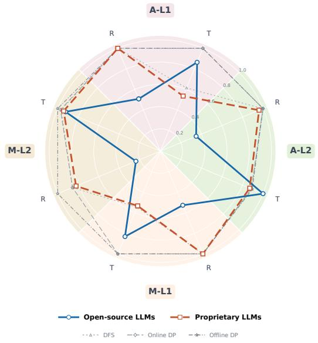

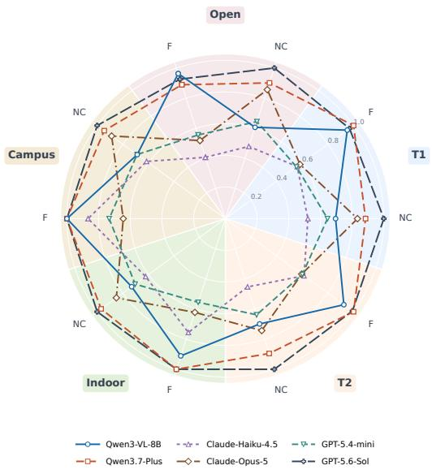  
(a) TextWorld (task count 15).  
(b) SimWorld (averaged across modalities).  
Figure 3: Performance comparison across TextWorld and SimWorld. In TextWorld, reward and completion time are normalized as $R /$ max R and min $T / T .$ . In SimWorld, scores are averaged across modalities, with $N C$ inversely normalized within each scene.

Table 2: SimWorld scaling results under varying task counts.
<table><tr><td rowspan="3">Method</td><td rowspan="3">Modality</td><td rowspan="2" colspan="3">Average</td><td colspan="9">Task Count</td></tr><tr><td colspan="3">5</td><td colspan="3">8</td><td colspan="3">10</td></tr><tr><td>F↑</td><td>C↑</td><td>NC↓</td><td>F↑</td><td>C↑</td><td>NC↓</td><td>F↑</td><td>C↑</td><td>NC↓</td><td>F↑</td><td>C↑</td><td>NC↓</td></tr><tr><td rowspan="3">Qwen3-VL-8B</td><td>Multi.</td><td>0.989</td><td>0.974</td><td>1.90</td><td>0.984</td><td>0.946</td><td>1.56</td><td>0.984</td><td>0.976</td><td>1.95</td><td>1.000</td><td>1.000</td><td>2.20</td></tr><tr><td>Image</td><td>0.836</td><td>0.904</td><td>1.90</td><td>0.778</td><td>0.895</td><td>1.58</td><td>0.857</td><td>0.907</td><td>1.95</td><td>0.873</td><td>0.911</td><td>2.17</td></tr><tr><td>Text</td><td>1.000</td><td>0.544</td><td>1.46</td><td>1.000</td><td>0.527</td><td>1.28</td><td>1.000</td><td>0.619</td><td>1.56</td><td>1.000</td><td>0.486</td><td>1.53</td></tr><tr><td rowspan="3">Qwen3.7-Plus</td><td>Multi.</td><td>1.000</td><td>1.000</td><td>1.27</td><td>1.000</td><td>1.000</td><td>1.13</td><td>1.000</td><td>1.000</td><td>1.30</td><td>1.000</td><td>1.000</td><td>1.38</td></tr><tr><td>Image</td><td>0.984</td><td>0.995</td><td>1.54</td><td>0.984</td><td>0.997</td><td>1.32</td><td>0.984</td><td>0.996</td><td>1.56</td><td>0.984</td><td>0.992</td><td>1.74</td></tr><tr><td>Text</td><td>1.000</td><td>0.972</td><td>1.26</td><td>1.000</td><td>1.000</td><td>1.12</td><td>1.000</td><td>1.000</td><td>1.23</td><td>1.000</td><td>0.916</td><td>1.42</td></tr><tr><td rowspan="3">Claude-Haiku-4.5</td><td>Multi.</td><td>0.762</td><td>0.961</td><td>2.16</td><td>0.921</td><td>0.987</td><td>1.57</td><td>0.698</td><td>0.964</td><td>2.49</td><td>0.667</td><td>0.930</td><td>2.43</td></tr><tr><td>Image</td><td>0.175</td><td>0.707</td><td>3.19</td><td>0.270</td><td>0.752</td><td>2.69</td><td>0.159</td><td>0.708</td><td>3.48</td><td>0.095</td><td>0.660</td><td>3.40</td></tr><tr><td>Text</td><td>0.905</td><td>0.981</td><td>1.93</td><td>1.000</td><td>1.000</td><td>1.49</td><td>0.810</td><td>0.972</td><td>1.95</td><td>0.905</td><td>0.971</td><td>2.35</td></tr><tr><td rowspan="3">Claude-Opus-5</td><td>Multi.</td><td>0.519</td><td>0.945</td><td>1.74</td><td>0.730</td><td>0.968</td><td>1.36</td><td>0.429</td><td>0.933</td><td>1.78</td><td>0.397</td><td>0.935</td><td>2.08</td></tr><tr><td>Image</td><td>0.561</td><td>0.865</td><td>1.45</td><td>0.635</td><td>0.902</td><td>1.30</td><td>0.571</td><td>0.859</td><td>1.46</td><td>0.476</td><td>0.835</td><td>1.59</td></tr><tr><td>Text</td><td>0.698</td><td>0.971</td><td>1.38</td><td>0.857</td><td>0.994</td><td>1.23</td><td>0.683</td><td>0.972</td><td>1.38</td><td>0.556</td><td>0.948</td><td>1.52</td></tr><tr><td rowspan="3">GPT-5.4-mini</td><td>Multi.</td><td>0.640</td><td>0.934</td><td>1.81</td><td>0.778</td><td>0.952</td><td>1.52</td><td>0.698</td><td>0.948</td><td>1.88</td><td>0.444</td><td>0.900</td><td>2.04</td></tr><tr><td>Image</td><td>0.127</td><td>0.695</td><td>2.03</td><td>0.143</td><td>0.698</td><td>1.95</td><td>0.175</td><td>0.742</td><td>1.98</td><td>0.063</td><td>0.644</td><td>2.17</td></tr><tr><td>Text</td><td>0.995</td><td>0.966</td><td>1.78</td><td>1.000</td><td>1.000</td><td>1.55</td><td>0.984</td><td>0.998</td><td>1.85</td><td>1.000</td><td>0.900</td><td>1.95</td></tr><tr><td rowspan="3">GPT-5.6-Sol</td><td>Multi.</td><td>0.984</td><td>0.998</td><td>1.13</td><td>0.984</td><td>0.997</td><td>1.08</td><td>0.984</td><td>1.000</td><td>1.16</td><td>0.984</td><td>0.997</td><td>1.17</td></tr><tr><td>Image</td><td>0.989</td><td>0.996</td><td>1.39</td><td>0.984</td><td>0.994</td><td>1.25</td><td>1.000</td><td>1.000</td><td>1.39</td><td>0.984</td><td>0.995</td><td>1.53</td></tr><tr><td>Text</td><td>0.968</td><td>0.995</td><td>1.13</td><td>0.968</td><td>0.994</td><td>1.07</td><td>0.937</td><td>0.992</td><td>1.13</td><td>1.000</td><td>0.998</td><td>1.20</td></tr></table>

## 5.2.2 SimWorld

Tables 2 and Fig. 3b report SimWorld results across task scales, input modalities, and scene groups.

Q3: Can MLLMs align textual and visual information into feasible grounded plans? Grounded planning remains strongly dependent on both the model and input modality. Text input generally produces more feasible plans, whereas image-only planning is substantially more challenging for weaker models. However, this ordering is not universal: stronger models remain reliable with visual observations, suggesting that the main limitation is not the visual representation itself, but the model’s ability to convert visual evidence into a constraint-consistent plan. Moreover, fea sibility does not necessarily imply adequate task coverage. For example, Qwen3-VL-8B produces consistently feasible text-based plans but omits many tasks, while its multimodal plans achieve a better balance between legality and completion. Overall, multimodal input is most useful when the model can jointly preserve grounding accuracy, task coverage, and global plan consistency; visual input alone does not provide a systematic routing advantage.

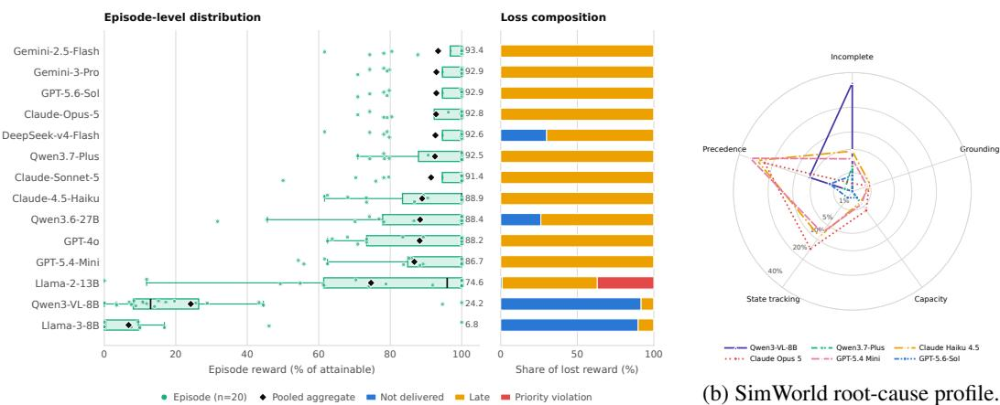  
(a) TextWorld reward-gap attribution.  
Figure 4: Failure attribution across the two worlds. (a) TextWorld episode reward and loss composition. (b) SimWorld root-cause shares pooled over the three input modalities for each model.

Q4: How does grounded planning scale with task count across modalities? Increasing the task count reveals a clear separation between task completion and plan validity. Several models maintain high completion while losing feasibility under multimodal input, indicating that they continue to include the requested goals but increasingly violate connectivity or ordering constraints. In contrast, GPT-5.6-Sol and the Qwen models remain comparatively stable, showing that this degradation is not unavoidable and depends strongly on planning capability. Nevertheless, NC generally increases with task count across all modalities, including for models whose feasibility remains nearly unchanged. Thus, larger task sets challenge route efficiency before they necessarily cause complete planning failure. These results identify global goal ordering and constraint management, rather than individual target recognition, as the central difficulty in scaling grounded planning.

Q5: How robust is grounded planning across scene topology? Scene topology primarily affects whether a valid plan can be constructed, while its effect on routing efficiency is comparatively moderate. Open scenes are generally more difficult in terms of feasibility, whereas campus scenes tend to be easier, but this trend is dominated by models with weaker visual grounding. In particular, image-only performance varies substantially across scene groups for these models, while stronger models remain reliable across most topologies. Text-based planning is considerably more stable, further indicating that the main challenge lies in recovering planning-relevant structure from visual observations. Therefore, robustness to scene variation depends on the interaction between topology and visual grounding capability, rather than on scene type alone.

## 5.3 Error Analysis

We use exhaustive, mutually exclusive error taxonomies to explain performance losses: TextWorld decomposes the reward gap, while SimWorld assigns each run a single root cause.

TextWorld: from coverage to scheduling. We attribute lost reward to not delivered (forfeited reward), late (deadline penalties), or priority violation (run invalidation), and aggregate rewardweighted shares across scenarios and task counts. Figure 4a shows that frontier models obtain over

92% of attainable reward, with lateness accounting for most residual loss. Lateness dominates under temporal constraints and vanishes without deadlines, while priority violations occur in only one of 280 runs. Weaker models instead lose reward mainly through undelivered tasks, indicating a shift from task coverage to deadline-aware scheduling as model capability improves.

SimWorld: action sequencing dominates. We assign root causes in the order grounding > capacity > state tracking > precedence, labeling violation-free runs as success or incomplete. Derived symptoms, such as deliver without carry, are subsumed under their underlying sequencing errors. As shown in Figure 4b, precedence and state-tracking violations account for most invalid plans; grounding and capacity errors are uncommon. These results identify action sequencing and deadline-aware scheduling as key remaining challenges.

## 5.4 DualWorld-VQA Results

Figure 5 shows that the three-level capability decomposition clearly distinguishes models across capability tiers. Weaker models exhibit a sharp gap between intermediate understanding and end-to-end planning. For example, GPT-5.4-mini achieves 55.5% and 55.9% accuracy in visual perception and spatial topology, respectively, but only 6.3% in logical planning. This result indicates that partial competence in perception and topology does not necessarily enable a model to integrate visual and symbolic information into constraint-consistent plans. This diagnosis is consistent with the SimWorld results, where GPT-5.4-mini maintains relatively high task completion but exhibits low feasibility, particularly with imageonly input, and degrades further as the task count increases. In contrast, stronger flagship models approach saturation in visual perception and avoid the pronounced collapse in log-

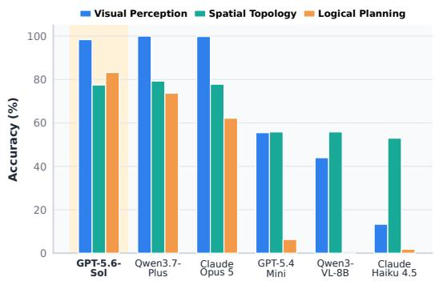  
Figure 5: Evaluation in DualWorld-VQA from three levels: Visual Perception, Spatial Topology, and Logical Planning.

ical planning observed for weaker models. Their SimWorld performance is similarly robust across modalities, task scales, and scene topologies, suggesting an emerging ability to jointly reason over visual evidence, spatial structure, and symbolic constraints. Together, the VQA and SimWorld results consistently show that the central bottleneck is not perception or topology understanding alone, but their composition into globally feasible grounded plans.

## 6 Conclusion

We introduced DualWorldBench, a controlled benchmark for agent planning in symbolic–temporal and grounded–topological settings. Through a shared pickup–delivery interface, TextWorld, Sim-World, and DualWorld-VQA combine end-to-end evaluation with fine-grained diagnosis. Stronger models improve task coverage and grounded feasibility, but scheduling and consistent action se quencing remain bottlenecks. DualWorld-VQA further suggests that translating perception and topology understanding into executable plans remains challenging. The benchmark currently evaluates temporal and topological complexity separately, motivating future work on their integration within shared instances.

## Acknowledgments and Disclosure of Funding

We appreciate the anonymous reviewers for their valuable insights and helpful comments. This work is supported by the National Natural Science Foundation of China (Grant No. 62306133), the Key Program of Jiangsu Science Foundation (BK20243012), and the “111 Center” (No. B26023).

## References

[1] Mohamed Aghzal, Xiang Yue, Erion Plaku, and Ziyu Yao. Evaluating vision-language models as evaluators in path planning. In 2025 IEEE/CVF Conference on Computer Vision and Pattern Recognition (CVPR), pages 6886–6897. IEEE, 2025.

[2] Chao Cao, Hongbiao Zhu, Fan Yang, Yukun Xia, Howie Choset, Jean Oh, and Ji Zhang. Autonomous exploration development environment and the planning algorithms. In 2022 International Conference on Robotics and Automation, pages 8921–8928, 2022.

[3] Yang Chen, Hong-Jie You, Jie-Jing Shao, Xiao-Wen Yang, Ming Yang, Yu-Feng Li, and Lan-Zhe Guo. Re<sup>2</sup> Agent: Reflection and re-execution agent for embodied decision making. In NeurIPS 2025 Challenge on Foundation Models for Embodied Agents, 2025.

[4] Yang Chen, Lirong Che, Zhenyu Huang, Wenbo Fu, Chuang Wang, Xu Cao, Daqi Liu, Yuzhe Yang, Jian Su, and Lan-Zhe Guo. Harnessvln: Unifying training-free embodied navigation through an agent harness. arXiv preprint arXiv:2609.15195, 2026.

[5] Jae-Woo Choi, Youngwoo Yoon, Hyobin Ong, Jaehong Kim, and Minsu Jang. Lotabench: Benchmarking language-oriented task planners for embodied agents. arXiv preprint arXiv:2402.08178, 2024.

[6] Xiang Deng, Yu Gu, Boyuan Zheng, Shijie Chen, Sam Stevens, Boshi Wang, Huan Sun, and Yu Su. Mind2web: Towards a generalist agent for the web. Advances in Neural Information Processing Systems, pages 28091–28114, 2023.

[7] Mengfei Du, Binhao Wu, Zejun Li, Xuan-Jing Huang, and Zhongyu Wei. Embspatial-bench: Benchmarking spatial understanding for embodied tasks with large vision-language models. In Proceedings of the 62nd Annual Meeting of the Association for Computational Linguistics, pages 346–355, 2024.

[8] Yining Hong, Rui Sun, Bingxuan Li, Xingcheng Yao, Maxine Wu, Alexander Chien, Da Yin, Ying Nian Wu, Zhecan James Wang, and Kai-Wei Chang. Embodied web agents: Bridging physical-digital realms for integrated agent intelligence. arXiv preprint arXiv:2506.15677, 2025.

[9] Jing Yu Koh, Robert Lo, Lawrence Jang, Vikram Duvvur, Ming Lim, Po-Yu Huang, Graham Neubig, Shuyan Zhou, Russ Salakhutdinov, and Daniel Fried. Visualwebarena: Evaluating multimodal agents on realistic visual web tasks. In Proceedings of the 62nd Annual Meeting ofthe Associationfor Computational Linguistics, pages 881–905, 2024.

[10] Chengshu Li, Ruohan Zhang, Josiah Wong, Cem Gokmen, Sanjana Srivastava, Roberto Mart´ın-Mart´ın, Chen Wang, Gabrael Levine, Michael Lingelbach, Jiankai Sun, et al. Behavior-1k: A benchmark for embodied ai with 1,000 everyday activities and realistic simulation. In Conference on Robot Learning, pages 80–93, 2023.

[11] Manling Li, Shiyu Zhao, Qineng Wang, Kangrui Wang, Yu Zhou, Sanjana Srivastava, Cem Gokmen, Tony Lee, Li E Li, Ruohan Zhang, et al. Embodied agent interface: Benchmarking llms for embodied decision making. Advances in Neural Information Processing Systems, pages 100428–100534, 2024.

[12] Fangyu Liu, Guy Emerson, and Nigel Collier. Visual spatial reasoning. Transactions of the Associationfor Computational Linguistics, pages 635–651, 2023.

[13] Xiao Liu, Hao Yu, Hanchen Zhang, Yifan Xu, Xuanyu Lei, Hanyu Lai, Yu Gu, Hangliang Ding, Kaiwen Men, Kejuan Yang, et al. Agentbench: Evaluating llms as agents. arXiv preprint arXiv:2308.03688, 2023.

[14] Lingjun Mao, Jiawei Ren, Kun Zhou, Jixuan Chen, Ziqiao Ma, and Lianhui Qin. Deliverybench: Can agents earn profit in real world? arXiv preprint arXiv:2512.19234, 2025.

[15] Fei Ni, Min Zhang, Pengyi Li, Yifu Yuan, Lingfeng Zhang, Yuecheng Liu, Peilong Han, Longxin Kou, Shaojin Ma, Jinbin Qiao, et al. Embodied arena: A comprehensive, unified, and evolving evaluation platform for embodied ai. arXiv preprint arXiv:2509.15273, 2025.

[16] Aishwarya Padmakumar, Jesse Thomason, Ayush Shrivastava, Patrick Lange, Anjali Narayan-Chen, Spandana Gella, Robinson Piramuthu, Gokhan Tur, and Dilek Hakkani-Tur. Teach: Task-driven embodied agents that chat. In Proceedings of the AAAI Conference on Artificial Intelligence, pages 2017–2025, 2022.

[17] Sophie N Parragh, Karl F Doerner, and Richard F Hartl. A survey on pickup and delivery problems: Part ii: Transportation between pickup and delivery locations. Journal fur Betrieb-¨ swirtschaft, 58(2):81–117, 2008.

[18] Victor Pillac, Michel Gendreau, Christelle Gueret, and Andr´ es L Medaglia. A review of dy-´ namic vehicle routing problems. European Journal of Operational Research, 225(1):1–11, 2013.

[19] Ziqiao Shang, Lingyue Ge, Zi-Jian Cheng, Shi-Yu Tian, Zhenyu Huang, Wenbo Fu, Weiming Wu, Yang Chen, Xiangwen Zhang, Yulan Hu, et al. Maptab: Are mllms ready for multi-criteria route planning in heterogeneous graphs? arXiv preprint arXiv:2602.18600, 2026.

[20] Jie-Jing Shao, Bo-Wen Zhang, Xiao-Wen Yang, Baizhi Chen, Si-Yu Han, Wen-Da Wei, Guohao Cai, Zhenhua Dong, Lan-Zhe Guo, and Yu-Feng Li. Chinatravel: An open-ended benchmark for language agents in chinese travel planning. arXiv preprint arXiv:2412.13682, 2024.

[21] Jie-Jing Shao, Haiyan Yin, Yueming Lyu, Xingrui Yu, Lan-Zhe Guo, Ivor Tsang, James Kwok, and Yu-Feng Li. Lifting traces to logic: Programmatic skill induction with neuro-symbolic learning for long-horizon agentic tasks. arXiv preprint arXiv:2605.01293, 2026.

[22] Fatemeh Shiri, Xiao-Yu Guo, Mona Golestan Far, Xin Yu, Reza Haf, and Yuan-Fang Li. An empirical analysis on spatial reasoning capabilities of large multimodal models. In Proceedings of the 2024 Conference on Empirical Methods in Natural Language Processing, pages 21440– 21455, 2024.

[23] Mohit Shridhar, Jesse Thomason, Daniel Gordon, Yonatan Bisk, Winson Han, Roozbeh Mottaghi, Luke Zettlemoyer, and Dieter Fox. Alfred: A benchmark for interpreting grounded instructions for everyday tasks. In Proceedings of the IEEE/CVF Conference on Computer Vision and Pattern Recognition, pages 10740–10749, 2020.

[24] Shi-Yu Tian, Zhuo-Xia Wang, Xuan-Yi Zhu, Zhi Zhou, Xinwei Yang, Kun-Yang Yu, Ming Yang, Yang Chen, and Yu-Feng Li. Self-evolving neuro-symbolic skills for tool-augmented spatial reasoning. arXiv preprint arXiv:2608.07955, 2026.

[25] Karthik Valmeekam, Matthew Marquez, Alberto Olmo, Sarath Sreedharan, and Subbarao Kambhampati. Planbench: An extensible benchmark for evaluating large language models on planning and reasoning about change. Advances in Neural Information Processing Systems, pages 38975–38987, 2023.

[26] Bin Wen, Ruoxuan Zhang, Yang Chen, Hongxia Xie, and Lan-Zhe Guo. Aligning progress and feasibility: A neuro-symbolic dual memory framework for long-horizon llm agents. arXiv preprint arXiv:2604.02734, 2026.

[27] Qiucheng Wu, Handong Zhao, Michael Saxon, Trung Bui, William Yang Wang, Yang Zhang, and Shiyu Chang. Vsp: Assessing the dual challenges of perception and reasoning in spatial planning tasks for vlms. arXiv preprint arXiv:2407.01863, 2024.

[28] Jian Xie, Kai Zhang, Jiangjie Chen, Tinghui Zhu, Renze Lou, Yuandong Tian, Yanghua Xiao, and Yu Su. Travelplanner: A benchmark for real-world planning with language agents. arXiv preprint arXiv:2402.01622, 2024.

[29] Qinghong Xu, Jiaoyang Li, Sven Koenig, and Hang Ma. Multi-goal multi-agent pickup and delivery. In 2022 IEEE/RSJ International Conference on Intelligent Robots and Systems, pages 9964–9971, 2022.

[30] Weiye Xu, Jiahao Wang, Weiyun Wang, Zhe Chen, Wengang Zhou, Aijun Yang, Lewei Lu, Houqiang Li, Xiaohua Wang, Xizhou Zhu, et al. Visulogic: A benchmark for evaluating visual reasoning in multi-modal large language models. arXiv preprint arXiv:2504.15279, 2025.

[31] Zhuoqun Xu, Yang Liu, Xiaoqi Li, Jiyao Zhang, and Hao Dong. Human-centered in-building embodied delivery benchmark. arXiv preprint arXiv:2406.17898, 2024.

[32] Fan Yang, Chao Cao, Hongbiao Zhu, Jean Oh, and Ji Zhang. Far planner: Fast, attemptable route planner using dynamic visibility update. In 2022 IEEE/RSJ International Conference on Intelligent Robots and Systems, pages 9–16, 2022.

[33] Rui Yang, Hanyang Chen, Junyu Zhang, Mark Zhao, Cheng Qian, Kangrui Wang, Qineng Wang, Teja Venkat Koripella, Marziyeh Movahedi, Manling Li, et al. Embodiedbench: Comprehensive benchmarking multi-modal large language models for vision-driven embodied agents. In International Conference on Machine Learning, pages 70576–70631, 2025.

[34] Shunyu Yao, Howard Chen, John Yang, and Karthik Narasimhan. Webshop: Towards scalable real-world web interaction with grounded language agents. Advances in Neural Information Processing Systems, pages 20744–20757, 2022.

[35] Junyan Ye, Dongzhi Jiang, Jun He, Baichuan Zhou, Zilong Huang, Zhiyuan Yan, Hongsheng Li, Conghui He, and Weijia Li. Blink-twice: You see, but do you observe? a reasoning benchmark on visual perception. arXiv preprint arXiv:2510.09361, 2025.

[36] Pingyue Zhang, Zihan Huang, Yue Wang, Jieyu Zhang, Letian Xue, Zihan Wang, Qineng Wang, Keshigeyan Chandrasegaran, Ruohan Zhang, Yejin Choi, et al. Theory of space: Can foundation models construct spatial beliefs through active exploration? In The Fourteenth International Conference on Learning Representations, 2026.

[37] Xunyi Zhao, Jian Zhou, Sihao Lin, Gengze Zhou, Zerui Li, Xinyu Yan, Jiajun Liu, Anton van den Hengel, and Qi Wu. NavHarness: Towards lifelong embodied navigation. arXiv preprint arXiv:2609.34276, 2026.

[38] Shuyan Zhou, Frank F Xu, Hao Zhu, Xuhui Zhou, Robert Lo, Abishek Sridhar, Xianyi Cheng, Tianyue Ou, Yonatan Bisk, Daniel Fried, et al. Webarena: A realistic web environment for building autonomous agents. arXiv preprint arXiv:2307.13854, 2023.

[39] Nannan Zhu, Yonghao Dong, Teng Wang, Xueqian Li, Shengjun Deng, Yijia Wang, Zheng Hong, Tiantian Geng, Guo Niu, Hanyan Huang, et al. Cvbench: Benchmarking cross-video synergies for complex multimodal reasoning. arXiv preprint arXiv:2508.19542, 2025.

## Table of Contents in Appendix

A Benchmark Details . . . . . 15   
A.1 TextWorld: Symbolic Event-Driven Planning . . . . . . . . . . . 15   
A.2 SimWorld: Grounded Topological Planning . . . . . . . . 15   
B Supplementary Experiments . . . . . 17   
B.1 Full TextWorld Results at n = 15 . . . 17   
B.2 Full SimWorld Results across five scene groups . . . . . . 17   
B.3 SimWorld Aggregate Diagnostics . . 17   
B.4 Failure Attribution by Model . . . 19   
B.5 DualWorld-VQA Diagnostic Experiments . . . . . . . . 20   
B.6 Question Families . 20   
B.7 Representative Cases . 21   
C Solver Details . . . . . . 22   
C.1 DFS . . 23   
C.2 Online DP 25   
C.3 Offline DP . 26   
D Prompt Design . . 28   
D.1 Prompting Protocol . . 28   
D.2 TextWorld Template . . 28   
D.3 SimWorld Templates . . 29   
D.4 Scene-Specific Grounding . 30

## A Benchmark Details

DualWorldBench contains two complementary execution environments. TextWorld isolates symbolic and temporal decision making under deterministic dynamics, whereas SimWorld evaluates grounded planning under map-dependent navigation costs. Both environments share the same pickup–delivery abstraction: each task has a pickup node, a delivery node, a reward, and hard precedence and capacity constraints.

## A.1 TextWorld: Symbolic Event-Driven Planning

TextWorld uses a continuous-time event simulator. The agent state consists of current time, twodimensional position, currently carried tasks, completed tasks, and the active task pool. Unless otherwise specified, the agent starts from (0, 0) with speed $v = 8 . 3 3 \mathrm { m } / \mathrm { s }$ and capacity $K = 5$ Motion cost is Euclidean distance divided by speed, and pickup or delivery is accepted only when the agent is within a 5.0 m tolerance of the target coordinate.

The benchmark varies two factors. First, task composition is either homogeneous (A) or mixed (M). In the homogeneous setting, all tasks are Type-A. In the mixed setting, tasks are sampled from Type-A/B/C with an effective 7:2:1 distribution. Their base rewards are sampled from [10, 30], [30, 60], and [60, 100], respectively. Type-C tasks are marked as priority tasks. Second, task release is either static (L1) or online (L2). In L1, all trigger times are zero and deadlines are non-binding. In L2, tasks are released over time and deadlines are determined from the pickup–delivery distance and a type-dependent time factor: 5.0 for Type-A, 3.0 for Type-B, and 2.0 for Type-C. Delivery revenue is

$$
r _ { i } ( t ) = \operatorname* { m a x } \{ 0 , R _ { i } - \lambda _ { \tau _ { i } } \operatorname* { m a x } ( 0 , t - e _ { i } ) \} ,\tag{6}
$$

with penalty rates $\lambda _ { A } = 0 . 1 , \lambda _ { B } = 0 . 2$ , and $\lambda _ { C } = 0 . 3$

When a new task is released while the agent is moving, execution is interrupted at the interpolated physical position, the current plan is discarded, and the planner is invoked again from the updated state. This mechanism makes L2 a genuine online replanning setting rather than a static scheduling task with delayed visibility.

## A.2 SimWorld: Grounded Topological Planning

SimWorld uses the same pickup–delivery interface but replaces Euclidean symbolic motion with scene-dependent navigation costs. The benchmark contains 13 scenes organized into five reported groups: typical as the open-layout group; five T1 procedural indoor scenes (spine rooms, cross suite, offset wing, dual room, and corner hall); five T2 procedural scenes (loop rooms, dual spine, ring hub, offset blocks, and cluster corridor); and the indoor and campus transfer groups. Each scene provides task instances with $N \in \{ 5 , 8 , 1 0 \}$ pickup–delivery pairs. The procedural scenes contain five instances per task count, while the transfer scenes use manually curated or simulator-derived instances.

All SimWorld tasks are available at t = 0 and use a uniform pickup–delivery objective, so the intended difficulty is grounded spatial planning rather than temporal release. Each task instance is evaluated under three input modalities: text-only task coordinates, image-only BEV map with labeled nodes, and multimodal input that combines the BEV map with the structured task table. All modalities output node sequences, which the evaluator maps to task coordinates and expands into executable actions.

Evaluation uses a precomputed navigation-distance matrix for each scene. Each mapped task coordinate is matched to the nearest valid navigation anchor within a bounded tolerance; traveled dis tance is computed from graph distance plus anchor-access offsets. The evaluator records feasibility, completion rate, success rate, total distance, total reward, travel time, and constraint violations. Constraint violations include invalid graph targets, pickup or delivery without arrival, duplicate actions, delivery before pickup, and capacity overflow.

Figures 6–8 show BEV previews of the Gazebo scenes used to instantiate SimWorld. These previews are provided to illustrate the simulated physical layouts; task-node annotations are introduced later in the VQA examples.

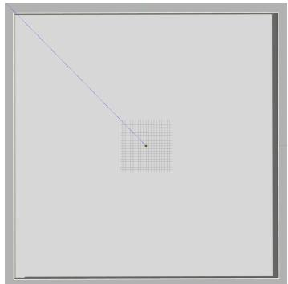  
(a) Open-layout baseline.

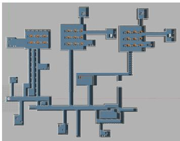  
(b) Indoor transfer scene.

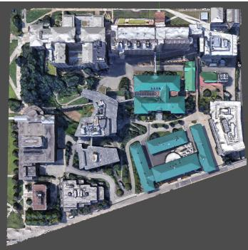  
(c) Campus transfer scene.  
Figure 6: Representative Gazebo BEV previews used in SimWorld.

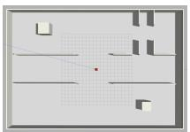  
(a) Spine rooms.

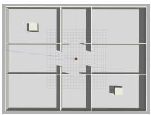  
(b) Cross suite.

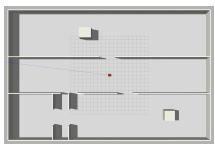  
(c) Offset wing.

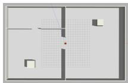  
(d) Dual room.

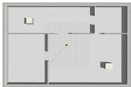  
(e) Corner hall.

Figure 7: T1 procedural SimWorld layouts. These scenes contain structured corridor systems where local visual proximity often remains a useful but imperfect heuristic.

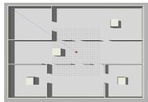  
(a) Loop rooms.

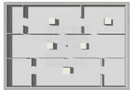  
(b) Dual spine.

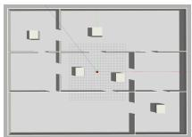  
(c) Ring hub.

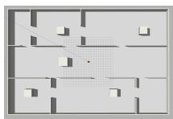  
(d) Offset blocks.

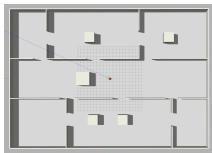  
(e) Cluster corridor.

Figure 8: T2 procedural SimWorld layouts. These scenes increase topological ambiguity through loops, disconnected-looking regions, and longer detours, making straight-line proximity less reliable.

## B Supplementary Experiments

This section supplements the main results with the complete TextWorld task-15 breakdown, violation-aware SimWorld aggregates, TextWorld reward-gap attribution, and a question-family decomposition of DualWorld-VQA. For SimWorld, we report success rate as the fraction of samples for which all tasks are completed without violations, completion rate as the average fraction of completed tasks, and violations as the average number of executable-interface violations per sample.

## B.1 Full TextWorld Results at n = 15

Table 3 restores the model-wise results underlying the grouped comparison in Fig 3a. A priority violation is applied before any averaging: a model–setting cell that delivers an A/B task while carrying a Type-C task is scored as R=0, T=9999.

Table 3: Complete TextWorld results at task count 15. Average is the unweighted mean of A-L1, M-L1, A-L2, and M-L2 at seed 1. Priority-violating cells are scored as R=0, T=9999. Ranks are computed separately within the 14 LLMs and the three solver baselines. Bold identifies reward ceilings and the Offline-DP reference values. Gray shading highlights the Offline-DP reference.
<table><tr><td rowspan="2">Method</td><td rowspan="2">Rank</td><td colspan="2">Average</td><td colspan="2">A-L1</td><td colspan="2">M-L1</td><td colspan="2">A-L2</td><td colspan="2">M-L2</td></tr><tr><td>R↑</td><td>T↓</td><td>R↑</td><td>T↓</td><td>R↑</td><td>T↓</td><td>R↑</td><td>T↓</td><td>R↑</td><td>T↓</td></tr><tr><td colspan="10">Open-source LLMs</td></tr><tr><td>Qwen3.6-27B</td><td>8</td><td>382.49</td><td>7250.02</td><td>302.97</td><td>5291.29</td><td>558.94</td><td>5612.23</td><td>251.02</td><td>10166.85</td><td>417.01</td><td>7929.71</td></tr><tr><td>Llama-2-13B</td><td>12</td><td>251.15</td><td>8391.05</td><td>302.97</td><td>6165.02</td><td>558.94</td><td>6820.17</td><td>142.68</td><td>10580.02</td><td>0.00</td><td>9999.00</td></tr><tr><td>Qwen3-VL-8B</td><td>13</td><td>31.79</td><td>3040.67</td><td>10.04</td><td>453.02</td><td>60.08</td><td>455.02</td><td>10.04</td><td>4102.59</td><td>47.00</td><td>7152.04</td></tr><tr><td>Llama-3-8B</td><td>14</td><td>0.00</td><td>4101.73</td><td>0.00</td><td>4.00</td><td>0.00</td><td>4.00</td><td>0.00</td><td>9246.89</td><td>0.00</td><td>7152.04</td></tr><tr><td colspan="10"></td></tr><tr><td>Gemini-3-Pro</td><td>1</td><td>392.14</td><td>6242.17</td><td>302.97</td><td>Proprietary LLMs 3614.01</td><td>558.94</td><td>3806.19</td><td>289.72</td><td>9619.76</td><td>416.92</td><td>7928.71</td></tr><tr><td>Claude-Sonnet-5</td><td>2</td><td>392.05</td><td>6799.79</td><td>302.97</td><td>5500.38</td><td>558.94</td><td>4149.32</td><td>289.36</td><td>9619.76</td><td>416.92</td><td>7929.71</td></tr><tr><td>Claude-Opus-5</td><td>3</td><td>392.01</td><td>6227.59</td><td>302.97</td><td>4366.61</td><td>558.94</td><td>3107.06</td><td>289.21</td><td>9619.76</td><td>416.92</td><td>7816.91</td></tr><tr><td>Qwen3.7-Plus</td><td>4</td><td>392.01</td><td>6494.65</td><td>302.97</td><td>3684.40</td><td>558.94</td><td>4745.75</td><td>289.21</td><td>9619.76</td><td>416.92</td><td>7928.71</td></tr><tr><td>Gemini-2.5-Flash</td><td>5</td><td>392.01</td><td>6626.44</td><td>302.97</td><td>4307.42</td><td>558.94</td><td>4649.88</td><td>289.21</td><td>9619.76</td><td>416.92</td><td>7928.71</td></tr><tr><td>DeepSeek-v4-Flash</td><td>6</td><td>392.01</td><td>6872.71</td><td>302.97</td><td>4973.04</td><td>558.94</td><td>5256.33</td><td>289.21</td><td>9619.76</td><td>416.92</td><td>7641.72</td></tr><tr><td>GPT-5.6-Sol</td><td>7</td><td>392.01</td><td>7222.23</td><td>302.97</td><td>5093.83</td><td>558.94</td><td>6359.43</td><td>289.21</td><td>9619.76</td><td>416.92</td><td>7815.91</td></tr><tr><td>Claude-4.5-Haiku</td><td>9</td><td>378.70</td><td>6891.58</td><td>302.97</td><td>4877.98</td><td>558.94</td><td>5535.86</td><td>262.07</td><td>9619.76</td><td>390.80</td><td>7532.73</td></tr><tr><td>GPT-40</td><td>10</td><td>373.82</td><td>7724.05</td><td>302.97</td><td>6020.76</td><td>558.94</td><td>6346.16</td><td>241.98</td><td>10273.35</td><td>391.38</td><td>8255.92</td></tr><tr><td>GPT-5.4-Mini</td><td>11</td><td>353.88</td><td>7696.76</td><td>302.97</td><td>5615.12</td><td>558.94</td><td>6324.61</td><td>255.85</td><td>10685.64</td><td>297.76</td><td>8161.68</td></tr><tr><td colspan="10">Combinatorial optimization solvers</td></tr><tr><td>DFS</td><td>3</td><td>392.01</td><td>6602.05</td><td>302.97</td><td>4187.31</td><td>558.94</td><td>4903.47</td><td>289.21</td><td>9619.76</td><td>416.92</td><td>7697.67</td></tr><tr><td>Online DP</td><td>2</td><td>392.14</td><td>5628.85</td><td>302.97</td><td>2573.66</td><td>558.94</td><td>2680.27</td><td>289.72</td><td>9619.76</td><td>416.92</td><td>7641.72</td></tr><tr><td>Offline DP</td><td>1</td><td>409.71</td><td>5554.29</td><td>302.97</td><td>2573.66</td><td>558.94</td><td>2680.27</td><td>289.72</td><td>9529.04</td><td>487.22</td><td>7434.19</td></tr></table>

## B.2 Full SimWorld Results across five scene groups

Table 4 reports F, C, and NC for all six models under multimodal, image-only, and text-only inputs across Open, T1, T2, Indoor, and Campus. Qwen3.7-Plus achieves F = C = 1 across all scenes with multimodal input, while GPT-5.6-Sol attains the lowest NC in every scene–modality combination. Image-only performance varies substantially across models, particularly in F, highlighting differences in planning robustness across input modalities.

## B.3 SimWorld Aggregate Diagnostics

Table 5 reports aggregate SimWorld performance across all evaluated scene groups and task counts for the Claude, GPT, and Qwen model families. This view emphasizes executable consistency: a plan can complete many tasks while still failing the strict success criterion if it contains invalid actions, wrong node references, capacity errors, or pickup–delivery precedence violations.

The aggregate results separate task coverage from executable consistency. Violations increase non decreasingly from text to multimodal to image for four of six models (both Qwens, Haiku, and mini), but Claude-Opus-5 and GPT-5.6-Sol break this pattern: Opus-5 has fewer violations in image mode than multimodal (3.889 vs. 8.788), and GPT-5.6-Sol has its fewest violations in multimodal mode (0.026). Success rate and completion rate split the models differently: three favor multimodal input (Qwen3-VL-8B, Qwen3.7-Plus, and GPT-5.6-Sol), whereas Haiku, Opus, and mini favor text. Qwen3.7-Plus attains perfect multimodal performance (SR=1.000, CR=1.000, zero violations), the highest in the table. Qwen3-VL-8B is the clearest coverage–consistency split: its multimodal SR is 0.942, while text mode emits zero violations but completes only 0.544 of tasks. High completion therefore does not by itself imply executable consistency.

Table 4: SimWorld scene-wise results across five scene groups: open, T1, T2, indoor, and campus.
<table><tr><td rowspan="2">Method</td><td rowspan="2">Modality</td><td colspan="3">Open</td><td colspan="3">T1</td><td colspan="3">T2</td><td colspan="3">Indoor</td><td colspan="3">Campus</td></tr><tr><td>F↑</td><td>C↑</td><td> $\mathrm { N C \downarrow }$ </td><td>F↑</td><td>C↑</td><td> $\operatorname { N C } \downarrow$ </td><td>F↑</td><td>C↑</td><td> $\operatorname { N C } \downarrow$ </td><td>F↑</td><td>C↑</td><td>NC↓</td><td>F↑</td><td>c↑</td><td>NC↓</td></tr><tr><td rowspan="3">Qwen3-VL-8B</td><td>Multi.</td><td>1.000 0.889</td><td>0.783 0.950</td><td>1.66 1.92</td><td>0.973</td><td>0.979</td><td>1.91</td><td>1.000</td><td>0.984</td><td>1.91</td><td>1.000</td><td>1.000</td><td>1.73</td><td>1.000</td><td>0.987 0.920</td><td>2.16</td></tr><tr><td>Image</td><td>1.000</td><td></td><td>1.83</td><td>0.880</td><td>0.915</td><td>1.91</td><td>0.773</td><td>0.885</td><td>1.91</td><td>0.733</td><td>0.905</td><td>1.76</td><td>1.000</td><td></td><td>1.97</td></tr><tr><td>Text</td><td></td><td>0.853</td><td></td><td>1.000</td><td>0.462</td><td>1.37</td><td>1.000</td><td>0.533</td><td>1.43</td><td>1.000</td><td>0.808</td><td>1.64</td><td>1.000</td><td>0.557</td><td>1.60</td></tr><tr><td rowspan="3">Qwen3.7-Plus</td><td>Multi.</td><td>1.000</td><td>1.000</td><td>1.24</td><td>1.000</td><td>1.000</td><td>1.23</td><td>1.000</td><td>1.000</td><td>1.30</td><td>1.000</td><td>1.000</td><td>1.29</td><td>1.000</td><td>1.000</td><td>1.29</td></tr><tr><td>Image</td><td>0.667</td><td>0.894</td><td>1.20</td><td>1.000</td><td>1.000</td><td>1.57</td><td>1.000</td><td>1.000</td><td>1.57</td><td>1.000</td><td>1.000</td><td>1.35</td><td>1.000</td><td>1.000</td><td>1.60</td></tr><tr><td>Text</td><td>1.000</td><td>1.000</td><td>1.20</td><td>1.000</td><td>0.968</td><td>1.28</td><td>1.000</td><td>0.977</td><td>1.23</td><td>1.000</td><td>0.920</td><td>1.23</td><td>1.000</td><td>1.000</td><td>1.28</td></tr><tr><td rowspan="3">Claude-Haiku-4.5</td><td>Multi.</td><td>0.333</td><td>0.908</td><td>2.68</td><td>0.640</td><td>0.947</td><td>2.36</td><td>0.880</td><td>0.971</td><td>1.97</td><td>0.867</td><td>0.977</td><td>2.06</td><td>0.933</td><td>0.993</td><td>1.92</td></tr><tr><td>Image</td><td>0.000</td><td>0.653</td><td>2.12</td><td>0.133</td><td>0.679</td><td>2.85</td><td>0.027</td><td>0.693</td><td>4.10</td><td>0.533</td><td>0.760</td><td>2.05</td><td>0.867</td><td>0.900</td><td>2.08</td></tr><tr><td>Text</td><td>0.889</td><td>0.931</td><td>2.04</td><td>0.907</td><td>0.985</td><td>1.72</td><td>0.933</td><td>0.984</td><td>2.03</td><td>0.867</td><td>0.977</td><td>1.92</td><td>0.800</td><td>0.983</td><td>2.41</td></tr><tr><td rowspan="3">Claude-Opus-5</td><td>Multi.</td><td>0.778</td><td>0.956</td><td>1.20</td><td>0.520</td><td>0.926</td><td>1.49</td><td>0.440</td><td>0.966</td><td>2.18</td><td>0.600</td><td>0.930</td><td>1.47</td><td>0.667</td><td>0.950</td><td>1.34</td></tr><tr><td>Image</td><td>0.111</td><td>0.678</td><td>1.33</td><td>0.560</td><td>0.878</td><td>1.45</td><td>0.640</td><td>0.893</td><td>1.44</td><td>0.467</td><td>0.785</td><td>1.57</td><td>0.533</td><td>0.857</td><td>1.46</td></tr><tr><td>Text</td><td>0.667</td><td>0.944</td><td>1.30</td><td>0.667</td><td>0.972</td><td>1.39</td><td>0.707</td><td>0.964</td><td>1.32</td><td>0.800</td><td>0.993</td><td>1.37</td><td>0.733</td><td>0.993</td><td>1.64</td></tr><tr><td rowspan="3">GPT-5.4-mini</td><td>Multi.</td><td>0.556</td><td>0.897</td><td>1.59</td><td>0.573</td><td>0.917</td><td>1.71</td><td>0.680</td><td>0.945</td><td>1.94</td><td>0.533</td><td>0.925</td><td>1.71</td><td>0.933</td><td>0.993</td><td>1.90</td></tr><tr><td>Image</td><td>0.111</td><td>0.747</td><td>1.73</td><td>0.093</td><td>0.684</td><td>2.10</td><td>0.120</td><td>0.699</td><td>2.03</td><td>0.200</td><td>0.687</td><td>1.96</td><td>0.267</td><td>0.705</td><td>1.93</td></tr><tr><td>Text</td><td>1.000</td><td>0.975</td><td>1.77</td><td>1.000</td><td>0.969</td><td>1.79</td><td>1.000</td><td>0.964</td><td>1.78</td><td>0.933</td><td>0.953</td><td>1.66</td><td>1.000</td><td>0.967</td><td>1.89</td></tr><tr><td rowspan="3">GPT-5.6-Sol</td><td>Multi.</td><td>1.000</td><td>1.000</td><td>1.08</td><td>0.973</td><td>0.996</td><td>1.12</td><td>0.987</td><td>0.999</td><td>1.13</td><td>1.000</td><td>1.000</td><td>1.19</td><td>1.000</td><td>1.000</td><td>1.19</td></tr><tr><td>Image</td><td>0.778</td><td>0.956</td><td>1.11</td><td>1.000</td><td>1.000</td><td>1.36</td><td>1.000</td><td>1.000</td><td>1.43</td><td>1.000</td><td>0.987</td><td>1.36</td><td>1.000</td><td>0.993</td><td>1.54</td></tr><tr><td>Text</td><td>1.000</td><td>1.000</td><td>1.09</td><td>0.933</td><td>0.988</td><td>1.13</td><td>0.987</td><td>0.998</td><td>1.11</td><td>1.000</td><td>1.000</td><td>1.20</td><td>1.000</td><td>1.000</td><td>1.21</td></tr></table>

Table 5: Aggregate SimWorld performance by model and modality. SR: success rate; CR: average completion rate; Viol.: average violations per sample.
<table><tr><td>Model</td><td>Modality</td><td>Samples</td><td>SR↑</td><td>CR↑</td><td>Viol. ↓</td></tr><tr><td>Claude Haiku 4.5</td><td>Image</td><td>189</td><td>0.122</td><td>0.707</td><td>25.090</td></tr><tr><td>Claude Haiku 4.5</td><td>Multimodal</td><td>189</td><td>0.751</td><td>0.961</td><td>6.492</td></tr><tr><td>Claude Haiku 4.5</td><td>Text</td><td>189</td><td>0.831</td><td>0.981</td><td>3.476</td></tr><tr><td>Claude Opus 5</td><td>Image</td><td>189</td><td>0.561</td><td>0.865</td><td>3.889</td></tr><tr><td>Claude Opus 5</td><td>Multimodal</td><td>189</td><td>0.513</td><td>0.945</td><td>8.788</td></tr><tr><td>Claude Opus 5</td><td>Text</td><td>189</td><td>0.698</td><td>0.971</td><td>3.344</td></tr><tr><td>GPT-5.4 Mini</td><td>Image</td><td>189</td><td>0.116</td><td>0.695</td><td>5.132</td></tr><tr><td>GPT-5.4 Mini</td><td>Multimodal</td><td>189</td><td>0.614</td><td>0.934</td><td>1.386</td></tr><tr><td>GPT-5.4 Mini</td><td>Text</td><td>189</td><td>0.942</td><td>0.966</td><td>0.005</td></tr><tr><td>GPT-5.6-Sol</td><td>Image</td><td>189</td><td>0.979</td><td>0.996</td><td>0.042</td></tr><tr><td>GPT-5.6-Sol</td><td>Multimodal</td><td>189</td><td>0.979</td><td>0.998</td><td>0.026</td></tr><tr><td>GPT-5.6-Sol</td><td>Text</td><td>189</td><td>0.963</td><td>0.995</td><td>0.063</td></tr><tr><td>Qwen3-VL-8B</td><td>Image</td><td>189</td><td>0.561</td><td>0.904</td><td>0.656</td></tr><tr><td>Qwen3-VL-8B</td><td>Multimodal</td><td>189</td><td>0.942</td><td>0.974</td><td>0.021</td></tr><tr><td>Qwen3-VL-8B</td><td>Text</td><td>189</td><td>0.323</td><td>0.544</td><td>0.000</td></tr><tr><td>Qwen3.7-Plus</td><td>Image</td><td>189</td><td>0.984</td><td>0.995</td><td>0.122</td></tr><tr><td>Qwen3.7-Plus</td><td>Multimodal</td><td>189</td><td>1.000</td><td>1.000</td><td>0.000</td></tr><tr><td>Qwen3.7-Plus</td><td>Text</td><td>189</td><td>0.947</td><td>0.972</td><td>0.000</td></tr></table>

Table 6: Sample-weighted SimWorld summary by input modality.
<table><tr><td>Modality</td><td>Samples</td><td>SR↑</td><td>CR↑</td><td>Viol. ↓</td></tr><tr><td>Image</td><td>1134</td><td>0.554</td><td>0.860</td><td>5.822</td></tr><tr><td>Multimodal</td><td>1134</td><td>0.800</td><td>0.969</td><td>2.786</td></tr><tr><td>Text</td><td>1134</td><td>0.784</td><td>0.905</td><td>1.148</td></tr></table>

Table 6 pools these cells by modality. Multimodal prompting gives the highest complete-and-legal success rate (0.800) and completion rate (0.969), while text-only prompting produces the fewest violations (1.148 per sample). Relative to text, multimodal input gains 1.6 success points and 6.4 completion points but incurs 2.4× as many violations, showing that improved coverage can coexist with weaker executable consistency. Image-only prompting is worst on all three aggregate measures (SR=0.554, CR=0.860, 5.822 violations), although the per-model results show that this penalty is concentrated in the smaller models rather than shared uniformly.

## B.4 Failure Attribution by Model

Section 5.3 pools modalities within each model to summarize the overall error profile. Table 7 restores the model–modality breakdown using the same root-cause taxonomy and 189 retained runs per cell (13 scenes × 5 samples × 3 task counts, minus the held-out open-layout cells). Each row sums to 100%.

The modality effect is not an artefact of pooling, but it is no longer universal. Because precedence and state-tracking errors are adjacent in the severity order and co-occur in a minority of runs, we read them together as sequencing errors; their sum increases monotonically from text to multimodal to image-only for four of the six models, and precedence alone is monotone for five of six. The two exceptions are GPT-5.6-Sol, which inverts the ordering entirely (3.2% text, 1.6% multimodal, 0.5% image-only), and Claude-Opus-5, which peaks in multimodal mode (44.4%) rather than image-only (40.7%). The magnitude is strongly model-dependent and spans two orders of magnitude. GPT-5.4-mini and Claude-Haiku-4.5 are the most fragile under image-only input (84.1% and 79.4% sequencing errors, leaving success rates of 11.6% and 12.2%), whereas GPT-5.6-Sol and Qwen3.7-Plus keep sequencing errors at 0.5% and still succeed on 97.9% and 98.4% of imageonly runs. Qwen3-VL-8B shows the opposite failure: its text-mode success rate (32.3%) is the lowest of any model–modality cell despite it never emitting a root violation; 67.7% of its text-mode runs are legal but incomplete, so it under-plans rather than mis-orders. Claude-Opus-5 is the inverse: it leaves nothing incomplete in text mode yet reaches only 69.8% success because 29.6% of its runs carry a sequencing violation.

Table 7: SimWorld failure attribution by model and input modality (% of runs, N = 189 per cell). Categories follow Section 5.3: Prec. (delivery before pickup), State (duplicate pickup/delivery), Cap. (capacity exceeded), Gnd. (node outside graph or no parseable plan), Incomp. (legal plan, tasks remaining), Succ. (legal and complete). Each run is assigned a single root cause under the severity order Gnd. > Cap. > State > Prec., so rows sum to 100%; columns are ordered for readability, not by severity.
<table><tr><td rowspan=1 colspan=7>Modality     Model                Prec. ↓  State ↓  Cap. ↓ Gnd. ↓ Incomp. ↓ Succ. ↑</td></tr><tr><td rowspan=1 colspan=1>GPT-5.6-Sol</td><td rowspan=1 colspan=1>3.2</td><td rowspan=1 colspan=1>0.0</td><td rowspan=1 colspan=1>0.0</td><td rowspan=1 colspan=1>0.0</td><td rowspan=1 colspan=1>0.5</td><td rowspan=1 colspan=1>96.3</td></tr><tr><td rowspan=1 colspan=1>GPT-5.4-mini</td><td rowspan=1 colspan=1>0.0</td><td rowspan=1 colspan=1>0.5</td><td rowspan=1 colspan=1>0.0</td><td rowspan=1 colspan=1>0.0</td><td rowspan=1 colspan=1>5.3</td><td rowspan=1 colspan=1>94.2</td></tr><tr><td rowspan=4 colspan=1>Claude-0pus-5Text-only    Claude-Haiku-4.5Qwen3.7-PlusQwen3-VL-8B</td><td rowspan=1 colspan=1>16.4</td><td rowspan=1 colspan=1>13.2</td><td rowspan=1 colspan=1>0.5</td><td rowspan=1 colspan=1>0.0</td><td rowspan=1 colspan=1>0.0</td><td rowspan=1 colspan=1>69.8</td></tr><tr><td rowspan=1 colspan=1>5.8</td><td rowspan=1 colspan=1>3.2</td><td rowspan=1 colspan=1>0.0</td><td rowspan=1 colspan=1>0.5</td><td rowspan=1 colspan=1>7.4</td><td rowspan=1 colspan=1>83.1</td></tr><tr><td rowspan=2 colspan=1>0.00.0</td><td rowspan=1 colspan=1>0.0</td><td rowspan=1 colspan=1>0.0</td><td rowspan=1 colspan=1>0.0</td><td rowspan=1 colspan=1>5.3</td><td rowspan=1 colspan=1>94.7</td></tr><tr><td rowspan=1 colspan=1>0.0</td><td rowspan=1 colspan=1>0.0</td><td rowspan=1 colspan=1>0.0</td><td rowspan=1 colspan=1>67.7</td><td rowspan=1 colspan=1>32.3</td></tr><tr><td rowspan=1 colspan=1>GPT-5.6-Sol</td><td rowspan=1 colspan=1>1.1</td><td rowspan=1 colspan=1>0.5</td><td rowspan=1 colspan=1>0.0</td><td rowspan=1 colspan=1>0.0</td><td rowspan=1 colspan=1>0.5</td><td rowspan=1 colspan=1>97.9</td></tr><tr><td rowspan=1 colspan=1>GPT-5.4-mini</td><td rowspan=1 colspan=1>24.3</td><td rowspan=1 colspan=1>10.6</td><td rowspan=1 colspan=1>0.0</td><td rowspan=1 colspan=1>1.1</td><td rowspan=1 colspan=1>2.6</td><td rowspan=1 colspan=1>61.4</td></tr><tr><td rowspan=4 colspan=1>Claude-0pus-5MultimodalClaude-Haiku-4.5Qwen3.7-PlusQwen3-VL-8B</td><td rowspan=1 colspan=1>20.6</td><td rowspan=1 colspan=1>23.8</td><td rowspan=1 colspan=1>1.6</td><td rowspan=1 colspan=1>2.1</td><td rowspan=1 colspan=1>0.5</td><td rowspan=1 colspan=1>51.3</td></tr><tr><td rowspan=1 colspan=1>15.3</td><td rowspan=1 colspan=1>7.4</td><td rowspan=1 colspan=1>0.5</td><td rowspan=1 colspan=1>0.5</td><td rowspan=1 colspan=1>1.1</td><td rowspan=1 colspan=1>75.1</td></tr><tr><td rowspan=1 colspan=1>0.0</td><td rowspan=1 colspan=1>0.0</td><td rowspan=1 colspan=1>0.0</td><td rowspan=1 colspan=1>0.0</td><td rowspan=1 colspan=1>0.0</td><td rowspan=1 colspan=1>100.0</td></tr><tr><td rowspan=1 colspan=1>1.1</td><td rowspan=1 colspan=1>0.0</td><td rowspan=1 colspan=1>0.0</td><td rowspan=1 colspan=1>0.0</td><td rowspan=1 colspan=1>4.8</td><td rowspan=1 colspan=1>94.2</td></tr><tr><td rowspan=2 colspan=1>GPT-5.6-SolGPT-5.4-mini</td><td rowspan=1 colspan=1>0.5</td><td rowspan=1 colspan=1>0.0</td><td rowspan=1 colspan=1>0.5</td><td rowspan=1 colspan=1>0.0</td><td rowspan=1 colspan=1>1.1</td><td rowspan=1 colspan=1>97.9</td></tr><tr><td rowspan=1 colspan=1>73.0</td><td rowspan=1 colspan=1>11.1</td><td rowspan=1 colspan=1>2.1</td><td rowspan=1 colspan=1>1.1</td><td rowspan=1 colspan=1>1.1</td><td rowspan=1 colspan=1>11.6</td></tr><tr><td rowspan=4 colspan=1>Claude-0pus-5Image-onlyClaude-Haiku-4.5Qwen3.7-PlusQwen3-VL-8B</td><td rowspan=1 colspan=1>34.9</td><td rowspan=1 colspan=1>5.8</td><td rowspan=1 colspan=1>2.6</td><td rowspan=1 colspan=1>0.5</td><td rowspan=1 colspan=1>0.0</td><td rowspan=1 colspan=1>56.1</td></tr><tr><td rowspan=1 colspan=1>63.5</td><td rowspan=1 colspan=1>15.9</td><td rowspan=1 colspan=1>1.1</td><td rowspan=1 colspan=1>2.1</td><td rowspan=1 colspan=1>5.3</td><td rowspan=1 colspan=1>12.2</td></tr><tr><td rowspan=1 colspan=1>0.5</td><td rowspan=1 colspan=1>0.0</td><td rowspan=1 colspan=1>1.1</td><td rowspan=1 colspan=1>0.0</td><td rowspan=1 colspan=1>0.0</td><td rowspan=1 colspan=1>98.4</td></tr><tr><td rowspan=1 colspan=1>16.4</td><td rowspan=1 colspan=1>0.0</td><td rowspan=1 colspan=1>0.0</td><td rowspan=1 colspan=1>0.0</td><td rowspan=1 colspan=1>27.5</td><td rowspan=1 colspan=1>56.1</td></tr></table>

TextWorld reward-gap attribution. Table 8 lists the numeric values plotted in Figure 4a, together with the L1/L2 split of the lateness term. Lateness is identically zero for all 14 models in L1, where tasks carry no deadlines, and accounts for 10.5–32.3% of attainable reward within L2. The split shows that the deadline mechanism, not task volume, produces the temporal penalty.

Gemini-2.5-Flash has the highest earned share (93.4%), with its entire gap attributable to lateness. Only one of the 280 runs violates the Type-C priority rule: Llama-2-13B delivers a non-C task while carrying a C task in M-L2 at task count 15. At the lower end, Qwen3-VL-8B and Llama-3-8B instead lose 69.5% and 83.6% to undelivered tasks.  
Table 8: TextWorld reward-gap attribution (% of attainable reward $\textstyle \sum _ { i } \rho _ { i } )$ , pooled over 4 scenarios × 5 task counts at seed 1. Earned + Not delivered + Late + Priority = 100% by construction. Late (L1) / Late (L2) decompose the lateness term by deadline regime; L1 scenarios have no deadlines. Runs voided by a priority violation are counted in the last column.
<table><tr><td>Model</td><td>Avg. R↑</td><td>Earned ↑</td><td>Not deliv. ↓</td><td>Late ↓</td><td>Late L2 ↓</td><td>Priority ↓</td></tr><tr><td>Gemini-2.5-Flash</td><td>265.73</td><td>93.4</td><td>0.0</td><td>6.6</td><td>13.5</td><td>0.0</td></tr><tr><td>Gemini-3-Pro</td><td>264.36</td><td>92.9</td><td>0.0</td><td>7.1</td><td>14.5</td><td>0.0</td></tr><tr><td>GPT-5.6-Sol</td><td>264.33</td><td>92.9</td><td>0.0</td><td>7.1</td><td>14.5</td><td>0.0</td></tr><tr><td>Claude-0pus-5</td><td>264.10</td><td>92.8</td><td>0.0</td><td>7.2</td><td>14.7</td><td>0.0</td></tr><tr><td>DeepSeek-v4-Flash</td><td>263.60</td><td>92.6</td><td>2.2</td><td>5.1</td><td>10.5</td><td>0.0</td></tr><tr><td>Qwen3.7-Plus</td><td>263.24</td><td>92.5</td><td>0.0</td><td>7.5</td><td>15.3</td><td>0.0</td></tr><tr><td>Claude-Sonnet-5</td><td>260.16</td><td>91.4</td><td>0.0</td><td>8.6</td><td>17.5</td><td>0.0</td></tr><tr><td>Claude-4.5-Haiku</td><td>253.01</td><td>88.9</td><td>0.0</td><td>11.1</td><td>22.7</td><td>0.0</td></tr><tr><td>Qwen3.6-27B</td><td>251.41</td><td>88.4</td><td>3.1</td><td>8.6</td><td>17.6</td><td>0.0</td></tr><tr><td>GPT-4o</td><td>251.05</td><td>88.2</td><td>0.0</td><td>11.8</td><td>24.1</td><td>0.0</td></tr><tr><td>GPT-5.4-Mini</td><td>246.81</td><td>86.7</td><td>0.0</td><td>13.3</td><td>27.1</td><td>0.0</td></tr><tr><td>Llama-2-13B</td><td>212.33</td><td>74.6</td><td>0.2</td><td>15.8</td><td>32.3</td><td>9.4</td></tr><tr><td>Qwen3-VL-8B</td><td>68.81</td><td>24.2</td><td>69.5</td><td>6.3</td><td>13.0</td><td>0.0</td></tr><tr><td>Llama-3-8B</td><td>19.33</td><td>6.8</td><td>83.6</td><td>9.6</td><td>19.6</td><td>0.0</td></tr></table>

Derived versus root violations. The evaluator reports a deliver without carry flag whenever a delivery targets an item not currently held. This condition is entailed by, rather than independent of, a precedence or duplicate-delivery error: every occurrence in the retained evaluation grid cooccurs with at least one of those root causes. Counting it separately would therefore inflate the apparent number of distinct error types without identifying an additional failure. Under the stated severity order, 731 of 3,402 runs are assigned to one of the four root-cause categories; all other runs are violation-free and are labeled complete or incomplete.

## B.5 DualWorld-VQA Diagnostic Experiments

DualWorld-VQA is a diagnostic suite for decomposing grounded planning errors into perceptual, topological, and decision-level failures. The suite contains 1,665 questions across 13 scenes. Questions are generated from scene annotations, node coordinates, navigation-distance matrices, and task metadata, and each item contains an unambiguous ground-truth answer. We avoid open-ended coordinate prediction and use exact match for categorical answers; sequence questions additionally report LCS-based auxiliary metrics, and planning questions are scored by whether the predicted feasible sequence stays within a relative distance tolerance of the ground truth.

## B.6 Question Families

The suite contains four question families:

• Absolute axis sorting asks models to order nodes along an image axis. This tests basic visual localization and label grounding while explicitly ignoring walls and route connectivity.

• Euclidean distance comparison includes anchor-based and pairwise variants. These questions test straight-line visual geometry, again without topological constraints.

• Wall-illusion topology contrasts Euclidean proximity with valid walking distance. These questions are designed so that the visually closer option can be topologically longer.

• Capacity interleaving requires a complete pickup–delivery sequence under capacity and precedence constraints, using true navigable distance as the optimization criterion.

Table 9: DualWorld-VQA dataset composition.
<table><tr><td>Question family</td><td>Level</td><td>Count</td><td>Primary metric</td></tr><tr><td>Absolute axis sorting</td><td>1</td><td>185</td><td>Exact match, LCS</td></tr><tr><td>Euclidean anchor choice</td><td>1</td><td>185</td><td>Exact match</td></tr><tr><td>Euclidean pair choice</td><td>1</td><td>185</td><td>Exact match</td></tr><tr><td>Wall-illusion topology</td><td>2</td><td>555</td><td>Exact match</td></tr><tr><td>Capacity interleaving</td><td>3</td><td>555</td><td>Distance tolerance</td></tr><tr><td>Total</td><td></td><td>1665</td><td></td></tr></table>

Table 10: DualWorld-VQA accuracy by question family.
<table><tr><td>Model</td><td>Overall ↑</td><td>Axis ↑</td><td>Anchor ↑</td><td>Pair ↑</td><td>Topology ↑</td><td>Planning ↑</td></tr><tr><td>Qwen3-VL-8B</td><td>0.335</td><td>0.162</td><td>0.622</td><td>0.535</td><td>0.566</td><td>0.000</td></tr><tr><td>Qwen3.7-Plus</td><td>0.843</td><td>1.000</td><td>1.000</td><td>1.000</td><td>0.793</td><td>0.737</td></tr><tr><td>Claude Haiku 4.5</td><td>0.227</td><td>0.005</td><td>0.232</td><td>0.162</td><td>0.530</td><td>0.018</td></tr><tr><td>Claude Opus 5</td><td>0.799</td><td>1.000</td><td>1.000</td><td>0.995</td><td>0.778</td><td>0.622</td></tr><tr><td>GPT-5.4 Mini</td><td>0.392</td><td>0.422</td><td>0.589</td><td>0.654</td><td>0.559</td><td>0.063</td></tr><tr><td>GPT-5.6-Sol</td><td>0.864</td><td>0.968</td><td>0.989</td><td>0.995</td><td>0.775</td><td>0.832</td></tr></table>

The results reveal a generation-dependent hierarchy rather than a uniform perception-to-planning decline. GPT-5.6-Sol, Qwen3.7-Plus, and Claude-Opus-5 nearly saturate the three Euclidean perception families, but topology remains at 77.5–79.3% and planning spans 62.2–83.2%. In contrast, GPT-5.4-Mini, Qwen3-VL-8B, and Claude-Haiku-4.5 fall to 0.0–6.3% on planning. Failure inspection further separates the causes: Qwen3-VL-8B usually outputs the wrong task-node set, the two smaller proprietary models mainly produce feasible but overly long routes, and the newer models’ residual errors are dominated by route suboptimality. DualWorld-VQA therefore distinguishes instruction grounding, constraint satisfaction, and route optimization rather than attributing every failure to one integration bottleneck.

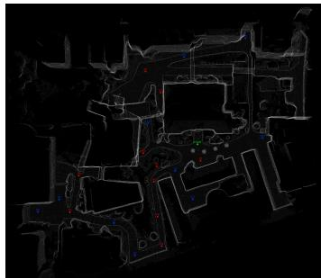  
(a) Campus.

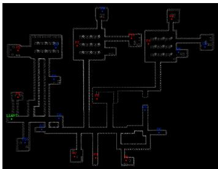  
(b) Indoor.

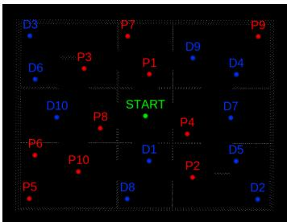  
(c) T1 cross suite.  
Figure 9: Annotated BEV observations used in DualWorld-VQA. Red markers indicate pickup nodes, blue markers indicate delivery nodes, and the green marker indicates the start position.

## B.7 Representative Cases

## Level 1: Axis Sorting

Question: Use only the map image and compare the nodes by their absolute vertical position. Order START, P9, D9, P4, P3 from top to bottom. Ignore walls, corridors, connectivity, and any numbering pattern in the labels.

Expected format: node labels joined by ->.

Ground truth: D9 → P4 → START → P3 → P9.

## Level 1: Euclidean Distance

Question: Use only the map image and compare straight-line Euclidean distances. Among D5, P1, D4, P3, and P4, which node is closest to P2? Ignore walls, corridors, connectivity, and numbering patterns.

Expected format: one node label.

Ground truth: D4.

## Level 2: Wall-Illusion Topology

Question: Considering only valid walking routes that do not pass through walls, which path is longer: P6 → P1 or P6 → D7?

Expected format: “P6 → X is longer”.

Ground truth: P6 → D7 is longer. The corresponding navigable distances are 209.399 m and 518.870 m, while the Euclidean distances are 141.481 m and 129.861 m, respectively. This case deliberately reverses the Euclidean and topological orderings.

## Level 3: Capacity-Constrained Interleaving

Question: Start at START with empty load and capacity $K = 2 .$ . Complete three orders: Task A is P4 → D4, Task B is P6 → D6, and Task C is $\mathrm { P } 7  \bar { \mathrm { D } } 7$ . Never exceed capacity and never deliver before pickup. Find the visiting sequence that minimizes walking distance.   
Expected format: node labels joined by .

Ground truth: $\mathrm { S T A R T }  \mathrm { P 6 }  \mathrm { P 4 }  \mathrm { D 6 }  \mathrm { P 7 }  \mathrm { D 4 }  \mathrm { D 7 }$ . The optimal distance is 942.430 m, compared with 1718.843 m for the best non-batched simple sequence.

## C Solver Details

This section specifies the deterministic solvers used to contextualize model performance. All three solvers operate on the same pickup–delivery abstraction but differ in their information assumptions and computational budget. DFS provides an anytime real-time planner, Online DP provides an exact non-learning policy under currently visible tasks, and Offline DP provides an oracle upper bound with full task knowledge.

Unified task abstraction. For a task set $\mathcal { T } = \{ 1 , \dots , N \}$ , each task i has pickup location $p _ { i }$ delivery location $d _ { i } ,$ , release time $t _ { i } ^ { t r }$ , deadline $e _ { i } ,$ , reward $R _ { i } ,$ , and type $\tau _ { i } \in \{ A , B , C \}$ . Given start location s, the solvers build a shared point set

$$
\mathcal { P } = \{ s \} \cup \{ p _ { i } \} _ { i = 1 } ^ { N } \cup \{ d _ { i } \} _ { i = 1 } ^ { N } .\tag{7}
$$

An action consists of moving to one point in P and executing either pickup or deliver. Travel time is distance divided by speed; TextWorld uses Euclidean distance, while SimWorld replaces it with the corresponding navigation distance when a grounded distance matrix is available.

Shared constraints and objective. All solvers enforce the same feasibility rules: a task cannot be picked up twice, a delivery is valid only after pickup, delivered tasks cannot be revisited, and the number of carried tasks cannot exceed capacity K. We also enforce the Type-C priority rule: while any Type-C task is carried, an A/B task cannot be delivered; intervening pickups and the delivery of any carried Type-C task remain valid. At pickup time, the agent may wait until the task release time; delivery receives no waiting benefit. The realized revenue for delivering task i at time t is

$$
r _ { i } ( t ) = \operatorname* { m a x } \{ 0 , R _ { i } - \lambda _ { \tau _ { i } } \operatorname* { m a x } ( 0 , t - e _ { i } ) \} ,\tag{8}
$$

with $\lambda _ { A } = 0 . 1 , \lambda _ { B } = 0 . 2 ,$ and $\lambda _ { C } = 0 . 3$

State-space growth. The pickup–delivery problem has a natural permutation-based structure. If geometric details are ignored and only pickup-before-delivery precedence is considered, the number of feasible visit orders for N tasks scales as

$$
| S _ { N } | = { \frac { ( 2 N ) ! } { 2 ^ { N } } } ,\tag{9}
$$

Table 11: Roles of deterministic solvers used in the benchmark.
<table><tr><td>Solver</td><td>Task visibility</td><td>Optimality</td><td>Primary role</td></tr><tr><td>DFS</td><td>Currently visible</td><td>Anytime heuristic</td><td>Real-time feasible planning</td></tr><tr><td>Online DP</td><td>Currently visible</td><td>Exact over visible tasks</td><td>Strong online baseline</td></tr><tr><td>Offline DP</td><td>Full task set</td><td>Exact with hindsight</td><td>Upper bound and label generation</td></tr></table>

because each task contributes one pickup and one delivery and half of the relative orders for each pair violate precedence. Fig. 10 shows this rapid combinatorial growth. Fig. 11 further confirms that runtime increases sharply with N, which motivates separating real-time heuristic planning from exact oracle-style evaluation.

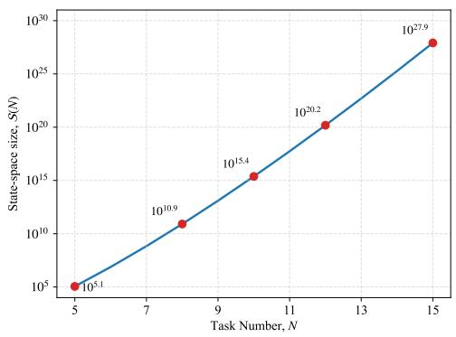  
Figure 10: State-space complexity. The size of the valid permutation space grows superexponentially with the number of tasks N.

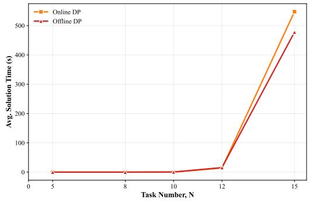  
Figure 11: Average solver runtime versus task size N. Runtime increases sharply with N and follows an approximately exponential trend, reflecting the combinatorial growth of the DP space.

## C.1 DFS

DFS is the real-time planner. It is designed to return a feasible plan under a fixed time budget rather than to prove global optimality.

Warm start. The planner first constructs a greedy solution to initialize the incumbent revenue and path. The greedy policy scores candidate actions by expected finish time, immediate delivery revenue, and priority-task preference, giving the subsequent search a strong lower bound.

Branch-and-bound search. After warm start, DFS explores feasible action sequences in heuristic order. For each partial plan, it estimates an optimistic upper bound on remaining revenue using a geometry-based lower bound on travel time and the same deadline penalty model as the evaluator. A node is pruned when current revenue + upper bound ≤ best revenue. The action generator enforce capacity, precedence, and Type-C priority constraints before any recursive expansion.

Algorithm 1 Greedy Warm-up + DFS Branch-and-Bound algorithm   
Input: Context $( t _ { 0 } , s , v , K , \mathcal { C } _ { 0 } , \mathcal { U } _ { 0 } )$ , time limit $T _ { l i m }$   
Output: A plan list (move + pickup/deliver) with high revenue.   
1: Merge tasks $\mathcal { T }  \mathcal { C } _ { 0 } \cup \mathcal { U } _ { 0 }$ and index them 1..N.   
2: if N = 0 then   
3: return ∅   
4: end if   
5: Initialize best revenue best ← −∞, best path path<sup>∗</sup> ← [].   
6: carrying ← indices of C<sub>0</sub>; pending ← indices of U<sub>0</sub>; load ← |carrying|.   
7: GREEDYWARMUP(s, t<sub>0</sub>, load, carrying, pending) ▷ sets baseline best and path<sup>∗</sup>   
8: if time remains then

```csv
9: DFS(s, t , load, 0, carrying, pending, [])
10: end if
11: return FORMATOUTPUT(path<sup>∗</sup>) ▷ insert move before each action
12:
13: function GREEDYWARMUP(pos, t, load, carrying, pending)
14: rev ← 0, path ← []
15: while carrying $\neq { \bar { \boldsymbol { \varnothing } } }$ or pending ̸= ∅ do
16: A ← VALIDACTIONS(pos, t, load, carrying, pending)
17: if $A = \emptyset$ then
18: break
19: end if
20: Pick a<sup>∗</sup> ← arg min<sub>a∈A</sub> score(a)
21: Apply $a ^ { * } \colon$ update (pos, t, load) and sets (carrying, pending); rev ← rev +
revenue $( \boldsymbol { a } ^ { * } )$
22: Append $a ^ { * }$ to path
23: end while
24: if rev > best then
25: best ← rev; path<sup>∗</sup> ← path
26: end if
27: end function
28:
29: function DFS(pos, t, load, rev, carrying, pending, path)
30: if timeout reached then
31: return
32: end if
33: if carrying = ∅ and pending = ∅ then
34: if rev > best then
35: best ← rev; path<sup>∗</sup> ← path
36: end if
37: return
38: end if
39: ub ← ESTIMATEPOTENTIAL(pos, t, carrying, pending)
40: if rev + ub ≤ best then
41: return
42: end if
43: A ← VALIDACTIONS(pos, t, load, carrying, pending); sort A by increasing score
44: for each a ∈ A do
45: Recurse on next state after applying a
46: end for
47: end function
48:
49: function VALIDACTIONS(pos, t, load, carrying, pending)
50: A ← []
51: hasC ← true iff ∃i ∈ carrying : $\tau _ { i } = C$
52: if load < K then
53: for i ∈ pending do
54: $t _ { p } \gets \operatorname* { m a x } ( \bar { t } + d i s t ( p o s , p _ { i } ) / v , t _ { i } ^ { t r } )$
55: Define pickup action a with finish = t , revenue = 0, score = t − I[τ = C] · α
56: Append a to A
57: end for
58: end if
59: for $i \in$ carrying do
60: if hasC ∧ τ ̸= C then
61: continue
62: end if
63: t<sub>d</sub> ← t + dist(pos, d<sub>i</sub>)/v
64: rev<sub>i</sub> ← max(0, R<sub>i</sub> − max(0, t<sub>d</sub> − t<sup>end</sup><sub>i</sub> ) · rate(τ<sub>i</sub>))
65: Define deliver action a with finish = t , revenue = rev , score = t −β·rev −I[τ =
C] · γ
```

66: Append a to A   
67: end for   
68: return A   
69: end function   
70:   
71: function ESTIMATEPOTENTIAL(pos, t, carrying, pending)   
72: ub ← 0   
73: for i ∈ carrying ∪ pending do   
74: Compute optimistic minimal travel time to complete i (deliver-only if carrying;   
pickup→deliver if pending)   
75: Convert to optimistic arrival $t _ { m i n }$ and optimistic revenue $\widehat { r e v } _ { i }$   
76: $u b \gets u b + \widehat { r e v } _ { i }$   
77: end for   
78: return ub   
79: end function

## C.2 Online DP

Online DP is the exact non-learning baseline under the online information constraint. At each decision point, it observes the current robot state, carried tasks, and currently released task pool, solves the induced finite-horizon problem exactly, and executes the first action of the resulting plan.

State compression. The DP state is $( D , C , u )$ , where D is a bitmask of delivered tasks, C is a bitmask of carried tasks, and u is the current point index in P. Each state stores a pair (reward, ∆t) and is compared lexicographically by maximum reward and then minimum elapsed time.

Online interpretation. Because unreleased future tasks are not visible, Online DP is optimal only with respect to the currently observable task set. It therefore serves as a strong online baseline without hindsight. Its worst-case number of state transitions is on the order of $O ( { \breve { N } } ^ { 2 } 3 ^ { N } )$ ), making it useful for moderate-size instances but unsuitable as a scalable real-time controller for large N.

Algorithm 2 Online DP Planner   
Input: Context: current time $t _ { 0 } ,$ start position s, speed v, capacity K, carried tasks $\mathcal { C } _ { 0 } ,$ , available   
tasks $\mathcal { U } _ { 0 }$   
Each task i has fields $( i d _ { i } , p _ { i } , d _ { i } , t _ { i } ^ { e n d } , R _ { i } , t y p e _ { i } )$ where $t y p e _ { i } \in \{ A , B , C , \ldots \}$   
Penalty rate function $p e n ( t y p e ) .$   
Output: action list: move + pickup/deliver.   
1: $\mathcal { T }  \mathcal { C } _ { 0 } \cup \mathcal { U } _ { 0 } ; N  | \mathcal { T } |$ (use 0-based task index $i = 0 . . N - 1 )$   
2: if $N = 0$ then   
3: return $\varnothing$   
4: end if   
5: Build points list $P \colon$   
6: $P [ \bar { 0 } ]  s$   
7: for each task i: append pickup $p _ { i }$ to $P$ $\begin{array} { r } { \triangleright P [ 1 + i ] = p _ { i } } \\ { P [ 1 + N + i ] = d _ { i } } \end{array}$   
8: for each task i: append deliver $d _ { i }$ to $P$ ▷   
9: $\begin{array} { r } { | P | = 1 + 2 N . } \end{array}$   
10: Build initial carried bitmask $C _ { 0 }$ from $\mathcal { C } _ { 0 } ;$ set delivered bitmask $D _ { 0 }  0 .$   
11: Initialize $d p [ ( D _ { 0 } , C _ { 0 } , 0 ) ] \gets ( r e v = 0 , \Delta t = 0 )$ and parent map $\pi  \varnothing .$   
12: for $D = 0$ to $\mathrm { \dot { 2 } ^ { N } } - \mathrm { i }$ do   
13: for $C = 0 \mathrm { t o } 2 ^ { N } - 1$ do   
14: if $( D \& C ) \neq 0$ then   
15: continue   
16: end if   
17: for $u = 0 \mathrm { t o } \left| P \right| - 1$ do   
18: if $( D , C , \dot { u } ) \stackrel { \cdot } { \not \in } d p$ then   
19: continue   
20: end if   
21: $( r e v , \Delta t ) \gets d p [ ( D , C , u ) ]$   
22: priority ← true iff ∃i : $( \mathsf { \ ' { C } } \gg i ) \& 1 = 1 ) \wedge ( t y p e _ { i } = { } ^ { , } \mathsf { C } ^ { , } )$

23: F ← { 1 + N + i | ((C ≫ i)&1 = 1) ∧ (type<sub>i</sub> = ’C’) }   
24: load ← popcount(C)   
25: for w = 1 to |P| − 1 do   
26: if priority ∧ w /∈ F then   
27: continue   
28: end if   
29: Decode (i, action) from w:   
30: if 1 ≤ w < 1 + N then   
31: i ← w − 1, action ← pickup   
32: else   
33: i ← w − (1 + N), action ← deliver   
34: end if   
35: if ((D ≫ i)&1) = 1 then   
36: continue   
37: end if   
38: if action = pickup ∧ ((C ≫ i)&1) = 1 then   
39: continue   
40: end if   
41: if action = deliver ∧ ((C ≫ i)&1) = 0 then   
42: continue   
43: end if   
44: if action = pickup ∧ load ≥ K then   
45: continue   
46: end if   
47: $\begin{array} { r } { \Delta t ^ { \prime } \gets \Delta t + \frac { d i s t ( P _ { u } , P _ { w } ) } { v } } \end{array}$   
48: if action = pickup then   
49: D<sup>′</sup> ← D, C<sup>′</sup> ← C ∪ {i}, gain ← 0   
50: else   
51: $t _ { a r r } \gets t _ { 0 } + \Delta t ^ { \prime }$   
52: $l a t e \gets \operatorname* { m a x } ( 0 , t _ { a r r } - t _ { i } ^ { e n d } )$   
53: gain ← max(0, R<sub>i</sub> − late · pen(type<sub>i</sub>))   
54: D<sup>′</sup> ← D ∪ {i}, C<sup>′</sup> ← C \ {i}   
55: end if   
56: rev<sup>′</sup> ← rev + gain   
57: if (rev<sup>′</sup>, ∆t<sup>′</sup>) better than dp[(D<sup>′</sup>, C<sup>′</sup>, w)] (max rev<sup>′</sup>, tie min ∆t<sup>′</sup>) then   
58: Update ${ \dot { d } } p [ ( D ^ { \prime } , C ^ { \prime } , w ) ] \gets ( r e v ^ { \prime } , \Delta { \dot { t } } ^ { \prime } )$ and $\pi [ ( D ^ { \prime } , C ^ { \prime } , w ) ]  ( D , C , u )$   
59: end if   
60: end for   
61: end for   
62: end for   
63: end for   
64: Choose best state in dp by max revenue (tie min time), then backtrack π to get (task, action).   
65: Convert to executable plan: each step append move(to target) then   
pickup/deliver(task).   
66: return plan list.

## C.3 Offline DP

Offline DP is the hindsight oracle used for upper-bound analysis and label generation. It receives the full task set, including future releases, and optimizes over the complete sequence space subject to the same feasibility and reward rules.

Bellman formulation. The state is $S ~ = ~ ( m _ { D } , m _ { C } , \ell )$ , where $m _ { D }$ and $m _ { C }$ are delivered and carried bitmasks, and ℓ is the index of the last visited point in P. The value function satisfies

$$
V ( S ) = \operatorname* { m a x } _ { a \in \mathcal { A } ( S ) } \left\{ R ( S , a ) + V ( S ^ { \prime } ) \right\}\tag{10}
$$

where $A ( S )$ is the feasible action set and $S ^ { \prime }$ is the successor state. As in Online DP, each DP entry stores (reward, time) and is optimized lexicographically by reward first and finishing time second.

Use in evaluation. Offline DP is not an executable online policy because it has access to future task releases. We use it only to construct oracle plans, normalize regret, and separate model planning errors from the intrinsic difficulty of each task instance.

```latex
Algorithm 3 Offline DP Solver
Input: Tasks $\mathcal { T } = \{ 0 , \ldots , N - 1 \}$ with pickup $p _ { i } ,$ , deliver $d _ { i } ,$ trigger $t _ { i } ^ { t r }$ , deadline $t _ { i } ^ { e n d } .$ , reward
$R _ { i } ,$ , type $\tau _ { i } \in \{ { ^ \circ } \mathtt { A } ^ { \prime } , { ^ \circ } \mathtt { B } ^ { \prime } , { ^ \circ } \mathtt { C } ^ { \prime } \}$ ; start position s; speed $v ;$ capacity $\bar { K } .$
Penalty rate $r a t e ( \tau )$
Output: An action sequence (pickup/deliver) maximizing total revenue, tie-break on minima
finishing time.
1: Sort tasks by $t _ { i } ^ { t r }$ . Build points list:
2: $P [ 0 ]  s$
3: $P [ 1 ^ { \cdot } + i ]  p _ { i }$ for $i = 0 . . N - 1$
4: $P [ 1 + \dot { N } + \dot { i } ]  d _ { i }$ for $i = 0 . . N - 1$ ▷ so deliver indices are $N + 1 . . 2 N$
5: Initialize DP: $\begin{array} { r l } { d \dot { p [ ( 0 , 0 , 0 ) ] } \gets ( 0 , 0 ) } & { { } ~ \triangleright ( D , M , u ) \mapsto } \end{array}$ (rev, time), where D=delivered mask,
M=carried mask
6: Initialize parent pointers π $ \varnothing .$
7: for $D = \stackrel { \cdot } { 0 } { \mathrm { { t o } } } 2 ^ { N ^ { \cdot } } - 1$ do
8: for $M = 0$ to $2 ^ { N } - 1$ do
9: if $( D \& M ) \neq 0$ then
10: continue
11: end if
12: for $u = 0$ to $| P | - 1$ do
13: if $( D , M , u ) \not \in d p$ then
14: continue
15: end if
16: $( r e v , t ) \gets d p [ ( D , M , u ) ]$
17: priority ← true iff ∃i : $\because \bar { ( } ( M \gg i ) \& 1 = 1 ) \wedge ( \tau _ { i } = { } ^ { , } \mathsf { C } ^ { , } )$
18: $F \gets \{ \bar { 1 } + N + i \mid ( ( M \gg i ) \& 1 = 1 ) \land ( \tau _ { i } = ^ { \prime } \mathsf { C } ^ { \prime } ) \} \subseteq$ ▷ forced deliver points of C
19: for $w = 1$ to $| P | - \mathrm { i }$ do
20: if priority ∧ w $\notin F$ then
21: continue
22: end if
23: Decode (i, action) from w:
24: if $1 \leq w \leq N$ then
25: $i  w - 1$ , action ← pickup
26: else
27: $i  w - ( N + 1 )$ , action ← deliver
28: end if
29: if $( ( D \gg i ) \& 1 ) = 1$ then
30: continue
31: end if
32: if action = pickup $\wedge \left( ( M \gg i ) \& 1 \right) = 1$ then
33: continue
34: end if
35: if action = pickup ∧ popcoun $\ddot { \left( M \right) } \geq K$ then
36: continue
37: end if
38: if action = deliver ∧ ((M ≫ i)&1) = 0 then
39: continue
40: end if
41: $\begin{array} { r } { \begin{array} { l } { \operatorname { c m } \operatorname { s u } } \\ { t _ { a r r } \gets t + \frac { d i s t ( P _ { u } , P _ { w } ) } { v } } \end{array} } \end{array}$
42: if action = pickup then
43: $t ^ { \prime } \gets$ max $( t _ { a r r } , t _ { i } ^ { t r } )$ ▷ wait for trigger
44: $D ^ { \prime }  D ,$ M<sup>′</sup> ← M ∪ {i}, ∆ ← 0
45: else
46: $t ^ { \prime } \gets t _ { a r r }$
47: late ← max $( 0 , t ^ { \prime } - t _ { i } ^ { e n d } )$
48: $\Delta \gets \operatorname* { m a x } ( 0 , \dot { R } _ { i } - l a \dot { t } e \cdot r a t e ( \tau _ { i } ) )$
```

49: $D ^ { \prime } \gets D \cup \{ i \} , ~ M ^ { \prime } \gets M \setminus \{ i \}$   
50: end if   
51: $r e v ^ { \prime } \gets r e v + \Delta$   
52: if $( r e v ^ { \prime } , t ^ { \prime } )$ better than $d p [ ( D ^ { \prime } , M ^ { \prime } , w ) ]$ (max rev<sup>′</sup>, tie min t<sup>′</sup>) then   
53: $d p [ ( D ^ { \prime } , M ^ { \prime } , w ) ] \gets ( \ddot { r } \dot { e } v ^ { \prime } , t ^ { \prime } )$   
54: $\pi [ ( D ^ { \prime } , M ^ { \prime } , w ) ] ^ { - } \left( D , M , u \right)$   
55: end if   
56: end for   
57: end for   
58: end for   
59: end for   
60: Select best final state by max revenue (tie min time), then backtrack π to reconstruct.   
61: return reconstructed action sequence.

## D Prompt Design

All prompts specify the available task information, hard feasibility constraints, and a machinereadable output schema. The prompts are designed to reduce evaluation ambiguity rather than to provide hidden solver assistance. They enforce pickup–delivery precedence and prohibit duplicate task actions. TextWorld requires explicit movement commands, whereas SimWorld uses node sequences that the evaluator expands into executable actions. Placeholders enclosed in braces are instantiated for each evaluation instance.

## D.1 Prompting Protocol

Table 12: Prompt inputs and output interfaces.
<table><tr><td>Setting</td><td>Inputs</td><td>Planning signal</td><td>Output</td></tr><tr><td>TextWorld</td><td>State, task list</td><td>Symbolic reward, time, deadline</td><td>JSON actions</td></tr><tr><td>SimWorld-text</td><td>State, task list, node coordinates</td><td>Coordinate proxy</td><td>JSON node sequence</td></tr><tr><td>SimWorld-image</td><td>BEV image</td><td>Visual topology</td><td>JSON node sequence</td></tr><tr><td>SimWorld-multimodal</td><td>BEV image, task list, node mapping</td><td>Visual topology and task grounding</td><td>JSON node sequence</td></tr></table>

TextWorld outputs executable JSON actions. All SimWorld modalities use a shared JSON nodesequence schema, differing in their input information. The evaluator resolves node labels to task identifiers and coordinates and inserts movement commands as needed before pickup or delivery.

## D.2 TextWorld Template

The TextWorld prompt below is the complete template used for symbolic delivery planning, typeset with the same boxed style as the SimWorld templates.

## TextWorld Prompt Template

Role. You are the central planning engine for an intelligent delivery robot. Generate a strictly sequential, physically valid, and economically optimal action plan.

1. System State

\- Speed: {speed:.2f} m/s; time: {now time} s; position: {{“x”: {cur x}, “y”: {cur y}}}.

\- Capacity: {capacity}/{max capacity}; carried tasks: {carried ids}.

\- Interruption or replanning context: {interrupt section}.

2. Rules and Constraints

1. Accept and deliver all tasks in the pool, even if late.

2. Revenue is max(0, reward − lateness × penalty rate).

3. Penalty rates are Type-A 0.1, Type-B 0.2, and Type-C 0.3 per second.

4. If carrying a Type-C task, deliver Type-C before Type-A or Type-B tasks.

5. Before every pickup or delivery, move to the target coordinate first.

6. Multiple pickups may be batched if the capacity constraint is respected.

7. Travel time is distance divided by speed; distance is Euclidean distance in meters.

## 3. Available Tasks

{tasks}

4. Output Format Return strict JSON only with an actions array:

```json
{
‘‘actions’’: [
{
‘‘action’’: ‘‘move’’,
‘‘to’’: {‘‘x’’: float, ‘‘y’’: float},
‘‘distance m’’: float,
‘‘duration s’’: float,
‘‘arrival time’’: float
},
{‘‘action’’: ‘‘pickup’’, ‘‘task id’’: ‘‘string’’, ‘‘time s’’: float},
{‘‘action’’: ‘‘deliver’’, ‘‘task id’’: ‘‘string’’, ‘‘time s’’: float, ‘‘revenue’’:
float}
]
}
```

## D.3 SimWorld Templates

SimWorld prompts share the same pickup–delivery constraints and node-sequence output schema but differ in available evidence. Text-only planning uses coordinates as a travel-cost proxy, imageonly planning uses the annotated BEV map, and multimodal planning combines the map with structured task information. The evaluator supplies executable coordinates and movement commands.

## SimWorld Text-Only Prompt Skeleton

Role. Generate a pickup–delivery node-visiting sequence using structured task text without a map image.   
Inputs.

\- Time: {now:.2f} s; position: {{“x”: {cur x:.2f}, “y”: {cur y:.2f}}}; speed: {speed:.2f} m/s.

\- Load: {capacity}/{max capacity}.

\- Carried tasks: {carried tasks json}.

\- Available tasks: {new tasks json}.

\- Task-to-node mapping: {id mapping section}.

Planning rule. Minimize estimated travel cost while completing as many feasible tasks as possible. Because the BEV topology is unavailable, use coordinates cautiously and avoid purely greedy nearestneighbor plans.

Constraints. Pn must precede the matching Dn unless the task is already carried; each pickup and delivery node may appear at most once; already-carried tasks require only delivery; load must never exceed {max capacity}; use only nodes in the task-to-node mapping.

Output schema. Return only a JSON object with a sequence array of node labels. Do not output coordinates or movement commands.

```json
{‘‘sequence’’: [‘‘START’’, ‘‘P1’’, ‘‘P3’’, ‘‘D3’’, ‘‘D1’’]}
```

## SimWorld Image-Only Prompt Skeleton

Role. Infer a valid node-visiting sequence from the BEV map image.

Visual semantics. START is the green marker. Pickup nodes are red markers labeled P1, P2, . . . . Delivery nodes are blue markers labeled D1, D2, . . . . In open scenes, near-straight connections can be reasonable; in indoor, campus, and procedural scenes, route cost should follow visible connectivity rather than Euclidean proximity alone.

Task logic. Pn must appear before Dn; pickup and delivery nodes should not be repeated; the number of active undelivered pickups must respect the load capacity; interleaving is allowed when it reduces route cost.

Output schema. Return only a JSON object with a sequence array of node labels. Do not output   
coordinates or movement commands.   
{‘‘sequence’’: [‘‘START’’, ‘‘P1’’, ‘‘P3’’, ‘‘D3’’, ‘‘D1’’]}

SimWorld Multimodal Prompt Skeleton   
Role. Generate a pickup–delivery node-visiting sequence using the BEV map and task-to-node map  
ping.   
Inputs.   
- Time: {now:.2f} s; position: {{“x”: {cur x:.2f}, “y”: {cur y:.2f}}}; speed: {speed:.2f} m/s.   
- Load: {capacity}/{max capacity}.   
- Carried tasks: {carried tasks json}; available tasks: {new tasks json}.   
- Task-to-node mapping: {id mapping section}.   
Map grounding. START is green, pickup nodes are red, and delivery nodes are blue. Task A-0001   
maps to P1 and D1, with the same indexing rule for the remaining tasks. Use the mapping table to   
align tasks with map labels.   
Hard constraints.   
1. Pn must precede the matching Dn unless the task is already carried.   
2. Each pickup and delivery node may appear at most once; already-carried tasks require only delivery.   
3. Load must never exceed {max capacity}.   
4. Use only node labels that exist in the task-to-node mapping.   
5. In constrained layouts, use connected free-space topology rather than straight-line distance.   
Output schema. Return only a JSON object with a sequence array of node labels. Do not output   
coordinates or movement commands.   
{‘‘sequence’’: [‘‘START’’, ‘‘P1’’, ‘‘P3’’, ‘‘D3’’, ‘‘D1’’]}

## D.4 Scene-Specific Grounding

The SimWorld templates are instantiated with scene-specific grounding statements while preserving the same output interface. Open layouts emphasize geometric efficiency and smooth sweeps. Campus scenes are treated as semi-open environments where large buildings and blocked regions may invalidate direct shortcuts. Indoor and procedural T1/T2 scenes emphasize connected free space, walls, bottlenecks, and room transitions; prompts explicitly warn that visually close nodes can be topologically far apart. These instructions standardize the physical abstraction presented to the model without changing the task constraints or evaluation schema.

## NeurIPS Paper Checklist

## 1. Claims

Question: Do the main claims made in the abstract and introduction accurately reflect the paper’s contributions and scope?

Answer: [Yes]

Justification: The abstract and introduction outline the key challenges addressed, our contributions, and a summary of the experimental findings.

Guidelines:

• The answer [N/A] means that the abstract and introduction do not include the claims made in the paper.

• The abstract and/or introduction should clearly state the claims made, including the contributions made in the paper and important assumptions and limitations. A [No] or [N/A] answer to this question will not be perceived well by the reviewers.

• The claims made should match theoretical and experimental results, and reflect how much the results can be expected to generalize to other settings.

• It is fine to include aspirational goals as motivation as long as it is clear that these goals are not attained by the paper.

## 2. Limitations

Question: Does the paper discuss the limitations of the work performed by the authors? Answer: [Yes]

Justification: The paper states the benchmark scope and remaining limitation in the Conclusion, including that temporal and topological complexity are evaluated separately and their integration is left for future work.

Guidelines:

• The answer [N/A] means that the paper has no limitation while the answer [No] means that the paper has limitations, but those are not discussed in the paper.

• The authors are encouraged to create a separate “Limitations” section in their paper.

• The paper should point out any strong assumptions and how robust the results are to violations of these assumptions (e.g., independence assumptions, noiseless settings, model well-specification, asymptotic approximations only holding locally). The authors should reflect on how these assumptions might be violated in practice and what the implications would be.

• The authors should reflect on the scope of the claims made, e.g., if the approach was only tested on a few datasets or with a few runs. In general, empirical results often depend on implicit assumptions, which should be articulated.

• The authors should reflect on the factors that influence the performance of the approach. For example, a facial recognition algorithm may perform poorly when image resolution is low or images are taken in low lighting. Or a speech-to-text system might not be used reliably to provide closed captions for online lectures because it fails to handle technical jargon.

• The authors should discuss the computational efficiency of the proposed algorithms and how they scale with dataset size.

• If applicable, the authors should discuss possible limitations of their approach to address problems of privacy and fairness.

• While the authors might fear that complete honesty about limitations might be used by reviewers as grounds for rejection, a worse outcome might be that reviewers discover limitations that aren’t acknowledged in the paper. The authors should use their best judgment and recognize that individual actions in favor of transparency play an important role in developing norms that preserve the integrity of the community. Reviewers will be specifically instructed to not penalize honesty concerning limitations.

## 3. Theory assumptions and proofs

Question: For each theoretical result, does the paper provide the full set of assumptions and a complete (and correct) proof?

## Answer: [N/A]

Justification: This is an empirical benchmark paper and does not present theorems, lemmas, or formal theoretical proofs.

## Guidelines:

• The answer [N/A] means that the paper does not include theoretical results.

• All the theorems, formulas, and proofs in the paper should be numbered and crossreferenced.

• All assumptions should be clearly stated or referenced in the statement of any theorems.

• The proofs can either appear in the main paper or the supplemental material, but if they appear in the supplemental material, the authors are encouraged to provide a short proof sketch to provide intuition.

• Inversely, any informal proof provided in the core of the paper should be complemented by formal proofs provided in appendix or supplemental material.

• Theorems and Lemmas that the proof relies upon should be properly referenced.

## 4. Experimental result reproducibility

Question: Does the paper fully disclose all the information needed to reproduce the main experimental results of the paper to the extent that it affects the main claims and/or conclusions of the paper (regardless of whether the code and data are provided or not)?

Answer: [Yes]

Justification: See Appendix A.

Guidelines:

• The answer [N/A] means that the paper does not include experiments.

• If the paper includes experiments, a [No] answer to this question will not be perceived well by the reviewers: Making the paper reproducible is important, regardless of whether the code and data are provided or not.

• If the contribution is a dataset and/or model, the authors should describe the steps taken to make their results reproducible or verifiable.

• Depending on the contribution, reproducibility can be accomplished in various ways. For example, if the contribution is a novel architecture, describing the architecture fully might suffice, or if the contribution is a specific model and empirical evaluation, it may be necessary to either make it possible for others to replicate the model with the same dataset, or provide access to the model. In general. releasing code and data is often one good way to accomplish this, but reproducibility can also be provided via detailed instructions for how to replicate the results, access to a hosted model (e.g., in the case of a large language model), releasing of a model checkpoint, or other means that are appropriate to the research performed.

• While NeurIPS does not require releasing code, the conference does require all submissions to provide some reasonable avenue for reproducibility, which may depend on the nature of the contribution. For example

(a) If the contribution is primarily a new algorithm, the paper should make it clear how to reproduce that algorithm.

(b) If the contribution is primarily a new model architecture, the paper should describe the architecture clearly and fully.

(c) If the contribution is a new model (e.g., a large language model), then there should either be a way to access this model for reproducing the results or a way to reproduce the model (e.g., with an open-source dataset or instructions for how to construct the dataset).

(d) We recognize that reproducibility may be tricky in some cases, in which case authors are welcome to describe the particular way they provide for reproducibility. In the case of closed-source models, it may be that access to the model is limited in some way (e.g., to registered users), but it should be possible for other researchers to have some path to reproducing or verifying the results.

## 5. Open access to data and code

Question: Does the paper provide open access to the data and code, with sufficient instructions to faithfully reproduce the main experimental results, as described in supplemental material?

Answer: [Yes]

Justification: See our project website https://dualworld.netlify.app/.

Guidelines:

• The answer [N/A] means that paper does not include experiments requiring code.

• Please see the NeurIPS code and data submission guidelines (https://neurips. cc/public/guides/CodeSubmissionPolicy) for more details.

• While we encourage the release of code and data, we understand that this might not be possible, so [No] is an acceptable answer. Papers cannot be rejected simply for not including code, unless this is central to the contribution (e.g., for a new open-source benchmark).

• The instructions should contain the exact command and environment needed to run to reproduce the results. See the NeurIPS code and data submission guidelines (https: //neurips.cc/public/guides/CodeSubmissionPolicy) for more details.

• The authors should provide instructions on data access and preparation, including how to access the raw data, preprocessed data, intermediate data, and generated data, etc.

• The authors should provide scripts to reproduce all experimental results for the new proposed method and baselines. If only a subset of experiments are reproducible, they should state which ones are omitted from the script and why.

• At submission time, to preserve anonymity, the authors should release anonymized versions (if applicable).

• Providing as much information as possible in supplemental material (appended to the paper) is recommended, but including URLs to data and code is permitted.

## 6. Experimental setting/details

Question: Does the paper specify all the training and test details (e.g., data splits, hyperparameters, how they were chosen, type of optimizer) necessary to understand the results?

Answer: [Yes]

Justification: See Appendix A, C.

Guidelines:

• The answer [N/A] means that the paper does not include experiments.

• The experimental setting should be presented in the core of the paper to a level of detail that is necessary to appreciate the results and make sense of them.

• The full details can be provided either with the code, in appendix, or as supplemental material.

## 7. Experiment statistical significance

Question: Does the paper report error bars suitably and correctly defined or other appropriate information about the statistical significance of the experiments?

Answer: [No]

Justification: The reported tables and figures contain aggregate results across benchmark instances, but do not report error bars, confidence intervals, or statistical significance tests.

Guidelines:

• The answer [N/A] means that the paper does not include experiments.

• The authors should answer [Yes] if the results are accompanied by error bars, confidence intervals, or statistical significance tests, at least for the experiments that support the main claims of the paper.

• The factors of variability that the error bars are capturing should be clearly stated (for example, train/test split, initialization, random drawing of some parameter, or overall run with given experimental conditions).

• The method for calculating the error bars should be explained (closed form formula, call to a library function, bootstrap, etc.)

• The assumptions made should be given (e.g., Normally distributed errors).

• It should be clear whether the error bar is the standard deviation or the standard error of the mean.

• It is OK to report 1-sigma error bars, but one should state it. The authors should preferably report a 2-sigma error bar than state that they have a 96% CI, if the hypothesis of Normality of errors is not verified.

• For asymmetric distributions, the authors should be careful not to show in tables or figures symmetric error bars that would yield results that are out of range (e.g., negative error rates).

• If error bars are reported in tables or plots, the authors should explain in the text how they were calculated and reference the corresponding figures or tables in the text.

## 8. Experiments compute resources

Question: For each experiment, does the paper provide sufficient information on the computer resources (type of compute workers, memory, time of execution) needed to reproduce the experiments?

Answer: [No].

Justification: The paper describes the benchmark and evaluation protocol in Section 5 and Appendix A, but does not provide the hardware, memory, runtime, or total compute required for each experiment.

Guidelines:

• The answer [N/A] means that the paper does not include experiments.

• The paper should indicate the type of compute workers CPU or GPU, internal cluster, or cloud provider, including relevant memory and storage.

• The paper should provide the amount of compute required for each of the individual experimental runs as well as estimate the total compute.

• The paper should disclose whether the full research project required more compute than the experiments reported in the paper (e.g., preliminary or failed experiments that didn’t make it into the paper).

## 9. Code of ethics

Question: Does the research conducted in the paper conform, in every respect, with the NeurIPS Code of Ethics https://neurips.cc/public/EthicsGuidelines?

Answer: [Yes].

Justification: We fully adhere to the NeurIPS Code of Ethics.

Guidelines:

• The answer [N/A] means that the authors have not reviewed the NeurIPS Code of Ethics.

• If the authors answer [No], they should explain the special circumstances that require a deviation from the Code of Ethics.

• The authors should make sure to preserve anonymity (e.g., if there is a special consideration due to laws or regulations in their jurisdiction).

## 10. Broader impacts

Question: Does the paper discuss both potential positive societal impacts and negative societal impacts of the work performed?

Answer: [No].

Justification: The paper does not currently include a dedicated discussion of positive and negative societal impacts; the benchmark is intended for research evaluation rather than direct deployment.

Guidelines:

• The answer [N/A] means that there is no societal impact of the work performed.

• If the authors answer [N/A] or [No], they should explain why their work has no societal impact or why the paper does not address societal impact.

• Examples of negative societal impacts include potential malicious or unintended uses (e.g., disinformation, generating fake profiles, surveillance), fairness considerations (e.g., deployment of technologies that could make decisions that unfairly impact specific groups), privacy considerations, and security considerations.

• The conference expects that many papers will be foundational research and not tied to particular applications, let alone deployments. However, if there is a direct path to any negative applications, the authors should point it out. For example, it is legitimate to point out that an improvement in the quality of generative models could be used to generate Deepfakes for disinformation. On the other hand, it is not needed to point out that a generic algorithm for optimizing neural networks could enable people to train models that generate Deepfakes faster.

• The authors should consider possible harms that could arise when the technology is being used as intended and functioning correctly, harms that could arise when the technology is being used as intended but gives incorrect results, and harms following from (intentional or unintentional) misuse of the technology.

• If there are negative societal impacts, the authors could also discuss possible mitigation strategies (e.g., gated release of models, providing defenses in addition to attacks, mechanisms for monitoring misuse, mechanisms to monitor how a system learns from feedback over time, improving the efficiency and accessibility of ML).

## 11. Safeguards

Question: Does the paper describe safeguards that have been put in place for responsible release of data or models that have a high risk for misuse (e.g., pre-trained language models, image generators, or scraped datasets)?

Answer: [N/A]

Justification: The paper poses no such risks.

Guidelines:

• The answer [N/A] means that the paper poses no such risks.

• Released models that have a high risk for misuse or dual-use should be released with necessary safeguards to allow for controlled use of the model, for example by requiring that users adhere to usage guidelines or restrictions to access the model or implementing safety filters.

• Datasets that have been scraped from the Internet could pose safety risks. The authors should describe how they avoided releasing unsafe images.

• We recognize that providing effective safeguards is challenging, and many papers do not require this, but we encourage authors to take this into account and make a best faith effort.

## 12. Licenses for existing assets

Question: Are the creators or original owners of assets (e.g., code, data, models), used in the paper, properly credited and are the license and terms of use explicitly mentioned and properly respected?

Answer: [No]

Justification: The paper cites the external benchmarks, simulators, models, and related software used, but does not yet enumerate the license and terms of use for every existing asset.

Guidelines:

• The answer [N/A] means that the paper does not use existing assets.

• The authors should cite the original paper that produced the code package or dataset.

• The authors should state which version of the asset is used and, if possible, include a URL.

• The name of the license (e.g., CC-BY 4.0) should be included for each asset.

• For scraped data from a particular source (e.g., website), the copyright and terms of service of that source should be provided.

• If assets are released, the license, copyright information, and terms of use in the package should be provided. For popular datasets, paperswithcode.com/datasets has curated licenses for some datasets. Their licensing guide can help determine the license of a dataset.

• For existing datasets that are re-packaged, both the original license and the license of the derived asset (if it has changed) should be provided.

• If this information is not available online, the authors are encouraged to reach out to the asset’s creators.

## 13. New assets

Question: Are new assets introduced in the paper well documented and is the documentation provided alongside the assets?

Answer: [Yes]

Justification: See our project website https://dualworld.netlify.app/.

Guidelines:

• The answer [N/A] means that the paper does not release new assets.

• Researchers should communicate the details of the dataset/code/model as part of their submissions via structured templates. This includes details about training, license, limitations, etc.

• The paper should discuss whether and how consent was obtained from people whose asset is used.

• At submission time, remember to anonymize your assets (if applicable). You can either create an anonymized URL or include an anonymized zip file.

## 14. Crowdsourcing and research with human subjects

Question: For crowdsourcing experiments and research with human subjects, does the paper include the full text of instructions given to participants and screenshots, if applicable, as well as details about compensation (if any)?

Answer: [N/A]

Justification: The paper does not involve crowdsourcing nor research with human subjects. Guidelines:

• The answer [N/A] means that the paper does not involve crowdsourcing nor research with human subjects.

• Including this information in the supplemental material is fine, but if the main contribution of the paper involves human subjects, then as much detail as possible should be included in the main paper.

• According to the NeurIPS Code of Ethics, workers involved in data collection, curation, or other labor should be paid at least the minimum wage in the country of the data collector.

## 15. Institutional review board (IRB) approvals or equivalent for research with human subjects

Question: Does the paper describe potential risks incurred by study participants, whether such risks were disclosed to the subjects, and whether Institutional Review Board (IRB) approvals (or an equivalent approval/review based on the requirements of your country or institution) were obtained?

Answer: [N/A]

Justification: The paper does not involve crowdsourcing nor research with human subjects. Guidelines:

• The answer [N/A] means that the paper does not involve crowdsourcing nor research with human subjects.

• Depending on the country in which research is conducted, IRB approval (or equivalent) may be required for any human subjects research. If you obtained IRB approval, you should clearly state this in the paper.

• We recognize that the procedures for this may vary significantly between institutions and locations, and we expect authors to adhere to the NeurIPS Code of Ethics and the guidelines for their institution.

• For initial submissions, do not include any information that would break anonymity (if applicable), such as the institution conducting the review.

## 16. Declaration of LLM usage

Question: Does the paper describe the usage of LLMs if it is an important, original, or non-standard component of the core methods in this research? Note that if the LLM is used only for writing, editing, or formatting purposes and does not impact the core methodology, scientific rigor, or originality of the research, declaration is not required.

## Answer: [Yes]

Justification: LLMs and VLMs are central evaluation subjects in the benchmark; their model families, task settings, and prompting protocols are described in Section 5 and Appendix D.

## Guidelines:

• The answer [N/A] means that the core method development in this research does not involve LLMs as any important, original, or non-standard components.

• Please refer to our LLM policy in the NeurIPS handbook for what should or should not be described.