# FOURSIGHT: STABLE FP4 RL POST-TRAINING VIA SEQUENCE FILTERING AND SPARSE CHANNEL COMPENSATION

Yining Wei \* 1 Tianyuan Wu \* 1 Gu Gong \* 2 Yuechen Tao 3 Yinghao Yu 3 Xiaowen Chu 2 Wei Wang 1

## ABSTRACT

Reinforcement learning (RL) post-training increasingly targets low-bit deployment, with NVFP4 weight-andactivation quantization (W4A4) becoming the state-of-the-practice format. However, integrating NVFP4 into RL degrades rollout quality and amplifies cross-engine training–inference mismatch (TIM), destabilizing training. We show that these failures are concentrated rather than uniform—severely mismatched tail tokens concentrate in a few outlier sequences, while policy weights remain largely intact and quantization error concentrates in a few high-variance activation channels. Guided by this, we present FOURSIGHT, an algorithm-system co-design with two targeted solutions: TIM-aware sequence filtering that excludes drifted trajectories from policy updates, and sparse precision compensation that keeps only top-variance channels in BF16 while retaining native NVFP4 elsewhere. We further design a fused SPLICEGEMM kernel with specialized prefill and decode datapaths to minimize overhead. FOURSIGHT sustains near-BF16 accuracy and strong FP4 deployment quality across models and engines, while improving step-to-accuracy by 1.76-2.60× and staying within 2.3% of FP4 step time up to 120B-scale models.

## 1 INTRODUCTION

Reinforcement learning (RL) post-training is now indispensable in the large language model (LLM) lifecycle (DeepSeek-AI et al., 2025). To cut its steep compute cost while optimizing models directly for low-precision serving, quantized RL (Moonshot AI, 2025; Gu et al., 2026; Li et al., 2026a; Zhuge et al., 2026) has gained wide adoption, with flagship models increasingly post-trained (Moonshot AI, 2026) or deployed (NVIDIA, 2026a;b) in aggressive low-bit formats such as NVFP4 weight-and-activation quantization (W4A4). A typical NVFP4 RL pipeline pairs two decoupled engines: a rollout engine (Kwon et al., 2023; Zheng et al., 2023) running native NVFP4 GEMMs on accelerators such as NVIDIA Blackwell (NVIDIA, 2024) for fast generation, and a training engine (Shoeybi et al., 2019; Zhao et al., 2023; Sheng et al., 2024) performing Quantization-Aware Training (QAT) (Jacob et al., 2017) in high precision for gradient stability while using native or fake-quantized low-bit forwards to match quantized rollout.

In practice, however, naive NVFP4 RL is unstable: even with truncated importance sampling (TIS) (Yao et al., 2025b), training collapses midway and recovers only partially (Figure 1). Two compounding failure modes drive this breakdown. First, disparate numerical implementations across rollout and training engines induce Training– Inference Mismatch (TIM) (Yao et al., 2025b), where identical weights yield divergent distributions. While manageable in high precision, this discrepancy is sharply amplified by coarse low-bit representations, turning nominally on-policy rollouts effectively off-policy and destabilizing updates (Yao et al., 2025a) (Figure 1). Second, within the rollout stage, NVFP4 severely degrades sample quality. Across sequential autoregressive decode passes, quantization error at each step feeds into the next and accumulates, yielding drifted rollouts that starve policy updates of effective learning signals (Mak et al., 2026; Zhuge et al., 2026).

Existing remedies for these failure modes force a costly trade-off between training stability and system efficiency. Algorithmically, TIM corrections clip or mask individual tokens (Yao et al., 2025b; Li et al., 2026a; Ling Team et al., 2025) or mask entire sequences (Gu et al., 2026; Li et al., 2026b), yet both fall short in NVFP4 RL. Tokenlevel schemes still leak distorted sequence-level advantages via unclipped tokens, whereas sequence-level filters like QaRL (Gu et al., 2026) rely on coarse aggregated metrics that miss intra-sequence breakdowns, hurting learning efficiency and leaving degraded rollouts uncompensated (Figure 7). At the operator level, precision compensations such as ARCQuant (Meng et al., 2026), HiFloat4 (Mak et al., 2026), and QUADS (Zhuge et al., 2026) restore rollout quality via re-quantization or mixed-precision compute, but add overhead that largely offsets low-bit throughput gains. At the system level, runtime unification like veXact (Zhong et al., 2026) eliminates TIM by forcing both stages onto a shared engine, but sacrifices stage-specific optimizations at a ∼ 25.3% RL step slowdown (Jiang & The SkyRL Team).

We show that this trade-off is avoidable because NVFP4 RL failures are concentrated rather than uniform, a skewness obscured by aggregate metrics like entropy and cross-engine KL that spike only after collapse (Figure 1). At the token level, severe mismatch is driven by nonsensical tail tokens sampled with high probability during rollout but assigned near-zero training probability (Figure 2). In logit space, they form a distinct off-diagonal cluster while other tokens stay aligned (Figure 3). Instead of spreading evenly across a batch, tail tokens are rare before collapse (0.2% in a batch), concentrate in a subset of trajectories at the collapse trough (361/1024 in our experiments), and polarize further after the partial rebound, where nearly 89% of trajectories recover while the rest consist almost entirely of tail tokens (Figure 4). Because GRPO-style algorithms give every token of a trajectory the same advantage, clipping the tail tokens still lets the rest of derailed trajectories update the policy, so an effective defense must discard whole trajectories.

Rollout degradation is likewise concentrated: it stems from quantization errors in a small fraction of activation channels rather than corrupted weights. In our experiment, switching only the rollout precision of a collapsed Qwen3-8B FP4 checkpoint to BF16 recovers 20 pp of GSM8K test accuracy (Figure 5a). Across training, weights drift by at most 0.11% while relative policy quantization error grows by nearly 8× (Figure 5c), showing that RL leaves weights largely intact but amplifies quantization sensitivity. Consistent with prior reports of activation outliers in LLMs (Dettmers et al., 2022; Xiao et al., 2023; Meng et al., 2026), this error concentrates in a few high-variance input channels (Figure 5b). Under NVFP4, each such channel also inflates the scale shared by its 16-element block and coarsens the other 15 values (Mak et al., 2026; Zhuge et al., 2026), so compensating only these channels recovers most of the error.

Guided by these observations, we develop FOURSIGHT, an algorithm–system co-design with two complementary components. First, TIM-aware sequence filtering zeroes out the advantage of drifted trajectories to exclude them from policy updates. Since the rollout engine sampled every trajectory token, a training probability below a small threshold directly signals a severe mismatch; we mark such tokens as tail tokens. FOURSIGHT discards a trajectory if it contains many tail tokens in total (widespread numerical drift) or a long run of consecutive tail tokens (autoregressive generation collapse), while tolerating rare, isolated tail tokens in healthy rollouts. Second, to restore rollout quality, FOURSIGHT applies sparse precision compensation before each rollout stage, keeping the highest-variance input channels of each projection (top-64 in our experiments) in BF16 and the rest in native NVFP4. To avoid separate residual paths (Mak et al., 2026; Zhuge et al., 2026), we design SPLICEGEMM, a fused kernel that folds this BF16 correction into the NVFP4 GEMM with specialized datapaths for large-batch prefill and training and small-batch decoding (Section 5). Together, compensation supplies higher-quality rollouts to learn from, while filtering removes the residual drift it leaves behind.

We have implemented FOURSIGHT atop veRL (Sheng et al., 2024), using vLLM for rollout and Megatron-LM or FSDP for training. FOURSIGHT closely tracks BF16 validation accuracy on both Qwen3-8B with DAPO and Qwen3-1.7B with GRPO, and on Qwen3-8B reaches 20% AIME24 accuracy in 1.76–2.60× fewer steps than QaRL, the strongest quantized baseline (Figure 7). When served in FP4 with sparse compensation, FOURSIGHT outperforms BF16-trained models by 12.7–16.4 pp on Qwen3-1.7B and matches or exceeds all quantized baselines on nine of ten benchmark–engine pairs on Qwen3-8B. System evaluations from Qwen3-8B to Nemotron3-Super-120B-A12B on 32 GPUs show that FOURSIGHT stays within 2.3% of uncompensated FP4 step time, running up to 1.40× faster than BF16 and 1.18–1.29× faster than QUADS. Finally, ablations confirm that both components are complementary and that protecting 64 out of 4096 variance-selected channels per projection recovers most of the FP4 accuracy loss on a degraded checkpoint.

## 2 BACKGROUND

## 2.1 Quantized RL Post-training

Low-precision RL with NVFP4. RL post-training iterates over two decoupled stages (Sheng et al., 2024): a rollout stage that autoregressively generates response trajectories using an inference engine (Kwon et al., 2023; Zheng et al., 2023), and a training stage that computes policy gradients and updates model parameters using a distributed training engine (Shoeybi et al., 2019; Zhao et al., 2023). Applying low-bit quantization to this RL pipeline both accelerates post-training and directly adapts models for low-precision deployment (Moonshot AI, 2025; Li et al., 2026a), where the rollout stage executes in low precision for efficiency while the training stage adopts Quantization-Aware Training (QAT) (Jacob et al., 2017) for gradient stability. Aggressive quantization with NVFP4 (NVIDIA, 2024) has emerged as the defacto standard of RL. NVFP4 overcomes the narrow dynamic range of raw FP4 (E2M1) by combining a tensorwise FP32 global scale with hierarchical block scaling, and partitioning tensors along the reduction dimension into 16- element blocks that each shares a local FP8 (E4M3) scale. However, this block-wise sharing is vulnerable to outliers: if a block contains even a single large outlier, its shared local scale is inflated, severely coarsening the quantization resolution for the remaining 15 elements in that block (Mak et al., 2026; Zhuge et al., 2026).

Group-relative policy optimization (GRPO). Modern RL post-training widely adopts group-relative algorithms such as GRPO (Shao et al., 2024) and DAPO (Yu et al., 2025). For each prompt $x ,$ the rollout policy $\theta _ { \mathrm { o l d } }$ samples a group of $G$ trajectories $\{ y _ { i } \} _ { i = 1 } ^ { G }$ , each associates with a reward $r _ { i }$ . The advantage $\dot { A } _ { i }$ is calculated by $\hat { A } _ { i } = ( r _ { i } - \mu ) / \sigma$ where $\mu , \sigma$ is the mean and std of the group’s rewards. The objective of GRPO is

$$
\mathcal { L } _ { \mathrm { G R P O } } ( \boldsymbol { \theta } ) = \mathbb { E } \left[ \frac { 1 } { G } \sum _ { i = 1 } ^ { G } \frac { 1 } { | y _ { i } | } \sum _ { t = 1 } ^ { | y _ { i } | } \ell _ { i , t } ^ { \mathrm { c l i p } } ( \boldsymbol { \theta } ) \right] ,\tag{1}
$$

where $\ell _ { i , t } ^ { \mathrm { c l i p } } ( \theta ) = \operatorname* { m i n } \big ( \rho _ { i , t } \hat { A } _ { i } , \mathrm { c l i p } ( \rho _ { i , t } , 1 - \epsilon , 1 + \epsilon ) \hat { A } _ { i } \big )$ denotes the per-token PPO-clipped surrogate objective (Schulman et al., 2017) with clipping threshold $\epsilon ,$ and $\begin{array} { r l } { \rho _ { i , t } } & { { } = } \end{array}$ $\pi ( y _ { i , t } \mid y _ { i , < t } ; \theta ) / \pi ( y _ { i , t } \mid y _ { i , < t } ; \theta _ { \mathrm { o l d } } )$ is the token-level importance sampling ratio evaluated under the policy π.

## 2.2 TIM and Existing Remedies

Training–inference mismatch (TIM). In principle, the rollout policy $\hat { \pi } _ { \mathrm { r o l l } } ( \cdot \mid \theta _ { \mathrm { o l d } } )$ generating trajectories and the training policy $\pi _ { \mathrm { t r a i n } } ( \cdot ~ | ~ \theta _ { \mathrm { o l d } } )$ evaluating the importance ratio $\rho _ { i , t }$ represent the identical model $\theta _ { \mathrm { o l d } }$ . In practice, however, the decoupled engines employ disparate kernel implementations, parallel reduction orders, and quantization execution modes, causing their evaluated token probabilities to diverge—a phenomenon known as Training–Inference Mismatch (TIM) (Yao et al., 2025b; Gu et al., 2026):

$$
\hat { \pi } _ { \mathrm { r o l l } } ( y _ { i , t } \mid y _ { i , < t } ; \theta _ { \mathrm { o l d } } ) \neq \pi _ { \mathrm { t r a i n } } ( y _ { i , t } \mid y _ { i , < t } ; \theta _ { \mathrm { o l d } } ) .\tag{2}
$$

Under aggressive NVFP4 quantization, coarse 4-bit rounding and outlier-induced block-scale inflation severely amplify this cross-engine numerical divergence over long reasoning sequences. Because trajectories are sampled from $\hat { \pi } _ { \mathrm { r o l l } }$ while policy gradients are evaluated solely under $\pi _ { \mathrm { t } }$ rain, severe TIM turns nominally on-policy updates into uncalibrated off-policy updates, injecting biased gradients that destabilize RL training.

Existing remedies and limitations. To mitigate this mismatch, prior works widely adopt algorithmic corrections, most notably Truncated Importance Sampling (TIS) (Yao et al., 2025b; Li et al., 2026a), which reweights each token’s surrogate objective $\ell _ { i , t } ^ { \mathrm { c l i p } } ( \theta )$ by a clipped importance ratio min $\begin{array} { r } { \left( c , \frac { \pi _ { \mathrm { t r a i n } } \left( y _ { i , t } \vert y _ { i , < t } ; \theta _ { \mathrm { o l d } } \right) } { \hat { \pi } _ { \mathrm { r o l l } } \left( y _ { i , t } \vert y _ { i , < t } ; \theta _ { \mathrm { o l d } } \right) } \right) } \end{array}$ with threshold $c > 1$ . However, under aggressive NVFP4 quantization, such tokenlevel ratio clipping—as well as token-level or heuristic masking (Ling Team et al., 2025; Gu et al., 2026; Li et al., 2026b)—merely suppresses individual mismatched tokens without isolating corrupted trajectories, allowing distorted gradients to leak through the shared sequence-level advantage ${ \hat { A } } _ { i }$ and eventually trigger policy collapse. Alternatively, system- and operator-level remedies seek to reduce numerical mismatch at the source, either by compensating quantization errors via partial high-precision recomputation (Meng et al., 2026; Mak et al., 2026; Zhuge et al., 2026) or by forcing both stages onto a unified runtime engine (Zhong et al., 2026), yet both sacrifice low-bit or stage-specific optimizations and incur severe slowdowns.

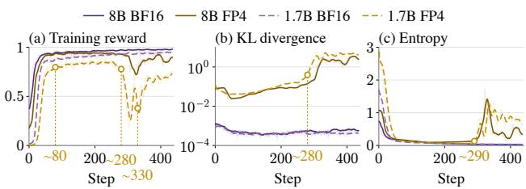  
Figure 1. Macroscopic training dynamics of Qwen3-8B and Qwen3-1.7B under BF16 and native FP4 (with default TIS) on GSM8K (Cobbe et al., 2021) dataset: (a) mean training reward, illustrating rapid initial learning followed by mid-training collapse (∼Step 280) and an incomplete, fluctuating rebound (∼Step 330); (b) sampled train–inference KL divergence; and (c) policy entropy.

## 3 OBSERVATIONS AND MOTIVATION

We argue that enabling stable and efficient quantized RL must overcome two challenges: (i) cross-stage TIM, where coarse NVFP4 representations sharply exacerbate TIM and cause severe policy drift. The drifted gradients then accumulate through the RL loop and eventually manifest as catastrophic degradation in later training steps (Mak et al., 2026; Zhuge et al., 2026); (ii) within-stage rollout degradation, where the quantization error is amplified through thousands of autoregressive decoding passes, leading to low-quality rollouts that starve policy updates of effective learning signals (Yao et al., 2025b).

Figure 1 shows their impact on Qwen3-1.7B and 8B training with TIS correction already enabled. First, although both precisions plateau around Step 80, FP4 consistently lags behind BF16 due to degraded rollout quality (Figure 1a). Second, while BF16 remains stable, FP4 abruptly collapses around Steps 280–330 as TIM accumulates over training, followed by only a partial rebound at Step 330. Third, aggregate policy KL divergence and entropy (Figures 1b, c) are poor predictors: their spikes lag behind the collapse and fail to track the subsequent reward rebound. We therefore look beyond aggregate metrics to analyze finer-grained TIM (Section 3.1) and channel-level rollout sensitivity (Section 3.2).

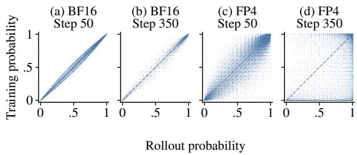

Figure 2. Token-level rollout probability $\left( \hat { \pi } _ { \mathrm { r o l l } } \right)$ versus training probability $\left( \pi _ { \mathrm { t r a i n } } \right)$ of Qwen3-1.7B at Step 50 and Step 350. While BF16 remains tightly aligned along $y = x \left( \mathbf { a } , \mathbf { b } \right)$ , FP4 evolves from a wider fusiform envelope (c) to severe dispersion with dense accumulation along the πtrain ≈ 0 boundary (d).  
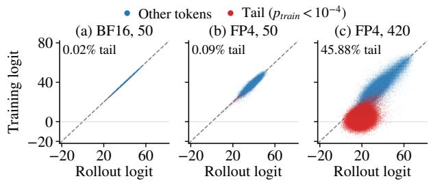  
Figure 3. Pre-softmax rollout logit $\left( z _ { \mathrm { r o l l } } \right)$ versus training logit $\left( z _ { \mathrm { t r a i n } } \right)$ of Qwen3-1.7B. Unwrapping Softmax reveals that at Step 420, these tail tokens form a distinct off-diagonal cluster, with moderate rollout logits but training logits $z _ { \mathrm { t r a i n } } \approx 0$

## 3.1 Catastrophic TIM Concentrates in Outlier Trajectories

In this section, we consider inspecting into the token-level TIM of the Qwen3-1.7B training on GSM8K dataset, because the batch- or sequence-aggregated metrics mask potential localized failure modes within a trajectory.

Token-level probability divergence and boundary accumulation. Figure 2 illustrates the scatter diagrams $\left( \hat { \pi } _ { \mathrm { r o l l } } , \pi _ { \mathrm { t r a i n } } \right)$ of each token in a batch. The scatter plots of the BF16 experiment (Figure 2a,b) manifest a relative ideal on-policy regime, where points concentrate tightly to a narrow fusiform envelope along the identity diagonal $y = x$ In native FP4 setting, however, quantization noise noticeably widens the envelope even during the healthy early stage (Step 50, Figure 2c). By Step 350 (Figure 2d), the joint distribution deteriorates dramatically: points appear widely scattered across the $[ 0 , 1 ] ^ { 2 }$ plane, and a dense horizontal band accumulates along the bottom boundary $\pi _ { \mathrm { t r a i n } } \approx 0 .$ . In this region, tokens sampled with high confidence by the rollout engine are assigned near-zero probability by the training engine, representing extreme off-policy divergence.

The separable off-diagonal tail cluster in logit space. While Figure 2d suggests widespread scatter across $[ 0 , 1 ] ^ { 2 }$ the exponential Softmax mapping both exaggerates minor perturbations among top-ranked logits in the interior and compresses all small probabilities $( \bar { \pi } _ { \mathrm { t r a i n } } \in [ 1 0 ^ { - 1 0 } , 1 0 ^ { - 2 } ] )$ onto the same $\pi _ { \mathrm { t r a i n } } \approx 0$ boundary. To isolate true divergence from Softmax distortion, we inspect the pre-softmax logits $( z _ { \mathrm { r o l l } } , z _ { \mathrm { t r a i n } } )$ in Figure 3. This view resolves the apparent global chaos of Figure 2d: even long after collapse (e.g., step 420 in Figure 3c), over a half of FP4 tokens (blue) remain well-aligned within a fusiform envelope. The severe mismatch is instead driven by a localized off-diagonal anomaly cluster breaking away below the diagonal, where tokens maintain moderate-to-high rollout logits yet collapse toward zero or negative training logits $( z _ { \mathrm { t r a i n } } \approx 0 )$ . Crucially, highlighting tokens that fall into the extreme tail of the training distribution $( \pi _ { \mathrm { t r a i n } } ( y _ { i , t } \mid y _ { i , < t } ) < \tau = 1 0 ^ { - 4 }$ marked as Tail token in red) cleanly isolates this off-diagonal logit cluster. Decoding these tail tokens reveals that they correspond to semantically degenerate outputs—such as garbled subwords, repetitive symbol loops, and abrupt crosslingual drift—hallucinated by the low-bit rollout engine but rejected by the training engine.

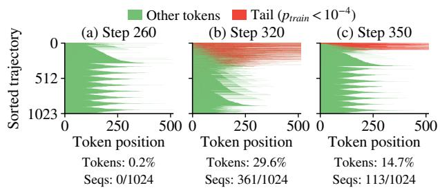  
Figure 4. Spatial distribution of tail tokens $( \pi _ { \mathrm { t r a i n } } < 1 0 ^ { - 4 }$ , red) versus normal tokens (green) of Qwen3-1.7B across 1,024 batch trajectories sorted by tail-token fraction at Step 260, 320, and 350.

Trajectory-level concentration and why token-level TIS fails. To understand how this off-diagonal cluster destabilizes optimization, Figure 4 visualizes the positions of tail tokens (red) in a training batch at three representative steps: (1) Pre-collapse (Step 260, Figure 4a): Tail tokens constitute only 0.2% of generated tokens and randomly occur as isolated, sporadic points (2) Collapse trough (Step 320, Figure 4b): The tail-token fraction surges to 29.6%. Rather than distributing uniformly across the batch, tail tokens cluster heavily within 361/1024 (35.0%) trajectories. (3) Partial rebound (Step 350, Figure 4c): The concentration becomes even more polarized. Nearly 89.0% of trajectories return to healthy generation (green) while the remaining outlier trajectories are almost completely saturated with tail tokens, which explains why the batch-mean training reward partially rebounds in Figure 1a. This skewed distribution explains why standard TIS cannot prevent policy collapse. In GRPO or DAPO, the sequence level advantage still contain the information from the clipped corrupted token. The concentration of these anomalous tokens inspires that suppressing their impact requires gating credit assignment at the sequence level rather than clipping tokens in isolation.

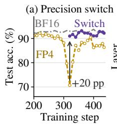

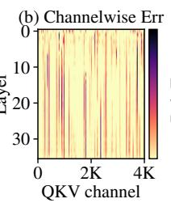

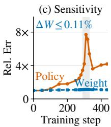  
Figure 5. Diagnosis of Qwen3-8B rollout degradation: (a) switching rollout from FP4 to BF16 immediately recovers +20 pp GSM8K test accuracy; (b) layer-wise and channel-wise quantization error across QKV projections, showing concentration in a few outlier channels; and (c) evolution of relative policy output error versus relative weight change across training steps.

## 3.2 Rollout Degradation Stems from Quantization Sensitivity rather than Corrupted Weights

In this section, we focus on the numerical behaviors behind rollout degradation and explore the sparsity of quantization errors based on the Qwen3-8B model trained on GSM8K.

Intact weights versus amplified quantization error. To diagnose whether the mid-training collapse reflects irreversible corruption of the learned model weights or a failure of low-precision generation, we take the degraded FP4 checkpoint and switch only the rollout precision from W4A4 to BF16 (Figure 5a). Remarkably, this switch yields an immediate +20 pp surge in test accuracy, closely approaching the accuracy trajectory of a model trained in BF16 from scratch. Furthermore, Figure 5c shows the relative parameter drift alongside the model’s output policy error compared to BF16 across training steps: while the policy weights change minimally throughout training $( \lVert \Delta W \rVert _ { 2 } \leq 0 . 1 1 \% )$ the relative policy error induced by W4A4 quantization escalates by nearly 8×. These results confirm that the weights remain largely intact even at the lowest point of collapse, while RL updates progressively amplify the rollout policy’s sensitivity to quantization noise.

The sparsity of quantization error. We further investigate the source of quantization error at a per-layer and per-channel granularity. As shown in Figure 5b, severe quantization errors consistently concentrate within a tiny fraction of outlier channels with disproportionately large magnitudes or variance across layers, aligning with the findings of prior studies about massive activations and quantization outliers (Dettmers et al., 2022; Xiao et al., 2023; Meng et al., 2026). NVFP4’s block scaling mechanism amplifies this error, because the outlier channel inflates the shared local scale factor, coarsening the quantization grid for the remaining 15 elements in the same block (Mak et al., 2026; Zhuge et al., 2026). This sparsity inspires us that protecting only the outlier channels can compensate most of error.

## 4 FOURSIGHT ALGORITHM DESIGN

FOURSIGHT enables stable and efficient FP4 RL posttraining through algorithm-system co-design. It comprises two key components: (1) a TIM-aware sequence filtering algorithm that discards trajectories containing concentrated large-TIM tail tokens to prevent corrupted gradients from destabilizing policy updates, and (2) a sparse precision compensation mechanism that restores rollout quality by selectively executing high-variance activation channels in BF16 while retaining native NVFP4 for the vast majority of computations. We detail the algorithmic design of FOURSIGHT below and present its system implementations in Section 5.

## 4.1 TIM-aware Sequence Filtering

Design principles. Since severe TIM is concentrated within outlier trajectories and contaminates their shared advantage (Section 3.1), adopting token-level regularization (e.g., TIS) alone has proven ineffective. Therefore, FOURSIGHT’s filtering algorithm operates at the sequence level to isolate drifted trajectories from the policy update; yet, since normal trajectories occasionally exhibit isolated large-TIM tokens, the filtering is designed to be robust to sporadic token jitter to avoid discarding valid sequences.

The dual-gate mechanism. We mark a token as a tail token if its training probability $\pi _ { \mathrm { t r a i n } } ( y _ { i , t } ) \leq \tau$ , where τ is a small constant defining the threshold. These tail tokens correspond to the boundary-accumulated tokens in Figure 2 and the off-diagonal cluster in Figure 3. To prevent large-TIM sequences from entering the policy update, FOURSIGHT uses a dual-gate mechanism to filter sequences according to this definition. (1) G1 (Cumulative count): A trajectory is filtered out if it contains at least $K _ { 1 }$ tail tokens in total. A high volume of tail tokens indicates widespread numerical drift across the trajectory; discarding such trajectories preserves overall gradient hygiene. (2) G2 (Consecutive count): A trajectory is also filtered out if it contains at least $K _ { 2 }$ consecutive tail tokens $( K _ { 2 } \le K _ { 1 } )$ . Because autoregressive decoding conditions on prior tokens, a consecutive run of tail tokens signals that the rollout has entered a degenerate prefix and suffered localized mode collapse.

GRPO objective with filtering. Define the filter $f _ { i }$ as

$$
f _ { i } = \mathbb { I } \{ \mathrm { G 1 } ( y _ { i } , \tau ) < K _ { 1 } \land \mathrm { G 2 } ( y _ { i } , \tau ) < K _ { 2 } \} .\tag{3}
$$

A sequence $y _ { i }$ participates in gradient calculation only when $f _ { i } \neq 0$ . We apply filtering post hoc by directly masking the sequence advantage: $\begin{array} { r } { \hat { A } _ { i } ^ { \top } = f _ { i } \hat { A } _ { i } = \hat { f } _ { i } \frac { r _ { i } - \mu } { \sigma } } \end{array}$ , yielding the

corrected GRPO objective:

$$
\mathcal { L } _ { \mathrm { G R P O } } ( \boldsymbol { \theta } ) = \mathbb { E } \left[ \frac { 1 } { G } \sum _ { i = 1 } ^ { G } \frac { 1 } { | y _ { i } | } \sum _ { t = 1 } ^ { | y _ { i } | } \ell _ { i , t } ^ { \mathrm { c l i p } } ( \boldsymbol { \theta } ; \hat { A } _ { i } ^ { \prime } ) \right] .\tag{4}
$$

Crucially, we preserve the original denominator G rather than renormalizing by the surviving sequence count $\textstyle \sum _ { i = 1 } ^ { G } f _ { i }$ , because reducing the denominator amplifies the gradient signals contributed by unfiltered sequences and implicitly increases the learning rate.

## 4.2 Sparse Precision Compensation

Besides sequence filtering, FOURSIGHT uses sparse precision compensation to improve rollout quality. The key insight is that model weights are insensitive to quantization throughout training, whereas the activation outliers that degrade rollouts are concentrated in only a few channels (Figure 5). In these channels, activations exhibit large variance: a single outlier amplifies its block’s scaling factor and thus affects its neighboring values. Since the vast majority of channels are benign to quantization, compensation only on these sparse outlier channels can preserve most of numerical precision.

Mix-precision GEMM decomposition. FOURSIGHT implements this sparse compensation by the SPLICEGEMM operator. For a linear layer $Y = X \dot { W } ^ { \top }$ with $\boldsymbol { X } \in \mathbb { R } ^ { M \times K }$ and $W \in \mathbb { R } ^ { N \times K }$ , SPLICEGEMM partitions the K input channels into a sparse set S and its complement S¯. The main product uses quantized NVFP4 operands on ${ \bar { S } } ,$ while the channels in $S$ are kept unquantized and applied as a BF16 correction:

$$
Y \approx \alpha \left( \widehat { X } _ { \bar { S } } \widehat { W } _ { \bar { S } } ^ { \top } + { X _ { S } } { W _ { S } ^ { \prime } } ^ { \top } \right) ,\tag{5}
$$

where $W _ { S } ^ { \prime } ~ = ~ \mathrm { B F } 1 6 ( W _ { S } / \alpha )$ is the dequantized BF16 weight, $\widehat { X } _ { \bar { S } }$ and $\widehat { W } _ { \bar { S } }$ denote the NVFP4-quantized weights and activations, α is the global NVFP4 quantization scale, and $X _ { S }$ retains its original BF16 values.

Variance-based channel selection. FOURSIGHT protects the top-s channels with the largest activation variance, where s is a predefined channel budget. We prove that this selection policy effectively bounds the quantization error under a fixed budget s: suppose we protect an s-element channel subset S, and let $\widehat { y } _ { S }$ and $y = W ;$ x denote the compensated and original BF16 outputs, respectively. The expected reconstruction error is upper-bounded by:

$$
\mathbb { E } \Vert \widehat { y } _ { S } - y \Vert _ { 2 } ^ { 2 } \leq C \Vert W \Vert _ { F } ^ { 2 } \sum _ { j \notin S } m _ { j } \approx C \Vert W \Vert _ { F } ^ { 2 } \sum _ { j \notin S } \sigma _ { j } ^ { 2 } ,\tag{6}
$$

where $m _ { j } = \mathbb { E } [ x _ { j } ^ { 2 } ]$ is the second moment of channel j and $C = \left[ \sqrt { B } c _ { W } + \sqrt { B } c _ { A } \left( 1 + \sqrt { B } c _ { W } \right) \right] ^ { 2 }$ . Under NVFP4 quantization with block size $B = 1 6$ and scale-rounding constants $c _ { A } = c _ { W } = 1 7 / 9 6$ , we have $C \approx 3 . 6 8$

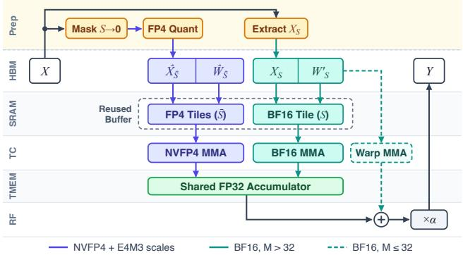  
Figure 6. SPLICEGEMM compute flow across the GPU and memory hierarchy. Operand preparation, Register Files, Tensor Cores, and Tensor Memory are denoted as Prep, RF, TC, and TMEM.

The full proof is in Appendix 9. This bound indicates that the output quantization error is governed by the second moments of the unprotected channels $( j \notin S )$ . Crucially, when channel means are small, second moments are well approximated by variances $\sigma _ { j } ^ { 2 } .$ , motivating top-variance selection.

## 5 IMPLEMENTATION

In this section, we present the kernel optimizations and system integration of FOURSIGHT, detailing how the SPLICEGEMM operator and TIM-aware sequence filtering are realized with negligible overhead over a native NVFP4 execution stack.

## 5.1 The SPLICEGEMM Kernel

A naive realization of Equation 5 that launches separate NVFP4 and BF16 GEMMs and merges their outputs in global memory incurs substantial kernel-launch overhead and memory-bandwidth waste. To optimize this, SPLICEGEMM fuses the sparse BF16 compensation $X _ { S } W _ { S } ^ { \prime } { } ^ { \top }$ into the NVFP4 execution pipeline.

Data preparation. As illustrated in Figure 6, given an input activation $\boldsymbol { X } \in \mathbb { R } ^ { M \times K }$ in HBM (M denotes the number of input tokens), the preparation kernel first reads X in a single pass using 256-bit vectorized loads. Each load instruction reads 16 contiguous BF16 elements per thread, matching one NVFP4 micro-block. Rather than branching per channel, each thread applies a precomputed register bitmask to zero out protected lanes in $S$ (Mask $S  0 )$ before quantizing the residual channels S¯ into packed NVFP4 payloads $\widehat { X } _ { \bar { S } }$ and block scales (FP4 Quant). Simultaneously, it writes the unmasked BF16 columns to a compact side buffer $X _ { S } \in \mathbb { R } ^ { M \times | S | }$ (Extract $X _ { S } )$ . The weight tensor W is pre-split into a NVFP4 pack $\widehat { W } _ { \bar { S } }$ and pre-a scaled BF16 pack $( \bar { W } _ { S } ^ { \prime } = \bar { \mathrm { B F 1 6 } } ( W _ { S } / \bar { \alpha } ) \in \bar { \mathbb { R } } ^ { \tilde { N } \times | S | } )$ after each policy update. This split is fixed during one rollout step.

Dual-path execution. Because RL workloads span both compute-bound large batches (rollout prefill and training) and latency-sensitive small batches (autoregressive decoding), SPLICEGEMM dispatches between two specialized compute paths according to the active token count M:

• High-throughput prefill path $( M > 3 2 ) \colon$ : For large M, SPLICEGEMM optimizes throughput via avoiding redundant memory allocations. Specifically, the kernel reuses the same SRAM buffer (Reused Buffer) to load the BF16 tile $( X _ { S } , W _ { S } ^ { \prime } )$ after the NVFP4 MMA operation. Then, the BF16 MMA results are directly written into the same shared FP32 accumulator in TMEM. The combined result is then moved to RF, scaled by $\times \alpha .$ and written to HBM as Y.

• Low-latency decode path $( M \leq 3 2 ) \colon$ In the small-M decode regime, TMA setup and shared-memory barriers for a narrow $M \times | S |$ tile incur disproportionate latency. While the main NVFP4 tiles execute via NVFP4 MMA, the compact side operands $( X _ { S } , W _ { S } ^ { \prime } )$ bypass SRAM staging altogether and load directly from HBM into RF. Epilogue warps prefetch the |S| protected weight columns into registers once per CTA and compute the correction via warp-level mma.sync instructions (Warp MMA), adding it to the TMEM main accumulator in RF right before the writeback.

## 5.2 System Implementation

We implement FOURSIGHT atop veRL (Sheng et al., 2024). Across both vLLM rollout and Megatron-LM training forward passes, linear projections are replaced with SPLICEGEMM. To preserve full CUDA Graph capture in vLLM, execution plans cache compiled kernels and workspace descriptors strictly by (M, N, K) shape without binding fixed tensor addresses. To track channels’ variance, a lightweight forward hook uniformly subsamples token rows prior to masking to accumulate running channel moments in a contiguous GPU buffer. Before policy backpropagation, the trainer evaluates dual gates G1 and G2 and masks sequence advantages in-place, while backward passes run in BF16 with STE. After each optimizer step, FOURSIGHT reselects protected channels according to the top-s variance gathered in the previous step, with only $\sim 0 . 3 8 s$ per update overhead. Packed weights $( \widehat { W } _ { \bar { S } } , W _ { S } ^ { \prime } )$ are synchronized to vLLM via NCCL/CUDA IPC without re-quantization.

## 6 EVALUATION

We evaluate whether FOURSIGHT sustains FP4 training quality across engines and model sizes, how much its precision compensation costs, and how its two components contribute to stable training.

## 6.1 Experimental Setup

Platform and workloads. We use four nodes with eight NVFP4-capable GPUs each. Training uses Megatron-LM 0.19.2 or Fully Sharded Data Parallel (FSDP) with PyTorch 2.9.1; rollout uses vLLM 0.26.0. Our main workload trains Qwen3-8B (Yang et al., 2025) on DAPO-Math-17k using DAPO algorithm (Yu et al., 2025), with an 8K response limit. We also train Qwen3-1.7B on GSM8K using GRPO algorithm (Shao et al., 2024) and a 512-token output limit. Performance experiments cover Qwen3-8B, Qwen3-32B, and Nemotron3-Super-120B-A12B (Chandiramani et al., 2026) on 8, 16, and 32 GPUs, respectively.

Methods. We compare with BF16 training and rollout, native FP4 rollout with QAT, and three recent quantized RL methods: Quantization-error Alignment across Dual Sides (QUADS) (Zhuge et al., 2026), Quantized Rollout (QuRL) (Li et al., 2026a), and Rollout-Aligned Quantization-Aware RL (QaRL) (Gu et al., 2026). All methods enable TIS (Yao et al., 2025b) according to their default recipe. FOURSIGHT combines sequence filtering (SF) with precision compensation (PC) for 64 input channels per projection. Filtering uses $\tau ~ = ~ 1 0 ^ { - 4 } , K _ { 1 } ~ =$ 0.01 × output len, $K _ { 2 } = 5$ and channel reselection is performed every step according to the previously accumulated variance.

Metrics. Training curves use each method’s rollout precision. Final checkpoints are evaluated with FP4 inference to reflect deployment requirements, including those trained in BF16. Each method’s compensation is retained. For Qwen3- 8B, we report Mean@16 on AIME24 (Mathematical Association of America (MAA), 2024), AIME25 (Mathematical Association of America (MAA), 2025), AMC23 (Mathematical Association of America (MAA), 2023), MATH-500 (Lightman et al., 2023), and OCW (Lewkowycz et al., 2022). For Qwen3-1.7B, we report Mean@16 on GSM8K (Cobbe et al., 2021), SVAMP (Patel et al., 2021), MATH-500 (Lightman et al., 2023), and GSM1K (Zhang et al., 2024). We measure TIM using sampled estimates of K3 KL divergence between the two policies.

## 6.2 Training Quality

DAPO on Qwen3-8B. Figure 7 compares training curves and the corresponding TIM on both engine combinations. FOURSIGHT steadily improves validation accuracy and re-

FourSight FP4 BF16 mains close to BF16 throughout training. Pure FP4 and QuRL make early gains but deteriorate later; QuRL’s rapid initial progress gives way to a sharp increase in mismatch. QaRL remains stable on both engines, while QUADS loses accuracy late in FSDP training. We also measure learning speed by the first validation step reaching 20% AIME24 accuracy. FOURSIGHT reaches this target in 150 steps on Megatron and 250 steps on FSDP, Compared with QaRL and QUADS, this improves step efficiency by 2.60× and 2.33× on Megatron, and 1.76× and 1.52× on FSDP, respectively.

Table 1. Qwen3-8B accuracy (%) under FP4 inference (%, Mean@16, temperature $T = 0 . 6 ,$ 8k response limit; mean ± standard error). QUADS and FOURSIGHT retain their respective compensation at inference.
<table><tr><td rowspan="2">Method</td><td colspan="5">vLLM + Megatron-LM</td><td colspan="5">vLLM + FSDP</td></tr><tr><td>AIME24</td><td>AIME25</td><td></td><td>AMC23 MATH-500</td><td>OCW</td><td>AIME24</td><td>AIME25</td><td></td><td>AMC23 MATH-500</td><td>OCW</td></tr><tr><td>BF16</td><td> $2 1 . 5 { \pm } 6 . 6 $ </td><td> $1 9 . 0 { \pm } 6 . 5 $ </td><td> $6 5 . 3 \pm 5 . 9$ </td><td> $8 2 . 4 \pm 1 . 3$ </td><td> $4 7 . 7 { \pm } 2 . 5 $ </td><td> $2 3 . 1 \pm 7 . 0$ </td><td> $2 1 . 0 { \pm } 6 . 9$ </td><td> $6 5 . 2 { \pm } 6 . 0 $ </td><td> $8 1 . 4 \pm 1 . 4$ </td><td> $4 7 . 0 { \pm } 2 . 5 $ </td></tr><tr><td>FP4</td><td> $1 4 . 6 { \pm } 5 . 6 $ </td><td> $1 2 . 1 { \pm } 4 . 8 $ </td><td> $4 4 . 5 { \pm } 6 . 5 $ </td><td> $8 0 . 4 \pm 1 . 4$ </td><td>46.8±2.5</td><td> $1 4 . 4 \pm 5 . 1$ </td><td> $1 6 . 2 \pm 5 . 7$ </td><td> $5 9 . 5 { \pm } 5 . 9 $ </td><td> $7 8 . 8 \pm 1 . 5$ </td><td> $4 4 . 2 \pm 2 . 4$ </td></tr><tr><td>QaRL</td><td> $2 3 . 1 { \pm } 6 . 4 $ </td><td> $1 9 . 4 \pm 6 . 3$ </td><td> $6 7 . 8 { \pm } 6 . 0 \ $ </td><td> $8 3 . 5 { \pm } 1 . 3 $ </td><td>49.3±2.5</td><td> $2 1 . 9 { \pm } 5 . 9$ </td><td> $2 1 . 3 { \pm } 6 . 8 $ </td><td> $6 6 . 7 { \pm } 5 . 5 $ </td><td> $8 1 . 8 { \pm } 1 . 4 $ </td><td> $4 5 . 3 { \pm } 2 . 5 $ </td></tr><tr><td>QuRL</td><td> $6 . 7 \pm 3 . 4$ </td><td> $2 . 7 { \pm } 2 . 0 $ </td><td> $3 0 . 9 \pm 5 . 9$ </td><td> $6 8 . 1 \pm 1 . 7$ </td><td> $4 2 . 2 { \pm } 2 . 4 $ </td><td> $1 1 . 7 { \pm } 4 . 6 $ </td><td> $\overline { { 1 0 . 8 } } \pm 4 . 3$ </td><td> $5 4 . 1 { \pm } 6 . 1$ </td><td> $7 7 . 3 { \pm } 1 . 6 $ </td><td> $4 7 . 1 { \pm } 2 . 6 $ </td></tr><tr><td>QUADS</td><td> $2 1 . 9 { \pm } 6 . 4 $ </td><td> $2 1 . 9 2 6 . 5$ </td><td> $\underline { { 7 0 . 6 \pm 5 . 5 } }$ </td><td> $\underline { { 8 3 . 7 } } \pm 1 . 3$ </td><td> $4 7 . 7 { \pm } 2 . 5 $ </td><td> $2 0 . 4 \pm 5 . 7$ </td><td> $1 7 . 9 2 6 . 1 $ </td><td> $6 3 . 3 { \pm } 6 . 0 $ </td><td> $7 8 . 0 { \pm } 1 . 4 $ </td><td> $\overline { { 3 8 . 7 } } \pm 2 . 3$ </td></tr><tr><td>FOURSIGHT</td><td> ${ \bf 2 6 . 3 \pm 6 . 6 }$ </td><td>23.3±6.6</td><td> $7 3 . 3 { \pm } 5 . 4 $ </td><td> ${ \bf 8 5 . 9 2 1 . 3 }$ </td><td></td><td>48.4±2.5 23.3±6.5 21.3±6.3</td><td></td><td> ${ \bf 6 7 . 9 2 5 . 5 }$ </td><td> ${ \bf 8 2 . 5 \pm 1 . 4 }$ </td><td>47.2±2.5</td></tr></table>

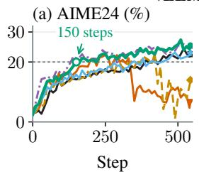

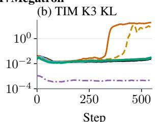

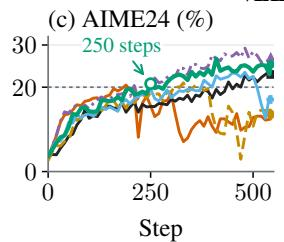

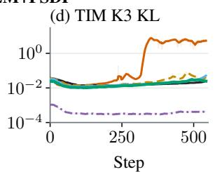  
Figure 7. Qwen3-8B training with DAPO: AIME24 validation accuracy and training–inference mismatch on trained vLLM + Megatron-LM (a,b) and $\mathrm { \ v L L M + F S D P }$ (c,d). BF16 validation uses BF16 inference; other methods use FP4.

Table 1 shows that fast, stable learning translates into strong FP4 deployment quality. FOURSIGHT achieves the highest accuracy on four of five benchmarks with Megatron and leads all five with FSDP. On Megatron, it improves AIME24 from 23.1% for the strongest baseline to 26.3%, and AMC23 from 70.6% to 73.3%. On FSDP, it improves every benchmark over the BF16-trained model and matches or surpasses all quantized baselines, combining faster learning with consistent gains across tasks.

The engine combination matters because it changes the numerical errors encountered during policy updates: Megatron executes native FP4 forward operations, whereas FSDP emulates quantization in higher precision via QAT. The resulting failure patterns also differ. Pure FP4 under Megatron exhibits a large late-stage KL increase; under FSDP, substantial accuracy loss occurs even while average KL remains small. FOURSIGHT addresses both rollout quality and harmful trajectories, sustaining training across these different error patterns. We isolate the two contributions below.

GRPO on Qwen3-1.7B. FOURSIGHT generalizes effectively to smaller models and distinct algorithms like GRPO (Figure 8). While pure FP4 suffers severe accuracy degradation as policy mismatch accumulates, FOURSIGHT stably maintains ∼83% validation accuracy, closely matching the BF16 baseline. In native FP4 deployment, FOURSIGHT outperforms all baselines across four benchmarks (Table 2), exceeding the BF16 baseline by 12.7–16.4 pp. This superiority raises because standard BF16-trained models suffer heavy accuracy loss when subjected to FP4 post-training quantization (PTQ), while FOURSIGHT inherently immunizes the policy against low-bit errors during training, preserving reasoning capabilities directly in the target serving precision.

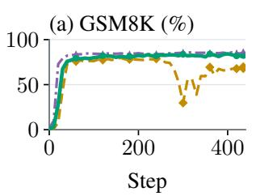

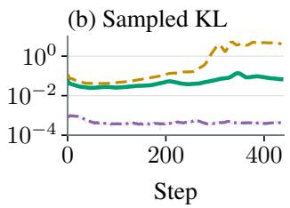  
Figure 8. Qwen3-1.7B training with GRPO: FOURSIGHT sustains close-to-BF16 accuracy and controls TIM as pure FP4 degrades.

Table 2. Qwen3-1.7B FP4 inference accuracy (%, Mean@16, temperature $T = 0 . 6 ,$ 4k response limit; mean ± standard error).
<table><tr><td>Method</td><td>GSM8K</td><td>SVAMP</td><td>MATH-500</td><td>GSM1K</td></tr><tr><td>BF16</td><td> $6 7 . 3 0 { \scriptstyle \pm 0 . 9 7 }$ </td><td> $7 4 . 5 4 \pm 0 . 9 6$ </td><td> $3 7 . 8 2 \pm 1 . 6 3$ </td><td> $5 9 . 1 3 { \pm } 1 . 0 7 $ </td></tr><tr><td>FP4</td><td> $4 5 . 8 6 \pm 1 . 1 0$ </td><td> $4 9 . 6 7 \pm 1 . 2 8$ </td><td> $1 6 . 2 5 { \pm } 1 . 2 4 $ </td><td> $3 9 . 3 8 { \pm } 1 . 1 3 $ </td></tr><tr><td> $\mathrm { F o U R S I G H T }$ </td><td> $\mathbf { 8 0 . 6 5 \pm 0 . 8 3 }$ </td><td> ${ \bf 8 7 . 2 6 { \pm } 0 . 8 1 }$ </td><td> ${ \bf 5 1 . 3 4 \pm 1 . 7 7 }$ </td><td> $7 5 . 5 3 \pm 0 . 9 5$ </td></tr></table>

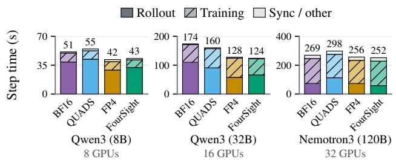  
Figure 9. Step time and breakdown at matched response lengths. FOURSIGHT introduces less than 2.3% overhead to pure FP4.

## 6.3 Performance and Overhead

End-to-end performance. To ensure fair comparisons, we evaluate all methods on identical training trajectories with fixed prompt and response length distribution. Figure 9 reports the average per-step time and breakdown after warmup, where FOURSIGHT consistently retains near-FP4 step time. FOURSIGHT completes a step in 43 s on Qwen3-8B and 124 s on Qwen3-32B, yielding 1.18× and 1.40× speedups over the BF16 baseline, and 1.28× and 1.29× over QUADS. Notably, FOURSIGHT introduces negligible overhead compared to uncompensated pure FP4: it is only 2.3% slower on 8B and even 3.1% faster on 32B. This efficiency is driven by our SPLICEGEMM kernel, which not only hides compensation latency but also outperforms native FlashInfer under memory-bound decode regimes on Qwen3-32B. For Nemotron3, FOURSIGHT takes 252 s per step, 1.56% below pure FP4 and 15.4% below QUADS (1.18× faster). Since training stage dominates this workload, faster low-precision forward operations during rollout have a smaller gain on total time.

Kernel performance. Figure 10 compares complete projection operations, including activation quantization, across token counts. SPLICEGEMM reaches up to 3.7× and 2.8× BF16 speed on Qwen3-8B and 32B, respectively, and broadly tracks pure FP4. For Nemotron3, SPLICEGEMM achieves up to 2.4× and 3.7× speedup over the vLLM BF16 baseline for Up and Down, respectively. The optimized Down stage also outperforms pure FP4 by up to 1.16×. Fusing the correction into FP4 kernels retains the throughput benefits of low-precision execution while protecting selected channels.

## 6.4 Mechanism Ablations

Filtering and compensation. Figure 11 isolates the contributions of Precision Compensation (PC) and Selective Filtering (SF). On Megatron, PC alone triggers eventual policy collapse, whereas SF alone stabilizes training but plateaus at a suboptimal accuracy. Unifying both interventions boosts final AIME24 accuracy from 20.8% (SF-only)

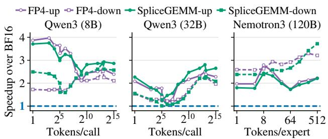  
Figure 10. Kernel performance measured by speedup over BF16 with 64-channel compensation. “Up” and “down” denote the two feed-forward projections; the blue line marks BF16 speed.

Table 3. Final FP4 accuracy (%) with sequence filtering (SF), precision compensation (PC), or both. Evaluation follows Table 1.
<table><tr><td>Method</td><td>AIME24</td><td>AIME25</td><td>AMC23</td><td>MATH-500</td><td>OCW</td></tr><tr><td colspan="6">vLLM + Megatron-LM</td></tr><tr><td>SF-only</td><td>20.8±6.0</td><td>19.2±6.0</td><td>69.7±5.2</td><td>83.4±1.3</td><td>48.6±2.5</td></tr><tr><td>PC-only</td><td>10.0±4.3</td><td>4.4±2.6</td><td>40.6±5.9</td><td>69.1±1.7</td><td>41.2±2.4</td></tr><tr><td>FOURSIGHT</td><td>26.3±6.6</td><td>23.3±6.6</td><td>73.3±5.4</td><td>85.9±1.3</td><td>48.4±2.5</td></tr><tr><td></td><td colspan="5">vLLM + FSDP</td></tr><tr><td>SF-only</td><td>12.5±4.7</td><td>14.8±5.4</td><td>50.5±6.6</td><td>81.0±1.4</td><td>47.4±2.6</td></tr><tr><td>PC-only</td><td>23.3±6.1</td><td>22.1±6.7</td><td>67.9±5.5</td><td>84.7±1.3</td><td>44.0±2.5</td></tr><tr><td>FOURSIGHT</td><td>23.3±6.5</td><td>21.3±6.3</td><td>67.9±5.5</td><td>82.5±1.4</td><td>47.2±2.5</td></tr></table>

to 26.3% (Table 3). This synergy arises because SF purges severe out-of-distribution trajectories to shield policy updates from destabilization, while PC elevates the baseline generation quality of the remaining trajectories to provide richer learning signals.

Under FSDP, PC alone recovers most accuracy gains, achieving the highest scores on AIME25 and MATH-500. Yet, adding SF improves OCW accuracy over PC-only, while adding PC prevents the late-stage degradation observed with SF alone. These behaviors reveal that while the dominance of each component shifts with engine-specific numerical discrepancies, their joint application is necessary to guarantee robust, high-quality RL across divergent execution frameworks.

Sequence filtering sensitivity. Figure 12 analyzes the tailtoken filter across three Qwen3-8B training snapshots on DAPO-Math-17k. At our default threshold $( \tau = 1 0 ^ { - 4 }$ and K = 5) the filter eliminates severely divergent off-diagonal logit clusters while retaining 38–68% of tokens, collapsing token-level KL divergence from 0.81–9.00 to 0.037–0.054. This aligns the training trajectory tightly within policy consensus. Stricter filtering discards excessive training data, while larger looser guards (K > 5) add little retained data at later training steps with increased TIM KL. This validates our configuration as an effective trade-off between mismatch suppression and data efficiency.

Precision compensation sensitivity. We benchmark a frozen, degraded Qwen3-8B checkpoint across varying compensation schemes (Figure 13). Protecting merely 64 variance-selected channels elevates AIME24 accuracy to 13.5% (nearing BF16’s 14.0%), whereas random channel protection fails completely, hovering near uncompensated FP4. This demonstrates the importance of channel selection, where minimal, targeted precision safeguards can recover generation quality. Scaling to 256 channels yields a marginal ∼1 pp gain despite a 4× increase in protected state. This confirms that 64 channels captures the vast majority of accuracy gains at minimal hardware overhead.

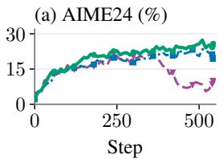

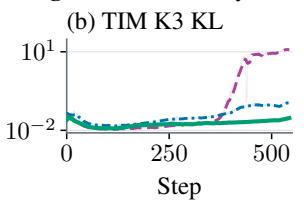

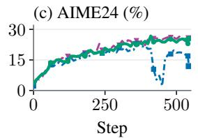  
Figure 11. Ablation study of sequence filtering (SF), precision compensation (PC), and their combination across training engines.

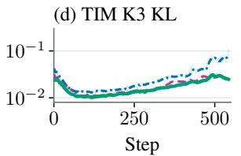

Retained Discarded  
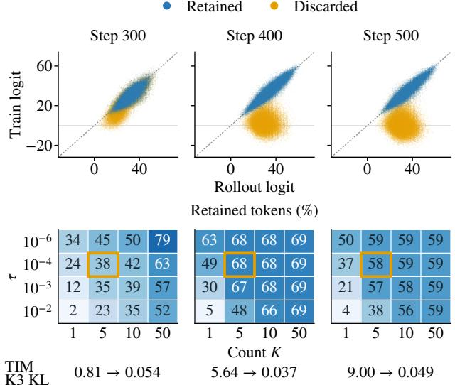  
Figure 12. Sensitivity of the low-probability token criterion. Top: retained and discarded tokens. Bottom: token retention versus probability threshold τ and count K; gold marks the default. The footer reports TIM KL before and after filtering.

## 7 RELATED WORK

## 7.1 Quantized Inference and Learning

To improve low-bit severing quality, post-training quantization (PTQ) and inference-time enhancements mitigate activation outliers via channel smoothing (Xiao et al., 2023; Lin et al., 2024), orthogonal rotations (Ashkboos et al., 2024), residual channel augmentation (Meng et al., 2026), or mixed-precision decomposition (Dettmers et al., 2022; Zhao et al., 2024). Beyond static inference, quantizationaware training (QAT) (Jacob et al., 2017; Moonshot AI, 2025) and low-bit pre-training (Micikevicius et al., 2022; Wang et al., 2025; NVIDIA, 2024) adapt parameters to lowprecision arithmetic during single-engine teacher-forcing updates. Directly applying them to NVFP4 RL is insufficient: policy updates amplify quantization sensitivity over long rollouts, while online rotations or unaligned compensation branches add latency and cross-engine drift. FOUR-SIGHT bounds NVFP4 block-scaling error via top-variance channel selection and fused SPLICEGEMM kernel with specialized prefill and decode paths.

Variance FP4 BF16  
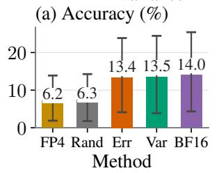

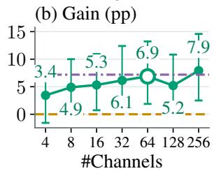  
Figure 13. Frozen-checkpoint AIME24 accuracy with random (Rand), error-based (Err), or variance-based (Var) channel selection; right: gain in percentage points (pp) versus channel budget. Bars show 95% confidence intervals over 30 samples.

## 7.2 Remedies for Training–Inference Mismatch

Decoupled rollout and training engines induce Training– Inference Mismatch (TIM) (Yao et al., 2025a;b). System unification like veXact (Zhong et al., 2026) eliminates TIM by sharing one engine, but forfeits stage-specific optimizations. Algorithmic remedies adjust updates via TIS (Yao et al., 2025b), Score Centering (Marek & Ryabinin, 2026), token-level masking (Ling Team et al., 2025), sequencelevel TRM (Li et al., 2026b), or TRIAGE (Li et al., 2026c). For quantized RL, QuRL (Li et al., 2026a) pairs adaptive ratio clipping with invariant weight scaling in 8-bit rollouts; QaRL (Gu et al., 2026) combines rollout-aligned learner forwards with sequence-level trust-band clipping; and HiFloat4 (Mak et al., 2026) and QUADS (Zhuge et al., 2026) compensate FP4 rollout errors via auxiliary residual GEMMs. Under NVFP4, token-level corrections still leak corrupted advantages, whereas sequence filtering cannot restore degraded rollout quality. Meanwhile, existing compensations incur severe overhead and leave outliers unfiltered.

FOURSIGHT co-designs dual-gate sequence filtering with fused SPLICEGEMM compensation for both stability and near-native FP4 speed.

## 8 CONCLUSION

We presented FOURSIGHT, an algorithm–system co-design that enables stable and efficient NVFP4 RL post-training. Through fine-grained diagnostics, we revealed that low-bit RL failures are sparse rather than uniform, motivating two complementary interventions: a dual-gate sequence filtering to isolate drifted trajectories from policy updates, and sparse precision compensation that protects only top-variance channels in BF16. Powered by our fused SPLICEGEMM kernel, FOURSIGHT sustains near-BF16 training stability across scales and achieves state-of-the-art FP4 deployment accu racy while remaining within 2.3% of native FP4 step time up to 120B-scale models. These results demonstrate that algorithm-system co-design can overcome the longstanding trade-off between low-bit efficiency and training stability, providing a practical foundation for efficient RL posttraining and deployment at scale.

## REFERENCES

Ashkboos, S., Mohtashami, A., Croci, M. L., Li, B., Jaggi, M., Alistarh, D., Hoefler, T., and Hensman, J. QuaRot: Outlier-free 4-bit inference in rotated LLMs. In Advances in Neural Information Processing Systems (NeurIPS), 2024.

Chandiramani, A., Blakeman, A., Olaoye, A., Gupta, A., Somasamudramath, A., Khattar, A., et al. Nemotron 3 super: Open, efficient mixture-of-experts hybrid mambatransformer model for agentic reasoning, 2026. URL https://arxiv.org/abs/2604.12374.

Cobbe, K., Kosaraju, V., Bavarian, M., Chen, M., Jun, H., Kaiser, L., Plappert, M., Tworek, J., Hilton, J., Nakano, R., Hesse, C., and Schulman, J. Training verifiers to solve math word problems. arXiv preprint arXiv:2110.14168, 2021.

DeepSeek-AI, Guo, D., Yang, D., Zhang, H., Song, J., et al. DeepSeek-R1: Incentivizing reasoning capability in LLMs via reinforcement learning, 2025. URL https://arxiv.org/abs/2501.12948.

Dettmers, T., Lewis, M., Belkada, Y., and Zettlemoyer, L. Gpt3. int8 (): 8-bit matrix multiplication for transformers at scale. Advances in neural information processing systems, 35:30318–30332, 2022.

Gu, H., Wang, H., Liu, J., Li, L., Zhu, Q., Liu, B., Xu, B., Wang, L., Yang, X., Lin, S., Han, S., and Guo, Y. QaRL: Rollout-aligned quantization-aware RL for fast and stable training under training–inference mismatch, 2026. URL https://arxiv.org/abs/2604.07853.

Jacob, B., Kligys, S., Chen, B., Zhu, M., Tang, M., Howard, A., Adam, H., and Kalenichenko, D. Quantization and training of neural networks for efficient integer-arithmetic-only inference, 2017. URL https: //arxiv.org/abs/1712.05877.

Jiang, A. and The SkyRL Team. Isoexec: Unified execution to eliminate trainer-inference mismatch in skyrl. URL https://vllm.ai/blog/ 2026-08-21-isoexec.

Kwon, W., Li, Z., Zhuang, S., Sheng, Y., Zheng, L., Yu, C. H., Gonzalez, J. E., Zhang, H., and Stoica, I. Efficient memory management for large language model serving with PagedAttention, 2023. URL https://arxiv. org/abs/2309.06180.

Lewkowycz, A., Andreassen, A., Dohan, D., Dyer, E., Michalewski, H., Ramasesh, V., Slone, A., Anil, C., Schlag, I., Gutman-Solo, T., et al. Solving quantitative reasoning problems with language models. In Advances in Neural Information

Processing Systems, volume 35, pp. 3843–3857, 2022. URL https://proceedings.neurips. cc/paper\_files/paper/2022/file/ 18abbeef8cfe9203fdf9053c9c4fe191-\ Paper-Conference.pdf.

Li, Y., Elangovan, R., Dong, X., Panda, P., and Khailany, B. QuRL: Efficient reinforcement learning with quantized rollout, 2026a. URL https://arxiv.org/abs/ 2602.13953.

Li, Y., Liu, J., Xu, J., Tong, Y., Li, Z., Liu, Q., and Wang, B. Trust region masking for long-horizon LLM reinforcement learning, 2026b. URL https://arxiv.org/ abs/2512.23075.

Li, Z., Zhang, S., Gu, Y., Zhang, Y., Yu, Y., Feng, M., Xie, C., Yu, S., Lai, J., and Yang, H. TRIAGE: Directionaware mismatch stabilization of native NVFP4 reinforcement learning, 2026c. URL https://arxiv.org/ abs/2610.07043.

Lightman, H., Kosaraju, V., Burda, Y., Edwards, H., Baker, B., Lee, T., Leike, J., Schulman, J., Sutskever, I., and Cobbe, K. Let’s verify step by step. In The twelfth international conference on learning representations, 2023.

Lin, J., Tang, J., Tang, H., Yang, S., Chen, W.-M., Wang, W.-C., Xiao, G., Dang, X., Gan, C., and Han, S. AWQ: Activation-aware weight quantization for LLM compression and acceleration. In Proceedings of Machine Learning and Systems (MLSys), 2024.

Ling Team et al. Every step evolves: Scaling reinforcement learning for trillion-scale thinking model, 2025. URL https://arxiv.org/abs/2510.18855.

Mak, H. Y., Golestan, S., Le, H. A. D., Taghian Jazi, M., Peng, Y., Wang, Y., Wang, J., Hu, T., He, F., Hu, G., Rahman, T., and Raju, A. D. HiFloat4 format for endto-end reinforcement learning post-training of large language models. ArXiv, abs/2607.26515, 2026. URL https://arxiv.org/abs/2607.26515.

Marek, M. and Ryabinin, M. Score centering stabilizes off-policy reinforcement learning, 2026. URL https: //arxiv.org/abs/2609.20807.

Mathematical Association of America (MAA). AMC 2023. https://artofproblemsolving.com/wiki/ index.php/AMC\_Problems\_and\_Solutions, 2023. American Mathematics Competitions, 2023.

Mathematical Association of America (MAA). AIME 2024. https://artofproblemsolving.com/ wiki/index.php/2024\_AIME\_I, 2024. American Invitational Mathematics Examination, 2024.

Mathematical Association of America (MAA). AIME 2025. https://artofproblemsolving.com/ wiki/index.php/2025\_AIME\_I, 2025. American Invitational Mathematics Examination, 2025.

Meng, H., Luo, Y., Zhao, Y., Liu, W., Zhang, P., and Ma, X. ARCQuant: Boosting NVFP4 quantization with augmented residual channels for LLMs. In Proceedings of the 64th Annual Meeting of the Association for Computational Linguistics (Volume 1: Long Papers), pp. 8609–8623, San Diego, California, United States, 2026. Association for Computational Linguistics. doi: 10.18653/v1/2026.acl-long.388. URL https: //aclanthology.org/2026.acl-long.388/.

Micikevicius, P., Stosic, D., Burgess, N., Cornea, M., Dubey, P., Grisenthwaite, R., Ha, S., Heinecke, A., Judd, P., Kamalu, J., Mellempudi, N., Oberman, S., Shoeybi, M., Siu, M., and Wu, H. FP8 formats for deep learning, 2022. URL https://arxiv.org/abs/2209.05433.

Moonshot AI. Kimi K2 Thinking. Model card, 2025. URL https://huggingface.co/moonshotai/ Kimi-K2-Thinking.

Moonshot AI. Kimi K3: Open frontier intelligence, 2026. URL https://arxiv.org/abs/2607.24653.

NVIDIA. NVIDIA Blackwell platform arrives to power a new era of computing. NVIDIA Newsroom, March 2024. URL https://nvidianews.nvidia.com/news/ nvidia-blackwell-platform-arrives\ -to-power-a-new-era-of-computing.

NVIDIA. GLM-5.3-Flash-NVFP4. Hugging Face model card, 2026a. URL https://huggingface.co/ nvidia/GLM-5.3-Flash-NVFP4.

NVIDIA. Qwen3.8-27B-NVFP4. Hugging Face model card, 2026b. URL https://huggingface.co/ nvidia/Qwen3.8-27B-NVFP4.

Patel, A., Bhattamishra, S., and Goyal, N. Are nlp models really able to solve simple math word problems? In Proceedings of the 2021 conference of the North American chapter of the association for computational linguistics: human language technologies, pp. 2080–2094, 2021.

Schulman, J., Wolski, F., Dhariwal, P., Radford, A., and Klimov, O. Proximal policy optimization algorithms. arXiv preprint arXiv:1707.06347, 2017. URL https: //arxiv.org/abs/1707.06347.

Shao, Z., Wang, P., Zhu, Q., Xu, R., Song, J., Bi, X., Zhang, H., Zhang, M., Li, Y., Wu, Y., et al. Deepseekmath: Pushing the limits of mathematical reasoning in open language models. arXiv preprint arXiv:2402.03300, 2024.

Sheng, G., Zhang, C., Ye, Z., Wu, X., Zhang, W., Zhang, R., Peng, Y., Lin, H., and Wu, C. HybridFlow: A flexible and efficient RLHF framework, 2024. URL https: //arxiv.org/abs/2409.19256.

Shoeybi, M., Patwary, M., Puri, R., LeGresley, P., Casper, J., and Catanzaro, B. Megatron-LM: Training multibillion parameter language models using model parallelism, 2019. URL https://arxiv.org/abs/ 1909.08053.

Wang, R., Gong, Y., Liu, X., Zhao, G., Yang, Z., Guo, B., Zha, Z., and Cheng, P. Optimizing large language model training using FP4 quantization, 2025. URL https: //arxiv.org/abs/2501.17116.

Xiao, G., Lin, J., Seznec, M., Wu, H., Demouth, J., and Han, S. Smoothquant: Accurate and efficient post-training quantization for large language models. In International conference on machine learning, pp. 38087–38099. PMLR, 2023.

Yang, A., Li, A., Yang, B., Zhang, B., Hui, B., Zheng, B., Yu, B., Gao, C., Huang, C., Lv, C., et al. Qwen3 technical report. arXiv preprint arXiv:2505.09388, 2025.

Yao, F., Liu, L., Zhang, D., Dong, C., Shang, J., and Gao, J. Your efficient RL framework secretly brings you off-policy RL training. Feng Yao’s Notion, August 2025a. URL https://fengyao.notion.site/ off-policy-rl.

Yao, F., Liu, L., Zhang, D., Dong, C., Shang, J., and Gao, J. On the rollout-training mismatch in modern RL systems. In Advances in Neural Information Processing Systems (NeurIPS), 2025b. URL https://neurips. cc/virtual/2025/loc/san-diego/124259.

Yu, Q., Zhang, Z., Zhu, R., Yuan, Y., Zuo, X., YuYue, Dai, W., Fan, T., Liu, G., Liu, J., Liu, L., Liu, X., Lin, H., Lin, Z., Ma, B., Sheng, G., Tong, Y., Zhang, C., Zhang, M., Zhang, R., Zhang, W., Zhu, H., Zhu, J., Chen, J., Chen, J., Wang, C., Yu, H., Song, Y., Wei, X., Zhou, H., Liu, J., Ma, W.-Y., Zhang, Y.-Q., Yan, L., Wu, Y., and Wang, M. DAPO: An Open-Source LLM Reinforcement Learning System at Scale. In Advances in Neural Information Processing Systems, 2025. URL https://mlanthology.org/ neurips/2025/yu2025neurips-dapo/.

Zhang, H., Da, J., Lee, D., Robinson, V., Wu, C., Song, W., Zhao, T., Raja, P., Zhuang, C., Slack, D., Lyu, Q., Hendryx, S., Kaplan, R., Lunati, M., and Yue, S. A careful examination of large language model performance on grade school arithmetic. In Proceedings of the Neural Information Processing Systems Track on Datasets and Benchmarks (NeurIPS), 2024.

Zhao, Y., Gu, A., Varma, R., Luo, L., Huang, C.-C., Xu, M., Wright, L., Shojanazeri, H., Ott, M., Shleifer, S., Desmaison, A., Balioglu, C., Damania, P., Nguyen, B., Chauhan, G., Hao, Y., Mathews, A., and Li, S. PyTorch FSDP: Experiences on scaling fully sharded data parallel, 2023. URL https://arxiv.org/abs/2304.11277.

Zhao, Y., Lin, C.-Y., Zhu, K., Ye, Z., Chen, L., Zheng, S., Ceze, L., Krishnamurthy, A., Chen, T., and Kasikci, B. Atom: Low-bit quantization for efficient and accurate LLM serving. In Proceedings of Machine Learning and Systems (MLSys), 2024.

Zheng, L., Yin, L., Xie, Z., Sun, C., Huang, J., Yu, C. H., Cao, S., Kozyrakis, C., Stoica, I., Gonzalez, J. E., Barrett, C., and Sheng, Y. SGLang: Efficient execution of structured language model programs, 2023. URL https://arxiv.org/abs/2312.07104.

Zhong, T., Ling, N., Pi, Y., Wei, Z., Yu, T., Fox, G., Wu, P., and Yu, X. Diagnosing training inference mismatch in LLM reinforcement learning, 2026. URL https:// arxiv.org/abs/2605.14220. VeXact is the zeromismatch diagnostic baseline introduced in this paper.

Zhuge, Z., Yu, H., Wang, X., Li, Z., Cao, Y., Liu, D., and Zhang, J. QUADS: Stabilizing NVFP4 reinforcement learning for MoE via QUantization-error Alignment across Dual Sides, 2026. URL https://arxiv. org/abs/2607.15810.

## 9 APPENDIX

## 9.1 Degenerate words

## 9.2 Experiment Settings

As discussed in Section 6, Table 4 provides a detailed summary of the experimental settings for the GRPO and DAPO recipes. For DAPO, we also enable group filtering based on accuracy and configure the overlong buffer with a length of 512 and a penalty factor of 1.0 to penalize the overlong sequences. For QaRL (Gu et al., 2026) and QuRL (Li et al., 2026a) reproduction, all algorithm-specific hyperparameters are kept at the values reported in the original papers.

Table 4. Experimental settings for the GRPO and DAPO recipes.
<table><tr><td>Parameter Name</td><td>GRPO (1.7B)</td><td>DAPO (8B)</td></tr><tr><td>trainer.nnodes</td><td>1</td><td>1</td></tr><tr><td>trainer.n_gpu-per_node</td><td>8</td><td>8</td></tr><tr><td>data.train_batch_size</td><td>256</td><td>32</td></tr><tr><td>data.max_prompt_length</td><td>1024</td><td>1024</td></tr><tr><td>data.max_response_length</td><td>512</td><td>8192</td></tr><tr><td>rollout.n</td><td>4</td><td>8</td></tr><tr><td>rollout.temperature</td><td>1.0</td><td>1.0</td></tr><tr><td>rollout.top-p</td><td>1.0</td><td>1.0</td></tr><tr><td>val_kwargs.temperature</td><td>0</td><td>0.6</td></tr><tr><td>actor.ppo_mini_batch_size</td><td>256</td><td>32</td></tr><tr><td>optimizer</td><td>AdamW</td><td>AdamW</td></tr><tr><td>optim.lr</td><td>1 × 10 -6</td><td>1.5 × 10 -6</td></tr><tr><td>optim.weight_decay</td><td>0.01</td><td>0.1</td></tr><tr><td>rollout_is</td><td>token</td><td>token</td></tr><tr><td>rollout_is_threshold</td><td>2.0</td><td>2.0</td></tr></table>

## 9.3 Error Bounds of Variance-based Compensation

## 9.3.1 Notation and preliminaries

The linear layer and the protected set under quantization. We consider a linear layer

$$
y = W x , \qquad W \in \mathbb { R } ^ { N \times K } , \qquad x \in \mathbb { R } ^ { K } ,
$$

and study the expected squared output reconstruction error relative to the BF16 weights and activations.

The implementation protects a fixed set $S \subseteq \{ 1 , \ldots , K \}$ of input channels, with $| S | = s$ using a BF16 side branch. The remaining channels are denoted $\mathsf { b y } R = \{ 1 , \dots , K \} \setminus S$

For notational convenience, x and $W _ { R }$ denote tensors embedded in the original K-dimensional coordinate system, with the coordinates in S set to zero. Similarly, $x _ { S }$ and $W _ { S }$ retain only the protected coordinates. Thus,

$$
x = x _ { R } + x _ { S } , \qquad W = W _ { R } + W _ { S } .
$$

Since $W _ { R }$ vanishes on the columns in $S$ and $x _ { R }$ vanishes on the coordinates in $S ,$ and symmetrically for $W _ { S } , x _ { S }$ on $R ,$ we have $W _ { R } x _ { S } = 0$ and $W _ { S } x _ { R } = 0$ . Hence

$$
y = W _ { R } x _ { R } + W _ { S } x _ { S } .\tag{7}
$$

After the selected coordinates are zeroed, the implementation recomputes the local NVFP4 block scales. Write $\mathcal { Q } _ { A } ^ { S }$ and $\mathcal { Q } _ { W } ^ { S }$ for the activation and weight quantizers . We write $\mathcal { Q } _ { A }$ for the unprotected baseline activation quantizer, which corresponds to $S = \emptyset$ . Ignoring the finite-precision error of the BF16 side branch for the moment, the idealized protected output is

$$
\widehat y _ { S } = { \mathcal Q } _ { W } ^ { S } ( W _ { R } ) { \mathcal Q } _ { A } ^ { S } ( x _ { R } ) + W _ { S } x _ { S } .\tag{8}
$$

The NVFP4 format. The finite E2M1 value set is

$$
\mathcal { C } = \{ 0 , \pm 0 . 5 , \pm 1 , \pm 1 . 5 , \pm 2 , \pm 3 , \pm 4 , \pm 6 \} .
$$

The largest gap between adjacent nonnegative values of C is 2, and its largest magnitude is 6.

Consider one activation block b (of width B along K) after the protected coordinates have been zeroed, and define

$$
a _ { b } ( S ) = \operatorname* { m a x } _ { j \in b \cap R } | x _ { j } | .
$$

Let $g _ { A } > 0$ be the frozen activation encode gain. The local physical scale with the E4M3 block scale factor is

$$
\widetilde { s } _ { b } = \frac { \mathrm { r o u n d } _ { \mathrm { E 4 M 3 } } \left( g _ { A } a _ { b } ( S ) / 6 \right) } { g _ { A } } .\tag{9}
$$

For E4M3 normal numbers, the unit roundoff is $u _ { \mathrm { E 4 M 3 } } =$ $1 / 1 6$ . Weight blocks are defined analogously along each output row, with the corresponding weight gain.

## Activation moments and weight perturbations.

Define the first moment $\mu = \mathbb { E } [ x ]$ , and the second moment H by

$$
\Sigma = \mathbb { E } \big [ ( x - \mu ) ( x - \mu ) ^ { \mathsf { T } } \big ] , \quad H = \mathbb { E } [ x x ^ { \mathsf { T } } ] = \Sigma + \mu \mu ^ { \mathsf { T } } .
$$

Write the variance and second moment for channel j as

$$
v _ { j } = \Sigma _ { j j } , \ m _ { j } = \mathbb { E } [ x _ { j } ^ { 2 } ] = v _ { j } + \mu _ { j } ^ { 2 } ,
$$

with $v _ { ( 1 ) } \geq \cdot \cdot \cdot \geq v _ { ( K ) }$ and $m _ { ( 1 ) } \geq \cdot \cdot \cdot \geq m _ { ( K ) }$

Let $D = \widehat { W } - W$ be a fixed weight perturbation, and let $\delta w _ { j }$ denote column j of D. Let $w _ { j }$ denote column j of W, and write $\widehat { w } _ { j } = w _ { j } + \delta w _ { j }$

Lemma 1 (Exact output error induced by a weight perturbation). The expected squared output error is

$$
\begin{array} { r l } & { { \mathscr E } _ { W } = { \mathbb E } \big [ \| D x \| _ { 2 } ^ { 2 } \big ] } \\ & { \qquad = \mathrm { t r } \big ( D H D ^ { \mathsf { T } } \big ) } \\ & { \qquad = \mathrm { t r } \big ( D \Sigma D ^ { \mathsf { T } } \big ) + \| D \mu \| _ { 2 } ^ { 2 } . } \end{array}\tag{10}
$$

Proof. Using $\| D x \| _ { 2 } ^ { 2 } = x ^ { \mathsf { T } } D ^ { \mathsf { T } } .$ Dx and the cyclic property of the trace,

$$
\begin{array} { r } { \mathbb { E } \big [ \| D x \| _ { 2 } ^ { 2 } \big ] = \mathrm { t r } \big ( D \mathbb { E } [ x x ^ { \mathsf { T } } ] D ^ { \mathsf { T } } \big ) = \mathrm { t r } ( D H D ^ { \mathsf { T } } ) . } \end{array}
$$

Substituting $\boldsymbol { H } = \boldsymbol { \Sigma } + \boldsymbol { \mu } \boldsymbol { \mu } ^ { \intercal }$ gives

$$
\mathrm { t r } ( D \mu \mu ^ { \mathsf { T } } D ^ { \mathsf { T } } ) = \| D \mu \| _ { 2 } ^ { 2 } ,
$$

which proves the result.

## 9.3.2 Proof Structure

The justification of variance-based protection rests on two pillars, which are then joined into a single bound. The first pillar is that channels with high second moment amplify weight error, motivating us to select according to which quantity. The second pillar is that controlling residual block magnitude can control NVFP4 error. It explains why removing channels helps beyond the removed channel itself.

Pillar I: Activation energy amplifies weight error. With Lemma 1, the expected output error with weight perturbation D can be expressed as t $\mathrm { r } ( D \Sigma D ^ { \mathsf { T } } ) + \| D \bar { \mu } \| _ { 2 } ^ { 2 }$ . According to this formula, we can prove that channel j contributes $m _ { j } \| \delta w _ { j } \| _ { 2 } ^ { 2 }$ error (Equation 12) under a diagonal approximation. Thus we should consider protecting channels with large second moment $m _ { j }$

Pillar II: NVFP4 error is controlled by residual block magnitude. Within each block, the element error is at most $( 1 7 / 9 6 ) a _ { b } ( S )$ (Lemma 2). Therefore, removing a dominant channel lowers can shrink the error of its block neighbors. Lifting from blocks to norms gives the ${ \sqrt { B } } .$ scaled bounds of Lemma 3.

Bridge: A separable upper bound. Combining the error decomposition in Pillar I with the bounds in Pillar II yields that the quantization error with protection subset S can be bounded by $\begin{array} { r } { \mathbb { E } \| \widehat { y } _ { S } - y \| _ { 2 } ^ { 2 } \leq C \| W \| _ { F } ^ { 2 } \sum _ { j \notin S } m _ { j } } \end{array}$ (Proposition 1). Because this relaxed bound $\begin{array} { r } { C \| \dot { W } \| _ { F } ^ { 2 } \sum _ { j \notin S } m _ { j } } \end{array}$ is separable, it can be minimized by selecting the s channels with the largest second moments (Proposition 2). Under the mean-gap condition, it is minimized by Top-s variance (Corollary 1). That is our selection policy. Main theorem 1 collects these statements into the target result: protecting the Top-s variance channels bounds the quantization error.

## 9.3.3 Proofofthe Error Bound

Pillar I: Activation energy amplifies weight error. We first keep the activation in high precision. For each output row, the Hessian of the squared reconstruction loss with respect to that row of the weight matrix is 2H. If the objective measures only the variance of the output perturbation around its mean, the relevant quadratic form uses Σ instead.

Let $v _ { j } ~ = ~ \Sigma _ { j j }$ be the activation variance and let $\delta w _ { j }$ be column j of D. Under the diagonal approximation

$$
\Sigma \approx \mathrm { d i a g } ( v _ { 1 } , \dots , v _ { K } ) ,
$$

Equation 10 becomes

$$
\mathcal { E } _ { W } \approx \sum _ { j = 1 } ^ { K } v _ { j } \| \delta w _ { j } \| _ { 2 } ^ { 2 } + \| D \mu \| _ { 2 } ^ { 2 } .\tag{11}
$$

If H is diagonal and the quantization errors of all other columns are held fixed, eliminating the weight error of channel $j$ reduces the total MSE by exactly

$$
g _ { j } ^ { ( W ) } = m _ { j } \| \delta w _ { j } \| _ { 2 } ^ { 2 } , \qquad m _ { j } = \mathbb { E } [ x _ { j } ^ { 2 } ] = v _ { j } + \mu _ { j } ^ { 2 } .\tag{12}
$$

For a centered objective with $\mu = 0 ;$ , this reduces to

$$
g _ { j } ^ { ( W ) } = v _ { j } \| \delta w _ { j } \| _ { 2 } ^ { 2 } .
$$

Equation 12 requires the diagonal approximation and the absence of mean-induced cross-column cancellation. Merely holding the other quantized columns fixed is not sufficient when H is non-diagonal.

Pillar II: NVFP4 error is controlled by residual block magnitude. We first present a simple example for $N e i g h .$ bor effect of protection. The ideal-scale quantization of $( 4 8 , 1 , \ldots , 1 )$ uses scale 8. The value 48 is exactly representable, while all entries equal to 1 round to zero. If the channel containing 48 is protected, the residual block has scale $1 / 6 ,$ and the entries equal to 1 become exactly representable. Thus, protecting a dominant channel can improve its block neighbors even if the dominant activation itself had zero activation-quantization error. Next we will prove the bound.

Per-element bound with E4M3 rounding. We first account for E4M3 scale rounding per-element.

Lemma 2 (Per-element NVFP4 error bound). Assume that the post-masking local scale is an E4M3 normal number and does not saturate. Let $\begin{array} { r } { \widetilde { s } _ { b } \ = \ \frac { a _ { b } ( S ) } { 6 } ( 1 + \varepsilon _ { b } ) , \ \left| \varepsilon _ { b } \right| \ \leq } \end{array}$ $\begin{array} { r } { u _ { \mathrm { E 4 M 3 } } = \frac { 1 } { 1 6 } } \end{array}$ Then every residual coordinate in the block satisfies

$$
\left| \mathcal { Q } _ { A } ^ { S } ( x _ { j } ) - x _ { j } \right| \leq c _ { A } a _ { b } ( S ) , \qquad c _ { A } = \frac { 1 7 } { 9 6 } .\tag{13}
$$

The same statement applies to each weight block, with corresponding constant $c _ { W }$

Proof. For a value inside the representable E2M1 range, the nearest-rounding error is at most $\widetilde { s } _ { b }$ , because the largest adjacent E2M1 gap is $2 \widetilde { s } _ { b }$ . If the rounded scale is smaller than the ideal scale, the maximum element may exceed the endpoint $6 \widetilde { s } _ { b }$ . The resulting clipping error is at most

$$
( a _ { b } ( S ) - 6 \widetilde { s } _ { b } ) _ { + } .
$$

Hence,

$$
\left| \mathcal { Q } _ { A } ^ { S } ( x _ { j } ) - x _ { j } \right| \leq \operatorname* { m a x } \left\{ \widetilde { s } _ { b } , \left( a _ { b } ( S ) - 6 \widetilde { s } _ { b } \right) _ { + } \right\} .
$$

The first term satisfies

$$
\widetilde { s } _ { b } \leq \frac { 1 + 1 / 1 6 } { 6 } a _ { b } ( S ) = \frac { 1 7 } { 9 6 } a _ { b } ( S ) .
$$

The second term is bounded by

$$
( a _ { b } ( S ) - 6 \widetilde { s } _ { b } ) _ { + } \leq \frac { 1 } { 1 6 } a _ { b } ( S ) \leq \frac { 1 7 } { 9 6 } a _ { b } ( S ) .
$$

This proves Equation 13.

The normal-scale assumption must hold after masking. $\mathrm { R e \mathrm { - } }$ moving the largest channel can reduce the residual scale into the E4M3 subnormal range, where a uniform relative error bound of $1 / 1 6$ no longer holds. Scale underflow therefore requires either a separate absolute error term or an empirical check.

Liftingfrom blocks to norms. Define the selectiondependent quantization errors

$$
\Delta x _ { S } = \mathcal { Q } _ { A } ^ { S } ( x _ { R } ) - x _ { R } , \qquad D _ { S } = \mathcal { Q } _ { W } ^ { S } ( W _ { R } ) - W _ { R } .
$$

Then for the unprotected baseline, the per-channel activation error is $e _ { j } = \mathcal { Q } _ { A } ( x _ { j } ) - x _ { j }$

Lemma 3 (Blockwise norm bounds). Under the assumptions ofLemma 2,for block width B,

$$
\| \Delta x _ { S } \| _ { 2 } \leq \sqrt { B } c _ { A } \| x _ { R } \| _ { 2 } ,\tag{14}
$$

$$
\| D _ { S } \| _ { F } \leq \sqrt { B } c _ { W } \| W _ { R } \| _ { F } .\tag{15}
$$

Proof. For one activation block $b ,$ let $n _ { b } = | b \cap R | \leq B$ Lemma 2 gives

$$
\sum _ { j \in b \cap R } \left. \mathcal { Q } _ { A } ^ { S } ( x _ { j } ) - x _ { j } \right. ^ { 2 } \leq n _ { b } c _ { A } ^ { 2 } a _ { b } ( S ) ^ { 2 } .
$$

Since $\begin{array} { r } { a _ { b } ( S ) ^ { 2 } \leq \sum _ { j \in b \cap R } x _ { j } ^ { 2 } } \end{array}$ , we obtain

$$
\sum _ { j \in b \cap R } \left. \mathcal { Q } _ { A } ^ { S } ( x _ { j } ) - x _ { j } \right. ^ { 2 } \leq B c _ { A } ^ { 2 } \sum _ { j \in b \cap R } x _ { j } ^ { 2 } .
$$

Summing over blocks proves Equation 14. Applying the same argument to every output-row weight block proves Equation 15. □

Bridge: A separable upper bound. First, we present a key proposition by combining the two pillars, inducing a quantization error upper bound expressed in terms of the residual second moments.

Proposition 1 (Residual-energy upper bound). Under the assumptions above, the idealized protected output in Equation 8 satisfies

$$
\mathbb { E } \left[ \Vert \widehat { y } _ { S } - y \Vert _ { 2 } ^ { 2 } \right] \leq C \Vert W _ { R } \Vert _ { F } ^ { 2 } \sum _ { j \notin S } m _ { j }\tag{16}
$$

$$
\leq C \| W \| _ { F } ^ { 2 } \sum _ { j \notin S } m _ { j } ,\tag{17}
$$

where

$$
C = \left[ \sqrt { B } c _ { W } + \sqrt { B } c _ { A } \left( 1 + \sqrt { B } c _ { W } \right) \right] ^ { 2 } .\tag{18}
$$

For $B = 1 6 ,$

$$
C = \left[ 4 c _ { W } + 4 c _ { A } ( 1 + 4 c _ { W } ) \right] ^ { 2 } .
$$

With $c _ { A } = c _ { W } = 1 7 / 9 6 , t h i s g i \nu e s C \approx 3 . 6 8 .$

Proof. By Equations 7 and 8, the term $W _ { S } x _ { S }$ cancels. Expanding the main-branch error gives

$$
\begin{array} { c } { { \widehat { y } _ { S } - y = ( W _ { R } + D _ { S } ) ( x _ { R } + \Delta x _ { S } ) - W _ { R } x _ { R } } } \\ { { = D _ { S } x _ { R } + ( W _ { R } + D _ { S } ) \Delta x _ { S } . } } \end{array}\tag{19}
$$

Using the triangle inequality and $\| A \| _ { \mathrm { o p } } \leq \| A \| _ { F } .$

$$
\begin{array} { r } { \| \widehat { y } _ { S } - y \| _ { 2 } \leq \| D _ { S } \| _ { F } \| x _ { R } \| _ { 2 } + \left( \| W _ { R } \| _ { F } + \| D _ { S } \| _ { F } \right) \| \Delta x _ { S } \| _ { 2 } . } \\ { ( 2 0 ) \qquad } \end{array}
$$

Applying Lemma 3 yields

$$
\| \widehat { y } _ { S } - y \| _ { 2 } \leq \left[ \sqrt { B } c _ { W } + \sqrt { B } c _ { A } \left( 1 + \sqrt { B } c _ { W } \right) \right] \| W _ { R } \| _ { F } \| x _ { R } \| _ { 2 } .
$$

Squaring and taking the expectation gives

$$
\begin{array} { r } { \mathbb { E } \| \widehat { y } _ { S } - y \| _ { 2 } ^ { 2 } \leq C \| W _ { R } \| _ { F } ^ { 2 } \mathbb { E } \| x _ { R } \| _ { 2 } ^ { 2 } . } \end{array}
$$

No channel-independence assumption is required because

$$
\mathbb { E } \| x _ { R } \| _ { 2 } ^ { 2 } = \sum _ { j \notin S } \mathbb { E } [ x _ { j } ^ { 2 } ] = \sum _ { j \notin S } m _ { j } .
$$

Finally, $\| W _ { R } \| _ { F } \leq \| W \| _ { F }$ , which proves Equation 17.

The tighter bound in Equation 16 still depends on S through $\| W _ { R } \| _ { F }$ . The relaxation to $\| W \| _ { F }$ is what produces a separable objective over the activation channels. Then to discuss the optimal selection under a fixed protection budget s, we have the following proposition:

Proposition 2 (Optimal selection for the relaxed bound). For a fixed protection budget s, any set containing the s largest second moments

$$
m _ { j } = \mathbb { E } [ x _ { j } ^ { 2 } ]
$$

minimizes the relaxed upper bound in Equation 17. For $1 \leq s < K$ , the minimizer is unique $i f m _ { ( s ) } > m _ { ( s + 1 ) }$

Proof. The selection-dependent part of the relaxed bound is

$$
\sum _ { j \not \in S } m _ { j } = \sum _ { j = 1 } ^ { K } m _ { j } - \sum _ { j \in S } m _ { j } .
$$

The first term is independent of S. Therefore minimizing the residual sum is equivalent to maximizing $\textstyle \sum _ { j \in S } m _ { j }$ , which is achieved by selecting the s largest second moments. The selection is unique precisely when there is a strict gap at the selection boundary. □

However, Proposition 1, 2 select channels and bound the quantization error according to the second moments. Therefore, we need to prove that variance ranking agrees with second-moment ranking under suitable conditions. To prove this, we have the following corollary:

Corollary 1 (When variance ranking is sufficient). $I f \mu _ { j } =$ 0 for every channel, then $m _ { j } ~ = ~ v _ { j }$ , and Top-s variance minimizes the same relaxed bound.

More generally, let $v _ { ( 1 ) } \geq \cdot \cdot \cdot \geq v _ { ( K ) }$ be the sorted variances and suppose

$$
\operatorname* { m a x } _ { j } \mu _ { j } ^ { 2 } < v _ { ( s ) } - v _ { ( s + 1 ) } .
$$

Then the Top-s variance set is also the unique Top-s secondmoment set.

Proof. If $\mu = 0$ , then $m _ { j } = v _ { j }$ for every $j ,$ , and the claim follows from Proposition 2.

In the general case, the hypothesis forces $v _ { ( s ) } > v _ { ( s + 1 ) }$ , so the Top-s variance set $S _ { v }$ is well defined. Let $i \in S _ { v }$ and $j \notin S _ { v }$ . Then $v _ { i } \geq v _ { ( s ) }$ and $v _ { j } \le v _ { ( s + 1 ) }$ , so

$$
m _ { i } = v _ { i } + \mu _ { i } ^ { 2 } \ \ge \ v _ { ( s ) } \ > \ v _ { ( s + 1 ) } + \operatorname * { m a x } _ { k } \mu _ { k } ^ { 2 } \ \ge \ v _ { j } + \mu _ { j } ^ { 2 } = m _ { j } .
$$

Every channel in $S _ { v }$ therefore has a strictly larger second moment than every channel outside it. Hence $S _ { v }$ is the unique Top-s second-moment set, and $m _ { ( s ) } > m _ { ( s + 1 ) }$

Finally, we can conclude the main theorem.

Theorem 1 (Top-s variance protection bounds the W4A4 error). Consider the layer $y \ = \ W x$ with NVFP4 block width B and a protected set S with $| S | = s ,$ , served by an exact BF16 side branch as in Equation 8. Assume that, after masking, every activation and weight block scale is an E4M3 normal number that does not saturate. Then the following hold.

(i) For every S, $\begin{array} { r } { \mathbb { E } \| \widehat { y } _ { S } - y \| _ { 2 } ^ { 2 } \leq C \| W \| _ { F } ^ { 2 } \sum _ { j \notin S } m _ { j } , } \end{array}$

with $\begin{array} { l l l } { C } & { = } & { \left[ \sqrt { B } c _ { W } + \sqrt { B } c _ { A } \left( 1 + \sqrt { B } c _ { W } \right) \right] ^ { 2 } } \end{array}$ c , c are the constants in bounding the per-element or per-weight block NVFP4 error, respectively.

(ii) The relaxed bound is minimized by the Top-s secondmoment set. Crucially, $i f \mu = 0 ,$ , the Top-s variance set minimizes the relaxed bound, so protecting the Top-s variance channels guarantees

$$
\mathbb { E } \| \widehat { y } _ { S } - y \| _ { 2 } ^ { 2 } \leq C \| W \| _ { F } ^ { 2 } \Big ( \sum _ { j = 1 } ^ { K } m _ { j } - \sum _ { i = 1 } ^ { s } m _ { ( i ) } \Big ) ,
$$

which is the smallest value ofthe relaxed bound attainable with budget s.

Proof. Part (i) is Proposition 1. Part (ii) is Proposition 2 and Corollary 1, identifying the Top-s set. Substituting that set into part (i) gives the displayed inequality, and part (ii) gives its optimality. □

Interpretation and scope. With the layer-Norm, the condition that $\mu = 0$ can be approximate. Then the theoretical result supports the following interpretation:

High-energy activation channels amplify weightquantization perturbations. Moving such channels to a BF16 side branch removes their direct FP4 product error and can reduce the local K16 scale of the remaining activation and weight blocks. Under a low-mean or ranking-preservation condition, activation variance is a computationally cheap proxy for the relevant second moment.