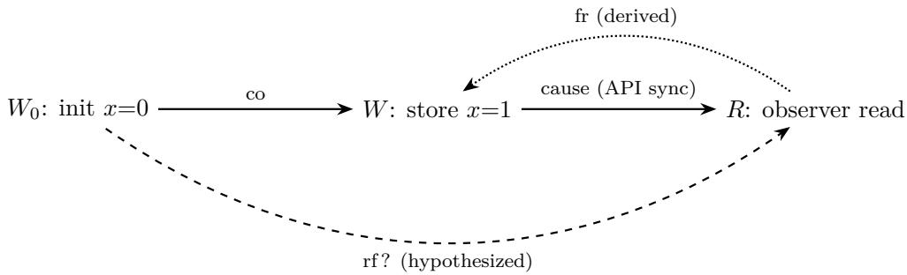

# Formalizing PTX in Lean to Prove GPU Kernel Correctness

Luk Koska Tom Koska Ben Koska

SF Tensor

## Abstract

We present an approach to mathematically formalizing PTX, an approach that allows modeling and reasoning about patterns common in GPU kernels for Deep Learning, including acquire-release, tensor cores, proxies, async operations, multi-kernel pipelines and datadependent control flow. We implement it in Lean and use it to prove the correctness of simple implementations of a WGMMA GEMM kernel, FlashAttention, and a 3-kernel MoE pipeline.

## 1 Introduction

The correctness of GPU kernels is becoming increasingly critical in the age of AI. Furthermore, as more and more kernels are written by LLMs, it is desirable to reduce human review burden, letting them trust outputs without extensive manual review.

A long line of work aims to verify the functional correctness of specific classes of GPU kernels. For example, Volta [11] checks equivalence of GPU kernels, supporting \_\_syncthreads(), \_\_syncwarp() and synchronous tensor-core operations, but requires statically determined control flow and excludes certain aspects of the PTX memory model.

Instead of focusing on specific classes of kernels, we mathematically model the possible executions of a given PTX kernel in Lean, an approach that allows reasoning about many patterns used in modern GPU kernels, including acquire-release synchronization and datadependent control flow. This approach lets LLMs write correctness proofs in a verifiable manner: only the mathematical specification of what the kernel should compute, the preconditions, our formalization and parsing of PTX in Lean and the Lean kernel, but not the LLM’s outputs, need to be trusted. Furthermore, it allows formalizing and checking human intuition for why a given kernel is correct.

## 2 Related Work

The axiomatic PTX memory model was formalized by Lustig et al. [20] and extended with mixed-proxy semantics [19]; our model builds on both. Dartagnan [25] integrates the PTX and Vulkan models into a bounded model checker for GPU code. GPUMC [7] provides stateless model checking of GPU programs under scoped-RC11, detecting races, barrier divergence, and assertion violations.

Several tools verify properties of GPU kernels under the synchronous CUDA/OpenCL programming model: GPUVerify [4] and Faial [9] check race freedom (GPUVerify also barrier divergence); PUG [16], GKLEE [17], and ESBMC-GPU [24] find races and other bugs by SMT solving, concolic execution, and bounded model checking; test amplification [15] generalizes single test runs to classes of inputs; VerCors [5] proves functional properties with permission-based separation logic. Kojima and Igarashi [14] give a Hoare logic for GPU kernels, proving soundness and relative completeness for race-free programs by relating lockstep and interleaving semantics.

Volta [11] checks equivalence of ML GPU kernels and is complete for a well-defined class, but requires statically determined control flow and memory-access structure. Our model aims at generality (asynchronous features, data-dependent control flow, multi-kernel pipelines) at the cost of manual, LLM-assisted proofs in Lean rather than an automated decision procedure. Verified scheduling rewrites for tensor programs have been formalized in Coq [18], but at the level of a high-level language rather than PTX.

LLM-assisted verification of generated CUDA kernels is also pursued by ProofWright [8], which combines VerCors safety checking with Rocq-based semantic-equivalence proofs for a class of elementwise kernels. Browne, Lee, and Salvi [6] use a deterministic translation of a CUDA subset into a sequential Lean representation, Lean/Velvet for equivalence over Float32 with opaque transcendental functions, and VerCors for safety.

## 3 Model

Following Volta [11], we model PTX rather than a higher-level language like CUDA, as most DSLs go through PTX in their lowering to SASS for NVIDIA GPUs.

## 3.1 The PTX memory model

The PTX memory consistency model, formalized by Lustig et al., precisely specifies which values loads may return through a system of ordering relations and axioms. This enables formal reasoning about the possible outcomes of PTX programs, but takes an after-the-fact view: it is built on the set of events that were executed by each thread, without modeling control flow, making it dificult to use directly for proving real kernels correct.

We take this as the basis of our model, and recall its most important aspects here.

Each thread’s memory operations are ordered by program order (po), capturing that thread’s sequential execution. A reads-from pair (W, R) ∈ rf records that read R obtains at least one byte from write W. Each address has a write $W _ { 0 }$ with its initial value. Synchronization between threads is captured by synchronizes-with (sw); for example, each thread’s arrival at a bar.sync barrier synchronizes with every other thread’s return from that barrier in the same generation. Program order and synchronizes-with combine transitively into base causality order. The causality axiom constrains rf: if write W causally precedes read R on the same bytes, R cannot read from any write earlier than W in coherence order co (a partial order on writes to each byte of memory).

To illustrate these relations, consider a CTA with two threads. The predicates p0 and p1 select thread 0 and thread 1 respectively. The global u32 cell x is initially 0:

@p0 st.global.u32 [x], 1; // W: only thread 0 writes   
bar.sync 0; // both threads arrive and wait   
@p1 ld.global.u32 r, [x]; // R: only thread 1 reads

Both threads execute the same unconditional bar.sync. Thread 0’s arrival (A<sub>0</sub>) synchronizes with thread 1’s return $\left( A _ { 1 } \right)$ , giving the chain

$$
W \ { \stackrel { \mathrm { p o } } { \longrightarrow } } \ A _ { 0 } \ { \stackrel { \mathrm { s w } } { \longrightarrow } } \ A _ { 1 } \ { \stackrel { \mathrm { p o } } { \longrightarrow } } \ R .
$$

With no other writes to x, the causality axiom forces W rf R, so r = 1. The full PTX model extends this account with proxy and observation-order rules [20, 19, 22, PTX ISA, §§8.9–8.10, 9.7.15.1].

## 3.2 Modeling Decisions

Soundness. We aim to make this model sound; that is, where NVIDIA’s docs are ambiguous, we interpret the spec conservatively, allowing more rather than less outcomes of the kernel execution. That is, we prefer being unable to prove correctness of some kernels, rather than being able to wrongfully prove the “correctness” of an incorrect kernel.<sup>1</sup>

Modeling floats. We model all floats as real numbers, with exact real-number operations $( \mathrm { e . g . , f m a } ( a , b , c ) = a \cdot b + c , \mathrm { e x } 2 ( x ) = \mathrm { e x p } ( \ln 2 \cdot x ) )$ . This does not allow for reasoning about quantization error or numerical stability, meaning that only semantic, not numerical, correctness can be proven. This choice is motivated by the observation that functional correctness is (a) binary and independent of the use-case, and (b) a precondition for numerical correctness to be meaningful. We leave the question of “will these numerics cause inference accuracy to decrease, or training to diverge?” as future work.

## 3.3 Definition

Consider a PTX kernel P. We parse it into a list of instructions $( s _ { 1 } , \ldots , s _ { n } )$

Each thread t executes this program, one step at a time, afected by other threads only by means of specific communication constructs (loads, barriers, etc.).

To decouple it from other threads, let us give it an oracle o that provides all information it needs from the outside world:

$$
o \colon \mathbb { N }  \mathsf { V a l u e }
$$

That is, whenever a thread performs an event requiring external information (e.g., a load, warp shufle, or matrix-collective result), the oracle provides the information it needs. The i-th such event gets the value o(i).

Given this oracle, the thread t can be given deterministic small-step semantics. A thread’s state is a tuple $( p c , R , k )$ , where pc is the program counter, R is the register file (mapping register names to typed values), and k is the index of the next oracle query. One step is a deterministic function

$$
\mathsf { s t e p } \colon \mathsf { S t a t e } \to \mathsf { S t a t e } \times \mathsf { E v e n t } ^ { * }
$$

mapping the current state to the next state and zero or more emitted events (reads, writes, barrier arrivals, etc.). A single instruction may consume multiple oracle queries; for example, a vector load. Arithmetic on register operands emits no events and makes no oracle queries. Branches read a predicate register and set pc to the target or to $p c + 1 { : }$ predicated instructions are similarly skipped when the predicate is false. Since register values may depend on oracle answers, the path a thread takes, including loop iteration counts, can depend on what values it reads from memory.

Letting reads return arbitrary values and checking consistency afterwards dates back at least to Batty et al. [3].

Now, define a kernel launch as a tuple

$$
K : = ( P , G , I )
$$

whereby P is the program, G is the launch grid (encoding grid, cluster, and block dimensions, launch parameters, and allocation layout), and I is a total map from byte addresses to initial byte values, fixed for the launch. Launch preconditions constrain initialized inputs; other bytes have arbitrary but fixed initial values, as in the ISA’s initialization rule [22, §8.2.6]. Correctness quantifies over every such initial map.

To reason about what the kernel “may do”, we want to define the set of all allowed executions of this program. An execution of K assigns an oracle to every launched thread and runs each thread for some finite number of steps (not necessarily until it exits; executions in which every thread has exited are called complete below) producing a combined set of memory events. An execution is consistent if a bytewise reads-from relation rf (with initialization as a possible source), a per-byte coherence order co, an order sc on fence.sc operations, and the constructspecific matching (barrier generations, mbarrier phases, async completion groups, etc.) can be chosen so that:

• Value agreement. Each read has a unique reads-from source per byte (initialization or a write) and receives its value. The exceptions are tainted reads, which have weaker source and value constraints: a read is tainted if it participates in a uniform-size race (a morally weak conflict unordered by causality) or reads a byte on which two writes race. Furthermore, if the execution contains mixed-size data races [22, §§8.7.1–8.7.2], none of these guarantees apply.

• Memory-model axioms. Under the same no-mixed-size-race condition, the coherence, atomicity, SC-per-location, and causality axioms of the PTX memory consistency model [20, 22] are satisfied.

• Construct rules. Barrier matching, mbarrier phase completion, async-operation completion, and other synchronization constructs satisfy their respective protocol requirements, as explained later in Section 3.5.

We omit the no-thin-air axiom (discussed in Section 5.4) and the Fence-SC axiom [22, §8.10.2]. Fences related by sc still synchronize in that direction [22, §8.9.4]. Omitting these two axioms weakens consistency, admitting more executions.

An execution is complete when every launched thread has exited. Correctness is stated under launch preconditions on launch parameters, layout, alignment, input initialization and nonaliasing. For every launch satisfying the stated preconditions, every consistent, complete execution of our model satisfies the postcondition, and at least one such execution exists. For each verified variant, we also exhibit a concrete launch satisfying its preconditions. We construct an execution for each admissible launch to rule out vacuity (if there are no terminating executions, the statement “all terminating executions satisfy the postcondition” is vacuously true). This existence proof is not needed for the logical validity of the partial-correctness statement; rather, it provides an additional consistency check (a mistake in the modeling constraints could otherwise exclude every complete execution, making the correctness theorem vacuously true). Applying these results to real PTX assumes that the kernel is free of ISA-level undefined behavior and that ptxas and the hardware implement PTX correctly. We do not prove the UB-freedom assumption (Section 5.3).

The model and all proofs are formalized in Lean 4; the memory-model axioms are expressed as definitions and predicates on execution candidates.

## 3.4 Final State of Global Memory

A kernel’s contract specifies the state of global memory after execution completes. Since our model constructs an execution graph rather than advancing a single mutable heap, the final memory needs an explicit definition: what bytes would a synchronized observer read after the kernel has finished?

We answer this by adding observer read events to the execution candidate, whose footprints together cover every allocated global byte. These are logical events representing an observation after synchronized kernel completion. API synchronization [22, §8.9.4] orders every kernel event before these observer reads: the end of all kernel threads synchronizes with the end of the kernel, which synchronizes with the subsequent observation. These synchronizes-with edges also participate in proxy-preserved base causality, providing causality for overlapping bytes.

The observer values are constrained by the same memory-consistency rules as any other read. For a simple example: if a single store writes x = 1 to a cell initialized to 0 and no other write to x exists in the execution, API synchronization places the store before the observer read in causality. The causality axiom then excludes the initial write as the reads-from source, and value agreement delivers x = 1. Figure 1 visualizes why: if the observer were to read from initialization instead, the from-read edge $R { \stackrel { \mathrm { ~ f r } } { \to } } W$ (derived because R would read from a write coherence-before W [22, §8.9.7]) would contradict the causal edge $W \ { \xrightarrow { \mathrm { c a u s e } } } \ R$ , violating the causality axiom [22, §8.10.6].

  
Figure 1: Observer cycle excluding a stale read. Solid edges are fixed by the execution; the dashed edge is the hypothesized stale source. If R reads from initialization $( W _ { 0 } { \stackrel { \mathrm { r f } } { \to } } R )$ , then because $W _ { 0 }$ is coherence-before W, the from-read edge $R \stackrel { \mathrm { ~ f r } } {  } W$ is derived. This contradicts $W \ { \xrightarrow { \mathrm { c a u s e } } } \ R ,$ so the causality axiom excludes $W _ { 0 }$ as a source.

The observer payloads define one output byte map for each candidate execution. Correctness then requires that this map satisfies the postcondition in every admitted execution. This output map also serves as the input for a subsequent kernel launch on the same stream, enabling sequential composition (Section 3.5).

## 3.5 Modeling Aspects of PTX

The base definition handles ordinary loads, stores, arithmetic, and data-dependent control flow: a load gets its value from the oracle and records a read event; a store records a write event with the computed address and value; branches follow the program deterministically given the current register state. These ordinary accesses use the generic proxy and are constrained by the consistency axioms without additional extensions.

Real kernels also use synchronization and communication primitives, each of which adds structure to the model. We explain how each is formalized.

CTA barriers. A CTA barrier (bar.sync) is modeled with separate arrival and return events. Each use of a barrier resource is assigned a natural-number generation identifier, grouping arrivals and returns for that use; the same resource can be reused for later generations. In the full-CTA case, a return in generation g requires that every CTA thread has an arrival in generation g. A thread that has exited is exempt, provided all of its arrivals on that barrier are in generations earlier than g. Each arrival in generation g synchronizes with each return in the same generation, adding an (arrival, return) pair to the sw relation. This mechanism is used in the introductory example, where a write before the arrival becomes causally visible to a read after the return [22, §§9.7.15.1, 8.9.4].

Proxies. A proxy describes the method of accessing memory [22, §§8.5–8.6]. In the model, every memory event carries a proxy tag. Ordinary loads and stores use the generic proxy; asynchronous bulk copies use the async proxy; TMA descriptor reads use tensormap. Two accesses to the same bytes through diferent proxies are not ordered by an ordinary base-causality path alone [19]. To establish ordering across proxies, the model requires a proxy fence [22, §9.7.15.4]: an explicit fence event whose direction and byte range match the endpoints, positioned on the base-causality path between them. Certain instruction-specific completion rules also supply the needed cross-proxy visibility [22, §§9.7.10.28.2, 9.7.17.4]; for example, a successful acquiring mbarrier wait that observes a TMA copy’s completion can make its async-proxy data writes visible to a later generic-proxy read [22, §§9.7.10.28.2, 9.7.15.16.19].

Asynchronous copies. PTX asynchronous copy instructions (cp.async, cp.async.bulk) execute their data transfers outside the issuing thread’s program order [22, §8.9.1.1]. We model this by giving each issued copy a distinct logical identity: its source reads and destination writes are events in the same execution candidate as ordinary thread events, but they are not ordered by the issuer’s po. The issuing thread’s issue event is recorded as an ordinary event of that thread. The copy is ordered after the issuer’s earlier instructions, and its writes are guaranteed visible only to events causally after a wait that completes it, e.g., cp.async.wait\_group [22, §§8.9.1.1, 9.7.10.28.1].

WGMMA. The register results of a warp-group matrix multiply-accumulate [22, §§9.7.17.5, 9.7.17.7] are oracle values. The model constrains them to the matrix product plus accumulator only when the operation is synchronized as the ISA requires; with insuficient synchronization the results remain unconstrained, so a proof cannot rely on them.

Warp shufles. A warp shufle (shfl.sync [22, §9.7.10.6]) lets lanes within a warp exchange register values. Each shufle event records the lane’s input value and receives an oracle result. Shufle instances across participating lanes are grouped into a matched set by a natural-number generation, analogous to barrier generations. Within a matched group, each lane’s oracle output is constrained to equal the appropriate partner lane’s recorded input, as determined by the shufle mode.

Cluster Launch Control. Our model requires that all launched threads must exit. A successful cancellation atomically removes a not-yet-running cluster, whose threads have empty histories and thus never reach an exit. We handle this by exempting canceled threads from the exit requirement. Distinct successful cancellation operations in the same grid cannot identify the same canceled cluster [22, §9.7.15.18]. This extension has not been formalized in Lean.

Multi-kernel pipelines. One step of model inference or training generally consists of several kernel launches. We want to be able to prove the end-to-end correctness of such a full step. To this end, we formally model the result of launching several kernels sequentially on the same CUDA stream. API synchronization orders the completion of one kernel before the start of the next [22, §8.9.4]. At completion, the kernel’s writes are flushed [21, §4.15.1], and the driver invalidates global L1 cache lines between dependent grids so that the second kernel correctly fetches the first kernel’s stores [22, §9.7.10.1]. We model this boundary by equating the successor kernel’s initial global byte map with the predecessor’s output map (with the exception of the tensormap proxy [22, §8.9.4]).

## 4 Applications

To illustrate the expressiveness and usability of the model, we have used it to prove the correctness of several GPU kernels, as outlined below. For every admissible launch of each variant, we prove that all consistent, complete executions of our model produce the specified output, and separately construct such an execution to establish non-vacuity.

The considered PTX code is hand-written rather than real compiler output (which commonly contains inlining and arithmetic optimizations, making proofs more dificult). All kernels were tested for correctness against a reference on an H100 and B200 (except for the WGMMA kernel, which was only tested on the H100).

• Elementwise. An afine map $y _ { i } = \alpha x _ { i } + \beta$ in f32 over a vector of length N. A 1-D grid assigns one thread per element; out-of-range threads exit. (18 instructions; 1,077 proof lines.)

• Scalar matmul. $C = A B$ with $A \in \mathbb { R } ^ { M \times K } , B \in \mathbb { R } ^ { K \times N }$ , all f32 row-major. A 2-D grid of 2-D CTAs assigns one thread per output element; each thread loops an fma over $k < K$ $( K = 0$ is allowed and gives zero). The proof uses an accumulation invariant over the inner-dimension loop. (42 instructions; 1,923 proof lines.)

• Ampere tiled matmul. f16 inputs (A row-major $M \times K$ , B column-major $K \times N )$ , f32 output. One warp computes one 16 × 8 output tile, looping over K in steps of 16: cp.async copies the current A and B tiles into shared memory, cp.async.wait\_group and bar.sync publish them, and mma.sync.aligned.m16n8k16 accumulates; the same shared-memory bufers are reused in every iteration. Requires $1 6 \mid M , 8 \mid N , 1 6 \mid K$ . (94 instructions; 5,418 proof lines.)

• Hopper matmul. $C = A B$ with f16 inputs, f32 output, $K = 1 6 T , T \geq 2$ . One warpgroup computes one 64 × 8 output tile, looping over the T slices through a two-stage shared-memory pipeline whose bufers are refilled by TMA (cp.async.bulk.tensor.2d), tracked by mbarriers. At each step every thread issues one wgmma.mma\_async.m64n8k16 that accumulates into the same registers. Successful acquiring mbarrier waits ensure that the TMA copies have completed before WGMMA reads their operands. wgmma.fence orders prior accumulator-register accesses before WGMMA, while wgmma.commit\_group and wgmma.wait\_group 0 ensure completion before the accumulated results are read. (98 instructions; 16,973 proof lines.)

• FlashAttention [10]. Computes $O \ = \ \mathrm { s o f t m a x } ( \alpha Q K ^ { \top } ) V$ in exact real arithmetic, $Q \in \mathbb { R } ^ { M \times D } , K , V \in \bar { \mathbb { R } } ^ { N \times D }$ . The scalar kernel assigns one thread per output element (67 instructions; 2,045 proof lines). The proof uses the online softmax invariant.

• Mixture of Experts. An MoE layer with 2 experts and top-1 selection gets N input tokens, handling routing, expert computation (simple linear layers) and combine. (120 instructions across the three launches; 5,722 proof lines.)

• Simple megakernel. Two CTAs use atomic adds to a global work counter (as is commonly used in megakernels to distribute work) and data-dependent control flow to execute the job received by each thread. We describe our proof of this kernel’s correctness below. (15 instructions; 876 proof lines.)

## 4.1 Proof sizes and checking

In total, the kernels described above comprise 9 PTX entry points and 454 instructions, verified by 34,034 lines of proof<sup>2</sup>. In contrast, our model of Section 3 is made up of 2,629 lines of definitions.

Checking. All proofs are checked by Lean 4 (v4.35.0) with Mathlib. The development contains no sorry and no axiom declarations (the memory-model axioms are ordinary definitions), and every theorem is verified by #print axioms to use only Lean’s three standard axioms. Every variant has both a universal correctness theorem and a constructive non-vacuity theorem, instantiated at a concrete launch.

## 4.2 Correctness proof of a simple megakernel

We illustrate a simple application of the model by summarizing a correctness proof of a simplified megakernel.

The kernel launches two CTAs of one thread each. Three disjoint global u32 cells are given: a counter initialized to 0 and outputs x, y. With %rd0, %rd1, %rd2 holding their respective addresses, each thread executes:

```asm
atom.global.relaxed.gpu.add.u32 %r0, [%rd0], 1;
setp.eq.u32 %p0, %r0, 0;
@%p0 bra ITEM_A;
setp.eq.u32 %p1, %r0, 1;
@%p1 bra ITEM_B;
bra DONE;
ITEM_A:
mov.u32 %r1, 1;
st.global.u32 [%rd1], %r1;
bra DONE;
ITEM_B:
mov.u32 %r2, 2;
st.global.u32 [%rd2], %r2;
DONE:
ret;
```

We prove that every consistent, complete execution of our model yields (x, y, counter) = (1, 2, 2).

Ticket uniqueness. In our oracle model, the atomic return values begin unconstrained. In a complete execution both threads have reached their exit, so each has performed exactly one increment; these are the counter’s only modifications. All kernel accesses cover one of the three disjoint u32 cells; together with the API-synchronized observer, this rules out mixed-size races and makes the memory-model axioms applicable. The GPU-scoped relaxed increments are mutually morally strong, so their counter reads are untainted. Coherence orders the two counter writes. SC-per-location excludes reading an increment’s own write or a later write in that order. RMW atomicity prevents skipping an earlier modification: the first increment in coherence order therefore reads initialization on every byte, and the second reads the first increment’s write. Value agreement gives returns 0 and 1 and writes 1 and 2 [22, §§8.7–8.7.2, 8.9.6, 8.10.3, 8.10.5]. The returned tickets are {0, 1} in some order; no CTA is assigned a predetermined job, and no inter-CTA causality between the relaxed atomics is required.

Deterministic dispatch. Since the tickets are {0, 1}, exactly one thread enters each branch. The thread receiving 0 stores x = 1; the thread receiving 1 stores y = 2. Each output cell therefore has exactly one writer, and the two output writes are to disjoint cells.

Final observation. After kernel completion, a synchronized observer reads every allocated global byte. API synchronization orders each kernel write before the observer’s corresponding read. For the bytes of these three cells, the causality axiom excludes initialization and earlier modifications as stale sources, and value agreement delivers the coherence-latest write [22, §§8.9.4, 8.10.6]. For x and y, the unique kernel write to each cell is coherence-latest; for the counter, the coherence-last increment wrote 2. No causal order between the two counter writers is required. The observer therefore sees (x, y, counter) = (1, 2, 2).

## 5 Limitations and Future Work

## 5.1 Instruction coverage and larger kernels

The interpreter implements 81 instruction forms (66 scalar, control-flow, and memory instructions;

5 Ampere tensor-core and async-copy forms; 10 Hopper forms), each with fixed qualifier combinations, primarily those needed by the kernels of Section 4. Using the model for a wide variety of production kernels will require broader coverage, including formalization of tcgen05 for Blackwell-era kernels and cluster-level features such as distributed shared memory.

Furthermore, the model encodes floating-point values symbolically as fragments of a real number rather than as IEEE bits. Bit-level reinterpretation of floats is therefore outside the model (integer manipulation of exponent and mantissa bits for fast exponential approximations, packing formats by shifting bits, and round trips like ld.f32 followed by st.b32).

The kernels we reasoned about were hand-written to keep them simple; optimized compiler outputs commonly contain inlining and non-obvious arithmetic optimizations (e.g., eliminating integer divisions), which may complicate proofs. More fundamentally, the proofs average about 75 lines of proof per PTX instruction (34,034 proof lines for 454 instructions; the pipelined Hopper kernel alone accounts for about 17,000 lines). Verifying substantially larger kernels will likely need more proof automation and reusable invariants.

## 5.2 Proof of Termination

Certain synchronization constructs, like polling a flag for acquire-release patterns, are represented as unbounded loops in PTX. For example, an acquire-release handshake may compile to a loop that repeatedly loads a flag until a release store from another thread becomes visible. Our model admits arbitrary finite loop lengths but does not prove that such loops terminate.

Alternatively, one could manually pattern-match such constructs, replacing them with a special “wait until this event occurs” instruction whose progress guarantees would need to be justified.

Our results are therefore partial-correctness guarantees: they rule out wrong answers on completed runs but do not prove termination. In practice, runtime timeouts and checkpointbased restarts can support automatic detection and recovery from kernel hangs, at the cost of restart overhead and repeating work since the last checkpoint. A silent functional-correctness bug, by contrast, can propagate undetected through an entire training run, with far greater economic impact.

## 5.3 Handling Undefined Behavior

Applying our model-level correctness results to real PTX assumes that the kernel is free of ISA-level undefined behavior under its launch preconditions, and that ptxas and the hardware implement PTX correctly. We do not establish that external UB-freedom assumption. Developing techniques for proving that a kernel cannot encounter UB is an interesting direction for future work, but it is not straightforward. We do not have a precise characterization of which UB-based ptxas transformations are permitted.

## Why proving UB-freedom is hard

The dificulty is that whether a thread reaches an undefined operation can depend on values it reads from memory, which in turn depend on what other threads have written, and those writes may themselves be reordered by the compiler. A simple attempt at a criterion and two complications illustrate the problem.

Checking prefixes. A natural approach is to check whether any consistent partial execution reaches an undefined operation. Consider two threads with global u32 locations $x = y = 0$ , using .relaxed.gpu loads and stores so that overlapping accesses are morally strong:

T0 (Thread 0) T1 (Thread 1)   
r1 = load x r2 = load y   
if r1 == 1: UB store x, r2   
store y, 1

Here UB could, for example, be a misaligned u32 access to a separate allocation [22, §6.4.1]. Stopping T0 just before that misaligned operation removes its store to y. T1 can then read only $y = 0$ , so it cannot supply $x = 1$ . No consistent partial execution of this form reaches UB.

If, however, the compiler moves T0’s constant store to y before its load of x, the following can happen: T0 can write $y = 1$ , T1 can read it and write $x = 1$ , and T0 can then read $x = 1$ and encounter UB. This schedule is not precluded by the No-Thin-Air axiom.

The issue here is that, because the compiler can reorder operations (subject to the memory model’s constraints), instructions coming after the first UB in PTX program order might actually be executed earlier by the hardware, requiring that one take the impact of later operations into account when reasoning about UB. Furthermore, one needs constraints for what can’t execute before the UB; if the instruction after UB is impacted by it, but could also be “reordered” to execute before it, the UB might “justify itself”.

## 5.4 No Thin Air

The formal PTX memory model [20] states the no-thin-air axiom as

$$
\operatorname { a c y c l i c } ( \operatorname { r f } \cup \operatorname { d e p } ) ,
$$

where dep is a dependency relation. Here, dep denotes semantic rather than syntactic dependencies, to allow the compiler to perform optimizations that break dependency chains [22, §8.10.4]:

the implementation may perform any chain of reasoning to determine that a store is not dependent on a prior load, and thus break self-fulfilling cycles which would otherwise apparently be forbidden by the No-Thin-Air axiom.

A syntactic register-use chain is not suficient. Consider:

ld r1, [x]

mul r2, r1, 0

st [y], r2

Although r2 syntactically depends on r1, the store’s value is semantically independent of the load: the integer multiply-by-zero always produces zero regardless of the loaded value.

Using the no-thin-air (NTA) axiom soundly would therefore require proving that a semantic dependency exists, not merely that a syntactic register chain connects two instructions. We thus leave NTA out of our formalization. This expands the set of allowed executions, so the universal output proof must cover at least as many executions. Our kernel proofs instead use coherence, atomicity, and synchronization to constrain read values.

No-thin-air has been an active area of research in the C++ memory model [3, 2, 13], and the new Tile IR memory model [23, §8.9] explicitly forgoes a formal no-thin-air axiom, retaining only an informal assurance that the implementation will not provide values out of thin air.

## 5.5 Modeling SASS

One route around the PTX compiler and the ambiguity around the dep relation is to model a fixed SASS binary instead of PTX. Compiler transformations are already reflected in its instruction stream. The hardware issues SASS instructions in order and does not perform branch prediction or speculative execution [21, §3.2.2], although memory accesses may still complete or become visible out of order. This gives the following directions:

No-Thin-Air. In PTX, the No-Thin-Air axiom relies on semantic dependencies, making it dificult to use as described in Section 5.4. In SASS, with the possibility of the compiler breaking dependencies through optimizations eliminated, this rule could be reduced to considering syntactic dependencies.

Proving freedom of UB. If a SASS execution encounters UB, consider the prefix ending just before its first occurrence. That prefix is UB-free, so we can analyze it using the normal execution rules. The approach is to show that no such prefix can take a step that causes UB. These partial executions include any memory or asynchronous operations still in flight.

We note that SASS, at the time of writing, is not fully documented by NVIDIA [1].

## 5.6 Concurrent, Multi-GPU, and Multi-Node Kernels

The model supports sequential kernel launches on one GPU. It does not yet cover concurrent modification of memory by the host, concurrently executing kernels, or other GPUs in the case of multi-GPU kernels, which are common for collectives and expert parallelism. Extending to multi-node communication would require modeling the transport layer’s ordering and completion rules together with their interaction with GPU memory visibility.

## 5.7 Non-Coherent Loads

PTX’s memory consistency model excludes texture accesses, including ld.global.nc [22, §8.1]. These loads use a non-coherent read-only cache [22, §9.7.10.9]. Extending the model to them requires a separate account of their visibility guarantees and read-only requirements; this is future work.

## 5.8 Integration with TorchLean

TorchLean [12] can import captured PyTorch computation graphs into Lean and give them a formal semantics; using these as the specification of what a kernel should compute could alleviate the need for humans to review a hand-written Lean specification.

## Outlook

We have successfully used the presented model to reason about many common patterns in modern kernels (async tensor core ops, multi-kernel pipelines, dynamic work distribution via atomics and data-dependent control flow). A model of SASS, or a more rigorous definition of undefined behavior at PTX level, could make undefined behavior far more tractable to treat.

We believe in a future where the entire software stack of frontier training runs is formally proven to be correct, supported by the increasing eficiency and capability of LLMs in constructing Lean proofs, along with a library of useful lemmas to reduce the per-kernel proof efort toward the novel ideas it contains.

## AI Usage Statement

Codex and OpenCode with GPT 6 Astra, Gemini 4 Argon, Opus 5.5 and Fable 5.1 assisted in implementation of the Lean model and the kernel correctness proofs. The model, PTX kernels and the specification of what they compute were carefully reviewed by us; the proofs contained no custom axioms or sorrys and were checked by the Lean kernel.

Parts of the paper were written by Opus 4.6. All generated content was carefully reviewed by us.

## References

[1] Cesar Avalos Baddouh, Mathias Payer, and Timothy G. Rogers. EoSS: Exploring SASS—a systematic framework to explore NVIDIA’s ISA. In Proceedings of the 32nd ACM International Conference on

Architectural Support for Programming Languages and Operating Systems, Volume 1 (ASPLOS), 2027. To appear. Author manuscript: https://hexhive.epfl.ch/publications/files/27ASPLOS.pdf.

[2] Mark Batty, Kayvan Memarian, Kyndylan Nienhuis, Jean Pichon-Pharabod, and Peter Sewell. The problem of programming language concurrency semantics. In Proceedings of the European Symposium on Programming (ESOP), 2015.

[3] Mark Batty, Scott Owens, Susmit Sarkar, Peter Sewell, and Tjark Weber. Mathematizing C++ concurrency. In Proceedings of the 38th ACM SIGPLAN-SIGACT Symposium on Principles of Programming Languages (POPL), 2011.

[4] Adam Betts, Nathan Chong, Alastair F. Donaldson, Shaz Qadeer, and Paul Thomson. GPUVerify: A verifier for GPU kernels. In Proceedings of the ACM International Conference on Object Oriented Programming Systems Languages and Applications (OOPSLA), 2012.

[5] Stefan Blom, Marieke Huisman, and Matej Mihelčić. Specification and verification of GPGPU programs. Science of Computer Programming, 95, 2014.

[6] Archibald Browne, Eugene Lee, and Cristopher Salvi. Proving LLM-generated GPU kernels correct and safe: Floating-point verification in Lean and VerCors. arXiv:2610.24548, 2026.

[7] Soham Chakraborty, S. Krishna, Andreas Pavlogiannis, and Omkar Tuppe. GPUMC: A stateless model checker for GPU weak memory concurrency. In Computer Aided Verification (CAV), Lecture Notes in Computer Science, pages 321–346, 2025.

[8] Bodhisatwa Chatterjee, Drew Zagieboylo, Sana Damani, Siva Hari, and Christos Kozyrakis. ProofWright: Towards agentic formal verification of CUDA. arXiv:2511.12294, 2025. Version 2, 2026-03-18. https: //arxiv.org/abs/2511.12294v2.

[9] Tiago Cogumbreiro, Julien Lange, Dennis Liew Zhen Rong, and Hannah Zicarelli. Checking data-race freedom of GPU kernels, compositionally. In Computer Aided Verification (CAV), Lecture Notes in Computer Science, 2021.

[10] Tri Dao, Daniel Y. Fu, Stefano Ermon, Atri Rudra, and Christopher Ré. FlashAttention: Fast and memory-eficient exact attention with IO-awareness. In Advances in Neural Information Processing Systems (NeurIPS), 2022.

[11] Benjamin Driscoll, Kshitij Dubey, Anjiang Wei, Neeraj Kayal, Rahul Sharma, and Alex Aiken. Equivalence checking of ML GPU kernels. Proceedings of the ACM on Programming Languages, 10(OOPSLA2):652–680, 2026.

[12] Robert Joseph George, Jennifer Cruden, Will Adkisson, Xiangru Zhong, Huan Zhang, and Anima Anandkumar. TorchLean: Formalizing neural networks in Lean. arXiv:2602.22631, 2026.

[13] Jeehoon Kang, Chung-Kil Hur, Ori Lahav, Viktor Vafeiadis, and Derek Dreyer. A promising semantics for relaxed-memory concurrency. In Proceedings of the 44th ACM SIGPLAN Symposium on Principles of Programming Languages (POPL), 2017.

[14] Kensuke Kojima and Atsushi Igarashi. A Hoare logic for GPU kernels. ACM Transactions on Computational Logic, 18(1):3:1–3:43, 2017.

[15] Alan Leung, Manish Gupta, Yuvraj Agarwal, Rajesh Gupta, Ranjit Jhala, and Sorin Lerner. Verifying GPU kernels by test amplification. In Proceedings of the 33rd ACM SIGPLAN Conference on Programming Language Design and Implementation (PLDI), 2012.

[16] Guodong Li and Ganesh Gopalakrishnan. Scalable SMT-based verification of GPU kernel functions. In Proceedings of the 18th ACM SIGSOFT International Symposium on Foundations of Software Engineering (FSE), 2010.

[17] Guodong Li, Peng Li, Geof Sawaya, Ganesh Gopalakrishnan, Indradeep Ghosh, and Sreeranga P. Rajan. GKLEE: Concolic verification and test generation for GPUs. In Proceedings of the 17th ACM SIGPLAN Symposium on Principles and Practice of Parallel Programming (PPoPP), 2012.

[18] Amanda Liu, Gilbert Louis Bernstein, Adam Chlipala, and Jonathan Ragan-Kelley. Verified tensor-program optimization via high-level scheduling rewrites. Proceedings of the ACM on Programming Languages, 6(POPL), 2022.

[19] Daniel Lustig, Simon Cooksey, and Olivier Giroux. Mixed-proxy extensions for the NVIDIA PTX memory consistency model: Industrial product. In Proceedings of the 49th Annual International Symposium on Computer Architecture (ISCA), pages 1058–1070, 2022.

[20] Daniel Lustig, Sameer Sahasrabuddhe, and Olivier Giroux. A formal analysis of the NVIDIA PTX memory consistency model. In Proceedings of the 24th International Conference on Architectural Support for Programming Languages and Operating Systems (ASPLOS), 2019.

[21] NVIDIA. CUDA Programming Guide, 13.4.2 edition, 2026. https://docs.nvidia.com/cuda/cudaprogramming-guide/. Updated 2026-09-10; accessed 2026-10-31.

[22] NVIDIA. PTX ISA, 9.4 edition, 2026. https://docs.nvidia.com/cuda/parallel-thread-execution/. Updated 2026-10-12; accessed 2026-10-31.

[23] NVIDIA. Tile IR Memory Model, 13.4 edition, 2026. https://docs.nvidia.com/cuda/tile-ir/13.4/ sections/memory\_model.html. Specification release 2026-10-26; accessed 2026-10-31.

[24] Phillipe Pereira, Higo Albuquerque, Hendrio Marques, Isabela Silva, Celso Carvalho, Lucas Cordeiro, Vanessa Santos, and Ricardo Ferreira. Verifying CUDA programs using SMT-based context-bounded model checking. In Proceedings of the 31st Annual ACM Symposium on Applied Computing (SAC), 2016.

[25] Haining Tong, Natalia Gavrilenko, Hernán Ponce de León, and Keijo Heljanko. Towards unified analysis of GPU consistency. In Proceedings of the 29th ACM International Conference on Architectural Support for Programming Languages and Operating Systems, Volume 4 (ASPLOS), pages 329–344, 2024.