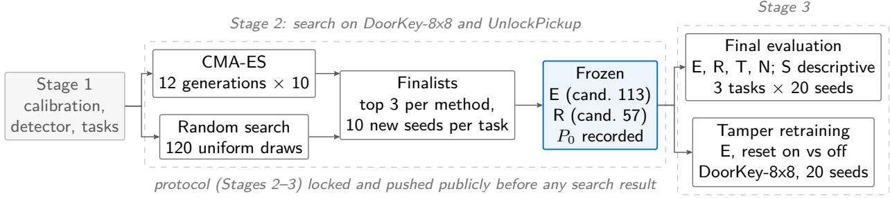
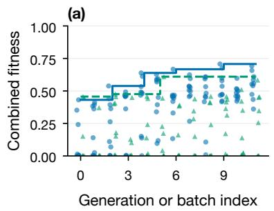
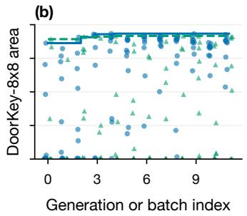
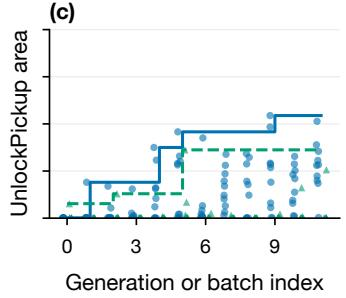
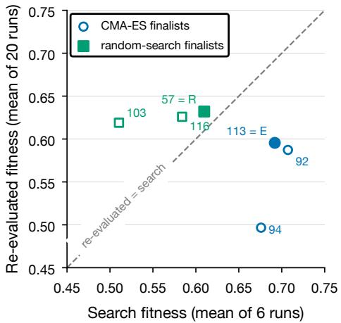
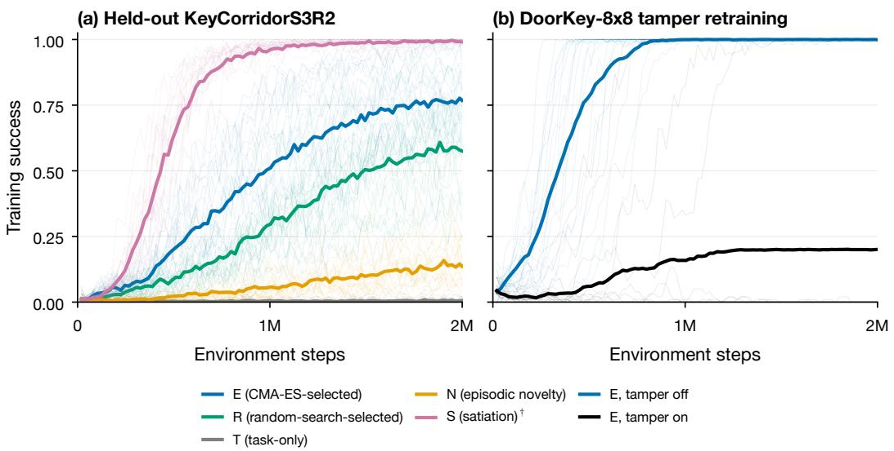
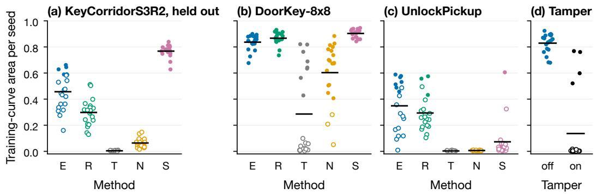
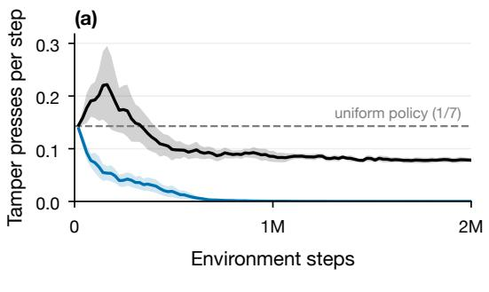
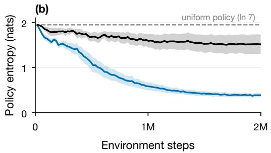
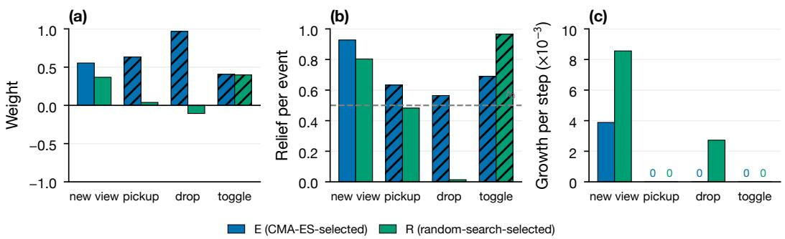

# Found by Search, Broken by a Shortcut: Transfer and Tampering of Searched Intrinsic Rewards

Chase J. Metoyer Northeastern University Boston, MA metoyer.c@northeastern.edu<sup>∗</sup>

## Abstract

Can a search over innate drives find intrinsic rewards that help a reinforcement-learning agent learn, transfer to a task it never saw, and resist an exploit that was absent during the search? Each candidate reward combines four generic events (a new view, a pickup, a drop and a toggle), each with a weight, a relief and a refill rate. We ran three pre-registered stages; the search protocol was locked in a public, timestamped commit before any search result existed. CMA-ES and an equal-budget random search used 1,560 PPO training runs, and the final evaluation and tamper test used 340. On the held-out task, KeyCorridorS3R2, the CMA-ES-selected reward (E) beat task-only PPO, episodic novelty and the random-search-selected reward (R) in all 3 registered comparisons, all of them meaningful by the registered size rule. Among these generic rewards E transferred best; the earlier paper’s satiation reward, which on this task is given hand-wired key and locked-door events, did better (20 of 20 seeds solved against 4 of 20; descriptive). On UnlockPickup, where that reward uses generic events, E’s mean area exceeded it by 0.276 (descriptive). On the training tasks there was no registered diference between E and R: both E-over-R tests missed. A free reset action, absent during the search, collapsed E’s learning on DoorKey-8x8 (mean area 0.829 without it, 0.136 with it; registered) to below task-only PPO (descriptive). The searched drives helped on every task tested, but a reward given task-specific events did better on the held-out task, and selection gave E no protection against an exploit absent from the search.

Keywords: reinforcement learning, intrinsic motivation, reward search, homeostatic reinforcement learning, transfer, reward tampering, pre-registration

## 1 Introduction

In our earlier paper [15], PPO agents given a bounded, hand-designed homeostatic satiation reward and a cheap action that reset their needs learned to press it and stopped solving the task, although solving was optimal under that reward. That reward was designed by hand. The optimal-reward view suggests another route: treat the reward as the outcome of a search over reward functions for whatever best serves the designer’s goal [21]. This paper asks whether such a search avoids the failure, and what a searched reward does on a task it was not selected on.

We search over innate drives. A candidate reward has four needs, tied to four generic events of the MiniGrid interface [7]: seeing a new view, picking an object up, dropping it, and toggling a door or box. Each need has a weight, a relief and a refill rate, and the reward is the signed reduction of a weighted quadratic drive, the form the earlier paper used. We ask three questions.

• Help. Do searched rewards help PPO [20] learn the tasks they were selected on?

• Transfer. Do they help on a task that was never used during the search?

• Resistance. Does a searched reward resist an exploit that was absent during the search?

We answered them in three pre-registered stages (Figure 1). Stage 1 calibrated tasks and fixed a corrected event detector. Stage 2 ran CMA-ES [10] and an equal-budget random search over the twelve drive parameters and selected one reward from each. Stage 3 compared the CMA-ES-selected reward (E) and the random-search-selected reward (R) with task-only PPO (T) and episodic novelty (N) on two training tasks and one held-out task, retrained E with a free reset action, and ran the earlier paper’s satiation reward (S) as a descriptive reference. Comparisons of E and R compare two selected genomes; one draw from each search method cannot rank the methods.

Our contributions, each with its evidence level:

• Transfer to one held-out task, bounded by a hand-wired reference (Section 4.3). On KeyCorridorS3R2, E beat T, N and R in all 3 registered comparisons, each meaningful by the registered size rule (registered). S, whose KeyCorridor events are hand-wired (key pickups only, and only the opening of the initially locked door) and whose door need refills, solved 20/20 seeds against E’s 4/20; on UnlockPickup, where S uses generic events, E’s mean area was higher (pre-specified descriptive).

• No registered diference between the selected rewards on the training tasks (Sections 4.2 and 4.4). Both E-over-R tests missed (registered). Every CMA-ES finalist fell on re-evaluation and every random-search finalist rose (exploratory/post hoc).

• No protection against an exploit absent during selection (Section 4.5). A free reset action collapsed E’s learning (registered), to below task-only PPO (pre-specified descriptive).

• What the selected rewards encode (Section 4.6). E pays the first pickup, drop and toggle of each episode and refills only its view need (a record of the frozen genome). Across all searched candidates, positive weights on pickup and toggle were associated with higher fitness across all candidates and among random-search candidates alone; the drop association reverses among random-search candidates (exploratory/post hoc).

• A public pre-registration lock (Section 3.7, Appendix B). The earlier paper’s lock times were self-reported. Here the Stage 2 protocol, which also registered every Stage 3 test, was committed and pushed to a public repository before any search result existed (pushed 28 October 2026, 14:29:28 UTC).

• Every registered test and rule is reported, including misses (Section 5, Appendix A).

Results carry one of three labels. registered marks confirmatory tests and hit rules fixed in the locked protocol. pre-specified descriptive marks descriptive quantities named in the locked protocol or in amendments committed before the data existed. exploratory/post hoc marks everything else. We also label arithmetic references (derived reference) and untested explanations (post hoc hypothesis). Event definitions difer from the earlier paper’s archived detector, so comparisons with the earlier paper are qualitative only.

## 2 Background and related work

Optimal, searched and learned rewards. Singh et al. [21] define an optimal-reward framework in which primary reward functions are selected for evolutionary success across environments, and conclude that intrinsic and extrinsic reward difer along a continuum rather than in kind. Niekum et al. [16] search reward functions with genetic programming and name distributions of environments, nonstationary environments and short agent lifetimes as settings where reward search should help. Sorg et al. [23] solve the optimal-reward problem online by gradient ascent for agents with limitations. Zheng et al. [25] learn intrinsic-reward parameters for policy-gradient agents by gradient ascent on the extrinsic return, and Xu et al. [24] adapt return parameters such as the discount online with meta-gradients. Several studies test generalization directly. Zheng et al. [26] learn intrinsic rewards over many lifetimes and report that the learned rewards generalize to other kinds of agents and to changes in the environment’s dynamics. Alet et al. [1] meta-learn curiosity algorithms as programs and report two that perform on par with or better than published curiosity algorithms in disparate domains. Oh et al. [17] discover an update rule on toy environments that generalizes to Atari games, and Oh et al. [18] discover, from a population of agents across many environments, a rule that surpasses existing rules on Atari and outperforms several algorithms on benchmarks not seen during discovery.

Language-model reward design (contrast). Ma et al. [14] use large language models to write reward code and improve it by evolutionary search, and report rewards that outperform expert-written ones on most of their tasks. Our search space is diferent in kind: twelve numbers in a fixed homeostatic form, with no language model.

Intrinsic motivation and homeostasis. Exploration bonuses include pseudo-counts [3], prediction error at scale [5], random network distillation [6] and impact-driven bonuses evaluated in procedurally generated MiniGrid tasks [19]. Burda et al. [5] also gave a curiosity agent a television whose channel it could change; the television drastically slowed learning, although agents sometimes still converged to the extrinsic reward. Keramati and Gutkin [13] define primary reward as the fulfilment of physiological needs and prove that seeking such reward is equivalent to seeking physiological stability. Our predecessor study tested a bounded satiation reward of this kind and found it wireheaded through a reset action [15].

Reward hacking and tampering. Amodei et al. [2] list avoiding reward hacking among concrete accident-risk problems, and Skalse et al. [22] give a formal definition of reward hacking. Everitt et al. [8] study when an agent has an instrumental goal to tamper with its reward process and give design principles against reward-function tampering and against tampering with the reward function’s input. Our reset action changes the need state the reward reads, so in their terms it is input tampering, as in the earlier paper.

Random search and CMA-ES. Bergstra and Bengio [4] show that random trials are more eficient than a grid when only a few hyperparameters matter, and propose random search as the natural baseline for adaptive methods. CMA-ES adapts a full covariance matrix of a Gaussian search distribution [9, 10]; we use the pycma implementation [11].

How this paper difers. The generalization studies above learn reward networks, programs or update rules and test them on new agents, dynamics or benchmarks. We search a small, interpretable space of drives, compare the CMA-ES-selected reward with an equal-budget random-search selection, test transfer to one held-out task and then test the same reward against an exploit absent from its selection environment. We are not aware of a prior study that pairs a held-out transfer test and a tamper test of the same searched reward under a public pre-registration.

## 3 Setup

## 3.1 The reward

A candidate reward has needs $h = ( h _ { \mathrm { v i e w } } , h _ { \mathrm { p i c k u p } } , h _ { \mathrm { d r o p } } , h _ { \mathrm { t o g g l e } } ) \in [ 0 , 1 ] ^ { 4 }$ , each starting at $h _ { 0 } = 0 . 5$ in every episode. At each step the needs grow by the refill rates g and are relieved by the events $e _ { t } \in \{ 0 , 1 \} ^ { 4 }$ in proportion to the reliefs s, with a single clip, and the reward is the drop in a signed, weighted quadratic drive:

$$
h _ { t + 1 } = \mathrm { c l i p } ( h _ { t } + g - s \odot e _ { t } , 0 , 1 ) , \qquad V ( h ) = \sum _ { k } w _ { k } h _ { k } ^ { 2 } , \qquad r _ { t } ^ { \mathrm { i n t } } = V ( h _ { t } ) - V ( h _ { t + 1 } ) .\tag{1}
$$

PPO trains on the task reward plus $1 . 0 \times r _ { t } ^ { \mathrm { i n t } }$ . Weights $w _ { k }$ lie in [−1, 1], reliefs in [0, 1], and each refill rate is either zero or in $[ 1 / 6 4 0 , 1 / 2 0 ]$ per step. Summed over an episode the reward telescopes (Stage 1 derivation, re-derived in Appendix F): for any policy and any $\gamma \in ( 0 , 1 ]$ , the intrinsic return lies between $\begin{array} { r } { V ( h _ { 0 } ) - \sum _ { k } } \end{array}$ max $( w _ { k } , 0 )$ and $\begin{array} { r } { V ( h _ { 0 } ) - \sum _ { k } \operatorname* { m i n } ( w _ { k } , 0 ) } \end{array}$ . When every weight is positive, as in E, the upper bound is $V ( h _ { 0 } )$ , the drive at the start. This is also the payof of a reset at the first step, $\begin{array} { r } { P _ { 0 } = \sum _ { k } w _ { k } h _ { 0 } ^ { 2 } } \end{array}$ , which the tamper prediction used.

## 3.2 Events and the corrected detector

The four events are generic. A new view is a $7 \times 7$ egocentric observation not yet seen in the episode; a pickup is any change from carrying nothing to carrying an object; a drop is an executed drop; a toggle is any door changing its open or locked state, including closing and reopening, or a box being opened. Stage 1 fixed four detector choices: events on an episode’s final step count; box openings count as toggles; a pickup that itself completes the task is excluded from the paid pickup event; and the detector attaches only after the initial reset. The earlier paper’s archived detector difered in ways documented by an audit of its code committed with the Stage 1 materials: it skipped pickup and door events on an episode’s final step, its door cache was empty during each parallel environment’s first training episode, it did not detect box openings, and it had no drop event. Its event counts and ours are therefore not interchangeable.

## 3.3 Learner and tasks

The learner is the earlier paper’s PPO [20], in the single-file style of CleanRL [12], with the earlier paper’s settings (Appendix F): 16 parallel environments, per-minibatch advantage normalization, and nominal 2M environment steps per run (1,998,848 actual steps, in whole rollouts). Tasks are MiniGrid environments [7]. Stage 1 applied a fixed selection rule to task-only and episodic-novelty baselines: a training task was kept if its better baseline mean area at 1M steps was at most 0.85 and some baseline seed had positive task success by 2M; a held-out task was kept if its better baseline area at 2M lay between 0.05 and 0.85 (Section 4.1).

  
Figure 1: Three pre-registered stages. Stage 1 fixed the detector and selected tasks. In Stage 2, every candidate was trained on both training tasks with 3 seeds each; the top 3 candidates per method were re-evaluated on fresh seeds and the best re-evaluated candidate per method was frozen as E or R. The Stage 2 lock also registered every Stage 3 test. Stage 3 evaluated E, R, task-only PPO (T) and episodic novelty (N) on the two training tasks and on the held-out KeyCorridorS3R2, with the earlier paper’s satiation reward (S) as a descriptive arm, and retrained E with a free reset action. Seed sets never overlap across roles.

## 3.4 Search

Both methods search a shared latent box $z \in [ 0 , 1 ] ^ { 1 2 }$ , decoded identically: $w = 2 z - 1 , s = z$ , and with $u = 2 z - 1$ the refill is zero if $u < 0$ and $1 / 6 4 0 \cdot ( 1 / 2 0 / 1 / 6 4 0 ) ^ { u }$ otherwise, so a uniform draw has zero refill on each event with probability one half. CMA-ES [10] ran in pycma [11] with population 10 for 12 generations, initial mean 0.5 in every coordinate, initial step size 0.25, pycma’s default bound handling, no restarts and optimizer seed 424242. A generation was requested only after every run of the previous one was recorded, and any resume had to reproduce every recorded candidate exactly. Random search drew 120 candidates uniformly from the same box (generator seed 535353), fixed and committed before any search evidence, and evaluated them in batches of 10.

A candidate’s fitness is its mean training-curve area over the 2 training tasks with 3 seeds each, equally weighted. A run’s area is the arithmetic mean of its 98 logged training-success values; each value is the success rate over the last 100 completed training episodes, and a missing early value counts as zero. All candidates of one CMA-ES generation, or one random-search batch, shared a seed panel (seeds 1000–1035 and 3000–3035). The top 3 candidates per method by fitness were re-evaluated on 10 fresh seeds per training task (seeds 1900–1909 and 3900–3909), and the finalist with the highest re-evaluated mean area was frozen as that method’s reward. In all, Stage 2 trained 1,560 runs: 1,440 search runs and 120 re-evaluation runs.

## 3.5 Final evaluation

Stage 3 trained five arms on DoorKey-8x8, UnlockPickup and the held-out KeyCorridorS3R2, with 20 fresh seeds per arm and task (2000–2019): E, R, task-only PPO (T) and episodic novelty with coeficient 10<sup>−3</sup> (N), plus the earlier paper’s satiation reward with growth 1/160 and the corrected detector (S). S was registered as descriptive only. Its three needs (explore, grasp, open) difer from E’s and R’s in two ways that bear on the held-out comparison. On KeyCorridor tasks its grasp event counts only key pickups and its open event counts only the opening of a door that was locked at the start of the episode; on DoorKey-8x8 and UnlockPickup it uses the generic pickup and toggle events. And all of its needs refill.

The registered endpoint is the training-curve area. Each comparison is a one-sided Mann– Whitney U test of E against a comparator, exact when the pooled areas have no ties and otherwise an independent-label permutation of U with 200,000 resamples and seed 0. A permutation p of $5 \times 1 0 ^ { - 6 }$ is the smallest attainable with that many resamples. The primary family is E against T, N and R on KeyCorridorS3R2 (Holm, m = 3); the secondary family is the same comparisons on the two training tasks (Holm, m = 6). A comparison is a hit when its Holm-adjusted p is below 0.05, and a meaningful improvement when it is a hit and the observed mean area of E exceeds the comparator’s by at least 0.05. Solve counts (mean training success of at least 0.9 over the final 9 logged values) carry Clopper–Pearson 95% intervals and one-sided Fisher exact p-values, which the protocol calls exploratory and which supply no hits. Median first-solved steps are censored at the nominal budget. Runs used whatever CPU type the provider assigned, and same-seed results were not bit-identical across CPU types, so every comparison is unpaired.

## 3.6 Tamper test

E was retrained from scratch on DoorKey-8x8 with 20 seeds per condition (2020–2039), with and without a free reset action. With the action enabled, MiniGrid’s no-op “done” action sets every need to zero before the reward is computed, so pressing it pays the whole current drive. Before any tamper data, the protocol fixed the prediction by the sign of $\begin{array} { r } { P _ { 0 } = \sum _ { k } w _ { k } h _ { 0 } ^ { 2 } } \end{array}$ , computed from E’s frozen float32 weights: $P _ { 0 } = 0 . 6 3 9 6 3 5 2 3 5 0 7 1 1 8 2 3 > 0$ , so the registered prediction was collapse, tested as a one-sided Mann–Whitney test that the mean area without the action exceeds the mean area with it, with no fallback if it missed. A descriptive amendment, public before the Stage 3 launch, added press counts per episode and per step, intrinsic return per episode against $P _ { 0 } .$ , policy entropy, a comparison with task-only PPO on DoorKey-8x8 and an ordered label: wireheading-like if the tamper-on mean area is at least 0.05 below task-only PPO’s and the across-seed median presses per completed episode exceed 1 in every logging window of the final 10% of training. These are descriptive and supply no hits.

## 3.7 Pre-registration

Stage 1 was locked at 28 October 2026, 03:12:23 UTC (pushed publicly 28 October 2026, 03:12:24 UTC). The Stage 2 protocol was locked at 28 October 2026, 14:28:30 UTC in commit f757692 of a public GitHub repository, pushed 28 October 2026, 14:29:28 UTC, before any search run; it froze the code, the random-search candidate list, the search settings, the winner rule and every Stage 3 test, family and seed. Later changes went into timestamped amendments, none of which changed a scientific choice (Appendix B). The Stage 3 descriptive amendment was carried by public commit 490cf87 (verified on GitHub at 15:17:53 UTC) and unchanged in cd79ce5 (verified at 16:05:06 UTC); the Stage 3 science run started at 16:06:33 UTC on the same day.

## 4 Results

## 4.1 Calibration and task selection

• Kept (registered, Table 1): DoorKey-8x8 and UnlockPickup as training tasks, and Key-CorridorS3R2 as the held-out task. 4 candidates were rejected, 2 as too easy and 2 as too hard.

• UnlockPickup’s baselines barely learned (best area 0.006); the training rule had no lower bound, and we chose equal task weighting in fitness.

Table 1: Stage 1 task selection (registered rule, applied mechanically). Best baseline mean training-curve area over task-only PPO and episodic novelty, 5 calibration seeds per arm, at the budget the rule uses. A training candidate also needed positive task success by 2M in some baseline seed; UnlockPickup met that condition. Produced by make table1; data: results/ table1\_calibration.csv.
<table><tr><td>Task</td><td>Candidate role</td><td>Budget</td><td>Best baseline area</td><td>Outcome</td><td>Reason</td></tr><tr><td>DoorKey-8x8</td><td>training</td><td>1M</td><td>0.195</td><td>kept</td><td></td></tr><tr><td>KeyCorridorS3R1</td><td>training</td><td>1M</td><td>0.855</td><td>rejected</td><td>too easy (area &gt; 0.85)</td></tr><tr><td>UnlockPickup</td><td>training</td><td>1M</td><td>0.006</td><td>kept</td><td></td></tr><tr><td>KeyCorridorS3R2</td><td>held out</td><td>2M</td><td>0.053</td><td>kept</td><td></td></tr><tr><td>BlockedUnlockPickup</td><td>held out</td><td>2M</td><td>0.008</td><td>rejected</td><td>too hard (area &lt; 0.05)</td></tr><tr><td>DoorKey-16x16</td><td>held out</td><td>2M</td><td>0.045</td><td>rejected</td><td>too hard (area &lt; 0.05)</td></tr><tr><td>MultiRoom-N2-S4</td><td>held out</td><td>2M</td><td>0.961</td><td>rejected</td><td>too easy (area &gt; 0.85)</td></tr></table>





(c)  
  
CMA-ES candidates CMA-ES best so far random-search candidates random-search best so far  
Figure 2: Both searches found candidates that learned DoorKey-8x8; CMA-ES reached higher search scores on UnlockPickup (3-seed search scores; not confirmed on reevaluation, Table 2). Search fitness of all 240 candidates (3 seeds per task each) by CMA-ES generation or random-search batch, with each method’s best score so far. Candidates in one generation or batch shared a seed panel; the random-search batch index has no optimization meaning. Search scores are the selection signal, not independent estimates (pre-specified descriptive data, exploratory/post hoc display). Produced by make figure2; data: results/figure2\_search. csv.

• Baseline separation at 1M (pre-specified descriptive; a registered two-sided test with no prediction): episodic novelty did not separate from task-only PPO on any training candidate (Appendix A); we then set the fitness budget to 2M.

## 4.2 Search

• Search scores (pre-specified descriptive, Figure 2). The best CMA-ES candidate (92) scored 0.707 and the best random-search candidate (57) scored 0.610.

• Re-evaluation (pre-specified descriptive values, Table 2, Figure 3). All 3 CMA-ES finalists scored lower on fresh seeds (changes −0.120, −0.096 and −0.179), and all 3 randomsearch finalists scored higher (+0.022, +0.042 and +0.108).

• Winners (registered rule). E is CMA-ES candidate 113 (re-evaluated 0.596) and R is random-search candidate 57 (re-evaluated 0.632). On their respective re-evaluation panels, which used diferent seeds (1900–1909 and 3900–3909), E minus R was −0.037 (pre-specified descriptive); this is not an independent comparison.

Table 2: Every CMA-ES finalist fell on re-evaluation; every random-search finalist rose. Search fitness (3 seeds per training task) and re-evaluated fitness (10 fresh seeds per training task) of the 3 finalists per method; the re-evaluated score selects the winner, so it is also a selection-pane score. Values pre-specified descriptive; the change column is an exploratory/post hoc display. Produced by make table2; data: results/table2\_finalists.csv.
<table><tr><td>Method</td><td>Candidate</td><td>Search</td><td>Re-eval.</td><td>Change</td><td>DK area</td><td>DK solved</td><td>UP area</td><td>UP solved</td></tr><tr><td>CMA-ES</td><td>92</td><td>0.707</td><td>0.587</td><td>-0.120</td><td>0.839</td><td>10/10</td><td>0.336</td><td>5/10</td></tr><tr><td>CMA-ES</td><td>113 (E)</td><td>0.692</td><td>0.596</td><td>-0.096</td><td>0.818</td><td>10/10</td><td>0.373</td><td>3/10</td></tr><tr><td>CMA-ES</td><td>94</td><td>0.676</td><td>0.497</td><td>-0.179</td><td>0.766</td><td>9/10</td><td>0.227</td><td>2/10</td></tr><tr><td>Random search</td><td>57 (R)</td><td>0.610</td><td>0.632</td><td>+0.022</td><td>0.875</td><td>10/10</td><td>0.389</td><td>4/10</td></tr><tr><td>Random search</td><td>116</td><td>0.584</td><td>0.626</td><td>+0.042</td><td>0.911</td><td>10/10</td><td>0.340</td><td>4/10</td></tr><tr><td>Random search</td><td>103</td><td>0.510</td><td>0.619</td><td>+0.108</td><td>0.870</td><td>10/10</td><td>0.368</td><td>5/10</td></tr></table>

  
Figure 3: Search scores overstated the CMA-ES finalists. Finalist search fitness against reevaluated fitness; filled markers are the frozen winners E and R. Points below the dashed line scored lower on fresh seeds. pre-specified descriptive values; the winner’s-curse reading in the text is exploratory/post hoc. Produced by make figure3; data: results/figure3\_finalists.csv.

• Reading (exploratory/post hoc). The CMA-ES drop fits a winner’s curse from selecting on noisy 3-seed estimates, but that alone does not predict the random-search rises; the diferent re-evaluation seed panels are a competing explanation, and CPU assignment adds noise. We tested neither.

## 4.3 Transfer to the held-out task (registered primary family)

On KeyCorridorS3R2, E beat every registered comparator (registered, Tables 3 and 4, Figure 4a):

• E vs T: mean $\mathrm { g a p + 0 . 4 5 2 }$ $( p = 5 \times 1 0 ^ { - 6 } ;$ Holm $p = 1 \times 1 0 ^ { - 5 } )$ ; hit, meaningful.

• E vs N: mean $\mathrm { g a p + 0 . 3 9 3 }$ $( p = 7 . 3 \times 1 0 ^ { - 1 2 }$ ; Holm $p = 2 . 2 \times 1 0 ^ { - 1 1 } )$ ; hit, meaningful.

• E vs R: mean $\mathrm { g a p + 0 . 1 5 9 }$ $\begin{array} { r } { ( p = 0 . 0 0 0 1 5 ; } \end{array}$ Holm $p = 0 . 0 0 0 1 5 )$ ; hit, meaningful.

• E solved $4 / 2 0$ seeds; R, T and N solved 0/20, 0/20 and $0 / 2 0$ (pre-specified descriptive).

Table 3: Final evaluation, 20 seeds per arm and task (pre-specified descriptive descriptives; the registered tests are in Table 4). Mean training-curve area with its standard deviation across seeds, solved seeds with Clopper–Pearson 95% intervals, and median first-solved step, censored at the nominal budget. <sup>†</sup>S is descriptive by design. On KeyCorridor tasks its grasp event counts only key pickups and its open event counts only the opening of the door locked at the start of the episode, and its door need refills; on DoorKey-8x8 and UnlockPickup it uses the generic pickup and toggle events, and on UnlockPickup E’s mean area exceeded S’s. Produced by make table3; data: results/table3\_final.csv.
<table><tr><td>Method</td><td>Mean area (SD)</td><td>Solved</td><td>95% CI (solved)</td><td>Median first solve</td></tr><tr><td colspan="5">KeyCorridorS3R2 (held out)</td></tr><tr><td>E (CMA-ES-selected)</td><td>0.457 (0.139)</td><td>4/20</td><td>[0.06, 0.44]</td><td>2M (censored)</td></tr><tr><td>R (random-search-selected)</td><td>0.298 (0.102)</td><td>0/20</td><td>[0.00, 0.17]</td><td>2M (censored)</td></tr><tr><td>T (task-only)</td><td>0.004 (0.002)</td><td>0/20</td><td>[0.00, 0.17]</td><td>2M (censored)</td></tr><tr><td>N (episodic novelty)</td><td>0.064 (0.035)</td><td>0/20</td><td>[0.00, 0.17]</td><td>2M (censored)</td></tr><tr><td>S (satiation)†</td><td>0.768 (0.046)</td><td>20/20</td><td>[0.83, 1.00]</td><td>0.63M</td></tr><tr><td colspan="5">DoorKey-8x8 (training)</td></tr><tr><td>E (CMA-ES-selected)</td><td>0.837 (0.058)</td><td>20/20</td><td>[0.83, 1.00]</td><td>0.45M</td></tr><tr><td>R (random-search-selected)</td><td>0.867 (0.048)</td><td>20/20</td><td>[0.83, 1.00]</td><td>0.37M</td></tr><tr><td>T (task-only)</td><td>0.286 (0.333)</td><td>8/20</td><td>[0.19, 0.64]</td><td>2M (censored)</td></tr><tr><td>N (episodic novelty)</td><td>0.603 (0.226)</td><td>17/20</td><td>[0.62, 0.97]</td><td>0.86M</td></tr><tr><td>S (satiation)†</td><td>0.903 (0.031)</td><td>20/20</td><td>[0.83, 1.00]</td><td>0.31M</td></tr><tr><td colspan="5">UnlockPickup (training)</td></tr><tr><td>E (CMA-ES-selected)</td><td>0.349 (0.187)</td><td>8/20</td><td>[0.19, 0.64]</td><td>1.68M</td></tr><tr><td>R (random-search-selected)</td><td>0.294 (0.134)</td><td>3/20</td><td>[0.03, 0.38]</td><td>2M (censored)</td></tr><tr><td>T (task-only)</td><td>0.003 (0.002)</td><td>0/20</td><td>[0.00, 0.17]</td><td>2M (censored)</td></tr><tr><td>N (episodic novelty)</td><td>0.006 (0.002)</td><td>0/20</td><td>[0.00, 0.17]</td><td>2M (censored)</td></tr><tr><td>S (satiation)†</td><td>0.073 (0.143)</td><td>1/20</td><td>[0.00, 0.25]</td><td>2M (censored)</td></tr></table>

The p-values of $5 \times 1 0 ^ { - 6 }$ are at the permutation floor, so they bound rather than estimate the evidence. Among the generic-event arms, E transferred best (registered comparisons). The earlier paper’s satiation reward did better than E on this task: S solved 20/20 seeds with mean area 0.768, against E’s 4/20 and 0.457 (pre-specified descriptive; S was not tested against E). S difers from E on KeyCorridor in two ways at once: its events are hand-wired (a key pickup and the opening of the initially locked door are its only grasp and open events), and its door need refills. On UnlockPickup, where S uses generic events, E’s mean area exceeded S’s by 0.276 (pre-specified descriptive). The S result bounds the transfer claim: a searched reward over generic events transferred better than the generic baselines, but not as well as a reward told which events matter on this task. The transfer claim rests on this single held-out task.

## 4.4 Training tasks (registered secondary family)

4 of the 6 secondary comparisons hit (registered, Table 4). Both E-over-R comparisons missed:

• DoorKey-8x8, E vs R: miss. Mean gap −0.031 (p = 0.981; Holm $p = 0 . 9 8 1 )$ . R’s mean area was the higher.

• UnlockPickup, E vs R: miss. Mean gap +0.055 (p = 0.192; Holm $p = 0 . 3 8 3 )$ . The observed gap passed the 0.05 size rule but the rank test did not, so the comparison is neither a hit nor

Table 4: Every planned comparison. One-sided Mann–Whitney tests of E against each comparator on mean training-curve area (registered); Holm within each family. “Meaningful” additionally requires an observed mean gap of at least 0.05. A permutation p of $5 \times 1 0 ^ { - 6 }$ is the floor for 200,000 resamples. The last column is the protocol’s exploratory one-sided Fisher test on solve counts (pre-specified descriptive), which supplies no hits. Produced by make table4; data: results/table4\_comparisons.csv.
<table><tr><td>Task</td><td>Test</td><td>Mean gap</td><td>U</td><td>Raw p</td><td>Holm p</td><td>Rank test</td><td>Meaningful</td><td>Fisher p</td></tr><tr><td colspan="9">Primary family, held-out task  $( H o l m , \ m = 3 )$ </td></tr><tr><td>KeyCorridorS3R2</td><td> $\mathrm { E } > \mathrm { T }$ </td><td>+0.452</td><td>400.0</td><td> $5 \times 1 0 ^ { - 6 }$ </td><td> $1 \times 1 0 ^ { - 5 }$ </td><td>hit</td><td>yes</td><td>0.053</td></tr><tr><td>KeyCorridorS3R2</td><td> $\mathrm { E } > \mathrm { N }$ </td><td>+0.393</td><td>400.0</td><td> $7 . 3 \times 1 0 ^ { - 1 2 }$ </td><td> $2 . 2 \times 1 0 ^ { - 1 1 }$ </td><td>hit</td><td>yes</td><td>0.053</td></tr><tr><td>KeyCorridorS3R2</td><td> $\mathrm { ~ E ~ } > \mathrm { ~ R ~ }$ </td><td>+0.159</td><td>329.0</td><td> $0 . 0 0 0 1 5$ </td><td> $0 . 0 0 0 1 5$ </td><td>hit</td><td>yes</td><td>0.053</td></tr><tr><td colspan="9">Secondary family, training tasks (Holm, m=6)</td></tr><tr><td> $\mathrm { D o o r K e y } – 8 \mathrm { x } 8$ </td><td> $\mathrm { E } > \mathrm { T }$ </td><td>+0.551</td><td>389.0</td><td> $1 . 4 \times 1 0 ^ { - 9 }$ </td><td> $8 . 5 \times 1 0 ^ { - 9 }$ </td><td>hit</td><td>yes</td><td> $2 . 3 \times 1 0 ^ { - 5 }$ </td></tr><tr><td> $\mathrm { D o o r K e y } – 8 \mathrm { x } 8$ </td><td> $\mathrm { E } > \mathrm { N }$ </td><td>+0.234</td><td>358.0</td><td> $2 . 1 \times 1 0 ^ { - 6 }$ </td><td> $1 \times 1 0 ^ { - 5 }$ </td><td>hit</td><td>yes</td><td>0.115</td></tr><tr><td>DoorKey-8x8</td><td> $\mathrm { ~ E ~ } > \mathrm { ~ R ~ }$ </td><td>-0.031</td><td>124.0</td><td> $0 . 9 8 1$ </td><td> $0 . 9 8 1$ </td><td>miss</td><td>no</td><td>1.000</td></tr><tr><td> $\mathrm { U n l o c k P i c k u p }$ </td><td> $\mathrm { E } > \mathrm { T }$ </td><td>+0.346</td><td>399.0</td><td> $5 \times 1 0 ^ { - 6 }$ </td><td> $2 \times 1 0 ^ { - 5 }$ </td><td>hit</td><td>yes</td><td>0.002</td></tr><tr><td>UnlockPickup</td><td> $\mathrm { E } > \mathrm { N }$ </td><td>+0.342</td><td>396.0</td><td> $5 \times 1 0 ^ { - 6 }$ </td><td> $2 \times 1 0 ^ { - 5 }$ </td><td>hit</td><td>yes</td><td>0.002</td></tr><tr><td>UnlockPickup</td><td> $\mathrm { ~ E ~ } > \mathrm { ~ R ~ }$ </td><td>+0.055</td><td>233.0</td><td>0.192</td><td>0.383</td><td>miss</td><td>no</td><td>0.078</td></tr></table>

a meaningful improvement. A miss does not establish that E and R are equivalent.

• E beat T and N on both training tasks: DoorKey gaps +0.551 and +0.234 (Holm $p = 8 . 5 \times 1 0 ^ { - 9 }$ ; Holm $p = 1 \times 1 0 ^ { - 5 } )$ ; UnlockPickup gaps +0.346 and +0.342 (Holm $p = 2 \times 1 0 ^ { - 5 } ;$ ; Holm $p = 2 \times 1 0 ^ { - 5 } )$ .

• S (pre-specified descriptive): on DoorKey-8x8 S’s mean area (0.903) exceeded E’s (0.837); on UnlockPickup, where S uses generic events, it was far below (0.073 against 0.349).

## 4.5 Tamper test (registered, with pre-specified descriptives)

• Collapse (registered). $P _ { 0 } = 0 . 6 3 9 6 > 0$ fixed the collapse branch before any tamper data. Mean area fell from 0.829 without the reset action to 0.136 with it (diference 0.693; $U = 3 9 3 . 0$ $p = 5 \times 1 0 ^ { - 6 }$ , the permutation floor). Hit. Seeds solved: 20/20 against $4 / 2 0$ (pre-specified descriptive).

• Worse than task-only PPO (pre-specified descriptive). Tamper-on E’s mean area was 0.150 below task-only PPO’s on DoorKey-8x8 (0.286). The two panels used diferent seeds (2020–2039 and 2000–2019) and no test was registered. This is qualitatively consistent with the earlier paper’s finding that a self-fillable satisfaction signal was worse than none; detectors, rewards and seeds difer.

• Label (pre-specified descriptive). The pre-specified label is wireheading-like: the area rule held, and the median presses per completed episode exceeded 1 in all 11 final-window logs (window medians 45.9 to 48.0).

• The press criterion is weak (pre-specified descriptive numbers, our reading). More than one press per episode is easy to exceed in long, failing episodes, as the earlier paper found for its own labels. In the final 10% of training, tamper-on agents pressed on 7.9% of steps, below the 14.3% a uniform policy would press (derived reference). Early in training the rate rose above the uniform rate (Figure 6a). The area gap, not the label, is the primary evidence.

  
Figure 4: E learned the held-out task better than T, N and R, and S, whose KeyCorridor events are hand-wired, learned it best; a free reset action collapsed E’s learning on DoorKey-8x8. Training success (rolling success over the last 100 completed training episodes) for every seed (thin) and the seed mean (thick), 20 seeds per line. (a) KeyCorridorS3R2, never used during the search. (b) E retrained with and without the reset action. The registered endpoints are the curve areas (Table 4); on UnlockPickup, where S uses generic events, E’s mean area exceeded S’s (Table 3). <sup>†</sup>On KeyCorridor tasks S’s events are hand-wired (key pickups only; only the opening of the initially locked door) and its door need refills. The registered Stage 3 figure redrawn from the same data, with relabelled legend entries, a new tamper-on colour, a fuller panel (b) label and a shorter height. Produced by make figure4; data: results/figure4\_heldout\_tamper.csv.

• Intrinsic return against the ceiling (pre-specified descriptive). Mean intrinsic return per completed episode was 0.637 with the reset action and 0.592 without it, against $P _ { 0 } = 0 . 6 3 9 6 4$ , the ceiling for E’s all-positive weights. No tamper-on episode exceeded $P _ { 0 }$ . One tamper-of episode exceeded it by $2 . 9 \times 1 0 ^ { - 9 }$ , a floating-point rounding margin; no episode in either condition exceeded 0.64.

• Entropy (pre-specified descriptive). Mean policy entropy over training was 1.634 nats with the reset action and 0.787 without it; over the final 9 logged updates, 1.516 and 0.387. A uniform policy has 1.946 nats (derived reference).

## 4.6 What the selected rewards encode

The two selected genomes (a record of the frozen rewards; Table 6, Figure 7).

• E has positive weights on all four events. Only its view need refills (about every 258 steps). One pickup, one drop and one toggle each empty their needs for the rest of the episode, so E pays the first of each.

• R has a small negative drop weight (−0.106) and a small drop relief (0.014), so it slightly penalizes drops: a drop lowers its intrinsic reward by at most about 0.003 (derived reference; $| w | s ( 2 - s )$ for drop weight w and relief s). Its drop and view needs refill. Its toggle need, like E’s, is spent by one event; its pickup need takes two.

  
Figure 5: Per-seed areas show the same ordering as the means, with wide spread for E on the held-out task. Training-curve area of every seed; filled markers are solved seeds, hollow markers unsolved; bars are seed means, 20 seeds per arm. (a)–(c) Final evaluation; S on KeyCorridorS3R2 has hand-wired events, while on UnlockPickup, where S uses generic events, E’s areas were higher. (d) E retrained on DoorKey-8x8 with the reset action of and on. pre-specified descriptive. Produced by make figure5; data: results/figure5\_per\_seed.csv.

Table 5: A free reset action collapsed E’s learning, and the tamper-on agents collected nearly the whole episode ceiling. E retrained on DoorKey-8x8, 20 seeds per condition. Press rates and returns are means over seeds. The final 10% of training is the last tenth of environment steps. Level: registered or pre-specified descriptive. Produced by make table5; data: results/table5\_tamper.csv.
<table><tr><td>Endpoint</td><td>Level</td><td>Tamper off</td><td>Tamper on</td></tr><tr><td>Signed start payoff  $P _ { 0 }$  (fixed before data)</td><td>REG</td><td colspan="2">0.6396 &gt; 0: collapse branch</td></tr><tr><td>Mean curve area</td><td>REG</td><td>0.829</td><td>0.136</td></tr><tr><td>Off minus on; one-sided U, p</td><td>REG</td><td>0.693; U=393.0, p=5 × 10−6</td><td></td></tr><tr><td>Solved seeds</td><td>PSD</td><td>20/20</td><td>4/20</td></tr><tr><td>Presses per step, all training</td><td>PSD</td><td>1.4%</td><td>10.3%</td></tr><tr><td>Presses per step, final 10%</td><td>PSD</td><td>0.004%</td><td>7.9%</td></tr><tr><td>Presses per completed episode, all training</td><td>PSD</td><td>0.6</td><td>52.4</td></tr><tr><td>Presses per completed episode, final 10%</td><td>PSD</td><td>0.0</td><td>39.4</td></tr><tr><td>Mean episode intrinsic return</td><td>PSD</td><td>0.592</td><td>0.637</td></tr><tr><td>Largest episode intrinsic return</td><td>PSD</td><td>0.63964</td><td>0.63964</td></tr><tr><td>Episodes above exact  $P _ { 0 }$ </td><td>PSD</td><td>1</td><td>0</td></tr><tr><td>Policy entropy, all updates (nats)</td><td>PSD</td><td>0.787</td><td>1.634</td></tr><tr><td>Policy entropy, final 9 updates (nats)</td><td>PSD</td><td>0.387</td><td>1.516</td></tr></table>

Genome features across all searched candidates (exploratory/post hoc; specified after the Stage 2 results were known; no p-values; Table 10 in Appendix E). Associations in an adaptively sampled population are not efects of the features.

• Toggle and pickup sign. A positive toggle weight went with higher mean combined fitness across all candidates (0.351 against 0.075) and among random-search candidates alone (0.204 against 0.068); pickup showed the same pattern.

• Drop sign. Across all candidates a positive drop weight went with higher fitness (0.296 against 0.201); among random-search candidates the order reversed (0.105 against 0.171). We treat the pooled drop association as unsupported.



  
Figure 6: Tamper-on agents kept pressing and kept high policy entropy; tamper-of agents stopped pressing and became decisive. (a) Share of environment steps on the reset action and (b) PPO policy entropy over training, mean over 20 seeds per condition (all seeds in every logging window) with 95% intervals. Dashed lines are arithmetic references for a uniform policy over the 7 actions (derived reference), not measured policies. Without the tamper flag the action is a no-op, but its presses are still counted. pre-specified descriptive. Produced by make figure6; data: results/figure6\_tamper\_dynamics.csv.

Table 6: The frozen genomes. Efective float32 parameters. “Spent by one event”: a single occurrence empties the need (relief at least $h _ { 0 } = 0 . 5 )$ and the need never refills, so only the first such event in an episode pays. A record of the frozen rewards; “steps per full refill” is $1 / g$ (derived reference). Produced by make table6; data: results/table6\_genomes.csv.
<table><tr><td>Reward</td><td>Event</td><td>Weight</td><td>Relief</td><td>Growth per step</td><td>Steps per full refill</td><td>Spent by one event</td></tr><tr><td>E</td><td>new_view</td><td>0.554</td><td>0.928</td><td>0.0039</td><td>258</td><td>no</td></tr><tr><td></td><td>pickup</td><td>0.632</td><td>0.633</td><td>0</td><td></td><td>yes</td></tr><tr><td></td><td>drop</td><td>0.966</td><td>0.564</td><td>0</td><td></td><td>yes</td></tr><tr><td></td><td>toggle</td><td>0.406</td><td>0.690</td><td>0</td><td></td><td>yes</td></tr><tr><td>R</td><td>new_view</td><td>0.368</td><td>0.803</td><td>0.0086</td><td>117</td><td>no</td></tr><tr><td></td><td>pickup</td><td>0.039</td><td>0.483</td><td>0</td><td></td><td>no</td></tr><tr><td></td><td>drop</td><td>-0.106</td><td>0.014</td><td>0.0027</td><td>367</td><td>no</td></tr><tr><td></td><td>toggle</td><td>0.399</td><td>0.966</td><td>0</td><td></td><td>yes</td></tr></table>

• Zero refill. Zero refill on toggle and on pickup went with higher fitness in both populations, more weakly among random-search candidates; for drop the association reversed among random-search candidates.

  
Figure 7: E pays its first pickup, drop and toggle once per episode; R slightly penalizes drops. (a) Weights, (b) reliefs (dashed: $h _ { 0 } )$ and (c) refill rates of the frozen E and R genomes, per event. Hatched bars mark events whose single occurrence empties the need and whose need never refills. R’s drop penalty is at most about 0.003 of intrinsic reward per drop (derived reference). A record of the frozen rewards. Produced by make figure7; data: results/figure7\_genomes.csv.

## 5 What our predictions and measures got wrong

Appendix A lists every registered rule and test with its outcome. Of the 3 primary and 6 secondary comparisons, 3 and 4 hit; the tamper prediction hit. The misses and measurement failures were these.

• E over R on the training tasks: no registered diference. The secondary family predicted that E would beat R on both training tasks. Both comparisons missed (Section 4.4); on DoorKey-8x8 R’s mean area was the higher. On their re-evaluation panels (diferent seeds), R had also scored higher than E. Because E and R are single selected genomes, the misses say nothing general about CMA-ES and random search.

• The tamper label’s press threshold was too low. The label asked for more than one press per completed episode; every final window cleared it many times over, while the per-step rate was below a uniform policy’s, so a policy pressing at random would also have met it (derived reference). The area half of the label holds; the press half measures little in long, failing episodes, as the earlier paper found for its own repeat threshold.

• The search score overstated the CMA-ES finalists. Not a registered prediction: the 3-seed search score ranked every CMA-ES finalist above every random-search finalist, and fresh seeds reversed that order (Table 2). The registered re-evaluation step caught it.

• The pooled drop association reversed among random-search candidates alone. One untested explanation (post hoc hypothesis) is adaptive sampling: CMA-ES concentrated its later generations near its early winners, so their features are over-represented in the pooled population whether or not they matter.

## • Infrastructure.

– A cross-platform resume of the Stage 2 controller failed exact replay: four latent coordinates difered by one float64 unit in the last place between the Mac and Linux, and one decoded refill value by 4. No rounding or tolerance was introduced; the controller resumed on the original Mac after exact replay passed there (Appendix C).

– Stage 2 orchestration depended on a laptop that had to stay awake and online. Two transport failures and a failed migration preceded the final restart; 50 terminated calls were retried with identical inputs, and no saved result was recomputed.

– The Stage 3 check that the controller survives a closed laptop lid: we waived it; it remains unverified. The run completed without a controller restart.

## 6 Discussion

Searching over drives helped and transferred relative to the generic baselines. E beat task-only PPO and episodic novelty on both training tasks and on the held-out task, and beat R on the held-out task (registered). The held-out win over R compares two selected genomes; on the training tasks the two were not distinguishable by the registered tests. Our reading (exploratory/post hoc) is that the drives fit the structure of the training tasks: DoorKey-8x8 and UnlockPickup each require a short chain of a key pickup and a door, and E pays the first pickup, drop and toggle of every episode.

Why S did better on KeyCorridorS3R2 (post hoc hypothesis, untested). KeyCorridorS3R2 has several closed doors. To succeed, the agent must open the door of the side room that holds the key and then the locked door in front of the target. E’s toggle need is spent by the first door or box change of any kind, possibly a door the agent must open anyway, and it never refills; R’s toggle need behaves the same way. S’s open event fires only when the initially locked door opens, and its need keeps refilling until then. A plausible account is that E’s spent-once door drive is used up before the agent reaches the locked door, whereas S keeps being pulled toward it. This is untested: the saved per-episode records do not include door events, and S difers from E and R on KeyCorridor in two confounded ways, hand-wired events (key-only pickup, locked-door-only open) and a refilling door need. The UnlockPickup comparison, where S uses generic events and did worse than E, is a diferent task and cannot separate the two.

Why random search suficed (exploratory/post hoc). The candidate associations suggest a landscape dominated by a few binary choices: a positive sign on the task events (pickup, toggle) and no refill on them. Under the random-search prior each of these four choices has probability one half, so roughly 1/16 of uniform draws gets all four right (derived reference; a heuristic that assumes these are the only choices that matter). With 120 draws that is plenty, which is consistent with random search keeping pace with CMA-ES, as Bergstra and Bengio [4] found for hyperparameters where few dimensions matter. We did not test this.

Selection did not protect E against an exploit absent during selection. The reset action was not part of the search environment, so the search could neither reward nor penalize a reward’s response to it, and E’s positive $P _ { 0 }$ made a reset pay whenever the drive was positive. The registered collapse and the descriptive comparison with task-only PPO are qualitatively consistent with the earlier paper’s result for a hand-designed reward, where a signal the agent could fill itself did worse than no signal. In the terms of Everitt et al. [8], the reset is tampering with the reward function’s input, and nothing in our selection removed the incentive to do it.

Implications. A selection environment can only select against failures it contains. Include the exploits one anticipates, such as a reset, in the environments a reward is selected on, and select across structurally diferent tasks (several doors, distractor objects) rather than two tasks that share one subgoal chain.

## 7 Limitations

• Tasks. One held-out task and 2 training tasks, all in MiniGrid. The transfer claim rests on KeyCorridorS3R2 alone.

• Search noise and learner. 3 seeds per task per candidate, with generation-specific seed panels; one PPO configuration, the earlier paper’s (Appendix F).

• Numerics and infrastructure. Same-seed runs are not bit-identical across CPU types, so comparisons are unpaired and exact cross-machine reproduction is not established (Appendix C); Stage 2 had interruptions, retries and a laptop-bound controller.

• Comparators. S is descriptive only and is confounded on KeyCorridor (hand-wired events and a refilling door need); on UnlockPickup, with generic events, it scored below E. E against R compares two selected genomes, not two search methods.

• Exploratory analyses are post hoc, in an adaptively sampled population.

• Tamper scope. DoorKey-8x8 only, free presses, E only.

• Detector. Event definitions difer from the earlier paper’s archived detector; comparisons with the earlier paper are qualitative.

## 8 Conclusion

A search over four generic drives found a reward that helped PPO on its training tasks and on one held-out task, where it beat task-only PPO, episodic novelty and the random-search selection. A satiation reward told which events matter on that task did better still, although E outscored it on UnlockPickup, where it used generic events. The two selected rewards were not distinguishable on the tasks they were selected on. And the searched reward gave no protection against a reset action that the search never saw: learning collapsed, below that of task-only PPO. Searching over drives can find useful ones, but it selects for the environments it is shown, including what they leave out.

## References

[1] Ferran Alet, Martin F. Schneider, Tomás Lozano-Pérez, and Leslie Pack Kaelbling. Metalearning curiosity algorithms. In International Conference on Learning Representations (ICLR 2020), 2020. arXiv:2003.05325.

[2] Dario Amodei et al. Concrete problems in AI safety, 2016. arXiv:1606.06565.

[3] Marc G. Bellemare, Sriram Srinivasan, Georg Ostrovski, Tom Schaul, David Saxton, et al. Unifying count-based exploration and intrinsic motivation. In Advances in Neural Information Processing Systems 29 (NIPS 2016), 2016. arXiv:1606.01868.

[4] James Bergstra and Yoshua Bengio. Random search for hyper-parameter optimization. Journal of Machine Learning Research, 13(10):281–305, 2012. URL https://jmlr.org/papers/v13/ bergstra12a.html.

[5] Yuri Burda, Harri Edwards, Deepak Pathak, Amos Storkey, Trevor Darrell, and Alexei A. Efros. Large-scale study of curiosity-driven learning. In International Conference on Learning Representations (ICLR 2019), 2019. arXiv:1808.04355.

[6] Yuri Burda, Harrison Edwards, Amos Storkey, and Oleg Klimov. Exploration by random network distillation. In International Conference on Learning Representations (ICLR 2019), 2019. arXiv:1810.12894.

[7] Maxime Chevalier-Boisvert, Bolun Dai, Mark Towers, Rodrigo Perez-Vicente, Lucas Willems, et al. Minigrid & miniworld: Modular & customizable reinforcement learning environments for goal-oriented tasks. In Advances in Neural Information Processing Systems 36 (NeurIPS 2023), Datasets and Benchmarks Track, 2023. doi: 10.52202/075280-3209. arXiv:2306.13831.

[8] Tom Everitt, Marcus Hutter, Ramana Kumar, and Victoria Krakovna. Reward tampering problems and solutions in reinforcement learning: a causal influence diagram perspective. Synthese, 198:6435–6467, 2021. doi: 10.1007/s11229-021-03141-4. arXiv:1908.04734.

[9] Nikolaus Hansen. The CMA evolution strategy: A tutorial, 2016. arXiv:1604.00772.

[10] Nikolaus Hansen and Andreas Ostermeier. Completely derandomized self-adaptation in evolution strategies. Evolutionary Computation, 9(2):159–195, 2001. doi: 10.1162/106365601750190398.

[11] Nikolaus Hansen et al. CMA-ES/pycma: r4.5.0, 2026. Software. Concept DOI 10.5281/zenodo.2559634.

[12] Shengyi Huang, Rousslan Fernand Julien Dossa, Chang Ye, Jef Braga, Dipam Chakraborty, Kinal Mehta, and João G. M. Araújo. CleanRL: High-quality single-file implementations of deep reinforcement learning algorithms. Journal of Machine Learning Research, 23(274):1–18, 2022. arXiv:2111.08819.

[13] Mehdi Keramati and Boris S. Gutkin. Homeostatic reinforcement learning for integrating reward collection and physiological stability. eLife, 3:e04811, 2014. doi: 10.7554/eLife.04811.

[14] Yecheng Jason Ma, William Liang, Guanzhi Wang, De-An Huang, Osbert Bastani, Dinesh Jayaraman, Yuke Zhu, Linxi Fan, and Anima Anandkumar. Eureka: Human-level reward design via coding large language models. In International Conference on Learning Representations (ICLR 2024), 2024. arXiv:2310.12931.

[15] Chase J. Metoyer. Satisfied, not solving: Wireheading of bounded homeostatic rewards in reinforcement learning, 2026. arXiv:2611.01183.

[16] Scott Niekum, Andrew G. Barto, and Lee Spector. Genetic programming for reward function search. IEEE Transactions on Autonomous Mental Development, 2(2):83–90, 2010. doi: 10.1109/TAMD.2010.2051436.

[17] Junhyuk Oh, Matteo Hessel, Wojciech M. Czarnecki, Zhongwen Xu, Hado van Hasselt, Satinder Singh, and David Silver. Discovering reinforcement learning algorithms. In Advances in Neural Information Processing Systems 33 (NeurIPS 2020), 2020. arXiv:2007.08794.

[18] Junhyuk Oh, Gregory Farquhar, Iurii Kemaev, Dan A. Calian, Matteo Hessel, Luisa Zintgraf, Satinder Singh, Hado van Hasselt, and David Silver. Discovering state-of-the-art reinforcement learning algorithms. Nature, 2025. doi: 10.1038/s41586-025-09761-x.

[19] Roberta Raileanu and Tim Rocktäschel. RIDE: Rewarding impact-driven exploration for procedurally-generated environments. In International Conference on Learning Representations (ICLR 2020), 2020. arXiv:2002.12292.

[20] John Schulman, Filip Wolski, Prafulla Dhariwal, Alec Radford, and Oleg Klimov. Proximal policy optimization algorithms, 2017. arXiv:1707.06347.

[21] Satinder Singh, Richard L. Lewis, Andrew G. Barto, and Jonathan Sorg. Intrinsically motivated reinforcement learning: An evolutionary perspective. IEEE Transactions on Autonomous Mental Development, 2(2):70–82, 2010. doi: 10.1109/TAMD.2010.2051031.

[22] Joar Skalse, Nikolaus H. R. Howe, Dmitrii Krasheninnikov, and David Krueger. Defining and characterizing reward hacking. In Advances in Neural Information Processing Systems 35 (NeurIPS 2022), 2022. doi: 10.52202/068431-0687. arXiv:2209.13085.

[23] Jonathan Sorg, Satinder Singh, and Richard L. Lewis. Reward design via online gradient ascent. In Advances in Neural Information Processing Systems 23 (NIPS 2010), 2010. URL https://proceedings.neurips.cc/paper\_files/paper/2010/hash/ 168908dd3227b8358eababa07fcaf091-Abstract.html.

[24] Zhongwen Xu, Hado van Hasselt, and David Silver. Meta-gradient reinforcement learning. In Advances in Neural Information Processing Systems 31 (NeurIPS 2018), 2018. arXiv:1805.09801.

[25] Zeyu Zheng, Junhyuk Oh, and Satinder Singh. On learning intrinsic rewards for policy gradient methods. In Advances in Neural Information Processing Systems 31 (NeurIPS 2018), 2018. arXiv:1804.06459.

[26] Zeyu Zheng, Junhyuk Oh, Matteo Hessel, Zhongwen Xu, Manuel Kroiss, Hado van Hasselt, David Silver, and Satinder Singh. What can learned intrinsic rewards capture? In Proceedings of the 37th International Conference on Machine Learning (ICML 2020), PMLR 119, pages 11436–11446, 2020. arXiv:1912.05500.

## A Every registered rule and test, Stages 1–3

Table 7: Registered rules and their outcomes. Stage 1 rules come from the locked Stage 1 protocol; Stage 2 and Stage 3 rules from the locked Stage 2 protocol. The Stage 1 separation test was registered as a two-sided, descriptive test with no prediction. Produced by make table7; data: results/table7\_outcomes.csv.  
```eml
Registered rule or test Result Outcome
Stage 1 (locked 28 October 2026, 03:12:23 UTC)
Validation gate before training 53 tests, 0 failures passed
Determinism check (report, no tuning) same seed, separate containers not bit-identical
Task-selection rule kept: DoorKey-8x8, UnlockPickup, KeyCorri- applied mechanically
dorS3R2
rejected: KeyCorridorS3R1, BlockedUnlock
Pickup, DoorKey-16x16, MultiRoom-N2-S4
1M baseline separation (two-sided, descriptive test, no prediction not separated in 3 of 3
Holm m=3)
Spending limit $15; guard $2.88 within limit
Stage 2 (locked 28 October 2026, 14:28:30 UTC)
Equal candidate budget 120 CMA-ES, 120 random held
Generation barrier and exact ask/tell replay reproduces every CMA-ES candidate held
replay
Candidate-failure guard (>5% stops 0 candidate numerical failures not triggered
search)
Winner rule (highest re-evaluated E = candidate 113, R = candidate 57 applied
mean area)
Budget stop rule cap $35 raised to $50 by amendment; guard within cap
$29.41
Stage 3 (registered in the Stage 2 lock)
primary: E > T, KeyCorridorS3R2 Holm p = 1 × 10<sup>−5</sup>; gap +0.452 hit; meaningful
primary: E > N, KeyCorridorS3R2 Holm p = 2.2 × 10<sup>−11</sup>; gap +0.393 hit; meaningful
primary: E > R, KeyCorridorS3R2 Holm p = 0.00015; gap +0.159 hit; meaningful
secondary: E > T, DoorKey-8x8 Holm p = 8.5 × 10<sup>−9</sup>; gap +0.551 hit; meaningful
secondary: E > N, DoorKey-8x8 Holm $p = 1 \times 1 0 ^ { - 5 } ; \mathrm { g a p } + 0 . 2 3 4$ hit; meaningful
secondary: E > R, DoorKey-8x8 Holm p = 0.981; gap −0.031 miss
secondary: E > T, UnlockPickup Holm $p = 2 \times 1 0 ^ { - 5 } ; \mathrm { g a p } + 0 . 3 4 6$ hit; meaningful
secondary: E > N, UnlockPickup Holm p = 2 × 10<sup>−5</sup>; gap +0.342 hit; meaningful
secondary: E > R, UnlockPickup Holm p = 0.383; gap +0.055 miss
Tamper branch fixed by sign of $P _ { 0 }$ P = 0.6396 collapse branch
Collapse test (of > on) p = 5 × 10<sup>−6</sup> hit
Budget stop rule cap $10 raised to $15 by amendment; guard within cap
$7.04
```

The Stage 1 separation p-values (two-sided, Holm-adjusted over three tasks) were 1.000 for DoorKey-8x8, 0.167 for KeyCorridorS3R1 and 1.000 for UnlockPickup.

## B Amendment and approval timeline

• The Stage 2 lock (28 October 2026, 14:28:30 UTC, commit f757692, tested commit ae53fdd) was pushed 28 October 2026, 14:29:28 UTC; the public ref was observed at 14:30:07 UTC.

• The budget-\$50 and Mac-resume amendments are infrastructure and budget changes, not scientific ones (their scientific\_changes fields are false). The gate report recorded, without a time, that they were pushed before the restart checks, and the restarted controller’s start-up was verified at 22:22:02 UTC. GitHub’s public event feed lists their commit’s push in Table 8.

Table 8: Every amendment. Creation times are recorded inside each file. “First public push” is the earliest push of a commit containing the amendment, from GitHub’s public event feed (feed) or, where the feed did not reach, from the public-commit receipts verified before the Stage 3 launch (receipt). The last column prints each file’s scientific\_changes field. Produced by make table8; data: results/table8\_amendments.csv.
<table><tr><td>Amendment and scope</td><td>Created (UTC)</td><td>Commit</td><td>First public push (UTC)</td><td>Scientific change</td></tr><tr><td>S1: infrastructure</td><td>28 Oct, 03:20:36</td><td>8f22e05</td><td>03:20:38 (feed)</td><td>false</td></tr><tr><td>S1: infrastructure</td><td>28 Oct, 03:24:33</td><td>b34b2c4</td><td>03:24:34 (feed)</td><td>false</td></tr><tr><td>S1: setup repairs</td><td>28 Oct, 03:30:52</td><td>196c525</td><td>03:30:53 (feed)</td><td>false</td></tr><tr><td>S1: report only</td><td>28 Oct, 03:45:10</td><td>373ce9f</td><td>04:23:26 (feed)</td><td>false</td></tr><tr><td>S1: report only</td><td>28 Oct, 04:36:22</td><td>69f50f3</td><td>04:36:45 (feed)</td><td>false</td></tr><tr><td>S2: read-only dashboard</td><td>28 Oct, 16:19:47</td><td>b48e68b</td><td>16:19:50 (feed)</td><td>false</td></tr><tr><td>S2: transport recovery</td><td>28 Oct, 19:40:25</td><td>739b3ad</td><td>19:45:13 (feed)</td><td>false</td></tr><tr><td>S2: polling recovery</td><td>28 Oct, 20:39:30</td><td>c5541f8</td><td>20:43:21 (feed)</td><td>false</td></tr><tr><td>S2: cloud controller</td><td>28 Oct, 21:17:33</td><td>d235a13</td><td>21:23:17 (feed)</td><td>false</td></tr><tr><td>S2: budget cap to $50</td><td>28 Oct, 22:11:22</td><td>3cfaa88</td><td>22:15:56 (feed)</td><td>false</td></tr><tr><td>S2: Mac controller resume</td><td>28 Oct, 22:11:22</td><td>3cfaa88</td><td>22:15:56 (feed)</td><td>false</td></tr><tr><td>S3: budget cap to $15</td><td>29 Oct, 14:25:26</td><td>7b15f3a</td><td>15:06:14 (receipt)</td><td>false</td></tr><tr><td>S3: pre-launch update</td><td>29 Oct, 14:29:56</td><td>5c5c406</td><td>15:06:14 (receipt)</td><td>false</td></tr><tr><td>S3: pre-launch hardening</td><td>29 Oct, 15:06:12</td><td>490cf87</td><td>15:06:14 (receipt)</td><td>false</td></tr><tr><td>S3: infrastructure (guardian name)</td><td>29 Oct, 15:46:18</td><td>44198cf</td><td>15:57:35 (receipt)</td><td>false</td></tr><tr><td>S3: infrastructure (web concurrency)</td><td>29 Oct, 15:57:29</td><td>cd79ce5</td><td>15:57:35 (receipt)</td><td>false</td></tr><tr><td>S3: descriptive endpoints</td><td>29 Oct, 14:27:03 (commit)</td><td>7b15f3a</td><td>15:06:14 (receipt)</td><td>n/a</td></tr><tr><td>S3: exploratory plan (after Stage 2 results)</td><td>29 Oct, 14:27:03 (commit)</td><td>7b15f3a</td><td>15:06:14 (receipt)</td><td>n/a</td></tr></table>

• The Stage 3 descriptive amendment (SHA256 prefix 46b2c8940efc) and the exploratory plan were committed together; the descriptive amendment was bound by both public receipts (15:17:53 UTC and 16:05:06 UTC) before the science run started (16:06:33 UTC). The exploratory plan was written after the Stage 2 results were known, so it pre-registers nothing about them.

## C Infrastructure history

• Stage 2. 1,802 provider calls and 1,850 physical attempts; 48 additional attempts on existing calls (restarts, cause not established) and 50 same-input manual retries of the 50 terminated calls; usage was missing for 4 attempts. 5 controller events: two transport failures (a download name-resolution failure and an output-polling deadline), a failed Linux replay, a read-only Linux diagnosis and the final Mac restart. Successful outputs were recovered, not recomputed. The Linux replay failed because latent coordinates difered by one unit in the last place; the diagnosis confirmed numeric diferences rather than metadata.

• Stage 3. 374 provider calls, of which 340 were science runs and the rest pre-launch smoke checks; 13 additional same-call attempts (provider restarts under the same handle), 0 manual retries and 0 controller restarts. An integrity check verified all 6,200 result files listed in the completion markers and the 62 registered source files.

• CPU types. Successful Stage 2 scientific attempts ran on Zen 3 (1,266), Intel (205), Zen 4 (61) and other (28) CPUs; Stage 3 science attempts on Zen 3 (264), Intel (61), Zen 4 (20) and other (8). Stage 1 found the same seed not bit-identical across containers. A pinned pre-check (64 replicates: Zen 3 46, Zen 4 5, Intel 13) produced 2 distinct fingerprints, one shared by the

AMD containers and one by the Intel containers; the math-library pin was honoured only on Intel. Runs were therefore left unpinned and compared unpaired.

## D Cost accounting

Table 9: Spending by stage, in three quantities that overlap and must not be added. The guard is a conservative reservation total, not a charge. The measured compute estimate multiplies requested resources by measured wall time. Provider billing covers complete billing intervals only and is not a final invoice. Produced by make table9; data: results/table9\_costs.csv.
<table><tr><td>Stage</td><td>Cap</td><td>Guard</td><td>Measured compute</td><td>Provider billing</td></tr><tr><td>Stage 1</td><td>$15</td><td>$2.88</td><td></td><td>$1.52</td></tr><tr><td>Stage 2</td><td> $\$ 35 \$ 50$ </td><td>$29.41</td><td>$22.37</td><td>$22.07</td></tr><tr><td>Stage 3</td><td> $\$ 10\to \ S 15$ </td><td>$7.04</td><td>$4.81</td><td>$5.08</td></tr></table>

## E Exploratory tables

Table 10: Genome features and combined search fitness (exploratory/post hoc). Mean combined fitness by weight sign and by zero versus nonzero refill, for all 240 candidates and for the 120 random-search candidates alone, with group sizes; Spearman correlation of weight with combined fitness. No p-values were computed. Full tables, including per-task outcomes and every feature, are in the Stage 3 report archive. Produced by make table10; data: results/table10\_ exploratory.csv.
<table><tr><td>Event</td><td>Feature</td><td>Groups</td><td>All candidates: means (n)</td><td>Random search: means (n)</td></tr><tr><td>toggle</td><td>weight sign refill</td><td>positive vs negative zero vs nonzero</td><td>0.351 vs 0.075 (160/80) 0.307 vs 0.170 (156/84) 0.53</td><td>0.204 vs 0.068 (61/59) 0.160 vs 0.110 (66/54) 0.21</td></tr><tr><td>pickup</td><td>Spearman  $\rho ,$  weight weight sign refill Spearman  $\rho ,$  weight</td><td>positive vs negative zero vs nonzero</td><td>0.320 vs 0.106 (172/68) 0.338 vs 0.156 (136/104) 0.37</td><td>0.183 vs 0.071 (71/49) 0.176 vs 0.107 (53/67) 0.33</td></tr><tr><td>drop</td><td>weight sign refill Spearman  $\rho ,$  weight</td><td>positive vs negative zero vs nonzero</td><td>0.296 vs 0.201 (147/93) 0.299 vs 0.197 (146/94) 0.27</td><td>0.105 vs 0.171 (61/59) 0.133 vs 0.142 (59/61) -0.13</td></tr></table>

## F Hyperparameters, software and the episode ceiling

The episode ceiling. Write $V _ { t } = V ( h _ { t } )$ . Summing $r _ { t } ^ { \mathrm { i n t } } = V _ { t } - V _ { t + 1 }$ with discount $\gamma \in ( 0 , 1 ]$ over an episode of length T gives $\begin{array} { r } { G = \sum _ { t = 0 } ^ { T - 1 } \gamma ^ { t } ( V _ { t } - V _ { t + 1 } ) = V _ { 0 } - ( 1 - \gamma ) \sum _ { t = 1 } ^ { T - 1 } \gamma ^ { t - 1 } V _ { t } - \gamma ^ { T - 1 } V _ { T } } \end{array}$ . The coeficients on $V _ { 1 } , \dots , V _ { T }$ are non-negative and sum to one, so G lies between $V _ { 0 } - \operatorname* { m a x } _ { h } V ( h )$ and $V _ { 0 } - \operatorname* { m i n } _ { h } V ( h )$ . Over $\begin{array} { r } { h \in [ 0 , 1 ] ^ { 4 } , \operatorname* { m a x } _ { h } V ( h ) = \sum _ { k } \operatorname* { m a x } ( w _ { k } , 0 ) } \end{array}$ and min $\begin{array} { r } { \mathrm { ~ , ~ } V ( h ) = \sum _ { k } \operatorname* { m i n } ( w _ { k } , 0 ) } \end{array}$ . A reset sets h to zero, a valid need state, so the bound holds with the reset action as well. For E every weight is positive, so the upper bound is $V _ { 0 } = P _ { 0 }$

Table 11: PPO settings (the earlier paper’s) and software versions. From the archived trainer configuration and the locked environment. Produced by make table11; data: results/ table11\_hyper.csv.
<table><tr><td>Setting</td><td>Value</td></tr><tr><td>Parallel environments</td><td>16</td></tr><tr><td>Rollout length per environment</td><td>128</td></tr><tr><td>Learning rate (linearly annealed)</td><td>0.00025</td></tr><tr><td>Discount γ</td><td>0.99</td></tr><tr><td>GAE λ</td><td>0.95</td></tr><tr><td>Minibatches per update</td><td>4</td></tr><tr><td>Epochs per update</td><td>4</td></tr><tr><td>Clip coefficient</td><td>0.2</td></tr><tr><td>Entropy coefficient</td><td>0.01</td></tr><tr><td>Value coefficient</td><td>0.5</td></tr><tr><td>Max gradient norm</td><td>0.5</td></tr><tr><td>Advantage normalization</td><td>per minibatch</td></tr><tr><td>Evaluation episodes per run</td><td>64</td></tr><tr><td>Python</td><td>3.12.12</td></tr><tr><td>torch</td><td>2.14.1+cpu</td></tr><tr><td>minigrid</td><td>3.2.0</td></tr><tr><td>gymnasium</td><td>1.4.0</td></tr><tr><td>numpy</td><td>2.5.4</td></tr><tr><td>cma</td><td>4.5.0</td></tr><tr><td>scipy</td><td>1.17.1</td></tr><tr><td>modal</td><td>1.6.3</td></tr></table>

## G Reproducibility

• Repository. https://github.com/chasemetoyer/found-by-search, tag v1.1, archived on Zenodo at doi:10.5281/zenodo.23828842. README.md maps every table, figure and headline number to its make target and its committed file in results/; make all rebuilds the numbers, tables, figures and this PDF from the committed data in seconds on a laptop, and make check verifies them.

• Numbers. Every value is a macro generated by scripts/make\_numbers.py from snapshots of the saved result files in data/raw (local paths replaced by placeholders; SHA256 sums in data/ raw/SHA256SUMS) and links to its line in results/numbers.json. scripts/check\_numbers. py regenerates every macro and table, cross-checks headline values against an independent extraction from the raw run logs (data/extracted/independent-extraction.json), and rejects literal numbers in the prose.

• Training code and registration. The locked protocols, every amendment, the publiccommit receipts, the frozen winners and the exact training code are in research/, copied from commit 7acab8c of the project’s working repository (make verify-lock checks every locked file against its registered hash); the files the numbers cite are also copied into data/raw/repo. The Stage 2 lock is commit f757692; the Stage 3 science run used source commit 22b0808. The full Stage 3 run archive (run logs and policy checkpoints) is not in the repository.

• Archive. The repository at tag v1.1 is archived on Zenodo at doi:10.5281/zenodo.23828842. The earlier paper’s release materials are at doi:10.5281/zenodo.23708846.