TECHNICAL REPORT

# GeoFaham: Domain-Specialized Multi-Agent Geospatial Analytics for Disaster Response

Muhammad Sohail Danish§ † Gilles Q. Hacheme † Akram Za tar † Sate S. Soman§ † Inbal Becker- Reshef,† Juan Lavista Ferres,† Salman Khan,‡ and Girmaw A. Tadesse\*†

†Microsoft AI for Good Lab

‡Mohamed bin Zayed University of Artificial Intelligence

§Work done while the author was an AI Resident at the Microsoft AI for Good Lab, Nairobi, Kenya. \*Corresponding author. Email: gtadesse@microsoft.com

## Abstract

Real-world eos atial decision su ort re uires more than sin le-ste retrieval or code eneration. Disaster- response uestions often involve multi-source workflows that combine spatial databases, map-derived features, satellite ima er , raster products, and reusable eospatial artifacts, where correctness depends on preserving spatial scope, temporal context, and intermediate execution state. While large language models and coding agents ofer a promising interface for such workflows, they struggle with geospatial- specific failure modes, including handling large artifacts, selecting the wrong evidence source, losing spatial or temporal metadata, and applying invalid geometric operations. We introduce GeoFaham, a domain-specialized multi-agent system for geospatial disaster analytics. GeoFaham decomposes workflows into specialist agents for vector operations, map feature retrieval, imagery discovery, and raster analysis, coordinated by an Orchestrator with a dual-ledger control loop for dependency-aware planning, progress trackin , validation, and re lannin . To su ort artifact-centric collaboration, GeoFaham uses a Res onse Store that ersists full eos atial out uts and t ed metadata outside the LLM context window while a ents exchan e com act identifiers and summaries. We also introduce GeoFaham-Bench, a 40-task benchmark rounded in 17 real-world disaster records, desi ned to evaluate multi-ste eos atial reasonin , cross-source integration, raster-vector computation, artifact generation, and recovery under non-rigid ground truth. We evaluate GeoFaham on GeoFaham-Bench against strong general-purpose coding- a ent baselines, includin Codex, Claude Code, and O enCode. GeoFaham achieves the best overall erformance, scorin 0.940 versus the next-best 0.879, while usin 7.5 times fewer tokens. Our code and benchmark are ublicl available at htt s:// ithub.com/microsoft/GeoFaham.

Keywords: Remote Sensing, Geospatial AI, Agentic AI

## 1. Introduction

Geospatial decision-making during disasters often requires executing complex, multi-source work- flows rather than retrieving a single fact or generating an isolated map. This challenge is especially pronounced for policymakers and emergency-response teams in the Global South, where access to technical expertise, computational resources, and integrated geospatial infrastructure can be limited (Chen, Shirazi, and Wang 2021; Villagran de Leon 2023). Answering an operational question may involve identifying the correct disaster extent, retrieving relevant infrastructure and road networks, selecting satellite imagery from appropriate pre- and post-event periods, performing spatial and raster operations, and producing reusable outputs such as maps, tables, GeoJSON layers, or GeoTIFFs. For example, determining whether hospitals near a flood remain potentially accessible requires combining hazard boundaries, healthcare facilities, and transportation networks while preserving valid s atial reference and distance calculations. Althou h GIS ex erts can mana e these de endencies explicitly, natural-language systems must coordinate them automatically. A failure at any step such as selectin the wron spatial extent, time window, or coordinate s stem can produce a plausible but operationally incorrect result.

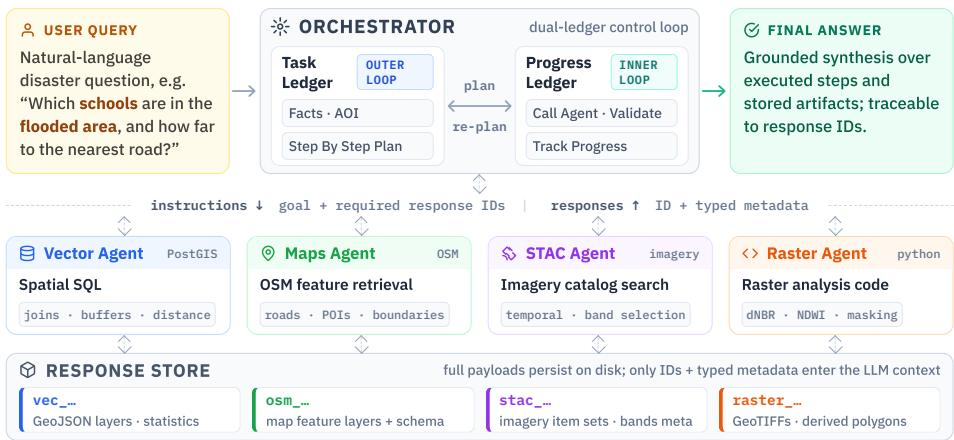  
Figure 1. GeoFaham overview. An Orchestrator coordinates four domain-specialized agents (Vector/PostGIS, Maps/OSM, STAC imagery retrieval, and Raster code generation) using nested control loops. The outer loop produces a task ledger and dependency-aware plan, while the inner loop tracks execution in a progress ledger with validation and replanning. Agents persist large geospatial outputs to a Response Store and exchange only compact identifiers and typed metadata through the Orchestrator.

Recent advances in large language models (LLMs) have enabled agentic systems that can autonomousl lan, invoke tools, and ada t to intermediate observations (L. Wan et al. 2024; Xi et al. 2025). While such systems have shown strong performance on text-centric multi-step tasks, a l in them to eos atial anal tics introduces three ke challen es. (i) Domain complexity: eos atial reasonin re uires s ecialized knowled e of s atial databases and coordinate s stems, satellite imagery and spectral information, map-derived data, and raster analysis. (ii) Data heterogeneity: operational pipelines combine vector layers, multi-band raster imagery, tabular summaries, and temporal products, each re uirin distinct tools, formats, and validation procedures. (iii) Scale and context: eospatial artifacts can be lar e; GeoJSON la ers ma contain thousands of features, while raster products can reach i ab tes. Passin complete intermediate results throu h LLM context windows is therefore impractical, even though downstream correctness depends on preserv- in metadata such as coordinate reference s stems, band names, ac uisition timestamps, and spatial bounds.

General- ur ose codin a ents rovide a romisin execution framework for addressin these challenges. By decomposing tasks, generating and executing code, inspecting outputs, and revising plans based on intermediate observations, they ofer a natural foundation for geospatial decision su ort. A strai htforward a roach is therefore to e ui such an a ent with eos atial libraries, s atial databases, ma APIs, and satellite ima er catalo s, and ask it to solve eos atial workflows end-to-end. However, disaster-response workflows introduce failure modes that are not captured by successful code execution alone. An answer may appear fluent and its code may execute successfully, while the underlying analysis remains incorrect because the agent selected the wrong disaster footprint, used an inappropriate spatial boundary, searched imagery outside the relevant event window, computed distances in an invalid CRS, or relied on an intermediate artifact that was planned but never produced.

To address these challenges, we introduce GeoFaham (Figure 1), a domain-specialized multi-a ent s stem for eos atial disaster anal tics. Rather than rel in on a sin le eneralist a ent with broad tool access, GeoFaham decomposes eospatial workflows into four specialized roles defined by data source and operation type: structured spatial data querying, map feature retrieval, satellite imagery discovery, and raster analysis. A central Orchestrator coordinates these agents through a dual-ledger control loop. The outer loop extracts structured task facts and constructs a dependency- aware plan, while the inner loop tracks execution progress, verifies that required artifacts have been produced, and replans when execution stalls or a dependency cannot be satisfied.

A ke feature of GeoFaham is artifact-aware collaboration. A ents do not ass lar e coordinate arrays, raster data, or complete imagery payloads through the LLM context. Instead, full outputs are persisted in a working memory called the Response Store, while the Orchestrator exchanges compact response identifiers and typed metadata. Agents reason over schemas, summaries, spatial bounds, temporal ranges, and band metadata, while deterministic geospatial engines operate on the full artifacts. This design reduces context overhead, reduces the risk of critical spatial and temporal metadata loss, and keeps downstream computation grounded in the full artifacts.

Existing geospatial benchmarks evaluate remote-sensing tool use and geoprocessing workflows (Shabbir et al. 2025; Kao et al. 2025; Krechetova and Kochedykov 2025; Q. Zhang et al. 2025), but do not fully capture cross-source w9orkflows that require coordination across heterogeneous geospa- tial data, intermediate artifact handling, and recovery from spatial or temporal execution failures. We therefore introduce GeoFaham-Bench for evaluating multi-step geospatial disaster workflows. GeoFaham-Bench contains 40 natural-language tasks grounded in 17 real-world disaster records spanning fires, floods, hurricanes, cyclones, earthquakes, and tornadoes. Each task captures an opera- tional workflow relevant to GIS anal sts, humanitarian workers, or overnment decision-makers. The tasks re uire inte ration across disaster databases, O enStreetMa features (O enStreetMa contributors 2025), satellite imagery catalogs, and raster products, together with operations such as spatial joins, aggregation, ranking, and artifact generation. Because multiple valid execution traces ma satisf the same task, GeoFaham-Bench uses a non-ri id evaluation rotocol that checks s atial, tem oral, methodolo ical, and out ut-level invariants rather than enforcin an exact execution trace.

We evaluate GeoFaham on GeoFaham-Bench against three strong general-purpose coding- a ent baselines: Codex (O enAI 2025), Claude Code (Anthro ic 2025), and O enCode (O enCode Contributors 2025). GeoFaham achieves an overall score of 0.940, com ared with 0.879 for Codex, the best-performing baseline, while using approximately 7.5 times fewer reported tokens. Its largest ains occur in data selection correctness and s atial-tem oral lo ic, im rovin over the best baseline b 11.9 and 13.9 points, respectivel . These results su est that GeoFaham’s advanta e does not arise simpl from better code eneration, but from its combined domain-specialized, validation-aware, and artifact-preserving design.

Our contributions are as follows.

1. We introduce GeoFaham, a domain-specialized multi-agent architecture for geospatial disaster analytics that decomposes workflows into bounded specialist roles and coordinates them through validation-aware orchestration.

2. We introduce a Response Store for artifact-aware collaboration that enforces a boundary between LLM reasoning and geospatial computation: agents exchange compact identifiers and typed metadata, while raw geometries, rasters, and imagery payloads remain outside the LLM context.

3. We introduce GeoFaham-Bench, a 40-task benchmark rounded in 17 real-world disaster records spanning fires, floods, hurricanes, cyclones, earthquakes, and tornadoes. It evaluates multi-step geospatial reasoning, cross-source integration, raster-vector computation, and artifact generation using a non-rigid evaluation protocol.

4. We demonstrate that GeoFaham outperforms strong general-purpose coding-agent baselines while usin substantiall fewer tokens, with the lar est ains concentrated in data selection and spatial-temporal reasoning.

## 2. Related Work

GeoFaham sits at the intersection of (i) LLM-a ent reasonin and tool use, (ii) multi-a ent orchestration with typed memory, and (iii) tool-augmented agents for geospatial, GIS, and Earth-observation (EO) workflows. We summarize each and then osition GeoFaham alon five axes.

## 2.1 LLM Agents and Multi-Agent Orchestration

Modern LLM a ents interleave reasonin with tool calls via chain-of-thou ht (Wei et al. 2022) and the ReAct loop (Yao, Zhao, et al. 2023), learn to invoke APIs (Schick et al. 2023; Qin et al. 2024), and self-correct throu h verbal critique (Madaan et al. 2023; Shinn et al. 2023) or tree search (Yao, Yu, et al. 2023). Surve s (L. Wan et al. 2024; Xi et al. 2025; Guo et al. 2024; Han et al. 2024) lace these ca abilities within now-standard a ent taxonomies. Multi-a ent s stems decom ose tasks across specialized roles (Wooldrid e 2009; Talebirad and Nadiri 2023): CAMEL (G. Li et al. 2023) elicits cooperative role-pla ; MetaGPT (Hon et al. 2024) encodes human SOPs and structured artifacts; AgentVerse (Chen et al. 2024) studies dynamic composition; ChatDev (Qian et al. 2024) structures software-engineering hand-ofs; AutoGen (Wu et al. 2024) provides a conversational programming model; HuggingGPT (Shen et al. 2023) pioneers controller–specialist dispatch; Magentic-One (Fourne et al. 2024) adds a eneralist Orchestrator with ex licit led er state. AutoA ents (G. Chen et al. 2024), MegaAgent (Q. Wang et al. 2025), DyLAN (Z. Liu et al. 2024), Mixture-of-Agents (J. Wang et al. 2025), AgentScope (Gao et al. 2024), and Internet-of-Agents (W. Chen et al. 2025) extend topology and scale. A parallel planning thread—Plan-and-Solve (L. Wang et al. 2023), LLM-Planner (Son et al. 2023), LLMCom iler (Kim et al. 2024), ADaPT (Prasad et al. 2024), ReWOO (Xu et al. 2023)—separates plan generation, parallel dispatch, and recursive replanning. GeoFaham’s dual-led er desi n combines an u front de endenc -aware lan in the s irit of Plan- and-Solve, parallel-friendly structure as in LLMCompiler, and ADaPT-style replanning gated by a stall counter and validation predicates.

For memor and context, CoALA (Sumers et al. 2024) rovides the workin /e isodic/semantic/procedural taxonomy we adopt; Voyager (G. Wang et al. 2024) demonstrates a persistent skill library; TaskWeaver (Qiao et al. 2023) indexes code artifacts across turns; Mixture-of-Agents (J. Wang et al. 2025) explicitly concatenates prior-tier outputs. None of these addresses geospatial artifacts (la ers with CRSs, STAC items with tem oral windows, rasters with bounds and band schemas)—a gap GeoFaham’s typed Response Store targets.

## 2.2 Code-Generating and Data-Science Agents

GeoFaham’s Raster Agent generates sandboxed Python over xarray, rasterio, and geopandas, buildin on the code-LLM linea e (Chen et al. 2021; Austin et al. 2021; Li, Allal, et al. 2023; Rozière et al. 2023; Hui et al. 2024). Data-science benchmarks measure increasingly realistic workflows: DS-1000 (Lai et al. 2023) on NumP / andas, ARCADE (Yin et al. 2023) on multi-turn notebook state, InfiAgent-DABench (Hu et al. 2024) on CSV analysis, DSBench (Jing et al. 2025) on Kaggle-style end-to-end pipelines, BLADE (Gu et al. 2024) on analytical decision diversity, Data-Co ilot (Wen i Zhan et al. 2023) on autonomous workflows, and S ider2-V (Cao et al. 2024) on full data-science environments. NL→SQL work (S ider (T. Yu et al. 2018), BIRD (Li, Hui, et al. 2023), ScienceBenchmark (Yi Zhang et al. 2023)) shows that LLMs collapse on real-world schemas with domain-specific operators, motivatin the dedicated spatial-SQL line below.

## 2.3 Autonomous GIS, Earth Observation Copilots, and Geospatial Benchmarks

LLM-Geo (Li and Nin 2023) introduced the autonomous-GIS attern; follow-u s s ecialize it to data retrieval (Ning et al. 2025), spatial analysis (GIS Copilot (Akinboyewa et al. 2025)), sha efile rocessin (Sha efileGPT (Lin et al. 2025)), AutoGPT-st le chains (GeoGPT (Yifan Zhang et al. 2024)), OSM-augmented prompting (GeoLLM (Manvi et al. 2024)), realistic copilot environments (GeoLLM-En ine (Sin h, Fore, and Stamoulis 2024)), four-a ent lan-retrieve-codedebu pipelines (MapCoder (Islam, Ali, and Parvez 2024)), PostGIS NL2SQL (GeoSQL-Eval (Hou, Jiao, et al. 2025)), and staged multi-agent spatial Text-to-SQL (Khosravi Kazazi et al. 2025). EO foundation and vision-language models supply the imagery side—RemoteCLIP (F. Liu et al. 2024), GeoChat (Kuckreja et al. 2024), SkyEyeGPT (Zhan, Xiong, and Yuan 2025), LHRS-Bot (Muhtar et al. 2024), EarthGPT (Wei Zhang et al. 2024), RSGPT (Hu et al. 2025), VHM (Pang et al. 2025), EarthMarker (Wei Zhang et al. 2025), Prithvi-EO (Jakubik et al. 2023; Szwarcman, Roy, Fraccaro, et al. 2024), SatMAE (Con et al. 2022), Scale-MAE (Reed et al. 2023)—all tar etin tasks (flood ma in , burn-scar detection, dama e assessment) that recur in GeoFaham (Mai et al. 2024).

A rapidly growing set of geospatial benchmarks evaluates these systems. Spatial reasoning and map QA: S artQA (Mirzaee et al. 2021) and Ste Game (Shi, Zhan , and Li ani 2022) robe textual s atial reasoning; MapEval (Dihan et al. 2025) and MapQA (Z. Li et al. 2025) ground questions in real map APIs and OSM. Remote-sensing agents: ThinkGeo (Shabbir et al. 2025) measures imagery-grounded tool use; UnivEARTH (Kao et al. 2025) finds execution failures of generated Earth-Engine code dominate end-to-end error; AutoGEEval (Hou, Shen, et al. 2025) grades GEE Python-API code generation; GEO-Bench (Lacoste et al. 2023) and GEOBench-VLM (Danish et al. 2025) standardize EO foundation- and VLM-task suites. GIS practitioner workflows: GeoBenchX (Krechetova and Kochedykov 2025) scores tool-calling against a fixed function set with intentionally unsolvable robes; GeoAnal stBench (Q. Zhan et al. 2025) measures ex ert-validated eo rocessin workflows; GeoCode-Bench (Hou et al. 2026) evaluates 8,000+ geospatial-code questions across eight capability levels; GeoA entBench (B. Yu et al. 2026) shi s a d namic sandbox with 117 atomic GIS tools. For methodolo ical context, eneralist a ent benchmarks (Liu et al. 2024; Mialon et al. 2024; Jimenez et al. 2024; Xie et al. 2024; Zhou et al. 2024) frame the evaluation aradi m, and our use of an LLM-as-jud e follows Zhen Zhen et al. 2023.

## 2.4 Disaster-Response and Humanitarian Datasets

GeoFaham is built on 17 real-world disaster records with associated damage and flood-extent imagery. The community datasets that established these formats are foundational: xBD (Gupta et al. 2019) standardized four-class buildin dama e across 45,362 km2 of aired re/ ost ima er ; BRIGHT (H. Chen et al. 2025) extended dama e assessment to all-weather SAR+o tical and serves as the 2025 IEEE GRSS Data-Fusion-Contest dataset; FloodNet (Rahnemoonfar et al. 2021) provides post-Harvey UAV se mentation and VQA; S aceNet (Van Etten, Lindenbaum, and Bacastow 2018) established building-footprint and road-network protocols. On the language side, CrisisMMD (Alam, Ofli, and Imran 2018) introduced multimodal crisis-tweet classification and HumSet (Fekih et al. 2022) rovides multilin ual humanitarian extraction from UN OCHA re orts. Cutter Cutter, Boruf, and Shirley 2003 and Goodchild (Goodchild 2007) ground the demand for practitioner-relevant geospatial decision support.

## 2.5 Positioning GeoFaham

We group prior work into five categories: (1) remote-sensing agent benchmarks, (2) GIS-practitioner benchmarks, (3) autonomous GIS systems, (4) general-purpose multi-agent frameworks, and (5) data-science agent benchmarks. Below, we summarize what each category covers and the gap that GeoFaham addresses. Remote-sensing agent benchmarks. (Shabbir et al. 2025; Kao et al. 2025; Danish et al. 2025; Hou, Shen, et al. 2025). These benchmarks test how well an agent works with Earth observation data from a single source. They do not involve several cooperating agents or the assin of intermediate results between them. GeoFaham combines several data sources in one workflow, lets agents share typed outputs (e.g., rasters and vector layers) through a shared memory, and evaluates the quality of the geospatial method, not only the final answer. GIS-practitioner benchmarks (Krechetova and Kochedykov 2025; Q. Zhang et al. 2025; Hou et al. 2026; B. Yu et al. 2026). These benchmarks check whether a sin le a ent calls the ri ht tools from a fixed set of functions. The do not test whether an a ent can keep track of intermediate outputs or recover when a step fails, for example when imagery does not cover the area of interest or layers use diferent projections. GeoFaham uses an orchestrator that tracks progress, checks each result before movin on, and re lans when a ste fails. Autonomous GIS systems (Li and Nin 2023; Yifan Zhan et al. 2024; Akinbo ewa et al. 2025; Lin et al. 2025; Sin h, Fore, and Stamoulis 2024; Khosravi Kazazi et al. 2025). These systems automate GIS tasks, but each mostly works with one t e of data and does not check intermediate results before continuin . GeoFaham coordinates four s ecialist a ents (Ma s, STAC, Vector, and Raster) throu h one Orchestrator. A shared Res onse Store keeps every intermediate output so that later steps can reuse it. General-purpose multi-agent frameworks (Wu et al. 2024; Fourney et al. 2024; Hong et al. 2024; Chen et al. 2024; Qian et al. 2024; Qiao et al. 2023; Kim et al. 2024; Prasad et al. 2024). These frameworks provide generic ways for agents to plan and work together, but they are not designed for geospatial data. GeoFaham builds on the ledger-based planning of Magentic-One and adapts it to geospatial work: agents exchange eos atial out uts, results are checked for the correct coordinate reference s stem (CRS), s atial coverage, and geometry type before they are used, and each task is routed according to how its area of interest is defined (database extent, a fetched boundar , or a user- rovided eometr ). To our knowled e, no eneral- ur ose framework lets a ents find earlier eos atial out uts b their properties. Data-science agent benchmarks (Lai et al. 2023; Yin et al. 2023; Hu et al. 2024; Jing et al. 2025 Gu et al. 2024 Cao et al. 2024). These benchmarks focus on tabular data such as CSV files and databases. GeoFaham extends this settin to eos atial data (rasters, vector la ers, and STAC items) with tasks built from 17 real-world disaster records. Its evaluation rubric also includes geospatial criteria that data-science benchmarks do not cover, such as spatio-temporal reasoning, the quality of geometric operations, geometry data integrity, and the use of a metric CRS for distance and area calculations.

## 3. System Architecture

Fi ure 1 provides an overview of the GeoFaham architecture. GeoFaham decomposes eospatial workflows along data-source and operation-type boundaries. A central Orchestrator maintains global task state and execution control, coordinatin four domain-specialized a ents: the Vector A ent for spatial database queries and vector operations; the Maps Agent for map-derived feature retrieval; the STAC A ent for satellite ima er discover and covera e validation; and the Raster A ent for code-based raster analysis. The architecture follows three principles. First, bounded specialization: each agent has a narrow action space, domain-specific prompt, and standardized output contract. Second, state-grounded orchestration: intermediate geospatial artifacts become part of the evolving task state, roundin lannin , dis atch, recover , and final s nthesis in executed evidence rather than a static plan. Third, artifact-aware memory: large geospatial outputs remain outside the LLM context, while agents exchange compact identifiers and typed metadata. Together, these principles constrain execution while preserving the flexibility required for open-ended geospatial workflows. While GeoFaham is instantiated and evaluated for disaster response in this work, these architectural principles are not disaster-specific and can support other multi-source geospatial analysis settings.

## 3.1 Orchestrator

The Orchestrator is responsible for interpreting the user request, planning a step-by-step workflow, dispatching agents, tracking progress, recovering from failures, and producing the final answer. It uses a dual-ledger control loop (Fourney et al. 2024). The outer loop builds a task ledger for fact extraction and planning, while the inner loop maintains a progress ledger for execution monitoring and replanning, as shown in Fig. 2.

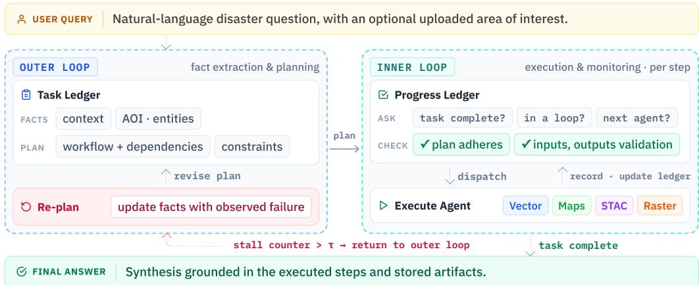  
Figure 2. GeoFaham’s dual-ledger orchestration loop. The task ledger supports fact extraction and dependency-aware planning, while the progress ledger tracks execution, validates artifacts, and triggers replanning when needed.

Outer loop: Task ledger. Given a user uer , the Orchestrator extracts a structured task state that records the user intent, re uested out ut, disaster context, tem oral constraints, area of interest (AOI), tar et entities, re uired s atial o erations, and reusable artifacts from the current session. For exam le, the uer “Which hos itals are near the 2023 Lahaina fire foot rint?” is converted into explicit fields describin the event, hazard footprint, tar et feature class, distance constraint, and expected output. This sta e reduces errors that arise before execution, such as selectin the wrong disaster record, using an administrative boundary instead of a hazard footprint, or searching imagery over an inappropriate temporal window. Using the extracted task state and the documented capabilities of each agent, the Orchestrator constructs a dependency-aware plan. Each step specifies the responsible agent, semantic goal, required inputs, expected output type, and dependencies on earlier steps. Agent instructions express goals rather than low-level procedures. For example, the Orchestrator may request healthcare facilities within a disaster footprint without prescribing the exact map tags or implementation details. This makes the workflow auditable while allowing each specialist to apply domain-specific reasoning.

Inner loop: Progress ledger. Durin execution, the pro ress led er records completed and pendin steps, response identifiers, artifact metadata, failures, and unresolved dependencies. At each iteration, the Orchestrator determines whether the task is complete, whether execution has stalled, which agent should act next, and what instruction it should receive. Before dispatching an agent, the Orchestrator performs three checks. The plan-adherence check verifies that all prerequisite steps have been completed. The input-validity check verifies that every required artifact exists as a registered response rather than only as an expected output in the plan. The geospatial-compatibility check verifies that the geometry types, coordinate reference systems, bounds, temporal coverage, and schemas of the required artifacts support the intended operation. For example, a distance computation requires a suitable projected CRS or geodesic method, while raster analysis requires imagery with the necessary bands and suficient spatial coverage. A planned output is therefore not treated as a realized artifact. A downstream agent cannot use a flood footprint, road layer, or imagery set until the corresponding res onse identifier exists in the Res onse Store and its metadata asses validation. This revents hallucinated handofs in which an agent proceeds even though a previous step failed, returned an empty result, or produced an incompatible artifact.

Replanning. When repeated tool errors, empty outputs, missing artifacts, insuficient imagery coverage, or unresolved dependencies cause execution to stall, control returns from the inner loop to the outer loop. The Orchestrator updates the task state with the observed failure and revises the plan. Replanning may change the spatial scope, request a diferent boundary, broaden a temporal window, switch imagery collections, decompose a broad request into smaller feature classes, or route a step to another specialist. This provides a structured recovery mechanism rather than relying on repeated retries. The Orchestrator limits each agent’s visibility to the information required for its assigned step. This keeps prompts focused, reduces token usage, and prevents unrelated intermediate state from interferin with execution. The Orchestrator maintains lobal workflow control, while the Response Store provides shared access to realized artifacts.

## 3.2 Response Store

GeoFaham se arates LLM reasonin from eos atial data handlin throu h the Res onse Store, a ersistent artifact re istr shared b all a ents. After each tool call, the com lete out ut is stored and re istered with a uni ue identifier, source, summar , artifact path, and t ped metadata. Vector metadata includes eometr t pe, coordinate reference s stem (CRS), bounds, feature count, and property schema. Imagery and raster metadata includes temporal coverage, bands, resolution, bounds, CRS, and summary statistics. Only compact identifiers and metadata pass through the Orchestrator. Full artifacts remain outside the LLM context and are resolved by downstream agents when needed. This avoids repeatedly summarizing large outputs and preserves information required for validation and later computation. The Response Store also separates language reasoning from deterministic spatial execution. For example, the Vector Agent generates spatial queries over symbolic artifact identifiers. The execution layer resolves these identifiers to the corresponding geometries, executes the operation, and registers the result as a new response. Agents may also retrieve prior responses by source or data t e, su ortin artifact reuse, follow-u uestions, and traceable final answers, as illustrated in Fig. 3.

## 3.3 SpecializedAgents

Each specialist has a bounded tool set and returns outputs through a shared response schema, giving the Orchestrator a uniform interface across heterogeneous data sources.

Vector Agent. The Vector Agent performs spatial database queries and vector operations, including joins, bufering, distance filtering, aggregation, and artifact generation. It can combine database records with vector artifacts from other agents without exposing raw coordinates to the LLM. Instead, the agent receives response identifiers and typed metadata and generates spatial SQL over symbolic placeholders. At execution time, these placeholders are resolved to the artifacts and loaded into temporary spatial tables. The database engine performs the exact geometry operations, and the resultin artifact is re istered in the Res onse Store.

Maps Agent. The Maps Agent retrieves map-derived features such as roads, facilities, boundaries, waterways, and infrastructure. Its area of interest may be a place name, bounding box, or registered spatial artifact. Each call retrieves one feature class, producing cleaner schemas and more predictable geometry types for downstream operations.

STAC Agent. The STAC Agent searches satellite imagery and raster catalogs using spatial, temporal, collection, cloud-cover, and band constraints. It validates scene coverage before raster analysis and ma broaden the tem oral window, switch collections, or return a structured failure when suitable imagery is not found.

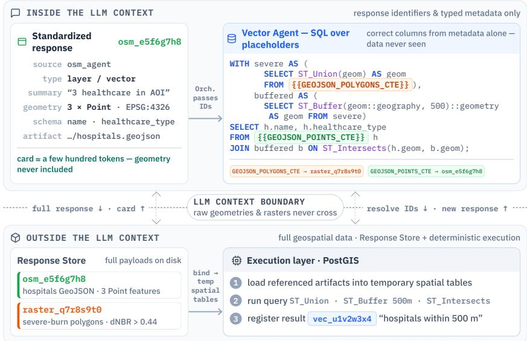  
Figure 3. Artifact-aware collaboration across the LLM context boundary. Agents exchange identifiers and typed metadata, while the execution layer resolves referenced artifacts for deterministic spatial operations.

Raster Agent. The Raster A ent enerates sandboxed workflows for s ectral indices, chan e detection, flood and burn anal sis, classification, raster-to-vector conversion, and zonal statistics. It may inspect intermediate statistics and correct execution errors before registering outputs and their spatial metadata in the Response Store.

## 3.4 Execution Semantics and Final Synthesis

A GeoFaham workflow forms a typed artifact graph in which executed steps produce registered artifacts consumed by later steps. Natural-language statements are not treated as substitutes for artifacts. For exam le a claim that schools lie within a flood extent must be su orted b re istered school and flood la ers and an executed spatial join. Final s nthesis be ins after the re uired dependencies are satisfied or remaining failures are identified. The Orchestrator reports the findings, references generated artifacts, and states limitations such as missing map features, partial imagery coverage, or failed operations. The resulting answer remains traceable to concrete geospatial outputs.

## 3.5 Implementation

GeoFaham is implemented as a closed multi-agent team using a conversational agent framework (Wu et al. 2024), with custom orchestration, artifact storage, and geospatial execution layers. Vector outputs are stored as GeoJSON, raster outputs as Cloud-Optimized GeoTIFFs or derived layers, and imagery searches as registered item sets with temporal and band metadata. The file-backed, session-scoped Response Store supports reuse, recovery, and traceable handofs. The implementation is model-agnostic. Models can be assigned to the planner, progress tracker, and specialists without changing the shared artifact interface, allowing stronger models to be reserved for planning, spatial query generation, and raster programming.

## 4. GeoFaham-Bench

Evaluating geospatial agents requires more than checking the final answer. A fluent response may be grounded in the wrong disaster footprint, imagery window, coordinate system, or intermediate artifact. Exact-match evaluation is also unsuitable because valid solutions ma use diferent tools, execution orders, spatial predicates, or raster thresholds while satisfying the same spatial, temporal, methodological, and output requirements.

To evaluate these capabilities, we introduce GeoFaham-Bench, a benchmark containing 40 natural-language tasks across 17 real-world disaster records. The benchmark spans 10 task categories covering damage assessment, flood analysis, infrastructure and point-of-interest analysis, satellite ima er search, raster com utation, s atial a re ation, and artifact eneration. The task set emphasizes challenging multi-step workflows, with 24 of 40 tasks (60%) categorized as hard. We use the benchmark for two evaluations: an architecture-neutral comparison with external coding a ents and a process-centric anal sis of model assi nments within GeoFaham. Detailed task and disaster statistics are provided in Appendix 1.2.

## 4.1 Task Design

Tasks are written as user-facin disaster-res onse uestions rather than tool-s ecific instructions, allowing systems to follow diferent valid workflows. They represent operational needs of GIS analysts, humanitarian workers, and government decision-makers, such as identifying exposed facilities, rankin dama ed re ions, retrievin event-relevant ima er , estimatin afected area, or producing map artifacts. Task dificulty is defined by workflow complexity. Harder tasks require additional data sources, temporal reasoning, raster computation, or artifact handofs. Each task also specifies the required evidence type, so reporting a statistic without a requested supporting artifact is considered incomplete.

## 4.2 Ground Truth Construction

GeoFaham-Bench uses non-ri id round truth that s ecifies re uired invariants, acce table variations, expected-result checks, and common failure modes. This accommodates equivalent spatial predicates, execution orders, and raster-anal sis thresholds, as well as small variations caused b d namic sources such as O enStreetMa and satellite catalo s. References are constructed throu h human-in-the-loo execution. For each task, a geospatial expert defines the disaster context, spatial and temporal scope, re uired evidence, and ex ected out uts. An LLM ro oses a ste -b -ste workflow, tool calls, and implementation details, while the expert reviews each step and validates the intermediate results. Incorrect data sources, parameters, spatial operations, or outputs are corrected before proceedin . Corrections are limited to factual and validit errors, while the reasonin strate and im lementation choices remain with the s stem.

## 4.3 Evaluation Protocols

We use structured LLM-as-judge rubrics derived from validated ground truth. Because external coding agents and GeoFaham expose diferent levels of execution evidence, we use separate cross- system and internal protocols. Both organize fine-grained evaluation dimensions into broader categories, then combine them into an overall score. All systems receive the same tasks, data sources, geospatial libraries, execution environment, and output requirements. They difer only in agent architecture, prompting, and orchestration strategy.

The cross-s stem jud e evaluates each run usin the evidence ex osed b that s stem, includin enerated code, lo s, structured results, and out ut artifacts. Failed or timed-out runs are evaluated using the evidence produced before failure. The protocol scores 13 dimensions grouped into five 9: Task Outcome $( S _ { \mathrm { o u t } } ^ { \mathrm { ^ { * } } } )$ , Geospatial Method $( S _ { \mathrm { m e t h } } )$ , Reproducibility $( S _ { \mathrm { r e p r } } )$ , Compliance $\mathsf { \bar { \Psi } } ( S _ { \mathrm { c o m p } } )$ , and Robustness $( S _ { \mathrm { r o b } } )$ . The overall cross-system score (S ) is computed as:

$$
S _ { \mathrm { c } } = 0 . 3 5 S _ { \mathrm { o u t } } + 0 . 3 0 S _ { \mathrm { m e t h } } + 0 . 1 5 S _ { \mathrm { r e p r } } + 0 . 1 0 S _ { \mathrm { c o m p } } + 0 . 1 0 S _ { \mathrm { r o b } } 9\tag{1}
$$

Task Outcome measures answer accurac and com leteness. Geos atial Method evaluates data selection, spatiotemporal lo ic, eometric operations, eometr inte rit , and implementation correctness. Reproducibilit measures structured outputs, method traceabilit , and artifact qualit , while Compliance and Robustness assess benchmark-rule adherence, error handling, and confidence calibration. Geometry-derived quantities must be traceable to deterministic spatial engines rather than inferred from coordinate text. The complete dimension definitions, scoring criteria, and diagnostic flags are provided in Appendix 2.1.

For internal ablations, the judge additionally inspects task and progress ledgers, agent instructions, tool calls, intermediate artifacts, failures, and replanning steps. It scores 11 dimensions grouped into four categories: Planning $( S _ { \mathrm { p l a n } } )$ , Execution $( S _ { \mathrm { e x e c } } )$ , Compliance $( S _ { \mathrm { c o m p } } )$ , and Output $\left( S _ { \mathrm { o u t } } \right) ^ { \ }$ . The overall internal evaluation score $( { \bar { S } } _ { i } )$ is com uted as:

$$
S _ { \mathrm { i } } = 0 . 2 7 S _ { \mathrm { p l a n } } + 0 . 3 8 S _ { \mathrm { e x e c } } 9 + 0 . 1 7 S _ { \mathrm { c o m p } } + 0 . 1 8 S _ { \mathrm { o u t } }\tag{2}
$$

Plannin evaluates workflow construction and a ent instructions. Execution measures tool selection, parameter accuracy, code logic, and result summarization. Compliance captures prompt adherence and error recovery, while Output measures final-answer accuracy and completeness. This protocol is used only to study which model assignments and roles afect performance within GeoFaham. The dimension-level rubric is provided in Appendix 2.2.

## 5. Experiments

## 5.1 Experimental Setup

Systems. We compare GeoFaham with three general-purpose coding-agent configurations: Codex with GPT-5.1, Claude Code with Claude Sonnet 4.6, and OpenCode with GPT-5.1. All systems receive the same 40 benchmark tasks, source constraints, and geospatial execution environment. Each s stem ma enerate and execute code, ueries, and tool calls to solve the tasks. For internal ablations, we evaluate four model-assignment configurations on the same tasks. C1 assigns GPT-4o to all roles. C2 upgrades only the Orchestrator planner to GPT-5.1. C3 additionally assigns GPT-5.1 to the progress tracker, Vector Agent, and Raster Agent, while retaining GPT-4o for the Maps and STAC agents. C4 assigns GPT-5.1 to all roles. For the cross-system comparison, GeoFaham uses the C3 tiered model assignment, with fresh runs conducted alongside the external coding agents under the same evaluation setu .9 We use GPT-5.2 as the LLM jud e for both the cross-s stem and internal evaluation rotocols.

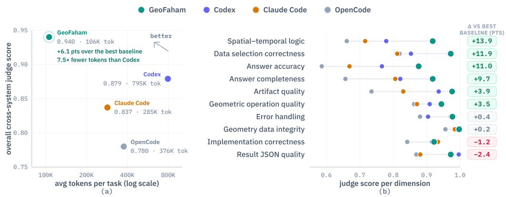  
Figure 4. Cross-system comparison on GeoFaham-Bench. (a) Overall score versus token usage per task. (b) Selected dimension scores, showing the largest gains in data selection and spatial–temporal reasoning.

Table 1. Cross-system performance on GeoFaham-Bench. GeoFaham achieves the highest overall score among Codex OpenAI 2025, Claude Code Anthropic 2025, and OpenCode OpenCode Contributors 2025 in overall score, with consistently strong performance across task outcome, geospatial methodology, reproducibility, compliance, and robustness.
<table><tr><td>System</td><td> $\mathbf { S } _ { \mathrm { o u t } }$ </td><td> $\underline { { \mathbf { S } } } _ { \mathrm { m e t h } }$ </td><td> $\underline { { \mathbf { S } } } _ { \mathrm { r e p r } }$ </td><td> $\underline { { \mathbf { S } _ { \mathrm { c o m p } } } }$ </td><td> ${ \underline { { \mathbf { S } } } } _ { \mathrm { r o b } }$ </td><td> $\mathsf { S } _ { \mathsf { c } }$ </td></tr><tr><td>GeoFaham</td><td>0.897</td><td>0.951</td><td>0.982</td><td>0.999</td><td>0.933</td><td>0.940</td></tr><tr><td>Codex</td><td>0.794</td><td>0.890</td><td>0.974</td><td>0.986</td><td>0.896</td><td>0.879</td></tr><tr><td>Claude Code</td><td>0.738</td><td>0.863</td><td>0.902</td><td>0.974</td><td>0.873</td><td>0.837</td></tr><tr><td>OpenCode</td><td>0.622</td><td>0.828</td><td>0.865</td><td>1.000</td><td>0.838</td><td>0.780</td></tr></table>

Table 2. f h d l fi h h h h ll $( S _ { \mathrm { i } } = 0 . 9 6 4 )$ , showing that 9selectively assigning stronger models to reasoning-intensive roles matches or slightly exceeds the all-GPT-5.1 configuration (C4). Overall scores are reported as mean ± standard deviation across tasks; cate ory columns report means.
<table><tr><td>Config</td><td> $\underline { s } _ { \mathrm { { p l a n } } }$ </td><td> $\pmb { S } _ { \mathrm { e x e c } }$ </td><td> $\mathsf { \mathbf { S } } _ { \mathrm { c o m p } }$ </td><td> $\mathbf { S _ { \mathrm { o u t } } }$ </td><td> $\mathbf { S } _ { \mathrm { i } }$ </td></tr><tr><td>C1</td><td>0.849</td><td>0.832</td><td>0.825</td><td>0.680</td><td> $0 . 8 0 8 { \pm } 0 . 1 2$ </td></tr><tr><td>C2</td><td>0.944</td><td>0.906</td><td>0.912</td><td>0.885</td><td> $0 . 9 1 4 { \scriptstyle \pm 0 . 0 7 }$ </td></tr><tr><td>C3</td><td>0.983</td><td>0.958</td><td>0.961</td><td>0.952</td><td> $0 . 9 6 4 { \scriptstyle \pm 0 . 0 3 }$ </td></tr><tr><td>C4</td><td>0.980</td><td>0.957</td><td>0.958</td><td>0.934</td><td> $0 . 9 5 9 { \scriptstyle \pm 0 . 0 4 }$ </td></tr></table>

Evaluation. Cross-s stem com arisons use the architecture-neutral rotocol, which scores task outcome eos atial method re roducibilit com liance and robustness. Internal ablations use the process-centric judge, which also examines planning, agent instructions, tool calls, execution state, and recovery. The two protocols answer diferent questions: whether GeoFaham outperforms external agents, and which model assignments improve performance within it.

Eficiency. We re ort avera e wall-clock duration and token usa e er task. Token counts are obtained from system logs and include input, output, and reasoning tokens where exposed by the system. They are reported as eficiency indicators and do not afect correctness scores.

## 5.2 Cross-System Comparison

Table 1 reports the a re ate results. GeoFaham achieves an overall score of 0.940, outperformin Codex, Claude Code, and O enCode b 6.1, 10.3, and 16.0 oints, res ectivel . Codex is the strongest baseline with a score of 0.879. The largest category-level gains over Codex occur in task outcome, where GeoFaham scores 0.897 versus 0.794, and eos atial method, where it scores 0.951 versus 0.890. Compliance is hi h across all s stems, indicatin that a ents enerall follow instructions without violatin benchmark rules. Fi ure 4 rovides a dimension-level breakdown. The largest gains occur in spatial-temporal logic and data selection correctness. GeoFaham scores 0.918 and 0.972 on these dimensions, exceeding the strongest baseline by 13.9 and 11.9 points, respectively. These dimensions measure whether a system selects the correct evidence, preserves the intended spatial and temporal scope, and orders dependent operations correctly. In contrast, implementation correctness is com arable across s stems: GeoFaham scores 0.922, while the stron est baseline scores 0.934. Geometry integrity is also consistently high, ranging from 0.956 to 0.997. These results indicate that GeoFaham’s advantage lies in selecting, coordinating, and validating geospatial o erations rather than code eneration alone. GeoFaham also achieves the hi hest artifact- ualit score of 0.976, consistent with its artifact-aware execution and Res onse Store. Dimension-level scores are provided in the supplementary material.

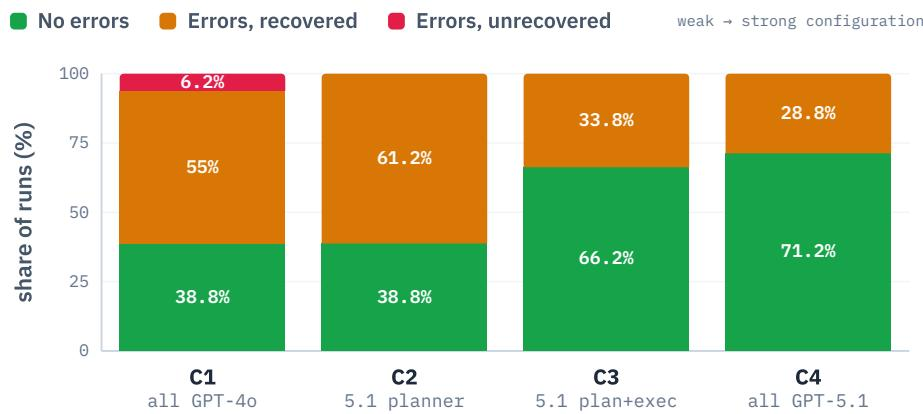  
Figure 5. Error occurrence and recovery across model configurations. C1 and C2 have the same error rate, while C3 and C4 reduce error occurrence.

## 5.3 Model-AssignmentAblation

Table 2 reports aggregate performance across the four internal configurations. C1, which assigns GPT-4o to all roles, achieves an overall score of 0.808. Upgrading only the Orchestrator planner in C2 raises the score to 0.914, an improvement of 10.6 points. This identifies planning as a major control point in the workflow. C3 additionally upgrades the progress tracker, Vector Agent, and Raster Agent while retaining GPT-4o for Maps and STAC. C3 achieves the highest mean score of 0.964, while C4, which assigns GPT-5.1 to every role, performs comparably with a score of 0.959. These results suggest that stronger models are most valuable in roles requiring planning, execution monitoring, spatial query generation, and raster programming. Constrained retrieval agents can use less expensive models without reducing overall performance. Dimension-level results further show that upgrading the planner primarily improves workflow construction and agent instructions, while stronger execution-oriented agents improve parameter accuracy, code logic, and final answer quality. Full per-dimension results are provided in the supplementary material.

## 5.4 Error RecoveryAnalysis

Fi ure 5 distin uishes error occurrence from recover . C1 encounters errors in 61.3% of runs and recovers 89.8% of them, resulting in 93.8% net success. C2 has the same error rate of 61.3%, but recovers all observed errors and achieves 100% net success. Here, net success denotes completion without an unrecovered execution error, not perfect benchmark correctness. This suggests upgrading the lanner im roves failure dia nosis and recover , althou h it does not reduce errors. C3 and C4 reduce error occurrence to 33.8% and 28.8%, res ectivel , and recover all observed errors. Stronger execution-oriented agents therefore complement planning by preventing more failures before requiring recovery.

## 5.5 EficiencyAnalysis

Table 3 re orts cross-s stem runtime and token usa e. GeoFaham uses an avera e of 106,344 tokens per task, compared with 795,352 for Codex, 285,100 for Claude Code, and 376,042 for Open- Code. These values correspond to reductions of approximately 7.5×, 2.7×, and 3.5×, respectively. OpenCode is the fastest system at 128.37 seconds per task but achieves the lowest overall score. GeoFaham takes 169.64 seconds er task, com ared with 214.92 seconds for Codex and 254.23 seconds for Claude Code. Thus, GeoFaham’s lower token usage does not come at the cost ofaccuracy or substantially longer execution.

Table 3. Cross-system runtime and token eficiency. GeoFaham uses substantially fewer tokens than all general-purpose coding-agent baselines while maintaining competitive runtime.
<table><tr><td>System</td><td>Duration sec.</td><td>Avg. Tokens Per Task</td><td>Median Tokens Per Task</td><td>Total Tokens (M)</td></tr><tr><td>GeoFaham</td><td>169.64</td><td>106,344</td><td>86,974</td><td>4.29995</td></tr><tr><td>Codex</td><td>214.92</td><td>795,352</td><td>741,656</td><td>31.81</td></tr><tr><td>ClaudeCode</td><td>254.23</td><td>285,100</td><td>227,596</td><td>11.40</td></tr><tr><td>OpenCode</td><td>128.37</td><td>376,042</td><td>317,846</td><td>15.04</td></tr></table>

## 6. Conclusion

We presented GeoFaham, a domain-specialized multi-a ent s stem for eospatial disaster anal tics. GeoFaham coordinates s ecialized a ents for vector o erations, ma feature retrieval, ima er discov- ery, and raster analysis through validation-aware orchestration and artifact-preserving memory. We also introduced GeoFaham-Bench, a 40-task benchmark rounded in 17 real-world disaster records for evaluating multi-step geospatial reasoning, cross-source integration, and artifact generation under non-rigid evaluation. GeoFaham outperforms strong general-purpose coding-agent baselines, with the lar est ains in data selection and s atial-tem oral reasonin rather than im lementation correctness. Internal ablations further show that strong models are most valuable for planning, ro ress trackin , s atial uer eneration, and raster anal sis, while constrained retrieval roles can use less expensive models. These results highlight that reliable geospatial agents require not only executable code, but also explicit spatial and temporal grounding, validation of artifact dependencies, and ersistent mana ement of intermediate out uts.

## References

Akinboyewa, Temitope, Zhenlong Li, Huan Ning, and M Naser Lessani. 2025. Gis copilot: towards an autonomous gis agent for s atial anal sis. InternationalJournal ofDigital Earth 18 (1): 2497489. htt s://doi.or /10.1080/17538947.2025.2497489.

Alam, Firoj, Ferda Ofli, and Muhammad Imran. 2018. CrisisMMD: multimodal twitter datasets from natural disasters. In Proceedings ofthe international aaai conference on web and social media (icwsm), 465–473.

Anthro ic. 2025. Claude code. htt s:// ithub.com/anthro ics/claude-code. AI codin a ent and terminal-based develo ment assistant.

Austin, Jacob, Au ustus Odena, Maxwell N e, Maarten Bosma, Henr k Michalewski, David Dohan, Ellen Jian , et al. 2021. Pro ram s nthesis with lar e lan ua e models. arXiv preprint arXiv:2108.07732.

Cao, Ruisheng, Fangyu Lei, Haoyuan Wu, Jixuan Chen, Yeqiao Fu, Hongcheng Gao, Xinzhuang Xiong, Hanchong Zhang, et al. 2024. S ider2-V: how far are multimodal a ents from automatin data science and en ineerin workflows? In Advances in neural information processing systems, vol. 37. ArXiv:2407.10956.

Chen, Fang, Zeeshan Shirazi, and Lei Wang. 2021. Building scientific capacity in disaster risk reduction for sustainable development. Cultures ofScience 4 (1). https://doi.org/10.1177/20966083211017330.

Chen, Guan ao, Siwei Don , Yu Shu, Ge Zhan , Jaward Sesa , Börje F. Karlsson, Jie Fu, and Yemin Shi. 2024. AutoA- gents: a framework for automatic agent generation. In International joint conference on artificial intelligence (ijcai), 22–30. ArXiv:2309.17288.

Chen, Hon ruixuan, Jian Son , Olivier Dietrich, Cliford Broni-Bediako, Weihao Xuan, Junjue Wan , Xinlei Shao, et al. 2025. BRIGHT: a loball distributed multimodal buildin dama e assessment dataset with ver -hi h-resolution for all-weather disaster res onse. arXiv preprint arXiv:2501.06019.

Chen, Mark, Jerry Tworek, Heewoo Jun, Qiming Yuan, Henrique Ponde de Oliveira Pinto, Jared Kaplan, Harri Edwards, Yuri Burda, Nicholas Jose h, Gre Brockman, et al. 2021. Evaluatin lar e lan ua e models trained on code. arXiv preprint arXiv:2107.03374.

Chen, Weize, Yushen Su, Jin wei Zuo, Chen Yan , et al. 2024. A entVerse: facilitatin multi-a ent collaboration and exploring emergent behaviors. In International conference on learning representations (iclr). ArXiv:2308.10848.

Chen, Weize, Zimin You, Ran Li, Yiton Guan, Chen Qian, Chen an Zhao, Chen Yan , Ruobin Xie, Zhi uan Liu, and Maoson Sun. 2025. Internet of a ents: weavin a web of hetero eneous a ents for collaborative intelli ence. In International conference on learning representations (iclr). ArXiv:2407.07061.

Cong, Yezhen, Samar Khanna, Chenlin Meng, Patrick Liu, Erik Rozi, Yutong He, Marshall Burke, David B. Lobell, and Stefano Ermon. 2022. SatMAE: pre-trainin transformers for temporal and multi-spectral satellite ima er . In Advances in neural information processing systems (neurips). ArXiv:2207.08051.

Cutter, Susan L., Bryan J. Boruf, and W. Lynn Shirley. 2003. Social vulnerability to environmental hazards. Social Science Quarterly 84 (2): 242–261. htt s://doi.or /10.1111/1540-6237.8402002.

D i h M h d S h il M h d Akh M i S d R h Ali Sh h K ik K k F h d Sh hb Kh P l Fraccaro, Alexandre Lacoste, and Salman Khan. 2025. GEOBench-VLM: benchmarkin vision-lan ua e models for eos atial tasks. In Proceedings ofthe ieee/cvfinternational conference on computer vision (iccv), 7132–7142. ArXiv:2411.19325.

Dihan Mahir Labib Md Tanvir Hassan Md Tanvir Parvez Md Hasebul Hasan Md Almash Alam Muhammad Aamir Cheema, Mohammed Eunus Ali, and Md Rizwan Parvez. 2025. Ma Eval: a ma -based evaluation of eo-s atial reasonin in foundation models. In Proceedings ofthe 42nd international conference on machine learning (icml), 13774–13813. ArXiv:2501.00316.

Fekih, Selim, Nicolo’ Tama none, Benjamin Minixhofer, Ranjan Shrestha, Ximena Contla, Ewan O lethor e, and Navid Rekabsaz. 2022. HumSet: dataset ofmultilingual information extraction and classification for humanitarian crises response. In Findings ofthe associationfor computational linguistics: emnlp 2022, 4379–4389. htt s://doi.or /10.18653/v1/2022.findin s-emnl .321.

Fourney, Adam, Gagan Bansal, Hussein Mozannar, Cheng Tan, Eduardo Salinas, Erkang Zhu, Friederike Niedtner, et al. 2024. Magentic-one: a generalist multi-agent system for solving complex tasks. arXiv preprint arXiv:2411.04468.

Gao, Dawei, Zitao Li, Xuchen Pan, Weirui Kuang, Zhijian Ma, Bingchen Qian, Fei Wei, et al. 2024. AgentScope: a flexible et robust multi-a ent latform. arXiv preprint arXiv:2402.14034.

Goodchild, Michael F. 2007. Citizens as sensors: the world of volunteered geography. GeoJournal 69 (4): 211–221.

Gu, Ken, Ruoxi Shang, Ruien Jiang, Keying Kuang, Richard-John Lin, Donghe Lyu, Yue Mao, et al. 2024. BLADE: benchmarkin lan ua e model a ents for data-driven science. In Findings ofthe associationfor computational linguistics: emnlp 2024, 13936–13971. https://doi.org/10.18653/v1/2024.findings-emnlp.815.

Guo, Taicheng, Xiuying Chen, Yaqi Wang, Ruidi Chang, Shichao Pei, Nitesh V. Chawla, OlafWiest, and Xiangliang Zhang. 2024. Large language model based multi-agents: a survey of progress and challenges. In Proceedings ofthe thirty-third international joint conference on artificial intelligence (ijcai-24), 8048–8057. ArXiv:2402.01680.

Gupta, Ritwik, Richard Hosfelt, Sandra Sajeev, Nirav Patel, Bryce Goodman, Jigar Doshi, Eric Heim, Howie Choset, and Matthew Gaston. 2019. xBD: a dataset for assessing building damage from satellite imagery. arXiv preprint arXiv:1911.09296.

Han, Shanshan, Qifan Zhan , WeizhaoJin, and Zhaozhuo Xu. 2024. LLM multi-a ent s stems: challen es and o en roblems. arXiv preprint arXiv:2402.03578.

Hon , Sirui, Min chen Zhu e, Jonathan Chen, Xiawu Zhen , Yuhen Chen , Jinlin Wan , Ce ao Zhan , et al. 2024. MetaGPT: meta programming for a multi-agent collaborative framework. In International conference on learning representations (iclr). ArXiv:2308.00352.

Hou, Shu an , Hao ue Jiao, Zi i Liu, Luton Xie, Guan u Chen, Shaowen Wu, Xuefen Guan, and Hua i Wu. 2025. GeoSQL-Eval: first evaluation of LLMs on PostGIS-based NL2GeoSQL ueries. arXiv preprint arXiv:2509.25264.

Hou, Shu an , Zhan xiao Shen, Jian uan Lian , Hao ue Jiao, An i Zhao, Yaxian Qin , Dehua Pen , et al. 2026. Can large language models generate geospatial code? ArXiv:2410.09738, Geo-spatial Information Science 29 (2): 753–787. htt s://doi.or /10.1080/10095020.2025.2535523.

Hou, Shuyang, Zhangxiao Shen, Huayi Wu, Jianyuan Liang, Haoyue Jiao, Yaxian Qing, Xiaopu Zhang, et al. 2025. AutoGEEval: a multimodal and automated framework for geospatial code generation on GEE with large language models. arXiv preprint arXiv:2505.12900.

Hu, Xueyu, Ziyu Zhao, Shuang Wei, Ziwei Chai, Qianli Ma, Guoyin Wang, Xuwu Wang, Jing Su, Jingjing Xu, Ming Zhu, et al. 2024. InfiA ent-DABench: evaluatin a ents on data anal sis tasks. In International conference on machine learning (icml), 19544–19572. ArXiv:2401.05507.

Hu, Yuan, Jianlong Yuan, Congcong Wen, Xiaonan Lu, Yu Liu, and Xiang Li. 2025. RSGPT: a remote sensing vision language model and benchmark. ArXiv:2307.15266, ISPRSJournal ofPhotogrammetry and Remote Sensing 224:272–286. https://doi.org/10.1016/j.isprsjprs.2025.03.028.

Hui, Binyuan,Jian Yang, Zeyu Cui,Jiaxi Yang, Dayiheng Liu, Lei Zhang, Tianyu Liu,Jiajun Zhang, Bowen Yu, Keming Lu, et al. 2024. Qwen2.5-Coder technical re ort. arXiv preprint arXiv:2409.12186.

Islam, Md. Ashraful, Mohammed Eunus Ali, and Md Rizwan Parvez. 2024. MapCoder: multi-agent code generation for com etitive roblem solvin . In Proceedings ofthe 62nd annual meeting ofthe associationfor computational linguistics (volume 1: long papers), edited b Lun-Wei Ku, Andre Martins, and Vivek Srikumar, 4912–4944. Ban kok, Thailand: Association for Computational Linguistics, August. https://doi.org/10.18653/v1/2024.acl-long.269. https://aclanthology.org/2024.acl- lon .269/.

Jakubik, Johannes, Sujit Ro , C. E. Philli s, Paolo Fraccaro, Den s Godwin, Bianca Zadrozn , Daniela Szwarcman, Carlos Gomes, et al. 2023. Foundation models for generalist geospatial artificial intelligence. arXiv preprint arXiv:2310.18660.

Jimenez, Carlos E., John Yang, Alexander Wettig, Shunyu Yao, Kexin Pei, Ofir Press, and Karthik Narasimhan. 2024. SWE-bench: can lan ua e models resolve real-world GitHub issues? In International conference on learning representations (iclr). ArXiv:2310.06770.

Jing, Liqiang, Zhehui Huang, Xiaoyang Wang, Wenlin Yao, Wenhao Yu, Kaixin Ma, Hongming Zhang, Xinya Du, and Dong Yu. 2025. DSBench: how far are data science agents from becoming data science experts? In International conference on learning representations (iclr). ArXiv:2409.07703.

Kao, Chia Hsian , Wentin Zhao, Shreelekha Revankar, Samuel S eas, Snehal Bha at, Rajeev Datta, Chen Pern Phoo, et al. 2025. Towards LLM a ents for earth observation. arXiv preprint arXiv:2504.12110.

Khosravi Kazazi, Ali, Zhenlong Li, M. Naser Lessani, and Guido Cervone. 2025. From questions to queries: an AI-powered multi-agent framework for spatial text-to-SQL. arXiv preprint arXiv:2510.21045.

Kim, Sehoon, Suhon Moon, R an Tabrizi, Nicholas Lee, Michael W. Mahone , Kurt Keutzer, and Amir Gholami. 2024. An LLM compiler for parallel function calling. In International conference on machine learning (icml). ArXiv:2312.04511.

Krechetova, Varvara, and Denis Koched kov. 2025. GeoBenchX: benchmarkin LLMs in a ent solvin multiste eos atia tasks. In Proceedings of the 1st acm sigspatial international workshop on generative and agentic ai for multi-modality spacetime intelligence, 27–35. GeoGenAgent ’25. New York, NY, USA: Association for Computing Machinery. https : //doi.org/10.1145/3764915.3770721. https://doi.org/10.1145/3764915.3770721.

Kuckre a Kartik Muhammad Sohail Danish Muzammal Naseer Abhi it Das Salman Khan and Fahad Shahbaz Khan. 2024. GeoChat: grounded large vision-language model for remote sensing. In Proceedings ofthe ieee/cvfconference on computer vision and pattern recognition (cvpr), 27831–27840. ArXiv:2311.15826.

Lacoste, Alexandre, Nils Lehmann, Pau Rodri uez, Evan Sherwin, Hannah Kerner, Björn Lütjens, Jerem Irvin, David Dao, Hamed Alemohammad, Alexandre Drouin, et al. 2023. GEO-Bench: toward foundation models for earth monitorin . Advances in Neural Information Processing Systems 36:51080–51093.

Lai, Yuhang, Chengxi Li, Yiming Wang, Tianyi Zhang, Ruiqi Zhong, Luke Zettlemoyer, Scott Wen-tau Yih, Daniel Fried, Sida Wan , and Tao Yu. 2023. DS-1000: a natural and reliable benchmark for data science code eneration. In Proceedings ofthe 40th international conference on machine learning (icml), 202:18319–18345. ArXiv:2211.11501. PMLR.

Li Guohao Hasan Abed Al Kader Hammoud Hani Itani Dmitrii Khizbullin and Bernard Ghanem. 2023. CAMEL: communicative agents for "mind" exploration of large language model society. ArXiv:2303.17760, Advances in Neural Information Processing Systems 36.

Li, Jinyang, Binyuan Hui, Ge Qu, Jiaxi Yang, Binhua Li, Bowen Li, Bailin Wang, Bowen Qin, Rongyu Cao, Ruiying Geng, et al. 2023. Can LLM alread serve as a database interface? A BI bench for lar e-scale database rounded text-to-SQLs. In Advances in neural information processing systems (neurips). ArXiv:2305.03111.

Li, Ra mond, Loubna Ben Allal, Yan tian Zi, Niklas Muenni hof, Denis Kocetkov, Chen hao Mou, Marc Marone, Christo her Akiki, Jia Li, Jenn Chim, et al. 2023. StarCoder: ma the source be with ou! ArXiv:2305.06161, Transactions on Machine Learning Research.

Li Zekun Malcolm Grossman Ehsan Qasemi Mihir Kulkarni Muhao Chen and Yao-Yi Chian . 2025. Benchmarkin geospatial question answering with MapQA. In Proceedings ofthe 33rd acm international conference on advances in geographic information systems (sigspatial). ArXiv:2503.07871. htt s://doi.or /10.1145/3748636.3764174.

Li, Zhenlong, and Huan Ning. 2023. Autonomous GIS: the next-generation AI-powered GIS. InternationalJournal ofDigital Earth 16 (2): 4668–4686. htt s://doi.or /10.1080/17538947.2023.2278895.

Lin, Qingming, Rui Hu, Huaxia Li, Sensen Wu, Yadong Li, Kai Fang, Hailin Feng, Zhenhong Du, and Liuchang Xu. 2025. Sha efileGPT: a multi-a ent lar e lan ua e model framework for automated sha efile rocessin . ArXiv:2410.12376, InternationalJournal ofDigital Earth 18 (2): 2577884. https://doi.org/10.1080/17538947.2025.2577884.

Liu, Fan, Delon Chen, Zhan in un Guan, Xiaocon Zhou, Jiale Zhu, Qiaolin Ye, Li on Fu, and Jun Zhou. 2024. RemoteCLIP: a vision language foundation model for remote sensing. IEEE Transactions on Geoscience and Remote Sensing 62:1–16. https://doi.org/10.1109/TGRS.2024.3390838.

Liu, Xiao, Hao Yu, Hanchen Zhan , Yifan Xu, Xuan u Lei, Han u Lai, Yu Gu, Han lian Din , Kaiwen Men, et al. 2024. A entBench: evaluatin LLMs as a ents. In International conference on learning representations (iclr). ArXiv:2308.03688.

Liu, Zijun, Yanzhe Zhan , Pen Li, Yan Liu, and Di i Yan . 2024. A d namic LLM- owered a ent network for task-oriented agent collaboration. In First conference on language modeling. ArXiv:2310.02170.

Madaan, Aman, Niket Tandon, Prakhar Gu ta, Sk ler Hallinan, Lu u Gao, Sarah Wie refe, Uri Alon, et al. 2023. Self-refine: iterative refinement with self-feedback. In Advances in neural information processing systems (neurips). ArXiv:2303.17651.

Mai, Gen chen, Weimin Huan , Jin Sun, Suhan Son , Dee ak Mishra, Nin hao Liu, Son Gao, et al. 2024. On the opportunities and challenges of foundation models for GeoAI (vision paper). ArXiv:2304.06798, ACM Transactions on Spatial Algorithms and Systems 10 (2): 11:1–11:46. htt s://doi.or /10.1145/3653070.

Manvi, Rohin, Samar Khanna, Gen chen Mai, Marshall Burke, David Lobell, and Stefano Ermon. 2024. GeoLLM: ex- tracting geospatial knowledge from large language models. In International conference on learning representations (iclr). A Xi 2310 06213

Mialon, Gré oire, Clémentine Fourrier, Crai Swift, Thomas Wolf, Yann LeCun, and Thomas Scialom. 2024. GAIA: a benchmark for eneral AI assistants. In International conference on learning representations (iclr). ArXiv:2311.12983.

Mirzaee, Roshanak, Hossein Rajaby Faghihi, Qiang Ning, and Parisa Kordjamshidi. 2021. SpartQA: a textual question answerin benchmark for s atial reasonin . In Proceedings of the 2021 conference of the north american chapter of the associationfor computational linguistics: human language technologies (naacl), 4582–4598. ArXiv:2104.05832.

Muhtar, Dilxat, Zhenshi Li, Fen Gu, Xuelian Zhan , and Pen fen Xiao. 2024. LHRS-Bot: em owerin remote sens- in with VGI-enhanced lar e multimodal lan ua e model. In European conference on computer vision (eccv), 440–457. ArXiv:2402.02544.

Ning, Huan, Zhenlong Li, Temitope Akinboyewa, and M Naser Lessani. 2025. An autonomous GIS agent framework for eos atial data retrieval. InternationalJournal ofDigital Earth 18 (1): 2458688. htt s://doi.or /10.1080/17538947.2025. 2458688

OpenAI. 2025. OpenAI Codex CLI. https://github.com/openai/codex. Terminal-based AI coding agent.

OpenCode Contributors. 2025. Opencode. https : / / github . com / anomalyco / opencode. Open-source AI coding agent, https://opencode.ai; formerly https://github.com/sst/opencode.

O enStreetMa contributors. 2025. Openstreetmap. htt s://www.o enstreetma .or . Ma data © O enStreetMa contributors, available under the Open Database License (ODbL), https://www.openstreetmap.or /cop ri ht.

Pan , Chao, Xin xin Wen , Jian Wu, Jia u Li, Yi Liu, Jiaxin Sun, Weijia Li, et al. 2025. VHM: versatile and honest vision language model for remote sensing image analysis. In Proceedings of the aaai conference on artificial intelligence, 39:6381–6388. ArXiv:2403.20213. htt s://doi.or /10.1609/aaai.v39i6.32683.

Prasad, Archiki, Alexander Koller, Mareike Hartmann, Peter Clark, Ashish Sabharwal, Mohit Bansal, and Tushar Khot. 2024. ADaPT: as-needed decom osition and lannin with lan ua e models. In Findings ofthe associationfor computational linguistics: naacl 2024, 4226–4252. ArXiv:2311.05772.

Qian, Chen, Wei Liu, Hongzhang Liu, Nuo Chen, Yufan Dang, Jiahao Li, Cheng Yang, et al. 2024. ChatDev: communicative agents for software development. In Proceedings ofthe 62nd annual meeting ofthe associationfor computational linguistics (volume 1: long papers), 15174–15186. ArXiv:2307.07924. https://doi.org/10.18653/v1/2024.acl-long.810.

Qiao, Bo, Liqun Li, Xu Zhang, Shilin He, Yu Kang, Chaoyun Zhang, et al. 2023. TaskWeaver: a code-first agent framework. arXiv preprint arXiv:2311.17541.

Qin, Yujia, Shihao Lian , Yinin Ye, Kunlun Zhu, Lan Yan, Yaxi Lu, Yankai Lin, Xin Con , Xian ru Tan , Bill Qian, et al. 2024. ToolLLM: facilitating large language models to master 16000+ real-world APIs. In The twelfth international conference on learning representations (iclr). ArXiv:2307.16789.

Rahnemoonfar, Maryam, Tashnim Chowdhury, Argho Sarkar, Debvrat Varshney, Masoud Yari, and Robin Murphy. 2021. FloodNet: a hi h resolution aerial ima er dataset for ost flood scene understandin . ArXiv:2012.02951, IEEE Access 9:89644–89654. htt s://doi.or /10.1109/ACCESS.2021.3090981.

Reed, Colorado J., Ritwik Gu ta, Shufan Li, Sarah Brockman, Christo her Funk, Brian Cli , Kurt Keutzer, Salvatore Candido, Matt U ttendaele, and Trevor Darrell. 2023. Scale-MAE: a scale-aware masked autoencoder for multiscale eospatial representation learnin . In Ieee/cvfinternational conference on computer vision (iccv). ArXiv:2212.14532.

Rozière, Baptiste, Jonas Gehring, Fabian Gloeckle, Sten Sootla, Itai Gat, Xiaoqing Ellen Tan, Yossi Adi, Jingyu Liu, Romain Sauvestre, Tal Remez, et al. 2023. Code Llama: o en foundation models for code. arXiv preprint arXiv:2308.12950.

S hi k Tim n D i di Y R b t D ì R b t R il n M i L m li E i H mb L k Z ttl m Ni l Cancedda, and Thomas Scialom. 2023. Toolformer: lan ua e models can teach themselves to use tools. Advances in Neural Information Processing Systems 36.

Shabbir Akashah Muhammad Akhtar Munir Aksha Dudhane Muhammad Umer Sheikh Muhammad Haris Khan Paolo Fraccaro, Juan Bernabe Moreno, Fahad Shahbaz Khan, and Salman Khan. 2025. ThinkGeo: evaluatin tool-au mented agents for remote sensing tasks. arXiv preprint arXiv:2505.23752.

Shen, Yon lian , Kaitao Son , Xu Tan, Don shen Li, Weimin Lu, and Yuetin Zhuan . 2023. Hu in GPT: solvin AI tasks with ChatGPT and its friends in Hugging Face. In Advances in neural information processing systems (neurips). ArXiv:2303.17580.

Shi, Zhengxiang, Qiang Zhang, and Aldo Lipani. 2022. StepGame: a new benchmark for robust multi-hop spatial reasoning in texts. In Aaai conference on artificial intelligence, 36:11321–11329. ArXiv:2204.08292. htt s://doi.or /10.1609/aaai. v36i10.21383.

Shinn, Noah, Federico Cassano, Ashwin Gopinath, Karthik Narasimhan, and Shunyu Yao. 2023. Reflexion: language agents with verbal reinforcement learning. Advances in Neural Information Processing Systems 36.

Singh, Simranjit, Michael Fore, and Dimitrios Stamoulis. 2024. GeoLLM-Engine: a realistic environment for building eos atial co ilots. In Proceedings ofthe ieee/cvfconference on computer vision and pattern recognition (cvpr) workshops, 585–594. ArXiv:2404.15500. https://doi.or /10.1109/CVPRW63382.2024.00063.

Son , Chan Hee, Jiaman Wu, Cla ton Washin ton, Brian M. Sadler, Wei-Lun Chao, and Yu Su. 2023. LLM-Planner: few-shot rounded lannin for embodied a ents with lar e lan ua e models. In Proceedings ofthe ieee/cvfinternational conference on computer vision (iccv). ArXiv:2212.04088.

Sumers, Theodore R., Shunyu Yao, Karthik Narasimhan, and Thomas L. Grifiths. 2024. Cognitive architectures for language a ents. ArXiv:2309.02427, Transactions on Machine Learning Research (TMLR).

Szwarcman, Daniela, Sujit Ro , Paolo Fraccaro, et al. 2024. Prithvi-EO-2.0: a versatile multi-tem oral foundation model for earth observation a lications. arXiv preprint arXiv:2412.02732.

Talebirad, Yashar, and Amirhossein Nadiri. 2023. Multi-agent collaboration: harnessing the power of intelligent LLM agents. arXiv preprint arXiv:2306.03314.

Van Etten, Adam, Dave Lindenbaum, and Todd M. Bacastow. 2018. SpaceNet: a remote sensing dataset and challenge series. arXiv preprint arXiv:1807.01232.

Villa ran de Leon, Juan Carlos. 2023. An im roved understandin of natural hazards and disasters throu h the use of satellite technolo ies: contributions from un-s ider. Sustainability 15 (13). ISSN: 2071-1050. htt s://doi.or /10.3390/su151310624. htt s://www.md i.com/2071-1050/15/13/10624.

Wang, Guanzhi, Yuqi Xie, Yunfan Jiang, Ajay Mandlekar, Chaowei Xiao, Yuke Zhu, Linxi Fan, and Anima Anandkumar. 2024. Voyager: an open-ended embodied agent with large language models. ArXiv:2305.16291, Transactions on Machine Learning Research.

Wang, Junlin, Jue Wang, Ben Athiwaratkun, Ce Zhang, and James Zou. 2025. Mixture-of-agents enhances large language model ca abilities. In International conference on learning representations (iclr). ArXiv:2406.04692.

Wang, Lei, Chen Ma, Xueyang Feng, Zeyu Zhang, Hao Yang, Jingsen Zhang, Zhiyuan Chen, et al. 2024. A survey on lar e lan ua e model based autonomous a ents. ArXiv:2308.11432, Frontiers ofComputer Science 18 (6): 186345. https://doi.org/10.1007/s11704-024-40231-1.

Wan , Lei, Wan u Xu, Yihuai Lan, Zhi ian Hu, Yunshi Lan, Ro Ka-Wei Lee, and Ee-Pen Lim. 2023. Plan-and- solve prompting: improving zero-shot chain-of-thought reasoning by large language models. In Proceedings of the 61st annual meeting ofthe associationfor computational linguistics (volume 1: long papers), 2609–2634. ArXiv:2305.04091. https://doi.org/10.18653/v1/2023.acl-long.147.

Wang, Qian, Tianyu Wang, Zhenheng Tang, Qinbin Li, Nuo Chen,Jingsheng Liang, and Bingsheng He. 2025. MegaAgent: a lar e-scale autonomous LLM-based multi-a ent s stem without redefined SOPs. In Findings ofthe associationfor computational linguistics: acl 2025, 4998–5036. https://aclanthology.org/2025.findings-acl.259/.

Wei, Jason, Xuezhi Wan , Dale Schuurmans, Maarten Bosma, Brian Ichter, Fei Xia, Ed Chi, Quoc V Le, and Denn Zhou. 2022. Chain-of-thought prompting elicits reasoning in large language models. Advances in Neural Information Processing Systems 35:24824–24837.

Wooldridge, Michael. 2009. An introduction to multiagent systems. Second. John Wiley & Sons.

Wu, Qingyun, Gagan Bansal, Jieyu Zhang, Yiran Wu, Beibin Li, Erkang Zhu, Li Jiang, Xiaoyun Zhang, Shaokun Zhang, Jiale Liu, et al. 2024. AutoGen: enabling next-gen LLM applications via multi-agent conversations. In First conference on language modeling (colm). ArXiv:2308.08155.

Xi, Zhihen , Wenxian Chen, Xin Guo, Wei He, Yiwen Din , Bo an Hon , Min Zhan , Junzhe Wan , Senjie Jin, Enyu Zhou, et al. 2025. The rise and potential of large language model based agents: a survey. ArXiv:2309.07864, Science China Information Sciences 68 (2) htt //d i /10 1007/ 11432 024 4222 0

Xie Tianbao Dan an Zhan Jixuan Chen Xiaochuan Li Sihen Zhao Ruishen Cao Toh Jin Hua Zhoujun Chen Don chan Shin, Fan u Lei, et al. 2024. OSWorld: benchmarkin multimodal a ents for o en-ended tasks in real computer environments. In Advances in neural information processing systems (neurips). ArXiv:2404.07972.

Xu, Binfen , Zhi uan Pen , Bowen Lei, Subhabrata Mukherjee, Yuchen Liu, and Don kuan Xu. 2023. ReWOO: decou lin reasoning from observations for eficient augmented language models. arXiv preprint arXiv:2305.18323.

Yao, Shun u, Dian Yu, Jefre Zhao, Izhak Shafran, Thomas L. Grifiths, Yuan Cao, and Karthik Narasimhan. 2023. Tree of thoughts: deliberate problem solving with large language models. In Advances in neural information processing systems (neurips). ArXiv:2305.10601.

Yao, Shunyu, Jefrey Zhao, Dian Yu, Nan Du, Izhak Shafran, Karthik Narasimhan, and Yuan Cao. 2023. ReAct: synergizing reasoning and acting in language models. In International conference on learning representations (iclr). ArXiv:2210.03629.

Yin, Pen chen , Wen-Din Li, Kefan Xiao, Abhishek Rao, Yemin Wen, Kensen Shi, Joshua Howland, et al. 2023. Natural lan ua e to code eneration in interactive data science notebooks. In Proceedings of the 61st annual meeting of the associationfor computational linguistics (volume 1: long papers), 126–173. ArXiv:2212.09248. Toronto, Canada: Association for Computational Linguistics. https://doi.org/10.18653/v1/2023.acl-long.9.

Yu, Bo, Cheng Yang, Dongyang Hou, Chengfu Liu, Jiayao Liu, Chi Wang, Zhiming Zhang, Haifeng Li, and Wentao Yang. 2026. GeoAgentBench: a dynamic execution benchmark for tool-augmented agents in spatial analysis. arXiv preprint arXiv:2604.13888.

Yu, Tao, Rui Zhang, Kai Yang, Michihiro Yasunaga, Dongxu Wang, Zifan Li, James Ma, et al. 2018. Spider: a large-scale human-labeled dataset for com lex and cross-domain semantic arsin and text-to-SQL task. In Proceedings ofthe 2018 conference on empirical methods in natural language processing (emnlp), 3911–3921. ArXiv:1809.08887.

Zhan, Yan , Zhiton Xion , and Yuan Yuan. 2025. Sk E eGPT: unif in remote sensin vision-lan ua e tasks via instruction tunin with lar e lan ua e model. ArXiv:2401.09712, ISPRSJournal ofPhotogrammetry and Remote Sensing 221:64–77. htt s://doi.or /10.1016/j.is rsj rs.2025.01.020.

Zhang, Qianheng, Song Gao, Chen Wei, Yibo Zhao, Ying Nie, Ziru Chen, Shijie Chen, Yu Su, and Huan Sun. 2025. Geoanal stbench: a eoai benchmark for assessin lar e lan ua e models for s atial anal sis workflow and code generation. Transactions in GIS 29 (7): e70135. https://doi.org/10.1111/tgis.70135.

Zhang, Wei, Miaoxin Cai, Tong Zhang, Yin Zhuang, Jun Li, and Xuerui Mao. 2025. EarthMarker: a visual prompting multimodal lar e lan ua e model for remote sensin . ArXiv:2407.13596, IEEE Transactions on Geoscience and Remote Sensing 63:1–19. https://doi.org/10.1109/TGRS.2024.3523505.

Zhang, Wei, Miaoxin Cai, Tong Zhang, Yin Zhuang, and Xuerui Mao. 2024. EarthGPT: a universal multimodal large language model for multisensor image comprehension in remote sensing domain. ArXiv:2401.16822, IEEE Transactions on Geoscience and Remote Sensing 62:5917820. https://doi.or /10.1109/TGRS.2024.3409624.

Zhang, Wenqi, Yongliang Shen, Zeqi Tan, Guiyang Hou, Weiming Lu, and Yueting Zhuang. 2023. Data-copilot: bridging billions ofdata and humans with autonomous workflow. arXiv preprint arXiv:2306.07209.

Zhan , Yi, Jan Deriu, Geor e Katso iannis-Meimarakis, Catherine Kosten, Geor ia Koutrika, and Kurt Stockin er. 2023. ScienceBenchmark: a com lex real-world benchmark for evaluatin natural lan ua e to SQL s stems. Proceedings ofthe VLDB Endowment 17 (4): 685–698. htt s://doi.or /10.14778/3636218.3636225.

Zhang, Yifan, Cheng Wei, Zhengting He, and Wenhao Yu. 2024. GeoGPT: an assistant for understanding and processing eos atial tasks. ArXiv:2307.07930, InternationalJournal ofApplied Earth Observation and Geoinformation 131:103976. https://doi.org/10.1016/j.jag.2024.103976.

Zh Li i W i Li Chi Yi Sh Si Zh Zh h W Y h Zh Zi Li Zh h Li Dachen Li, Eric Xin , et al. 2023. Jud in LLM-as-a-jud e with MT-Bench and Chatbot Arena. In Advances in neural information processing systems, vol. 36. ArXiv:2306.05685.

Zhou, Shu an, Frank F. Xu, Hao Zhu, Xuhui Zhou, Robert Lo, Abishek Sridhar, Xian i Chen , et al. 2024. WebArena: a realistic web environment for buildin autonomous a ents. In International conference on learning representations (iclr). ArXiv:2307.13854.

Table 4. Disaster records used in GeoFaham-Bench. The benchmark covers 17 records from 2023 to 2025, with building damage assessments, flood maps, or both. IDs 12–14 correspond to the same Palisades Fire recorded on three diferent dates.
<table><tr><td>ID</td><td>Type</td><td>Location</td><td>Country</td><td>Date</td><td>Available Data</td></tr><tr><td>1</td><td>Tornado</td><td>Saint Louis</td><td>USA</td><td>2025-05-16</td><td>Building damage</td></tr><tr><td>2</td><td>Hurricane</td><td>Black River</td><td>Jamaica</td><td>2025-10-29</td><td>Building damage</td></tr><tr><td>3</td><td>Hurricane</td><td>Montego Bay</td><td>Jamaica</td><td>2025-10-31</td><td>Building damage</td></tr><tr><td>4</td><td>Flood</td><td>Porto Alegre</td><td>Brazil</td><td>2024-05-09</td><td>Building damage</td></tr><tr><td>5</td><td>Cyclone</td><td>Mamoudzou</td><td>Mayotte</td><td>2024-12-18</td><td>Building damage</td></tr><tr><td>6</td><td>Flood</td><td>Valencia</td><td>Spain</td><td>2024-10-31</td><td>Flood map</td></tr><tr><td>7</td><td>Hurricane</td><td>Grenada</td><td>Grenada</td><td>2024-07-02</td><td>Building damage</td></tr><tr><td>8</td><td>Cyclone</td><td>Aceh</td><td>Indonesia</td><td>2025-11-29</td><td>Building damage, flood map</td></tr><tr><td>9</td><td>Flood</td><td>Nairobi</td><td>Kenya</td><td>2024-05-01</td><td>Flood map</td></tr><tr><td>10</td><td>Flood</td><td>Busia</td><td>Kenya</td><td>2024-05-06</td><td>Flood map</td></tr><tr><td>11</td><td>Fire (Eaton)</td><td>Pasadena</td><td>USA</td><td>2025-01-10</td><td>Building damage</td></tr><tr><td>12</td><td>Fire (Palisades)</td><td>Los Angeles</td><td>USA</td><td>2025-01-08</td><td>Building damage</td></tr><tr><td>13</td><td>Fire (Palisades)</td><td>Los Angeles</td><td>USA</td><td>2025-01-09</td><td>Building damage</td></tr><tr><td>14</td><td>Fire (Palisades)</td><td>Los Angeles</td><td>USA</td><td>2025-01-10</td><td>Building damage</td></tr><tr><td>15</td><td>Earthquake</td><td>Mandalay</td><td>Myanmar</td><td>2025-03-29</td><td>Building damage</td></tr><tr><td>16</td><td>Fire</td><td>Lahaina</td><td>USA</td><td>2023-08-08</td><td>Building damage</td></tr><tr><td>17</td><td>Cyclone</td><td>Colombo</td><td>Sri Lanka</td><td>2025-11-30</td><td>Building damage, flood map</td></tr></table>

## Appendix 1. Additional Benchmark Detail

## Appendix 1.1 Disaster Coverage

GeoFaham-Bench includes disaster records spanning fires, floods, hurricanes, cyclones, earthquakes, and tornadoes across multiple eo raphic re ions. The complete set of benchmark disaster records is listed in Table 4. The hazard t pe provides the event context used to determine the relevant temporal window, area of interest, imagery selection, and downstream analysis requirements. For example, fire tasks may involve burn-severity analysis or aggregation of damaged buildings, flood tasks may require flood-footprint intersection and exposure analysis, and earthquake or storm tasks may focus on building damage and critical infrastructure impact. The authoritative disaster layers consist primarily of building-level damage assessments, flood-extent maps, or both. OpenStreetMap features and satellite imagery are retrieved separately to support additional spatial and temporal anal sis. The benchmark also covers diferent re ions and administrative structures, introducin variation in place names, boundary availability, and OpenStreetMap coverage. The selected events are recent enough to support satellite-imagery searches over event-centered temporal windows. For each disaster record, we prepare supporting context for task design, including the area of interest, event metadata, available damage or flood layers, relevant map-feature inventories, and a short event overview. Questions are constructed from this grounded context so that the referenced locations, entities, data sources, and expected evidence can be verified during execution.

Table 5. Distribution of tasks across the 10 GeoFaham-Bench task categories. The benchmark emphasizes multi-source impact and infrastructure analysis while retaining coverage of raster-, imagery-, and event-comparison workflows.
<table><tr><td>Task Category</td><td>Tasks (#)</td><td>Share (%)</td></tr><tr><td>Point-of-interest impact analysis</td><td>11</td><td>27.5%</td></tr><tr><td>Infrastructure analysis</td><td>8</td><td>20.0%</td></tr><tr><td>Clustering and aggregation</td><td>7</td><td>17.5%</td></tr><tr><td>Building-damage assessment</td><td>4</td><td>10.0%</td></tr><tr><td>Comparative analysis</td><td>4</td><td>10.0%</td></tr><tr><td>Flood analysis</td><td>2</td><td>5.0%</td></tr><tr><td>Burn-intensity analysis</td><td>1</td><td>2.5%</td></tr><tr><td>Land-cover impact analysis</td><td>1</td><td>2.5%</td></tr><tr><td>Population and humanitarian analysis</td><td>1</td><td>2.5%</td></tr><tr><td>Satellite-imagery analysis</td><td>1</td><td>2.5%</td></tr></table>

## Appendix 1.2 Task Design

Questions are designed from five stakeholder perspectives: GIS analysts, humanitarian aid workers, government oficials, infrastructure planners, and emergency coordinators. These personas capture complementary operational needs, ranging from precise spatial analysis and map-layer generation to infrastructure assessment, facility prioritization, and situational decision support. The 40 benchmark tasks span 10 broad task categories, including point-of-interest impact analysis, infrastructure analysis, building-damage assessment, flood analysis, satellite-imagery analysis, spatial aggregation, and cross- event comparison. Table 5 summarizes the task distribution.

Dificulty is defined by workflow complexity rather than answer length. Simple tasks require one data source and direct retrieval or aggregation, medium tasks require two sources or a spatial operation, and hard tasks require three or more sources, temporal reasoning, raster computation, or artifact handof between intermediate stages. Of the 40 tasks, 24 (60%) are hard, 12 (30%) are medium, and 4 (10%) are simple, emphasizing multi-step workflows over direct retrieval. Two tasks are explicitly multi-turn, comprising four follow-up turns in total. Each task also specifies the expected evidence type, including textual statistics, GeoJSON layers, raster outputs, tables, or combined artifacts.

## Appendix 1.3 Reference Specifications and Judge Inputs

For each benchmark task, the validated round truth is represented as a structured specification containin the disaster context, area of interest, event date, tar et feature t pe, bufer distance, temporal window, expected data sources, required spatial predicates, CRS constraints, expected output type, acceptable numerical tolerances, and known failure modes. This specification defines the spatial, temporal, methodological, and output-level conditions that a valid solution must satisfy, without requiring systems to reproduce a single implementation. The cross-system judge evaluates each run using the evidence exposed by that system. For GeoFaham, this includes run metadata, conversation history, agent messages, Response Store entries, and generated artifacts. For external codin a ents, it includes the task rom t, stdout, stderr, structured result out ut, enerated files, scripts, SQL, and workspace artifacts. Failed or timed-out runs are evaluated using the evidence roduced before failure, allowin su orted intermediate results to receive artial credit while enalizin unsu orted or hallucinated claims. The evaluation also checks eos atial-s ecific failure modes, including selection of the wrong evidence source, misidentification of the disaster or area of interest, violation of event-date constraints, inappropriate spatial predicates, and metric computations performed without a suitable projected CRS or geodesic method. Geometry-derived values must be traceable to deterministic s atial en ines such as PostGIS, GeoPandas, Sha el , GDAL, or rasterio; values inferred directl from coordinate text are penalized re ardless of numerical plausibilit . The judge additionally records diagnostic flags for run completion, structured-output validity, timeout, missing artifacts, forbidden-source usage, unsupported claims, and inappropriate CRS usage. These flags support failure-mode analysis independently of the aggregate score.

## Appendix 2. Detailed Evaluation Rubrics

Both evaluation rotocols score each dimension on a five- oint scale: 1.00 indicates a correct, complete, and well-supported result; 0.75 a mostly correct result with minor omissions; 0.50 partial correctness with important gaps; 0.25 major flaws with some useful evidence; and 0.00 a missing, unsu orted, incorrect, or non-com liant result. Alternative workflows receive full credit when they satisfy the same validated spatial, temporal, methodological, and output-level requirements.

## Appendix 2.1 Architecture-Neutral Cross-System Rubric

The cross-s stem rubric evaluates GeoFaham and external codin a ents usin evidence available for every system. It does not reward a particular architecture, orchestration strategy, memory mechanism, or tool interface. The rubric contains 13 dimensions rouped into five cate ories.

## Task Outcome

Answer Accuracy. Measures whether the final answer a rees with the ex ected findin s. Numeric counts, rankin s, distances, areas, classifications, and afected entities must fall within the tolerances or consensus ranges specified by the ground truth. Alternative valid workflows may produce slightly diferent values, but the reported result must remain consistent with the executed analysis. Unsupported caveats do not compensate for an incorrect answer.

Answer Completeness. Measures whether the response addresses every requested part of the task, including required statistics, rankings, comparisons, explanations, and output artifacts. A correct textual answer remains incom lete when the task also re uests a su ortin GeoJSON, raster, table, or ma artifact that was not produced.

## Geospatial Method

Data Selection Correctness. Measures whether the run selected the correct disaster record, event, area of interest, tables, attributes, ima er collections, ma features, and end oint data. It enalizes usin an administrative boundary in place of a hazard footprint, selecting the wrong event, querying irrelevant data, or omitting a required source.

Spatial-Temporal Logic. Measures whether the spatial and temporal reasoning answers the task. Checks include event-date consistency, pre- and post-event windows, bufer distances, spatial joins, predicate semantics, ordering of dependent operations, and handling of missing data. This dimension evaluates the logic of the workflow rather than the numerical qualit of the eometric implementation.

Geometric Operation Quality. Measures whether a ro riate eometric functions and s atial methods were used. Metric distance, area, and len th calculations should use a suitable rojected CRS, eodesic method, or geography representation rather than planar operations on latitude–longitude degrees. The judge also checks spatial-predicate choice, valid-geometry handling, spatial-index-friendly formulations, and preservation of coordinate recision. De ree-based metric calculations, ina ro riate redicates, i nored invalid eometries, missing CRS transformations, and consequential precision loss are penalized. If no non-trivial geometric o eration is re uired, this dimension receives full credit.

Geometry Data Integrity. Measures whether eometric and numeric results were roduced b an executed deterministic s atial en ine rather than inferred b the lan ua e model from coordinate text. Distances, areas, counts, containment relations, and intersections should be traceable to executed operations in systems such as PostGIS, GeoPandas, Sha el , GDAL, or rasterio. Manual coordinate transcri tion, lan ua e-model arithmetic over coordinate arrays, untraceable geometric values, and values inconsistent with the processed geometry are penalized. This criterion is applied equally to all architectures. If no geometry or coordinate computation is i l d h di i i f ll di

Implementation Correctness. Measures whether the generated SQL, Python, shell commands, or tool calls execute successfully and produce the result claimed in the answer. Invalid code, failed queries treated as successful, empty outputs interpreted as valid zero results, and discrepancies between executed outputs and reported values are penalized.

## Reproducibility and Evidence

Structured Result Evidence. Measures whether suficientl com lete and machine-readable evidence is available for the final out ut. For external a ents, this ma consist of a arsed result JSON or an e uivalent structured representation. For GeoFaham, the final answer, conversation trace, Response Store entries, and associated metadata provide equivalent evidence. Systems are not required to use the same schema, but missing, incom lete, or un arsable final-out ut evidence lowers the score.

Method Traceability. Measures whether an evaluator can determine which data sources, ueries, code, s atial o erations, and intermediate ste s roduced the answer. The available evidence should make the core method understandable without requiring undocumented operations to be inferred.

Artifact Quality. Measures whether re uested GeoJSON files, raster roducts, ma s, tables, scri ts, SQL files, or other computed outputs were produced and are relevant, plausible, and usable. Missing, empty, irrelevant, or answer-inconsistent artifacts receive lower scores.

## Compliance

Benchmark Rule Compliance. Measures adherence to the benchmark’s data-use and execution rules. External codin a ents ma use onl the supplied benchmark inputs, read-onl database access, approved eospatial libraries, and listed service endpoints. They may not use ground-truth files, prior evaluated runs, undisclosed web search, GeoFaham internals, or database writes. GeoFaham may use its own agents and Response Store because these are components of the evaluated system; it is judged instead on task-specific source and execution compliance.

Robustness. Error Handling. Measures how the system responds to failed queries, service errors, empty results, invalid code, insuficient ima er covera e, timeouts, or other execution problems. Credit is iven for diagnosing the failure, revising the workflow, or returning a supported partial answer. If no error occurs and the evidence confirms successful execution, this dimension receives full credit.

Evidence-Aware Confidence. Measures whether the certainty expressed in the final answer is consistent with the quality and completeness of the available evidence. Unsupported results presented with high confidence are penalized, as are generic uncertainty statements that do not identify the actual limitation. Appropriate qualifications may describe incomplete map coverage, dynamic data sources, partial imagery coverage, failed o erations, or other evidence limitations.

## Aggregation

Task Outcome avera es Answer Accurac and Answer Com leteness. Geos atial Method avera es Data Selection Correctness, S atial–Tem oral Lo ic, Geometric O eration Qualit , Geometr Data Inte rit , and Im lementation Correctness. Re roducibilit avera es Structured Result Evidence Method Traceabilit and Artifact Qualit . Com liance contains Benchmark Rule Com liance, while Robustness avera es Error Handlin and Evidence-Aware Confidence. Their respective cate or wei hts are 35%, 30%, 15%, 10%, and 10%. Runtime, token consum tion, and monetar cost are re orted se aratel and do not afect the evaluation score.

## Appendix 2.2 GeoFaham-Internal Process-Centric Rubric

The internal rubric is used onl for model-assi nment ablations within GeoFaham. Unlike the architecture-neutral protocol, it may inspect the task ledger, progress ledger, agent instructions, tool calls, Response Store entries, intermediate artifacts, detected failures, replanning decisions, and final outputs. It contains 11 dimensions grouped into four categories.

## Planning and Orchestration

Plan Correctness. Measures whether the selected a ent se uence and de endenc structure form a valid workflow. Alternative se uences receive full credit when the are lo icall sound. The score is reduced when an agent is assigned an operation outside its capabilities or when dependent steps are executed in an invalid order.

Plan Completeness. Measures whether the plan includes all steps needed to answer the question, such as disaster identification, area-of-interest resolution, data retrieval, spatial or raster analysis, artifact generation, and final synthesis. Missing a critical dependency lowers the score. Additional useful steps are not penalized unless they introduce harmful redundancy or unsupported operations.

Instruction Quality. Measures whether the Orchestrator rovides clear, self-contained, semantic instructions that s ecif the intended oal rather than unnecessar low-level rocedures. Instructions should include the required disaster, spatial, temporal, and output context, reference realized artifacts through valid response identifiers, and remain within the assigned agent’s capabilities.

## Execution

Tool Selection. Measures whether each specialist selects tools appropriate for its assigned operation. Alternative tools receive full credit when they produce the same supported result. Tools that cannot perform the required operation or that bypass necessary geospatial computation are penalized.

Parameter Accuracy. Measures the correctness of tool and uer arameters, includin event dates, tem oral windows, imagery collections, cloud-cover filters, bounding boxes, feature tags, bufer distances, thresholds, spatial predicates, attribute names, band selections, and output settin s. Small variations are accepted when the are reasonable and preserve the task semantics.

Code Logic. Measures whether generated SQL or Python is functionally correct. The judge checks spatial joins, filters, aggregation, CRS handling, raster band logic, nodata treatment, masks, thresholds, and output generation. Diferent implementations receive equivalent credit when they produce the same valid result.

Result Summarization. Measures whether specialist outputs are summarized accurately and in a form useful to the Orchestrator. Summaries should communicate the main result, relevant metadata, limitations, and res onse identifiers needed for later steps without contradicting the stored artifact.

## Compliance and Recovery

Prompt Compliance. Measures adherence to the system’s orchestration and agent rules. This includes semantic instructions, correct artifact passing, use of valid response identifiers, appropriate agent boundaries, CRS-safe spatial operations, spatial-index-aware queries, vectorized raster processing, and avoidance of anti-patterns such as treating a planned artifact as if it had already been produced.

Error Recovery. Measures whether execution failures are detected, diagnosed, and handled appropriately. Recovery may involve correcting a query, changing an invalid parameter, broadening an imagery window, switching collections, requesting a diferent boundary, rerouting a step, or reporting a supported limitation. If no errors occur, this dimension receives full credit. Re eated unsuccessful retries or continuation with invalid artifacts receive lower scores.

## Final Output

Final Answer Accuracy. Measures whether the final findin s a ree with the validated reference within the permitted tolerances. Alternative valid workflows may produce diferent but reasonable values when those values are internally consistent with the executed analysis and supported by generated artifacts.

Final Answer Completeness. Measures whether every part of the user request is addressed and whether the response includes the required statistics, explanations, caveats, and artifact references. A correct but partial response receives a reduced score.

## Aggregation

Plannin avera es Plan Correctness, Plan Completeness, and Instruction Qualit . Execution avera es Tool Selection, Parameter Accuracy, Code Logic, and Result Summarization. Compliance averages Prompt Com-pliance and Error Recovery, while Output averages Final Answer Accuracy and Final Answer Completeness. Their respective category weights are 27%, 38%, 17%, and 18%.

## Appendix 2.3 Diagnostic Flags

The cross-s stem jud e records binar dia nostic fla s independentl of the numerical scores. These indicate whether the run com leted successfull , roduced valid structured out ut, used a forbidden source, attem ted a database write, omitted a re uired artifact, re orted an unsu orted result, encountered a service failure or timeout, passed raw coordinates through an LLM, relied on language-model reasoning for a numeric geometric result, lost coordinate precision, used an appropriate CRS for metric computation, or failed to handle invalid geometry. The internal judge additionally records whether errors occurred, whether the system recovered, whether replanning occurred, whether replanning was necessary and successful, whether the run was slow but correct, and whether it contained redundant steps. These flags support failure-mode and recovery analysis but do not directly modify the weighted rubric score.

## Appendix 2.4 Benchmark Scope

GeoFaham-Bench focuses on realistic eospatial disaster-response workflows rather than exhaustive coverage of all GIS operations. Its 40 tasks support comparison across diverse hazards, data sources, and workflow t pes, but do not cover ever remote-sensin sensor, humanitarian dataset, or disaster scenario.

The benchmark also relies on d namic external sources such as OpenStreetMap and satellite catalo s. Ground truth therefore uses numeric tolerances and semantic checks where exact counts may change. This reflects the operational setting, in which robust systems must select valid data, execute sound geospatial operations, preserve artifacts, and provide evidence-backed outputs under realistic data variabilit .

## Appendix 3. Additional Experimental Detail

## Appendix 3.1 Dimension-Level Analysis

Table 6 reports the complete cross-system dimension-level results. The largest gains occur in data selection correctness and s atial–tem oral lo ic, the two dimensions most directl connected to GeoFaham’s architecture. GeoFaham scores 0.972 on data selection correctness, improving over Codex, Claude Code, and OpenCode by 11.9, 16.0, and 15.3 points, respectively. For spatial– temporal logic, GeoFaham scores 0.918 compared with 0.779 for Codex, 0.716 for Claude Code, and 0.661 for O enCode. Im lementation correctness shows a diferent attern. Codex scores 0.916 and Claude Code scores 0.934, compared with 0.922 for GeoFaham. Geometry data integrity is high across all systems, ranging from 0.956 to 0.997. These results show that the general-purpose coding a ents fre uentl roduce executable eos atial im lementations, whereas GeoFaham’s stron est relative gains occur in evidence selection, preservation ofspatial and temporal scope, and coordination across dependent operations. GeoFaham also obtains the highest artifact-quality score of 0.976, consistent with the intended role of the Response Store in preserving and transferring intermediate outputs.

## Appendix 3.2 Ablation Dimension Analysis

Table 7 shows how individual capabilities change across model-assignment configurations. Upgrading onl the Planner from C1 to C2 produces the lar est initial ains in the plannin dimensions: Plan

Table 6. Detailed rubric scores across systems and evaluation dimensions.
<table><tr><td>Dimension</td><td>GeoFaham</td><td>Codex</td><td>Claude</td><td>OpenCode</td></tr><tr><td>Task Outcome</td><td></td><td></td><td></td><td></td></tr><tr><td>Category Score</td><td>0.897</td><td>0.794</td><td>0.738</td><td>0.622</td></tr><tr><td>Answer Accuracy</td><td>0.876</td><td>0.766</td><td>0.669</td><td>0.586</td></tr><tr><td>Answer Completeness</td><td>0.918</td><td>0.821</td><td>0.806</td><td>0.657</td></tr><tr><td>Geospatial Method</td><td></td><td></td><td></td><td></td></tr><tr><td>Category Score</td><td>0.951</td><td>0.890</td><td>0.863</td><td>0.828</td></tr><tr><td>Data Selection Correctness</td><td>0.972</td><td>0.853</td><td>0.812</td><td>0.819</td></tr><tr><td>Spatial-Temporal Logic</td><td>0.918</td><td>0.779</td><td>0.716</td><td>0.661</td></tr><tr><td>Geometric Operation Quality</td><td>0.944</td><td>0.909</td><td>0.871</td><td>0.863</td></tr><tr><td>Geometry Data Integrity</td><td>0.997</td><td>0.995</td><td>0.984</td><td>0.956</td></tr><tr><td>Implementation Correctness</td><td>0.922</td><td>0.916</td><td>0.934</td><td>0.843</td></tr><tr><td>Reproducibility</td><td></td><td></td><td></td><td></td></tr><tr><td>Category Score</td><td>0.982</td><td>0.974</td><td>0.902</td><td>0.865</td></tr><tr><td>Structured Result Evidence</td><td>0.972</td><td>0.996</td><td>0.881</td><td>0.869</td></tr><tr><td>Method Traceability</td><td>1.000</td><td>0.990</td><td>0.995</td><td>0.993</td></tr><tr><td>Artifact Quality</td><td>0.976</td><td>0.936</td><td>0.830</td><td>0.735</td></tr><tr><td>Compliance</td><td></td><td></td><td></td><td></td></tr><tr><td>Category Score</td><td>0.999</td><td>0.986</td><td>0.974</td><td>1.000</td></tr><tr><td>Benchmark Rule Compliance</td><td>0.999</td><td>0.986</td><td>0.974</td><td>1.000</td></tr><tr><td>Robustness</td><td></td><td></td><td></td><td></td></tr><tr><td>Category Score</td><td>0.933</td><td>0.896</td><td>0.873</td><td>0.838</td></tr><tr><td>Error Handling</td><td>0.977</td><td>0.904</td><td>0.973</td><td>0.880</td></tr><tr><td></td><td></td><td></td><td></td><td></td></tr><tr><td>Evidence Aware Confidence</td><td>0.890</td><td>0.889</td><td>0.774</td><td>0.796</td></tr></table>

Correctness increases from 0.861 to 0.948, Plan Completeness from 0.833 to 0.951, and Instruction Quality from 0.854 to 0.934. This pattern suggests that the C1-to-C2 improvement is primarily associated with stron er orchestration. C3 further increases Plan Correctness and Plan Com leteness to 0.994 and 0.995, res ectivel . Execution dimensions also im rove when stron er models are assi ned to the Vector and Raster A ents. Tool Selection rises from 0.924 in C1 to 0.998 in C3, while Parameter Accuracy and Code Logic reach 0.942 and 0.932. These results indicate that planning establishes the workflow structure, but execution-time decisions, includin SQL formulation, rasterband handlin , nodata treatment, and CRS transformations, continue to de end on the ca abilities of the specialist agents. Final Answer Accuracy consequently increases from 0.674 in C1 to 0.857 in C2 and 0.951 in C3, with C3 providing the strongest combination of planning and execution performance.

## Appendix 3.3 Recovery and Behavioral Analysis

Table 8 reports behavioral indicators that complement the Error Recovery scores in the main paper. Errors denotes runs containin at least one execution failure, while Recovered denotes runs in which the s stem successfull handled the observed failure. Re lan identifies runs in which the Orchestrator revised the workflow, and Re lan OK identifies runs in which that revision succeeded. Slow and Redundant identify runsjudged correct but ineficient or containing unnecessary repeated operations, res ectivel . C2 re lans most fre uentl , with re lannin observed in 31.2% of runs and successful replanning in 28.7% ofruns. C3 and C4 replan less frequently, at 3.8% and 5.0%, respectively, which is consistent with their lower execution-error rates. C2 also has the hi hest slow-run rate, at 18.8%, and the highest redundant-call rate, at 42.5%. C3 and C4 reduce the slow-run rate to 1.2% and the redundant-call rate to 16.2% and 17.5%, respectively. Overall, the stronger configurations improve reliability primarily by preventing execution failures, while retaining the ability to recover when failures occur.

Table 7. Per-dimension evaluation scores across configurations.
<table><tr><td>Dimension</td><td>C1</td><td>C2</td><td>C3</td><td>C4</td></tr><tr><td>Planning</td><td></td><td></td><td></td><td></td></tr><tr><td>Plan Correctness</td><td>0.861</td><td>0.948</td><td>0.994</td><td>0.992</td></tr><tr><td>Plan Completeness</td><td>0.833</td><td>0.951</td><td>0.995</td><td>0.988</td></tr><tr><td>Execution</td><td></td><td></td><td></td><td></td></tr><tr><td>Tool Selection</td><td>0.924</td><td>0.978</td><td>0.998</td><td>0.998</td></tr><tr><td>Parameter Accuracy</td><td>0.797</td><td>0.879</td><td>0.942</td><td>0.935</td></tr><tr><td>Code Logic</td><td>0.767</td><td>0.821</td><td>0.932</td><td>0.931</td></tr><tr><td>Result Summarization</td><td>0.852</td><td>0.958</td><td>0.966</td><td>0.965</td></tr><tr><td>Compliance</td><td></td><td></td><td></td><td></td></tr><tr><td>Prompt Compliance</td><td>0.811</td><td>0.909</td><td>0.952</td><td>0.953</td></tr><tr><td>Error Recovery</td><td>0.838</td><td>0.916</td><td>0.970</td><td>0.963</td></tr><tr><td>Output</td><td></td><td></td><td></td><td></td></tr><tr><td>Final Answer Accuracy</td><td>0.674</td><td>0.857</td><td>0.951</td><td>0.928</td></tr><tr><td>Final Answer Completeness</td><td>0.686</td><td>0.914</td><td>0.953</td><td>0.940</td></tr><tr><td></td><td></td><td></td><td></td><td></td></tr></table>

Table 8. LLM-judged behavioral indicators across model configurations. Values report the percentage of all evaluated runs containing execution errors, successful recovery, replanning, successful replanning, slow execution, or redundant operations.
<table><tr><td>Config</td><td>Errors</td><td>Recovered Runs</td><td>Replan</td><td>Replan OK</td><td>Slow</td><td>Redundant</td></tr><tr><td>C1</td><td>61.3%</td><td>55.0%</td><td>27.5%</td><td>22.5%</td><td>13.8%</td><td>38.8%</td></tr><tr><td>C2</td><td>61.3%</td><td>61.3%</td><td>31.2%</td><td>28.7%</td><td>18.8%</td><td>42.5%</td></tr><tr><td>C3</td><td>33.8%</td><td>33.8%</td><td>3.8%</td><td>3.8%</td><td>1.2%</td><td>16.2%</td></tr><tr><td>C4</td><td>28.8%</td><td>28.8%</td><td>5.0%</td><td>5.0%</td><td>1.2%</td><td>17.5%</td></tr></table>

## Appendix 3.4 Configuration-Level EficiencyAnalysis

Token consumption does not increase monotonically with model strength. C1 and C2 consume an average of 124,606 and 129,259 tokens per task, respectively, whereas C3 reduces average consumption to 104,146 tokens while achieving the highest overall evaluation score. C4 uses a similar average of 105,668 tokens but performs slightly below C3. The lower token consumption of C3 coincides with fewer retries, redundant calls, and replanning loops, suggesting that selective assignment of stronger models to high-impact roles can improve both efectiveness and execution eficiency.

Table 9. Token usage across model configurations. Values report the mean and median total token consumption across evaluated tasks, together with the average prompt and completion tokens.
<table><tr><td>Config</td><td>Mean</td><td>Median</td><td>Prompt</td><td>Completion</td></tr><tr><td>C1</td><td>124,606</td><td>80,232</td><td>122,567</td><td>2,039</td></tr><tr><td>C2</td><td>129,259</td><td>93,800</td><td>127,156</td><td>2,103</td></tr><tr><td>C3</td><td>104,146</td><td>92,844</td><td>99,606</td><td>4,540</td></tr><tr><td>C4</td><td>105,668</td><td>76,938</td><td>99,738</td><td>5,930</td></tr></table>

## Appendix 4. The GeoFaham Interface

GeoFaham is ex osed throu h a browser-based interface that combines a conversational assistant with an interactive geospatial workspace. Users can submit natural-language questions or define an area ofinterest directl on the map, inspect intermediate and final outputs, and issue follow-up ueries that reuse reviousl enerated artifacts. The conversation anel resents textual answers tables and artifact notifications. The ma dis la s vector la ers, raster roducts, satellite ima er , and user- drawn re ions, with controls for la er visibilit , basema s, raster visualization, and feature ins ection. Generated outputs remain available in the active workspace and can be referenced in subsequent turns. Figures 6 and 7 illustrate this artifact-centered interaction across example GeoFaham sessions.

USER QUERY “Show me the flood map from Kenya flooding 2024 -> Find out the schools underwater -> Find out the hospitals within 500 m of the flooded areas”

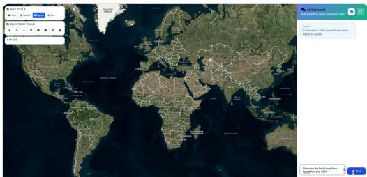  
1 User issues a natural-language disaster guery in Multi-Agent Team mode

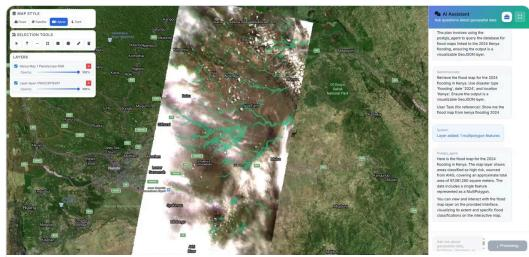  
Orchestrator lans the Vector a ent returns the flood-extent la er over hi h resolution ima er of 2 disaster-affected areas.

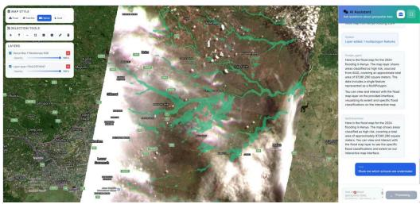  
3 Follow-up question: Find out the schools underwater.

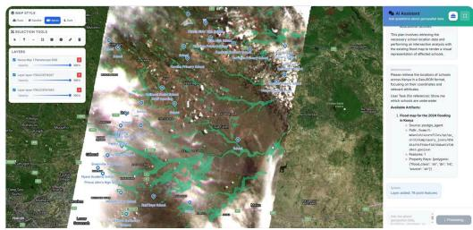  
4 The Maps a ent finds all schools in flooded areas

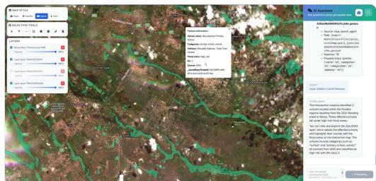  
5 Vector agent performs intersection between flood layer and school layer to identify schools in high-risk

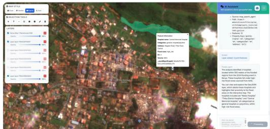  
6 A further uer locates hos itals within 500 m of the flooded areas

Figure 6. Example GeoFaham session for multi-step flood-impact analysis. The conversation panel presents user queries, system responses, tables, and artifact notifications, while the map workspace displays the flood extent, retrieved points of interest, satellite imagery, and generated vector outputs.  
USER QUERY “Show me burn seventy map from wildfire in Southern California using the pre-fire and post-fire imagery of this area. Disaster happened from 01-30 January 2025.”  
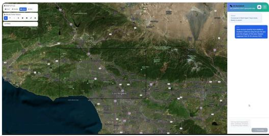  
1 User draws AOI usin selection tool and issues a natural-lan ua e disaster uer in Multi-A ent Team mode

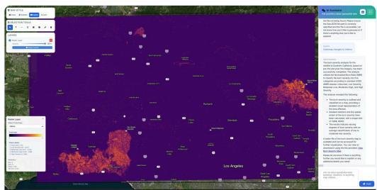  
2 Orchestrator lans STAC a ent retrieves re-fire and ost-fire ima er and Raster a ent com utes burn severit ma usin the Normalized Burn Ratio (NBR) index.

Figure 7. Example GeoFaham session for imagery-based burn-severity analysis. The user defines an area of interest, after which the system retrieves pre-fire and post-fire imagery and generates the corresponding burn-severity output in the map workspace.