# GlucoAgent: Personalized Glucose Forecasting from Multimodal Personal Context

Xingzhi Sun<sup>∗</sup> Yale University

Zhiyuan Wang Meta Reality Labs Research

Hyo Jin Kim Meta Reality Labs Research

Hao Chen Meta Reality Labs Research

## Abstract

Continuous glucose monitors, smartwatches, meal logs, and health profiles form a rich multimodal personal context that can significantly enhance glucose forecasting. However, existing methods struggle to effectively utilize these signals to improve glucose prediction because the relevance of different modalities varies drastically across individuals and time. We present GlucoAgent, an LLM-based agentic system that addresses this challenge through dynamic, case-by-case analysis at inference time. For each forecast, GlucoAgent writes and runs code over an individual’s multimodal context and returns predictions with a reason and supporting evidence. The generated programs are highly diverse, ranging from retrieving similar past meals to fitting and back-testing physiological and statistical models. On CGMacros, a multimodal glucose dataset, GlucoAgent outperforms time series foundation models on every forecasting horizon, achieving an average RMSE of 22.5 mg/dL compared to 23.5 mg/dL of Chronos-2, the leading multimodal time series foundation model. Furthermore, GlucoAgent is highly effective at leveraging multimodal data. The addition of multimodal data reduces its average RMSE by 1.4 mg/dL (24.0 mg/dL to 22.5 mg/dL), compared to a marginal 0.3 mg/dL (23.8 mg/dL to 23.5 mg/dL) improvement for Chronos-2. This advantage is most pronounced in challenging post-meal windows, where GlucoAgent uses multimodal context to reduce 60-minute forecast RMSE by 4.6 mg/dL (31.0 mg/dL to 26.5 mg/dL), far exceeding the 0.8 mg/dL (31.9 mg/dL to 31.1 mg/dL) reduction achieved by Chronos-2.

## 1 Introduction

Glucose forecasting is becoming increasingly important as continuous glucose monitors (CGMs) provide dense and longitudinal glucose measurements for people with or without diabetes [Zeevi et al., 2015, Das et al., 2025]. Researchers have used CGM measurements to predict individual responses to meals and support personalized nutrition [Zeevi et al., 2015], while commercial insulin-pump systems use glucose forecasts to automatically adjust insulin delivery [Battelino et al., 2017, Forlenza et al., 2018, Brown et al., 2019]. Therefore, accurate glucose forecasting is crucial for applications ranging from personalized metabolic-health management to automated diabetes care.

In this work, we study short-horizon glucose forecasting, which focuses on predicting continuous glucose monitor (CGM) measurements 30 to 120 minutes ahead. An accurate forecast can provide advance warning of changes in glucose and act as a useful reference for users who need to control their glucose levels [Woldaregay et al., 2019, Zhu et al., 2021]. Existing glucose forecasters range from physiological models of glucose–insulin dynamics to autoregressive models, neural networks and general-purpose time series foundation models [Sparacino et al., 2007, Woldaregay et al., 2019, Zhu et al., 2021, Ansari et al., 2025, Das et al., 2023, Liu et al., 2025a, 2024b, Lu et al., 2026]. Forecasts have also been tailored to individuals by training a model for each participant [Farahmand et al., 2025, Huang et al., 2026] or selecting a model based on validation error among different neural network architectures [Lara-Abelenda et al., 2025].

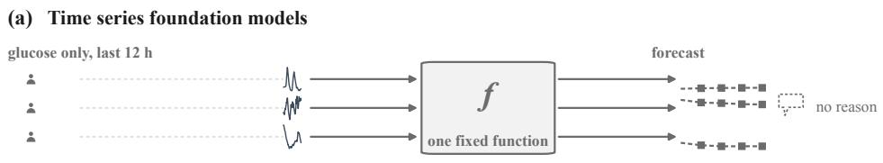

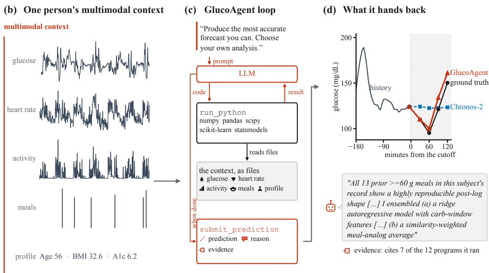  
Figure 1: One person’s multimodal context enters GlucoAgent. The agent writes and runs code to construct a case-by-case analysis, then submits a forecast with a reason and supporting evidence. (a) Time series foundation models receive the last twelve hours of glucose and return a forecast without a reason. (b) GlucoAgent receives one person’s glucose, heart rate, activity, logged meals and health profile. (c) The agent writes and runs code over that context, reads the outputs and continues until submission. (d) It returns each forecast with a reason and supporting evidence. In this example, it combines responses to the person’s past large meals with a regression fitted and validated on that person’s history.

Additional signals measured with smartwatches, meal logs, and health profiles can complement the CGM to provide a multimodal personal context. Because glucose is affected by an individual’s physiology and daily activities, such multimodal personal context has the potential to significantly improve glucose prediction. Multimodal forecasters have incorporated insulin and carbohydrates [Jeffries et al., 2026], wearable signals [Farahmand et al., 2025, Isaac et al., 2025], and health-record context [Zhu et al., 2026]. Yet, existing methods have struggled to demonstrate substantial improvements after adding the multimodal context to glucose inputs. For instance, in MetaboNet-Bench [Jeffries et al., 2026], adding insulin and carbohydrate inputs to five forecasting models reduced 30-minute RMSE by only 0.13 to 0.71 mg/dL. We argue that such limited improvements indicate underutilized multimodal personal context. This stems from a core challenge that the predictive utility of such context can vary across people and forecast moments. For example, a person’s earlier meal responses might be more helpful for forecasting near a meal, while forecasting near a quiet period may benefit more from recent glucose dynamics. Across existing approaches, researchers determine the model class and the way multimodal context enters it during development. What remains underexplored is whether constructing the analysis case-by-case at forecast time can better address this challenge.

To study this question, we introduce GlucoAgent, an LLM-based agentic system that constructs a tailored analysis from one person’s multimodal context at the time of each forecast. Building on language models that act through tools or executable programs [Yao et al., 2023, Gao et al., 2023] and related agents that analyze personal health data [Merrill et al., 2026, Wang et al., 2026], GlucoAgent uses an agent loop that writes and runs code, reads the outputs, and continues until it submits a forecast with a reason and supporting evidence. Because the agent can construct a different analysis for a different person or at a different time, this dynamic N-of-1 analysis provides flexible personalized analyses that use the multimodal personal context exactly as needed for each case. The reason and supporting evidence returned with each forecast enable us to inspect the agent’s logic, making our method more interpretable than a black-box forecasting model. We equip the Python environment with scientific and statistical libraries and observe, through the generated reason and evidence, that the agent uses these libraries to build and test physiological models as well as statistical machine learning models depending on the scenario. Figure 1 illustrates how GlucoAgent processes the multimodal personal context to make a forecast and submits a reason and supporting evidence.

On CGMacros [Das et al., 2025], a public multimodal glucose dataset, we compare GlucoAgent with time series foundation models evaluated in GlucoFM-Bench [Lu et al., 2026]. With multimodal inputs, GlucoAgent achieves a lower RMSE at every horizon from 30 to 120 minutes, with its widest lead of 1.6 mg/dL at 60 minutes compared with Chronos-2 [Ansari et al., 2025], the leading multimodal time series foundation model. Across the four forecast horizons, adding the multimodal context reduces GlucoAgent’s RMSE by 1.1 to 2.1 mg/dL, compared with 0.1 to 0.7 mg/dL for Chronos-2. To find out in which situations the multimodal context helps the most, we divided the prediction origins into post-meal, post-exercise, meal + exercise, and quiet situations. The multimodal context, compared to using glucose only, helps GlucoAgent most after meals, where it reduces the RMSE by 2.5 mg/dL on average, and by a massive 4.6 mg/dL at 60 minutes. In contrast, Chronos-2’s RMSE is reduced by only 0.9 mg/dL on average and 0.8 mg/dL at 60 minutes. On public glucose-only benchmarks, including the nine datasets in GlucoFM-Bench [Lu et al., 2026], GlucoAgent remains competitive with time series foundation models and CGM-LSM, a foundation model trained specifically for glucose forecasting [Luo et al., 2025].

Our main contributions are as follows:

1. We introduce GlucoAgent, an LLM agentic system for personalized multimodal glucose forecasting that dynamically writes and runs code over a person’s multimodal context for each forecast and submits a reason and supporting evidence.

2. We demonstrate the efficacy of GlucoAgent by comparing it against time series foundation models on the CGMacros dataset with multimodal records as well as the glucose-only datasets from GlucoFM-Bench [Das et al., 2025, Lu et al., 2026]. GlucoAgent outperforms time series foundation models at every evaluated horizon with multimodal context, and matches their performance on glucose-only univariate settings.

3. Through stratified evaluations across distinct physiological states (e.g., post-meal), qualitative case studies, and a systematic analysis of the generated code, we reveal when and how multimodal context improves predictions, offering transparency into the forecasting process.

## 2 Related Work

Personalized and multimodal glucose forecasting. Recent glucose forecasting methods include glucose-specific pretrained models [Luo et al., 2025, Lutsker et al., 2026, Li et al., 2026] and generalpurpose time series foundation models that perform zero-shot forecasting without glucose-specific training [Ansari et al., 2024, 2025, Das et al., 2023, Woo et al., 2024, Liu et al., 2025a, 2024b, 2025c]. On GlucoFM-Bench [Lu et al., 2026], the best zero-shot time series foundation model, TimesFM-2.5 [Das et al., 2023], achieves forecast error within 5% of the best fully supervised LSTM model of Martinsson et al. [2020] when both use glucose-only inputs. Other methods tailor glucose forecasts to individuals by training a model for each participant [Farahmand et al., 2025, Huang et al., 2026], selecting a model for each participant based on validation error [Lara-Abelenda et al., 2025], or updating a separate linear model as new CGM readings arrive [Eren-Oruklu et al., 2009]. Multimodal forecasters add heart rate and activity [Farahmand et al., 2025, Isaac et al., 2025], meal photographs [Wolber et al., 2025], or health-record context [Zhu et al., 2026] to the glucose history. MetaboNet-Bench [Jeffries et al., 2026] also evaluates insulin and carbohydrate inputs, but finds that they reduce forecast error only slightly. On CGMacros, Huang et al. [2026] forecast 120-minute after meal glucose from multimodal inputs using a predictor fine-tuned for each participant. A separate LLM agent uses these forecasts to propose meal changes. Across personalized and multimodal glucose forecasting, researchers predetermine the model class and how multimodal context enters it during development, even when they fit or update a model separately for each participant.

Language models and agents for time series. Language models have been adapted to forecast time series through prompting or fine-tuning [Gruver et al., 2023, Liu et al., 2024a, Jin et al., 2024, Zhou et al., 2023, Liu et al., 2025b]. Some language-model forecasters also receive natural-language descriptions of the series, relevant events, or forecast constraints [Williams et al., 2024], while retrieval-augmented forecasters use examples from other series [Ning et al., 2026] or from the target series’ own history [Han et al., 2025]. General tool-using language-model methods include ReAct, which uses tool outputs to decide what to do next [Yao et al., 2023], and PAL, which uses an interpreter to perform numerical calculations [Gao et al., 2023]. Time-series forecasting agents use language models to route among pretrained forecasters [Salesforce AI Research, 2026] or coordinate prescribed roles, steps and model libraries [Zhao et al., 2025, Pan et al., 2026, Yeh et al., 2025]. For time-series analysis rather than forecasting, Rechtorík et al. [2026] study coding agents that write and run Python code over time series to answer multiple-choice questions.

Agents for personal health. LLM agents have also been used to analyze personal health data. Agents and other LLM-based methods for CGM retrieve relevant segments, summarize glucose patterns, compute retrospective metrics and answer questions [Cui et al., 2026, Healey and Kohane, 2024, Cardei et al., 2025, Healey et al., 2025]. The Personal Health Agent includes a data-science agent that first produces an analysis plan and then writes and runs Python code over personal wearable and health-record data [Heydari et al., 2025]. PHIA writes and runs Python code over one person’s wearable data to answer retrospective questions [Merrill et al., 2026]. PULSE gives an agent purposebuilt tools to choose which smartphone signals and look-back windows to inspect when predicting whether a person wants emotional support and is available to receive it [Wang et al., 2026]. These methods analyze past or current health data. Our GlucoAgent writes and runs code over one person’s multimodal context at each forecast origin to predict future glucose.

## 3 Method

GlucoAgent is an LLM-based agentic system that forecasts glucose from each person’s multimodal context. The overview of our system is illustrated in Figure 1. At each forecast origin, the agent writes and runs code over a person’s context, then submits the forecasts with a reason and supporting evidence.

## 3.1 Multimodal personal context

Figure 1b summarizes the multimodal personal context supplied to GlucoAgent for each forecast. Using CGMacros [Das et al., 2025] as an example, this context encompasses multimodal timeseries data (glucose, heart rate, energy expenditure, and metabolic equivalents), detailed meal logs (timestamps, meal types, and macronutrient contents), and a static health profile (demographics, body measurements, and laboratory results). While the dataset also contains meal photographs, we defer raw image analysis to future work. We strictly retain only the information available prior to the forecast origin to enforce causal boundaries, and compile these records, alongside the target prediction timestamps, into a single JSON case file (see Appendix A.2 for formatting details). Notably, we inject no hand-engineered features. Instead, we provide the raw data, relying entirely on the agent to autonomously determine which contextual elements are relevant and how to process them for each individual case. For glucose-only evaluations, the same agent receives a reduced case file containing only glucose and the target specification (Appendix A.12).

## 3.2 Per-origin numerical analysis

We provide the agent a prompt that defines the forecasting task, available evidence, and a list of valid actions. In the prompt, we also instruct it to “Produce the most accurate forecast you can. Choose your own analysis.” The prompt does not specify any forecasting model, feature set, or look-back window. The complete prompt is provided in Appendix A.4.

We equip the agent with two tools: a Python interpreter and a forecast-submission tool. Following ReAct and program-aided reasoning [Yao et al., 2023, Gao et al., 2023], the agent writes a program, observes its output, and decides what to run next until it submits a forecast, as shown in Figure 1c. Each forecast episode allows at most 16 LLM turns. The Python tool is disabled in the final two turns, which are reserved for submission and correction if the first submission is invalid. The Python programs run in a sandbox with read-only access to the data file, no network access, and fixed time and memory limits. The Python environment provides general-purpose numerical and statistical packages, including NumPy, SciPy, pandas, scikit-learn, and statsmodels. It also provides two optional Python modules for loading the case and reporting the available fields and their coverage. We provide no pretrained glucose forecaster, time series foundation model, or modality-specific analysis pipeline. Thus, the agent constructs its forecasting procedure using general-purpose computation; depending on the case, it may process the data, search the person’s history for comparable events, fit models, and validate their predictions.

All reported experiments use Claude Opus 5 at high reasoning effort, fixed before test scoring and unchanged across benchmarks without dataset-specific prompts or tuning. Appendix A gives the complete runtime configuration, and Appendix A.10 describes the sandbox and temporal restrictions.

## 3.3 Forecast submission with reasons and supporting evidence

The forecast-submission tool requires one glucose value for each target timestamp, a reason for the forecast, and evidence supporting that reason. Each successful Python call returns an evidence reference linked to the current case, the program, and its output. An incomplete submission or invalid reference produces an error that the agent may correct and retry (Appendix A.9). Figure 1d shows GlucoAgent’s output for one forecast: predicted values together with a reason and cited evidence that make its underlying analysis inspectable. In Section 4.4, we use the submitted reason and evidence to reconstruct individual forecasts and examine how the agent uses multimodal personal context across people and forecast origins.

## 4 Results

## 4.1 Experimental setup

We use CGMacros [Das et al., 2025], a public dataset in which each participant wore a continuous glucose monitor and a smartwatch while logging their meals. We held out nine of the 45 participants as the test set, with three in each A1c range: normal, prediabetes, and diabetes. These participants provide 1,903 forecast origins spaced one hour apart. At each origin, a method predicts glucose at 30, 60, 90, and 120 minutes in the future. The multimodal context contains glucose, heart rate, activity, logged meals, and a baseline health profile. Across the forecast origins, the available context has a median of 5.5 days of history and 22 logged meals (for participant and data details, see Appendix C).

We evaluate under three input settings: the last twelve hours of glucose, the full glucose history, and the multimodal personal context. Comparing the first two settings shows the effect of longer glucose history, while comparing the second and third shows the additional effect of the non-glucose signals. In the glucose-only settings, we evaluate GlucoAgent and four time series foundation models, Chronos-2, TimesFM-2.5, Moirai-2.0, and Timer [Ansari et al., 2025, Das et al., 2023, Liu et al., 2025a, 2024b]. We also include persistence, a naive baseline with no parameters that repeats the last glucose reading as the forecast at every horizon. Among these models, Chronos-2 accepts additional multimodal covariates and is therefore used for the multimodal comparison. Chronos-2 receives heart rate, activity, meal nutrient values, and one-hot-encoded meal type as multivariate numerical time series, while GlucoAgent receives the JSON context file described in Section 3 (for the exact inputs and baseline configurations, see Appendices A.11 and D).

Following Lu et al. [2026], we compute root-mean-square error (RMSE) separately for each participant and horizon and then average across participants with equal weight. Mean absolute error and further evaluation details are reported in Appendix H.

Table 1: Adding the multimodal context reduces GlucoAgent’s RMSE more than Chronos-2’s, and GlucoAgent has lower RMSE with the multimodal context at all four horizons. Participantlevel RMSE in mg/dL, mean (standard deviation) over the nine participants. Bold marks the lowest and underlining the second lowest error within a setting (<sup>†</sup>Timer’s input handling is described in Appendix D).
<table><tr><td>Method</td><td>30 min</td><td>60 min</td><td>90 min</td><td>120 min</td></tr><tr><td colspan="5">Reference</td></tr><tr><td>Persistence</td><td>20.429 (5.574)</td><td>29.151 (11.147)</td><td>34.646 (14.176)</td><td>38.003 (16.954)</td></tr><tr><td colspan="5">Glucose only, 12 hours of history</td></tr><tr><td>TimesFM-2.5</td><td>17.853 (5.027)</td><td>25.586 (10.228)</td><td>29.495 (12.924)</td><td>31.354 (15.047)</td></tr><tr><td>Moirai-2.0</td><td>18.446 (5.625)</td><td>27.011 (10.841)</td><td>31.587 (14.169)</td><td>33.886 (16.853)</td></tr><tr><td>Timer†</td><td>20.089 (6.603)</td><td>27.342 (11.607)</td><td>30.779 (14.495)</td><td>31.559 (16.221)</td></tr><tr><td>Chronos-2</td><td>18.446 (5.070)</td><td>27.137 (10.362)</td><td>31.449 (13.229)</td><td>33.720 (16.117)</td></tr><tr><td>GlucoAgent</td><td>18.679 (5.080)</td><td>27.209 (10.093)</td><td>31.077 (12.579)</td><td>33.191 (14.883)</td></tr><tr><td colspan="5">Glucose only, full history</td></tr><tr><td>TimesFM-2.5</td><td>17.278 (4.740)</td><td>24.106 (9.513)</td><td>27.110 (12.378)</td><td>28.346 (14.336)</td></tr><tr><td>Moirai-2.0</td><td>17.437 (5.061)</td><td>24.353 (9.545)</td><td>27.467 (11.972)</td><td>28.837 (13.843)</td></tr><tr><td>Timer†</td><td>18.057 (5.528)</td><td>24.672 (10.105)</td><td>27.539 (12.431)</td><td>28.757 (14.145)</td></tr><tr><td>Chronos-2</td><td>17.329 (4.906)</td><td>23.853 (9.328)</td><td>26.464 (11.342)</td><td>27.553 (13.031)</td></tr><tr><td>GlucoAgent</td><td>17.416 (4.930)</td><td>24.187 (9.150)</td><td>26.584 (10.846)</td><td>27.661 (12.395)</td></tr><tr><td colspan="5">Multimodal personal context</td></tr><tr><td>Chronos-2</td><td>17.246 (5.125)</td><td>23.711 (9.586)</td><td>26.052 (11.527)</td><td>26.866 (12.887)</td></tr><tr><td>GlucoAgent</td><td>16.357 (3.605)</td><td>22.132 (8.220)</td><td>25.163 (9.663)</td><td>26.450 (11.333)</td></tr></table>

## 4.2 GlucoAgent outperforms Chronos-2 with the multimodal context

Table 1 presents the evaluation results on the CGMacros dataset. With the multimodal context, our GlucoAgent achieves lower RMSE than Chronos-2 [Ansari et al., 2025] at all four horizons. Across the four horizons, its mean RMSE is 22.5 mg/dL, compared with 23.5 mg/dL for Chronos-2. The lead is largest at 60 minutes, where the two methods have RMSEs of 22.1 and 23.7 mg/dL.

For both methods, incorporating a longer glucose history improves performance. Expanding the context window from twelve hours to the full glucose history reduces the four-horizon mean RMSE by 3.6 mg/dL for GlucoAgent and 3.9 mg/dL for Chronos-2. When using only this full glucose history, GlucoAgent and Chronos-2 perform competitively, differing by a maximum of 0.3 mg/dL at any given horizon. However, incorporating the multimodal context reduces GlucoAgent’s four-horizon mean RMSE by 1.4 mg/dL, compared with 0.3 mg/dL for Chronos-2 (Figure 2a).

## 4.3 The improvement from the multimodal context is largest after meals

We investigate whether the benefit of the multimodal context varies with the event preceding the forecast origin. For this retrospective analysis, we classify each forecast origin into one of four situations based on the meal and exercise information available before it: quiet, post-meal, post-exercise, or meal + exercise (for the definitions and number of origins in each situation, see Appendix C and Figure 5a).

The full evaluation results for each situation and horizon are reported in Figure 5 and Tables 15–18.

The largest improvement for GlucoAgent occurs after meals. Adding the multimodal context reduces its RMSE by 2.5 mg/dL in the post-meal situation, compared with 0.5 mg/dL when quiet, 0.5 mg/dL after exercise, and 0.0 mg/dL when a meal and exercise are both present (Figure 2b). Chronos-2 improves most after exercise, by 1.5 mg/dL, and its post-meal improvement is 0.9 mg/dL.

The performance gains from the multimodal context also vary by forecast horizon. For GlucoAgent, the largest improvement happens at 60 minutes, where the multimodal context reduces RMSE by 2.1 mg/dL, compared with 0.1 mg/dL for Chronos-2 (Figure 2c). Within the post-meal situation, the reduction for GlucoAgent reaches 4.6 mg/dL at 60 minutes.

(a) RMSE by input setting

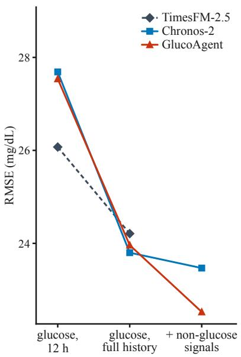  
(b) RMSE reduction by situation

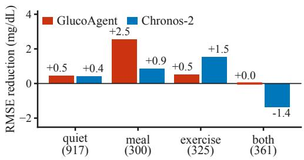

(c) RMSE reduction by horizon  
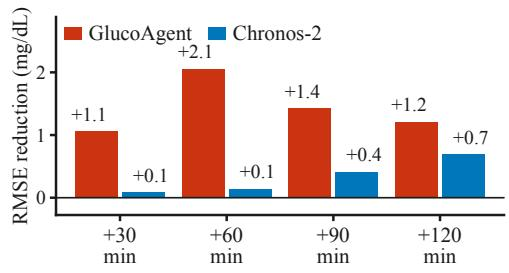  
Figure 2: The multimodal context reduces GlucoAgent’s RMSE more than Chronos-2’s. (a) Mean participant-level RMSE over the four horizons as the input expands from twelve hours of glucose to the full glucose history and then the multimodal context. (b) The RMSE reduction from the multimodal context in four forecast situations. (c) The same reduction at each forecast horizon.

The large improvement in the post-meal situation motivates us to examine how the agent used meal information and the rest of the personal history in individual forecasts.

## 4.4 GlucoAgent uses different analyses across forecast cases

The programs that GlucoAgent writes and runs differ across forecast situations. To understand the behavior, we examined a 576-origin subsample stratified by participant and forecast situation to reflect the full test set (Appendix C). In this subset, GlucoAgent reads the meal log in 90% of post-meal cases and 48% of quiet cases. As shown in Figure 3, GlucoAgent fits a model in 55% of quiet cases and 37% of cases in the meal + exercise situation. Meal-log use is most common after meals, whereas model fitting is most common during quiet periods.

Next, we examine individual cases. A procedure recorded before case inspection identified nine accurate forecasts with substantial glucose changes. Figure 4 reconstructs three from the submitted reason and cited programs, while Figures 7 and 8 show the other six.

For the forecast in Figure 4a, a meal is logged three minutes before the forecast origin, before its glucose response can be observed. The agent reads all twelve meals in the participant’s meal history, keeps the five lunches and dinners with more than 50 g of carbohydrate, and uses their mean and median responses as anchors for its forecast.

In Figure 4b, the agent fits a physiological model of absorption and clearance to the first six measurements of an ongoing post-meal rise. It compares the fitted curve with the same breakfast on the previous day. The agent gives more weight to the current curve because the rise is already slowing and the current breakfast contains more protein, and it discounts the earlier day’s post-peak decline because the decline coincided with exercise.

In Figure 4c, the agent examines a quiet period with a steep glucose decline. It finds 624 earlier windows that meet its falling-slope threshold and back-tests three rules: hold the current value, continue the current slope, and let the slope decay exponentially. The exponentially damped rule has the lowest mean absolute error in these back-tests. The final forecast combines this rule with nearest-neighbor, historical-analogue, and ridge-regression estimates.

(a) Reads logged meals  
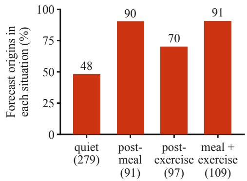

(b) Fits a model  
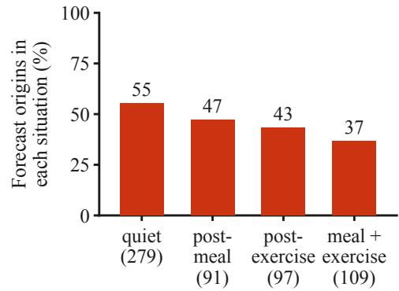  
Figure 3: The cited programs differ across forecast situations. Each bar shows the percentage of origins in a situation for which the cited programs read the logged meals or fit a model. The subsample contains 576 origins: 279 quiet, 91 post-meal, 97 post-exercise, and 109 meal + exercise.

Together, these case studies show how GlucoAgent personalizes each forecast. The agent decides which parts of the person’s multimodal context to use, how to form predictions from them, and how to validate and combine those predictions into the final forecast. More broadly, across all 1,903 held-out origins, the agent runs 14,468 successful programs, with a median of seven per origin, and writes its own function or class in 64% of the origins. In the 576-origin subsample, the signals, estimators, validation checks, and presence of an agent-written function form 186 different combinations. Of these, 120 occur only once (for the full analysis of the programs, see Appendix F).

## 4.5 Accuracy depends on the language model and reasoning effort

We observed that the performance varies substantially depending on the language model and the reasoning effort. We vary the language model and reasoning effort while keeping the multimodal input setting and the rest of the method fixed (Table 2). The Claude Opus 5 configuration at high reasoning effort has the lowest RMSE at every horizon. The alternatives increase the four-horizon mean RMSE by 1.1 to 5.2 mg/dL. The RMSE reduction from the multimodal context also depends on the model: it is 1.4 mg/dL for Claude Opus 5 at high reasoning effort and 0.3 mg/dL for Claude Sonnet 5 at high reasoning effort (for the complete input comparison, see Appendix B.2).

Table 2: Claude Opus 5 at high reasoning effort has the lowest RMSE at every horizon among the tested configurations. Participant-level RMSE in mg/dL, mean (standard deviation) over the nine participants. Bold marks the lowest and underlining the second lowest error at each horizon.
<table><tr><td>Model</td><td>Effort</td><td>30 min</td><td>60 min</td><td>90 min</td><td>120 min</td></tr><tr><td>Claude Opus 5 (ours) high</td><td></td><td>16.357 (3.605)</td><td>22.132 (8.220)</td><td>25.163 (9.663)</td><td>26.450 (11.333)</td></tr><tr><td>Claude Opus 5</td><td>medium</td><td>17.016 (3.683)</td><td>23.746 (8.594)</td><td>27.308 (10.659)</td><td>28.999 (12.550)</td></tr><tr><td>Claude Sonnet 5</td><td>high</td><td>18.595 (4.177)</td><td>26.613 (8.857)</td><td>31.108 (11.528)</td><td>34.511 (14.200)</td></tr><tr><td>Gemini 3.1 Pro</td><td>high</td><td>18.964 (5.404)</td><td>25.389 (10.162)</td><td>29.277 (11.128)</td><td>30.693 (13.674)</td></tr><tr><td>GPT-5.6-sol</td><td>high</td><td>17.202 (4.263)</td><td>23.300 (8.562)</td><td>26.436 (9.079)</td><td>27.753 (10.995)</td></tr></table>

## 4.6 GlucoAgent remains competitive on glucose-only benchmarks

Our main task uses the multimodal personal context, while the glucose-only benchmarks below test whether GlucoAgent remains competitive when given only glucose history. Under the GlucoFM-Bench protocol [Lu et al., 2026], each method receives twelve hours of glucose history and predicts 30 minutes ahead on nine public CGM datasets. We use a fixed subset of at most 32 origins per

Stated reason

(a) A search of the person's history for similar meals

RMSE (mg/dL) GlucoAgent 9.1 Chronos-2 31.1 persistence 53.1

(c) A back-test over 624 past falls in the person's glucose history  
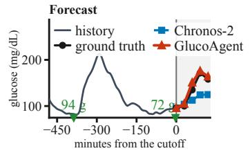  
Steps, in order

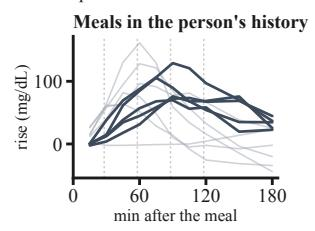  
no library estimator called

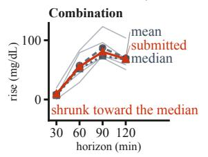  
read this person's logged meals find 5 past meals like this one average, shrink toward the median  
"Using this subject's own comparable lunch/dinner responses (carbs >=50 g; n=5) at exactly those post-meal offsets [...] Values are 白 shrunk slightly from the mean toward the median because peak amplitude is the most variable component in this subject's history."  
RMSE (mg/dL) GlucoAgent 13.2 Chronos-2 23.5 persistence 39.4

(b) A physiological model fitted to the rise so far

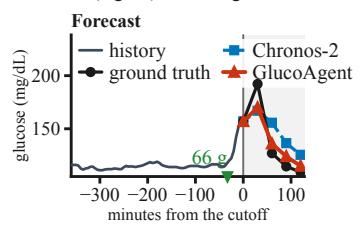  
Steps, in order

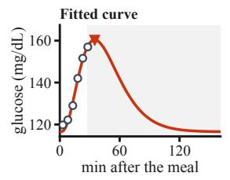  
curve\_fit

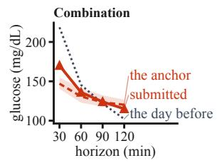  
read the rise so far fit an absorption curve to it rescale the day before lean 65% on today's curve  
由 "a mechanistic gamma-absorption + first-order-clearance fit to the current post-meal points (residuals <3 mg/dL) [...]<sub>the</sub> <sub>submitted</sub> <sub>values</sub> <sub>are</sub> <sub>a</sub> <sub>weighted</sub> <sub>blend</sub> <sub>leaning</sub> <sub>on</sub> <sub>today's</sub> <sub>own</sub> <sub>kinetics</sub> <sub>(\~65%)</sub> <sub>with</sub> <sub>an</sub> <sub>upward</sub> <sub>hedge</sub> <sub>at</sub> <sub>30</sub> <sub>min"</sub>

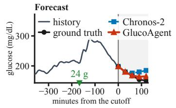  
Steps, in order

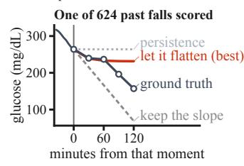  
KFold, RidgeCV, cross\_val\_score

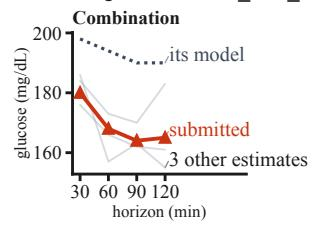  
"a regularized ridge on level+slope+meal features (best CV MAE) [...] was used as a shrinkage anchor [...] with a 由 small upward allowance at 120 min for possible early lunch."

Figure 4: Three case-by-case analyses constructed from personal history. Each row reconstructs one forecast from the agent’s cited programs and submitted reason. The rows show a search for similar past meals, a physiological model fitted to an ongoing rise, and three rules for continuing a falling glucose trend back-tested on earlier windows.

Table 3: With its configuration unchanged, GlucoAgent has the lowest RMSE on five of nine datasets and the second lowest on two. Forecasting under the GlucoFM-Bench protocol: twelve hours of glucose history, a 30-minute horizon and participant-level RMSE in mg/dL as mean (standard deviation), on at most 32 origins per participant. Bold marks the best and underlining the second best method on each dataset.
<table><tr><td>Dataset</td><td>Persistence</td><td>Chronos-2</td><td>Moirai-2.0</td><td></td><td>Timer TimesFM-2.5 GlucoAgent</td><td></td></tr><tr><td>Hall2018</td><td>13.90 (7.75)</td><td>13.27 (6.72)</td><td>12.96 (6.94)</td><td>14.27 (8.10)</td><td></td><td>12.92 (6.49) 13.59 (6.21)</td></tr><tr><td>BIG IDEAS Lab 15.63 (4.04)</td><td></td><td>14.21 (3.84)</td><td>14.29 (3.97)</td><td>15.95 (5.19)</td><td>13.78 (3.80) 14.51 (3.71)</td><td></td></tr><tr><td>ShanghaiT1DM</td><td>17.64 (8.13)</td><td>12.51 (5.27)</td><td>11.89 (4.56)</td><td>19.59 (9.00)</td><td>12.06 (5.22) 11.04 (4.75)</td><td></td></tr><tr><td>ShanghaiT2DM</td><td>15.03 (5.02) 11.77 (3.80)</td><td></td><td>11.47 (3.51)</td><td>15.40 (5.76)</td><td></td><td>11.14 (3.66) 11.13 (3.57)</td></tr><tr><td>HUPÃ-UCM</td><td>21.58 (8.19) 18.04 (7.57)</td><td></td><td>17.12 (6.86)</td><td>24.49 (7.81)</td><td></td><td>17.35 (7.42) 16.35 (6.69)</td></tr><tr><td>T1DM-UOM</td><td>25.46 (6.11) 22.01 (5.53) 22.62 (6.08)</td><td></td><td></td><td>24.99 (6.47)</td><td></td><td>22.34 (5.83) 21.24 (5.45)</td></tr><tr><td>Bris-T1D Open</td><td>20.87 (9.82) 18.31 (8.33) 18.05 (7.94)</td><td></td><td></td><td>21.35 (10.26)</td><td></td><td>17.89 (8.44) 17.58 (8.61)</td></tr><tr><td>AZT1D</td><td>22.34 (5.74) 20.52 (5.61) 20.30 (5.61)</td><td></td><td></td><td>23.17 (5.42)</td><td></td><td>19.69 (5.15) 20.07 (5.98)</td></tr><tr><td>OhioT1DM</td><td>24.16 (4.53) 20.77 (4.90) 20.28 (4.65)</td><td></td><td></td><td>25.46 (5.41)</td><td></td><td>20.88 (4.50) 20.76 (5.99)</td></tr></table>

participant for a total of 8,646 origins. The relative performance of the time series foundation models is similar on the subset and the full population (Table 24).

GlucoAgent obtains the lowest RMSE on five of the nine datasets and the second lowest on two more (Table 3). Where another method has lower error, the difference is below 0.8 mg/dL. Our glucose-only baseline runs are compared with their published results in Appendix G.3. On OhioT1DM [Marling and Bunescu, 2020] under the CGM-LSM protocol, GlucoAgent is within 0.35 mg/dL of the best time series foundation model at the 30-, 60-, and 120-minute horizons (Table 25 in Appendix G.2). The table also includes the published CGM-LSM result, from a foundation model trained specifically for glucose forecasting [Luo et al., 2025]. Although that result uses a different evaluation population, GlucoAgent has lower reported error at 120 minutes.

## 5 Conclusion

In this work, we introduced GlucoAgent, an LLM-based agentic system for personalized multimodal glucose forecasting. Traditional models struggle to integrate multimodal context because its predictive utility varies drastically across individuals and time. GlucoAgent overcomes this limitation by replacing static prediction functions with dynamic, case-by-case computational analysis. At each prediction point, the agent writes, executes, and iterates on bespoke Python code to analyze an individual’s specific health and behavioral context. Empirically, GlucoAgent outperforms the leading time-series foundation model, Chronos-2, across all forecast horizons on the CGMacros dataset. In particular, GlucoAgent demonstrates a superior ability to extract signal from multimodal records beyond just the glucose data, resulting in large error reductions in challenging post-meal windows where baseline models fail. Our analysis of the agent’s generated code reveals sophisticated, autonomous investigation strategies ranging from historical meal retrieval to physiological model fitting and rigorous back-testing. While our current multimodal evaluation focuses on CGMacros due to the scarcity of comprehensive, open-source datasets, future work will scale this agentic approach to broader, more diverse populations as new multimodal cohorts emerge.

## References

Abdul Fatir Ansari, Lorenzo Stella, Caner Turkmen, Xiyuan Zhang, Pedro Mercado, Huibin Shen, Oleksandr Shchur, Syama Sundar Rangapuram, Sebastian Pineda Arango, Shubham Kapoor, et al. Chronos: Learning the language of time series. arXiv preprint arXiv:2403.07815, 2024.

Abdul Fatir Ansari, Oleksandr Shchur, Jaris Küken, Andreas Auer, Boran Han, Pedro Mercado, Syama Sundar Rangapuram, Huibin Shen, Lorenzo Stella, Xiyuan Zhang, et al. Chronos-2: From univariate to universal forecasting. arXiv preprint arXiv:2510.15821, 2025.

Tadej Battelino, Revital Nimri, Klemen Dovc, Moshe Phillip, and Natasa Bratina. Prevention of hypoglycemia with predictive low glucose insulin suspension in children with type 1 diabetes: a randomized controlled trial. Diabetes care, 40(6):764–770, 2017.

Sue A Brown, Boris P Kovatchev, Dan Raghinaru, John W Lum, Bruce A Buckingham, Yogish C Kudva, Lori M Laffel, Carol J Levy, Jordan E Pinsker, R Paul Wadwa, et al. Six-month randomized, multicenter trial of closed-loop control in type 1 diabetes. New England Journal ofMedicine, 381 (18):1707–1717, 2019.

Maria Ana Cardei, Josephine Lamp, Mark Derdzinski, and Karan Bhatia. Dm-bench: Benchmarking llms for personalized decision making in diabetes management. arXiv preprint arXiv:2510.00038, 2025.

Yanjun Cui, Ali Emami, Temiloluwa Prioleau, and Nikhil Singh. If only my cgm could speak: A privacy-preserving agent for question answering over continuous glucose data. In Findings ofthe Associationfor Computational Linguistics: ACL 2026, pages 17941–17958, 2026.

Abhimanyu Das, Weihao Kong, Rajat Sen, and Yichen Zhou. A decoder-only foundation model for time-series forecasting. arXiv preprint arXiv:2310.10688, 2023.

Anurag Das, David Kerr, Namino Glantz, Wendy Bevier, Rony Santiago, Ricardo Gutierrez-Osuna, and Bobak J Mortazavi. Cgmacros: a pilot scientific dataset for personalized nutrition and diet monitoring. Scientific Data, 12(1):1557, 2025.

Meriyan Eren-Oruklu, Ali Cinar, Lauretta Quinn, and Donald Smith. Estimation of future glucose concentrations with subject-specific recursive linear models. Diabetes technology & therapeutics, 11(4):243, 2009.

Ebrahim Farahmand, Reza Rahimi Azghan, Nooshin Taheri Chatrudi, Eric Kim, Gautham Krishna Gudur, Edison Thomaz, Giulia Pedrielli, Pavan Turaga, and Hassan Ghasemzadeh. Attengluco: Multimodal transformer-based blood glucose forecasting on ai-readi dataset. In 2025 47th Annual International Conference ofthe IEEE Engineering in Medicine and Biology Society (EMBC), pages 1–7. IEEE, 2025.

Gregory P Forlenza, Zoey Li, Bruce A Buckingham, Jordan E Pinsker, Eda Cengiz, R Paul Wadwa, Laya Ekhlaspour, Mei Mei Church, Stuart A Weinzimer, Emily Jost, et al. Predictive low-glucose suspend reduces hypoglycemia in adults, adolescents, and children with type 1 diabetes in an at-home randomized crossover study: results of the prolog trial. Diabetes care, 41(10):2155–2161, 2018.

Luyu Gao, Aman Madaan, Shuyan Zhou, Uri Alon, Pengfei Liu, Yiming Yang, Jamie Callan, and Graham Neubig. PAL: Program-aided language models. In Proceedings of the 40th International Conference on Machine Learning, volume 202 of Proceedings ofMachine Learning Research, pages 10764–10799. PMLR, 2023. URL https://proceedings.mlr.press/v202/gao23f. html.

Nate Gruver, Marc Finzi, Shikai Qiu, and Andrew G Wilson. Large language models are zero-shot time series forecasters. Advances in neural information processing systems, 36:19622–19635, 2023.

Sungwon Han, Seungeon Lee, Meeyoung Cha, Sercan O Arik, and Jinsung Yoon. Retrieval augmented time series forecasting. arXiv preprint arXiv:2505.04163, 2025.

Elizabeth Healey and Isaac Kohane. Llm-cgm: A benchmark for large language model-enabled querying of continuous glucose monitoring data for conversational diabetes management. In Biocomputing 2025: Proceedings of the Pacific Symposium, pages 82–93. World Scientific, 2024.

Elizabeth Healey, Amelia Li Min Tan, Kristen L Flint, Jessica L Ruiz, and Isaac Kohane. A case study on using a large language model to analyze continuous glucose monitoring data. Scientific reports, 15(1):1143, 2025.

A Ali Heydari, Ken Gu, Vidya Srinivas, Hong Yu, Zhihan Zhang, Yuwei Zhang, Akshay Paruchuri, Qian He, Hamid Palangi, Nova Hammerquist, et al. The anatomy of a personal health agent. arXiv preprint arXiv:2508.20148, 2025.

Mingyu Huang, Weiqing Min, Ying Jin, Yilin Wang, and Shuqiang Jiang. From prediction to intervention: Personalized meal-level glucose regulation via an llm agent. In Findings of the Associationfor Computational Linguistics: ACL 2026, pages 21629–21645, 2026.

Shakson Isaac, Yentl Collin, and Chirag Patel. Ssm-cgm: Interpretable state-space forecasting model of continuous glucose monitoring for personalized diabetes management. arXiv preprint arXiv:2510.04386, 2025.

Nathaniel Jeffries, Miriam Wolff, Sam Royston, Elizabeth Healey, Caleb Mayer, David Klonoff, Michael Snyder, and Tao Wang. Metabonet-bench: A multi-modal benchmark for glucose forecasting in type 1 diabetes. arXiv preprint arXiv:2606.18640, 2026.

Ming Jin, Shiyu Wang, Lintao Ma, Zhixuan Chu, James Zhang, Xiaoming Shi, Pin-Yu Chen, Yuxuan Liang, Yuan-Fang Li, Shirui Pan, et al. Time-llm: Time series forecasting by reprogramming large language models. In International conference on learning representations, volume 2024, pages 23857–23880, 2024.

Francisco J Lara-Abelenda, David Chushig-Muzo, Pablo Peiro-Corbacho, Ana M Wägner, Conceição Granja, and Cristina Soguero-Ruiz. Personalized glucose forecasting for people with type 1 diabetes using large language models. Computer Methods and Programs in Biomedicine, 265: 108737, 2025.

Zechen Li, Keerthana Natarajan, Weizhi Zhang, Menglian Zhou, Simon A Lee, Yuwei Zhang, Maxwell A Xu, Zeinab Esmaeilpour, Flora D Salim, Mark Malhotra, et al. Glucofm: A dualstream foundation model for continuous glucose monitoring. arXiv preprint arXiv:2605.30865, 2026.

Chenghao Liu, Taha Aksu, Juncheng Liu, Xu Liu, Hanshu Yan, Quang Pham, Silvio Savarese, Doyen Sahoo, Caiming Xiong, and Junnan Li. Moirai 2.0: When less is more for time series forecasting. arXiv preprint arXiv:2511.11698, 2025a.

Haoxin Liu, Zhiyuan Zhao, Jindong Wang, Harshavardhan Kamarthi, and B Aditya Prakash. Lstprompt: Large language models as zero-shot time series forecasters by long-short-term prompting. In Findings of the Association for Computational Linguistics: ACL 2024, pages 7832–7840, 2024a.

Peiyuan Liu, Hang Guo, Tao Dai, Naiqi Li, Jigang Bao, Xudong Ren, Yong Jiang, and Shu-Tao Xia. Calf: Aligning llms for time series forecasting via cross-modal fine-tuning. In Proceedings ofthe AAAI Conference on Artificial Intelligence, volume 39, pages 18915–18923, 2025b.

Yong Liu, Haoran Zhang, Chenyu Li, Xiangdong Huang, Jianmin Wang, and Mingsheng Long. Timer: Generative pre-trained transformers are large time series models. arXiv preprint arXiv:2402.02368, 2024b.

Yong Liu, Guo Qin, Xiangdong Huang, Jianmin Wang, and Mingsheng Long. Timer-xl: Longcontext transformers for unified time series forecasting. In International Conference on Learning Representations, volume 2025, pages 83982–84006, 2025c.

Baiying Lu, Zhaohui Liang, Ryan Pontius, Shengpu Tang, and Temiloluwa Prioleau. Glucofmbench: Benchmarking time-series foundation models for blood glucose forecasting. arXiv preprint arXiv:2606.06881, 2026.

Junjie Luo, Abhimanyu Kumbara, Mansur Shomali, Rui Han, Anand Iyer, Grazia Aleppo, Ritu Agarwal, and Gordon Gao. A large sensor foundation model pretrained on continuous glucose monitor data for diabetes management. npj Health Systems, 2(1):35, 2025.

Guy Lutsker, Gal Sapir, Smadar Shilo, Jordi Merino, Anastasia Godneva, Jerry R Greenfield, Dorit Samocha-Bonet, Raja Dhir, Francisco Gude, Shie Mannor, et al. A foundation model for continuous glucose monitoring data. Nature, 650(8103):978–986, 2026.

Cindy Marling and Razvan Bunescu. The ohiot1dm dataset for blood glucose level prediction: Update 2020. In CEUR workshop proceedings, volume 2675, page 71, 2020.

John Martinsson, Alexander Schliep, Björn Eliasson, and Olof Mogren. Blood glucose prediction with variance estimation using recurrent neural networks. Journal of Healthcare Informatics Research, 4(1):1–18, 2020.

Mike A Merrill, Akshay Paruchuri, Naghmeh Rezaei, Geza Kovacs, Javier Perez, Yun Liu, Erik Schenck, Nova Hammerquist, Jake Sunshine, Shyam Tailor, et al. Transforming wearable data into personal health insights using large language model agents. Nature Communications, 17(1):1143, 2026.

Kanghui Ning, Zijie Pan, Yu Liu, Yushan Jiang, James Zhang, Kashif Rasul, Anderson Schneider, Lintao Ma, Yuriy Nevmyvaka, and Dongjin Song. Ts-rag: Retrieval-augmented generation based time series foundation models are stronger zero-shot forecaster. Advances in Neural Information Processing Systems, 38:163170–163199, 2026.

Bokai Pan, Mingyue Cheng, Zhiding Liu, Shuo Yu, Xiaoyu Tao, Yuchong Wu, Qi Liu, Defu Lian, and Enhong Chen. Castflow: Learning role-specialized agentic workflows for time series forecasting. arXiv preprint arXiv:2604.27840, 2026.

Filip Rechtorík, Ondˇrej Dušek, and Zdenek Kasner. Can llm coding agents reason about time series?ˇ arXiv preprint arXiv:2606.16545, 2026.

Salesforce AI Research. MoiraiAgent: An agentic framework for context-aware time-series forecasting. Model and code release, https://www.salesforce.com/blog/moiraiagent/, 2026. No accompanying paper as of August 2026.

Giovanni Sparacino, Francesca Zanderigo, Stefano Corazza, Alberto Maran, Andrea Facchinetti, and Claudio Cobelli. Glucose concentration can be predicted ahead in time from continuous glucose monitoring sensor time-series. IEEE Transactions on biomedical engineering, 54(5):931–937, 2007.

Zhiyuan Wang, Ariful Islam, Indrajeet Ghosh, Xinyu Chen, Katharine E Daniel, Subigya Nepal, Philip Chow, and Laura E Barnes. Pulse: Agentic investigation with passive sensing for proactive intervention in cancer survivorship. arXiv preprint arXiv:2605.17679, 2026.

Andrew Robert Williams, Arjun Ashok, Étienne Marcotte, Valentina Zantedeschi, Jithendaraa Subramanian, Roland Riachi, James Requeima, Alexandre Lacoste, Irina Rish, Nicolas Chapados, et al. Context is key: A benchmark for forecasting with essential textual information. arXiv preprint arXiv:2410.18959, 2024.

Jonas C Wolber, Moein E Samadi, Julia Sellin, and Andreas Schuppert. Multimodal large language models and mechanistic modeling for glucose forecasting in type 1 diabetes patients. Journal of Biomedical Informatics, page 104945, 2025.

Ashenafi Zebene Woldaregay, Eirik Årsand, Ståle Walderhaug, David Albers, Lena Mamykina, Taxiarchis Botsis, and Gunnar Hartvigsen. Data-driven modeling and prediction of blood glucose dynamics: Machine learning applications in type 1 diabetes. Artificial intelligence in medicine, 98: 109–134, 2019.

Gerald Woo, Chenghao Liu, Akshat Kumar, Caiming Xiong, Silvio Savarese, and Doyen Sahoo. Unified training of universal time series forecasting transformers. arXiv preprint arXiv:2402.02592, 2024.

Shunyu Yao, Jeffrey Zhao, Dian Yu, Nan Du, Izhak Shafran, Karthik Narasimhan, and Yuan Cao. React: Synergizing reasoning and acting in language models. In International Conference on Learning Representations, 2023. URL https://openreview.net/forum?id=WE\_vluYUL-X.

Chin-Chia Michael Yeh, Vivian Lai, Uday Singh Saini, Xiran Fan, Yujie Fan, Junpeng Wang, Xin Dai, and Yan Zheng. Empowering time series forecasting with llm-agents. In 2025 IEEE International Conference on Big Data (BigData), pages 2685–2688. IEEE, 2025.

David Zeevi, Tal Korem, Niv Zmora, David Israeli, Daphna Rothschild, Adina Weinberger, Orly Ben-Yacov, Dar Lador, Tali Avnit-Sagi, Maya Lotan-Pompan, et al. Personalized nutrition by prediction of glycemic responses. Cell, 163(5):1079–1094, 2015.

Haokun Zhao, Xiang Zhang, Jiaqi Wei, Yiwei Xu, Yuting He, Siqi Sun, and Chenyu You. Timeseriesscientist: A general-purpose ai agent for time series analysis. arXiv preprint arXiv:2510.01538, 2025.

Tian Zhou, Peisong Niu, Liang Sun, Rong Jin, et al. One fits all: Power general time series analysis by pretrained lm. Advances in neural information processing systems, 36:43322–43355, 2023.

Taiyu Zhu, Kezhi Li, Pau Herrero, and Pantelis Georgiou. Deep learning for diabetes: a systematic review. IEEE Journal ofBiomedical and Health Informatics, 25(7):2744–2757, 2021.

Taiyu Zhu, Joanna Howson, and Alejo Nevado-Holgado. Empowering digital health management with on-device large language models for glucose prediction: a model development and validation study. EBioMedicine, 129, 2026.

## A Agent Design in Detail

This appendix records the exact configuration of GlucoAgent: the runtime settings, the interface, the instruction text, the action schemas, the sandbox, the control loop, the validation rules, and the contents of the case file. Everything here describes one configuration that was hash-pinned before any held-out origin was scored and not changed afterwards. What the agent did with this interface is reported in the results.

## A.1 Frozen configuration

The forecasting policy is a large language model with a Python environment and a structured submission action. Table 4 records the frozen inference and execution settings, and Table 5 states the interface as inputs, state, actions and termination.

<table><tr><td>Component</td><td>Frozen setting</td></tr><tr><td>Language model</td><td>Claude Opus 5</td></tr><tr><td>Provider model identifier</td><td>us.anthropic.claude-opus-5</td></tr><tr><td>Transport</td><td>Bedrock Converse-compatible proxy</td></tr><tr><td>Reasoning setting</td><td>High, adaptive</td></tr><tr><td>Sampling temperature and top-p</td><td>Not set; provider defaults</td></tr><tr><td>Model calls per origin</td><td>at most 16</td></tr><tr><td>Python programs per origin</td><td>at most 14</td></tr><tr><td>Generated tokens per model call</td><td>at most 6,144</td></tr><tr><td>Python</td><td>3.9.25</td></tr><tr><td>NumPy / SciPy / pandas</td><td>1.26.4 / 1.13.0 / 2.2.2</td></tr><tr><td>scikit-learn / statsmodels</td><td>1.4.2 / 0.14.2</td></tr><tr><td>Network access</td><td>Disabled</td></tr><tr><td>Wall-clock and CPU limit per program</td><td>8s each</td></tr><tr><td>Address space per program</td><td>512 MiB</td></tr><tr><td>Submitted source per program</td><td>at most 48,000 bytes</td></tr><tr><td>Captured bytes per output stream</td><td>32,000</td></tr></table>

Table 4: Frozen runtime settings for the multimodal forecasting agent.

<table><tr><td>Element</td><td>Definition</td></tr><tr><td>Inputs</td><td>The supplied context up to the cutoff, covering glucose, heart rate, activity, logged meals and the baseline profile, together with the timestamps of the meal photographs.</td></tr><tr><td>State</td><td>The accumulated messages and a case-local filesystem. Files persist across programs; each program starts a fresh interpreter.</td></tr><tr><td>Actions</td><td>Run Python code, or submit one glucose value per requested timestamp with a reason and, after any successful program, supporting evidence references.</td></tr><tr><td>Termination</td><td>The first valid submission is accepted; otherwise the episode ends when the model-call budget is exhausted.</td></tr></table>

Table 5: Inputs, state, actions and termination condition.

## A.2 Agent-visible data

The case file is mounted read-only at /input/case.json. Its outer object carries the requested horizons and target timestamps; its case object carries an opaque case identifier, the participant identifier as recorded in the source study, the exclusive cutoff, the start of the supplied history, a columnar time series, an event list, the timestamps of the meal photographs, the baseline profile, and provenance digests of the source archive.

The nominal forecast origin is the start of the last visible five-minute interval, and the exclusive end of that interval is the information cutoff. The four targets are 30, 60, 90 and 120 minutes after the origin, and therefore 25, 55, 85 and 115 minutes after the cutoff. The exact timestamps are supplied to the agent, so the labeling convention creates no mismatch between what is predicted and what is scored, and it is applied identically to every method compared.

The time series is columnar: parallel arrays of interval start and exclusive end, plus one array per signal. The eight signals are glucose\_mg\_dl, heart\_rate\_bpm, activity\_energy\_kcal, mets, meal\_carbs\_g, meal\_fat\_g, meal\_fiber\_g and meal\_protein\_g. Meal values are sparse on the grid; the separate event list retains the event timestamp, the meal type and the same macronutrients. Missing values are JSON nulls. All history ending at the cutoff is included, and the method imposes no look-back window. Table 6 summarizes what a case file holds.

<table><tr><td>Quantity</td><td>Minimum</td><td>Median</td><td>Maximum</td></tr><tr><td>Pre-cutoff history (hours)</td><td>25.5</td><td>132.0</td><td>237.1</td></tr><tr><td>Five-minute rows</td><td>306</td><td>1,584</td><td>2,845</td></tr><tr><td>Logged meal events</td><td>3</td><td>22</td><td>61</td></tr><tr><td>Glucose coverage</td><td>0.92</td><td>0.99</td><td>1.00</td></tr><tr><td>Heart-rate coverage</td><td>0.56</td><td>0.99</td><td>1.00</td></tr><tr><td>Activity-energy coverage</td><td>0.90</td><td>1.00</td><td>1.00</td></tr><tr><td>METs coverage</td><td>0.00</td><td>1.00</td><td>1.00</td></tr></table>

Table 6: Contents of the case file across the 576-origin subsample of held-out CGMacros forecasts. Coverage is the fraction of five-minute rows carrying an observation for that signal. METs are absent entirely for some participants, which is why the minimum is zero.

The photograph entries tell the agent only that a meal photograph was taken and when; they are subject to the same cutoff check as every other timestamped input (Section A.10), and no image bytes are mounted in the workspace or attached to a model request.

## A.3 Vocabulary of the quoted prompt

The instruction below was written for the evaluation harness and uses its internal vocabulary. We quote it unchanged, because it is part of the frozen configuration, and translate it here. Read capability as helper module; workbench and workbench index as the set of helper modules and the catalog listing them; packet as the case file; terminal as the sandboxed workspace; toolbox as the Python package name under which the helper modules are importable; candidate-owned as supplied by us rather than by the model; evidence\_ref as an evidence reference; and case as one forecast origin. Where the instruction promises that the workspace contains no host repository, run files, truth or other cases, it means, respectively, our source code, the harness’s own output files, the ground-truth glucose values, and every forecast origin other than this one.

## A.4 Exact rendered prompts

A first model request contains a system instruction and a per-origin user message. The function schemas are supplied alongside those messages rather than interpolated into them; Section A.5 reproduces the two model-facing action schemas separately. We give complete rendered messages for both configurations below.

## A.4.1 Multimodal system instruction

The following is the complete rendered system instruction, 2,232 characters long. The block delimited by <workbench\_capabilities> is the helper catalog of Section A.6, generated mechanically from the helper modules rather than written by hand.

You are an autonomous glucose-forecasting agent. You have sandboxed scientific   
Python through run\_python. Every call starts a fresh Python 3.9 interpreter in the current case's   
private /work directory; files under /work persist across calls, while interpreter variables and   
processes do not. NumPy, SciPy, pandas, scikit-learn, and statsmodels are installed; no activation   
or package installation is needed. Normal imports work, and pathlib may inspect or create files in   
the private workspace when useful.

The cutoff-safe case is read-only at /input/case.json.

Signatures:   
load\_packet(path=CASE\_PATH)   
series\_frame(value=None)   
static\_pairs(value=None, \*, include\_derived=True)   
Details: /work/toolbox/case\_data.md   
- modalities   
Use when: checking availability, coverage, missingness, or recency.   
Import: from toolbox.modalities import inventory   
Entrypoints: inventory()   
Signatures:   
inventory(value=None)   
Details: /work/toolbox/modalities.md   
</workbench\_capabilities>   
Inspect or import only what is relevant. These capabilities do not prescribe a   
forecasting method. You may create any safe files or folders under /work. The terminal has no network,   
,→ credentials,   
host repository, run files, truth, or other cases.

Produce the most accurate forecast you can. Choose your own analysis. Use only supplied case data and   
,→ general methodological knowledge; never   
invent unavailable episode facts. Prefer concise programs and print only results useful for the   
next decision. Up to fourteen Python calls are available, but submit earlier when the   
forecast is adequately supported. Every successful Python result includes an evidence\_ref bound   
to the exact code and output. When ready, call submit\_prediction exactly once and cite the refs   
that directly support the public reason in evidence\_refs. Do not expose private chain-of-thought;   
the final reason should be a short public summary.

Three properties of this text matter for interpreting the results. It names no forecasting method, no feature, no window length and no physiological rule. It states an objective and then delegates the analysis in one sentence. And it presents the helper modules as optional, giving a contract and a condition of relevance but no recommendation to use them.

One instruction is stricter than the mechanism it describes: the text says to “call submit\_prediction exactly once”, whereas the harness allows a rejected submission to be repaired and resubmitted (Section A.9).

## A.4.2 Multimodal per-origin task message

The instruction is followed by one short user message per origin. One rendered instance is reproduced below to show the exact format; only the case identifier, the cutoff and the four target timestamps differ between origins.

Forecast this case at the four scored horizons.

case\_id=009\_000101; cutoff\_exclusive\_s=1600621200   
horizons\_minutes=[30,60,90,120]   
target\_timestamps\_s=[1600622700,1600624500,1600626300,1600628100]   
/input/case.json is a JSON object with keys schema, horizons\_minutes,   
target\_timestamps\_s, and case. case.time\_series is columnar with start\_s,   
end\_exclusive\_s, and fields; case.events contains cutoff-safe events; and   
case.static\_profile contains the supplied untimed baseline profile. Missing values are null.   
The workbench index in the system context includes a copyable \`Import:\` line for each capability. When a   
listed \`Use when:\` condition matches analysis you intend to perform, prefer that \`Import:\` line over,→   
reimplementing the capability; ignore entries that do not match.,→   
Use run\_python whenever computation, Python file work, or inspection would help. Then submit values in   
the same order as horizons\_minutes: 30, 60, 90, 120.

The routing paragraph is the only guidance about helper use anywhere in the instruction, and it is conditional: it asks the agent to prefer a listed import over reimplementing the same functionality when the listed condition matches an analysis it already intends to perform, and to ignore entries that do not match. It does not say which analysis to perform.

## A.4.3 Glucose-only system instruction

The glucose-only configuration has a separately frozen rendered instruction. It retains the same task sentence and execution rules, but its mechanically rendered helper catalog exposes only the glucose series. The complete instruction is 2,125 characters long.

You are an autonomous glucose-forecasting agent. You have sandboxed scientific   
Python through run\_python. Every call starts a fresh Python 3.9 interpreter in the current case's

private /work directory; files under /work persist across calls, while interpreter variables and processes do not. NumPy, SciPy, pandas, scikit-learn, and statsmodels are installed; no activation or package installation is needed. Normal imports work, and pathlib may inspect or create files in the private workspace when useful.

The cutoff-safe case is read-only at /input/case.json.

Optional candidate-owned workbench capabilities are listed below.   
<workbench\_capabilities>   
- case\_data   
Use when: loading the CGM-only packet or aligned glucose series.   
Import: from toolbox.case\_data import load\_packet, series\_frame   
Entrypoints: load\_packet(), series\_frame()   
Signatures:   
load\_packet(path=CASE\_PATH)   
series\_frame(value=None)   
Details: /work/toolbox/case\_data.md   
- modalities   
Use when: checking CGM coverage, missingness, or recency.   
Import: from toolbox.modalities import inventory   
Entrypoints: inventory()   
Signatures:   
inventory(value=None)   
Details: /work/toolbox/modalities.md   
</workbench\_capabilities>   
Inspect or import only what is relevant. These capabilities do not prescribe a   
forecasting method. You may create any safe files or folders under /work. The terminal has no network,   
,→ credentials,   
host repository, run files, truth, or other cases.   
Produce the most accurate forecast you can. Choose your own analysis. Use only supplied case data and   
,→ general methodological knowledge; never   
invent unavailable episode facts. Prefer concise programs and print only results useful for the   
next decision. Up to fourteen Python calls are available, but submit earlier when the   
forecast is adequately supported. Every successful Python result includes an evidence\_ref bound   
to the exact code and output. When ready, call submit\_prediction exactly once and cite the refs   
that directly support the public reason in evidence\_refs. Do not expose private chain-of-thought;   
the final reason should be a short public summary.

## A.4.4 Glucose-only per-origin task message

This is a complete rendered CGMacros instance from the full-history glucose-only evaluation. The same renderer also supports the longer target arrays used by the other glucose-only benchmarks.

Forecast this CGM-only case at every requested target.   
case\_id=cgmonly-7fcadbd2d2b3447a845cc615\_000000; cutoff\_exclusive\_s=1588438800   
forecast\_offsets\_minutes=[30,60,90,120]   
target\_timestamps\_s=[1588440300,1588442100,1588443900,1588445700]   
scored\_horizons\_minutes=[30,60,90,120]   
/input/case.json contains only timestamps, glucose values, cutoff metadata, and target metadata.   
Use run\_python whenever computation or inspection would help. Submit values in exactly the same   
order as target\_timestamps\_s.

The 12-hour, 144-sample glucose-only setting does not have a different prompt. It uses the byteidentical system instruction and the same per-origin message template. For the matching origin above, only the opaque case identifier in the rendered message changes; the cutoff, target arrays and all surrounding text are identical. The substantive experimental difference is in /input/case.json: its timestamp and glucose arrays contain the final 144 samples rather than the available full history.

## A.5 Model-facing action schemas

Exactly two actions are ever offered, with the schemas below; run\_python is withheld in the final two model calls, as described in Section A.8. Across origins only the constant target timestamps change, and the instance shown is the one belonging to the message in Section A.4.2. The optional Python imports advertised in the instruction are data-access helpers, not function-calling actions.

```csv
{
"type": "function",
"function": {
"name": "run_python",
"description": "Execute Python 3.9 in a fresh interpreter starting in the persistent, networkless
/work directory. Scientific packages and the indexed toolbox are importable; read-only case data,→
is at /input/case.json. Return stdout, stderr, exit status, timeout status, and a citeable,→
evidence_ref on success.",,→
```

"parameters": {   
"type": "object",   
"properties": {   
"code": {"type": "string", "minLength": 1, "maxLength": 48000}   
},   
"required": ["code"],   
"additionalProperties": false   
}   
}   
}   
{   
"type": "function",   
"function": {   
"name": "submit\_prediction",   
"description": "Submit the four scored glucose forecasts in horizon order.",   
"parameters": {   
"type": "object",   
"properties": {   
"target\_timestamps\_s": {   
"type": "array",   
"items": {"type": "integer"},   
"const": [1600622700, 1600624500, 1600626300, 1600628100]   
},   
"values\_mgdl": {   
"type": "array",   
"items": {"type": "number"},   
"minItems": 4,   
"maxItems": 4   
},   
"reason": {"type": "string"},   
"evidence\_refs": {   
"type": "array",   
"description": "Evidence refs from successful run\_python results that directly support the   
,→ public reason. Use [] if no Python call succeeded.",   
"items": {"type": "string", "minLength": 1},   
"maxItems": 14,   
"uniqueItems": true   
}   
},   
"required": ["target\_timestamps\_s", "values\_mgdl", "reason", "evidence\_refs"],   
"additionalProperties": false   
}   
}

Three constraints do real work. The const on target\_timestamps\_s pins the submission to the timestamps the evaluation declares, so the agent cannot redefine what it is forecasting. The uniqueItems flag prevents the same reference being cited twice. And maxItems matches the maximum number of programs, so the citation list can never exceed the number of programs that could have issued references.

## A.6 Optional helper modules

Two Python modules, 6.9 kilobytes of source between them, are copied into the workspace before the first call, with two short description files, a machine-readable index and a README; the bundle is 9.2 kilobytes.

load\_packet() parses /input/case.json, verifies the outer and inner schemas, checks that horizons and target timestamps align, and rejects any time-series interval, event or photograph record extending beyond the exclusive cutoff. series\_frame() returns one pandas row per source interval and preserves nulls as pandas missing values. static\_pairs() returns the literal baseline field/value pairs and, by default, the derived HbA1c threshold category; passing include\_derived=False returns only literal source fields. inventory() reports per-signal coverage, missingness, last observation time and recency; event counts by kind; photograph-record counts and their recency; and literal and derived profile field counts. None of these functions computes a forecast or declares a modality relevant.

The catalog printed in the instruction is generated from the modules rather than written by hand: the index supplies the module name, the one-line relevance condition and the documentation path; the import line and entry-point list are derived from the index; and the call signatures are produced by parsing the modules’ abstract syntax trees, so an advertised signature cannot drift from the code. The catalog is capped at 4 kB and the bundle at 32 files and 256 kB.

## A.7 Sandbox

Every origin gets a fresh sandbox that lives for the duration of the episode and is then destroyed. A program runs in a new interpreter inside a bubblewrap container, a userspace Linux sandboxing utility, with all namespaces unshared, including a fresh and empty network namespace, so no network access of any kind is possible. The container’s filesystem is built from scratch; Table 7 lists everything in it.

<table><tr><td>Path</td><td>Access</td><td>Contents</td></tr><tr><td>/input/case.json</td><td>read-only</td><td>the single cutoff-safe case file</td></tr><tr><td>/work</td><td>read-write</td><td>private scratch, seeded with the helper modules</td></tr><tr><td>one further mount</td><td>read-only</td><td>version-locked Python 3.9.25 with NumPy, SciPy, pan- das, scikit-learn and statsmodels</td></tr><tr><td>/usr, /proc, /dev, /tmp</td><td>read-only or vir- tual</td><td>base system runtime</td></tr></table>

Table 7: The complete filesystem visible inside the sandbox. Our source code, the user’s home directory, the evaluation harness, the ground truth, credentials and all other forecast origins are absent.

Resource limits are 8 seconds of wall-clock time and 8 seconds of CPU time per program, 512 MiB of address space, a 1 MiB per-file write limit, 64 open file descriptors, and no core dumps. Environment variables are cleared and rebuilt with a fixed search path, a fixed hash seed and single-threaded settings for the numerical libraries. Captured standard output and standard error are limited to 32,000 bytes each; if a program prints more, the head and tail are retained around an inserted marker stating the original and omitted byte counts, so the model is told that truncation happened and by how much.

## A.8 Control loop

The loop is deterministic apart from the model’s own sampling:

open a fresh sandbox for this origin   
messages <- [system instruction, per-origin task message]   
python\_calls <- 0   
for turn in 1..16:   
offer run\_python only if turn <= 14 and python\_calls < 14   
reply <- model(messages, tools=offered, tool\_choice="auto", max\_tokens=6144)   
append reply to messages   
if reply contains no tool call: -> episode fails   
if reply contains submit\_prediction:   
it must be the only call in that reply -> otherwise fails   
validate it against the rules given below   
if valid: return the values   
else: append the validation error as the tool result; continue   
for each run\_python call in the reply:   
if python\_calls >= 14: append a budget-exhausted error; continue   
python\_calls <- python\_calls + 1   
result <- execute in the sandbox   
if the program exited 0 and did not time out:   
attach a fresh evidence reference to the result   
append the result as the tool result   
episode fails if the budget is exhausted with no valid submission

An episode that fails produces no forecast; the harness records the failure rather than substituting a fallback.

Two mechanics are worth stating. The model may issue several programs in one reply, and does so in the opening turn of most episodes, so the two budgets are not consumed in lock-step. And withholding the Python action in the last two model calls is a guard against an episode that would otherwise let its budget lapse without submitting; a typical episode stops well short of either budget and never reaches it.

## A.9 Evidence references and submission validation

When a program exits successfully the harness computes an evidence reference of the form python:k:sha256:h, where k indexes the program within the episode and h is the SHA-256 digest of a canonical JSON encoding of three things together: the case identifier, cutoff and target timestamps; the exact program source; and the exact result object including its captured output. The reference is appended to the tool result the model sees, and the harness retains the set of references it has issued in this episode.

A submission is rejected if the argument set does not match the schema; if the target timestamps are not exactly those of this case; if the values are not finite numbers, one per requested timestamp; if the reason is empty; if the citation list contains a duplicate, a non-string or more than 14 entries; if it cites a reference not in the issued set; or if a program succeeded but nothing is cited. The rejection is returned to the model as the result of its own action, and it may correct and resubmit while calls remain. Across the 576 origins, 39 submissions from 24 origins were rejected, 38 of them for citing a reference that had never been issued and one for citing the same reference twice; all 24 origins subsequently submitted successfully.

Two distinct properties hold and are worth separating. A fabricated citation is caught by the setmembership check, not by the digest. What the digest adds is that a reference cannot be transplanted from a different origin or attached to a different program, because it is computed over the program, its output and the case identity together.

## A.10 Leakage controls

Two mechanisms keep post-cutoff information out, and they are independent.

First, the case file is built to be cutoff-safe and re-checked when read: the accessor refuses to serve an interval whose exclusive end is later than the cutoff, or an event or photograph record whose timestamp is later than the cutoff. The helper module re-validates the same conditions when the agent loads the file, but that second check is voluntary, since the agent may read the file directly, so it is a convenience rather than a guarantee.

Second, the sandbox contains nothing else. There is no ground truth, no other forecast origin, no evaluation code, no host filesystem and no network, so there is no channel through which post-cutoff information could arrive even if the agent looked for it. Scoring happens outside the sandbox against a separate ground-truth store no episode can reach, and the agent’s output is pinned to the declared target timestamps.

## A.11 Evaluation guarantees

Four properties of the evaluation are what make the comparisons in this paper meaningful. We state them together here because they are argued separately above and in the evaluation appendices.

First, cutoff safety. Nothing recorded at or after the forecast cutoff can reach a method. For GlucoAgent this is enforced twice and independently, as Section A.10 describes: the case file is built and re-checked to contain nothing past the cutoff, and the sandbox contains no other source of information.

Second, a frozen method. The configuration in this appendix was hash-pinned before any held-out origin was scored and was not changed afterwards. We did not select a configuration by looking at held-out scores.

Third, identical cases and identical truth. Every method, ours and every baseline, is scored on the same forecast origins with the same inputs available before the cutoff, against the same stored truth (Sections C and D). The origin sets are recorded as versioned manifests, so what was scored is a fact on disk rather than a description.

Fourth, one scorer. Predictions are written per origin and scored afterwards by the same code for every method, using the metric the benchmark defines. Scoring happens outside the sandbox, against a truth store that no episode can reach.

## A.12 Glucose-only configuration

The glucose-only configuration shares the task sentence, the instruction structure, the model, the reasoning effort, the budgets, the sandbox and the control loop. Three things differ.

The case object is restricted to a schema with exactly six keys: a schema tag, an opaque identifier, the exclusive cutoff, the sampling interval in minutes, a timestamp array and a glucose array. The enclosing object adds the forecast offsets, the scored horizon labels and the target timestamps. The loader rejects any unexpected key, so no other signal, no baseline profile and no participant identifier can be added silently. The helper modules shrink to match: the table accessor returns timestamps and glucose only, the availability report covers glucose only, and the profile accessor does not exist.

The submission action accepts exactly as many values as the case declares, which lets one agent produce four point forecasts on CGMacros and GlucoFM-Bench and a 24-step five-minute trajectory on the CGM-LSM OhioT1DM protocol with no benchmark-specific prompt or code branch.

The instruction differs only where the catalog is regenerated from the reduced modules, where four catalog lines change and one is removed, giving 2,125 characters against 2,232, and where the two action descriptions mention glucose-only data. The executor paragraph, the task sentence, and the evidence and submission paragraph are byte-identical.

## A.13 Identity and reproduction

The first 576 of the 1,903 held-out origins were run in four batches and the remaining 1,327 in a fifth, and all were scored cumulatively. Each batch used the same command, changing only the list of origins and the run identifier: the harness takes the agent implementation, the evaluation set, the batch’s origin list, the model, the reasoning effort and a per-origin cap of 16 model calls, and running the held-out set requires an explicit opt-in flag. Origins within a batch are processed concurrently, which affects wall-clock time only, since each origin is an independent episode.

For anyone reproducing the run: over the 576 audited origins, a typical origin used about 7 model calls and 7 Python programs, roughly 95,000 cumulative input tokens and 6,400 output tokens, and 174 seconds of wall-clock time, all medians. Token counts are cumulative because the whole conversation is resent at each model call.

## B Design Variants

Two variants of GlucoAgent were run on the same 1,903 held-out CGMacros origins with everything else frozen: one that reaches the context through a hand-designed menu of retrieval tools instead of a Python environment, and the same agent driven by other language models and reasoning settings.

## B.1 An Alternative Hand-Designed Tool Interface

The design choice examined here is the shape of the data interface. Our method gives the agent the complete cutoff-safe context as one file plus a Python environment. The natural alternative is to hand-design one retrieval tool per access pattern and let the agent call them. We built that alternative first, and this appendix describes it and reports how the two compare on the same origins.

## B.1.1 The interface

The hand-designed interface offers six retrieval tools plus a terminal submission tool, listed in Table 8.   
Every tool returns structured JSON and issues an evidence reference that the submission must cite.   
The four tools that read the context draw on the same eight signals our case file exposes.

<table><tr><td>Tool</td><td>What it returns</td></tr><tr><td>read a time series summarize an interval</td><td>the values of chosen signals over a chosen interval, paginated deterministic summary statistics for chosen signals over a chosen interval</td></tr><tr><td>list events</td><td>the recorded events in a chosen interval, optionally filtered by kind, pagi- nated</td></tr><tr><td>read the interval around an event</td><td>chosen signals for a chosen number of minutes before and after a chosen event, paginated</td></tr><tr><td>list meal photographs</td><td>metadata for the photographs available before the cutoff, optionally re- stricted to an interval or one event, paginated</td></tr><tr><td>attach a meal photograph submit the forecast</td><td>the pixels of one chosen photograph, inserted into the model&#x27;s context terminal; the forecast values and a structured justification</td></tr></table>

Table 8: The hand-designed interface. Every access pattern available to the agent is one of these seven calls.

The submission is more structured than ours: it carries the forecast values, a summary sentence, and a list of factors, each with a claim, a direction from a fixed set (up, down, neutral, uncertain) and at least one evidence reference, plus optional stated uncertainties and a confidence in [0, 1].

## B.1.2 Instruction

The system instruction is short and concerns evidence discipline rather than analysis. The per-origin message, by contrast, directs the analysis: it names recent trajectories, personal meal and activity timing patterns, prior meal analogs and same-time activity patterns. The complete rendered system instruction and both user-content blocks from the reported faithful-reproduction run appear, for completeness, in Section B.1.5. An “e: reference” is that interface’s name for an evidence reference, playing the same role as the python: references of Section A.9.

This is the structural difference between the two designs. Here the instruction must name specific tools for specific situations, because the tool set is the analysis vocabulary: an operation the tools do not express is unavailable however useful it would be at a particular origin. In our interface the equivalent sentence is “Choose your own analysis.”

## B.1.3 What is held fixed

Table 9 lists the differences. Both designs run on the same 1,903 held-out origins, with the same language model, the same reasoning setting, the same input files, the same ground truth and the same scorer.

Two differences are not controlled, and neither favors our method. The nominal per-origin budgets differ, because each design was frozen with the budget it was built for, but the budget did not bind: over the 576 origins whose full traces we audited, the hand-designed agent used a median of 4 model calls and never more than 6 of its 7, so it always stopped of its own accord rather than being cut off. And the hand-designed interface can attach meal photographs as image input, whereas our agent receives their timestamps only. The comparison is therefore between two complete designs rather than between one factor and its absence.

<table><tr><td></td><td>GlucoAgent</td><td>Hand-designed</td></tr><tr><td>Data access</td><td>one read-only JSON file</td><td>six retrieval tools</td></tr><tr><td>Computation Method guidance in the instruc-</td><td>arbitrary Python code none</td><td>none beyond the tools names tools and analyses</td></tr><tr><td>tion</td><td></td><td></td></tr><tr><td>Model calls per origin Rounds that may call tools</td><td>at most 16 at most 14</td><td>at most 7</td></tr><tr><td>Non-terminal calls</td><td>at most 14 Python programs</td><td>at most 6 at most 24 retrieval calls</td></tr><tr><td>Generated tokens per call</td><td>6,144</td><td>8,192</td></tr><tr><td>Meal photographs</td><td>timestamps only</td><td>pixels, on request</td></tr><tr><td>Forecast output</td><td>4 values, all scored</td><td>24 values on a 5-minute grid, of</td></tr><tr><td>Justification format</td><td>free text plus citations</td><td>which 4 are scored structured factors, each with a direc-</td></tr><tr><td>Language model</td><td colspan="2">tion and citations identical, at the same high reasoning setting</td></tr></table>

Table 9: Differences between the two interfaces. The lower block lists what is held fixed.

## B.1.4 Result

Table 10 reports both designs, at two reasoning settings for the hand-designed one, together with the multimodal time series foundation model baseline, on the same 1,903 held-out origins. The Python environment is the more accurate of the two designs at all four horizons, and by 1.71 mg/dL on the mean over them. We read this as evidence that the fixed tool menu was limiting rather than merely redundant, while noting the two uncontrolled differences above.

One caveat matters more than the rest, and it is a limit on what this comparison can support. We compared our design against one hand-designed interface, the one we built first. A different tool set, or a different instruction over the same tools, could do better. This result is therefore necessary evidence for the choice we made and not sufficient evidence that hand-designed interfaces are the worse idea in general.

Table 10: Comparison with the hand-designed tool interface on 1,903 exactly matched CGMacros HOLDOUT origins. Cells report participant-level RMSE mean (sample standard deviation), in mg/dL. Mean-4 is computed per participant across the four horizons before aggregation.
<table><tr><td>Method</td><td>30 min</td><td>60 min</td><td>90 min</td><td>120 min</td><td>Mean-4</td></tr><tr><td>Hand-designed faithful port (high effort)</td><td>17.193 (3.559)</td><td>23.985 (8.333)</td><td>27.186 (10.737)</td><td>28.575 (12.852)</td><td>24.235 (8.730)</td></tr><tr><td>Hand-designed faithful port (medium effort)</td><td>17.897 (4.202)</td><td>25.631 (9.483)</td><td>28.762 (12.085)</td><td>30.258 (14.567)</td><td>25.637 (9.842)</td></tr><tr><td>Chronos-2 (fuller multimodal)</td><td>17.246 (5.125)</td><td>23.711 (9.586)</td><td>26.052 (11.527)</td><td>26.866 (12.887)</td><td>23.469 (9.658)</td></tr><tr><td>GlucoAgent (agent-designed multimodal)</td><td>16.357 (3.605)</td><td>22.132 (8.220)</td><td>25.163 (9.663)</td><td>26.450 (11.333)</td><td>22.526 (8.078)</td></tr></table>

Bold marks the lowest RMSE and underlining the second-lowest in each column; only the mean is styled, not the standard deviation. Rankings use unrounded values.

## B.1.5 Complete rendered prompt for the faithful-reproduction manual design

For completeness, we reproduce below the complete message content of one first request from the faithful-reproduction design used in the comparison above. Its user content is represented on the wire as two consecutive text blocks, which are shown separately rather than concatenated. The action schemas for the seven actions summarized in Table 8 are supplied alongside these messages.

## System instruction

Forecast glucose for this autonomous CGMacros episode using only cutoff-safe episode facts supplied in the request or returned by its tools. Do not use

post-cutoff observations, outcomes, future actions, or unprovided person facts. General knowledge is not episode evidence. Do not expose private chain-of-thought. Submit exactly one terminal prediction with a concise public reason. Every reason factor must cite at least one supplied runtime-issued e: reference; no other identifier is an evidence citation.

Per-origin user content The first text block renders the origin metadata, complete untimed baseline profile, forecast-grid contract, evidence rules and analysis guidance.

This is a regular fixed-schedule forecast origin for subject 009, independent of   
whether a meal occurred. numeric\_history=[1600160700,1600621200); cutoff\_exclusive\_s=1600621200.   
Ordinary point events and historical images may be visible through 1600621200. Timestamps   
are date-shifted dataset seconds with no timezone; do not infer calendar, weekday,   
season, or clinical date. health\_context: study\_baseline\_profile is explicitly granted untimed   
study-baseline raw text; measurement\_time\_s=not\_provided. Each [field,value] pair is literal source,→   
text and an empty value is a source empty. Units exist only where the field or value literally,→   
supplies them. Do not infer timing, units, diabetes type, medications, diagnoses, or medical records.,→   
This context may condition point values and may be cited only through the run-local e: reference,→   
supplied alongside this profile.,→   
study\_baseline\_profile\_source\_id=static-profile:c70dcbb03584bb484dff71d91390a7b120f84b421f76284e5216845e8 <sub>⌋</sub>   
,→ 46f9ab3   
study\_baseline\_profile=[["Age","34"],["Gender","F"],["BMI","37.00150587"],["Body   
weight","183.2"],["Height","59"],["Self-identify","Hispanic/Latino"],["A1c PDL (Lab)","5.7"],["Fasting,→   
GLU - PDL,→   
(Lab)","122"],["Insulin","25.7"],["Triglycerides","312"],["Cholesterol","202"],["HDL","40"],["Non,→   
HDL","162"],["LDL (Cal)","108"],["VLDL (Cal)","62"],["Cho/HDL Ratio","5.1"],["Collection time PDL,→   
(Lab)","7:32:00 AM"],["#1 Contour Fingerstick GLU","119"],["Time (t)","10:29"],["#2 Contour,→   
Fingerstick GLU","128"],["#3 Contour Fingerstick GLU","96"]],→   
derived\_context: A1c PDL (Lab) is interpreted on the numeric A1c percent scale. The ADA-threshold category   
is normal-range when A1c <5.7, prediabetes-range when A1c >=5.7 and <6.5, and diabetes-range when A1c,→   
>=6.5. It is untimed baseline context, not a diagnosis or diabetes type, and shares the profile's,→   
run-local e: reference.,→   
study\_baseline\_derived\_fields=[["A1c category (ADA thresholds, derived)","prediabetes-range"]]   
No memory, replay lesson, retrieval state, or current image is supplied. Do not   
infer diabetes type, medications, diagnoses, medical records, or person facts not   
explicitly present in the supplied baseline profile.   
Return exactly 24 finite point\_mg\_dl values in mg/dL for the terminal tool's fixed   
five-minute grid. Its first timestamp is the first unobserved bin at 1600621200; subsequent   
timestamps are 300 seconds apart.   
Allowed episode evidence is supplied glucose, heart rate, METs, activity energy,   
meal macros/events, and offered-tool results. Historical images are optional and   
must be explicitly discovered and attached with the offered tools. An absent,   
unpresented, or failed-to-attach image has unknown contents: do not impute it, treat   
it as negative evidence, or cite it. Do not assume a future meal or action.   
Gather evidence before predicting, using the available tools selectively when their   
expected information gain is relevant. Inspect recent trajectories and personal   
meal/activity timing patterns. When a forecast-relevant claim relies on a prior   
meal analog, inspect its observed glucose and activity response with   
get\_event\_interval rather than infer that response from meal attributes alone. Use   
read\_time\_series or summarize\_interval for same-time activity patterns. Treat   
sparse analog evidence as sparse rather than forcing a match.

The second text block supplies the run-local evidence reference for the baseline profile rendered in the first block.

Static baseline profile evidence: e:95d2d138e2:meal-onset-lite-static-baseline-v1:1. Cite this reference ,→ for claims grounded in study\_baseline\_profile.

## B.2 Which language model, and how much reasoning

Table 11 repeats the three input settings of Section 4.2 with the same agent driven by the same model at a lower reasoning setting and by a smaller model of the same family. Every row gains from the longer history, and the gain from the non-glucose signals is 1.4, 1.8 and 0.3 mg/dL on the mean over horizons for the three rows, so the smaller model gains as little from them as Chronos-2 does. The stronger the model the lower the error in every setting, by 1.2 to 2.1 mg/dL for the reasoning setting and 3.0 to 5.2 for the model size. The two frontier models from other families, run in the multimodal setting only on the same held-out origins with everything else frozen, are in Table 2 in the main text; they finish 1.1 and 3.6 mg/dL behind ours on the mean over horizons. Table 12 is the ladder with standard deviations.

Table 11: The same agent driven by three language models and reasoning settings. Participantlevel RMSE (mg/dL) in the three input settings. Mean is over the four horizons. Bold marks the lowest error within a setting. Every row gains from the longer history, and the gain from the nonglucose signals is 1.4, 1.8 and 0.3 mg/dL on the mean for the three rows. Standard deviations are in Table 12 and two models from other families in Table 2.
<table><tr><td>Input setting</td><td>Language model (effort)</td><td>30</td><td>60</td><td>90</td><td>120</td><td>Mean</td></tr><tr><td rowspan="3">Glucose only, 12 h</td><td>Claude Opus 5 (high), ours</td><td>18.68</td><td>27.21</td><td>31.08</td><td>33.19</td><td>27.54</td></tr><tr><td>Claude Opus 5 (medium)</td><td>19.59</td><td>28.73</td><td>32.32</td><td>34.15</td><td>28.70</td></tr><tr><td>Claude Sonnet 5 (high)</td><td>19.59</td><td>29.39</td><td>34.62</td><td>38.72</td><td>30.58</td></tr><tr><td rowspan="3">Glucose only, full history</td><td>Claude Opus 5 (high), ours</td><td>17.42</td><td>24.19</td><td>26.58</td><td>27.66</td><td>23.96</td></tr><tr><td>Claude Opus 5 (medium)</td><td>18.62</td><td>26.24</td><td>29.04</td><td>30.33</td><td>26.06</td></tr><tr><td>Claude Sonnet 5 (high)</td><td>19.03</td><td>27.12</td><td>31.64</td><td>34.36</td><td>28.04</td></tr><tr><td rowspan="3">Full multimodal context</td><td>Claude Opus 5 (high), ours</td><td>16.36</td><td>22.13</td><td>25.16</td><td>26.45</td><td>22.53</td></tr><tr><td>Claude Opus 5 (medium)</td><td>17.02</td><td>23.75</td><td>27.31</td><td>29.00</td><td>24.27</td></tr><tr><td>Claude Sonnet 5 (high)</td><td>18.59</td><td>26.61</td><td>31.11</td><td>34.51</td><td>27.71</td></tr></table>

Table 12: Claude-family ablation across matched input settings on 1,903 CGMacros HOLDOUT origins. Cells report participant-level RMSE mean (sample standard deviation), in mg/dL. Mean-4 is computed per participant across the four horizons before aggregation.
<table><tr><td>Input setting</td><td>Model</td><td>Effort</td><td>30 min</td><td>60 min</td><td>90 min</td><td>120 min</td><td>Mean-4</td></tr><tr><td rowspan="3">Multimodal</td><td>Claude Opus 5 (ours)</td><td>high</td><td>16.357 (3.605)</td><td>22.132 (8.220)</td><td>25.163 (9.663)</td><td>26.450 (11.333)</td><td>22.526 (8.078)</td></tr><tr><td>Claude Opus 5</td><td>medium</td><td>17.016 (3.683)</td><td>23.746 (8.594)</td><td>27.308 (10.659)</td><td>28.999 (12.550)</td><td>24.267 (8.711)</td></tr><tr><td>Claude Sonnet 5</td><td>high</td><td>18.595 (4.177)</td><td>26.613 (8.857)</td><td>31.108 (11.528)</td><td>34.511 (14.200)</td><td>27.707 (9.486)</td></tr><tr><td rowspan="3">CGM only (full history)</td><td>Claude Opus 5 (ours)</td><td>high</td><td>17.416 (4.930)</td><td>24.187 (9.150)</td><td>26.584 (10.846)</td><td>27.661 (12.395)</td><td>23.962 (9.199)</td></tr><tr><td>Claude Opus 5</td><td>medium</td><td>18.624 (4.815)</td><td>26.240 (9.921)</td><td>29.042 (12.744)</td><td>30.328 (14.391)</td><td>26.058 (10.348)</td></tr><tr><td>Claude Sonnet 5</td><td>high</td><td>19.026 (5.260)</td><td>27.124 (9.915)</td><td>31.639 (12.622)</td><td>34.358 (14.623)</td><td>28.037 (10.492)</td></tr><tr><td rowspan="3">CGM only (12 h)</td><td>Claude Opus 5 (ours)</td><td>high</td><td>18.679 (5.080)</td><td>27.209 (10.093)</td><td>31.077 (12.579)</td><td>33.191 (14.883)</td><td>27.539 (10.496)</td></tr><tr><td>Claude Opus 5</td><td>medium</td><td>19.588 (4.919)</td><td>28.731 (9.956)</td><td>32.320 (12.922)</td><td>34.151 (15.511)</td><td>28.698 (10.646)</td></tr><tr><td>Claude Sonnet 5</td><td>high</td><td>19.591 (5.789)</td><td>29.392 (11.039)</td><td>34.620 (13.951)</td><td>38.720 (16.741)</td><td>30.581 (11.699)</td></tr></table>

Bold is best within each input setting and underlining is second best; only means are styled. Rankings use unrounded participant-macro RMSE values.

<table><tr><td>Benchmark</td><td>Eligible full size</td><td>Evaluated origins</td><td>Preserved weighting structure</td></tr><tr><td>CGMacros</td><td>1,903</td><td>ple for the behavior analyses</td><td>all 1,903; a 576-origin subsam- Equal number of origins per par- ticipant; participant-specific situa-</td></tr><tr><td>GlucoFM-Bench</td><td>495,917</td><td>8,646</td><td>tion distribution At most 32 origins per participant within each dataset</td></tr><tr><td>CGM-LSM OhioT1DM</td><td>9,214</td><td>1,536</td><td>Full-population participant pro- portions</td></tr></table>

Table 13: Full populations and the origins the paper scores.

## C Data Preparation and Subsampling

Scoring GlucoAgent on every eligible forecast origin requires several language-model calls per origin, so on GlucoFM-Bench and on the CGM-LSM OhioT1DM benchmark we score every method on one fixed subset, built to keep the benchmark’s weighting and its main sources of variation. On CGMacros the accuracy results use the full held-out set of 1,903 origins, and a 576-origin subsample of it carries the behavior analyses, which read the full trace of every episode. The full populations remain the reference evaluations, and a subset score is compared only with methods scored on exactly the same origins.

Common design principles. All three samplers use the same seed, 20260809, fixed in code before any agent run, and select on nothing that depends on the outcome: the dataset, the participant, the forecast time, the rank of the available history and, on CGMacros, the meals and activity recorded before the cutoff. Glucose targets, model predictions, errors and scores never enter the selection.

CGMacros. The held-out CGMacros evaluation set contains 1,903 forecast origins from nine participants, set aside by a seeded random split of the 45 participants (20% held out) that was frozen before any model development. They span the three ADA A1c ranges evenly, three each, and all nine self-identify as Hispanic/Latino, as do 34 of the 45 (Table 14). Over the 1,903 origins the median origin has 131 hours (5.5 days) of history and 22 logged meals before its cutoff (interquartile ranges 78 to 184 hours and 13 to 31 meals). Forecast origins are spaced one hour apart, while inputs and targets are represented on a five-minute grid.

<table><tr><td colspan="5"></td><td>Alc</td><td rowspan="2">Fasting (mg/dL)</td><td rowspan="2">Duration (days)</td><td rowspan="2">CGM readings</td><td rowspan="2">Logged meals</td></tr><tr><td>Participant</td><td>Age</td><td>Sex</td><td>BMI</td><td>(%) range</td><td></td></tr><tr><td>001</td><td>27</td><td>M</td><td>22.3</td><td>5.4</td><td>Normal</td><td>91</td><td>10.2</td><td>14,265</td><td>43</td></tr><tr><td>003</td><td>59</td><td>F</td><td>26.9</td><td>6.5</td><td>Diabetes</td><td>118</td><td>10.1</td><td>14,260</td><td>35</td></tr><tr><td>004</td><td>33</td><td>F</td><td>42.4</td><td>5.5</td><td>Normal</td><td>105</td><td>9.9</td><td>14,275</td><td>62</td></tr><tr><td>009</td><td>34</td><td>F</td><td>37.0</td><td>5.7</td><td>Prediabetes</td><td>122</td><td>10.0</td><td>14,226</td><td>41</td></tr><tr><td>010</td><td>54</td><td>F</td><td>35.8</td><td>5.7</td><td>Prediabetes</td><td>100</td><td>11.2</td><td>14,275</td><td>45</td></tr><tr><td>013</td><td>56</td><td>F</td><td>32.6</td><td>6.2</td><td>Prediabetes</td><td>103</td><td>11.0</td><td>14,275</td><td>39</td></tr><tr><td>033</td><td>40</td><td>M</td><td>30.0</td><td>5.6</td><td>Normal</td><td>116</td><td>11.0</td><td>14,215</td><td>33</td></tr><tr><td>038</td><td>52</td><td>M</td><td>34.5</td><td>7.2</td><td>Diabetes</td><td>151</td><td>10.1</td><td>14,270</td><td>40</td></tr><tr><td>039</td><td>45</td><td>F</td><td>26.9</td><td>8.3</td><td>Diabetes</td><td>158</td><td>12.0</td><td>14,275</td><td>34</td></tr></table>

Table 14: The nine held-out CGMacros participants. Baseline values are the study-entry laboratory panel released with the dataset; the A1c range applies the ADA thresholds used for the agent’s profile field (normal < 5.7, prediabetes 5.7 to < 6.5, diabetes ≥ 6.5). CGM readings are Dexcom G6 Pro samples. Each participant contributes 208 to 212 of the 1,903 forecast origins.

On CGMacros we score every method on all 1,903 origins. The behavior analyses of Appendix F instead read the full trace of every episode, so for them we audit a subsample of 576 origins. Because the CGMacros metric weights participants equally, we take 64 origins from each of the nine participants. Within a participant we first divide the origins into the four situations used throughout the paper, by what the available context shows shortly before the cutoff. A meal score sums the carbohydrate of earlier meals, capped at 150 g per meal and discounted exponentially with a 90- minute time constant, and an origin counts as near a meal when the score is at least 10 g. An activity score sums the minutes of earlier moderate-activity bouts, discounted from the end of each bout with a 60-minute time constant, and counts as near exercise at 5 minutes or more; a bout is at least five minutes at 3.0 metabolic equivalents (METs) or above, or at vendor activity intensity 2 or above where METs are missing, and is truncated at the cutoff if it crosses it. An origin is post-meal when only the meal score is active, post-exercise when only the activity score is active, meal + exercise when both are, and quiet when neither is. Both scores read only events strictly before the cutoff, the label was used only for sampling, and no forecaster ever received it.

Each participant’s quota of 64 is then split across the four situations in the proportions of that participant’s full set, by Hamilton’s largest-remainder method, which rounds proportional shares to integers that sum to the quota. Within a situation we order the origins by the rank of their available history and take them by systematic sampling from a random offset, which spreads the selected origins across the available history instead of concentrating them in one stretch.

GlucoFM-Bench. On GlucoFM-Bench the eligible population is every origin that persistence, Chronos 2 and TimesFM 2.5 all support at all four horizons (15, 30, 60 and 90 minutes): 495,917 origins from 273 participants across nine datasets. CGMacros is evaluated separately. GlucoFM-Bench averages participants within each dataset, so we sample within each dataset–participant pair. A seeded hash of the dataset, the participant and the forecast cutoff gives every eligible origin a priority, and the priorities order a participant’s origins as a reproducible random permutation that consults no outcome. The evaluated subset keeps the first 32 origins of each participant, 8,646 origins in all, fewer than the 8,736 that 32 origins from every participant would give because a few participants have fewer than 32 eligible origins.

CGM-LSM OhioT1DM. The CGM-LSM OhioT1DM evaluation set contains 9,214 forecast instances from 11 participants, and its primary metric is the unweighted mean over instances rather than over participants, so giving every participant the same number of instances would change what the benchmark measures. The evaluated subset holds 1,536 instances, allocated across participants in proportion to their share of the 9,214 by the same largest-remainder method. Within a participant the sampler orders the instances in time and takes them by seeded systematic sampling from a random offset, which keeps each participant’s share and spreads the instances over their observation period.

Reproducibility and fair comparison. Each selection is recorded in a versioned manifest with the selected origin identities, the allocation counts, the seed and the source hashes, and automated checks verify the exact sizes, deterministic reconstruction, and the absence of target and error fields from the selection inputs. Every agent and baseline is scored on the identical selected identities; the foundation-model baselines store a prediction for every selected origin in the evaluation pipeline, and previously saved forecasts serve only to check reproduction fidelity where a reference implementation exists. We tuned nothing on the selected origins, and we compare a subset score only with methods scored on exactly the same origins.

## D Time Series Foundation Model Baselines

Every time series foundation model (TSFM) baseline is run zero-shot from a fixed pretrained checkpoint on the evaluated origins of Appendix C, with no fitting or tuning on the evaluation participants and with nothing recorded after the forecast cutoff as input.

GlucoFM-Bench. On GlucoFM-Bench we follow the benchmark codebase’s preprocessing, model interfaces and evaluation protocol: each model receives 12 hours of glucose history (144 five-minute samples) and predicts the 15-, 30-, 60- and 90-minute horizons, and errors are pooled within a participant and then averaged across participants within each dataset. The models are persistence, Chronos 2, TimesFM 2.5, Moirai 2.0 and Timer, each with its reference zero-shot point forecast.

CGMacros glucose-only baselines. On CGMacros the glucose-only baselines are persistence, which repeats the last glucose value, and Chronos 2, TimesFM 2.5, Moirai 2.0 and Timer with glucose as the only input, run once with the final 12 hours of history and once with the whole pre-cutoff glucose history, predicting 30, 60, 90 and 120 minutes ahead (all four appear in Table 1). Timer preserves its upstream 96-step patch flooring, so its 12-hour setting sees 8 hours of history, and uses causal-mean imputation for missing historical CGM; Table 1 marks its rows with a dagger for that reason.

CGMacros multimodal Chronos 2. CGMacros has no standard multimodal TSFM configuration, so we build one from Chronos 2’s native covariate interface and everything the dataset records. Alongside glucose the model receives, as aligned past covariates, heart rate; activity energy expenditure and metabolic equivalents (METs); the meal count; indicators for breakfast, lunch, dinner, snack and other; meal energy, carbohydrate, protein, fat, fiber and amount consumed; and, where a numeric signal can be missing, an indicator of whether it was observed. Sinusoidal time-of-day and day-of-week features are supplied into the forecast horizon as well, because the calendar is known in advance, while every physiological, activity and meal variable stops strictly at the cutoff. All covariates share the causal five-minute grid of the glucose series.

CGM-LSM OhioT1DM. On OhioT1DM we follow the CGM-LSM protocol: each instance carries a 24-hour glucose history and asks for a 24-step forecast at five-minute resolution, and persistence and the four foundation models are scored by the benchmark evaluator as cumulative RMSE over the first 30, 60 and 120 minutes (Timer takes the last 288 of the 289 context points, since its input patch is 96 steps).

Reproducibility. All baseline predictions pass through the same evaluation pipeline as our method, and each run records the benchmark subset, the checkpoint and software configuration, the per-origin predictions and the resulting score. Where a reference benchmark implementation exists we follow it; on CGMacros the multimodal configuration uses the model’s supported covariate interface with the causally available signals listed above.

## E CGMacros in Detail

This appendix gives the CGMacros comparison of Section 4.2 in full: the same result within each situation, and the same result at each horizon.

## E.1 CGMacros results within each situation

The results figure summarizes the situation breakdown. The four tables below give it in full: the same 1,903 held-out origins as the main CGMacros table, restricted in turn to the origins labeled quiet, post-meal, post-exercise, and meal + exercise, with every method and every input setting.

We hypothesize that Chronos-2 gains after exercise and GlucoAgent after meals because the two kinds of information reach a forecaster in different forms. Exercise arrives as heart-rate and activity time series sampled alongside glucose, the covariate a time series foundation model is built to take next to the target, while a meal arrives as a single event, a timestamp with a label such as dinner and a few nutrient numbers, which as a covariate series is empty except at one point, far from the continuous series such a model was pretrained on. The nutrient numbers do carry signal, since a model pretrained on glucose learns to use them once a head is trained on labeled meals [Li et al., 2026], but GlucoAgent needs no such training: it uses the meal as an event, aligning the person’s past responses on it and reading or fitting a response from them, as the cases in Section 4.4 show.

Table 15: CGMacros held-out forecasting in the quiet situation. The same 1,903 held-out origins as Table 1, restricted to the 917 origins labeled quiet. Situation labels were attached after every forecast was scored; no forecaster saw them and no origin was selected or dropped on them. Within each participant, RMSE uses only that participant’s origins in this situation; cells report the unweighted participant mean (sample standard deviation), in mg/dL.
<table><tr><td>Method</td><td>30 min</td><td>60 min</td><td>90 min</td><td>120 min</td></tr><tr><td colspan="5">Reference</td></tr><tr><td>Persistence</td><td>12.458 (4.522)</td><td>19.688 (8.463)</td><td>27.021 (10.482)</td><td>31.142 (13.890)</td></tr><tr><td colspan="5">CGM only, 12 hours of history</td></tr><tr><td>TimesFM-2.5</td><td>5 11.251 (4.264)</td><td>18.031 (7.723)</td><td>24.303 (9.373)</td><td>27.571 (12.566)</td></tr><tr><td>Moirai-2.0</td><td>11.846 (4.353)</td><td>19.066 (7.843)</td><td>25.559 (9.902)</td><td>28.944 (13.196)</td></tr><tr><td>Timer†</td><td>12.780 (4.311)</td><td>19.736 (7.819)</td><td>25.817 (10.679)</td><td>28.634 (14.156)</td></tr><tr><td>Chronos-2</td><td>11.590 (4.093)</td><td>18.309 (7.658)</td><td>24.649 (9.250)</td><td>27.809 (12.593)</td></tr><tr><td>GlucoAgent</td><td>12.291 (4.717)</td><td>19.057 (8.742)</td><td>25.245 (10.108)</td><td>28.577 (12.989)</td></tr><tr><td colspan="5">CGM only, full history</td></tr><tr><td>TimesFM-2.5</td><td>10.804 (3.713)</td><td>17.113 (7.298)</td><td>23.109 (9.301)</td><td>25.373 (12.535)</td></tr><tr><td>Moirai-2.0</td><td>11.179 (4.063)</td><td>17.227 (7.563)</td><td>23.259 (8.929)</td><td>26.030 (12.192)</td></tr><tr><td>Timer†</td><td>11.891 (3.816)</td><td>17.600 (7.207)</td><td>23.240 (8.857)</td><td>25.804 (12.342)</td></tr><tr><td>Chronos-2</td><td>11.139 (4.038)</td><td>17.027 (7.493)</td><td>22.265 (8.475)</td><td>24.943 (11.496)</td></tr><tr><td>GlucoAgent</td><td>11.397 (4.320)</td><td>17.408 (7.947)</td><td>22.628 (8.623)</td><td>24.897 (11.267)</td></tr><tr><td colspan="5">Multimodal, full history</td></tr><tr><td>Chronos-2</td><td>11.015 (4.140)</td><td>16.629 (7.178)</td><td>21.870 (8.168)</td><td>24.221 (10.949)</td></tr><tr><td>GlucoAgent</td><td>11.418 (4.345)</td><td>16.766 (8.001)</td><td>21.978 (8.528)</td><td>24.299 (11.358)</td></tr></table>

Bold marks the lowest RMSE and underlining the second lowest within each input setting; only means are styled. <sup>†</sup>Timer preserves its upstream 96-step patch flooring (so 12 hours becomes 8 hours) and uses causal-mean imputation for missing historical CGM.

## E.2 The CGMacros result at each horizon

The results figure in the main text averages the four horizons into one number. Figure 5 reports the same quantities at each horizon separately, and the average hides something real: the accuracy GlucoAgent gains from the non-glucose signals is concentrated at 60 minutes.

Table 16: CGMacros held-out forecasting in the post-meal situation. The same 1,903 held-out origins as Table 1, restricted to the 300 origins labeled post-meal. Situation labels were attached after every forecast was scored; no forecaster saw them and no origin was selected or dropped on them. Within each participant, RMSE uses only that participant’s origins in this situation; cells report the unweighted participant mean (sample standard deviation), in mg/dL.
<table><tr><td>Method</td><td>30 min</td><td>60 min</td><td>90 min</td><td>120 min</td></tr><tr><td colspan="5">Reference</td></tr><tr><td>Persistence</td><td>30.784 (9.262)</td><td>39.157 (18.489)</td><td>43.479 (23.900)</td><td>44.780 (27.697)</td></tr><tr><td colspan="5">CGM only, 12 hours of history</td></tr><tr><td>TimesFM-2.5</td><td>26.346 (8.134)</td><td>33.645 (15.404)</td><td>34.887 (18.755)</td><td>33.224 (19.600)</td></tr><tr><td>Moirai-2.0</td><td>27.007 (9.072)</td><td>35.251 (17.287)</td><td>38.646 (22.768)</td><td>38.503 (25.151)</td></tr><tr><td>Timer†</td><td>29.782 (11.482)</td><td>35.191 (17.008)</td><td>35.825 (20.696)</td><td>33.515 (20.388)</td></tr><tr><td>Chronos-2</td><td>27.414 (8.010)</td><td>35.906 (17.173)</td><td>39.460 (22.397)</td><td>39.027 (25.542)</td></tr><tr><td>GlucoAgent</td><td>27.790 (8.381)</td><td>36.223 (15.390)</td><td>38.896 (17.704)</td><td>36.742 (19.211)</td></tr><tr><td colspan="5">CGM only, full history</td></tr><tr><td>TimesFM-2.5</td><td>25.913 (7.882)</td><td>31.885 (13.758)</td><td>31.102 (16.512)</td><td>28.384 (16.516)</td></tr><tr><td>Moirai-2.0</td><td>26.221 (7.839)</td><td>32.197 (13.629)</td><td>31.977 (16.723)</td><td>29.019 (16.442)</td></tr><tr><td> $\mathrm { T i m e r } ^ { \dagger }$ </td><td>26.443 (8.953)</td><td>32.396 (14.657)</td><td>31.962 (17.592)</td><td>29.663 (17.034)</td></tr><tr><td>Chronos-2</td><td>26.315 (7.736)</td><td>31.928 (13.812)</td><td>31.478 (16.100)</td><td>27.629 (15.108)</td></tr><tr><td>GlucoAgent</td><td>25.826 (8.154)</td><td>31.025 (13.557)</td><td>31.227 (14.455)</td><td>27.643 (13.893)</td></tr><tr><td colspan="5">Multimodal, full history</td></tr><tr><td>Chronos-2</td><td>25.848 (7.550)</td><td>31.100 (13.504)</td><td>30.371 (15.692)</td><td>26.609 (14.590)</td></tr><tr><td>GlucoAgent</td><td>23.068 (4.761)</td><td>26.472 (9.029)</td><td>29.015 (10.657)</td><td>27.008 (11.570)</td></tr></table>

Bold marks the lowest RMSE and underlining the second lowest within each input setting; only means are styled. <sup>†</sup>Timer preserves its upstream 96-step patch flooring (so 12 hours becomes 8 hours) and uses causal-mean imputation for missing historical CGM.

Table 17: CGMacros held-out forecasting in the post-exercise situation. The same 1,903 held-out origins as Table 1, restricted to the 325 origins labeled post-exercise. Situation labels were attached after every forecast was scored; no forecaster saw them and no origin was selected or dropped on them. Within each participant, RMSE uses only that participant’s origins in this situation; cells report the unweighted participant mean (sample standard deviation), in mg/dL.
<table><tr><td>Method</td><td>30 min</td><td>60 min</td><td>90 min</td><td>120 min</td></tr><tr><td colspan="5">Reference</td></tr><tr><td>Persistence</td><td>18.136 (8.220)</td><td>28.654 (16.165)</td><td>37.273 (25.090)</td><td>40.046 (24.255)</td></tr><tr><td colspan="5">CGM only, 12 hours of history</td></tr><tr><td>TimesFM-2.5</td><td>15.359 (7.798)</td><td>25.014 (12.495)</td><td>32.365 (17.927)</td><td>32.730 (19.018)</td></tr><tr><td>Moirai-2.0</td><td>14.995 (9.016)</td><td>23.956 (14.580)</td><td>31.975 (17.666)</td><td>33.629 (20.251)</td></tr><tr><td>Timer†</td><td>15.677 (8.442)</td><td>24.071 (15.233)</td><td>30.717 (18.444)</td><td>31.687 (19.734)</td></tr><tr><td>Chronos-2</td><td>16.678 (7.138)</td><td>26.577 (13.669)</td><td>33.609 (20.606)</td><td>34.354 (19.011)</td></tr><tr><td>GlucoAgent</td><td>16.383 (7.991)</td><td>24.866 (12.252)</td><td>30.711 (16.167)</td><td>31.687 (18.076)</td></tr><tr><td colspan="5">CGM only, full history</td></tr><tr><td>TimesFM-2.5</td><td>15.070 (8.047)</td><td>23.256 (13.770)</td><td>28.926 (18.547)</td><td>29.709 (19.646)</td></tr><tr><td>Moirai-2.0</td><td>14.535 (8.875)</td><td>22.514 (13.971)</td><td>28.815 (17.738)</td><td>29.492 (18.927)</td></tr><tr><td> $\mathrm { T i m e r } ^ { \dagger }$ </td><td>15.134 (9.375)</td><td>23.716 (13.857)</td><td>29.279 (17.608)</td><td>29.411 (18.559)</td></tr><tr><td>Chronos-2</td><td>15.739 (7.375)</td><td>23.864 (12.738)</td><td>29.144 (17.694)</td><td>29.367 (17.020)</td></tr><tr><td>GlucoAgent</td><td>15.215 (8.676)</td><td>21.784 (12.827)</td><td>26.302 (14.594)</td><td>26.902 (16.894)</td></tr><tr><td colspan="5">Multimodal, full history</td></tr><tr><td>Chronos-2</td><td>15.463 (7.734)</td><td>22.486 (13.704)</td><td>26.853 (16.649)</td><td>27.145 (17.395)</td></tr><tr><td>GlucoAgent</td><td>15.646 (7.519)</td><td>21.606 (11.819)</td><td>25.625 (13.787)</td><td>25.215 (14.675)</td></tr></table>

Bold marks the lowest RMSE and underlining the second lowest within each input setting; only means are styled. <sup>†</sup>Timer preserves its upstream 96-step patch flooring (so 12 hours becomes 8 hours) and uses causal-mean imputation for missing historical CGM.

(a) The four situations  
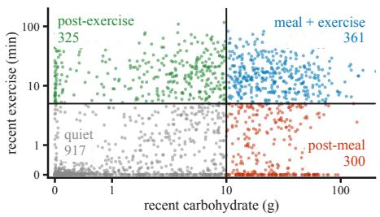

(b) RMSE (mg/dL) across the three input settings  
(c) RMSE reduction from the multimodal context  
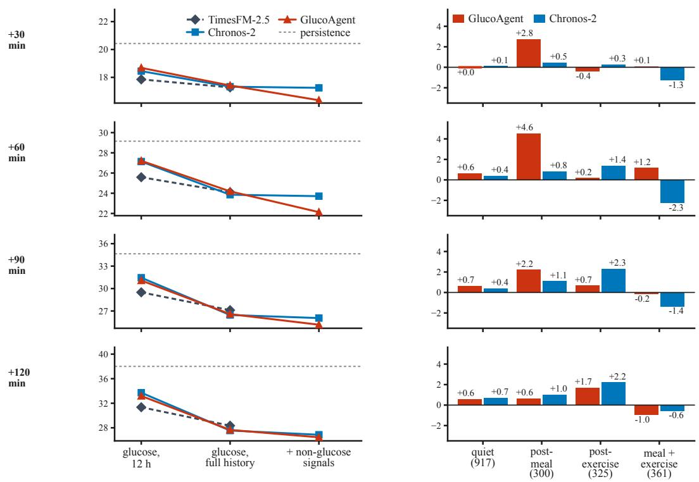  
Figure 5: The CGMacros held-out results at each horizon, without averaging across horizons. Panel (a) places every forecast origin by its recent carbohydrate and recent moderate exertion, each discounted by how long ago it happened, and the two fixed cuts that define quiet, post-meal, post-exercise and meal + exercise (for the scores and cuts see Appendix C); the labels were attached after every forecast was scored, and no method saw them. Panel (b) repeats the three input settings at each horizon. Panel (c) reports the RMSE each method gains when the non-glucose signals are added, split by situation, on one shared scale. The gain for GlucoAgent is concentrated at 60 minutes: 2.1 mg/dL overall and 4.6 mg/dL after a meal, against 1.1, 1.4 and 1.2 mg/dL overall at 30, 90 and 120 minutes. All panels use the full held-out set of 1,903 forecast origins from nine participants.

Table 18: CGMacros held-out forecasting in the meal + exercise situation. The same 1,903 held-out origins as Table 1, restricted to the 361 origins labeled meal + exercise. Situation labels were attached after every forecast was scored; no forecaster saw them and no origin was selected or dropped on them. Within each participant, RMSE uses only that participant’s origins in this situation; cells report the unweighted participant mean (sample standard deviation), in mg/dL.
<table><tr><td>Method</td><td>30 min</td><td>60 min</td><td>90 min</td><td>120 min</td></tr><tr><td colspan="5">Reference</td></tr><tr><td>Persistence</td><td>26.867 (12.443)</td><td>39.380 (18.906)</td><td>40.101 (16.033)</td><td>39.878 (16.410)</td></tr><tr><td colspan="5">CGM only, 12 hours of history</td></tr><tr><td>TimesFM-2.5</td><td>22.189 (7.766)</td><td>33.313 (16.995)</td><td>32.727 (17.060)</td><td>30.835 (18.338)</td></tr><tr><td>Moirai-2.0</td><td>21.248 (7.222)</td><td>34.472 (15.486)</td><td>34.440 (15.992)</td><td>33.004 (17.916)</td></tr><tr><td>Timer†</td><td>26.043 (12.630)</td><td>36.845 (21.400)</td><td>34.868 (18.070)</td><td>30.815 (16.197)</td></tr><tr><td>Chronos-2</td><td>23.304 (8.433)</td><td>36.470 (16.714)</td><td>35.852 (16.267)</td><td>34.027 (19.812)</td></tr><tr><td>GlucoAgent</td><td>23.202 (8.302)</td><td>36.609 (17.560)</td><td>36.234 (16.201)</td><td>35.006 (15.610)</td></tr><tr><td colspan="5">CGM only, full history</td></tr><tr><td>TimesFM-2.5</td><td>20.984 (6.938)</td><td>30.955 (15.382)</td><td>29.066 (14.030)</td><td>27.113 (14.466)</td></tr><tr><td>Moirai-2.0</td><td>19.830 (6.429)</td><td>30.360 (14.383)</td><td>28.822 (13.315)</td><td>27.008 (15.270)</td></tr><tr><td>Timer†</td><td>21.664 (8.462)</td><td>31.856 (17.573)</td><td>30.187 (15.437)</td><td>28.865 (14.169)</td></tr><tr><td>Chronos-2</td><td>19.745 (5.797)</td><td>29.338 (12.534)</td><td>28.654 (13.053)</td><td>26.747 (14.288)</td></tr><tr><td>GlucoAgent</td><td>20.010 (6.362)</td><td>30.219 (13.055)</td><td>28.280 (12.165)</td><td>26.498 (14.394)</td></tr><tr><td colspan="5">Multimodal, full history</td></tr><tr><td>Chronos-2</td><td>21.016 (7.574)</td><td>31.603 (17.107)</td><td>30.025 (16.296)</td><td>27.310 (15.172)</td></tr><tr><td>GlucoAgent</td><td>19.944 (5.447)</td><td>29.047 (14.130)</td><td>28.465 (13.174)</td><td>27.462 (11.113)</td></tr></table>

Bold marks the lowest RMSE and underlining the second lowest within each input setting; only means are styled. <sup>†</sup>Timer preserves its upstream 96-step patch flooring (so 12 hours becomes 8 hours) and uses causal-mean imputation for missing historical CGM.

## F What the Agent Does: Census and Remaining Case Studies

Nothing in the instruction tells GlucoAgent which analysis to run, so what it runs is an observation rather than a design choice, and this appendix reports it in three ways: a census of the programs the agent wrote, a census of the reasons it gave, and the case studies that did not fit in the main text.

## F.1 Behavior by situation and stated reasons

Figure 6 splits behavior two ways. Panel (a) splits it by situation, which the agent does not control, since the label is computed from the person’s context before the cutoff and no forecaster ever receives it. Reading the logged meals almost doubles between quiet origins and origins shortly after a meal, and fitting a numeric model moves the other way, so the agent falls back on model fitting when there is no recent event to look up. Panel (b) reports the arguments in its reasons.

(a) What the agent did, by situation

quiet (279) post-meal (91)

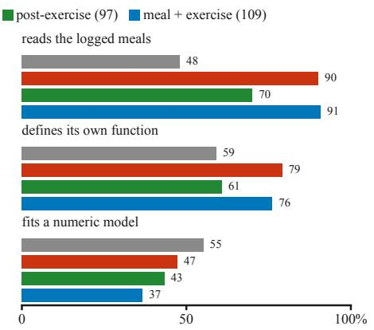  
(b) Arguments in the stated reason

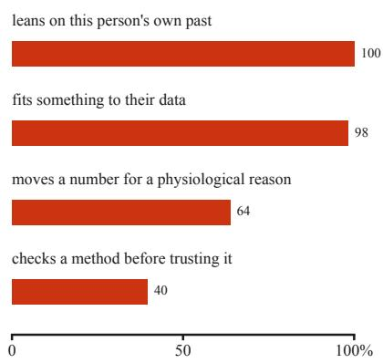

Figure 6: Behavior census on the audited subsample of 576 held-out CGMacros forecast origins from nine participants. (a) The share of forecasts whose programs read the logged meals, defined a function of their own, or fitted a model, split by the four situations. Reading the logged meals rises from 48% on quiet origins to 90% shortly after a meal, while fitting a model falls from 55% to 47%. (b) The share of forecasts whose submitted reason states each kind of argument. These labels are assigned by a language-model judge reading the recorded reason against a fixed rubric, with every positive label carrying a verbatim span from the text. Reliability was checked against a second judge from a different model family on 120 of the forecasts, and only rubric items the two judges agree on at least 80% of the time are shown; two of the six items fail that gate and are omitted. A further 24 forecasts were re-read by hand, agreeing with the judge on 96.5% of 144 judgments, but that audit was performed by the same assistant that built this analysis rather than by an independent rater, so it is a consistency check and not an independent validation.

## F.2 What the agent executed

The tables below count what the agent actually ran, over the full held-out set of 1,903 forecast origins rather than the audited subsample. They are produced from the recorded run artifacts and from abstract syntax trees of the submitted programs, so they count code rather than claims. Table 19 states how many programs were executed and how many parsed, which bounds every rate in the tables that follow. Table 20 asks how strongly each signal is used, at four increasingly strict standards of evidence. Table 21 reports when in its own program sequence the agent does each thing. Table 22 lists what it imported, and Table 23 lists every estimator and validation symbol that defines the two behaviors we count, including the ones never observed.

## F.3 The remaining case studies

The case studies were selected by a filter recorded before any case was read: the forecast had to beat the multimodal foundation-model baseline by at least 5 mg/dL, have an RMSE of at most 15 mg/dL, and cover an observed glucose swing of at least 25 mg/dL. Nine of the 576 audited origins clear all three conditions. Three are shown in the main text. Figures 7 and 8 show the other six, so every case that passed the filter appears somewhere in the paper and none was dropped after the fact. The same filter reversed selects seventeen origins where the agent loses to the baseline. The charts draw the agent’s own recorded output, or, where a program printed only a summary, the same computation re-run from the same context.

Table 19: What the agent executed across the full 1,903-origin CGMacros HOLDOUT cohort. Every quantity is counted from recorded run artifacts; the AST rows state the coverage within which the behavioural rates in the following tables hold.
<table><tr><td>Quantity</td><td>Value</td></tr><tr><td>Cases (participants)</td><td>1903 (9)</td></tr><tr><td>Programs requested / executed / successful</td><td>14852 / 14846 /  14468</td></tr><tr><td>Executed failures and timeouts</td><td>378 (166 timeouts)</td></tr><tr><td>Failures followed by a later success</td><td>373 / 378</td></tr><tr><td>Successful programs parsed for AST facts</td><td>14468 / 14468</td></tr><tr><td>Successful programs per case, median [IQR]</td><td>7 [6–9], range 4–14</td></tr><tr><td>Non-blank lines per program, median [IQR]</td><td>11 [8–24], range 1–73</td></tr><tr><td>Cases authoring a function or class</td><td>1227 / 1903</td></tr><tr><td>Subscripts with a literal key</td><td>49.8%</td></tr><tr><td>Citation integrity (cited refs issued in-case)</td><td>100.0%</td></tr></table>

The literal-key fraction bounds the case-file field rates: accesses of the form df[col] with a variable key cannot be attributed to a modality, so every modality rate is a lower bound.

Table 20: Use of each modality in the executed programs, cited programs, and submitted reasons, as a percentage of the 1,903 held-out forecast origins. Read means a program subscripted a field of that modality; cited means the submission cited such a program; named means the submitted reason mentions the modality. The final column requires all three.
<table><tr><td>Modality</td><td>Read</td><td>Cited</td><td>Named</td><td>Cited + named</td></tr><tr><td>glucose</td><td>100.0</td><td>100.0</td><td>99.6</td><td>99.6</td></tr><tr><td>heart rate</td><td>96.3</td><td>95.2</td><td>55.8</td><td>54.2</td></tr><tr><td>activity</td><td>96.4</td><td>95.5</td><td>76.7</td><td>73.8</td></tr><tr><td>meals</td><td>67.1</td><td>65.5</td><td>99.5</td><td>65.1</td></tr><tr><td>baseline profile</td><td>100.0</td><td>2.8</td><td>15.0</td><td>1.4</td></tr></table>

The gap between read and cited + named is informative rather than noise. Heart rate is read in 96.3% of cases but survives all three surfaces in 54.2%. The baseline profile is cited in 2.8% of cases and named in 15.0%.

Table 21: Share of the 1,903 HOLDOUT cases performing each operation in the early, middle and late third of their own program sequence, so the table does not depend on how many programs a case ran. The final column is the median program number at which the operation first appears.
<table><tr><td>Operation</td><td>Early</td><td>Middle</td><td>Late</td><td>First</td></tr><tr><td>reads glucose</td><td>71.7</td><td>99.7</td><td>98.3</td><td>3</td></tr><tr><td>reads heart rate</td><td>68.5</td><td>38.2</td><td>11.0</td><td>3</td></tr><tr><td>reads activity</td><td>68.4</td><td>41.3</td><td>15.8</td><td>3</td></tr><tr><td>reads meals</td><td>36.0</td><td>46.2</td><td>28.7</td><td>3</td></tr><tr><td>reads profile</td><td>99.5</td><td>0.0</td><td>0.0</td><td>2</td></tr><tr><td>writes a function</td><td>2.5</td><td>36.5</td><td>54.4</td><td>6</td></tr><tr><td>fits a model</td><td>0.1</td><td>21.4</td><td>45.7</td><td>6</td></tr><tr><td>validates out of sample</td><td>0.1</td><td>4.8</td><td>9.3</td><td>7</td></tr></table>

The prompt prescribes no method, so the ordering is emergent. The baseline profile is read near the start and then dropped; glucose is revisited throughout; authoring, fitting and validation rise later in the sequence.

Table 22: What the agent imported, as a percentage of the 1,903 HOLDOUT cases. Packages are shown first, then every module imported in at least four cases. Module names are taken verbatim from the import statement, so they are exact.
<table><tr><td>Package or module</td><td>Cases</td><td>Any use</td><td>Cited use</td></tr><tr><td>numpy</td><td></td><td>100.0</td><td>100.0</td></tr><tr><td>pandas</td><td></td><td>91.3</td><td>90.9</td></tr><tr><td>scikit-learn</td><td></td><td>25.4</td><td>24.7</td></tr><tr><td>scipy</td><td></td><td>5.8</td><td>4.7</td></tr><tr><td>statsmodels</td><td></td><td>5.7</td><td>5.0</td></tr><tr><td>numpy</td><td>1903</td><td>100.0</td><td>100.0</td></tr><tr><td>toolbox.case_data</td><td>1903</td><td>100.0</td><td>82.0</td></tr><tr><td>toolbox.modalities</td><td>1903</td><td>100.0</td><td>11.5</td></tr><tr><td>json</td><td>1899</td><td>99.8</td><td>74.0</td></tr><tr><td>pandas</td><td>1737</td><td>91.3</td><td>90.9</td></tr><tr><td>datetime</td><td>642</td><td>33.7</td><td>28.6</td></tr><tr><td>sklearn.linear_model</td><td>480</td><td>25.2</td><td>24.5</td></tr><tr><td>sklearn.model_selection</td><td>243</td><td>12.8</td><td>11.2</td></tr><tr><td>numpy.linalg</td><td>102</td><td>5.4</td><td>4.4</td></tr><tr><td>itertools</td><td>94</td><td>4.9</td><td>3.3</td></tr><tr><td>scipy.optimize</td><td>92</td><td>4.8</td><td>3.8</td></tr><tr><td>collections</td><td>82</td><td>4.3</td><td>3.0</td></tr><tr><td>statsmodels.api</td><td>54</td><td>2.8</td><td>2.4</td></tr><tr><td>sklearn.preprocessing</td><td>44</td><td>2.3</td><td>2.0</td></tr><tr><td>sklearn.ensemble</td><td>35</td><td>1.8</td><td>1.7</td></tr><tr><td>statsmodels.tsa.ar_model</td><td>34</td><td>1.8</td><td>1.6</td></tr><tr><td>sklearn.pipeline</td><td>32</td><td>1.7</td><td>1.5</td></tr><tr><td>time</td><td>31</td><td>1.6</td><td>1.5</td></tr><tr><td>sklearn.neighbors</td><td>22</td><td>1.2</td><td>1.1</td></tr><tr><td>numpy.polynomial.polynomial</td><td>16</td><td>0.8</td><td>0.8</td></tr><tr><td>pickle</td><td>16</td><td>0.8</td><td>0.5</td></tr><tr><td>statsmodels.tsa.arima.model</td><td>16</td><td>0.8</td><td>0.8</td></tr><tr><td>scipy.signal</td><td>15</td><td>0.8</td><td>0.7</td></tr><tr><td>bisect</td><td>13</td><td>0.7</td><td>0.6</td></tr><tr><td>math</td><td>11</td><td>0.6</td><td>0.5</td></tr><tr><td>statsmodels.tsa.holtwinters</td><td>11</td><td>0.6</td><td>0.6</td></tr><tr><td>sklearn.metrics</td><td>10</td><td>0.5</td><td>0.5</td></tr><tr><td>numpy.polynomial</td><td>7</td><td>0.4</td><td>0.3</td></tr><tr><td>warnings</td><td>6</td><td>0.3</td><td>0.3</td></tr><tr><td>numpy.fft</td><td>5</td><td>0.3</td><td>0.1</td></tr><tr><td>random</td><td>5</td><td>0.3</td><td>0.2</td></tr><tr><td>scipy.stats</td><td>4</td><td>0.2</td><td>0.2</td></tr><tr><td>statistics</td><td>4</td><td>0.2</td><td>0.1</td></tr><tr><td>sys</td><td>4</td><td>0.2</td><td>0.1</td></tr></table>

Cited use restricts to programs the submission cited as evidence, so exploratory imports remain visible as a gap between the two columns.

Table 23: Every symbol in the two printed sets that define fits a model and validates out of sample, with the number and percentage of the 1,903 HOLDOUT cases that called it. Membership of these sets is the whole definition of the two behaviors, so symbols never observed remain listed.
<table><tr><td>Symbol</td><td>Cases</td><td>Any use</td><td>Cited use</td></tr><tr><td>Model fitting</td><td></td><td></td><td></td></tr><tr><td>Ridge</td><td>464</td><td>24.4</td><td>23.5</td></tr><tr><td>polyfit</td><td>255</td><td>13.4</td><td>12.0</td></tr><tr><td>istsq</td><td>223</td><td>11.7</td><td>10.6</td></tr><tr><td>curve_fit</td><td>70</td><td>3.7</td><td>2.7</td></tr><tr><td>AutoReg</td><td>33</td><td>1.7</td><td>1.6</td></tr><tr><td>OLS</td><td>30</td><td>1.6</td><td>1.4</td></tr><tr><td>ARIMA</td><td>26</td><td>1.4</td><td>1.2</td></tr><tr><td>RidgeCV</td><td>19</td><td>1.0</td><td>0.8</td></tr><tr><td>KNeighborsRegressor</td><td>17</td><td>0.9</td><td>0.8</td></tr><tr><td>HistGradientBoostingRegressor</td><td>14</td><td>0.7</td><td>0.7</td></tr><tr><td>GradientBoostingRegressor</td><td>10</td><td>0.5</td><td>0.5</td></tr><tr><td>SARIMAX</td><td>10</td><td>0.5</td><td>0.4</td></tr><tr><td>ExponentialSmoothing</td><td>9</td><td>0.5</td><td>0.5</td></tr><tr><td>RandomForestRegressor</td><td>8</td><td>0.4</td><td>0.4</td></tr><tr><td>LinearRegression</td><td>3</td><td>0.2</td><td>0.1</td></tr><tr><td>Holt</td><td>2</td><td>0.1</td><td>0.1</td></tr><tr><td>Out-of-sample validation</td><td></td><td></td><td></td></tr><tr><td>KFold</td><td>143</td><td>7.5</td><td>6.1</td></tr><tr><td>TimeSeriesSplit</td><td>52</td><td>2.7</td><td>2.5</td></tr><tr><td>cross_val_predict</td><td>35</td><td>1.8</td><td>1.6</td></tr><tr><td>cross_val_score</td><td>35</td><td>1.8</td><td>1.6</td></tr><tr><td>GroupKFold</td><td>11</td><td>0.6</td><td>0.5</td></tr><tr><td>LeaveOneGroupOut</td><td>3</td><td>0.2</td><td>0.2</td></tr><tr><td>LeaveOneOut</td><td>1</td><td>0.1</td><td>0.1</td></tr></table>

Defined but never called under modelfitting: ElasticNet, Lasso. Defined but never called under out-of-sample validation: cross\_validate, train\_test\_split. Naming a behavior only where a symbol uniquely implies it makes these rates auditable, but hand-written validation loops remain false negatives.

(d) A validated model, weighted half against past meals  
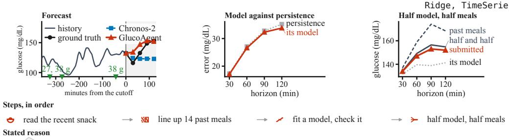  
"A ridge model with carb-absorption kernels, glucose level/slope, HR and METs (time-series CV slightly better than persistence) [...] 白 Blending the meal-anchored analogs with the regression yields roughly +2/+17/+24/+23 from 132 mg/dL, tempered slightly"

(e) A fitted curve discarded for two past days  
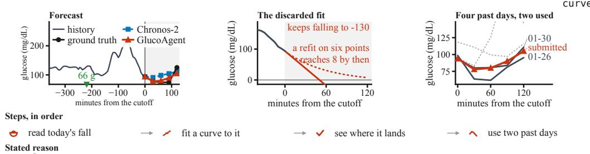  
"Linear/exponential extrapolation is degenerate, so I used within-subject analogs [...] the same-pattern post-breakfast crashes on 01-26 由 (94→64→62→81→95) and 01-30 (94→80→81→84→111)"

(f) The timing of the rise from many meals, then its size  
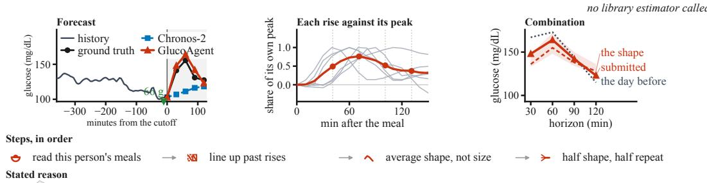  
"prior meals in this record generally peak at +60-75 min with peak increments of \~55-90 mg/dL [...] with the pooled meal-response shape 由 scaled to a \~68 mg/dL peak increment on the current 103 mg/dL baseline"

Figure 7: Case studies (d) to (f), the first half of the six forecasts that pass the recorded selection filter and are not shown in the main text. Each row uses the same layout as the main-text figure: the person’s context around the forecast cutoff, what the agent’s own programs computed, in order, a verbatim fragment of the reason it submitted, and the forecast against the truth and against the multimodal foundation-model baseline. The three rows show a ridge regression evaluated with time-series cross-validation and blended with past meal responses, a curve fit that is rejected in favor of two past days, and a forecast that works out when the rise arrives before working out how large it is. In (d) the fitted model runs only 0.2 to 1.4 mg/dL ahead of persistence at the four horizons; in (e) the two past days the agent did not use are drawn faint, and one of them rises to 212 mg/dL, above the chart; in (f) the middle chart keeps six of the nine rises the agent printed, selected by hand, with their average, and the shading on the right is the other peak sizes it tried.

(g) Two models trained early in the history, scored later  
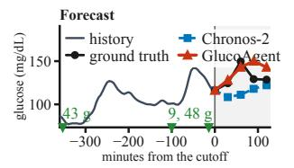

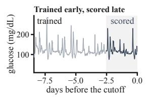  
RMSE (mg/dL) GlucoAgent 13.2 Chronos-2 21.8 persistence 19.4

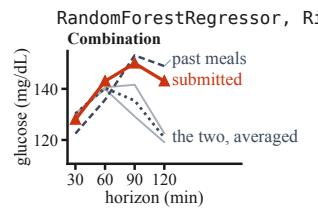  
build absorption features train two models score them on later data average, add past meals Stated reason  
"supervised models (ridge and random forest) on the full 8.5-day CGM/HR/METs history with meal-absorption kernel features, validated 由 on time-split holdouts [...] the closest analog (today's 43 g lunch eaten during a falling trend) showed a delayed dip-then-rise"

(h) A dose-response fit across seventeen past meals  
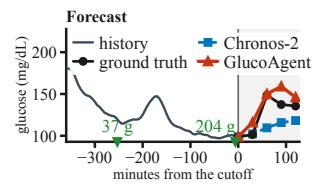

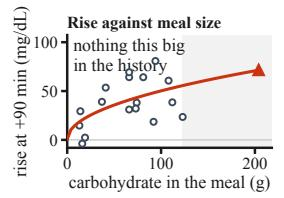  
RMSE (mg/dL) GlucoAgent 14.1 Chronos-2 24.0 persistence 36.5

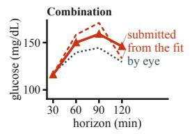  
"Using this subject's own 17 prior meal responses, I built baseline-referenced post-meal delta profiles and a sqrt(carbs)+baseline 由 regression per horizon [...] blended these with the closest large-meal analogs"

(i) Leave-one-meal-out over thirteen large meals  
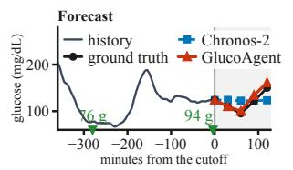

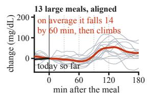

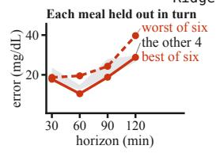  
read 13 past big meals line them up on the meal hold one meal out at a time weight four estimates Stated reason  
"All 13 prior >=60 g meals in this subject's record show a highly reproducible post-log shape: glucose flat-to-falling through \~+60-75 由 min [...] then a steep climb (mean +52 at +120, peak \~+125-150 min)"

Figure 8: Case studies (g) to (i), the second half of the six forecasts that pass the recorded selection filter and are not shown in the main text. The layout is the one used in Figure 7. The three rows are a model trained on the earlier history and scored on the later history, a fit of how this person’s rise scales with the size of a meal, and a forecast built on the observation that this person dips for about an hour before rising. In (g) the model is off by 12 mg/dL on the scored history and persistence by 19; in (h) the estimate labeled “by eye” is typed into the reason rather than computed; in (i) the right chart shows the best and worst of the six held-out meals, and the forecast used both.

## G The Established Benchmarks in Detail

This appendix supports Section 4.6: a check that the fixed subsets rank the foundation models as the full populations do, the OhioT1DM comparison under the CGM-LSM protocol, our reproduction of the published baseline numbers, and why the two OhioT1DM RMSE values in the literature are not comparable.

## G.1 The fixed subsets do not change the picture

We score the agent on fixed subsets of the glucose-only benchmarks to limit the number of languagemodel calls (Appendix C), which is defensible only if the subset and the full population rank the methods the same way. Table 24 runs the check on GlucoFM-Bench, where every foundation model can be scored on both. Over the 36 cells the largest difference is 1.59 mg/dL, 28 are below 1 mg/dL and 20 are below 0.5 mg/dL, and the ranking holds: Timer is the weakest model on every dataset in both populations, and the other three are close enough that they exchange places by a few tenths on some datasets, in both directions, while the subset never turns a clearly better model into a clearly worse one.

## G.2 OhioT1DM under the CGM-LSM protocol

Table 25 gives the OhioT1DM comparison that Section 4.6 summarizes, scored with the CGM-LSM evaluator on the matched 1,536-instance subset; the published CGM-LSM row is transcribed from that paper (for why its numbers are not comparable with the GlucoFM-Bench OhioT1DM column see Appendix G.4).

## G.3 Reproducing Published Results

Before comparing against a published number we reproduce it, so that a difference in the main tables is a difference in forecasting rather than in setup; everything in this subsection checks the baselines, and GlucoAgent has no row here because it has no published score to reproduce and is scored on the fixed subsets of Appendix C.

## G.3.1 Published-setting reproduction fidelity

Table 26: Reproduction of accessible per-dataset zero-shot cells for the datasets retained in this paper from GlucoFM-Bench Table 2. RMSE is in mg/dL at 12 hours of context and a 30-minute horizon; values are participant-level mean (sample standard deviation).
<table><tr><td>Dataset</td><td>Model</td><td>Published</td><td>Reproduced</td><td>∆</td><td>n</td></tr><tr><td rowspan="6">Hall2018</td><td>Persistence</td><td>13.65 (4.52)</td><td>13.66 (4.52)</td><td>+0.006</td><td>52</td></tr><tr><td>Chronos-2</td><td>13.24 (6.96)</td><td>13.41 (6.93)</td><td>+0.173</td><td>47</td></tr><tr><td>Moirai-2.0</td><td>13.16 (6.06)</td><td>13.16 (6.06)</td><td>-0.004</td><td>48</td></tr><tr><td>Timer</td><td>14.05 (7.11)</td><td>14.05 (7.11)</td><td>+0.002</td><td>48</td></tr><tr><td>TimesFM-2.5</td><td>12.96 (5.83)</td><td>12.96 (5.83)</td><td>-0.001</td><td>48</td></tr><tr><td>Persistence</td><td>16.91 (4.03)</td><td>16.92 (4.03)</td><td>+0.006</td><td>16</td></tr><tr><td rowspan="5">BIG IDEAS Lab</td><td>Chronos-2</td><td>15.17 (3.04)</td><td>15.17 (3.04)</td><td>-0.001</td><td>16</td></tr><tr><td>Moirai-2.0</td><td>15.18 (3.24)</td><td>15.18 (3.24)</td><td>+0.005</td><td>16</td></tr><tr><td>Timer</td><td>16.24 (4.78)</td><td>16.24 (4.78)</td><td>-0.001</td><td>16</td></tr><tr><td>TimesFM-2.5</td><td>14.88 (3.00)</td><td>14.88 (3.00)</td><td>-0.003</td><td>16</td></tr><tr><td>Persistence</td><td>17.18 (6.57)</td><td>17.19 (6.57)</td><td>+0.009</td><td>12</td></tr><tr><td rowspan="5">ShanghaiT1DM</td><td>Chronos-2</td><td>12.82 (3.41)</td><td>12.82 (3.41)</td><td>-0.005</td><td>12</td></tr><tr><td>Moirai-2.0</td><td>12.50 (3.18)</td><td>12.50 (3.18)</td><td>+0.004</td><td>12</td></tr><tr><td>Timer</td><td>19.10 (6.16)</td><td>19.10 (6.16)</td><td>-0.003</td><td>12</td></tr><tr><td>TimesFM-2.5</td><td>12.11 (3.45)</td><td>12.11 (3.45)</td><td>+0.004</td><td>12</td></tr><tr><td></td><td></td><td></td><td></td><td></td></tr><tr><td rowspan="5">ShanghaiT2DM</td><td>Persistence</td><td>15.03 (4.14)</td><td>15.04 (4.14)</td><td>+0.007</td><td>100</td></tr><tr><td>Chronos-2</td><td>11.94 (3.35)</td><td>11.94 (3.35)</td><td>+0.001</td><td>99</td></tr><tr><td>Moirai-2.0</td><td>11.96 (3.45)</td><td>11.96 (3.45)</td><td>-0.004</td><td>99</td></tr><tr><td>Timer</td><td>15.60 (4.94)</td><td>15.60 (4.94)</td><td>+0.001</td><td>99</td></tr><tr><td>TimesFM-2.5</td><td>11.47 (3.31)</td><td>11.47 (3.31)</td><td>-0.003</td><td>99</td></tr><tr><td rowspan="4">HUPA-UCM</td><td>Persistence</td><td>22.27 (6.15)</td><td>22.27 (6.15)</td><td>+0.004</td><td>25</td></tr><tr><td>Chronos-2</td><td>18.07 (5.49)</td><td>18.07 (5.49)</td><td>+0.003</td><td>25</td></tr><tr><td>Moirai-2.0</td><td>18.21 (5.45)</td><td>18.21 (5.45)</td><td>-0.002</td><td>25</td></tr><tr><td>Timer</td><td>24.59 (6.58)</td><td>24.59 (6.58)</td><td>+0.000</td><td>25</td></tr><tr><td rowspan="7">CGMacros</td><td>TimesFM-2.5</td><td>17.67 (5.19)</td><td>17.67 (5.19)</td><td>+0.004</td><td>25</td></tr><tr><td>Persistence</td><td>19.44 (4.88)</td><td>19.44 (4.88)</td><td>-0.002</td><td>45</td></tr><tr><td>Chronos-2</td><td>16.85 (4.16)</td><td>16.85 (4.16)</td><td>-0.000</td><td>45</td></tr><tr><td>Moirai-2.0</td><td>16.81 (4.36)</td><td>16.81 (4.36)</td><td>-0.004</td><td>45</td></tr><tr><td>Timer</td><td>17.42 (4.88)</td><td>17.42 (4.88)</td><td>-0.004</td><td>45</td></tr><tr><td>TimesFM-2.5</td><td>16.28 (4.18)</td><td>16.28 (4.18)</td><td>-0.002</td><td>45</td></tr><tr><td>Persistence</td><td>24.95 (5.17)</td><td>24.95 (5.17)</td><td>+0.003</td><td>17</td></tr><tr><td rowspan="5">T1DM-UOM</td><td>Chronos-2</td><td>22.23 (4.92)</td><td>22.24 (4.92)</td><td>+0.005</td><td>17</td></tr><tr><td>Moirai-2.0</td><td>22.55 (4.91)</td><td>22.55 (4.91)</td><td>+0.004</td><td>17</td></tr><tr><td>Timer</td><td>25.83 (5.33)</td><td>25.83 (5.33)</td><td>+0.004</td><td>17</td></tr><tr><td>TimesFM-2.5</td><td>21.89 (4.83)</td><td>21.89 (4.83)</td><td>-0.002</td><td>17</td></tr><tr><td>Persistence</td><td>22.24 (6.47)</td><td>22.24 (6.47)</td><td>+0.002</td><td>20</td></tr><tr><td rowspan="5">Bris-T1D Open</td><td>Chronos-2</td><td>19.42 (5.62)</td><td>19.42 (5.62)</td><td>+0.003</td><td>20</td></tr><tr><td>Moirai-2.0</td><td>19.64 (5.81)</td><td>19.64 (5.81)</td><td>-0.004</td><td>20</td></tr><tr><td>Timer</td><td></td><td></td><td>-0.004</td><td>20</td></tr><tr><td>TimesFM-2.5</td><td>22.81 (6.17) 19.00 (5.58)</td><td>22.81 (6.17) 19.00 (5.58)</td><td>+0.002</td><td>20</td></tr><tr><td></td><td></td><td></td><td></td><td></td></tr><tr><td rowspan="5">AZT1D</td><td>Persistence</td><td>23.36 (3.39)</td><td>23.36 (3.39)</td><td>-0.002</td><td>25</td></tr><tr><td>Chronos-2</td><td>20.77 (3.34)</td><td>20.77 (3.34)</td><td>+0.004</td><td>25</td></tr><tr><td>Moirai-2.0</td><td>21.23 (3.34)</td><td>21.23 (3.34)</td><td>+0.002</td><td>25</td></tr><tr><td>Timer</td><td>23.83 (3.93)</td><td>23.83 (3.93)</td><td>+0.003</td><td>25</td></tr><tr><td>TimesFM-2.5</td><td>20.53 (3.29)</td><td>20.53 (3.29)</td><td>-0.005</td><td>25</td></tr><tr><td rowspan="5">OhioT1DM</td><td>Persistence</td><td>23.42 (2.97)</td><td>23.42 (2.97)</td><td>-0.000</td><td>12</td></tr><tr><td>Chronos-2</td><td>19.72 (2.81)</td><td>19.72 (2.81)</td><td>-0.003</td><td>12</td></tr><tr><td>Moirai-2.0</td><td>20.24 (2.46)</td><td>20.24 (2.46)</td><td>-0.000</td><td>12</td></tr><tr><td>Timer</td><td>24.58 (2.89)</td><td>24.58 (2.89)</td><td>+0.003</td><td>12</td></tr><tr><td>TimesFM-2.5</td><td>19.63 (2.84)</td><td>19.62 (2.66)</td><td>-0.008</td><td>12</td></tr></table>

The reproduction covers all 50 published cells that admit evaluation for the datasets retained in thi paper. The median absolute deviation is 0.003 mg/dL, the mean is 0.007 mg/dL, and the maximum is 0.173 mg/dL. The Hall2018/Chronos-2 residual follows the upstream 47-participant sequencesplitting path. OhioT1DM/TimesFM-2.5 matches in mean but not in participant spread; this is the only unexplained residual.

## G.3.2 Full multi-horizon GlucoFM-Bench reproduction

Table 27: Full zero-shot GlucoFM-Bench reproduction with the available published comparison. Entries are participant-level RMSE mean (sample standard deviation), in mg/dL, with a 12-hour context and dense stride-1 origins. Reproduced horizon columns score the final step; the final column is the only per-dataset horizon published by GlucoFM-Bench (Table 2).
<table><tr><td rowspan="2">Dataset</td><td rowspan="2">Method</td><td colspan="4">Reproduced</td><td colspan="2">Published</td></tr><tr><td>15 min</td><td>30 min</td><td>60 min</td><td>90 min</td><td colspan="2">30 min</td></tr><tr><td rowspan="6">AZT1D</td><td>Persistence</td><td>14.11 (2.20) 23.36 (3.39)</td><td></td><td>36.94 (5.55)</td><td>46.09 (7.54) 23.36 (3.39)</td><td colspan="2"></td></tr><tr><td>Chronos-2</td><td>12.04 (2.42) 20.77 (3.34)</td><td></td><td>34.14 (5.29)</td><td>42.60 (7.28) 20.77 (3.34)</td><td colspan="2"></td></tr><tr><td></td><td>TimesFM-2.5 11.87 (2.47) 20.53 (3.29)</td><td></td><td>33.45 (5.22)</td><td>41.66 (7.32) 20.53 (3.29)</td><td colspan="2"></td></tr><tr><td>Timer</td><td>14.23 (2.52) 23.83 (3.93)</td><td></td><td>36.68 (6.75)</td><td>43.71 (9.25) 23.83 (3.93)</td><td colspan="2"></td></tr><tr><td>Moirai-2.0</td><td>12.25 (2.44) 21.23 (3.34)</td><td></td><td>35.09 (5.26)</td><td>44.27 (7.48) 21.23 (3.34)</td><td colspan="2"></td></tr><tr><td>Persistence</td><td>10.28 (2.16) 16.92 (4.03)</td><td></td><td>23.14 (7.02)</td><td>25.49 (9.07) 16.91 (4.03)</td><td colspan="2"></td></tr><tr><td rowspan="4"></td><td>Chronos-2</td><td>8.05 (1.49) 15.17 (3.04)</td><td></td><td>20.81 (5.33)</td><td>22.38 (6.82) 15.17 (3.04)</td><td colspan="2"></td></tr><tr><td>BIG IDEAS Lab TimesFM-2.5</td><td>7.72 (1.38) 14.88 (3.00)</td><td></td><td>20.54 (5.01)</td><td>21.84 (6.30) 14.88 (3.00)</td><td colspan="2"></td></tr><tr><td>Timer</td><td>10.01 (2.96) 16.24 (4.78) 20.65 (6.28)</td><td></td><td></td><td>21.71 (6.99) 16.24 (4.78)</td><td colspan="2"></td></tr><tr><td>Moirai-2.0</td><td>8.04 (1.44) 15.18 (3.24) 21.05 (5.77)</td><td></td><td></td><td>22.66 (6.73) 15.18 (3.24)</td><td colspan="2"></td></tr><tr><td rowspan="6">Bris-T1D Open</td><td>Persistence</td><td>12.82 (3.78) 22.24 (6.47) 35.92 (10.47) 44.89 (13.13) 22.24 (6.47)</td><td></td><td></td><td></td><td colspan="2"></td></tr><tr><td>Chronos-2</td><td>10.42 (3.32) 19.42 (5.62) 33.47 (9.33) 42.47 (11.88) 19.42 (5.62)</td><td></td><td></td><td></td><td colspan="2"></td></tr><tr><td></td><td>TimesFM-2.5 10.09 (3.39) 19.00 (5.58)</td><td></td><td>32.66 (9.13) 41.46 (11.66) 19.00 (5.58)</td><td></td><td colspan="2"></td></tr><tr><td>Timer</td><td>13.01 (3.55) 22.81 (6.17)</td><td></td><td></td><td>35.92 (9.88) 43.25 (12.11) 22.81 (6.17)</td><td colspan="2"></td></tr><tr><td>Moirai-2.0</td><td>10.52 (3.47) 19.64 (5.81) 33.89 (9.64) 43.01 (12.22) 19.64 (5.81)</td><td></td><td></td><td></td><td colspan="2"></td></tr><tr><td>Persistence</td><td>11.93 (2.73) 19.44 (4.88)</td><td></td><td></td><td></td><td colspan="2"></td></tr><tr><td rowspan="6">CGMacros†</td><td>Chronos-2</td><td>9.72 (2.30) 16.85 (4.16)</td><td></td><td></td><td>27.60 (9.12) 32.67 (12.65) 19.44 (4.88)</td><td colspan="2"></td></tr><tr><td>TimesFM-2.5</td><td>9.39 (2.29) 16.28 (4.18)</td><td></td><td></td><td>23.43 (7.32) 26.27 (9.81) 16.85 (4.16)</td><td colspan="2"></td></tr><tr><td>Timer</td><td>10.80 (2.74) 17.42 (4.88)</td><td></td><td></td><td>22.40 (7.21) 25.02 (9.41) 16.28 (4.18)</td><td colspan="2"></td></tr><tr><td>Moirai-2.0</td><td>9.69 (2.37) 16.81 (4.36)</td><td></td><td></td><td>23.20 (8.25) 25.84 (10.36) 17.42 (4.88) 23.46 (7.67) 26.55 (10.14) 16.81 (4.36)</td><td colspan="2"></td></tr><tr><td>Persistence</td><td></td><td></td><td></td><td></td><td colspan="2"></td></tr><tr><td>Chronos-2</td><td>8.87 (2.87) 18.07 (5.49) 34.41 (10.84) 46.40 (14.87) 18.07 (5.49)</td><td></td><td></td><td>12.33 (3.29) 22.27 (6.15) 37.66 (10.69) 48.77 (13.75) 22.27 (6.15)</td><td colspan="2"></td></tr><tr><td rowspan="10">Hall2018</td><td>TimesFM-2.5</td><td></td><td></td><td>8.45 (2.96) 17.67 (5.19) 34.38 (10.24) 46.86 (14.71) 17.67 (5.19)</td><td></td><td></td></tr><tr><td>Timer</td><td>13.69 (3.69) 24.59 (6.58) 41.18 (11.39) 52.03 (14.95) 24.59 (6.58)</td><td></td><td></td><td></td><td></td></tr><tr><td>Moirai-2.0</td><td>8.95 (2.96) 18.21 (5.45) 35.44 (10.78) 48.41 (14.99) 18.21 (5.45)</td><td></td><td></td><td></td><td></td></tr><tr><td>Persistence</td><td>8.65 (2.60) 13.66 (4.52) 18.77 (7.74) 21.46 (10.01) 13.65 (4.52)</td><td></td><td></td><td></td><td></td></tr><tr><td>Chronos-2</td><td>8.14 (3.71) 13.41 (6.93) 18.90 (11.31) 21.57 (12.77) 13.24 (6.96)</td><td></td><td></td><td></td><td></td></tr><tr><td>TimesFM-2.5</td><td>7.96 (3.13) 12.96 (5.83) 17.99 (9.46) 20.56 (11.55) 12.96 (5.83)</td><td></td><td></td><td></td><td></td></tr><tr><td>Timer</td><td>9.09 (4.21) 14.05 (7.11) 18.66 (10.49) 20.87 (12.55) 14.05 (7.11)</td><td></td><td></td><td></td><td></td></tr><tr><td>Moirai-2.0</td><td>8.10 (3.33) 13.16 (6.06) 18.51 (10.19) 21.03 (12.49) 13.16 (6.06)</td><td></td><td></td><td></td><td></td></tr><tr><td>Persistence</td><td>13.59 (1.67) 23.42 (2.97) 38.58 (4.87) 49.42 (5.98) 23.42 (2.97)</td><td></td><td></td><td></td><td></td></tr><tr><td rowspan="5">OhioT1DM</td><td>Chronos-2</td><td>10.89 (2.03) 19.72 (2.81) 34.33 (4.24) 44.78 (5.23) 19.72 (2.81)</td><td></td><td></td><td></td><td></td></tr><tr><td></td><td>TimesFM-2.5 10.81 (1.99) 19.62 (2.66) 34.03 (4.27) 44.13 (5.39) 19.63 (2.84)</td><td></td><td></td><td></td><td></td></tr><tr><td>Timer</td><td>14.17 (2.04) 24.58 (2.89) 39.76 (4.21)</td><td></td><td></td><td>49.25 (5.31) 24.58 (2.89)</td><td></td></tr><tr><td>Moirai-2.0</td><td>11.18 (1.89) 20.24 (2.46) 35.57 (3.84) 46.61 (4.79) 20.24 (2.46)</td><td></td><td></td><td></td><td></td></tr><tr><td>Persistence</td><td>9.11 (3.32) 17.19 (6.57) 29.96 (12.58) 39.83 (17.71) 17.18 (6.57)</td><td></td><td></td><td></td><td></td></tr><tr><td rowspan="5"></td><td>Chronos-2</td><td>5.42 (1.37) 12.82 (3.41) 26.55 (8.50) 37.82 (13.91) 12.82 (3.41)</td><td></td><td></td><td></td><td></td></tr><tr><td>ShanghaiT1DM TimesFM-2.5</td><td>4.76 (1.19) 12.11 (3.45) 26.49 (9.07) 37.99 (14.50) 12.11 (3.45)</td><td></td><td></td><td></td><td></td></tr><tr><td>Timer</td><td>10.30 (3.71) 19.10 (6.16) 33.65 (11.33) 44.21 (15.68) 19.10 (6.16)</td><td></td><td></td><td></td><td></td></tr><tr><td>Moirai-2.0</td><td>5.27 (1.29) 12.50 (3.18) 27.14 (8.29) 39.36 (13.86) 12.50 (3.18)</td><td></td><td></td><td></td><td></td></tr><tr><td>Persistence</td><td></td><td></td><td></td><td></td><td></td></tr><tr><td rowspan="5">ShanghaiT2DM TimesFM-2.5</td><td>Chronos-2</td><td></td><td></td><td>8.11 (2.16) 15.04 (4.14) 25.12 (7.45) 32.10 (9.99) 15.03 (4.14)</td><td></td><td></td></tr><tr><td></td><td>5.24 (1.46) 11.94 (3.35)</td><td></td><td>22.72 (7.00) 29.66 (10.25) 11.94 (3.35)</td><td></td><td></td></tr><tr><td></td><td></td><td></td><td>4.72 (1.41) 11.47 (3.31) 22.59 (7.16) 29.80 (10.32) 11.47 (3.31)</td><td></td><td></td></tr><tr><td>Timer Moirai-2.0</td><td>8.30 (2.91) 15.60 (4.94)</td><td></td><td></td><td></td><td>25.93 (8.68) 31.70 (11.51) 15.60 (4.94)</td></tr><tr><td></td><td>5.11 (1.52) 11.96 (3.45)</td><td></td><td></td><td></td><td>23.49 (7.13) 31.03 (10.30) 11.96 (3.45)</td></tr><tr><td rowspan="5">T1DM-UOM</td><td>Persistence</td><td></td><td></td><td>14.37 (2.88) 24.95 (5.17) 39.56 (8.13) 48.92 (10.02) 24.95 (5.17)</td><td></td><td></td></tr><tr><td>Chronos-2</td><td>11.72 (2.54) 22.24 (4.92)</td><td></td><td>37.43 (7.81) 46.39 (9.77) 22.23 (4.92)</td><td></td><td></td></tr><tr><td></td><td>TimesFM-2.5 11.51 (2.49) 21.89 (4.83)</td><td></td><td>36.62 (7.54) 45.33 (9.38) 21.89 (4.83)</td><td></td><td></td></tr><tr><td>Timer</td><td>14.48 (3.23) 25.83 (5.33)40.44 (8.29) 48.42 (10.28) 25.83 (5.33)</td><td></td><td></td><td></td><td></td></tr><tr><td>Moirai-2.0</td><td>11.89 (2.51) 22.55 (4.91) 38.33 (7.92) 48.07 (10.07) 22.55 (4.91)</td><td></td><td></td><td></td><td></td></tr></table>

<sup>†</sup>The full CGMacros row uses the external all-45 cohort and is not a held-out evaluation set. GlucoFM-Bench does not publish per-dataset 15-, 60-, or 90-minute cells. Its across-horizon tables instead pool 15 datasets. Three of them, UCHTT1DM, DiaTrend, and T1DEXI, are unavailable here, so those aggregate rows are not a like-for-like comparison and are omitted.

## G.3.3 Exact CGM-LSM-matched comparison

The CGM-LSM origin filter reads both the 289-step history and 24-step target window. Its targetaware exclusions remove 73 of 9,287 otherwise eligible spans. This is retained only to reproduce the published experimental condition; post-cutoff values are not exposed to any forecasting method.

## G.4 Why the OhioT1DM RMSE Values Are Not Directly Comparable

GlucoFM-Bench and CGM-LSM both report an OhioT1DM RMSE at 30 minutes, and the CGM-LSM value is about half the size, but the two names cover different quantities computed on different origins, so the gap says nothing about forecasting accuracy. Let $e _ { s i j }$ be the error for participant s, forecast origin i and five-minute step j. GlucoFM-Bench scores only the endpoint j = 6, pools the squared errors within a participant and weights participants equally:

$$
R _ { \mathrm { G } } ( 3 0 ) = \frac { 1 } { S } \sum _ { s = 1 } ^ { S } \sqrt { \frac { 1 } { n _ { s } } \sum _ { i = 1 } ^ { n _ { s } } e _ { s i 6 } ^ { 2 } } .\tag{1}
$$

CGM-LSM instead scores the whole 0–30-minute trajectory, takes the square root for every origin separately and averages the origin-level scores, so that participants with more origins weigh more:

$$
R _ { \mathrm { L } } ( 0 { : } 3 0 ) = \frac { 1 } { N } \sum _ { s , i } \mathrm { r o u n d } _ { 2 \mathrm { d p } } \left( \sqrt { \frac { 1 } { 6 } \sum _ { j = 1 } ^ { 6 } e _ { s i j } ^ { 2 } } \right) .\tag{2}
$$

The six steps include the 5- to 25-minute points, which are easier to predict than the 30-minute endpoint, and a mean of per-origin roots is smaller than the root of a pooled mean; the 0–60 and

Table 24: Sensitivity of reproduced GlucoFM-Bench TSFM results to the evaluation population. Full uses all eligible dense stride-1 origins; subset uses the evaluated selection of at most 32 origins per eligible participant. Cells report participant-level RMSE mean (sample standard deviation), in mg/dL, at the 30-minute horizon. ∆ is subset minus full.
<table><tr><td>Dataset</td><td>Model</td><td>Full dense</td><td>Subset K = 32</td><td>∆</td><td>Full n</td><td>Subset n</td></tr><tr><td rowspan="4">Hall2018</td><td>Chronos-2</td><td>13.41 (6.93)</td><td>13.27 (6.72)</td><td>-0.15</td><td>47</td><td>47</td></tr><tr><td>Moirai-2.0</td><td>13.16 (6.06)</td><td>12.96 (6.94)</td><td>-0.20</td><td>48</td><td>47</td></tr><tr><td>Timer</td><td>14.05 (7.11)</td><td>14.27 (8.10)</td><td>+0.22</td><td>48</td><td>47</td></tr><tr><td>TimesFM-2.5</td><td>12.96 (5.83)</td><td>12.92 (6.49)</td><td>-0.04</td><td>48</td><td>47</td></tr><tr><td rowspan="4">BIG IDEAS Lab</td><td>Chronos-2</td><td>15.17 (3.04)</td><td>14.21 (3.84)</td><td>-0.96</td><td>16</td><td>16</td></tr><tr><td>Moirai-2.0</td><td>15.18 (3.24)</td><td>14.29 (3.97)</td><td>-0.89</td><td>16</td><td>16</td></tr><tr><td>Timer</td><td>16.24 (4.78)</td><td>15.95 (5.19)</td><td>-0.29</td><td>16</td><td>16</td></tr><tr><td>TimesFM-2.5</td><td>14.88 (3.00)</td><td>13.78 (3.80)</td><td>-1.10</td><td>16</td><td>16</td></tr><tr><td rowspan="3">ShanghaiT1DM</td><td>Chronos-2</td><td>12.82 (3.41)</td><td>12.51 (5.27)</td><td>-0.30</td><td>12</td><td>12</td></tr><tr><td>Moirai-2.0</td><td>12.50 (3.18)</td><td>11.89 (4.56)</td><td>-0.62</td><td>12</td><td>12</td></tr><tr><td>Timer</td><td>19.10 (6.16)</td><td>19.59 (9.00)</td><td>+0.49</td><td>12</td><td>12</td></tr><tr><td rowspan="4">ShanghaiT2DM</td><td>TimesFM-2.5</td><td>12.11 (3.45)</td><td>12.06 (5.22)</td><td>-0.05</td><td>12</td><td>12</td></tr><tr><td>Chronos-2</td><td>11.94 (3.35)</td><td>11.77 (3.80)</td><td>-0.17</td><td>99</td><td>99</td></tr><tr><td>Moirai-2.0</td><td>11.96 (3.45)</td><td>11.47 (3.51)</td><td>-0.48</td><td>99</td><td>99</td></tr><tr><td>Timer TimesFM-2.5</td><td>15.60 (4.94)</td><td>15.40 (5.76)</td><td>-0.20</td><td>99</td><td>99</td></tr><tr><td rowspan="4">HUPA-UCM</td><td></td><td>11.47 (3.31)</td><td>11.14 (3.66)</td><td>-0.32</td><td>99</td><td>99</td></tr><tr><td>Chronos-2</td><td>18.07 (5.49)</td><td>18.04 (7.57)</td><td>-0.03</td><td>25</td><td>25</td></tr><tr><td>Moirai-2.0 Timer</td><td>18.21 (5.45)</td><td>17.12 (6.86)</td><td>-1.09</td><td>25</td><td>25</td></tr><tr><td>TimesFM-2.5</td><td>24.59 (6.58) 17.67 (5.19)</td><td>24.49 (7.81) 17.35 (7.42)</td><td>-0.10 -0.32</td><td>25 25</td><td>25 25</td></tr><tr><td rowspan="4">T1DM-UOM</td><td></td><td></td><td></td><td></td><td></td><td></td></tr><tr><td>Chronos-2</td><td>22.24 (4.92)</td><td>22.01 (5.53)</td><td>-0.22</td><td>17</td><td>17</td></tr><tr><td>Moirai-2.0</td><td>22.55 (4.91)</td><td>22.62 (6.08)</td><td>+0.06</td><td>17</td><td>17</td></tr><tr><td>Timer TimesFM-2.5</td><td>25.83 (5.33) 21.89 (4.83)</td><td>24.99 (6.47) 22.34 (5.83)</td><td>-0.84 +0.45</td><td>17 17</td><td>17 17</td></tr><tr><td rowspan="4">Bris-T1D Open</td><td></td><td></td><td></td><td></td><td></td><td></td></tr><tr><td>Chronos-2 Moirai-2.0</td><td>19.42 (5.62) 19.64 (5.81)</td><td>18.31 (8.33) 18.05 (7.94)</td><td>-1.11</td><td>20 20</td><td>20 20</td></tr><tr><td>Timer</td><td>22.81 (6.17)</td><td>21.35 (10.26)</td><td>-1.59 -1.45</td><td>20</td><td>20</td></tr><tr><td>TimesFM-2.5</td><td>19.00 (5.58)</td><td>17.89 (8.44)</td><td>-1.11</td><td>20</td><td>20</td></tr><tr><td rowspan="4">AZT1D</td><td>Chronos-2</td><td></td><td></td><td></td><td></td><td></td></tr><tr><td>Moirai-2.0</td><td>20.77 (3.34)</td><td>20.52 (5.61)</td><td>-0.25</td><td>25</td><td>25 25</td></tr><tr><td>Timer</td><td>21.23 (3.34) 23.83 (3.93)</td><td>20.30 (5.61) 23.17 (5.42)</td><td>-0.93 -0.66</td><td>25 25</td><td>25</td></tr><tr><td>TimesFM-2.5</td><td>20.53 (3.29)</td><td>19.69 (5.15)</td><td>-0.84</td><td>25</td><td>25</td></tr><tr><td rowspan="4">OhioT1DM</td><td>Chronos-2</td><td>19.72 (2.81)</td><td>20.77 (4.90)</td><td>+1.05</td><td>12</td><td>12</td></tr><tr><td>Moirai-2.0</td><td>20.24 (2.46)</td><td>20.28 (4.65)</td><td>+0.04</td><td>12</td><td>12</td></tr><tr><td>Timer</td><td>24.58 (2.89)</td><td>25.46 (5.41)</td><td>+0.88</td><td>12</td><td>12</td></tr><tr><td>TimesFM-2.5</td><td>19.62 (2.66)</td><td>20.88 (4.50)</td><td>+1.26</td><td>12</td><td>12</td></tr></table>

Table 25: OhioT1DM under the CGM-LSM-matched protocol. Exact local rows use the evaluated subset (n = 1536). Cells report mean per-instance cumulative-window rMSE (Student-t 95% confidence half-width), in mg/dL; the parenthesized quantity is not a standard deviation.
<table><tr><td>Method</td><td>0–30 min</td><td>0–60 min</td><td>0-120 min</td></tr><tr><td>CGM-LSM* (reported)</td><td>9.024 (0.168)</td><td>15.895 (0.283)</td><td>26.876 (0.430)</td></tr><tr><td>Chronos-2 (zero-shot)</td><td>9.059 (0.398)</td><td>15.865 (0.676)</td><td>25.780 (0.982)</td></tr><tr><td>Moirai-2.0 (zero-shot)</td><td>9.232 (0.417)</td><td>16.218 (0.701)</td><td>26.726 (1.035)</td></tr><tr><td>Timer† (zero-shot)</td><td>10.485 (0.426)</td><td>17.204 (0.682)</td><td>26.825 (0.930)</td></tr><tr><td>TimesFM-2.5 (zero-shot)</td><td>8.902 (0.397)</td><td>15.686 (0.667)</td><td>25.488 (0.967)</td></tr><tr><td>Persistence</td><td>11.089 (0.490)</td><td>18.649 (0.771)</td><td>29.537 (1.113)</td></tr><tr><td>GlucoAgent</td><td>9.177 (0.409)</td><td>16.030 (0.685)</td><td>25.835 (1.001)</td></tr></table>

<sup>∗</sup>The CGM-LSM row is the sole copied numerical row and is transcribed from the publication’s results notebook (https://github.com/JHU-CDHAI/cgmlsm); the model itself was not run here. It is not evaluated on the 1536-instance subset. Among the exactly matched local rows, bold is best and underlining is second best; only means are styled. <sup>†</sup>Timer uses the last 288 of 289 context points because its standard input patch is 96 steps.

Table 28: TSFM comparison with CGM-LSM on its exact OhioT1DM evaluation protocol. The zero-shot and persistence rows are reproduced on the same 9,214-instance set. Cells report mean rMSE (Student-t 95% confidence half-width), in mg/dL.
<table><tr><td>Method</td><td>Result source</td><td>0–30 min</td><td>0–60 min</td><td>0-120 min</td></tr><tr><td>CGM-LSM*</td><td>reported, trained</td><td>9.024 (0.168)</td><td>15.895 (0.283)</td><td>26.876 (0.43)</td></tr><tr><td>Chronos-2</td><td>reproduced, zero-shot</td><td>9.007 (0.164)</td><td>15.772 (0.275)</td><td>25.654 (0.397)</td></tr><tr><td>TimesFM-2.5</td><td>reproduced, zero-shot</td><td>8.864 (0.165)</td><td>15.622 (0.273)</td><td>25.460 (0.393)</td></tr><tr><td>Persistence</td><td>reproduced</td><td>11.198 (0.199)</td><td>18.619 (0.315)</td><td>29.447 (0.453)</td></tr></table>

<sup>∗</sup>CGM-LSM values, including the parenthesized uncertainty, are transcribed from the paper’s Table 2; CGM-LSM itself was not run here. Its code and results notebook are at https://github.com/JHU-CDHAI/cgmlsm. Although the table caption says confidence-interval “width,” the released notebook computes the Student-t half-width $t _ { 0 . 9 7 5 , n - 1 } s / { \sqrt { n } } .$ All reproduced rows use the same computation; see Section G.4. GlucoAgent is scored on the matched 1,536-instance subset reported in Table 25 rather than on this full 9,214-instance population, so it has no row here.

0–120-minute scores are the same calculation over the first 12 and all 24 of the 24 predicted steps. On the same 9,214 CGM-LSM origins and the same persistence forecasts, the CGM-LSM calculation gives 11.20 mg/dL and the GlucoFM-Bench endpoint calculation 23.25 mg/dL, so the metric alone produces a gap of the observed size.

The populations differ as well. CGM-LSM requires a complete 289-sample history and a complete 24-sample future and screens both windows for repeated and extreme values, so its origin selection reads the target (9,287 windows meet the contiguity requirement and the screen removes 73, leaving 9,214); it also floors timestamps to five-minute bins, averages duplicate readings, clips glucose to [40, 400] mg/dL and casts the result to an integer. GlucoFM-Bench rounds timestamps to the nearest five-minute point, keeps the first duplicate, interpolates gaps shorter than one hour, uses a 144-sample history and builds an origin set per horizon, which gives 23,595 eligible 30-minute origins. The parenthesized uncertainties differ too: GlucoFM-Bench reports the standard deviation across participant RMSEs and CGM-LSM a Student-t 95% confidence half-width across origin-level scores. Each value is therefore comparable only within its own protocol, which is how Section 4.6 uses Table 25 and the GlucoFM-Bench OhioT1DM column.

## H The Same Comparisons under MAE

Every result in the paper is reported as RMSE, the metric all three benchmarks use, and because RMSE weights large errors heavily we repeat the comparisons under mean absolute error. On CGMacros the ordering is unchanged at 30, 60 and 90 minutes: GlucoAgent with the multimodal context has the lowest MAE. At 120 minutes the multimodal foundation-model baseline is slightly ahead under MAE, which matches how close those two cells already are under RMSE. On OhioT1DM under the CGM-LSM protocol the agent is within 0.35 mg/dL of the foundation models under MAE in every window, as it is under RMSE, and on GlucoFM-Bench it has the lowest MAE on four of the nine datasets.

Table 29: CGMacros HOLDOUT MAE sensitivity analysis on the full 1,903-origin set. Cells report participant-level MAE mean (sample standard deviation), in mg/dL; standard deviations use ddof = 1. All 12-hour rows use 144 five-minute history steps.
<table><tr><td>Model</td><td>Input setting</td><td>30 min</td><td>60 min</td><td>90 min</td><td>120 min</td></tr><tr><td>Persistence</td><td>Last observed CGM</td><td>13.512 (3.827)</td><td>19.710 (7.136)</td><td>23.878 (9.796) 26.614 (11.706)</td><td></td></tr><tr><td>TimesFM-2.5</td><td>CGM only (12 h) CGM only (full history)</td><td>11.729 (3.125) 11.386 (3.157)</td><td>17.133 (6.332) 16.156 (6.031)</td><td>20.196 (8.623) 21.978 (10.029) 18.604 (8.131)</td><td>19.712 (9.488)</td></tr><tr><td>Moirai-2.0</td><td>CGM only (12 h) CGM only (full history)</td><td>12.322 (3.726) 11.521 (3.301) 16.316 (5.910)</td><td>18.381 (6.919)</td><td>21.818 (9.790) 18.687 (7.854)</td><td>23.756 (11.455) 20.042 (9.123)</td></tr><tr><td>Timer†</td><td>CGM only (12 h) CGM only (full history)</td><td>13.618 (4.427) 12.361 (3.775)17.141 (6.585)</td><td>18.974 (7.863)</td><td>21.930 (10.231) 19.470 (8.412)</td><td>22.990 (11.572) 20.848 (9.745)</td></tr><tr><td>Chronos-2</td><td>CGM only (12 h) CGM only (full history)</td><td>12.135 (3.160) 11.381 (3.237)</td><td>18.112 (6.474) 15.998 (5.867)</td><td>21.250 (8.705) 18.054 (7.613)</td><td>23.042 (10.406) 19.002 (8.586)</td></tr><tr><td>GlucoAgent</td><td>Multimodal (full history) CGM only (12 h)</td><td>11.416 (3.444) 12.414 (3.157)</td><td>15.834 (5.943) 18.182 (5.968)</td><td>17.881 (7.738) 21.360 (8.181)</td><td>18.490 (8.453) 23.279 (9.833)</td></tr></table>

Bold marks the lowest MAE and underlining the second-lowest within each exactly comparable input setting; only means are styled. <sup>†</sup>Timer preserves its upstream 96-step patch flooring (so 12 hours becomes 8 hours) and uses causal-mean imputation for missing historical CGM.

Table 30: GlucoFM-Bench MAE sensitivity analysis on the largest completed exact local subset (K = 32 origins per eligible participant): 12-hour context, 30-minute horizon, and participant-level MAE in mg/dL. Values are mean (sample standard deviation).
<table><tr><td>Dataset</td><td>Persistence</td><td>Chronos-2</td><td>Moirai-2.0</td><td>Timer</td><td>TimesFM-2.5</td><td>GlucoAgent</td></tr><tr><td>Hall2018</td><td>10.11 (5.94)</td><td>9.54 (4.83)</td><td>9.39 (5.03)</td><td>10.61 (5.62)</td><td>9.27 (4.60)</td><td>9.68 (4.30)</td></tr><tr><td>BIG IDEAS Lab</td><td>10.20 (2.75)</td><td>9.56 (2.49)</td><td>9.59 (2.50)</td><td>10.72 (3.08)</td><td>9.17 (2.36)</td><td>9.79 (2.61)</td></tr><tr><td>ShanghaiT1DM</td><td>13.46 (5.91)</td><td>9.52 (3.69)</td><td>9.03 (3.18)</td><td>15.40 (7.00)</td><td>8.89 (3.39)</td><td>8.12 (2.68)</td></tr><tr><td>ShanghaiT2DM</td><td>10.80 (3.97)</td><td>8.38 (2.85)</td><td>8.34 (2.72)</td><td>11.05 (4.11)</td><td>7.93 (2.69)</td><td>8.00 (2.72)</td></tr><tr><td>HUPA-UCM</td><td>15.62 (6.08)</td><td>12.42 (5.34)</td><td>11.97 (4.90)</td><td>18.02 (5.98)</td><td>12.06 (5.37)</td><td>10.97 (4.32)</td></tr><tr><td>T1DM-UOM</td><td>18.91 (4.77)</td><td>16.43 (3.80)</td><td>16.61 (3.86)</td><td>19.16 (5.18)</td><td>16.28 (3.89)</td><td>15.78 (3.82)</td></tr><tr><td>Bris-T1D Open</td><td>13.76 (7.95)</td><td>11.55 (6.59)</td><td>11.49 (6.49)</td><td>14.43 (8.03)</td><td>11.28 (6.58)</td><td>11.15 (6.63)</td></tr><tr><td>AZT1D</td><td>16.78 (4.53)</td><td>14.96 (4.16)</td><td>14.80 (4.21)</td><td>17.69 (4.25)</td><td>14.33 (3.91)</td><td>14.36 (4.18)</td></tr><tr><td>OhioT1DM</td><td>17.17 (3.25)</td><td>14.24 (2.62)</td><td>14.27 (2.52)</td><td>18.85 (3.50)</td><td>14.61 (2.22)</td><td>14.62 (3.82)</td></tr></table>

Bold is best and underlining is second best on the exact matched subset; only means are styled.

Table 31: OhioT1DM MAE sensitivity analysis under the CGM-LSM-matched protocol on the evaluated subset (n = 1536). Cells report mean per-instance cumulative-window MAE (Student-t 95% confidence half-width), in mg/dL.
<table><tr><td>Method</td><td>0–30 min</td><td>0–60 min</td><td>0-120 min</td></tr><tr><td>Chronos-2 (zero-shot)</td><td>7.857 (0.352)</td><td>13.507 (0.585)</td><td>21.804 (0.860)</td></tr><tr><td>TimesFM-2.5 (zero-shot)</td><td>7.688 (0.351)</td><td>13.322 (0.578)</td><td>21.554 (0.845)</td></tr><tr><td>Persistence</td><td>9.783 (0.443)</td><td>16.148 (0.685)</td><td>25.374 (0.985)</td></tr><tr><td>GlucoAgent</td><td>7.953 (0.362)</td><td>13.658 (0.596)</td><td>21.893 (0.875)</td></tr></table>

Parenthesized values are confidence half-widths rather than standard deviations. Bold is best and underlining is second best among the exactly matched rows; only means are styled. The CGM-LSM publication row is omitted because the publication does not report MAE.

Table 32: Multimodal LLM MAE ablation on the full 1,903-origin CGMacros HOLDOUT set. Cells report participant-level MAE mean (sample standard deviation), in mg/dL. Mean-4 is computed per participant across the four horizons before aggregation.
<table><tr><td>Model</td><td>Effort</td><td>30 min</td><td>60 min</td><td>90 min</td><td>120 min</td><td>Mean-4</td></tr><tr><td>Claude Opus 5 (ours)</td><td>high</td><td>10.905 (2.559)</td><td>15.153 (4.988)</td><td>17.744 (6.681)</td><td>18.653 (7.548)</td><td>15.614 (5.345)</td></tr><tr><td>Claude Opus 5</td><td>medium</td><td>11.570 (2.621)</td><td>16.310 (5.195)</td><td>18.869 (6.965)</td><td>20.344 (8.195)</td><td>16.773 (5.628)</td></tr><tr><td>Claude Sonnet 5</td><td>high</td><td>12.510 (2.950)</td><td>18.532 (5.551)</td><td>21.774 (7.781)</td><td>24.288 (9.443)</td><td>19.276 (6.310)</td></tr><tr><td>Gemini 3.1 Pro</td><td>high</td><td>12.596 (3.424)</td><td>17.388 (6.251)</td><td>20.289 (7.312)</td><td>21.317 (8.963)</td><td>17.898 (6.401)</td></tr><tr><td>GPT-5.6-sol</td><td>high</td><td>11.495 (2.983)</td><td>15.978 (5.366)</td><td>18.519 (6.489)</td><td>19.210 (7.473)</td><td>16.300 (5.484)</td></tr></table>

Bold is best and underlining is second best on the full matched set; only means are styled.

Table 33: Claude-family MAE ablation across matched input settings on the full 1,903-origin CGMacros HOLDOUT set. Cells report participant-level MAE mean (sample standard deviation), in mg/dL. Mean-4 is computed per participant across the four horizons before aggregation.
<table><tr><td>Input setting</td><td>Model</td><td>Effort</td><td>30 min</td><td>60 min</td><td>90 min</td><td>120 min</td><td>Mean-4</td></tr><tr><td rowspan="3">Multimodal</td><td>Claude Opus 5 (ours)</td><td>high</td><td>10.905 (2.559)</td><td>15.153 (4.988)</td><td>17.744 (6.681)</td><td>18.653 (7.548)</td><td>15.614 (5.345)</td></tr><tr><td>Claude Opus 5</td><td>medium</td><td>11.570 (2.621)</td><td>16.310 (5.195)</td><td>18.869 (6.965)</td><td>20.344 (8.195)</td><td>16.773 (5.628)</td></tr><tr><td>Claude Sonnet 5</td><td>high</td><td>12.510 (2.950)</td><td>18.532 (5.551)</td><td>21.774 (7.781)</td><td>24.288 (9.443)</td><td>19.276 (6.310)</td></tr><tr><td rowspan="3">CGM only (full history)</td><td>Claude Opus 5 (ours)</td><td>high</td><td>11.613 (3.182)</td><td>16.363 (5.454)</td><td>18.426 (6.990)</td><td>19.333 (7.971)</td><td>16.434 (5.804)</td></tr><tr><td>Claude Opus 5</td><td>medium</td><td>12.447 (3.071)</td><td>17.703 (5.910)</td><td>19.985 (8.265)</td><td>21.376 (9.515)</td><td>17.878 (6.589)</td></tr><tr><td>Claude Sonnet 5</td><td>high</td><td>12.648 (3.254)</td><td>18.250 (5.727)</td><td>21.958 (8.109)</td><td>24.359 (9.704)</td><td>19.303 (6.603)</td></tr><tr><td rowspan="3">CGM only (12 h)</td><td>Claude Opus 5 (ours)</td><td>high</td><td>12.414 (3.157)</td><td>18.182 (5.968)</td><td>21.360 (8.181)</td><td>23.279 (9.833)</td><td>18.809 (6.667)</td></tr><tr><td>Claude Opus 5</td><td>medium</td><td>13.115 (3.130)</td><td>19.406 (5.883)</td><td>22.234 (8.436)</td><td>23.880 (10.225)</td><td>19.659 (6.776)</td></tr><tr><td>Claude Sonnet 5</td><td>high</td><td>13.035 (3.556)</td><td>19.599 (6.448)</td><td>23.530 (9.086)</td><td>26.820 (10.955)</td><td>20.746 (7.366)</td></tr></table>

Bold is best and underlining is second best within each input setting on the full matched set; only means are styled.

Table 34: MAE comparison with the hand-designed tool interface on the full 1,903 exactly matched CGMacros HOLDOUT origins. Cells report participant-level MAE mean (sample standard deviation), in mg/dL. Mean-4 is computed per participant across the four horizons before aggregation.
<table><tr><td>Method</td><td>30 min</td><td>60 min</td><td>90 min</td><td>120 min</td><td>Mean-4</td></tr><tr><td>Hand-designed faithful port (high effort)</td><td>11.877 (2.528)</td><td>16.520 (5.103)</td><td>18.709 (7.314)</td><td>19.758 (8.622)</td><td>16.716 (5.770)</td></tr><tr><td>Hand-designed faithful port (medium effort)</td><td>12.317 (2.889)</td><td>17.399 (5.566)</td><td>19.818 (7.944)</td><td>20.970 (9.475)</td><td>17.626 (6.303)</td></tr><tr><td>Chronos-2 (fuller multimodal)</td><td>11.416 (3.444)</td><td>15.834 (5.943)</td><td>17.881 (7.738)</td><td>18.490 (8.453)</td><td>15.905 (6.307)</td></tr><tr><td>GlucoAgent (agent-designed multimodal)</td><td>10.905 (2.559)</td><td>15.153 (4.988)</td><td>17.744 (6.681)</td><td>18.653 (7.548)</td><td>15.614 (5.345)</td></tr></table>

Bold marks the lowest MAE and underlining the second-lowest in each column; only means are styled.