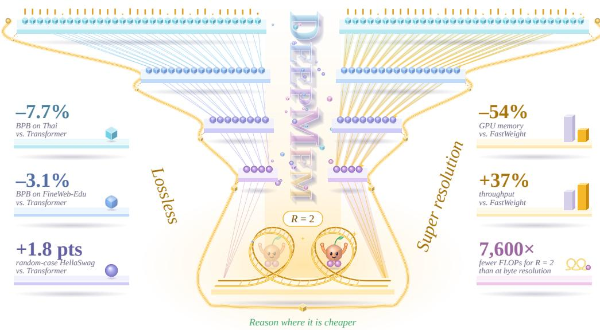

# Going Deeper With Memories

Afshin Khadangi SnT, University of Luxembourg afshin.khadanki@uni.lu afshin.xyz

  
Figure 1: DEEPMEM. Bytes descend into fewer memories while a lossless carrier (gold) keeps every byte exact. At the 16-position bottleneck, one shared state is refined twice (R=2) at ∼7,600× fewer FLOPs than at full byte resolution, and super-resolution restores byte-level states. Side panels: gains vs. a matched Transformer (left) and the FastWeight baseline (right).

## Abstract

Byte level language models avoid tokenizer dependence and provide universal coverage, but processing every byte at full resolution is expensive. We introduce DEEPMEM, a causal multiscale architecture that separates semantic compression from exact byte preservation. A learned invertible subband transform constructs a hierarchy of shorter sequences, while a lossless carrier and explicit detail sidebands preserve byte identity. Fast weight memory blocks operate along the encoder, with iterative shared state computation at the compressed bottleneck, while an attention based super resolution decoder restores byte resolution representations. DEEPMEM achieves stronger language modeling performance than a matched byte level Transformer on FineWeb-Edu and PG19, and obtains the best macro average performance across the evaluated FLORES languages. It also improves PIQA accuracy while remaining competitive on code modeling, multiple choice reasoning, and byte level corruption robustness. Bottleneck refinement requires approximately 7,600× fewer counted FLOPs than equivalent full resolution reasoning, while maintaining competitive evaluation throughput.

## 1 Introduction

Modern language models typically process sequences produced by fixed subword tokenizers. Bytepair encoding and unigram tokenization shorten sequences and make Transformer training practical [16, 8, 20], but require choosing a vocabulary and segmentation in advance. Tokenizers can fragment rare words, names, code, and morphologically rich forms; compress languages and scripts unevenly; and react discontinuously to small character perturbations [13, 23]. They therefore introduce an external representation bottleneck despite bytes already providing a universal digital representation.

Byte-level models remove this dependency. A fixed vocabulary of 256 symbols represents arbitrary Unicode text and other digital data without unknown tokens while exposing spelling, morphology, punctuation, and formatting. ByT5 demonstrated strong byte-level representations and robustness to character noise [23], while CANINE and Charformer improved efficiency by shortening character or byte sequences before deeper processing [2, 19]. The remaining challenge is sequence length: documents contain many more bytes than subword tokens, making full-resolution computation expensive.

Recent work addresses this cost through internal compression. MEGABYTE separates global patch computation from local byte prediction [25]; SpaceByte creates larger blocks near likely word boundaries [17]; and MambaByte uses a selective state-space backbone [22]. Byte Latent Transformer forms entropy-based variable-length patches [11], MrT5 dynamically removes redundant positions [5], and Multiscale Byte Language Models use multiple autoregressive stages [4]. Other hierarchical models combine byte- and word-level computation [10], while recent work explores diffusion and speculative mechanisms for faster byte generation [6]. These approaches show that tokenizer-free modeling is viable, but its efficiency depends strongly on how computation is distributed across resolutions.

Hierarchical computation also appears beyond byte modeling. Funnel Transformers shorten hidden sequences and reinvest the savings in deeper representations [3], while Hourglass Transformers combine autoregressive downsampling and upsampling [9]. MEGABYTE uses coarse representations to coordinate local decoders, and Autoregressive U-Nets learn hierarchies from bytes toward abstract units [25, 21]. All avoid performing every layer at full resolution, but pooling, deletion, merging, and patching create a tension between efficiency and fidelity: compressed states must preserve exact byte information, rely on a separate local path, or reconstruct detail later.

We address this tension using multirate signal-processing principles. Laplacian pyramids represent signals through coarse approximations and residual bands [1]. The lifting scheme implements invertible wavelet transforms through learned predict and update operations while preserving an exact algebraic inverse [18]. U-Net similarly combines a contracting path with an expanding path and skip connections for fine-resolution recovery [12]. These ideas suggest that semantic computation can be compressed aggressively when exact byte information is preserved separately rather than forced through a narrow bottleneck.

Applying subband analysis to autoregressive modeling requires explicit causal constraints. A feature summarizing a span [a, b] may influence only positions whose available context includes b. Likewise, a parent derived from two children cannot be copied to the earlier child without leaking information from the later one. Causality must therefore govern the analysis transform, synthesis path, and skip connections—not only individual attention or recurrent layers.

We introduce DEEPMEM (Fig. 1), a causal lossless subband architecture for byte-level autoregressive language modeling. It maintains a learned semantic stream and a lossless carrier stream. The semantic stream is progressively shortened to capture predictive structure, while each byte is mapped to a fixed eight-dimensional binary carrier and recursively transformed through learned lifting steps. Each level produces a coarse carrier and an explicit detail sideband whose hierarchy reconstructs the original carrier exactly in real arithmetic. Semantic compression therefore need not discard or implicitly memorize byte identity.

The encoder performs memory based mixing at progressively shorter resolutions. Fast-weight and linear attention models interpret sequence processing as recurrent associative memory, where a controller writes key–value associations into a rapidly changing state [15, 7, 14]. Gated linear attention adds data-dependent forgetting and chunk-parallel training [24]. We use this causal memory along the encoding path and in a two step shared state refinement module at the final semantic bottleneck. An attention based super-resolution decoder then restores byte resolution representations from delayed parent proposals, encoder skips, and exact carrier features.

This separation gives each path a distinct role. The semantic encoder performs deep computation at reduced lengths while retaining a sufficiently wide coarse representation for linguistic abstraction. The carrier preserves fine-grained byte information explicitly. The decoder combines compressed semantic representations with locally available carrier features and encoder skips to construct highresolution states for next-byte prediction. The method thus differs from single segmentation patch models and lossy hourglass architectures whose compressed states must retain all relevant local detail.

At approximately 100 million parameters, the model achieves 1.0134 BPB on FineWeb-Edu, versus 1.0457 for a matched raw-byte Transformer and 1.0187 for a FastWeight baseline. It also improves on PG19 (1.4402 versus 1.4635 BPB) and obtains the best macro-average across eight FLORES languages (1.9694 versus 2.0082 BPB), with a modest tradeoff on Stack-smol code. It remains competitive on HellaSwag, PIQA, and ARC and is robust to repeated-character, Antspeak, uppercase, and random-case perturbations.

## Contributions. Our main contributions are:

• a learned, recursively invertible subband decomposition separating a compressed semantic hierarchy from an exact byte carrier and explicit detail sidebands;

• causal analysis, delayed super resolution synthesis, and skip-fusion rules that prevent completed span features from leaking to earlier positions;

• a hybrid fast-weight memory encoder with two step shared state bottleneck refinement and an attention based super resolution decoder; and

• improved general domain, long form, and multilingual BPB over a matched raw byte Transformer.

## 2 Method

## 2.1 Overview and Notation

Let $\mathbf { x } = \left( x _ { 0 } , \ldots , x _ { T - 1 } \right)$ be a sequence of raw bytes, where $x _ { t } \in \{ 0 , \ldots , 2 5 5 \}$ . Our model constructs a dyadic hierarchy with levels $\bar { \ell } = 0 , \dots , L$ , where level 0 is the original byte resolution and each successive level halves the sequence length. The architecture maintains two parallel representations:

1. a learned semantic stream $\mathbf { S } ^ { ( \ell ) }$ , which performs predictive contextual computation; and

2. a lossless carrier stream $\mathbf { K } ^ { \left( \ell \right) }$ , which preserves exact byte identity through an invertible subband transform.

At the byte level, the semantic representation is obtained from a learned embedding table E, while the carrier is a fixed bipolar representation of the eight bits of each byte:

$$
\begin{array} { r l } & { \mathbf { S } _ { t } ^ { ( 0 ) } = \mathbf { E } [ x _ { t } ] , \quad \mathbf { K } _ { t , r } ^ { ( 0 ) } = 2 \mathbf { 1 } [ ( \lfloor x _ { t } / 2 ^ { r } \rfloor \bmod 2 ) = 1 ] - 1 , } \\ & { \qquad r \in \{ 0 , \ldots , 7 \} . } \end{array}\tag{1}
$$

Thus, $\mathbf { K } _ { t } ^ { ( 0 ) } \in \{ - 1 , + 1 \} ^ { 8 }$ is a parameter-free injective encoding of $x _ { t }$

At level $\ell ,$ the sequence length, semantic width, and carrier width are denoted by $T _ { \ell } , d _ { \ell } ,$ , and $c _ { \ell }$ respectively:

$$
T _ { \ell } = \frac { T } { 2 ^ { \ell } } , \quad \mathbf { S } ^ { ( \ell ) } \in \mathbb { R } ^ { T _ { \ell } \times d _ { \ell } } , \quad \mathbf { K } ^ { ( \ell ) } \in \mathbb { R } ^ { T _ { \ell } \times c _ { \ell } } , \quad c _ { \ell } = 8 \cdot 2 ^ { \ell } .\tag{2}
$$

The carrier length is halved while its width is doubled, so its total number of scalar coefficients remains $8 T$ at every level.

## 2.2 Learned Lossless Subband Analysis

Each analysis stage applies a learned lifting transform to adjacent carrier vectors. For level $\ell ,$ we first separate the carrier into even and odd positions:

$$
{ \bf e } _ { j } ^ { ( \ell ) } = { \bf K } _ { 2 j } ^ { ( \ell ) } , \qquad { \bf o } _ { j } ^ { ( \ell ) } = { \bf K } _ { 2 j + 1 } ^ { ( \ell ) } .
$$

A learned predictor $\mathcal { P } _ { \ell }$ estimates the odd vector from the even vector, producing a detail coefficient. A learned update function $\mathcal { U } _ { \ell }$ then modifies the even vector using this detail:

$$
\begin{array} { r l } & { \mathbf { \Delta } \mathbf { \Delta } \mathbf { \Delta } \mathbf { \Delta } \mathbf { \Delta } ^ { ( \ell + 1 ) } = \mathbf { o } _ { j } ^ { ( \ell ) } - \mathcal { P } _ { \ell } \left( \mathbf { e } _ { j } ^ { ( \ell ) } \right) , \mathbf { C } _ { j } ^ { ( \ell + 1 ) } = \mathbf { e } _ { j } ^ { ( \ell ) } + \mathcal { U } _ { \ell } \left( \mathbf { \Delta } \mathbf { \Delta } \mathbf { \Delta } \mathbf { \Delta } ^ { ( \ell + 1 ) } \right) , } \\ & { \mathbf { \Delta } \mathbf { K } _ { j } ^ { ( \ell + 1 ) } = \mathrm { c a t } \left[ \mathbf { C } _ { j } ^ { ( \ell + 1 ) } ; \mathbf { \Delta } \mathbf { \Delta } \mathbf { \Delta } _ { j } ^ { ( \ell + 1 ) } \right] . } \end{array}\tag{3}
$$

Both $\mathcal { P } _ { \ell }$ and $\mathcal { U } _ { \ell }$ are pointwise low-rank MLPs: RMSNorm, a rank-rlift projection, a SiLU nonlinearity, and a projection back to $c _ { \ell }$ dimensions. Their final projections are zero-initialized, so the carrier initially implements the lazy transform $\Delta = \mathbf { o }$ and $\mathbf { C } = \mathbf { e }$

For fixed learned functions $\mathcal { P } _ { \ell }$ and $\mathcal { U } _ { \ell }$ , Equation (3) has the exact algebraic inverse

$$
\begin{array} { r l } & { \widehat { \mathbf { e } } _ { j } ^ { ( \ell ) } = \mathbf { C } _ { j } ^ { ( \ell + 1 ) } - \mathcal { U } _ { \ell } \Big ( \Delta _ { j } ^ { ( \ell + 1 ) } \Big ) , \widehat { \mathbf { o } } _ { j } ^ { ( \ell ) } = \Delta _ { j } ^ { ( \ell + 1 ) } + \mathcal { P } _ { \ell } \Big ( \widehat { \mathbf { e } } _ { j } ^ { ( \ell ) } \Big ) , } \\ & { \widehat { \mathbf { K } } _ { 2 j } ^ { ( \ell ) } = \widehat { \mathbf { e } } _ { j } ^ { ( \ell ) } , \qquad \widehat { \mathbf { K } } _ { 2 j + 1 } ^ { ( \ell ) } = \widehat { \mathbf { o } } _ { j } ^ { ( \ell ) } . } \end{array}\tag{4}
$$

Substituting Equation (3) into Equation (4) gives $\hat { \mathbf { e } } _ { j } ^ { ( \ell ) } = \mathbf { e } _ { j } ^ { ( \ell ) }$ and $\widehat { \mathbf { o } } _ { j } ^ { ( \ell ) } = \mathbf { o } _ { j } ^ { ( \ell ) }$ . Recursively applying the inverse stages therefore reconstructs the original fixed-bit carrier $\mathbf { K } ^ { ( 0 ) }$ exactly in real arithmetic. The detail coefficients are also retained explicitly in the lossless carrier hierarchy.

## 2.3 Semantic Analysis Path

The semantic stream is not constrained to be invertible. Instead, it learns a compressed predictive representation. Adjacent semantic vectors are concatenated and projected into the width of the next level. The projected lossless carrier is injected through a learned low-rank map:

$$
\begin{array} { r l } & { { \mathbf { A } } _ { j } ^ { ( \ell + 1 ) } = { \mathbf { W } } _ { \ell } ^ { \mathrm { p a i r } } \operatorname { c a t } \left[ { \mathbf { S } } _ { 2 j } ^ { ( \ell ) } ; { \mathbf { S } } _ { 2 j + 1 } ^ { ( \ell ) } \right] + \alpha _ { \ell } ^ { \mathrm { c a r } } \mathcal { Q } _ { \ell } ^ { \mathrm { c a r } } \left( { \mathbf { K } } _ { j } ^ { ( \ell + 1 ) } \right) , } \\ & { { \mathbf { S } } ^ { ( \ell + 1 ) } = \mathcal { F } _ { \ell } ^ { \downarrow } \left( \mathrm { R M S N o r m } \left( { \mathbf { A } } ^ { ( \ell + 1 ) } \right) \right) . } \end{array}\tag{5}
$$

Here, $\mathcal { Q } _ { \ell } ^ { \mathrm { c a r } }$ is a low-rank carrier projection, $\alpha _ { \ell } ^ { \mathrm { c a r } }$ is a learned scalar, and $\mathcal { F } _ { \ell } ^ { \downarrow }$ is a stack of causal memory blocks.

A level-ℓ + 1 token with index j summarizes two level-ℓ tokens and therefore has a byte-level receptive-field endpoint $( j + 1 ) 2 ^ { \ell + 1 } - 1$ . Since the sequence mixers inside $\mathcal { F } _ { \ell } ^ { \downarrow }$ are causal, contextual processing may combine the current parent with earlier parents but never with a parent whose byte span ends later.

## 2.4 Fast-Weight Memory Encoder

The initial byte-resolution blocks and all down-path blocks use a gated fast-weight recurrence [15, 14, 24]. For each head, projected query, key, and value vectors are obtained from a causal depthwise convolution followed by a SiLU activation. Queries and keys are normalized independently. A scalar input-dependent log-decay $g _ { t } \leq 0$ is produced for each head, with $\gamma _ { t } = \exp ( g _ { t } ) \in ( 0 , 1 ]$

The fast-weight state $\mathbf { M } _ { t }$ and its readout are

$$
\mathbf { M } _ { t } = \gamma _ { t } \mathbf { M } _ { t - 1 } + \mathbf { k } _ { t } \mathbf { v } _ { t } ^ { \top } , \qquad \mathbf { o } _ { t } = \mathbf { M } _ { t } ^ { \top } \mathbf { q } _ { t } .\tag{6}
$$

The outer-product update writes a key–value association into the recurrent state, while the query retrieves a content-dependent combination of stored values. Unlike a growing attention key–value cache, the recurrent state size does not increase with sequence length.

Each encoder block uses pre-normalized residual mixing followed by a SwiGLU feed-forward network:

$$
\begin{array} { r } { \widetilde { \mathbf { H } } = \mathbf { H } + \mathcal { W } _ { o } \mathcal { R } ( \mathrm { R M S N o r m } ( \mathbf { H } ) ) , \quad } \\ { \mathrm { F W B l o c k } ( \mathbf { H } ) = \widetilde { \mathbf { H } } + \mathrm { S w i G L U } \left( \mathrm { R M S N o r m } ( \widetilde { \mathbf { H } } ) \right) , } \end{array}\tag{7}
$$

where R denotes the recurrence in Equation (6). For full-sequence training, the recurrence is evaluated using an exact chunk-parallel formulation. The sequence is partitioned into fixed-size chunks, with intra-chunk interactions computed by causal matrix multiplication and inter-chunk states propagated through an equivalent lower-triangular decay computation. Chunking changes the execution schedule but not the recurrence defined in Equation (6).

## 2.5 Shared-State Bottleneck Refinement

At the deepest level, the semantic stream contains 16 positions of width 128. A shared FastWeight mixer iteratively refines a separate latent state while holding the encoder bottleneck representation fixed. Let $\mathbf { B } = \mathbf { S } ^ { ( L ) }$ and initialize ${ \bf Z } _ { 0 } = { \bf 0 }$ . Two recurrent updates are applied:

$$
\begin{array} { r l } & { \mathbf { Z } _ { r + 1 } = \mathbf { Z } _ { r } + \mathcal { R } _ { \mathrm { b o t } } \big ( \mathrm { R M S N o r m } ( \mathbf B + \mathbf Z _ { r } ) \big ) , \quad r \in \{ 0 , 1 \} , } \\ & { \widetilde { \mathbf { S } } ^ { ( L ) } = \mathbf { B } + \mathbf Z _ { 2 } . } \end{array}\tag{8}
$$

The same normalization and FastWeight mixer parameters are used in both updates. The bottleneck module contains no additional feed-forward block and introduces no iteration-specific parameters. Each update uses the causal recurrence in Equation (6), so the refined bottleneck preserves completedspan causality. The decoder is initialized from $\widetilde { \mathbf { S } } ^ { ( L ) }$

## 2.6 Causal Super-Resolution Decoder

The decoder progressively restores semantic representations from the refined bottleneck at level L to level 0. At transition $\ell + 1  \ell ,$ a linear projection maps each parent vector into two child proposals:

$$
\begin{array} { r } { \left[ \mathbf { p } _ { j } ^ { L , ( \ell ) } ; \mathbf { p } _ { j } ^ { R , ( \ell ) } \right] = \mathbf { W } _ { \ell } ^ { \mathrm { u p } } \mathbf { Y } _ { j } ^ { ( \ell + 1 ) } , } \end{array}\tag{9}
$$

where $\mathbf { Y } ^ { ( \ell + 1 ) }$ is the current decoded parent sequence.

A naive assignment of $\mathbf { p } _ { i } ^ { L , ( \ell ) }$ to position $2 j$ would violate causality. Parent $j$ summarizes both children $2 j$ and $2 j + 1$ , so it is only valid once position $2 j + 1$ has entered the context. We therefore apply a shifted unpacking rule:

$$
\mathbf { U } _ { 2 j } ^ { ( \ell ) } = \left\{ \begin{array} { l l } { \mathbf { 0 } , } & { j = 0 , } \\ { \mathbf { p } _ { j - 1 } ^ { L , ( \ell ) } , } & { j > 0 , } \end{array} \right. \quad \mathbf { U } _ { 2 j + 1 } ^ { ( \ell ) } = \mathbf { p } _ { j } ^ { R , ( \ell ) } .\tag{10}
$$

The right-child proposal from parent $j$ is used at position $2 j + 1$ , where its complete receptive field is available. The left-child position $2 j$ instead receives a proposal from parent $j - 1$ , whose receptive field ends before position $2 j$

The shifted parent representation is fused with the encoder skip and the carrier at the child resolution. Let

$$
\mathbf { Z } _ { t } ^ { ( \ell ) } = \operatorname { c a t } \left[ \mathbf { S } _ { t } ^ { ( \ell ) } ; \mathbf { U } _ { t } ^ { ( \ell ) } ; { \alpha } _ { \ell } ^ { \mathrm { u p } } \mathcal { Q } _ { \ell } ^ { \mathrm { u p } } \left( \mathbf { K } _ { t } ^ { ( \ell ) } \right) \right] .
$$

The fused representation is

$$
\begin{array} { r l } & { \mathbf { G } _ { t } ^ { ( \ell ) } = \sigma \Big ( \mathbf { W } _ { \ell } ^ { g } \mathbf { Z } _ { t } ^ { ( \ell ) } \Big ) , } \\ & { \widehat { \mathbf { Y } } _ { t } ^ { ( \ell ) } = \mathrm { R M S N o r m } \left( \mathbf { S } _ { t } ^ { ( \ell ) } + \mathbf { G } _ { t } ^ { ( \ell ) } \odot \mathbf { W } _ { \ell } ^ { m } \mathbf { Z } _ { t } ^ { ( \ell ) } \right) , } \\ & { \mathbf { Y } ^ { ( \ell ) } = \mathcal { F } _ { \ell } ^ { \uparrow } \left( \widehat { \mathbf { Y } } ^ { ( \ell ) } \right) . } \end{array}\tag{11}
$$

The gate allows each position and channel to control how strongly decoded parent context and carrier information modify the encoder skip. $\mathcal { F } _ { \ell } ^ { \uparrow }$ is a stack of causal self-attention blocks with rotary position embeddings [20]. These blocks refine the restored representation at the current resolution before the next upsampling stage.

The decoder performs super-resolution over hidden representations rather than predicting several unknown future bytes simultaneously. Every restored position remains conditioned only on bytes that precede or equal that position.

## 2.7 Byte Prediction and Training Objective

After super-resolution, the byte-resolution sequence $\mathbf { H } ^ { ( 0 ) } = \mathbf { Y } ^ { ( 0 ) }$ is processed by a final stack of causal self-attention blocks. The output is normalized and projected to the 256-byte vocabulary:

$$
\begin{array} { r l } & { \mathbf { H } ^ { \mathrm { o u t } } = \mathcal { F } ^ { \mathrm { f i n a l } } \left( \mathbf { H } ^ { ( 0 ) } \right) , \mathbf { z } _ { t } = \mathbf { W } ^ { \mathrm { v o c a b } } \mathrm { R M S N o r m } \left( \mathbf { H } _ { t } ^ { \mathrm { o u t } } \right) , } \\ & { ~ p _ { \theta } ( x _ { t + 1 } \mid x _ { \le t } ) = \mathrm { s o f t m a x } \left( \mathbf { z } _ { t } \right) _ { x _ { t + 1 } } . } \end{array}\tag{12}
$$

The model is trained with next-byte negative log-likelihood:

$$
\mathcal { L } _ { \mathrm { N L L } } = - \frac { 1 } { T - 1 } \sum _ { t = 0 } ^ { T - 2 } \log p _ { \theta } \left( x _ { t + 1 } \mid x _ { \le t } \right) .\tag{13}
$$

For evaluation, the average loss in nats is converted to bits per byte by dividing by log 2.

## 3 Experiments

## 3.1 Experimental Setup

We train all models from scratch on the training split of FineWeb-Edu, represented directly as UTF-8 bytes with a vocabulary of 256 symbols. All runs use a context length of 2,048 bytes across three random seeds per model, and are matched to approximately 100 million trainable parameters. Unless otherwise stated, models are trained for 50,000 optimizer steps with a per-GPU batch size of 8 and gradient accumulation over 8 iterations. With four GPUs, this gives an effective batch size of 256 sequences, or 524,288 bytes per optimizer step, corresponding to approximately 26.2 billion byte presentations over training.

We use AdamW with $\beta _ { 1 } = 0 . 9 , \beta _ { 2 } = 0 . 9 5$ , weight decay 0.1, and gradient clipping at 1.0. The learning rate is linearly warmed up from zero to $3 \times 1 0 ^ { - 4 }$ over 2,000 steps and then cosine-decayed to $3 \times \bar { 1 } 0 ^ { - 5 }$ . Training uses FP16 mixed precision, no dropout, and a streaming-data shuffle buffer of 20,000 examples. All models are trained and evaluated on four NVIDIA Tesla V100-SXM2 GPUs with 32 GB of memory each.

## 3.2 Baselines

We compare against four approximately 100M-parameter byte-level baselines:

• Transformer: a flat causal Transformer operating on all 2,048 byte positions at every layer [20];

• FastWeight: a flat model replacing self-attention with gated fast-weight memory blocks [14, 24];

• BLT: the Byte Latent Transformer, which compresses bytes into entropy-dependent latent patches [11]; and

• AU-Net: an autoregressive U-Net with hierarchical downsampling, upsampling, and skip connections [21].

All baselines use the same training corpus, byte context length, optimizer-step budget, effective batch size, learning-rate schedule, numerical precision, and hardware. Parameter counts are matched as closely as permitted by each architecture.

## 3.3 Reference Architecture

Our reference model uses one initial fast-weight block, seven lossless analysis transitions, a two-step shared-state bottleneck refinement module, seven super-resolution synthesis transitions, and one final attention block. Starting from a 2,048-byte sequence, the hierarchy uses lengths

$$
( 2 0 4 8 , 1 0 2 4 , 5 1 2 , 2 5 6 , 1 2 8 , 6 4 , 3 2 , 1 6 )
$$

and semantic widths

$$
( 1 0 2 4 , 5 1 2 , 2 5 6 , 1 2 8 , 1 2 8 , 1 2 8 , 1 2 8 , 1 2 8 ) .
$$

The semantic representation is therefore compressed rapidly at high resolution and held at width 128 throughout the deepest levels. The corresponding lossless carrier widths are

$$
( 8 , 1 6 , 3 2 , 6 4 , 1 2 8 , 2 5 6 , 5 1 2 , 1 0 2 4 ) ,
$$

preserving a constant total of 8T carrier coefficients at every resolution.

The initial and analysis-path mixers are gated fast-weight blocks, while all synthesis-path refinement blocks and the final block use causal self-attention with rotary position embeddings. The analysis and synthesis depths are both

$$
( 2 , 2 , 2 , 3 , 3 , 3 , 4 ) ,
$$

listed from the highest-resolution transition to the deepest transition. Attention and fast-weight blocks use at most 16 heads. The byte-resolution model width is 1,024, with 16 heads.

Standard byte-resolution blocks use an MLP ratio of 4.0, while analysis and synthesis blocks use a ratio of 6.0. The lifting predictor and update functions use rank 64, as do carrier-to-semantic and detail projections. The fixed carrier dimension is 8, the minimum hierarchy length is 16, and direct all-scale fusion is disabled. The carrier residual gains are initialized to 0.1. The shared-state bottleneck refinement module uses one 128-dimensional FastWeight mixer and two iterations, with parameters shared across both updates. The architecture has 100,158,582 trainable parameters, including 69,280 in the bottleneck refinement module. Fast-weight blocks use chunks of 64 positions and a causal depthwise-convolution kernel of size 4. Attention blocks use a rotary base of 10,000.

## 3.4 Evaluation

We evaluate language modeling using bits per byte (BPB), where lower is better. General-domain performance is measured on FineWeb-Edu, long-form modeling on the PG19 test set, and code modeling on Stack-smol. Multilingual performance is evaluated on English, German, Arabic, Hindi, Bengali, Thai, Vietnamese, and Swahili text from FLORES, and we report both language-level and macro-average BPB.

We additionally evaluate zero-shot multiple-choice accuracy on HellaSwag, PIQA, ARC-Easy, and ARC-Challenge. Robustness is measured using HellaSwag variants containing character deletion, repetition, Antspeak spacing, uppercasing, and random casing. For multiple-choice tasks, each candidate is scored by its conditional byte-level log-likelihood.

Evaluation efficiency is reported as aggregate processed bytes per second for configurations with available measurements. These measurements use the same evaluation implementation, batch construction, hardware, and numerical precision.

## 4 Results

## 4.1 Language Modeling Quality

Table 1 summarizes bits per byte (BPB) on general-domain text, long-form text, code, and multilingual evaluation. Lower BPB indicates better byte-level language modeling. DEEPMEM achieves the strongest overall BPB results among the compared 100M-parameter systems. On FineWeb-Edu, it reaches 1.0134 BPB, improving over the matched Transformer at 1.0457, flat FastWeight at 1.0187, BLT at 1.0336, and AU-Net at 1.0319. On PG19, our model again performs best, achieving 1.4402 BPB and improving over the Transformer baseline at 1.4635. These results indicate that performing substantial computation at compressed resolutions can improve both in-domain and language modeling on FineWeb-Edu and PG19 under the fixed 2,048-byte context setting.

Code modeling shows a different pattern. On Stack-smol, the flat Transformer achieves the lowest Stack-smol BPB among the primary models in Table 1 at 2.4474 BPB, while our model attains 2.4854 BPB. Even so, our method remains substantially stronger than flat FastWeight and BLT, suggesting that the proposed hierarchy preserves much of the benefit of flat modeling while trading off some performance on code. On the multilingual FLORES macro-average reported in the final column of Table 1, our model again performs best, reaching 1.9694 BPB. An additional all-scale fusion configuration achieves 2.4082 BPB on Stack-smol (Appendix A.1), highlighting a task-specific architectural tradeoff.

## 4.2 Multilingual Generalization

Table 2 reports language-level BPB on eight FLORES languages. Our model obtains the best macroaverage, 1.9694, improving over the Transformer at 2.0082, BLT at 2.0233, FastWeight at 2.0599, and the AU-Net at 2.0077. The gains are distributed across multiple languages rather than concentrated in

Table 1: Language-modeling performance in bits per byte (BPB). Lower is better. DEEPMEM (NR) represents DEEPMEM with no shared state refinement.
<table><tr><td>Model</td><td>FineWeb-Edu</td><td>PG19</td><td>Stack-smol</td><td>FLORES</td></tr><tr><td>Transformer</td><td> $1 . 0 4 5 7 \pm 0 . 0 1 9$ </td><td> $1 . 4 6 3 5 \pm 0 . 0 2 3$ </td><td> $2 . 4 4 7 4 \pm 0 . 0 7 7$ </td><td> $2 . 0 0 8 2 \pm 0 . 0 2 8$ </td></tr><tr><td>FastWeight</td><td> $1 . 0 1 8 7 \pm 0 . 0 0 8$ </td><td> $1 . 4 9 5 6 \pm 0 . 0 1 9$ </td><td> $2 . 9 5 5 8 \pm 0 . 0 4 7$ </td><td> $2 . 0 5 9 9 \pm 0 . 0 2 2$ </td></tr><tr><td>BLT</td><td> $1 . 0 3 3 6 \pm 0 . 0 0 9$ </td><td> $1 . 5 9 2 0 \pm 0 . 0 5 0$ </td><td> $2 . 6 1 3 8 \pm 0 . 0 6 5$ </td><td> $2 . 0 2 3 3 \pm 0 . 0 2 1$ </td></tr><tr><td>AU-Net</td><td> $1 . 0 3 1 9 \pm 0 . 0 0 6$ </td><td> $1 . 4 8 8 5 \pm 0 . 0 2 2$ </td><td> $2 . 4 8 9 4 \pm 0 . 0 5 8$ </td><td> $2 . 0 0 7 7 \pm 0 . 0 2 0$ </td></tr><tr><td>DEEPMEM (NR)</td><td> $\overline { { 1 . 0 1 4 5 \pm 0 . 0 1 0 } }$ </td><td> $\overline { { 1 . 4 4 6 2 \pm 0 . 0 2 2 } }$ </td><td> $2 . 5 0 2 1 \pm 0 . 0 4 6$ </td><td> $\overline { { 1 . 9 7 5 8 \pm 0 . 0 1 7 } }$ </td></tr><tr><td>DEEPMEM</td><td> $\mathbf { 1 . 0 1 3 4 } \pm 0 . 0 0 8$ </td><td> $\mathbf { 1 . 4 4 0 2 \pm 0 . 0 1 7 }$ </td><td> $2 . 4 8 5 4 \pm 0 . 0 3 4$ </td><td> $\mathbf { 1 . 9 6 9 4 } \pm 0 . 0 2 0$ </td></tr></table>

Table 2: Language-level BPB on FLORES. Lower is better. Macro is the unweighted mean across the eight languages. T, FW, AU, DM (NR), and DM represent Transformer, FastWeight, AU-Net, DEEPMEM with no shared state refinement, and DEEPMEM, respectively.
<table><tr><td>Model</td><td>English</td><td>German</td><td>Arabic</td><td>Hindi</td><td>Bengali</td><td>Thai</td><td>Vietnamese</td><td>Swahili</td><td>Macro</td></tr><tr><td>T</td><td>1.2013 ± 0.020</td><td>2.4014 ± 0.036</td><td>2.1194 ± 0.028</td><td>1.4265 ± 0.013</td><td> $1 . 6 1 5 7 \pm 0 . 0 2 0$ </td><td>1.7914 ± 0.021</td><td> $2 . 3 8 8 4 \pm 0 . 0 3 2$ </td><td> ${ \bf 3 . 1 2 1 6 \pm 0 . 0 5 3 }$ </td><td>2.0082 ± 0.028</td></tr><tr><td>FW</td><td>1.2484 ± 0.013</td><td>2.3674 ± 0.019</td><td>2.1350 ± 0.026</td><td>1.4196 ± 0.011</td><td> $1 . 6 2 0 5 \pm 0 . 0 2 3$ </td><td>1.7722 ± 0.016</td><td> $2 . 4 5 4 7 \pm 0 . 0 2 2$ </td><td> $3 . 4 6 1 3 \pm 0 . 0 4 4$ </td><td> $2 . 0 5 9 9 \pm 0 . 0 2 2$ </td></tr><tr><td>BLT</td><td>1.2543 ± 0.013</td><td>2.3916 ± 0.027</td><td>2.1316 ± 0.027</td><td>1.4430 ± 0.013</td><td> $1 . 6 0 6 5 \pm 0 . 0 2 2$ </td><td>1.7627 ± 0.016</td><td> $2 . 3 5 8 8 \pm 0 . 0 1 6$ </td><td> $3 . 2 3 7 6 \pm 0 . 0 3 2$ </td><td>2.0233 ± 0.021</td></tr><tr><td>AU</td><td>1.2208 ± 0.019</td><td>2.3831 ± 0.022</td><td>2.1172 ± 0.028</td><td>1.4202 ± 0.011</td><td> $1 . 6 1 7 5 \pm 0 . 0 2 3$ </td><td>1.7526 ± 0.010</td><td> $2 . 3 6 3 5 \pm 0 . 0 1 9$ </td><td> $3 . 1 8 6 5 \pm 0 . 0 2 7$ </td><td>2.0077 ± 0.020</td></tr><tr><td>DM (NR)</td><td>1.2134 ± 0.013</td><td>2.3473 ± 0.014</td><td>2.0406 ± 0.019</td><td>1.4518 ± 0.015</td><td> $\textcircled { 1 . 5 9 9 6 \pm 0 . 0 1 2 }$ </td><td>1.6569 ± 0.016</td><td> $2 . 2 9 8 8 \pm 0 . 0 1 8$ </td><td> $3 . 1 9 7 8 \pm 0 . 0 2 8$ </td><td>1.9758 ± 0.017</td></tr><tr><td>DM</td><td>1.2007 ± 0.015</td><td>2.3408 ± 0.019</td><td>2.0383 ± 0.019</td><td>1.4403 ± 0.013</td><td> $1 . 6 1 3 2 \pm 0 . 0 1 6$ </td><td>1.6535 ± 0.016</td><td> $2 . 3 0 5 9 \pm 0 . 0 2 7$ </td><td> $3 . 1 6 2 4 \pm 0 . 0 3 2$ </td><td>1.9694 ± 0.020</td></tr></table>

a single case. In particular, our model achieves the lowest BPB on English, German, Arabic, and Thai.   
The variant without shared-state refinement achieves the lowest BPB on Bengali and Vietnamese.

The largest improvements over the Transformer appear in Thai, Arabic, and Vietnamese, where byte-level modeling benefits from combining a fixed 256-symbol vocabulary with multiscale semantic processing. The Transformer performs best on Swahili, while flat FastWeight achieves the lowest BPB on Hindi. The variant without shared-state refinement performs best on Bengali and Vietnamese. Nevertheless, the overall pattern favors the proposed lossless multiscale architecture, indicating that its gains extend across distinct scripts and language families.

## 4.3 Evaluation Throughput

Table 3 reports BPB evaluation throughput in processed bytes per second for the comparison configurations. DEEPMEM processes an average of 119,718 bytes/s, compared with 147,023 bytes/s for the flat Transformer. This corresponds to 81.4% of Transformer throughput, demonstrating that the hierarchical architecture maintains competitive evaluation efficiency while incorporating multiscale computation and shared-state bottleneck refinement.

The recorded evaluations show that hierarchical computation offers competitive throughput relative to flat FastWeight, BLT, and AU-Net. DEEPMEM achieves higher average throughput than all three architectures, while remaining slower than the flat Transformer. These results indicate that the memory-based analysis path and attention-based super-resolution decoder can support efficient byte-level evaluation despite the additional recurrent computation at the compressed bottleneck.

## 4.4 Multiple-Choice Evaluation

Table 4 presents zero-shot multiple-choice accuracy. DEEPMEM achieves the highest HellaSwag accuracy (30.30%), the highest ARC-Challenge accuracy (23.41%), and the highest unweighted mean accuracy (37.76%) among the main comparison models. On PIQA, DEEPMEM achieves 60.83%, while the variant without shared-state refinement reaches 61.81%. The full model exceeds the matched Transformer on all four tasks, although several improvements are small relative to the reported run-level variation.

Flat FastWeight remains strongest on ARC-Easy, where it reaches 37.72% compared with 36.49% for our model. Even so, our model achieves the strongest average across the four tasks, indicating that the proposed hierarchy does not sacrifice general zero-shot performance.

Table 3: Mean BPB evaluation throughput in processed bytes per second. Higher is better.
<table><tr><td>Model</td><td>FineWeb-Edu</td><td>PG19</td><td>Stack-smol</td><td>Average</td></tr><tr><td>Transformer</td><td>147,788</td><td> $^ { 1 4 6 , 5 9 0 }$ </td><td>146,690</td><td>147,023</td></tr><tr><td>FastWeight</td><td>87,577</td><td>86,663</td><td>87,095</td><td>87,112</td></tr><tr><td>BLT</td><td>109,302</td><td>109,792</td><td>109,932</td><td>109,675</td></tr><tr><td>AU-Net</td><td>114,565</td><td>115,658</td><td>118,965</td><td>116,396</td></tr><tr><td>DEEPMEM (NR)</td><td>137,963</td><td>136,905</td><td>139,287</td><td>138,051</td></tr><tr><td>DEEPMEM</td><td>118,963</td><td>120,905</td><td>119,287</td><td>119,718</td></tr></table>

Table 4: Zero-shot multiple-choice accuracy (%). Higher is better. Mean is the unweighted average across the four tasks. DEEPMEM (NR) represents DEEPMEM with no shared state refinement.
<table><tr><td>Model</td><td>HellaSwag</td><td>PIQA</td><td>ARC-E</td><td>ARC-C</td><td>Mean</td></tr><tr><td>Transformer</td><td> $2 8 . 8 1 \pm 0 . 4$ </td><td> $6 0 . 5 5 \pm 0 . 5$ </td><td> $3 5 . 9 6 \pm 0 . 6$ </td><td> $2 2 . 7 4 \pm 0 . 5$ </td><td> $3 7 . 0 2 \pm 0 . 5$ </td></tr><tr><td>FastWeight</td><td> $2 9 . 9 5 \pm 0 . 4$ </td><td> $6 0 . 6 1 \pm 0 . 5$ </td><td> $3 7 . 7 2 \pm 0 . 6$ </td><td> $2 0 . 0 7 \pm 0 . 3$ </td><td> $3 7 . 0 9 \pm 0 . 5$ </td></tr><tr><td>BLT</td><td> $2 8 . 8 0 \pm 0 . 4$ </td><td> $6 0 . 5 5 \pm 0 . 5$ </td><td> $3 3 . 1 6 \pm 0 . 7$ </td><td> $2 1 . 0 7 \pm 0 . 4$ </td><td> $3 5 . 9 0 \pm 0 . 5$ </td></tr><tr><td>AU-Net</td><td> $2 8 . 6 4 \pm 0 . 4$ </td><td> $6 0 . 6 6 \pm 0 . 5$ </td><td> $3 4 . 6 7 \pm 0 . 6$ </td><td> $2 0 . 8 6 \pm 0 . 4$ </td><td> $3 6 . 2 1 \pm 0 . 5$ </td></tr><tr><td>DEEPMEM (NR)</td><td> $2 9 . 8 7 \pm 0 . 4$ </td><td> ${ \bf 6 1 . 8 1 \pm 0 . 7 }$ </td><td> $3 6 . 3 2 \pm 0 . 6$ </td><td> $2 1 . 7 4 \pm 0 . 3$ </td><td> $3 7 . 4 4 \pm 0 . 5$ </td></tr><tr><td>DEEPMEM</td><td> ${ \bf 3 0 . 3 0 \pm 0 . 4 }$ </td><td> $6 0 . 8 3 \pm 0 . 7$ </td><td> $3 6 . 4 9 \pm 0 . 6$ </td><td> $2 3 . 4 1 \pm 0 . 3$ </td><td> ${ \bf 3 7 . 7 6 \pm 0 . 5 }$ </td></tr></table>

## 4.5 Robustness to Byte-Level Perturbations

Table 5 evaluates robustness on HellaSwag under five character-level perturbations. Our model achieves the strongest accuracy on clean inputs, under repeated characters and random casing, and remains close to the strongest baseline under deletion, Antspeak spacing, and uppercasing. Its mean score across the clean and perturbed settings is 29.00%, above the flat FastWeight model at 28.87% and the Transformer at 27.73%.

The pattern of robustness is informative. The strongest gains over the Transformer appear under random casing, deletion, and repetition, which perturb local byte patterns without necessarily changing the underlying semantics. This behavior is consistent with the intended role of the architecture: the lossless carrier and detail sidebands preserve fine-grained evidence, while the semantic hierarchy captures longer-range structure. Our model combines the highest average robustness with stronger BPB and stronger mean multiple-choice accuracy.

## 4.6 Overall Tradeoff

Across the evaluated tasks, the proposed architecture achieves the best FineWeb-Edu BPB, the best PG19 BPB, the best FLORES macro-average BPB, and the highest mean multiple-choice and robustness accuracy among the main comparison models. The main weakness is code modeling, where the flat Transformer remains stronger. Evaluation throughput of the shared-state architecture reaches 119,718 bytes/s.

Taken together, the results support the central claim of the paper: exact lossless multiscale processing combined with shared-state bottleneck refinement can improve byte-level language modeling quality and multilingual generalization. Some task-specific tradeoffs remain, especially on code and ARC-Easy, but the overall pattern is favorable to the proposed approach.

## 5 Discussion and Limitations

Discussion. Our results suggest that byte-level language modeling benefits from separating semantic abstraction from exact local information. The semantic hierarchy performs increasingly deep computation on shorter sequences, while the lossless carrier and detail sidebands preserve byte identity outside the semantic bottleneck. A shared-state refinement module iteratively refines the deepest semantic representation without duplicating mixer parameters. This division appears to improve natural-language and multilingual BPB. The comparative configurations (Supplementary) show that auxiliary carrier injection and direct all-scale fusion have task-dependent effects.

Table 5: HellaSwag accuracy (%) under byte-level perturbations. Higher is better. T, FW, AU and DM represent Transformer, FastWeight, AU-Net and DEEPMEM, respectively.
<table><tr><td>Model</td><td>Clean</td><td>Drop</td><td>Repeat</td><td></td><td></td><td>Antspeak Uppercase Randomcase</td></tr><tr><td>T</td><td> $2 8 . 8 1 \pm 0 . 4$ </td><td> $2 7 . 9 7 \pm 0 . 5$ </td><td> $2 7 . 5 0 \pm 0 . 4$ </td><td> $2 5 . 9 3 \pm 0 . 4$ </td><td> $2 8 . 7 9 \pm 0 . 5$ </td><td> $2 7 . 3 8 \pm 0 . 4$ </td></tr><tr><td>FW</td><td> $2 9 . 9 5 \pm 0 . 4$ </td><td> ${ \bf 2 9 . 1 8 \pm 0 . 4 }$ </td><td> $2 8 . 5 4 \pm 0 . 4$ </td><td> $2 7 . 0 6 \pm 0 . 4$ </td><td> ${ \pm 9 . 8 9 \pm 0 . 4 }$ </td><td> $2 8 . 5 8 \pm 0 . 4$ </td></tr><tr><td>BLT</td><td> $2 8 . 8 0 \pm 0 . 4$ </td><td> $2 8 . 9 8 \pm 0 . 4$ </td><td> $2 7 . 9 2 \pm 0 . 4$ </td><td> $2 6 . 0 2 \pm 0 . 4$ </td><td> $2 8 . 6 8 \pm 0 . 4$ </td><td> $2 7 . 4 2 \pm 0 . 4$ </td></tr><tr><td>AU</td><td> $2 8 . 6 4 \pm 0 . 4$ </td><td> $2 8 . 8 6 \pm 0 . 4$ </td><td> $2 7 . 5 4 \pm 0 . 4$ </td><td> $2 6 . 1 0 \pm 0 . 4$ </td><td> $2 8 . 4 2 \pm 0 . 4$ </td><td> $2 7 . 5 6 \pm 0 . 4$ </td></tr><tr><td>DM</td><td> ${ \bf 3 0 . 3 0 \pm 0 . 4 }$ </td><td> $2 9 . 1 6 \pm 0 . 4$ </td><td> $2 8 . 6 4 \pm 0 . 4$ </td><td> $2 6 . 8 9 \pm 0 . 4$ </td><td> $2 9 . 8 2 \pm 0 . 3$ </td><td> ${ \bf 2 9 . 1 6 \pm 0 . 4 }$ </td></tr></table>

The architecture also highlights the importance of causal synthesis in hierarchical autoregressive models. Coarse representations summarize completed spans and therefore cannot be assigned directly to earlier positions within those spans. Delayed parent proposals allow the decoder to recover highresolution representations without exposing future bytes. The bottleneck updates likewise preserve causal dependencies because they use a shared causal FastWeight mixer. More broadly, this provides a way to combine deep low-resolution computation with valid next-byte prediction.

The resulting performance suggests that hierarchical byte models need not choose between aggressive compression and local fidelity. In our model, the compressed semantic path can allocate capacity to longer-range structure because exact byte information remains available through the carrier hierarchy. Meanwhile, attention is concentrated in the synthesis path, where it refines representations after much of the computation has occurred at shorter resolutions. The comparative configurations (Supplementary) suggest that direct all-scale fusion can benefit individual languages, whereas omitting it allows shared-state refinement at the deepest bottleneck without a direct fusion path.

Limitations. Our study is limited to approximately 100M-parameter models, and a single training budget; larger-scale experiments are therefore needed. The model also trails the Transformer on Stack-smol, and its measured evaluation throughput is lower than that of the flat Transformer. Finally, exact invertibility holds in real arithmetic, while finite precision may introduce small reconstruction errors, and the fixed dyadic hierarchy is less flexible than learned variable-length segmentation.

## 6 Conclusion

We introduced a causal lossless subband architecture for byte-level language modeling that separates semantic compression from exact byte preservation. A FastWeight encoder performs deep computation over progressively shorter sequences, and a two-step shared-state bottleneck refinement module refines the compressed semantics, while an invertible carrier hierarchy, explicit detail sidebands, and a causal super-resolution decoder restore rich byte-resolution representations without future leakage.

At approximately 100M parameters, the model improves FineWeb-Edu, PG19, and multilingual BPB over a matched byte-level Transformer. It also achieves strong multiple-choice accuracy and robustness to byte-level perturbations. These results suggest that lossless multiscale representations with shared-state bottleneck refinement offer a practical alternative to flat byte processing, enabling tokenizer-free language models to combine strong predictive quality with exact byte preservation.

Code availability. The code is available online at https://github.com/akhadangi/deepmem.

## References

[1] Peter J. Burt and Edward H. Adelson. The laplacian pyramid as a compact image code. IEEE Transactions on Communications, 31(4):532–540, 1983.

[2] Jonathan H. Clark, Dan Garrette, Iulia Turc, and John Wieting. CANINE: Pre-training an efficient tokenization-free encoder for language representation. Transactions of the Association for Computational Linguistics, 10:73–91, 2022.

[3] Zihang Dai, Guokun Lai, Yiming Yang, and Quoc V. Le. Funnel-transformer: Filtering out sequential redundancy for efficient language processing. In Advances in Neural Information Processing Systems, volume 33, pages 4271–4282, 2020.

[4] Eric Egli, Matteo Manica, and Jannis Born. Multiscale byte language models: A hierarchical architecture for causal million-length sequence modeling. arXiv preprint arXiv:2502.14553, 2025.

[5] Julie Kallini, Shikhar Murty, Christopher D. Manning, Christopher Potts, and Róbert Csordás. MrT5: Dynamic token merging for efficient byte-level language models. In International Conference on Learning Representations, 2025.

[6] Julie Kallini, Artidoro Pagnoni, Tomasz Limisiewicz, Gargi Ghosh, Luke Zettlemoyer, Christopher Potts, Xiaochuang Han, and Srinivasan Iyer. Fast byte latent transformer. arXiv preprint arXiv:2605.08044, 2026.

[7] Angelos Katharopoulos, Apoorv Vyas, Nikolaos Pappas, and François Fleuret. Transformers are RNNs: Fast autoregressive transformers with linear attention. In Proceedings ofthe 37th International Conference on Machine Learning, volume 119 of Proceedings of Machine Learning Research, pages 5156–5165. PMLR, 2020.

[8] Taku Kudo and John Richardson. SentencePiece: A simple and language independent subword tokenizer and detokenizer for neural text processing. In Proceedings ofthe 2018 Conference on Empirical Methods in Natural Language Processing: System Demonstrations, pages 66–71, Brussels, Belgium, 2018. Association for Computational Linguistics.

[9] Piotr Nawrot, Szymon Tworkowski, Michał Tyrolski, Lukasz Kaiser, Yuhuai Wu, Christian Szegedy, and Henryk Michalewski. Hierarchical transformers are more efficient language models. In Findings ofthe Associationfor Computational Linguistics: NAACL 2022, pages 1559–1571, Seattle, United States, 2022. Association for Computational Linguistics.

[10] Pit Neitemeier, Björn Deiseroth, Constantin Eichenberg, and Lukas Balles. Hierarchical autoregressive transformers: Combining byte- and word-level processing for robust, adaptable language models. arXiv preprint arXiv:2501.10322, 2025.

[11] Artidoro Pagnoni, Ramakanth Pasunuru, Pedro Rodriguez, John Nguyen, Benjamin Muller, Margaret Li, Chunting Zhou, Lili Yu, Jason E. Weston, Luke Zettlemoyer, Gargi Ghosh, Mike Lewis, Ari Holtzman, and Srini Iyer. Byte latent transformer: Patches scale better than tokens. In Proceedings ofthe 63rd Annual Meeting ofthe Associationfor Computational Linguistics (Volume 1: Long Papers), pages 9238–9258, Vienna, Austria, 2025. Association for Computational Linguistics.

[12] Olaf Ronneberger, Philipp Fischer, and Thomas Brox. U-Net: Convolutional networks for biomedical image segmentation. In Medical Image Computing and Computer-Assisted Intervention, volume 9351 of Lecture Notes in Computer Science, pages 234–241. Springer, 2015.

[13] Phillip Rust, Jonas Pfeiffer, Ivan Vulic, Sebastian Ruder, and Iryna Gurevych. How good is your tokenizer?´ on the monolingual performance of multilingual language models. In Proceedings of the 59th Annual Meeting of the Association for Computational Linguistics and the 11th International Joint Conference on Natural Language Processing, pages 3118–3135. Association for Computational Linguistics, 2021.

[14] Imanol Schlag, Kazuki Irie, and Jürgen Schmidhuber. Linear transformers are secretly fast weight programmers. In Proceedings of the 38th International Conference on Machine Learning, volume 139 of Proceedings of Machine Learning Research, pages 9355–9366. PMLR, 2021.

[15] Jürgen Schmidhuber. Learning to control fast-weight memories: An alternative to dynamic recurrent networks. Neural Computation, 4(1):131–139, 1992.

[16] Rico Sennrich, Barry Haddow, and Alexandra Birch. Neural machine translation of rare words with subword units. In Proceedings ofthe 54th Annual Meeting ofthe Associationfor Computational Linguistics (Volume 1: Long Papers), pages 1715–1725, Berlin, Germany, 2016. Association for Computational Linguistics.

[17] Kevin Slagle. SpaceByte: Towards deleting tokenization from large language modeling. In Advances in Neural Information Processing Systems, volume 37, 2024.

[18] Wim Sweldens. The lifting scheme: A construction of second generation wavelets. SIAM Journal on Mathematical Analysis, 29(2):511–546, 1998.

[19] Yi Tay, Vinh Q. Tran, Sebastian Ruder, Jai Gupta, Hyung Won Chung, Dara Bahri, Zhen Qin, Simon Baumgartner, Cong Yu, and Donald Metzler. Charformer: Fast character transformers via gradient-based subword tokenization. In International Conference on Learning Representations, 2022.

[20] Ashish Vaswani, Noam Shazeer, Niki Parmar, Jakob Uszkoreit, Llion Jones, Aidan N. Gomez, Lukasz Kaiser, and Illia Polosukhin. Attention is all you need. In Advances in Neural Information Processing Systems, volume 30, pages 5998–6008, 2017.

[21] Mathurin Videau, Badr Youbi Idrissi, Alessandro Leite, Marc Schoenauer, Olivier Teytaud, and David Lopez-Paz. From bytes to ideas: Language modeling with autoregressive U-nets. In Advances in Neural Information Processing Systems, volume 38, 2025.

[22] Junxiong Wang, Tushaar Gangavarapu, Jing Nathan Yan, and Alexander M. Rush. MambaByte: Token-free selective state space model. In Conference on Language Modeling, 2024.

[23] Linting Xue, Aditya Barua, Noah Constant, Rami Al-Rfou, Sharan Narang, Mihir Kale, Adam Roberts, and Colin Raffel. ByT5: Towards a token-free future with pre-trained byte-to-byte models. Transactions ofthe Associationfor Computational Linguistics, 10:291–306, 2022.

[24] Songlin Yang, Bailin Wang, Yikang Shen, Rameswar Panda, and Yoon Kim. Gated linear attention transformers with hardware-efficient training. In Proceedings of the 41st International Conference on Machine Learning, volume 235 of Proceedings of Machine Learning Research, pages 56501–56523. PMLR, 2024.

[25] Lili Yu, Dániel Simig, Colin Flaherty, Armen Aghajanyan, Luke Zettlemoyer, and Mike Lewis. MEGABYTE: Predicting million-byte sequences with multiscale transformers. In Advances in Neural Information Processing Systems, volume 36, pages 78808–78823, 2023.

Table A.1: Architecture results for language modeling and BPB-evaluation throughput. BPB (mean) is lower better; processed bytes per second (B/s) is higher better.
<table><tr><td></td><td colspan="4">Mean BPB</td><td colspan="4">Throughput (B/s)</td></tr><tr><td>Variant</td><td>FineWeb</td><td>PG19</td><td>Stack</td><td>FLORES</td><td>FineWeb</td><td>PG19</td><td>Stack</td><td>Average</td></tr><tr><td>DEEPMEM</td><td>1.0134</td><td>1.4402</td><td>2.4854</td><td>1.9694</td><td>118,963</td><td>120,905</td><td>119,287</td><td>119,718</td></tr><tr><td>No shared-state refinement</td><td>1.0145</td><td>1.4462</td><td>2.5021</td><td>1.9758</td><td>137,963</td><td>136,905</td><td>139,287</td><td>138,051</td></tr><tr><td>No carrier→sem.</td><td>1.0141</td><td>1.4482</td><td>2.4845</td><td>1.9830</td><td>121,953</td><td>122,663</td><td>122,754</td><td>122,457</td></tr><tr><td>All-scale fusion</td><td>1.0142</td><td>1.4413</td><td>2.4082</td><td>1.9851</td><td>117,374</td><td>118,468</td><td>119,369</td><td>118,404</td></tr><tr><td>All attention</td><td>1.0613</td><td>1.4827</td><td>2.4527</td><td>2.0498</td><td>140,812</td><td>134,798</td><td>139,944</td><td>138,518</td></tr></table>

## A Ablation Studies

We study the FastWeight memory encoder, the injection of the lossless carrier into the semantic analysis path, direct all-scale fusion of semantic and detail features, and two-step shared-state bottleneck refinement in DEEPMEM. The comparison configurations use the same FineWeb-Edu training data, 2,048-byte context length, 50,000-step training budget, optimizer schedule, effective batch size, and four NVIDIA V100-SXM2-32GB GPUs. The all-scale fusion, no-carrier-injection, and all-attention configurations have no shared-state bottleneck update; their respective comparisons isolate the indicated analysis or fusion component. The full DEEPMEM model uses two shared-state bottleneck updates without direct all-scale fusion. The no-shared-state variant removes these updates while retaining the same analysis and synthesis architecture. The all-scale fusion variant adds direct delayed cross-scale feature fusion to the model without shared-state updates. These configurations allow us to examine bottleneck refinement and fusion separately.

The all-attention configuration replaces the initial and down-path FastWeight blocks with causal self-attention, while the synthesis and final paths use attention. The no encoder carrier injection configuration bypasses the carrier-to-semantic projection in every analysis stage but retains the fixed byte carrier, invertible lifting transform, carrier features in synthesis, and detail-sideband fusion. The no all-scale fusion configuration retains the lossless carrier hierarchy and causal super-resolution decoder, with no direct all-scale fusion or iterative bottleneck update.

## A.1 Language Modeling and Throughput

Table A.1 reports language-modeling quality and evaluation throughput. Comparing the configurations without shared-state reasoning, replacing the FastWeight encoder with attention causes the clearest and most consistent degradation. FineWeb-Edu BPB increases from 1.0145 to 1.0613, a relative degradation of 4.6%. PG19 increases by 2.5%, and FLORES macro BPB increases by 3.7%. The all-attention configuration improves Stack-smol from 2.5021 to 2.4527 BPB and raises average evaluation throughput by approximately 0.3%. This establishes a quality–efficiency tradeoff among these comparison configurations.

Removing encoder-side carrier injection from the no-shared-state configuration has only a small effect on aggregate BPB. FineWeb-Edu is effectively unchanged, PG19 worsens by 0.0020 BPB, Stack-smol improves by 0.0176, and FLORES macro worsens by 0.0072. Because the carrier remains available during synthesis and through detail fusion, this result should not be interpreted as evidence that the lossless carrier itself is unnecessary.

Relative to the all-scale fusion configuration, removing fusion changes FineWeb-Edu BPB from 1.0142 to 1.0145, PG19 BPB from 1.4413 to 1.4462, and Stack-smol BPB from 2.4082 to 2.5021. In contrast, FLORES macro BPB improves from 1.9851 to 1.9758. These results suggest that direct all-scale fusion benefits code modeling in this comparison, whereas the configuration without fusion performs better on multilingual average BPB.

Comparing DEEPMEM with the variant without shared-state refinement, FineWeb-Edu BPB decreases from 1.0145 to 1.0134, PG19 from 1.4462 to 1.4402, Stack-smol from 2.5021 to 2.4854, and FLORES macro BPB from 1.9758 to 1.9694. Thus, the full model achieves lower BPB on all four evaluations in this comparison. However, average BPB-evaluation throughput decreases from approximately 138,052 to 119,718 bytes/s. The improvements in BPB are modest, and additional controlled runs are needed to establish their statistical reliability.

Table A.2: Mean FLORES BPB for the architecture configurations. Lower is better.
<table><tr><td>Variant</td><td>English</td><td>German</td><td>Arabic</td><td>Hindi</td><td>Bengali</td><td>Thai</td><td>Vietnamese</td><td>Swahili</td><td>Macro</td></tr><tr><td>DEEPMEM</td><td>1.2007</td><td>2.3408</td><td>2.0383</td><td>1.4403</td><td>1.6132</td><td>1.6535</td><td>2.3059</td><td>3.1624</td><td>1.9694</td></tr><tr><td>No shared-state refinement</td><td>1.2134</td><td>2.3473</td><td>2.0406</td><td>1.4518</td><td>1.5996</td><td>1.6569</td><td>2.2988</td><td>3.1978</td><td>1.9758</td></tr><tr><td>No carrier→sem.</td><td>1.2206</td><td>2.3625</td><td>2.0522</td><td>1.4513</td><td>1.6225</td><td>1.6542</td><td>2.3284</td><td>3.1726</td><td>1.9830</td></tr><tr><td>All-scale fusion</td><td>1.2187</td><td>2.3512</td><td>2.0530</td><td>1.4553</td><td>1.6135</td><td>1.6887</td><td>2.3256</td><td>3.1748</td><td>1.9851</td></tr><tr><td>All attention</td><td>1.2246</td><td>2.4511</td><td>2.1191</td><td>1.5030</td><td>1.6574</td><td>1.7709</td><td>2.4596</td><td>3.2131</td><td>2.0498</td></tr></table>

Table A.3: Mean zero-shot multiple-choice accuracy (%) for the architecture configurations. Higher is better.
<table><tr><td>Variant</td><td>Hella</td><td>PIQA</td><td>ARC-E</td><td>ARC-C</td><td>Mean</td></tr><tr><td>DEEPMEM</td><td>30.30</td><td>60.83</td><td>36.49</td><td>23.41</td><td>37.76</td></tr><tr><td>No shared-state refinement</td><td>29.87</td><td>61.81</td><td>36.32</td><td>21.74</td><td>37.44</td></tr><tr><td>No carrier→sem.</td><td>29.76</td><td>60.99</td><td>35.61</td><td>23.75</td><td>37.53</td></tr><tr><td>All attention</td><td>28.70</td><td>59.68</td><td>33.68</td><td>21.74</td><td>35.95</td></tr></table>

## A.2 Multilingual Effects

Table A.2 provides language-level FLORES results for the architecture variants. DEEPMEM achieves the lowest macro-average BPB and the lowest values on English, German, Arabic, Hindi, Thai, and Swahili among these variants. The configuration without shared-state refinement achieves the lowest values on Bengali and Vietnamese.

Comparing the two configurations without shared-state refinement, removing all-scale fusion improves Thai BPB by 0.0318, Vietnamese by 0.0268, Bengali by 0.0139, and Arabic by 0.0124. In contrast, the all-scale fusion configuration performs better on Swahili by 0.0230 BPB. The macroaverage improves from 1.9851 to 1.9758 without all-scale fusion. These comparisons are exploratory because only one training run is available for each configuration.

The all-attention configuration has higher BPB than the all-scale fusion configuration on all eight languages. The largest absolute differences are observed on Vietnamese (+0.1340 BPB), German (+0.0999), Thai (+0.0822), and Arabic (+0.0661). Compared with the configuration without sharedstate refinement, the full DEEPMEM model improves FLORES macro BPB by 0.0064. Whether these differences isolate individual components depends on the verified configuration settings.

## A.3 Multiple-Choice Evaluation

Table A.3 compares zero-shot multiple-choice accuracy. DEEPMEM achieves the strongest HellaSwag accuracy at 30.30% and the highest mean accuracy at 37.76%. The highest PIQA result among the reported configurations is achieved by the variant without shared-state refinement (61.81%), while the highest ARC-Challenge result is achieved by the no-carrier-injection configuration. DEEPMEM also achieves the strongest ARC-Easy accuracy.

Removing encoder-side carrier injection changes mean accuracy from 37.44% to 37.53% relative to the no-shared-state configuration. The all-attention variant achieves 35.95% mean accuracy, compared with 37.44% for the no-shared-state variant. However, these comparisons can only be attributed to individual architectural components when the remaining configuration settings are identical.

## A.4 Robustness to Byte-Level Perturbations

Table A.4 reports HellaSwag accuracy when only the prompt is perturbed. DEEPMEM achieves the strongest mean accuracy across the clean and perturbed settings at 29.00%, with the best clean, uppercase, and random-casing results. The no-carrier-injection configuration has the strongest deletion and repetition scores, while the no-shared-state configuration achieves the highest Antspeak accuracy (27.23%).

Relative to the no-shared-state configuration, DEEPMEM improves clean accuracy by 0.43 points, uppercase by 0.32 points, and random casing by 0.38 points, raising the overall mean by 0.15 points.

Table A.4: Mean HellaSwag accuracy (%) under prompt-level byte perturbations. Higher is better.
<table><tr><td>Variant</td><td>Clean</td><td>Drop</td><td>Repeat</td><td>Antspeak</td><td>Uppercase</td><td>Randomcase</td><td>Mean</td></tr><tr><td>DEEPMEM</td><td>30.30</td><td>29.16</td><td>28.64</td><td>26.89</td><td>29.82</td><td>29.16</td><td>29.00</td></tr><tr><td>No carrier→sem.</td><td>29.76</td><td>29.33</td><td>28.66</td><td>26.90</td><td>29.44</td><td>28.52</td><td>28.77</td></tr><tr><td>No shared-state refinement</td><td>29.87</td><td>29.13</td><td>28.56</td><td>27.23</td><td>29.50</td><td>28.78</td><td>28.85</td></tr><tr><td>All attention</td><td>28.70</td><td>27.56</td><td>26.95</td><td>25.92</td><td>28.07</td><td>27.32</td><td>27.42</td></tr></table>

Deletion and repetition accuracy also improve slightly, whereas Antspeak accuracy decreases by 0.34 points.

The comparison results do not establish that either encoder-side carrier injection or all-scale fusion is individually necessary for robustness. Their effects are perturbation dependent and partially interchangeable with the remaining carrier, skip, and synthesis paths. Replacing FastWeight with attention causes a reduction under every perturbation relative to the no shared state configuration and lowers its average by 1.43 points. The memory-based analysis path therefore remains important for robustness, while DEEPMEM achieves the strongest aggregate score among these configurations.

## A.5 Ablation Summary

The ablations indicate that the architectural components exhibit distinct tradeoffs. Removing sharedstate bottleneck refinement from DEEPMEM produces slightly higher BPB on FineWeb-Edu, PG19, Stack-smol, and FLORES, while improving dense evaluation throughput.

Introducing direct all-scale fusion into the configuration without shared-state refinement improves PG19 and Stack-smol BPB, while worsening FLORES macro-average BPB. Encoder-side carrier injection has smaller and task-dependent effects, although the lossless carrier remains available through other paths.

The all-attention configuration generally shows weaker natural-language and multilingual BPB than the FastWeight-based comparison configurations.

Overall, these comparisons suggest that multiscale fusion, memory-based encoding, and iterative bottleneck refinement contribute differently across tasks.

## B Causality Analysis and Verification

Hierarchical autoregressive models require causality not only within their sequence mixers, but also across downsampling, upsampling, skip connections, and any optional cross-scale fusion. In this section, we first establish a span-based causality invariant for DEEPMEM and then report repeatabilitycontrolled future-perturbation tests of the shared hierarchical components.

## B.1 Span-Based Causality

A representation at hierarchy level ℓ and index $j$ corresponds to a completed byte span of length $2 ^ { \ell }$ We define the final byte position of that span as

$$
\begin{array} { r } { e _ { \ell } ( j ) = ( j + 1 ) 2 ^ { \ell } - 1 . } \end{array}\tag{B.1}
$$

A level-ℓ representation $\mathbf { R } _ { j } ^ { ( \ell ) }$ is causally valid if it depends only on bytes up to this endpoint:

$$
\mathbf { R } _ { j } ^ { ( \ell ) } = f _ { \ell , j } \left( x _ { 0 } , \ldots , x _ { e _ { \ell } ( j ) } \right) .\tag{B.2}
$$

At level zero, the embedding and fixed carrier at position t depend only on $x _ { t }$ , so the invariant holds directly.

Lossless analysis. The analysis transition from level ℓ to $\ell + 1$ combines child positions $2 j$ and $2 j + 1$ . The later child has endpoint

$$
e _ { \ell } ( 2 j + 1 ) = ( 2 j + 2 ) 2 ^ { \ell } - 1 = ( j + 1 ) 2 ^ { \ell + 1 } - 1 = e _ { \ell + 1 } ( j ) .\tag{B.3}
$$

Therefore, the semantic pair projection, learned carrier lifting transform, and resulting detail coefficient depend only on bytes up to the endpoint of parent j. The FastWeight encoder is also causal: at parent index $j ,$ its recurrent state contains writes only from indices $i \leq j$ . Hence the semantic representation, coarse carrier, and detail sideband at every analysis level satisfy Equation (B.2).

Shared-state bottleneck refinement. The two bottleneck updates apply the same causal FastWeight mixer and pointwise normalization to the sum of the fixed encoder bottleneck and the current latent state. Initially, the latent state is zero. By induction, each update depends only on the current and preceding completed bottleneck spans, so the refined bottleneck preserves Equation (B.2).

Causal super-resolution synthesis. A parent at level $\ell + 1$ summarizes both of its level-ℓ children. Its right-child proposal can safely be assigned to position $2 j + 1$ , since

$$
e _ { \ell + 1 } ( j ) = e _ { \ell } ( 2 j + 1 ) .\tag{B.4}
$$

Assigning the same parent to the earlier child 2j would expose information from child $2 j + 1$ . The unpacking rule defined in the main paper instead assigns the left-child position a proposal from parent $j - 1$ . For $j > 0$ , this parent ends at

$$
\begin{array} { r } { e _ { \ell + 1 } ( j - 1 ) = j 2 ^ { \ell + 1 } - 1 \le ( 2 j + 1 ) 2 ^ { \ell } - 1 = e _ { \ell } ( 2 j ) . } \end{array}\tag{B.5}
$$

The first left-child position receives a zero proposal. Thus, both branches of the shifted unpacking operation are causally valid. The encoder skip and carrier feature used at each child position satisfy the same endpoint constraint, and the subsequent decoder refinement uses causally masked self-attention.

All-scale fusion. A semantic or detail feature at level ℓ summarizes a span of $s _ { \ell } = 2 ^ { \ell }$ bytes. The delay-and-expand operator in this configuration repeats each feature to byte resolution and shifts it by $s _ { \ell } - 1$ positions. Feature j first appears at

$$
j s _ { \ell } + ( s _ { \ell } - 1 ) = ( j + 1 ) 2 ^ { \ell } - 1 = e _ { \ell } ( j ) ,\tag{B.6}
$$

which is exactly the endpoint of its source span. It may influence later byte positions, but it cannot appear before all bytes in its source span are part of the available context.

Final prediction. Pointwise projections and normalization do not enlarge the dependency set, and the final byte-resolution attention block is causal. Consequently, the logit vector at position t satisfies

$$
\mathbf { z } _ { t } = g _ { t } ( x _ { 0 } , \ldots , x _ { t } ) , \qquad p _ { \theta } ( x _ { t + 1 } \mid \mathbf { x } ) = p _ { \theta } ( x _ { t + 1 } \mid x _ { \le t } ) .\tag{B.7}
$$

Changing bytes after position t therefore cannot alter any logit at positions $0 , \ldots , t .$

## B.2 Future-Perturbation Protocol

We verify the complete computation graph by comparing sequences that share a prefix but differ at every later byte. For a cutoff $t ,$ let $\widetilde { \mathbf { x } } ^ { ( t ) }$ satisfy

$$
\widetilde { x } _ { i } ^ { ( t ) } = x _ { i } \quad \mathrm { f o r } i \leq t , \qquad \widetilde { x } _ { i } ^ { ( t ) } \neq x _ { i } \quad \mathrm { f o r } i > t .\tag{B.8}
$$

We measure the largest change in any shared-prefix logit:

$$
\delta _ { t } = \operatorname* { m a x } _ { \stackrel { i \leq t } { v \in \{ 0 , \ldots , 2 5 5 \} } } \left| z _ { i , v } ( \mathbf { x } ) - z _ { i , v } \left( \widetilde { \mathbf { x } } ^ { ( t ) } \right) \right| .\tag{B.9}
$$

To distinguish future-perturbation effects from run-to-run numerical variation, we also execute the unmodified input twice and compute

$$
\delta _ { \mathrm { r e p } } = \operatorname* { m a x } _ { i , v } \left| z _ { i , v } ^ { ( 1 ) } ( \mathbf { x } ) - z _ { i , v } ^ { ( 2 ) } ( \mathbf { x } ) \right| .\tag{B.10}
$$

A test passes only if both $\delta _ { \mathrm { r e p } }$ and every prefix difference are at most $\varepsilon = 1 0 ^ { - 5 }$

The recorded tests use the 2,048-byte all-scale fusion comparison configuration without shared-state bottleneck updates, with hierarchy lengths

$$
( 2 0 4 8 , 1 0 2 4 , 5 1 2 , 2 5 6 , 1 2 8 , 6 4 , 3 2 , 1 6 ) .
$$

Table B.5: Future-perturbation causality tests for the 2,048-byte all-scale fusion configuration under controlled FP32 execution. Prefix differences must be at most $\mathrm { \dot { 1 } 0 ^ { - 5 } }$ . Lower prefix difference is better.
<table><tr><td>Test</td><td>Cutoffs</td><td> $\delta _ { \mathbf { r e p } }$ </td><td>Max prefix diff.</td><td>Max suffix diff.</td><td>Result</td></tr><tr><td>Midpoint</td><td>1</td><td>0</td><td>0</td><td>4.3369</td><td>Pass</td></tr><tr><td>Exhaustive</td><td>2,048</td><td>0</td><td> $5 . 0 6 6 4 \times 1 0 ^ { - 6 }$ </td><td>5.4749</td><td>Pass</td></tr></table>

They are executed on CUDA in FP32 with TF32 disabled. Flash and memory-efficient scaled-dotproduct attention are disabled in favor of the mathematical attention implementation. The same-input repeatability control is included in both tests.

The tested configuration is randomly initialized. This is sufficient to exercise structural causality of its dependency paths, attention masks, synthesis shifts, and multiscale delays, which do not depend on the learned parameter values. Random weights also reduce the possibility that an invalid dependency is hidden by a degenerate zero mapping. In both experiments, the perturbed suffix produces large changes in later logits, confirming that the perturbations are effective.

## B.3 Causality Results

We perform two tests. The midpoint test uses cutoff t = 1024 and changes every byte in positions 1025–2047. The exhaustive test repeats the experiment for every cutoff $\bar { t ^ { } \in \{ 0 , \dots , 2 0 4 7 \} }$

Table B.5 reports the results. Repeated execution of the identical input produces exactly the same logits in both tests: $\delta _ { \mathrm { r e p } } = 0$ . In the midpoint test, the maximum shared-prefix difference is also exactly zero, while the changed suffix produces a maximum logit difference of 4.3369.

Across all 2,048 exhaustive cutoffs, the maximum shared-prefix discrepancy is $5 . 0 6 6 4 \times 1 0 ^ { - 6 }$ , below the $1 0 ^ { - 5 }$ acceptance threshold. The largest difference occurs at cutoff $t = 1 3 6 2 .$ , and no cutoff exceeds the threshold. Meanwhile, the maximum changed-suffix difference is 5.4749, showing that the future perturbations materially change later predictions while leaving earlier predictions invariant within numerical tolerance.

These results empirically validate the span-based argument for the tested configuration, including the FastWeight analysis blocks, learned lossless lifting steps, shifted super-resolution synthesis, semantic skip connections, carrier features, all-scale semantic and detail fusion, and final causal attention. The shared-state bottleneck in DEEPMEM satisfies the same causal invariant by composition of causal FastWeight updates; the numeric future-perturbation measurements reported here concern the all-scale fusion comparison configuration.