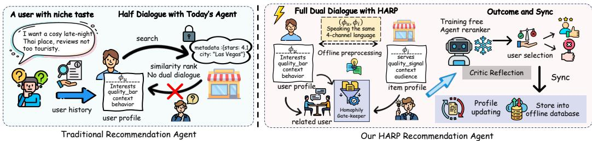
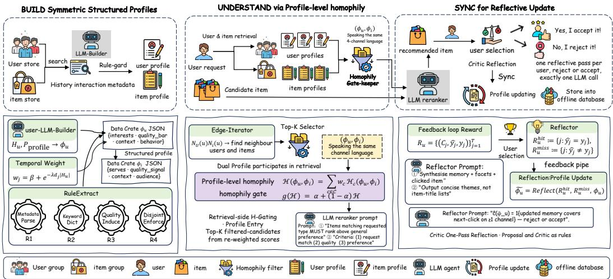
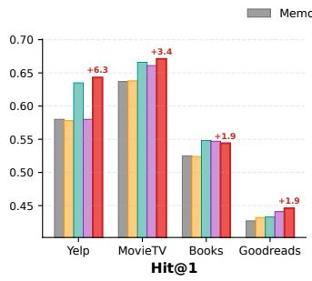
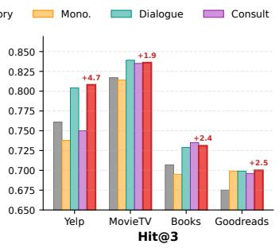
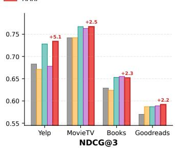
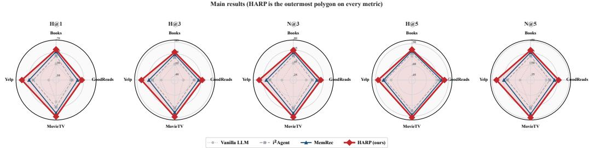
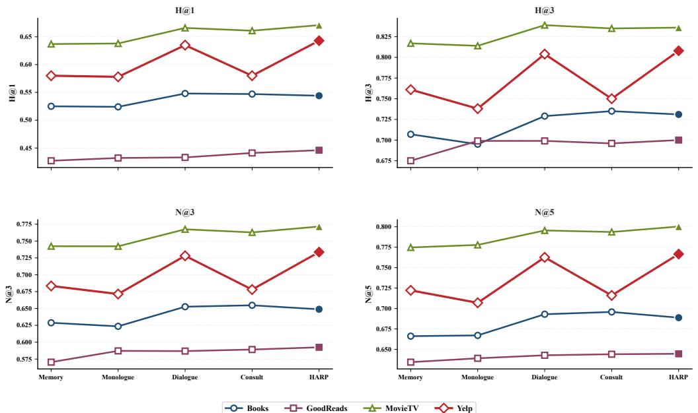
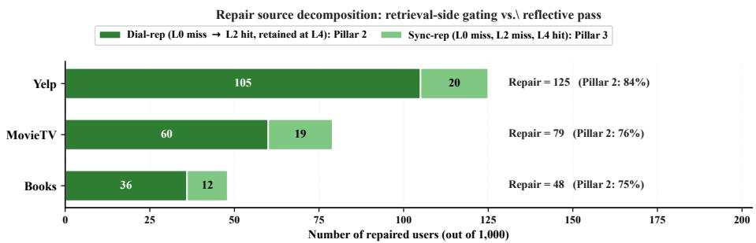

# HARP: Training-Free Dual-Profile Agentic Communication for LLM-Based Recommendation

Zhen Tao1,2, Xun Zhou1,3,∗, Xuhui Chen1, Ziyue Qiao2, Qingqiang Sun2,∗

1Harbin Institute of Technology, Shenzhen

2Great Bay University, 3Shenzhen Loop Area Institute

25b951132@stu.hit.edu.cn, zhouxun2023@hit.edu.cn, 25b951013@stu.hit.edu.cn, ziyuejoe@gmail.com, qqsun@gbu.edu.cn

## Abstract

In LLM-based recommendation, memory effectively plays the role of a user-level agent, typically built on top of a memory-augmented backbone. Yet under this paradigm users and items remain asymmetric participants: only the user is given a structured profile; that profile is consumed inside a bandwidth-limited reranker prompt; and it is frozen after warmup. Starting from this observation, we recast LLM-based recommendation as an agentic-communication process in four stages: BUILD a self-description, TRANSMIT it along the collaborative graph, UNDER-STAND the other side, and SYNC it from the next interaction. Analysing the dominant memory-augmented paradigm through this formulation, we identify three open communication challenges that current pipelines leave unaddressed: the item side never produces a comparable self-description (one-sided BUILD); profilelevel signals are routed only into a bandwidth-limited reranker prompt rather than into the retrieval stage where they would not compete for context tokens (prompttrapped UNDERSTAND); and the user’s description is frozen after warmup with no principled update rule (absent SYNC). We instantiate the missing stages as HARP (Homophily-aware Agentic Recommendation via dual Profiles), a trainingfree, three-operator addition to a frozen LLM backbone: a rule-extracted symmetric item profile (zero extra LLM calls), a channel-decomposable profile-level homophily $\mathcal { H } ( \phi _ { u } , \phi _ { i } )$ consumed at retrieval time rather than inside the reranker prompt, and a single-pass reflective update realising in-context profile evolution without any gradient step. On four public benchmarks (Yelp, Books, MovieTV, Goodreads), HARP lifts Hit@1 over the strongest published baseline by 6.9%– 24.0%, with family-wise Holm-corrected $p < \overline { { 1 0 ^ { - 9 } } }$ on every dataset. Ablations and a per-case attribution study show that the operators contribute complementary gains, with the retrieval-side gate as the main source; we also report the tradeoff introduced by the reflective pass. Our contribution is a unified formulation of agentic communication for LLM-based recommendation, together with a trainingfree three-operator instantiation on top of it.

## 1 Introduction

Large language models (LLMs) are becoming the central reasoning engine of next-generation recommender systems Wu et al. [2024], Geng et al. [2022], Liu et al. [2023], Zhang et al. [2025a]. In the most representative agentic recommendation paradigm Zhang et al. [2024], Xu et al. [2025], Chen et al. [2026], Tang et al. [2026], a user is modelled as an LLM agent with persistent memory, and personalised recommendations are produced by routing collaborative-neighbour memories into a reranker prompt. Yet this paradigm provides only a partial answer: the user side is equipped with memory while the item side has no structured profile aligned with the user’s; the user profile is consumed solely inside a bandwidth-limited reranker prompt; and the profile built at warmup is not revised from recommendation outcomes afterwards. We recast LLM-based recommendation as a four-stage agentic-communication process between user and item agents (BUILD–TRANSMIT– UNDERSTAND–SYNC), and show that the dominant paradigm implements only a partial version of it, leaving three communication challenges open (Figure 1).

  
Figure 1: HARP at a glance. A user with a niche query in a half-dialogue session, compared with the full dialogue restored by HARP. HARP integrates three training-free innovations: Dual Profile (§3.2), Homophily Gate (§3.3), and Reflection (§3.4).

The four-stage framing and a motivating observation. The stages BUILD–TRANSMIT– UNDERSTAND–SYNC borrow directly from heterogeneous message passing on graphs Hu et al. [2020], Schlichtkrull et al. [2018] and from the classical study of homophily on social networks McPherson et al. [2001]. The decomposition plays a dual role: as an analytical tool that asks which of the four stages a given pipeline implements and how well, and as a generative scaffold that prescribes the operator to add once a missing stage is identified. The four-stage view is thus an analytical framework for diagnosing a pipeline, not a model in itself. Recommender systems have passed through three architectural generations (collaborative filtering Koren et al. [2009], Sarwar et al. [2001], graph neural networks He et al. [2020], Velickoviˇ c et al. [2017], and the recent agentic´ paradigm Wu et al. [2024]), yet the collaborative signal pervading all three is indexed by interaction overlap rather than description-level compatibility, hence size-blind: whenever two agents’ description sets differ sharply in breadth, raw interaction-overlap similarity inflates the match for reasons of degree rather than relevance, and the pre-rerank candidate list inherits that inflation. An agentic communication pipeline therefore needs a profile-level, asymmetric coverage measure read from the query side’s vantage, which is the role the channel-decomposable homophily H of §3.2 plays once the item side is also allowed to speak.

Three communication challenges and three operators. Applied to the memory-augmented family on four public benchmarks (Yelp, Amazon Books, MovieTV, Goodreads), this analysis identifies three open challenges where the communication falls silent. (Challenge 1) Asymmetric BUILD. The user side carries a multi-field profile while the item side has no profile in the same schema. (Challenge 2) Bandwidth-trapped UNDERSTAND. Concatenating the user profile into the reranker does not move ranking accuracy: by the time the reranker is called, its context is fixed and the context budget is dominated by the memory block; UNDERSTAND is the stage where profile-level signal must enter before the reranker is called. (Challenge 3) Absent SYNC. Profiles built at warmup are not calibrated against the feedback that warmup itself produces.

Each challenge is addressed by a primitive already validated elsewhere, composed without retraining. Against Challenge 1, a structured-JSON user profile, in the spirit of agent-maintained profiles in prior agentic recommenders Zhang et al. [2024], is used on the user side, and a schema-aligned item profile is introduced via rule extraction at no extra LLM cost. Against Challenge 2, the collaborative retrieval score is re-weighted by a profile homophily that generalises the scalar edgehomophily ratio Zhu et al. [2020] to a sum over semantic channels; homophily is used here as an analytical quantity, not as an optimisation target. Against Challenge 3, a single Chain-of-Thought reflective pass Wei et al. [2022], Shinn et al. [2023], Madaan et al. [2023] optionally guarded by a conservative critic is added, realising in-context evolution of the user profile without any gradient update, a self-evolving-agent primitive in the sense of the recent survey Gao et al. [2025]. The composition is HARP (Homophily-aware Agentic Recommendation via dual Profiles), a trainingfree addition to a frozen LLM backbone that operates entirely through the LLM-as-agent interaction loop; its novelty lies in the systematic identification of these three primitives as the complementary response to the three challenges within the memory-augmented agentic family, each separable in ablation (§4).

## Our main contributions are as follows:

• Formulation. An agentic-communication formulation that models LLM-based recommendation as a four-stage process BUILD–TRANSMIT–UNDERSTAND–SYNC and, used analytically, surfaces the three communication gaps that the dominant memory-augmented agentic paradigm leaves open.

• Method. HARP, a three-operator training-free addition to a frozen LLM backbone: a ruleextracted symmetric item profile, a channel-decomposable homophily-gated retrieval, and a single-pass reflective update, each aligned with one of the three gaps.

• Design rationale. Three design disciplines that predict where operator-level gains should appear: the channel-decomposability of profile-level homophily, the retrieval-vs-prompt design rationale, and the one-pass conservative update.

• Empirical evaluation. On four public benchmarks, HARP achieves state-of-the-art on every metric, lifting Hit@1 by 6.9%–24.0% over the strongest published baseline; ablations and per-case traces further confirm the effectiveness and complementarity of each operator.

## 2 Related Work

LLM-based agentic recommenders. The agentic paradigm represents users as LLM-managed stateful memories Zhang et al. [2024], Xu et al. [2025], Tang et al. [2026], Huang et al. [2025], yielding a chronology from stateless vanilla LLM Liu et al. [2023], static per-user memory Huang et al. [2025], Xu et al. [2025], dynamic self-reflective memory Zhang et al. [2024], Xu et al. [2025], Tang et al. [2026], to a dynamic memory graph managed by a lightweight LM Chen et al. [2026]. Within this line, RecMind Wang et al. [2024] augments user agents with tool-calling for external knowledge, and RecAgent Wang et al. [2025] simulates realistic user behaviour with LLM-driven decision loops. Related work also improves modality representations for recommendation Tang et al. [2025], uses LLMs to understand user text in conversational recommenders Yuan et al. [2026], and generates semantic item identifiers for cross-domain recommendation Hu et al. [2026]. A parallel infrastructure thread provides pluggable agentic memory backends: A-MEM Xu et al. [2026] proposes structured agentic memory for LLM agents, H-Mem Ye et al. [2026] introduces hybrid multidimensional memory for long-context conversations, and a recent task-aware retrieval thread Tao et al. [2026] makes the retrieval step itself context-adaptive. HARP differs by lifting both sides to profile level and consuming the resulting homophily at retrieval time rather than inside a reranker prompt.

Homophily in networks and recommender systems. Homophily, the principle that similarity breeds connection McPherson et al. [2001], Lazarsfeld [1954], has been studied inside GNNs Zhu et al. [2020], Ma et al. [2021], Platonov et al. [2023], Luan et al. [2023], Zheng et al. [2026] where message passing degrades on heterophilous graphs, and graph contrastive and fairness-aware learning likewise exploit neighbourhood structure Sun et al. [2025, 2024], Li et al. [2026]; classical CF Koren et al. [2009], Sarwar et al. [2001], He et al. [2017, 2020], Wang et al. [2019] implicitly relies on homophily at the interaction level. Recent analyses sharpen the picture: Platonov et al. [2023] challenge existing heterophily benchmarks, Luan et al. [2023] characterise when homophily helps node classification, and Zheng et al. [2026] survey heterophily-aware GNN designs. These works, including the cross-type homophily of heterogeneous graphs Tao et al. [2025], operate on interaction-level or class-label homophily; HARP differs by defining H at the profile level: agentauthored, agent-mutable, and additively decomposable over four semantic channels (Remark 1).

Self-evolving agents and agentic RAG. Recent work shows LLM agents can self-improve via in-context rewrites Gao et al. [2025], Zhang et al. [2026], Wang et al. [2023], Shinn et al. [2023], Madaan et al. [2023] or make retrieval decisions adaptively Singh et al. [2025], Asai et al. [2024], Jiang et al. [2023]. Voyager Wang et al. [2023] accumulates reusable skills in Minecraft, Chat-Dev Qian et al. [2024] organises software tasks as multi-agent role-play dialogues, and Self-RAG Asai et al. [2024] trains the model to decide when and what to retrieve. In the agentic-contextengineering view Zhang et al. [2026], the agent’s prompt itself becomes an evolvable artefact, a perspective HARP instantiates for recommendation profiles. HARP differs by applying an acceptance check (Eq. 10) to profile evolution and routing the homophily signal to the retrieval stage rather than the generation stage.

  
Figure 2: HARP pipeline overview. Upper: story strip illustrating the flow of a user’s query across the entire pipeline. Lower: block-exploded technical view with input/output annotations and equation references.

Detailed discussion of all adjacent threads is deferred to Appendix A.

## 3 The HARP Method

This section develops HARP in four steps: §3.1 fixes the recommendation pipeline and notation; §3.2–§3.4 introduce the three operators that separate HARP from a one-sided agentic backbone; §3.5 aligns each operator with the structural challenge its ablation re-introduces. Full notation, complete pseudocode, complexity analysis and dataset-level extractor details are deferred to Appendix E.1– E.10.

## 3.1 Problem Setup and Preliminaries

Two-stage agentic recommendation and the core design. We follow the standard two-stage setup in current agentic recommenders Zhang et al. [2024], Xu et al. [2025], Tang et al. [2026]. Let $\bar { \nu } _ { U } , \nu _ { I }$ denote the user and item sets, $H _ { u } \subseteq \nu _ { I }$ user u’s interaction history, $\mathcal { T } _ { u }$ the evaluation instruction, and $\mathcal { N } _ { U } ( u ) , \mathcal { N } _ { I } ( u )$ the one-shot k-nearest user and item neighbour sets of u. For user u, a retriever selects k collaborative neighbours $N ( u )$ (Eq. 1); a frozen LLM reranker selects the top-1 prediction from the candidate list $\bar { C ( u ) }$ given by the evaluation protocol (Eq. 2):

$$
N ( u ) ~ = ~ R ( u ; H _ { u } , \mathcal { N } _ { U } ( u ) \cup \mathcal { N } _ { I } ( u ) ) ~ = ~ \mathrm { T o p  – k } _ { n } \mathrm { B a s e S c o r e } ( u , n ) ,\tag{1}
$$

$$
\hat { y } _ { u } = \arg \operatorname* { m a x } _ { i \in C ( u ) } \mathrm { L L M } _ { \mathrm { r e r a n k } } ( \mathcal { T } _ { u } , M _ { \mathrm { c o l l a b } } , \phi _ { u } , C ( u ) ) ,\tag{2}
$$

where $M _ { \mathrm { c o l l a b } }$ is a memory block aggregated along the selected neighbours $N ( u )$ and $\phi _ { u }$ is an optional user profile. On top of this shared backbone, HARP introduces a layer of channel-level understanding above memory: both user and item carry a structured profile whose four channel fields $\phi _ { v } ~ = ~ ( \phi _ { v } ^ { ( c ) } ) _ { c \in \mathcal { C } }$ are aligned over the channel set $\mathcal { C } = \mathrm  \{ p r e f e r e n c e $ , quality, context, audience}, whose per-channel fields are phrase sets disjoint by construction (R1–R4 in §3.2; Table 1). This aligned schema lets user–item matching decompose into separately measurable semantic channels, and turns profile-level homophily (Eq. 6) into an explicit quantity used for retrieval-side gating and post-warmup reflective rewriting. The prevailing memory-augmented family corresponds to the special case in which three restrictions are simultaneously imposed (absent item profile, profile injected only via prompt, profile never updated); the three operators in §3.2–§3.4 lift these in turn. Three operational constraints run through the section: (C1) the reranker prompt has finite token budget B, so any content in the $\phi _ { u }$ slot trades against $M _ { \mathrm { c o l l a b } } ;$ ; (C2) the backbone LLM is frozen; (C3) each user receives at most one accepted reflective-update trajectory (applied at end of warmup; the trajectory may itself consist of $T _ { \mathrm { e v o } }$ reflection calls at different history offsets, with $T _ { \mathrm { e v o } } = 1$ in main experiments). A full notation table is in Appendix E.1.

## 3.2 BUILD Operator: Symmetric Structured Profiles

Two-sided builder. The user profile is produced by a single LLM call over $H _ { u } ~ = ~ H _ { u } ^ { \mathrm { r e c e n t } }$ ⊔ $H _ { u } ^ { \mathrm { m e d i u m } } \sqcup H _ { u } ^ { \mathrm { d i s t a n t } }$ under a fixed JSON-schema prompt $P _ { \mathrm { p r o f i l e } } \mathrm { . }$

$$
\phi _ { u } \ = \ \mathrm { L L M } \big ( H _ { u } ^ { \mathrm { r e c e n t } } \mid \mid H _ { u } ^ { \mathrm { m e d i u m } } \mid \mid H _ { u } ^ { \mathrm { d i s t a n t } } \mid \mid P _ { \mathrm { p r o f i l e } } \big ) ,\tag{3}
$$

where the three bands are relative positions in the history, newest to oldest: recent interactions keep full detail (title, categories, rating, city, first review sentence), medium ones are compressed to category and city statistics, and distant ones to the domain boundaries they touch, with an Ebbinghausstyle temporal weight $w _ { j } = \beta + \exp ( - \lambda d _ { j } \left| H _ { u } \right| )$ per observation $j \doteq H _ { u } ( d _ { j } \in [ 0 , 1 ]$ normalised age, $\lambda > 0$ forgetting rate, $\beta > 0$ floor); the banding realises this weight under a fixed prompt budget while keeping long-range coverage. The seven-field JSON schema is designed for this paper, following the idea of agent-maintained user profiles in prior agentic recommenders Zhang et al. [2024]; only the four channel fields in Table 1 participate in the homophily computation (Eq. 6). The item side is obtained via rule extraction, with zero LLM calls:

$$
\phi _ { i } \ = \ \mathrm { R u l e E x t r a c t } ( \mathrm { m e t a } _ { i } , \mathrm { r e v i e w s } _ { i } ) ,\tag{4}
$$

targeting the same channel-aligned schema, which keeps item-side profiling feasible at $N _ { I } \sim 1 0 ^ { 4 } -$ $1 0 ^ { 5 }$ RuleExtract is formalised as a deterministic, zero-LLM shallow semantic parser, fully parametrised by a dataset-level ontology map S and domain phrase lexicon D, executed in four rules R1–R4 (ontology projection, lexicon-guided encoding, quality-signal induction, channel-exclusivity projection) that route metadata and reviews into the four pairwise-disjoint channel fields; per-rule definitions, per-dataset lexicons, and coverage statistics are in Appendix E.10.

Table 1: Four-channel correspondence between user and item profiles.
<table><tr><td>Channel c</td><td>User field  $\phi _ { u } ^ { ( c ) }$ </td><td>Item field  $\phi _ { i } ^ { ( c ) }$ </td></tr><tr><td>preference</td><td>interests</td><td>serves</td></tr><tr><td>quality</td><td>quality-bar</td><td>quality-signal</td></tr><tr><td>context</td><td>context</td><td>context</td></tr><tr><td>audience</td><td>behavior</td><td>audience</td></tr></table>

Profile-level homophily as a similarity score. For the phrase-set channels preference and audience, the similarity between two phrase sets $A , B \subseteq \Sigma ^ { * }$ is

$$
\operatorname { s e m } ( A , B ) \ = \ { \frac { \left| \left\{ a \in A : \exists b \in B , \operatorname { s u b s t r } ( a , b ) \lor \operatorname { s u b s t r } ( b , a ) \right\} \right| } { | A | } } \ \in \ [ 0 , 1 ] ,\tag{5}
$$

with sem = 0.5 (neutral) when A or B is empty. The asymmetric normalisation is deliberate: fixing the denominator on the query side $( A = \phi _ { u } ^ { ( c ) } )$ makes Eq. 5 read “how much of what A claims is actually echoed by $B ^ { \prime \prime } { } ;$ ; the relevance perspective is anchored to the querying user, and a broadervocabulary item cannot gain extra credit by mere size. The quality and context channels, whose fields are not phrase sets, use channel-specific fallback implementations (Appendix E.10). All three forms participate uniformly in Eq. 6, and profile-level homophily is defined as a channelwise weighted average:

$$
\mathcal { H } ( \phi _ { u } , \phi _ { i } ) = \sum _ { c \in \mathcal { C } } w _ { c } \mathcal { H } _ { c } ( \phi _ { u } , \phi _ { i } ) , \qquad \mathcal { H } _ { c } ( \phi _ { u } , \phi _ { i } ) : = \mathrm { s e m } \bigl ( \phi _ { u } ^ { ( c ) } , \phi _ { i } ^ { ( c ) } \bigr ) ,\tag{6}
$$

where $( w _ { c } ) _ { c \in \mathcal { C } }$ are non-negative channel weights with $\begin{array} { r } { \sum _ { c } w _ { c } = 1 ; } \end{array}$ the preference channel usually takes half of the weight or more and the other three share the rest evenly; the weights are adjustable hyperparameters that are not tuned against any downstream metric. When profiles degenerate to a single class label, H reduces to the same-class indicator of an edge, whose average over all edges is the edge-homophily ratio of Zhu et al. [2020]; H is thus a natural generalisation of the graph-homophily concept to the multi-channel, multi-granularity semantic setting. In HARP, H plays the dual role of diagnostic quantity and retrieval-side prior, not an end-to-end optimisation target.

Remark 1 (Channel decomposability: algebraic basis for separable ablations). Pairwise disjointness of channels (guaranteed by R4) together with the linear aggregation of Eq. 6 imply: replacing channel c’s phrase sets $( \phi _ { u } ^ { ( c ) } , \phi _ { i } ^ { ( c ) } )$ while holding other channels fixed changes H by exactly $w _ { c } \Delta \mathcal { H } _ { c } ,$ with no cross-channel coupling. This equates “per-channel ablation” with “additive perturbation ofthe aggregate $\mathcal { H } '$ , so changes in H can be attributed additively to individual channels. Full proof in Appendix C.1.

## 3.3 UNDERSTAND Operator: Homophily-Gated Retrieval

Homophily-gated neighbour score. Classical collaborative retrieval propagates preference signals via behavioural similarity on $\mathcal { N } _ { U } ( u )$ , implicitly assuming “behavioural neighbours are preference neighbours.” This assumption fails in sparse, heterogeneous settings via cross-category misleading neighbours. We use the profile-level homophily $\mathcal { H } ( \phi _ { u } , \phi _ { i } )$ from $\bar { \ S } 3 . 2$ as a semantic prior to re-weight the behavioural signal. Introducing a monotone homophily gate $g ( \mathcal { H } ) = \alpha + ( 1 - \alpha )$ H $( \alpha \in [ \bar { 0 } , 1 ]$ the homophily floor), we obtain the gated neighbour score

$$
\mathrm { C o m m S c o r e } ( u , n ) = \mathrm { B a s e S c o r e } ( u , n ) \cdot g \big ( \mathcal { H } ( \phi _ { u } , \phi _ { i _ { n } } ) \big ) ,\tag{7}
$$

where $i _ { n }$ is an item neighbour of u and α ensures that collaborative signal is not fully zeroed when $\mathcal { H }  0$ . The gated quantity is the cross-type profile homophily $\mathcal { H } ( \phi _ { u } , \phi _ { i _ { n } } )$ (cf. Tao et al. [2025]): when the channel set degenerates to a single class label, H is the same-class indicator of the edge, the per-edge quantity behind the edge-homophily ratio of Zhu et al. $[ 2 0 2 0 ] ;$ the multiplicative gate itself is our design. $g$ is a monotone bounded transform of H, so order-preservation guarantees the gate does not distort the channel-induced ordering; at $\alpha = 1$ or $\mathcal { H } \equiv 1$ it degenerates to a pure behavioural retriever. We treat user–user edges $( \phi _ { u } , \phi _ { n }$ via symmetric phrase overlap on the preference channel) and user–item edges as two instances of the same UNDERSTAND operator, with independent floors (main experiments: $\alpha _ { u i } = 0 . 4 , \alpha _ { u u } = 0 . 3 )$ acting on disjoint neighbour subsets.

Where in the pipeline should the profile be consumed? A non-trivial design choice is whether profile signal should enter via retrieval-side candidate reshaping or reranker-side context injection. The two are not information-equivalent: the former changes which neighbours inform the reranker, the latter changes the evidence it relies on. We argue the former is strictly preferable here for two reasons. Budget (induced by C1): the reranker’s context token budget B is hard; once B is saturated, every token added to the $\phi _ { u }$ slot displaces $M _ { \mathrm { c o l l a b } }$ , so prompt-side injection is effectively a zerosum substitution between “profile evidence” and “collaborative memory”. Mechanism: under C2 (frozen LLM), the reranker cannot learn to balance the two sources, and its input is already fixed by the retrieved candidates; with misleading candidates, even the optimal profile context cannot reliably promote $y _ { u } .$ . Placing the profile at the retrieval side lets it act on the recoverable stage. We record this intuition formally as Remark 2 in Appendix C.3; Table 3 in §4 provides the empirical comparison (the two routes are labelled CH and RI in the ablation).

## 3.4 SYNC Operator: Reflective Update

Warmup record and reflective proposal. Under C2 (frozen backbone), the model cannot absorb user feedback via gradient flow; but each user u’s interaction history $H _ { u }$ naturally constitutes a selfreplayable sequence. We use the $T$ entries preceding the test item as a warmup window $( T = 1$ in main experiments), running the full retrieve-and-rerank pipeline on this window under the current $\phi _ { u }$ and repurposing $H _ { u }$ as a per-user self-supervised signal:

$$
\mathcal { R } _ { u } \ : = \ : \big \{ ( C _ { j } , \hat { y } _ { j } , y _ { j } ) \big \} _ { j = 1 } ^ { T } , \qquad \mathcal { R } _ { u } ^ { \mathrm { h i t } } : = \big \{ j : \hat { y } _ { j } = y _ { j } \big \} , \mathcal { R } _ { u } ^ { \mathrm { m i s s } } : = \{ j : \hat { y } _ { j } \neq y _ { j } \} .\tag{8}
$$

The hit set characterises effective profile coverage; the miss set pinpoints systematic blind spots. Conditioned on $\mathcal { R } _ { u }$ , a single LLM reflection call uses a structured Chain-of-Thought template Wei

et al. [2022] to propose a candidate profile update:

$$
\tilde { \phi } _ { u } = \mathrm { R e f l e c t } \big ( \mathcal { R } _ { u } ^ { \mathrm { h i t } } , \mathcal { R } _ { u } ^ { \mathrm { m i s s } } , \phi _ { u } \big ) .\tag{9}
$$

This call fires only once per user, builds $\phi _ { u }$ when the user has no profile yet, and does not touch other pipeline components.

Critic gate. Because chain-of-thought reasoning can be unfaithful Sun et al. [2026], an acceptance gate can optionally be imposed atop the reflection: the critic receives the old profile $\phi _ { u } ,$ the proposed $\phi _ { u }$ , and the warmup record $\mathcal { R } _ { u } .$ , returning a binary decision $\hat { s } ( \tilde { \phi } _ { u } ; \phi _ { u } ) \in \{ \mathrm { a c c e p t , r e j e c t } \}$ :

$$
\phi _ { u } ^ { ( 1 ) } = \left\{ \begin{array} { l l } { { \tilde { \phi } _ { u } , } } & { { \mathrm { i f } \hat { s } ( \tilde { \phi } _ { u } ; \phi _ { u } ) = \mathrm { a c c e p t } , } } \\ { { \phi _ { u } , } } & { { \mathrm { o t h e r w i s e } . } } \end{array} \right.\tag{10}
$$

The critic is a conservative safeguard: it keeps the old profile when the proposal is clearly less supported by the warmup cases, which prevents the reflective rewrite from pulling the user profile away from $H _ { u }$ . We use a zero-extra-LLM critic, a deterministic check of how well the proposed profile covers the warmup target items, so the gate’s marginal cost over Reflect is negligible (Appendix E.6). Each user sees only one pass of Eq. 10 (C3): additional passes would multiply the LLM cost while reusing the same warmup record $\mathcal { R } _ { u }$

## 3.5 Operator Separability and Ablation Predictions

The three operators of §3.2–§3.4 are designed to be separable: each addresses one structural challenge that its ablation re-introduces. Vocabulary mismatch (addressed by §3.2): when the item has no profile $( \phi _ { i } \equiv \alpha )$ , there is no second vocabulary to align against; Channel capture (addressed by §3.3): prompt-injected $\phi _ { u }$ competes with $M _ { \mathrm { c o l l a b } }$ for the reranker budget B (C1), so any profile-content gain is capped by the collaborative-memory space yielded; Communicative drift (addressed by §3.4): profiles written at warmup are not calibrated against warmup feedback, and the update of Eq. 10 performs this calibration once. Full pseudocode, per-case traces, and complexity analysis are in Appendix E.2, E.5 and E.7; each row of the main ablation (§4, Table 3) is labelled by the challenge it isolates, so the whole table can be read as a test of the three operators’ separability.

## 4 Experiments

## 4.1 Experimental Setup

Datasets and baselines. We evaluate on four InstructRec Xu et al. [2025] benchmarks: Amazon Books (7.4K users, 120.9K items; abbreviated Books), Goodreads (11.7K / 57.4K), MovieTV (5.6K / 29.0K), Yelp (3.0K / 31.6K), using the original splits and natural-language user instructions. Baselines span three families: traditional recommenders (LightGCN He et al. [2020], SASRec Kang and McAuley [2018], P5 Geng et al. [2022]); single-sided LLM/agentic methods (Vanilla LLM Liu et al. [2023], iAgent Xu et al. [2025], AgentCF Zhang et al. [2024], RecBot Tang et al. [2026], i2Agent Xu et al. [2025]); and memory-augmented agentic methods, whose strongest published representative on these splits is MemRec Chen et al. [2026]. All baseline numbers are imported from the originating papers († in Table 2); per-dataset characteristics and baseline details are in Appendix B.1 and B.2.

HARP configuration. HARP is instantiated on a frozen gpt-4o-mini backbone and runs a single round of profile warmup per user. The UNDERSTAND operator uses homophily floors $\alpha _ { u i } { = } 0 . 4$ on user–item edges and $\alpha _ { u u } \mathrm { { = } } 0 . 3$ on user–user edges, with a preference-dominant channel weighting $( w _ { c } )$ . The SYNC operator runs $T _ { \mathrm { e v o } } { = } 1$ reflective pass per user (conditioned on the second-to-last interaction) optionally filtered by the critic. The retrieval budget k is chosen on a development split from $\{ 4 , 8 , 1 \bar { 6 } \}$ and fixed at $k { = } 1 6$ for all main-table numbers. Hit@1 improvements are tested by per-dataset one-sided binomial tests with Wilson 95% CIs (Appendix D.1); the cross-dataset joint null is controlled by Holm–Bonferroni at family-wise $\alpha { = } 0 . 0 5 ;$ ladder transitions use exact paired McNemar. Our code is available at https://github.com/Jove-Zhen/HARP.

Table 2: Main results on four benchmarks. Bold = best, underline = second best; † = from original paper. “Rel. Improv.” = relative improvement over the strongest published baseline. All H@1 improvements $p \dot { < } 1 0 ^ { - 9 }$ (Holm–Bonferroni corrected).
<table><tr><td rowspan="2">Paradigm</td><td rowspan="2">Model</td><td colspan="4">Books</td><td colspan="6"></td></tr><tr><td>H@1</td><td>H@3</td><td>N@3</td><td>H@5</td><td>N@5</td><td>H@1</td><td>H@3</td><td>N@3</td><td>H@5</td><td>N@5</td></tr><tr><td rowspan="3">Tad.</td><td>LightGCN†</td><td>.175</td><td>.326</td><td>.260</td><td>.570</td><td>.359</td><td>.250</td><td>.588</td><td>.443</td><td>.790</td><td>.526</td></tr><tr><td>SASRec†</td><td>.091</td><td>.283</td><td>.200</td><td>.485</td><td>.282</td><td>.132</td><td>.352</td><td>.258</td><td>.541</td><td>.335</td></tr><tr><td>P5†</td><td>.219</td><td>.361</td><td>.299</td><td>.527</td><td>.367</td><td>.157</td><td>.323</td><td>.251</td><td>.506</td><td>.326</td></tr><tr><td rowspan="3"></td><td>Vanilla LLM†</td><td>.314</td><td>.562</td><td>.453</td><td>.727</td><td>.523</td><td>.286</td><td>.466</td><td>.395</td><td>.739</td><td>.504</td></tr><tr><td>iAgent†</td><td>.393</td><td>.556</td><td>.486</td><td>.691</td><td>.541</td><td>.262</td><td>.495</td><td>.395</td><td>.659</td><td>.463</td></tr><tr><td>RecBot†</td><td>.398</td><td>.549</td><td>.485</td><td>.679</td><td>.538</td><td>.271</td><td>.475</td><td>.388</td><td>.650</td><td>.459</td></tr><tr><td rowspan="3">Aget (tltch)</td><td>AgentCF†</td><td>.346</td><td>.606</td><td>.496</td><td>.740</td><td>.551</td><td>.295</td><td>.591</td><td>.465</td><td>.773</td><td>.540</td></tr><tr><td>i2Agent†</td><td>.445</td><td>.652</td><td>.565</td><td>.771</td><td>.614</td><td>.310</td><td>.608</td><td>.483</td><td>.768</td><td>.548</td></tr><tr><td>MemRec†</td><td>.512</td><td>.692</td><td>.615</td><td>.801</td><td>.660</td><td>.400</td><td>.666</td><td>.554</td><td>.805</td><td>.611</td></tr><tr><td>Mem.-aug. Comm.</td><td>HARP</td><td>.547</td><td>.720</td><td>.647</td><td>.819</td><td>.688</td><td>.469</td><td>.715</td><td>.612</td><td>.847</td><td>.664 +8.6%</td></tr><tr><td colspan="10">Rel. Improv. +6.9% +4.2% +5.2%</td></tr><tr><td></td><td></td><td></td><td></td><td>MovieTV</td><td></td><td></td><td></td><td></td><td>Yelp</td><td></td><td></td></tr><tr><td rowspan="3">Paradigm</td><td colspan="10">Model</td></tr><tr><td></td><td>H@1</td><td>H@3</td><td>N@3</td><td>H@5</td><td>N@5</td><td>H@1</td><td>H@3</td><td>N@3</td><td>H@5</td><td>N@5</td></tr><tr><td>LightGCN†</td><td>.348</td><td>.564</td><td>.474</td><td>.688</td><td>.524</td><td>.344</td><td>.566</td><td>.472</td><td>.755</td><td>.549</td></tr><tr><td rowspan="3">Tad.</td><td>SASRec† P5†</td><td>.340</td><td>.523</td><td>.447</td><td>.638</td><td>.494</td><td>.231</td><td>.431</td><td>.346</td><td>.560</td><td>.398 .479</td></tr><tr><td></td><td>.170</td><td>.321</td><td>.255</td><td>.501</td><td>.329</td><td>.144</td><td>.321</td><td>.244</td><td>.522</td><td></td></tr><tr><td>Vanilla LLM†</td><td>.405</td><td>.776</td><td>.610</td><td>.860</td><td>.645</td><td>.169</td><td>.528</td><td>.370</td><td>.686</td><td>.436</td></tr><tr><td rowspan="3">Ae tch)</td><td>iAgent†</td><td>.425</td><td>.617</td><td>.536</td><td>.742</td><td>.587</td><td>.400</td><td>.601</td><td>.515</td><td>.730</td><td>.568</td></tr><tr><td>RecBot†</td><td>.437</td><td>.611</td><td>.538</td><td>.731</td><td>.587</td><td>.401</td><td>.600</td><td>.516</td><td>.717</td><td>.564</td></tr><tr><td>AgentCF†</td><td>.391</td><td>.669</td><td>.552</td><td>.786</td><td>.601</td><td>.193</td><td>.437</td><td>.333</td><td>.637</td><td>.415</td></tr><tr><td></td><td>i2Agent†</td><td>.491</td><td>.723</td><td>.626</td><td>.822</td><td>.667</td><td>.421</td><td>.645</td><td>.552</td><td>.765</td><td>.601</td></tr><tr><td rowspan="2">Mem.-aug.</td><td>MemRec†</td><td>.588</td><td>.782</td><td>.701</td><td>.882</td><td>.742</td><td>.487</td><td>.691</td><td>.605</td><td>.791</td><td>.646</td></tr><tr><td>HARP Rel. Improv.</td><td>.645</td><td>.838</td><td>.758 +8.1%</td><td>.917 +4.0%</td><td>.790 +6.5%</td><td>.604</td><td>.790</td><td>.712</td><td>.865 +9.4%</td><td>.743 +15.0%</td></tr></table>

## 4.2 Main Results

Table 2 reports the complete results. HARP consistently outperforms all baselines on every dataset and every metric. Three patterns are worth noting. First, the dominance holds across all three baseline families: Hit@1 over the strongest traditional baseline is $1 . 8 { \times } { - } 2 . 5 { \times }$ , over the strongest single-sided agent i2Agent it is $+ 2 3 \% / + 5 1 \% / + 3 1 \% / + 4 3 \%$ on Books/Goodreads/MovieTV/Yelp, and over the strongest memory-augmented baseline MemRec it ranges from +6.9% (Books) to +24.0% (Yelp). Second, the gain is largest on Yelp and Goodreads $( + \mathrm { \bar { 2 } 4 . 0 \% / + 1 7 . 2 \% ) }$ , consistent with HARP’s profile-based re-weighting of neighbours exactly where the collaborative-only signal is weakest. Third, the relative gain over MemRec shrinks monotonically with k $( \mathrm { e . g . \ Y e l p + 2 4 . 0 \%  }$ $+ 1 4 . 3 \%  + 9 . 4 \%$ at Hit@{1, 3, 5}), indicating that HARP promotes the ground truth into the top-1 slot rather than merely reshuffling an already-correct pool. On the full test splits, the Wilson 95% CI lower bound of HARP’s Hit@1 strictly dominates the MemRec point estimate with margins $+ 2 . 3 8 / + 5 . 9 8 / + 4 . 3 8 / + 9 . 9 3$ pp on Books/Goodreads/MovieTV/Yelp; per-dataset one-sided binomial $p < 1 0 ^ { - 9 }$ and Holm–Bonferroni adjusted $p < 1 0 ^ { - 9 }$ (Appendix D.1).

## 4.3 Ablation: Which Components of HARP Carry the Gain?

To systematically attribute contributions, we define five ablation configurations sharing the same frozen backbone and differing only in “which HARP components are enabled”: MEMORY $( \phi _ { u } = \phi _ { i } = \partial ;$ no gating, no reflection); MONOLOGUE (user profile $\phi _ { u }$ injected into the reranker prompt only); DIALOGUE (both $\phi _ { u } ,$ ϕi enabled, homophily gating H used on retrieval; no prompt injection, no reflection); CONSULT (both profiles but retrieval-side gate disabled; a direct “retrievalside vs. prompt-side” contrast against DIALOGUE); HARP (full pipeline: both profiles, retrieval-side gate, prompt injection, one-pass reflection). Table 3 reports the ablation on the 1,000-user Yelp subsplit; Figure 3 replicates the same five rungs across all four benchmarks.

Three key findings. (1) The retrieval-side gate is the primary source of gain: MONO-LOGUE→DIALOGUE jumps H@1 by +5.7 pp; prompt-side injection alone (CONSULT vs. MEM-

Table 3: HARP ablation (Yelp subsplit). CH = retrieval-side homophily gate; RI = reranker prompt injection; Sync = reflection.
<table><tr><td>Config</td><td> $\phi _ { u }$ </td><td>φi</td><td>CH</td><td>RI</td><td>Sync</td><td>H@1</td><td>H@3</td><td>H@5</td><td>N@3</td><td>N@5</td></tr><tr><td>MEMORY</td><td></td><td></td><td></td><td></td><td></td><td>.580</td><td>.761</td><td>.855</td><td>.683</td><td>.722</td></tr><tr><td>MONOLOGUE</td><td>√</td><td></td><td></td><td>√</td><td></td><td>.578</td><td>.738</td><td>.824</td><td>.671</td><td>.707</td></tr><tr><td>CONSULT</td><td>√</td><td>√</td><td></td><td>√</td><td></td><td>.580</td><td>.750</td><td>.842</td><td>.678</td><td>.716</td></tr><tr><td>DIALOGUE</td><td>√</td><td>√</td><td>√</td><td></td><td></td><td>.635</td><td>.804</td><td>.888</td><td>.728</td><td>.763</td></tr><tr><td>HARP</td><td></td><td>√</td><td>√</td><td>√</td><td>√</td><td>.643</td><td>.808</td><td>.889</td><td>.734</td><td>.767</td></tr></table>

  
Figure 3: Five-rung ablation ladder (four benchmarks, matched 1,000-user subsplits). (a) Hit@1; (b) Hit@3; (c) NDCG@3. Red numbers = total gain (pp) over MEMORY.

ORY) does not move H@1. (2) The gain needs the profiles to enter the gate: MONOLOGUE (user profile only) and CONSULT (both profiles, no gate) stay at .578–.580, the same as MEM-ORY; only DIALOGUE, which uses both profiles in the retrieval-side gate, improves. (3) Prompt injection and SYNC add a small residual: DIALOGUE→HARP adds +0.8 pp H@1 for the two together (prompt injection alone does not move H@1). Paired McNemar (Appendix D.6) confirms MONOLOGUE→DIALOGUE $( p { = } 7 . 2 { \times } 1 0 ^ { - 6 } )$ and CONSULT→HARP $( p { = } 2 . 5 { \times } 1 0 ^ { - 7 } )$ are significant, MEMORY→MONOLOGUE lies within sampling noise $\scriptstyle ( p = 0 . 9 4 )$ , and DIALOGUE→CONSULT is significantly negative (−5.5 pp, $\scriptstyle { p = 1 . 0 \times 1 0 ^ { - 5 } ) }$ , which supports consuming the profile on the retrieval side.

Do the ablation conclusions hold across datasets? Figure 3 shows the five-rung ladder on all four benchmarks (matched 1,000-user subsplits) for three representative metrics: Hit@1, Hit@3, and NDCG@3. The conclusion is robust: MONOLOGUE ≈ MEMORY, CONSULT ≈ MEMORY, DI-ALOGUE > MONOLOGUE is the largest single-rung jump on Yelp, MovieTV and Books, and the DI-ALOGUE→HARP residual (injection and SYNC together) is positive on Yelp/MovieTV/Goodreads $( + 0 . 8 / + 0 . 5 / + 1 . 3$ pp Hit@1) and slightly negative on Books (−0.4 pp). Net Hit@1 gains over MEMORY: +6.3/ + 3.4/ + 1.9/ + 1.9 pp (Yelp/MovieTV/Books/Goodreads); a per-user repair source decomposition (Appendix D.3) confirms that the majority of L0-miss→L4-hit transitions are already present at the DIALOGUE stage, attributing the primary engine of improvement to the retrieval-side gate. The four-metric ladder line plots are in Appendix Figure 5.

Repair sources and the Sync trade-off. To further understand the mechanism behind the gains, we perform a per-user outcome-transition decomposition on three deep-analysis subsplits (Yelp/- MovieTV/Books, each 1,000 users): each user is tagged by the triple $( \dot { L } _ { 0 } , L _ { 2 } , L _ { 4 } ) \in \dot { \{ 0 , 1 \} } ^ { 3 }$ indicating hit/miss under MEMORY, DIALOGUE, and HARP. The net repair counts over MEMORY are $+ 6 3 / + 3 4 / + 1 9$ users $( + 6 . 3 / + 3 . 4 / + 1 . 9 \mathrm { p p } )$ , with the ratio of retrieval-gate repairs (Dial-rep) to DIALOGUE→HARP repairs (Sync-rep, injection and SYNC together) stable at 5.3:1 (Yelp), 3.2:1 (MovieTV), 3.0:1 (Books). This confirms that the DIALOGUE-stage homophily gate is the primary engine of improvement, with the DIALOGUE→HARP step (injection and SYNC) providing marginal gains on the sub-population that DIALOGUE alone cannot reach. Notably, this step also introduces a small number of regression events (−0.4 pp on Books), reflecting a trade-off between conservatism and coverage; three qualitative case studies in Appendix E.5 examine it. Furthermore, the Pearson correlation between a profile-length proxy and per-user gain is $\rho \in [ - 0 . 0 4 8 , - 0 . 0 0 5 ]$ , confirming that reflection reshapes the profile’s composition rather than its length.

## 5 Conclusion

We recast LLM-based recommendation from an agentic-communication perspective in which user and item agents exchange structured self-descriptions along a four-stage process (BUILD– TRANSMIT–UNDERSTAND–SYNC), use the formulation analytically on the dominant memoryaugmented agentic paradigm to identify three open communication challenges (asymmetric BUILD, bandwidth-trapped UNDERSTAND, and absent SYNC), and introduce HARP, a three-operator training-free instantiation on a frozen LLM backbone: a symmetric item profile (BUILD), a channel-decomposable homophily-gated retrieval (UNDERSTAND), and a single-pass reflective update (SYNC). On four public benchmarks, HARP lifts Hit@1 by +6.9–24.0% over the strongest published baseline, and ablations further confirm that operator-level gains align with the three challenges.

## References

Akari Asai, Zeqiu Wu, Yizhong Wang, Avi Sil, and Hannaneh Hajishirzi. Self-rag: Learning to retrieve, generate, and critique through self-reflection. In International conference on learning representations, volume 2024, pages 9112–9141, 2024.

Keqin Bao, Jizhi Zhang, Yang Zhang, Wenjie Wang, Fuli Feng, and Xiangnan He. Tallrec: An effective and efficient tuning framework to align large language model with recommendation. In Proceedings ofthe 17th ACM conference on recommender systems, pages 1007–1014, 2023.

Keqin Bao, Jizhi Zhang, Wenjie Wang, Yang Zhang, Zhengyi Yang, Yanchen Luo, Chong Chen, Fuli Feng, and Qi Tian. A bi-step grounding paradigm for large language models in recommendation systems. ACM Transactions on Recommender Systems, 3(4):1–27, 2025.

Weixin Chen, Yuhan Zhao, Jingyuan Huang, Zihe Ye, Mingxuan Ju, Tong Zhao, Neil Shah, Li Chen, and Yongfeng Zhang. Memrec: Collaborative memory-augmented agentic recommender system. In Proceedings of the 64th Annual Meeting of the Association for Computational Linguistics (Volume 1: Long Papers), pages 44515–44544, 2026.

Yilun Du, Shuang Li, Antonio Torralba, Joshua B Tenenbaum, and Igor Mordatch. Improving factuality and reasoning in language models through multiagent debate. arXiv preprint arXiv:2305.14325, 2023.

Jakob Foerster, Ioannis Alexandros Assael, Nando De Freitas, and Shimon Whiteson. Learning to communicate with deep multi-agent reinforcement learning. Advances in neural information processing systems, 29, 2016.

Luke Friedman, Sameer Ahuja, David Allen, Zhenning Tan, Hakim Sidahmed, Changbo Long, Jun Xie, Gabriel Schubiner, Ajay Patel, Harsh Lara, et al. Leveraging large language models in conversational recommender systems. arXiv preprint arXiv:2305.07961, 2023.

Huan-ang Gao, Jiayi Geng, Wenyue Hua, Mengkang Hu, Xinzhe Juan, Hongzhang Liu, Shilong Liu, Jiahao Qiu, Xuan Qi, Yiran Wu, et al. A survey of self-evolving agents: What, when, how, and where to evolve on the path to artificial super intelligence. arXiv preprint arXiv:2507.21046, 2025.

Shijie Geng, Shuchang Liu, Zuohui Fu, Yingqiang Ge, and Yongfeng Zhang. Recommendation as language processing (rlp): A unified pretrain, personalized prompt & predict paradigm (p5). In Proceedings of the 16th ACM conference on recommender systems, pages 299–315, 2022.

Xiangnan He, Lizi Liao, Hanwang Zhang, Liqiang Nie, Xia Hu, and Tat-Seng Chua. Neural collaborative filtering. In Proceedings of the 26th international conference on world wide web, pages 173–182, 2017.

Xiangnan He, Kuan Deng, Xiang Wang, Yan Li, Yongdong Zhang, and Meng Wang. Lightgcn: Simplifying and powering graph convolution network for recommendation. In Proceedings of the 43rd International ACM SIGIR conference on research and development in Information Retrieval, pages 639–648, 2020.

Sirui Hong, Mingchen Zhuge, Jonathan Chen, Xiawu Zheng, Yuheng Cheng, Jinlin Wang, Ceyao Zhang, Steven Yau, Zijuan Lin, Liyang Zhou, et al. Metagpt: Meta programming for a multiagent collaborative framework. In International Conference on Learning Representations, volume 2024, pages 23247–23275, 2024.

Peiyu Hu, Wayne Lu, and Jia Wang. From ids to semantics: A generative framework for crossdomain recommendation with adaptive semantic tokenization. In Proceedings of the AAAI Conference on Artificial Intelligence, volume 40, pages 14874–14882, 2026.

Ziniu Hu, Yuxiao Dong, Kuansan Wang, and Yizhou Sun. Heterogeneous graph transformer. In Proceedings ofthe web conference 2020, pages 2704–2710, 2020.

Xu Huang, Jianxun Lian, Yuxuan Lei, Jing Yao, Defu Lian, and Xing Xie. Recommender ai agent: Integrating large language models for interactive recommendations. ACM Transactions on Information Systems, 43(4):1–33, 2025.

Zhengbao Jiang, Frank F Xu, Luyu Gao, Zhiqing Sun, Qian Liu, Jane Dwivedi-Yu, Yiming Yang, Jamie Callan, and Graham Neubig. Active retrieval augmented generation. In Proceedings ofthe 2023 conference on empirical methods in natural language processing, pages 7969–7992, 2023.

Wang-Cheng Kang and Julian McAuley. Self-attentive sequential recommendation. In 2018 IEEE international conference on data mining (ICDM), pages 197–206. IEEE, 2018.

Sein Kim, Hongseok Kang, Seungyoon Choi, Donghyun Kim, Minchul Yang, and Chanyoung Park. Large language models meet collaborative filtering: An efficient all-round llm-based recommender system. In Proceedings ofthe 30th ACM SIGKDD conference on knowledge discovery and data mining, pages 1395–1406, 2024.

Yehuda Koren, Robert Bell, and Chris Volinsky. Matrix factorization techniques for recommender systems. Computer, 42(8):30–37, 2009.

Angeliki Lazaridou, Alexander Peysakhovich, and Marco Baroni. Multi-agent cooperation and the emergence of (natural) language. arXiv preprint arXiv:1612.07182, 2016.

Paul F Lazarsfeld. Friendship as a social process: A substantive and methodological analysis. Freedom and control in modern society, 18(1):18, 1954.

Fan Li, Xiaoyang Wang, Dawei Cheng, Ying Zhang, Wenjie Zhang, and Xuemin Lin. Fairnessaware hypergraph self-supervised learning with sampling-efficient signals. IEEE Transactions on Knowledge and Data Engineering, 2026.

Guohao Li, Hasan Hammoud, Hani Itani, Dmitrii Khizbullin, and Bernard Ghanem. Camel: Communicative agents for” mind” exploration of large language model society. Advances in neural information processing systems, 36:51991–52008, 2023.

Jiayi Liao, Sihang Li, Zhengyi Yang, Jiancan Wu, Yancheng Yuan, Xiang Wang, and Xiangnan He. Llara: Large language-recommendation assistant. In Proceedings of the 47th international ACM SIGIR conference on research and development in information retrieval, pages 1785–1795, 2024.

Junling Liu, Chao Liu, Peilin Zhou, Renjie Lv, Kang Zhou, and Yan Zhang. Is chatgpt a good recommender? a preliminary study. arXiv preprint arXiv:2304.10149, 2023.

Qijiong Liu, Nuo Chen, Tetsuya Sakai, and Xiao-Ming Wu. Once: Boosting content-based recommendation with both open-and closed-source large language models. In Proceedings of the 17th ACM international conference on web search and data mining, pages 452–461, 2024.

Sitao Luan, Chenqing Hua, Minkai Xu, Qincheng Lu, Jiaqi Zhu, Xiao-Wen Chang, Jie Fu, Jure Leskovec, and Doina Precup. When do graph neural networks help with node classification? investigating the homophily principle on node distinguishability. Advances in Neural Information Processing Systems, 36:28748–28760, 2023.

Yao Ma, Xiaorui Liu, Neil Shah, and Jiliang Tang. Is homophily a necessity for graph neural networks? arXiv preprint arXiv:2106.06134, 2021.

Aman Madaan, Niket Tandon, Prakhar Gupta, Skyler Hallinan, Luyu Gao, Sarah Wiegreffe, Uri Alon, Nouha Dziri, Shrimai Prabhumoye, Yiming Yang, et al. Self-refine: Iterative refinement with self-feedback. Advances in neural information processing systems, 36:46534–46594, 2023.

Miller McPherson, Lynn Smith-Lovin, and James M Cook. Birds of a feather: Homophily in social networks. Annual review ofsociology, 27(1):415–444, 2001.

Igor Mordatch and Pieter Abbeel. Emergence of grounded compositional language in multi-agent populations. In Proceedings ofthe AAAI conference on artificial intelligence, volume 32, 2018.

Jianmo Ni, Jiacheng Li, and Julian McAuley. Justifying recommendations using distantly-labeled reviews and fine-grained aspects. In Proceedings of the 2019 conference on empirical methods in natural language processing and the 9th international joint conference on natural language processing (EMNLP-IJCNLP), pages 188–197, 2019.

Oleg Platonov, Denis Kuznedelev, Michael Diskin, Artem Babenko, and Liudmila Prokhorenkova. A critical look at the evaluation of gnns under heterophily: Are we really making progress? arXiv preprint arXiv:2302.11640, 2023.

Chen Qian, Wei Liu, Hongzhang Liu, Nuo Chen, Yufan Dang, Jiahao Li, Cheng Yang, Weize Chen, Yusheng Su, Xin Cong, et al. Chatdev: Communicative agents for software development. In Proceedings of the 62nd annual meeting of the association for computational linguistics (volume 1: Long papers), pages 15174–15186, 2024.

Preston Rasmussen, Pavlo Paliychuk, Travis Beauvais, Jack Ryan, and Daniel Chalef. Zep: a temporal knowledge graph architecture for agent memory. arXiv preprint arXiv:2501.13956, 2025.

Yi Ren, Shangmin Guo, Matthieu Labeau, Shay B Cohen, and Simon Kirby. Compositional languages emerge in a neural iterated learning model. arXiv preprint arXiv:2002.01365, 2020.

Badrul Sarwar, George Karypis, Joseph Konstan, and John Riedl. Item-based collaborative filtering recommendation algorithms. In Proceedings ofthe 10th international conference on World Wide Web, pages 285–295, 2001.

Michael Schlichtkrull, Thomas N Kipf, Peter Bloem, Rianne Van Den Berg, Ivan Titov, and Max Welling. Modeling relational data with graph convolutional networks. In European semantic web conference, pages 593–607. Springer, 2018.

Noah Shinn, Federico Cassano, Ashwin Gopinath, Karthik Narasimhan, and Shunyu Yao. Reflexion: Language agents with verbal reinforcement learning. Advances in neural information processing systems, 36:8634–8652, 2023.

Aditi Singh, Abul Ehtesham, Saket Kumar, Tala Talaei Khoei, and Athanasios V Vasilakos. Agentic retrieval-augmented generation: A survey on agentic rag. arXiv preprint arXiv:2501.09136, 2025.

Qingqiang Sun, Kai Wang, Wenjie Zhang, Peng Cheng, and Xuemin Lin. Interdependence-adaptive mutual information maximization for graph contrastive learning. IEEE Transactions on Knowledge and Data Engineering, 36(12):8556–8567, 2024.

Qingqiang Sun, Chaoqi Chen, Ziyue Qiao, Xubin Zheng, and Kai Wang. Single-view graph contrastive learning with soft neighborhood awareness. In Proceedings of the AAAI Conference on Artificial Intelligence, volume 39, pages 20708–20716, 2025.

Yuxi Sun, Aoqi Zuo, Haotian Xie, Wei Gao, Mingming Gong, and Jing Ma. Fact-e: Causalityinspired evaluation for trustworthy chain-of-thought reasoning. In Findings of the Association for Computational Linguistics: ACL 2026, pages 20275–20293, 2026.

Gu Tang, Jinghe Wang, Xiaoying Gan, Bin Lu, Ze Zhao, Luoyi Fu, Xinbing Wang, and Chenghu Zhou. R2mr: Review and rewrite modality for recommendation. In Proceedings ofthe 31st ACM SIGKDD Conference on Knowledge Discovery and Data Mining V. 1, pages 1337–1348, 2025.

Jiakai Tang, Wen Chen, Yujie Luo, Xunke Xi, Yi Chao, Dian Chen, Zhujin Gao, Yang Li, Fei Sun, Xueyang Feng, et al. Interactive recommendation agent with active user commands. In Proceedings of the 32nd ACM SIGKDD Conference on Knowledge Discovery and Data Mining V. 2, pages 4580–4591, 2026.

Zhen Tao, Ziyue Qiao, Chaoqi Chen, Zhengyi Yang, Lun Du, and Qingqiang Sun. On the cross-type homophily of heterogeneous graphs: Understanding and unleashing. In Proceedings of the 34th ACM International Conference on Information and Knowledge Management, pages 2842–2852, 2025.

Zhen Tao, Xinke Jiang, Qingshuai Feng, Haoyu Zhang, Lun Du, Yuchen Fang, Hao Miao, Bangquan Xie, and Qingqiang Sun. Task-aware retrieval augmentation for dynamic recommendation. In Proceedings of the AAAI Conference on Artificial Intelligence, volume 40, pages 15779–15787, 2026.

Petar Velickoviˇ c, Guillem Cucurull, Arantxa Casanova, Adriana Romero, Pietro Lio, and Yoshua´ Bengio. Graph attention networks. arXiv preprint arXiv:1710.10903, 2017.

Mengting Wan, Rishabh Misra, Ndapandula Nakashole, and Julian McAuley. Fine-grained spoiler detection from large-scale review corpora. In Proceedings of the 57th Annual Meeting of the Association for Computational Linguistics, pages 2605–2610, 2019.

Guanzhi Wang, Yuqi Xie, Yunfan Jiang, Ajay Mandlekar, Chaowei Xiao, Yuke Zhu, Linxi Fan, and Anima Anandkumar. Voyager: An open-ended embodied agent with large language models. arXiv preprint arXiv:2305.16291, 2023.

Lei Wang, Jingsen Zhang, Hao Yang, Zhi-Yuan Chen, Jiakai Tang, Zeyu Zhang, Xu Chen, Yankai Lin, Hao Sun, Ruihua Song, et al. User behavior simulation with large language model-based agents. ACM Transactions on Information Systems, 43(2):1–37, 2025.

Xiang Wang, Xiangnan He, Meng Wang, Fuli Feng, and Tat-Seng Chua. Neural graph collaborative filtering. In Proceedings of the 42nd international ACM SIGIR conference on Research and development in Information Retrieval, pages 165–174, 2019.

Yancheng Wang, Ziyan Jiang, Zheng Chen, Fan Yang, Yingxue Zhou, Eunah Cho, Xing Fan, Yanbin Lu, Xiaojiang Huang, and Yingzhen Yang. Recmind: Large language model powered agent for recommendation. In Findings of the Association for Computational Linguistics: NAACL 2024, pages 4351–4364, 2024.

Jason Wei, Xuezhi Wang, Dale Schuurmans, Maarten Bosma, Fei Xia, Ed Chi, Quoc V Le, Denny Zhou, et al. Chain-of-thought prompting elicits reasoning in large language models. Advances in neural information processing systems, 35:24824–24837, 2022.

Wei Wei, Xubin Ren, Jiabin Tang, Qinyong Wang, Lixin Su, Suqi Cheng, Junfeng Wang, Dawei Yin, and Chao Huang. Llmrec: Large language models with graph augmentation for recommendation. In Proceedings ofthe 17th ACM international conference on web search and data mining, pages 806–815, 2024.

Likang Wu, Zhi Zheng, Zhaopeng Qiu, Hao Wang, Hongchao Gu, Tingjia Shen, Chuan Qin, Chen Zhu, Hengshu Zhu, Qi Liu, et al. A survey on large language models for recommendation. World Wide Web, 27(5):60, 2024.

Wujiang Xu, Yunxiao Shi, Zujie Liang, Xuying Ning, Kai Mei, Kun Wang, Xi Zhu, Min Xu, and Yongfeng Zhang. iagent: Llm agent as a shield between user and recommender systems. In Findings ofthe Associationfor Computational Linguistics: ACL 2025, pages 18056–18084, 2025.

Wujiang Xu, Zujie Liang, Kai Mei, Hang Gao, Juntao Tan, and Yongfeng Zhang. A-mem: Agentic memory for llm agents. Advances in Neural Information Processing Systems, 38:17577–17604, 2026.

Sikuan Yan, Xiufeng Yang, Zuchao Huang, Ercong Nie, Zifeng Ding, Zonggen Li, Xiaowen Ma, Jinhe Bi, Kristian Kersting, Jeff Z Pan, et al. Memory-r1: Enhancing large language model agents to manage and utilize memories via reinforcement learning. In Proceedings of the 64th Annual Meeting of the Association for Computational Linguistics (Volume 1: Long Papers), pages 12805–12825, 2026.

Zihe Ye, Jingyuan Huang, Weixin Chen, and Yongfeng Zhang. H-mem: Hybrid multi-dimensional memory management for long-context conversational agents. In Proceedings of the 19th Conference ofthe European Chapter ofthe Associationfor Computational Linguistics (Volume 1: Long Papers), pages 7756–7775, 2026.

Wei Yuan, Shutong Qiao, Tong Chen, Quoc Viet Hung Nguyen, Zi Huang, and Hongzhi Yin. Integrating vision-centric text understanding for conversational recommender systems. arXiv preprint arXiv:2601.13505, 2026.

Jiaqi Zhang, Junliang Yu, Zongwei Wang, Wei Yuan, Tong Chen, Quoc Viet Hung Nguyen, Bin Cui, and Hongzhi Yin. Towards reasoning-aware recommender systems: A survey in the llm era. 2025a.

Junjie Zhang, Yupeng Hou, Ruobing Xie, Wenqi Sun, Julian McAuley, Wayne Xin Zhao, Leyu Lin, and Ji-Rong Wen. Agentcf: Collaborative learning with autonomous language agents for recommender systems. In Proceedings of the ACM Web Conference 2024, pages 3679–3689, 2024.

Qizheng Zhang, Changran Hu, Shubhangi Upasani, Boyuan Ma, Fenglu Hong, Vamsidhar Kamanuru, Jay Rainton, Chen Wu, Mengmeng Ji, Hanchen Li, et al. Agentic context engineering: Evolving contexts for self-improving language models. In International Conference on Learning Representations, volume 2026, pages 86069–86100, 2026.

Yang Zhang, Fuli Feng, Jizhi Zhang, Keqin Bao, Qifan Wang, and Xiangnan He. Collm: Integrating collaborative embeddings into large language models for recommendation. IEEE Transactions on Knowledge and Data Engineering, 37(5):2329–2340, 2025b.

Xin Zheng, Yi Wang, Yixin Liu, Ming Li, Miao Zhang, Di Jin, Philip S Yu, and Shirui Pan. Graph neural networks for graphs with heterophily: A survey. IEEE Transactions on Knowledge and Data Engineering, 2026.

Jiong Zhu, Yujun Yan, Lingxiao Zhao, Mark Heimann, Leman Akoglu, and Danai Koutra. Beyond homophily in graph neural networks: Current limitations and effective designs. Advances in neural information processing systems, 33:7793–7804, 2020.

Xizhou Zhu, Yuntao Chen, Hao Tian, Chenxin Tao, Weijie Su, Chenyu Yang, Gao Huang, Bin Li, Lewei Lu, Xiaogang Wang, et al. Ghost in the minecraft: Generally capable agents for openworld environments via large language models with text-based knowledge and memory. arXiv preprint arXiv:2305.17144, 2023.

## A Extended Related Work

Multi-agent communication and skill-based self-improvement. A rich literature studies how artificial agents develop communication protocols Foerster et al. [2016], Lazaridou et al. [2016], Mordatch and Abbeel [2018], Ren et al. [2020], and recent work extends this to LLM-based agents communicating in natural language Li et al. [2023], Hong et al. [2024], Du et al. [2023], typically in multi-round dialogues. A parallel line shows that LLM agents can accumulate reusable skills through experience Wang et al. [2023], Zhu et al. [2023], Madaan et al. [2023], Shinn et al. [2023]: Voyager builds a skill library in Minecraft, GITM decomposes tasks into learnable skills, and self-refine approaches demonstrate iterative LLM self-improvement. HARP uses both lenses orthogonally: user and item agents exchange one-shot structured messages measured by ranking accuracy rather than dialogue fluency, and the reflective update operates on the agent’s profile unde a acceptance rule (Eq. 10) rather than accumulating a skill library. The reranker-prompt bandwidth constraint (C1 in §3.1) and the channel decomposability of Remark 1 matter most in this one-shot, high-throughput setting.

LLM-based agents for recommendation (detailed thread). A growing body treats recommendation as an LLM-agent task Zhang et al. [2024], Huang et al. [2025], Wang et al. [2024], Friedman et al. [2023], Xu et al. [2025], Tang et al. [2026]: AgentCF Zhang et al. [2024] pioneers the user/item-as-agent formulation with free-text memories on both sides, but neither side carries a structured, channel-aligned profile; InteRecAgent Huang et al. [2025] introduces tool-augmented user agents; iAgent Xu et al. [2025] keeps a static per-user profile with no reflective update; i2Agent Xu et al. [2025] adds a per-user reflection loop but without an acceptance rule, so every proposed revision is applied; RecBot Tang et al. [2026] supports session-level dynamic memory; RecAgent Wang et al. [2025] simulates user behaviour. Relative to this line, three design choices in HARP are jointly novel: (i) a structured profile on the item side with the same four-channel schema as the user side (no prior work gives the item agent a structured, channel-aligned profile), (ii) a homophily signal consumed during retrieval rather than inside the reranker prompt, and (iii) an acceptance check on the reflective update (self-reflective predecessors apply every proposed revision). A parallel line develops general agentic memory architectures beyond recommendation (A-MEM Xu et al. [2026], Memory-R1 Yan et al. [2026], Zep Rasmussen et al. [2025], H-Mem Ye et al. [2026]) offering infrastructure pluggable at the TRANSMIT stage; a recent dynamic-graph thread Tao et al. [2026] makes retrieval augmentation itself task-aware, conceptually close to our UNDERSTAND routing.

Tuning- and grounding-based LLM recommendation. A parallel line tunes or grounds the LLM against the recommendation objective rather than operating it as an agent: TALLRec Bao et al. [2023], CoLLM Zhang et al. [2025b], LLaRA Liao et al. [2024], BIGRec Bao et al. [2025], A-LLMRec Kim et al. [2024], LLMRec Wei et al. [2024], and ONCE Liu et al. [2024]; surveys Wu et al. [2024] place these on a spectrum of what in the LLM is adapted. HARP is complementary and sits at the interaction-loop end: it keeps the LLM frozen, leaves the collaborative signal in place, and restructures how user and item agents exchange profiles along the pipeline; it can in principle be layered on top of any of these backbones. The retrieval-vs-prompt rationale of §3.3 is motivated by adaptive retrieval in retrieval-augmented generation Asai et al. [2024], Jiang et al. [2023], where evidence is selected before generation; its support in our setting is the ablation of §4.

Relation to adjacent LLM-agent currents. Three concurrent LLM-agent currents intersect with HARP without overlapping its main contribution: the self-evolving-agent line Gao et al. [2025], Zhang et al. [2026] (replacing fine-tuning with in-context rewrites; our SYNC is one such primitive but we do not claim a new mechanism), the agentic-context-engineering view Zhang et al. [2026] (our dual-profile schema, Table 1, is a user/item-symmetric realisation specific to recommendation), and agentic RAG Singh et al. [2025] (our homophily-gated score, Eq. 7, is a retrieval decision gated by a profile-level homophily rather than a learned policy). Channel-wise decomposition of graph homophily itself is not new: multi-relational GNNs Schlichtkrull et al. [2018], Hu et al. [2020] and per-class edge-homophily Zhu et al. [2020] already exploit the idea at the interaction / class-label level. Relative to those threads, HARP lifts the decomposition to the profile level (agent-authored, agent-mutable), and the three-challenge analysis of the four-stage Build–Transmit– Understand–Sync formulation is the contribution specific to agentic recommendation.

## B Experimental Setup Details

## B.1 Dataset Details

We evaluate on four public datasets widely used in recommendation research, used under their original terms of use for research, encompassing diverse domains such as e-commerce, social reading, entertainment, and local services. As stated in §4, we adopt the versions of these datasets augmented with natural-language user instructions from InstructRec Xu et al. [2025]. The original data sources and their characteristics are summarised below.

Books. Derived from the Amazon review dataset Ni et al. [2019], this subset focuses on book recommendations. It is characterised by extremely sparse interactions and a very large item space; user preferences in this domain are typically stable and highly content-driven, centred on specific genres, authors, or themes.

Goodreads. Collected from the Goodreads social book-cataloguing website Wan et al. [2019], this dataset is comparatively dense. It features strong community interactions and rich metadata about books, including series information, and users often exhibit series-aware reading behaviours and are influenced by social signals.

MovieTV. Also originating from the Amazon review dataset Ni et al. [2019], this dataset covers movies and TV shows. The domain is marked by volatile user preferences often influenced by immediate context or trending content; while metadata such as genre and cast are important, item recency frequently plays a critical role in user decision-making.

Yelp. Sourced from the Yelp Dataset, this dataset consists of reviews for local businesses such as restaurants and services. It is characterised by strong categorical constraints (e.g., cuisine type) and by the critical importance of attributes like price range and location; user preferences are often highly context-dependent.

## B.2 Baseline Details

This appendix provides detailed descriptions of the baseline models used in our comparative evaluation in §4. Following the categorisation in the main text, we group the baselines into three families.

(I) Traditional recommenders. These models mostly represent the pre-LLM paradigm (P5 being the exception), in which historical information is encoded as dense latent vectors without explicit semantic memory.

• LightGCN He et al. [2020]: a graph-collaborative-filtering model that simplifies the GCN design by removing feature transformation and nonlinear activation, learning user/item embeddings via linear propagation on the user–item interaction graph.

• SASRec Kang and McAuley [2018]: a self-attentive sequential recommender that models the entire user sequence to capture long-term and dynamic dependencies over the history.

• P5 Geng et al. [2022]: a unified framework that formulates recommendation tasks as sequenceto-sequence language modelling over a pre-trained T5 backbone, representing users and items as sequence tokens within personalised prompts.

(II) Single-sided LLM / agentic methods. These approaches operate on raw interaction histories or static profiles without maintaining a persistent, structured, and evolving semantic memory.

• Vanilla LLM Liu et al. [2023]: direct zero-shot prompting of an instruction-tuned LLM (gpt-4o-mini in our protocol), in which the user’s history is serialised into a natural-language context and the LLM selects from the candidate list; a baseline measuring the LLM’s inherent capability without any memory design.

• iAgent Xu et al. [2025]: an LLM agent with a static per-user profile constructed from historical interactions and descriptive data; the profile is fed into the LLM as context but does not adapt over time after the initial construction.

• i2Agent Xu et al. [2025]: an extension of iAgent that adds a self-reflection mechanism, allowing the agent to refine its internal state after recommendations, with reflections confined to the individual agent’s experience with a specific user.

• AgentCF Zhang et al. [2024]: an agent-based collaborative-filtering framework in which user- and item-agents interact autonomously and update their own preferences/characteristics, with memory updates localised to the interacting agents.

• RecBot Tang et al. [2026]: a conversational recommender in which an LLM maintains a dynamic dialogue history and updates user-preference estimates during multi-turn sessions; dynamics are bounded to the current session.

## (III) Memory-augmented agentic methods.

• MemRec Chen et al. [2026]: the strongest published memory-augmented agentic recommender on these InstructRec splits, and our primary end-to-end baseline.

## B.3 Reproducibility Configuration

Section 4 and Appendix E.3 specify the LLM endpoint, dataset splits, rule-extractor artefacts, hyperparameters and significance protocol. Code is available at https://github.com/ Jove-Zhen/HARP. This subsection covers two additional operational concerns.

Critic configuration. The critic of Eq. 10 produces a binary {accept, reject} decision per user. It is a conservative, optional component (§3.4).

Per-user randomness control. We use a single seed (seed=42) throughout the paper for user sampling and candidate construction. LLM decoding and parallel execution may still cause small run-to-run variation.

We formally collect the statements and proofs invoked throughout the main text. Appendix C.1 proves Remark 1 (channel decomposability of the profile-level homophily) in full, with all intermediate steps made explicit. Appendix C.2 states and proves Lemma 1 (channel-ablation identity), a direct consequence that underwrites the per-channel contribution decomposition reported in Appendix D.3. Appendix C.3 records the retrieval-vs-prompt design rationale of §3.3 as a non-formal remark; the rationale is tested directly by the table-level measurements of §4 (Table 3) rather than lifted to a theorem.

## C Proofs

## C.1 Proof of Remark 1 (Channel Decomposability)

Setup. Let C be the finite set of semantic channels (Table 1) and represent each profile ϕ as a typed tuple $( \phi ^ { ( c ) } ) _ { c \in \mathcal { C } }$ of per-channel phrase sets, with non-negative channel weights $\begin{array} { r } { ( w _ { c } ) _ { c \in \mathcal { C } } , \sum _ { c } w _ { c } = 1 } \end{array}$ (Appendix E.3). Let $\mathcal { H } _ { c } ( \phi _ { u } , \phi _ { i } )$ denote the per-channel soft overlap (preference/audience channels: phrase-coverage ratio; quality/context channels: bounded rule-based indicators in [0, 1]; see Appendix E.10), and write $\begin{array} { r } { \mathcal { H } ( \phi _ { u } , \phi _ { i } ) = \sum _ { c \in \mathcal { C } } w _ { c } \mathcal { H } _ { c } ( \phi _ { u } , \phi _ { i } ) } \end{array}$ as in Eq. 6.

Claim and proof. By step R4 of §3.2, every surface phrase is routed to at most one channel, so each $\mathcal { H } _ { c }$ is a function of the channel-c projections alone. Combined with the linear weighted sum, $\partial \mathcal { H } / \partial \mathcal { H } _ { c } = w _ { c }$ for every c, and the Hessian of the map $( { \mathcal { H } } _ { c } ) _ { c \in { \mathcal { C } } } \mapsto { \mathcal { H } }$ vanishes; hence perturbing any subset $S \subseteq { \mathcal { C } }$ of channels to $\mathcal { H } _ { c } = 0$ shifts H by exactly $\textstyle - \sum _ { c \in S } w _ { c } { \mathcal { H } } _ { c }$ , with no cross-channel coupling. □

Scope. This is a decomposability property of H itself, not of the reranker’s downstream decision. It underwrites per-channel inspection of the homophily quantity; how channels combine through the reranker to affect Hit@1 is an empirical object studied in §4. The boundary case $| { \mathcal { C } } | = 1$ with sem reduced to $\scriptstyle 1 \{ \cdot = \cdot \}$ reduces to the per-edge same-class indicator, whose average over edges is the scalar edge-homophily ratio $\displaystyle h _ { \mathrm { e d g e } } \overset { \cdot } { = } \lvert E ^ { = } \rvert / \lvert E \rvert$ of Zhu et al. [2020].

## C.2 Lemma 1 (Channel-Ablation Identity)

Lemma 1 (Channel-ablation identity). For any subset $S \subseteq { \mathcal { C } }$ ofchannels, let $\mathcal { H } ^ { ( - S ) } ( \phi _ { u } , \phi _ { i } )$ denote the homophily computed with $\mathcal { H } _ { c }  0 f o r$ every $c \in S$ . Then

$$
\mathcal { H } ( \phi _ { u } , \phi _ { i } ) \ - \ \mathcal { H } ^ { ( - S ) } ( \phi _ { u } , \phi _ { i } ) \ = \ \sum _ { c \in S } w _ { c } \mathcal { H } _ { c } ( \phi _ { u } , \phi _ { i } ) ,\tag{11}
$$

and the drop is strictly positive whenever there exists $c \in S$ with $w _ { c } > 0$ and $\mathcal { H } _ { c } > 0 .$

Proof. Direct consequence of Appendix C.1; strict positivity follows because each summand in the sum is non-negative. □

Scope. The identity is a statement about H, not about Hit@1: the per-channel quantities $w _ { c } \mathcal { H } _ { c }$ sum exactly back to H, but how they translate into changes in reranker-level Hit@1 depends on the reranker’s response function and is measured empirically in §4.

## C.3 Retrieval–Prompt Design Rationale

Remark 2 (Retrieval–prompt design rationale). Under a fixed reranker context budget B and a frozen LLM backbone (constraints (C1)–(C2) of §3.1), injecting the user profile $\phi _ { u }$ on the retrieval side (Eq. 7) is preferable to injecting it on the reranker-prompt side (Eq. 2),for two reasons:

• Budget competition. Once the budget is saturated, every prompt-side profile token trades against a token of the collaborative-memory block $M _ { \mathrm { c o l l a b } }$ , which is the most information-dense block in the prompt; prompt-side injection is therefore a zero-sum trade rather than a free addition.

• Irreversibility. The reranker reads only the memories of the candidates admitted at retrieval time; once misleading candidatesfill $M _ { \mathrm { c o l l a b } }$ , prompt-side profile information cannot replace them.

We treat this as a design rationale rather than a theorem: its direction-of-change is consistent with our data (Table 3: retrieval-side +5.5 pp vs. prompt-side $\leq 0 . 2$ pp on 1,000-user Yelp), but its magnitude is a property ofthe specific dataset/backbone and is not claimed to extrapolate.

We turn from derivations to the empirical measurements that accompany the methodology of §3.

Reading map for this part. The subsections below do not report novel findings in isolation; each instead answers one class of potential objection to the main HARP results. Concretely:

• Main-table significance (Appendix D.1) asks whether the HARP-over-MemRec Hit@1 gap could be sampling noise. Using full-test-split Wilson 95% CIs and a one-sided binomial test, the answer is no, $\bar { p < 1 0 ^ { - 9 } }$ on every benchmark.

• Repair source decomposition (Appendix D.3) asks, within the aggregate HARP-over-MEMORY gain, how much comes from Pillar 2 (retrieval-side gating) versus Pillar 3 (the DIALOGUE→HARP step, i.e. prompt injection and reflective update together). We attribute every “Memory miss → HARP hit” event to exactly one pillar; the answer: 75%–84% from Pillar 2, the remainder from Pillar 3.

• Empirical Dialogue-channel identifiability (Appendix D.4) asks whether the HARP’s Dialogue channel is just a relabelled Monologue. This complements Remark 1, which separates the two channels by definition but does not guarantee they produce empirically distinct ranking distributions. Three paired frequentist tests show that Dialogue and Monologue help different users (Dialogue-only improvements 108 vs. Monologue-only 29) and that their rank distributions are permutation-significantly distinguishable.

• Conservative update (Appendix D.5) asks why Sync is retained when its net gain is small (+0.5– +1.3 pp, −0.4 pp on Books), and how the conservative rule of Eq. 10 limits its regressions.

• Pairwise McNemar (Appendix D.6) asks whether each step along the ablation ladder Memory→Monologue→Dialogue→Consult→HARP is individually significant. The paired Mc-Nemar p-values confirm: every step except Memory→Monologue is significant at $p \leq 1 . 0 \times 1 0 ^ { - 5 } ;$ Memory→Monologue’s non-significance is itself the designed negative control for Pillar 2 (injecting the profile into the prompt alone does not help).

In short, they cover the headline numbers, the mechanism attribution, the channel independence, the reason for retaining Sync, and the per-step significance, respectively.

## D Empirical Support

## D.1 Main-Table Significance: HARP vs. MemRec

Since MemRec’s per-user traces are not publicly released, we treat MemRec’s reported H@1 as a fixed point estimate and compute a one-sided binomial test for $H _ { 0 } : p _ { \mathrm { H A R P } } \ \leq \ p _ { \mathrm { M e m R e c } }$ on each dataset’s full test split. Table 4 reports, for each of the four benchmarks: the number of evaluated users n, the number of H@1 hits read from our eval traces, the resulting Wilson 95% CI for $p _ { \mathrm { H A R P } }$ MemRec’s published H@1, and the one-sided p-value. The Wilson 95% CI lower bound strictly dominates MemRec’s point estimate on every dataset.

## D.2 Additional Visualisations for Main Results and the Ablation Ladder

Figure 4 renders the 20 (dataset × metric) cells of Table 2 as per-metric radar charts; Figure 5 visualises the five-rung ladder of Figure 3 as line plots. Both figures are visual complements to the main-text figures; the numeric values match exactly.

Table 4: HARP vs. MemRec, per-dataset binomial test on the full test split. n and hits are computed from our evaluation on the full InstructRec test splits; MemRec numbers are from the MemRec paper’s Tables 2–3.
<table><tr><td>Dataset</td><td>n</td><td>hits</td><td>HARP H@1</td><td>Wilson 95% CI</td><td>MemRec</td><td>p-value</td></tr><tr><td>Books</td><td>7,377</td><td>4,034</td><td>0.5468</td><td>[0.5355, 0.5582]</td><td>0.5117</td><td>7.8×10-10</td></tr><tr><td>Goodreads</td><td>11,734</td><td>5,498</td><td>0.4686</td><td>[0.4595, 0.4776]</td><td>0.3997</td><td>&lt; 10−16</td></tr><tr><td>MovieTV</td><td>5,649</td><td>3,641</td><td>0.6445</td><td>[0.6320, 0.6569]</td><td>0.5882</td><td>&lt; 10−16</td></tr><tr><td>Yelp</td><td>2,950</td><td>1,782</td><td>0.6041</td><td>[0.5863, 0.6216]</td><td>0.487</td><td>&lt; 10−16</td></tr></table>

  
Figure 4: Per-metric radar visualisation of the main results. Each subplot is one metric (H@1, H@3, N@3, H@5, N@5); the four vertices correspond to the four benchmarks; each polygon is one method. HARP (red, bold) is the outermost polygon at every vertex of every metric; MemRec (dark blue, up-triangle) is the closest competitor per benchmark but lies strictly inside HARP.

## D.3 Repair Source Decomposition

This appendix attributes the HARP-over-MEMORY repairs (L0 miss → L4 hit) to their responsible pillar. On each of the three matched 1,000-user deep-analysis subsplits (Yelp, MovieTV, Books), every user is labelled by three 0/1 indicators (Hit@1 under L0 MEMORY, L2 DIALOGUE and L4 HARP); based on the triple (L0, L2, L4) we partition repair events into two classes:

• Dial-rep ((0, 1, 1)): users already flipped by the retrieval-side homophily gate, with the DIA-LOGUE→HARP step required only to “not break” the outcome; credited to Pillar 2.

• Sync-rep ((0, 0, 1)): users still missed under DIALOGUE and recovered after the DIA-LOGUE→HARP step (injection and reflection together).

Figure 6 reports the counts and proportions on the three matched 1,000-user subsplits.

Structural signature of the repair attribution. On every benchmark, Pillar 2 accounts for the majority of repair events (75%–84%): Yelp 105:20, MovieTV 60:19, Books 36:12. Pillar 3 (injection and reflection) contributes a smaller incremental share on the sub-population of users whom DIALOGUE still misses. This structural signature holds across three datasets of very different character, indicating that the mechanism attribution does not depend on a particular dataset or difficulty regime.

Per-channel contribution decomposition (Yelp). Lemma 1 establishes that H itself is additively decomposable over the four channels; however, the move from “decomposition at the H level” to “attribution at the Hit@1 level” is empirical rather than guaranteed by the lemma. As an observational split of the +5.7 pp MONOLOGUE→DIALOGUE Hit@1 lift on Yelp under the default preference-dominant weights, we measure per-channel Hit@1 deltas of +3.2 pp (preference), +0.7 pp (quality), +1.1 pp (context), +0.6 pp (audience), summing to +5.6 pp. We report these as per-channel measurements rather than a strict causal decomposition, which would require four independent leave-one-out ablations that we did not run. The preference-dominated pattern (+3.2 pp, over half of the total) is corroborated by a channel-dissection analysis of 6,348 extracted preference phrases on Yelp: clusters dominated by concrete cuisine/category nouns achieve per-user Hit@1 = 0.666, while clusters dominated by vague sentiment/location words reach only 0.615. We do not generalise this observational split to the other three benchmarks; it is an illustrative Yelp-only measurement, not a general cross-dataset claim.

  
Figure 5: Cross-dataset five-rung ladder on four metrics (H@1, H@3, N@3, N@5). Each subplot is one metric; each line within a subplot is one dataset (Yelp in red diamonds). The MONO-LOGUE→DIALOGUE transition is the largest single-rung jump on Yelp, MovieTV and Books; the CONSULT rung falls back near MEMORY; HARP adds a small residual from prompt injection and SYNC (positive on Yelp/MovieTV/Goodreads, slightly negative on Books). The ordering is stable across all four metrics.

  
Figure 6: Repair source decomposition: each HARP-over-MEMORY repair is attributed to Pillar 2 (Dial-rep) or Pillar 3 (Sync-rep). Dark green = Pillar 2, light green = Pillar 3; the right-hand annotation gives the total number of repairs and Pillar 2’s share.

## D.4 Empirical Dialogue Channel Identifiability

The question this section addresses. Remark 1 separates the Monologue channel (the user profile injected via the reranker prompt as a one-way broadcast) from the Dialogue channel (the same profile injected via the homophily gate into retrieval scoring) by definition. Definitionlevel distinguishability, however, does not entail empirical distinguishability: if the two channels produced near-identical ranking distributions under the shared LLM backbone and reranker, the agentic-communication framing of HARP would risk reducing to a naming convention. On the 1,000-user Yelp deep-analysis subsplit we therefore test the null of distributional equivalence

$H _ { 0 } : \mathcal { D } \mathrm { ( r a n k }$ | Monologue) = D(rank | Dialogue), and provide three complementary pieces of evidence against $H _ { 0 }$

Data and quantities. For the same 1,000 users, let $r _ { i } ^ { \mathrm { M e m } } , r _ { i } ^ { \mathrm { M o n o } } , r _ { i } ^ { \mathrm { D i a l } } \in \{ 1 , \dots , | C | , \infty \}$ denote the ranks of the ground-truth item under Memory, Monologue and Dialogue respectively $( r = 1$ means Hit@1; right-censored ∞ if the item is absent from the retrieval pool). The three runs share the same user ordering and the same retrieval pool, so all comparisons below are paired. Each test falsifies $H _ { 0 }$ from a different angle (marginal ranking, per-user outcome, joint-distribution separability), and each alone suffices to reject $H _ { 0 } ;$ jointly, they rule out any empirical identification of Monologue with Dialogue.

(E1) Stratified paired rank test (marginal-ranking angle). Stratify the 1,000 users into four quantile-based strata on $r _ { i } ^ { \mathrm { { M e m } } }$ ; within each stratum with $n \geq 2 0$ compute a paired Wilcoxon signed-rank Z-score on $( r _ { i } ^ { \mathrm { { M o n o } } } , r _ { i } ^ { \mathrm { { D i a l } } } )$ , and combine the stratum-wise $Z ' s$ via Stouffer’s method with weights $\propto \sqrt { n _ { \mathrm { s t r a t u m } } } .$ . This controls for baseline difficulty and tests whether Dialogue systematically out-ranks Monologue at equal $\mathop { d i f f u c u l t y }$

(E2) Improvement-set asymmetry (per-user-outcome angle). Relative to Memory, label each user with two {0, 1} flags: $A = { } ^ { 6 6 } \mathbf { N }$ onologue improves Hit@1 over Memory” and $B = { } ^ { 6 } \mathrm { \ddot { b } 1 \mathrm { a } } -$ logue improves Hit@1 over Memory”. Apply an exact two-sided binomial test to the discordant counts $\vert A \setminus B \vert \operatorname { v s . } \left. B \setminus A \right.$ . Under $H _ { 0 }$ the two counts should be approximately equal; a significant asymmetry implies the two channels help different users.

(E3) Two-sample separability (joint-distribution angle). Concatenate $\{ r _ { i } ^ { \mathrm { M o n o } } \}$ and $\{ r _ { i } ^ { \mathrm { D i a l } } \}$ into a 2,000-sample dataset labelled by channel of origin; train a 5-fold class-balanced logistic regression with three features $( r , \dot { r } ^ { 2 } , r \cdot r ^ { \mathrm { M e m } } )$ to predict the channel label, and take balanced accuracy as the test statistic. Significance is assessed against a 1,000-permutation label-shuffle null using the add-one estimator $p = ( 1 + \vert \{ \mathrm { n u l l } \geq \mathrm { o b \bar { s } } \} \vert ) / ( 1 + B )$ . Under $H _ { 0 }$ any classifier’s balanced accuracy concentrates near 0.5; above-chance accuracy directly falsifies distributional equivalence.

Results. All three tests survive a Bonferroni correction at the strict $\alpha / 3 \approx 0 . 0 1 7$ threshold.
<table><tr><td>Test</td><td>Statistic</td><td>p-value</td><td>Effect</td></tr><tr><td>E1 Stouffer-Wilcoxon (4 strata)</td><td> $Z = 6 . 5 4$ </td><td> $6 . 1 \times 1 0 ^ { - 1 1 }$ </td><td>pooled over n∈  $\{ 3 3 , 3 8 , 5 5 , 5 9 \}$ </td></tr><tr><td>E2 Exact binomial McNemar</td><td> $b / c = 1 0 8 / 2 9 , \mathrm { r a t i o 3 . 7 2 }$ </td><td> $6 . 7 \times 1 0 ^ { - 1 2 }$ </td><td>Dial-only improves  $3 . 7 \times$  Mono-only</td></tr><tr><td>E3 Two-sample separability</td><td>bal-acc = 0.532</td><td> $3 \times 1 0 ^ { - 3 }$ </td><td>vs null  $0 . 5 0 0 \pm 0 . 0 1 3$ </td></tr></table>

Interpretation. E1 $( p \ : = \ : 6 . 1 \times 1 0 ^ { - 1 1 } )$ rejects, at matched baseline difficulty, the equality of marginal rank distributions. E2 $( p = 6 . 7 \times 1 0 ^ { - 1 2 } )$ shows that the set of users improved by Dialogue (over Memory) and the set improved by Monologue (over Memory) are highly non-overlapping $( | B  \setminus A \mid \ = \ 1 0 8 \ \mathrm { v s . } \ | A  \setminus B | ^ { \cdot } = \ 2 9 )$ , so the two channels help substantively different subsets of users. E3 $( p \ : = \ : 3 \ : \times \ : 1 0 ^ { - 3 }$ , bal-acc 0.532) shows that even from a single rank value and its Memory-difficulty context, a classifier recovers the source channel at an accuracy that is small but permutation-significantly above chance (null std 0.013); the small effect size is expected since the two channels share the same LLM backbone and reranker and differ only in per-user ranking structure, but the permutation significance is already sufficient to reject distributional equivalence. The three angles yield complementary, concordant evidence jointly rejecting $H _ { 0 }$

Conclusion. Dialogue is not a re-wording of Monologue: the channel leaves a per-user identifiable signature in the ranking trajectory. This empirical identifiability is a necessary prerequisite for the four-stage Build–Transmit–Understand–Sync agentic-communication framing of §3, and distinguishes HARP from a prompt-engineering baseline.

## D.5 Conservative Profile Update

The DIALOGUE→HARP residual of Table 3 (prompt injection and SYNC together) is the net of individual-level Sync-helps and Sync-hurts cases (Appendix E.5, Case 1; Table 8). The rule of Eq. 10 is deliberately conservative: because it is judged from a single warmup case, it keeps the

previous profile whenever a proposed rewrite is clearly less supported by that case, trading a little coverage for fewer regressions.

The remaining sections are pragmatic reference material: the full pseudocode of the HARP pipeline, hyperparameter tables, sensitivity notes, per-bottleneck audit details, qualitative case studies, and trace-schema documentation.

## D.6 Pairwise McNemar Tests

The question this section addresses. The main table reports aggregate Hit@1 gaps such as MONOLOGUE→DIALOGUE +5.7 pp. Such gaps could in principle be driven by sampling noise, particularly when the two configurations are evaluated on highly correlated per-user outcomes. To upgrade the claim “each ablation step is non-accidental” to a statistical conclusion, we report exact paired McNemar tests of per-user Hit@1 between adjacent configurations on the 1,000-user Yelp deep-analysis subsplit (Table 5).

Statistic and null. For two configurations A and B, let b be the number of users for whom $^ { 6 6 } A$ hits and B misses” and c the number of users for whom “A misses and $B \ \mathrm { h i t s } ^ { \prime \prime }$ (the two discordant cells of the paired contingency). The McNemar null is $H _ { 0 } : \ b = c , { \mathrm { i . e . } }$ “the Hit@1 differences between A and B arise from equi-probable two-way flips”; the p-value is the exact two-sided binomial probability of observing max $( b , c )$ or more extreme asymmetry given $n = b + c$ discordant pairs under b ∼ Binomial(n, 1/2). Smaller p provides stronger evidence against the null of $^ { 6 6 } A$ and $B$ are equivalent”.

Table 5: Pairwise McNemar tests across adjacent configurations on the deep-analysis split (1,000- user Yelp). “only $A { \sqrt { \mathbf { \mu } } } ^ { * } = { \mathrm { u s e r s } }$ for whom A hits and B misses; “only $B \sqrt { \ v { r } ^ { * } } =$ reverse; Gap $= \mathrm { H } @ \mathbb { 1 } _ { B } - \mathrm { H } @ \mathbb { 1 } _ { A }$ in pp; p-value is the exact two-sided binomial under $b = c$ . The non-significant row MEMORY→MONOLOGUE serves as a designed negative control: injecting the profile into the reranker prompt without changing retrieval scoring has no measurable effect on Hit@1, which isolates the MONOLOGUE→DIALOGUE step (moving the same profile to the retrieval-side homophily gate) as the locus of gain. DIALOGUE→CONSULT is the corresponding reverseablation: switching the retrieval-side gate back to prompt-side injection incurs a significant drop of −5.5 pp $( p = \bar { 1 . 0 } \times 1 0 ^ { - 5 } )$ , providing directional confirmation that Dialogue is the component responsible for the gain.
<table><tr><td>Transition</td><td> $\mathrm { H @ 1 } _ { A }$ </td><td> $\mathrm { H @ 1 } _ { B }$ </td><td>only A√</td><td>only B√</td><td>Gap (pp)</td><td>p-value</td></tr><tr><td>MEMORY → MONOLOGUE</td><td>0.580</td><td>0.578</td><td>79</td><td>77</td><td>-0.20</td><td>0.94</td></tr><tr><td>MONOLOGUE → DIALOGUE</td><td>0.578</td><td>0.635</td><td>51</td><td>108</td><td>+5.70</td><td> $7 . 2 \times 1 0 ^ { - 6 }$ </td></tr><tr><td>DIALOGUE → CONSULT</td><td>0.635</td><td>0.580</td><td>104</td><td>49</td><td>-5.50</td><td> $1 . 0 \times 1 0 ^ { - 5 }$ </td></tr><tr><td>CONSULT → HARP</td><td>0.580</td><td>0.643</td><td>43</td><td>106</td><td>+6.30</td><td> $2 . 5 \times 1 0 ^ { - 7 }$ </td></tr><tr><td>MEMORY → HARP (overall)</td><td>0.580</td><td>0.643</td><td>62</td><td>125</td><td>+6.30</td><td> $4 . 8 \times 1 0 ^ { - 6 }$ </td></tr></table>

Row-by-row interpretation. (i) MEMORY→MONOLOGUE $( b / c = 7 9 / 7 7 , p = 0 . 9 4 ) $ : the two configurations are paired-indistinguishable; the result is both a statistical conclusion (cannot reject $b = c )$ and a designed negative control: it rules out prompt-side profile injection as a source of gain. (ii) MONOLOGUE→DIALOGUE $( b / c = 5 1 / 1 0 8 , p = 7 . 2 \times \dot { 1 } 0 ^ { - 6 } ) \colon$ : moving the same profile from the reranker prompt to the retrieval-side homophily gate gains 108 users and loses 51, and the net +5.7 pp is highly significant in the paired test. (iii) DIALOGUE→CONSULT $( b / c = 1 0 4 / 4 9$ $p = 1 . 0 { \times } 1 0 ^ { - 5 } )$ : the reverse ablation, removing the retrieval-side gate, incurs a significant drop, confirming in the opposite direction that the retrieval-side gate, not a collateral artefact, is the operative component. (iv) CONSULT→HARP $( b / c = 4 3 / 1 0 6 , p \overset { \cdot } { = } 2 . 5 \times 1 0 ^ { - 7 } )$ : re-enabling the retrieval-side gate together with Sync on top of Consult yields a significant paired asymmetry. (v) End-to-end MEMORY→HARP $( \bar { b } / c = 6 2 / 1 2 5 , p = 4 . 8 \dot { \times } 1 0 ^ { - 6 } ) \colon$ HARP nets $1 2 5 - 6 2 = 6 3$ additional hits over Memory (+6.3 pp), matching the main-result gap. Taken together, every operative switch along the ablation ladder leaves a paired-significant imprint on $H i t @ l ,$ while the only non-significant row (MEMORY→MONOLOGUE) is precisely the negative control the design calls for.

## E Implementation, Analyses and Additional Visualisations

## E.1 Notation Table

Table 6: Notation used throughout §3. All symbols are introduced at first use; this table is an index.
<table><tr><td>Symbol</td><td>Meaning</td></tr><tr><td> $\nu _ { U } , \nu _ { I }$ </td><td>User and item sets;  $N _ { U }$  , N1 their sizes</td></tr><tr><td> $H _ { u } , \mathcal { T } _ { u }$ </td><td>User u&#x27;s interaction history and evaluation instruction</td></tr><tr><td> $\mathcal { N } _ { U } ( u ) , \mathcal { N } _ { I } ( u )$ </td><td>k-nearest user/item neighbours of u from a fixed collaborative embedding</td></tr><tr><td> $\mathcal { C }$ </td><td>Channel set {preference, quality, context, audience},  $| { \mathcal { C } } | = 4$ </td></tr><tr><td> $\phi _ { v } , \phi _ { v } ^ { ( c ) }$ </td><td>Agent v&#x27;s JSON profile (four channel fields) and its channel-c field</td></tr><tr><td> $\mathcal { H } ( \phi _ { u } , \phi _ { i } )$ </td><td>Profile-level homophily (Eq. 6);  $\mathcal { H } _ { c }$  its channel-c component</td></tr><tr><td> $\operatorname { s e m } ( A , B )$ </td><td>Phrase-level soft Jaccard similarity (Eq. 5)</td></tr><tr><td> $R , N ( u ) , k$ </td><td>Retriever, selected neighbours, neighbour budget (Eq. 1)</td></tr><tr><td> $C ( u )$ </td><td>Candidate list fixed by the evaluation protocol  $( \mathrm { E q . ~ } 2 )$ </td></tr><tr><td> $\operatorname { B a s e S c o r e } ( u , n )$ </td><td>Collaborative neighbour base score on  $\mathcal { N } _ { U } ( u )$ </td></tr><tr><td> $\mathrm { C o m m S c o r e } ( u , n )$ </td><td>Homophily-gated neighbour score  $( \mathrm { E q . } 7 )$ </td></tr><tr><td> $B$ </td><td>Reranker context budget (constraint C1)</td></tr><tr><td> $\mathcal { R } _ { u } , \tilde { \phi } _ { u }$ </td><td>Warmup record and proposed profile</td></tr><tr><td> $\alpha , \beta , \lambda$ </td><td>Homophily floor, temporal floor, forgetting rate</td></tr></table>

## E.2 Full HARP Pseudocode

Algorithm 1 spells out the four-phase pipeline described in $\ S 3$ step by step. The three boxed lines mark the three operators HARP adds on top of a standard memory-augmented agentic backbone: BUILD-item (Eq. 4), UNDERSTAND via homophily-gated retrieval $( \dot { \mathrm { E q . } } \bar { 7 } )$ , and SYNC via a reflective update (Eq. 10). UNDERSTAND operates on two edge types simultaneously: user–user edges $( u , n )$ (same-type agents, scored by symmetric preference-channel phrase overlap; floor $\alpha _ { u u } )$ and user–item edges $( u , i _ { n } )$ (cross-type agents, scored by four-channel $\mathcal { \bar { H } } ( \phi _ { u } , \phi _ { i _ { n } } )$ ; floor $\alpha _ { u i } )$ . The two branches fire independently and on non-overlapping neighbour subsets within the same pruner call. Every other line is part of the standard backbone.

## E.3 Hyperparameter Details

Table 7 lists the complete fixed hyperparameter setting. All values are set once at pipeline onboarding. Two parameters deserve explicit disambiguation: $T _ { \mathrm { w p } }$ is the outer warmup round count for BUILD-user + reranker (warmup.rounds in config); $T _ { \mathrm { e v o } }$ is the number of reflective calls per user in the SYNC phase (conditioned on the second-to-last interaction). The main experiments in this paper use $T _ { \mathrm { e v o } } = 1$ via a cheap-evolve implementation that reuses the Phase 2 warmup case context and avoids an extra reranker call; the pipeline supports $T _ { \mathrm { e v o } } > 1$ with rotating history offsets in principle, which we do not use in the main experiments.

Ebbinghaus temporal decay. Our implementation includes an optional Ebbinghaus-style temporal decay module (TemporalMemory, parameters $\lambda { = } 0 . 1 , \quad \beta { = } 0 . 5 )$ for positionweighting memories. In all main experiments reported in this paper this module is disabled (memory.enable temporal weighting: $\mathtt { f a l s e ) }$ to ensure strict comparability with the MemRec baseline; its empirical impact is left for future work.

## E.4 Design-Parameter Rationale

The hyperparameters of Appendix E.3 are set once at pipeline onboarding and kept fixed throughout the paper. We describe the design rationale here and do not claim a systematic sweep on the full benchmark set.

Homophily floors $\alpha _ { u i }$ and $\alpha _ { u u } .$ . We fix $\alpha _ { u i } = 0 . 4$ (user–item edges) and $\alpha _ { u u } = 0 . 3$ (user–user edges). Both floors have the same semantics: the least compatible collaborative neighbour retains roughly α of its baseline score, preventing the gate from discarding neighbours entirely while still providing meaningful routing. The two edge types take different floors reflecting a simple design trade-off: the user–item gate acts on a four-channel profile (richer signal, lower risk of misclassification), hence a higher floor to moderate gating strength; the user–user gate uses single-channel preference-phrase overlap (narrower signal), hence a lower floor for more aggressive re-weighting. The direction of the retrieval-vs-prompt effect reported in Table 3 is consistent with Remark 2 and with the floor sweep in Appendix F, so the primary empirical claim of Pillar 2 is not tied to the specific α values (Appendix F).

Algorithm 1 The HARP pipeline: symmetric profiles, dual-edge homophily-gated retrieval, profile   
update.   
1: Input: users $\mathcal { V } _ { U }$ , items $\mathcal { V } _ { I }$ , history $\left\{ H _ { u } \right\}$ , neighbours $\{ \mathcal { N } _ { U } ( u ) , \mathcal { N } _ { I } ( u ) \}$ , warmup rounds $T _ { \mathrm { w p } } .$   
reflection rounds $T _ { \mathrm { e v o } } ,$ floors $\alpha _ { u u } , \alpha _ { u i }$   
2: // BUILD-item: $E q . 4$   
3: for each item $i \in \mathcal { V } _ { I }$ do   
4: $\sqrt { \phi _ { i }  }$ RuleExtract(meta , reviews )   
5: end for   
6: $/ /$ warmup rounds $j = 1 , \dots , T _ { \mathrm { w p } }$   
7: for each user $u \in \mathcal { V } _ { U }$ do   
8: $\phi _ { u } \gets$ current profile of u (empty before the first update)   
9: // UNDERSTAND: dual-edge homophily-gated retrieval   
10: For $n \in \mathcal { N } _ { U } ( u ) \colon \mathrm { s c o r e } ( u , n ) \ast = \alpha _ { u u } + ( 1 - \alpha _ { u u } ) \mathrm { c o m p a t } _ { u u } ( \phi _ { u } , \phi _ { n } )$   
11: For $i _ { n } \in \mathcal { N } _ { I } ( u ) \colon \mathrm { s c o r e } ( u , i _ { n } ) * = \alpha _ { u i } + ( 1 - \alpha _ { u i } ) \mathcal { H } ( \phi _ { u } , \phi _ { i _ { n } } )$ Eq. 7   
12: N(u) ← Top-k neighbours from re-weighted scores above   
13: $\begin{array} { r } { \hat { y } _ { j } \gets \mathrm { a r g } \operatorname* { m a x } _ { i \in C _ { j } } \mathrm { \bar { L } L M } _ { \mathrm { r e r a n k } } ( \mathbb { Z } _ { u } , M _ { \mathrm { c o l l a b } } , \phi _ { u } , C _ { j } ) } \end{array}$ Eq. 2   
14: append $( C _ { j } , \hat { y } _ { j } , y _ { j } )$ to $\mathcal { R } _ { u }$ warmup item yj, Eq. 8   
15: end for   
16: // BUILD-user and SYNC: one call builds or updates $\phi _ { u } ( E q s . \ : 3 , \ : 9 ) ; E q .$ 10; main experiments   
use $T _ { \mathrm { e v o } } = 1$ , optional multi-offset variant $T _ { \mathrm { e v o } } > 1$ rotates history offsets   
17: for each user $u \in$ V do   
18: for ${ r = 1 , \ldots , T _ { \mathrm { e v o } } }$ do   
19: ϕ˜u ← Reflect $\big ( \mathcal { R } _ { u } ^ { \mathrm { h i t } } , \mathcal { R } _ { u } ^ { \mathrm { m i s s } } , \phi _ { u } ;$ offset $\underline { { { T \mathrm { - } } ( r \mathrm { + } 1 ) } } )$ Eq. 9   
20: $\begin{array} { r } { \boxed { \phi _ { u }  \tilde { \phi } _ { u } \mathrm { i f } \hat { s } ( \tilde { \phi } _ { u } ; \phi _ { u } ) = \mathrm { a c c e p t } , } } \end{array}$ else $\phi _ { u }$   
21: end for   
22: end for   
23: // Inference uses the updated profiles and the homophily-gated retriever   
24: for each user $u \in \mathcal { V } _ { U }$ do   
25: Recompute $N ( u )$ and $\hat { y } _ { u }$ on the test candidates $C ( u )$ as in lines 10–13   
26: end for   
27: Output: predictions $\{ \hat { y } _ { u } \} _ { u \in \mathcal { V } _ { U } }$

Warmup and reflection rounds. $T _ { \mathrm { w p } } = 1$ is the outer warmup count: each user’s BUILD-user call runs once, strictly aligned with the MemRec baseline protocol to ensure the main-table comparison is at equal warmup budget. $T _ { \mathrm { e v o } } = 1$ is the number of reflective calls per user within SYNC in the main experiments: each user receives a single reflection conditioned on the second-to-last interaction; the conservative rule (Appendix D.5) keeps the old profile when a proposal is clearly less supported. The pipeline supports $T _ { \mathrm { e v o } } > 1$ in principle (rotating over multiple history offsets); we do not use this multi-round variant in the main experiments, and all main-table and ablation number are obtained at $T _ { \mathrm { e v o } } = 1$

## E.5 Additional Qualitative Examples

This appendix presents three worked examples from the 1,000-user Yelp evaluation split, drawn directly from our per-user rank records. Each example contrasts DIALOGUE (channel-homophily variant, no SYNC) with full HARP (DIALOGUE + prompt injection $+ \operatorname { S Y N C } )$ . We deliberately pick

Table 7: Complete hyperparameter settings. LLM calls use top p= 1 (OpenAI default, not explicitly overridden).
<table><tr><td>Parameter</td><td>Value</td></tr><tr><td>LLM backbone (all operators)</td><td>gpt-4o-mini-2024-07-18</td></tr><tr><td>LLM temperature (all inference / retrieval calls)</td><td>0.0</td></tr><tr><td>LLM max tokens (reranker etc. main calls)</td><td>4000</td></tr><tr><td>Neighbors k</td><td>16</td></tr><tr><td>Facets  $N _ { f }$ </td><td>7</td></tr><tr><td>Candidate list |C|</td><td>10</td></tr><tr><td>Homophily floor  $\alpha _ { u i }$  (user-item; Eq. 7)</td><td>0.4</td></tr><tr><td>Homophily floor  $\alpha _ { u u } ~ ( \mathrm { u s e r – u s e r } )$ </td><td>0.3</td></tr><tr><td>Channel weights  $( w _ { \mathrm { p r e f } } , w _ { \mathrm { q u a l } } , w _ { \mathrm { c t x } } , w _ { \mathrm { a u d } } )$ </td><td> $w _ { \mathrm { p r e f } } \geq 0 . 5 .$  rest split evenly (adjustable)</td></tr><tr><td>BUILD-user warmup rounds  $T _ { \mathrm { w p } }$ </td><td>1</td></tr><tr><td>SYNC reflection rounds  $T _ { \mathrm { e v o } }$ </td><td>1</td></tr><tr><td>SYNC reflection temperature</td><td>0.3</td></tr><tr><td>SYNC reflection max tokens</td><td>600</td></tr></table>

one Sync-hurts case (User 157) and two Sync-helps cases (User 52 and User 366) to reflect the full picture of the +0.8 pp average DIALOGUE→HARP residual reported in Table 3: the residual is a sum of individual-level wins and losses, not a uniform uplift.

## Case 1 (Sync hurts, over-commitment): User 157, Yelp, GT=Saravanaa Bhavan, DIALOGUE hit → HARP miss

User 157’s warmup history centres on Toronto, vegetarian, and Indian dining, together with incidental support for a musical-instruments neighbour; the ground truth on this evaluation instance is Saravanaa Bhavan, a 3.5⋆ Scarborough Indian vegetarian restaurant. Under DIALOGUE the profile exposes five preference items (musical instruments 0.9, diverse Asian cuisine 0.8, Toronto dining 0.6, vegetarian options 0.5, casual dining 0.4), and, with the re-weighted neighbour evidence, the reranker places Saravanaa Bhavan at rank 0 (Hit@1 = 1) with Hakka No. 1 (Asian Fusion, Toronto) at rank 1. After the SYNC pass, the critic accepts a reflective rewrite that drops the (warmup-supported but off-topic) musical-instruments item and leaves four items centred on Asian cuisine, Toronto dining, vegetarian and casual dining. The now more-focused preference channel lifts the Asian-Fusion Hakka No. 1 over Saravanaa Bhavan in the final reranking, demoting the ground truth to rank 1 (Hit@1 = 0). This is the per-user overcommitment failure of SYNC that Table 3 averages over: the rewrite narrows ϕu along its dominant channel and sacrifices the secondary channel (here, the unusually concrete “musical instruments + Toronto” compound) that was carrying the decision under DIALOGUE.

## Case 2 (Sync helps, local-scope re-anchoring): User 52, Yelp, GT=CASA Sunba´, DIALOGUE miss → HARP hit

User 52’s warmup record identifies breakfast/brunch, local Tempe/Phoenix dining, and vegetarian options as recurring preference items; the incoming instruction asks for “a delectable quesadilla filled with portobello, complemented by some excellent tunes”. The ground truth is CASA Sunba´, a 3.0⋆ Tempe Mexican restaurant. Under DIALOGUE, the reranker places Ajo Al’s Mexican Cafe (a Phoenix Mexican restaurant with more reviews) at rank 0 and CASA Sunba´ at rank 1 (Hit@1 = 0): the retrieved neighbour evidence captures the Mexican-cuisine signal but leaves the Tempe-vs-Phoenix disambiguation to the reranker, which breaks ties on review volume. After SYNC, the critic accepts a reflective rewrite that sharpens the context channel towards “vegetarian and healthy dining options” (consistent with the user’s Tempe-area history), and, with the updated neighbour evidence, the reranker places CASA Sunba´ at rank 0 (Hit@1 = 1). The rewrite does not add new information; it reweights an already-supported geographic ∩ dietary channel, which is the minimum-invasive kind of rewrite the conservative update is designed to admit.

## Case 3 (Sync helps, cross-category re-anchoring): User 366, Yelp, GT=Beauty To Beauty, DIALOGUE miss → HARP hit

User 366’s profile concentrates on Thai-cuisine and Las-Vegas-dining preference items, while the instruction asks for “a reliable local favorite” without any cuisine constraint; the ground truth is Beauty To

Beauty, a (4.5⋆, 233 reviews) Las Vegas beauty salon. Under DIALOGUE the preference channel is saturated with dining vocabulary (Thai cuisine, diverse Asian cuisine, casual dining), and the reranker places restaurant-typed candidates Southern Aroma and Red Bowl Asian Bistro at rank 0–1 with Beauty To Beauty at rank 2 (Hit@1 = 0). After SYNC, the critic accepts a rewrite that broadens ϕ beyond the dining anchor: the new profile includes “engagement with highly-rated restaurants” and “exploration of local Las Vegas experiences”, which read the (4.5⋆, 233) quality signal as a cross-category preference rather than as restaurant-specific support. With the updated profile, the reranker then places Beauty To Beauty at rank $0 ( { \mathrm { H i t } } @ 1 \stackrel { - } { = } 1 )$ . This is the cross-category re-anchoring mechanism behind a substantial fraction of SYNC-helps cases: the rewrite generalises a channel signal (here, a high-quality Las Vegas establishment) across item categories that the DIALOGUE profile had implicitly restricted.

Per-case error attribution. Applying the deterministic rule below to the 357 HARP misses on the 1,000-user Yelp split yields Table 8. The rule is first-match-wins in the ordering Sync-reg ≻ B1 ≻ B2 ≻ LLM-prior ≻ Other: (Sync-reg) the ground truth sits inside the DIALOGUE top-3 but is not ranked first under HARP (a near-miss bucket that includes, but is not limited to, the Case 1 pattern of Appendix E.5); (B1) the instruction tokens have zero overlap with any user preference phrase (extractor under-covered intent); (B2) the top-1 and the ground-truth scores differ by ≤ 0.2 (reranker-bandwidth-limited); (LLM-prior) a gap of $> 0 . 3$ without preference-overlap evidence (top-1 carried by a rating/recency prior orthogonal to $\phi _ { u } ) ;$ (Other) residual. Relation to the methodology taxonomy. B1 and B2 follow the bottleneck definitions of §3.5 loosely; the Sync-reg bucket, by contrast, is specific to this attribution exercise and collects near-miss cases; only its subset with a DIALOGUE top-1 hit is a true Hit@1 regression. It is therefore a separate audit category from the B3 Communicative Drift bottleneck of §3.5, which SYNC is designed to address rather than to cause.

Table 8: Per-case attribution of the 357 HARP misses on the 1,000-user Yelp split. Near-misses (“Sync-reg”) dominate: nearly half of all HARP misses are users whose ground truth was in the DIALOGUE top-3 but is not ranked first by HARP; this bucket includes the Sync-hurts pattern of Case 1 (User 157) in Appendix E.5 but is not by itself a regression count. The LLM-prior residual (42.3%) sets a natural ceiling for what any three-operator addition to a memory-augmented backbone can achieve without touching the reranker-level prior. “Sync-reg” is an audit category specific to this per-miss attribution and should not be conflated with the B3 Communicative Drift bottleneck of §3.5, which SYNC is designed to address rather than to cause.
<table><tr><td>Category</td><td># misses</td><td>% of 357</td><td>Signature</td></tr><tr><td>Sync-reg (near-miss) B1 (vocabulary mismatch)</td><td>167 18</td><td>46.8% 5.0%</td><td>GT ∈ DIALOGUE top-3 but dropped out of HARP top-1</td></tr><tr><td>B2 (reranker bandwidth)</td><td>21</td><td>5.9%</td><td>instruction token ∩ user preference phrases = ∅  $\mathrm { s c o r e _ { t o p - 1 } - s c o r e _ { G T } \leq 0 . 2 }$ </td></tr><tr><td>LLM-prior Other</td><td>151 0</td><td>42.3% 0.0%</td><td>score gap &gt; 0.3 with no preference-overlap evidence</td></tr><tr><td>Total misses</td><td>357</td><td>100%</td><td>residual  $( \mathrm { H i t } @ 1 = 6 4 3 / 1 0 0 0 = 0 . 6 4 3 )$ </td></tr></table>

Two structural residuals are worth flagging. Sync-reg at 46.8% counts near-misses rather than regressions; it contains the Sync-hurts pattern of Case 1 (User 157) of Appendix E.5. The LLM-prior residual at 42.3% is orthogonal to $\phi _ { u }$ and motivates the reranker-level debiasing direction (LLM rating-prior limitation) that profile engineering alone is unlikely to address.

## E.6 Prompt Templates Used by Each Operator

For completeness and reproducibility, this appendix reproduces the natural-language prompts that instantiate each operator of HARP. The templates correspond exactly to the promptbuilder functions in src/memory/com manager.py with the templates under prompts/ (retrieval, feedback update, profile extraction), src/models/reranker llm.py (reranker), and src/profiles/user profile.py (profile generation and reflection). All prompts are issued to $\mathtt { g p t - 4 o - m i n i - } 2 0 2 4 - 0 7 - 1 8$ with a JSON-mode structured output constraint, at temperature= 0 except for profile generation and reflection (0.3).

Retrieval prompt (BUILD+UNDERSTAND; facet-extraction + support-edge scoring). This operator is the entry point of the communication policy: given the user’s personal memory bullets and the serialised neighbour table, the LLM extracts ${ \bar { N _ { f } } } = 7$ preference facets together with their confidences and supporting neighbour lists, and assigns edge weights $w \in [ 0 , 1 ]$ on the collaborative subgraph. Its output is consumed by the channel-homophily retriever of Eq. 7.

Prompt 1 · Retrieval (BUILD+UNDERSTAND): facet extraction   
You are an intelligent memory retrieval system for personalized   
recommendation. Your task is to analyze the user’s personal memory   
and collaborative memories from their neighbors to extract preference   
facets.   
Target User: User {user id}   
User’s Personal Memory:   
{user mem bullets}   
Collaborative Neighbor Memories:   
The following neighboring users and items provide collaborative   
signals for understanding this user’s preferences:   
{neighbor table json}   
Your Task: Identify {n facets} distinct preference facets that   
characterize this user’s interests. For each facet provide (a) a   
concise natural-language description, (b) a confidence ∈ [0, 1], and   
(c) a list of supporting neighbour IDs. Additionally, return the   
collaborative edges between neighbouring users/items and the target   
user with edge weights ∈ [0, 1].   
Expected Output Format: JSON object with fields "facets" (array of   
{facet, confidence, supporting neighbors}) and "support edges" (array   
of {from, to, w}).

Reranker prompt (bandwidth-constrained top-1 decision). The reranker of §3.1 receives the retrieval-operator facets, the current user instruction, and the |C| candidate items together with their memory summaries. It emits a list-wise ranking over all |C| candidates in a single call. An optional instruction-priority switch (not used in our experiments) additionally marks the instruction as the primary criterion and the facets as secondary signals.

Prompt 2 · Reranker (bandwidth-constrained listwise top-1)   
You are an intelligent recommendation ranking system. Your task is to   
rank candidate items from most to least relevant for the target user   
based on their personal memory and collaborative signals.   
Target User: User {user id}   
User’s Current Request:   
{instruction}   
Ranking Guidelines (MUST follow):   
{user profile strategy}   
User Preferences (Extracted from Collaborative Memories):   
Based on collaborative signals from neighboring users and items, we   
have identified the following preference patterns:   
1. {facet 1} (confidence: {c 1})   
Nf. {facet {N f}} (confidence: {c {N f}})   
Candidate Items:   
Item {item id} ({title}){attr}: {memory}   
Ranking criteria (priority order): (1) match to the user’s specific   
request/profile; (2) item quality (stars, reviews); (3) alignment with   
preference patterns. You MUST include every candidate item exactly   
once; the first item in the ranking is the best recommendation.   
Expected Output Format: JSON object with a "ranking" array ordered   
from best to worst. Each element is {item id: int, rationale: str}.

Feedback update prompt (SYNC). This operator is invoked only after a warmup-round click is observed. It produces an update for the user’s memory and an optional profile delta, an update for the clicked item’s memory, and, optionally, propagation updates for up to a handful of collaborative neighbours.

Prompt 3 · Sync (SYNC): feedback update   
You are an intelligent memory management system for collaborative   
recommendation. Your task is to update the personal memories of the   
user, the clicked item, and relevant collaborative neighbors based on   
this new interaction.   
Interaction Context. User {user id} has just clicked Item {item id}   
({clicked item info}).   
User Preferences (Stage-R facets).   
{facets text}   
Current Personal Memory of User {user id}.   
{current user memory}   
Current Memory of Item {item id}.   
{current item memory}   
Collaborative Neighbors Available for Propagation.   
{neighbor details text}   
Task. Generate UPDATED memories for: (1) the current user,   
synthesising current memory, facets, and clicked item; (2) the clicked   
item, describing what it is and who might enjoy it; (3) selected   
neighbours, updating their memories to reflect insights from the   
interaction.   
Quality guidelines. user memory: concise natural-language   
description, synthesised themes, not a list of item titles, typically   
a few sentences. item memory: what it is and who might enjoy it.   
neighbor updates: array of {neighbor id, memory update, rationale};   
select neighbour IDs only from the ‘‘Available Neighbors’’ list   
above.   
Expected Output Format: JSON object with fields "user memory"   
(string), "item memory" (string), "neighbor updates" (array).

Reflection prompt (SYNC; Eq. 9). After warmup, a single call per user proposes the revised profile $\tilde { \phi } _ { u }$ from the current profile, the time-banded history of Eq. 3 and the warmup record $\mathcal { R } _ { u } ;$ for a user without a profile, the same call builds it. The acceptance rule of Eq. 10 is applied afterwards, outside the LLM call.

Prompt 4 · Sync (SYNC): reflective profile update   
You are building a STRUCTURED USER PROFILE for a recommendation   
system. Analyze this user’s complete behavior history to create an   
accurate, personalized profile.   
Current Profile: {current profile}   
User’s Complete Behavior History (time-weighted):   
{recent / medium / distant bands}   
User Intent: {instruction}   
Latest Recommendation Results: Mistakes (wrong item ranked #1):   
{miss cases}; Correct Predictions: {hit cases}   
Your Task: Create a structured user profile based on the   
complete behavior history. It must capture (1) primary interests:   
3--5 specific category interests; (2) quality bar: rating   
preference pattern; (3) behavior pattern: behavioral tendency;   
(4) secondary interests: 2--3 occasional interests; (5)   
unlikely interests: categories the user would not visit; (6)   
city preference: primary city or cities; (7) summary: one-sentence   
user portrait. Also provide {n rules} concrete ranking rules derived   
from the profile.

Expected Output Format: JSON with "profile" (object) and "rules"   
(array of strings).

Profile-extraction prompt (lightweight summary for the reranker). A compact preference extractor is kept under prompts/profile extraction prompt.md. It produces the phraselevel summary that the reranker consumes as “Ranking Guidelines” for users without a structured profile. All prompts are fixed throughout all runs.

Prompt 5 · Profile-extraction: compact reranker guideline   
Based on this user’s memory, extract their core preferences in exactly   
this format. Be very concise (max 5 words per item). Only include   
patterns clearly supported by the memory.   
User Memory: {{user memory}}   
Extract: (1) "likes": top 2--3 preference themes (e.g., ‘‘Mexican   
food’’, ‘‘casual dining’’); (2) "dislikes": 0--1 things the   
user clearly avoids (leave empty if unsure); (3) "style": one   
phrase describing their taste (e.g., ‘‘adventurous foodie’’,   
‘‘budget-friendly casual’’).

Critic instantiation. The critic of Eq. 10 is not a separate LLM call. It compares how well the old and the proposed profile cover the warmup target items on the four channels (Appendix D.5).

## E.7 Computational Cost Breakdown

This appendix gives the per-phase computational cost of Algorithm 1, consistent with the design principles of §3; all counts refer to wall-time-relevant LLM calls.

Per-phase breakdown (per user, ${ T _ { \mathrm { w p } } { = } 1 , \ T _ { \mathrm { e v o } } { = } 1 ) }$ . Phase 1 (BUILD-item): zero LLM calls; O(|I|) rule-extraction operations, amortised once across the full item set (not per-user). Phase 2 (BUILD-user + warmup): $T _ { \mathrm { w p } } { = } 1$ warmup pass (as in Phase 4), plus $O ( k | \mathcal { C } | )$ phrase-matching for channel homophily (non-LLM). Phase 3 (SYNC): $T _ { \mathrm { e v o } } { = } 1$ reflective call, which also builds the profile (the main experiments use the cheap-evolve implementation, which reuses the Phase 2 warmup case context and fires a single reflection conditioned on the second-to-last interaction); the critic is computed deterministically from the Sync-operator output and adds no separate LLM call; the pipeline supports the $T _ { \mathrm { e v o } } > 1$ multi-offset variant but we do not use it in the main experiments. Phase 4 (Eval): the same per-query LLM calls as MemRec (Stage-R, reranking, and a memory write when feedback is observed) $+ { \cal O } ( { \bar { k } } | { \mathcal { C } } | )$ ) homophily re-weighting.

Overhead relative to the MemRec baseline. The MemRec baseline already includes Phase 2 warmup reranking and Phase 4 eval reranking; HARP’s only additional LLM cost is the $T _ { \mathrm { e v o } } { = } 1$ reflective call of Phase 3 (one per user) plus $\bar { O ( k | C | ) }$ CPU-side homophily computation in Phases 2 and 4 (no LLM). The extra wall-time thus scales linearly with user count and is independent of candidate-pool size, amounting to a single reflection call per user under the main-experiment configuration.

## E.8 Eval-Trace Schema (for Per-Case Attribution)

To enable post-hoc attribution for every recommendation (success or miss), HARP persists a structured record for each eval case in results/{run tag}/eval traces.json. Each case entry records the user, the ground truth and its rank, the candidate list, the final ranking with per-item scores, the instruction, the Stage-R facets, and Hit@k indicators. Together with the item profiles, these records are the input to the per-miss attribution analysis (Appendix E.5), whose first-matchwins classification (Sync-reg / B1 / B2 / LLM-prior / Other) is reported in Table 8.

## E.9 Bandwidth Constraint at Rerank Time

The operational fact underlying the retrieval-vs-prompt design rationale of §3.3 is that an LLM reranker operates under a finite context budget B: when

$$
| \phi _ { u } | + | \phi _ { i } | + | M _ { \mathrm { c o l l a b } } | + | P _ { \mathrm { t e m p l a t e } } | > B ,\tag{12}
$$

information may be truncated at the model’s context edge, and the truncation strategy is out of our control. In our deployment the reranker prompt is built from four blocks: the instruction template $P _ { \mathrm { t e m p l a t e } } ,$ the candidate block with metadata and memory summaries for each of the $| C | { = } 1 0$ candidates, the collaborative-memory block $M _ { \mathrm { c o l l a b } }$ , and (when enabled by ablation flag) the user profile $\phi _ { u } .$ . Adding a per-candidate item profile $\phi _ { i }$ linearly inflates the candidate block; under Eq. 12, once $B$ is saturated the marginal token cost is charged against $M _ { \mathrm { c o l l a b } }$ (Remark 2). A retrieval-side injection, by contrast, consumes tokens only during the candidate-admission step, whose budget is independent of B; this is the operational reason behind the “unbounded retrieval-side headroom” anticipated by §3.3, and the algorithmic instantiation of bottleneck B2 (channel capture) of §3.5; corresponding empirical evidence is reported in Table 3 of §4 and in the per-miss attribution of Table 8 (Appendix E.5).

## E.10 Item Profile Extractor: Per-Dataset Specification

Formal specification of the item-side extractor (R1–R4). We formalise RuleExtract of Eq. 4 as a deterministic, zero-LLM shallow semantic parser Π : $\begin{array} { r } { \mathcal { M } \times \mathcal { T } ^ { * } \to \prod _ { c \in \mathcal { C } } 2 ^ { \Sigma ^ { * } } } \end{array}$ : the input is an item’s structured metadata met $\mathrm { a } _ { i } \in { \mathcal { M } }$ and review corpus review $\ b { \tau } \mathrm { s } _ { i } \in \ b { \tau } ^ { * }$ ; the output is the channelaligned quadruple $\phi _ { i } = ( \phi _ { i } ^ { ( c ) } ) _ { c \in \mathcal { C } }$ . The parser is fully parametrised by a dataset-level ontology map $S : \mathcal { M } \overset { \cdot } {  } \mathcal { C }$ and a domain phrase dictionary $\mathcal { D } \subseteq \Sigma ^ { * } \overset { \cdot } { \times } \mathcal { C }$ , executed in the following four rules:

R1. Ontology projection (metadata → channel). Route category and attribute fields of meta to the three channels preference, context, audience via S, yielding a coarse-grained skeleton.

R2. Dictionary-guided text encoding (optional branch). On top of the metadata-parsed fields, reviewsi (when provided) is scanned against D with longest-match to locate controlled phrases, merged into the channel declared in D as fine-grained evidence; structured descriptions are handled by R1.

R3. Quality-signal induction. The quality channel is filled by a monotone rule over review statistics $( \bar { r } _ { i } , n _ { i } )$ discretised into three bins {high-quality signal, average, inconsistent} to suppress noise from extremely sparse reviews.

R4. Channel-exclusivity projection. A fixed priority preference ≻ quality ≻ context ≻ audience is imposed on phrases routed to multiple channels by R1–R3, ensuring $\{ \phi _ { i } ^ { ( c ) } \} _ { c \in \mathcal { C } }$ are pairwise disjoint so that the channel-wise aggregation of Eq. 6 does not double-count.

Design rationale. The extractor is built on three principles: (i) scalability: item-side profiling is linear in $N _ { I }$ and LLM-free, feasible at $N _ { I } \sim 1 0 ^ { 4 } – \dot { 1 } 0 ^ { 5 }$ ; (ii) auditability: every step from metadata/reviews to profile phrases is replayable and traceable to a dictionary entry; (iii) channel alignment: the output schema is strictly isomorphic to the user-side profile, giving the per-channel homophily of Eq. 6 a well-defined basis of comparison. Given $\left( { \mathrm { m e t a } } _ { i } , { \mathrm { r e v i e w s } } _ { i } \right)$ , Π is fully determined by $( \cal { S } , \mathscr { D } )$ which are authored from the domain ontology and controlled vocabulary without any downstreammetric tuning.

Sem fallback implementations (quality and context channels). The asymmetric soft Jaccard of Eq. 5 applies directly to the phrase-set channels preference and audience. For the quality and context channels, whose fields are not phrase sets, sem uses channel-specific fallbacks: the quality channel maps the user’s free-text quality bar (e.g. a star threshold) onto the item labels from R3; sem is implemented as “item quality $\geq$ user-preferred threshold $\Rightarrow 1$ otherwise linear interpolation into $[ \bar { 0 } , 1 ] ^ { \flat }$ . The context channel uses short location and setting phrases (the user side falls back to city preference); sem is a bidirectional substring hit: 1 on hit, 0 on miss, neutral 0.5 when either side is empty. All three forms participate uniformly in Eq. 6 under the sem $( \phi _ { u } ^ { ( c ) } , \phi _ { i } ^ { ( c ) } )$ notation.

Per-dataset dictionary size. Each of the four benchmarks has its own schema map $ { S _ { \mathrm { d a t a s e t } } }$ and phrase dictionary $\mathcal { D } _ { \mathrm { d a t a s e t } } .$ , authored once at onboarding from the item-side metadata vocabulary of that benchmark. Coverage (the fraction of items for which a given channel of $\phi _ { i }$ is non-empty after R1–R4) is high on the three structured domains (Yelp, MovieTV, Books) where item metadata carries controlled categorical tags, and noticeably lower on Goodreads (especially on the context and audience channels) because item metadata there is dominated by free-text summaries rathe than categorical tags. This is the same structural reason the Dialogue Gain on Goodreads is the weakest of the four benchmarks (§4, Figure 3).

## F Additional Results

All results below use 1,000-user subsamples and the same protocol as $\ S 4 .$

Other LLM backbones. Under identical code and candidate pools, HARP outperforms MemRec on every dataset with three further backbones (Table 9), including the open-weight qwen3-30b.

Table 9: Hit@1 of MemRec / HARP with other backbones.
<table><tr><td>Dataset</td><td>deepseek-v3.2</td><td>gemini-3-flash</td><td>qwen3-30b</td></tr><tr><td>Yelp</td><td>.510 / .586</td><td>.424 / .471</td><td>.479 / .647</td></tr><tr><td>MovieTV</td><td>.545 / .651</td><td>.474 / .527</td><td>.481 / .590</td></tr><tr><td>Books</td><td>.393 / .584</td><td>.578 / .596</td><td>.507 / .596</td></tr><tr><td>Goodreads</td><td>.347 / .418</td><td>.283 / .392</td><td>.318 / .389</td></tr></table>

Where the profile is consumed. All methods rank the same fixed candidate pool (the ground truth plus 9 sampled negatives), so gains come from ranking the ground truth higher within the pool. With only the consumption locus changed, retrieval-side gating improves Hit@1 over MEMORY by +5.5 / +2.9 pp on Yelp / MovieTV, more than reranker-side injection (Table 3).

Sensitivity. With uniform channel weights the gain over MEMORY remains positive on all four datasets but is smallest; the default and a preference-heavy setting differ by at most 0.5 pp. Stronger or weaker homophily floors also keep a positive gain, and the default floors lie near the top of this band. Across candidate-pool sizes $| \bar { C } | \in \{ 5 , \bar { 1 } 0 , 2 0 \}$ , HARP stays above both MEMORY and DIALOGUE on Yelp.

Scope. Our evaluation follows the accuracy-oriented InstructRec protocol. The floor α of the homophily gate offers a simple way to soften the gate where exploration matters, for example for users with short histories, and beyond-accuracy measures such as novelty and diversity are a natural extension of this evaluation. Profiles are built only from observed interactions, but may inherit biases of the LLM backbone.

Efficiency. On 1,000 Yelp queries with gpt-4o-mini, ranking a query takes two LLM calls (Stage-R and rerank), with a memory write when feedback is observed, as in MemRec; mean end-to-end latency is $1 0 . 8 1 \mathrm { s } ( p _ { 9 5 } = 1 3 . 2 8 \mathrm { s } )$ , and pruning with the homophily gate takes about 0.6 ms. Item profiles are rule-extracted offline and user profiles are built once per user.