# Harness-S: Learning from Sibling Harnesses for Generalizable Agent Training

Kangning Zhang1, Wenxiang Jiao2,#, Bowen Fang3, Shuai Shao1, Jiachen Zhu1, Rong Shan1, Shijian Wang4, Hao Wang5, Yuan Lu2,#, Weiwen Liu1,#, Weinan Zhang1

1Shanghai Jiao Tong University, 2Xiaohongshu Inc., 3Zhongguancun Institute of Artificial Intelligence,

4Southeast University, 5Carnegie Mellon University

#Corresponding authors

Harness evolution from a common base exhibits Locality, Complementarity, and Nonstationarity: variants repair diferent failures, and their utility changes as the policy learns. Rather than seeking a universally superior harness, we introduce Harness-S to selectively rescue failures of a base execution system through sibling harnesses and transfer the resulting capabilities into a single policy that remains efective under the original harness. Directional Harness Evolution develops specialized sibling harnesses along distinct repair directions, forming a reusable Sibling Harness Pool that remains fixed during policy training. Complementary Harness Rescue Training invokes this pool only when all initial attempts under the base harness fail. The same policy generates fresh rollouts under selected auxiliary harnesses, and these trajectories replace the failed group for reinforcement learning. An Adaptive Harness Router selects the Top-k variants using Harness Behavior Profiles and voting across multiple LLMs. Policy-aware profile re-anchoring refreshes this evidence as the policy learns. Across AppWorld, SWE-Gym, and DBBench, the trained policy substantially outperforms policy-only training when returned to the original base harness. Behavioral analyses and held-out cases support the transfer of harness-elicited behaviors into the policy itself. Reusing the router for Rank-1 inference provides additional gains at the same executor rollout count.

Contact: zhangkangning@sjtu.edu.cn, wenxiangjiaonju@gmail.com, liuww@sjtu.edu.cn

Code: https://github.com/DeepExperience/Harness-S

Keywords: Language model agents, agent harnesses, reinforcement learning, harness complementarity, harness routing

## 1 Introduction

An agent’s behavior depends jointly on its model policy and its harness: the prompts, tool interfaces, context and memory mechanisms, and execution rules that govern interaction with the environment. Even with model weights held fixed, the harness shapes the information the policy receives and how its decisions become actions. ReAct demonstrates the value of interleaving reasoning and action (Yao et al., 2023b), while SWE-agent shows how the design of the agent–computer interface afects task execution (Yang et al., 2024b). Recent methods automate the optimization of prompts, workflows, and harness code from execution feedback (Hu et al., 2025; Zhang et al., 2025; Agrawal et al., 2026; Lee et al., 2026). A central question is whether specialized execution support can improve the policy itself, so that its benefits persist under the original harness.

We study harness evolution from a common base $H _ { 0 }$ within a single execution system, a setting motivated by recent work such as Meta-Harness (Lee et al., 2026), HarnessX (Chen et al., 2026b), and Life-Harness (Xu et al., 2026). We call the resulting variants sibling harnesses: they share the execution foundation of a complete system, such as DeepSeek Harness (DeepSeek-AI, 2026), while modifying how it supports the policy. Within this setting, we observe three properties:

• Locality. Harness edits often repair a subset of failures while introducing regressions on previously solved tasks (Figure 1a). Their efects depend on the failures being targeted, so successive variants develop distinct strengths.

• Complementarity. Sibling harnesses can recover one another’s errors. Their oracle union covers more tasks than individual variants or repeated sampling with $H _ { 0 }$ at the same rollout count (Figure 1b), showing the benefit of diverse execution behaviors

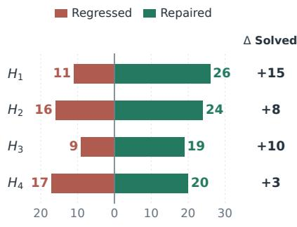  
(a) Locality

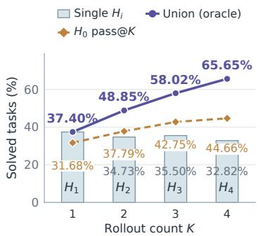  
(b) Complementarity

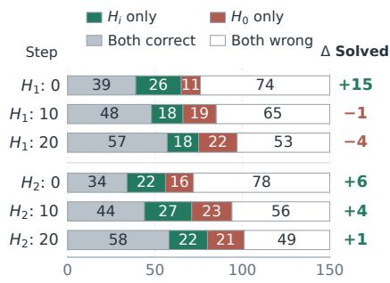  
(c) Nonstationarity  
Figure 1 Locality, complementarity, and nonstationarity in harness evolution (Qwen3.5-4B, AppWorld). (a) Repaired and regressed tasks relative to $H _ { 0 } ; \Delta$ Solved denotes repaired minus regressed tasks. (b) Individual success rates (bars), oracle coverage using one rollout under each of $H _ { 1 } , \ldots , H _ { K }$ (purple), and $H _ { 0 }$ pass@K using the same number of rollouts (orange). (c) Paired outcomes for fixed harnesses as the policy is trained; $\Delta$ Solved is measured against $H _ { 0 }$ at each checkpoint.

• Nonstationarity. A harness’s utility changes as the executing policy learns. Its advantage over $H _ { 0 }$ can become a disadvantage, and the ranking of variants can reverse across policy checkpoints (Figure 1c).

These properties expose two limitations of harness optimization. (i) Combining local repairs into a universal harness is extremely dificult. Repairs may impose incompatible execution requirements, and even compatible edits can interfere with one another. A single accumulated design can therefore lose the strengths of its constituent variants. (ii) Coupled harness–policy evolution incurs substantial evolution cost and limits harness reuse. Alternating harness and policy updates (Chen et al., 2026b,c) requires repeated generation and validation of variants as earlier repairs become less useful to the changing policy. Gains achieved by the evolved pair may also fail to transfer when the policy returns to the base harness $H _ { 0 }$ . We introduce Harness-S to selectively rescue failures of the base system with specialized sibling harnesses and transfer the resulting capabilities into a single policy that remains efective under the original $H _ { 0 }$

Directional Harness Evolution first develops variants along distinct repair directions. Starting from $H _ { 0 } ,$ , we diagnose failures in execution trajectories and let each child harness target a limited set of related causes. Joint validation coverage selects the next parent set; all executable, protocol-compliant variants are retained. The resulting large, reusable Sibling Harness Pool preserves distinct repair specializations and remains fixed throughout policy training.

Complementary Harness Rescue Training uses this pool to expand exploration on tasks the policy fails to solve with $H _ { 0 }$ . When all initial rollouts for a task fail, the Adaptive Harness Router selects the Top-k auxiliary harnesses, and the same policy generates fresh rollouts under them from the task’s initial state. These rescue rollouts replace the failed group for reinforcement learning, allowing the shared policy to learn from its own actions under complementary execution support. The objective is to retain the acquired behaviors when the policy returns to $H _ { 0 }$

The Adaptive Harness Router matches tasks to sibling harnesses using behavioral evidence and independent votes from multiple LLMs. Harness Behavior Profiles describe the task conditions under which each variant helps or hinders the current policy relative to $H _ { 0 }$ . To account for nonstationarity, policy-aware profile re-anchoring periodically refreshes the profiles from current-policy validation trajectories, keeping routing aligned with the policy as it learns.

Our contributions are fourfold:

• We systematically identify Locality, Complementarity, and Nonstationarity in harness evolution and introduce Harness-S to learn complementary sibling capabilities in a single policy that remains efective under the orig inal $H _ { 0 }$

• We go beyond the best harness with Directional Harness Evolution: a pipeline that branches along distinct repair directions and preserves complementary variants in a reusable Sibling Harness Pool.

• Complementary Harness Rescue Training restores learning signals when all initial $H _ { 0 }$ attempts fail. The Adaptive Harness Router selects complementary siblings to recover successful alternatives and within-task reward contrasts for shared-policy optimization.

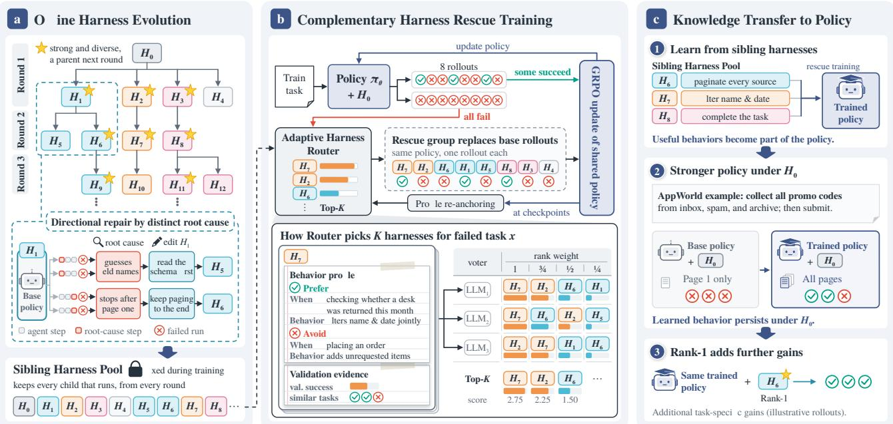  
Figure 2 Overview of Harness-S. (a) Directional Harness Evolution develops distinct repairs and retains valid variants in a Sibling Harness Pool, fixed during policy training. (b) Complementary Harness Rescue Training routes all-failure tasks to Top-K auxiliary harnesses and updates the shared policy, with periodic profile re-anchoring. (c) Rescue training transfers knowledge from sibling harnesses into the shared policy, improving execution under the original H0; Rank-1 routing provides further gains (illustrative AppWorld example).

• Across AppWorld, SWE-Gym, and DBBench, Harness-S outperforms policy-only training under $H _ { 0 }$ at both model sizes. Behavioral analyses, held-out cases, and reduced routing dependence support capability transfer; Rank-1 routing adds gains, and improvements persist under unseen harnesses without further updates.

## 2 Related Work

## 2.1 Harness Evolution

Execution design shapes the behavior expressed by a language model, from reasoning and action representations (Yao et al., 2023b; Xu et al., 2023; Wang et al., 2024b) to interaction interfaces and search (Yang et al., 2024b; Zhou et al., 2024a). Automatic optimization extends this design space through instruction refinement (Yang et al., 2024a; Yuksekgonul et al., 2024), evolutionary prompt search (Fernando et al., 2023; Guo et al., 2025), and program compilation or reflective selection (Khattab et al., 2023; Agrawal et al., 2026). Memory, skill libraries, and context adaptation provide another route to improving execution from experience (Shinn et al., 2023; Wang et al., 2023, 2024c; Zhang et al., 2026f). At the system level, agent design and workflow search optimize executable structures (Hu et al., 2025; Zhang et al., 2025), while code evolution, end-to-end harness optimization, and runtime adaptation develop broader interventions (Zhang et al., 2026a; Lee et al., 2026; Xu et al., 2026). Harness-S uses directional evolution to retain complementary local repairs in a reusable sibling pool. The implementations remain fixed during policy training; their behavioral profiles are refreshed to track changes in utility as the shared policy learns.

## 2.2 Harness–Policy Optimization

Reinforcement learning improves agent behavior through outcome feedback (Shao et al., 2024; Wang et al., 2025; Feng et al., 2025; Wei et al., 2025), supported by executable environments and training interfaces (Pan et al., 2025; Luo et al., 2025). Interactive benchmarks cover web services (Yao et al., 2023a; Zhou et al., 2024b; Yao et al., 2024), applications and databases (Trivedi et al., 2024; Liu et al., 2025), and software engineering (Jimenez et al., 2024). Joint methods alternate harness and policy updates (Kim et al., 2026; Chen et al., 2026c), evolve matched pairs (Chen et al., 2026a), or learn runtime coordination (Ning et al., 2026). Model routing (Chen et al., 2023; Ong et al., 2025; Chen et al., 2024) and response ensembles (Jiang et al., 2023; Wang et al., 2024a) provide related approaches to allocating execution

## resources.

HarnessBandit schedules one harness per optimizer step using learnability and gradient-based cross-harness transferability signals (Wei et al., 2026). HarnessX couples harness evolution with cross-harness GRPO over a shared replay bufer, grouping trajectories by task across harness and policy versions (Chen et al., 2026b). Harness-S instead asks whether specialized harnesses can selectively rescue failures of a base execution system and transfer the resulting capabilities into a single policy that remains efective under the original harness. Its allocation unit is a failed task under $H _ { 0 } { : }$ only all-failure groups trigger fresh rollouts from the current policy across selected siblings in a fixed pool. Evaluation under $H _ { 0 }$ tests whether the resulting improvement survives removal of auxiliary execution support.

## 2.3 Recursive Self-Improvement

Recent surveys distinguish self-improvement by whether updates modify model parameters or the surrounding scaf fold (Ren et al., 2026). Program-level approaches improve optimization code or agent logic that supports subse quent improvements (Zelikman et al., 2024; Yin et al., 2025; Zhang et al., 2026a). $\mathrm { A I D E ^ { 2 } }$ applies this loop to research agents (Srikanth et al., 2026), while RRSI regularizes harness edits to favor transferable mechanisms (Xia et al., 2026). SpecForge refines behavioral specifications from execution feedback (Cheng et al., 2026); self-rewarding models and SEAL instead update parameters using self-generated rewards or adaptation data (Yuan et al., 2024; Zweiger et al., 2025). Harness-S uses a fixed sibling pool to rescue base-system failures and transfer the resulting behaviors into one policy; policy updates refresh the evidence used for later rescue allocation. Its self-improvement loop operates over policy parameters and experience selection, with a fixed optimizer, verifier, and training-time harness pool, rather than recursively redesigning the improvement algorithm. Appendix H further discusses agent RL training, knowledge transfer, harness editing, and reusable skills.

## 3 Harness-S

Harness-S uses selective rescue of $H _ { 0 }$ failures to transfer useful behaviors from sibling harnesses into a shared policy (Figure 2). Directional evolution builds a reusable pool of specialized variants; rescue training uses them to explore tasks that defeat the base harness. The Adaptive Harness Router selects variants using behavioral evidence that is refreshed as the policy learns, and can be reused at inference.

## 3.1 Policy, Harness, and Task Outcome

A policy and its harness jointly determine how an agent executes a task. For task x, the policy $\pi _ { \theta }$ generates a trajectory $\tau \sim p _ { \theta , H } ( \cdot \mid x )$ under harness $H ,$ with verifier-defined outcome $R _ { x } ( \tau ) \in \{ 0 , 1 \}$ . The harness controls the context and execution rules through which the policy interacts with the environment. We define its utility for that policy and task as the expected success rate,

$$
u _ { \theta } ( H , x ) = \mathbb { E } _ { \tau \sim p _ { \theta , H } ( \cdot | x ) } [ R _ { x } ( \tau ) ] .\tag{1}
$$

The Sibling Harness Pool $\mathcal { H } = \{ H _ { 0 } , H _ { 1 } , \dots , H _ { M } \}$ contains variants descended from a common base $H _ { 0 }$ . All variants share the execution foundation, environment interfaces, and task verifier, and use the same policy parameters. Their relative utility varies across tasks and policy checkpoints, motivating task-specific selection that adapts as the policy learns.

## 3.2 Directional Harness Evolution

Starting with $\mathcal { P } _ { 1 } = \{ H _ { 0 } \}$ , we execute each parent $H \in \mathcal { P } _ { g }$ on fresh training tasks to derive repair directions $\mathcal { D } _ { g } ( H )$ Each direction groups related local root causes supported by multiple failed tasks; the editor receives the parent and these causes:

$$
\mathcal { C } _ { g } = \big \{ \mathrm { E d i t } ( H , d ) : H \in \mathcal { P } _ { g } , d \in \mathcal { D } _ { g } ( H ) \big \} ,\tag{2}
$$

where $\operatorname { E d i t } ( H , d )$ modifies the parent’s components to address the causes in $d .$

Parent selection maximizes joint validation coverage. We select at most B parents from $\mathcal { C } _ { g } ^ { \mathrm { v a l i d } }$ , this round’s executable, protocol-compliant children. Let $\nu ( H )$ denote the validation tasks solved by H with the frozen policy:

$$
\begin{array} { r } { \mathcal { P } _ { g + 1 } \in \underset { \mathcal { P } \subseteq \mathcal { C } _ { g } ^ { \mathrm { v a l i d } } , 1 \leq | \mathcal { P } | \leq B } { \arg \operatorname* { m a x } } \left| \bigcup _ { H \in \mathcal { P } } \mathcal { V } ( H ) \right| . } \end{array}\tag{3}
$$

Each task counts once, favoring parents that cover one another’s failures.

The Sibling Harness Pool retains all valid children, including those not selected as parents:

$$
\begin{array} { r } { \mathscr { H } _ { g } = \mathscr { H } _ { g - 1 } \cup \mathcal { C } _ { g } ^ { \mathrm { v a l i d } } , \qquad \mathscr { H } _ { 0 } = \{ H _ { 0 } \} . } \end{array}\tag{4}
$$

After T generations, $\mathcal { H } = \mathcal { H } _ { T }$ is the fixed pool used for policy training. Appendices E and F report repair diversity and evolution prompts and settings.

## 3.3 Complementary Harness Rescue Training

Training uses the pool to revisit tasks that the policy fails to solve under $H _ { 0 }$ . For each task x, the current policy generates K rollouts under $H _ { 0 } ,$ , forming $\mathcal { G } _ { 0 } ( x )$ . If all attempts fail, the router selects a set ${ \mathcal S } _ { K } ^ { ( s ) } ( x )$ of distinct auxiliary harnesses using the latest calibration s (Equation (10)). The same policy makes one fresh attempt under each selected harness from the task’s initial state, yielding $\mathcal G _ { R } ( x )$ . The group retained for training is

$$
\mathcal { G } ( x ) = \left\{ \begin{array} { l l } { \mathcal { G } _ { 0 } ( x ) , } & { \operatorname* { m a x } _ { \tau \in \mathcal { G } _ { 0 } ( x ) } R _ { x } ( \tau ) = 1 , } \\ { \mathcal { G } _ { R } ( x ) , } & { \mathrm { o t h e r w i s e } . } \end{array} \right.\tag{5}
$$

Complementarity gives the policy alternative paths through dificult tasks. Rescue groups containing successes and failures provide reward contrasts absent from the initial attempts. For a retained group of trajectories $\tau _ { x , j } ,$ GRPO (Shao et al., 2024) assigns the relative advantage

$$
a _ { x , j } = \frac { R _ { x } ( \tau _ { x , j } ) - \bar { r } _ { x } } { \operatorname* { m a x } ( \sigma _ { x } , \epsilon ) } ,\tag{6}
$$

Here $\bar { r } _ { x }$ and σ are the group’s reward mean and standard deviation, and $\epsilon > 0$ stabilizes division. The shared optimizer forms training advantages $A _ { x , j }$ from these group-relative rewards and maximizes the clipped token objective

$$
\begin{array} { r } { \rho = \frac { \pi _ { \theta } ( y \mid c _ { H } ) } { \pi _ { \theta _ { \mathrm { o l d } } } ( y \mid c _ { H } ) } , \qquad } \\ { \ell ( \rho , A ) = \operatorname* { m i n } \{ \rho A , \mathrm { c l i p } ( \rho , 1 - \eta _ { - } , 1 + \eta _ { + } ) A \} . } \end{array}\tag{7}
$$

Here y is a policy token in its generating harness context $c _ { H }$ . The ratio compares current parameters θ with preupdate parameters $\theta _ { \mathrm { o l d } } ; \eta _ { - } , \eta _ { + }$ are the clipping widths. Only policy tokens enter the objective. Algorithm 1 summarizes training; optimizer details appear in Appendix B.

## 3.4 Adaptive Harness Router

Harness Behavior Profiles describe when a sibling helps or hinders the current policy:

$$
\begin{array} { r l } & { P _ { i } ^ { ( s ) } = \big ( P _ { i , \mathrm { p r e f e r } } ^ { ( s ) } , P _ { i , \mathrm { a v o i d } } ^ { ( s ) } \big ) , } \\ & { \quad e = \{ \mathsf { W h e n } : w , \mathsf { B e h a v i o r } : b \} . } \end{array}\tag{8}
$$

An LLM groups behavioral diferences from paired validation trajectories into entries e, where w specifies the task condition and b the behavior relative to $H _ { 0 }$ (Appendix D).

Voting aggregates independent LLM rankings. Each ofV voters uses the task, current profiles, validation success rates, and outcomes on similar tasks:

$$
q _ { s } ( H \mid x ) = \sum _ { v = 1 } ^ { V } \omega \big ( \mathrm { r a n k } _ { v , s } ( H \mid x ) \big ) ,\tag{9}
$$

$$
\mathcal { S } _ { K } ^ { ( s ) } ( \boldsymbol { x } ) = \mathrm { T o p K } _ { H \in \mathcal { H } \backslash \{ H _ { 0 } \} } q _ { s } ( H \mid \boldsymbol { x } ) .\tag{10}
$$

Algorithm 1 Complementary Harness Rescue Training   
Require: Policy $\pi _ { \theta } ;$ fixed pool $\mathcal { H } ;$ validation tasks   
1: Construct profiles and validation evidence   
2: for each training batch do   
3: Re-anchor profiles if calibration is due   
4: for each task x in the batch do   
5: Sample K rollouts under $H _ { 0 }$ as $\mathcal { G } _ { 0 } ( x )$   
6: if all rollouts fail then   
7: Select ${ \cal S } _ { K } ^ { ( s ) } ( x )$ with the router   
8: Form $\mathcal G _ { R } ( x )$ with one fresh rollout per harness   
9: end if   
10: Retain $\mathcal G ( x )$ using Equation (5)   
11: end for   
12: Update θ on retained groups using GRPO   
13: end for   
14: Re-anchor profiles with the final policy

Here ω decreases with rank and is zero for unlisted candidates; the selected K distinct harnesses generate $\mathcal { G } _ { R } ( x )$ in Equation (5).

Policy-aware profile re-anchoring refreshes the router’s evidence at checkpoints s. With policy $\pi _ { \theta _ { s } }$ frozen, we collect validation trajectories and outcomes $\mathcal { E } _ { i } ^ { ( s ) }$ under each $H _ { i }$ and recompute

$$
P _ { i } ^ { ( s ) } = \mathrm { P r o f i l e } ( \mathcal { E } _ { i } ^ { ( s ) } , \mathcal { E } _ { 0 } ^ { ( s ) } ) .\tag{11}
$$

Paired executions share tasks, initial states, and execution limits. Profiles and validation statistics are refreshed together and used until the next checkpoint; test outcomes are excluded.

## 3.5 Knowledge Transfer to Policy

The trained policy $\pi _ { \theta _ { * } }$ consolidates behaviors from sibling harnesses through rescue updates; these behaviors can persist under the original $H _ { 0 }$ . The behavioral cases in RQ4 and reduced dependence on auxiliary harnesses in RQ5 (Sections 4.5 and 4.6) support this transfer.

Rank-1 routing adds further gains to the same trained policy. After final profile re-anchoring, we select from the full pool, including $H _ { 0 }$

$$
\widehat { H } ( x ) = \underset { H \in \mathcal { H } } { \arg \operatorname* { m a x } } q _ { * } ( H \mid x ) .\tag{12}
$$

Selection precedes execution at a matched rollout count; Appendix C details voting.

## 4 Experiments

We examine whether complementary rescue improves agent performance and transfers useful behaviors into the policy:

• RQ1: Does Harness-S improve task success, including under the original $H _ { 0 } ?$

• RQ2: Does complementary rescue provide better learning signals than resampling or fixed harness mixtures?

• RQ3: How do rescue allocation and profile re-anchoring afect recovery and final performance?

• RQ4: Which behaviors change under $H _ { 0 } ,$ , and do rescue behaviors transfer to untrained instances?

• RQ5: Do router ranks predict performance, and how does routing benefit change after training?

• RQ6: Do policy improvements transfer to unseen harnesses without further updates?

Table 1 Main results on long-horizon agent tasks. All scores are percentages; higher means are better. Bold marks the best mean at each capacity among the compared non-frontier methods. $H _ { \mathrm { b e s t } }$ is one selected harness held fixed across test tasks; $H _ { \mathrm { r a n k 1 } }$ is the router’s top-ranked harness selected separately for each task. DSH denotes DeepSeek Harness. Scores are averaged over three independent randomized runs, each with three executor rollouts per task. Harness-S entries report mean ± standard deviation across these runs.
<table><tr><td rowspan="2">Model / method</td><td rowspan="2">Param. Test harness</td><td rowspan="2"></td><td colspan="2">AppWorld</td><td colspan="2">SWE-Gym</td><td colspan="2">DBBench</td></tr><tr><td>Pass@3</td><td>Avg@3</td><td>Pass@3</td><td>Avg@3</td><td>Pass@3</td><td>Avg@3</td></tr><tr><td colspan="8">Frontier models</td></tr><tr><td></td><td> $H _ { 0 }$ </td><td></td><td>82.82</td><td>76.34</td><td>53.13</td><td>47.50</td><td>71.33</td><td>68.89</td></tr><tr><td>DeepSeek-v4-Flash</td><td></td><td> $H _ { 0 }$   $H _ { 0 }$ </td><td>81.68</td><td>77.61</td><td>51.88</td><td>46.25</td><td>75.00</td><td>70.44</td></tr><tr><td>GLM-5.3-Flash</td><td></td><td></td><td>80.15</td><td>65.65</td><td>46.88</td><td>43.13</td><td>76.67</td><td>72.11</td></tr><tr><td colspan="9">Base model and policy-only training</td></tr><tr><td rowspan="2">Base model</td><td>4B</td><td rowspan="2"> $H _ { 0 }$ </td><td>42.62</td><td>31.93</td><td>19.38</td><td>17.50</td><td>59.00</td><td>56.89</td></tr><tr><td>9B</td><td>50.00</td><td>39.69</td><td>23.13</td><td>20.63</td><td>63.00</td><td>60.22</td></tr><tr><td rowspan="2">GRPO</td><td>4B</td><td rowspan="2"> $H _ { 0 }$ </td><td>60.31</td><td>48.98</td><td>24.38</td><td>22.50</td><td>66.67</td><td>64.00</td></tr><tr><td>9B</td><td>64.89</td><td>53.31</td><td>28.13</td><td>25.63</td><td>69.67</td><td>67.00</td></tr><tr><td rowspan="2">GRPO (H₀ rescue)</td><td>4B</td><td rowspan="2"> $H _ { 0 }$ </td><td>61.83</td><td>51.91</td><td>25.63</td><td>23.33</td><td>67.33</td><td>64.67</td></tr><tr><td>9B</td><td>65.65</td><td>54.83</td><td>29.38</td><td>26.88</td><td>70.67</td><td>67.78</td></tr><tr><td rowspan="2">GRPO Mixed Harness (DSH  $H _ { 0 }$  + Claude Code)</td><td>4B</td><td rowspan="2"> $H _ { 0 }$ </td><td>57.63</td><td>46.69</td><td>25.63</td><td>23.33</td><td>65.67</td><td>62.78</td></tr><tr><td>9B</td><td>62.21</td><td>50.89</td><td>29.38</td><td>26.88</td><td>68.67</td><td>65.89</td></tr><tr><td rowspan="2">GRPO Mixed Harness (DSH  $H _ { 0 } + \mathrm { T o p } { - } 4 )$ </td><td>4B</td><td rowspan="2"> $H _ { 0 }$ </td><td>58.78</td><td>47.84</td><td>26.88</td><td>24.38</td><td>64.67</td><td>61.89</td></tr><tr><td>9B</td><td>63.36</td><td>52.16</td><td>30.63</td><td>27.71</td><td>67.67</td><td>65.00</td></tr><tr><td colspan="8">Frozen policy + harness evolution</td></tr><tr><td rowspan="3">Meta-Harness</td><td>4B</td><td rowspan="3"> $H _ { \mathrm { b e s t } }$ </td><td>48.09</td><td>36.26</td><td>21.88</td><td>20.00</td><td>62.67</td><td>60.11</td></tr><tr><td>9B</td><td>53.44</td><td>42.88</td><td>25.63</td><td>23.13</td><td>65.67</td><td>62.78</td></tr><tr><td>4B 9B</td><td>56.87</td><td>45.42</td><td>25.00</td><td>23.75</td><td>69.33</td><td>66.78</td></tr><tr><td>Harness-S (HE only)</td><td></td><td> $H _ { \mathrm { r a n k 1 } }$ </td><td>61.45</td><td>50.13</td><td>29.38</td><td>27.08</td><td>72.67</td><td>69.78</td></tr><tr><td colspan="9">Policy-harness co-evolution</td></tr><tr><td rowspan="3">WHALE HarnessForge</td><td>4B</td><td rowspan="3"> $H _ { \mathrm { b e s t } }$ </td><td>63.36</td><td>52.93</td><td>29.38</td><td>26.88</td><td>70.67</td><td>68.11</td></tr><tr><td>9B</td><td>68.70</td><td>58.02</td><td>33.75</td><td>30.63</td><td>74.00</td><td>71.11</td></tr><tr><td>4B</td><td>59.54</td><td>49.75</td><td>27.50</td><td>25.00</td><td>69.00</td><td>66.22</td></tr><tr><td rowspan="2"></td><td>9B</td><td rowspan="2"> $H _ { \mathrm { b e s t } }$ </td><td>64.89</td><td>54.83</td><td>31.25</td><td>28.54</td><td>72.00</td><td>69.22</td></tr><tr><td></td><td></td><td></td><td></td><td></td><td></td><td></td></tr><tr><td rowspan="2">Harness-S: offline evolution + policy training</td><td></td><td rowspan="2"> $H _ { 0 }$ </td><td></td><td></td><td></td><td></td><td></td><td></td></tr><tr><td>4B</td><td> $6 7 . 5 6 \pm 1 . 8 7$ </td><td> $5 6 . 8 7 \pm 1 . 4 7$ </td><td> $3 8 . 7 5 \pm 2 . 2 2$ </td><td> $2 8 . 7 5 \pm 1 . 7 3$ </td><td> $7 3 . 3 3 \pm 2 . 3 6$ </td><td> $7 1 . 0 0 \pm 1 . 8 4$ </td></tr><tr><td rowspan="2">Harness-S</td><td>9B</td><td rowspan="2"> $H _ { \mathrm { r a n k 1 } }$ </td><td> $7 2 . 5 2 \pm 1 . 6 5$ </td><td> $6 2 . 3 4 \pm 1 . 2 8$ </td><td> $4 0 . 0 0 \pm 2 . 0 4$ </td><td> $3 2 . 5 0 \pm 1 . 5 1$ </td><td> $7 6 . 3 3 \pm 2 . 1 3$ </td><td> $7 3 . 4 4 \pm 1 . 6 7$ </td></tr><tr><td>4B</td><td> $6 8 . 3 2 \pm 1 . 7 4$ </td><td> ${ \bf 6 1 . 4 5 \pm 1 . 3 5 }$ </td><td> $\mathbf { 4 2 . 5 0 \pm 2 . 0 4 }$ </td><td> $3 2 . 2 9 \pm 1 . 6 4$ </td><td> $7 5 . 0 0 \pm 2 . 2 3$  </td><td> $7 2 . 6 7 \pm 1 . 7 5$ </td></tr><tr><td rowspan="2"></td><td>9B</td><td rowspan="2"></td><td> ${ \bf 7 5 . 1 9 \pm 1 . 5 6 }$ </td><td> ${ \bf 6 7 . 0 5 \pm 1 . 2 0 }$ </td><td> $4 3 . 7 5 \pm 1 . 8 4$ </td><td> ${ \bf 3 6 . 2 5 \pm 1 . 4 5 }$ </td><td> $7 8 . 0 0 \pm 1 . 9 6$ </td><td> ${ 7 5 . 6 7 \pm 1 . 5 5 }$ </td></tr><tr><td></td><td></td><td></td><td></td><td></td><td></td><td></td></tr></table>

## 4.1 Experimental Setup

We evaluate Qwen3.5-4B and Qwen3.5-9B on AppWorld (Trivedi et al., 2024), DBBench (Liu et al., 2025), and SWE-Gym (Pan et al., 2025), covering application APIs, databases, and software engineering. Harness editing and policy optimization use training tasks; validation tasks guide complementary parent selection and profile anchoring. Pass@3 measures the fraction of tasks solved at least once, and Avg@3 averages success over three rollouts per task. Main-table scores are means over three independent randomized runs, with across-run standard deviations for Harness-S. Routed evaluation selects one harness before each task’s three attempts. All experiments use eight NVIDIA H800 GPUs.

Our comparisons distinguish policy learning, harness evolution, and joint harness–policy adaptation (Table 1). The GRPO controls include $H _ { 0 }$ rescue and fixed mixtures with Claude Code or sibling harnesses, all evaluated under $H _ { 0 }$ . WHALE uses rejection-sampling fine-tuning and HarnessForge adapts branch-specific policies; the GRPO controls share our optimizer. Meta-Harness, WHALE, and HarnessForge use one selected $H _ { \mathrm { b e s t } }$ across test tasks; $H _ { \mathrm { r a n k 1 } }$ denotes task-specific selection. Harness-S (HE only) freezes the starting policy, while full Harness-S evaluates the same trained checkpoint under $H _ { 0 }$ and $H _ { \mathrm { r a n k 1 } }$ to distinguish retained policy improvement from inference-time support.

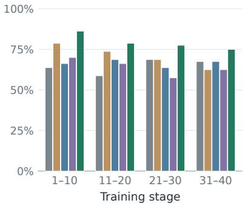  
(a) Effective Group rate

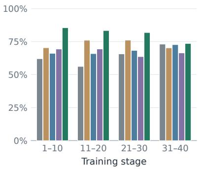  
(b) Effective training-token share

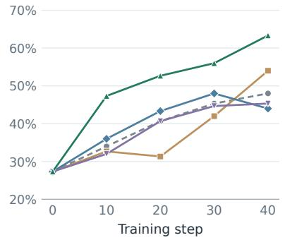  
(c) $H _ { 0 }$ validation success  
Figure 3 Training signals and policy improvement for Qwen3.5-4B on AppWorld. (a) Fraction of efective groups containing both successes and failures. (b) Fraction of retained policy tokens belonging to these efective groups. Both quantities are aggregated within each ten-step stage. (c) Checkpoint success on the same validation set under $H _ { 0 } .$

GRPO with $H _ { 0 }$ rescue and Harness-S share the all-failure trigger and per-task rescue allocation; their total sampling difers with rescue frequency. Dataset splits and implementation protocols appear in Appendices A and $C ,$ with costs reported in Appendix G.

## 4.2 Overall Performance (RQ1)

Harness-S outperforms policy-only training, frozen-policy harness optimization, and joint adaptation under both $H _ { 0 }$ and $H _ { \mathrm { r a n k 1 } }$ (Table 1). The routed 4B policy exceeds 9B GRPO with $H _ { 0 }$ rescue on every reported metric; the routed 9B policy also exceeds the frontier-model references on DBBench.

The gains combine retained policy improvement with better execution support. Harness-S outperforms plain GRPO and GRPO with $H _ { 0 }$ rescue across all benchmark–capacity settings under $H _ { 0 } ,$ , indicating a benefit beyond additional sampling. With the policy frozen, Harness-S (HE only) outperforms Meta-Harness, supporting the value of the sibling pool and task-specific selection. Routing the trained policy further improves both metrics in every setting without increasing the executor rollout count. On AppWorld 4B, Harness-S outperforms $H _ { 0 }$ rescue with fewer rollouts and less training GPU time (Appendix G). Its full-pipeline GPU hours and external-model token use fall within the range of the joint-adaptation baselines.

## 4.3 Learning Mechanism (RQ2)

Selective rescue supplies more within-task reward contrast than additional sampling or fixed harness mixtures. Figure 3 compares Qwen3.5-4B on AppWorld under GRPO, $H _ { 0 }$ rescue, the two fixed mixtures, and Harness-S. The Efective Group (EG) rate measures the fraction of retained groups containing both successes and failures. Harness-S leads in every stage, reaching 79.38% over the full run versus 70.94% for GRPO with $H _ { 0 }$ rescue and 64.69% for standard GRPO. All-failure groups provide no within-task reward contrast; recovering some ofthese tasks supplies alternatives that GRPO can reinforce. Both fixed mixtures remain close to standard GRPO, suggesting that harness diversity is more useful when directed toward tasks on which the base group fails.

Efective groups also account for a larger share of the retained training tokens. The efective training-token share counts policy tokens in efective groups relative to all retained policy tokens, accounting for diferences in trajectory length. Harness-S has the highest share throughout training, reaching 80.88% overall compared with 72.68% for GRPO with $H _ { 0 }$ rescue. Its advantage therefore extends to the tokens used for optimization, accounting for the lengths of successful and unsuccessful trajectories.

These training advantages accompany stronger policy performance under $H _ { 0 } ,$ . From the same starting policy, Harness-S leads at every subsequent validation checkpoint and finishes at 63.33%, compared with 54.00% for GRPO with $H _ { 0 }$ rescue and 48.00% for GRPO. Both fixed mixtures finish below GRPO despite intermediate gains from the

Table 2 Rescue success and final test performance on AppWorld (Qwen3.5-4B), in percent. Rule Router uses no Harness Behavior Profiles. Top-8 Fixed uses unchanged profiles; Top-8 Adaptive (Harness-S) uses profile re-anchoring. Bold marks the best result; — denotes no rescue.
<table><tr><td></td><td>GRPO</td><td>Random Harness</td><td>Rule Router (w/o Profile)</td><td>Txp2 </td><td>Top-</td><td>Aaptiti</td></tr><tr><td colspan="7">Rescue success by training stage</td></tr><tr><td>Steps 1-10</td><td></td><td>25.00</td><td>40.00</td><td>43.48</td><td>35.71</td><td>52.38</td></tr><tr><td>Steps 11–20</td><td></td><td>18.18</td><td>26.67</td><td>43.75</td><td>24.24</td><td>66.67</td></tr><tr><td>Steps 21-30</td><td>---</td><td>20.00</td><td>27.78</td><td>38.89</td><td>26.67</td><td>45.71</td></tr><tr><td>Steps 31-40</td><td></td><td>25.00</td><td>44.44</td><td>33.33</td><td>38.89</td><td>50.00</td></tr><tr><td colspan="7">Final test performance</td></tr><tr><td>Pass@3</td><td>60.31</td><td>62.98</td><td>66.41</td><td>65.65</td><td>64.50</td><td>67.56</td></tr><tr><td>Avg@3</td><td>48.98</td><td>50.76</td><td>52.93</td><td>55.60</td><td>52.16</td><td>56.87</td></tr></table>

Table 3 Behavior frequencies under H0 (%). An LLM labels complete evaluation trajectories; percentages report the fraction exhibiting each behavior. Arrows indicate preferred directions.
<table><tr><td>Behavior</td><td>Base</td><td>GRPO</td><td>Harness-S</td></tr><tr><td colspan="4">AppWorld</td></tr><tr><td>Schema lookup before first API use ↑</td><td>22.9</td><td>38.2</td><td>67.6</td></tr><tr><td>Multiple API calls in one execute block ↑</td><td>24.8</td><td>20.5</td><td>31.5</td></tr><tr><td>Explicit pagination loops ↑</td><td>13.8</td><td>33.5</td><td>38.3</td></tr><tr><td>Repeated execute code ↓</td><td>15.4</td><td>30.1</td><td>9.8</td></tr><tr><td>Read-back after the last write ↑</td><td>69.2</td><td>56.9</td><td>69.4</td></tr><tr><td colspan="4">SWE-Gym</td></tr><tr><td>Agent-written assertion checks ↑</td><td>10.2</td><td>11.2</td><td>18.4</td></tr><tr><td>Switch to assertions after blocked tests ↑</td><td>15.4</td><td>13.3</td><td>48.5</td></tr><tr><td>Fail-edit-retest of the same target ↑</td><td>9.2</td><td>18.2</td><td>24.1</td></tr><tr><td>Diff inspection after the last edit ↑</td><td>16.3</td><td>23.5</td><td>27.5</td></tr></table>

Claude Code mixture. The results support selective rescue as a source of learning signals whose benefits persist after auxiliary harness support is removed.

## 4.4 Rescue Strategies (RQ3)

Task-specific allocation and profile refresh improve rescue at a fixed rollout budget (AppWorld, Qwen3.5- 4B; Table 2). Random Harness samples pool members, while Rule Router (without Profiles) ranks them by success on similar validation tasks. LLM Router (4 × 2) allocates two rollouts to each of four selected harnesses; Top-8 allocates one to each of eight, keeping the rescue rollout budget fixed. The fixed-profile Top-8 variant keeps its profiles unchanged, while Harness-S re-anchors them during training. Rescue success measures the fraction ofrescue triggering tasks with at least one successful rollout (Appendix C).

Task-specific selection improves rescue success across training stages. Both rule-based and LLM-guided strate gies outperform random selection throughout training. Top-8 Adaptive also exceeds LLM Router (4 × 2), suggesting that broader harness exploration recovers more failures than repeated sampling from fewer harnesses. Under the same final AppWorld policy, individual siblings repair 11–15 base-harness failures, while the nine analyzed siblings repair 29 in union (Appendix E). This is coverage obtained by executing each sibling once; routing must select candi dates before observing their outcomes.

Adaptive profiles improve routing over a fixed-profile Top-8 variant. With the rollout allocation held at one attempt per selected harness, re-anchoring yields higher rescue success in all four stages and improves final Avg@3 by 4.71 percentage points. This comparison supports updating the router’s behavioral evidence as the policy learns.

All evaluated rescue strategies improve final test performance over GRPO, with Top-8 Adaptive achieving the highest Pass@3 and Avg@3. The remaining strategies show a tradeof: Rule Router achieves higher Pass@3 than LLM Router (4 × 2), but lower Avg@3. Rescue success therefore does not fully determine the downstream ranking, although Top-8 performs best on both recovery during training and final test success.

Table 4 Two AppWorld behavior-transfer cases. All eight initial $H _ { 0 }$ attempts fail in training; the successful rescue enters an applied policy update. Held-out comparisons use $H _ { 0 } .$
<table><tr><td>Stage</td><td>Observed execution</td></tr><tr><td colspan="2">Case 1: Set intersection (held-out test instance)</td></tr><tr><td>Training rescue</td><td>H2 selects liked songs that also occur in the library or playlists, then updates and sends the draft. This successful rollout is used at update 10.</td></tr><tr><td>GRPO</td><td>Uses a union of liked songs and the other sources, sending an overinclusive list. Failure.</td></tr><tr><td>Harness-S</td><td>Applies the intersection to the new song instances and sends the correct email. Success.</td></tr><tr><td colspan="2">Case 2: Account recovery (held-out validation instance)</td></tr><tr><td>Training rescue</td><td>H5 completes a Venmo account workflow: reads email codes, resets the password, and verifies login. This successful rollout is used at update 3.</td></tr><tr><td>GRPO</td><td>On the Amazon instance, requests a reset code and reads the inbox but leaves the password unchanged. Failure.</td></tr><tr><td>Harness-S</td><td>Reads the new codes, resets the Amazon password, and verifies access with the new credentials Success.</td></tr></table>

Table 5 AppWorld router rankings before and after Harness-S training (Qwen3.5-4B; %). Each harness receives three rollouts per task. $H _ { 0 }$ rate is the task fraction placing $H _ { 0 }$ at that rank (—: fixed baseline). Bold marks best task scores.
<table><tr><td rowspan="2">Harness</td><td colspan="3">Before training</td><td colspan="3">After training</td></tr><tr><td>Pass@3</td><td>Avg@3</td><td> $H _ { 0 }$  rate</td><td>Pass@3</td><td>Avg@3</td><td> $H _ { 0 }$  rate</td></tr><tr><td> $H _ { 0 }$ </td><td>42.62</td><td>31.93</td><td>一</td><td>67.56</td><td>56.87</td><td>一</td></tr><tr><td>Rank-1</td><td>56.87</td><td>45.42</td><td>1.53</td><td>68.32</td><td>61.45</td><td>22.52</td></tr><tr><td>Rank-2</td><td>53.44</td><td>42.11</td><td>6.87</td><td>66.03</td><td>55.60</td><td>14.89</td></tr><tr><td>Rank-3</td><td>50.38</td><td>39.19</td><td>4.96</td><td>64.89</td><td>54.20</td><td>13.36</td></tr></table>

## 4.5 Policy Behavior (RQ4)

Harness-S changes how the policy gathers evidence and completes actions under $H _ { 0 }$ . Table 3 compares concrete workflows of the base, GRPO, and Harness-S policies. On AppWorld, Harness-S consults API schemas before first use more often than GRPO and repeats execute code less often, while also increasing pagination, multi-call execution, and read-back after writes. These shifts suggest greater use of interface information and state verification, rather than a uniform increase in tool activity. The frequencies describe behavior, not correctness: more calls or checks are useful only when they serve the task.

The SWE-Gym trajectories show more explicit verification and recovery from blocked tests. Harness-S more often writes assertion checks, revisits a failed target after editing, and inspects the final dif. When tests are blocked, switching to assertions occurs in 48.5% of Harness-S cases versus 13.3% for GRPO. These patterns describe alternative ways to validate a patch when the standard test workflow is unavailable.

Successful rescue behaviors also reappear on untrained instances after auxiliary support is removed. Table 4 traces two AppWorld cases from successful training rescues to held-out execution under $H _ { 0 }$ . The trained policy preserves a set-intersection constraint and completes a feedback-dependent account-recovery workflow where GRPO fails. The first case concerns applying the same selection rule to new task instances; the second carries a recovery procedure from Venmo to Amazon, including password reset and verification. They illustrate transfer of both a task constraint and a multi-step procedure across distinct executions. Both successful rescues entered a policy update, and the corresponding behavior later appears on a diferent instance under $H _ { 0 }$ . These cases connect auxiliary execution experience to behavior retained by the policy after the specialized support is removed.

## 4.6 Router Effectiveness (RQ5)

The router’s ranking predicts execution quality before and after training. Table 5 compares Qwen3.5-4B under $H _ { 0 }$ and three task-specific router ranks, each evaluated with three rollouts per task. Both Pass@3 and Avg@3 decrease from Rank-1 to Rank-3 before and after training. All three ranked choices outperform $H _ { 0 }$ before training, showing the value of specialized execution support for the initial policy. The preserved ordering indicates that routing

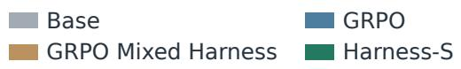

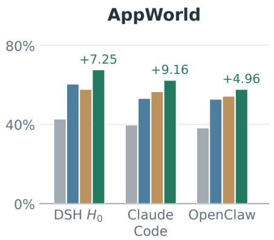

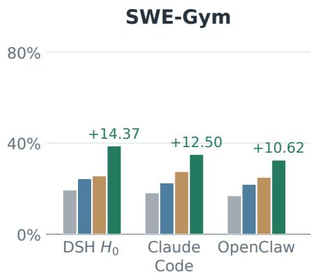  
Figure 4 Cross-harness Pass@3 of Qwen3.5-4B. Mixed-harness GRPO uses DSH $H _ { 0 }$ and Claude Code. Annotations show Harness-S gains over GRPO in percentage points.

remains useful as the policy improves.

Training makes $H _ { 0 }$ a more frequent leading choice. The fraction of tasks placing $H _ { 0 }$ at Rank-1 rises from 1.53% to 22.52%; its selection rates at Rank-2 and Rank-3 also increase. The largest increase occurs at Rank-1, showing that $H _ { 0 }$ more often becomes the router’s preferred execution choice. This increased preference for the base harness is consistent with reduced dependence on auxiliary execution support.

The trained policy retains much of the routed advantage under the original harness. The Rank-1 margin over $H _ { 0 }$ shrinks from 14.21 to 0.76 points in Pass@3 and from 13.49 to 4.58 points in Avg@3. The trained policy under $H _ { 0 }$ also overtakes Rank-2 and Rank-3 on both metrics. Together with the cases in Section 4.5, these performance and routing changes support the internalization of behaviors elicited during rescue. Rank-1 retains an advantage in the reported means; its larger remaining Avg@3 margin suggests that task-specific execution support still improves consistency across attempts.

## 4.7 Cross-Harness Generalization (RQ6)

Harness-S retains its performance advantage under external execution harnesses without further policy updates. Figure 4 compares the Qwen3.5-4B policies on AppWorld and SWE-Gym under DSH $H _ { 0 } ,$ Claude Code, and OpenClaw. Harness-S achieves the highest Pass@3 across all evaluated benchmarks and execution harnesses.

Cross-harness transfer preserves the gains without eliminating sensitivity to the execution interface. Harness-S also exceeds mixed-harness GRPO under Claude Code and OpenClaw, indicating that fixed mixing is insufficient to match its transfer performance. Harness-S nevertheless scores below DSH $H _ { 0 }$ on both external harnesses and benchmarks. The results suggest that complementary rescue develops behaviors useful beyond the training harness, while execution support continues to influence how reliably those behaviors succeed.

## 5 Conclusion and Future Directions

Harness-S trains a shared policy to retain capabilities elicited by complementary sibling harnesses under the original $H _ { 0 }$ . Directional evolution preserves distinct repair strategies, while selective rescue recovers learning signals from base-harness failures. Across AppWorld, SWE-Gym, and DBBench, gains persist under $H _ { 0 } ;$ behavioral analyses support transfer, and Rank-1 routing improves inference. Future work will study lasting transfer and eficient pool reuse across policies. We will study how independently developed harnesses exchange task state across execution interfaces. Harness Scaling experiments will measure how additional repair diversity afects policy gains and calibration cost.

## References

Rishabh Agarwal, Nino Vieillard, Yongchao Zhou, Piotr Stanczyk, Sabela Ramos, Matthieu Geist, and Olivier Bachem. On-Policy Distillation of Language Models: Learning from Self-Generated Mistakes, 2024. https://arxiv.org/abs/2306.13649.

Lakshya A Agrawal, Shangyin Tan, Dilara Soylu, Noah Ziems, Rishi Khare, Krista Opsahl-Ong, Arnav Singhvi, Herumb Shandilya Michael J Ryan, Meng Jiang, Christopher Potts, Koushik Sen, Alexandros G. Dimakis, Ion Stoica, Dan Klein, Matei Zaharia, and Omar Khattab. GEPA: Reflective Prompt Evolution Can Outperform Reinforcement Learning, 2026.

Marcin Andrychowicz, Filip Wolski, Alex Ray, Jonas Schneider, Rachel Fong, Peter Welinder, Bob McGrew, Josh Tobin, Pieter Abbeel, and Wojciech Zaremba. Hindsight Experience Replay, 2018. https://arxiv.org/abs/1707.01495.

Thomas Anthony, Zheng Tian, and David Barber. Thinking Fast and Slow with Deep Learning and Tree Search, 2017. https: //arxiv.org/abs/1705.08439.

Jose A. Arjona-Medina, Michael Gillhofer, Michael Widrich, Thomas Unterthiner, Johannes Brandstetter, and Sepp Hochreiter. RUDDER: Return Decomposition for Delayed Rewards, 2019. https://arxiv.org/abs/1806.07857.

Tianle Cai, Xuezhi Wang, Tengyu Ma, Xinyun Chen, and Denny Zhou. Large Language Models as Tool Makers, 2024. https: //arxiv.org/abs/2305.17126.

Dian Chen, Brady Zhou, Vladlen Koltun, and Philipp Krähenbühl. Learning by Cheating, 2019. https://arxiv.org/abs/1912.12294.

Kevin Chen, Marco Cusumano-Towner, Brody Huval, Aleksei Petrenko, Jackson Hamburger, Vladlen Koltun, and Philipp Krähen bühl. Reinforcement Learning for Long-Horizon Interactive LLM Agents, 2025. https://arxiv.org/abs/2502.01600.

Lingjiao Chen, Matei Zaharia, and James Zou. FrugalGPT: How to Use Large Language Models While Reducing Cost and Improving Performance, 2023.

Mingju Chen, Can Lv, Guibin Zhang, Heng Chang, and Shiji Zhou. HarnessForge: Joint Harness and Policy Evolution for Adaptive Agent Systems, 2026a.

Shuhao Chen, Weisen Jiang, Baijiong Lin, James T. Kwok, and Yu Zhang. RouterDC: Query-Based Router by Dual Contrastive Learning for Assembling Large Language Models, 2024.

Tingyang Chen, Shuo Lu, Kang Zhao, Weicheng Meng, Hanlin Teng, Tianhao Li, Chao Li, Xule Liu, Jian Liang, Zhizhong Zhang, Yuan Xie, Heng Qu, Kun Shao, and Jian Luan. HarnessX: A Composable, Adaptive, and Evolvable Agent Harness Foundry, 2026b.

Zhengyu Chen, Teng Xiao, Huaisheng Zhu, Yige Yuan, Luan Zhang, and Jingang Wang. Co-Harness: Co-Evolving Harnesses and Model Weights for LLM Agents, 2026c.

Yutong Cheng, Haifeng Chen, Peng Gao, and Wei Cheng. SpecForge: Recursive Self-Improvement for Coding Agents via Behav ioral Specifications, 2026.

DeepSeek-AI. DeepSeek Harness: Everything is a Plugin. Open-source software, 2026. https://www.deepseek.com/harness/en/. Accessed: 2026-10-19.

Adrien Ecofet, Joost Huizinga, Joel Lehman, Kenneth O. Stanley, and Jef Clune. Go-Explore: a New Approach for Hard Exploration Problems, 2021. https://arxiv.org/abs/1901.10995.

Jiazhan Feng, Shijue Huang, Xingwei Qu, Ge Zhang, Yujia Qin, Baoquan Zhong, Chengquan Jiang, Jinxin Chi, and Wanjun Zhong. ReTool: Reinforcement Learning for Strategic Tool Use in LLMs, 2025.

Chrisantha Fernando, Dylan Banarse, Henryk Michalewski, Simon Osindero, and Tim Rocktäschel. Promptbreeder: Self-Referential Self-Improvement Via Prompt Evolution, 2023.

Yuxian Gu, Li Dong, Furu Wei, and Minlie Huang. MiniLLM: On-Policy Distillation of Large Language Models, 2026. https: //arxiv.org/abs/2306.08543.

Qingyan Guo, Rui Wang, Junliang Guo, Bei Li, Kaitao Song, Xu Tan, Guoqing Liu, Jiang Bian, and Yujiu Yang. EvoPrompt: Connecting LLMs with Evolutionary Algorithms Yields Powerful Prompt Optimizers, 2025.

Geofrey Hinton, Oriol Vinyals, and Jef Dean. Distilling the Knowledge in a Neural Network, 2015. https://arxiv.org/abs/1503. 02531.

Cheng-Yu Hsieh, Chun-Liang Li, Chih-Kuan Yeh, Hootan Nakhost, Yasuhisa Fujii, Alexander Ratner, Ranjay Krishna, Chen-Yu Lee, and Tomas Pfister. Distilling Step-by-Step! Outperforming Larger Language Models with Less Training Data and Smaller Model Sizes, 2023. https://arxiv.org/abs/2305.02301.

Shengran Hu, Cong Lu, and Jef Clune. Automated Design of Agentic Systems, 2025.

Dongfu Jiang, Xiang Ren, and Bill Yuchen Lin. LLM-Blender: Ensembling Large Language Models with Pairwise Ranking and Generative Fusion, 2023.

Carlos E. Jimenez, John Yang, Alexander Wettig, Shunyu Yao, Kexin Pei, Ofir Press, and Karthik Narasimhan. SWE-bench: Can Language Models Resolve Real-World GitHub Issues?, 2024.

Bowen Jin, Hansi Zeng, Zhenrui Yue, Jinsung Yoon, Sercan Arik, Dong Wang, Hamed Zamani, and Jiawei Han. Search-R1: Training LLMs to Reason and Leverage Search Engines with Reinforcement Learning, 2025. https://arxiv.org/abs/2503.09516.

Omar Khattab, Arnav Singhvi, Paridhi Maheshwari, Zhiyuan Zhang, Keshav Santhanam, Sri Vardhamanan, Saiful Haq, Ashutosh Sharma, Thomas T. Joshi, Hanna Moazam, Heather Miller, Matei Zaharia, and Christopher Potts. DSPy: Compiling Declarative Language Model Calls into Self-Improving Pipelines, 2023.

Haechan Kim, Yoonho Lee, Gisang Lee, Chelsea Finn, and Kangwook Lee. WHALE: A Simple Recipe for Joint Harness-Weight Optimization, 2026.

Yoon Kim and Alexander M. Rush. Sequence-Level Knowledge Distillation, 2016. https://arxiv.org/abs/1606.07947.

Yoonho Lee, Roshen Nair, Qizheng Zhang, Kangwook Lee, Omar Khattab, and Chelsea Finn. Meta-Harness: End-to-End Optimization of Model Harnesses, 2026.

Qingyao Li, Wenxiang Jiao, Shuai Shao, Kangning Zhang, Yuan Lu, Yi Guo, Weiwen Liu, Weinan Zhang, and Yong Yu. SkillGate: Training In-Policy Skill Selection in Long-Horizon Agents, 2026. https://arxiv.org/abs/2608.18852.

Xiao Liu, Hao Yu, Hanchen Zhang, Yifan Xu, Xuanyu Lei, Hanyu Lai, Yu Gu, Hangliang Ding, Kaiwen Men, Kejuan Yang, Shudan Zhang, Xiang Deng, Aohan Zeng, Zhengxiao Du, Chenhui Zhang, Sheng Shen, Tianjun Zhang, Yu Su, Huan Sun, Minlie Huang, Yuxiao Dong, and Jie Tang. AgentBench: Evaluating LLMs as Agents, 2025.

David Lopez-Paz, Léon Bottou, Bernhard Schölkopf, and Vladimir Vapnik. Unifying distillation and privileged information, 2016. https://arxiv.org/abs/1511.03643.

Xufang Luo, Yuge Zhang, Zhiyuan He, Zilong Wang, Siyun Zhao, Dongsheng Li, Luna K. Qiu, and Yuqing Yang. Agent Lightning: Train ANY AI Agents with Reinforcement Learning, 2025.

Reiichiro Nakano, Jacob Hilton, Suchir Balaji, Jef Wu, Long Ouyang, Christina Kim, Christopher Hesse, Shantanu Jain, Vineet Kosaraju, William Saunders, Xu Jiang, Karl Cobbe, Tyna Eloundou, Gretchen Krueger, Kevin Button, Matthew Knight, Benjamin Chess, and John Schulman. WebGPT: Browser-assisted question-answering with human feedback, 2022. https://arxiv.org/abs 2112.09332.

Xuying Ning, Dongqi Fu, Tianxin Wei, Yuanchen Bei, Xiyuan Yang, Wujiang Xu, Yueqi Song, Bingxuan Li, Zihao Li, Hanqing Zeng, Xiang Shen, Yajuan Wang, Yifan Wu, Qifan Wang, Jiayi Liu, Hong Li, Yinglong Xia, Xiangjun Fan, Hanghang Tong, and Jingrui He. EvoHarness-RL: Learning Runtime Harness Coordination for Self-Evolving Agents, 2026.

Isaac Ong, Amjad Almahairi, Vincent Wu, Wei-Lin Chiang, Tianhao Wu, Joseph E. Gonzalez, M Waleed Kadous, and Ion Stoica. RouteLLM: Learning to Route LLMs with Preference Data, 2025.

Jiayi Pan, Xingyao Wang, Graham Neubig, Navdeep Jaitly, Heng Ji, Alane Suhr, and Yizhe Zhang. Training Software Engineering Agents and Verifiers with SWE-Gym, 2025.

Zhe Ren, Yimeng Chen, Dandan Guo, Guowei Rong, Tonghui Li, R. B. Xiong, Qingfeng Lan, Wenyi Wang, Li Nanbo, Yibo Yang, Mingchen Zhuge, and Jürgen Schmidhuber. Self-Improvements in Modern Agentic Systems: A Survey, 2026.

Stephane Ross, Geofrey J. Gordon, and J. Andrew Bagnell. A Reduction of Imitation Learning and Structured Prediction to No Regret Online Learning, 2011. https://arxiv.org/abs/1011.0686.

Andrei A. Rusu, Sergio Gomez Colmenarejo, Caglar Gulcehre, Guillaume Desjardins, James Kirkpatrick, Razvan Pascanu, Volodymyr Mnih, Koray Kavukcuoglu, and Raia Hadsell. Policy Distillation, 2016. https://arxiv.org/abs/1511.06295.

Timo Schick, Jane Dwivedi-Yu, Roberto Dessì, Roberta Raileanu, Maria Lomeli, Luke Zettlemoyer, Nicola Cancedda, and Thomas Scialom. Toolformer: Language Models Can Teach Themselves to Use Tools, 2023. https://arxiv.org/abs/2302.04761.

Simon Schmitt, Jonathan J. Hudson, Augustin Zidek, Simon Osindero, Carl Doersch, Wojciech M. Czarnecki, Joel Z. Leibo, Heinrich Kuttler, Andrew Zisserman, Karen Simonyan, and S. M. Ali Eslami. Kickstarting Deep Reinforcement Learning, 2018. https: //arxiv.org/abs/1803.03835.

John Schulman, Filip Wolski, Prafulla Dhariwal, Alec Radford, and Oleg Klimov. Proximal Policy Optimization Algorithms, 2017

Shuai Shao, Kangning Zhang, Qingyao Li, Shijian Wang, Hao Wang, Wenxiang Jiao, Yuan Lu, Yi Guo, Weiwen Liu, and Weinan Zhang. Harness-R1: Learning to Edit Executable Runtime Harnesses from Agent Failure Trajectories. arXiv preprint arXiv:2608.02276, 2026. https://arxiv.org/abs/2608.02276.

Zhihong Shao, Peiyi Wang, Qihao Zhu, Runxin Xu, Junxiao Song, Xiao Bi, Haowei Zhang, Mingchuan Zhang, Y. K. Li, Y. Wu, and Daya Guo. DeepSeekMath: Pushing the Limits of Mathematical Reasoning in Open Language Models, 2024.

Noah Shinn, Federico Cassano, Edward Berman, Ashwin Gopinath, Karthik Narasimhan, and Shunyu Yao. Reflexion: Language Agents with Verbal Reinforcement Learning, 2023.

Dhruv Srikanth, Bingchen Zhao, Dixing Xu, Yuxiang Wu, and Zhengyao Jiang. Recursive self-improvement of AI research agents, 2026.

Harsh Trivedi, Tushar Khot, Mareike Hartmann, Ruskin Manku, Vinty Dong, Edward Li, Shashank Gupta, Ashish Sabharwal, and Niranjan Balasubramanian. AppWorld: A Controllable World of Apps and People for Benchmarking Interactive Coding Agents, 2024.

Guanzhi Wang, Yuqi Xie, Yunfan Jiang, Ajay Mandlekar, Chaowei Xiao, Yuke Zhu, Linxi Fan, and Anima Anandkumar. Voyager: An Open-Ended Embodied Agent with Large Language Models, 2023.

Junlin Wang, Jue Wang, Ben Athiwaratkun, Ce Zhang, and James Zou. Mixture-of-Agents Enhances Large Language Model Capabilities, 2024a.

Xingyao Wang, Yangyi Chen, Lifan Yuan, Yizhe Zhang, Yunzhu Li, Hao Peng, and Heng Ji. Executable Code Actions Elicit Better LLM Agents, 2024b.

Zihan Wang, Kangrui Wang, Qineng Wang, Pingyue Zhang, Linjie Li, Zhengyuan Yang, Xing Jin, Kefan Yu, Minh Nhat Nguyen, Licheng Liu, Eli Gottlieb, Yiping Lu, Kyunghyun Cho, Jiajun Wu, Li Fei-Fei, Lijuan Wang, Yejin Choi, and Manling Li. RAGEN: Understanding Self-Evolution in LLM Agents via Multi-Turn Reinforcement Learning, 2025.

Zora Zhiruo Wang, Jiayuan Mao, Daniel Fried, and Graham Neubig. Agent Workflow Memory, 2024c.

Hongliang Wei, Xiaobing Tu, Yinggui Wang, Zhengxi Liu, Rongkun Xue, Jinkui Ren, Xiantao Zhang, Debin Zhao, and Xiaopeng Fan. HarnessBandit: Joint Learnability-Transferability Scheduling for Multi-Harness Agentic Reinforcement Learning, 2026.

Yuxiang Wei, Olivier Duchenne, Jade Copet, Quentin Carbonneaux, Lingming Zhang, Daniel Fried, Gabriel Synnaeve, Rishabh Singh, and Sida I. Wang. SWE-RL: Advancing LLM Reasoning via Reinforcement Learning on Open Software Evolution, 2025.

Qingyun Wu, Gagan Bansal, Jieyu Zhang, Yiran Wu, Beibin Li, Erkang Zhu, Li Jiang, Xiaoyun Zhang, Shaokun Zhang, Jiale Liu, Ahmed Hassan Awadallah, Ryen W White, Doug Burger, and Chi Wang. AutoGen: Enabling Next-Gen LLM Applications via Multi-Agent Conversation, 2023. https://arxiv.org/abs/2308.08155.

Zhiheng Xi, Jixuan Huang, Chenyang Liao, Baodai Huang, Honglin Guo, Jiaqi Liu, Rui Zheng, Junjie Ye, Jiazheng Zhang, Wenxiang Chen, Wei He, Yiwen Ding, Guanyu Li, Zehui Chen, Zhengyin Du, Xuesong Yao, Yufei Xu, Jiecao Chen, Tao Gui, Zuxuan Wu Qi Zhang, Xuanjing Huang, and Yu-Gang Jiang. AgentGym-RL: Training LLM Agents for Long-Horizon Decision Making through Multi-Turn Reinforcement Learning, 2025. https://arxiv.org/abs/2509.08755.

Peng Xia, Rujun Han, Zifeng Wang, Yanfei Chen, Yufan Zhuang, Yoonho Lee, Chengsong Huang, Han Yu, Zhongying CuiZhu, Yifei Ming, Huaxiu Yao, Burak Gokturk, Tomas Pfister, and Chen-Yu Lee. RRSI: Regularized Recursive Self-Improvement o Agent Harnesses, 2026.

Binfeng Xu, Zhiyuan Peng, Bowen Lei, Subhabrata Mukherjee, Yuchen Liu, and Dongkuan Xu. ReWOO: Decoupling Reasoning from Observations for Eficient Augmented Language Models, 2023.

Tianshi Xu, Huifeng Wen, and Meng Li. Adapting the Interface, Not the Model: Runtime Harness Adaptation for Deterministic LLM Agents, 2026.

Chengrun Yang, Xuezhi Wang, Yifeng Lu, Hanxiao Liu, Quoc V. Le, Denny Zhou, and Xinyun Chen. Large Language Models as Optimizers, 2024a.

John Yang, Carlos E. Jimenez, Alexander Wettig, Kilian Lieret, Shunyu Yao, Karthik Narasimhan, and Ofir Press. SWE-agent: Agent-Computer Interfaces Enable Automated Software Engineering, 2024b.

Shunyu Yao, Howard Chen, John Yang, and Karthik Narasimhan. WebShop: Towards Scalable Real-World Web Interaction with Grounded Language Agents, 2023a.

Shunyu Yao, Jefrey Zhao, Dian Yu, Nan Du, Izhak Shafran, Karthik Narasimhan, and Yuan Cao. ReAct: Synergizing Reasoning and Acting in Language Models, 2023b.

Shunyu Yao, Noah Shinn, Pedram Razavi, and Karthik Narasimhan. τ-bench: A Benchmark for Tool-Agent-User Interaction in Real-World Domains, 2024.

Zhiyuan Yao, Yuxin Chen, Zhengxi Lu, Zishan Xu, Yueqing Sun, Yifu Guo, Yuquan Lu, Zhengzhou Cai, Kangning Zhang, Zhuowen Han, Zi-Han Wang, Ziang Ye, Qi Gu, Xunliang Cai, Weiwen Liu, and Yongliang Shen. SkillRise: Agentic Reinforcement Learning for Cross-Task Skill Evolution, 2026. https://arxiv.org/abs/2607.26784.

Xunjian Yin, Xinyi Wang, Liangming Pan, Li Lin, Xiaojun Wan, and William Yang Wang. Gödel Agent: A Self-Referential Agent Framework for Recursively Self-Improvement. In Proceedings ofthe 63rd Annual Meeting ofthe Association for Computational Linguistics (Volume 1: Long Papers), pages 27890–27913, Vienna, Austria, 2025. Association for Computational Linguistics. doi: 10.18653/v1/2025.acl-long.1354.

Qiying Yu, Zheng Zhang, Ruofei Zhu, Yufeng Yuan, Xiaochen Zuo, Yu Yue, Weinan Dai, Tiantian Fan, Gaohong Liu, Lingjun Liu, Xin Liu, Haibin Lin, Zhiqi Lin, Bole Ma, Guangming Sheng, Yuxuan Tong, Chi Zhang, Mofan Zhang, Wang Zhang, Hang Zhu, Jinhua Zhu, Jiaze Chen, Jiangjie Chen, Chengyi Wang, Hongli Yu, Yuxuan Song, Xiangpeng Wei, Hao Zhou, Jingjing Liu, Wei-Ying Ma, Ya-Qin Zhang, Lin Yan, Mu Qiao, Yonghui Wu, and Mingxuan Wang. DAPO: An Open-Source LLM Reinforcement Learning System at Scale, 2025. https://arxiv.org/abs/2503.14476.

Weizhe Yuan, Richard Yuanzhe Pang, Kyunghyun Cho, Xian Li, Sainbayar Sukhbaatar, Jing Xu, and Jason Weston. Self-Rewarding Language Models, 2024. ICML 2024.

Mert Yuksekgonul, Federico Bianchi, Joseph Boen, Sheng Liu, Zhi Huang, Carlos Guestrin, and James Zou. TextGrad: Automatic "Diferentiation" via Text, 2024.

Eric Zelikman, Yuhuai Wu, Jesse Mu, and Noah D. Goodman. STaR: Bootstrapping Reasoning With Reasoning, 2022. https: //arxiv.org/abs/2203.14465.

Eric Zelikman, Eliana Lorch, Lester Mackey, and Adam Tauman Kalai. Self-Taught Optimizer (STOP): Recursively Self-Improving Code Generation, 2024. COLM 2024.

Aohan Zeng, Mingdao Liu, Rui Lu, Bowen Wang, Xiao Liu, Yuxiao Dong, and Jie Tang. AgentTuning: Enabling Generalized Agent Abilities for LLMs, 2023. https://arxiv.org/abs/2310.12823.

Jenny Zhang, Shengran Hu, Cong Lu, Robert Lange, and Jef Clune. Darwin Godel Machine: Open-Ended Evolution of Self Improving Agents, 2026a.

Jiayi Zhang, Jinyu Xiang, Zhaoyang Yu, Fengwei Teng, Xionghui Chen, Jiaqi Chen, Mingchen Zhuge, Xin Cheng, Sirui Hong, Jinlin Wang, Bingnan Zheng, Bang Liu, Yuyu Luo, and Chenglin Wu. AFlow: Automating Agentic Workflow Generation, 2025.

Kangning Zhang, Haotian Fang, Xukun Luo, Hao Yin, Yang Gao, Peng Yan, Weiwen Liu, Weinan Zhang, and Yong Yu. Learning from Unreachable Rewards: Hint-Conditioned Reinforcement Learning for Generative Recommendation. In Proceedings of the 35th ACM International Conference on Information and Knowledge Management. Association for Computing Machinery, 2026b. doi: 10.1145/3799682.3840842. https://arxiv.org/abs/2608.11980.

Kangning Zhang, Yixing Li, Shuai Shao, Qingyao Li, Zhengxi Lu, Zhiyuan Yao, Jianghao Lin, Wenxiang Jiao, Yuan Lu, Weiwen Liu, Weinan Zhang, and Yong Yu. VAD: Attributing Visual Evidence for Target Reconstruction in Multimodal On-Policy Distillation. arXiv preprint arXiv:2607.28590, 2026c. https://arxiv.org/abs/2607.28590.

Kangning Zhang, Weiwen Liu, Wenxiang Jiao, Kounianhua Du, Yuan Lu, Weinan Zhang, and Yong Yu. LoopTool: Closing the Data–Training Loop for Robust LLM Tool Calls. In Proceedings ofthe 64th Annual Meeting ofthe Association for Computational Linguistics (Volume 1: Long Papers), pages 21144–21164, San Diego, California, United States, July 2026d. Association for Compu tational Linguistics. ISBN 979-8-89176-390-6. doi: 10.18653/v1/2026.acl-long.968. https://aclanthology.org/2026.acl-long.968/.

Kangning Zhang, Shuai Shao, Qingyao Li, Jianghao Lin, Lingyue Fu, Shijian Wang, Wenxiang Jiao, Yuan Lu, Weiwen Liu, Weinan Zhang, and Yong Yu. MMSkills: Towards Multimodal Skills for General Visual Agents. In Conference on Neural Information Processing Systems (NeurIPS), 2026e. https://arxiv.org/abs/2605.13527. Accepted at NeurIPS 2026.

Qizheng Zhang, Changran Hu, Shubhangi Upasani, Boyuan Ma, Fenglu Hong, Vamsidhar Kamanuru, Jay Rainton, Chen Wu, Mengmeng Ji, Hanchen Li, Urmish Thakker, James Zou, and Kunle Olukotun. Agentic Context Engineering: Evolving Contexts for Self-Improving Language Models, 2026f.

Shaokun Zhang, Jieyu Zhang, Jiale Liu, Linxin Song, Chi Wang, Ranjay Krishna, and Qingyun Wu. Ofline Training of Language Model Agents with Functions as Learnable Weights, 2024. https://arxiv.org/abs/2402.11359.

Andrew Zhao, Daniel Huang, Quentin Xu, Matthieu Lin, Yong-Jin Liu, and Gao Huang. ExpeL: LLM Agents Are Experiential Learners, 2024. https://arxiv.org/abs/2308.10144.

Andy Zhou, Kai Yan, Michal Shlapentokh-Rothman, Haohan Wang, and Yu-Xiong Wang. Language Agent Tree Search Unifies Reasoning Acting and Planning in Language Models, 2024a.

Shuyan Zhou, Frank F. Xu, Hao Zhu, Xuhui Zhou, Robert Lo, Abishek Sridhar, Xianyi Cheng, Tianyue Ou, Yonatan Bisk, Daniel Fried, Uri Alon, and Graham Neubig. WebArena: A Realistic Web Environment for Building Autonomous Agents, 2024b.

Adam Zweiger, Jyothish Pari, Han Guo, Ekin Akyürek, Yoon Kim, and Pulkit Agrawal. Self-Adapting Language Models, 2025.

## Appendix

## A Dataset Splits

Table 6 lists task-instance counts. Harness editing and policy optimization use training tasks; parent selection and profile anchoring use validation tasks. Test tasks are reserved for final evaluation.

Table 6 Dataset splits. Number of task instances in each benchmark.
<table><tr><td>Benchmark</td><td>Train</td><td>Validation</td><td>Test</td><td>Total</td></tr><tr><td>AppWorld</td><td>320</td><td>150</td><td>262</td><td>732</td></tr><tr><td>DBBench</td><td>1,600</td><td>200</td><td>300</td><td>2,100</td></tr><tr><td>SWE-Gym</td><td>240</td><td>100</td><td>160</td><td>500</td></tr></table>

## B Shared Policy Optimization

The baseline and Harness-S share the same optimizer, so their learning objectives difer only through the trajectories retained for each task. Each retained group contains $G = K = 8$ trajectories. Equation (6) first centers rewards within the task and normalizes them using population standard deviation and $\epsilon = 1 0 ^ { - 6 }$ . For a batch B, let $\mathcal { T } _ { x , j }$ contain the valid policy-token indices and $\begin{array} { r } { N _ { x } = \sum _ { j } | \mathcal { T } _ { x , j } | } \end{array}$ . Using the generating context $^ { c } H _ { x , j } , \ell ,$ the PPO-style objective (Schulman et al., 2017) is

$$
\rho _ { x , j , \ell } ( \theta ) = \frac { \pi _ { \theta } ( y _ { x , j , \ell } \mid c _ { H _ { x , j } , \ell } ) } { \pi _ { \theta _ { \mathrm { o l d } } } ( y _ { x , j , \ell } \mid c _ { H _ { x , j } , \ell } ) } ,\tag{13}
$$

$$
\ell _ { x , j , \ell } ( \theta ) = \ell \big ( \rho _ { x , j , \ell } ( \theta ) , A _ { x , j } \big ) ,\tag{14}
$$

$$
J ( \theta ) = \frac { 1 } { | \mathcal { B } | } \sum _ { \boldsymbol { x } \in \mathcal { B } } \frac { 1 } { N _ { x } } \sum _ { j = 1 } ^ { G } \sum _ { \ell \in \mathcal { T } _ { x , j } } w _ { x , j , \ell } \ell _ { x , j , \ell } ( \theta ) .\tag{15}
$$

Here ℓ is the clipped objective in Equation (7). The loss averages over valid policy tokens within each task, then equally over tasks in the batch; trajectories of diferent lengths therefore need not receive equal weight. Harness injected instructions and tool observations are excluded from the token loss. Each auxiliary trajectory retains its generating context when computing the probability ratio. Tasks with $N _ { x } = 0$ contribute zero.

The rollout and training backends can assign diferent probabilities to the same sampled token. For recorded rollout token probability $q _ { x , j , \ell } ,$ the detached correction is

$$
w _ { x , j , \ell } = \mathrm { c l i p } \left( \frac { \pi _ { \theta _ { \mathrm { o l d } } } ( y _ { x , j , \ell } \mid c _ { H _ { x , j } , \ell } ) } { q _ { x , j , \ell } } , 0 , 2 \right) .\tag{16}
$$

The detached weight w multiplies the token objective without receiving gradients. Policy-ratio clipping uses $\eta _ { - } =$ 0.20 and $\eta _ { + } = 0 . 2 8$ , with no reference-model KL term.

## C Implementation of Comparison Variants

The adaptations start from the size-matched Qwen3.5 policy and common base harness. Environment interfaces and task verifiers remain unchanged; each method retains its own search organization and policy-update objective. $H _ { \mathrm { b e s t } }$ is fixed across test tasks, whereas $H _ { \mathrm { r a n k 1 } }$ is selected separately for each task. The base model denotes the unmodified starting policy; frontier models evaluated under $H _ { 0 }$ serve as additional references.

Evaluation protocol. Within each run, each test task receives three executor rollouts. Pass@3 measures the fraction of tasks with at least one successful rollout, while Avg@3 averages success over the three attempts. Main-table scores are means over three independent randomized runs; the reported Harness-S standard deviations are computed across runs. For the router-rank comparison, Rank-r denotes the candidate at position r for each task, evaluated separately with the same rollout count.

GRPO and $H _ { 0 }$ rescue. Both use the shared optimizer in Appendix B and execute under $H _ { 0 }$ . Plain GRPO retains each initial group; the rescue control replaces an all-failure group with fresh $H _ { 0 }$ rollouts using the same per-task allocation as Harness-S. Total sampling depends on rescue frequency, which difers between policies, and includes both discarded base attempts and rescue rollouts.

Rescue allocation variants. All rescue groups contain eight rollouts. Random Harness samples pool members. Rule Router ranks candidates by success on similar validation tasks, without using profiles. LLM Router $( 4 \times 2 )$ allocates two rollouts to each of four selected harnesses; Top-8 allocates one to each of eight. The fixed-profile Top-8 variant keeps its profiles unchanged, while Harness-S refreshes them at calibration checkpoints. Rescue success is the fraction of rescue-triggering tasks for which at least one fresh attempt succeeds.

Fixed mixed-harness GRPO. The Claude Code mixture allocates four rollouts to DSH $H _ { 0 }$ and four to Claude Code. The Top-4 mixture combines DSH $H _ { 0 }$ with four selected siblings throughout training. The same mixture is used across training tasks, without waiting for an all-failure base group. These controls expose one shared policy to diverse harness contexts throughout training. Only policy parameters are updated, and both policies are evaluated under $H _ { 0 }$

Meta-Harness. With the policy frozen, the proposer uses previous implementations, scores, and trajectories to revise harness code (Lee et al., 2026). The adaptation searches within the common execution framework, preserving environment interfaces and the task verifier. Candidates are checked for compatibility and evaluated on training tasks. A single selected $H _ { \mathrm { b e s t } }$ is used across test tasks.

WHALE. The adaptation alternates Meta-Harness-style search with rejection-sampling fine-tuning on successful trajectories (Kim et al., 2026). Successful trajectories supply the policy update, after which harness search proceeds with the updated policy. This preserves the alternation between model adaptation and execution-support optimization. Final evaluation uses the selected policy and its fixed $H _ { \mathrm { b e s t } }$

HarnessForge. Failure analysis guides harness changes, and successful search trajectories train the corresponding branch policy (Chen et al., 2026a). Branches retain separate policy adaptations and the provenance of their training trajectories. As recorded in Table 10, training reuses successful search trajectories, so zero additional training rollouts does not mean that the policy remains frozen. The final selected pair executes with a fixed $H _ { \mathrm { b e s t } }$

Pool and evaluation. The pool contains $H _ { 0 }$ and 19 auxiliary harnesses; rescue selects eight auxiliaries and inference ranks all 20. The HE-only variant freezes the starting policy; the two trained variants share a checkpoint and difer only in test-harness selection. The nine siblings analyzed in Appendix E define the scope of that calibration analysis, not the size of the routing pool.

Profile refresh. For AppWorld 4B, profiles are built before training, refreshed every ten updates, and re-anchored with the final policy. Each calibration freezes the current policy for paired validation execution. Routing uses the latest profiles between checkpoints, with all harness implementations fixed.

Inference voting. Multiple LLMs independently rank candidates using the task, current profiles, validation success rates, and outcomes on similar validation tasks. Each ballot ranks four distinct candidates with weights $1 , 3 / 4 , 1 / 2$ and $1 / 4$ . Unlisted candidates receive zero weight. Weights are summed across ballots; ties use validation success, then harness ID. Candidate order varies across calls. The base harness uses its execution description and validation evidence. Each selected harness is fixed across the three evaluation rollouts for its task. The ranking is completed before any task outcome is observed, and failed attempts do not trigger a new inference-time selection.

## D Sibling Harness Edits and Behavior Profiles

Table 7 pairs three concrete configuration edits with favorable behavior-profile entries from the step-40 AppWorld calibration of Qwen3.5-4B. The policy is frozen while each sibling is compared with $H _ { 0 }$ under matched validation tasks, execution limits, and task seeds. These examples use the paired calibration protocol in Appendix E.

Harness Behavior Profiles describe execution diferences observed in complete paired trajectories. The When field identifies the task conditions, and Behavior records the corresponding execution pattern. Entries are organized into prefer and avoid lists; repeated observations are consolidated by task condition and behavior, while useful observations from individual tasks are retained. The table presents English translations of selected prefer entries alongside core excerpts of the recorded configuration changes.

The edits add guidance to the shared base execution system. A null entry means that $H _ { 0 }$ has no corresponding additional rule or hook; its base instructions remain in place. The pagination and completion hooks append reminders, while the intersection rule supplies an instruction through action\_guidance. Each profile describes execution under the full sibling configuration. The $S _ { 7 }$ and $S _ { 8 }$ examples concern the same validation task, highlighting constraint filtering and final submission, respectively.

Table 7 Three sibling configuration edits and favorable behavior-profile excerpts on AppWorld. Each paired example succeeds with the sibling and fails under $H _ { 0 } .$ Code shows the changed entry; $\left[ \cdot \cdot \cdot \right]$ marks omitted rule text.

Case 1: $S _ { 6 } -$ complete pagination across sources   
Edit: add an after-tool reminder to continue pagination until explicit exhaustion.   
state.hooks.pagination-completion-guidance   
Before $( H _ { 0 } )$ After (S6)   
null {   
"action": "warn",   
"condition": "pagination\_present",   
"event": "after\_tool",   
"message": "Pagination metadata is present. Continue only until an empty or short page or an   
authoritative total; do not treat the first page as complete.",   
"parameters": {}   
}   
When Aggregating information across inbox, spam, and archive.   
Behavior Paginate through all specified sources, merge the results, and remove duplicates. The paired $H _ { 0 }$ execu  
tion attempts a single-pass match and omits information from some sources.

Case 2: $S _ { 7 } - .$ joint filtering of target records   
Edit: add an action-guidance rule requiring the intersection of task conditions.   
state.prompt\_rules.reconcile-before-side-effect   
Before (H0) After (S7)   
null {   
"slot": "action\_guidance",   
"text": "[...] If the request combines conditions, fetch each condition separately and   
compute the intersection; do not broaden an item to its containing collection. $[ \dots ] "$   
}   
When Finding ofice desks returned in the current month.   
Behavior Retrieve all return records, then jointly filter for product names containing desk and a returned\_at   
date within the current month. The selected records satisfy both the product and time constraints.

Case 3: $S _ { 8 } -$ reserving execution budget for submission   
Edit: add a low-budget reminder to finish necessary checks and reserve a step for completion.   
state.hooks.low-budget-completion   
Before (H0) After (S8)   
null {   
"action": "warn",   
"condition": "remaining\_steps ${ \mathfrak { \bot } } \ t { \mathfrak { e } } ^ { \mathfrak { \eta } }$   
"event": "after\_tool",   
"message": "Execution budget is low. Finish only the required verification and reserve one   
step for complete\_task; avoid unrelated exploration.",   
"parameters": {   
"threshold": 3   
}   
}   
When Task-specific filtering and verification are complete, and the final answer must be submitted through the   
dedicated API.   
Behavior Finish verification and submit the answer with complete\_task. The paired $H _ { 0 }$ trajectory reaches a   
conclusion but ends before submitting it.

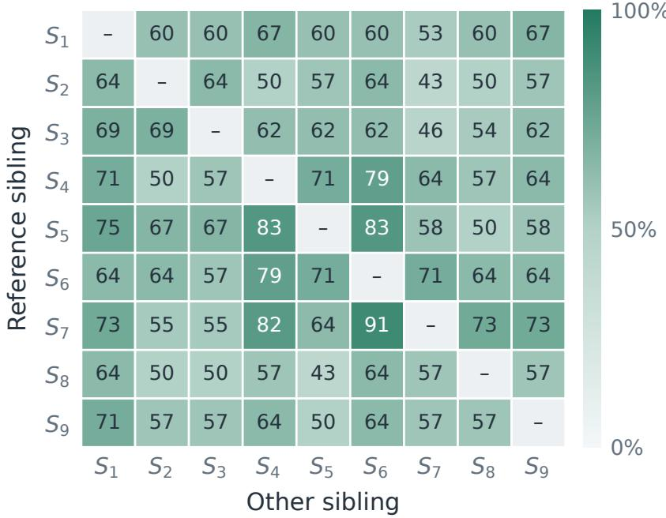  
Figure 5 Shared repair coverage. Each cell gives the percentage of the row sibling’s repairs also supplied by the column sibling; diagonal entries are omitted.

## E Sibling Harness Diversity

We compare nine siblings using the final AppWorld Qwen3.5-4B policy and one greedy rollout per validation task. Each harness uses the same task initialization and execution limits. One task has an invalid paired outcome and is excluded from every sibling, leaving 149 shared tasks. For each sibling, $R _ { i }$ contains failures of $H _ { 0 }$ repaired by $S _ { i }$ Figure 5 shows the directed overlap $| R _ { i } \cap R _ { j } | / | R _ { i } |$ , averaging 62.47% across distinct ordered pairs. The denominator is the row sibling’s repair set, so the matrix is directional: overlap can difer when the row and column are exchanged. High overlap indicates that another sibling supplies many of the same repairs; lower overlap identifies task coverage not shared by that pair. This comparison concerns repairs of $H _ { 0 }$ failures, rather than overall success across all validation tasks. The incomplete overlap supports retaining diferent repair directions among these nine analyzed siblings; the routing pool contains 20 harnesses. Individually, the analyzed siblings repair 11–15 base-harness failures, while their union repairs 29. This union is oracle coverage obtained by executing each sibling once; routing must select candidates before observing their task outcomes.

## F Directional Harness Evolution: Prompts and Setings

The AppWorld search freezes Qwen3.5-4B Base and uses the 320 training tasks for failure analysis, candidate editing, and local tests. Validation tasks guide complementary parent selection and profile anchoring. Table 8 summarizes the configuration. The analysis prompt requires every valid failure to be grouped by root cause or marked unresolved. The evidence determines how many groups are formed. Each candidate then targets a limited set of related causes supported by multiple failed tasks. Component choices follow this diagnosis: edits can alter prompts, skills, context, memory, hooks, or the tool view. Other candidate briefs provide context for seeking diferent mechanisms, triggers, or recovery strategies.

Local evaluation tests whether an edit repairs the targeted failures while preserving behavior on successful controls. Each candidate can submit an initial measured version and one revision within the task budget in Table 8. The editing agent submits an artifact containing the candidate state and its self-review, then requests static checks or measured rollouts before final submission. The execution host supplies these outcomes; candidate self-assessment does not determine success. Newly generated valid variants compete for $B = 4$ parent slots under the validation-coverage objective in Equation (3). Selected parents are paired with locally diagnosed root causes for the next round of editing, while the archive retains all executable, protocol-compliant variants. The resulting implementations remain fixed during policy training; only their profiles and allocation are updated.

Table 8 Selected settings for the AppWorld directional evolution run. Proposal counts are budgets, not counts of accepted variants.
<table><tr><td>Setting</td><td>Value</td></tr><tr><td>Search</td><td>3 rounds; proposal budgets 7 / 8 / 8; 4 parent slots</td></tr><tr><td>Development tasks</td><td>Sampled from the 320-task training set</td></tr><tr><td>Repair direction</td><td>2-3 related root causes per candidate; at least 2 distinct failed tasks per cause</td></tr><tr><td>Local evaluation</td><td>At most 30 tasks, including at most 10 successful controls</td></tr><tr><td>Revision budget</td><td>Initial candidate plus at most one revision</td></tr><tr><td>Harness editor</td><td>GLM-5.3; temperature 0.6; thinking enabled with high reasoning effort</td></tr><tr><td>Policy sampling</td><td>Greedy decoding; one rollout per task; seed 42</td></tr><tr><td>Execution limits</td><td>32 model calls and 30 environment actions; 65,532 context tokens and 8,192 output tokens per call</td></tr><tr><td></td><td>Editable components Prompt, Skill, Context, Memory, Hooks, Tool View</td></tr></table>

Prompt excerpts. Stages receive the parent harness, complete trajectories, and scoring diagnostics; hidden scoring answers are not supplied to the executor policy. The saved instructions include:

• Attribution: “For EACH failure, follow the earliest decision or tool result explaining the failed check, then inspect the later efect.”

• Planning: “Choose among all six editable components according to the diagnosed cause; do not default to prompt/skill edits.”

• Submission: “Submit must summarize observed gains, regressions and unresolved causes; never claim unrun tests.”

## G Computational Efficiency

All experiments use eight NVIDIA H800 GPUs; external-model usage is reported separately in API tokens. The two tables distinguish policy-training expenditure from the complete search-and-training pipeline.

Table 9 GRPO training cost and $H _ { 0 }$ test Avg@3 on AppWorld (Qwen3.5-4B). All settings use 40 updates. Parentheses give rollout counts relative to plain H0 GRPO.
<table><tr><td>Setting</td><td>Training rollouts</td><td>Training GPU·h</td><td>H0 test Avg@3 (%)</td></tr><tr><td>Plain H0 GRPO</td><td>2,560 (100.00%)</td><td>50.58</td><td>48.98</td></tr><tr><td>GRPO (H0 rescue)</td><td>3,616</td><td>97.77</td><td>51.91</td></tr><tr><td></td><td>(141.25%) 2,560</td><td></td><td></td></tr><tr><td>DSH H0 + Top-4</td><td>(100.00%) 2,560</td><td>58.47</td><td>47.84</td></tr><tr><td>DSH H0 + Claude Code</td><td>(100.00%) 3,032</td><td>50.03</td><td>46.69</td></tr></table>

Table 10 Full-pipeline resources for harness search and policy adaptation. Training rollouts count additional samples; HarnessForge reuses successful search trajectories. API tokens are in millions (M).
<table><tr><td>Method</td><td>Search rollouts</td><td>Training rollouts</td><td>GPU·h</td><td>API tokens (M)</td></tr><tr><td>Meta-Harness</td><td>8,000</td><td>0</td><td>35.24</td><td>4.89</td></tr><tr><td>WHALE</td><td>8,640</td><td>2,560</td><td>95.84</td><td>9.80</td></tr><tr><td>HarnessForge</td><td>5,680</td><td>0</td><td>65.39</td><td>24.40</td></tr><tr><td>Harness-S</td><td>4,010</td><td>3,032</td><td>75.79</td><td>18.69</td></tr></table>

Training costs include unsuccessful attempts as well as retained trajectories. All variants in Table 9 use 40 updates, but the rescue methods incur additional rollouts when the initial $H _ { 0 }$ group fails. Harness-S improves $H _ { 0 }$ Avg@3 by 7.89 points over plain GRPO with 18.44% more rollouts. It also outperforms $H _ { 0 }$ rescue with fewer rescue attempts and lower GPU time. The fixed mixtures match the plain-GRPO rollout count but do not obtain the same retained-performance benefit.

Directional evolution reduces the search component of the pipeline. Table 10 reports 29–54% fewer search rollouts for Harness-S, with GPU hours and API tokens within the range of the joint-adaptation baselines. Relative to WHALE, Harness-S uses fewer GPU hours but more API tokens; relative to HarnessForge, it uses fewer API tokens but more GPU hours. HarnessForge’s zero additional training rollouts reflects reuse of successful search trajectories for policy updates. Re-anchoring supports reuse across policy checkpoints; extending the pool between training runs can amortize earlier evolution efort.

## H Extended Related Work

## H.1 Agent RL Training

Interactive environments make action selection and observation handling part of the training problem. Toolformer learns API use through self-supervised examples, while AgentTuning initializes agent capabilities through instruction tuning on interaction trajectories (Schick et al., 2023; Zeng et al., 2023). Such supervision can initialize tooluse behavior before reinforcement learning from task outcomes. WebGPT combines browsing demonstrations with human-preference feedback (Nakano et al., 2022). ReTool learns to interleave reasoning with code execution, while Search-R1 learns multi-turn search interactions and masks retrieved content during optimization (Feng et al., 2025; Jin et al., 2025). SWE-RL develops software-engineering reasoning from software evolution data with rule-based solution rewards (Wei et al., 2025). The supervision source and action interface jointly determine which behaviors can be learned.

Long interactions introduce credit-assignment and rollout-quality problems beyond optimizing individual responses. RAGEN identifies instability associated with collapsing reward variation and studies how rollout diversity and feedback shape multi-turn learning (Wang et al., 2025). LOOP trains agents directly in stateful environments such as AppWorld using a memory-eficient PPO variant (Chen et al., 2025). AgentGym-RL explores a complementary curriculum, gradually increasing interaction horizons to balance early exploitation with broader exploration (Xi et al., 2025). Agent Lightning separates execution from optimization and decomposes trajectories into transitions with assigned credit (Luo et al., 2025). These directions distinguish the learning objective, interaction curriculum, and runtime interface through which training experience is collected.

Classical RL ofers additional ways to learn when successful outcomes are rare or delayed. Hindsight Experience Replay reuses unsuccessful attempts by relabeling them with goals that were achieved (Andrychowicz et al., 2018). RUDDER redistributes delayed rewards through return decomposition (Arjona-Medina et al., 2019), whereas Go-Explore separates returning to promising states from exploring beyond them (Ecofet et al., 2021). These methods intervene in goal assignment, credit distribution, and state coverage, respectively. The distinction matters for language agents: changing how experience is generated and changing what an existing trajectory teaches are diferent interventions.

Uniformly rewarded groups limit the signal available to group-relative updates. PPO uses a surrogate objective to control policy updates, while GRPO estimates advantages from rewards within a sampled group (Schulman et al., 2017; Shao et al., 2024). DAPO uses dynamic sampling to retain groups with reward variation, filtering groups whose samples are all correct or all incorrect (Yu et al., 2025). Model-aware tool-use data evolution in LoopTool and hintconditioned generative recommendation in HCGRec address related data and exploration bottlenecks (Zhang et al., 2026d,b). Harness-S changes execution support before generating fresh attempts on the same failed task. It keeps the task and verifier fixed while seeking the successful alternatives needed for policy updates.

## H.2 Knowledge Transfer

The form of supervision determines what a student can inherit from a teacher. Classical knowledge distillation transfers predictive distributions (Hinton et al., 2015), while Sequence-Level Knowledge Distillation trains autoregressive students with teacher-generated sequences (Kim and Rush, 2016). These approaches transfer information at diferent granularities: relations among candidate outputs versus complete generated solutions. The distinction is relevant when successful behavior consists of a sequence of decisions rather than a single prediction.

Multiple specialists can also be consolidated into a shared decision-making model. Policy Distillation combines task specific reinforcement-learning policies into a single network (Rusu et al., 2016). Kickstarting combines guidance from previously trained agents with continued reinforcement learning, allowing a student to benefit from several experts and improve beyond them (Schmitt et al., 2018). The resulting learner can act without querying every original expert, separating the resources used to acquire a capability from those required to deploy it.

Additional computation and reasoning traces provide another source of transferable knowledge. Expert Iteration alternates tree-search planning with training a policy to generalize the resulting decisions (Anthony et al., 2017). STaR trains on successful self-generated rationales, including rationales regenerated with access to the correct answer after failure (Zelikman et al., 2022). Distilling Step-by-Step uses teacher-generated rationales as additional supervision alongside task labels (Hsieh et al., 2023). These approaches difer in how they obtain useful traces, but all use richer training-time computation to shape a model’s subsequent behavior.

Transfer must also account for the distribution induced by the learner. DAgger aggregates expert-labeled states visited by successive learner policies to address distribution shift in sequential imitation (Ross et al., 2011). Generalized Knowledge Distillation similarly obtains teacher feedback on student-generated sequences (Agarwal et al., 2024). MiniLLM studies on-policy optimization of reverse KL divergence to limit student probability mass on outputs that the teacher assigns low likelihood (Gu et al., 2026). Together, these works show why the training distribution and the matching objective are separate design choices.

Teachers may additionally have information that the deployed learner will not receive. Generalized distillation connects this setting to learning with privileged information (Lopez-Paz et al., 2016); Learning by Cheating applies it to driving by training a vision-based policy from an agent with privileged environmental state (Chen et al., 2019). VAD examines the source of multimodal teacher feedback through controlled visual-evidence interventions (Zhang et al., 2026c). Harness-S instead obtains behavioral diversity by executing the same current policy under diferent harness contexts. Task outcomes supervise its trajectories, and evaluation under $H _ { 0 }$ tests whether useful behaviors persist when auxiliary execution support is removed.

## H.3 Harness Editing and Reusable Skills

The execution interface determines how a language model’s outputs become actions. ReAct interleaves reasoning and environment interaction (Yao et al., 2023b); SWE-agent and CodeAct study dedicated computer interfaces and executable code actions, respectively (Yang et al., 2024b; Wang et al., 2024b). AutoGen extends the design space to configurable conversations among agents, tools, and human participants (Wu et al., 2023). These systems establish diferent control structures and action representations that later optimization procedures can modify.

Execution support can be optimized at several levels of granularity. OPRO uses evaluated solutions to guide new prompt proposals (Yang et al., 2024a). EvoPrompt applies evolutionary operators to prompt populations, while Promptbreeder also evolves the mutation prompts that generate candidates (Guo et al., 2025; Fernando et al., 2023). DSPy compiles modular language-model pipelines against task metrics (Khattab et al., 2023). TextGrad propagates textual feedback through computation graphs, and AFlow searches code-represented workflows with execution feedback (Yuksekgonul et al., 2024; Zhang et al., 2025). AgentOptimizer treats an agent’s functions as adjustable parame ters while keeping the underlying language model fixed (Zhang et al., 2024). Thus, prompt editing, workflow search, and function revision expose diferent parts of an execution system to optimization.

Maintaining an archive supports exploration of multiple improvement directions. ADAS searches code-defined agents using previous discoveries, and the Darwin Gödel Machine branches from an archive ofexecutable agents whose modifications are evaluated empirically (Hu et al., 2025; Zhang et al., 2026a). GEPA combines trajectory-based reflection with complementary prompt candidates on a Pareto frontier (Agrawal et al., 2026). Meta-Harness gives its proposer access to earlier implementations, scores, and execution traces (Lee et al., 2026). Harness-R1 makes the editing policy itself learnable from the outcomes of its runtime changes (Shao et al., 2026). Archive design and proposal learning therefore address distinct parts of search: retaining alternative behaviors and improving how candidates are generated.

Reusable tools and skills reduce the need to rediscover useful procedures. LLMs As Tool Makers separates a model that constructs reusable tools from one that applies them, allowing construction costs to be shared across later requests (Cai et al., 2024). Voyager accumulates executable skills through interaction, while Agent Workflow Memory induces reusable routines from past experience (Wang et al., 2023, 2024c). The reusable object can consequently range from a callable function to a workflow supplied as context, with diferent requirements for retrieval and execution.

Natural-language memory ofers another way to preserve experience without immediately updating model weights. Reflexion stores linguistic feedback for subsequent trials, ExpeL extracts insights from past tasks, and ACE incrementally curates strategies in context playbooks (Shinn et al., 2023; Zhao et al., 2024; Zhang et al., 2026f). MMSkills extends reusable packages to multimodal evidence; SkillRise and SkillGate learn skill curation and selection, respectively (Zhang et al., 2026e; Yao et al., 2026; Li et al., 2026). Representing a procedure, deciding when to retrieve it, and retaining its benefits in policy parameters remain separate questions.

Execution resources can evolve jointly with the policy or be allocated during its training. Co-Harness and WHALE alternate harness and model optimization, while HarnessForge evolves coupled harness–policy systems (Chen et al., 2026c; Kim et al., 2026; Chen et al., 2026a). HarnessBandit instead schedules one harness per optimizer step using learnability and cross-harness transferability signals (Wei et al., 2026). Harness-S allocates a fixed sibling pool at the task level, invoking auxiliary harnesses after all initial attempts under $H _ { 0 }$ fail. Policy-aware profiles track which variants remain useful, while rescue trajectories update one shared policy. This links harness search to policy learning through complementary exploration, with base-harness evaluation separating retained policy gains from additional inference-time support.