# Human-to-Robot Transfer via Bridging Representation and Action Space in VLAs

Junhyeong Park1, Wook Jung1, Taeyoung Kim1, 2, Huiwon Jang1, 2 and Jinwoo Shin1, 2 1KAIST, 2RLWRLD

Pretrained Vision-Language-Action (VLA) policies provide a strong starting point for deployment, but adapting them to a target robot and environment still requires costly embodiment-specific demonstrations. Human demonstrations are far easier to collect, yet directly leveraging them is challenging due to the substantial human-robot embodiment gap, particularly when the underlying VLA has been pretrained primarily on robot data. We introduce H2RB (Human-To-Robot Bridge), a human-robot co-training framework for adapting pretrained VLA policies from unpaired human and robot demonstrations. H2RB bridges the embodiment gap at both interfaces: geometry-anchored alignment grounds human and robot observations in a compatible representation, while a decoupled-decoder tokenizer shares action latents without forcing both domains through a single action mapping. This design allows human demonstrations to provide useful behavioral supervision while retaining the rich visual, semantic, and control priors of the pretrained VLA. Across real-world tasks, H2RB substantially improves object transfer performance from 8.0 to 51.8 and enables skill transfer to score 62.7, in settings where co-train baselines totally fail to transfer human-demonstrated skills. The benefit also persists under object-placement shifts, improving out-of-distribution transfer from 6.0 to 45.3. H2RB suggests a way for human demonstrations to serve as a scalable supervision source for adapting pretrained robotic policies, reducing the dependence on costly target-robot data collection.

## 1. Introduction

Pretrained robotic policies, e.g., Vision-Language-Action (VLA) models (Brohan et al., 2023; Kim et al., 2024), provide a strong starting point for adapting general robotic capabilities to a target deployment environment. However, a major bottleneck remains in the collection of target robot demonstrations, as collecting such data on physical robots is costly, time-consuming, and dificult to scale. It requires access to the physical platform, a data collection pipeline (e.g., teleoperation), and repeated environment resets (Brohan et al., 2022; Khazatsky et al., 2024).

Human demonstrations, in contrast, can be collected quickly and naturally without relying on dedicated teleoperation systems (Chi et al., 2024; Qiu et al., 2025; Yang et al., 2025; Wang et al., 2023), using only a lightweight camera setup. Yet, directly leveraging them to adapt robot policies remains challenging due to the substantial embodiment gap between humans and robots, particularly when the pretrained policy has been trained primarily on robot data.

Prior works bridge human and robot demonstrations by placing them in a common action space, either through latent actions inferred from frame transitions (Ye et al., 2025; Chen et al., 2026; Dai et al., 2026; Bu et al., 2025; Chen et al., 2025) or through reconstructed world-space hand motion (Li et al., 2025; Fu et al., 2026; Hoque et al., 2026). While these approaches reduce the action-space mismatch across embodiments, they leave the perceptual gap largely unresolved. As a result, VLAs must map distinct human and robot observations into a shared action space, making reliable robot action prediction dificult. However, a common action space alone does not make human demonstrations compatible with a robot-pretrained VLA. Embodiment-dependent observations remain perceptually misaligned, while human and robot motions can still require diferent action realization dynamics.

Our approach. Based on this insight, we introduce H2RB, a training framework that incorporates human demonstrations into pretrained VLA policies without paired human-robot trajectories. First, a geometryanchored alignment uses wrist-fingertip geometry to ground VLM output features across embodiments, without paired demonstrations or human-to-robot observation synthesis. Second, a decoupled-decoder latent tokenizer shares action latents across embodiments while using separate decoders to avoid collapsing human and robot motion dynamics into a single action mapping. Together, these components enable human-to-robot task transfer while facilitating learning from heterogeneous human-robot experience, as illustrated in Figure 1.

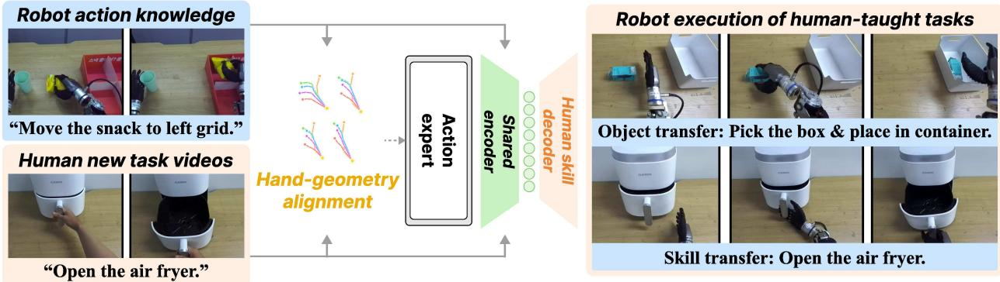  
Figure 1: Human-to-robot task transfer with H2RB. H2RB transfers task experience from human videos to robots using pretrained VLAs by bridging the cross-embodiment perception and action gaps, without target-robot demonstrations or paired demonstrations.

We evaluate H2RB on two complementary forms of human-to-robot adaptation: within-skill object transfer and skill-level transfer. On OpenArm, where target behaviors are provided only through human demonstrations, H2RB improves object transfer from 8.0 to 51.8 and achieves a skill-transfer score of 62.7, where shared-action co-training baselines fail. Heterogeneous human-robot training across multiple embodiments further improves these scores to 57.2 and 81.7, respectively.

We additionally study robot-only downstream adaptation on RB-Y1, where cross-embodiment alignment improves success from 72% to 78% under matched heterogeneous training. Together, these results suggest that learning action-relevant representations from heterogeneous experience benefits both human-to-robot transfer and downstream robot adaptation.

## 2. Method

H2RB bridges human-robot gaps through shared latent actions with embodiment-specific decoders and geometry-grounded VLM features, as illustrated in Figure 2.

## 2.1. Preliminaries: Vision-Language-Action (VLA) models

At timestep $t ,$ a VLA predicts a �-step action chunk $\mathbf { A } _ { t } : = [ \mathbf { a } _ { t } , \mathbf { a } _ { t + 1 } , \ldots , \mathbf { a } _ { t + K - 1 } ]$ from a visual observation $\mathbf { o } _ { t } ,$ a language instruction $\mathbf { c } ,$ and the proprioceptive state $\mathbf { s } _ { t } .$ . Let $\mathbf { h } _ { t }$ denote the VLM conditioning tokens obtained from $\left( \mathbf { o } _ { t } , \mathbf { c } \right)$ . Following flow-based VLAs (Bjorck et al., 2025; Black et al., 2024; Kim et al., 2026a), we use conditional flow matching (Lipman et al., 2022): for Gaussian noise $\mathbf { \eta } _ { \equiv } \sim \mathcal { N } ( \mathbf { 0 } , \mathbf { I } )$ and flow time $\tau \in [ 0 , 1 ]$ , we define $\mathbf { A } _ { t , \tau } = ( 1 - \tau ) \mathbf { \epsilon } + \tau \mathbf { A }$ and optimize $\mathcal { L } _ { \mathrm { F M } } = \mathbb { E } [ \| \mathbf { v } _ { \theta } ( \mathbf { A } _ { t , \tau } , \tau \mid \mathbf { s } _ { t } , \mathbf { h } _ { t } ) - ( \mathbf { A } _ { t } - \pmb \epsilon ) \| ^ { 2 } ]$ . Here $\mathbf { v } _ { \theta }$ is the velocity field predicted by the action expert.

## 2.2. Learning a shared action space

To reduce the action gap between human and robot demonstrations, we first express their motions in a common physical parameterization. We then learn a shared latent prediction space while retaining separate decoders for embodiment-dependent trajectory structure.

Shared wrist-hand parameterization. For human videos, we first use a HaWoR-based (Zhang et al., 2025a) reconstruction pipeline to recover wrist motion and hand articulation. We then transform the reconstructed motion into the robot coordinate convention and retarget it to the robot hand. We express human and robot actions in a common wrist-hand representation (Kim et al., 2026b), $i . e . , \mathbf { a } _ { t } = \left[ \mathbf { p } _ { t } , \mathbf { r } _ { t } , \mathbf { q } _ { t } \right]$ , where $ { \mathbf { p } } _ { t } \in \mathbb { R } ^ { 3 }$ is the wrist position, $\mathbf { r } _ { t } \in \mathbb { R } ^ { 6 }$ is the 6D rotation representation, and $\mathbf { q } _ { t } \in \mathbb { R } ^ { D }$ is the hand configuration with � joint angles for both human and robot demonstrations. At deployment, we convert the predicted wrist pose into robot arm motion via inverse kinematics.

Decoupled-decoder latent tokenizer. A shared wrist-hand parameterization does not eliminate sourcedependent action diferences induced by distinct human and robot perceptions. We therefore learn a shared latent action space while separating decoders for each embodiment to capture these diferences. Specifically, given human actions $\mathbf { A } _ { t } ^ { H }$ and robot actions $\mathbf { A } _ { t } ^ { R }$ in a common wrist-hand representation, we train a variational action autoencoder (Kingma and Welling, 2013) with a shared encoder and embodiment-specific decoders (see Figure 2a). For each embodiment $d \in \{ H , R \}$ , the encoder parameterizes the posterior $q _ { \psi } ( \mathbf { Z } _ { t } ^ { d } \mid \mathbf { A } _ { t } ^ { d } )$ , from which we sample a latent action $\widetilde { \mathbf { Z } } _ { t } ^ { d }$ and reconstruct the corresponding action using decoder $D _ { d } \colon$

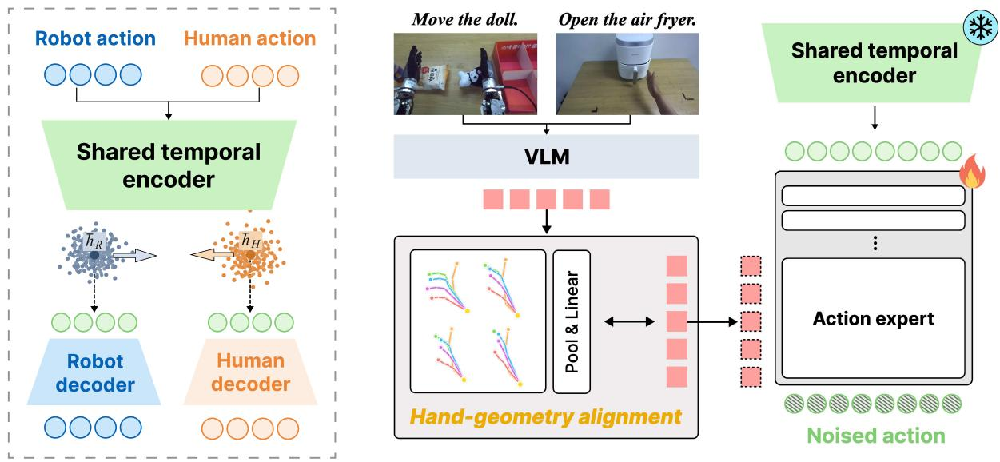  
(a) Decoupled-decoder latent tokenizer  
(b) Hand geometry-anchored alignment  
Figure 2: Overview of H2RB. (a) A shared temporal encoder maps human and robot action chunks into a common latent action space, while embodiment-specific decoders reconstruct actions for each domain. (b) Hand geometry-anchored alignment grounds VLA conditioning across embodiments, while the frozen encoder provides latent action targets.

$$
\widetilde { \mathbf { Z } } _ { t } ^ { d } \sim q _ { \psi } ( \cdot \mid \mathbf { A } _ { t } ^ { d } ) , \qquad \widehat { \mathbf { A } } _ { t } ^ { d } = D _ { d } ( \widetilde { \mathbf { Z } } _ { t } ^ { d } )\tag{2.1}
$$

We optimize the tokenizer with reconstruction and KL objectives, and further couple the two latent distributions through position-wise centroid matching with variance and covariance regularization (see Appendix A.2). This encourages both sources to occupy a compatible latent space while allowing each decoder to preserve source-specific trajectory structure. After training the tokenizer, we freeze the encoder and both decoders, and use $\mathbf { Z } _ { t } ^ { d } = E _ { \psi } ( \mathbf { A } _ { t } ^ { d } )$ as the VLA prediction target, where $E _ { \psi }$ is the posterior-mean mapping of $q _ { \psi }$ .

We apply the flow matching objective introduced in Section 2.1 to these latent targets and denote the resulting prediction loss by $\mathcal { L } _ { \mathrm { p r e d } }$

## 2.3. Geometry-anchored VLM conditioning

Aligning actions alone does not resolve the human-robot perceptual gap, so we anchor VLM conditioning features to hand geometry shared across embodiments (Figure 2b).

We ground VLM features using the current wrist pose and five wrist-local fingertip positions, denoted by $\mathbf { g } _ { t } ,$ obtained from reconstructed human motion or robot configurations. A shared residual adapter $A _ { \phi }$ and training-only readout $R _ { \omega }$ produce ${ \bf h } _ { t } ^ { \mathrm { g e o } } = { \bf h } _ { t } + A _ { \phi } ( { \bf h } _ { t } )$ and $\widehat { \mathbf { g } } _ { t } = R _ { \omega } ( \mathrm { P o o l } ( \mathbf { h } _ { t } ^ { \mathrm { g e o } } ) )$ , where Pool denotes mean pooling over the VLM token sequence. We define $\mathcal { L } _ { \mathrm { g e o } }$ as the masked Smooth-L1 loss between $\widehat { \mathbf { g } } _ { t }$ and $\mathbf { g } _ { t }$ over valid geometry coordinates. The action expert is conditioned on $\mathbf { h } _ { t } ^ { \mathrm { g e o } }$ . Because each observation provides its own geometry target, this alignment requires neither paired human-robot demonstrations nor temporal correspondence.

(a) Human-Robot Co-Training  
(b) Rollouts on Human-Demonstrated Target Tasks  
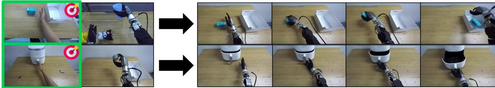  
Figure 3: Qualitative human-to-robot transfer rollouts. (a) H2RB is trained jointly on human and robot demonstrations. (b) The trained policy executes target tasks introduced through human demonstrations, including object transfer on box, followed by skill transfer on opening.

$$
\begin{array} { r } { \mathcal { L } _ { \mathrm { V L A } } = \mathcal { L } _ { \mathrm { p r e d } } + \lambda _ { \mathrm { g e o } } \mathcal { L } _ { \mathrm { g e o } } . } \end{array}\tag{2.2}
$$

where $\lambda _ { \mathrm { g e o } }$ weights the geometry objective. Implementation and optimization details are provided in Appendix A.3. The VLM backbone, tokenizer, and embodiment-specific decoders remain frozen during this stage. At deployment, numerical integration of the learned velocity field $\mathbf { v } _ { \theta }$ induces the latent-action policy ��, conditioned on the robot observation, proprioceptive state, and instruction:

$$
{ \bf Z } _ { t } ^ { \mathrm { g e n } } \sim \pi _ { \boldsymbol \theta } ( \cdot \mid { \bf h } _ { t } ^ { \mathrm { g e o } } , { \bf s } _ { t } ) , \qquad { \bf A } _ { t } ^ { \mathrm { c m d } } = D _ { H } ( { \bf Z } _ { t } ^ { \mathrm { g e n } } )\tag{2.3}
$$

The decoder output is converted to robot commands using its prescribed inverse normalization and coordinate mapping. Both decoders reconstruct the same robot-compatible wrist-hand representation. Although deployment uses $D _ { H }$ , the shared encoder and latent-action policy are learned from both human and robot demonstrations.

## 3. Experiments

We evaluate H2RB in two stages. First, under controlled task-specific fine-tuning, we test whether human demonstrations transfer target objects and target skills to a robot beyond vanilla human-robot co-training. Second, we test whether the same cross-embodiment principle remains useful when incorporated into heterogeneous multi-embodiment training.

## 3.1. Experimental setup

Our real-world experiments use an OpenArm humanoid with Inspire hands, with all policies initialized from the robot-pretrained RLDX-1-IMG (Kim et al., 2026a); human demonstrations use the wrist-hand representation in Section 2.2. We compare matched co-training with separate embodiment-specific interfaces against HaWoR and Ego-Pi-based shared-action baselines, all without our geometry alignment or latent tokenizer and using the same adaptation data and training budget (see Tables 7 and 8).

We study two axes of human-to-robot transfer. Object transfer introduces target objects through human pick-andplace demonstrations while retaining prior robot pick-and-place experience. Skill transfer introduces opening and closing interactions absent from the source robot demonstrations (see Figure 3). For these OpenArm tasks, we assign weighted task scores (0-100) based on execution progress, as detailed in Appendix B.2.

For heterogeneous training evaluation, we additionally consider an RB-Y1 parcel-handling task, where the robot flips boxes and polybags to expose their shipping labels before pushing them onward (see Figure 4). RB-Y1 uses robot-only fine-tuning and binary success over 50 trials.

## 3.2. Human-to-robot task transfer

Object transfer results. Table 1 summarizes transfer to objects introduced only through human demonstrations. The robot-only policy performs well on in-domain Doll PnP (55.0) but poorly on unseen objects (12.0), while vanilla co-training further degrades transfer to 8.0. In contrast, H2RB improves object transfer to 51.8 (+43.8) while retaining strong in-domain performance (49.0). Under object-placement shift, H2RB also outperforms Ego-Pi-shared action in both ID (30.2 to 55.0) and OOD (21.3 to 45.3) settings. These gains suggest that bridging the human-robot perceptual gap enables robust transfer to novel objects and locations while retaining robot-pretrained capabilities. Further breakdowns and geometry-grounding ablations are provided in Appendix C.

Table 1: Human-to-robot object transfer. Robot in-domain reports performance on a robot-data-trained task, while Human transfer evaluates target tasks introduced through human demonstrations with 20 ID and 10 OOD rollouts per target object. Robot in-domain (Doll) is evaluated separately with 20 rollouts. Each entry is the weighted task score (0-100).
<table><tr><td rowspan="3"></td><td>Robot in-domain</td><td colspan="8">Human transfer</td></tr><tr><td rowspan="2">Doll</td><td colspan="2">Box</td><td colspan="2">Ball</td><td colspan="2">Towel</td><td colspan="2">Avg.</td></tr><tr><td>ID</td><td>OOD</td><td>ID</td><td>OOD</td><td>ID</td><td>OOD</td><td>ID OOD</td><td>All</td></tr><tr><td>Base policy human-only</td><td>31.5</td><td>41.0</td><td>21.0</td><td>31.5</td><td>15.0</td><td>28.5</td><td>24.0</td><td>33.7 20.0</td><td>29.1</td><td></td></tr><tr><td>Base policy in-domain-only</td><td>55.0</td><td>22.5</td><td>9.0</td><td>16.5</td><td>9.0</td><td>3.0</td><td>6.0</td><td>14.0</td><td>8.0</td><td>12.0</td></tr><tr><td>Base policy co-train</td><td>18.0</td><td>13.5</td><td>9.0</td><td>3.0</td><td>6.0</td><td>10.5</td><td>3.0</td><td>9.0</td><td>6.0</td><td>8.0</td></tr><tr><td>+ HaWoR-shared action (Zhang et al., 2025a)</td><td>10.5</td><td>10.5</td><td>12.0</td><td>10.5</td><td>15.0</td><td>9.0</td><td>9.0</td><td>10.0</td><td>12.0</td><td>10.7</td></tr><tr><td>+ Ego-Pi-shared action (Kim et al., 2026b)</td><td>30.0</td><td>45.0</td><td>25.0</td><td>18.5</td><td>15.0</td><td>27.0</td><td>24.0</td><td>30.2</td><td>21.3</td><td>27.2</td></tr><tr><td>+ H2RB (Ours)</td><td>49.0</td><td>60.0</td><td>39.0</td><td>50.0</td><td>47.0</td><td>55.0</td><td>50.0</td><td>55.0</td><td>45.3</td><td>51.8</td></tr></table>

Table 2: Human-to-robot skill transfer. Robot in-domain reports performance on a robot-data-trained task, while Human transfer evaluates target tasks introduced through human demonstrations. Each entry is the weighted task score (0-100).
<table><tr><td rowspan="2">Method</td><td rowspan="2">Robot in-domain Box PnP</td><td colspan="3">Human transfer</td></tr><tr><td>Open</td><td>Close</td><td>Avg.</td></tr><tr><td>Base policy human-only</td><td>0.0</td><td>36.0</td><td>22.0</td><td>29.0</td></tr><tr><td>Base policy in-domain-only</td><td>80.5</td><td>0.0</td><td>0.0</td><td>0.0</td></tr><tr><td>Base policy co-train</td><td>16.5</td><td>0.0</td><td>0.0</td><td>0.0</td></tr><tr><td>+ HaWoR-shared action (Zhang et al., 2025a)</td><td>19.5</td><td>0.0</td><td>0.0</td><td>0.0</td></tr><tr><td>+ Ego-Pi-shared action (Kim et al., 2026b)</td><td>70.5</td><td>0.0</td><td>0.0</td><td>0.0</td></tr><tr><td>+ H2RB (Ours)</td><td>81.0</td><td>50.7</td><td>74.7</td><td>62.7</td></tr></table>

Skill transfer results. Skill transfer exposes a diferent bottleneck, as shown in Table 2. HaWoR-shared action fails to transfer Open/Close and degrades in-domain performance to 19.5, while Ego-Pi recovers in-domain execution to 70.5 but still achieves 0.0 on both target skills. This suggests that a shared executable action space alone is insuficient for skill transfer; H2RB instead transfers both skills while further improving indomain performance from 0.0 to 81.0. This result highlights the importance of separating shared latent skill representation from embodiment-specific action realization when transferring behaviors across diferent motion distributions. Representative successful rollouts for each transfer task are shown in Figure 11.

## 3.3. Scaling to heterogeneous human-robot data

We further adapt the pretrained VLA backbone through large-scale heterogeneous human-robot training (HT) across multiple embodiments, followed by downstream task-specific fine-tuning (FT). We evaluate its benefits in two downstream settings: human-to-robot transfer on OpenArm and robot-only adaptation on RB-Y1. Training details are provided in Appendix D.

For OpenArm, heterogeneous training improves object transfer from 51.8 to 57.2 (+5.4) and skill transfer from 62.7 to 81.7 (+19.0), as shown in Figure 6. These gains demonstrate the benefit of additional heterogeneous training beyond task-specific co-training. For RB-Y1, parcel-orientation success improves from 64% with robot-only training to 72% with human-robot HT and 78% with geometry-grounded HT, as shown in Figure 5.

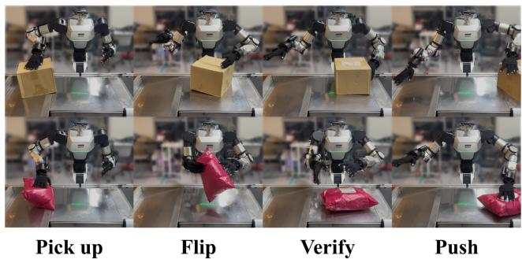  
Figure 4: RB-Y1 parcel-handling task. Box flipping (top) and polybag handling (bottom).

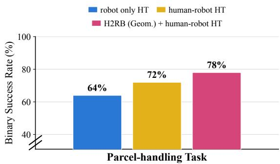

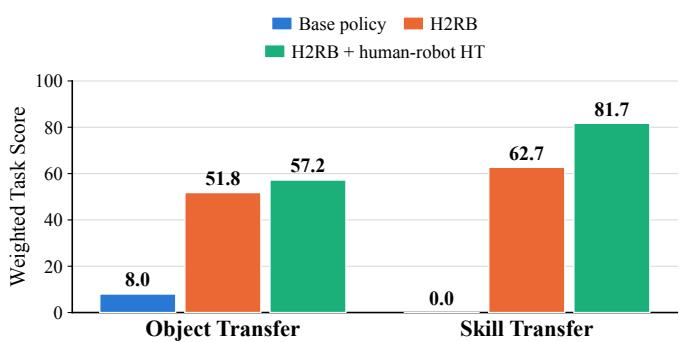  
Figure 6: Efect of human-robot HT. HT improves transfer abilities, showing the scalability of H2RB.

Figure 5: Human-robot HT. Human-robot HT and geometry grounding improves robot-only downstream success.  
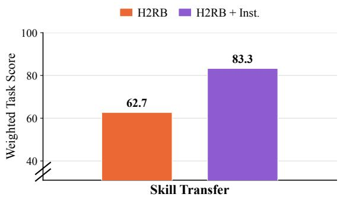  
Figure 7: Instruction conditioning. Instruction conditioning improves skill transfer abilities.

All variants use robot-only downstream FT without the shared action tokenizer, demonstrating the benefit of geometry grounding beyond human-to-robot task transfer. Together with the OpenArm results, it suggests that learning compatible action-relevant representations benefits downstream adaptation across diferent robots and task settings.

## 3.4. Enhancing skill transfer with instruction conditioning

Separately from heterogeneous training, we examine whether stronger language conditioning can improve the transferred behavior for skill transfer. We treat the instruction as an explicit skill signal by concatenating its representation with the state-conditioned vision-language latent and re-injecting it throughout the expert layers. As shown in Figure 7, this improves skill transfer from 62.7 to 83.3 (+20.6), suggesting that sustained instruction access helps preserve task semantics during cross-embodiment execution. Implementation details are provided in Appendix A.4.

## 4. Analysis

Human-to-robot transfer requires incorporating human-provided task structure while aligning cross-embodiment representations without discarding robot-specific execution dynamics. We analyze this separation through transfer failures, execution speed, and the resulting human-robot representation.

## 4.1. Qualitative analysis of transfer failures

Human-only and robot-only policies exhibit complementary failure modes. Human-only policies capture the demonstrated interaction pattern but fail near contact due to inaccurate wrist alignment and grasp configuration (Figure 8a), whereas robot-only policies produce executable robot motions but fail to localize or reproduce behaviors absent from robot demonstrations (Figure 8b). Thus, human data provide the target behavior, while robot data provide embodiment-specific knowledge.

Table 3: Analysis of the decoupled-decoder latent tokenizer. (a) Efect of the action tokenizer and cross-domain latent regression on object transfer, skill transfer, and normalized human-robot latent gap. (b) Motion speed and average success of embodiment-specific reconstruction decoders.  
(a) Action tokenizer ablation
<table><tr><td>Action Tokenizer</td><td>Cross-domain latent regularization</td><td>Object transfer</td><td>Skill transfer</td><td>Human-robot latent gap</td></tr><tr><td>X</td><td>X</td><td>34.7</td><td>0.0</td><td></td></tr><tr><td>√</td><td>X</td><td>43.3</td><td>49.7</td><td>3.81</td></tr><tr><td>√</td><td>√</td><td>51.8</td><td>62.7</td><td>1.53</td></tr></table>

(b) Embodiment-specific decoding
<table><tr><td>Training source</td><td>Motion speed (cm/s)</td><td>Weighted task score</td></tr><tr><td>Robot demonstrations</td><td>2.52</td><td>65.3</td></tr><tr><td>Human demonstrations</td><td>7.36(×2.92)</td><td>62.7</td></tr></table>

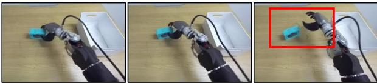  
(a) Human-only policy : Grasping failure

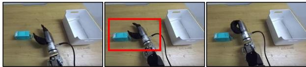  
(b) Robot-only policy : Target-location mismatch

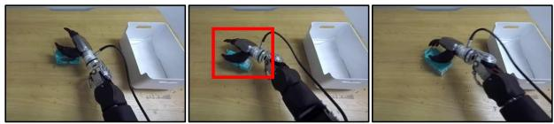  
(c) Ego-Pi-shared action : Invalid grasp pose

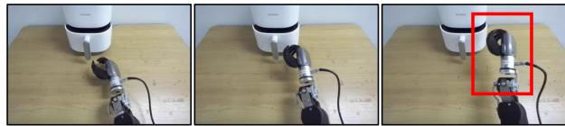  
(d) Ego-Pi-shared action : Task-motion mismatch  
Figure 8: Failure case analysis of human-to-robot transfer. (a) Fails to complete the grasp. (b) Unrelated to the target object location. (c) Fails to produce a hand pose suitable for grasping. (d) Executes a robot-observed pick-and-place motion in human-observed task environment.

Combining the two sources in a shared action format is still not a fundamental solution. The shared-action baseline produces invalid grasp poses, indicating that coordinate-level alignment does not resolve the remaining perceptual mismatch (Figure 8c). Moreover, robot-conditioned predictions can remain closer to the robot latent distribution and revert to familiar robot behaviors even in human task deployment, such as pick-and-place instead of the human-demonstrated opening motion (Figure 8d). These failures motivate bridging the two domains beyond a common physical action format. Accordingly, H2RB reduces the latent-level human-robot gap while retaining embodiment-specific decoders for source-appropriate action realization.

## 4.2. Cross-embodiment gap analysis

Hand geometry-anchored alignment reduces the conditioning-space gap. Hand geometry-anchored alignment supervises human and robot observations through a common hand-geometry target without requiring paired human-robot data. Compared with the Ego-Pi-shared action baseline, the PCA projection in Figure 9a shows that H2RB shifts robot conditioning features toward the human distribution, reducing the human-robot gap. This suggests that grounding VLM features in shared hand geometry makes the two embodiments more compatible in the conditioning space used for downstream action prediction.

Decoupled-decoder latent tokenizer progressively aligns the prediction space. Table 3a shows that introducing the action tokenizer improves object transfer from 34.7 to 43.3 and enables skill transfer from 0.0 to 49.7. Cross-domain regularization further reduces the normalized human-robot latent gap (defined in Appendix A.5) from 3.81 to 1.53, a 59.8% reduction, while improving object and skill transfer to 51.8 and 62.7, respectively. This alignment is particularly important at deployment, where robot-conditioned predictions can otherwise remain shifted toward the robot latent distribution, even for tasks learned from human data. The two-dimensional projections in Figure 9b provide a qualitative view of this alignment, showing how cross-domain regression brings the human and robot latent distributions closer in the action latent space.

Faster task execution from human data. Human demonstrations can provide faster task-specific motion while requiring substantially less collection time and robot interaction. To test whether these dynamics are preserved after transfer, we collected 100 robot teleoperation episodes for the same Open/Close tasks, with 50 episodes per task, and trained a robot-only policy. As shown in Table 3b, the human-transferred policy reaches 7.36 cm/s versus 2.52 cm/s for the robot-only policy, with comparable task performance (62.7 vs. 65.3). Because the embodiment-specific decoders preserve distinct action dynamics, the transferred policy can retain the faster motion from human demonstrations even when deployed on the robot.

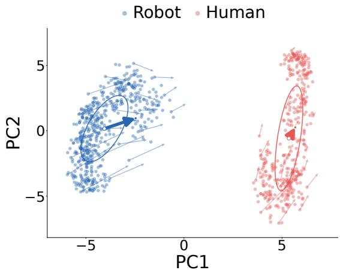  
(a) Conditioning-space adaptation

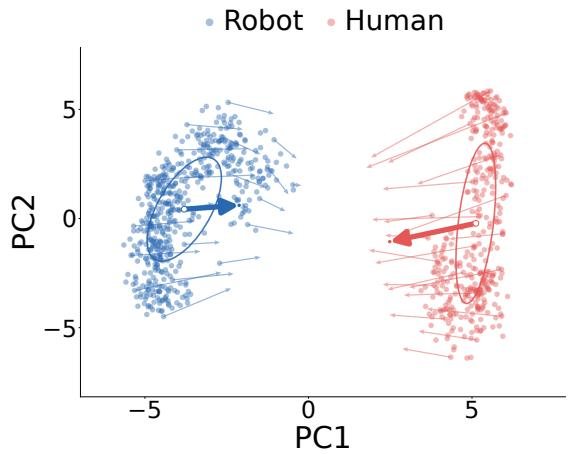

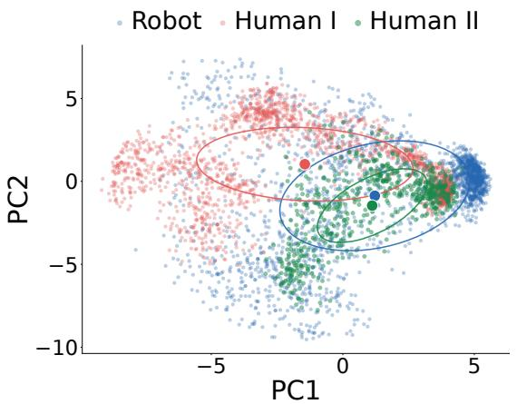  
(b) Action-latent adaptation

Robot Human I Human II  
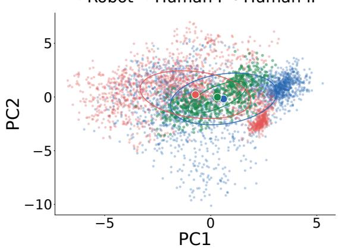  
Figure 9: PCA visualization of cross-embodiment representation adaptation. (a) Vision-language conditioning features with hand geometry-anchored alignment alone (left) and H2RB (right). Arrows show adapter-induced displacements for the same observation. (b) Action-tokenizer latents without (left) and with (right) cross-domain latent regression, using per-tokenizer PCA. Human I and II denote human tasks trained in within-skill object transfer and skill transfer, respectively.

## 5. Related Work

Learning from human demonstrations. Human videos provide policy supervision through reconstructed or tracked hand motion (Zhang et al., 2025a; Hoque et al., 2026; Li et al., 2025; Qin et al., 2022) or latent actions inferred from frame transitions (Ye et al., 2025; Chen et al., 2026), supporting co-training and pretraining in works such as EgoMimic, EgoVLA, and EgoScale (Kareer et al., 2025; Yang et al., 2025; Zheng et al., 2026; Tao et al., 2025). Ego-Pi (Kim et al., 2026b) transfers task semantics through co-training in a common wrist-hand space, while HumanEgo (Wang et al., 2026) learns from human demonstrations without robot data using hand-object representations. We focus on adapting a robot-pretrained VLA to human-demonstrated target tasks while retaining experience from robot data.

Cross-embodiment representation alignment. Human-data pretraining builds cross-embodiment priors (Yang et al., 2025; Zheng et al., 2026), while explicit alignment relies on paired demonstrations (Xie et al., 2026; Zhu et al., 2026) or trajectory-based pseudo-pairs (Punamiya et al., 2025). PHANTOM and Masquerade instead synthesize robot-domain observations through inpainting and rendering (Lepert et al., 2025b,a). H2RB grounds pretrained VLA features in hand geometry independently for each observation, providing a shared physical reference without paired data, trajectory matching, image synthesis, or prior human-robot backbone training.

Latent action representations and decoding. Difusion and flow-based policies generate continuous actions (Chi et al., 2025; Black et al., 2024; Ze et al., 2024; Zhang et al., 2025b), while latent difusion separates generation from output reconstruction (Rombach et al., 2022; Peebles and Xie, 2023). LAD aligns retargeted action pairs (Bauer et al., 2025), and XL-VLA learns cross-hand latent representations (Jiang et al., 2026), both retaining embodiment-specific decoders for heterogeneous end-efectors. H2RB shares action latents across human-robot demonstrations while preserving source-specific motion dynamics through separate temporal decoders.

## 6. Conclusion

We present H2RB, a framework for adapting pretrained VLAs from unpaired human and robot demonstrations. Rather than relying on implicit cross-embodiment alignment, H2RB bridges perception through hand geometryanchored alignment and action through a shared latent space with embodiment-specific decoders. Real-world experiments show improved object and skill transfer, further gains from heterogeneous training, and benefits for robot-only adaptation on a diferent embodiment. These findings highlight the importance of learning reusable action-relevant structure from heterogeneous experience without enforcing identical action dynamics. We hope our approach helps bridge scalable human demonstration data and robot task adaptation, enabling pretrained VLAs to acquire new behaviors with human demonstration data.

## Acknowledgements

This research was supported by the “Advanced GPU Utilization Support Program” funded by the Government of the Republic of Korea (Ministry of Science and ICT). We thank the members of Algorithmic General Intelligence Laboratory (AGI-LAB) of KAIST, for helpful support in conducting real-world experiments.

## References

Erik Bauer, Elvis Nava, and Robert K Katzschmann. Latent action difusion for cross-embodiment manipulation. arXiv preprint arXiv:2506.14608, 2025.

Johan Bjorck, Fernando Castañeda, Nikita Cherniadev, Xingye Da, Runyu Ding, Linxi Fan, Yu Fang, Dieter Fox, Fengyuan Hu, Spencer Huang, et al. Gr00t n1: An open foundation model for generalist humanoid robots. arXiv preprint arXiv:2503.14734, 2025.

Kevin Black, Noah Brown, Danny Driess, Adnan Esmail, Michael Equi, Chelsea Finn, Niccolo Fusai, Lachy Groom, Karol Hausman, Brian Ichter, et al. ��\_0: A vision-language-action flow model for general robot control. arXiv preprint arXiv:2410.24164, 2024.

Anthony Brohan, Noah Brown, Justice Carbajal, Yevgen Chebotar, Joseph Dabis, Chelsea Finn, Keerthana Gopalakrishnan, Karol Hausman, Alex Herzog, Jasmine Hsu, et al. Rt-1: Robotics transformer for real-world control at scale. arXiv preprint arXiv:2212.06817, 2022.

Anthony Brohan, Noah Brown, Justice Carbajal, Yevgen Chebotar, Xi Chen, Krzysztof Choromanski, Tianli Ding, Danny Driess, Avinava Dubey, Chelsea Finn, et al. Rt-2: Vision-language-action models transfer web knowledge to robotic control. arXiv preprint arXiv:2307.15818, 2023.

Qingwen Bu, Yanting Yang, Jisong Cai, Shenyuan Gao, Guanghui Ren, Maoqing Yao, Ping Luo, and Hongyang Li. Learning to act anywhere with task-centric latent actions. In Proceedings of Robotics: Science and Systems, 2025. doi: 10.15607/RSS.2025.XXI.014.

Xiaoyu Chen, Hangxing Wei, Pushi Zhang, Chuheng Zhang, Kaixin Wang, Yanjiang Guo, Rushuai Yang, Yucen Wang, Xinquan Xiao, Li Zhao, et al. Villa-x: enhancing latent action modeling in vision-language-action models. In International Conference on Learning Representations, volume 2026, pages 70673–70703, 2026.

Yi Chen, Yuying Ge, Weiliang Tang, Yizhuo Li, Yixiao Ge, Mingyu Ding, Ying Shan, and Xihui Liu. Moto: Latent motion token as the bridging language for learning robot manipulation from videos. In Proceedings of the IEEE/CVF International Conference on Computer Vision, pages 19752–19763, 2025.

Cheng Chi, Zhenjia Xu, Chuer Pan, Eric Cousineau, Benjamin Burchfiel, Siyuan Feng, Russ Tedrake, and Shuran Song. Universal manipulation interface: In-the-wild robot teaching without in-the-wild robots. arXiv preprint arXiv:2402.10329, 2024.

Cheng Chi, Zhenjia Xu, Siyuan Feng, Eric Cousineau, Yilun Du, Benjamin Burchfiel, Russ Tedrake, and Shuran Song. Difusion policy: Visuomotor policy learning via action difusion. The International Journal of Robotics Research, 44(10-11):1684–1704, 2025.

Weisheng Dai, Kai Lan, Jianyi Zhou, Bo Zhao, Xiu Su, Junwen Tong, Weili Guan, and Shuo Yang. Conla: Contrastive latent action learning from human videos for robotic manipulation. arXiv preprint arXiv:2602.00557, 2026.

Hongming Fu, Wenjia Wang, Xiaozhen Qiao, Rolandos Alexandros Potamias, Taku Komura, Shuo Yang, Zheng Liu, and Bo Zhao. Egograsp: World-space hand-object interaction estimation from egocentric videos. arXiv preprint arXiv:2601.01050, 2026.

Ryan Hoque, Peide Huang, David Yoon, Jian Zhang, et al. Egodex: Learning dexterous manipulation from large-scale egocentric video. In International Conference on Learning Representations, volume 2026, pages 4218–4237, 2026.

Guangqi Jiang, Yutong Liang, Jianglong Ye, Jia-Yang Huang, Changwei Jing, Rocky Duan, Pieter Abbeel, Xiaolong Wang, and Xueyan Zou. Cross-hand latent representation for vision-language-action models. arXiv preprint arXiv:2603.10158, 2026.

Simar Kareer, Dhruv Patel, Ryan Punamiya, Pranay Mathur, Shuo Cheng, Chen Wang, Judy Hofman, and Danfei Xu. Egomimic: Scaling imitation learning via egocentric video. In 2025 IEEE International Conference on Robotics and Automation (ICRA), pages 13226–13233. IEEE, 2025.

Alexander Khazatsky, Karl Pertsch, Suraj Nair, Ashwin Balakrishna, Sudeep Dasari, Siddharth Karamcheti, Soroush Nasiriany, Mohan Kumar Srirama, Lawrence Yunliang Chen, Kirsty Ellis, et al. Droid: A large-scale in-the-wild robot manipulation dataset. arXiv preprint arXiv:2403.12945, 2024.

Dongyoung Kim, Huiwon Jang, Myungkyu Koo, Suhyeok Jang, Taeyoung Kim, Beomjun Kim, Byungjun Yoon, Changsung Jang, Daewon Choi, Dongsu Han, et al. Rldx-1 technical report. arXiv preprint arXiv:2605.03269, 2026a.

Ji Woong Kim, Ke Wang, Zipeng Fu, Sirui Chen, Jef Lai, Chelsea Finn, et al. Ego-pi: Vla fine-tuning for ego-centric human and robot data. In Proceedings of the IEEE/CVF Conference on Computer Vision and Pattern Recognition, pages 1515–1524, 2026b.

Moo Jin Kim, Karl Pertsch, Siddharth Karamcheti, Ted Xiao, Ashwin Balakrishna, Suraj Nair, Rafael Rafailov, Ethan Foster, Grace Lam, Pannag Sanketi, et al. Openvla: An open-source vision-language-action model. arXiv preprint arXiv:2406.09246, 2024.

Diederik P Kingma and Max Welling. Auto-encoding variational bayes. arXiv preprint arXiv:1312.6114, 2013.

Marion Lepert, Jiaying Fang, and Jeannette Bohg. Masquerade: Learning from in-the-wild human videos using data-editing. arXiv preprint arXiv:2508.09976, 2025a.

Marion Lepert, Jiaying Fang, and Jeannette Bohg. Phantom: Training robots without robots using only human videos. arXiv preprint arXiv:2503.00779, 2025b.

Qixiu Li, Yu Deng, Yaobo Liang, Lin Luo, Lei Zhou, Chengtang Yao, Lingqi Zeng, Zhiyuan Feng, Huizhi Liang, Sicheng Xu, et al. Scalable vision-language-action model pretraining for robotic manipulation with real-life human activity videos. arXiv preprint arXiv:2510.21571, 2025.

Yaron Lipman, Ricky TQ Chen, Heli Ben-Hamu, Maximilian Nickel, and Matt Le. Flow matching for generative modeling. arXiv preprint arXiv:2210.02747, 2022.

William Peebles and Saining Xie. Scalable difusion models with transformers. In 2023 IEEE/CVF International Conference on Computer Vision (ICCV), pages 4172–4182. IEEE, 2023.

Ryan Punamiya, Dhruv Patel, Patcharapong Aphiwetsa, Pranav Kuppili, Lawrence Y Zhu, Simar Kareer, Judy Hofman, and Danfei Xu. Egobridge: Domain adaptation for generalizable imitation from egocentric human data. In Human to Robot: Workshop on Sensorizing, Modeling, and Learning from Humans, 2025.

Yuzhe Qin, Yueh-Hua Wu, Shaowei Liu, Hanwen Jiang, Ruihan Yang, Yang Fu, and Xiaolong Wang. Dexmv: Imitation learning for dexterous manipulation from human videos. In European Conference on Computer Vision, pages 570–587. Springer, 2022. doi: 10.1007/978-3-031-19842-7\_33.

Ri-Zhao Qiu, Shiqi Yang, Xuxin Cheng, Chaitanya Chawla, Jialong Li, Tairan He, Ge Yan, David J Yoon, Ryan Hoque, Lars Paulsen, et al. Humanoid policy˜ human policy. arXiv preprint arXiv:2503.13441, 2025.

Robin Rombach, Andreas Blattmann, Dominik Lorenz, Patrick Esser, and Björn Ommer. High-resolution image synthesis with latent difusion models. In 2022 IEEE/CVF conference on computer vision and pattern recognition (CVPR), pages 10674–10685. ieee, 2022.

Tony Tao, Mohan Kumar Srirama, Jason Jingzhou Liu, Kenneth Shaw, and Deepak Pathak. Dexwild: Dexterous human interactions for in-the-wild robot policies. In Proceedings of Robotics: Science and Systems, 2025. doi: 10.15607/RSS.2025.XXI.075.

Chen Wang, Linxi Fan, Jiankai Sun, Ruohan Zhang, Li Fei-Fei, Danfei Xu, Yuke Zhu, and Anima Anandkumar. Mimicplay: Long-horizon imitation learning by watching human play. In Proceedings of the 7th Conference on Robot Learning, volume 229 of Proceedings of Machine Learning Research, pages 201–221. PMLR, 2023.

Zhi Wang, Botao He, Kelin Yu, Seungjae Lee, Ruohan Gao, Furong Huang, and Yiannis Aloimonos. Humanego: Zero-shot robot learning from minutes of human egocentric videos. arXiv preprint arXiv:2605.24934, 2026.

Sicheng Xie, Haidong Cao, Zejia Weng, Zhen Xing, Haoran Chen, Shiwei Shen, Jiaqi Leng, Zuxuan Wu, and Yu-Gang Jiang. Human2robot: Learning robot actions from paired human-robot videos. In Proceedings of the AAAI Conference on Artificial Intelligence, volume 40, pages 11078–11086, 2026.

Ruihan Yang, Qinxi Yu, Yecheng Wu, Rui Yan, Borui Li, An-Chieh Cheng, Xueyan Zou, Yunhao Fang, Xuxin Cheng, Ri-Zhao Qiu, et al. Egovla: Learning vision-language-action models from egocentric human videos. arXiv preprint arXiv:2507.12440, 2025.

Seonghyeon Ye, Joel Jang, Byeongguk Jeon, Se June Joo, Jianwei Yang, Baolin Peng, Ajay Mandlekar, Reuben Tan, Yu-Wei Chao, Bill Yuchen Lin, et al. Latent action pretraining from videos. In International Conference on Learning Representations, volume 2025, pages 28213–28239, 2025.

Yanjie Ze, Gu Zhang, Kangning Zhang, Chenyuan Hu, Muhan Wang, and Huazhe Xu. 3d difusion policy: Generalizable visuomotor policy learning via simple 3d representations. In Proceedings of Robotics: Science and Systems, 2024. doi: 10.15607/RSS.2024.XX.067.

Jinglei Zhang, Jiankang Deng, Chao Ma, and Rolandos Alexandros Potamias. Hawor: World-space hand motion reconstruction from egocentric videos. In 2025 IEEE/CVF Conference on Computer Vision and Pattern Recognition (CVPR), pages 1805–1815. IEEE, 2025a.

Qinglun Zhang, Zhen Liu, Haoqiang Fan, Guanghui Liu, Bing Zeng, and Shuaicheng Liu. Flowpolicy: Enabling fast and robust 3d flow-based policy via consistency flow matching for robot manipulation. In Proceedings of the AAAI Conference on Artificial Intelligence, volume 39, pages 14754–14762, 2025b. doi: 10.1609/aaai. v39i14.33617.

Ruijie Zheng, Dantong Niu, Yuqi Xie, Jing Wang, Mengda Xu, Yunfan Jiang, Fernando Castañeda, Fengyuan Hu, You Liang Tan, Letian Fu, et al. Egoscale: Scaling dexterous manipulation with diverse egocentric human data. arXiv preprint arXiv:2602.16710, 2026.

Xiang Zhu, Puzhen Yuan, Yichen Liu, and Jianyu Chen. Harp-vla: Human-robot aligned representation learning for vision-language-action model. arXiv preprint arXiv:2605.31234, 2026.

## A. Implementation details

## A.1. Action and geometry preprocessing

Physical actions and current geometry. An OpenArm action concatenates a three-dimensional wrist position, a six-dimensional rotation representation, and six Inspire-hand coordinates, giving 15 values per timestep. Current hand geometry concatenates five wrist-local fingertip positions with the wrist pose, giving 24 values. These are diferent supervision targets: action learning uses future commanded wrist poses and hand coordinates, whereas hand geometry-anchored alignment uses the currently observed hand configuration. The bimanual wrist-hand representation concatenates the two hands to give 30-dimensional actions and 48-dimensional geometry. The single-hand architecture and action/geometry representations are summarized in Table 4.

Human demonstrations. Human videos are processed with a HaWoR-based reconstruction pipeline (Zhang et al., 2025a). Reconstructed wrist motion is converted to the robot coordinate convention, and hand articulation is retargeted to the shared wrist-hand action representation (Kim et al., 2026b). The reconstructed observed hand also supplies current geometry targets. Robot demonstrations provide wrist targets and hand commands directly, while robot geometry targets are obtained from the observed configuration.

Table 4: Architecture and representations.
<table><tr><td>Component</td><td>Configuration</td></tr><tr><td>Backbone</td><td>RLDX-1-IMG (Kim et al., 2026a)</td></tr><tr><td>Policy inputs</td><td>One current egocentric RGB frame, proprioceptive state, and instruction</td></tr><tr><td>Conditioning representation</td><td>64 cognition tokens</td></tr><tr><td>Physical action / current geometry</td><td>15 / 24 coordinates per hand</td></tr><tr><td>Data rate / action chunk</td><td>20 Hz / K = 16 timesteps</td></tr><tr><td>Latent action target</td><td> $K \times D _ { \mathit { a } }$  posterior-mean coordinates  $( K = 1 6 , D _ { z } = 6 4 )$  Token-wise residual  ${ \mathrm { M L P } } ;$ </td></tr><tr><td>Geometry adapter</td><td>hidden width 256; SiLU</td></tr><tr><td>Adapter output initialization</td><td>Zero projection weights and bias</td></tr><tr><td>Geometry readout</td><td>Mean pooling followed by a linear map</td></tr><tr><td>Tokenizer encoder /</td><td>4 temporal blocks; width 256;</td></tr><tr><td>each decoder</td><td>4 attention heads</td></tr><tr><td>Default transfer decoder</td><td>Frozen human reconstruction decoder</td></tr></table>

Normalization. Human retargeted actions are first converted to the canonical robot frame. Tokenizer inputs are normalized coordinate-wise as $\tilde { a } _ { j } = \mathrm { c l i p } ( 2 ( a _ { j } - a _ { j } ^ { \mathrm { m i n } } ) / ( a _ { j } ^ { \mathrm { m a x } } - a _ { j } ^ { \mathrm { m i n } } ) - 1 , - 1 , 1 )$ , where $a _ { i } ^ { \operatorname* { m i n } }$ and $a _ { j } ^ { \operatorname* { m a x } }$ are the minimum and maximum across the human and robot source statistics. The same rule applies separately to wrist position, the six rotation components, and hand joint angles. Both reconstruction decoders share these bounds and use $\begin{array} { r } { \hat { a } _ { j } = a _ { j } ^ { \operatorname* { m i n } } + \frac { 1 } { 2 } ( \mathrm { c l i p } ( \hat { \tilde { a } } _ { j } , - 1 , 1 ) + 1 ) ( a _ { j } ^ { \operatorname* { m a x } } - a _ { j } ^ { \operatorname* { m i n } } ) } \end{array}$ . Their outputs are already in the canonical Ego-pi-shared action frame, so the human-to-robot conversion is not applied again.

Policy states are normalized independently using the same afine formula, with lower and upper bounds given by the minimum source 1st percentile and maximum source 99th percentile, respectively. These are shared bounds within the common embodiment tag, not percentiles recomputed from pooled samples.

## A.2. Decoupled-decoder latent tokenizer architecture and objectives

Shared encoder. The latent tokenizer projects each 15-dimensional action to width 256, adds fixed sinusoidal temporal embeddings, and applies four bidirectional temporal Transformer blocks. Each block uses four attention heads of width 64, pre-layer normalization, query/key normalization, and a SiLU-gated feed-forward network. A final layer normalization and a 256→64 projection produce one posterior-mean token per timestep. A 64 → 64 head predicts log-variance from the mean, clipped to [−8, 8]. No image, visual-feature target, or domain token enters the encoder.

Embodiment-specific reconstruction decoders. Each complete decoder uses a 64 → 256 up-projection, sinusoidal positions, four Transformer blocks of the same type as the encoder, and a non-afine final layer normalization followed by a 256→15 output head. The human decoder is initialized from the robot decoder before embodiment-specific reconstruction training. The branches have independent temporal blocks and output heads, not merely separate final linear layers. Both tokenizers are trained from scratch for 100k steps: Arm I uses robot bottle/cup/doll/snack and human box/ball/towel pick-and-place demonstrations; Arm II uses robot box/ball/towel pick-and-place and human air-fryer opening/closing demonstrations. Decoder copying occurs at random initialization, with no pretrained tokenizer checkpoint or additional warm-start stage. Both use SiLU-gated feed-forward layers with nominal expansion ratio; all dropout and stochastic depth are zero.

Reconstruction and KL reductions. For valid action coordinates, the tokenizer minimizes absolute reconstruction error through the decoder selected by the example’s source. Let $\mu _ { \psi } ( \mathbf { A } )$ and $\ell _ { \psi } ( \mathbf { A } )$ denote the posterior mean and log-variance produced by the shared encoder. The Gaussian KL penalty sums $\begin{array} { r } { \frac { 1 } { 2 } ( \mu _ { j } ^ { 2 } + \exp ( \ell _ { j } ) - 1 - \ell _ { j } ) } \end{array}$ over latent coordinates $j .$ . Reconstruction and cross-domain latent regularization use the same reparameterized sample during tokenizer training. The objective is

$$
\mathcal { L } _ { \mathrm { t o k } } = \mathcal { L } _ { \mathrm { r e c } } + 1 0 ^ { - 6 } \mathcal { L } _ { \mathrm { K L } } + 0 . 0 3 \big ( \mathcal { L } _ { \mathrm { c e n t } } + \mathcal { L } _ { \mathrm { v a r } } + 0 . 0 0 4 \mathcal { L } _ { \mathrm { c o v } } \big ) .\tag{A.1}
$$

Reconstruction is averaged over examples, all 16 temporal positions, and all 15 action coordinates; no coordinate padding is used, and end-of-episode repetitions remain included. KL is averaged over examples and temporal positions but summed over the 64 latent dimensions. Human and robot examples receive equal per-example weight, without additional source balancing; their frequencies follow dataset-size-proportional sampling.

Position-wise centroid regression. For a minibatch containing complete action chunks from both sources, let $\bar { \mathbf { z } } _ { d , k } \in \mathbb { R } ^ { D _ { : } }$ � denote the mean sampled latent from source $d \in \{ \mathrm { H } , \mathrm { R } \}$ at relative chunk position �. With $K = 1 6$ and $D _ { z } = 6 4$ , centroid regression is

$$
\mathcal { L } _ { \mathrm { c e n t } } = \frac { 1 } { K D _ { z } } \sum _ { k = 1 } ^ { K } \Vert \bar { \mathbf { z } } _ { \mathrm { H } , k } - \bar { \mathbf { z } } _ { \mathrm { R } , k } \Vert _ { 2 } ^ { 2 } .\tag{A.2}
$$

Relative chunk positions are not matched semantic stages. A valid bin requires at least two human and two robot examples. Valid bins are weighted by the smaller source count. With complete length-16 chunks, the reduction is Eq. (A.2).

Variance and covariance regularization. Let $\mathbf { X } _ { d } \in \mathbb { R } ^ { n _ { d } \times D _ { z } }$ stack latent tokens from source � after crossdevice gathering. The variance term uses a population variance reduction:

$$
\mathcal { L } _ { \mathrm { v a r } } = \frac { 1 } { 2 D _ { z } } \sum _ { d \in \{ \mathrm { H } , \mathrm { R } \} } \sum _ { j = 1 } ^ { D _ { z } } \operatorname* { m a x } \big ( 0 , 1 . 7 5 - \sqrt { \mathrm { V a r } ( ( \mathbf { X } _ { d } ) _ { : , j } ) + 1 0 ^ { - 4 } } \big ) ^ { 2 } .\tag{A.3}
$$

Let $\begin{array} { r } { \bar { \mathbf { x } } _ { d } = n _ { d } ^ { - 1 } \sum _ { i = 1 } ^ { n _ { d } } ( \mathbf { X } _ { d } ) _ { i , : } ^ { \top } } \end{array}$ and $\widetilde { \mathbf { X } } _ { d } = \mathbf { X } _ { d } - \mathbf { 1 } _ { n _ { d } } \bar { \mathbf { x } } _ { d } ^ { \top }$ . The centered sample covariance is $\pmb { \Sigma } _ { d } = \widetilde { \mathbf { X } } _ { d } ^ { \top } \widetilde { \mathbf { X } } _ { d } / ( n _ { d } - 1 )$ 2 and

$$
\mathcal { L } _ { \mathrm { c o v } } = \frac { 1 } { 2 D _ { z } } \sum _ { d \in \{ \mathrm { H } , \mathrm { R } \} } \sum _ { j \neq j ^ { \prime } } ( \Sigma _ { d } ) _ { j , j ^ { \prime } } ^ { 2 } .\tag{A.4}
$$

Variance and covariance are computed globally within each source rather than independently per semantic phase.   
These safeguards oppose collapse but do not guarantee correct sample-level human-robot correspondence.

Frozen policy targets. After tokenizer training, the encoder and both decoders are frozen. Policy targets are cached posterior means, not fresh VAE samples, and use no additional latent standardization.

## A.3. Policy optimization and deployment

Hand geometry-anchored alignment. For conditioning tokens $\mathbf { h } _ { t } ,$ , the adapted representation is $\mathbf { h } _ { t } ^ { \mathrm { g e o } } =$ $\mathbf { h } _ { t } + A _ { \phi } ( \mathbf { h } _ { t } )$ . The linear readout $R _ { \omega }$ acts on the mean-pooled representation, while the action expert receives the full adapted token sequence. For sample $i ,$ let $\delta _ { i , j } \in \{ 0 , 1 \}$ denote coordinate validity and let $\rho$ be the unit-transition SmoothL1 penalty. The per-example loss is

$$
\ell _ { \mathrm { g e o } } ( i ) = \frac { \sum _ { j } \delta _ { i , j } \rho ( \widehat { g } _ { i , j } - g _ { i , j } ) } { \operatorname* { m a x } ( 1 , \sum _ { j } \delta _ { i , j } ) } .\tag{A.5}
$$

The batch loss $\mathcal { L } _ { \mathrm { g e o } }$ averages $\ell _ { \mathrm { g e o } } ( i )$ over examples with at least one valid coordinate. The geometric readout is used only during training, with weight $\lambda _ { \mathrm { g e o } } = 0 . 2$ in the joint VLA objective.

Latent flow matching. We implement $\mathcal { L } _ { \mathrm { p r e d } }$ using conditional flow matching (Lipman et al., 2022). For a cached posterior-mean target $\bar { \mathbf { Z } } _ { t } ^ { d } \in \mathbb { R } ^ { K \times \dot { D } _ { z } }$ , let $\epsilon \in \mathbb { R } ^ { K \times D _ { z } }$ have i.i.d. standard normal entries, and let � denote flow time sampled with the backbone’s training-time distribution. We define

$$
\begin{array} { r } { \mathbf { Z } _ { t , \tau } ^ { d } = ( 1 - \tau ) \boldsymbol { \epsilon } + \tau \mathbf { Z } _ { t } ^ { d } , \qquad \mathbf { V } _ { t } ^ { d } = \mathbf { Z } _ { t } ^ { d } - \boldsymbol { \epsilon } . } \end{array}\tag{A.6}
$$

The prediction objective is

$$
\mathcal { L } _ { \mathrm { p r e d } } = \mathbb { E } \left[ \frac { 1 } { K D _ { z } } \| \mathbf { v } _ { \theta } ( \mathbf { Z } _ { t , \tau } ^ { d } , \tau \mid \mathbf { s } _ { t } , \mathbf { h } _ { t } ^ { \mathrm { g e o } } ) - \mathbf { V } _ { t } ^ { d } \| _ { F } ^ { 2 } \right] , \qquad D _ { z } = 6 4 .\tag{A.7}
$$

Here $\mathbf { v } _ { \theta }$ is the velocity predictor introduced in Section 2.1, and $\| \cdot \| _ { F }$ denotes the Frobenius norm over the temporal and latent dimensions. The latent policy � in Eq. Eq. (2.3) is implemented by numerical integration of this field from Gaussian noise. The shared wrist-hand baseline and its geometry-grounded variant apply the prediction objective to valid physical action coordinates instead of tokenizer latents. We sample $u \sim \mathrm { B e t a } ( 1 . 5 , 1 )$ and set $\tau = 0 . 9 9 9 ( 1 - u )$ , with no further time rescaling. The backbone (RLDX-1-IMG) action expert uses four double-stream and eight single-stream blocks with 24 attention heads of dimension 64. Without the additional instruction pathway, the action expert receives 64 layer-normalized VLM latent tokens conditioned on the image and instruction; the hand geometry-anchored baseline and H2RB additionally apply a residual adapter with a 256-dimensional SiLU bottleneck.

Optimization settings and trainable modules are summarized in Tables 5 and $6 .$

Table 5: Optimization settings for tokenizer training, task-specific OpenArm fine-tuning (FT), and heterogeneous training (HT).
<table><tr><td>Setting</td><td>Tokenizer</td><td>OpenArm FT</td><td>HT</td></tr><tr><td>Updates</td><td>100k</td><td>30k</td><td>200k</td></tr><tr><td>Global batch size</td><td>512</td><td>64</td><td>128</td></tr><tr><td>Optimizer</td><td>AdamW</td><td>AdamW</td><td>AdamW</td></tr><tr><td>Learning rate</td><td> $5 \times 1 0 ^ { - 5 }$ </td><td> $1 0 ^ { - 4 }$ </td><td> $1 0 ^ { - 4 }$ </td></tr><tr><td>Geometry-loss weight</td><td>Not applicable</td><td>0.2</td><td>0.2</td></tr></table>

Table 6: Parameter updates during policy learning. Tokenizer training is a separate stage; its encoder and decoders are frozen during OpenArm FT.
<table><tr><td>Module</td><td>OpenArm FT</td><td>HT</td></tr><tr><td>Vision encoder</td><td>Frozen</td><td>Frozen</td></tr><tr><td>Language model</td><td>Frozen</td><td>Top four layers trainable</td></tr><tr><td>Cognition-token parameters</td><td>Frozen</td><td>Trainable</td></tr><tr><td>Geometry adapter / readout</td><td>Trainable / Trainable</td><td>Trainable / Trainable</td></tr><tr><td>Tokenizer encoder / decoders</td><td>Frozen</td><td>Frozen where used</td></tr></table>

Fine-tuning and data sampling. All OpenArm policies start from the same RLDX-1-IMG pretrained checkpoint and are fine-tuned for 30k updates with global batch size 64. Human-robot co-training uses equal domain weights and uniform task weights within each domain; single-source baselines use uniform task weights. Sampling cycles deterministically through action windows, without enforcing an exact domain split in each minibatch.

Within-skill and object transfer use separately trained tokenizers, each trained for 100k updates outside the policy-FT budget. Tokenizer sampling is proportional to training-window counts. The tokenizer recipe uses a fixed episode-level validation split; policy FT uses no separate validation set.

Robot deployment. The decoder is fixed across target objects rather than switched per object. We generate 16-action chunks using four explicit Euler steps. Decoded actions are clipped to the tokenizer’s normalized range before inverse normalization. Wrist poses are converted to arm commands using Mink IK with the DAQP solver and model-defined joint limits, initialized from the observed joint state; hand joint commands are applied directly.

## A.4. Additional instruction conditioning

We evaluate instruction renewal as H2RB + Inst., separately from the base H2RB. Instruction features are extracted from the frozen VLM at text positions preceding the image, so they encode the instruction without attending to visual tokens. After trainable layer normalization, these features are concatenated with the adapted vision-language cognition tokens at the action-expert input.

Before every action-expert block, the instruction slots are restored to their initial features, using the existing stream projection where required, while the other token representations evolve normally. We compare the full instruction sequence with its last valid token; the input-only control uses the full sequence without restoration. Padding positions are masked throughout.

## A.5. Normalized human-robot latent gap

We measure the domain gap in the tokenizer latent space using the frozen posterior-mean representation introduced in Section 2.2. After subsampling the two source domains to the same number � of action windows, let $\mathbf { A } _ { i } ^ { d }$ denote the �-th selected action window from source $d \in \{ H , R \}$ . We encode each window as

$$
\mathbf { Z } _ { i } ^ { d } = E _ { \psi } ( \mathbf { A } _ { i } ^ { d } ) \in \mathbb { R } ^ { K \times D _ { z } } ,
$$

where $E _ { \psi }$ is the frozen posterior-mean mapping defined in Section 2.2. For the �-th window, let $\mathbf { z } _ { i , k } ^ { d } \in \mathbb { R } ^ { D _ { : } }$ denote the �-th temporal token of $\mathbf { Z } _ { i } ^ { d }$ , with $k \in \{ 1 , \ldots , K \}$ . Thus, every temporal token from every selected action window is treated as one latent sample.

We define the domain-wise latent mean as

$$
{ \pmb \mu } _ { d } = \frac { 1 } { N K } \sum _ { i = 1 } ^ { N } \sum _ { k = 1 } ^ { K } { \bf z } _ { i , k } ^ { d } , \qquad d \in \{ H , R \} ,\tag{A.8}
$$

and the population variance of latent dimension $j$ as

$$
\sigma _ { d , j } ^ { 2 } = \frac { 1 } { N K } \sum _ { i = 1 } ^ { N } \sum _ { k = 1 } ^ { K } \left( z _ { i , k , j } ^ { d } - \mu _ { d , j } \right) ^ { 2 } , \qquad j \in \{ 1 , \ldots , D _ { z } \} ,\tag{A.9}
$$

where $z _ { i , k , j } ^ { d }$ and $\mu _ { d , j }$ denote the �-th coordinates of $\mathbf { z } _ { i , k } ^ { d }$ and $\mu _ { d } ,$ respectively.

We then compute the pooled per-dimension latent spread

$$
\bar { s } = \sqrt { \frac { 1 } { D _ { z } } \sum _ { j = 1 } ^ { D _ { z } } { \frac { \sigma _ { H , j } ^ { 2 } + \sigma _ { R , j } ^ { 2 } } { 2 } } } ,\tag{A.10}
$$

and define the normalized human–robot latent gap as

$$
G _ { \mathrm { t o k } } = \frac { \| \pmb { \mu } _ { H } - \pmb { \mu } _ { R } \| _ { 2 } } { \bar { s } } .\tag{A.11}
$$

Here $D _ { z } = 6 4$ in all tokenizer experiments. $G _ { \mathrm { t o k } }$ is a unitless measure of the Euclidean distance between the human and robot latent centers relative to the pooled per-dimension latent spread.

## B. Real-world data and evaluation

For controlled human-to-robot transfer experiments, we use an OpenArm bimanual platform equipped with two Inspire RH56F1 dexterous hands. RB-Y1 evaluation examines robot-only downstream adaptation after heterogeneous training (Section D.4). The controlled transfer experiments use only the right arm and hand. A head-mounted ZED 2i camera provides 1280 × 720 RGB observations from a viewpoint approximately matching the human demonstrations. Policies receive one current right-camera RGB frame, a language instruction, and a 15-dimensional proprioceptive state comprising wrist position (3D), wrist rotation (6D), and hand joint angles (6D). Wrist poses are computed by forward kinematics in a fixed canonical camera frame. Rollouts run at 20Hz.

## B.1. Training data and baseline definitions

Transfer settings. Within-skill object transfer introduces Box, Ball, and Towel pick-and-place through human demonstrations while retaining source robot pick-and-place experience. Skill-level transfer introduces air-fryer opening and closing, which are absent from the source robot demonstrations. The corresponding robot indomain evaluation tasks are Doll PnP and Box PnP, respectively. Human and robot data are collected in the same environment, without frame-level human-robot correspondence.

Table 7: Task and training-data conditions. PnP denotes pick-and-place. Policy FT uses all retained demonstrations without a held-out validation split; evaluation uses robot rollouts.
<table><tr><td>Item</td><td>Object transfer</td><td>Skill transfer</td></tr><tr><td>Human target tasks</td><td>Box / Ball / Towel PnP</td><td>Air-fryer Open / Close</td></tr><tr><td>Robot in-domain evaluation</td><td>Doll PnP</td><td>Box PnP</td></tr><tr><td>Exact robot training task list</td><td>Bottle / Cup / Doll / Snack PnP</td><td>Box / Ball / Towel PnP</td></tr><tr><td>Retained robot episodes</td><td>208 (64 / 48 / 32 / 64)</td><td>300 (100 / 100 / 100)</td></tr><tr><td>Retained human episodes per task</td><td>Box: 100; Ball: 100; Towel: 100</td><td>Open: 50; Close: 50</td></tr></table>

Available corpus accounting. The recorded OpenArm corpus snapshot contains 908 episodes and approximately 208,600 frames at 20 Hz. It comprises 508 robot pick-and-place episodes, 300 human object-transfer episodes, and 100 human opening/closing episodes. The robot Open/Close reference is a separate collection of 50 demonstrations per task.

Baseline scope. “Human-only” and “in-domain-only” describe adaptation data, not the absence of prior knowledge in the common robot-pretrained backbone. The target-robot-supervised Open/Close reference used for the speed comparison is distinct from the source-task-only robot baseline in Table 1 and Table 2.

## B.2. Task-progress scoring

We report a weighted task score to capture partial execution as well as full completion. For � rollouts and the highest progress level $w _ { i }$ reached by rollout �,

$$
S _ { \mathrm { w } } = { \frac { 1 0 0 } { n } } \sum _ { i = 1 } ^ { n } w _ { i } .\tag{B.1}
$$

Pick-and-place uses levels 0 for failure, 0.3 for reach, 0.6 for grasp, 0.8 for moving the object, and 1.0 for full completion. Opening and closing use levels on the same scale, with task-specific criteria. Task-specific progress milestones are detailed in Table 9.

Table 8: Baseline and variant definitions for the main comparison.
<table><tr><td>Condition</td><td>Adaptation sources</td><td>Action / conditioning interface</td></tr><tr><td>Base policy human-only</td><td>Human targets</td><td>Human demonstrations only, using HaWoR- extracted fingertip and wrist motions as the action representation.</td></tr><tr><td>Base policy in-domain-only</td><td>Source robot</td><td>Robot demonstrations only, using the native LeR- obot robot action representation.</td></tr><tr><td>Base policy co-train</td><td>Source robot + human targets</td><td>Human and robot data retain their respective ac- tion interfaces and use separate embodiment IDs; the target robot ID is used at inference.</td></tr><tr><td>HaWoR-shared action (Zhang et al., Source robot 2025a)</td><td>+ human targets</td><td>Shared fingertip and wrist actions. Human actions come from HaWoR, while robot actions are mapped through forward kinematics; both use the same action decoder.</td></tr><tr><td>Ego-Pi-shared action (Kim et al., 2026b)</td><td>Source robot + human targets</td><td>Shared physical wrist-hand actions without geom- etry grounding or a latent tokenizer.</td></tr><tr><td>Ego-Pi-shared action (Kim et al., 2026b) + hand geometry-anchored alignment</td><td>Source robot + human targets</td><td>Shared wrist-hand actions with our hand geometry-anchored alignment.</td></tr><tr><td>H2RB</td><td>Source robot + human targets</td><td>Hand geometry-anchored alignment with a decoupled-decoder latent tokenizer.</td></tr><tr><td>H2RB + Inst.</td><td>Source robot + human targets</td><td>H2RB with the additional instruction-renewal path- way.</td></tr></table>

Table 9: Task-progress weights and milestones.
<table><tr><td>Wi</td><td>Pick-and-place</td><td>Open</td><td>Close</td></tr><tr><td>0.0</td><td>Failure</td><td>Failure</td><td>Failure</td></tr><tr><td>0.3</td><td>Reach to object</td><td>Reach to handle</td><td>Reach to handle</td></tr><tr><td>0.6</td><td>Valid grasping of object</td><td>Total grasp of handle</td><td>Total grasp of handle</td></tr><tr><td>0.8</td><td>The object lifted up</td><td>Opened halfway</td><td>Closed halfway</td></tr><tr><td>1.0</td><td>Complete task</td><td>Complete task</td><td>Complete task</td></tr></table>

## B.3. ID/OOD placement and rollout protocol

For each target object, the object-transfer evaluation contains 20 in-distribution (ID) and 10 out-of-distribution (OOD) placement trials, totaling 90 target-task rollouts per policy. Skill transfer contains 15 Open and 15 Close trials, totaling 30. Robot in-domain performance is evaluated separately with 20 trials on the corresponding source task. Per-task evaluation counts are summarized in Table 10.

Placement distribution and evaluation protocol. For object transfer, we divide the nominal workspace into four quadrants-right-upper (RU), right-lower (RD), left-upper (LU), and left-lower (LD)-and sample five initial object placements from each quadrant, yielding 20 in-distribution (ID) rollouts per object. Object orientation is randomized independently for each rollout. We use the same quadrant-based placement protocol during human data collection, such that the ID evaluation distribution follows the spatial support observed during training. For out-of-distribution (OOD) evaluation, we instead sample 10 initial placements outside these quadrants, while continuing to randomize object orientation. For skill transfer, the initial state of the air fryer is randomized by varying its degree of opening for both the Open and Close tasks. Figure 10 illustrates the corresponding ID and OOD placement regions.

Table 10: Evaluation counts per policy in the main transfer comparison. The robot in-domain trials are separate from the target-task averages.
<table><tr><td>Evaluation group</td><td>ID</td><td>OOD</td><td>Total</td></tr><tr><td>I: Object transfer</td><td></td><td></td><td></td></tr><tr><td>Object target: Box PnP</td><td>20</td><td>10</td><td>30</td></tr><tr><td>Object target: Ball PnP</td><td>20</td><td>10</td><td>30</td></tr><tr><td>Object target: Towel PnP</td><td>20</td><td>10</td><td>30</td></tr><tr><td>Object target subtotal</td><td>60</td><td>30</td><td>90</td></tr><tr><td>Robot in-domain: Doll PnP</td><td></td><td>Separate source-task evaluation</td><td>20</td></tr><tr><td>II: Skill transfer</td><td></td><td></td><td></td></tr><tr><td>Skill target: Open</td><td></td><td>No ID/OOD split</td><td>15</td></tr><tr><td>Skill target: Close</td><td></td><td>No ID/OOD split</td><td>15</td></tr><tr><td>Skill target subtotal</td><td></td><td>Open + Close</td><td>30</td></tr><tr><td>Robot in-domain: Box PnP</td><td></td><td>Separate source-task evaluation</td><td>20</td></tr></table>

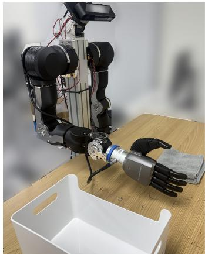  
(a) OpenArm setup

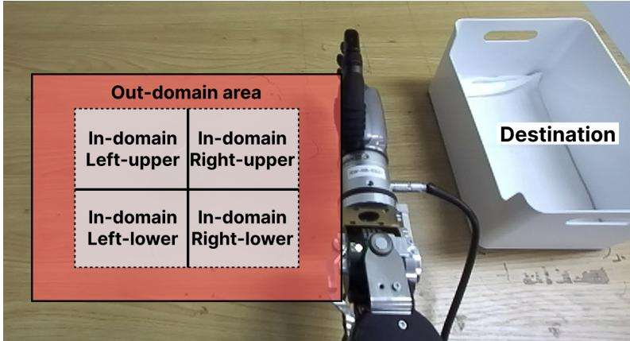  
(b) Within-skill object transfer placement regions  
Figure 10: OpenArm robot setup and evaluation distributions. (a) OpenArm robot platform used for real-world evaluation. (b) For object transfer, in-distribution (ID) rollouts are sampled from four workspace quadrants (right-upper, right-lower, left-upper, and left-lower), with five rollouts per quadrant and randomized object orientation. Out-of-distribution (OOD) rollouts are sampled outside the ID placement region (red area), again with randomized orientation. For skill transfer, the initial openness of the air fryer is randomized for all 30 trials.

## B.4. Evaluation aggregation and accounting

Because Box, Ball, and Towel use equal numbers of trials, the reported target-task average is the mean of the three per-object scores and is equivalently the weighted task score pooled over all 90 target-task rollouts. The corresponding pooled ID/OOD score is

$$
S _ { \mathrm { w } } ^ { \mathrm { a l l } } = \frac { 6 0 S _ { \mathrm { w } } ^ { \mathrm { I D } } + 3 0 S _ { \mathrm { w } } ^ { \mathrm { O O D } } } { 9 0 } .
$$

For skill transfer, Open and Close are each evaluated with 15 rollouts, so their reported average is equivalently the score pooled over all 30 target-task rollouts. The separate 20-rollout robot in-domain evaluation is not included in either target-task average.

All aggregate scores are computed from the per-rollout progress annotations before rounding; table entries are rounded to one decimal place.

Each reported condition uses one independently trained policy. All scheduled evaluation rollouts are included in the reported scores; failed task executions remain failures and are not retried or excluded.

## C. Additional results and ablations

## C.1. Cumulative task progress

Table 11 reports cumulative target-task progress for the shared wrist-hand baseline and H2RB. Thresholds refer to the rubric in Section B.2. The weighted scores are the corresponding main-table values.

Table 11: Cumulative target-task progress (%) and weighted task scores (0-100). $R _ { \geq 0 . 3 } , R _ { \geq 0 . 6 } , R _ { \geq 0 . 8 } ,$ and $R _ { = 1 . 0 }$ denote increasing completion thresholds; the last is full-task success.
<table><tr><td>Policy</td><td>n</td><td> $R _ { \geq 0 . 3 }$ </td><td> $R _ { \geq 0 . 6 }$ </td><td> $R _ { \geq 0 . 8 }$ </td><td> $R _ { = 1 . 0 }$ </td><td> $S _ { \mathrm { w } }$ </td></tr><tr><td>I: Object transfer</td><td></td><td></td><td></td><td></td><td></td><td></td></tr><tr><td>Ego-Pi-shared action</td><td>90</td><td>68.9</td><td>12.2</td><td>12.2</td><td>2.2</td><td>27.2</td></tr><tr><td>H2RB</td><td>90</td><td>95.6</td><td>46.7</td><td>33.3</td><td>12.2</td><td>51.8</td></tr><tr><td>H2RB + HT</td><td>90</td><td>96.7</td><td>60.0</td><td>30.0</td><td>21.1</td><td>57.2</td></tr><tr><td>II: Skill transfer</td><td></td><td></td><td></td><td></td><td></td><td></td></tr><tr><td>Ego-Pi-shared action</td><td>30</td><td>0.0</td><td>0.0</td><td>0.0</td><td>0.0</td><td>0.0</td></tr><tr><td>H2RB</td><td>30</td><td>100.0</td><td>66.7</td><td>33.3</td><td>30.0</td><td>62.7</td></tr><tr><td>H2RB + HT</td><td>30</td><td>100.0</td><td>83.3</td><td>76.7</td><td>56.7</td><td>81.7</td></tr></table>

## C.2. Hand geometry-anchored alignment under placement shift

Table 12 retains the intermediate hand geometry-anchored alignment with physical-action condition, in addition to the shared-action baseline and full method. ID and OOD counts follow Section B.3.

Table 12: Efect of geometry grounding on object transfer. Robot in-domain evaluates the familiar Doll PnP task, while human transfer reports weighted task scores under in-distribution (ID) and out-of-distribution (OOD) object placements. All values are weighted task scores (0-100).
<table><tr><td rowspan="2">Method</td><td>Robot in-domain</td><td colspan="3">Human transfer</td></tr><tr><td>Doll PnP</td><td>ID</td><td>OOD</td><td>Avg.</td></tr><tr><td>Base policy co-train</td><td>30.0</td><td>30.2</td><td>21.3</td><td>27.2</td></tr><tr><td>+ Ego-Pi-shared action (Kim et al., 2026b) + Ego-Pi-shared action (Kim et al., 2026b)</td><td>47.5</td><td>36.0</td><td>32.0</td><td>34.7</td></tr><tr><td>Hand geometry-anchored alignment + H2RB (Ours)</td><td>49.0</td><td>55.0</td><td>45.3</td><td>51.8</td></tr></table>

## C.3. Decoder selection ablations

Inference decoder selection. Both decoder branches are evaluated using the same within-skill object-transfer protocol described in Section B.3, with 30 rollouts per object and the same ID/OOD evaluation split. Only the reconstruction branch used at inference is changed; the latent policy and all other evaluation settings remain fixed. As shown in Table 13, the human decoder trained on human action data achieves better transfer performance than the robot decoder. The human decoder is therefore used for all main transfer results, without per-object decoder switching.

Table 13: Inference-decoder selection for the within-skill object transfer latent policy. Values are weighted task scores (0-100).
<table><tr><td>Reconstruction decoder</td><td>Box</td><td>Ball</td><td>Towel</td><td> $\operatorname { A v g } .$ </td></tr><tr><td>Robot decoder</td><td>37.0</td><td>16.0</td><td>45.0</td><td>32.7</td></tr><tr><td>Human decoder</td><td>53.0</td><td>49.0</td><td>53.3</td><td>51.8</td></tr></table>

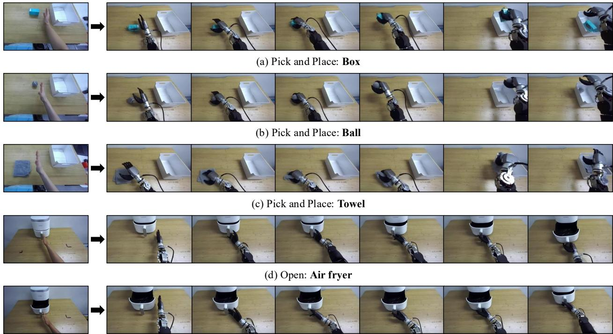  
(e) Close: Air fryer  
Figure 11: Qualitative transferred-task rollouts. Representative successful H2RB executions on box, ball, towel, open, and close, spanning both object-level and skill-level transfer.

## C.4. Execution dynamics

To compare source-specific motion dynamics, we additionally train a robot-supervised reference on 50 Open and 50 Close demonstrations. As reported in Table 3b, the human-transfer policy reaches an average wrist speed of 7.36 cm/s, compared with 2.52 cm/s for the robot-supervised reference. The two policies are trained separately; this comparison is not an inference-decoder swap. Wrist speed is computed from consecutive policy-predicted wrist positions at 20 Hz over each full successful rollout, including stationary periods, then averaged across episodes within each task and equally across Open and Close.

## D. Heterogeneous multi-embodiment training (HT)

The VLA backbone and hand geometry-anchored alignment are shared, while group-specific state and action interfaces accommodate diferent embodiments and action representations.

## D.1. Data mixture and action interfaces

The mixture contains 14,548 episodes and 5,014,530 frames. In-house ALLEX robot data contain 480 demonstrations. In-house human data combine 1,480 head-mounted camera demonstrations with 930 demonstrations recorded by OpenArm ZED 2i camera. Single-hand OpenArm combines robot and human pick-and-place data with human air-fryer opening/closing demonstrations; EgoDex and bimanual OpenArm provide the remaining data. The ALLEX collections use 30 Hz, and all other collections use 20 Hz. Overall source combination is described in Table 14.

We initialize five new state/action MLP interfaces while retaining the 36 pretrained interfaces of RLDX-1-IMG. In-house ALLEX robot and in-house human data share the 50D action interface and its frozen tokenizer; single-hand OpenArm uses a separate 15D tokenizer. EgoDex and bimanual OpenArm predict native 30D wrist-hand actions, normalized using group-specific first and 99th percentiles with invalid coordinates masked. Tokenizer-based interfaces retain their own action normalization. All interfaces use 16-step action chunks and current egocentric images; ALLEX uses stereo views, whereas the other collections use a single view.

Table 14: Heterogeneous training data by collection source.
<table><tr><td>Data source</td><td>Episodes</td><td>Frames</td></tr><tr><td>EgoDex (Hoque et al., 2026)</td><td>10,000</td><td>1,714,342</td></tr><tr><td>In-house human data</td><td>2,410</td><td>1,754,308</td></tr><tr><td>Single-hand OpenArm</td><td>1,035</td><td>236,751</td></tr><tr><td>Bimanual OpenArm</td><td>623</td><td>249,488</td></tr><tr><td>In-house ALLEX robot data</td><td>480</td><td>1,059,641</td></tr><tr><td>Total</td><td>14,548</td><td>5,014,530</td></tr></table>

## D.2. Optimization and downstream adaptation

State dropout is 0.3, and training images receive color jitter with brightness, contrast, and saturation strength 0.6 and hue strength 0.16.

Shared hand geometry-anchored alignment. A residual adapter of hidden width 256 and a shared linear readout predict 48-dimensional wrist-fingertip geometry, with 24 coordinates per hand. ALLEX targets are obtained through forward kinematics; the single-hand OpenArm group supervises only the right-hand coordinates and masks the left hand. The remaining groups use observed bimanual geometry. Geometry grounding has weight 0.2 and uses the loss in Eq. Eq. (A.5), regardless of whether the action target is latent or native. The backbone’s auxiliary physics-loss coeficient is 0.1.

For downstream evaluation, both the original and HT backbones are fine-tuned on the same OpenArm objectand skill-transfer tasks using the protocol in Section B.

## D.3. Task-level transfer results

Table 15 and Table 16 report weighted task scores. This comparison measures the benefit of additional HT, rather than isolating hand geometry-anchored alignment within a matched MT recipe.

Table 15: Efect of heterogeneous training on object transfer. Robot in-domain reports performance on a robot-data-trained task, while Human transfer evaluates target tasks introduced through human demonstrations. Each entry is the weighted task score (0-100).
<table><tr><td rowspan="2">Method</td><td rowspan="2">Robot in-domain</td><td colspan="4">Human transfer</td></tr><tr><td>Box</td><td>Ball</td><td>Towel</td><td>Avg.</td></tr><tr><td>H2RB</td><td>Doll 49.0</td><td>53.0</td><td>49.0</td><td>53.3</td><td>51.8</td></tr><tr><td>HT + H2RB</td><td>69.5</td><td>56.7</td><td>53.3</td><td>61.7</td><td>57.2</td></tr></table>

Table 16: Efect of heterogeneous training on skill transfer. Robot in-domain reports performance on a robot-data-trained task, while Human transfer evaluates target tasks introduced through human demonstrations. Each entry is the weighted task score (0-100).
<table><tr><td rowspan="2">Method</td><td rowspan="2">Robot in-domain</td><td colspan="3">Human transfer</td></tr><tr><td>Open</td><td>Close</td><td>Avg.</td></tr><tr><td>H2RB</td><td>Box PnP 81.0</td><td>50.7</td><td>74.7</td><td>62.7</td></tr><tr><td>HT + H2RB</td><td>80.5</td><td>64.7</td><td>98.7</td><td>81.7</td></tr></table>

## D.4. RB-Y1 robot-only adaptation

Hardware and observations. We evaluate robot-only adaptation on the RB-Y1 bimanual platform, equipped with two 7-DoF arms and two 20-DoF Wuji Hand 2 dexterous hands, as shown in Figure 12a. A head-mounted

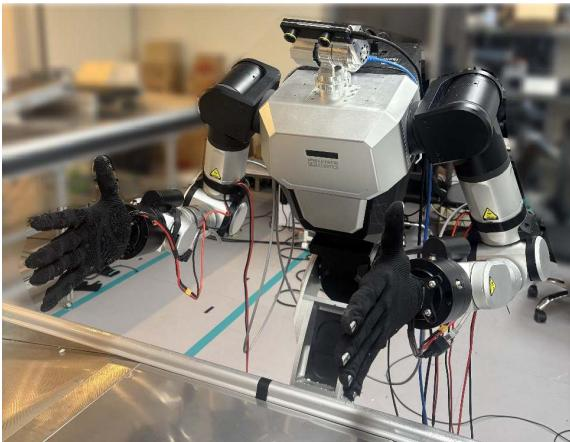  
(a) RB-Y1 robot setup

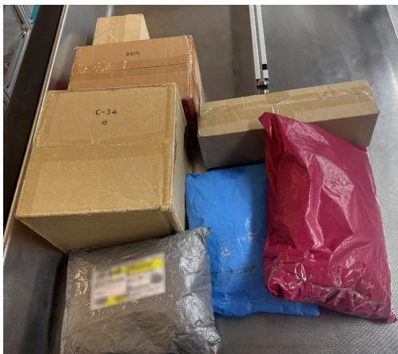  
(b) Evaluation objects  
Figure 12: RB-Y1 experimental setup. (a) Bimanual robot platform. (b) Boxes and polybags used for parcel handling.

ZED Mini stereo camera provides two RGB observations (left and right), each resized to 256 × 256. The policy receives both current RGB frames and a 58-dimensional proprioceptive state comprising the left and right wrist poses (18D) and hand joint angles (40D). Each wrist pose consists of a 3D position and a 6D rotation representation. The policy predicts 58D absolute actions in the robot-base coordinate convention, with absolute joint-angle commands for both hands.

Robot-only fine-tuning. All downstream policies are fine-tuned on the same robot-only dataset containing 726,752 frames after temporal retiming. The dataset and action targets are sampled at 30 Hz, with an action chunk length of 16 and 30k fine-tuning updates. We compare three HT variants initialized from the same pretrained backbone: robot-only HT, human-robot HT, and geometry-grounded human-robot HT. Robot-only HT uses the same training mixture with human demonstrations excluded, while the two human-robot variants difer only in geometry alignment. All variants use the same optimization settings for 200k HT updates and subsequently undergo robot-only downstream fine-tuning without the shared latent action tokenizer.

Evaluation protocol. The task requires orienting parcels (Figure 12b), including boxes and polybags, such that their shipping labels face upward, and transferring them onto a conveyor belt. We evaluate ten distinct objects with randomized initial orientations, repeating each object five times for a total of 50 trials per policy. Success is binary: a trial receives a score of 1 only if the parcel is placed on the conveyor belt with its shipping label facing upward, and 0 otherwise. No intermediate subtask scores or partial progress credits are assigned.