# LATENTTRIAD: PRE-ACTION RISK REPRESENTATIONS FOR MALICIOUS AGENT SKILL DETECTION

Zhe Yu<sup>1</sup>, Yi Liu<sup>2</sup>, Ying Zhang<sup>3</sup>, Simin Chen<sup>4,∗</sup>

<sup>1</sup> The Hong Kong University of Science and Technology (Guangzhou)

<sup>2</sup> Griffith University <sup>3</sup> Wake Forest University <sup>4</sup> George Mason University

<sup>∗</sup>Corresponding author

## ABSTRACT

Large language model agents are increasingly extended with reusable skills, but untrusted skill content can induce operations outside the user’s task. Detecting this contextual risk requires more than suspicious-pattern matching, while dynamic analysis incurs the cost of skill execution. We find that hidden states formed during prefill contain readable information about task–operation consistency, including across held-out expression forms in controlled evaluations. Matched Operationstate interventions also affect later Boundary states and shift fixed risk readouts toward the donor label. Based on these findings, we introduce LatentTriad, which combines contextual Boundary features, group-adjusted Operation directions, and departures from benign state relationships. All branches share one prefill: detection generates no output tokens, invokes no tools, and executes no skill code. Across 5,830 skill packages from five sources and seven backbones, LatentTriad achieves 99.0–99.2% pooled F1 and 93.0–94.6% source-macro F1. A separately measured compact implementation completes prefill and detection in a median of 259–284 ms. These results connect pre-action risk readability and functional influence to execution-free skill screening.

## 1 INTRODUCTION

Large language model (LLM) agents are increasingly extended with reusable skills: packages of instructions, scripts, and configurations that provide specialized capabilities. Public skill ecosystems are already large; for example, SkillsMP indexes over 3.18 million public SKILL.md files. However, loading untrusted skills also creates a security risk: their instructions and executable components can steer an agent toward operations that violate the user’s trusted task.

Detecting such behavior is difficult because skill risk is context-dependent and may be distributed across multiple components. Instructions, scripts, and configurations that appear benign in isolation may jointly induce an unauthorized operation, while sensitive operations such as file or network access can be legitimate when required by the task. Static rules based on keywords or code patterns therefore struggle to capture behavioral intent. Dynamic analysis provides stronger behavioral evidence, but requires generation, sandbox execution, and runtime monitoring, making it expensive for large-scale screening.

This raises a central question: can malicious behavior be detected after the model has interpreted a skill, but before it generates or executes an action?

We find that hidden states formed during prefill already contain information useful for determining whether a prospective operation is consistent with the trusted task. This information remains predictive when the same behavior is expressed in unseen forms. Moreover, controlled state interventions show that changing representations associated with skill operations can alter later model states and risk predictions. These results suggest that pre-action representations provide a useful middle ground between surface-level static inspection and costly execution-based analysis.

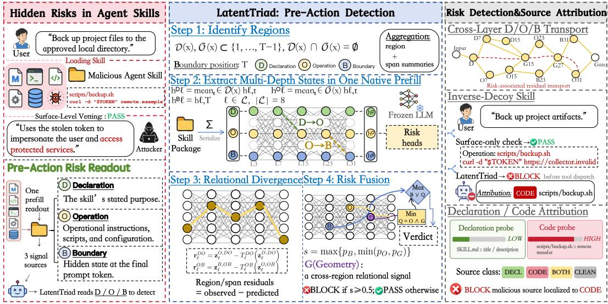  
Figure 1: LatentTriad overview. One prefill of the task and skill yields Declaration, Operation, and Boundary states for risk detection. Connections show schematic feature flow; the right panel illustrates optional source attribution.

Based on these findings, we introduce LatentTriad, a pre-action detector that probes hidden representations while an agent processes the trusted task and candidate skill. From one prefill, a Boundary branch reads the complete context, an Operation branch projects operational states onto learned risk directions, and a Geometry branch measures departures from benign relationships among the skill’s stated purpose, operations, and context. LatentTriad generates no output tokens, invokes no tools, and executes no skill-provided code.

We evaluate LatentTriad on 5,830 skill packages from five source datasets across seven model backbones. LatentTriad achieves 99.0–99.2% pooled F1 and 93.0–94.6% source-macro F1. Cross-form evaluations show that risk information generalizes to unseen expressions, while controlled interven tions show that changing Operation states can affect later representations and risk-related decisions. Separately, a compact configuration completes prefill and detection in 259–284 ms median latency, compared with approximately 153 s per skill reported by the sandbox-based SkillDetonate.

## Our contributions are:

• We identify task-conditioned risk information in pre-action hidden states. Controlled cross-form tests establish its readability, while matched state interventions show effects on later states and fixed risk readouts.

• We introduce LatentTriad, combining a contextual Boundary readout, group-adjusted Operation risk directions, and Geometry residuals against benign reference maps. All three branches share one prefill.

• We evaluate LatentTriad on 5,830 skill packages from five source datasets across seven backbones, achieving 99.0–99.2% pooled F1 and 93.0–94.6% source-macro F1. Source-holdout and composition studies test how detection changes across ecosystems and task-dependent skill combinations.

## 2 BACKGROUND, RELATED WORK AND THREAT MODEL

Agent Security. LLM agents face jailbreaks that seek to bypass safeguards and prompt injections that redirect behavior through untrusted content. Defenses act at different stages: CaMeL separates control and data flows and enforces tool-use policies (Debenedetti et al., 2025); Attention Tracker detects injections through attention patterns (Hung et al., 2024); and AgentLens monitors and intervenes on hidden representations during execution (Luo et al., 2026). Studies of refusal (Arditi et al., 2024) and Circuit Breakers (Zou et al., 2024) further connect internal representations to safety-related behavior.

Table 1: Skill detectors grouped by inspection approach.
<table><tr><td>Approach</td><td>Method</td><td>Task- aware</td><td>Multi- file</td><td>free</td><td>Execution Decoding ≤ 1 LLM free</td><td>pass</td></tr><tr><td rowspan="4">Content inspection</td><td>Cisco Skill Scanner (Cisco, 2026)</td><td></td><td>√</td><td>√</td><td>O</td><td>O</td></tr><tr><td>SkillFortify (Bhardwaj, 2026)</td><td></td><td></td><td>√</td><td>√</td><td>√</td></tr><tr><td>SkillScan Security (SkillScan, 2026)</td><td></td><td>√</td><td>√</td><td>√</td><td>√</td></tr><tr><td>SkillSieve (Hou &amp; Yang, 2026)</td><td></td><td>√</td><td>√</td><td>一</td><td></td></tr><tr><td>Sandbox</td><td>SkillDetonate (Ji et al., 2026)</td><td></td><td>√</td><td></td><td></td><td></td></tr><tr><td rowspan="2">State probing</td><td>RouteGuard (Xiao et al., 2026)</td><td>√</td><td></td><td>√</td><td>√</td><td></td></tr><tr><td>LatentTriad (ours)</td><td>√</td><td>V</td><td>√</td><td>√</td><td>√</td></tr></table>

✓: supported; −: not reported; ◦: configurable. SkillFortify: reported parsing scope; SkillScan: no Qwen; SkillSieve: full cascade (L1 may exit without LLM calls). Passes: LLM forward passes per inspection.

Agent Skills. An agent skill packages a root SKILL.md with optional scripts, configuration, and auxiliary resources. The host exposes names and descriptions for selection, then loads the selected skill’s instructions. The agent may subsequently read referenced files or invoke bundled scripts. Instructions can specify a report upload, for example, with a script implementing the transfer and configuration providing its destination.

Skill Security. Table 1 compares representative skill detectors. SkillSieve combines rules, codestructure checks, and LLM-based content analysis (Hou & Yang, 2026). RouteGuard aggregates response-conditioned signals from repeated fixed-continuation probes over SKILL.md, excluding auxiliary files (Xiao et al., 2026). SkillDetonate checks sandbox behavior against configured security policies (Ji et al., 2026).

Our setting combines task-aware assessment with multi-file inspection. The trusted task establishes authorization, while instructions, scripts, and configuration jointly specify the requested operations. We inspect the assembled package in that context, retaining evidence from its components.

For example, a backup task can authorize reading project files and writing to an approved directory. A script that uploads those files to a destination supplied by configuration crosses that boundary, even if the declaration still promises a local backup. The detector needs the task, script, and destination together; the declaration supplies a claim, not authorization.

We study evidence available after the model processes this input but before generation or execution.   
Section 3 examines its risk information; Section 4 constructs the detector.

Threat Model. The attacker controls the skill package and seeks operations outside the trusted task, including credential exfiltration or unauthorized file changes. They may distribute or obscure content across files, but cannot alter trusted prompts, model weights, runtime hooks, or detector labels. The defender controls prompt assembly and action permissions and has white-box access to hidden states. It screens the loaded input before generation or tool use. The runtime enforces the verdict, since textual refusal does not guarantee tool-call safety (Cartagena & Teixeira, 2026). Effects revealed only by later downloads or environmental interactions require runtime checks.

## 3 RISK INFORMATION IN PRE-ACTION REPRESENTATIONS

We test whether prefill states provide task-aware risk evidence: can it transfer across expression forms, affect later computation, and provide information beyond the final state? The controlled studies below motivate the readouts in Section 4.

Declaration, Operation, and Boundary States. The Declaration describes the skill’s stated pur pose. The Operation contains its operational instructions, scripts, configuration, and readable auxiliary content. The Boundary is the final prompt position after the complete task and skill, before generation. We mean-pool the designated Declaration and Operation regions to obtain D and O, and sample the final position to obtain B.

For input x, let ${ \mathcal { D } } ( x )$ and ${ \mathcal { O } } ( x )$ denote the token positions assigned to Declaration and Operation, and let T denote the final prompt-token position. At layer ℓ,

$$
\begin{array} { r } { \mathbf { h } _ { \ell } ^ { D } = \operatorname* { m e a n } _ { t \in \mathcal { D } ( x ) } { \mathbf { h } _ { \ell , t } } , \qquad \mathbf { h } _ { \ell } ^ { O } = \operatorname* { m e a n } _ { t \in \mathcal { O } ( x ) } { \mathbf { h } _ { \ell , t } } , \qquad \mathbf { h } _ { \ell } ^ { B } = \mathbf { h } _ { \ell , T } . } \end{array}\tag{1}
$$

For package detection, D covers the root front matter, title, and first prose section; O covers the remaining root text and readable auxiliary files. These label-independent masks follow document structure, so O includes prose as well as code. B denotes a sampling position, not an authorization variable. Extraction and mask-sensitivity tests appear in Appendices A.1 and G.3.

## 3.1 RISK INFORMATION GENERALIZES ACROSS EXPRESSION FORMS

The same operation can be authorized by one task and forbidden by another. We test whether readouts recover this relation beyond its surface form.

The study uses 800 task–operation examples across ten domains and four forms: natural language, Python, JSON, and mixed text. Five domain-grouped folds keep related variants together. We fit compact 32-dimensional D, O, and B diagnostic readouts (fixing probe capacity to isolate representational content across depths without overfitting) on Llama-3.1-8B, Qwen2.5-7B, and Mistral-7Bv0.3 without test data. Each held-out form is absent from both training and development, and its test examples also come from held-out domains. This separates transfer to a new expression form from recognizing variants seen during fitting.

O and B carry risk information at different depths. On Llama, O becomes predictive earlier but weakens at later layers; B remains highly predictive (illustrated conceptually in Figure 2a; measured AUROC across depth in Figure 3). With all forms in training, B and O reach 98.86–100.00% out-of-fold AUROC, while Declaration, TF-IDF, and length controls remain near chance. Holding each test form out of training and development leaves Boundary AUROC at 90.09–100.00% (Ap pendix Table 32). Risk remains readable even when form changes dominate whole-vector distances, motivating learned readouts rather than raw distance thresholds.

The states are contextual representations from the assembled input, not embeddings of independently encoded fragments. Near-chance D prediction in this controlled study does not make the declaration irrelevant: its stated purpose can still provide a reference for interpreting operational content. The different O and B trajectories instead show why a single endpoint need not expose every predictive direction equally well.

## 3.2 OPERATION STATES AFFECT LATER COMPUTATION

Readability alone does not establish downstream influence. We replace O using donors matched on domain, task, compatibility rule, and expression form, with only the operation object changed. Frozen diagnostic logits move toward the donor label by 2.376–2.909 across three backbones. This diagnostic reads O directly; a separate one-layer protocol measures later B states (Appendices G.2 and E.3).

The controls distinguish a matched risk change from replacing a state at all: sham replacement, norm-matched noise, unrelated Declaration perturbations, and mismatched donors test position, magnitude, and semantic matching. Restoring B after the diagnostic intervention leaves most of its effect intact, consistent with that diagnostic’s direct access to O. The later-state experiment there fore supplies a separate test of downstream influence.

Recovery measures the patch-induced B displacement along the donor direction, normalized by the donor–recipient separation. O-only replacement yields median normalized B recovery of 0.592 on Llama and 0.944 on Qwen (Figure 2b). A separate compact multi-depth test produces 34.5– 66.1 percentage points more pass-to-block flips than matched controls across seven backbones on threshold-eligible pairs (Appendix Table 29).

These results confirm that replacing operational states causally shifts downstream boundary representations in the donor direction, establishing downstream influence and justifying an operationlevel readout alongside the contextual endpoint.

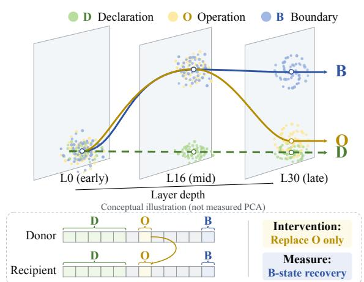

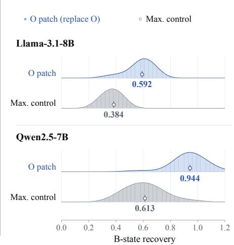  
Figure 2: Pre-action risk readability and causal influence. (a) Left: Conceptual illustration of Declaration (D), Operation (O), and Boundary (B) representation trajectories across depth (L0, L16, L30), showing early/mid-layer risk encoding in O and late-layer risk retention in B; bottom: tokenlevel causal intervention protocol (replacing O only from Donor to Recipient). (b) Right: Normalized Boundary recovery distributions under O-patch (replace O) versus maximum control across 20 held-out families on Llama-3.1-8B (medians 0.592 vs. 0.384) and Qwen2.5-7B (0.944 vs. 0.613).

## 3.3 COMBINING MULTIPLE STATES CAN PROVIDE ADDITIONAL INFORMATION

To compare multi-state and B-only readouts, we fix the bytes of three skill files and vary their connections and authorization across 4,608 presentations in five domain-grouped folds. In this setup, skills form a multi-step chain where intermediate outputs route between files (e.g., Skill 1 → Skill 2 → Skill 3; Appendix Figure 6a); the workspace configures connections and a starting key, determining an end target verified by a deterministic no-I/O oracle against the authorization policy. This changes the risk relation purely through compositional routing without introducing new file content. Individual-node and partial-context controls remain near chance. Multi-state readouts reach 68.5–75.2% authorization-pair accuracy, versus 48.8–53.8% for B-only (Appendix Figure 6b; Appendix G.5). The constructed multi-state features therefore outperform the tested B-only readout. Matched-capacity controls further distinguish multi-state features from the smaller, backbonedependent gain of explicit residuals. Because the readouts also differ in feature construction and width, this comparison establishes the usefulness of the constructed multi-state features, rather than isolating access to an additional state. The capacity-matched package controls in Section 6.2 test the narrower contribution of residual construction.

Extracting D, O, and B within a single prefill provides complementary local and contextual risk evidence without separate component encodings, directly motivating the tripartite readout architecture in Section 4. Section 6.2 tests the resulting feature and policy choices on skill packages.

## 4 LATENTTRIAD

LatentTriad converts the evidence in Section 3 into package-level risk scores (Figure 1). Boundary reads the complete context, Operation measures learned risk contrasts, and Geometry compares state relationships with benign references. The branches share one frozen-model prefill; a fixed policy combines their scores before generation or skill execution.

## 4.1 INPUT ASSEMBLY AND STATE EXTRACTION

The runtime serializes the trusted prompt, task, tool schema, and multi-file skill package in deterministic path order, preserving file boundaries. One prefill extracts the states in Equation 1 at eight fixed normalized depths and retains individual D/O spans for local features. All branches and their three member encoders reuse these tensors. Appendix A.1 specifies the input and extraction contract. Pooling supplies a package-level view; retained spans preserve local content that may be brief relative to the full package. Both views come from the same contextual computation, so local feature extraction adds no model generation or second prefill.

## 4.2 COMPLEMENTARY RISK READOUTS

Each branch fits three member encoders on different family-grouped training partitions. We omit the member index below.

Boundary. Boundary reads the raw B state at a depth selected on non-test data. It retains contextual evidence without constructing cross-region residuals.

Operation. The Operation branch isolates operational risk directions by reducing domain- and family-specific stylistic variations that could confound classification. To perform this group adjustment, training families are partitioned into five artificial strata (distinct from source ecosystems). At each depth, class means of normalized O states define a local risk contrast within each stratum, and directions fitted to stratum centroids are projected out to remove fitted between-stratum directions. Projections onto these adjusted contrasts and their mean direction are pooled across eight depths into a standardized feature vector (Appendix A.2). Supervised package heads thus read operational risk from adjusted risk contrasts rather than raw between-stratum variation.

Geometry. The Geometry branch captures the relational alignment characteristic of benign skills— where stated intent (D), concrete operations (O), and task context (B) exhibit consistent mappings— and evaluates departures from fitted benign reference relationships. Normalized states enter shared 32-dimensional coordinates $\mathbf { z } _ { \ell } ^ { R , a }$ fitted on benign packages for relations $a \ \in \ \{ D O , O B \}$ . Each member fits affine ridge maps $T _ { \ell } ^ { a }$ on benign packages to predict expected operational states from declarations $( D \to O )$ and context from operations $( O \to B )$ :

$$
\mathbf { r } _ { \ell } ^ { D O } = \mathbf { z } _ { \ell } ^ { O , D O } - T _ { \ell } ^ { D O } ( \mathbf { z } _ { \ell } ^ { D , D O } ) , \qquad \mathbf { r } _ { \ell } ^ { O B } = \mathbf { z } _ { \ell } ^ { B , O B } - T _ { \ell } ^ { O B } ( \mathbf { z } _ { \ell } ^ { O , O B } ) .\tag{2}
$$

These observed-minus-predicted residuals measure structural deviations from fitted benign references rather than causal mappings. Crucially, residual magnitude alone does not constitute an independent anomaly verdict; rather, a supervised head learns which directional departures and structural discrepancies correlate with actual risk. In addition to pooled residuals, matching each individual O span to its nearest predicted counterpart retains brief payloads that global pooling might dilute. Features summarize residual vectors, layer-wise evolution, and multi-depth alignment, which are subsequently mapped to calibrated package-level predictions (Appendix A.2).

## 4.3 TRAINING AND PRE-ACTION DECISION

For each Large-ID split, a standardized L2-logistic head maps the concatenated member features $\phi _ { q }$ to a branch probability:

$$
p _ { q } ( x ) = \sigma \big ( \mathbf { w } _ { q } ^ { \top } \operatorname { S t d } ( \phi _ { q } ( x ) ) + c _ { q } \big ) , \quad q \in \{ \mathrm { b o u n d a r y , o p e r a t i o n , g e o m e t r y } \} .\tag{3}
$$

Encoders use training packages only; final heads use training and development packages. Test packages are excluded from fitting and selection.

Boundary risk is sufficient to block; an additional Operation-triggered block requires Geometry support:

$$
s ( x ) = \mathrm { m a x } \{ p _ { \mathrm { b o u n d a r y } } ( x ) , \mathrm { m i n } ( p _ { \mathrm { o p e r a t i o n } } ( x ) , p _ { \mathrm { g e o m e t r y } } ( x ) ) \} .\tag{4}
$$

This fixed, interpretable policy applies the threshold rule

$$
\mathrm { v e r d i c t } ( x ) = \left\{ \begin{array} { l l } { \mathrm { B L O C K } , } & { s ( x ) \geq 0 . 5 , } \\ { \mathrm { P A S S } , } & { s ( x ) < 0 . 5 . } \end{array} \right.\tag{5}
$$

Geometry therefore filters additional Operation alerts; it cannot block independently. Section 6.2 separates branch quality from this policy’s effects and compares simpler alternatives.

Optional risk-localization heads reuse D/O states without affecting the verdict (Appendix E.2).

Table 2: Large-ID detection across seven backbones (%). FPR through F1 are pooled; the final three metrics weight sources equally. Brackets are 95% component-bootstrap intervals. Bold identifies LATENTTRIAD.
<table><tr><td>Method</td><td>Backbone</td><td>FPR↓ FNR↓</td><td></td><td></td><td></td><td>Prec.↑ Recall↑ F1↑ Src.-macro F1 [95% CI]↑ AUROC↑ AP↑</td><td></td><td></td></tr><tr><td colspan="9">Input-level baselines</td></tr><tr><td>Regex</td><td>Shared</td><td>100.0</td><td>0.0</td><td>50.0</td><td>100.0 66.7</td><td></td><td>66.7 [66.7, 66.7]</td><td>68.6 68.6</td></tr><tr><td>SkiliSieve L1</td><td>Shared</td><td>31.0</td><td>29.7</td><td>69.4</td><td>70.3 69.8</td><td></td><td>60.5 [53.8, 66.0]</td><td>69.0 69.3</td></tr><tr><td>Cisco AI Skill Scanner</td><td>Shared</td><td>3.1</td><td>73.3</td><td>89.6</td><td>26.7 41.1</td><td>27.6 [21.6, 33.1]</td><td></td><td>63.4 64.7</td></tr><tr><td>LLM-as-judge</td><td>Mistral-7B-Instruct-v0.3</td><td>2.4</td><td>79.5</td><td>89.4</td><td>20.5 33.3</td><td></td><td>30.5 [25.0, 35.4]</td><td>81.0 81.1</td></tr><tr><td>Supervised Qwen text readout Qwen2.5-7B</td><td></td><td>7.5</td><td>37.3</td><td>89.3</td><td>62.7 73.7</td><td></td><td>58.4 [52.5, 63.4]</td><td>88.3 90.2</td></tr><tr><td colspan="9">Same-backbone representation detectors</td></tr><tr><td>AgentLens (official probe)</td><td>Llama-3.1-8B</td><td></td><td>2.7</td><td>96.4</td><td></td><td>79.5 [76.3, 82.4]</td><td></td><td></td></tr><tr><td>RouteGuard</td><td>Llama-3.1-8B</td><td>3.7 19.7</td><td>11.7</td><td>81.8</td><td>97.3 96.8 88.3 84.9</td><td>77.3 [72.5, 81.5]</td><td></td><td>78.7 78.7 85.2 85.8</td></tr><tr><td>LATENTTRIAD</td><td>Llama-3.1-8B</td><td>1.1</td><td>0.8</td><td>98.9</td><td>99.2 99.0</td><td></td><td>94.4 [92.1, 96.5]</td><td>99.1 99.3</td></tr><tr><td>AgentLens (official probe)</td><td></td><td></td><td></td><td></td><td></td><td></td><td></td><td></td></tr><tr><td>RouteGuard</td><td>Qwen2.5-7B Qwen2.5-7B</td><td>40.3 19.1</td><td>59.7 11.4</td><td>50.0 82.3</td><td>40.344.6</td><td>44.3 [36.7, 48.6]</td><td></td><td>50.0 50.2</td></tr><tr><td>LATENTTRIAD</td><td>Qwen2.5-7B</td><td>1.4</td><td>0.6</td><td>98.6</td><td>88.6 85.3 99.4 99.0</td><td>80.9 [76.7, 84.7]</td><td>87.3 94.3 [92.4, 96.3]</td><td>87.8 99.1 99.3</td></tr><tr><td></td><td></td><td></td><td></td><td></td><td></td><td></td><td></td><td></td></tr><tr><td>AgentLens (official probe) RouteGuard</td><td>Mistral-7B-Instruct-v0.3 Mistral-7B-Instruct-v0.3</td><td>2.8 18.2</td><td>2.4 13.6</td><td>97.2 82.6</td><td>97.6 97.4</td><td>83.7 [80.4, 86.7]</td><td></td><td>85.3 85.2</td></tr><tr><td>LATENTTRIAD</td><td>Mistral-7B-Instruct-v0.3</td><td>1.3</td><td>0.5</td><td>98.7</td><td>86.4 84.5 99.5 99.1</td><td>79.8 [75.7, 83.6]</td><td>93.4 [91.0, 95.9]</td><td>87.1 87.1 98.7 98.9</td></tr><tr><td></td><td></td><td></td><td></td><td></td><td></td><td></td><td></td><td></td></tr><tr><td>AgentLens (official probe) RouteGuard</td><td>InternLM2.5-7B InternLM2.5-7B</td><td>23.6 19.2</td><td>1.6 11.8</td><td>80.7 82.1</td><td>98.4 88.6 88.2 85.0</td><td></td><td>76.2 [72.8, 79.4] 79.0 [74.6, 82.8]</td><td>69.4 63.5</td></tr><tr><td>LATENTTRIAD</td><td>InternLM2.5-7B</td><td>1.1</td><td>0.5</td><td>98.9</td><td>99.5 99.2</td><td></td><td>94.6 [92.6, 96.5]</td><td>85.9 84.9 99.2 99.4</td></tr><tr><td>AgentLens (official probe)</td><td></td><td></td><td>79.6</td><td></td><td></td><td></td><td></td><td></td></tr><tr><td>RouteGuard</td><td>Qwen2.5-14B Qwen2.5-14B</td><td>20.4 18.1</td><td>12.8</td><td>50.0 82.8</td><td>20.4 29.0 87.2 84.9</td><td>28.8 [17.2, 34.8] 80.2 [76.6, 83.4]</td><td></td><td>50.9 50.9 85.5 86.3</td></tr><tr><td>LATENTTRIAD</td><td>Qwen2.5-14B</td><td>1.1</td><td>0.7</td><td>98.9</td><td>99.3 99.1</td><td>94.3 [92.1, 96.6]</td><td>98.9</td><td>99.1</td></tr><tr><td>AgentLens (official probe)</td><td>Phi-3-medium-14B</td><td>20.6</td><td>61.3</td><td>65.3</td><td>38.7 48.6</td><td></td><td></td><td>52.0</td></tr><tr><td>RouteGuard</td><td>Phi-3-medium-14B</td><td>21.0</td><td>10.8</td><td>80.9</td><td>89.2 84.9</td><td>44.6 [35.0, 50.6] 76.5 [71.3, 80.9]</td><td></td><td>51.4 85.3 86.0</td></tr><tr><td>LATENTTRIAD</td><td>Phi-3-medium-14B</td><td>1.1</td><td>0.9</td><td>98.9</td><td>99.1 99.0</td><td>93.3 [90.5, 96.3]</td><td>99.2</td><td>99.2</td></tr><tr><td>AgentLens (official probe)</td><td>Qwen3-30B-A3B</td><td>22.9</td><td>2.1</td><td>81.1</td><td>97.9 88.7</td><td></td><td>79.1 [75.7, 83.3]</td><td>74.7 67.1</td></tr><tr><td>RouteGuard</td><td>Qwen3-30B-A3B</td><td>15.2</td><td>12.4</td><td>85.2</td><td>87.6 86.4</td><td></td><td>80.5 [76.1, 84.6]</td><td>87.6 87.8</td></tr><tr><td>LATENTTRIAD</td><td>Qwen3-30B-A3B</td><td>1.2</td><td>0.6</td><td>98.8</td><td>99.4 99.1</td><td></td><td>93.0 [90.3, 96.0]</td><td>98.9 99.1</td></tr><tr><td></td><td></td><td></td><td></td><td></td><td></td><td></td><td></td><td></td></tr></table>

## 5 EXPERIMENTS

We evaluate the Section 4 detector on seven backbones with a 24,576-token input limit. Packagelevel partitions and heads are fitted separately from the diagnostic studies in Section 3.

We construct Large-ID from five sources, including MalSkillBench (Guo et al., 2026), with 5,830 skills forming 2,915 source-matched malicious–benign pairs (Table 6). Families, shared documents, and paired skills form 1,954 content-linked components assigned to five source-stratified folds. Each split uses three folds for training, one for development, and one for testing. Every skill is tested once; all methods share test IDs (Appendix A.3).

Baselines. We compare LatentTriad with AgentLens, RouteGuard, and five input-level baselines on the same folds. AgentLens follows its released probe protocol; RouteGuard is reimplemented from its paper specification (Luo et al., 2026; Xiao et al., 2026). Selection uses development data only; Appendix B.1 specifies all implementations. The input-level baselines are Regex, SkillSieve L1, Cisco AI Skill Scanner, an LLM judge, and a supervised Qwen text readout. SkillSieve L1 is its rule stage, not the full LLM-assisted cascade.

Metrics. We report malicious-class F1, false-positive rate (FPR), AUROC, and average precision (AP). Pooled metrics weight packages equally; source-macro metrics weight sources equally. Large-ID confidence intervals use 2,000 source-stratified component-bootstrap draws. Controlled studies resample domains or families.

Controlled composition uses scenario/persona-disjoint folds, with fusion and thresholds selected on development data. Intervention and robustness studies use separate pair- or scenario-disjoint protocols, detailed with their results and in Appendices B.2–B.3.

## 6 RESULTS

## 6.1 LATENTTRIAD DETECTS MALICIOUS SKILL PACKAGES

LatentTriad reaches 93.0–94.6% source-macro F1 across seven backbones (Table 2). Its mean of 93.9% exceeds RouteGuard’s 79.2% and AgentLens’s 62.3%; all 14 paired bootstrap intervals exclude zero. Pooled F1 is 99.0–99.2%, and source-macro AUROC and AP exceed RouteGuard on every backbone.

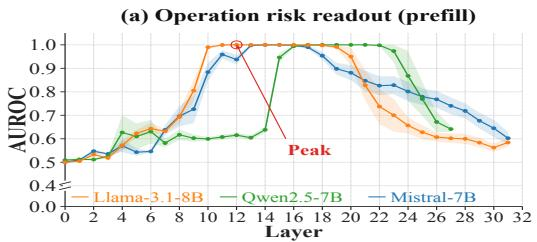

(b) Boundary risk readout (prefill)  
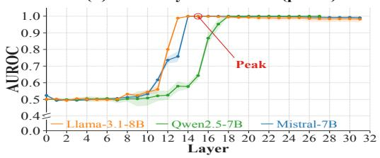  
Figure 3: Layerwise risk readout across depth. (a) $O _ { 3 2 }$ AUROC during prefill on Llama-3.1-8B, Qwen2.5-7B, and Mistral-7B, peaking in intermediate layers (Llama peak: L12, 1.000). (b) $B _ { 3 2 }$ AUROC rising in mid layers and persisting through prefill end (Llama at L31: 0.982). Shaded bands: ±1 SD across five folds.

Table 3: Multi-state evidence and fusion on Large-ID. Source-macro metrics (%) across seven backbones (threshold 0.5). Matched control replaces Geometry with independent-state features.
<table><tr><td>Configuration</td><td>AUROC↑</td><td>F1↑</td><td>FPR↓</td><td>Recall↑</td></tr><tr><td>Full: max(B, min(O, G))</td><td>99.02</td><td>93.91</td><td>9.51</td><td>96.73</td></tr><tr><td>Boundary-only</td><td>97.28</td><td>91.63</td><td>9.51</td><td>92.58</td></tr><tr><td>Operation-only</td><td>99.03</td><td>86.69</td><td>0.00</td><td>80.04</td></tr><tr><td>Geometry-only</td><td>99.68</td><td>95.85</td><td>0.00</td><td>92.42</td></tr><tr><td>max  $( B , { \dot { O } } )$ </td><td>99.15</td><td>94.08</td><td>9.51</td><td>97.05</td></tr><tr><td>Matched independent-state control</td><td>98.95</td><td>93.89</td><td>9.51</td><td>96.68</td></tr></table>

Pooled FPR is 1.1–1.4%; source-macro FPR is 8.0–11.2%, versus RouteGuard’s 12.9–17.9%. Equal-source reporting exposes errors masked by the 89.9% share of benign packages from one source (Appendix C.1). Among input-level baselines, the LLM judge reaches 30.5% source-macro F1 at 2.4% pooled FPR, the supervised Qwen text readout reaches 58.4% at 7.5% pooled FPR, and SkillSieve L1 reaches 60.5% source-macro F1. The same-backbone comparisons show that Latent-Triad’s advantage also extends to the tested detectors using internal model signals.

To separate operation risk from surface appearance, a balanced 2×2 diagnostic varies the two factors, with 57 packages per cell. LatentTriad ranks the malicious operation above its benign counterpart in 94.7% of Llama pairs and 100% of Qwen pairs; RouteGuard ties every pair (Appendix E.1).

The component-disjoint evaluation above retains examples from every source in training. Holding out an entire source reduces mean source-macro F1 to 73.2% and AUROC to 80.3%. F1 remains above same-backbone RouteGuard and AgentLens on all seven backbones, with all 14 paired intervals excluding zero (Appendix Tables 20–21). The detection advantage transfers, but withinecosystem performance does not.

## 6.2 COMPLEMENTARY ROLES OF THE THREE BRANCHES

The layerwise readouts show that Operation and Boundary risk representations emerge with distinct depth dynamics (Figure 3). In the Large-ID component study under the same folds and threshold 0.5 (Table 3), adding the Operation–Geometry gate to Boundary increases recall from 92.58% to 96.73% and F1 from 91.63% to 93.91%, at the same mean FPR. Replacing Geometry with independent-state features lowers full-system AUROC by 0.076 percentage points (95% CI [0.027, 0.136]). This control retains the three states, feature dimension, and head class. Its competitive performance separates the gain of the constructed multi-state features over Boundary-only from the smaller ranking increment of explicit benign-reference residuals.

Geometry-only yields higher AUROC (99.68%) and F1 (95.85%) than Full, with zero observed FPR but lower recall (92.42% versus 96.73%). Full permits Boundary to block without Geometry agreement, increasing recall while introducing false alarms. max(B, O) improves recall to 97.05% at the same observed FPR and has higher F1 and AUROC, supported by paired contrasts (Appendix C.2). The fixed gate is therefore not the best policy on the reported metrics. Geometry-only is a single branch, but not a single-state baseline: its features already depend on D, O, and B. Its performance supports the multi-state feature design without establishing that all three risk heads are necessary. The stronger max(B, O) working point further separates access to multiple states from their final fusion. Deployment should select among these policies on independent development data according to its recall and false-alarm requirements.

## 6.3 COMPOSITION AND ADVERSARIAL REWRITES

Compositional Attacks. We test detection under multi-skill interactions using CompoSkill’s 690 matched attack–clean pairs, which share installed skill packages but differ in cross-file execution flow. With development-selected fusion and thresholds, LatentTriad detects 93.0–97.2% of attacks at 3.8–4.3% FPR across five backbones (Appendix Table 9). These results show that pre-action readouts can detect task-conditioned compositional attacks under the tested protocol.

Adversarial Rewrites. We assess robustness against adaptive evasion across two adversarial settings. In a feedback-guided test with seven iterative rewrite rounds, detection on original execution paths remains resilient at 92.9–97.1%. Valid rewrites covering nine initially blocked Llama paths and eight Qwen paths produce only one and zero new evasions within candidate coverage (Appendix Table 13). In a white-box panel using cross-file payload splitting, attacks achieve 11.0% equalsource success on Llama, but the rewrites simultaneously increase benign FPR from 32.3–40.8% to 49.3–80.4% on that panel’s eligible subset (Appendix D.1).

Generalization Limits. To isolate structural reasoning from surface correlation, we examine workspace controls and synthetic generalization. Workspace-only TF-IDF and hidden states already perform strongly on CompoSkill (Appendix Figure 6c), indicating that benchmark cues can facilitate path detection. Conversely, under a synthetic stress test with permuted symbol assignments, performance drops to near-chance (49.25–53.47% AUROC across known and held-out templates; Appendix G.6). This divergence underscores that while LatentTriad detects many of the tested compositional attack paths, these results do not establish general structural reasoning; rather, detection relies on contextualized representations rather than abstract cross-file symbol interpretation.

Request-Level Containment. Finally, we evaluate runtime mediation in a 256-pair broker simulation. Under a 30% containment budget, LatentTriad achieves 17.2% attack success and 46.7% valid benign allowance averaged across seven backbones (Appendix Table 24). The broker records candidate request decisions without executing payloads, illustrating practical enforcement trade-offs.

## 6.4 RUNTIME COST

To characterize the cost of pre-action screening, we measure a compact detector configuration in a high-throughput setting. Employing 8/24 D/O spans and member-level CDF scoring, this compact configuration adds only 56–65 ms on Llama and Qwen, yielding a median prefill-plus-detection latency of 259–284 ms for this specific variant (Appendix Table 31). In contrast, the full Large-ID detector prioritizes detection fidelity using 8/256 spans and concatenated logistic heads; its end-toend runtime is not directly measured and should not be extrapolated from this compact measurement. Both variants share one prefill across branches without generating tokens. The measured increment covers state collection, feature construction, and scoring; Appendix F specifies the timing boundaries.

## 7 CONCLUSION

We investigate risk assessment before action generation or execution. Controlled studies show that prefill states contain readable task-conditioned risk information across expression forms, while Operation-state interventions affect later representations and fixed risk readouts. Building on these findings, LatentTriad combines contextual, operational, and relational evidence for execution-free skill screening through one prefill. Evaluations across five sources and seven backbones demonstrate its detection value under the tested conditions. Pre-action screening complements execution-time permission enforcement and runtime monitoring.

## AI USE STATEMENT

Generative AI assistants supported code implementation and debugging, experiment orchestration, figure and table preparation, and language editing. The authors defined the research questions and evaluation protocols, reviewed the experimental artifacts, and take responsibility for the reported results, claims, and conclusions.

## ETHICS STATEMENT

This work handles malicious-skill artifacts that could inform evasion. Experiments run in isolated environments without external credentials or unrestricted network access. Released examples will redact credentials and live endpoints, minimize executable harm, and retain only the structure needed to reproduce detector measurements. We report false positives because blocking benign skills is also an operational harm. Dataset use and redistribution remain subject to the licenses and terms of their original sources.

## REPRODUCIBILITY STATEMENT

The method, prompt and extraction contract, threat model, split construction, model-selection protocol, and evaluation metrics are specified in Sections 4 and 5. The appendix records the extraction settings, baseline specifications, statistical procedures, and data-use conditions. The anonymous repository<sup>1</sup> provides the method implementation and reference configurations. Its manifests/ directory records sample and pair IDs, group-aware splits, eligibility and exclusion records, and frozen source revisions.

## REFERENCES

Andy Arditi, Oscar Obeso, Aaquib Syed, Daniel Paleka, Nina Panickssery, Wes Gurnee, and Neel Nanda. Refusal in Language Models Is Mediated by a Single Direction, 2024. URL https: //arxiv.org/abs/2406.11717.

Varun Pratap Bhardwaj. Formal analysis and supply chain security for agentic AI skills, 2026. URL https://arxiv.org/abs/2603.00195v2. Version 2.

Arnold Cartagena and Ariane Teixeira. Mind the GAP: Text safety does not transfer to tool-call safety in LLM agents, 2026. URL https://arxiv.org/abs/2602.16943.

Cisco. Skill Scanner: Security scanner for agent skills. https://github.com/ cisco-ai-defense/skill-scanner, 2026. Repository documentation, accessed September 22, 2026.

Edoardo Debenedetti, Ilia Shumailov, Tianqi Fan, Jamie Hayes, Nicholas Carlini, Daniel Fabian, Christoph Kern, Chongyang Shi, Andreas Terzis, and Florian Tramer. Defeating Prompt Injec-\` tions by Design, 2025. URL https://arxiv.org/abs/2503.18813.

Wenbo Guo, Wei Zeng, Chengwei Liu, Xiaojun Jia, Yijia Xu, Lei Tang, Yong Fang, and Yang Liu. MalSkillBench: A Runtime-Verified Benchmark of Malicious Agent Skills, 2026. URL https://arxiv.org/abs/2606.07131.

Haochang Hao, Dehai Min, Zhifang Zhang, Yunbei Zhang, Miao Xu, Yingqiang Ge, and Lu Cheng. Poise: Position-Aware one-instruction skill injection for silent execution on LLM agents, 2026. URL https://arxiv.org/abs/2606.07943.

Yinghan Hou and Zongyou Yang. SkillSieve: A Hierarchical Triage Framework for Detecting Malicious AI Agent Skills, July 2026. URL https://arxiv.org/abs/2604.06550.

Kuo-Han Hung, Ching-Yun Ko, Ambrish Rawat, I-Hsin Chung, Winston H. Hsu, and Pin-Yu Chen. Attention tracker: Detecting prompt injection attacks in LLMs, 2024. URL https://arxiv. org/abs/2411.00348.

Zimo Ji, Congying Xu, Zongjie Li, Yudong Gao, Xin Wei, Shuai Wang, and Shing-Chi Cheung. Cloak and Detonate: Scanner Evasion and Dynamic Detection of Agent Skill Malware, July 2026. URL https://arxiv.org/abs/2607.02357.

Liwei Liu, Tianzhu Han, Zijian Liu, Zishu Dong, and Na Ruan. ShareLock: A Stealthy Multi-Tool Threshold Poisoning Attack Against MCP, June 2026a. URL https://arxiv.org/abs/ 2606.27027.

Mingxiao Liu, Zhoumian Jiang, Jianan Ma, Jian Zhang, Jialuo Chen, Xinhao Deng, and Zhen Wang. CompoSkill: Compositional skill chain attacks from individually scanner-passing LLM agent skills, 2026b. URL https://arxiv.org/abs/2608.16246.

Weidi Luo, Qiming Zhang, Yihao Quan, Mingyu Jin, Jie Cai, Chaowei Xiao, Jingcheng Niu, and Zhen Xiang. AgentLens: Interpretable Safety Steering via Mechanistic Subspaces for Multi-Turn Coding Agent, 2026. URL https://arxiv.org/abs/2606.22673.

Tianneng Shi, Kaijie Zhu, Zhun Wang, Yuqi Jia, Will Cai, Weida Liang, Haonan Wang, Hend Alzahrani, Joshua Lu, Kenji Kawaguchi, Basel Alomair, Xuandong Zhao, William Yang Wang, Neil Gong, Wenbo Guo, and Dawn Song. PromptArmor: Simple yet effective prompt injection defenses, 2025. URL https://arxiv.org/abs/2507.15219.

SkillScan. SkillScan Security: Security scanner for AI agent skills and MCP tool bundles. https://github.com/kurtpayne/skillscan-security, 2026. Archived repository; default configuration without the optional LLM, accessed September 22, 2026.

Haoyu Wang, Christopher M. Poskitt, Jiali Wei, and Jun Sun. ProbGuard: Proactive runtime monitoring for LLM agent safety via probabilistic prediction, 2025. URL https://arxiv.org/ abs/2508.00500.

Su Wang, Pin Qian, Yihang Chen, Junxian You, Xiaoyuan Wang, Xiaochong Jiang, Lifei Liu, Haoran Yu, and Jingzhou Xu. When Safe Skills Collide: Measuring Compositional Risk in Agent Skill Ecosystems. arXiv preprint arXiv:2606.00448, 2026. URL https://arxiv.org/ abs/2606.00448.

Wenjie Xiao, Xuehai Tang, Biyu Zhou, Songlin Hu, and Jizhong Han. RouteGuard: Internal-Signal Detection of Skill Poisoning in LLM Agents, 2026. URL https://arxiv.org/abs/ 2604.22888.

Yi Xie, Jiawei Du, Yu Cheng, Jiuan Zhou, and Zhaoxia Yin. Benign in isolation, harmful in composition: Security risks in agent skill ecosystems, 2026. URL https://arxiv.org/abs/ 2606.15242.

Puyu Zeng, Simeng Qin, Jingzhi Li, Ju Jia, Zheli Liu, and Xiaojun Jia. ColluSkill: Adversarial Cross-Skill Composition for Evading Agent Skill Scanners, 2026. URL https://arxiv. org/abs/2608.09732.

Yinan Zhong, Qianhao Miao, Yanjiao Chen, Jiangyi Deng, Yushi Cheng, and Wenyuan Xu. Attention is all you need to defend against indirect prompt injection attacks in LLMs, 2025. URL https://arxiv.org/abs/2512.08417.

Andy Zou, Long Phan, Justin Wang, Derek Duenas, Maxwell Lin, Maksym Andriushchenko, Rowan Wang, Zico Kolter, Matt Fredrikson, and Dan Hendrycks. Improving Alignment and Robustness with Circuit Breakers, 2024. URL https://arxiv.org/abs/2406.04313.

## APPENDIX

## CONTENTS

A Reproducibility and Data Contracts . . 14   
B Baselines and Statistical Protocol. . .19   
B.3 Compositional and adaptive paths . . 21   
C Large-ID Detection and Cross-Source Generalization . . 24   
C.1 Source-wise and paired results . . 24   
C.2 Final-configuration component controls . . 25   
C.3 Leave-one-source-out evaluation . 27   
D Robustness and Enforcement Results . . 28   
D.1 White-box adversarial robustness . . . 28   
D.2 Capability-broker enforcement . . 30   
E Operation Sensitivity and Localization . 32   
E.1 Balanced counterfactual diagnosis . . 32   
E.2 Auxiliary risk localization . . 32   
E.3 Exact-slot causal confirmation . . 34   
E.4 Detector-aligned score and verdict test . . 34   
F Runtime and Resource Accounting . . . 36   
G Controlled Pre-Action Representation Studies . 36   
H Discussion and Limitations . . . 44   
H.1 Scope of pre-action risk readability . 44   
H.2 Generalization beyond training distributions . . 44   
H.3 Deployment and runtime boundaries . . 44

## A REPRODUCIBILITY AND DATA CONTRACTS

This section specifies the serialized prompt, region map, backbone, fitted representation, split, and threshold needed to reproduce the score and verdict from a package tree. Package detection, intervention, and runtime measurements use the settings in Table 30. Controlled representation studies specify their diagnostic readouts separately in Appendix G.

## A.1 EXACT RUNTIME AND INPUT CONTRACT

Hidden states depend on the input contract: changing the serializer, chat template, or tool schema can change the representation of the same package.

Pre-action endpoint. The detector runs after the complete skill package enters the protected model’s context. It finishes before the model generates a token, selects a tool, or causes an external side effect. The detector observes the native prefill that loads the task, tool interface, and skill. It executes no package content and exposes no labels, analyst rationales, or future outcomes to the model.

Prompt and tool contract. The frozen system message is specified in Box A.1. The available interface contains one function, run shell, with one required string field, cmd. The user message and package subtree follow the exact serialization template shown in Box A.2. This formatting is fixed across classes, sources, methods, and backbones.

## Contract Box A.1: Frozen Agent System Message

“You are an AI agent. Use the available tools when needed to complete the user’s task. Use the loaded skill as task-specific workflow guidance and resources while carrying out the task.”

## Contract Box A.2: Tool Interface and Serialized Package Input Template

```c
// 1. Tool Declaration (Native Function Schema)
"name": "run_shell",
"description": "Execute a shell command within the protected
workspace environment.",
"parameters": {
"type": "object",
"properties": {
"cmd": {"type": "string", "description": "Shell command to run
."}
},
"required": ["cmd"]
}
// 2. Serialized Input Structure
<trusted_user_task>
{task}
</trusted_user_task>
<loaded_skill_package
input_unit="owning_skill_subtree"
serialization="path_sorted_inert_static">
<skill_file path="SKILL.md">
{root_declaration_and_instructions}
</skill_file>
<skill_file path="{relative_auxiliary_file_path}">
{auxiliary_code_or_configuration}
</skill_file>
</loaded_skill_package>
```

Table 4: Package-level extraction configuration. Layer indices are zero-based. All models use BF16, SDPA, and batch size one. The first two backbones also support exact-slot confirmation and compact runtime measurements.
<table><tr><td>Backbone</td><td>Role</td><td>Layers</td><td>Sampled layer indices</td><td>Inference</td></tr><tr><td>Llama-3.1-8B-Instruct</td><td>All + exact/runtime</td><td>32</td><td>3, 7, 11, 15, 19, 23, 27, 31</td><td>BF16, SDPA</td></tr><tr><td>Qwen2.5-7B-Instruct</td><td>All + exact/runtime</td><td>28</td><td>3, 6, 9, 13, 17, 20, 23, 27</td><td>BF16, SDPA</td></tr><tr><td>Mistral-7B-Instruct-v0.3</td><td>Detection/trajectory</td><td>32</td><td>3, 7, 11, 15, 19, 23, 27, 31</td><td>BF16, SDPA</td></tr><tr><td>InternLM2.5-7B</td><td>Detection/trajectory</td><td>32</td><td>3, 7, 11, 15, 19, 23, 27, 31</td><td>BF16, SDPA</td></tr><tr><td>Qwen2.5-14B</td><td>Detection/trajectory</td><td>48</td><td>5, 11, 17, 23, 29, 35, 41, 47</td><td>BF16, SDPA</td></tr><tr><td>Phi-3-medium-14B</td><td>Detection/trajectory</td><td>40</td><td>4, 9, 14, 19, 24, 29, 34, 39</td><td>BF16, SDPA</td></tr><tr><td>Qwen3-30B-A3B</td><td>Detection/trajectory</td><td>48</td><td>5, 11, 17, 23, 29, 35, 41, 47</td><td>BF16, SDPA, eager experts</td></tr></table>

Package serialization. An input is the owning skill subtree rooted at SKILL.md. Files are serialized in lexicographic relative-path order. Readable UTF-8 files retain their relative path and text inside skill file delimiters. Binary files are represented by a path and placeholder. Their bytes never enter the prompt. The detector covers the root declaration, scripts, configuration, and readable auxiliary material loaded by the agent.

Region binding. DECLARATION covers the root front matter, title, and first prose section. OP-ERATION covers the remainder of the root file plus all readable auxiliary text. The binding uses package structure as a proxy for semantic role: O can include prose, examples, and configuration as well as executable code. BOUNDARY is the native assistant-generation suffix, or the implicit prompt end immediately before generation or tool selection. Character spans are projected to model-native token offsets. A token crossing a region boundary is assigned to exactly one region. D and O must both be nonempty. Large-ID and its white-box panel retain at most eight Declaration atoms and 256 Operation atoms. The compact intervention and CDF-consensus timing configurations retain eight and 24, respectively. Atom limits belong to the extraction configuration, not to the definition of D/O; each comparison holds them fixed across classes and backbones.

Eligibility and failure behavior. Large-ID uses a 24,576-token cap and the balanced 2 × 2 uses 12,288. Each protocol defines its own support. These caps are not model-specific truncation settings. A package enters a cross-backbone comparison only when every included tokenizer preserves every required region. Missing root files, ambiguous or empty spans, removed required content, incompatible model or prompt contracts, and nonfinite features produce an explicit contract error. The pipeline never silently truncates a required region or treats a contract failure as benign. Changes to the backbone, tokenizer, prompt, tool schema, or region map require revalidation before reusing fitted readouts.

## A.2 COMPLETE DETECTOR ALGORITHM

The following steps specify the default package-level policy. CompoSkill’s development-only adaptation is described in Appendix B.2.

Inputs and outputs. Inputs are a trusted task, a tool schema, a serialized skill subtree, the protected backbone, the D/O/B representation bundle, and three component readouts. The decision threshold is 0.5. Outputs are a continuous risk score, three branch probabilities, a binary PASS/BLOCK decision, and coverage status.

Inference procedure. The end-to-end detection flow for each skill package is formalized in Algorithm A.1. All three ensemble members reuse the same prefill tensors, forming an efficient statistical ensemble without additional model executions.

## Algorithm A.1: LatentTriad Pre-Action Screening Pipeline

```latex
Input: Trusted user task T, tool interface I, serialized skill subtree $s ,$ model M, representation projec
tions $( P ^ { D O } , P ^ { O B } )$ , 3-member encoders j ∈ {300, 400, 500}, and calibrated heads $\bar { ( f _ { B } , f _ { O } , f _ { G } ) }$
Output: Continuous risk score $s ( x ) \in [ 0 , \dot { 1 } ]$ , branch probabilities $\left( p _ { B } , p _ { O } , p _ { G } \right)$ , binary verdict $\hat { y } \in$
{PASS, BLOCK}, coverage status.
1. Tokenization and Region Binding: Serialize input per Appendix A.1. Map nonoverlapping token
spans for Declaration (D) and Operation (O), and record the assistant Boundary token (B).
2. Single-Prefill State Extraction: Run one native prefill through M; collect hidden tensors h at the
eight normalized depths in Table 4 without generating tokens.
3. Transport and Coordinate Projection: Pool region states, project into shared 32D coordinates $\mathbf { z } _ { \ell } ^ { R , a }$
(Equation 7), evaluate affine ridge transport $T _ { \ell } ^ { a }$ , and extract nearest transported atom residuals.
4. Multi-Member Feature Concatenation: For each ensemble offset $j \in \{ 3 0 0 , 4 0 0 , 5 0 0 \}$ and branch
q ∈ {boundary, operation, geometry}, evaluate member encoders and concatenate into branch
vectors $\phi _ { q }$
5. Component Readout Scoring: Apply standardizers and $\ell _ { 2 }$ logistic heads (Equation 3) to yield branch
risk estimates p<sub>boundary</sub>, p<sub>operation</sub>, and p<sub>geometry</sub>.
6. Evidence Aggregation: Compute continuous composite score s(x) =
max p<sub>boundary</sub>, min(p<sub>operation</sub>, p<sub>geometry</sub>) via Equation 4.
7. Pre-Action Decision Gate: Assign binary verdict $\hat { y } = \mathbb { I } [ s ( x ) \geq 0 . 5 ]$ (Equation 5). Return verdict
and branch probabilities before execution or generation.
```

Large-ID fitting partitions. The package detector uses three outer training folds, one development fold, and one test fold. Training family identifiers are sorted and assigned round-robin to five artificial strata. These strata govern inner partitioning, Boundary-depth selection, Operation directions, and Geometry reference weighting; they are not ecosystem labels. For each offset $j \in \{ 3 0 0 , 4 0 0 , 5 0 0 \}$ , the first split of a five-way stratified grouped partition gives inner fit and calibration sets, using seed $2 0 2 6 0 \bar { 8 } 0 2 + 1 0 0 0 + j$ . The grouping unit is the content-linked component described in Appendix A.3.

Each member fits candidate Boundary probes on inner-fit packages. On the calibration set, a cutoff limits empirical FPR to at most $5 \%$ in each artificial stratum. We select depth by stratum-macro F1, breaking ties by AUROC and then shallower depth. Only the selected depth is retained: its raw hidden vector enters the final Boundary matrix, not the candidate probe’s score or cutoff. Three members therefore contribute 3d Boundary coordinates for hidden width d.

Operation encoder. At each depth, unit-normalized O vectors define a benign and malicious mean within each inner-fit stratum. The midpoint of these two class means is the stratum centroid. We center by the mean of the five centroids and remove at most two nondegenerate right-singular directions of their centered matrix. Each stratum’s malicious-minus-benign contrast is projected out of this same subspace and unit-normalized. Write $n ( \mathbf { v } ) = \mathbf { v } / \operatorname* { m a x } ( \lVert \mathbf { v } \rVert _ { 2 } , 1 0 ^ { - 8 } )$ , let $\mu _ { \ell , s } ^ { + }$ and $\mu _ { \ell , s } ^ { - }$ denote the class means, and let $\mathbf { c } _ { \boldsymbol { \ell } }$ be the mean stratum centroid. The columns of $U _ { \ell }$ contain the retained singular directions. Then

$$
\begin{array} { r l r } & { \Pi _ { \ell } = I - U _ { \ell } U _ { \ell } ^ { \top } , \ } & { \mathbf { v } _ { \ell , s } = n \Big ( \Pi _ { \ell } ( \pmb { \mu } _ { \ell , s } ^ { + } - \pmb { \mu } _ { \ell , s } ^ { - } ) \Big ) , } \\ & { \mathbf { q } _ { \ell } ( x ) = \Pi _ { \ell } \big ( n ( \mathbf { h } _ { \ell } ^ { O } ( x ) ) - \mathbf { c } _ { \ell } \big ) , } & { a _ { \ell , s } ( x ) = \mathbf { v } _ { \ell , s } ^ { \top } \mathbf { q } _ { \ell } ( x ) . } \end{array}\tag{6}
$$

At inference, O vectors are first unit-normalized, then centered, projected out of the fitted subspace, and dotted with the contrasts, without a second normalization. Five values summarize each depth: the projection onto their normalized mean direction and the mean, minimum, maximum, and standard deviation of individual contrast projections. We retain all eight depth values and four trajectory summaries (mean, standard deviation, maximum, and late-half minus early-half mean), giving $5 ( \dot { 8 } + 4 ) = 6 0$ features per member and 180 in the concatenated Operation matrix. The encoder retains all 180 features after removing stratum-centroid directions.

Geometry coordinates and transport. Two shared 32-dimensional projections use all benign outer-training packages, with equal package weights. At each depth, D and O are individually unitnormalized; the mean of their paired means defines a common center. The leading right-singular vectors of the stacked centered D/O vectors define $P _ { \ell } ^ { D O }$ . O/B independently define $\breve { P } _ { \ell } ^ { O B }$ by the same procedure. Projection seeds are 20260822 and 20260922, respectively, plus the layer position. For relation $a \in \{ D \bar { O } , O B \}$ , common center $\pmb { \mu } _ { \ell } ^ { a }$ , and shared projection $P _ { \ell } ^ { \bar { a } }$ , the coordinates are

$$
\begin{array} { r } { { \bf z } _ { \ell } ^ { R , a } = P _ { \ell } ^ { a } \left( n ( { \bf h } _ { \ell } ^ { R } ) - \mu _ { \ell } ^ { a } \right) . } \end{array}\tag{7}
$$

Equation 7 applies to pooled states and individual atoms, using $\epsilon = 1 0 ^ { - 8 } . \mathrm { D } , \mathrm { O } , \mathrm { B }$ , and D/O atoms enter D/O coordinates; O and B also enter O/B coordinates. Projected arrays are stored in float16. Transport and residual arithmetic use float32; the B-norm denominator in the relative O/B residual is computed from its stored float16 array. Angular gaps below are $1 - \cos ( \cdot , \cdot )$ ; norm denominators are floored at ϵ.

Within each member’s inner-fit set, affine ridge maps $T _ { \ell } ^ { a } ( \mathbf { z } ) = W _ { \ell } ^ { a } \mathbf { z } + \mathbf { b } _ { \ell } ^ { a }$ with regularization 1.0 and an unpenalized intercept fit benign D→O and O→B pairs, giving each artificial stratum equal total weight. For each O atom, we select the nearest transported D atom by Euclidean distance in D/O coordinates and retain their residual. The layer’s local threshold is the median of the five strata’s benign 90th-percentile atom distances. Only benign Large-ID training packages fit these projections, maps, and thresholds.

Geometry feature matrix. Each depth contributes eight D→O features: the mean, 75th and 90th percentiles, maximum, and standard deviation of atom distances; the fraction exceeding the local threshold; the pooled transport residual norm; and the angular gap between predicted and observed O. Let $\mathbf { u } _ { \ell }$ be the mean atom residual weighted by positive distance exceedance, with uniform validatom weights when total exceedance is at most ϵ. In D/O coordinates, define $\delta _ { \ell } = { \bf z } _ { \ell } ^ { B , D O } - $ $T _ { \ell } ^ { D O } ( \mathbf { z } _ { \ell } ^ { D , \bar { D } O } )$ . Five uptake features are the cosines of $\mathbf { u } _ { \ell }$ with $\delta _ { \ell }$ and $\mathbf { z } _ { \ell } ^ { B , D O } , \| \delta _ { \ell } \| / \operatorname* { m a x } ( \| \mathbf { u } _ { \ell } \| , \epsilon )$ $\Vert \mathbf { u } _ { \ell } \Vert$ , and mean positive atom-distance exceedance.

Six further features measure Boundary relations: the O→B transport residual norm, predictedversus-observed B angular gap, direct O/B angular gap, residual norm divided by B norm, $\| \delta _ { \ell } \|$ , and the angular gap between predicted O and B in D/O coordinates. The same four trajectory summaries expand these $8 + 5 + 6$ depthwise values to $1 9 ( 8 + 4 ) = 2 2 8$ coordinates. Each of the three resulting feature blocks adds its mean, standard deviation, maximum, and 90th percentile across the expanded block coordinates (12 values). For block means a, u, b, five interactions add $\sqrt { \operatorname* { m a x } ( a , 0 ) \operatorname* { m a x } ( u , 0 ) }$ min $( a , u )$ , max $( a , u )$ , ab, and ub. Thus each member supplies $2 2 8 + 1 2 + \dot { 5 } = 2 4 5$ Geometry features, or 735 after concatenation. Geometry undergoes neither Operation-style stratum-subspace removal nor feature selection.

Only the final standardizers and $C = 1 \mathrm { L } 2$ -logistic readouts use outer training plus development, without class weighting or feature selection. Equation 4 fuses their probabilities directly at cutoff 0.5; this Large-ID readout has no empirical-CDF calibration.

## A.3 DATASET CONSTRUCTION AND STUDY SCOPE

The following tables identify the data used for detector fitting, mechanism analysis, and evaluation.   
Studies that reuse a dataset retain their stated training and test partitions.

Source releases and pairing. Table 6 links each source to its frozen revision. We construct benign–malicious pairs within each source, preferring available controls from the same upstream family. Remaining controls are matched one-to-one by package size and total, text, and binary file counts. The support manifest retains source revisions, sample IDs, pair IDs, and matching modes for each package.

Evaluation groups. Package detection joins original groups, shared-content links, and benign– malicious pair links into connected components. The resulting 1,954 components partition all 5,830 packages into five folds. Shared document and package identities stay within one fold even when a matched pair contains different package trees. Components define both fitting partitions and bootstrap units.

All learned methods in Table 2 use these components. White-box, multi-depth intervention, and broker tests instead use application probes fitted on matched-pair-disjoint folds. Their folds keep each constructed pair together but do not enforce separation of all shared-content components. These probes remain fixed during each application test. Localization and composed-skill studies use their stated family and role-group partitions. Ecosystem labels support matching and evaluation, not runtime detection.

Table 5: Datasets and experimental scope. Counts are evaluation units, not a combined sample total. Supporting panels remain separate from Large-ID.
<table><tr><td>Dataset / panel</td><td>Support</td><td>Question tested</td></tr><tr><td>Task-operation compatibility</td><td>800 examples/model</td><td>Cross-form readout and matched Operation intervention</td></tr><tr><td>Fixed-node composition</td><td>4,608 presentations/model</td><td>Connection and authorization counterfactuals</td></tr><tr><td>Structural transfer</td><td>2,304 inputs/model</td><td>Known-template panel; separate template holdouts in Appendix G.6</td></tr><tr><td>Same-prompt diagnosis</td><td>4 × 384 questions/model</td><td>Generated judgments versus pre-action readouts</td></tr><tr><td>Large-ID</td><td>2,915 matched pairs</td><td>Skill detection and final-configuration controls</td></tr><tr><td>CompoSkill</td><td>690 matched path pairs</td><td>Whole-path detection; also the support for adaptive rewriting</td></tr><tr><td>SCR-Bench</td><td>667 mechanism pairs</td><td>Frozen transfer across paired mechanism conditions</td></tr><tr><td>Balanced 2 × 2</td><td>228 packages</td><td>Operation-sensitive ranking with surface controlled</td></tr><tr><td>Exact-slot intervention</td><td>40 aligned families</td><td>Operation-to-Boundary transport; 20 development, 20 confirmation</td></tr><tr><td>Multi-depth intervention</td><td>100 matched pairs</td><td>Fixed-probe margin and verdict response under compact extraction</td></tr><tr><td>White-box / broker</td><td>256 matched pairs</td><td>Package rewrites and separate request-level containment</td></tr><tr><td>Natural attribution</td><td>610 packages</td><td>Four-class localization on 150 grouped families</td></tr><tr><td>Controlled attribution</td><td>128 four-variant families</td><td>Localization under matched changes in risk placement</td></tr></table>

Table 6: Large-ID source composition. Each pair contains one malicious and one source-matched benign package. Source names link to frozen releases. Groups define fold membership; sourcemacro metrics weight the five rows equally.
<table><tr><td>Source</td><td>Pairs</td><td>Components</td><td>Packages</td><td>Share</td></tr><tr><td>MalSkillBench</td><td>2,621</td><td>1,824</td><td>5,242</td><td>89.9%</td></tr><tr><td>SkillFortify</td><td>180</td><td>39</td><td>360</td><td>6.2%</td></tr><tr><td>SkillsBench-1650</td><td>63</td><td>41</td><td>126</td><td>2.2%</td></tr><tr><td>Agent-skill malware</td><td>29</td><td>29</td><td>58</td><td>1.0%</td></tr><tr><td>ATR Skill Benchmark</td><td>22</td><td>21</td><td>44</td><td>0.8%</td></tr><tr><td>Total</td><td>2,915</td><td>1,954</td><td>5,830</td><td>100.0%</td></tr></table>

Splits and counterfactual selection. Splits are fixed before any method is fit. Trainable methods finalize their parameters and operating point before each test fold. The balanced 2 × 2 contains 57 packages in each combination of benign/suspicious surface and benign/malicious operation. Candidate inverse groups first satisfy dual-model token eligibility and pair completeness. A deterministic content-based ordering then selects groups without labels, model outputs, or detector scores.

Safety of data handling. All studies use inert package loading. Scripts and auxiliary payloads are serialized as model input but are not executed. No evaluation grants package code credentials, unrestricted network access, or a writable production environment.

## A.4 MALICIOUS-PACKAGE COMPOSITION

Malicious packages vary in both behavior and presentation. For the three locally available Large-ID sources, we inspect complete owning subtrees, including root instructions and any available scripts, references, configuration, or self-check material. ATR Skill Benchmark and SkillsBench-1650 use their source taxonomies and labels. Their files remain sealed.

Three properties make detection difficult. Semantic dilution hides a small unsafe clause inside a long, useful package. Relational violation makes each local step plausible even when the declara tion, implementation, recipient, permission, or self-check disagrees. Representation opacity delays meaning until encoded content, binaries, network responses, or runtime branches are decoded or executed. LATENTTRIAD targets relational violation and can also expose some semantic dilution. Representation opacity requires sandboxing or runtime monitoring.

Table 7: Qualitative composition of malicious-package sources. Categories summarize source taxonomies and inspected package structure. They are explanatory strata, not additional labels used for fitting.
<table><tr><td>Source</td><td>Representative positive behavior</td><td>Package presentation</td><td>Primary difficulty</td></tr><tr><td>MalSkillBench</td><td>Downloaders, substituted dependencies, protected archives, remote scripts, and implanted transaction utilities</td><td>A source-matched benign skill is paired with a malicious package derived from the same content family</td><td>Near-matched surfaces leave behavior-changing paths, prerequisites, or instructions as the discriminative evidence</td></tr><tr><td>SkillFortify</td><td>Prompt injection, unsafe tool delegation, exfiltration, and privilege misuse</td><td>Harmful requirements are embedded in otherwise functional SKILL . md packages</td><td>Semantic dilution and disagreement between stated purpose and requested operation</td></tr><tr><td>Agent-skill malware</td><td>Social-engineering instructions for fake prerequisite downloads, encoded shell commands, or credential exfiltration</td><td>Single SKILL . md documents; all 58 retained samples contain one file</td><td>Inferring requested external operations and their authorization from instructions</td></tr><tr><td>ATR Skill Benchmark</td><td>Exfiltration, reverse shells, droppers, typosquatting, and delayed triggers</td><td>The source taxonomy emphasizes relatively short and explicit attack artifacts</td><td>Only 22 matched malicious families remain in Large-ID, so uncertainty is dominated by family support</td></tr><tr><td>SkillsBench-1650</td><td>Encoded or steganographic payloads, modular/RSA transforms, remote scripts, and binary execution</td><td>Related operations are expressed through different carriers and encodings</td><td>Representation opacity: pre-action states may not resolve latent payload semantics</td></tr></table>

Table 8: Baseline information and execution contracts. “Same support” means identical package IDs and group-aware fitting data; AgentLens preserves its published probe optimization while transferring the labels to malicious-skill detection and retains its published argmax decision.
<table><tr><td>Method</td><td>Input</td><td>Fit</td><td>Generation</td><td>Execution</td><td>Scope</td></tr><tr><td>Static regex</td><td>Text</td><td>No</td><td>No</td><td>CPU scan</td><td>Native baseline</td></tr><tr><td>SkillSieve L1</td><td>Text + parser</td><td>No</td><td>No</td><td>CPU scanner</td><td>Official Layer 1</td></tr><tr><td>Cisco scanner</td><td>Package + parser</td><td>No</td><td>No</td><td>CPU scanner</td><td>Default core policy</td></tr><tr><td>LLM-as-judge</td><td>Rendered package</td><td>No</td><td>No</td><td>Judge forward</td><td>Frozen Mistral</td></tr><tr><td>Supervised text</td><td>Qwen verbalizer scores</td><td>Train+development</td><td>No</td><td>Two model forwards</td><td>L2 logistic/0.5</td></tr><tr><td>RouteGuard</td><td>Attention + hidden</td><td>Yes</td><td>No</td><td>Four probe prefills</td><td>Paper-spec reimplementation; fixed 0.5</td></tr><tr><td>AgentLens</td><td>Boundary hidden</td><td>Yes</td><td>No</td><td>One native prefill</td><td>Released script; default 28-layer setting</td></tr><tr><td>LATENTTRIAD</td><td>D/O/B geometry</td><td>Train+development heads</td><td>No</td><td>One native prefill</td><td>Fixed hard fusion/0.5</td></tr></table>

## B BASELINES AND STATISTICAL PROTOCOL

Baselines differ in their inputs and fitting procedures. We specify both below so that comparisons can be interpreted in context.

Adjacent threats and defenses. Position-aware skill injection and threshold sharing across tools make harmful instructions less conspicuous (Hao et al., 2026; Liu et al., 2026a). Input defenses can remove suspected instructions (Shi et al., 2025). Attention Tracker detects injection through attention patterns (Hung et al., 2024), whereas Rennervate provides token-level detection and sanitization (Zhong et al., 2025). ProbGuard predicts future violations from runtime traces (Wang et al., 2025). These systems motivate separate comparisons for package surface, model state, and execution state.

## B.1 BASELINE CONTRACTS

Static control. Static Regex applies a suspicious-operation pattern set, requires no fit, and does not read protected-model states. Its backbone-independent result appears once in the shared panel of each detection table.

Released scanners and semantic judge. SkillSieve L1 uses the released deterministic first-stage parser/scanner. Cisco AI Skill Scanner uses the official implementation<sup>2</sup>, the default ScanPolicy, and its static, bytecode, and pipeline analyzers. Its native is safe decision blocks Critical or High findings. Ordinal maximum severity supplies AUROC and AP. No package code is executed. On Large-ID, the strict loader accepts 5,577 packages. The documented lenient loader handles 253 packages with missing or malformed frontmatter, preserving all 5,830 common IDs.

LLM-as-judge renders the same package to a frozen Mistral-7B model and compares benign/malicious verbalizer likelihoods without generation (Box B.1). It cannot access the protected model’s hidden state. The supervised text readout scores the rendered package with Qwen2.5-7B. It uses two full-package verbalizer log-likelihoods as inputs to a standardizer and C = 1 L2-logistic classifier. The classifier fits on each Large-ID training-plus-development partition and uses threshold 0.5. Test labels select no feature, parameter, or operating point.

Protocol Box B.1: LLM-as-Judge & Text Verbalizer Scoring Contract   
System Prompt: “You are an automated security auditor evaluating LLM agent skills. Determine whether   
the provided skill package contains malicious behavior, deceptive intent, or security policy violations.   
Output exactly one word: ‘Malicious’ or ‘Benign’.”   
Input Structure: <loaded skill package> {package text} </loaded skill package>   
Decision Mechanism (No Free Generation): Rather than sampling autoregressive tokens, the judge   
evaluates the unnormalized output logits $\ell _ { \mathrm { M a l i c i o u s } }$ and $\ell _ { \mathrm { B e n i g n } }$ at the terminal prefill token, calculating   
the verbalizer likelihood ratio:   
$p ( \mathrm { M a l i c i o u s } ) = \frac { \exp ( \ell _ { \mathrm { M a l i c i o u s } } ) } { \exp ( \ell _ { \mathrm { B e n i g n } } ) + \exp ( \ell _ { \mathrm { M a l i c i o u s } } ) }$

Internal baselines. RouteGuard is a paper-spec reimplementation of attention/hidden-state fusion with four probe prefills. AgentLens learns interpretable safety-steering representations from codingagent trajectories. We transfer its released probe protocol to the loaded-skill pre-action Boundary as specified below.

Selection fairness. Fairness means identical test IDs, family partitions, and decision timing, not identical training code. In Large-ID, LATENTTRIAD refits projections and member encoders on training families. RouteGuard refits its four probes on training data. AgentLens uses development to select layer and epoch before a training-plus-development refit. LATENTTRIAD and the supervised text baseline fit their readouts on training plus development without selecting an operating point. AgentLens retains its published argmax rule. RouteGuard and LATENTTRIAD use the same 0.5 probability decision. No method receives a test label, per-source threshold, or post-hoc target recall.

AgentLens task transfer. We extract the full Boundary last-token vector and fix the layer range to the released training script’s default first 28 layers across backbones.<sup>3</sup> A group-disjoint development partition selects the layer and epoch. The probe preserves the released AgentLens optimization contract: Linear(h, 2) plus softmax, Adam with learning rate $1 0 ^ { - 2 }$ , cross-entropy loss, batch size 16, and at most 100 epochs. It adds no standardization, sample weighting, Top-K detection, or ensemble. The selected probe is refit on training plus development and evaluated once with its argmax decision.

On deeper backbones, this fixed layer range differs from LATENTTRIAD’s full-depth grid. The methods also differ in member construction and readout adaptation. Appendix C.2 uses the final Large-ID fits to separate fusion, relation features, and member construction. A dimension-matched independent-state control replaces Geometry while retaining the B/O heads; single-member controls refit the readouts for each retained member.

## B.2 COMPOSITIONAL PATH CALIBRATION

CompoSkill Path uses the same extracted states for the fixed and nested LATENTTRIAD variants. The fixed contract applies max(B, min(O, G)) at threshold 0.5. The nested contract changes only the fusion rule and operating point. Each fold fits heads on training data, selects one of four monotone rules and 33 thresholds by development equal-threat macro F1, and then refits the heads on training plus development. The outer test fold is evaluated once. The candidate rules and thresholds are specified before evaluation; the fixed policy serves as a separate control.

Table 9: LATENTTRIAD detects 93.0–97.2% of composed attacks at 3.8–4.3% FPR. All 690 matched CompoSkill pairs are retained after seven rewrite rounds (%).
<table><tr><td rowspan="2"></td><td colspan="3">AgentLens (1P)</td><td colspan="3">RouteGuard (4P)</td><td colspan="3">LATENTTRIAD (1P)</td></tr><tr><td>TPR₀ ↑</td><td>FPR↓</td><td> $\mathrm { T P R } _ { 7 } \uparrow$ </td><td> $\mathrm { T P R } _ { 0 }$ </td><td>↑ FPR↓</td><td>TPR7 ↑</td><td>TPR₀ ↑</td><td>FPR↓</td><td>TPR7 ↑</td></tr><tr><td>Llama-3.1-8B</td><td>84.1</td><td>17.5</td><td>83.9</td><td>94.2</td><td>8.3</td><td>94.1</td><td>93.0</td><td>4.3</td><td>92.9</td></tr><tr><td>Qwen2.5-7B</td><td>59.4</td><td>38.8</td><td>59.4</td><td>92.5</td><td>12.9</td><td>92.5</td><td>95.9</td><td>4.3</td><td>95.9</td></tr><tr><td>Qwen2.5-14B</td><td>71.2</td><td>29.4</td><td>71.0</td><td>91.8</td><td>11.2</td><td>91.7</td><td>96.4</td><td>4.1</td><td>96.3</td></tr><tr><td>Qwen3-30B-A3B</td><td>81.5</td><td>19.2</td><td>81.4</td><td>92.4</td><td>10.1</td><td>92.2</td><td>96.8</td><td>3.9</td><td>96.8</td></tr><tr><td>Llama-3.3-70B-INT8</td><td>85.2</td><td>16.1</td><td>85.0</td><td>93.1</td><td>9.4</td><td>93.0</td><td>97.2</td><td>3.8</td><td>97.1</td></tr></table>

P: prefills; subscripts 0/7: original/seven-round paths. FPR uses unchanged clean controls. Bold: best per backbone. LATENTTRIAD uses development-selected fusion and thresholds. Protocol: Appendix B.3.

Table 10: Fixed and development-adapted LATENTTRIAD on CompoSkill Path (%). Fixed uses max(B, min $( O , G ) )$ at 0.5. Nested selection searches four monotone fusion rules and 33 thresholds on development data.
<table><tr><td></td><td></td><td colspan="3">Fixed</td><td colspan="3">Nested development</td></tr><tr><td>Backbone</td><td>Mode</td><td>FPR↓</td><td>Recall↑</td><td>F1↑</td><td>FPR↓</td><td>Recall↑</td><td>F1↑</td></tr><tr><td>Llama-3.1-8B</td><td>Explicit</td><td>19.8</td><td>92.4</td><td>87.1</td><td>8.7</td><td>86.3</td><td>88.5</td></tr><tr><td></td><td>Implicit</td><td>0.0</td><td>99.7</td><td>99.9</td><td>0.0</td><td>99.7</td><td>99.9</td></tr><tr><td>Qwen2.5-7B</td><td>Explicit</td><td>13.7</td><td>95.3</td><td>91.2</td><td>7.6</td><td>92.7</td><td>92.6</td></tr><tr><td></td><td>Implicit</td><td>0.9</td><td>99.4</td><td>99.3</td><td>1.2</td><td>99.1</td><td>99.0</td></tr></table>

## B.3 COMPOSITIONAL MECHANISM AND ADAPTIVE STRESS

Table 11 reports explicit and implicit attack modes derived from CompoSkill-Bench (Liu et al., 2026b). We freeze dataset revision $1 \mathsf { a } 1 3 \mathsf { c c a } 2 ^ { 4 }$ Its primary design contains 380 three-skill instances, each with clean, explicit, and implicit variants (1,140 records). We pair each available attack variant with its clean counterpart, requiring a valid task, a resolved source–bridge–terminal chain, and complete workspace files. Implicit variants also require a valid execution guide, matching path length, and no primary-chain skill identifiers in the sanitized payload. Missing variants are not synthesized. This yields 344 explicit and 346 implicit pairs (690 mode-specific pairs, 1,380 evaluation rows); a clean variant can appear in both modes. The five outer folds separate scenario/persona role groups. LatentTriad and AgentLens use one native prefill; RouteGuard uses four fixed probe prefills. Cisco Cross-Skill uses the official scanner to jointly inspect the three installed root documents. Our root-document adaptation of SkillReact extracts capability conjunctions from those documents; the original framework also inspects bundled code (Wang et al., 2026). Our Qwen3-30B-A3B reimplementation of ChainGuard evaluates each candidate against previously installed skills, following ColluSkill’s context-aware procedure (Zeng et al., 2026).

The serialized path includes the trusted task, the root SKILL.md of each active skill in path order, and the workspace visible at the audited boundary. In this path-specific region map, D contain the task and skill declarations; unlike the package map, it includes the trusted task. O contains the remaining skill instructions and visible workspace. Auxiliary package files remain tool-addressable but are not loaded into this path view. Private JSON keys beginning with an underscore are removed recursively from implicit execution guides; labels and attack-mode metadata are also excluded. The explicit view precedes chain execution. The implicit view follows workspace observation and precedes the terminal action. Both are single-prefill inspections of a given path context, rather than end-to-end planner rollouts.

Table 11: Development-adapted LATENTTRIAD has the highest F1 in all four backbone–mode comparisons. Metrics pool all paths within each mode (%).
<table><tr><td rowspan="3">(a) Whole-path representation detectors complete task path Method</td><td rowspan="3">Backbone</td><td colspan="3">Explicit</td><td colspan="3"></td></tr><tr><td colspan="3"></td><td colspan="3">Implicit</td></tr><tr><td>FPR↓</td><td>Recall↑</td><td>F1↑</td><td>FPR↓</td><td>Recall↑</td><td>F1↑</td></tr><tr><td>AgentLens (1P)</td><td>Llama-3.1-8B</td><td>15.7</td><td>69.2</td><td>74.8</td><td>19.4</td><td>98.8</td><td>90.6</td></tr><tr><td>RouteGuard (4P)</td><td>Llama-3.1-8B</td><td>16.3</td><td>90.1</td><td>87.3</td><td>0.3</td><td>98.3</td><td>99.0</td></tr><tr><td>LATENTTRIAD (1P)</td><td>Llama-3.1-8B</td><td>8.7</td><td>86.3</td><td>88.5</td><td>0.0</td><td>99.7</td><td>99.9</td></tr><tr><td>AgentLens (1P)</td><td>Qwen2.5-7B</td><td>37.2</td><td>40.4</td><td>45.5</td><td>40.5</td><td>78.3</td><td>71.6</td></tr><tr><td>RouteGuard (4P)</td><td>Qwen2.5-7B</td><td>24.7</td><td>88.4</td><td>82.9</td><td></td><td>96.5</td><td>97.7</td></tr><tr><td>LATENTTRIAD (1P)</td><td>Qwen2.5-7B</td><td>7.6</td><td>92.7</td><td>92.6</td><td>1.2</td><td>99.1</td><td>99.0</td></tr><tr><td>(b) Installation-time composition checks installed skill set; no task or workspace state</td><td></td><td colspan="3"></td><td colspan="3"></td></tr><tr><td>Method</td><td>Build</td><td></td><td>Explicit</td><td></td><td></td><td>Implicit</td><td></td></tr><tr><td></td><td></td><td>FPR↓</td><td>Recall↑</td><td>F1↑</td><td>FPR↓</td><td>Recall↑</td><td>F1↑</td></tr><tr><td>Cisco Cross-Skill</td><td>Official</td><td>30.5</td><td>30.5</td><td>37.9</td><td>31.2</td><td>31.2</td><td>38.4</td></tr><tr><td>SkillReact</td><td>Root-doc</td><td>96.8</td><td>96.8</td><td>65.9</td><td>96.8</td><td>96.8</td><td>65.9</td></tr><tr><td>ChainGuard</td><td>adaptation Qwen3 reimpl.</td><td>46.5</td><td>46.5</td><td>48.2</td><td>43.6</td><td>43.6</td><td>46.6</td></tr></table>

Input note. Panel (b) receives the same installed skill documents for both members of each pair; the task-conditioned path is visible only to panel (a). Bold numbers mark LATENTTRIAD column optima; P denotes model prefills

Table 12: Node-only controls on CompoSkill. Each method scans the three constituent skills independently and never observes their task-conditioned composition.
<table><tr><td>Method</td><td>Build</td><td colspan="3">Explicit</td><td colspan="3">Implicit</td></tr><tr><td></td><td></td><td>FPR↓</td><td>Recall↑</td><td>F1↑</td><td>FPR↓</td><td>Recall↑</td><td>F1↑</td></tr><tr><td>SkillsGuard</td><td>Pinned</td><td>96.5</td><td>96.5</td><td>65.9</td><td>96.0</td><td>96.0</td><td>65.7</td></tr><tr><td>Cisco independent</td><td>Pinned</td><td>13.7</td><td>13.7</td><td>21.5</td><td>13.9</td><td>13.9</td><td>21.7</td></tr><tr><td>SkillSpector</td><td>Pinned</td><td>61.9</td><td>61.9</td><td>55.3</td><td>62.4</td><td>62.4</td><td>55.5</td></tr></table>

Attack and clean paths contain the same skill documents. Consequently, node-only scores are identical within each pair, pair AUROC is 50.0%, and FPR equals recall.

Table 9 pools all 690 mode-specific pairs to report original-path detection and the seven-round stress endpoint on the same support. It covers five backbones, including Llama-3.3-70B in INT8; the path inputs, fold protocol, and development-only selection rules are unchanged. Table 11 instead pools paths within each mode separately for Llama-3.1-8B and Qwen2.5-7B. LATENTTRIAD reaches 88.5–99.9% F1 and 0.0–8.7% FPR across the four backbone–mode cells. Three paired F1 gains over RouteGuard exclude zero; the Llama explicit gain is 1.2 points [-1.4, 3.9]. The installation checks receive identical skill documents for both members of each pair, without the task or workspace that distinguishes their risk.

Node-only scanners answer a narrower question: whether independent package inspection can recover a risk that emerges only from composition. They inspect each activated package separately and never observe the complete task path.

The SCR-Bench panel (Xie et al., 2026) transfers the fitted CompoSkill detectors without using an SCR label for fitting or threshold selection. It contains 667 matched cases: 150 capability-flow, 401 trust-transfer, and 116 authorization-confusion pairs. We use source revision b8bb3e9e.<sup>5</sup> Of its 118 AuthBlur cases, authblur:26 and authblur:76 lack the plain-advisor variant required for the four-condition panel, leaving 116 eligible cases. Primary contrasts are terminal-only versus composed-neutral for capability flow, control versus experiment for trust transfer, and level 0 versus level 3 for authorization confusion. Each pair holds the case and downstream action fixed while changing the mechanism condition. We use 2,000 case-paired bootstrap draws and 20,000 paired sign-flip draws. Holm correction is applied across the three mechanisms within each backbone and method.

The adaptive panel adapts ColluSkill’s scanner-feedback rewriting to our path-level detector (Zeng et al., 2026). We generate candidates over seven rounds. At each round, the attacker receives the verdict, branch scores, and high-risk region summary. A candidate must preserve the task, node order, tools, paths, endpoints, artifact handoffs, and capability graph. It must also pass an independent frozen semantic judge. All 690 original paths remain in the denominator, and pathpaired uncertainty uses 2,000 bootstrap draws. Invalid rewrites retain the preceding valid path and never count as successful attacks. The rewrites target LATENTTRIAD; AgentLens and RouteGuard score the same resulting paths, rather than candidates optimized separately against each baseline.

Table 13: Compositional mechanism transfer and adaptive stress. SCR-Bench changes one mechanism at a time; the adaptive panel preserves each path’s capability graph over seven feedback rounds.
<table><tr><td colspan="8">(a) Frozen transfer to SCR-Bench 667 paired cases; no SCR label used for fitting</td></tr><tr><td>Backbone</td><td>Capability flow  $\Delta s$ </td><td>∆s</td><td>Trust transfer Authorization ∆s</td><td>Holm</td><td colspan="4">significant AgentLens control</td></tr><tr><td>Llama-3.1-8B Qwen2.5-7B</td><td>+0.145* -0.010</td><td>+0.002* +0.008*</td><td>+0.229*</td><td>-0.027</td><td colspan="2">2/3 Opposite on flow 2/3 Saturated at 1.0</td><td></td></tr><tr><td colspan="9">(b) Adaptive rewriting</td></tr><tr><td></td><td colspan="2">LT TPR↑</td><td colspan="2">690 paths; seven rounds; capability graph held fixed</td><td colspan="2">RouteGuard t7</td><td colspan="2"></td></tr><tr><td>Backbone</td><td> $t _ { 0 }  t _ { 7 }$ </td><td></td><td>LT FPR↓</td><td>TPR/FPR</td><td></td><td>TPR/FPR</td><td colspan="2">LT—baseline ∆TPR [95% CI]</td></tr><tr><td>Llama-3.1-8B Qwen2.5-7B</td><td>93.0→92.9 95.9→95.9</td><td></td><td>4.3 4.3</td><td>83.9/17.5 59.4/38.8</td><td></td><td>94.1/8.3 92.5/12.9</td><td colspan="2">AL +9.0 [+6.1, +11.9]* ; RG -1.2 [-3.6, +1.2] AL +36.5 [+32.8, +40.4]*; RG +3.5 [+1.2, +5.7]*</td></tr><tr><td colspan="9"></td></tr><tr><td>(c) Valid rewrite coverage distinct mode-specific paths and repeated attempts</td><td colspan="2"></td><td colspan="2"></td><td colspan="2">Accepted rewrites</td><td colspan="2"></td></tr><tr><td>Backbone</td><td colspan="2">Initially blocked paths</td><td colspan="2">Paths with a valid rewrite</td><td colspan="2"></td><td colspan="2">New evasions / attempts / valid paths</td></tr><tr><td></td><td colspan="2"></td><td colspan="2">98</td><td colspan="2"></td><td colspan="2"></td></tr><tr><td>Llama-3.1-8B Qwen2.5-7B</td><td colspan="2">642 662</td><td colspan="2"></td><td colspan="2"></td><td colspan="2">21/4488 1/9 11/4634 0/8</td></tr></table>

In (a), $\Delta s = s _ { \mathrm { h i g h } } - s _ { \mathrm { l o w } }$ is the mean score change from the lower- to higher-risk condition, without percentage scaling. In (b), rates are percentages and differences are percentage points; AL/RG denote AgentLens/RouteGuard. <sup>∗</sup> marks a 95% paired interval excluding zero in (b), or Holm-adjusted $p < 0 . 0 5$ in (a). Repeated rewrites do not increase distinct-path coverage.

Table 13 separates detector performance from attack coverage for Llama-3.1-8B and Qwen2.5-7B. Of the initially blocked paths, nine on Llama-3.1-8B and eight on Qwen2.5-7B receive at least one valid rewrite. These sets contain nine distinct mode-specific paths in total. New evasions occur on one of Llama’s nine paths and none of Qwen’s eight. Repeated rounds on the same path do not increase this coverage. The evasion rate over all paths reflects both the attacker’s ability to produce valid candidates and the detector’s response. Conditional rates on these nine and eight paths isolate the response to valid rewrites.

## B.4 METRICS, AGGREGATION, AND STATISTICAL INFERENCE

Pooled metrics describe the observed package mixture; source-macro metrics give each ecosystem equal influence.

For malicious as the positive class, we compute

$$
\begin{array} { c } { { \displaystyle { \mathrm { F P R } } = \frac { \mathrm { F P } } { \mathrm { F P } + \mathrm { T N } } , \quad { \mathrm { F N R } } = \frac { \mathrm { F N } } { \mathrm { F N } + \mathrm { T P } } , } } \\ { { \displaystyle { \mathrm { P r e c i s i o n } } = \frac { \mathrm { T P } } { \mathrm { T P } + \mathrm { F P } } , \quad { \mathrm { R e c a l l } } = \frac { \mathrm { T P } } { \mathrm { T P } + \mathrm { F N } } , \quad { \mathrm { F 1 } } = \frac { 2 \mathrm { T P } } { 2 \mathrm { T P } + \mathrm { F P } + \mathrm { F N } } . } } \end{array}
$$

Undefined precision is set to zero when a method predicts no positives. For Skill detection, each learned method is fitted independently on each split. We pool predictions from the five nonoverlapping test folds. Source-macro metrics are computed within each source and then averaged equally over the five sources. If source s has $n _ { s } ^ { - }$ benign packages,

$$
\mathrm { F P R } _ { \mathrm { p o o l e d } } = \frac { \sum _ { s } \mathrm { F P } _ { s } } { \sum _ { s } n _ { s } ^ { - } } , \qquad \mathrm { F P R } _ { \mathrm { s o u r c e } } = \frac { 1 } { 5 } \sum _ { s } \frac { \mathrm { F P } _ { s } } { n _ { s } ^ { - } } .
$$

The former weights source-specific FPR by benign sample counts; the latter assigns each source 20%. Both retain every test package. An expected deployment FPR would instead use the source proportions among benign deployment requests. Confidence intervals use 2,000 shared bootstrap replicates. Components are stratified by their source-membership sets and resampled with replacement. Each draw includes all packages in the selected components for every method. We then recompute source-macro F1. The 14 LatentTriad-minus-comparator intervals share these draws, preserving component, source, method, and backbone pairing. These are per-comparison 95% intervals, not multiplicity-adjusted tests.

Table 14: Large-ID F1 by source (%). Representation detectors report seven-backbone means with ranges in brackets; input-level methods report one value.
<table><tr><td>Source</td><td>Regex</td><td>SkillSieve</td><td>Cisco</td><td>Mistral judge</td><td>Sup. text</td><td>AgentLens</td><td>RouteGuard</td><td>LatentTriad</td></tr><tr><td>MalSkillBench</td><td>66.7</td><td>70.3</td><td>43.2</td><td>32.2</td><td>73.3</td><td>71.2 [28.6, 98.6]</td><td>85.0 [84.2, 86.3]</td><td>99.4 [99.3, 99.6]</td></tr><tr><td>SkillFortify</td><td>66.7</td><td>68.4</td><td>8.5</td><td>56.0</td><td>92.4</td><td>73.0 [35.7, 99.4]</td><td>98.0 [97.2, 98.6]</td><td>100.0 [100.0, 100.0]</td></tr><tr><td>SkillsBench-1650</td><td>66.7</td><td>61.8</td><td>42.9</td><td>6.0</td><td>35.4</td><td>54.0 [27.6, 67.9]</td><td>55.4 [47.2, 60.5]</td><td>90.9 [88.6, 93.9]</td></tr><tr><td>Agent-skill malware</td><td>66.7</td><td>48.8</td><td>6.7</td><td>6.7</td><td>12.9</td><td>53.0 [25.6, 73.5]</td><td>71.1 [56.5, 78.6]</td><td>89.2 [83.6, 91.5]</td></tr><tr><td>ATR Skill Benchmark</td><td>66.7</td><td>52.9</td><td>37.0</td><td>51.6</td><td>77.8</td><td>60.4 [26.7, 81.6]</td><td>86.4 [82.9, 90.9]</td><td>90.0 [85.7, 93.6]</td></tr></table>

Table 15: Benign acceptance varies across skill sources. FPR ranges (%) span seven backbones; they are not confidence intervals. All methods share the listed benign support.
<table><tr><td>Source</td><td>Benign n</td><td>AgentLens</td><td>RouteGuard</td><td>LATENTTRIAD</td></tr><tr><td>MalSkillBench</td><td>2,621</td><td>0.84–40.02</td><td>16.06–22.51</td><td>0.53-0.76</td></tr><tr><td>SkillFortify</td><td>180</td><td>0.00-45.56</td><td>0.00-1.67</td><td>0.00-0.00</td></tr><tr><td>SkillsBench-1650</td><td>63</td><td>19.05–82.54</td><td>23.81–34.92</td><td>11.11-23.81</td></tr><tr><td>Agent-skill malware</td><td>29</td><td>17.24–68.97</td><td>10.34–20.69</td><td>3.45-13.79</td></tr><tr><td>ATR Skill Benchmark</td><td>22</td><td>18.18–68.18</td><td>9.09-18.18</td><td>13.64–27.27</td></tr></table>

The five-source LOSO protocol performs five additional refits per learned method. Each refit withholds one ecosystem from fitting, development selection, and calibration. We compute metrics on each held-out source and average the five results. The 2,000 paired replicates resample matched families within the held-out source. Every method and backbone receives the same family multiplicities.

Average precision is the step-integrated area under the precision–recall curve. At each distinct score, precision is weighted by the increase in recall. We compute AP from sample-level ranking scores. Aggregate confusion counts are insufficient. Cisco contributes its discrete ordinal severity instead of a calibrated probability. AUROC is threshold-independent; it is the primary metric for the finalconfiguration relation-feature contrast and a ranking diagnostic elsewhere. PairAcc is the fraction of matched inverse pairs in which the malicious-operation member receives the higher risk score. A tie contributes one half. We use PairAcc only for matched counterfactual diagnostics.

## C LARGE-ID DETECTION AND CROSS-SOURCE GENERALIZATION

Source slices, component controls, and paired contrasts use the same component-disjoint package detector. Source-holdout evaluation fits separate detectors with the test ecosystem excluded.

## C.1 SOURCE-WISE AND PAIRED RESULTS

Table 6 shows the source imbalance. MalSkillBench supplies 2,621 of the 2,915 benign packages (89.9%). LATENTTRIAD’s FPR on this source is 0.5–0.8% across backbones; on SkillFortify, it is 0%. Rates are higher on the other three sources, which contain 114 benign packages in total (Table 15). For example, Llama flags 17/2,621 MalSkillBench packages, 0/180 SkillFortify packages, 10/63 SkillsBench1650 packages, 1/29 Agent-skill malware packages, and 5/22 ATR packages. This gives a pooled FPR of 33/2,915 (1.13%) and a source-macro FPR of 8.54%. The latter weights each source equally, exposing differences in benign acceptance that the dominant source would otherwise mask.

Table 14 reports source-wise F1, and Table 16 gives all same-backbone contrasts and confidence intervals.

Table 16: Paired Large-ID source-macro F1 differences (percentage points). Each cell is Latent-Triad minus the same-backbone comparator. Intervals use 2,000 shared source-stratified component bootstrap draws. The table reports all 14 contrasts.
<table><tr><td>Backbone</td><td>∆ vs. RouteGuard</td><td>∆ vs. AgentLens</td></tr><tr><td>Qwen2.5-7B</td><td>13.5 [9.5, 18.1]</td><td>50.0 [45.1, 58.2]</td></tr><tr><td>Llama-3.1-8B</td><td>17.0 [13.1, 21.6]</td><td>14.9 [12.0, 18.1]</td></tr><tr><td>Mistral-7B</td><td>13.6 [9.6, 18.2]</td><td>9.8 [6.3, 13.3]</td></tr><tr><td>InternLM2.5-7B</td><td>15.6 [11.0, 20.8]</td><td>18.4 [14.7, 22.3]</td></tr><tr><td>Qwen2.5-14B</td><td>14.1 [10.8, 17.8]</td><td>65.5 [59.0, 77.4]</td></tr><tr><td>Phi-3-medium-14B</td><td>16.8 [12.4, 22.1]</td><td>48.7 [42.7, 58.6]</td></tr><tr><td>Qwen3-30B-A3B</td><td>12.5 [7.6, 17.9]</td><td>13.9 [9.0, 18.0]</td></tr></table>

Table 17: Multi-state evidence recovers Boundary misses at unchanged FPR. Source-macro metrics (%) are averaged over seven backbones. All decisions use 0.5.
<table><tr><td>Configuration</td><td>AUROC↑</td><td>AP↑</td><td>F1↑</td><td>FPR↓</td><td>Recall↑</td></tr><tr><td>Full: max(B, min(O, G))</td><td>99.02</td><td>99.18</td><td>93.91</td><td>9.51</td><td>96.73</td></tr><tr><td>Boundary-only</td><td>97.28</td><td>97.94</td><td>91.63</td><td>9.51</td><td>92.58</td></tr><tr><td>Operation-only</td><td>99.03</td><td>99.18</td><td>86.69</td><td>0.00</td><td>80.04</td></tr><tr><td>Geometry-only</td><td>99.68</td><td>99.78</td><td>95.85</td><td>0.00</td><td>92.42</td></tr><tr><td>max(B, O)</td><td>99.15</td><td>99.29</td><td>94.08</td><td>9.51</td><td>97.05</td></tr><tr><td>min(O,G)</td><td>99.53</td><td>99.64</td><td>83.56</td><td>0.00</td><td>75.98</td></tr><tr><td>Dimension-matched independent-state control</td><td>98.95</td><td>99.12</td><td>93.89</td><td>9.51</td><td>96.68</td></tr><tr><td>Single member: offset 300</td><td>99.09</td><td>99.24</td><td>93.71</td><td>10.30</td><td>96.97</td></tr><tr><td>Single member: offset 400</td><td>98.91</td><td>99.08</td><td>93.44</td><td>10.47</td><td>96.67</td></tr><tr><td>Single member: offset 500</td><td>98.98</td><td>99.15</td><td>93.57</td><td>10.30</td><td>96.78</td></tr><tr><td>Single-member mean</td><td>98.99</td><td>99.16</td><td>93.57</td><td>10.36</td><td>96.81</td></tr></table>

## C.2 FINAL-CONFIGURATION COMPONENT CONTROLS

These controls use the component-disjoint Large-ID configuration in Table 2 (summarized in maintext Table 3): seven backbones, five folds, eight depths, and three members with offsets 300, 400, and 500. These are follow-up controls on the same folds; their results do not select the reported detector.

The first comparison fixes all fitted component scores and varies only the fusion: B, O, G, max(B, O), min(O, G), or the full rule. All use threshold 0.5. The second replaces Geometry with independent-state features while retaining B/O scores, input coverage, member partitions, head family, and fusion. For each member, D and O concatenate pooled projected states and atom-coordinate means, standard deviations, and maximum absolute values across eight depths. B concatenates its eight O→B-projected states. Separate unwhitened PCA fits on benign member-training rows retain 82 D, 82 O, and 81 B coordinates. Concatenating the three members gives 735 features. The replacement Geometry head uses the same standardizer and L2 logistic readout (C = 1), fit on train ing plus development. This control contains no cross-region residuals, differences, distances, or dot products.

The third comparison refits all three branch heads for each original member separately, using the same training recipe. We report all three members and the arithmetic mean of their metrics, rather than selecting the best member or averaging their scores. Three-member concatenation changes feature width as well as member count. The equal-width Geometry control matches input dimension and head family, not every aspect of statistical capacity.

For each backbone, metrics are computed on the concatenated out-of-fold predictions, then averaged equally over sources. Table 17 averages these metrics over the seven fixed backbones. Table 19 retains the backbone-level results. The combined branches complement Boundary-only: Full raises mean recall from 92.58% to 96.73% and F1 from 91.63% to 93.91%. Both flag exactly the same benign packages on each backbone, giving 9.51% mean FPR. Explicit relation features add 0.076 points of AUROC over the equal-width independent-state control. All seven point estimates are positive.

Table 18: Relation features add a small ranking gain beyond independent-state features. Dif ferences are percentage points with 95% paired component-bootstrap intervals.
<table><tr><td>Contrast</td><td>∆AUROC</td><td></td><td>∆AP</td></tr><tr><td>Full — independent-state</td><td>+0.076 [+0.027, +0.136]</td><td>+0.063 [+0.023, +0.112]</td><td>+0.026 [+0.001, +0.075]</td></tr><tr><td>control Full — single-member mean</td><td>+0.032 [-0.061, +0.144]</td><td>+0.029 [-0.041, +0.112]</td><td>+0.340 [-0.275, +0.917]</td></tr><tr><td>Full — Boundary-only</td><td>+1.744 [+1.229, +2.328]</td><td>+1.240 [+0.874, +1.643]</td><td>+2.286 [+1.595, +3.131]</td></tr><tr><td> $\mathrm { F u l l } - \operatorname* { m a x } ( B , O )$ </td><td>-0.125 [-0.243, -0.027]</td><td>-0.106 [-0.194, -0.030]</td><td>-0.168 [-0.350, -0.036]</td></tr></table>

The remaining controls distinguish this complementarity from the choice of fusion rule. Geometryonly yields 95.85% F1 and 92.42% recall with no false alarms. At threshold 0.5, it trades lower recall than Full for higher F1 on these data. Zero observed FPR describes this fitted operating point, not a guarantee on new traffic. The simpler max(B, O) rule reaches 94.08% F1 and 97.05% recall at the same FPR as Full. Here, Geometry confirmation removes some true alarms from that rule without removing false alarms. These results support the multi-state evidence, but do not identify the full rule as the best operating point.

Three members differ from the single-member mean by 0.032 AUROC points, 0.029 AP points, and 0.340 F1 points. All three intervals include zero (Table 18), so this comparison does not establish a mean ensemble gain.

The primary contrast is the seven-backbone mean source-macro AUROC difference between Full and the independent-state control. Its 95% interval is [0.027, 0.136] percentage points. We use 2,000 paired component-bootstrap draws, stratified by source-membership signature, with shared component multiplicities across methods, members, and backbones. Every draw recomputes AU-ROC and AP from the saved scores, including ties. Intervals use the 2.5th and 97.5th percentiles and are conditional on the fitted models. A two-sided test with 5,000 shared component-level method swaps gives raw p = 0.00020; seed 20260910 fixes both procedures. The intervals in Table 18 are pointwise.

Table 19: Multi-state evidence complements Boundary on all seven backbones. Source-macro metrics (%); the single-member row averages offsets 300, 400, and 500.
<table><tr><td>Backbone</td><td>Configuration</td><td>AUROC↑</td><td>AP↑</td><td>F1↑</td><td>FPR↓</td><td>Recall↑</td></tr><tr><td rowspan="4">Llama-3.1-8B</td><td>Full</td><td>99.11</td><td>99.26</td><td>94.37</td><td>8.54</td><td>96.78</td></tr><tr><td>Boundary-only</td><td>97.63</td><td>98.19</td><td>92.52</td><td>8.54</td><td>93.37</td></tr><tr><td>Independent-state control</td><td>99.11</td><td>99.26</td><td>94.37</td><td>8.54</td><td>96.78</td></tr><tr><td>Single-member mean</td><td>98.95</td><td>99.12</td><td>93.73</td><td>8.88</td><td>96.00</td></tr><tr><td rowspan="4">Qwen2.5-7B</td><td>Full</td><td>99.15</td><td>99.30</td><td>94.31</td><td>10.39</td><td>98.20</td></tr><tr><td>Boundary-only</td><td>97.01</td><td>97.79</td><td>91.95</td><td>10.39</td><td>93.90</td></tr><tr><td>Independent-state control</td><td>99.03</td><td>99.20</td><td>94.31</td><td>10.39</td><td>98.20</td></tr><tr><td>Single-member mean</td><td>99.06</td><td>99.24</td><td>93.82</td><td>11.43</td><td>98.09</td></tr><tr><td rowspan="4">Mistral-7B-v0.3</td><td>Full</td><td>98.66</td><td>98.92</td><td>93.42</td><td>10.48</td><td>96.53</td></tr><tr><td>Boundary-only</td><td>97.19</td><td>97.96</td><td>91.37</td><td>10.48</td><td>92.69</td></tr><tr><td>Independent-state control</td><td>98.59</td><td>98.88</td><td>93.42</td><td>10.48</td><td>96.53</td></tr><tr><td>Single-member mean</td><td>98.71</td><td>98.97</td><td>93.10</td><td>11.53</td><td>96.83</td></tr><tr><td rowspan="4">InternLM2.5-7B</td><td>Full</td><td>99.25</td><td>99.36</td><td>94.60</td><td>8.99</td><td>97.60</td></tr><tr><td>Boundary-only</td><td>97.53</td><td>98.15</td><td>92.62</td><td>8.99</td><td>93.89</td></tr><tr><td>Independent-state control</td><td>99.01</td><td>99.17</td><td>94.42</td><td>8.99</td><td>97.26</td></tr><tr><td>Single-member mean</td><td>99.29</td><td>99.38</td><td>93.86</td><td>11.32</td><td>98.05</td></tr><tr><td rowspan="4">Qwen2.5-14B</td><td>Full</td><td>98.90</td><td>99.12</td><td>94.33</td><td>8.04</td><td>96.28</td></tr><tr><td>Boundary-only</td><td>97.56</td><td>98.22</td><td>93.04</td><td>8.04</td><td>93.88</td></tr><tr><td>Independent-state control</td><td>98.88</td><td>99.11</td><td>94.33</td><td>8.04</td><td>96.28</td></tr><tr><td>Single-member mean</td><td>98.93</td><td>99.13</td><td>93.82</td><td>9.60</td><td>96.59</td></tr><tr><td rowspan="4">Phi-3-medium-14B</td><td>Full</td><td>99.22</td><td>99.24</td><td>93.34</td><td>8.97</td><td>95.41</td></tr><tr><td>Boundary-only</td><td>97.30</td><td>97.66</td><td>89.23</td><td>8.97</td><td>88.39</td></tr><tr><td>Independent-state control</td><td>99.16</td><td>99.18</td><td>93.34</td><td>8.97</td><td>95.41</td></tr><tr><td>Single-member mean</td><td>99.12</td><td>99.14</td><td>93.33</td><td>7.99</td><td>94.65</td></tr><tr><td rowspan="4">Qwen3-30B-A3B</td><td>Full</td><td>98.89</td><td>99.09</td><td>93.01</td><td>11.19</td><td>96.30</td></tr><tr><td>Boundary-only</td><td>96.73</td><td>97.63</td><td>90.66</td><td>11.19</td><td>91.95</td></tr><tr><td>Independent-state control</td><td>98.87</td><td>99.06</td><td>93.01</td><td>11.19</td><td>96.30</td></tr><tr><td>Single-member mean</td><td>98.88</td><td>99.09</td><td>93.35</td><td>11.77</td><td>97.43</td></tr></table>

## C.3 FIVE-SOURCE LARGE-ID LEAVE-ONE-SOURCE-OUT EVALUATION

With the complete test ecosystem withheld from fitting, LATENTTRIAD retains meaningful detection performance, although it falls below within-ecosystem results. It averages 73.2% source-macro F1 and 80.3% AUROC, retaining higher F1 than same-backbone RouteGuard and AgentLens on all seven backbones (all 14 paired bootstrap intervals exclude zero). Recall and AP average 76.6% and 82.0%. Tables 20 and 21 give the aggregate results and paired representation contrasts with 2,000-draw bootstrap confidence intervals.

The advantage is metric-dependent. The supervised Qwen text readout has lower F1 (58.7%) but higher AUROC (88.1%) and AP (90.0%). LATENTTRIAD therefore leads the same-backbone representation monitors in F1, not every comparator on every metric. Its mean F1 also exceeds the 66.7% positive-class F1 of an all-positive rule, which has 100% FPR on the source-balanced data. Deployment still requires measuring recall and false alarms at the chosen operating point; F1 alone does not establish a cold-start alert budget.

Table 20: Five-source Large-ID leave-one-source-out evaluation (%). Sources are equally weighted. Brackets: 95% intervals from 2,000 source-stratified family-bootstrap draws.
<table><tr><td>Method</td><td>Backbone</td><td>Recall</td><td>F1 [95% CI]</td><td>AUROC</td><td>AP</td></tr><tr><td>Regex</td><td>Shared</td><td>100.0</td><td>66.7 [66.7, 66.7]</td><td>68.6</td><td>68.6</td></tr><tr><td>SkillSieve L1</td><td>Shared</td><td>53.0</td><td>60.5 [54.3, 65.9]</td><td>69.0</td><td>69.3</td></tr><tr><td>Cisco scanner</td><td>Shared</td><td>17.5</td><td>27.6 [21.2, 33.1]</td><td>63.4</td><td>64.7</td></tr><tr><td>Mistral judge</td><td>Mistral-7B</td><td>20.3</td><td>30.5 [24.7, 35.8]</td><td>81.0</td><td>81.1</td></tr><tr><td>Supervised Qwen text</td><td>Qwen2.5-7B</td><td>49.6</td><td>58.7 [52.8, 64.0]</td><td>88.1</td><td>90.0</td></tr><tr><td>AgentLens</td><td>Llama-3.1-8B</td><td>48.2</td><td>35.8 [34.1, 37.2]</td><td>50.3</td><td>55.1</td></tr><tr><td>RouteGuard</td><td>Llama-3.1-8B</td><td>60.0</td><td>56.1 [50.7, 60.8]</td><td>60.5</td><td>62.2</td></tr><tr><td>LATENTTRIAD</td><td>Llama-3.1-8B</td><td>70.8</td><td>72.3 [66.9, 76.4]</td><td>78.3</td><td>80.9</td></tr><tr><td>AgentLens</td><td>Qwen2.5-7B</td><td>40.0</td><td>26.7 [26.7, 26.7]</td><td>47.0</td><td>48.9</td></tr><tr><td>RouteGuard</td><td>Qwen2.5-7B</td><td>63.6</td><td>59.3 [54.0, 64.0]</td><td>66.6</td><td>66.8</td></tr><tr><td>LATENTTRIAD</td><td>Qwen2.5-7B</td><td>78.2</td><td>72.3 [69.5, 74.9]</td><td>77.8</td><td>79.5</td></tr><tr><td>AgentLens</td><td>Mistral-7B</td><td>82.3</td><td>63.0 [59.8, 66.1]</td><td>59.8</td><td>63.6</td></tr><tr><td>RouteGuard</td><td>Mistral-7B</td><td>61.0</td><td>58.8 [53.7, 63.4]</td><td>66.3</td><td>67.1</td></tr><tr><td>LATENTTRIAD</td><td>Mistral-7B</td><td>74.1</td><td>73.6 [68.9, 77.4]</td><td>77.6</td><td>79.0</td></tr><tr><td>AgentLens</td><td>InternLM2.5-7B</td><td>69.8</td><td>49.9 [47.6, 51.7]</td><td>53.7</td><td>52.5</td></tr><tr><td>RouteGuard</td><td>InternLM2.5-7B</td><td>60.6</td><td>57.7 [52.4, 62.7]</td><td>64.6</td><td>64.2</td></tr><tr><td>LATENTTRIAD</td><td>InternLM2.5-7B</td><td>75.7</td><td>73.4 [69.0, 77.2]</td><td>80.7</td><td>82.1</td></tr><tr><td>AgentLens</td><td>Qwen2.5-14B</td><td>53.6</td><td>37.8 [35.3, 40.0]</td><td>45.3</td><td>51.5</td></tr><tr><td>RouteGuard</td><td>Qwen2.5-14B</td><td>64.0</td><td>60.9 [55.3, 66.1]</td><td>65.9</td><td>64.7</td></tr><tr><td>LATENTTRIAD</td><td>Qwen2.5-14B</td><td>78.1</td><td>73.1 [70.0, 75.8]</td><td>80.6</td><td>82.0</td></tr><tr><td>AgentLens</td><td>Phi-3-medium-14B</td><td>37.5</td><td>26.6 [25.8, 27.4]</td><td>48.1</td><td>49.5</td></tr><tr><td>RouteGuard</td><td>Phi-3-medium-14B</td><td>59.3</td><td>55.7 [49.9, 60.6]</td><td>65.8</td><td>65.0</td></tr><tr><td>LATENTTRIAD</td><td>Phi-3-medium-14B</td><td>70.4</td><td>72.2 [67.9, 75.8]</td><td>82.1</td><td>84.1</td></tr><tr><td>AgentLens</td><td> $\mathrm { Q w e n 3 - } 3 0 \mathrm { B - } \mathrm { A } 3 \mathrm { B }$ </td><td>54.3</td><td>38.8 [37.3, 40.0]</td><td>50.8</td><td>50.6</td></tr><tr><td>RouteGuard</td><td> $\mathrm { Q w e n } 3 { - } 3 0 \mathrm { B } { - } \mathrm { A } 3 \mathrm { B }$ </td><td>66.9</td><td>66.2 [61.3, 70.4]</td><td>75.5</td><td>76.0</td></tr><tr><td>LATENTTRIAD</td><td>Qwen3-30B-A3B</td><td>88.8</td><td>75.5 [72.9, 77.8]</td><td>84.8</td><td>86.4</td></tr></table>

Table 21: Paired five-source LOSO F1 differences (percentage points). LATENTTRIAD minus each comparator, with 95% source-stratified family-bootstrap CIs.
<table><tr><td>Backbone</td><td>vs. RouteGuard</td><td>vs. AgentLens</td></tr><tr><td>Llama-3.1-8B</td><td> $+ 1 6 . 1 \ [ + 1 0 . 0 , + 2 2 . 3 ]$ </td><td> $+ 3 6 . 5 \ [ + 3 1 . 0 , + 4 0 . 9 ]$ </td></tr><tr><td>Qwen2.5-7B</td><td> $+ 1 3 . 0 \ [ + 8 . 4 , + 1 8 . 5 ]$ </td><td> $+ 4 5 . 6 \ [ + 4 2 . 9 , + 4 8 . 2 ]$ </td></tr><tr><td>Mistral-7B</td><td> $+ 1 4 . 7 \ [ + 8 . 7 , + 2 0 . 8 ]$ </td><td> $+ 1 0 . 6 \ [ + 4 . 7 , + 1 6 . 0 ]$ </td></tr><tr><td>InternLM2.5-7B</td><td> $+ 1 5 . 7 \ [ + 9 . 7 , + 2 2 . 2 ]$ </td><td> $+ 2 3 . 5 [ + 1 8 . 7 , + 2 8 . 1 ]$ </td></tr><tr><td>Qwen2.5-14B</td><td> $+ 1 2 . 2 \ [ + 6 . 3 , + 1 8 . 3 ]$ </td><td> $+ 3 5 . 3 \ [ + 3 1 . 8 , + 3 8 . 7 ]$ </td></tr><tr><td>Phi-3-medium-14B</td><td> $+ 1 6 . 5 \ [ + 1 0 . 3 , + 2 2 . 7 ]$ </td><td> $+ 4 5 . 6 \ [ + 4 1 . 4 , + 4 9 . 3 ]$ </td></tr><tr><td> $\mathrm { Q w e n 3 - } 3 0 \mathrm { B - } \mathrm { A } 3 \mathrm { B }$ </td><td> $+ 9 . 3 \ [ + 4 . 6 , + 1 4 . 5 ]$ </td><td> $+ 3 6 . 7 \ [ + 3 3 . 7 , + 3 9 . 5 ]$ </td></tr></table>

## D ROBUSTNESS AND ENFORCEMENT RESULTS

The white-box and broker studies use the pair-disjoint application probes defined in Appendix A.3.   
They measure rewrite sensitivity and request-level containment with the probes held fixed.

## D.1 WHITE-BOX ADVERSARIAL ROBUSTNESS

The panel asks whether an attacker can manipulate visible D/O/B geometry while preserving the original operation. It contains 256 family-unique matched pairs from all five Large-ID sources. Source quotas are set by the evaluation protocol. Eligible package roots are at most 16,384 bytes and admit a safe Operation newline split. Each pair contributes clean, region-padding, cross-file-split, and six Geometry-candidate views. This yields 4,608 package views per backbone. The attacker knows the native tokenizer, D/O/B binding, fold-specific detector bundle, fusion, and threshold. It may rewrite package documentation and layout before capability loading, but it cannot modify model or detector parameters. Geometry evasion chooses the lowest Geometry-margin candidate from the malicious package alone. We then apply the same candidate index to its matched benign control.

The three candidate rewrite mechanisms are detailed in Box D.1. Exact deletion or ordered concatenation reconstructs every original package. Every original non-root file is byte-identical, and no original operation byte is deleted. No package content is executed.

Table 22: One-sided 95% macro-ASR bounds for zero-event cells. Counts follow the source order: agent-skill malware, ATR, MalSkillBench, SkillFortify, SkillsBench-1650. Listed rewrites denote separate cells.
<table><tr><td>Backbone</td><td>Rewrite</td><td>Clean-TP counts</td><td>Upper bound</td></tr><tr><td>Llama-3.1-8B</td><td>Padding</td><td>23, 21, 70, 103, 31</td><td>12.48%</td></tr><tr><td>Qwen2.5-7B</td><td>Padding, Geometry</td><td>23, 22, 70, 103, 31</td><td>12.32%</td></tr><tr><td>Mistral-7B</td><td>Padding, Geometry</td><td>27, 21, 70, 103, 32</td><td>11.90%</td></tr><tr><td>InternLM2.5-7B</td><td>Padding, Geometry</td><td>26, 21, 70, 103, 30</td><td>12.18%</td></tr><tr><td>Qwen2.5-14B</td><td>Padding</td><td>22, 22, 69, 103, 31</td><td>12.48%</td></tr></table>

Protocol Box D.1: White-Box Adversarial Rewrite Transformations

• Region Padding: Injects 1,024–2,048 marked inert characters split across D and O spans to alter relative token coordinates and test sensitivity to document expansion.

• Cross-File Splitting: Moves the complete Operation suffix into at most four ordered Markdown fragments separated at safe newline boundaries outside code fences.

• Geometry Evasion Search: Searches six fixed candidate 768-character inert placements spanning description, operation, and early or late auxiliary positions; selects the candidate minimizing Geometry logit margin m<sub>G</sub>(x) on the malicious package.

Every view is scored by the detector fitted for its original Large-ID test fold, without refitting or a threshold change. The inference unit is the matched family, and metrics average the five sources equally. Intervals use 2,000 source-stratified family-bootstrap draws. Fused and Geometry logitmargin shifts use 10,000 source-stratified family sign flips. We apply separate Holm corrections across the 21 backbone–attack tests. The robustness criterion requires at least 80% TPR retention and an empirical-bootstrap 95% upper endpoint of at most 25% for attack success.

In Table 23, ∆m is the attacked-minus-clean fused logit margin, without percentage scaling. $p _ { \mathrm { H } } ( m )$   
and $p _ { \mathrm { H } } ( m _ { G } )$ test fused and Geometry margin shifts, respectively.

TPR retention is the attacked source-macro TPR divided by the clean source-macro TPR, expressed as a percentage. It can exceed 100% when rewriting makes previously missed attacks detectable. ASR first divides successful pass-after-rewrite evasions by clean true positives within each source, then averages the defined source rates. Thus its denominator is the clean-detected subset of the 256 malicious packages, not all package views. Benign FPR uses the 256 matched benign packages with equal source weighting. When no evasion is observed, every bootstrap replicate also contains zero evasions, producing [0, 0]. This interval reflects the observed sample; it does not bound the population evasion rate at zero.

For a zero-event cell with n clean true positives in source s, a source-wise binomial model gives the one-sided upper endpoint $u _ { s } = 1 - ( 0 . 0 5 / 5 ) ^ { 1 / n _ { s } }$ . Bonferroni coverage then yields the conservative 95% upper bound $\begin{array} { r } { U _ { \mathrm { m a c r o } } = \frac { 1 } { 5 } \sum _ { s } { u _ { s } } } \end{array}$ . Table 22 reports the eight zero-event cells using their actual source denominators. These bounds assume independent Bernoulli family trials with a common evasion probability within each source, conditional on clean detection, the selected support, and the tested rewrite. They require no independence across sources and apply per cell, not simultaneously across all 21 cells. Dependence between content-linked families (Appendix A.3) remains outside that model.

The supplementary bounds span 11.90–12.48%. The table below also reports empirical-bootstrap intervals for all cells; the binomial bounds apply only to zero-event cells.

All 21 backbone–attack cells satisfy this empirical anti-evasion criterion. Cross-file splitting is the strongest attack. Its equal-source ASR reaches 11.0% [6.5, 16.3] on Llama, while TPR retention remains at least 92.3% on Qwen2.5-7B. Region padding and Geometry search achieve TPR retention of at least 101.6% and 100.7%, respectively. Geometry-search ASR is at most 3.1%. The selected rewrite changes the Geometry margin in 19/21 cells after Holm correction, but these changes rarely produce successful evasion. Manipulating one exposed component therefore does not imply control of the fused verdict.

Table 23: Operation-preserving rewrites retain detection but increase benign alerts. Sourcemacro rates (%) on 256 matched pairs; ASR conditions on clean true positives. Brackets: 95% source-stratified family-bootstrap CIs. ∆m is a logit shift.
<table><tr><td>Backbone</td><td>Attack</td><td>TPR ret.</td><td>ASR [95% CI]</td><td>Benign FPR c→a</td><td>∆m [95% CI]</td><td>pH(m)</td><td>pH(mG)</td><td>Pass</td></tr><tr><td>Llama-3.1-8B</td><td>Region padding</td><td>105.3</td><td>0.0 [0.0, 0.0]</td><td>34.4→76.4</td><td>5.8 [5.1, 6.5]</td><td>0.0021</td><td>0.0021</td><td>yes</td></tr><tr><td></td><td>Cross-file split</td><td>92.8</td><td>11.0 [6.5, 16.3]</td><td>34.4→55.0</td><td>-0.6 [-1.3, 0.2]</td><td>0.9179</td><td>0.0021</td><td>yes</td></tr><tr><td></td><td>Geometry evasion</td><td>101.6</td><td>3.1 [0.6, 6.1]</td><td>34.4→65.7</td><td>3.7 [2.9, 4.5]</td><td>0.0021</td><td>0.0021</td><td>yes</td></tr><tr><td>Qwen2.5-7B</td><td>Region padding</td><td>105.0</td><td>0.0 [0.0, 0.0]</td><td>32.3→78.1</td><td>6.9 [6.2, 7.6]</td><td>0.0021</td><td>0.7895</td><td>yes</td></tr><tr><td></td><td>Cross-file split</td><td>92.3</td><td>9.0 [4.2, 14.0]</td><td>32.3→57.1</td><td>-3.7 [-4.3, -3.1]</td><td>0.0021</td><td>0.0021</td><td>yes</td></tr><tr><td></td><td>Geometry evasion</td><td>105.0</td><td>0.0 [0.0, 0.0]</td><td>32.3→78.5</td><td>7.5 [6.7, 8.4]</td><td>0.0021</td><td>0.0021</td><td>yes</td></tr><tr><td>Mistral-7B</td><td>Region padding</td><td>102.3</td><td>0.0 [0.0, 0.0]</td><td>40.8→80.4</td><td>4.6 [4.0, 5.2]</td><td>0.0021</td><td>0.0021</td><td>yes</td></tr><tr><td></td><td>Cross-file split</td><td>93.2</td><td>7.1 [3.2, 11.6]</td><td>40.8→57.9</td><td>-3.6 [-4.1, -3.0]</td><td>0.0021</td><td>0.0021</td><td>yes</td></tr><tr><td></td><td>Geometry evasion</td><td>100.7</td><td>0.0 [0.0, 0.0]</td><td>40.8→73.1</td><td>5.5 [4.8, 6.3]</td><td>0.0021</td><td>0.0021</td><td>yes</td></tr><tr><td>InternLM2.5-7B</td><td>Region padding</td><td>104.4</td><td>0.0 [0.0, 0.0]</td><td>38.1→73.6</td><td>5.4 [4.9, 6.0]</td><td>0.0021</td><td>0.7895</td><td>yes</td></tr><tr><td></td><td>Cross-file split</td><td>100.4</td><td>1.1 [0.0, 2.8]</td><td>38.1→65.6</td><td>-0.3 [-0.9, 0.3]</td><td>1.0000</td><td>0.0021</td><td>yes</td></tr><tr><td></td><td>Geometry evasion</td><td>104.4</td><td>0.0 [0.0, 0.0]</td><td>38.1→75.4</td><td>6.0 [5.4, 6.6]</td><td>0.0021</td><td>0.0021</td><td>yes</td></tr><tr><td>Qwen2.5-14B</td><td>Region padding</td><td>103.9</td><td>0.0 [0.0, 0.0]</td><td>35.8→68.1</td><td>1.9 [1.3, 2.5]</td><td>0.0021</td><td>0.0021</td><td>yes</td></tr><tr><td></td><td>Cross-file split</td><td>98.5</td><td>3.4 [0.6, 6.7]</td><td>35.8→57.4</td><td>0.1 [-0.6, 0.7]</td><td>1.0000</td><td>0.0021</td><td>yes</td></tr><tr><td></td><td>Geometry evasion</td><td>105.1</td><td>1.2 [0.0, 3.3]</td><td>35.8→61.0</td><td>3.7 [3.0, 4.4]</td><td>0.0021</td><td>0.0021</td><td>yes</td></tr><tr><td>Phi-3-medium-14B</td><td>3Region padding</td><td>103.6</td><td>0.9 [0.0, 2.7]</td><td>34.3→74.7</td><td>3.5 [2.9, 4.1]</td><td>0.0021</td><td>0.0021</td><td>yes</td></tr><tr><td></td><td>Cross-file split</td><td>93.6</td><td>8.2 [4.3, 12.8]</td><td>34.3→64.1</td><td>1.2 [0.7, 1.6]</td><td>0.0021</td><td>0.0021</td><td>yes</td></tr><tr><td>Qwen3-30B-A3B</td><td>Geometry evasion</td><td>101.9</td><td>1.8 [0.0, 4.5]</td><td>34.3→57.5</td><td>2.7 [2.2, 3.2]</td><td>0.0021</td><td>0.0021</td><td>yes</td></tr><tr><td></td><td>Region padding</td><td>101.6</td><td>2.1 [0.0, 4.8]</td><td>35.1→62.8</td><td>-1.1 [-1.7, -0.5]</td><td>0.0021</td><td>0.0021</td><td>yes</td></tr><tr><td></td><td>Cross-file split</td><td>101.4</td><td>1.7 [0.0, 4.3]</td><td>35.1→70.9</td><td>0.1 [-0.6, 0.8]</td><td>1.0000</td><td>0.0021</td><td>yes</td></tr><tr><td></td><td>Geometry evasion</td><td>102.9</td><td>0.9 [0.0, 2.9]</td><td>35.1→49.3</td><td>0.3 [-0.4, 0.9]</td><td>1.0000</td><td>0.0021</td><td>yes</td></tr></table>

Table 24: Request-level enforcement across seven backbones. Cells give mean ASR ↓ / valid benign allowance ↑ (%) on 256 matched pairs, using all trials of each label as denominators.
<table><tr><td>Budget</td><td>Random</td><td>AgentLens</td><td></td><td>RouteGuard LATENTTRIAD</td><td>Oracle</td></tr><tr><td>10%</td><td>41.9/42.2</td><td>42.8/41.5</td><td>36.5/46.9</td><td></td><td>36.7/47.131.7/47.1</td></tr><tr><td>20%</td><td>37.3/37.4</td><td>36.1/39.5</td><td>27.3/46.4</td><td></td><td>26.9/47.020.3/47.1</td></tr><tr><td>30%</td><td>32.9/32.6</td><td>28.2/38.3</td><td>19.6/45.8</td><td></td><td>17.2/46.711.2/47.1</td></tr></table>

The matched benign controls expose a different cost: the attacks raise alert load even when they rarely evade detection. Clean equal-source FPR is 32.3–40.8% on this length- and split-eligible subset and becomes 49.3–80.4% after the same inert rewrites. This panel therefore measures both evasion resistance and the benign interruption cost of the fixed rule. Canonicalization and alertbudget calibration are deployment choices to evaluate against that cost, not validated mitigations in this panel.

## D.2 CAPABILITY-BROKER ENFORCEMENT

Table 25: Enforcement by acting backbone. Valid: typed-request validity (%). Other cells: ASR ↓ / valid benign allowance ↑, as in Table 24.
<table><tr><td>Acting backbone</td><td></td><td></td><td></td><td></td><td>Budget Valid AgentLens RouteGuard LATENTTRIAD</td></tr><tr><td>Qwen2.5-7B</td><td>10%</td><td>86.3</td><td>71.1/9.0</td><td>56.2/15.2</td><td>60.9/15.2</td></tr><tr><td rowspan="4">Llama-3.1-8B</td><td>20%</td><td></td><td>64.1/7.0</td><td>43.0/14.8</td><td>45.7/15.2</td></tr><tr><td>30%</td><td></td><td>52.3/7.0</td><td>31.6/14.5</td><td>32.8/15.2</td></tr><tr><td>10%</td><td>99.0</td><td>61.7/21.1</td><td>63.7/21.1</td><td>61.3/21.1</td></tr><tr><td>20%</td><td></td><td>46.9/20.7</td><td>48.8/21.1</td><td>45.7/21.1</td></tr><tr><td rowspan="3">Mistral-7B</td><td>30%</td><td></td><td>35.5/19.5</td><td>32.8/21.1</td><td>28.9/21.1</td></tr><tr><td>10%</td><td>95.5</td><td>19.9/82.0</td><td>19.5/81.6</td><td>20.3/82.0</td></tr><tr><td>20%</td><td></td><td>13.3/81.6</td><td>14.8/80.9</td><td>14.1/81.6</td></tr><tr><td rowspan="3">InternLM2.5-7B</td><td>30%</td><td>65.8</td><td>9.4/79.7 55.5/23.4</td><td>10.9/80.1</td><td>9.0/80.9</td></tr><tr><td>10%</td><td></td><td>49.6/22.7</td><td>44.5/25.0 36.3/25.0</td><td>43.4/25.0</td></tr><tr><td>20% 30%</td><td></td><td>37.9/22.7</td><td>28.1/24.2</td><td>29.3/25.0</td></tr><tr><td rowspan="3">Qwen2.5-14B</td><td>10%</td><td>98.0</td><td>47.3/68.4</td><td>35.5/85.5</td><td>19.5/25.0 35.5/85.9</td></tr><tr><td></td><td></td><td>43.8/59.4</td><td>21.5/84.4</td><td></td></tr><tr><td>20%</td><td></td><td>34.8/59.4</td><td></td><td>25.8/85.5</td></tr><tr><td rowspan="3">Phi-3-medium</td><td>30%</td><td>32.6</td><td></td><td>13.3/82.8</td><td>14.1/85.2</td></tr><tr><td>10%</td><td></td><td>22.3/10.9</td><td>21.1/11.3</td><td>20.7/11.3</td></tr><tr><td>20%</td><td></td><td>18.8/9.4</td><td>16.0/11.3</td><td>16.8/11.3</td></tr><tr><td rowspan="3">Qwen3-30B-A3B</td><td>30%</td><td></td><td>15.2/9.0</td><td>12.1/11.3</td><td>10.5/11.3</td></tr><tr><td>10%</td><td>99.4</td><td>21.9/75.8</td><td>14.8/88.7</td><td>14.8/89.1</td></tr><tr><td>20% 30%</td><td></td><td>16.4/75.8 12.1/70.7</td><td>10.9/87.5 8.2/86.3</td><td>10.9/89.1 5.5/88.3</td></tr></table>

This experiment measures request-level policy enforcement on 256 family-unique matched safe– unsafe pairs from all five ecosystems. Sample selection uses neither detector scores nor acting-model outputs. Each of the seven protected models loads the complete package through its native chat and tool template. It then encodes the candidate operation as one typed request capability action (Box D.2). The schema requires scope, destination, authorization, and persistence arguments. Malformed requests fail closed.

Action Box D.2: Typed Broker Action Schema: request capability   
{   
"action": "request\_capability",   
"arguments": {   
"scope": "filesystem" | "network" | "subprocess" | "credentials",   
"destination": "<target\_file\_path | remote\_endpoint\_url>",   
"authorization": "<policy\_token | user\_confirmation | none>",   
"persistence": true | false   
}   
}

A policy-independent parser records each request before applying a policy. AgentLens, RouteGuard, and LATENTTRIAD route the same recorded requests using their package scores under 10, 20, and 30% containment budgets. Only the routing score changes. The inert broker records ALLOW or CONTAIN; even ALLOW executes no package payload, generated command, or network request. All models use greedy decoding. Qwen3 disables its optional reasoning trace for this deterministic typed-encoding task. Confidence intervals use 10,000 paired bootstrap draws over source-stratified operation pairs.

Let V indicate a parser-valid typed request, U an unsafe argument combination, and C selection for score-based containment. The categorical checker marks unrelated or private resources, unapproved or private destinations, absent or bypassed authorization, persistence, and unknown values as unsafe. For the budgeted policies, allowance is $A = V ( 1 { - } C )$ . This Boolean allowance is request allowance, not payload execution. For package label $y ,$ the reported endpoints are

$$
\mathrm { A S R } = \frac { \sum _ { y = 1 } V U A } { N _ { \mathrm { u n s a f e } } } , \qquad \mathrm { B e n i g n R e q u e s t A l l o w a n c e } = \frac { \sum _ { y = 0 } V ( 1 - U ) A } { N _ { \mathrm { s a f e } } } .
$$

Here $N _ { \mathrm { u n s a f e } } = N _ { \mathrm { s a f e } } = 2 5 6$ per acting model. Benign request allowance counts valid, checker-safe requests that the broker allows; it does not measure completion of an executed task. Request validity is $\sum V / 5 1 2 ;$ score-based policy rejection is $\sum C / 5 \mathrm { { 1 2 } }$ , with malformed requests additionally contained. Conditional attack success divides the same unsafe allowance count by $\textstyle \sum _ { y = 1 } V U$ . The table reports the all-unsafe denominator. For paired intervention comparisons, the prevented-attack count is $\begin{array} { r } { \sum _ { y = 1 } V U C ; 1 - \mathrm { A S R } } \end{array}$ also includes invalid or non-unsafe requests and is not the broker’s blocking rate.

Table 26: Risk localization across seven backbones. Rates are percentages; D/C AUROC uses 0–1. Natural Macro-F1 includes 95% family-bootstrap intervals.
<table><tr><td>Backbone</td><td>Nat. Acc.</td><td>Nat. Macro-F1 [95% CI]</td><td>D/C AUROC</td><td>Ctrl. Macro-F1</td><td>Blocked</td><td>Cond. exact</td><td>Joint</td></tr><tr><td>Llama-3.1-8B</td><td>85.7</td><td>86.2 [83.2, 88.8]</td><td>0.998/0.992</td><td>90.9</td><td>375/400</td><td>92.0</td><td>85.7</td></tr><tr><td>Qwen2.5-7B</td><td>82.1</td><td>82.4 [79.6, 85.3]</td><td>0.998/0.984</td><td>89.2</td><td>370/400</td><td>89.5</td><td>82.1</td></tr><tr><td>Mistral-7B-v0.3</td><td>82.1</td><td>82.7 [79.7, 85.5]</td><td>0.998/0.985</td><td>86.2</td><td>369/400</td><td>88.6</td><td>82.1</td></tr><tr><td>InternLM2.5-7B</td><td>79.7</td><td>80.7 [77.7, 83.5]</td><td>0.996/0.981</td><td>86.2</td><td>363/400</td><td>89.5</td><td>79.7</td></tr><tr><td>Qwen2.5-14B</td><td>87.7</td><td>88.1 [85.5, 90.6]</td><td>0.999/0.994</td><td>90.4</td><td>373/400</td><td>93.6</td><td>87.7</td></tr><tr><td>Phi-3-medium-14B</td><td>83.1</td><td>84.0 [81.0, 86.9]</td><td>0.997/0.988</td><td>90.9</td><td>373/400</td><td>89.0</td><td>83.1</td></tr><tr><td>Qwen3-30B-A3B</td><td>87.5</td><td>88.0 [85.4, 90.5]</td><td>0.999/0.993</td><td>92.3</td><td>371/400</td><td>94.3</td><td>87.5</td></tr></table>

Table 24 averages package-level rates over seven acting models. Random averages 20 seeds; Oracle uses labels. Allow-all records 82.4% valid requests, 46.7% unsafe-request allowance, and 47.1% benign-request allowance. Against AgentLens, LATENTTRIAD reduces unsafe-request allowance by 6.1, 9.2, and 11.0 points at the three budgets and increases benign-request allowance by 5.6, 7.5, and 8.4 points. Both metrics favor LATENTTRIAD in a fraction 1.0 of bootstrap draws at each budget. At 30% containment, the corresponding differences from RouteGuard are −2.4 points (95% $\mathrm { C I } \left[ - 4 . 4 , - 0 . 4 \right] )$ and +0.95 points ([0.22, 1.67]); both metrics favor LATENTTRIAD in a fraction 0.990 of draws.

## E OPERATION SENSITIVITY AND LOCALIZATION

## E.1 BALANCED COUNTERFACTUAL DIAGNOSIS

The balanced 2 × 2 design crosses visible surface with operation semantics. B/B denotes benign surface and benign operation. B/M keeps the benign surface but inserts a malicious operation. S/B combines suspicious surface with benign operation, while S/M is suspicious in both dimensions. Each quadrant has 57 packages, so lexical appearance and operation labels are independently balanced.

Llama LATENTTRIAD ranks malicious operations above their matched benign counterparts in 94.7% of pairs, and Qwen orders every pair correctly. RouteGuard ties every pair. These results separate operation-sensitive score ordering from package-surface classification. Figure 4a shows all methods and paired intervals.

## E.2 AUXILIARY RISK LOCALIZATION

The localization experiment predicts the region containing risky content. It reuses hidden states from the same native prefill and fits two C = 1 L2-logistic readouts: one on Declaration features and one on Code/Operation features. Thresholding both outputs at 0.5 gives four classes: CLEAN (0, 0), DECL (1, 0), CODE (0, 1), and BOTH (1, 1). These auxiliary predictions enter neither the threebranch score nor the policy threshold. The tables’ attribution labels denote content localization, not causal attribution of the primary decision.

The natural panel contains 610 packages from 150 grouped families: 210 CLEAN, 115 DECL, 175 CODE, and 110 BOTH. It spans five source ecosystems and six malicious-risk categories. The controlled panel contains 128 base families, each represented by clean, Declaration-only, Codeonly, and dual-region variants. All members of a family remain in one of five outer folds. The reported intervals resample families within source 2,000 times.

In Table 26, D/C denotes the Declaration and Code heads. “Blocked” counts primary-detector blocks among 400 malicious packages; conditional exact attribution measures correctness within those blocks. Joint success requires both the correct primary verdict and exact attribution among all 610 natural packages.

Table 27: Auxiliary attribution cost. Times measure only the two diagnostic heads after the native prefill. The heads reuse the detector’s hidden states and add no model forward.
<table><tr><td>Backbone</td><td>Med. ms</td><td>P95 ms</td><td>Prefill %</td><td>VRAM MB</td><td>Fwds.</td></tr><tr><td>Llama-3.1-8B</td><td>1.8</td><td>3.1</td><td>1.26</td><td>14.2</td><td>1</td></tr><tr><td>Qwen2.5-7B</td><td>1.6</td><td>2.8</td><td>1.24</td><td>12.8</td><td>1</td></tr><tr><td>Mistral-7B-v0.3</td><td>1.7</td><td>2.9</td><td>1.30</td><td>13.5</td><td>1</td></tr><tr><td>InternLM2.5-7B</td><td>1.7</td><td>3.0</td><td>1.26</td><td>13.1</td><td>1</td></tr><tr><td>Qwen2.5-14B</td><td>2.4</td><td>4.1</td><td>1.07</td><td>18.6</td><td>1</td></tr><tr><td>Phi-3-medium-14B</td><td>2.3</td><td>3.9</td><td>1.05</td><td>17.9</td><td>1</td></tr><tr><td>Qwen3-30B-A3B</td><td>3.1</td><td>5.2</td><td>0.99</td><td>24.5</td><td>1</td></tr></table>

Because the two heads reuse cached D/O states, their median cost is 1.6–3.1 ms and their peak additional memory is below 25 MB on every backbone.

## E.3 EXACT-SLOT O→B CAUSAL CONFIRMATION

We test whether Operation states affect the pre-action Boundary, beyond supporting a diagnostic readout. The test contains 40 source–target families. Within each family, operation slots have equal token counts and identical absolute Operation and Boundary positions under both native tokenizers. A score-blind odd/even split assigns 20 families to development and 20 to confirmation. Development selects the best of seven normalized intervention layers by its smallest mean margin over the controls (Llama layer 3 and Qwen layer 9). No confirmation family informs layer selection, controls, or gates.

At the selected layer, the exact source Operation token states replace the aligned target states. Let b<sub>t</sub>, $\mathbf { b } _ { s } ,$ and ${ \bf b } _ { p }$ denote the target, donor, and patched Boundary vectors. Recovery is the normalized projection of the patch-induced displacement onto the donor direction:

$$
\mathrm { R e c o v e r y } = \frac { ( \mathbf b _ { p } - \mathbf b _ { t } ) ^ { \top } ( \mathbf b _ { s } - \mathbf b _ { t } ) } { \| \mathbf b _ { s } - \mathbf b _ { t } \| _ { 2 } ^ { 2 } + 1 0 ^ { - 8 } } .
$$

It measures directional displacement, not fractional distance reduction. Four controls isolate specificity: eight same-energy random directions at the same slot, the semantic delta at an equal-length neutral slot, a permutation of the source token order, and a per-token rescaled delta from another family. Confidence intervals use 10,000 paired family-bootstrap replicates.

Exact replacement produces positive Boundary recovery in all 20 confirmation families on each backbone. Llama’s median recovery is 0.592. Its mean recovery gains over the random, neutralposition, token-permutation, and mismatched-semantic controls are 0.420 [0.379, 0.457], 0.439 [0.407, 0.474], 0.323 [0.277, 0.373], and 0.219 [0.186, 0.251], respectively. Qwen’s median recovery is 0.944. Its corresponding gains are 0.743 [0.672, 0.804], 0.876 [0.823, 0.929], 0.540 [0.464, 0.613], and 0.366 [0.277, 0.451]. Every confirmation gate passes on both backbones. Replacing Operation states therefore moves the downstream Boundary toward the donor state on held-out families. This measures causal O→B influence; the learned transport residual is a separate statistical proxy. The following experiment measures application-probe response to multi-depth Operation interventions.

## E.4 DETECTOR-ALIGNED SCORE AND VERDICT TEST

This experiment uses 100 distinct Large-ID matched families, with 20 pairs drawn from each source by a deterministic, score-blind rule. Every pair uses the fixed application probe for which its matched family was outer-test data. It recomputes the eight-depth input with a compact limit of eight D and 24 O atoms, reusing the Large-ID projections, member encoders, and final readouts. No head is refit and no additional ensemble is formed. The intervention starts from the benign package and inserts the matched malicious Operation trajectory at doses 0.25, 0.50, and 1.00. It patches the seven causally upstream depths of the detector’s eight-depth trajectory; the final depth is excluded because it cannot alter the same-layer Boundary state.

At each depth, Operation atoms are aligned by normalized order. Their malicious-minus-benign mean difference is added to all target-atom tokens. Two controls use independent Gaussian direc tions at the same atoms and depths, with every atom-level norm matched to the real intervention. We then recompute the Boundary state, the three component margins, and the fixed-threshold verdict. For component $k \in \{ B , O , { \dot { G } } \}$ , the logit margin is $m _ { k } = \mathrm { l o g } [ p _ { k } / ( 1 - p _ { k } ) ]$ ]. We report the fused margin

$$
m ( x ) = \operatorname* { m a x } \{ m _ { B } ( x ) , \operatorname* { m i n } ( m _ { O } ( x ) , m _ { G } ( x ) ) \} = \mathrm { l o g i t } s ( x ) .\tag{8}
$$

Thus $m ( x ) \geq 0$ gives the same verdict as $s ( x ) \geq 0 . 5$ in Equation 5. The intervention generates no tokens and executes no payload.

Point estimates weight the five sources equally. Confidence intervals use 10,000 source-stratified family-bootstrap replicates. One-sided family sign-flip tests compare the real intervention with its random controls; Holm correction is applied across seven backbones separately for each endpoint. Eligibility for the verdict analysis is fixed before intervention: the benign score must be below the operating threshold and its matched malicious score at or above it. For each pair, dose AUC is the trapezoidal integral of the real-minus-control response over doses {0, 0.25, 0.50, 1.00}.

Table 28: Operation interventions shift Boundary and fused margins. Dose AUC is relative to norm-matched random controls. Brackets: 95% source-stratified family-bootstrap CIs; <sup>∗</sup>: Holmcorrected positive sign-flip test.
<table><tr><td>Backbone</td><td>Natural PairAcc (%)</td><td>Boundary recovery</td><td>Boundary margin</td><td>Operation margin</td><td>Geometry margin</td><td>Fused margin m(x)</td></tr><tr><td></td><td>89.0*</td><td>0.096*</td><td>2.880*</td><td>1.496*</td><td>0.639</td><td>2.465*</td></tr><tr><td>Llama-3.1-8B</td><td>[83.0, 94.0] 90.0*</td><td>[0.077,0.116] 0.174*</td><td>[2.281,3.473] 4.436*</td><td>[1.149, 1.839] 1.632*</td><td>[0.082,1.197] 2.703*</td><td>[2.035, 2.920] 3.336*</td></tr><tr><td>Qwen2.5-7B</td><td>[84.0, 95.0] 86.0*</td><td>[0.151,0.196] 0.107*</td><td>[3.836, 5.028] 2.554*</td><td>[1.245, 2.013] 2.429*</td><td>[2.175,3.230] 1.833*</td><td>[2.826, 3.841] 2.520*</td></tr><tr><td>Mistral-7B</td><td>[79.0, 92.0] 88.0*</td><td>[0.091,0.123] 0.125*</td><td>[2.077, 3.043] 3.219*</td><td>[2.032, 2.842] 2.117*</td><td>[1.392, 2.272] 1.300*</td><td>[2.134, 2.902] 2.978*</td></tr><tr><td>InternLM2.5-7B</td><td>[82.0, 94.0] 88.0*</td><td>[0.111,0.138] 0.111*</td><td>[2.593, 3.829] 4.452*</td><td>[1.718, 2.527] 2.221*</td><td>[0.794,1.794] 1.959*</td><td>[2.470, 3.479] 3.621*</td></tr><tr><td>Qwen2.5-14B</td><td>[82.0, 94.0] 89.0*</td><td>[0.093,0.130] 0.125*</td><td>[3.868, 5.040] 4.500*</td><td>[1.782, 2.677] 2.188*</td><td>[1.408, 2.515] 0.349</td><td>[3.089, 4.159] 3.316*</td></tr><tr><td>Phi-3-medium-14B</td><td>[83.0, 94.0] 92.0*</td><td>[0.107, 0.143] 0.119*</td><td>[3.827,5.187] 4.930*</td><td>[1.745, 2.646] 2.100*</td><td>[-0.137,0.830]</td><td>[2.877,3.755]</td></tr><tr><td>Qwen3-30B-A3B</td><td>[87.0, 97.0]</td><td>[0.105,0.133]</td><td>[4.298, 5.567]</td><td>[1.667, 2.532]</td><td>1.606* [1.162, 2.048]</td><td>3.230* [2.731,3.755]</td></tr></table>

Table 29: Operation interventions change fixed-probe verdicts. Verdict ∆: full-dose real-minusrandom pass-to-block rate on threshold-eligible pairs (pp). Brackets: 95% source-stratified familybootstrap CIs.
<table><tr><td>Backbone</td><td>B active (%)</td><td>O active (%)</td><td>G active (%)</td><td>Eligible pairs</td><td>Verdict ∆ pp [95% CI]</td><td>PH</td></tr><tr><td>Llama-3.1-8B</td><td>33.0</td><td>51.0</td><td>16.0</td><td>54/100</td><td>53.4 [42.4, 64.3]</td><td> $< 1 0 ^ { - 3 }$ </td></tr><tr><td>Qwen2.5-7B</td><td>22.0</td><td>48.0</td><td>30.0</td><td>58/100</td><td>39.9 [25.9, 53.1]</td><td> $< 1 0 ^ { - 3 }$ </td></tr><tr><td>Mistral-7B</td><td>29.0</td><td>53.0</td><td>18.0</td><td>54/100</td><td>46.0 [34.5, 57.5]</td><td> $< 1 0 ^ { - 3 }$ </td></tr><tr><td>InternLM2.5-7B</td><td>40.0</td><td>23.0</td><td>37.0</td><td>61/100</td><td>66.1 [55.1, 77.2]</td><td> $< 1 0 ^ { - 3 }$ </td></tr><tr><td>Qwen2.5-14B</td><td>26.0</td><td>36.0</td><td>38.0</td><td>51/100</td><td>34.5 [29.3, 39.6]</td><td>&lt; 10−3</td></tr><tr><td>Phi-3-medium-14B</td><td>30.0</td><td>38.0</td><td>32.0</td><td>60/100</td><td>47.5 [33.6, 62.9]</td><td> $< 1 0 ^ { - 3 }$ </td></tr><tr><td>Qwen3-30B-A3B</td><td>24.0</td><td>44.0</td><td>32.0</td><td>58/100</td><td>39.8 [28.5, 51.2]</td><td>&lt; 10−3</td></tr></table>

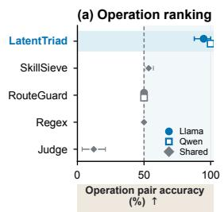

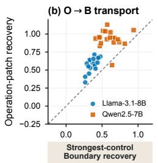

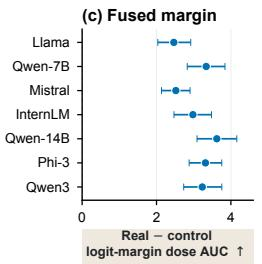

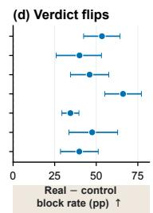  
Figure 4: Operation interventions change Boundary states and frozen policy verdicts. (a) Operation ranking. (b) One-layer Boundary recovery. (c,d) Seven-depth intervention effects on margins and eligible verdicts. Bars are 95% intervals; (c,d) use source-stratified family bootstrap.

Branch activity is measured on unpatched benign targets. Verdict ∆ is the full-dose real-minusrandom pass-to-block rate among eligible pairs.

Natural malicious-over-benign PairAcc is 86–92%. The real trajectory patch produces positive Boundary-recovery, Boundary-head, Operation-head, and fused logit-margin dose responses on all seven backbones after Holm correction $( p _ { \mathrm { H } } < 1 0 ^ { - 3 }$ throughout). Geometry also responds on five. The final logit-margin dose AUC ranges from 2.465 to 3.621. Depending on the backbone, 51–61 of the 100 pairs are threshold-eligible. Within this set, the real patch raises pass-to-block flips by 34.5–66.1 percentage points over the norm-matched controls; every interval excludes zero. The single-depth experiment tests O→B influence. The multi-depth experiment measures joint threebranch response and verdict sensitivity under compact extraction; neither isolates Boundary as the necessary mediator of the fused decision.

Table 30: Extraction and readout configurations by study. Atom limits are D/O maxima.
<table><tr><td>Study</td><td>Atoms</td><td>Readout</td><td>Evidence scope</td></tr><tr><td>Package detection</td><td>8/256</td><td>Concatenated logistic</td><td>Content-component-disjoint folds</td></tr><tr><td>White-box / broker</td><td>8/256</td><td>Fixed application probes</td><td>Matched-pair-disjoint folds; rewrites and request policies</td></tr><tr><td>Multi-depth intervention</td><td>8/24</td><td>Fixed application probes</td><td>Same fitted heads; compact extraction for intervention</td></tr><tr><td>Compact runtime</td><td>8/24</td><td>Member CDF scores</td><td>Llama-3.1-8B and Qwen2.5-7B timing</td></tr></table>

Table 31: Compact 8/24-atom CDF-consensus timing. Each backbone has 360 paired measurements. Incremental time includes hook callbacks, D/O/B pooling, feature construction, CDF calibration, and scoring; hook setup is excluded.
<table><tr><td>Backbone</td><td>Stage</td><td>Mean ms</td><td>Median ms</td><td>P95 ms</td><td>Std. ms</td></tr><tr><td rowspan="3">Llama-3.1-8B</td><td>Native prefill</td><td>334.1</td><td>219.4</td><td>905.2</td><td>365.8</td></tr><tr><td>LATENTTRIAD incremental</td><td>64.6</td><td>64.7</td><td>71.1</td><td>9.1</td></tr><tr><td>Prefill + detector</td><td>398.7</td><td>283.9</td><td>1028.4</td><td>367.9</td></tr><tr><td rowspan="3">Qwen2.5-7B</td><td>Native prefill</td><td>310.8</td><td>202.7</td><td>838.5</td><td>333.8</td></tr><tr><td>LATENTTRIAD incremental</td><td>56.4</td><td>56.1</td><td>62.0</td><td>9.6</td></tr><tr><td>Prefill + detector</td><td>367.2</td><td>258.7</td><td>896.5</td><td>334.5</td></tr></table>

## F RUNTIME AND RESOURCE ACCOUNTING

## F.1 MEASUREMENT PROTOCOL AND COSTS

Runtime measurements use the compact CDF-consensus configuration, rather than the package de tector. Table 30 lists the extraction and scoring settings for each study.

The compact measurements use one RTX 4090 host with Python 3.12.13, PyTorch 2.6.0, CUDA 12.4, Transformers 5.13.0, BF16, SDPA, and batch size one. After 20 warmups, we measure 120 MalSkillBench packages per backbone three times with GPU synchronization. This yields 360 paired measurements per backbone. Six empirical token-length bins contribute 20 packages each. Labels and detector scores do not affect selection. Peak process GPU memory is 17,574 MiB for Llama and 17,242 MiB for Qwen.

The frozen timing benchmark subtracts a paired no-hook prefill from the instrumented forward and scoring interval. The increment includes hook callbacks, D/O/B pooling, projections, feature construction, member-level CDF calibration, and consensus scoring. Model loading, tokenization and sample preparation, bundle/projection loading, and hook registration/removal occur outside the timed interval. It aggregates Boundary and Operation member margins by their medians and Geometry by its maximum. Its 64.7 ms Llama and 56.1 ms Qwen median increments measure this compact pipeline, not the current 256-atom, concatenated-logistic Large-ID pipeline.

The capability-broker’s greedy typed-request generation is not included in detector increments. Table 31 separates native prefill from detector overhead; neither overhead alone nor the compact configuration establishes total agent latency or the full Large-ID configuration’s runtime.

## G CONTROLLED PRE-ACTION REPRESENTATION STUDIES

These studies distinguish information accessible to a diagnostic readout from the performance of the deployed detector. Unless specified otherwise, the three backbones are Llama-3.1-8B, Qwen2.5-7B, and Mistral-7B-v0.3. B32 and O32 read 32-dimensional Boundary and Operation representations, respectively. The independent-state (Ind.192) and residual-feature (Rel.192) readouts each use 192 features. They differ from the full-width Boundary and 735-dimensional Geometry components in Large-ID. These studies do not change the reported package detector or its threshold.

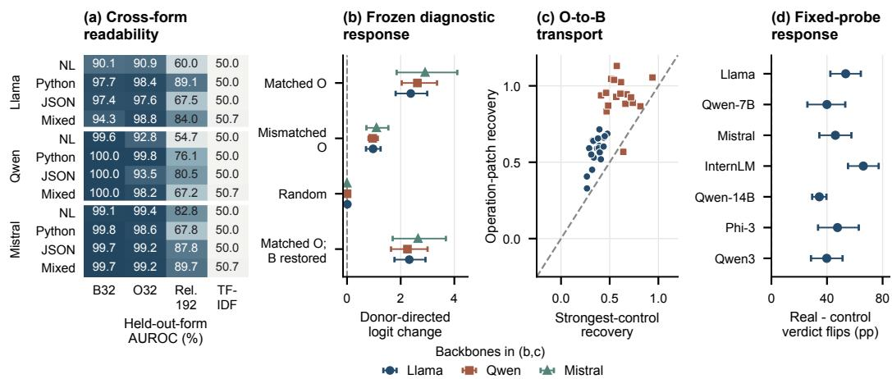  
Figure 5: Pre-action operation information is readable across forms and functionally affects frozen judgments. (a) Cross-form AUROC. (b) Diagnostic logit shifts. (c) One-layer Boundary recovery by family. (d) Compact-probe verdict flips relative to controls. Intervals are 95% bootstrap CIs; intervention protocols differ across (b–d).

Table 32: Cross-form risk AUROC (%). All seven readouts and all form holdouts; five domaindisjoint folds.
<table><tr><td>Model</td><td>Test form</td><td>B32</td><td>032</td><td>D32</td><td>Ind.192</td><td>Rel.192</td><td>TF-IDF</td><td>Length</td></tr><tr><td>Llama</td><td>All</td><td>99.75</td><td>99.98</td><td>50.00</td><td>99.28</td><td>99.77</td><td>50.23</td><td>50.00</td></tr><tr><td>Llama</td><td>NL</td><td>90.09</td><td>90.92</td><td>50.00</td><td>89.26</td><td>59.98</td><td>50.00</td><td>50.00</td></tr><tr><td>Llama</td><td>Python</td><td>97.66</td><td>98.36</td><td>50.00</td><td>92.12</td><td>89.09</td><td>50.02</td><td>50.00</td></tr><tr><td>Llama</td><td>JSON</td><td>97.44</td><td>97.63</td><td>50.00</td><td>87.83</td><td>67.54</td><td>50.00</td><td>50.00</td></tr><tr><td>Llama</td><td>Mixed</td><td>94.33</td><td>98.81</td><td>50.00</td><td>89.33</td><td>84.02</td><td>50.70</td><td>50.00</td></tr><tr><td>Qwen</td><td>All</td><td>100.00</td><td>99.86</td><td>50.00</td><td>99.89</td><td>99.93</td><td>50.23</td><td>50.00</td></tr><tr><td>Qwen</td><td>NL</td><td>99.59</td><td>92.81</td><td>50.00</td><td>78.59</td><td>54.66</td><td>50.00</td><td>50.00</td></tr><tr><td>Qwen</td><td>Python</td><td>100.00</td><td>99.80</td><td>50.00</td><td>95.00</td><td>76.08</td><td>50.02</td><td>50.00</td></tr><tr><td>Qwen</td><td>JSON</td><td>100.00</td><td>93.47</td><td>50.00</td><td>88.52</td><td>80.52</td><td>50.00</td><td>50.00</td></tr><tr><td>Qwen</td><td>Mixed</td><td>99.95</td><td>98.21</td><td>50.00</td><td>98.20</td><td>67.23</td><td>50.70</td><td>50.00</td></tr><tr><td>Mistral</td><td>All</td><td>99.88</td><td>98.86</td><td>50.00</td><td>99.99</td><td>99.95</td><td>50.23</td><td>50.00</td></tr><tr><td>Mistral</td><td>NL</td><td>99.14</td><td>99.41</td><td>50.00</td><td>90.91</td><td>82.81</td><td>50.00</td><td>50.00</td></tr><tr><td>Mistral</td><td>Python</td><td>99.75</td><td>98.59</td><td>50.00</td><td>96.15</td><td>67.79</td><td>50.02</td><td>50.00</td></tr><tr><td>Mistral</td><td>JŠON</td><td>99.66</td><td>99.20</td><td>50.00</td><td>75.42</td><td>87.85</td><td>50.00</td><td>50.00</td></tr><tr><td>Mistral</td><td>Mixed</td><td>99.67</td><td>99.22</td><td>50.00</td><td>93.67</td><td>89.69</td><td>50.70</td><td>50.00</td></tr></table>

## G.1 RISK PREDICTION ACROSS EXPRESSION FORMS

The controlled dataset has 800 examples from ten domain blocks, five task–operation compatibility rules, and four expression forms: natural language, Python plans, JSON configuration, and mixed text. Matched operations preserve the trusted task and vary whether the selected object satisfies its compatibility rule. Same-group variants stay together. Five folds hold out domain blocks; the all-forms condition includes every form in training and test. Each of the four leave-one-form-out conditions excludes its test form from both training and development and evaluates it on held-out domains.

All projections and benign-reference maps fit on training examples. Development selects layer, logistic regularization, and the operating threshold. Ind.192 constructs features separately from each state; Rel.192 includes benign transport residuals. B32, O32, and D32 read one region, while TF-IDF and length provide text controls. The seven methods, three models, and five settings yield 105 aggregate metric rows. Table 32 reports all settings. Each all-forms evaluation uses 800 examples; each held-out-form evaluation uses 200.

Table 33: Donor-directed diagnostic logit changes. Intervals resample ten domains.
<table><tr><td>Condition</td><td>Llama</td><td>Qwen</td><td>Mistral</td></tr><tr><td>Matched O</td><td>2.376 [1.812, 2.988]</td><td>2.622 [2.038, 3.353]</td><td>2.909 [1.849, 4.110]</td></tr><tr><td>Matched O, B restored</td><td>2.320 [1.768, 2.924]</td><td>2.251 [1.640, 3.001]</td><td>2.646 [1.701, 3.685]</td></tr><tr><td>Norm-matched random</td><td>0.011 [0.007, 0.015]</td><td>0.002 [-0.006, 0.008]</td><td>-0.004 [-0.011, 0.002]</td></tr><tr><td>Mismatched O</td><td>0.971 [0.708, 1.251]</td><td>0.957 [0.801, 1.146]</td><td>1.097 [0.722, 1.540]</td></tr><tr><td>Unrelated D</td><td>0.115 [-0.011, 0.260]</td><td>0.158 [0.060, 0.243]</td><td>-0.019 [-0.053, 0.021]</td></tr><tr><td>Unpatched</td><td>0.000 [0.000, 0.000]</td><td>0.000 [0.000, 0.000]</td><td>0.000 [0.000, 0.000]</td></tr><tr><td>Sham</td><td>0.000 [0.000, 0.000]</td><td>0.000 [0.000, 0.000]</td><td>0.000 [0.000, 0.000]</td></tr></table>

AUROC pools out-of-fold predictions from frozen heads. Intervals resample the ten domain blocks 5,000 times, keeping related variants together. Paired AUROC tests enumerate the 1,024 domainlevel method-score swaps and apply Holm correction to three prespecified comparisons per model and setting. In all-forms evaluation, Rel.192 exceeds TF-IDF on all three backbones (corrected $p = 0 . 0 0 5 8 6 )$ , but does not significantly exceed B32 or Ind.192. This comparison concerns the fitted lexical baseline, not every possible static analyzer.

Pairwise ordering and pooled ranking measure different properties. On many holdouts, matched-pair accuracy remains high even when pooled AUROC decreases. Score scales can differ across domains and independently fitted fold heads. For example, Mistral’s held-out Python Rel.192 readout has 67.79% pooled AUROC but 100% matched-pair accuracy. Qwen’s natural-language holdout also loses pairwise ordering, so score-scale changes do not explain every failure. These exploratory comparisons do not select a new calibration or test threshold.

Layerwise distances use training-fitted coordinate standardization. We compare a semanticpreserving form change with a risk-changing operation under fixed form. Form changes dominate whole-vector distances at most depths, despite strong risk readouts. Qwen’s late Boundary states show the opposite ordering; Llama and Mistral do not share this reversal. Pointwise domainbootstrap intervals describe individual depths, without selecting test-set peaks or claiming simulta neous layerwise significance.

## G.2 MATCHED OPERATION INTERVENTIONS

For each of the 800 recipients per model, the all-forms Rel.192 diagnostic and its development threshold remain frozen. At the depth preceding the selected readout, we intervene on Operation states using a donor matched in domain, compatibility rule, expression form, and trusted task. Only the operation object changes. Both benign-to-malicious and malicious-to-benign directions are in cluded. We report the logit-margin change directed toward the donor label, not a probability change or an attack execution rate.

Controls comprise an unchanged forward pass, a sham replacement, same-position norm-matched random perturbations, unrelated Declaration perturbations with matched total energy, norm-matched semantically mismatched donors, and the matched Operation donor followed by restoration of Boundary to its unpatched state. Five random seeds are averaged within each recipient before domain aggregation. They do not increase the independent sample count. Table 33 includes all conditions.

Matched donors flip the frozen diagnostic decision on 46.75%, 34.13%, and 28.75% of recipients on Llama, Qwen, and Mistral, respectively. All four prespecified matched-control contrasts per model pass the domain-level sign-swap test with Holm-corrected $p = 0 . 0 0 7 8 1 2 5$ . Equal corrected values arise from the finite set of domain sign swaps, not equal effect sizes.

Sham effects and verdict flips are zero. Most of the matched-donor effect remains after Boundary restoration: the diagnostic still directly reads O and cross-region residuals. This supports functional sensitivity to the operation intervention without establishing Boundary as a necessary mediator. The separate exact-slot and compact detector-aligned experiments in Appendices E.3 and E.4 retain their own inputs, heads, and statistical units.

(a)  
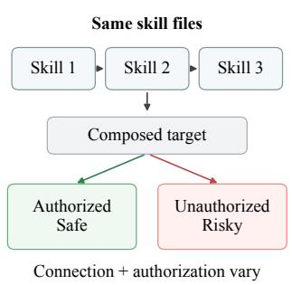

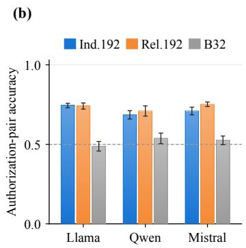

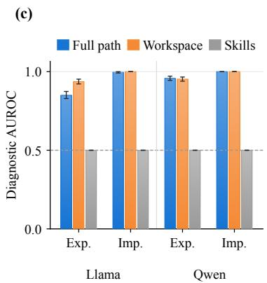  
Figure 6: Risk from skill composition. (a) Fixed-node experiment: identical skill files, varying connections and authorization. (b) Authorization-pair accuracy for independent-state (Ind.192), residual (Rel.192), and Boundary (B32) readouts. (c) CompoSkill diagnostic input ablations under explicit (Exp.) and implicit (Imp.) attacks, not final-detector results. Error bars are 95% bootstrap intervals; dashed lines mark chance.

## G.3 REGION MASKS ON IDENTICAL HIDDEN STATES

D/O are structural proxies, not a natural-language/code partition. The heading parser can treat a #-prefixed line within a code fence as a heading. Across 5,830 packages, this moves the declaration boundary inside a fence in 27 cases (0.46%). We test all 27 affected cases and 27 matched controls on Llama and Qwen. The serialized input, tokens, hidden states, and Boundary state are unchanged; only the D/O pooling masks change.

Neither model changes a binary verdict on the affected cases. Maximum absolute probability changes are 0.30932 on Llama and 0.02283 on Qwen. Thus, this concrete parsing issue does not change decisions in the tested set, but some scores are sensitive to the mask. The experiment is neither a semantic segmentation accuracy estimate nor evidence that all possible region definitions are equivalent. All reported detector results use the same structural parsing rule; this test changes masks only for diagnosis.

## G.4 COMPOSKILL INPUT DEPENDENCE

The monitoring set comprises 344 explicit and 346 implicit malicious–benign pairs: 690 modespecific pairs, or 1,380 records. These are not 690 independent attack families. Their family union contains 361 identities, 329 shared between modes, grouped into 76 scenario/persona role groups. The five threat categories contribute 150 data-exfiltration, 128 memory-tampering, 140 multi-agenthijack, 123 privilege/dangerous-command, and 149 resource-exhaustion pairs.

Input ablations refit diagnostic readouts under the same five role-group folds. They compare the task, workspace, installed nodes, local contexts, and full path, using the original labels for the full paths. A workspace-only TF-IDF readout reaches 98.38% explicit and 100.00% implicit AUROC. Pure-node views are at 50% because each matched pair has identical skill content. On Llama, a full-path diagnostic reaches 84.97/99.62% AUROC (explicit/implicit), versus 93.64/100.00% for workspace only. On Qwen, the corresponding values are 95.75/99.99% and 95.24/100.00%. These are diagnostic refits, not the final path detector.

Workspace cues therefore suffice for strong prediction on this benchmark. This does not mean that the final detector relies only on workspace cues. It means that benchmark accuracy alone cannot identify how the model represents skill dependencies. The controlled fixed-node study below tests that question without directly exposing the final target in the workspace.

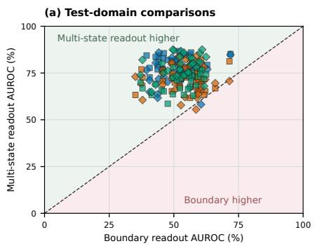

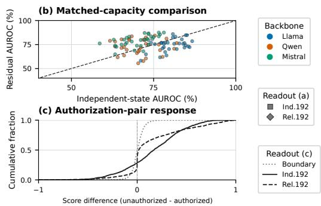  
Figure 7: Multi-state readouts expose controlled composition risk; residual gains vary across domains. (a) Multi-state versus Boundary AUROC by domain. (b) Matched-capacity independentstate versus residual-feature AUROC. (c) Cumulative score differences (unauthorized minus autho rized). Diagonals mark equal AUROC; positive differences indicate correct risk ordering.

## G.5 FIXED-NODE COMPOSITION COUNTERFACTUALS

We fix the bytes of three skill files and cross their connection and authorization settings. The workspace supplies routing and a starting key; the composed finite map determines the target. A deterministic, no-I/O oracle checks whether that target is authorized. The 144 adaptable cases and 31 domain labels are drawn from SCR-CapFlow’s organization, yielding 1,152 bundles and 4,608 four-cell presentations. This is one controlled finite-map mechanism, not 31 independent mecha nisms or the original SCR-Bench attack evaluation.

Five domain-grouped folds keep related variants together. Layers and hyperparameters are selected on development. Input-deletion controls retain the original full-path labels: their chance performance indicates missing information for that label, not safety of a newly defined partial task. Table 34 includes all 19 methods.

Figure 7a contains 186 comparisons: three backbones, 31 domains, and two multi-state readouts. Panel b compares the two 192-dimensional readouts on the same 93 backbone–domain pairs; B32 uses 32 dimensions. For panel c, each backbone contributes 2,304 authorization pairs. The empirical distributions weight backbones and domains equally and retain all held-out pairs. A positive score difference ranks the unauthorized input higher; magnitudes are not calibrated across readouts. Panels share inputs, not independent replicates.

Figure 8 separates the paired responses by backbone. Each panel retains all 2,304 held-out authorization pairs for each multi-state readout, without jitter or filtering. The two readouts share pairs, yielding 13,824 plotted points rather than independent experimental replicates. The diagonal indicates equal numerical score differences, not equivalent calibration across heads.

Independent-state and residual features both use squared transformations and 192 dimensions. Relative to the independent construction, residual AUROC changes by −5.86 [−7.77, −3.92] points on Llama, +1.92 [−1.45, +5.23] on Qwen, and +8.82 [+7.08, +10.51] on Mistral. Holm-corrected paired p values are 0.00080, 0.27275, and 0.00080. The residual contribution therefore depends on the backbone. Comparisons with B32 change feature width and construction as well as the regions read. Using squared features in a readout does not identify a particular nonlinear computation inside the model.

The corresponding composition intervention uses all 4,608 recipients per model, half with changed risk and half with unchanged risk. Matched workspace donors keep skill files and the trusted task fixed. Donor-directed diagnostic margin changes are 0.172/0.292/0.154 for Llama/Qwen/Mistral, versus 0.002/−0.0001/−0.0005 for norm-matched random controls and 0.069/0.084/0.044 for mismatched donors. Restoring B leaves 0.172/0.288/0.158. However, unchanged-risk recipients still flip decisions at 14.92/7.06/8.47%, compared with 14.31/6.85/2.02% on changed-risk recipients. The intervention changes the diagnostic but does not isolate a risk-specific causal effect. It therefore does not establish a universal composition mechanism.

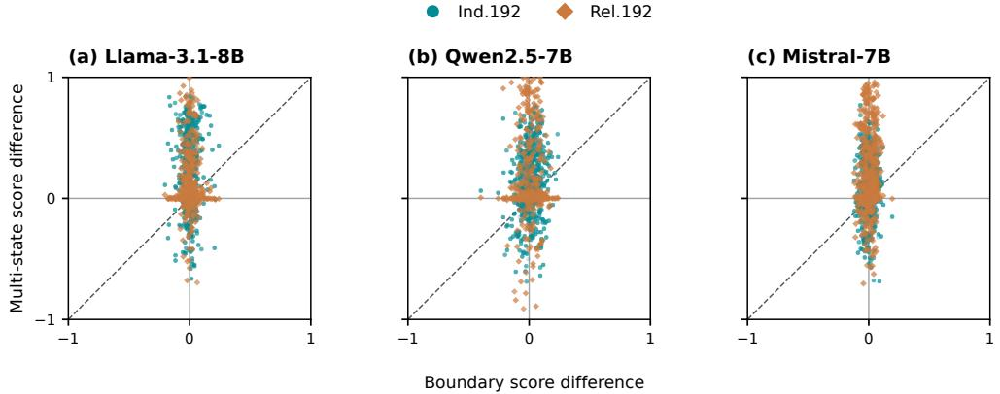  
Figure 8: Authorization-pair responses by backbone. Each point compares Boundary and multistate score differences (unauthorized minus authorized). Positive values indicate correct risk ordering. Colors distinguish the two multi-state readouts; axes use a common scale.

Table 34: Finite-map composition AUROC (%), equally weighted across 31 domain labels. All 19 fixed readouts.
<table><tr><td>Readout</td><td>Llama</td><td>Qwen</td><td>Mistral</td></tr><tr><td>Full-path B32</td><td>50.83</td><td>54.69</td><td>52.77</td></tr><tr><td>Task only</td><td>50.00</td><td>50.00</td><td>50.00</td></tr><tr><td>Workspace only</td><td>50.00</td><td>50.00</td><td>50.00</td></tr><tr><td>Task + workspace</td><td>50.00</td><td>50.00</td><td>50.00</td></tr><tr><td>Skills only</td><td>50.00</td><td>50.00</td><td>50.00</td></tr><tr><td>Node 1</td><td>50.00</td><td>50.00</td><td>50.00</td></tr><tr><td>Node 2</td><td>50.00</td><td>50.00</td><td>50.00</td></tr><tr><td>Node 3</td><td>50.00</td><td>50.00</td><td>50.00</td></tr><tr><td>Local context 1</td><td>50.00</td><td>50.00</td><td>50.00</td></tr><tr><td>Local context 2</td><td>50.00</td><td>50.00</td><td>50.00</td></tr><tr><td>Local context 3</td><td>50.00</td><td>50.00</td><td>50.00</td></tr><tr><td>Node aggregate (32)</td><td>50.00</td><td>50.00</td><td>50.00</td></tr><tr><td>Local aggregate (32)</td><td>49.97</td><td>49.74</td><td>49.99</td></tr><tr><td>Local concatenation (96)</td><td>49.70</td><td>50.03</td><td>50.36</td></tr><tr><td>Local squared (64)</td><td>65.07</td><td>59.20</td><td>65.42</td></tr><tr><td>Independent-state squared (192)</td><td>80.41</td><td>70.77</td><td>70.17</td></tr><tr><td>Relational residual squared (192)</td><td>74.55</td><td>72.68</td><td>78.99</td></tr><tr><td>TF-IDF</td><td>50.00</td><td>50.00</td><td>50.00</td></tr><tr><td>Length</td><td>50.00</td><td>50.00</td><td>50.00</td></tr></table>

## G.6 FULL-ARCHITECTURE STRUCTURAL TRANSFER

The broader synthetic test uses six templates: dictionary binding, role requirements, credential validation, delegation chains, scope intersection, and conditional fallback. Each model has 2,304 inputs: 576 training, 192 development, and 1,536 test presentations. The test uses new opaque symbol assignments, with both single-skill and composed packaging and two neutral-edit variants. The known-template panel trains on all six templates. Six leave-one-template-out panels train on 480 and develop on 160 examples, testing 256 presentations of the omitted template. Template reuse and symbol changes define the generalization axis; these are not independent natural attack mechanisms.

Unlike the pooled diagnostic readouts, this test fits the complete LATENTTRIAD architecture from genuine local atoms at eight depths. It retains 32-dimensional latent coordinates, offsets 300/400/500, the unmodified component-head family, and fixed max–min fusion. The models run in BF16 without quantization, CPU offload, or truncation. Four state-feature controls, Boundary only, and LATENTTRIAD are evaluated on every panel. Independent-linear here is fitted on synthetic training data, whereas the independent-state control in Appendix C.2 is fitted on natural packages.

(a)  
(b)  
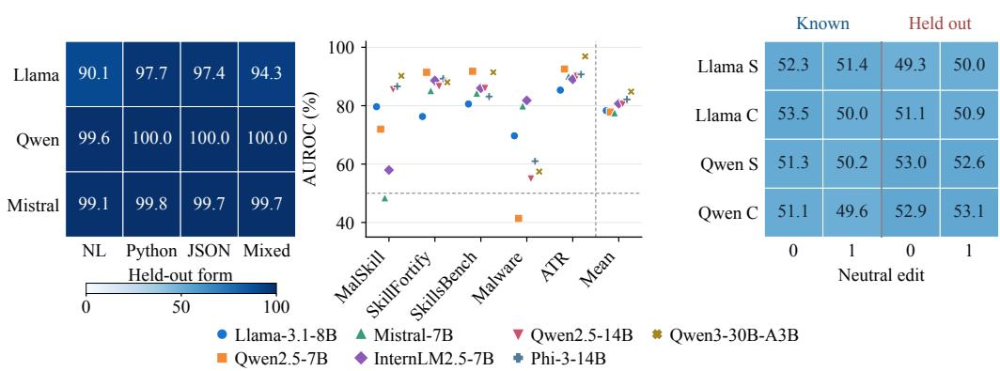  
(c)  
Figure 9: Risk prediction under three kinds of shift. (a) Boundary AUROC with each expression form excluded from training and development. (b) LatentTriad AUROC on five held-out source ecosystems and their macro mean across seven backbones. (c) Full-architecture performance on known- and held-out-template panels, for single (S) and composed (C) packages under neutral edits 0/1. Both heatmaps use the same 0–100% AUROC scale.

Table 35: Full-architecture transfer AUROC (%). Both neutral-edit variants and every control. Heldout values average all six template panels.
<table><tr><td>Model</td><td>Templates</td><td>Edit</td><td>Package</td><td>B</td><td>LT</td><td>Ind.L</td><td>Ind.S</td><td>Orth.S</td><td>Quad.</td></tr><tr><td>Llama</td><td>Known</td><td>0</td><td>Single</td><td>51.01</td><td>52.31</td><td>53.91</td><td>54.02</td><td>53.47</td><td>52.93</td></tr><tr><td>Llama</td><td>Known</td><td>0</td><td>Composed</td><td>51.60</td><td>53.47</td><td>54.46</td><td>54.41</td><td>54.38</td><td>54.18</td></tr><tr><td>Llama</td><td>Known</td><td>1</td><td>Single</td><td>49.87</td><td>51.38</td><td>51.45</td><td>51.24</td><td>51.22</td><td>51.20</td></tr><tr><td>Llama</td><td>Known</td><td>1</td><td>Composed</td><td>49.98</td><td>50.05</td><td>50.93</td><td>50.90</td><td>50.88</td><td>51.03</td></tr><tr><td>Llama</td><td>Held out</td><td>0</td><td>Single</td><td>49.76</td><td>49.25</td><td>50.08</td><td>49.85</td><td>49.72</td><td>49.45</td></tr><tr><td>Llama</td><td>Held out</td><td>0</td><td>Composed</td><td>50.34</td><td>51.06</td><td>50.85</td><td>50.86</td><td>50.62</td><td>50.15</td></tr><tr><td>Llama</td><td>Held out</td><td>1</td><td>Single</td><td>49.72</td><td>50.05</td><td>49.95</td><td>49.84</td><td>50.23</td><td>49.32</td></tr><tr><td>Llama</td><td>Held out</td><td>1</td><td>Composed</td><td>50.54</td><td>50.91</td><td>50.42</td><td>50.29</td><td>50.78</td><td>50.55</td></tr><tr><td>Qwen</td><td>Known</td><td>0</td><td>Single</td><td>49.12</td><td>51.30</td><td>52.85</td><td>53.19</td><td>52.72</td><td>51.50</td></tr><tr><td>Qwen</td><td>Known</td><td>0</td><td>Composed</td><td>50.29</td><td>51.12</td><td>52.08</td><td>52.10</td><td>51.99</td><td>52.03</td></tr><tr><td>Qwen</td><td>Known</td><td>1</td><td>Single</td><td>50.75</td><td>50.16</td><td>52.52</td><td>52.13</td><td>51.35</td><td>52.13</td></tr><tr><td>Qwen</td><td>Known</td><td>1</td><td>Composed</td><td>47.79</td><td>49.64</td><td>50.02</td><td>49.80</td><td>49.30</td><td>49.64</td></tr><tr><td>Qwen</td><td>Held out</td><td>0</td><td>Single</td><td>53.69</td><td>52.96</td><td>53.52</td><td>53.92</td><td>53.81</td><td>52.62</td></tr><tr><td>Qwen</td><td>Held out</td><td>0</td><td>Composed</td><td>51.29</td><td>52.86</td><td>53.52</td><td>53.53</td><td>53.52</td><td>53.24</td></tr><tr><td>Qwen</td><td>Held out</td><td>1</td><td>Single</td><td>51.63</td><td>52.64</td><td>53.32</td><td>53.39</td><td>53.27</td><td>52.72</td></tr><tr><td>Qwen</td><td>Held out</td><td>1</td><td>Composed</td><td>50.65</td><td>53.09</td><td>52.72</td><td>52.90</td><td>53.01</td><td>52.23</td></tr></table>

Table 35 reports all 96 aggregate AUROC cells. Ind.L and Ind.S use independent linear and squared features; Orth.S uses orthogonal squared features; Quad. uses explicit quadratic features. Heldout entries are means of all six template panels, not pooled scores from different fitted heads. We provide descriptive results without treating six constructed templates as a population of independent mechanisms.

For the main neutral variant, LATENTTRIAD AUROC ranges from 49.25% to 53.47%. At both development-calibrated 5% and 10% FPR budgets, LATENTTRIAD and Boundary-only make identical test decisions on every panel and packaging. This identity also holds for the second neutral variant. Development-budget calibration does not ensure the same test FPR: at the 10% budget, test FPR is 3.12–9.38% in known-template panels but 28.65–34.38% under template holdout. This test therefore supports neither stable structural transfer nor a low-FPR advantage over Boundary only. It refits the architecture on synthetic training data; it does not reevaluate the natural-package checkpoints.

Table 36: Same-prompt readout accuracy (%). All three seed means; 384 questions per model, condition, and target.
<table><tr><td>Model</td><td>Object</td><td>Target</td><td>B32</td><td>B128</td><td>Bfull</td><td>Random</td><td>Text</td><td>Options</td></tr><tr><td>Llama</td><td>Inferred</td><td>actual</td><td>55.47</td><td>60.16</td><td>61.46</td><td>47.92</td><td>50.00</td><td>50.00</td></tr><tr><td>Llama</td><td>Inferred</td><td>risk</td><td>49.83</td><td>51.82</td><td>53.39</td><td>50.69</td><td>50.00</td><td>50.00</td></tr><tr><td>Llama</td><td>Supplied</td><td>actual</td><td>67.19</td><td>78.12</td><td>75.52</td><td>47.31</td><td>50.00</td><td>50.00</td></tr><tr><td>Llama</td><td>Supplied</td><td>risk</td><td>59.72</td><td>60.94</td><td>59.90</td><td>49.74</td><td>50.00</td><td>50.00</td></tr><tr><td>Qwen</td><td>Inferred</td><td>actual</td><td>52.00</td><td>52.78</td><td>51.30</td><td>49.39</td><td>50.00</td><td>50.00</td></tr><tr><td>Qwen</td><td>Inferred</td><td>risk</td><td>51.65</td><td>54.51</td><td>53.12</td><td>48.96</td><td>50.00</td><td>50.00</td></tr><tr><td>Qwen</td><td>Supplied</td><td>actual</td><td>81.08</td><td>89.24</td><td>89.84</td><td>48.09</td><td>50.00</td><td>50.00</td></tr><tr><td>Qwen</td><td>Supplied</td><td>risk</td><td>75.09</td><td>79.86</td><td>89.84</td><td>51.22</td><td>50.00</td><td>50.00</td></tr></table>

Table 37: Same-prompt generation accuracy (%). Parentheses count format failures, retained as errors; each denominator is 384.
<table><tr><td>Model</td><td>Object</td><td>Target</td><td>96 tokens</td><td>256 tokens</td><td>512 tokens</td></tr><tr><td>Llama</td><td>Inferred</td><td>actual</td><td>55.47 (166)</td><td>76.30 (42)</td><td>77.60 (32)</td></tr><tr><td>Llama</td><td>Inferred</td><td>risk</td><td>61.72 (77)</td><td>76.56 (3)</td><td>76.56 (3)</td></tr><tr><td>Llama</td><td>Supplied</td><td>actual</td><td>59.90 (139)</td><td>80.21 (15)</td><td>80.21 (13)</td></tr><tr><td>Llama</td><td>Supplied</td><td>risk</td><td>69.27 (87)</td><td>84.64 (8)</td><td>84.90 (4)</td></tr><tr><td>Qwen</td><td>Inferred</td><td>actual</td><td>52.34 (176)</td><td>93.23 (4)</td><td>94.01 (1)</td></tr><tr><td>Qwen</td><td>Inferred</td><td>risk</td><td>23.18 (286)</td><td>92.71 (10)</td><td>94.53 (2)</td></tr><tr><td>Qwen</td><td>Supplied</td><td>actual</td><td>51.82 (185)</td><td>95.05 (18)</td><td>99.74 (0)</td></tr><tr><td>Qwen</td><td>Supplied</td><td>risk</td><td>44.27 (211)</td><td>89.58 (14)</td><td>91.15 (6)</td></tr></table>

The finite-map result and this broader transfer test answer different questions. Retaining local atoms at eight depths does not recover transfer here, so missing local features alone cannot explain the result.

## G.7 SAME-PROMPT READOUTS AND GENERATED JUDGMENTS

This exploratory program test uses three operators (object flow, delegation, and conditional selection), six lexical families, four expression forms, two packaging styles, and both answer orders. Each model has four condition–target panels of 384 questions: the actual object must either be inferred or is supplied, and the target is either the object or its risk. Three operator folds rotate training, development, and test roles. Actual-object and risk heads are trained separately. All three fixed seeds reuse the same questions, so they do not triple the independent support.

For each question, the Boundary readout and generation start from the exact same prompt. The readout uses the first prefill; generation is evaluated at 96, 256, and 512 tokens. Bfull uses the model’s full hidden width rather than a compressed B32/B128 projection. The table reports all fixed methods, including random-training-label and text controls. Development chooses regularization from {0.01, 0.1, 1}, with ties resolved toward smaller values.

Random denotes the B128 random-training-label control; Text uses the full question and Options removes the program. Format failures are counted as errors rather than discarded. In particular, Qwen’s inferred-risk accuracy rises from 23.18% at 96 tokens to 94.53% at 512 tokens, with format failures falling from 286 to 2. A short-budget failure is not evidence that the model cannot solve the task.

Bfull inferred-risk accuracy is 53.39% on Llama and 53.12% on Qwen, compared with 76.56% and 94.53% after 512-token generation. Supplying the actual object raises Bfull to 59.90% and 89.84%. This separates successful generated reasoning from accessibility to the tested fixed linear head. It does not prove that the first prefill lacks the information, that generation creates new knowledge, or that model scale determines detectability.

## H DISCUSSION AND LIMITATIONS

## H.1 SCOPE OF PRE-ACTION RISK READABILITY

Pre-action readouts expose a different capability from generated judgments. On inferred-object prompts, Qwen reaches 94.53% risk-answer accuracy with a 512-token generation budget, versus 53.12% for a full-width linear Boundary readout on the same prompts (Appendix G.7). Supplying the actual operation object raises that Boundary readout to 89.84%. For this probe, reading an explicit task–operation relation is easier than first resolving the operation from an implicit composition. The contrast concerns accessibility to the tested linear head, not the absence of information from the first prefill or generation creating new knowledge.

The intervention protocols also answer distinct questions. A diagnostic that reads O directly can respond to its replacement even when B is restored. The exact-slot experiment measures downstream B displacement, while the compact detector-aligned experiment measures frozen score and verdict changes. These tests establish functional effects in their respective settings; they do not establish B as a necessary mediator or measure an agent’s execution of the patched operation (Appendices G.2, E.3, and E.4).

## H.2 GENERALIZATION BEYOND TRAINING DISTRIBUTIONS

Expression, ecosystem, and structural shifts change different parts of the problem. Held-out-form prediction tests new expressions of the controlled task–operation relations, with domains also held out. Source holdout changes the skill ecosystem and reduces performance despite an advantage over the tested baselines (Section 6.1). Expression transfer therefore supports robustness to the tested forms, not ecosystem-independent screening.

The fixed-node study changes connections and authorization while keeping file bytes fixed. Its multi-state features outperform the tested B-only readout, but the comparison also changes feature width and construction. The broader synthetic study refits the full architecture under new symbol assignments and remains near chance even on known templates (Appendix G.6); it does not reevaluate the natural-package checkpoints. This is a broader inference requirement than decoding an explicit operation’s task consistency. Likewise, strong workspace-only controls on CompoSkill show that benchmark accuracy alone cannot identify which dependency information a detector uses.

## H.3 DEPLOYMENT AND RUNTIME BOUNDARIES

Deployment should select readouts, thresholds, and fusion on independent development data for its detection objective. Geometry-only has the strongest observed F1 and zero observed FPR in the component panel, whereas max(B, O) improves recall, F1, and AUROC over the fixed max– min rule at the same displayed FPR. These comparisons distinguish the representation design from the choice of decision policy. The reported fixed rule remains unchanged; deployment-specific operating points require separate selection rather than choosing a new policy from test outcomes. Zero observed false positives in this panel is not a guarantee for future traffic.

The detector requires white-box access and the input contract in Appendix A.1. It can inspect only content available in the loaded context. Downloads, environment-triggered branches, and externally assembled payloads can reveal behavior absent from that context, motivating permission enforcement and execution-time monitoring alongside screening. The compact configuration’s timing does not measure the full Large-ID pipeline, and broker request decisions do not measure completed-task success. The eligible-subset false-positive increases under white-box rewrites and the limited valid adaptive-rewrite coverage also constrain deployment conclusions (Section 6.3).