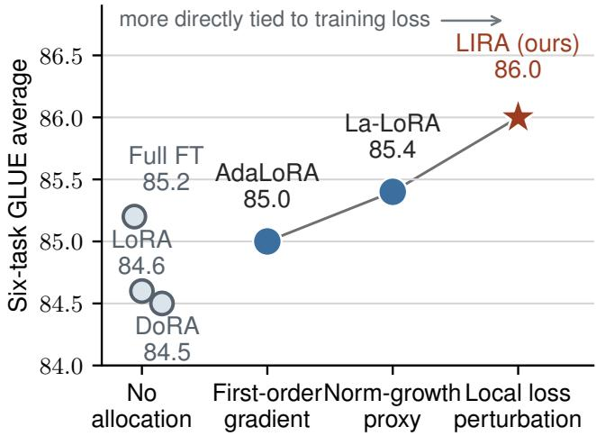
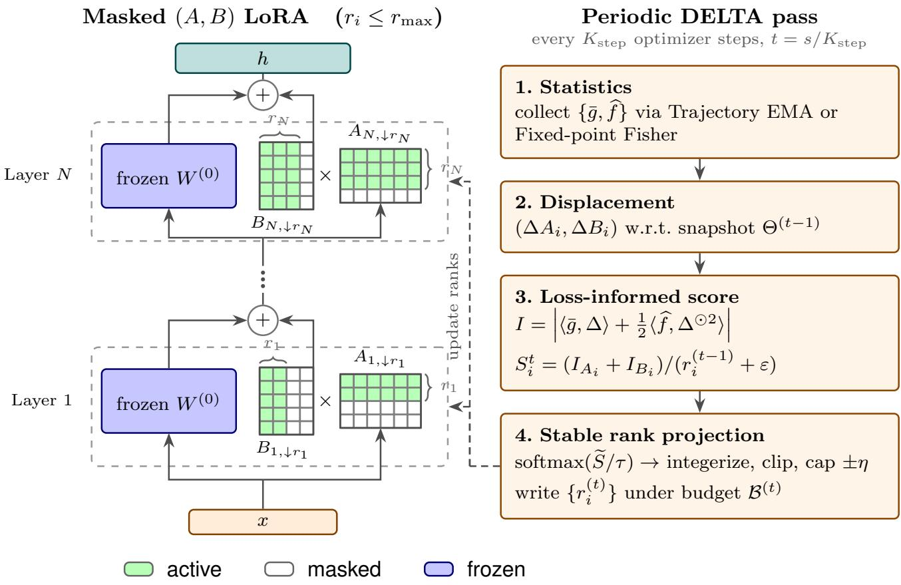
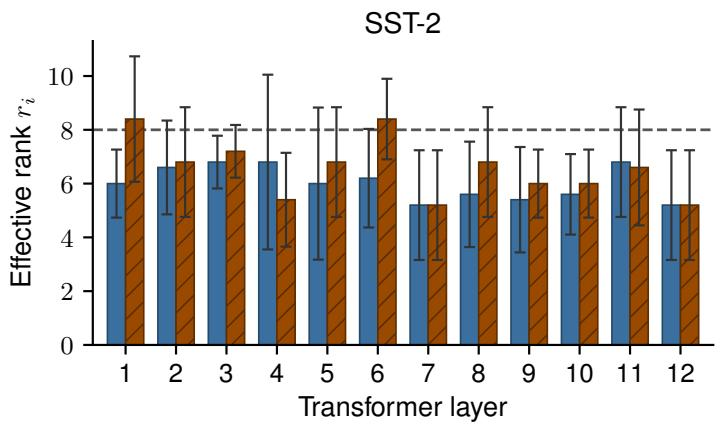
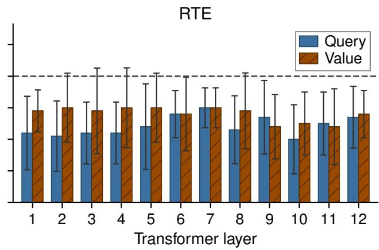

# LIRA: A More Interpretable Dynamic Loss-Informed Rank Allocation for Low-Rank Adaptation

Sihao Wang∗ Bozheng Li∗ Xuemiao Xu

Haoxin Yang Yujie Xu Jie Tang

South China University of Technology

## Abstract

Low-rank adaptation (LoRA) has become a widely used parameter-eficient fine-tuning method for large pretrained models. However, standard LoRA typically assigns a fixed rank profile despite layer- and stage-dependent adaptation needs, while recent adaptive-rank variants often rely on heuristic or first-order signals that provide only an indirect link between rank reallocation and local loss behavior. This leaves the rationale behind each rank reallocation insuficiently interpretable. Motivated by this gap, we propose LIRA (Loss-Informed Rank Allocation), a dynamic-rank LoRA method designed to make online rank reallocation more interpretable. LIRA scores each layer by the estimated magnitude of the local loss perturbation associated with its recent LoRA-factor movements under a second-order approximation, making the basis for each rank change interpretable term by term. By periodically applying DELTA (Displacement-Evaluated Loss-Trajectory Allocation), a displacement-based algorithm for LoRA rank reallocation, LIRA produces discrete efective ranks under matched budgets while remaining compatible with standard (A, B) adapters. On RoBERTa-base GLUE under the La-LoRA/LoRA protocol, LIRA outperforms the uniform-LoRA and adaptive-rank baselines reported under this protocol; Trajectory EMA attains performance competitive with Fixed-point Fisher at lower estimation cost.

## Introduction

Pretrained language models have become the dominant starting point for downstream natural language processing (Devlin et al. 2019; Brown et al. 2020). The standard way to adapt such models is to fine-tune all parameters on task-specific data. However, as model scale grows, full fine-tuning incurs substantial memory and storage costs, especially when many downstream tasks must be served concurrently and each task would otherwise require a separate full model copy.

To address this issue, researchers have proposed parameter-eficient fine-tuning (PEFT) methods that freeze the base model and update only a small set of task-specific parameters (Houlsby et al. 2019; Li and Liang 2021). Lowrank adaptation (LoRA) (Hu et al. 2022) is a representative PEFT method: standard LoRA typically prespecifies a fixed rank profile for all adapted layers. This approach implicitly assumes that diferent layers require similar adaptation capacity throughout fine-tuning.

<table><tr><td>Method</td><td>Allocation unit</td><td>Importance signal</td></tr><tr><td>AdaLoRA</td><td>Singular-value triplets</td><td>Parameter-gradient sensitivity</td></tr><tr><td>IGU-LoRA</td><td>Singular-value triplets</td><td>Integrated gradients with uncertainty-aware smoothing</td></tr><tr><td>La-LoRA</td><td>Layer-wise rank</td><td>Norm growth / layer contribution</td></tr><tr><td>SoRA</td><td>Rank dimension</td><td>Sparse gates</td></tr><tr><td>L1RA</td><td>Rank dimension</td><td>L1-regularized sparse gates</td></tr><tr><td>ALoRA</td><td>Rank dimension</td><td>Validation-time per-rank ablation</td></tr><tr><td>LIRA</td><td>Layer-wise effective rank</td><td>Local loss-perturbation magnitude of ∆A, ∆B, normalized by ri</td></tr></table>

Table 1: Online rank-allocation methods, allocation units, and importance signals.

In practice, however, adaptation needs can vary across modules, tasks, and training stages, so a fixed profile may under-supply some layers while spending capacity on others. This potential mismatch has motivated methods that allocate ranks or budgets dynamically during training. For example, AdaLoRA (Zhang et al. 2023) adjusts singular-value triplets according to parameter–gradient sensitivity, whereas La-LoRA (Gu et al. 2026) allocates layer-wise ranks based on norm growth and layer contribution. Table 1 summarizes representative methods with their allocation units and importance signals.

Despite these advances, Figure 1 shows that existing methods mainly allocate ranks using proxy signals such as firstorder gradients, parameter sensitivity, and norm growth. Although these signals can reflect parameter importance, they do not directly explain how assigning more rank to a highly scored layer improves the training loss. In other words, proxy scores, the resulting rank allocation, and loss improvement still lack an intuitive mathematical connection, which may limit the efective use of a finite rank budget and make the allocation decision dificult to interpret in terms of the training objective.

Motivated by this gap, we propose LIRA (Loss-Informed Rank Allocation), a dynamic-rank LoRA method for online rank reallocation. Under a local second-order approximation, LIRA brings observed LoRA-factor displacements, gradients, and curvature together in an estimate of local loss perturbation, thereby establishing an intuitive mathematical connection between rank allocation and loss optimization. After rank normalization, the resulting perturbation magnitude remains expressed in loss units and can be interpreted as the local loss efect per efective rank of a layer; LIRA then uses this score to reallocate efective ranks. Consequently, each rank adjustment can be traced to specific terms in the loss approximation, making the basis for allocation more interpretable.

  
Figure 1: Six-task GLUE averages by rank-allocation signal. Groups are descriptive rather than an interpretability scale. Baselines are from La-LoRA (Gu et al. 2026).

Our main contributions are as follows:

• For rank scoring interpretability, we derive ranknormalized influence scores from a local second-order loss approximation induced by recent LoRA-factor movements; these scores can be estimated using lightweight training-trajectory statistics or an optional fixed-point Fisher estimate.

• For online LoRA rank allocation, we propose DELTA (Displacement-Evaluated Loss-Trajectory Allocation), which adapts Fisher-inspired influence estimation to the fine-tuning process by using either successive minibatches or optimization-step trajectories as natural samples, and uses the resulting scores to update stable integer per-layer ranks through temperature-softmax targets and discrete projection.

• For empirical validation, under the La-LoRA/LoRA RoBERTa-base GLUE protocol, the two LIRA instantiations—Trajectory EMA and Fixed-point Fisher—achieve six-task averages of 86.0 and 86.1, respectively, both surpassing the cited uniform-LoRA baseline of 84.6 and La-LoRA baseline of 85.4; Trajectory EMA requires no additional statistic-window computation.

## Related Work

## Low-Rank Adaptation with Fixed Rank Profiles

Low-rank adaptation (LoRA) (Hu et al. 2022) keeps pretrained weights frozen and learns a low-rank increment $\Delta W = B A$ for downstream adaptation. Subsequent work refines how this increment is formed or optimized: LoRA+ uses asymmetric learning rates for the two factors (Hayou, Ghosh, and Yu 2024), DoRA applies magnitude–direction decomposition (Liu et al. 2024a), and VeRA combines shared random bases with a small set of trainable coeficients (Kopiczko, Blankevoort, and Asano 2024). Although these methods improve expressiveness or training eficiency, they share one premise: the per-layer rank profile remains fixed throughout fine-tuning, with no active rebalancing of capacity across layers.

Unlike these methods, we do not fix the per-layer rank profile before fine-tuning. Instead, under a limited total rank budget, we dynamically reallocate efective ranks across layers according to the estimated magnitude of each layer’s local loss perturbation. We retain standard (A, B) LoRA and control only each layer’s efective rank—the number of rank components that actually participate in the forward pass. This design adds little extra overhead, fits existing fine-tuning pipelines, and enables fair comparison with uniform-rank LoRA under a matched total budget.

## Online Dynamic Rank and Budget Allocation

Uniformly spreading a limited rank budget across all layers is generally suboptimal. Prior observations show that, under a fixed parameter budget, adapting FFN weights or top layers can outperform adapting attention modules or bottom layers (Zhang et al. 2023). Existing work also explores nonuniform rank profiles at diferent stages and for diferent objectives. FIM-LoRA (Sathyavageeswaran 2026), GoRA (He et al. 2025), and GeLoRA (Ed-dib, Datbayev, and Aboussalah 2025) profile importance before regular fine-tuning, after which their rank configurations are largely static; Dy-LoRA (Valipour et al. 2023) instead targets multi-rank compatibility within a single adapter.

Unlike the above approaches, which determine rank configurations before regular fine-tuning, we focus on online dynamic rank allocation, i.e., adjusting rank or efective capacity during training according to layer importance. Existing online dynamic-rank methods difer primarily in how they construct their importance signals. AdaLoRA (Zhang et al. 2023) scores singular-value triplets by parameter–gradient sensitivity, whereas IGU-LoRA (Cui et al. 2026) uses integrated gradients with uncertainty-aware smoothing. La-LoRA (Gu et al. 2026) relies on norm growth and layer contribution; SoRA (Ding et al. 2023) and L1RA (Singh et al. 2025) employ sparse gates, with $L _ { 1 }$ regularization in L1RA; and ALoRA (Liu et al. 2024b) estimates importance through validation-time per-rank ablation. These methods support non-uniform allocation, but their importance signals do not directly tie rank reallocation to a local loss-perturbation estimate derived from observed training movement.

LIRA instead directly adjusts layer-wise efective rank in standard (A, B) LoRA and scores the factor displacements $\Delta A$ and $\Delta B$ observed between two reallocations. Its local quadratic surrogate combines a first-order gradient– displacement interaction with a curvature term, takes the resulting perturbation magnitude, and normalizes it by the efective rank to obtain a cross-layer per-rank score. Thus, each rank update can be traced to an interpretable estimate of local loss-perturbation magnitude rather than only to a proxy signal.

## Preliminaries

LoRA module. Consider a frozen pretrained linear map with weights $W ^ { ( 0 ) } \in \mathbb { R } ^ { d _ { \mathrm { o u t } } \times d _ { \mathrm { i n } } }$ . Low-rank adaptation (Hu et al. 2022) adds a trainable increment $\Delta W \ { \overset { \cdot } { = } } \ B A$ with $A \in \mathbb { R } ^ { r _ { \operatorname* { m a x } } \times d _ { \operatorname* { i n } } }$ and $B \in \mathbb { R } ^ { d _ { \mathrm { o u t } } \times r _ { \mathrm { m a x } } }$ , where $r _ { \mathrm { m a x } }$ is a perlayer maximum rank cap. The forward pass uses

$$
h = W ^ { ( 0 ) } x + B A x .\tag{1}
$$

Unless stated otherwise, we apply one LoRA module per adapted linear projection. There are $L$ such modules, indexed by $i \in \{ 1 , \ldots , \overline { { L } } \}$ , each with its own $( A _ { i } , B _ { i } )$ and analogous notation indexed by i.

Efective rank and masking. We keep full trainable factors $( A _ { i } , B _ { i } )$ of dimension $r _ { \mathrm { m a x } } .$ , but only the leading $r _ { i }$ components contribute to the forward pass at time t. Concretely, let $A _ { i } ^ { ( t ) } [ 1 { : } r _ { i } ^ { ( t ) } , :$ ] denote the first $r _ { i } ^ { ( t ) }$ rows of $A _ { i }$ and $B _ { i } ^ { ( t ) } [ : , 1 : r _ { i } ^ { ( t ) } ]$ the first $r _ { i } ^ { ( t ) }$ columns of $B _ { i }$ ; here and below, indices start at 1. All remaining rows/columns are masked out (not used in $B _ { i } A _ { i } )$ but may become active later when $r _ { i } ^ { ( t ) }$ increases. We require

$$
r _ { \operatorname* { m i n } } \leq r _ { i } ^ { ( t ) } \leq r _ { \operatorname* { m a x } } , \qquad R ^ { ( t ) } : = \sum _ { i = 1 } ^ { L } r _ { i } ^ { ( t ) } .\tag{2}
$$

Here, $R ^ { ( t ) }$ is the realized total efective rank, whereas $B ^ { ( t ) }$ is the efective-rank budget upper bound; thus, $R ^ { ( t ) } \leq B ^ { ( t ) }$ For a controlled comparison to standard LoRA that uses a uniform rank $r _ { \mathrm { b a s e } }$ on the same modules, one sets the initial efective ranks and any fixed budget so that $R ^ { ( 0 ) } =$ $B ^ { ( 0 ) } = L r _ { \mathrm { b a s e } }$ (or matches active LoRA parameters under an equivalent counting convention).

Training objective. Let L be the downstream loss $( \mathrm { e . g . }$ cross-entropy). Only LoRA parameters and task heads (if any) are updated; $\dot { W } ^ { ( 0 ) }$ stays frozen. We use the same optimizer as standard LoRA training; the following section describes periodic DELTA reallocation on top of ordinary gradient steps.

## Dynamic Loss-Informed Rank Allocation (LIRA)

As motivated in the introduction, dynamic rank allocation should do more than move budget from one layer to another: each reallocation should be tied to an explicit local estimate of how recent parameter movement perturbs the loss. We therefore base the allocation signal on LoRA-factor displacements observed between successive reallocations. The allocator assigns more efective capacity in the next round to layers with a larger estimated local loss-perturbation magnitude. We instantiate LIRA on top of standard $( A , B )$ LoRA with an efective-rank mask. Let $K _ { \mathrm { s t e p } }$ denote the actual reallocation interval used by the training loop, measured in optimizer steps. DELTA is applied every $K _ { \mathrm { s t e p } }$ optimizer steps: Displacement-Evaluated Loss-Trajectory Allocation.

Each DELTA pass starts from interval-relative displacements ∆A and $\Delta B .$ , estimates layer-wise local lossperturbation magnitudes with a quadratic surrogate, normalizes them to per-rank scores $S _ { i } ^ { ( t ) }$ , and obtains integer efective ranks $\{ r _ { i } ^ { ( t ) } \}$ under the efective-rank budget $B ^ { ( t ) }$ . Scoring and allocation therefore revolve around the same lossperturbation score. Capacity is controlled through layer-wise efective ranks—the number of rank components active in the forward pass—which keeps the method compatible with existing training stacks and matched-budget LoRA baselines.

## Overview and Algorithm

Training proceeds for n optimizer steps $s = 1 , \ldots , n .$ After each step we apply a standard forward pass, backward pass, and optimizer update on all LoRA parameters under the current mask. Every $K _ { \mathrm { s t e p } }$ optimizer steps, immediately after an update at $s \in \{ \dot { K } _ { \mathrm { s t e p } } , \dot { 2 } \dot { K _ { \mathrm { s t e p } } } , \hdots \}$ , we run a DELTA pass indexed by $t = s / K _ { \mathrm { s t e p } }$ . The pass collects local gradient statistics, forms interval displacements $( \Delta A , \Delta B )$ on the preceding active-rank support, computes $\{ S _ { i } ^ { ( t ) } \}$ , and projects integer ranks $\{ r _ { i } ^ { ( t ) } \}$ under budget $B ^ { ( t ) }$ (Algorithm 1). Between DELTA passes, masked coordinates receive zero efective gradient; when $r _ { i }$ increases, newly activated rows/columns may be zero-initialized or kept from the original initialization. Figure 2 summarizes the masked $( A , B )$ stack and one DELTA pass.

## Interval Displacement and Loss-Perturbation Scoring

Scoring objective. Under a fixed efective-rank budget, the score for layer i answers a concrete question: what is the estimated magnitude of the local loss perturbation associated with this layer’s recent movement on its efective ranks? DELTA defines $S _ { i } ^ { ( t ) }$ from a loss-perturbation perspective. Under a local second-order Taylor approximation, $S _ { i } ^ { ( t ) }$ estimates the unsigned magnitude associated with layer i’s recent parameter movement. The first-order term captures the gradient–displacement interaction, and the second-order term captures the joint efect of movement magnitude and local loss curvature. Thus, more interpretable is meant in a specific, relative sense: the score is expressed in loss units and computed from observed factor movement rather than an indirect proxy, so at every DELTA pass the basis for adjusting $r _ { i }$ can be decomposed into these two terms and audited against the layer’s recent movement.

Interval-relative increments. Immediately before the tth DELTA pass, the efective rank is $r _ { i } ^ { ( t - 1 ) }$ , and the snapshot from the preceding pass is restricted to the same active support. Let $t ^ { - }$ denote the parameter state immediately before the pass, and let $\Theta ^ { ( t - 1 ) }$ be the active-factor snapshot saved at the preceding pass. The increment between successive DELTA passes is

  
Figure 2: LIRA overview. Standard masked LoRA updates (left) are interleaved every $K _ { \mathrm { s t e p } }$ optimizer steps with a DELTA pass (right), which converts interval displacements into local loss-perturbation magnitudes that combine first- and second-order terms, rank-normalized scores $S _ { i } ^ { ( t ) }$ , and discrete ranks under $B ^ { ( t ) }$

$$
\begin{array} { r l } & { \Delta A _ { i } ^ { ( t ) } = A _ { i , \downarrow r _ { i } ^ { ( t - 1 ) } } ^ { ( t ^ { - } ) } - \Theta _ { A , i } ^ { ( t - 1 ) } , } \\ & { \Delta B _ { i } ^ { ( t ) } = B _ { i , \downarrow r _ { i } ^ { ( t - 1 ) } } ^ { ( t ^ { - } ) } - \Theta _ { B , i } ^ { ( t - 1 ) } . } \end{array}\tag{3}
$$

$\Delta A _ { i } ^ { ( t ) }$ and $\Delta B _ { i } ^ { ( t ) }$ record the actual movement over the preceding $K _ { \mathrm { s t e p } }$ optimizer steps on the ranks active before pass $t .$

From loss perturbation to a readable score. To estimate the efect of this finite displacement on ${ \mathcal { L } } ,$ , we use a local quadratic model following Taylor-based sensitivity analysis in compression and pruning (LeCun, Denker, and Solla 1990; Molchanov et al. 2019; Kim et al. 2024):

$$
\begin{array} { r } { \mathcal { L } ( \boldsymbol { \theta } + \boldsymbol { \delta } ) \approx \mathcal { L } ( \boldsymbol { \theta } ) + \boldsymbol { g } ^ { \top } \boldsymbol { \delta } + \frac { 1 } { 2 } \boldsymbol { \delta } ^ { \top } \mathrm { d i a g } ( \widehat { \boldsymbol { f } } ) \boldsymbol { \delta } , } \end{array}\tag{4}
$$

where $g$ is the local gradient and $\widehat { f }$ is a diagonal Fisher-style curvature proxy (an elementwise second-moment statistic). Applied blockwise to the active part of $A _ { i } ,$ with Frobenius inner product $\begin{array} { r } { \langle U , V \rangle = \sum _ { p , q } { U _ { p q } } ^ { \bullet } V _ { p q } } \end{array}$ , we define the unsigned local loss-perturbation magnitude associated with layer i’s recent A-movement as

$$
I _ { A _ { i } } ^ { ( t ) } \approx \left| \left. \overline { { g } } _ { A _ { i } } ^ { ( t ) } , \Delta A _ { i } ^ { ( t ) } \right. + \frac { 1 } { 2 } \big \langle \widehat { f } _ { A _ { i } } ^ { ( t ) } , ( \Delta A _ { i } ^ { ( t ) } ) ^ { \odot 2 } \big \rangle \right| ,\tag{5}
$$

and analogously $I _ { B _ { i } } ^ { ( t ) }$ on the active block of $B _ { i }$ . The absolute value makes $I _ { A _ { i } } ^ { ( \dot { t } ) }$ and $I _ { B _ { i } } ^ { ( t ) }$ unsigned magnitudes rather than signed loss increases or decreases. We score magnitude because either sign indicates that the loss is locally sensitive to movement on the layer’s active components: a large predicted decrease marks adaptation in progress, and a large predicted increase marks movement through a high-curvature region, both of which warrant capacity; a near-zero perturbation instead indicates that recent movement barely engages the loss, so the layer’s rank can be reallocated. This use of unsigned magnitudes mirrors Taylor-based importance criteria in pruning (LeCun, Denker, and Solla 1990; Molchanov et al. 2019). Combining them and dividing by the efective rank during the preceding interval yields a per-rank score comparable across layers:

$$
S _ { i } ^ { ( t ) } = \frac { I _ { A _ { i } } ^ { ( t ) } + I _ { B _ { i } } ^ { ( t ) } } { r _ { i } ^ { ( t - 1 ) } + \varepsilon } .\tag{6}
$$

Algorithm 1 LIRA fine-tuning with periodic DELTA   
Require: $r _ { \operatorname* { m a x } } , r _ { \operatorname* { m i n } } ,$ budget B (fixed or scheduled as $B ^ { ( t ) } ) ;$   
reallocation interval $\bar { K } _ { \mathrm { s t e p } }$ (optimizer steps); L LoRA   
modules; initial ranks $\{ r _ { i } ^ { ( 0 ) } \}$ ; temperature τ ; step cap η;   
$\varepsilon > 0$   
1: Initialize $( A _ { i } , B _ { i } ) ;$ set efective ranks $\{ r _ { i } ^ { ( 0 ) } \}$ ; snapshot   
active factors $\Theta ^ { ( 0 ) } \gets \{ ( A _ { i } , B _ { i } ) _ { \downarrow r _ { i } ^ { ( 0 ) } } \}$   
2: for $s = 1 , \ldots , n$ do   
3: Forward/backward/optimizer update under current   
masks   
4: if s mod $K _ { \mathrm { s t e p } } = 0$ then   
5: $t \gets s / K _ { \mathrm { s t e p } } ;$ set $B ^ { ( t ) }$ (else $B ^ { ( t ) }  B )$   
6: Collect $\{ \bar { g } , \hat { f } \}$ via Trajectory EMA or Fixed-point   
Fisher (score estimation)   
7: for each layer $i = 1 , \ldots , L$ do   
8: $\Delta A _ { i } , \Delta B _ { i }$ ← current factors minus $\Theta ^ { ( t - 1 ) }$ , both   
on support $r _ { i } ^ { ( t - 1 ) }$   
9: ${ { I } _ { { A _ { i } } } } , { { I } _ { { B _ { i } } } } \gets$ local loss-perturbation magnitudes   
under $( { \bar { g } } , { \hat { f } } )$   
10: $S _ { i } ^ { ( t ) } \gets ( I _ { A _ { i } } + I _ { B _ { i } } ) / ( r _ { i } ^ { ( t - 1 ) } + \varepsilon )$   
11: end for   
12: Optionally z-score $\{ S _ { i } ^ { ( t ) } \}$ to obtain $\widetilde { S } ^ { ( t ) }$   
13: $w ^ { ( t ) } \gets \mathrm { s o f t m a x } ( \widetilde { S } ^ { ( t ) } / \tau ) ; \widehat { r } _ { i } ^ { ( t ) } \gets w _ { i } ^ { ( t ) } \mathcal { B } ^ { ( t ) }$   
14: Integerize $\{ \widehat { r } _ { i } ^ { ( t ) } \}$ (largest remainders); clip to   
$[ r _ { \operatorname* { m i n } } , r _ { \operatorname* { m a x } } ]$   
15: Cap per-layer change by $\pm \eta ;$ cancel decreases if   
$R ^ { ( t ) }$ would fall below $\dot { R _ { \mathrm { m i n } } ^ { ( t ) } }$   
16: Apply decreases first, then fund increases from   
freed/residual budget (rank projection)   
17: Write $\{ r _ { i } ^ { ( t ) } \}$ ; refresh snapshot $\Theta ^ { ( t ) } ;$ optionally an  
neal $\tau \gets$ max $( \tau _ { \operatorname* { m i n } } , \rho \tau )$   
18: end if   
19: end for

Higher $S _ { i } ^ { ( t ) }$ means that layer i has a larger local lossperturbation magnitude per efective rank during the preceding interval; DELTA therefore assigns it a larger rank target in the current round.

Estimating gradients and curvature. To estimate $\overline { { g } }$ and ${ \widehat { f } } ,$ we treat gradients from successive mini-batches along the fine-tuning trajectory as approximate samples from the same underlying data distribution. Under this assumption, mean gradients and elementwise squared gradients can be accumulated from gradients produced naturally during training; when an estimate closer to a fixed empirical Fisher at a reallocation point is desired, additional sampling near that point is also possible. We use two implementations: (A) Trajectory EMA. Between DELTA passes, maintain running means and elementwise squared gradients on LoRA parameters (e.g., reuse Adam/AdamW moments with implementation-specific scaling). Overhead is small and the statistics evolve along the optimization path. (B) Fixed-point Fisher window. At a selected DELTA step, freeze LoRA parameters, run $N _ { \mathrm { s t a t } }$ extra forward/backward passes without updates, average gradients and squared gradients at that point, then resume training. This is closer to a textbook empirical Fisher estimate but requires additional forward/backward computation. A short warm-up before the first DELTA pass helps stabilize the moment estimates.

## Rank Projection under an Allocation Budget

Given $\{ S _ { i } ^ { ( t ) } \}$ , DELTA converts these scores into integer ranks under the efective-rank budget upper bound $\bar { \boldsymbol { B } } ^ { ( t ) }$ . Since score standardization and the softmax preserve the ordering of the scores, layers with higher local lossperturbation scores receive larger rank targets.

Softmax targets under a budget. We may first standardize $\{ S _ { i } ^ { ( t ) } \}$ across layers (z-score), denoting the standardized score by $\widetilde { S } _ { i } ^ { ( t ) }$ ; when standardization is disabled, let $\widetilde { S } _ { i } ^ { ( t ) } = S _ { i } ^ { ( t ) }$ . We then define

$$
w _ { i } ^ { ( t ) } = \frac { \exp ( \widetilde { S } _ { i } ^ { ( t ) } / \tau ) } { \sum _ { j = 1 } ^ { L } \exp ( \widetilde { S } _ { j } ^ { ( t ) } / \tau ) } ,\tag{7}
$$

and continuous targets $\widehat { r } _ { i } ^ { ( t ) } = w _ { i } ^ { ( t ) } B ^ { ( t ) }$ . The temperature τ trades of between uniform allocation (large τ ) and concentrating budget on high-scoring layers (small τ ); we optionally anneal τ after each DELTA pass.

Discrete projection and bounded rank moves. We first integerize $\{ \widehat { r } _ { i } ^ { ( t ) } \}$ by flooring and assigning residual units to the largest fractional parts, then clip to $[ r _ { \operatorname* { m i n } } , r _ { \operatorname* { m a x } } ]$ . Direct jumps to these targets can still be abrupt, so each layer’s change is capped by a step size η (which may be set directly or, in one implementation, is set from $r _ { \mathrm { m i n } } .$ , the initial rank, and the expected number of DELTA passes). Decreases are applied first; residual efective-rank budget under $B ^ { ( t ) }$ then funds increases in a round-robin over layers whose continuous targets exceed their current ranks. To prevent the realized total rank from falling too low, we impose

$$
R _ { \operatorname* { m i n } } ^ { ( t ) } = \operatorname* { m a x } ( \gamma B ^ { ( t ) } , L r _ { \operatorname* { m i n } } ) ,\tag{8}
$$

and cancel the weakest tentative decreases whenever the projected $R ^ { ( t ) }$ would violate this floor.

Global budget scheduling. The efective-rank budget upper bound $B ^ { ( t ) }$ may also vary over training (e.g., cosine decay from an initial budget to a target value), playing a role similar to the descending budget scheduler in AdaLoRA (Zhang et al. 2023). Within each budget level, layer-wise splits are still determined by $S _ { i } ^ { ( t ) }$ . If no scheduler is used, $B ^ { ( t ) }$ remains the fixed constant B throughout fine-tuning.

## Experiments

We evaluate LIRA on RoBERTa-base GLUE following the protocol reported for La-LoRA, a recent adaptive-rank LoRA variant. Unless otherwise stated, the main results use the Trajectory EMA estimator for local loss-perturbation scores; we also evaluate the Fixed-point Fisher window estimator as an alternative.

<table><tr><td>Method</td><td>Active Params.</td><td>SST-2</td><td>MRPC</td><td>CoLA</td><td>QNLI</td><td>RTE</td><td>STS-B</td><td> $\operatorname { A v g } .$ </td></tr><tr><td>Full FT</td><td>125M</td><td>94.8</td><td>90.2</td><td>63.6</td><td>92.8</td><td>78.7</td><td>91.2</td><td>85.2</td></tr><tr><td>LoRA (Hu et al. 2022)</td><td>0.3M</td><td>94.0</td><td>88.7</td><td>63.4</td><td>92.4</td><td>78.6</td><td>90.5</td><td>84.6</td></tr><tr><td>AdaLoRA (Zhang et al. 2023)</td><td>0.3M</td><td>94.8</td><td>88.8</td><td>63.2</td><td>92.9</td><td>79.0</td><td>91.1</td><td>85.0</td></tr><tr><td>DoRA (Liu et al. 2024a)</td><td>0.3M</td><td>93.5</td><td>87.6</td><td>64.2</td><td>91.0</td><td>79.7</td><td>91.0</td><td>84.5</td></tr><tr><td>La-LoRA (Gu et al. 2026)</td><td>0.3M</td><td>94.8</td><td>88.0</td><td>65.0</td><td>92.9</td><td>80.4</td><td>91.0</td><td>85.4</td></tr><tr><td>LIRA (ours)</td><td>0.3M†</td><td>95.3</td><td>90.1</td><td>65.3</td><td>93.0</td><td>81.5</td><td>91.1</td><td>86.0</td></tr></table>

Table 2: RoBERTa-base GLUE development results. LIRA entries report five-seed means, and all values are shown to one decimal place; baseline values are taken from Table 5 of La-LoRA (Gu et al. 2026). Best results are boldfaced, and second-best results are underlined. † The reported count is the active forward-pass parameter budget, matched to uniform LoRA with efective rank $r = 8 ;$ LIRA additionally stores masked factors up to $r _ { \mathrm { m a x } }$ per layer. The Avg. column is the arithmetic mean of the six task means. The complete main-results table is provided in the supplementary material.

## Experimental Setup

Protocol and baselines. We follow the RoBERTabase (Liu et al. 2019) GLUE (Wang et al. 2018) setting reported by La-LoRA (Gu et al. 2026), which adopts the LoRA configuration in Table 9 of Hu et al. (2022). We use AdamW with linear decay and a warmup ratio of 0.06, a maximum sequence length of 512, and adapters on the query and value projections; MRPC, RTE, and STS-B do not use MNLI-checkpoint initialization. As in La-LoRA, we run five random seeds and report the mean over seeds; within each run we take the best development epoch. We report Matthews correlation on CoLA, Pearson correlation on STS-B, and accuracy on the remaining tasks. Results for Full Fine-Tuning, LoRA, AdaLoRA, DoRA, and La-LoRA are taken from Table 5 of Gu et al. (2026).

LIRA configuration. We match the cited uniform LoRA setting with base rank $r _ { \mathrm { b a s e } } = 8 \colon { \mathrm { D E L T A } }$ reallocates across the L adapted modules under the efective-rank budget upper bound $\ r _ { B } \stackrel { - } { = } L r _ { \mathrm { b a s e } }$ . After discrete projection, the realized total efective rank R may be lower than this upper bound. Each layer stores factors up to a capacity $r _ { \mathrm { m a x } } \geq r _ { \mathrm { b a s e } }$ (typically $r _ { \operatorname* { m a x } } = 1 6 )$ , while only the leading efective ranks enter the forward pass. DELTA uses a task-specific optimizer-step interval $K _ { \mathrm { s t e p } }$ . Task intervals are specified by an epoch-length multiplier $c _ { \mathrm { e p o c h } }$ . Let each data-parallel replica contain E optimizer steps per epoch and let W denote the data-parallel world size; then

$$
K _ { \mathrm { s t e p } } = \operatorname* { m a x } \{ 1 , \lfloor c _ { \mathrm { e p o c h } } E W \rfloor \} .\tag{9}
$$

Unless noted, local loss-perturbation scores use Trajectory EMA with the second-order diagonal term enabled.

## Main Results on GLUE

Table 2 reports the main comparison. With a matched efective-rank budget, LIRA improves the six-task average by approximately 1.4 points over the reported LoRA result and 0.6 points over the reported La-LoRA result. Relative to LoRA, the largest gains are on RTE and CoLA; relative to La-LoRA, they are on MRPC and RTE.

Figure 3 shows the corresponding end-of-training allocations on SST-2 and RTE. Query and value adapters receive diferent ranks within the same block, and both profiles are non-uniform relative to $r _ { \mathrm { b a s e } } = 8 .$ . The task-specific allocation patterns also difer: SST-2 concentrates relatively more rank in middle and early value adapters, whereas RTE assigns lower ranks overall and redistributes them diferently across depth. This supports the premise that adapter importance depends on both layer and task, rather than following a single shared ranking over blocks.

<table><tr><td>Task</td><td>Trajectory EMA</td><td>Fixed-point Fisher</td></tr><tr><td>SST-2</td><td>95.25</td><td>95.32</td></tr><tr><td>MRPC</td><td>90.05</td><td>90.29</td></tr><tr><td>CoLA</td><td>65.26</td><td>65.86</td></tr><tr><td>QNLI</td><td>92.96</td><td>93.01</td></tr><tr><td>RTE</td><td>81.52</td><td>80.94</td></tr><tr><td>STS-B</td><td>91.11</td><td>91.07</td></tr><tr><td>Average</td><td>86.03</td><td>86.08</td></tr></table>

Table 3: Trajectory EMA and Fixed-point Fisher under the same local loss-perturbation score, efective-rank budget, and five-seed GLUE protocol. Values are five-seed means reported to two decimal places; best results are boldfaced, and task metrics follow Table 2.

## Trajectory EMA vs. Fixed-Point Fisher Window

The Method section introduces two estimators of $( { \overline { { g } } } , { \widehat { f } } )$ . Table 3 compares them under the same budgets and reallocation schedules.

The two estimators give similar averages (86.03 versus 86.08), with Fixed-point Fisher slightly higher. Although Fisher has a slightly higher average, Table 2 uses Trajectory EMA as the representative estimator. It reuses statistics already available along the optimization path and avoids extra frozen forward/backward passes at each DELTA step. Fixedpoint Fisher remains useful when a closer empirical-Fisher estimate at the reallocation point is preferred and the additional computation is acceptable.

## Ablation of Key Components

LIRA computes layer-wise local loss-perturbation scores from LoRA-factor displacements within each DELTA reallocation interval. We examine two key designs: the diagonal Fisher-style curvature term that supplies local second-order information in Trajectory EMA, and per-efective-rank averaging, $1 / ( r _ { i } ^ { ( t - 1 ) } + \varepsilon )$ , which converts total layerwise magnitude into an average per efective rank. For each ablation, we remove only one design while holding the model, optimizer, efective-rank budget, and DELTA schedule fixed relative to full LIRA.

Figure 3: Final efective-rank profiles after DELTA (Trajectory EMA; five-seed means) on SST-2 and RTE. Each bar represents the query or value adapter at one RoBERTa-base transformer layer; the dashed line marks the uniform baseline $r _ { \mathrm { b a s e } } = 8 .$ Both tasks reallocate away from a uniform profile under the shared budget upper bound $L r _ { \mathrm { b a s e } } ,$ while the realized total efective rank may remain below this bound after discrete projection.
<table><tr><td>Variant</td><td>SST-2</td><td>MRPC</td><td>CoLA</td><td>QNLI</td><td>RTE</td><td>STS-B</td><td>Avg.</td></tr><tr><td>w/o 2nd-order term</td><td>94.89</td><td>89.56</td><td>64.50</td><td>92.63</td><td>80.14</td><td>90.80</td><td>85.42</td></tr><tr><td>w/o per-effective-rank averaging</td><td>94.91</td><td>89.61</td><td>64.21</td><td>92.71</td><td>78.70</td><td>90.91</td><td>85.17</td></tr><tr><td>LIRA (full)</td><td>95.25</td><td>90.05</td><td>65.26</td><td>92.96</td><td>81.52</td><td>91.11</td><td>86.03</td></tr></table>

Table 4: Ablation of LIRA’s key components. “w/o” removes the stated design; LIRA (full) retains all components. Values are means over five random seeds; best results are boldfaced; task metrics match Table 2.

Second-order curvature. Table 4 shows that full LIRA has higher five-seed means on all six task metrics than the variant without the second-order curvature term. The average gain is 0.61 pp, with gains of 1.38 pp on RTE and 0.76 pp on CoLA. The two terms encode complementary local information: the first-order term measures gradient– displacement interaction, whereas the second-order term incorporates the curvature of the coordinates traversed by the displacement. Without the latter, displacements with similar first-order magnitude but diferent local curvature receive similar scores.

Per-efective-rank averaging. Full LIRA also has higher five-seed means on all six task metrics than the variant without per-efective-rank averaging, with an average gain of 0.86 pp and gains of 2.82 pp and 1.05 pp on RTE and CoLA, respectively. Layerwise magnitude is summed over active factors, so a layer with more active factors can receive a larger total score purely because it already has more rank. This can create a self-reinforcing allocation pattern. Dividing by the efective rank converts total magnitude into an average contribution per efective rank, reducing this mechanical de pendence on existing capacity.

## Conclusion

We presented LIRA, a dynamic-rank LoRA method designed to make online rank reallocation more interpretable. To this end, LIRA combines a first-order gradient–displacement interaction with a second-order curvature term, then evaluates each layer through the unsigned magnitude of a local loss perturbation over its recent LoRA-factor movements. This loss-perturbation view makes the basis for each rank change interpretable term by term, while periodic DELTA passes reallocate efective ranks under matched efective-rank budgets and remain compatible with standard (A, B) adapters. On RoBERTa-base GLUE under the La-LoRA/LoRA protocol, LIRA improves over the uniform-LoRA and adaptiverank baselines reported under this protocol. Trajectory EMA matches Fixed-point Fisher (86.0 vs. 86.1) without the latter’s extra statistic-window computation. Our interpretability claim is scoped to the construction of the allocation signal: each rank change is traceable to a term-wise local lossperturbation estimate. Overall, LIRA shows how adaptive PEFT can couple efective-rank allocation with local lossperturbation signals derived from observed training movement.

## References

Brown, T. B.; Mann, B.; Ryder, N.; Subbiah, M.; Kaplan, J.; Dhariwal, P.; Neelakantan, A.; Shyam, P.; Sastry, G.; Askell, A.; et al. 2020. Language Models are Few-Shot Learners. In Advances in Neural Information Processing Systems, volume 33, 1877–1901.

Cui, X.; Li, H.; Zeng, R.; Zhao, Y.; Qian, J.; Duan, W.; Liu, B.; and Zhou, Z. 2026. IGU-LoRA: Adaptive Rank Allocation via Integrated Gradients and Uncertainty-Aware Scoring. In International Conference on Learning Representations.

Devlin, J.; Chang, M.-W.; Lee, K.; and Toutanova, K. 2019. BERT: Pre-training of Deep Bidirectional Transformers for Language Understanding. In Proceedings of the 2019 Conference ofthe North American Chapter ofthe Associationfor Computational Linguistics, 4171–4186.

Ding, N.; Lv, X.; Wang, Q.; Chen, Y.; Zhou, B.; Liu, Z.; and Sun, M. 2023. Sparse Low-rank Adaptation of Pre-trained Language Models. In Proceedings of the 2023 Conference on Empirical Methods in Natural Language Processing, 4133– 4145.

Ed-dib, A.; Datbayev, Z.; and Aboussalah, A. M. 2025. GeLoRA: Geometric Adaptive Ranks For Eficient LoRA Fine-tuning. In Findings of the Association for Computational Linguistics: EMNLP 2025, 25174–25196. Association for Computational Linguistics.

Gu, J.; Yuan, J.; Cai, J.; Zhou, X.; and Fan, L. 2026. La-LoRA: Parameter-eficient fine-tuning with layer-wise adaptive low-rank adaptation. Neural Networks, 194: 108095.

Hayou, S.; Ghosh, N.; and Yu, B. 2024. LoRA+: Eficient Low Rank Adaptation of Large Models. In Proceedings of the 41st International Conference on Machine Learning, volume 235 of Proceedings ofMachine Learning Research, 17783–17806.

He, H.; Ye, P.; Ren, Y.; Yuan, Y.; Zhou, L.; Ju, S.; and Chen, L. 2025. GoRA: Gradient-driven Adaptive Low Rank Adaptation. In Advances in Neural Information Processing Systems, volume 38.

Houlsby, N.; Giurgiu, A.; Jastrzebski, S.; Morrone, B.; de Laroussilhe, Q.; Gesmundo, A.; Attariyan, M.; and Gelly, S. 2019. Parameter-Eficient Transfer Learning for NLP. In Proceedings of the 36th International Conference on Machine Learning, 2790–2799.

Hu, E. J.; Shen, Y.; Wallis, P.; Allen-Zhu, Z.; Li, Y.; Wang, S.; Wang, L.; and Chen, W. 2022. LoRA: Low-Rank Adaptation of Large Language Models. In International Conference on Learning Representations.

Kim, S.; Hooper, C.; Gholami, A.; Dong, Z.; Li, X.; Shen, S.; Mahoney, M. W.; and Keutzer, K. 2024. SqueezeLLM: Dense-and-Sparse Quantization. In Proceedings of the 41st International Conference on Machine Learning, volume 235 of Proceedings ofMachine Learning Research, 23837– 23858.

Kopiczko, D. J.; Blankevoort, T.; and Asano, Y. M. 2024. VeRA: Vector-based Random Matrix Adaptation. In International Conference on Learning Representations.

LeCun, Y.; Denker, J. S.; and Solla, S. A. 1990. Optimal Brain Damage. In Advances in Neural Information Processing Systems, volume 2, 598–605. Morgan Kaufmann.

Li, X. L.; and Liang, P. 2021. Prefix-Tuning: Optimizing Continuous Prompts for Generation. In Proceedings of the 59th Annual Meeting of the Association for Computational Linguistics and the 11th International Joint Conference on Natural Language Processing, 4582–4597.

Liu, S.-Y.; Wang, C.-Y.; Yin, H.; Molchanov, P.; Wang, Y.- C. F.; Cheng, K.-T.; and Chen, M.-H. 2024a. DoRA: Weight-Decomposed Low-Rank Adaptation. In Proceedings of the 41st International Conference on Machine Learning, volume 235 of Proceedings ofMachine Learning Research, 32100– 32121.

Liu, Y.; Ott, M.; Goyal, N.; Du, J.; Joshi, M.; Chen, D.; Levy, O.; Lewis, M.; Zettlemoyer, L.; and Stoyanov, V. 2019. RoBERTa: A Robustly Optimized BERT Pretraining Approach. arXiv:1907.11692.

Liu, Z.; Lyn, J.; Zhu, W.; Tian, X.; and Graham, Y. 2024b. ALoRA: Allocating Low-Rank Adaptation for Fine-tuning Large Language Models. In Proceedings of the 2024 Conference ofthe North American Chapter ofthe Associationfor Computational Linguistics: Human Language Technologies (Volume 1: Long Papers), 622–641.

Molchanov, P.; Mallya, A.; Tyree, S.; Frosio, I.; and Kautz, J. 2019. Importance Estimation for Neural Network Pruning. In IEEE/CVF Conference on Computer Vision and Pattern Recognition, 11264–11272.

Sathyavageeswaran, R. 2026. FIM-LoRA: Task-Informative Rank Allocation for LoRA via Calibration-Time Gradient-Variance Estimation. arXiv:2605.16800.

Singh, R.; Brunello, N.; Scotti, V.; and Carman, M. 2025. L1RA: Dynamic Rank Assignment in LoRA Fine-Tuning. In Proceedings of the 8th International Conference on Natural Language and Speech Processing (ICNLSP-2025), 360–373.

Valipour, M.; Rezagholizadeh, M.; Kobyzev, I.; and Ghodsi, A. 2023. DyLoRA: Parameter-Eficient Tuning ofPre-trained Models Using Dynamic Search-Free Low Rank Adaptation. In Proceedings ofthe 17th Conference ofthe European Chapter of the Association for Computational Linguistics, 3274– 3287.

Wang, A.; Singh, A.; Michael, J.; Hill, F.; Levy, O.; and Bowman, S. R. 2018. GLUE: A Multi-Task Benchmark and Analysis Platform for Natural Language Understanding. In Proceedings of the 2018 EMNLP Workshop BlackboxNLP, 353–355.

Zhang, Q.; Chen, M.; Bukharin, A.; Karampatziakis, N.; He, P.; Cheng, Y.; Chen, W.; and Zhao, T. 2023. AdaLoRA: Adaptive Budget Allocation for Parameter-Eficient Fine-Tuning. In International Conference on Learning Representations.