# A Hybrid Approach for Automated Security Pattern Recovery

Anh Minh Nguyen University College Dublin Dublin, Ireland

Tuan Dat Tran   
University College Dublin   
Dublin, Ireland   
dat.tran@ucdconnect.ie   
Alzubair Hassan   
University College Dublin   
Dublin, Ireland   
alzubair.hassan@ucd.ie   
Liliana Pasquale   
University College Dublin   
Dublin, Ireland   
liliana.pasquale@ucd.ie

Abstract—Security-by-design emphasises integrating security into software design and development. Security pattern catalogues operationalise this principle by prescribing reusable architectural solutions to recurring security problems. However, recovering their implementations from source code remains challenging because security patterns are abstract, span multiple components, and admit many valid implementations. We present SecPatRec, a hybrid approach for automated security pattern recovery from source code repositories. We treat a security pattern as a reference architecture and frame its recovery as a deductive task: determining which prescribed roles are present, grounding them in code entities, and recovering their interaction sequences. SecPatRec pairs a ReAct-style LLM agent equipped with semantic and lexical code search for role detection and grounding with static code property graph analysis for interaction recovery. We curate a human-validated groundtruth dataset of 100 pattern instances covering five security patterns across 93 open-source Java and Python repositories, and introduce a three-level evaluation framework measuring recovery correctness against this ground truth. We evaluate SecPatRec using four LLMs, including proprietary and open-source models. Averaged over all models and pattern instances, SecPatRec achieves role-detection accuracy of 0.84, role-grounding similarity of 0.84, and an interaction-recovery score of 0.66. Compared to a one-shot end-to-end LLM baseline, SecPatRec achieves higher aggregate recovery scores and lower estimated LLM API costs per run, while processing repositories that exceed the baseline’s configured input limit. The recovered role mappings and statically derived interaction sequences provide structural and behavioural evidence that can support inspection of securitypattern implementations.

## I. INTRODUCTION

Software vulnerabilities can arise from weaknesses in a system’s design as well as from implementation mistakes. Mc-Graw estimates that roughly half of software security defects are design flaws [1], not implementation bugs [2]. Securityby-design emphasises integrating security into software design and development [2], [3]. The EU Cyber Resilience Act reinforces this goal by establishing cybersecurity requirements for products with digital elements made available on the EU market [4]. Tracing architectural security decisions to their implementation supports inspection of whether the code reflects the intended design [5]. However, this inspection is difficult when developers have only a partial view of the security architecture [6], or when architectural documentation is missing, outdated or inconsistent with the code [7], [8].

Security patterns are one of the primary means of securityby-design: they document reusable architectural solutions to recurring security problems [9]–[11]. A pattern describes a solution through architectural roles and the actions between them, providing both a blueprint for implementing a security control and a reference for inspecting an existing implementation. Unlike the Gang of Four design patterns [12], which offer code-level guidelines, security patterns admit multiple valid implementations. A role may be realised through different classes, functions or library calls, depending on the language, framework and application context [11], [13], [14], and an implementation may span several components. Consequently, finding individual security mechanisms does not establish how the pattern is implemented. Recovering the roles and their interactions can support architectural inspection and enable larger-scale empirical studies of how security patterns are used in practice, for which evidence remains limited [15], [16].

In this paper, we address automated security pattern recovery: given a security pattern and a codebase, determine which prescribed roles are present, ground them in code entities, and recover their interaction sequence. Because a security pattern describes both structure and behaviour, we treat it as a reference architecture and frame recovery as a deductive software architecture recovery (DSAR) task [17]. The pattern specification guides the search for implementing entities, including code defined within the repository and references to externally defined functionality.

Three challenges motivate our approach. First, roles are implemented in many ways. Prior work detects security patterns by architectural analysis and pattern matching [18], [19]; Bunke and Sohr, for example, match connected object process graphs and evaluate on a benchmark of Android applications [20]. LLM-assisted DSAR adds a different ability: it finds code units by what they mean rather than by their structure [17], [21]. We ask whether this can detect and ground roles in Java and Python repositories too large for a single prompt. Second, role mappings alone are not enough. They say which entities play the roles, not how those entities interact, and LLM-assisted DSAR only supports the mapping [17], [21]. Static analysis can supply the call relationships and their order. Third, each recovery output needs its own measure. Although architecture-level similarity measures provide useful comparisons of recovered architectures [22], [23], evaluating individual patterns requires measurements linked to role presence, code grounding and interaction recovery. Assessing these outputs and comparing recovery configurations requires human-validated annotations at this granularity, which we construct.

In this paper, we propose SECPATREC, a hybrid approach that combines an LLM agent with static code property graph (CPG) analysis [24]. Guided by the pattern specification, the agent iteratively uses semantic and lexical code search to locate and inspect relevant code, producing role mappings and presence statuses. CPG traversal then uses these mappings to recover interactions between the identified entities. This division combines semantic interpretation of architectural roles with interaction evidence extracted from source code. To evaluate the approach, we construct human-validated ground truth and define three corresponding correctness metrics.

Our contributions are:

• SECPATREC, a hybrid approach to automated security pattern recovery, with specifications from the Van Den Berghe catalogue [11] as reference architectures.

• A human-validated ground-truth dataset of 100 security pattern instances covering five patterns across 93 open-source repositories: 49 Python and 44 Java projects. Each pattern is represented by ten instances per language. Each instance records role-to-code mappings, role presence statuses and an interaction sequence.

• A three-level evaluation framework that measures recovery correctness against the ground truth through role detection accuracy (RDA), mapping localization score (MLS) and interaction recovery correctness (IRC).

• An empirical evaluation using four LLMs, including proprietary and open-source models, across five patterns and two languages. We compare SECPATREC with a oneshot end-to-end LLM baseline, examine scalability with repository size, and assess how the code search tools affect correctness, token consumption and estimated LLM API costs.

Over the four models and all evaluated pattern instances, SECPATREC achieves a mean role detection accuracy of 0.84, a mean mapping localization score of 0.84 and a mean interaction recovery correctness of 0.66. It achieves higher aggregate recovery scores and lower mean estimated LLM API costs per run than the one-shot baseline, and processes repositories whose packed source exceeds the baseline’s configured input limit.

## II. SECURITY PATTERNS

Security patterns document reusable solutions to recurring security problems that occur in a particular security context [10], [25], [26]. We use the catalogue of Van Den Berghe et al. [11], published online by KU Leuven’s DistriNet group1, because it describes patterns through a common metamodel2. Each solution specifies the participating roles, the actions they perform, the data elements they exchange, and their behaviour. Roles represent entities or specialised entity types, such as enforcement points, decision points, storage and cryptographic primitives. Behaviour is described through a walkthrough and a diagram whose numbered interactions convey ordering information. The catalogue also provides coverage mappings to security-risk lists, including the OWASP Top 10 (2021).

Figure 1 presents an adapted view of the successful authentication flow of Password-based authentication3. The Subject sends an identifier and password to the Enforcer $\left( b _ { 1 } \right)$ , which forwards them to the Verification manager $\left( { { b } _ { 2 } } \right)$ . The Verification manager retrieves the stored password-verification value and its salt from the Password store $\left( \boldsymbol { b } _ { 3 } \right)$ , and requests a hash of the submitted password using that salt from the Hasher $( b _ { 4 } )$ . In the peppered variant illustrated by the catalogue, it then retrieves the pepper $( b _ { 5 } )$ , uses the Encrypter to encrypt the calculated hash with the pepper as the cryptographic key $\left( \boldsymbol { b } _ { 6 } \right)$ . The verification manager sends the resulting ciphertext and the stored password-verification value to the Comparator, which compares them with the stored value and returns the verification result $( b _ { 7 } )$ . Following successful verification, the Enforcer forwards the request to the System $\left( \boldsymbol { b } _ { 8 } \right)$ , which may reply to the Subject $\left( { { b } _ { 9 } } \right)$ . Intermediate replies and the failure branch are omitted from the figure.

For recovery, we retain the seven shaded roles and the interactions between them $( b _ { 2 } { - } b _ { 7 } )$ . Subject and System, together with $b _ { 1 } , \ b _ { 8 }$ and $b _ { 9 } ,$ , provide the surrounding context and are outside this recovery specification. Registration and password-reset behaviour described in the catalogue are also outside the selected flow. Details of flow selection are provided in Appendix A-A. Roles excluded when constructing the reference specification are outside scope; they are distinct from retained roles for which no implementation is identified.

The catalogue describes security responsibilities and interactions without prescribing a unique code structure. Roles do not always correspond to distinct classes, functions or modules, and a library operation may realise several roles. For example, Figure 2 maps the Enforcer, Verification manager and Password store to three functions in a simplified FastAPI login handler, and maps the Comparator to an externally defined passlib password-verification call. Additional responsibilities, such as password hashing, may be encapsulated by the same call. The handler contains no explicit peppering step. Recovering a role therefore requires interpreting the available code and library references in context [13], [14]. Section III formalises the recovery outputs and their presence statuses.

## III. AUTOMATED SECURITY PATTERN RECOVERY

## A. Problem Formulation

In this paper, our goal is to recover the architectural components of security patterns from existing codebases. The target catalogue is the Van den Berghe’s developed by KU Leuven’s Distrinet group [11]. We observe that security patterns in the Van den Berghe’s catalogue express both the structural properties and the behavioral properties of a security architecture [27], [28]. As a result, mining a reference security pattern from a codebase can be approached as a deductive software architecture recovery (DSAR) problem [17], [21], focusing on the tasks of matching architectural roles that the pattern prescribes to specific classes or functions, and to derive the sequence of interactions between the matched roles. We formulate this problem as follow:

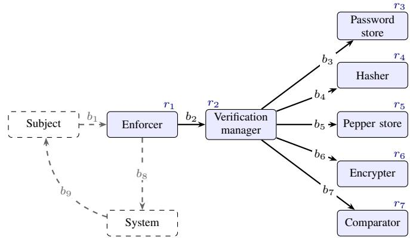  
Fig. 1. The Password-based authentication pattern of the catalogue [11], reduced to its roles $r _ { i }$ (boxes) and the actions $b _ { j }$ between them (arrows), in the order of the pattern’s walkthrough.

A security pattern, or pattern is specified as a tuple $P =$ (R, B), where:

• Roles (R): A vocabulary $R = \{ r _ { 1 } , \ldots , r _ { m } \}$ of prescribed architectural entities. For example, a passwordbased authentication pattern might prescribe $R \quad =$ {Enforcer, Verification manager, Hasher, Password store}

• Actions (B): An ordered sequence $B \ = \ \langle b _ { 1 } , \ldots , b _ { n } \rangle$ dictating the behavioral flow between those roles.

The pattern itselfs can serves as the reference architecture to be recovered against a codebase C. Recovering P from C requires three tasks: (1) detect which roles of $P$ are present in C, by identifying the presence status of each role that composes the pattern, (2) map each prescribed role $r \in R$ to a concrete code symbol $e \in { \mathcal { E } } ( C )$ where $\mathcal { E } ( C )$ represents the union of all Abstract Syntax Trees (AST) nodes inside the codebase, and (3) recover the sequence of interactions between those mapped symbols. We denote the recovered architecture as a tuple (M, D, S), where:

1) Role mappings (M): A set of pairs $m = ( r , e )$ with $r \in$ R, each mapping a prescribed role to the code symbol e that implements it, where e is either defined in C, i.e., $e \in { \mathcal { E } } ( C )$ , or only referenced by C.

2) Presence statuses (D): The set $\mathcal { D } = \{ \delta ( r ) : r \in R \}$ of presence statuses, one for each role. δ(r) = PRESENT when there exists $m \in M$ that maps r to some $e \in$ $\mathcal { E } ( C ) . \ \delta ( r ) \ : = \ : \mathrm { E X T E R N A L }$ when there exists $m \in M$ that maps r to some e whose definition cannot be found in any AST of C, such as a library function that C only calls. $\delta ( r ) = \mathrm { M I S S I N G }$ when there exists no $m \in M$ that maps r to any e.

<table><tr><td></td><td>TABLE I NOTATION.</td></tr><tr><td>Symbol Pattern specification</td><td>Meaning</td></tr><tr><td> $P = ( R , { \bar { B } } )$  R, B</td><td>pattern specification prescribed roles; their actions, in order</td></tr><tr><td>C, ε(C)</td><td>codebase, and its named code symbols extracted from union of all ASTs</td></tr><tr><td>Recovered Architecture</td><td></td></tr><tr><td>M, D, S</td><td>ground truth: role mapping, presence</td></tr></table>

3) An interaction sequence (S): The ordered sequence of actual interactions observed between the mapped symbols in M.

Table I summarizes this formulation. Figure 2 illustrates the recovery of the pattern from a small login handler that implement the password-based authentication pattern mentioned in Figure 1. The quality of an automated security pattern recovery solution depends on how correctly it can produce the mentioned above outputs. To evaluate these level of correctness, we need to not only define the corresponding set of metrics that align with outputs of the recovery, but also a cureated groundtruth sets of the role mapping M, the presence statuses $\mathcal { D }$ and the interaction sequence S that are collected from the original software architecture. This is a chalenging task, as groundtruth architectures in real-world open-source software are scarce, requiring involvement of human expertise to generate them [22], [29].

B. SecPatRec: Automated Approach for Deductive Security Pattern Recovery

Our goal is to design an automated approach that can recover the architectural components of security patterns from existing codebases, including the role mapping M, the presence statuses D and the interaction sequence S, using the pattern specification P as the reference architecture for DSAR. Previous works in DSAR have shown that LLMs can be used for code unit classification effectively [17], [21], which is suitable for the task of generating candidate role mappings $\hat { M } ,$ and consequently the presence statuses Dˆ of the roles. However, for large real-world codebases, chunking all code symbols in $\mathcal { E } ( C )$ to feed into LLMs for batched classification tasks could be computationally expensive and time-consuming [31], and at the same time losing repository-level global contexts as code symbols have been fragmented and processed individually [32]. Also, individual code unit classification can not be adopted for the next task of security pattern recovery, which is recovering a sequence of behaviorial interactions between the mapped roles.

To address the above challenges, we propose a hybrid approach that combines LLMs with code search methods and static code property graph (CPG) analysis [24] to recover the architectural components of Van De Berg’s security patterns from existing codebases. LLM that used chain-of-thought reasoning with code search as external tools is suitable for the tasks of security pattern roles’ detection and mapping, which requires iterative localization of relevant code contexts from a large source global semantic information [32], [33], while CPG analysis provides a deterministic way to bridge the mapped roles and their interactions. The overall design of our approach is illustrated in Figure 3.

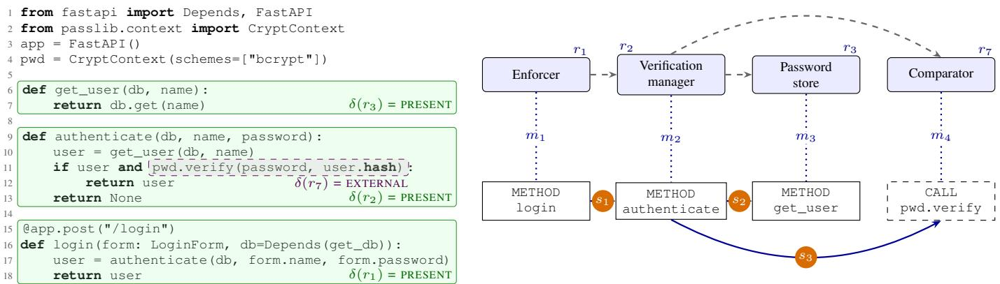  
Fig. 2. A login handler (left) and the architecture recovered from it for the password-based authentication pattern (right): roles r , role mapping m (dotted), pattern actions (dashed) and interaction sequence s (solid). Boxes in the code give δ(r ), dashed for EXTERNAL. The handler is simplified from the FastAPI documentation [30].

1) Security Pattern Role Mapping and Presence Detection: Translate Pattern Specification into Architecture Description Language Code The pattern specification P from the Van De Berg [11],is documented as textual descriptions in Markdown format and PNG images of their corresponding UML diagrams. We want to translate these information into a reference architecture description language (ADL) code to guide the LLM chain-of-thought reasoning in the role mapping and presence detection tasks. This translation is done by our developed ADL code generator, which provides Mermaid and JSON code representation of the prescribed roles and their interactions. Details on how we implement this translation are provided in Appendix A-A. The generated ADL code is then used to construct a prompt for the LLM to perform the role mapping and presence detection tasks.

Iterative Tool-assisted CoT Role Detection and Mapping We perform role detection and mapping with ReAct [34], an iterative reasoning method that lets an LLM interleave chain-of-thought with calls to external tools. At each iteration, the LLM first writes a Thought about what it has learned so far from a codebase and what to look for next, then issues one Action, i.e., a call to external code search tools, or trigger particular file reads and finally reads the Observation, a code context returned by that specific tool call. The iterations continue until the LLM has detected and mapped every role of P. The system prompts for this process is inserted with the previously translated JSON ADL code to guide the reasoning.

The LLM explores the codebase C through two search methods. Semantic search takes a description in natural language and returns a code symbols in C. We vectorize every symbol with BGE-small [35]4, and then store them in ChromaDB for later retrieval triggers. Lexical search, instead, finds a literal string or a regular expression anywhere in the repository and returns the matching lines with their file and line number. The combination of 2 search methods allows the LLM to both semantically and syntatically locate and analyze relevant code elements [33], [36]. The LLM can also list directories and read files to inspect what code searches return.The final output of this task is a structural set of role mappings Mˆ and theoir presence statuses Dˆ, which are passed on to the next task of recovering the interactions. Outputs of this stage are JSON files that contain the role mapping Mˆ and the presence statuses Dˆ of the roles, formatted as in Figure 18a in Appendix B.

2) Interaction Sequence Recovery: Constructing the Code Property Graph Once the role mapping Mˆ and presence statuses Dˆ are obtained, we construct the CPG of the targeted codebase C using Joern5, a Scala-based platform that can model source code for security-relevant tasks [24]. The CPG captures the structural and behavioral relationships between code symbols, allowing us to analyze the interactions between the mapped roles.

Traverse the CPG to Recover Interactions between Mapped Roles We define our own traversal rules to derive the calling relationships between the mapped code symbol entities eˆ corresponding to every mˆ in Mˆ , and recover the interaction sequence Sˆ (Figure 18b) based on the order of the calls observed in the CPG. Details of how we construct the traversal rules are provided in the Appendix C, and the Scala implementation is available in our repository6.

## IV. EXPERIMENT SETUP

## A. Research Questions

To evaluate our automated security pattern recovery approach, we want to understand how well it performs in terms of recovery correctness, costs of computing resources and token consumption, under different LLMs and code search methods. We also want to valide our assumption that using CPG analysis is more efficient and scalable compared to an end-to-end baseline that use LLM only. We define following research questions (RQs) to guide our evaluation:

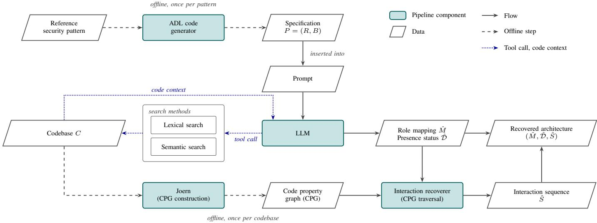  
Fig. 3. Overview of SECPATREC. The specification P is inserted into the prompt of the LLM, which iteratively searches the codebase C and produces the role mapping Mˆ and the presence statuses Dˆ. The CPG of C is built offline with Joern, and the interaction recoverer traverses it from the mapped symbol to produce the interaction sequence Sˆ.

Û RQ1. Which LLMs has the best task-specific performance for security pattern recovery?

Û RQ2. Which LLMs is the most cost-effective for security pattern recovery tasks when integrated with CPG analysis in our pipeline, in terms of token consumption?

Û RQ3. How does each LLM, when integrated with CPG analysis in our pipeline, can scale across diffrent patterns and codebase sizes, compared to their end-toend LLM baseline counterparts, in terms of performance and computing resource usage?

Û RQ4. How do code search methods affect the quality of the recovered architecture and the overall computing cost of running security pattern recovery tasks?

To answer the above questions, we had to first establish a groundtruth dataset of security pattern architectures M, D, S, and at the same time define performance indicators to measure the correctness of our approach in terms of taskspecific metrics for security pattern recovery. The details of the groundtruth dataset and the evaluation metrics are described below

## B. Groundtruth Dataset of Security Pattern Architectures

1) Choosing Patterns for Reference and Codebases for Recovery: The pattern-problem pairs in Van De Berg’s catalogue are developed with the aims to cover OWASP Top 10 security risks in web application 7. As a result, we want to use realworld open-source codebase that implements security control for web applications for validation our approach. We use our custom tool 8 to automate the cloning of 93 repositories from Github. The choice of repositories is based on the condition that they depend on 2 corresponding web security frameworks: Python’s FastAPI and Java’s Springboot Security. The selection of FastAPI and Spring Boot was driven by their widespread adoption; as of 2025, they are used by 38% and 65% of their respective developer communities [37], [38]. The target patterns used as reference architectures are P1 Passwordbased authentication, P2 Verifiable-token authentication, P3 Obscure-token access control, P4 Session-based access control and P5 Rate limiting. They all belong the set of security solutions that tackle the security problems related to OWASP’s Top 10 2025: A01: Broken Access Control and A07: Authentication Failures [39].

Details statistics of the selected codebases and the corresponding security patterns are provided in Table II and Figure 34 in Appendix D-D, where code size is measured in KLOC and in tokens of OpenAI’s o200k\_base tokenizer9. Our source of target codebases for recovery spans 49 repositories in Python and 44 repositories in Java. We preprocess these repositories to collect only .java and .py sources files with a total of 272,137 methods and 54,785 classes extracted from their ASTs. We also construct the CPGs of these codebases using Joern, consuming a total of 818.5 MB of storage space. Our repositories are diverse in terms of their size, making it suitable for evaluating the scalability and performance of our approach.

TABLE II  
SIZE OF THE 93 CODEBASES PER LANGUAGE.
<table><tr><td></td><td>#Repos</td><td>KLOC</td><td>#Methods</td><td>#Classes</td><td>#Tokens</td><td>#Files</td><td>CPG (MB)</td></tr><tr><td>Java</td><td>44</td><td>3,628.2</td><td>179,975</td><td>37,478</td><td>32.12M</td><td>32,628</td><td>228.3</td></tr><tr><td>Python</td><td>49</td><td>2,555.4</td><td>92,162</td><td>17,307</td><td>20.89M</td><td>10,622</td><td>590.2</td></tr><tr><td>Total</td><td>93</td><td>6,183.6</td><td>272,137</td><td>54,785</td><td>53.01M</td><td>43,250</td><td>818.5</td></tr></table>

2) Constructing Groundtruths: Obtaining groundtruth for software architecture recovery is inherently difficult, as knowledge of the system architects who designed the architecture is rarely available [22], [29]. As a result, previous works [22], [23], [29] had to rely on authorative protocol, in which an automated process is used to generate a set of preliminary architectures, and then external human engineers are used to certify them. In this work, we follow a similar approach, but instead use Claude Code to generate a the preliminary role mappings M and presence statuses D, then have human experts verify them. This human-AI collaboration annotation approach is also used in previous software engineering and mining software repositories works [40], [41]. We share our working session of how we use Claude Code to generate preliminary mappings in Appendix D. We then traverse the CPGs to deterministically recover the preliminary interaction sequence S among provided preliminary M, using the same traversal rule as mentioned in III-B2.

To help human annotators verify the preliminary architectures, we provide them with a web-based interface that allows them to inspect the preliminary role mappings and presence statuses, visualizing the candidate interaction sequence recovered, allowing annotators to trace the interactions between the mapped roles and code entities. Annotators are provided with the original Van de Berg’s catalogue for reference. They can approve or reject, or modify each preliminary roles mapping and interaction themselves if they think that existing recovery do not reflect the design that the orginal pattern intended. They can also map a single codebase with more than one security patterns, as in real-world open-source projects, developers can apply multiple security solutions to a single codebase [14]. We have two annotators, both of whom are senior software engineers that has more than 4 years of web application development. Example of how we visualize the candidate groundtruths for human verification is provided in Appendix D.

After the annotators have finished their verification, we sampled a list of 100 groundtruth architectures, each of which contains a human-verified role-to-code mappings M, role presence statuses D and an interaction sequence S between the mapped roles. In total, the 100 groundtruth architectures contain 500 roles, of which 334 are present, 75 external and 91 missing, and 280 interactions; Table III gives them per pattern and language. We publish the dataset in an anonymized Hugging Face bucket for reuse and reproducibility10.

TABLE III  
GROUNDTRUTH ROLES BY PRESENCE STATUS AND INTERACTIONS PER PATTERN, FOR PYTHON AND JAVA (10 CODEBASES EACH).
<table><tr><td></td><td colspan="4">Python</td><td colspan="4">Java</td></tr><tr><td>Pattern Pres.</td><td></td><td>Ext. Miss.</td><td></td><td>Int.</td><td>Pres.</td><td></td><td>Ext. Miss.</td><td>Int.</td></tr><tr><td>P1</td><td>32</td><td>17</td><td>21</td><td>31</td><td>33</td><td>14</td><td>23</td><td>39</td></tr><tr><td>P2</td><td>31</td><td>9</td><td>0</td><td>24</td><td>28</td><td>12</td><td>0</td><td>27</td></tr><tr><td>P3</td><td>33</td><td>0</td><td>7</td><td>19</td><td>30</td><td>6</td><td>4</td><td>28</td></tr><tr><td>P4</td><td>42</td><td>0</td><td>18</td><td>19</td><td>31</td><td>11</td><td>18</td><td>25</td></tr><tr><td>P5</td><td>40</td><td>0</td><td>0</td><td>34</td><td>34</td><td>6</td><td>0</td><td>34</td></tr><tr><td>Total</td><td>178</td><td>26</td><td>46</td><td>127</td><td>156</td><td>49</td><td>45</td><td>153</td></tr></table>

## C. Evaluation Metrics

For each task of security pattern recovery, we define taskspecific performance indicator to measure the correctness of our approach. We define one metric for each output of the recovery, comparing the presence statuses $\hat { \mathcal { D } }$ with $\mathcal { D } ,$ the role mapping Mˆ with M, and the interaction sequence $\hat { S }$ with S. We call them role detection accuracy (RDA), mapping localization score (MLS) and interaction recovery correctness (IRC). A metric is computed for one recovery instance, i.e., one pattern recovered from one codebase, and is then averaged over all instances. The implmentation of our evaluation metrics is available in our repository11. Appendix A-D shows the three metrics on a small example (Figures 16 and 17).

1) Role Detection Accuracy: Each role of the pattern has one of three statuses: PRESENT, EXTERNAL or MISSING. Role detection accuracy is the fraction of roles for which the LLM outputs the same presence status $\delta ( r )$ compared to the groundtruth $\delta ( r )$ , so the problem is translated into a multilabel classification problem over the closed label set R

$$
\mathrm { R D A } = \frac { \left| \left\{ { \boldsymbol r } \in { \boldsymbol R } : \hat { \delta } ( { \boldsymbol r } ) = \delta ( { \boldsymbol r } ) \right\} \right| } { | { \boldsymbol R } | } .\tag{1}
$$

2) Mapping Localization Score: For every role founded by the both the LLM and the groundtruth, i.e $r ~ \in ~ F$ where $F = \{ r \in R : \delta ( r )$ ̸= MISSING and $\hat { \delta } ( r ) \neq$ MISSING }, we want to measure how close the recovered symbol $\hat { e } _ { r }$ that the LLM maps $\mathrm { ~ t o ~ } r ,$ , compared with the groundtruth symbol $e _ { r } .$ We therefore measure how far apart the two symbols are in the static containment tree $T _ { ( } C )$ of the codebase, in the same way as fault localization is judged by the distance between the reported and the actual faulty location in the program dependence graph [42]: the closer the two symbols, the better the mapping localizes the role in the code. $T _ { ( } C )$ is constructed by agrregating all ASTs of source files in the codebase. The distance d is the number of edges required for moving $e _ { r }$ to $\hat { e } _ { r }$ in the same $T _ { ( C ) }$

$$
\begin{array} { l } { { d ( \hat { e } _ { r } , e _ { r } ) = \mathrm { d e p t h } ( \hat { e } _ { r } ) + \mathrm { d e p t h } ( e _ { r } ) } } \\ { { \phantom { d ( e _ { r } , e _ { r } ) = } - 2 \mathrm { d e p t h } \bigl ( \mathrm { L C A } ( \hat { e } _ { r } , e _ { r } ) \bigr ) . } } \end{array}\tag{2}
$$

where LCA is the lowest common ancestor of the two symbols in the containment tree. We normalize this distance by the height 2H of the containment tree as no path in a tree of height H is longer than 2H edges, then score the tree-induced similarity as $1 - d / 2 H$ . The mapping localization score is the mean score over all roles in F, and it is 0 when no role is found by both sides $( | F | = 0 )$ , as then nothing is mapped correctly:

$$
\mathrm { M L S } = \left\{ \begin{array} { l l } { \displaystyle \frac { 1 } { | F | } \sum _ { r \in F } \left( 1 - \frac { d ( \hat { e } _ { r } , e _ { r } ) } { 2 H } \right) } & { \displaystyle | F | > 0 , } \\ { 0 } & { \displaystyle | F | = 0 . } \end{array} \right.\tag{3}
$$

This approach to measure structural similarity between two security-relevant code entities using tree-induced similarity has also been used previously in vulnerability detection and root cause analysis literatures [42]

3) Interaction Recovery Correctness: Given two interaction sequences, the groundtruth S and Sˆ recovered from our CPG analysis methods. We want to measure how close $\hat { S }$ is to $S ,$ in terms of both the interaction b found in both sequential similairty and the order they are performed.

During the CPG analysis, there could exist unexpected recovered interactions outside S between any two roles, caused by the mismatch in previous mapping task, or there exist concrete call element between those two roles, but are not in the groundtruth sequences. Let $k = | S \cap { \hat { S } } |$ be the number of interactions shared by the groundtruth. We calculate the Jaccard index $J = k / | S \cup { \hat { S } } |$ to measure sequential similarity. We also interest in assessing if the order of the groundtruth interactions is preserved. For every k shared interactions between S and Sˆ, they form $\scriptstyle { \frac { 1 } { 2 } } k ( k \ - \ 1 )$ interaction pairs (Figure 17). Let c be the number of interaction pairs that S and $\hat { S }$ put in the same order (concordant), and q the number of pairs they put in opposite orders (discordant). We calculate the unsigned Kendall’s tau $\tau = c / \frac { 1 } { 2 } k ( k - 1 )$ to measure this agreement in the ordering of the shared interactions. We then multiply τ with J to calculate the final sequential correctness score IRC between the groundtruth and recovered interaction sequences. The final score is defined as follows:

$$
\mathrm { I R C } = \left\{ \begin{array} { l l } { \displaystyle \frac { c } { \frac { 1 } { 2 } k ( k - 1 ) } \cdot \frac { k } { | S \cup \hat { S } | } } & { \displaystyle k > 1 , } \\ { \displaystyle \frac { k } { | S \cup \hat { S } | } } & { \displaystyle k \leq 1 . } \end{array} \right.\tag{4}
$$

When $k \leq 1$ there is no pair to put in the wrong order, so $\tau$ is 1 and IRC is J alone, which is 0 when $k = 0$

## D. Model Selection

We choose our set of LLMs to evaluate on based on their benchmarked performace in full-stack web development tasks, since we want to make sure that they have been exposed to modern web security libraries that the groundtruth dataset is built on. Based on the top 20 results from CodeArena’s WebDev benchmark12, we select the following 4 LLMs for evaluation: OpenAI’s GPT 6.1 Sol, Meta’s Muse Spark, Deepseek-v4.0-Flash-0731, and GLM-5.3. GPT and Muse are propietary LLMs, so we use their API endpoints to call them. Deepseek and GLM are open-source LLMs, so we host them on our cloud server with 2x NVIDIA’s B200 GPUs and 3x B300 GPUs on ModalAI’s infrastructure. We use the same prompt template for all LLMs, and the maximum tokens that all 4 LLMs can process are set to 1,000,000 tokens. Each LLM is run once per instance and setting, with a temperature of 0.7.

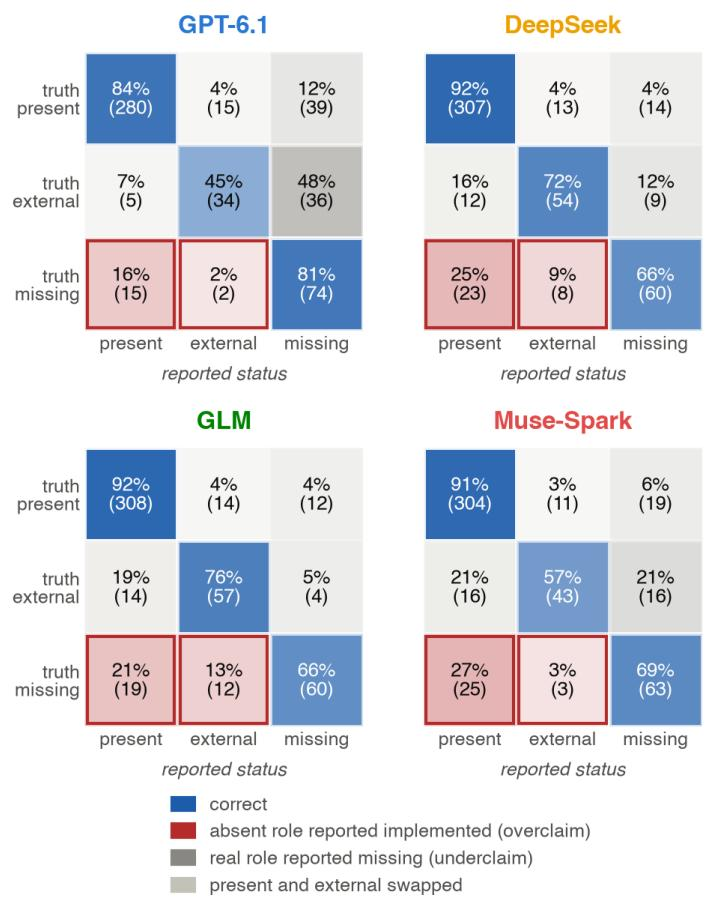  
Fig. 4. Presence status reported by each LLM against the groundtruth, over the roles of the 100 instances (share of the row, count in brackets). Red frames: a missing role reported as present or external.

## V. EVALUATION

## A. RQ1: Task-specific Performance

To answer this question, we ran our constructed pipeline on the dataset we built in Section IV-B. We evaluated the performance of each LLM on the three tasks mentioned in Section IV-C using their corresponding metrics RDA, MLS and IRC, and find out which LLM performs best on each task. Our overall evaluation results are shown in Figure 35 in Appendix E.

Overall, we find that the LLMs perform well on the task of pattern role’s presence detection, with an average RDA (over the 100 instances) between 0.79 and 0.86. GLM and DeepSeek are the best performing LLMs on this task, both with an average RDA score of 0.86, while GPT-6.1 has the lowest one (0.79). Looking at the confustion matrix in 4, we find that GPT-6.1, compared to other LLMs, is more likely to flag a role as missing when it is actually present, or called from an external library. This could be due to the fact that GPT-6.1 is more conservative in its predictions, and prefers to caution when it is not sure about the presence of a security-related component, or when it lacks the knowledge of a specific security library usage that is used in the codebase.

For the task of pattern role’s mapping, the LLMs are close to each other, with an average MLS between 0.83 and 0.86. DeepSeek performs the best (0.86), followed by GLM (0.84), Muse-Spark (0.83) and GPT-6.1 (0.83). However, looking specifically at the mappings, we find that GPT-6.1 has more cases when it can perfectly ground the correct code entity. (See Table VIII in Appendix E).

For the task of interaction sequence recovery, we find that GPT 6.1 is the best performing LLM, with an average IRC score of 0.72. It is the best in Java’s Springboot case (0.66, against 0.52 to 0.63 for the others), and on par with GLM in Python (0.78 for both). However, we find that all LLMs have a lower performance on this task (average IRC between 0.61 and 0.72) compared to the other two tasks.

¬ Answer to RQ1. GPT-6.1 recovers interactions best (IRC 0.72, against 0.61 to 0.66), and its lead is largest on Java. GLM and DeepSeek detect roles best (RDA 0.86), while GPT-6.1 detects the fewest (0.79) because it is cautious and rarely claims a role that is absent. All four LLMs map roles about equally well (MLS 0.83 to 0.86), but GPT-6.1 maps the most instances exactly (27 of 100).

## B. RQ2: Cost and Efficiency

We want to evalutate how many tokens are required for the tasks of pattern role’s detection and mappings, with respect to each LLMs. As we are relying on iterative loop of LLM’s CoT reasoning to perform the tasks, we want to see how many tokens are required for each iteration, and how many iterations are required for each task. Looking at the results in Figure 36 (Appendix E), we find that GPT-6.1 produces the fewest output tokens (1.4k to 1.8k per run), but its higher price makes it the most expensive LLM per run (\$0.04 to \$0.05). GLM uses the fewest new input tokens and is the cheapest, at about \$0.005 per run.

It is also noted that the fees calculated for Deepseek-v4.0- Flash-0731 and GLM are esitimated based on their published pricing information 13 and 14, but in our experiments, we were hosting them on custom cloud server, and the actual cost of running them is not reflected in the pricing information.

¬ Answer to $\mathbf { R } \mathbf { Q } _ { 2 } .$ GLM is the most cost-effective LLM: it uses the fewest new input tokens and costs about \$0.005 per run. GPT-6.1 produces the least output (1.4k to 1.8k tokens) but has the highest price per run (\$0.04 to \$0.05). DeepSeek and Muse-Spark produce 4 to 5 times as much output, and Muse-Spark also caches the least.

C. RQ3: Scalability across Codebase Size and Patterns Complexity

For each LLMs, we set up a series of baseline run with a diffrent prompt template (see Appendix A-C) to force them outputting Sˆ and Rˆ in one-shot, without the iterative loop of CoT reasoning, code search tools, or CPG analysis. We then compare the performance of each LLMs on the three tasks with respect to their baseline run counterparts, and find out how the SecPatRec pipeline and baseline differences scale across the five target patterns, and how they can retain their performance when the codebase size increases.

Looking at Figure 37 in Appendix E, we find that SecPatRec outperforms the baseline run in most patterns, partly because the baseline cannot run on the 16 codebases over its input limit, which score 0. On the 84 codebases both can run, the baseline is ahead in 21 of the 60 cases (five patterns, four LLMs and three metrics), mostly on RDA (9 cases), while our pipeline still has a higher overall IRC for every LLM (Table IX in Appendix E). However, we find that all models perform the worst in P4 Session-based access control, where their IRC (0.37 to 0.58) is the lowest among all five patterns, and is even lower in the case of Java (0.16 to 0.46). This is due to the fact that in Springboot, the Authorization Enforcer is not called by the Authentication Enforcer in the codebase: it is declared as an annotation (e.g., @PreAuthorize), and the Spring framework applies it at run time, after the Authentication Enforcer passes the request on (see Appendix F-A). As no call in the source code links the two enforcers, the CPG analysis cannot find the interactions between them, which leads to a low IRC score. That’s why in P4 in Java, the baseline recovers the interactions better than our solution for most LLMs (three of four, e.g., 0.35 against 0.16 for GLM), as the baseline LLMs hallucinate the interaction order themselves, while SecPatRec can only recover the interactions existing inside the static CPG.

Figures 38 and 39 in Appendix E show the token cost side of scalability. The one-shot baseline has to read the whole codebase, so its token cost grows almost in proportion to the codebase size, where a ten times larger codebase costs 7 to 10 times more tokens, compared to only 1.2 to 1.9 times in SecPatRec, because the LLM only need to reads what the code search tools returns. The SecPatRec pipeline is therefore cheaper than the baseline for every codebase above 9k to 36k tokens, depending on the LLM, and at 1M tokens it is 6 (Muse-Spark) to 60 (GPT-6.1) times cheaper.

Figure 5 shows how recovery correctness changes with respect to codebase size. The RDA and MLS of SecPatRec do not decrease as codebases grow, while those number for the baseline drops dramatically, due to the size of 16 codebase exceeding the LLM’s token limit. For interaction recovery task, looking at Figure 40 in Appendix E, when every role is mapped to exactly the right symbol from previous steps (MLS = 1, 80 instances), the CPG analyzer in SecPatRec recovers the interaction sequence perfectly (IRC = 1) on 73 of them, 0.93 on average, against 12% to 38% perfect instances in every lower MLS band. The CPG static analysis therefore scales with the codebase size.

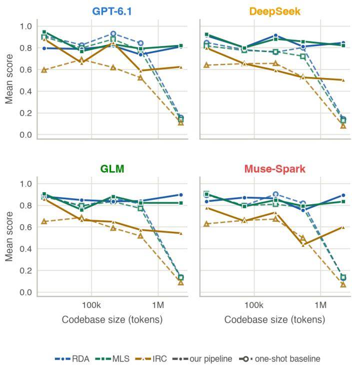  
Fig. 5. Mean RDA, MLS and IRC against codebase size per LLM: SecPatRec (solid) against the one-shot baseline (dashed), in five size bins of about 20 instances. Instances over the baseline’s input limit score 0 for the baseline.

¬ Answer to RQ3. The SecPatRec pipeline runs on the 16 of 100 codebases over the baseline’s input limit, and on the 84 codebases both can run, it still has a higher IRC than the one-shot baseline for every LLM (+0.02 to +0.12) and a similar or higher MLS (−0.01 to +0.10; Table IX). SecPatRec cost barely grows with codebase size (log-log slope 0.08 to 0.28, against 0.83 to 1.00 for the baseline), so it is cheaper above 9k to 36k tokens and 6 to 60 times cheaper at 1M tokens, while RDA and MLS do not drop as codebases grow.

## D. RQ4: Effects of Code Search Methods

Table X in Appendix E shows how the recovery changes when one search tool is removed from the LLM-based mapping stage. Removing either tool changes RDA and MLS by less than 0.03 for every LLM. To understand why, we counted the tool calls in every run. With both tools available, DeepSeek, GLM and Muse-Spark use keyword search for 80 to 93% of their searches, while GPT-6.1 uses the two about equally (46 to 52%). When one tool is removed, its calls move almost one for one to the other tool, and the number of steps per run changes by about one at most. The ReAct loop thus treats keyword and semantic search as interchangeable ways to find candidate code entities, which is why removing either of them, even the one an LLM prefers, does not hurt the recovery.

¬ Answer to RQ4. The ReAct uses keyword and semantic search interchangeably: when one is removed, its calls move to the other, and the run takes about as many steps. Removing either tool therefore changes RDA and MLS by less than 0.03, and changes IRC by −0.04 to +0.09 depending on the LLM. Removing semantic search saves 165 to 188 MB of memory without losing accuracy, so keyword search alone is enough when resources are limited.

## VI. DISCUSSION AND THREATS TO VALIDITY

## A. Discussion

a) Why a hybrid design works: The RDA and MLS of SecPatRec stay flat as codebases grow (Figure 5), and when the roles are mapped exactly, the CPG traversal recovers the interaction sequence perfectly in 73 of 80 instances. Most of the IRC error therefore comes from the mapping stage, not from the traversal. This is the main argument for our hybrid design: the LLM handles the part of the task that needs an understanding of the code, while the static analysis reads the interactions from the code itself, without degrading as codebases grow. It also means that improving role mapping is the key to improving our approach.

b) What the static analysis cannot see: The CPG only contains the calls written in the source code, so it cannot see the interactions that only appear at run time, such as Spring’s @PreAuthorize, Spring’s bean injection, or FastAPI’s Depends. This is why the one-shot baseline has a higher IRC than SecPatRec on P4 in Java. However, the baseline cannot observe this order in the code either, as it invents the order from its knowledge of Spring, so its higher IRC is not a better recovery. We leave reading the framework’s configuration and annotations as future work.

c) Which LLM to use: We recommend GLM for lowcost recovery, as it costs about \$0.005 per run and matches the other LLMs on RDA (0.86) and MLS (0.84). GPT-6.1 is the best choice when the interaction sequence or exact mappings matter, with the highest IRC (0.72) and the most exact mappings (27 of 100), but at about 8 to 10 times the cost of GLM. It is also the most conservative LLM: it reports 48% of the external roles as missing, but it overclaims the least, reporting only 18% of the missing roles as present or external, against 30% to 34% for the others.

d) Extensibility to Future Security Pattern mining works: Our groundtruth dataset and evaluation metrics can serve as a benchmark for future security pattern recovery approaches, we publish our dataset at a customize and anonymized Huggingface bucket for public use and recreatibility15. The cost of SecPatRec barely grows with codebase size (log-log slope 0.08 to 0.28, against 0.83 to 1.00 for the baseline). Since keyword search alone is enough (RQ4), the vector database and the embedding model can also be dropped. As a result, SecPatRec, a ReACt loop of LLM combining with lexical keyword search and CPG analysis can serve as an instrument to mine how security patterns are implemented at scale.

## B. Threats to Validity

a) Construct validity: The specification P is itself generated by an LLM from the catalogue page and its main flow only, so an error in P would affect both the groundtruth and the recovery; to reduce this threat, we checked the five specifications by hand against their catalogue pages. Finally, scoring the 16 instances over the baseline’s input limit as 0 mixes the instances the baseline cannot run with those it runs worse, so we also report the 84 instances it can run, where SecPatRec still has a higher IRC for every LLM (Table IX).

b) Internal validity: Each LLM was run once per instance and setting, so part of the differences we report may come from run-to-run variability, as the two ablation settings in RQ4 differ from each other as much as from the full pipeline. The ADL generator uses GPT-6 Sol, from the same vendor as GPT-6.1, but its prompts are fixed and its output P is the same for every LLM. Lastly, the 93 repositories and the catalogue are public, so the LLMs may have seen both during training.

c) External validity: Our evaluation covers two languages, two frameworks (FastAPI and Spring Security), and five authentication and access control patterns (A01 and A07) from one catalogue, on repositories selected by their dependency on these frameworks. Within this scope, the Java repositories are larger and externalise more roles than the Python ones, so the two languages are not directly comparable. We do not yet investigate how the approach performs on other pattern in the Van De Berg’s catalogues, or on other web frameworks such as Django or Express, or on languages for which we have no traversal rules, but will consider that in future works. Our two annotators are experienced web developers rather than the architects of the systems, which is the standard limitation of groundtruths built with an authoritative protocol [29].

## VII. RELATED WORK

## A. Automated Software Architecture Recovery

Software architecture recovery is a well-studied field [22], [43], but existing methods are hard to adapt to security pattern recovery. Traditional static methods cluster code entities with human-specified graph rules [44]–[46], which limits their generalizability to modern codebases across languages and libraries. Learning-based methods learn the representation of code entities [47] or semantic features of their dependency graphs [48], [49], which partially solves generalization, but still gives an inductive view of the architecture, not suitable for security patterns, which are prescriptive and enforceable.

Deductive software architecture recovery instead leverages the reasoning of LLMs to recover the architecture of a codebase against a reference architecture [17], [21], [50], [51], which suits the prescriptive nature of security patterns.

However, these works only recover the component view of the architecture, not the interaction view, which is crucial for security patterns. Our work is the first deductive approach that recovers both views of security patterns from source code, evaluated on a large dataset of real-world codebases.

## B. Evaluating Architecture Recovery Correctness

To measure the correctness of automated architecture recovery, traditional cluster-based recovery methods rely on the distance between the recovered clusters and those of a groundtruth architecture [22], [23], [29]. Since our method is deductive, mapping the roles of a given pattern to code rather than grouping the code into clusters, these distance-based measures are not suitable for our evaluation. Other works focus on measuring architectural drift, to analyze whether an implementation conforms to its intended design or architecture [52]–[54]. Reflexion models, for example, compare an engineer’s high-level model with a model extracted from the source code, and report where the two diverge [5]. Pruijt et al. compare the accuracy of ten tools that check such conformance [55], and commercial platforms such as Sonar also offer these checks, but they are proprietary and not open-source [56]. However, measuring conformance is also not suitable for our evaluation, as we measure the independent tasks of security pattern recovery, which we have divided into mapping security-relevant code [42] and arranging their interactions in sequence [57].

## C. Mining Security Architectural Tactics

Works on mining security architectural tactics are close to ours, as they share our motivation of mining the architecturerelevant code that enables the security properties of software [58]–[60]. Mirakhorli and Cleland-Huang detect tactic-related code in open-source systems and monitor it as the system evolves [58]. Mujhid et al. build ArchEngine, a search engine that retrieves and ranks the code snippets implementing a given tactic [59]. Santos et al. catalogue 224 security architecture weaknesses, organized by the security tactics that address them [60]. Like SecPatRec, these works mine code with lexical code search, using API signatures as keywords. However, they do not attempt to tackle the mapping of the mined code snippets to the architectural components of the security tactics or patterns, which is the core of our recovery task.

## VIII. CONCLUSION

We presented SECPATREC, a hybrid approach to security pattern recovery that combines an LLM agent with code search for role mapping and CPG analysis for interaction recovery. On 100 instances across 93 Java and Python codebases, it achieves a mean RDA of 0.84, MLS of 0.84 and IRC of 0.66 over four LLMs, outperforming a one-shot LLM baseline at a cost that barely grows with codebase size. As the CPG analysis is nearly exact when the roles are mapped exactly, improving role mapping is the key to further improvement. Our dataset, metrics and pipeline can serve as a benchmark and an instrument for mining security patterns at scale.

## REFERENCES

[1] I. Arce, K. Clark-Fisher, N. Daswani, J. DelGrosso, D. Dhillon, C. Kern, T. Kohno, C. Landwehr, G. McGraw, B. Schoenfield, M. Seltzer, D. Spinellis, I. Tarandach, and J. West, “Avoiding the top 10 software security design flaws,” IEEE Computer Society Center for Secure Design, Tech. Rep., 2014.

[2] G. McGraw, Software Security: Building Security In, 1st ed. Upper Saddle River, NJ: Addison-Wesley Professional, Jan. 2006.

[3] J. Yoder and J. Barcalow, “Architectural Patterns for Enabling Application Security,” in Proceedings of the 4th Conference on Patterns Language of Programming (PLoP ’97), 1997.

[4] European Parliament and Council of the European Union, “Regulation (EU) 2024/2847 of 23 October 2024 on horizontal cybersecurity requirements for products with digital elements (Cyber Resilience Act),” http://data.europa.eu/eli/reg/2024/2847/oj, Nov. 2024.

[5] G. C. Murphy, D. Notkin, and K. Sullivan, “Software reflexion models: bridging the gap between source and high-level models,” SIGSOFT Softw. Eng. Notes, vol. 20, no. 4, pp. 18–28, Oct. 1995. [Online]. Available: https://dl.acm.org/doi/10.1145/222132.222136

[6] T. W. Thomas, M. Tabassum, B. Chu, and H. Lipford, “Security During Application Development: an Application Security Expert Perspective,” in Proceedings of the 2018 CHI Conference on Human Factors in Computing Systems, ser. CHI ’18. New York, NY, USA: Association for Computing Machinery, Apr. 2018, pp. 1–12. [Online]. Available: https://dl.acm.org/doi/10.1145/3173574.3173836

[7] N. A. Ernst and M. P. Robillard, “A Study of Documentation for Software Architecture,” Empirical Software Engineering, vol. 28, no. 5, p. 122, 2023.

[8] O. Levy and D. G. Feitelson, “Understanding Large-Scale Software Systems: Structure and Flows,” Empirical Software Engineering, vol. 26, no. 3, 2021.

[9] R. Scandariato, K. Yskout, T. Heyman, and W. Joosen, “Architecting software with security patterns,” Department of Computer Science, KU Leuven, Leuven, Belgium, Tech. Rep., 2008.

[10] M. Schumacher, E. Fernandez-Buglioni, D. Hybertson, F. Buschmann, and P. Sommerlad, Security Patterns: Integrating Security and Systems Engineering, ser. Wiley Software Patterns Series. Wiley, 2006. [Online]. Available: https://books.google.com.vn/books?id=T57rfpDko0YC

[11] A. Van Den Berghe, K. Yskout, and W. Joosen, “A reimagined catalogue of software security patterns,” in Proceedings of the 3rd International Workshop on Engineering and Cybersecurity of Critical Systems. Pittsburgh Pennsylvania: ACM, May 2022, pp. 25–32. [Online]. Available: https://dl.acm.org/doi/10.1145/3524489.3527301

[12] E. Gamma, R. Helm, R. Johnson, and J. Vlissides, Design Patterns: Elements of Reusable Object-Oriented Software, ser. Addison-Wesley Professional Computing Series. Pearson Education, 1994. [Online]. Available: https://books.google.ie/books?id=6oHuKQe3TjQC

[13] M. VanHilst and E. B. Fernandez, “Reverse Engineering to Detect Security Patterns in Code,” in Proceedings of the 1st International Workshop on Software Patterns and Quality (SPAQu’07), Nagoya, Japan, 2007.

[14] A. Behrens, “What are Security Patterns?: A Formal Model for Security and Design of Software,” in Proceedings of the 13th International Conference on Availability, Reliability and Security. Hamburg Germany: ACM, Aug. 2018, pp. 1–6. [Online]. Available: https://dl.acm.org/doi/10.1145/3230833.3230834

[15] K. Yskout, R. Scandariato, and W. Joosen, “Does organizing security patterns focus architectural choices?” in Proceedings of the 34th International Conference on Software Engineering, ser. ICSE ’12. Zurich, Switzerland: IEEE Press, Jun. 2012, pp. 617–627.

[16] ——, “Do Security Patterns Really Help Designers?” in 2015 IEEE/ACM 37th IEEE International Conference on Software Engineering, vol. 1, May 2015, pp. 292–302. [Online]. Available: https://ieeexplore.ieee.org/abstract/document/7194582

[17] S. A. Rukmono, L. Ochoa, and M. Chaudron, “Deductive Software Architecture Recovery via Chain-of-thought Prompting,” in Proceedings of the 2024 ACM/IEEE 44th International Conference on Software Engineering: New Ideas and Emerging Results. Lisbon Portugal: ACM, Apr. 2024, pp. 92–96. [Online]. Available: https://dl.acm.org/ doi/10.1145/3639476.3639776

[18] M. Bunke and K. Sohr, “An Architecture-Centric Approach to Detecting Security Patterns in Software,” in Engineering Secure Software and Systems, U. Erlingsson, R. Wieringa, and N. Zannone, Eds. Berlin,

Heidelberg: Springer Berlin Heidelberg, 2011, vol. 6542, pp. 156–166, series Title: Lecture Notes in Computer Science. [Online]. Available: http://link.springer.com/10.1007/978-3-642-19125-1\_12

[19] A. K. Alvi and M. Zulkernine, “A security pattern detection framework for building more secure software,” Journal of Systems and Software, vol. 171, p. 110838, Jan. 2021. [Online]. Available: https://linkinghub.elsevier.com/retrieve/pii/S0164121220302296

[20] M. Bunke and K. Sohr, “Towards supporting software assurance assessments by detecting security patterns,” Software Quality Journal, vol. 28, no. 4, pp. 1711–1753, 2020.

[21] S. A. Rukmono, L. Ochoa, T. Bressers, J. Krüger, and M. Chaudron, “Evaluating Explanatory Artefacts of DSAR-Recovered Software Architectures from Industrial Codebases,” in Proceedings of the 34th ACM International Conference on the Foundations of Software Engineering, ser. FSE Companion ’26. New York, NY, USA: Association for Computing Machinery, Jul. 2026, pp. 880–891. [Online]. Available: https://dl.acm.org/doi/10.1145/3803437.3805259

[22] J. Garcia, I. Ivkovic, and N. Medvidovic, “A comparative analysis of software architecture recovery techniques,” in 2013 28th IEEE/ACM International Conference on Automated Software Engineering (ASE), Nov. 2013, pp. 486–496. [Online]. Available: https://ieeexplore.ieee. org/document/6693106/

[23] T. Lutellier, D. Chollak, J. Garcia, L. Tan, D. Rayside, N. Medvidovic,´ and R. Kroeger, “Measuring the Impact of Code Dependencies on Software Architecture Recovery Techniques,” IEEE Transactions on Software Engineering, vol. 44, no. 2, pp. 159–181, Feb. 2018. [Online]. Available: https://ieeexplore.ieee.org/document/7859416/

[24] F. Yamaguchi, N. Golde, D. Arp, and K. Rieck, “Modeling and Discovering Vulnerabilities with Code Property Graphs,” in 2014 IEEE Symposium on Security and Privacy, May 2014, pp. 590–604, iSSN: 2375-1207. [Online]. Available: https://ieeexplore.ieee.org/document/ 6956589/

[25] M. Schumacher, Security Engineering with Patterns, ser. Lecture Notes in Computer Science, G. Goos, J. Hartmanis, and J. Van Leeuwen, Eds. Berlin, Heidelberg: Springer Berlin Heidelberg, 2003, vol. 2754. [Online]. Available: http://link.springer.com/10.1007/b11930

[26] E. Fernandez-Buglioni, Security Patterns in Practice: Designing Secure Architectures Using Software Patterns. Chichester, West Sussex: Wiley, 2013.

[27] L. Bass, P. Clements, and R. Kazman, Software Architecture in Practice, 4th Edition, 2021. [Online]. Available: https://www.oreilly. com/library/view/software-architecture-in/9780136885979/

[28] R. Wirfs-Brock and A. McKean, Object Design: Roles, Responsibilities, and Collaborations. Pearson Education, Oct. 2002.

[29] J. Garcia, I. Krka, C. Mattmann, and N. Medvidovic, “Obtaining ground-truth software architectures,” in Proceedings of the 2013 International Conference on Software Engineering, ser. ICSE ’13. San Francisco, CA, USA: IEEE Press, May 2013, pp. 901–910. [Online]. Available: https://dl.acm.org/doi/10.5555/2486788.2486911

[30] S. Ramírez, “FastAPI documentation: OAuth2 with password, bearer with JWT tokens,” https://fastapi.tiangolo.com/tutorial/security/ oauth2-jwt/, 2026.

[31] H. Xu, S. Wang, N. Li, K. Wang, Y. Zhao, K. Chen, T. Yu, Y. Liu, and H. Wang, “Large Language Models for Cyber Security: A Systematic Literature Review,” ACM Transactions on Software Engineering and Methodology, Sep. 2025, just Accepted. [Online]. Available: https://dl.acm.org/doi/10.1145/3769676

[32] M. Le-Anh, H. Nguyen, A. K. Tran, N. Le Hai, L. N. Van, N. D. Bui, and B. Le, “Do Not Treat Code as Natural Language: Implications for Repository-Level Code Generation and Beyond,” Proceedings of the ACM on Software Engineering, vol. 3, no. FSE, pp. FSE017:366–FSE017:389, Jun. 2026. [Online]. Available: https://dl.acm.org/doi/10.1145/3797144

[33] M. Nguyen, “SpareCodeSearch: Searching for Code Context When You Have No Spare GPU,” in 2025 40th IEEE/ACM International Conference on Automated Software Engineering Workshops (ASEW). IEEE Press, Nov. 2025, pp. 364–367. [Online]. Available: https: //dl.acm.org/doi/10.1109/ASEW67777.2025.00073

[34] S. Yao, J. Zhao, D. Yu, N. Du, I. Shafran, K. Narasimhan, and Y. Cao, “ReAct: Synergizing Reasoning and Acting in Language Models,” in The Eleventh International Conference on Learning Representations (ICLR), 2023. [Online]. Available: https://openreview.net/forum?id= WE\_vluYUL-X

[35] S. Xiao, Z. Liu, P. Zhang, N. Muennighoff, D. Lian, and J.-Y. Nie, “C-Pack: Packed resources for general Chinese embeddings,” in Proceedings of the 47th International ACM SIGIR Conference on Research and Development in Information Retrieval, 2024, pp. 641–649.

[36] D. Nguyen, L. Nam, A. Dau, A. Nguyen, K. Nghiem, J. Guo, and N. Bui, “The Vault: A Comprehensive Multilingual Dataset for Advancing Code Understanding and Generation,” in Findings of the Association for Computational Linguistics: EMNLP 2023, H. Bouamor, J. Pino, and K. Bali, Eds. Singapore: Association for Computational Linguistics, Dec. 2023, pp. 4763–4788. [Online]. Available: https://aclanthology.org/2023.findings-emnlp.316

[37] Jetbrains, “The State of Java 2025.” [Online]. Available: https: //lp.jetbrains.com/the-state-of-java-2025

[38] ——, “The State of Python 2025: Trends and Survey Insights,” Aug. 2025, section: Data Science. [Online]. Available: https://blog.jetbrains. com/pycharm/2025/08/the-state-of-python-2025/

[39] OWASP, “OWASP Top 10:2025.” [Online]. Available: https://owasp. org/Top10/2025/

[40] H. Kim, K. Mitra, R. Li Chen, S. Rahman, and D. Zhang, “MEGAnno+: A Human-LLM Collaborative Annotation System,” in Proceedings of the 18th Conference of the European Chapter of the Association for Computational Linguistics: System Demonstrations, N. Aletras and O. De Clercq, Eds. St. Julians, Malta: Association for Computational Linguistics, Mar. 2024, pp. 168–176. [Online]. Available: https://aclanthology.org/2024.eacl-demo.18/

[41] T. Ahmed, P. Devanbu, C. Treude, and M. Pradel, “Can LLMs Replace Manual Annotation of Software Engineering Artifacts?” in 2025 IEEE/ACM 22nd International Conference on Mining Software Repositories (MSR), Apr. 2025, pp. 526–538, iSSN: 2574- 3864. [Online]. Available: https://ieeexplore.ieee.org/abstract/document/ 11025652

[42] H. Cleve and A. Zeller, “Locating causes of program failures,” in Proceedings of the 27th international conference on Software engineering, ser. ICSE ’05. New York, NY, USA: Association for Computing Machinery, May 2005, pp. 342–351. [Online]. Available: https://dl.acm.org/doi/10.1145/1062455.1062522

[43] S. Ducasse and D. Pollet, “Software Architecture Reconstruction: A Process-Oriented Taxonomy,” IEEE Transactions on Software Engineering, vol. 35, no. 4, pp. 573–591, Jul. 2009. [Online]. Available: http://ieeexplore.ieee.org/document/4815276/

[44] B. Mitchell and S. Mancoridis, “On the automatic modularization of software systems using the Bunch tool,” IEEE Transactions on Software Engineering, vol. 32, no. 3, pp. 193–208, Mar. 2006. [Online]. Available: https://ieeexplore.ieee.org/document/1610610/

[45] S. Mancoridis, B. Mitchell, Y. Chen, and E. Gansner, “Bunch: a clustering tool for the recovery and maintenance of software system structures,” in Proceedings IEEE International Conference on Software Maintenance - 1999 (ICSM’99). ’Software Maintenance for Business Change’ (Cat. No.99CB36360). Oxford, UK: IEEE, 1999, pp. 50–59. [Online]. Available: http://ieeexplore.ieee.org/document/792498/

[46] K. Sartipi, “Software architecture recovery based on pattern matching,” in International Conference on Software Maintenance, 2003. ICSM 2003. Proceedings., Sep. 2003, pp. 293–296, iSSN: 1063-6773. [Online]. Available: https://ieeexplore.ieee.org/document/1235434/

[47] J. Garcia, D. Popescu, C. Mattmann, N. Medvidovic, and Y. Cai, “Enhancing architectural recovery using concerns,” in 2011 26th IEEE/ACM International Conference on Automated Software Engineering (ASE 2011), Nov. 2011, pp. 552–555, iSSN: 1938-4300. [Online]. Available: https://ieeexplore.ieee.org/document/6100123/

[48] Y. Zhang, Z. Xu, C. Liu, H. Chen, J. Sun, D. Qiu, and Y. Liu, “Software Architecture Recovery with Information Fusion,” Nov. 2023. [Online]. Available: http://arxiv.org/abs/2311.04643

[49] N. D. Q. Bui, Y. Yu, and L. Jiang, “TreeCaps: Tree-Based Capsule Networks for Source Code Processing,” Proceedings of the AAAI Conference on Artificial Intelligence, vol. 35, no. 1, pp. 30–38, May 2021. [Online]. Available: https://ojs.aaai.org/index.php/AAAI/article/ view/16074

[50] W. Zhao, W. Jin, Y. Zhang, M. Fan, H. Wang, L. Li, Y. Liu, and T. Liu, “Software Architecture Recovery Augmented With Semantics,” IEEE Transactions on Software Engineering, vol. 52, no. 1, pp. 338–359, Jan. 2026. [Online]. Available: https://ieeexplore.ieee.org/document/ 11203255/

[51] D. Amalfitano, M. De Luca, T. Santilli, P. Pelliccione, and A. R. Fasolino, “Automated Software Architecture Design Recovery from Source

Code Using LLMs,” in Software Architecture, V. Andrikopoulos, C. Pautasso, N. Ali, J. Soldani, and X. Xu, Eds. Cham: Springer Nature Switzerland, 2026, pp. 73–89.

[52] L. De Silva and D. Balasubramaniam, “Controlling software architecture erosion: A survey,” Journal of Systems and Software, vol. 85, no. 1, pp. 132–151, Jan. 2012. [Online]. Available: https://linkinghub.elsevier. com/retrieve/pii/S0164121211002044

[53] J. Rosik, A. Le Gear, J. Buckley, M. A. Babar, and D. Connolly, “Assessing architectural drift in commercial software development: a case study,” Software: Practice and Experience, vol. 41, no. 1, pp. 63–86, 2011, \_eprint: https://onlinelibrary.wiley.com/doi/pdf/10.1002/spe.999. [Online]. Available: https://onlinelibrary.wiley.com/doi/abs/10.1002/spe. 999

[54] F. Zamfirov, A. Radulescu, J. Krüger, and M. R. V. Chaudron, “Lessons from Visualizing Software Architecture Structure Conformance at Thermo Fisher Scientific,” in Software Engineering and Advanced Applications: 51st Euromicro Conference, SEAA 2025, Salerno, Italy, September 10–12, 2025, Proceedings, Part III. Berlin, Heidelberg: Springer-Verlag, Sep. 2025, pp. 372–389. [Online]. Available: https://doi.org/10.1007/978-3-032-04207-1\_25

[55] L. Pruijt, C. Köppe, J. M. Van Der Werf, and S. Brinkkemper, “The accuracy of dependency analysis in static architecture compliance checking: The Accuracy of Dependency Analysis in Static ACC,” Software: Practice and Experience, vol. 47, no. 2, pp. 273–309, Feb. 2017. [Online]. Available: https://onlinelibrary.wiley.com/doi/10.1002/ spe.2421

[56] Curlee, “The architecture gap: Why your code becomes hard to change \textbar Sonar,” Feb. 2026. [Online]. Available: https://www.sonarsource.com/blog/ the-architecture-gap-why-your-code-becomes-hard-to-change

[57] M. Lapata, “Automatic Evaluation of Information Ordering: Kendall’s Tau,” Computational Linguistics, vol. 32, no. 4, pp. 471–484, 2006. [Online]. Available: https://aclanthology.org/J06-4002/

[58] M. Mirakhorli and J. Cleland-Huang, “Detecting, Tracing, and Monitoring Architectural Tactics in Code,” IEEE Transactions on Software Engineering, vol. 42, no. 3, pp. 205–220, Mar. 2016.

[59] I. J. Mujhid, J. C. S. Santos, R. Gopalakrishnan, and M. Mirakhorli, “A search engine for finding and reusing architecturally significant code,” Journal of Systems and Software, vol. 130, pp. 81–93, Aug. 2017.

[60] J. C. S. Santos, K. Tarrit, and M. Mirakhorli, “A Catalog of Security Architecture Weaknesses,” in 2017 IEEE International Conference on Software Architecture Workshops (ICSAW), Apr. 2017, pp. 220–223. [Online]. Available: https://ieeexplore.ieee.org/document/7958491

## APPENDIX A EXTRA TECHNICAL DETAILS

## A. The ADL Code Generator

SECPATREC reads every security pattern through a single artefact, the specification $P ~ = ~ \left( R , B \right)$ . Security patterns, however, are documented in different ways: each catalogue represents a pattern’s structure in its own form of prose and diagrams [10], [11], [26], which the pipeline cannot read directly. An ADL code generator is therefore needed to bring a pattern into the structure the pipeline understands. This appendix presents one such case: transforming the patterns of the KU Leuven catalogue [11] into P. Figure 6 follows Password-based authentication (P1), the pattern of Figure 1, through the generator’s six stages.

1) The KU Leuven Catalogue: Each pattern of the KU Leuven catalogue is documented on one page, in the same parts:

• Name, Summary: what the pattern is and what it achieves.

• Parent, Problem: the general pattern it refines and the problem it solves.

• Roles: the participants, each with a metamodel type.

• Actions, Data elements: the calls and data the roles exchange.

• Behaviour: the interactions between roles, as numbered steps.

• Diagram: the same interactions, drawn as boxes and numbered arrows.

• Considerations, Implementations, References: design advice, example libraries and literature.

Our main concern is the pattern’s structure: the Name, Summary, Roles, Actions, Data elements, Behaviour and the diagram (Figure 7). The other parts guide a designer but define no role or interaction, so the generator keeps them only as context.

A pattern’s diagram usually holds several flows: beside the main flow, which carries the core idea of the pattern, it draws lifecycle flows such as registration and password reset (P1 has all three). Our concern is the main flow, so the generator includes a component that selects it (Select, below). The other flows are not lost: without this component, the generator keeps every flow.

2) Stages: The generator turns these parts into P in six stages (Figure 6). Fetching the page and normalising the result are deterministic; the four stages between them are model calls, each with a fixed prompt (Section A-A3), on one pinned model, GPT-6 Sol, independent of the models under study (Section IV-D). Each stage writes its result to disk, so an error in P can be traced to the stage that introduced it.

Fetch. An HTML parser renders the catalogue page as Markdown, keeping its Roles, Actions, Data elements and Behaviour sections apart, strips the site’s navigation and references, and downloads the diagram image. For P1, the page names fourteen roles and narrates fifteen numbered steps.

Transcribe. A vision call transcribes the diagram into one Mermaid16 flowchart: one node per box and one edge per arrow, each label kept verbatim with its step prefix. The prompt has the model read each direction off the arrowhead and emit exactly one edge per step number. P1’s flowchart has 14 nodes and 38 edges.

Split and select. A text-only call groups the edges by step-prefix family (1..N, Reg.\*, Res.\*) into one sequence diagram each, and a second call keeps only the pattern’s primary runtime flow. For P1, this keeps the login flow (steps 1–15) and drops registration and reset, together with five roles no login invokes: the Registrar, Password policy, Hash manager, SRNG and Resetter.

Synthesise. A text-only call with reasoning emits P from the page prose and the main flow: each role with its name, metamodel type, required flag and description, and each interaction with its from and to roles, call element and description. Its central rule is that an entry is an interaction, not an arrow: a response is folded into the request it answers, as a sentence of its description, so P1’s 16 arrows become the nine interactions $b _ { 1 } , \ldots , b _ { 9 }$ of Figure 1 (Figure 8). A returning edge that answers no request, such as the System’s reply to the Subject, keeps its own entry of kind data.

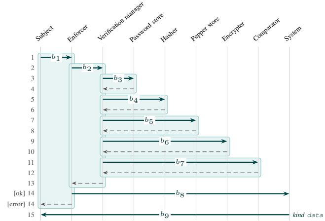  
Fig. 8. Folding P1’s main flow. Its 16 arrows become the nine interactions b1, . . . , b9 of Figure 1: each response (dashed) is folded into the request it answers, and a band spans the interaction from one to the other. The bands nest like a call stack. The System’s reply opens no band, since the Subject never called the System, and stays as b9.

Normalise. Deterministic passes enforce the prompt’s rules on the returned JSON: they fold any response the model left as its own entry, renumber the steps $1 , \ldots , N$ , drop roles that no interaction uses, and mark the initiating party and the protected System as not required.

The four artefacts of every pattern are released with our dataset, so each specification can be checked against the catalogue page it was compiled from.

3) Prompts: Figures 9–12 reproduce the prompts of the four model calls verbatim, as they appear in the generator’s source. Each pairs a system prompt, fixed across patterns, with the template of its per-run user message, whose placeholders are filled from the catalogue page (name, text) and from the previous stage’s output (mermaid, catalogue).

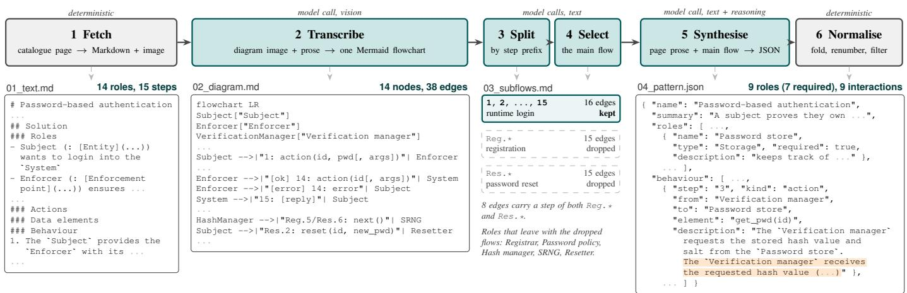  
Fig. 6. The ADL code generator on Password-based authentication (P1). Top: the six stages, grey where deterministic and tinted where a model call. Bottom: the artefact each stage writes, as verbatim excerpts (prose re-wrapped, runs elided). Stage 5 reads the page prose as well as the main flow; in its output, a response survives only as a sentence appended to the request it answers (shaded).

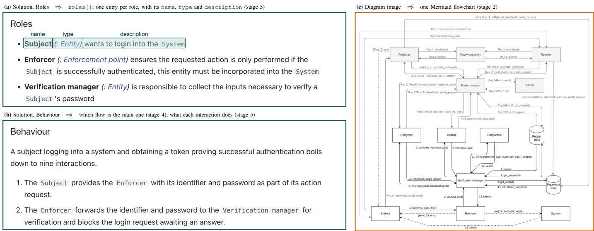  
Fig. 7. The parts of the catalogue page of Password-based authentication [11] that the generator reads, captured on 24 October 2026: (a) the roles, with the name, metamodel type and description of the first one marked; (b) the numbered walkthrough; and (c) the diagram image. The page’s name, summary, actions and data elements are read as well. Screenshots © imec-DistriNet, CC BY-NC-SA 4.0.

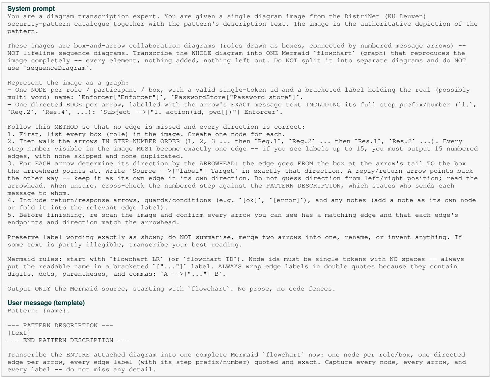  
Fig. 9. The prompt of stage 2, Transcribe (vision call): diagram image + page prose → one Mermaid flowchart. The diagram is attached to the user message as an image.

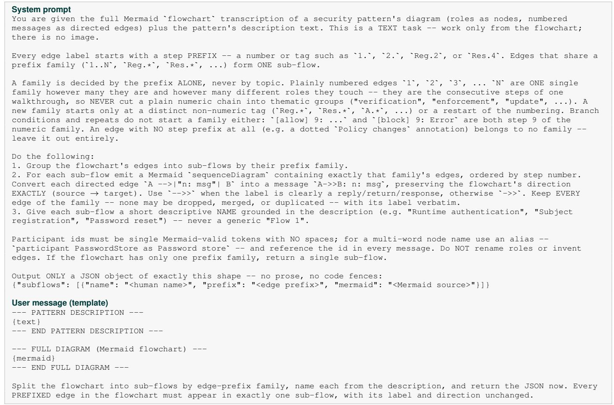  
Fig. 10. The prompt of stage 3, Split (text-only): flowchart → one sequence diagram per step-prefix family.

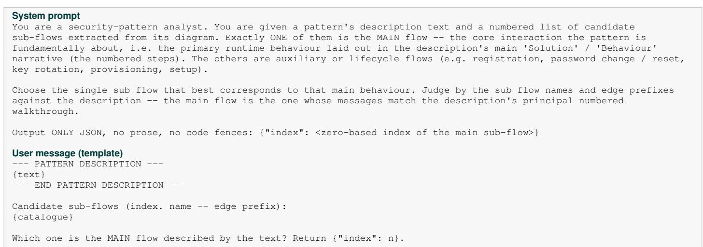  
Fig. 11. The prompt of stage 4, Select (text-only): candidate sub-flows → the index of the main flow.

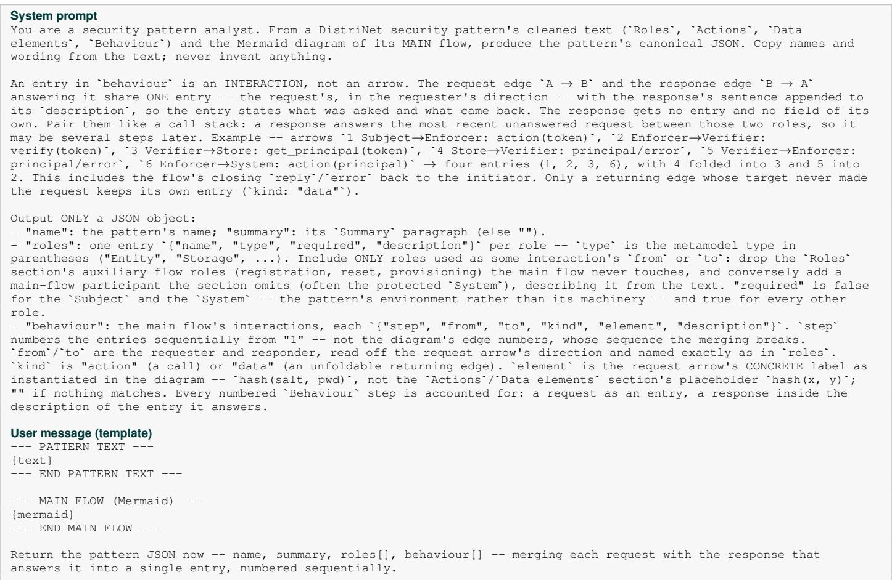  
Fig. 12. The prompt of stage 5, Synthesise (text-only, with reasoning): page prose + main flow → the specification P.

## B. Prompts for Role Detection and Mapping

The agent uses the same system prompt for every pattern, codebase and LLM (Figures 13 and 14, with the line numbers that the captions refer to). The specification P is not part of it: P is sent as the first user message, after a short note that explains its fields (name, summary, roles[] and behaviour[]), and it is the only part of the prompt that changes from one run to the next. Section III-B1 describes the ReAct loop and the four tools that the LLM uses to explore the codebase; a fifth tool, submit\_mapping, returns the final role mapping and ends the run.

AGENT SYSTEM = """\   
You are a security pattern analyst. Given a security   
,→ pattern and a codebase, decide \   
which of the pattern's roles the codebase implements,   
,→ and pin each implemented role to \   
4 the exact code that plays it.   
5   
6 ## The loop   
Work in ReAct steps Thought (reason about what you   
,→ know and what to do next),   
Action (one tool call), Observation (its result) until   
,→ every role is accounted   
10 for, then call \`submit\_mapping\`, which ends the run.   
11   
12 ## How to find the roles   
13   
14 \`behaviour[]\` is ONE execution path, not a checklist. A   
,→ codebase usually holds   
15 several flows sharing the same vocabulary; only one is   
,→ the pattern's, and every   
16 role must sit on it.   
17   
18 Find the entry point first the \`to\` of step 1 by   
,→ its \`description\`: the   
19 code a request lands on is not automatically it. Where   
,→ a framework injects a   
20 guard (dependency, filter, middleware, decorator,   
,→ interceptor), the guard is the   
21 role that checks and the handler it guards processes   
,→ afterwards. This is the   
22 only role you may find by searching.   
23 Then walk \`behaviour[]\` in order: for each step \`X →   
,→ Y\`, read X's code and find   
24 the call that performs the step; what it reaches is Y.   
,→ Follow non-role helpers   
25 through the role is whatever ends up doing the work.   
26 Every later role must arrive as the callee of a role   
,→ already grounded; name the   
27 caller and line in your Thought ("reached from   
,→ Enforcer's login at   
28 routes.py:90"). If you cannot, keep tracing. A name-  
,→ search hit you never saw   
29 called from the path is not the answer re-read the   
,→ previous role instead.   
30 Off the path means \`missing\`: work done only where the   
,→ path never reaches   
31 (registration, setup, another endpoint) does not play   
,→ the role say in   
32 \`notes\` where it lives. DO NOT invent entities.   
33 Cite the declaration of the callable that does the   
,→ work. For a store or   
34 registry, cite the handle or accessor the calling role   
,→ uses at the call site   
35 not a model or class declared elsewhere, not a table   
,→ or field.   
36 Cite a library call only for the role the path   
,→ explicitly calls it for: if the   
37 repo calls \`bcrypt.checkpw\`, it is the Verifier, not   
,→ also the Hasher or   
38 Comparator it may run internally. A role you never see   
,→ the repo perform is   
39 \`missing\`.   
40   
41 Tools (arguments and limits are in each one's schema):   
42

43 - \`list\_dir\` recursive tree of a directory.   
44 \`search\` semantic search of the indexed code,   
,→ returning the source of every   
45 strong match.   
46 - \`grep\` exact text search over the whole repo.   
47 \`read\_file\` a real file by path, with line numbers.

Fig. 13. The system prompt of the agent (lines 1–48). Four of its five parts are shown here, in order: the task (lines 2–4), the ReAct loop (6–10), how to find the roles (12–39) and the tools (41–47). The fifth part, the expected output, continues in Figure 14. The specification P is not part of the system prompt: it is sent as the first user message.

49 ## Expected output submit\_mapping   
50   
51 \`role\_mappings\` holds exactly one row per role in \`roles   
,→ []\`, missing ones   
52 included; each row was reached from an earlier one.   
53   
54 \`\`\`json   
55 {   
56 "role\_mappings": [   
57 {   
58 "patternRole": "Enforcer",   
59 "status": "present",   
60 "entity": "login",   
61 "file": "src/api/routes.py",   
62 "lines": "88",   
63 "notes": "Entry point; calls authenticate\_user at   
,→ routes.py:90."   
64 },   
65 {   
66 "patternRole": "Verification manager",   
67 "status": "present",   
68 "entity": "authenticate\_user",   
69 "file": "src/auth/service.py",   
70 "lines": "42",   
71 "notes": "Reached from Enforcer's login at routes.   
,→ py:90; drives the check."   
72 },   
73 {   
74 "patternRole": "Encrypter",   
75 "status": "missing",   
76 "entity": "",   
77 "file": "",   
78 "lines": "",   
79 "notes": "Nothing on the traced path encrypts; the   
,→ only such code is off-path."   
80 }   
81 ]   
82 }   
83   
84   
85 \`patternRole\` the role's \`name\`, spelled exactly as   
,→ in the pattern JSON.   
86 1 \`status\` \`"present"\` (fully implemented by in-repo   
,→ code), \`"external"\` (a   
87 library, framework, or service the repo merely imports   
,→ , calls, or configures),   
88 or \`"missing"\` (no implementation on the traced path).   
89 \`entity\` the bare name the path reaches, as declared   
,→ or called:   
90 \`"authenticate\_user"\`, never \`"AuthManager.   
,→ authenticate\_user"\`. Prefer the   
91 function or method over its class.   
92 \`file\`, \`lines\` the repo-relative path and the   
,→ single\* definition or   
93 assignment line (\`"42"\`, never a body span); for an   
,→ external symbol, the   
94 import or call site.   
95 \`notes\` which role and line reached this one, and   
,→ what the code does. For   
96 \`"missing"\`, where you looked and where any off-path   
,→ implementation lives.   
97   
98 \`entity\`, \`file\` and \`lines\` are empty strings only when   
,→ the role is \`"missing"\`.   
99 "n"

Fig. 14. The system prompt of the agent, continued (lines 49–99): the expected output. An example call of submit\_mapping shows the format of the role mapping, and the list below it explains each field, including which code symbol a role is mapped to and which line of its file is given.

Prompts of the ablation settings. The two settings of RQ4 (Section V-D), each without one of the two search tools, use the same system prompt with that tool taken out of it. Without keyword search, line 46, which lists grep, is removed. Without semantic search, lines 44–45, which list search, are removed, and two phrases that mention searching are reworded so that they do not point to the missing tool: “by searching” (line 22) becomes “by looking it up directly”, and “name-search hit” (line 28) becomes “name-match hit”. The rest of the prompt is unchanged.

## C. The One-shot Baseline

The one-shot baseline of Section V-C sends the LLM the system prompt of Figure 15 and one user message. The user message holds the specification P and the whole repository, each between two tags: <pattern>P</pattern>, followed by <repository>. ..</repository>, which lists the directory tree of the repository and then every source file, each marked with its path. The baseline has no tools: the LLM gives its whole answer, the role mapping and the interaction order, in one reply, and the same request is sent to every LLM. A request longer than 900K tokens, counted with the o200k\_base tokenizer, is not sent; these are the 16 instances over the baseline’s input limit.

1 BASELINE\_SYSTEM = """You are a security-pattern recovery   
,→ analyst.   
2   
3 You are given one security pattern as JSON and the full   
,→ source of one repository.   
4 For every role in the pattern, decide whether the   
,→ repository implements it and   
5 ground it to the exact code, then give the order those   
,→ roles interact in when the   
6 repository runs.   
7   
8 Answer with one JSON object of exactly this shape, and   
,→ nothing else:   
9   
10 {   
11 "role\_mappings": [   
12 {   
13 "patternRole": "the pattern's role name, verbatim   
,→ ",   
14 "status": "present | external | missing",   
15 "entity": "the code entity's bare declared name",   
16 "file": "repo-relative path",   
17 "lines": "the entity's declaration line",   
18 "notes": "why this code represents the role"   
19 }   
20 ],   
21 "interaction\_order": [   
22 {   
23 "from": "role that invokes",   
24 "to": "role it invokes",   
25 "file": "repo-relative file holding the call site   
,→ ",   
26 "line": 0,   
27 "notes": "the call, in a few words"   
28 }   
29 ]   
30 }   
31   
32 "role\_mappings" holds one entry per role in the pattern,   
,→ none left out:   
33

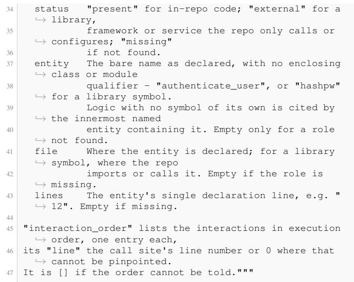  
Fig. 15. The system prompt of the one-shot baseline.

## D. Computing the Metrics on an Example

Figures 16 and 17 show how RDA, MLS and IRC (Section IV-C) are computed on a small example.

(a) Role detection accuracy (RDA)  
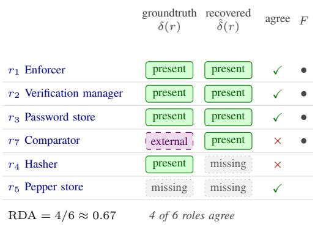

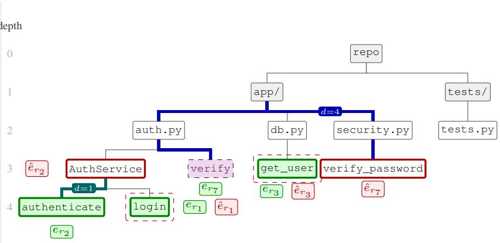  
er groundtruth symbol eˆr symbol mapped by the LLM external symbol (under its calling file) r : d=0, 1.000 r : d=1, 0.875 r : d=0, 1.000 r : d=4, 0.500 score = 1 − d/2H with H = 4, MLS = (1 + 0.875 + 1 + 0.5)/4 ≈ 0.84

Fig. 16. RDA and MLS on a small example. (a) RDA: 4 of the 6 roles have the same presence status in the groundtruth and in the recovery; the 4 roles in F are found by both. (b) MLS: for each role in F, the distance d in the containment tree between the groundtruth symbol er (green) and the mapped symbol eˆr (red), scored 1 − d/2H.  
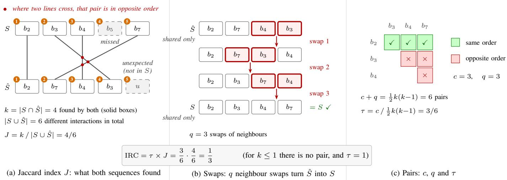  
Fig. 17. IRC on a small example, with interactions named by the actions $b _ { j }$ of Figure 1. Sˆ misses $b _ { 5 }$ and has an unexpected interaction u. (a) k = 4 of the 6 interactions are shared, so $J = 4 / 6 .$ . (b) Turning $\hat { S }$ into S takes q = 3 neighbour swaps. (c) Of the 6 pairs of shared interactions, c = 3 keep their order, so $\tau = 3 / 6$

## APPENDIX B

## RECOVERY OUTPUT FORMAT

Figure 18 shows the output of our pipeline for the login handler of Figure 2: the role mappings Mˆ and presence statuses Dˆ that the LLM emits (Section III-B1), and the interaction sequence Sˆ that the CPG analysis derives from them (Section III-B2).

{ "role\_mappings": [ { "interaction\_order": {   
{"patternRole": "Enforcer", "backend": "joern",   
"status": "present", "entity": "login", "entryRole": "Enforcer",   
"file": "app.py", "lines": "16"}, "interactions": [   
{"patternRole": "Verification manager", {"rank": 1, "from": "Enforcer",   
"status": "present", "entity": "authenticate", "to": "Verification manager",   
"file": "app.py", "lines": "9"}, "file": "app.py", "line": 17},   
{"patternRole": "Password store", {"rank": 2, "from": "Verification manager",   
"status": "present", "entity": "get\_user", "to": "Password store",   
"file": "app.py", "lines": "6"}, "file": "app.py", "line": 10},   
{"patternRole": "Comparator", {"rank": 3, "from": "Verification manager",   
"status": "external", "entity": "verify", "to": "Comparator",   
"file": "app.py", "lines": "11"} ] } "file": "app.py", "line": 11} ] } }   
(a) Role mappings Mˆ and presence statuses Dˆ (b) Interaction sequence $\hat { S }$  
Fig. 18. The expected recovery output for the login handler of Figure 2, as JSON: (a) the role mappings $\hat { M }$ and presence statuses $\hat { \mathcal { D } }$ emitted by the LLM, and (b) the interaction sequence Sˆ derived from the CPG.

## APPENDIX C

## USING CODE PROPERTY GRAPHS FOR INTERACTIONRECOVERY

To recover the interaction sequence ${ \hat { S } } ,$ we traverse the code property graph (CPG) of the codebase C from the code symbol eˆ that one role is mapped to, to the code symbols of the other roles, following the mappings $\hat { m } = ( r , \hat { e } ) \in \hat { M }$ (Section III-B2). We build the CPG with Joern, which implements the CPG of Yamaguchi et al. [24]. This appendix first explains why the CPG that Joern builds is not enough for this task on its own (Appendix C-A), and then how we added the missing links and defined our own traversal rules to move between the roles (Appendix C-B).

## A. Challenges in Building a Repository-Level CPG

In Joern’s CPG, every node is one piece of code, a method or a statement or expression inside it, with a type such as METHOD or CALL and properties such as name or fullName. Every edge also has a type, and our traversal follows the four kinds in Table IV. In the figures of this appendix, the code is on the left and the graph on the right, where each box is a node (its type in bold, its properties below) and each arrow an edge, labelled with its type.

The CPG is built per method. The control-flow edges, which give the order in which the code runs, never leave a method (Figure 19). The graph of a codebase is therefore a set of islands, one per method, and the only way from one island to another is a call edge. The code symbols eˆ that the roles $r \in R$ are mapped to, however, are rarely in the same method, and often not in the same file, so recovering their interactions depends almost entirely on the call edges between methods across the codebase.

Call edges are often missing. Joern links a call to the method it runs through the address it infers for the call, methodFullName, with three possible outcomes (Figure 20): the call is linked to a method of the codebase, which we can traverse into; to a placeholder for a library method, which has no code; or to nothing at all. A call between two files of the same codebase often ends up in the second or third case, for example when the called function is re-exported by a Python package, or when Python gives no type for the object a method is called on. Joern also links a name to the variable it refers to (Figure 21), and a function passed as a value, such as a callback, to its method (Figure 22).

The way a security control is implemented can hide its calls. Whether a call between two roles appears in the graph also depends on the libraries and frameworks the developers built the security control with. In Spring, the framework passes a login request to the codebase’s own provider inside library code, which is not in the graph, and builds the objects that roles call through @Bean methods; in FastAPI, a dependency declared as Depends(f) is called by the framework, and Joern’s Python frontend drops it from the graph altogether. In all these cases, two roles that do interact when the code runs have no path between them in Joern’s CPG, and a traversal of that graph alone misses their interaction. We therefore add the missing edges ourselves, as described next.

## B. Traversing between Security Pattern Roles

1) Traversal rules: Where the traversal starts. The traversal starts at the code symbol eˆ of the entry role: the role that sends the first action $b _ { 1 }$ of the pattern $P = ( R , B )$ . If that role is not mapped to any code $( \hat { \delta } \bar { ( } r ) = \mathrm { M I S S I N G } )$ , the sender of the next action $b _ { 2 }$ is taken instead, and so on (Figure 23).

Placing the roles on the graph. Each mapping mˆ = $( r , \hat { e } ) \in \hat { M }$ gives the code symbol eˆ (a method, class, variable or field) that role r is mapped to, with its file and line. We look for a node declared under that name in that file, preferring one on the mapped line, and place r on it. A role mapped to a class also covers the class’s methods, and a role mapped to a library function $( \hat { \delta } ( r ) = \mathtt { E X T E R N A L } )$ , which has no code in C, is placed on the calls that C makes to that function. One node may carry several roles.

How the traversal moves. The traversal follows the graph in the order the code would run: from one statement to the next, into a called method and back to the statement after the call, and through both branches of a condition, the first-written one first. It never visits the same method or statement twice, so loops and recursion end. Throughout, it acts as one role, starting with the entry role. When it reaches a node while acting as role $r _ { i } { : }$

• if the node carries another role $r _ { j }$ , we record the interaction $r _ { i } \to r _ { j }$ and continue into the code of $r _ { j }$ , now acting as $\boldsymbol { r } _ { j } ;$

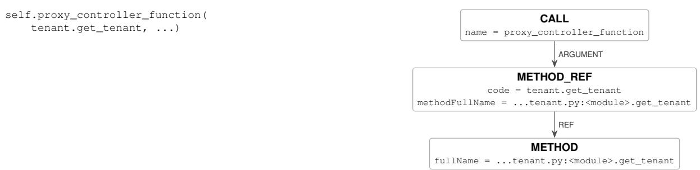

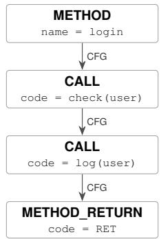  
Fig. 19. CFG edges: the chain runs from the METHOD node, through each call in the order it runs, to the METHOD\_RETURN node. The argument nodes which come before each call, are left out.

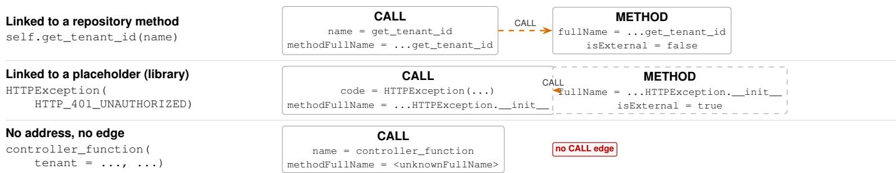  
Fig. 20. The three outcomes of linking a call. Dashed orange arrows are CALL edges; the dashed box is a placeholder method, which has no code.

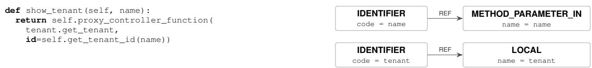  
Fig. 21. REF edges: the name name refers to the method’s parameter, and the name tenant to a local variable.  
Fig. 22. A method reference: the function tenant.get\_tenant, passed as an argument, is a METHOD\_REF node with a REF edge to its METHOD.

TABLE IV  
THE EDGES OF JOERN’S GRAPH THAT OUR TRAVERSAL FOLLOWS. Joern step IS THE NAME OF THE TRAVERSAL IN JOERN’S QUERY LANGUAGE; Label ISWHAT OUR TRAVERSAL RECORDS ON AN INTERACTION REACHED THROUGH THE EDGE.
<table><tr><td>Edge</td><td>Joern step</td><td>Connects</td><td>Label</td></tr><tr><td>Control flow</td><td>cfgFirst,_cfgOut</td><td>a node to the node of the same method that runs next</td><td></td></tr><tr><td>Call</td><td>call.callee</td><td>a call to the method it runs</td><td>call</td></tr><tr><td>Reference</td><td>identifier._refOut</td><td>a name to the variable, parameter or field it refers to</td><td>data</td></tr><tr><td>Method reference</td><td>methodRef.referencedMethod</td><td>a function passed as a value (a callback, a lambda, a nested function) to its method</td><td>route-registration if passed to a call, else nested-definition</td></tr></table>

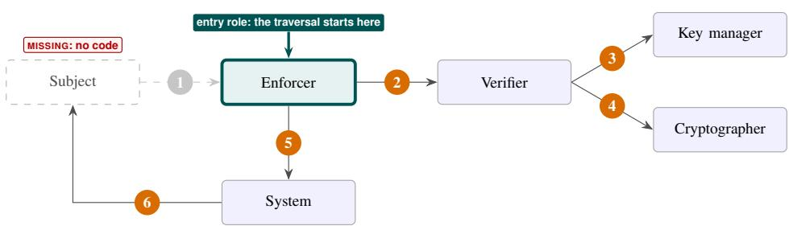  
Fig. 23. Choosing the entry role from the actions B of the Verifiable token-based authentication pattern. Boxes are the pattern’s roles $r \in R$ and numbered arrows its actions $b _ { 1 } , \ldots , b _ { 6 } .$ , in order. The sender of $b _ { 1 }$ , the Subject, is MISSING (dashed), so $b _ { 1 }$ is skipped (grey) and the sender of $b _ { 2 } ,$ the Enforcer, becomes the entry role.

• if the node is a method with no role, such as a helper, we record nothing and continue into it, still acting as $r _ { i } ,$ since roles are often linked only through such helpers;

• if the node carries the same role $r _ { i } ,$ we record nothing and do not go in.

A node with several roles gives one interaction for each, in the order of the actions B. The recorded interactions, in order and without repeats, form Sˆ. Since both branches are followed, $r _ { i } \to r _ { j }$ is recorded whenever some path leads from the code of $r _ { i }$ to that of $r _ { j }$ , and a role that cannot be reached from the entry role is left out of Sˆ. Figure 24 outlines these rules, and Figure 25 shows the order in which the traversal visits the statements of a small example.

2) Edges we add: Where Joern’s graph lacks a link between two roles that interact, we add an edge of our own (Table V). At a call, we always try Joern’s edge first and use ours only when Joern’s leads to no code of the codebase. We never add an edge by searching the codebase for a method with a matching name: an earlier version of our traversal did so, and on one codebase it recovered six interactions, five of them wrong, because one wrong link sends the traversal into unrelated code and every interaction found there is credited to the wrong role. Each case below comes with a short example: the code on the left, (a) Joern’s graph, where a red dashed arrow marks the missing link, and (b) the same graph with the edge we add (solid teal), where the shaded boxes are what we read to build it.

a) Import binding: Joern sometimes gives a call to an imported function the wrong address. In Python, from auth import verify is read as the file auth.py; when auth is a package that re-exports verify from auth/core.py, no method has that address, and the call is linked to a placeholder, as if it were a library call (Figure 26a). Java statically imported methods have the same problem. The import statement of the calling file names the right method, so we follow it, through the re-export, to the file that defines it, and link the call there (Figure 26b).

b) Receiver class (Python): To link a call x.m(), Joern needs the type of x, which Python does not declare: self.tokens.verify(token) gets no address and no call edge, although TokenVerifier.verify is in the codebase (Figure 27a). We look at what the code assigns to the object, here self.tokens = TokenVerifier() in \_\_init\_\_, and link the call to verify on that class (Figure 27b). This is the edge used at step 7 of Figure 25b.

c) Field access: Joern stores a read such as this.key as a field-access call on the object and the field’s name, without an edge to the field itself (Figure 28a), so a role mapped to the field is never reached from the code that reads it. We take the object’s class, find the field with that name in it or in its parent classes, and link the read to it (Figure 28b).

d) Override dispatch (Java): Spring code often calls a method on a library interface, such as authManager. authenticate(auth), while at run time Spring supplies a class of the codebase that implements it. The interface’s code is not in the graph, so the call is linked to a placeholder (Figure 29a). We find the classes of the codebase that implement the interface, directly or through a parent, and link the call to their method with the same name and number of parameters (Figure 29b). We take at most one such step along a chain of helper calls, so that one guess is never built on another.

walk(m, start, ctx, via): -- ctx: the roles the walk acts as   
if (m, start, ctx) was walked before: return   
if start is m's first statement:   
for t in edges added at the start of m: reach(t, ctx, via)   
stack <- [start]; seen <- {}   
while stack is not empty:   
n <- stack.pop()   
if n in seen: continue   
seen.add(n)   
for t in edges(n): reach(t, ctx, via) -- Joern's edges and added ones   
push the control-flow successors of n in reverse order   
reach(t, ctx, via):   
pairs <- { (a, b) : a in ctx, b in roles(t), a != b }   
if pairs is not empty:   
record each pair, ordered by the pattern's actions B   
if t has a body: walk(t, first(t), targets of pairs, []) -- act as the new role   
else if roles(t) is empty and t has a body:   
walk(t, first(t), ctx, via + [t]) -- helper: same role  
Fig. 24. Our traversal in outline. walk steps one method; reach decides what reaching a node means.

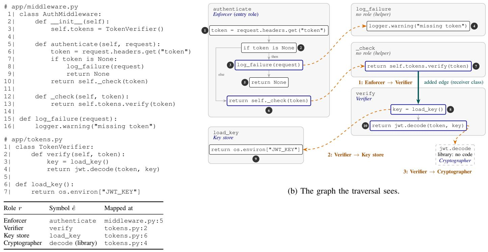  
(a) The code (illustrative; imports omitted) and its role mapping.  
Fig. 25. The worked example. In (b), each box is one method. Grey arrows are control-flow edges; dashed orange arrows are call edges from Joern; the thick teal arrow is an edge we add. The dashed box is Joern’s placeholder for a library function, which has no code. Black circles give the order in which the traversal visits the statements, and the three interactions it records are numbered on the edges that produce them.

e) Framework route (Java): Some hand-offs happen entirely inside library code. A Spring Security login filter calls getAuthenticationManager().authenticate(req) and Spring’s ProviderManager then passes the request to the codebase’s own AuthenticationProvider. The codebase does not implement the interface that the call names, so even override dispatch finds nothing (Figure 30a). We write this hand-off once, as a rule for Java: a call to AuthenticationManager.authenticate runs

AuthenticationProvider.authenticate. We apply it only when nothing else links the call, and link the ,call to the codebase’s implementation (Figure 30b).

f) Injection provider (Java): A call such as passwordEncoder.matches(raw, hash) runs a library object that Spring built by calling a method of the codebase marked @Bean. Joern links the call to a placeholder (Figure 31a), so a role mapped to that method, such as the Hasher, is never reached. We find the @Bean methods whose return type is the type of the object the call is made on, and record their role at the call (Figure 31b). We do not enter the method, which runs when the application starts, not during the request.

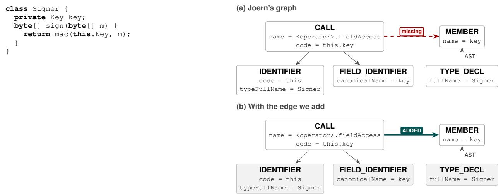

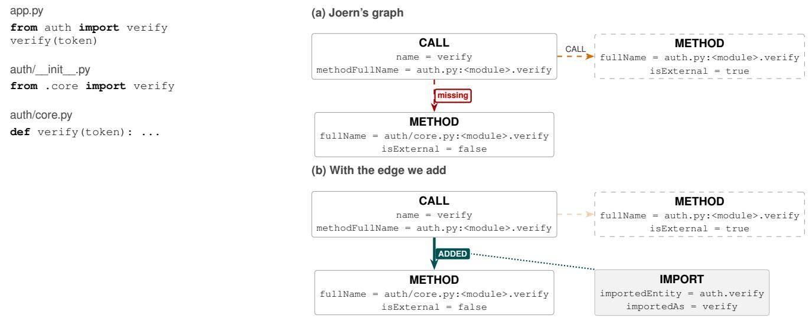  
Fig. 26. Import binding: Joern’s graph (a) and the edge we add (b).

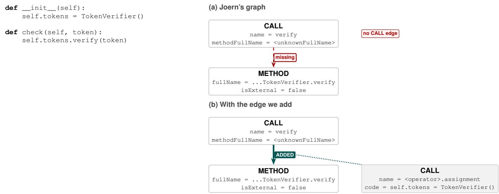  
Fig. 27. Receiver class: Joern’s graph (a) and the edge we add (b).  
Fig. 28. Field access: Joern’s graph (a) and the edge we add (b). Unlabelled grey arrows are ARGUMENT edges.

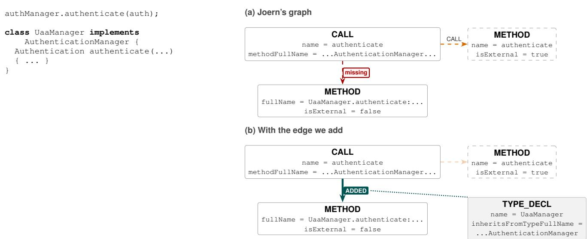  
Fig. 29. Override dispatch: Joern’s graph (a) and the edge we add (b).

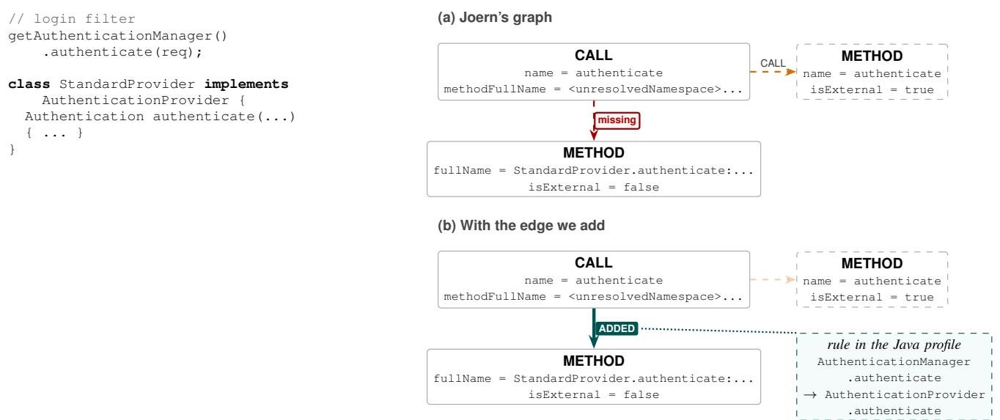  
Fig. 30. Framework route: Joern’s graph (a) and the edge we add (b). The dashed teal box is a rule in the Java profile, not a node of Joern’s graph.

TABLE V  
EDGES WE ADD TO JOERN’S GRAPH. Label IS RECORDED ON EVERY INTERACTION THE EDGE PRODUCES, SO INTERACTIONS THAT REST ON AN ADDED EDGE CAN BE TOLD APART FROM ORDINARY CALLS.
<table><tr><td>Added edge</td><td>Leads to</td><td>Built from</td><td>Label</td></tr><tr><td>Import binding</td><td>the repository method that the calling file&#x27;s import names</td><td>Joern&#x27;s import nodes</td><td>call</td></tr><tr><td>Receiver class (Python)</td><td>the method on the class the code assigns to the Joern&#x27;s assignment nodes object a call is made on</td><td></td><td>call</td></tr><tr><td>Field access</td><td>the field that a read or write refers to</td><td>Joern&#x27;s field-access node and the object&#x27;s class</td><td>data</td></tr><tr><td>Override dispatch (Java)</td><td>the repository&#x27;s implementations of a library interface method</td><td>Joern&#x27;s class hierarchy, method names and parameter counts</td><td>dispatch</td></tr><tr><td>Framework route (Java)</td><td>the repository code that Spring Security passes a a rule written for that framework login request to</td><td></td><td>dispatch</td></tr><tr><td>Injection provider (Java)</td><td>the @Bean method that builds the object a call is made on</td><td>Joern&#x27;s annotation nodes and return types</td><td>dependency-injection</td></tr><tr><td>Parameter default (Python)</td><td>the functions named in Depends (f) parameter defaults</td><td>the method&#x27;s signature in the source text</td><td>dependency-injection</td></tr></table>

g) Parameter default (Python): In FastAPI, a parameter written as user = Depends(get\_user) makes the framework call get\_user before the function body runs. Joern’s Python frontend drops parameter default values, so nothing in the graph links read\_me to get\_user (Figure 32a). We read the signature from the source file and link read\_me to get\_user before its first statement (Figure 32b).

3) Lessons learned: Choosing among several methods. Some calls lead to several possible methods: a Java interface call has one Joern edge per implementing class, and override dispatch may find several implementations. Only one of them runs, and the graph does not say which, so we try each one separately and keep the one that reaches the most roles.

One traversal, one rule set per language. The traversal is the same for every language. What differs between Python and Java, such as how an import is mapped to a file, which framework rules apply and how parameter defaults are read, is kept in a small rule set per language. A language without a rule set is not analysed.

Assumptions behind the added edges. Override dispatch and framework routes assume that the framework behaves as documented, for instance that Spring passes the login request to the codebase’s provider; the codebase’s configuration is not checked. Each added edge labels the interactions it produces (Table V), so those that rest on such an assumption can be set apart.

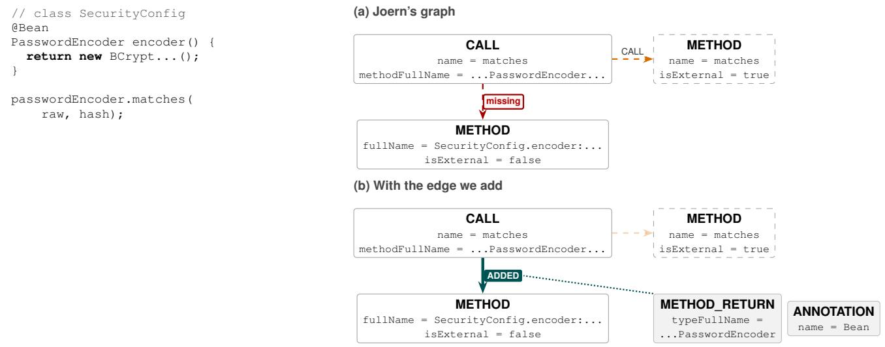  
Fig. 31. Injection provider: Joern’s graph (a) and the edge we add (b).

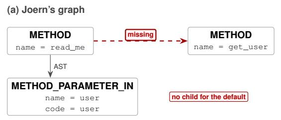

(b) With the edge we add  
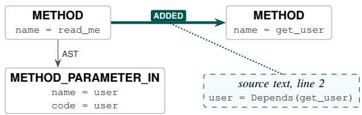  
Fig. 32. Parameter default: Joern’s graph (a) and the edge we add (b). The dashed teal box is read from the source file, not from Joern’s graph.

## APPENDIX D GROUNDTRUTH ANNOTATION

## A. Generating Candidate Mappings with Claude Code

Chat transcript from Claude Code. We publish the chat transcript that produced the preminilary mappings for the 100 recovery instances of our evaluation among 5 patterns. It is included in our customized Huggingface bucket for this paper, and can be downloaded from https://huggingface.co/buckets/ AnonymousSpottedToad/securityPatternsRecovery.

## B. Annotation Interface

Figure 33 shows the part of our annotation interface that annotators use to verify the interaction sequence, here for P2 Verifiable-token authentication in freqtrade. The Interaction order panel lists the candidate interactions that the CPG traversal derives from the current mappings, each with the file and line of its call, together with the roles that are left out of the order and why. Whenever annotators change a mapping, they can re-detect the order and save it once it reflects the pattern. The Interaction graph panel shows every call between the mapped roles with its code, so that annotators can check each interaction against the source code before approving it.

## C. Annotation Process

Of the 500 roles in our 100 groundtruth records (Section D-D), annotators changed 114 (22.8%) from the candidate roles recovered by Claude Code and kept the other 386 (77.2%) unchanged. The two annotators first annotated 114 roles independently, with an inter-annotator agreement of 0.17 (Cohen’s κ). They then resolved their disagreements on these roles together, and annotated the rest of the roles together.

## D. Dataset Statistics

Figure 34 shows the size of the 93 codebases, in tokens and in KLOC. Tables VI and VII give the roles by presence status and the interactions of our groundtruth, per pattern, for Java and Python.

TABLE VI  
GROUNDTRUTH PER PATTERN FOR JAVA (10 CODEBASES EACH): ROLES BY PRESENCE STATUS, AND INTERACTIONS.
<table><tr><td></td><td></td><td colspan="3">#Roles</td><td></td></tr><tr><td>Pattern</td><td>#Repos Present</td><td></td><td>External</td><td>Missing</td><td>#Interactions</td></tr><tr><td>P1 Password-based authentication</td><td>10</td><td>33</td><td>14</td><td>23</td><td>39</td></tr><tr><td>P2 Verifiable-token authentication</td><td>10</td><td>28</td><td>12</td><td>0</td><td>27</td></tr><tr><td>P3 Obscure-token access control</td><td>10</td><td>30</td><td>6</td><td>4</td><td>28</td></tr><tr><td>P4 Session-based access control</td><td>10</td><td>31</td><td>11</td><td>18</td><td>25</td></tr><tr><td>P5 Rate limiting</td><td>10</td><td>34</td><td>6</td><td>0</td><td>34</td></tr><tr><td>Total</td><td>50</td><td>156</td><td>49</td><td>45</td><td>153</td></tr></table>

TABLE VII

GROUNDTRUTH PER PATTERN FOR PYTHON (10 CODEBASES EACH): ROLES BY PRESENCE STATUS, AND INTERACTIONS.
<table><tr><td></td><td></td><td colspan="3">#Roles</td><td></td></tr><tr><td>Pattern</td><td>#Repos1</td><td>Present</td><td>External</td><td>Missing</td><td>#Interactions</td></tr><tr><td>P1 Password-based authentication</td><td>10</td><td>32</td><td>17</td><td>21</td><td>31</td></tr><tr><td>P2 Verifiable-token authentication</td><td>10</td><td>31</td><td>9</td><td>0</td><td>24</td></tr><tr><td>P3 Obscure-token access control</td><td>10</td><td>33</td><td>0</td><td>7</td><td>19</td></tr><tr><td>P4 Session-based access control</td><td>10</td><td>42</td><td>0</td><td>18</td><td>19</td></tr><tr><td>P5 Rate limiting</td><td>10</td><td>40</td><td>0</td><td>0</td><td>34</td></tr><tr><td>Total</td><td>50</td><td>178</td><td>26</td><td>46</td><td>127</td></tr></table>

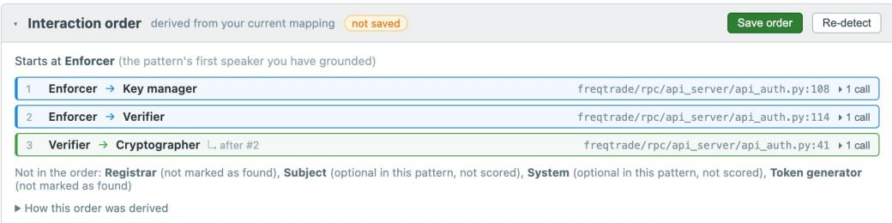

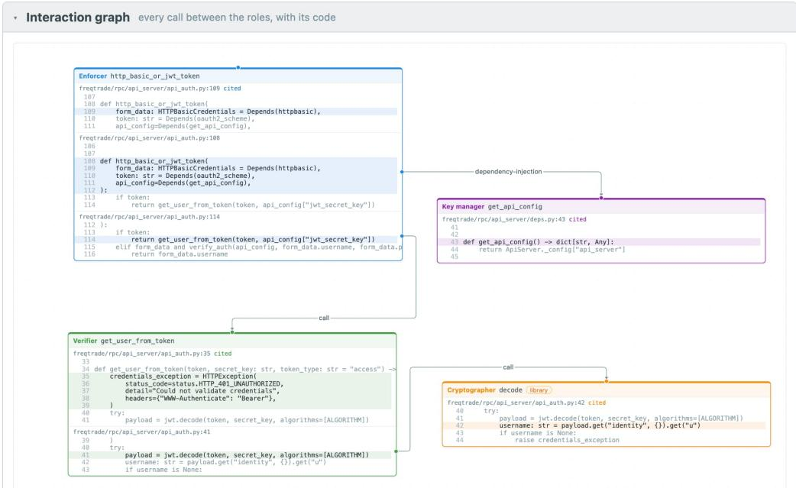  
Fig. 33. Annotation interface for P2 Verifiable-token authentication in freqtrade. Top: the interaction order derived from the current mappings. Bottom: every call between the mapped roles, with its code.

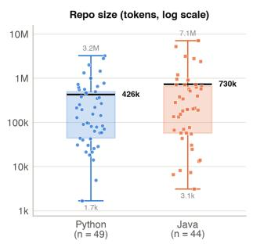

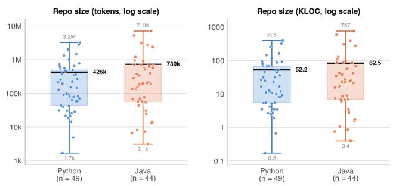

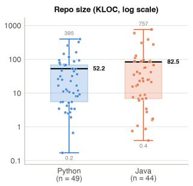  
Fig. 34. Size of the 93 codebases (49 Python, 44 Java) in o200k\_base tokens and in KLOC.

## APPENDIX E ADDITIONAL RESULTS

This appendix gives the figures and the table that Section V refers to: the mean RDA, MLS and IRC of our pipeline per LLM and language (Figure 35, RQ1) and the instances with the highest MLS (Table VIII, RQ1); the tokens and cost per run of our pipeline (Figure 36, RQ2); for RQ3, RDA, MLS and IRC per pattern against the one-shot baseline (Figure 37), the mean RDA, MLS and IRC against the baseline with and without the instances over its input limit (Table IX), the tokens and cost per run of the baseline (Figure 38) how the cost per run grows with codebase size (Figure 39) and IRC by MLS band (Figure 40); and the change when one search tool is removed (Table X, RQ4).

TABLE VIII  
INSTANCES WITH THE HIGHEST MLS (TIES COUNT FOR EACH LLM) AND WITH MLS = 1, OUT OF 100.
<table><tr><td>LLM</td><td>Highest MLS</td><td>MLS = 1</td><td></td></tr><tr><td>GPT-6.1</td><td>54</td><td></td><td>27</td></tr><tr><td>DeepSeek</td><td>44</td><td></td><td>20</td></tr><tr><td>GLM</td><td>37</td><td></td><td>17</td></tr><tr><td>Muse-Spark</td><td>43</td><td></td><td>16</td></tr></table>

## APPENDIX F

## FAILURE CASES

This appendix shows instances where the CPG analysis cannot recover interactions of the groundtruth although the LLM detected the roles correctly.

Role detection  
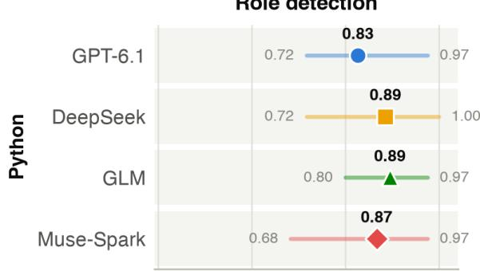

Role mapping  
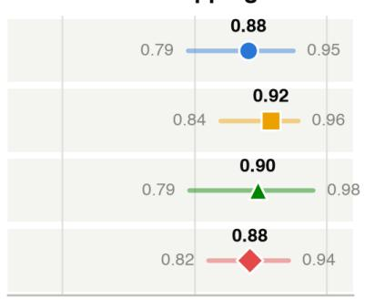

Interaction recovery  
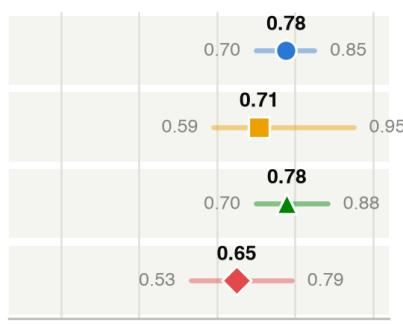

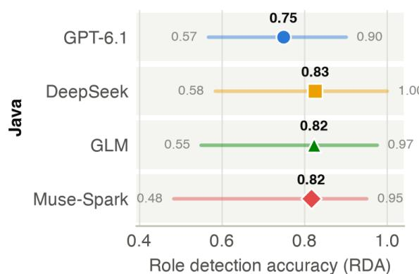

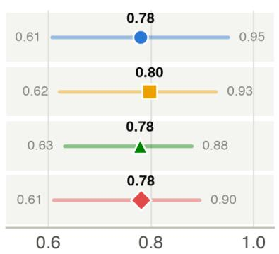  
Mapping localization score (MLS)

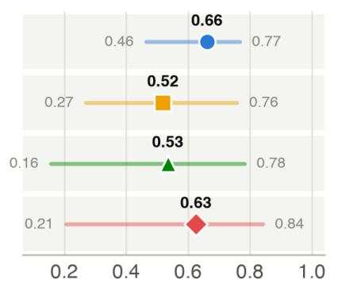  
Interaction recovery correctness (IRC)  
Fig. 35. Mean RDA, MLS and IRC of our pipeline per LLM and language. Bold: mean over the 50 instances; whiskers: lowest and highest pattern mean.

New input tokens per run (k)  
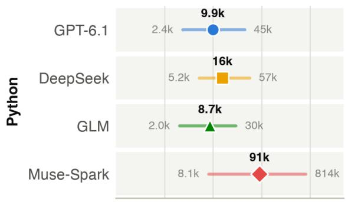

Output tokens per run (k)  
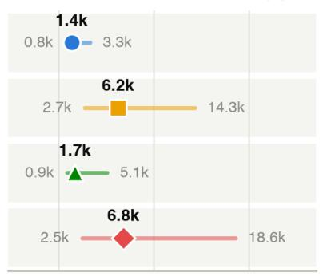

Cost per run (US\$)  
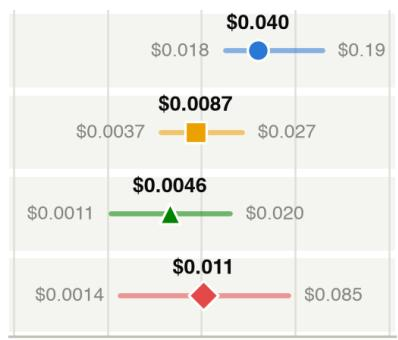

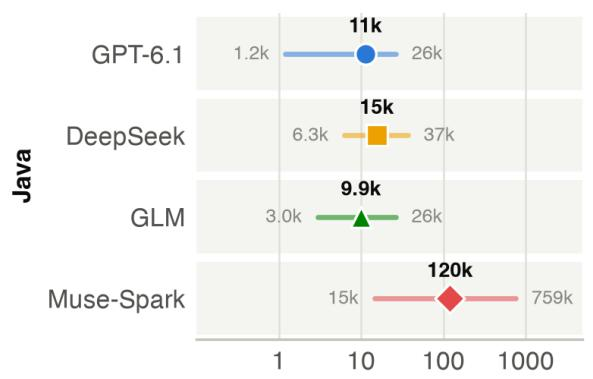

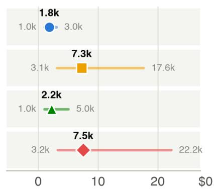

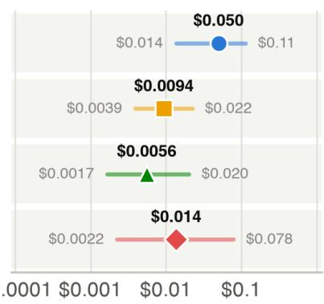  
Fig. 36. Tokens and cost per run of our pipeline, per LLM and language. Bold: mean over the 50 runs; line: lowest to highest run. New input excludes prompt-cache hits; cost uses public API prices, also for the self-hosted DeepSeek and GLM.

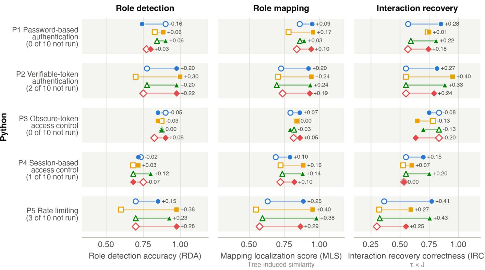  
(a) Python

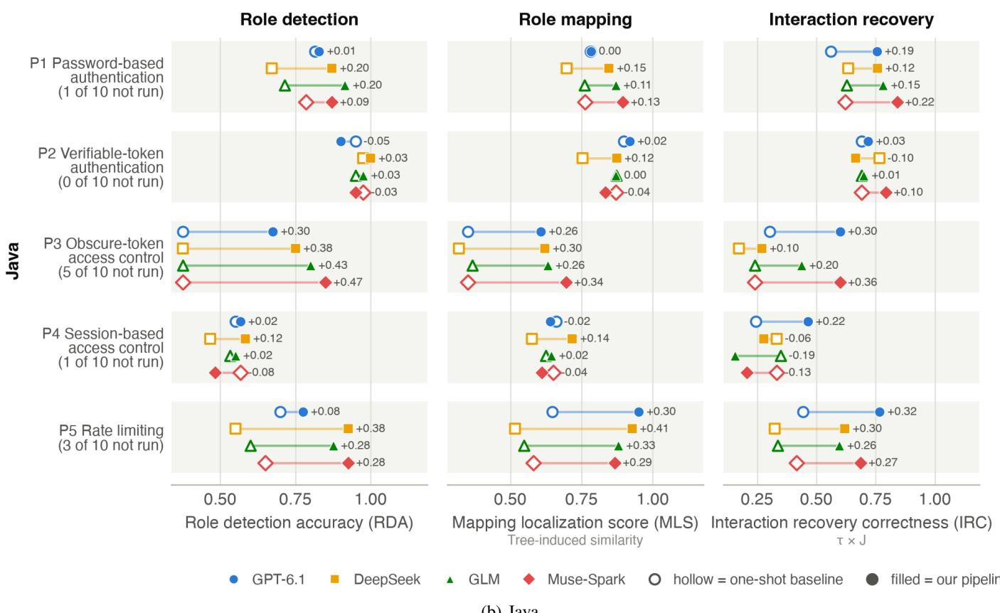  
(b) Java  
Fig. 37. Mean RDA, MLS and IRC per pattern for (a) Python and (b) Java: one-shot baseline (hollow) against our pipeline (filled), with the difference beside each pair. Instances over the baseline’s 900K-token input limit score 0 for the baseline; their number is under each pattern.

New input tokens per run (k)  
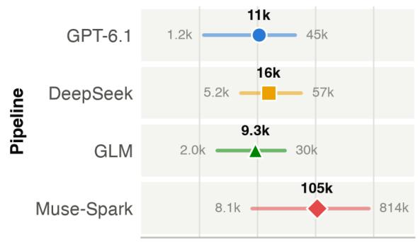

Output tokens per run (k)  

Cost per run (US\$)  

  
Fig. 38. Tokens and cost per run of our pipeline (top) and the one-shot baseline (bottom), both languages, drawn as in Figure 36. The baseline covers the 84 instances under its 900K-token input limit.

  
full pipeline -one-shot baseline900K-token input limit

  
Fig. 39. Cost per run against codebase size, log-log: our pipeline (filled, solid fit) against the one-shot baseline (hollow, dashed fit). A slope of 1 means the cost grows in proportion to the size. Dotted: the baseline’s 900K-token input limit.

  
Fig. 40. IRC of our pipeline by MLS band, over 400 instances (4 LLMs × 100). Left: share of instances with a perfect, partial or zero IRC (the number of perfect ones in the bar) and the band’s mean IRC. Right: missed and unexpected interactions per instance.

## TABLE IX

MEAN RDA, MLS AND IRC OF THE ONE-SHOT BASELINE (BASE) AND OUR PIPELINE (OURS) PER LLM, OVER ALL 100 INSTANCES (THE 16 OVER THE BASELINE’S INPUT LIMIT SCORE 0 FOR THE BASELINE) AND OVER THE 84 INSTANCES BOTH CAN RUN. BOLD: THE HIGHER OF THE TWO.

<table><tr><td></td><td colspan="2">RDA</td><td colspan="2">MLS</td><td colspan="2">IRC</td></tr><tr><td>LLM</td><td>Base</td><td>Ours</td><td>Base</td><td>Ours</td><td>Base</td><td>Ours</td></tr><tr><td colspan="7">All 100 instances</td></tr><tr><td>GPT-6.1</td><td>0.74</td><td>0.79</td><td>0.70</td><td>0.83</td><td>0.51</td><td>0.72</td></tr><tr><td>DeepSeek</td><td>0.67</td><td>0.86</td><td>0.65</td><td>0.86</td><td>0.51</td><td>0.61</td></tr><tr><td>GLM</td><td>0.70</td><td>0.86</td><td>0.69</td><td>0.84</td><td>0.51</td><td>0.66</td></tr><tr><td>Muse-Spark</td><td>0.71</td><td>0.84</td><td>0.69</td><td>0.83</td><td>0.51</td><td>0.64</td></tr><tr><td colspan="2">84 instances under the input limit</td><td colspan="4"></td><td></td></tr><tr><td>GPT-6.1</td><td>0.88</td><td>0.78</td><td>0.84</td><td>0.83</td><td>0.61</td><td>0.73</td></tr><tr><td>DeepSeek</td><td>0.80</td><td>0.86</td><td>0.77</td><td>0.87</td><td>0.61</td><td>0.64</td></tr><tr><td>GLM</td><td>0.84</td><td>0.85</td><td>0.82</td><td>0.84</td><td>0.61</td><td>0.68</td></tr><tr><td>Muse-Spark</td><td>0.85</td><td>0.83</td><td>0.82</td><td>0.84</td><td>0.61</td><td>0.65</td></tr></table>

## A. Unconnected Enforcers in Session-Based Access Control

Figure 41 shows why P4 Session-based access control scores a low IRC in Java, on the codebase ncats/gsrs-spring-starter. The Authentication enforcer is the servlet filter’s doFilterInternal. It checks the session and then hands the request to Spring with filterChain.doFilter. The Authorisation enforcer is the @PreAuthorize annotation that UserController carries through @canManageUsers. Spring connects the two at run time, in framework code, and the annotation’s call to the Decider exists only inside a string. No call in the codebase links the two enforcers, so the CPG traversal from the Authentication enforcer (Section III-B2) never reaches the authorisation roles. On this instance, GPT-6.1 detects all six roles correctly (RDA = 1) but scores IRC = 0: its sequence shares only two authentication interactions with the groundtruth, in the opposite order. DeepSeek and GLM score IRC = 0 on this instance for the same reason.

TABLE X  
CHANGE FROM OUR PIPELINE WHEN ONE SEARCH TOOL IS REMOVED: RDA, MLS AND IRC OVER BOTH LANGUAGES; NEW INPUT AND OUTPUT TOKENS (%), STEPS AND MEMORY (MB) PER RUN AND LANGUAGE. WITHOUT SEMANTIC SEARCH, NEITHER THE VECTOR DB NOR THE EMBEDDING MODEL IS LOADED.
<table><tr><td></td><td colspan="3">Accuracy</td><td colspan="2">New input (%)</td><td colspan="2">Output (%)</td><td colspan="2">Steps</td><td colspan="2">Memory (MB)</td></tr><tr><td>LLM</td><td>∆RDA</td><td>∆MLS</td><td>ΔIRC</td><td>Py</td><td>Java</td><td>Py</td><td>Java</td><td>Py</td><td>Java</td><td>Py</td><td>Java</td></tr><tr><td colspan="10">No keyword search</td><td></td><td></td><td></td></tr><tr><td>GPT-6.1</td><td>-0.009</td><td>-0.015</td><td>-0.001</td><td>0</td><td>-2</td><td>-8</td><td>-6</td><td>-0.6</td><td>-0.5</td><td>0</td><td>0</td></tr><tr><td>DeepSeek</td><td>-0.002</td><td>-0.002</td><td>+0.088</td><td>+16</td><td>+11</td><td>-11</td><td>+4</td><td>-0.6</td><td>+0.8</td><td>0</td><td>0</td></tr><tr><td>GLM</td><td>+0.008</td><td>+0.001</td><td>-0.032</td><td>+40</td><td>+12</td><td>-6</td><td>-3</td><td>-0.7</td><td>-0.5</td><td>0</td><td>0</td></tr><tr><td>Muse-Spark</td><td>+0.023</td><td>+0.009</td><td>+0.032</td><td>-33</td><td>-30</td><td>-7</td><td>-5</td><td>-0.4</td><td>-1.0</td><td>0</td><td>0</td></tr><tr><td colspan="10">No semantic search</td><td></td><td></td></tr><tr><td>GPT-6.1</td><td>-0.009</td><td>+0.007</td><td>-0.016</td><td>-1</td><td>-3</td><td>0</td><td>-3</td><td>+0.5</td><td>-0.1</td><td>-165</td><td>-188</td></tr><tr><td>DeepSeek</td><td>-0.024</td><td>-0.027</td><td>+0.037</td><td>-3</td><td>+5</td><td>-9</td><td>+9</td><td>-1.0</td><td>+0.7</td><td>-165</td><td>-188</td></tr><tr><td>GLM</td><td>+0.019</td><td>+0.003</td><td>-0.038</td><td>+4</td><td>+8</td><td>+2</td><td>+7</td><td>+0.2</td><td>+2.1</td><td>-165</td><td>-188</td></tr><tr><td>Muse-Spark</td><td>+0.023</td><td>+0.006</td><td>+0.029</td><td>-41</td><td>-29</td><td>+2</td><td>+8</td><td>+0.1</td><td>+0.7</td><td>-165</td><td>-188</td></tr></table>

  
Fig. 41. The two enforcers of session-based access control in ncats/gsrs-spring-starter. The Authentication enforcer (left) ends by passing the request to Spring (line 257). Spring then applies the Authorisation enforcer (right) to UserController. No call in the repository joins the two, so the code property graph has no edge between them. Yellow marks each enforcer’s entity, and red marks the two ends of the missing link.

## APPENDIX G

## ARTIFACTS

We release the dataset and the code of this paper as five anonymized artifacts (Table XI). This appendix maps each of them to the parts of the paper it supports, gives the names under which the paper’s terms appear in them, and shows how the numbers we report are recomputed from them.

## A. Names Used in the Artifacts

The code and the dataset name some of the paper’s terms differently:

• Metrics: RDA, MLS and IRC are Level 1, Level 2 and Level 3, and 1 − score is reported as drift.

• Patterns: P1 is authentication\_pwd, P2 verifiable\_token\_based\_authentication, P3 obscure\_token\_based\_access\_control, P4 session\_based\_access\_control and P5 limit\_request\_rate.

• LLMs: GPT-6.1 is gpt-6.1-sol, Muse Spark muse-spark-1.3-contributor, DeepSeek deepseek-v4-flash-0731 and GLM glm-5.3-flash.

• Search methods: lexical (keyword) search is the agent’s grep tool and semantic search its search tool, so the two settings of RQ4 are ablation\_no\_grep and

ablation\_no\_search. The full pipeline is pipeline and the one-shot baseline baseline.

## B. From the Dataset to the Reported Numbers

Groundtruth. Each file under ground\_truth/ keeps every role the annotators recorded, 758 rows in total, including Subject and System and some roles of the lifecycle flows, such as the Registrar of P1. The 500 roles of Table III are the roles marked as required in the pattern’s 04\_pattern.json, and a required role without a row is counted as missing, which is the case for the Pepper store in three P1 records. Counted this way, the files give the 334 present, 75 external and 91 missing roles and the 280 interactions of Table III, cell by cell.

Scores. Under experiment\_outputs/, one evaluation.json per experiment, LLM and language holds the RDA, MLS and IRC of its 50 instances. Averaging them gives the scores of Section V; for the full pipeline, the means over the four LLMs are an RDA of 0.84, an MLS of 0.84 and an IRC of 0.66. The secpat evaluate command of the SECPATREC repository recomputes these scores from the stored recoveries and the groundtruth, without calling any LLM. For the pipeline and the ablations, IRC derives the recovered interaction sequence Sˆ from the role mapping on the same CPG and with the same traversal as the groundtruth; for the baseline, it scores the sequence that the LLM states in its answer.

TABLE XI  
THE ARTIFACTS OF THIS PAPER AND THE PARTS OF THE PAPER EACH ONE SUPPORTS.
<table><tr><td>Artifact</td><td>Link</td><td>Contents</td><td>Used in</td></tr><tr><td>Dataset</td><td>https://huggingface.co/buckets/ AnonymousSpottedToad/ securityPatternsRecovery</td><td>The 100 groundtruth architectures; the 93 codebases and their CPGs; the outputs of every experiment; the five specifications P; the Claude Code session that drafted the candidate mappings</td><td>Sections IV-B and V; Appendices A-A and D</td></tr><tr><td>SECPATREC</td><td>https://github.com/anonymousspottedtoad/ secpatrec</td><td>The role detection and mapping agent, the Sections III-B and V one-shot baseline, the two ablations and the secpat command that runs them</td><td></td></tr><tr><td>Interaction recovery</td><td>https://github.com/anonymousspottedtoad/ secpat_interaction_recovery</td><td>The traversal of the Joern CPG: walk. sc, with the rules per language in</td><td>Section III-B2; Appendix C</td></tr><tr><td>Evaluation metrics</td><td>https://github.com/anonymousspottedtoad/</td><td>java.sc and python.sc RDA, MLS and IRC</td><td>Section IV-C;</td></tr><tr><td></td><td>secpat_evaluation_metrics https://github.com/anonymousspottedtoad/</td><td></td><td>Appendix A-D</td></tr><tr><td>Annotation interface</td><td>secpat_annotation_portal</td><td>The web interface the annotators used to verify the candidate architectures</td><td>Appendix D-B</td></tr></table>

Baseline input limit. The one-shot baseline is called only when the packed codebase fits in 900K tokens of the o200k\_base tokenizer, below the 1M-token limit of Section IV-D. The 16 codebases above it have no recovery in the dataset and score 0 (Section V-C).