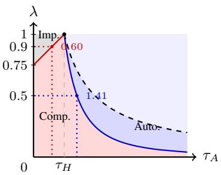
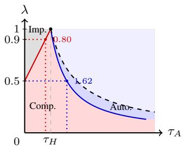
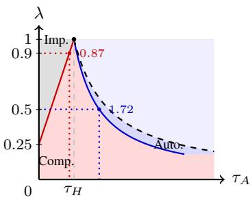
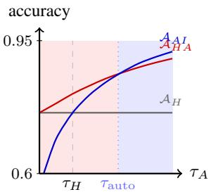
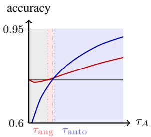
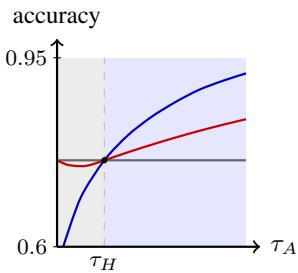
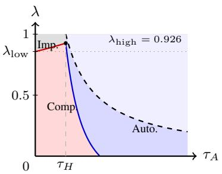
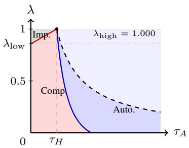
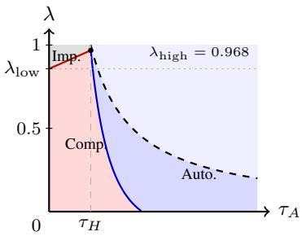

# AI-Assisted Classification under Correlation Neglect and Trust

Dingwen Kong MIT dingwenk@mit.edu

Liang Lyu MIT lianglyu@mit.edu

Amine Bennouna Northwestern University amine.bennouna@northwestern.edu

Saurabh Amin MIT amins@mit.edu

Daniel Huttenlocher MIT huttenlocher@mit.edu

Asuman Ozdaglar MIT asuman@mit.edu

## Abstract

When does an AI assistant improve human decision-making, and when does it hurt? We argue that the answer depends not just on AI accuracy but also on how much its evidence overlaps with the human’s and how the human combines the two. A worker makes a binary decision by observing her own signal and receiving a recommendation from an AI. We develop a human behavioral model with two primitives: her awareness of the overlap and her trust in the AI. Our analysis gives a closed-form phase diagram over AI capability and overlap, with regions of complementarity, impairment, and automation. A worker who neglects the overlap (correlation neglect) can be made less accurate by a more capable AI, double-counting the shared evidence. Trust reshapes the regions - undertrust may compensate for correlation neglect, so that the trust level maximizing accuracy depends on the deployment parameters. Empirically, we identify the two model parameters by pairing the same workers with different AIs, and break the accuracy loss into a correlation-neglect cost and an undertrust cost, one tied to reducing overlap on the AI side, the other to calibrating trust on the human side. On ChatBench, AI assistance raises accuracy by 21 points, yet workers apply only about a quarter of the Bayes-rational weight to AI information; GPT-4o falls in the automation region and Llama-3.1-8b stays at the complementarity boundary; and calibrating trust recovers about 2.6 points for GPT-4o but almost nothing for Llama-3.1-8b.

## 1 Introduction

Empirical evaluations of human-AI teams reach very different conclusions. Some studies report large accuracy gains from AI assistance [Tschandl et al., 2020, Steyvers et al., 2022], while many find no improvement over the unaided human, or outright degradation: a more capable AI can hurt team performance [Bansal et al., 2019], AI explanations need not help [Bansal et al., 2021], AI predictions may not improve expert radiologists [Agarwal et al., 2023], and a meta-analysis across tasks and systems finds that human-AI teams on average perform worse [Vaccaro et al., 2024]. We argue that whether assistance helps turns not on the AI’s accuracy alone, but also on how much its evidence overlaps the human’s and on how the human combines it with her own. For example, when a worker treats overlapping evidence as if it were independent, she counts the shared part twice, a bias documented as correlation neglect in belief formation [Enke and Zimmermann, 2019, Eyster and Weizsacker, 2010], and the team can end up less accurate than the worker alone. This paper constructs a model built on these factors, uses it to characterize when AI assistance helps and when it hurts, and develops an empirical estimation strategy that exploits variation of outputs obtained by pairing the same workers with different AIs.

We study a binary classification problem in which the human and the AI each hold evidence about the state, summarized by their log-likelihood ratios $\ell _ { H }$ and $\ell _ { A }$ , and the worker decides by the sign of a weighted sum $w _ { H } \ell _ { H } + w _ { A } \ell _ { A }$ . The model has two parts. In the observation model, each agent’s evidence is a collection of cues, and the key primitive is the overlap coefficient $\lambda ,$ the share of the AI’s cues the human already holds. In the behavioral model, the worker combines the two signals through correlation awareness ${ \hat { \alpha } } \in [ 0 , 1 ]$ , representing how well she accounts for that overlap, and trust $\bar { \beta } > 0 .$ , how much weight she puts on the AI information. Two benchmarks sit inside this family. The Bayes-rational worker $( \hat { \alpha } = 1 , \hat { \beta } = 1 )$ de-correlates and weights optimally, while the correlation-neglect worker $( \hat { \alpha } = 0 )$ treats the two signals as independent. Overlap is a property of the information, awareness and trust are properties of the worker, and together they determine the team’s accuracy.

Our first results compare team performance against human and AI alone. Under the Bayes-rational benchmark the team is at least as accurate as either source alone, and strictly more accurate unless the AI’s evidence already contains the human’s. The impairment and automation outcomes seen in the literature, outside that case, must then come from the worker’s behavior rather than from the information structure. Away from that benchmark, we obtain a closed-form phase diagram over AI capability $\tau _ { A }$ and overlap λ with three regions, complementarity where the team is most accurate, impairment where the unaided human is, and automation where the AI alone is. Two of its features run against intuition. The first is that a more capable AI can make the team less accurate. When overlap is high $( \lambda > 1 - \hat { \beta } / 2 )$ , a stronger AI only gives a correlation-neglecting worker more evidence to double-count, and that can lower accuracy. The second is that undertrust is not simply an error to be corrected. Reducing trust shrinks the impairment region but brings automation on at lower capability, so the trust level that maximizes team accuracy is not always ${ \hat { \beta } } = 1$ but depends on the deployment parameters.

Our second set of results turns the model into a measurement tool. A Bayes-rational worker’s weight on the AI changes with overlap, while a correlation-neglecting worker’s does not, and this difference lets us estimate the parameters by pairing the same workers with two AIs of different overlap. Trust $\hat { \beta }$ is sharply identified, while awareness αˆ is only weakly identified because the overlap coefficient in our experiment is relatively small. We then split the worker’s accuracy loss against the Bayes-rational benchmark into two parts that add up exactly at any level of awareness, a correlation-neglect cost from misperceiving the overlap and an undertrust cost from underweighting the AI. Each is tied to a distinct lever on opposite sides of the information-behavior divide: reducing overlap on the AI side by training it to supply what the human lacks, and calibrating trust on the human side.

We examine the framework in the context of ChatBench [Chang et al., 2025], where 643 workers answer multiple-choice questions paired with either GPT-4o or Llama-3.1-8b. AI assistance raises accuracy by 21 percentage points, yet workers put only about a quarter of the Bayes-rational weight on the AI $( \hat { \beta } = 0 . 2 8 5 )$ . GPT-4o is more capable and overlaps the human less, so it lies in the automation regime, where the AI alone beats the team; Llama-3.1-8b is weaker and overlaps more, so it sits at the boundary between complementarity and automation. The worker’s behavior is nearly the same in both, so it is the difference in AI capability between the two deployments that shifts the deployment from one regime to the other, as the framework predicts. The cost of undertrust is therefore uneven. We simulate a trust-calibrated decision rule, which recovers about 2.6 points accuracy for the strong AI and moves the team toward the boundary, but almost nothing for the weak AI.

The two sides of the information-behavior divide provide two design levers. On the human side, trust should be set to the deployment’s accuracy-maximizing level, not reflexively to ${ \hat { \beta } } = 1$ , since some undertrust is protective in the impairment region. On the AI side, reducing overlap by training the AI to supply what the human lacks rather than what she already knows can raise team accuracy even without raising the AI’s own accuracy. The phase diagram also says when to show the AI at all: withhold its signal when the AI is too weak, provide it in the complementarity band, and automate once the AI is strong enough.

Our work sits among several literatures but differs in what it treats as endogenous. Studies of optimal human-AI collaboration through sufficient statistics [Agarwal et al., 2025] leave out the conditionally dependent signals that are central here. Work on reducing overreliance [Buçinca et al., 2021] and on testing whether AI adds to human expertise [Alur et al., 2023, 2024] takes the intervention or the test as given, whereas we characterize the best deployment as a function of capability, overlap, and behavior. Closest in spirit, Guo et al. [2024] define over- and under-reliance from the human’s adoption or switch rates against a Bayesian benchmark; our two parameters give a micro-foundation for their two sources of loss, trust for their reliance loss and correlation awareness for their discrimination loss, with a model of a worker who combines a continuous AI signal with her own rather than choosing per instance between the two recommendations. Other work on combining expert information [Donahue et al., 2022, Peng et al., 2025] and learning-to-defer [Madras et al., 2018, Mozannar and Sontag, 2020, Verma et al., 2023, Wilder et al., 2020] takes the human’s decision rule as exogenous, whereas we derive it from behavioral primitives. Section 2 introduces the model, Section 3 develops the phase diagram and welfare decomposition, and Section 4 presents the empirical framework and results.

## 2 Model

A worker forms a tentative answer to a question, sees an AI assistant’s recommendation, and decides whether to revise. The evidence available about a question is a collection of cues, atomic units of evidence about the underlying answer that an agent might or might not access. For a question on classical mechanics, the cues are the relevant physical principles, the diagnostic features of the answer choices, and the patterns from prior similar problems. If a human and an AI both lean on the standard textbook derivation, there will be substantial overlap in cues whereas if they each approach the question through different reasoning paths there will be little overlap.

Formally, a binary state $Y \in \{ 0 , 1 \}$ is drawn from the symmetric prior $P ( Y = 1 ) = P ( Y = 0 ) =$ $1 / 2 .$ 1 There is a finite collection of N cues $\{ X _ { 1 } , \ldots , X _ { N } \}$ , conditionally independent given $Y \colon$

$$
X _ { k } \mid Y = 1 \sim { \mathcal { N } } ( \mu _ { 1 } , \sigma ^ { 2 } ) , \qquad X _ { k } \mid Y = 0 \sim { \mathcal { N } } ( \mu _ { 0 } , \sigma ^ { 2 } ) , \qquad \mu _ { 1 } \neq \mu _ { 0 } ,
$$

where $\mu _ { 1 } , \mu _ { 0 } \in \mathbb { R }$ are the state-conditional means and $\sigma ^ { 2 } > 0$ is the common conditional variance; the assumption $\mu _ { 1 } \neq \mu _ { 0 }$ ensures each cue is informative about Y. We denote the per-cue capability by $\theta : = ( \dot { \mu } _ { 1 } - \dot { \mu } _ { 0 } ) ^ { 2 } / ( 2 \sigma ^ { 2 } )$ , the signal-to-noise ratio of a single cue. 2

The human observes the cues in $\mathcal { X } _ { H } \subseteq \{ 1 , \dots , N \}$ with cardinality $n _ { H } ;$ the AI observes the cues in $\mathcal { X } _ { A }$ with cardinality $^ { n } A ^ { ; }$ their shared cues have cardinality $n _ { \cap } : = | \mathcal { X } _ { H } \cap \mathcal { X } _ { A } |$ . Each agent forms a log-likelihood ratio summarizing her evidence,

$$
\begin{array} { r } { \ell _ { H } : = \sum _ { k \in \mathcal { X } _ { H } } \mathrm { L L R } ( X _ { k } ) , \qquad \ell _ { A } : = \sum _ { k \in \mathcal { X } _ { A } } \mathrm { L L R } ( X _ { k } ) , } \end{array}
$$

where $\operatorname { L L R } ( X _ { k } ) : = \log [ \phi ( X _ { k } ; \mu _ { 1 } , \sigma ^ { 2 } ) / \phi ( X _ { k } ; \mu _ { 0 } , \sigma ^ { 2 } ) ]$ is the standard Gaussian log-likelihood ratio, evaluating to $( \mu _ { 1 } - \mu _ { 0 } ) ( X _ { k } - ( \mu _ { 1 } + \mu _ { 0 } ) / 2 ) / \sigma ^ { 2 }$ . Here, $\phi ( \cdot ; \mu , \sigma ^ { 2 } )$ denotes the Gaussian density with mean $\mu$ and variance $\sigma ^ { 2 }$ . Since posterior log-odds equal prior log-odds plus the log-likelihood ratio, and the prior is symmetric (log-prior-odds equal $0 )$ , for either agent $B \in \{ H , A \} , \mathsf { \bar { \ell } } _ { B }$ is exactly $B ^ { * } { \mathrm { s } }$ posterior log-odds for $Y = 1$ given her cues.

The overlap coefficient

$$
\lambda : = \frac { n _ { \Omega } } { n _ { A } } \in [ 0 , 1 ]
$$

measures redundancy of the AI’s evidence from the human’s standpoint: if $\lambda = 0 . 5 .$ , half of the AI’s cues are also possessed by the human, so only half of the AI’s evidence is new to the human. Equivalently, λ is the population regression coefficient of $\ell _ { H }$ on $\ell _ { A }$ given $Y$

Lemma 2.1 (Joint distribution of log-likelihood ratios). Conditional on $Y _ { \textrm { : } }$

$$
\binom { \ell _ { H } } { \ell _ { A } } \Bigm | Y \sim \mathcal { N } \bigg ( \big ( 2 Y - 1 \big ) \binom { \tau _ { H } } { \tau _ { A } } , \Sigma \bigg ) , \Sigma = \binom { 2 \tau _ { H } } { 2 \tau _ { A } \lambda } \frac { 2 \tau _ { A } \lambda } { 2 \tau _ { A } } \bigg ) ,
$$

where $\tau _ { H } : = \theta n _ { H }$ and $\tau _ { A } : = \theta n _ { A }$ are the agent capabilities.

The capability $\tau _ { B }$ measures how informative agent $B ^ { * } { \mathrm { s } }$ evidence is. By Lemma $2 . 1 , \ell _ { B }$ has conditional mean of magnitude $\tau _ { B }$ and conditional standard deviation ${ \sqrt { 2 \tau _ { B } } } ,$ , so its signal-to-noise ratio (SNR)

given Y is $\tau _ { B } / \sqrt { 2 \tau _ { B } } = \sqrt { \tau _ { B } / 2 }$ . An agent who classifies via ${ \bf 1 } \{ \ell _ { B } > 0 \}$ is correct iff $\ell _ { B }$ shares the sign of $( 2 Y - 1 ) ;$ ; by symmetry, this happens with probability $\Phi ( \sqrt { \tau _ { B } / 2 } )$ , where Φ is the standard normal CDF. Standalone classification accuracy is thus Φ evaluated at the SNR, and is strictly increasing in $\tau _ { B }$

We refer to the cue pool $\{ 1 , \ldots , N \}$ as the domain (a property of the question type), and to $\mathcal { X } _ { H }$ as the human’s access within that domain. The following shows that, under uniform sampling, overlap depends on the domain and the human’s access but not on the AI’s capability.

Proposition 2.2 (Overlap as a domain property). Fix $\mathcal { X } _ { H }$ with $| { \mathcal { X } } _ { H } | = n _ { H }$ . Suppose the $A I ' s$ cue access $\mathcal { X } _ { A }$ is a uniformly random subset of size $n _ { A }$ drawn without replacement from $\{ 1 , \ldots , N \}$ Then $\mathbb { E } [ \lambda ] = n _ { H } / N$ , regardless of nA.

If an AI scales by uniformly sampling more cues from a fixed pool, its overlap with a given human equals the human’s coverage fraction $n _ { H } / N$ in expectation (the share of all cues the human accesses), regardless of the AI’s capability. Overlap is therefore not tunable through AI scale alone. The invariance is a statement in expectation under uniform random sampling of $\chi _ { A } .$ , not a claim that all AI systems in a domain share the same realized λ: two AI systems whose cue access is drawn from different sampling distributions (different training corpora, training objectives, or architectures) can yield different realized λ even within the same domain.

In the analysis that follows we consider $( \tau _ { H } , \tau _ { A } , \lambda )$ as separate deployment parameters, because different humans paired with different AIs in different domains generate different parameter combinations. Two feasibility constraints on $( \tau _ { H } , \tau _ { A } , \lambda )$ deserve note. The model-agnostic constraint, from positive semidefiniteness of the covariance matrix in Lemma 2.1, is $\tau _ { A } \leq \tau _ { H } \mathbf { \bar { / } } \lambda ^ { 2 }$ . The cue-pool generative model imposes the tighter bound $\tau _ { A } \le \tau _ { H } / \lambda$ (since $n _ { \cap } \leq n _ { H } ) ;$ at this boundary, the AI’s evidence is Blackwell-equivalent to the human-AI team’s. All quantitative results in our analysis live within the cue-pool feasible region (which is contained in the broader PSD region).

## 2.1 The Worker’s Decision Rule

After processing its cues, the AI communicates a sufficient statistic for $\ell _ { A }$ to the human, such as a recommended answer, a probability report, or a textual explanation. We assume this communication is informationally equivalent to $\ell _ { A }$ (the below analysis is agnostic to the format of the information). We refer to the human decision-maker who has communicated with AI and has access to $( \ell _ { H } , \ell _ { A } )$ as the worker. The worker forms a posterior probability for $Y = 1$ and provides a binary decision. We model the worker via two parameters that capture distinct primitives: one a belief about the joint distribution of signals, the other a behavioral discount on the AI’s contribution.

• Correlation awareness ${ \hat { \alpha } } \in [ 0 , 1 ]$ (a belief). The worker’s perceived overlap is ${ \hat { \alpha } } \cdot \lambda .$ . At $\hat { \alpha } = 1$ she perceives overlap correctly; at $\hat { \alpha } = 0$ she perceives the signals as conditionally independent (correlation neglect); intermediate values represent partial awareness.

• AI trust $\hat { \beta } > 0$ (a behavioral discount). The worker applies a multiplicative weight $\hat { \beta }$ to the AI signal $\ell _ { A }$ in her decision statistic. $\operatorname { A t } { \hat { \beta } } = 1$ she applies no behavioral discount; $\hat { \beta } < 1$ corresponds to AI undertrust; $\hat { \beta } > 1$ corresponds to overtrust.

These parameters are jointly identified from cross-AI variation in λ (Appendix H).

Assumption 2.3 (Worker’s behavior). The worker has parameters $( \hat { \alpha } , \hat { \beta } ) \in [ 0 , 1 ] \times \mathbb { R } _ { > 0 }$ and behaves asfollows:

(i) Bayesian updating under perceived overlap. The worker performs Bayesian updating on $( \mathring { \ell _ { H } } , \mathring { \ell _ { A } } , Y )$ under a beliefthat perceives overlap as αλˆ and capabilities $( \tau _ { H } , \tau _ { A } )$ at their true values. This produces a Bayesian posterior log-odds.

(ii) Behavioral trust discount. After Bayesian updating, the worker scales the AI signal $l _ { A }$ by a multiplicative factor $\hat { \beta }$ in the posterior log-odds. This discount is applied to the AI signal after Bayesian updating, with no underlying belief interpretation.

Under this assumption and the Gaussian signal structure, the worker’s decision rule satisfies the following linear aggregation of the agent log-likelihood ratios. 3

Lemma 2.4 (Worker’s decision weights). Under Assumption 2.3, a worker with parameters $( { \hat { \alpha } } , { \hat { \beta } } ) \in$ $[ 0 , 1 ] \times \mathbb { R } _ { > 0 }$ uses the linear rule $\hat { \ell } = w _ { H } \ell _ { H } + w _ { A } \ell _ { A }$ with weights

$$
\begin{array} { r } { w _ { H } ( \hat { \alpha } ) = \frac { \tau _ { H } - \tau _ { A } \hat { \alpha } \lambda } { \tau _ { H } - \tau _ { A } \hat { \alpha } ^ { 2 } \lambda ^ { 2 } } , \qquad w _ { A } ( \hat { \alpha } , \hat { \beta } ) = \hat { \beta } \cdot \frac { \tau _ { H } ( 1 - \hat { \alpha } \lambda ) } { \tau _ { H } - \tau _ { A } \hat { \alpha } ^ { 2 } \lambda ^ { 2 } } . } \end{array}
$$

The human evidence weight depends only on αˆ. The AI evidence weight equals $\hat { \beta }$ times the Bayesian weight $v _ { A } ^ { \mathrm { B a y e s } } ( \hat { \alpha } ) : = \tau _ { H } ( 1 - \bar { \hat { \alpha } } \lambda ) / ( \tau _ { H } - \tau _ { A } \hat { \alpha } ^ { 2 } \lambda ^ { 2 } )$

The worker treats $\hat { \ell }$ as her log-odds for $Y = 1$ . Under the symmetric prior, this gives the binary decision $\hat { Y } : = \mathbf { 1 } \{ \hat { \ell } > 0 \}$ (for 0-1 loss) and the probability report $\hat { p } : = \exp \mathrm { i } \mathrm { t } ( \hat { \ell } )$ (for log loss).

Remark 2.5 (Why $\hat { \beta }$ is a behavioral discount, not a belief). A natural alternative interprets trust discount as a subjective belief about AI capability, replacing $\tau _ { A }$ by ${ \hat { \beta } } \tau _ { A }$ in the worker’s perceived signal distribution. Because any such subjective-capability model leaves the Bayesian weight on $\ell _ { A }$ unchanged, rendering trust unidentifiable, we model $\hat { \beta }$ as a behavioral discount applied after Bayesian updating; see Appendix A.

## 2.2 Two Benchmarks

The two-parameter family $( \hat { \alpha } , \hat { \beta } ) \in [ 0 , 1 ] \times \mathbb { R } _ { > 0 }$ contains a continuum of worker behaviors. We consider two benchmarks at the extremes of correlation awareness.

Bayes-rational (BR). $\hat { \alpha } = 1 , \hat { \beta } = 1$ . The worker perceives overlap correctly and applies no trust discount. Substituting into Lemma 2.4 gives weights w $\begin{array} { r } { y _ { H } ^ { \mathrm { B R } } = \frac { \tau _ { H } - \tau _ { A } \lambda } { \tau _ { H } - \tau _ { A } \lambda ^ { 2 } } } \end{array}$ and $\begin{array} { r } { w _ { A } ^ { \mathrm { \tiny { \dot { B } R } } } = \frac { \tau _ { H } \left( 1 - \lambda \right) } { \tau _ { H } - \tau _ { A } \lambda ^ { 2 } } } \end{array}$ . In the symmetric case $\tau _ { H } = \tau _ { A }$ , both weights equal $1 / ( 1 + \lambda )$ , with the Bayesian shrinkage correcting for redundant evidence on both sides.

Correlation neglect $( \mathbf { C N } ) . \hat { \alpha } = 0 , \hat { \beta }$ arbitrary. The worker treats $( \ell _ { H } , \ell _ { A } )$ as conditionally independent given $Y .$ , yielding $\hat { \ell } = \ell _ { H } + \hat { \beta } \ell _ { A }$ . The case $\hat { \beta } = 1$ is the classical CN agent; $\hat { \beta } < 1$ also discounts the AI signal.

The benchmarks differ in how the AI weight responds to true overlap: $w _ { A } ^ { \mathrm { B R } }$ depends on λ, whereas $w _ { A } ^ { \mathrm { C N } } = \hat { \beta }$ is invariant to λ — the CN worker treats AI evidence the same regardless of true redundancy. The interior of $( { \hat { \alpha } } , { \hat { \beta } } )$ space combines partial correlation awareness and trust miscalibration.

## 3 Analysis

This section develops three results that guide the empirical study presented later. The first is a closedform expression for the worker’s classification accuracy that, under correlation neglect $( \hat { \alpha } = 0 )$ partitions the deployment space $( \tau _ { A } , \lambda )$ into three regimes: complementarity (human-AI team is most accurate), impairment (human alone is most accurate), and automation (AI alone is most accurate). The second is a welfare decomposition: the worker’s loss against the Bayes-rational benchmark splits additively into a correlation-neglect cost and an undertrust cost, which could then be calculated by the identified behavioral parameters $\hat { \alpha }$ and $\hat { \beta } .$ . Our results depend only on the joint-Gaussian structure of Lemma 2.1; the cue-pool model is one interpretable construction yielding it, not a requirement.

## 3.1 Performance Objective

The worker’s decision rule under Assumption 2.3 can be evaluated using different performance objectives. We focus on binary-decision accuracy in the main text, which is the natural welfare statistic when the worker’s output is a binary label. Formally, the accuracy is the probability that the worker’s binary decision is correct: $\mathcal { A } : = P ( \hat { Y } = Y )$ , where $\hat { Y } = \mathbf { 1 } \{ \hat { \ell } > 0 \}$ is her hardmax decision.

Other objectives like log loss and switching-rate are derived and discussed in Appendix B and are useful for probability reports and revision data.

Accuracy via the signal-to-noise (SNR) ratio. Under Assumption 2.3, the worker’s decision statistic $\hat { \ell } = w _ { H } \ell _ { H } + w _ { A } \ell _ { A }$ is a linear combination of the jointly Gaussian pair $( \ell _ { H } , \ell _ { A } )$ from Lemma $2 . 1 ;$ hence ${ \hat { \ell } } \mid Y$ is itself Gaussian. Accuracy under the rule $\mathbf { 1 } \{ \hat { \ell } > 0 \}$ is a function of the SNR ratio of $\hat { \ell } ,$ namely the ratio of the conditional mean’s magnitude to the conditional standard deviation.

Lemma 3.1 (Accuracy of the worker’s decision rule). Under Assumption 2.3 and the symmetric prior, the worker classifying via $\hat { Y } = \mathbf { 1 } \{ \hat { \ell } > 0 \}$ attains accuracy $\ A _ { H A } = \Phi ( r _ { H A } )$ , where $r _ { H A }$ is the signal-to-noise ratio of ˆℓ:

$$
\begin{array} { r } { r _ { H A } ( \hat { \alpha } , \hat { \beta } ; \tau _ { H } , \tau _ { A } , \lambda ) = \frac { w _ { H } \tau _ { H } + w _ { A } \tau _ { A } } { \sqrt { 2 \left( w _ { H } ^ { 2 } \tau _ { H } + w _ { A } ^ { 2 } \tau _ { A } + 2 w _ { H } w _ { A } \tau _ { A } \lambda \right) } } , } \end{array}
$$

and the weights $( w _ { H } , w _ { A } )$ are given by Lemma $2 . 4 .$

The signal-to-noise ratio $r _ { H A }$ has a clear reading. Conditional on Y, the worker’s decision statistic $\hat { \ell }$ has mean $( 2 Y - 1 ) ( w _ { H } \tau _ { H } + w _ { A } \tau _ { A } )$ and variance $2 ( w _ { H } ^ { 2 } \tau _ { H } + w _ { A } ^ { 2 } \tau _ { A } + 2 w _ { H } w _ { A } \tau _ { A } \lambda )$ ). The variance decomposes into three terms: the human’s contribution $w _ { H } ^ { 2 } \tau _ { H }$ , the $\mathbf { A } \mathbf { I } ^ { \ } \mathbf { s }$ contribution $w _ { A } ^ { 2 } \tau _ { A }$ , and a cross-term $2 w _ { H } w _ { A } \tau _ { A } \lambda$ capturing the double-counting penalty from overlapped evidence.

Bayes-rational rule is welfare-optimal. By Lemma $2 . 1 , ( \ell _ { H } , \ell _ { A } ) \mid Y$ is Gaussian with shared covariance across $Y ;$ ; the linear direction maximizing $r _ { H A }$ from Lemma 3.1 therefore coincides with the Bayes-rational rule from §2.2, giving maximum SNR $r ^ { * } : = r _ { H A } ( \hat { \alpha } = 1 , \hat { \beta } = 1 )$ and optimal accuracy $\mathcal { A } ^ { \mathrm { B R } } = \Phi ( r ^ { * } )$ . The accuracy gap $\mathcal { A } ^ { \mathrm { B R } } - \mathcal { A } _ { H A } ( \hat { \alpha } , \hat { \beta } ) \geq 0$ is the worker’s loss relative to the BR benchmark.

## 3.2 Phase Diagram

Comparing the three accuracies $\mathcal { A } _ { H } = \Phi ( \sqrt { \tau _ { H } / 2 } ) , \mathcal { A } _ { H A }$ from Lemma 3.1, and $\mathcal { A } _ { A I } = \Phi ( \sqrt { \tau _ { A } / 2 } )$ partitions the deployment space $( \tau _ { A } , \lambda )$ , for each fixed $\hat { \beta } > 0 .$ , into three regions: complementarity (HA optimal, i.e., the human-AI team is most accurate), impairment (H optimal), and automation (AI optimal). For clarity, we state the closed-form phase diagram at strict correlation neglect $( \hat { \alpha } = 0 )$ ; the same qualitative forces extend continuously to partial correlation awareness, with larger αˆ attenuating double-counting.

Theorem 3.2 (Phase diagram under correlation neglect). Fix $\hat { \alpha } = 0 , \hat { \beta } > 0 ;$ , and the symmetric prior.4 Define

$$
\begin{array} { r } { \tau _ { \mathrm { a u g } } ( \lambda ; \hat { \beta } ) : = \frac { \hat { \beta } + 2 \lambda - 2 } { \hat { \beta } } \tau _ { H } , \qquad \tau _ { \mathrm { a u t o } } ( \lambda ; \hat { \beta } ) : = \frac { 2 \hat { \beta } - 1 + \sqrt { ( 2 \hat { \beta } - 1 ) ^ { 2 } + 8 \hat { \beta } \lambda } } { 4 \hat { \beta } \lambda } \tau _ { H } ~ f o r ~ \lambda > 0 , } \end{array}
$$

with $\tau _ { \mathrm { a u t o } } ( 0 ; \hat { \beta } ) = + \infty i f \hat { \beta } \geq 1 / 2$ and $\tau _ { H } / ( 1 - 2 \hat { \beta } )$ otherwise. Then for $\tau _ { A } > 0 .$

• Low overlap $( \lambda \le 1 - { \hat { \beta } } / 2$ , when ${ \hat { \beta } } < 2 ) .$ : complementarity $i f \tau _ { A } < \tau _ { \mathrm { a u t o } } ( \lambda ; \hat { \beta } )$ ; automation $i f \tau _ { A } \geq \tau _ { \mathrm { a u t o } } ( \lambda ; \hat { \beta } )$

• Moderate overlap $( 1 - \hat { \beta } / 2 < \lambda < 1 )$ : impairment $i f \tau _ { A } < \tau _ { \mathrm { a u g } } ( \lambda ; \hat { \beta } )$ ; complementarity if $\tau _ { \mathrm { a u g } } ( \lambda ; \hat { \beta } ) \leq \tau _ { A } \leq \tau _ { \mathrm { a u t o } } ( \lambda ; \hat { \beta } )$ ; automation $i f \tau _ { A } > \tau _ { \mathrm { a u t o } } ( \lambda ; \hat { \beta } )$

• High overlap $( \lambda = 1 )$ : the two thresholds coincide, $\tau _ { \mathrm { a u g } } ( 1 ; \hat { \beta } ) = \tau _ { \mathrm { a u t o } } ( 1 ; \hat { \beta } ) = \tau _ { H }$ , so the complementarity region collapses to the single poin $\tau _ { A } = \tau _ { H }$

Here, $\tau _ { \mathrm { a u g } }$ is strictly increasing in λ on $( 1 - { \hat { \beta } } / 2 , 1 ]$ and $\tau _ { \mathrm { a u t o } }$ is strictly decreasing in λ on $( 0 , 1 ]$

The theorem yields several substantive insights that we elaborate below.

Insight 1: (Impairment Region) – A weak AI can hurt a worker who neglects correlation. The phase diagram has an impairment region where the worker assisted by the AI does worse than the worker alone $( \mathcal { A } _ { H A } < \mathcal { A } _ { H } )$ . From Theorem 3.2, this region exists whenever overlap satisfies $\lambda > 1 - \hat { \beta } / 2$ . The mechanism is direct. When overlap is high, much of the AI’s evidence is content the worker already has. The correlation-neglect worker, using the rule $\hat { \ell } = \ell _ { H } + \hat { \beta } \ell _ { A }$ , treats $\ell _ { A }$ as if it were a fresh, independent signal. By giving $\ell _ { A }$ full weight ${ \hat { \boldsymbol { \beta } } } ,$ she effectively double-counts the overlapping content. When the AI is weak (small $\tau _ { A } )$ , the genuinely new information in $\ell _ { A }$ is too small to offset the double-counting penalty, and her accuracy falls below the human-alone benchmark.

  
(a) Undertrust $( \hat { \beta } = 0 . 5 )$

  
(b) Calibrated (βˆ = 1)

  
(c) Overtrust (βˆ = 1.5)  
Figure 1: Phase diagrams under correlation neglect $( \hat { \alpha } = 0 )$ for three trust regimes. The deployment space $( \tau _ { A } , \lambda )$ is partitioned into complementarity (HA optimal, red), impairment (H optimal, gray), and automation (AI optimal, blue). The dashed black curve marks the cue-pool feasibility boundary $\tau _ { A } = \tau _ { H } / \lambda$ . The augmentation threshold becomes positive at $\lambda > 1 - \hat { \beta } / 2$ (vertical-axis tick): $0 . 7 5 , 0 . 5 0 , 0 . 2 5$ across panels (a)–(c), so the impairment region becomes active at lower overlap as trust rises. Dotted reference lines mark threshold values at fixed λ: at $\lambda = 0 . 9$ (red), the augmentation threshold $\tau _ { \mathrm { a u g } }$ shifts from 0.60 to 0.80 to 0.87, and at $\lambda = 0 . 5$ (blue), the automation threshold $\tau _ { \mathrm { a u t o } }$ shifts from 1.41 to 1.62 to 1.72.

Insight 2: (Automation Region) – Automation is inevitable as AI capability grows. From Theorem 3.2, the automation threshold $\tau _ { \mathrm { a u t o } } ( \lambda ; \hat { \beta } )$ is finite for any $\lambda > 0$ , so AI alone outperforms the team whenever $\tau _ { A } > \tau _ { \mathrm { a u t o } }$ . The cue-pool interpretation imposes an upper bound $\tau _ { A } \leq \tau _ { H } / \lambda ;$ at this boundary the AI’s evidence is Blackwell-equivalent to the team’s, so automation is welfareoptimal regardless of trust calibration. Since $\tau _ { \mathrm { a u t o } } ( \lambda ; \hat { \beta } ) < \tau _ { H } / \lambda$ for all $\lambda \in ( 0 , 1 )$ , automation is reached at finite AI capability strictly inside the feasible region. This contrasts with the Bayesrational case, where the team weakly outperforms either modality and strict automation is never optimal; therefore, under correlation neglect, inevitable automation is a signature of behavioral misspecification, not of the underlying information structure.

Insight 3: (Complementarity Region) – The complementarity region narrows as overlap grows. For any fixed $\hat { \beta } > 0 ;$ , the complementarity region in the $( \tau _ { A } , \lambda )$ plane has the form $\tau _ { A } \in [ \tau _ { \mathrm { a u g } } ( \lambda ; \hat { \beta } ) , \tau _ { \mathrm { a u t o } } ( \lambda ; \hat { \beta } ) ]$ when both thresholds are positive. As λ rises: the augmentation threshold $\tau _ { \mathrm { a u g } }$ is strictly increasing: more overlap requires a more capable AI before the team beats the human alone; meanwhile, the automation threshold $\tau _ { \mathrm { a u t o } }$ is strictly decreasing: more overlap means a less capable AI suffices for AI alone to beat the team. Therefore, the complementarity region shrinks from both ends as λ grows, and at $\lambda = 1$ collapses to the single tie point $\tau _ { A } = \tau _ { H }$

Insight 4: Trust is a double-edged lever under correlation neglect. The worker’s trust $\hat { \beta }$ scales how strongly she weights the AI signal, with opposing effects across the two phase boundaries.

Corollary 3.3 (Comparative statics of phase boundaries in trust). The phase boundaries are strictly increasing in $\begin{array} { r } { \hat { \beta } f o r \lambda \in ( 0 , 1 ) ; \ \frac { \partial \tau _ { \mathrm { a u g } } } { \partial \hat { \beta } } > 0 a n d \frac { \partial \tau _ { \mathrm { a u t o } } } { \partial \hat { \beta } } > 0 } \end{array}$

A worker who trusts the AI signal more benefits more from its marginal information but also incurs a larger double-counting penalty. This has opposite effects at the two boundaries. At the lower boundary, higher trust amplifies double-counting when the AI is weak and redundant, so a more capable AI is needed before assistance beats the human-alone benchmark. Similarly, higher trust will also make the lowest level of overlap needed for impairment, $1 - { \hat { \beta } } / 2$ , lower. At the upper boundary, higher trust also lets the human-AI team make better use of a strong AI signal, so AIalone dominance is delayed. Thus undertrust is protective against harmful redundant AI but makes automation arrive sooner, while overtrust expands impairment but can preserve complementarity up to higher AI capability.

Accuracy as a function of AI capability. Figure 2 traces $\mathcal { A } _ { H } , \mathcal { A } _ { H A } , \mathcal { A } _ { A I } \ \mathrm { v s . } \ \tau _ { A }$ at three overlap levels while fixing $\hat { \beta } = 1 , \tau _ { H } = 1$ . At low overlap, $\mathcal { A } _ { H A }$ rises monotonically and dominates $\boldsymbol { \mathcal { A } } _ { H }$ until $\mathcal { A } _ { A I }$ overtakes it at $\tau _ { \mathrm { a u t o } } .$ . At moderate overlap, $\mathcal { A } _ { H A }$ is non-monotone: it dips below $\mathbf { \nabla } A _ { H }$ for small $\tau _ { A }$ (impairment), crosses at $\tau _ { \mathrm { a u g } } ,$ and is overtaken by $\mathcal { A } _ { A I } \mathrm { \ a t \ } \tau _ { \mathrm { a u t o } } . \mathrm { \ A t \ } \lambda = 1$ , the complementarity interval collapses to the triple tie at $\tau _ { A } = \tau _ { H }$ . The non-monotonicity is the signature of correlation neglect: weak AI hurts via double-counting, moderate AI helps once its marginal information dominates, strong AI eventually dominates as the worker becomes a noise channel.

The design implications are threefold. First, AI systems serving correlation-neglect workers benefit from reducing effective overlap with human evidence, not just from increasing $\tau _ { A } \colon$ at fixed $\tau _ { A }$ the team SNR is strictly decreasing in $\lambda ( \partial r _ { H A } ^ { 2 } / \partial \lambda | _ { \hat { \alpha } = 0 } < 0$ for any $\hat { \beta } > 0 )$ , giving the principle of training AI to predict what humans miss rather than what they already know. Second, whether to provide $\ell _ { A }$ at all is a complementary lever: from Theorem 3.2, the team is welfare-optimal only on $\tau _ { A } \in [ \tau _ { \mathrm { a u g } } ( \lambda ; \hat { \beta } ) , \tau _ { \mathrm { a u t o } } ( \lambda ; \hat { \beta } ) ]$ , so the optimal disclosure rule is to withhold $\ell _ { A }$ when $\tau _ { A } < \tau _ { \mathrm { a u g } } ,$ provide it when $\tau _ { A } \in [ \tau _ { \mathrm { a u g } } , \tau _ { \mathrm { a u t o } } ]$ , and automate when $\tau _ { A } > \tau _ { \mathrm { a u t o } }$ . Third, in the impairment region, behavioral interventions encouraging undertrust $( { \hat { \beta } } < 1 )$ can improve welfare for correlation-neglect workers: $\hat { \beta } < 1$ does not correct the neglect but dampens its double-counting cost (Corollary 3.3), so the conventional calibration target $\hat { \beta } = 1$ is not welfare-optimal there.

  
(a) Low overlap $( \lambda = 0 . 3 )$

  
(b) Moderate overlap $( \lambda = 0 . 9 )$  
(c) High overlap (λ = 1)  
Figure 2: Accuracy vs. AI capability $\tau _ { A }$ at three overlap levels $\lambda \in \{ 0 . 3 , 0 . 9 , 1 . 0 \}$ under correlation neglect with calibrated trust $( \hat { \alpha } = 0 , \hat { \beta } = 1 , \tau _ { H } = 1 )$ . Curves: human alone $\boldsymbol { \mathcal { A } } _ { H }$ (gray), team $\mathcal { A } _ { H A }$ (red), AI alone $\mathbf { \mathcal { A } } _ { A I }$ (blue). Shaded background marks the welfare-optimal regime (gray: impairment, red: complementarity, blue: automation). As λ rises, the team curve flattens, the impairment region appears (panel b), and widens until the AI is fully redundant at $\tau _ { A } = \tau _ { H }$ (panel c).

## 3.3 Welfare Decomposition

The phase diagram characterizes which deployment mode yields the highest accuracy. We now consider a complementary question: how much accuracy does the worker lose relative to the Bayesrational benchmark, and how much of this loss is attributable to correlation neglect versus undertrust?

Write $\mathcal { A } ( \hat { \alpha } , \hat { \beta } )$ for the worker’s accuracy under behavioral primitives $\hat { \alpha }$ and $\beta ,$ and let $\mathcal { A } ^ { \mathrm { B R } } = \mathcal { A } ( 1 , 1 )$ be the Bayesian rational benchmark. We define

$$
\begin{array} { r l } & { \mathrm { T W L } ( \hat { \alpha } , \hat { \beta } ) : = \mathcal { A } ^ { \mathrm { B R } } - \mathcal { A } ( \hat { \alpha } , \hat { \beta } ) , } \\ & { \quad \mathrm { C N C } ( \hat { \alpha } ) : = \mathcal { A } ^ { \mathrm { B R } } - \mathcal { A } ( \hat { \alpha } , 1 ) , } \\ & { \quad \mathrm { U T C } ( \hat { \alpha } , \hat { \beta } ) : = \mathcal { A } ( \hat { \alpha } , 1 ) - \mathcal { A } ( \hat { \alpha } , \hat { \beta } ) . } \end{array}
$$

Here, TWL is the worker’s total welfare loss compared to the BR benchmark, which subsequently decomposes into two types of loss, CNC and UTC. The correlation-neglect cost CNC measures the loss from imperfect correlation awareness when trust is calibrated. The undertrust cost UTC measures the gain from calibrating trust while holding the worker’s actual awareness level fixed. We have the following exact decomposition.

Proposition 3.4 (Welfare decomposition). Within the cue-pool feasible region, for every worker $( \hat { \alpha } , \hat { \beta } ) \in [ 0 , 1 ] \times \mathbb { R } _ { > 0 }$ , we have $\mathrm { T W L } ( \hat { \alpha } , \hat { \beta } ) = \mathrm { C N C } ( \hat { \alpha } ) + \mathrm { U T C } ( \hat { \alpha } , \hat { \beta } )$ . The correlation-neglect component is nonnegative: $\mathrm { C N C } ( \hat { \alpha } ) \geq 0 . \ I f \hat { \beta } \in ( 0 , 1 ]$ and $\tau _ { A } \geq \tau _ { H }$ , the undertrust component is also nonnegative; it vanishes when ${ \hat { \beta } } = 1$

As mentioned before, the two types of loss correspond to two design levers. Calibrating trust first recovers UTC; correcting the remaining correlation misperception then recovers CNC. We will later link this welfare decomposition to our empirical study. Finally, we define the welfare gain relative to the unaided human,

$$
\mathrm { G A P } ( \hat { \alpha } , \hat { \beta } ) : = \cal { A } ( \hat { \alpha } , \hat { \beta } ) - \cal { A } _ { H } .
$$

It is used to measure the benefit of AI assistance relative to human-alone performance. It is also used in our empirical study.

## 4 Empirical Evaluation

We instantiate the framework on ChatBench [Chang et al., 2025], a controlled MTurk study in which 643 workers answer multiple-choice questions from MMLU [Hendrycks et al., 2020] across math, physics, and moral reasoning. Each worker is randomly assigned to one of two AI assistants (GPT-4o or Llama-3.1-8b) under an answer-first protocol: she records an unassisted answer with stated confidence, then sees the AI’s response and records a final answer. After matching the answer-first user-AI rows to their corresponding user-alone rows and restricting to pairs where the AI committed to a definite letter recommendation, we obtain 2,199 paired observations covering 315 workers and 389 questions. We construct $\ell _ { H } = \log \mathrm { i t } ( p _ { H } ( c ) )$ from worker confidence and $\ell _ { A } ^ { \overline { { { m } } } , q } = \log \mathrm { i t } ( p _ { A } ^ { m , q } )$ from AI model m’s empirical accuracy on question q across up to 50 generations. The binary outcome Y is the ground-truth letter. Appendix G details sample construction.

AI assistant produces significant welfare gains; different AI models lead to different optimal deployment modes Workers go from $\mathcal { A } _ { H } = 0 . 6 1 2$ alone to $\mathcal { A } _ { H A } = 0 . 8 2 4$ with AI assistance, a pooled welfare gain of $\mathrm { G A P } \stackrel { - } { = } + 0 . 2 1 3$ (95% $\mathrm { \Upsilon ^ { 1 } } [ 0 . 1 9 1 , 0 . 2 3 5 ]$ ], never negative in 1,000 bootstrap samples). The two deployments fall in different empirical regimes (Table 1). For GPT-4o, the AI alone outperforms the team $( \mathcal { A } _ { A I } = 0 . 8 8 4 > \mathcal { A } _ { H A } = 0 . 8 5 1 , p = 0 . 0 0 2 )$ : GPT is firmly in the framework’s automation regime. For Llama-3.1-8b, $\mathcal { A } _ { H A } \ : = \ : 0 . 7 9 5$ and $\ A _ { A I } \ = \ 0 . 7 8 7$ are statistically indistinguishable $( p = 0 . 5 5 )$ , placing Llama at the boundary between complementarity and automation. The cross-deployment GAP gap of +0.081 is approximately 93% explained by capability composition (95% $\bar { \mathrm { C I } } \ [ 6 \bar { 8 } \% , 1 4 8 \% ] ) ;$ a likelihood-ratio test of cell-by-AI interactions gives $\chi ^ { \hat { 2 } } ( 4 ) = \mathbf { \bar { 0 } } . 9 6 , \mathbf { \bar { \chi } } p = 0 . 9 2$ . This validates the framework’s central qualitative claim that AI capability $\tau _ { A } ^ { m }$ governs deployment-level welfare while behavior is approximately invariant across deployments.

Table 1: Per-deployment summary on the Has-Rec sample. Regimes are classified by paired comparison of $\mathcal { A } _ { H A }$ and $\mathcal { A } _ { A I }$ on the same observations; see Appendix H for test details.
<table><tr><td>Deployment</td><td>n</td><td> $\boldsymbol { \mathcal { A } } _ { H }$ </td><td> $\mathcal { A } _ { H A }$ </td><td> $\mathcal { A } _ { A I }$ </td><td>GAP</td><td>Regime (p)</td></tr><tr><td>GPT-40</td><td>1,160</td><td>0.600</td><td>0.851</td><td>0.884</td><td>+0.251</td><td>Automation  $( p = 0 . 0 0 2 )$ </td></tr><tr><td>Llama-3.1-8b</td><td>1,039</td><td>0.625</td><td>0.795</td><td>0.787</td><td>+0.170</td><td>Boundary  $( p = 0 . 5 5 )$ </td></tr><tr><td>Pooled</td><td>2,199</td><td>0.612</td><td>0.824</td><td></td><td>+0.213</td><td></td></tr></table>

Workers substantially undertrust the AI; strict correlation neglect is rejected. Inverting Lemma 2.4 from per-deployment logistic regression weights identifies $\hat { \beta } ~ = ~ 0 . 2 8 5$ (95% CI [0.246, 0.322]): workers apply roughly a quarter of the Bayes-rational weight to the AI signal. A second approach using cross-question variation to estimate λ directly gives $\hat { \beta } = 0 . 2 5 4$ , in close agreement; see Appendix H. Both decisively reject ${ \hat { \beta } } = 1$ . Strict correlation neglect $( \hat { \alpha } = 0 )$ is also rejected: the inversion’s residual sum of squares jumps 141-fold when $\hat { \alpha } = 0$ is forced, and direct λˆ is positive in 100% of bootstrap samples for both deployments. The data does not pin down αˆ to a narrow range but decisively rejects this corner case.

Overlap λ varies meaningfully across AIs and across subject domains. Direct λ estimation from cross-question variation gives two empirical patterns that connect back to the framework’s cue-pool picture of overlap (Proposition 2.2). First, λ differs significantly across the two AIs:

$\hat { \lambda } ^ { \mathrm { L l a m a } } = 0 . 1 2 7$ exceeds $\hat { \lambda } ^ { \mathrm { G P T } } = 0 . 0 7 1$ by +0.056 (95% CI [0.015, 0.097], two-sided $p \approx 0 . 0 0 9 )$ The smaller model’s evidence overlaps more with what humans access; GPT brings more genuinely novel information. Second, λ varies dramatically across subjects, pooled across both AIs: math $\hat { \lambda } \approx 0 . 2 0$ , physics $\hat { \lambda } \approx 0 . 0 4$ , moral reasoning $\hat { \lambda } \approx 0 .$ , with the same pattern holding within each AI separately. Domains where humans and AI rely on shared informational cues exhibit substantial overlap; domains where reasoning paths are more idiosyncratic exhibit essentially none. Proposition 2.2 characterizes overlap as a property of the human-domain pair under uniform cue sampling; the cross-AI heterogeneity indicates that real AIs’ training data is more complicated.

Trust calibration and design implications. Section 3.3 splits the worker’s accuracy loss against the Bayes-rational benchmark into a correlation-neglect cost CNC and an undertrust cost UTC, with UTC the accuracy recovered by calibrating trust (Proposition 3.4). Here, we measure the empirical counterpart of UTC. On items where the worker’s unaided answer and the AI’s recommendation disagree, we replace her final choice with a simulated trust-calibrated rule that selects whichever answer is more likely correct given the same two signals used to identify the behavioral parameters, her stated confidence $\ell _ { H }$ and the AI’s question-level accuracy $\ell _ { A }$ . Here, the correctness probabilities are estimated by cross-validated logistic regression (Appendix K). Like UTC, the resulting gain isolates the trust channel: it changes how she relies on the AI. For GPT-4o, the simulated rule follows the AI on about 92% of disagreements, versus the real workers’ 70%, and raises team accuracy by 2.6 percentage points, from 0.851 to 0.877, close to the AI-alone accuracy of 0.884. So for GPT-4o, which lies in the automation regime, calibrating trust moves the team nearly to the AI-alone benchmark. For Llama-3.1-8b, which sits at the complementarity-automation boundary, the simulated rule instead does worse than the actual workers (−1.4 percentage points). The reason is informational rather than behavioral: the simulated rule sees only two coarse signals, whereas the worker also reads the AI’s specific answer and can judge its reasoning, which for the weaker AI evidently outweighs calibrating trust. Two design implications follow from the result. First, trust calibration pays off more where the AI is strong, so interventions that raise trust should be targeted to AI-strong cases rather than applied uniformly. Meanwhile, besides behavior calibration, the granularity of information the worker receives is equally important.

Extensions to other applications. The contribution of our empirical framework extends beyond ChatBench’s setup with MMLU questions, and can be applied to other domains such as medicine, law, or programming, where human and AI expertise are combined. Estimating the model’s primitives requires only the observables present in any binary classification setting: the human-alone report $\ell _ { H }$ the AI-alone report $\ell _ { A } .$ , the AI-assisted human’s report $\hat { \ell } ,$ and the ground-truth label Y. An example is professional radiologists diagnosing from X-ray imagery with and without AI assistance as in Agarwal et al. [2023]: ground truth comes from an expert diagnostic panel, the human and AI signals are the prior-corrected logits of the human-alone and AI-alone probability reports, and the same class-conditional moments identify $\tau _ { H } , \tau _ { A } , \lambda , \hat { \alpha } ,$ and ${ \hat { \beta } } .$

Broader impacts. Our framework characterizes when sharing an AI recommendation helps or harms a human decision-maker, and identifies two levers for improving deployed human-AI teams: calibrating trust and reducing information overlap. Positively, the phase diagram offers deployment guidance (withhold, assist, or automate) that can prevent the accuracy losses documented when capable AI is naively added to human workflows, and the overlap lever suggests training assistants to supply complementary rather than redundant evidence. Risks include over-reliance on a stylized two-signal model: the behavioral parameters are estimated from a specific crowdsourced setting (ChatBench/MMLU) and need not transfer to high-stakes domains such as medicine or hiring, where miscalibrated ‘automation’ recommendations could cause harm. Our prescriptions should be treated as a modeling-informed starting point for extensive domain-specific validation.

## 5 Conclusion

We build a model of AI-assisted classification in which a worker combines her own evidence with an AI’s through two behavioral primitives, correlation awareness and trust. We derive a closedform phase diagram over capability and overlap that separates complementarity, impairment, and automation. We examine the framework on ChatBench, finding substantial undertrust, regimes decided by AI capability and overlap, and heterogeneous gains from trust calibration. The framework potentially applies to any setup of AI-assisted decision making where human-alone, AI-alone, AIassisted assessment, and ground truth are all observed.

## References

Nikhil Agarwal, Alex Moehring, Pranav Rajpurkar, and Tobias Salz. Combining human expertise with artificial intelligence: Experimental evidence from radiology. NBER Working Paper 31422, National Bureau of Economic Research, 2023.

Nikhil Agarwal, Alex Moehring, and Alexander Wolitzky. Designing human-ai collaboration: A sufficient-statistic approach. Technical report, National Bureau of Economic Research, 2025.

Rohan Alur, Loren Laine, Darrick K. Li, Manish Raghavan, Devavrat Shah, and Dennis Shung. Auditing for human expertise. In Advances in Neural Information Processing Systems 37 (NeurIPS), 2023.

Rohan Alur, Manish Raghavan, and Devavrat Shah. Human expertise in algorithmic prediction. In Advances in Neural Information Processing Systems 38 (NeurIPS), 2024.

Gagan Bansal, Besmira Nushi, Ece Kamar, Daniel S. Weld, Walter S. Lasecki, and Eric Horvitz. Updates in human-AI teams: Understanding and addressing the performance/compatibility tradeoff. In Proceedings of the AAAI Conference on Artificial Intelligence, volume 33, pages 2429–2437, 2019.

Gagan Bansal, Tongshuang Wu, Joyce Zhou, Raymond Fok, Besmira Nushi, Ece Kamar, Marco Tulio Ribeiro, and Daniel S. Weld. Does the whole exceed its parts? the effect of AI explanations on complementary team performance. In Proceedings of the 2021 CHI Conference on Human Factors in Computing Systems (CHI), 2021. doi: 10.1145/3411764.3445717.

Zana Buçinca, Maja Barbara Malaya, and Krzysztof Z. Gajos. To trust or to think: Cognitive forcing functions can reduce overreliance on AI in AI-assisted decision-making. Proceedings ofthe ACM on Human-Computer Interaction, 5(CSCW1):1–21, 2021. doi: 10.1145/3449287.

Serina Chang, Ashton Anderson, and Jake M Hofman. Chatbench: From static benchmarks to human ai evaluation. In Proceedings of the 63rd Annual Meeting of the Association for Computational Linguistics (Volume 1: Long Papers), pages 26009–26038, 2025.

Kate Donahue, Alexandra Chouldechova, and Krishnaram Kenthapadi. Human-algorithm collaboration: Achieving complementarity and avoiding unfairness. In Proceedings ofthe 2022 ACM Conference on Fairness, Accountability, and Transparency (FAccT), pages 1639–1656, 2022. doi: 10.1145/3531146.3533221.

Benjamin Enke and Florian Zimmermann. Correlation neglect in belief formation. The review of economic studies, 86(1):313–332, 2019.

Erik Eyster and Georg Weizsacker. Correlation neglect in financial decision-making. 2010.

Ziyang Guo, Yifan Wu, Jason D. Hartline, and Jessica Hullman. A decision theoretic framework for measuring ai reliance. In Proceedings ofthe 2024 ACM Conference on Fairness, Accountability, and Transparency, FAccT ’24, page 221–236, New York, NY, USA, 2024. Association for Computing Machinery. ISBN 9798400704505. doi: 10.1145/3630106.3658901. URL https://doi.org/ 10.1145/3630106.3658901.

Dan Hendrycks, Collin Burns, Steven Basart, Andy Zou, Mantas Mazeika, Dawn Song, and Jacob Steinhardt. Measuring massive multitask language understanding. arXiv preprint arXiv:2009.03300, 2020.

David Madras, Toniann Pitassi, and Richard Zemel. Predict responsibly: Improving fairness and accuracy by learning to defer. In Advances in Neural Information Processing Systems 32 (NeurIPS), 2018.

Hussein Mozannar and David Sontag. Consistent estimators for learning to defer to an expert. In Proceedings of the 37th International Conference on Machine Learning (ICML), volume 119 of Proceedings of Machine Learning Research, pages 7076–7087. PMLR, 2020.

Kenny Peng, Nikhil Garg, and Jon Kleinberg. A no free lunch theorem for human-ai collaboration. In Proceedings of the AAAI Conference on Artificial Intelligence, volume 39, pages 14369–14376, 2025.

Mark Steyvers, Heliodoro Tejeda, Gavin Kerrigan, and Padhraic Smyth. Bayesian modeling of human– ai complementarity. Proceedings of the National Academy of Sciences, 119(11):e2111547119, 2022.

Philipp Tschandl, Christoph Rinner, Zoe Apalla, Giuseppe Argenziano, Noel Codella, Allan Halpern, Monika Janda, Aimilios Lallas, Caterina Longo, Josep Malvehy, John Paoli, Susana Puig, Cliff Rosendahl, H. Peter Soyer, Iris Zalaudek, and Harald Kittler. Human–computer collaboration for skin cancer recognition. Nature Medicine, 26(8):1229–1234, 2020. doi: 10.1038/s41591-020-0942-0.

Michelle Vaccaro, Abdullah Almaatouq, and Thomas Malone. When combinations of humans and AI are useful: A systematic review and meta-analysis. Nature Human Behaviour, 8(12):2293–2303, 2024.

Rajeev Verma, Daniel Barrejón, and Eric Nalisnick. Learning to defer to multiple experts: Consistent surrogate losses, confidence calibration, and conformal ensembles. In Proceedings of the 26th International Conference on Artificial Intelligence and Statistics (AISTATS), volume 206 of Proceedings ofMachine Learning Research, pages 11415–11434. PMLR, 2023.

Bryan Wilder, Eric Horvitz, and Ece Kamar. Learning to complement humans. In Proceedings ofthe 29th International Joint Conference on Artificial Intelligence (IJCAI), pages 1526–1533, 2020.

## A Behavioral modeling of trust miscalibration

A natural alternative to model trust miscalibration is to interpret trust as a subjective belief about the AI’s capability, replacing $\tau _ { A }$ by ${ \hat { \beta } } \tau _ { A }$ in the worker’s perceived signal distribution. This interpretation is not appropriate for the present classification model. The AI’s message is assumed to be informationally equivalent to its log-likelihood ratio $\ell _ { A }$ , or equivalently to a calibrated posterior probability. Once $\ell _ { A }$ is observed, its Bayesian contribution to posterior log-odds is already encoded in its realized value.

To verify this, suppose first that the worker perceives the AI signal as conditionally independent of her own signal and believes that

$$
\ell _ { A } \mid Y = 1 \sim N ( \hat { \tau } _ { A } , 2 \hat { \tau } _ { A } ) , \qquad \ell _ { A } \mid Y = 0 \sim N ( - \hat { \tau } _ { A } , 2 \hat { \tau } _ { A } ) .
$$

Then the log-likelihood ratio implied by this subjective model is

$$
\log \frac { \phi ( \ell _ { A } ; \hat { \tau } _ { A } , 2 \hat { \tau } _ { A } ) } { \phi ( \ell _ { A } ; - \hat { \tau } _ { A } , 2 \hat { \tau } _ { A } ) } = \ell _ { A } ,
$$

which is independent of the perceived capability $\hat { \tau } _ { A }$ . Thus, changing the worker’s perceived AI precision changes the ex ante distribution she assigns to $\ell _ { A } .$ , but it does not change the Bayesian weight placed on $\ell _ { A }$ as long as the worker still believes expit(ℓA) is a calibrated forecast. In particular, under perceived independence, any subjective-capability model yields the decision statistic $\hat { \ell } = \ell _ { H } + \ell _ { A }$ so trust would be behaviorally unidentifiable.

For this reason, we model $\hat { \beta }$ as a behavioral weight on the AI’s communicated likelihood-ratio contribution, rather than as a subjective precision. $\hat { \beta } \neq 1$ should be interpreted as a departure from treating the AI’s probability report as a fully trusted calibrated posterior. $\operatorname { I f } { \hat { \beta } } < 1$ , the worker behaves as though the AI’s log-odds are too extreme and shrinks them toward zero; if $\hat { \beta } > 1$ , she behaves as though the AI’s log-odds are too conservative and amplifies them.

## B More performance objectives

## B.1 Log Loss

The expected log loss is $\mathcal { L } _ { \mathrm { l o g } } : = \mathbb { E } [ - \log P ( Y \mid \hat { \ell } ) ]$ , where $P ( Y \mid \hat { \ell } ) = \mathrm { e x p i t } ( ( 2 Y - 1 ) \hat { \ell } )$ is the worker’s reported probability for the realized state. The log loss is the natural statistic when the worker’s output is a probability rather than a binary decision. Unlike the error rate, which only depends on whether the decision is correct, log loss also penalizes the confidence with which the worker reports a wrong answer.

Lemma B.1 (Expected log loss). Define

$$
\Psi ( m , v ) : = \mathbb { E } _ { Z \sim \mathcal { N } ( 0 , 1 ) } \big [ \log ( 1 + e ^ { - ( m + \sqrt { v } Z ) } ) \big ] .
$$

Under Assumption 2.3 and the symmetric prior, the worker reporting posterior probability $\hat { p } =$ expit(ˆℓ) incurs expected log loss

$$
\mathcal { L } _ { \log } ( \hat { \alpha } , \hat { \beta } ; \tau _ { H } , \tau _ { A } , \lambda ) = \Psi \big ( m _ { H A } , \sigma _ { H A } ^ { 2 } \big ) ,
$$

where $m _ { H A } = w _ { H } \tau _ { H } + w _ { A } \tau _ { A }$ and $\sigma _ { H A } ^ { 2 } = 2 \big ( w _ { H } ^ { 2 } \tau _ { H } + w _ { A } ^ { 2 } \tau _ { A } + 2 w _ { H } w _ { A } \tau _ { A } \lambda \big )$ are the conditional mean and variance of ˆℓ given $Y = 1$ , and the weights $( w _ { H } , w _ { A } )$ are given by Lemma 2.4. The function Ψ admits no elementary closed form but is computable by numerical integration. The standalone log-losses are recovered as $\mathcal { L } _ { H } = \Psi ( \tau _ { H } , 2 \tau _ { H } )$ and $\mathcal { L } _ { A } \overset { \cdot } { = } \Psi ( \tau _ { A } , 2 \tau _ { A } )$

The log loss differs from the error rate in a substantive way. The error rate scores only whether the binary decision $\hat { Y } = \mathbf { 1 } \{ \hat { \ell } > 0 \}$ is correct; it ignores the magnitude |ˆℓ|. The log loss scores both the direction of the worker’s belief and her confidence in it. Two workers with the same correctness rate can have different log losses if their probability reports differ in how confidently wrong they are: a worker who reports $\hat { p } = 0 . 9 9$ on an answer that turns out wrong pays more under log loss than a worker who reports $\hat { p } = 0 . 6$ on the same wrong answer. The log loss therefore captures calibration of probability reports, while the error rate captures only point-estimate correctness.

Log loss is the relevant welfare objective when the worker’s task involves communicating probabilities rather than binary decisions: medical diagnosis with uncertainty estimates or any setting where downstream users act on the worker’s confidence and not just her hard recommendation. In binarydecision settings, where the worker’s output is a hard label, error rate is the appropriate welfare objective.

ProofofLemma B.1. The worker’s posterior report is $\hat { p } = \mathrm { e x p i t } ( \hat { \ell } )$ . The log loss for outcome Y is

$$
L _ { \log } ( Y , \hat { p } ) = - Y \log \hat { p } - ( 1 - Y ) \log ( 1 - \hat { p } ) = \log ( 1 + e ^ { - ( 2 Y - 1 ) \hat { \ell } } ) ,
$$

using log expit $\displaystyle ( x ) = - \log ( 1 + e ^ { - x } )$ and $\log ( 1 - \mathrm { e x p i t } ( x ) ) = - \log ( 1 + e ^ { x } )$ . Taking expectations over the joint distribution of $( \ell _ { H } , \ell _ { A } , \dot { Y } )$ from Lemma 2.1,

$$
\begin{array} { r } { \mathcal { L } _ { \log } ( \hat { \alpha } , \hat { \beta } ; \tau _ { H } , \tau _ { A } , \lambda ) = \mathbb { E } \big [ \log ( 1 + e ^ { - ( 2 Y - 1 ) \hat { \ell } } ) \big ] . } \end{array}
$$

From the proof of Lemma $3 . 1 , \hat { \ell } \mid Y \sim \mathcal { N } ( ( 2 Y - 1 ) m _ { H A } , \sigma _ { H A } ^ { 2 } )$ , where $m _ { H A } = w _ { H } \tau _ { H } + w _ { A } \tau _ { A }$ and $\sigma _ { H A } ^ { 2 } \stackrel { . } { = } 2 ( w _ { H } ^ { 2 } \tau _ { H } + w _ { A } ^ { 2 } \tau _ { A } + \dot { 2 } w _ { H } w _ { A } \tau _ { A } \lambda )$ . By symmetry of the conditional distributions under $Y = \overset { \cdot } { 1 }$ versus $Y = 0$ and the symmetric prior, the two conditional log-loss expectations are equal, so the unconditional expectation reduces to a one-dimensional Gaussian integral:

$$
\mathcal { L } _ { \mathrm { l o g } } = \mathbb { E } _ { Z \sim \mathcal { N } ( 0 , 1 ) } \Bigl [ \log \bigl ( 1 + e ^ { - ( m _ { H A } + \sigma _ { H A } Z ) } \bigr ) \Bigr ] = \Psi \bigl ( m _ { H A } , \sigma _ { H A } ^ { 2 } \bigr ) .
$$

## B.2 Switching Rate

The switching rate is ${ \cal S } : = { \cal P } ( \hat { Y } _ { \mathrm { H A } } \neq \hat { Y } _ { H } )$ , the probability that AI assistance changes the worker’s decision relative to her unaided choice $\hat { Y } _ { H } = { \bf 1 } \{ \ell _ { H } > 0 \}$ . The switching rate is not a welfare objective but a behavioral one: it measures how often AI assistance changes the worker’s decision. When the data record whether workers revised their tentative answers, the switching rate is what the data directly measure.

Lemma B.2 (Switching rate). Under Assumption 2.3 and the symmetric prior, the probability that AI assistance changes the worker’s decision is

$$
\begin{array} { r } { S ( \hat { \alpha } , \hat { \beta } ; \tau _ { H } , \tau _ { A } , \lambda ) = P \Big ( \mathrm { s g n } ( \hat { \ell } ) \ne \mathrm { s g n } ( \ell _ { H } ) \Big ) = \Phi \big ( \sqrt { \tau _ { H } / 2 } \big ) + \Phi \big ( r _ { H A } \big ) - 2 \Phi _ { 2 } \Big ( \sqrt { \tau _ { H } / 2 } , \ r _ { H A } ; \rho \Big ) , } \end{array}
$$

where $\Phi _ { 2 } ( a , b ; r ) : = \mathrm { P r } ( Z _ { 1 } \leq a , Z _ { 2 } \leq b ) f o r ( Z _ { 1 } , Z _ { 2 } ) \sim \mathcal { N } ( 0 , \Sigma _ { r } )$ with unit variances and correlation $r , r _ { H A }$ is the team SNRfrom Lemma 3.1, and the conditional correlation between $\ell _ { H }$ and ˆℓ given Y is

$$
\rho = \frac { w _ { H } \tau _ { H } + w _ { A } \tau _ { A } \lambda } { \sqrt { \tau _ { H } \big ( w _ { H } ^ { 2 } \tau _ { H } + w _ { A } ^ { 2 } \tau _ { A } + 2 w _ { H } w _ { A } \tau _ { A } \lambda \big ) } } .
$$

The switching rate is a behavioral objective: it measures how often AI assistance changes the worker’s binary decision, holding the worker’s beliefs $( { \hat { \alpha } } , { \hat { \beta } } )$ and deployment parameters fixed. The closed form has a structural reading. The first two terms, $\Phi ( \sqrt { \tau _ { H } / 2 } )$ and $\Phi ( r _ { H A } )$ , are the marginal correctness probabilities of the human alone and the team. The third, $\Phi _ { 2 } ( \sqrt { \tau _ { H } / 2 } , r _ { H A } ; \rho )$ , is the joint probability that both the human alone and the team are correct, with the conditional correlation ρ measuring how aligned their decisions are. The switching rate equals the sum of marginals minus twice the joint, isolating exactly the disagreement events — the cases where AI assistance changed the worker’s binary decision. When the data record whether the worker’s tentative answer was revised after seeing the AI, the empirical switching rate is what the data measure directly, providing a model-fit check beyond the accuracy comparison.

## B.3 Exploitable-to-dangerous ratio

Another useful deployment-level diagnostic is the ratio of probabilities of two events: exploitable cases where the human is wrong but the AI is right, and dangerous cases where the human is right but the AI is wrong. Define the standardized signals $\bar { W _ { H } } \bar { : = } ( 2 Y - 1 ) \ell _ { H } / \sqrt { 2 \tau _ { H } }$ and $W _ { A } : =$ $( 2 Y - 1 ) \ell _ { A } / \sqrt { 2 \tau _ { A } }$ , so that $W _ { B } > 0$ means agent $\bar { B }$ is correct. Under Lemma 2.1,

$$
( W _ { H } , W _ { A } ) \sim { \mathcal { N } } \bigg ( \bigg ( \sqrt [ ] { \tau _ { H } / 2 } \bigg ) , \ \bigg ( \frac { 1 } { \rho _ { H A } } \quad \stackrel { \rho _ { H A } } { 1 } \bigg ) \bigg ) \ \mathrm { u n c o n d i t i o n a l l y } , \qquad \rho _ { H A } : = \lambda \sqrt { \tau _ { A } / \tau _ { H } } .
$$

The two probabilities are

$$
\begin{array} { r l } & { \mathrm { P r } ( \mathrm { e x p l o i t a b l e } ) = \mathrm { P r } ( W _ { H } \leq 0 , W _ { A } > 0 ) = \Phi _ { 2 } \Bigl ( - \sqrt { \tau _ { H } / 2 } , \sqrt { \tau _ { A } / 2 } ; - \rho _ { H A } \Bigr ) , } \\ & { } \\ & { \mathrm { P r } ( \mathrm { d a n g e r o u s } ) = \mathrm { P r } ( W _ { H } > 0 , W _ { A } \leq 0 ) = \Phi _ { 2 } \Bigl ( \sqrt { \tau _ { H } / 2 } , - \sqrt { \tau _ { A } / 2 } ; - \rho _ { H A } \Bigr ) , } \end{array}
$$

where the negative correlation in $\Phi _ { 2 }$ reflects the standard form (each event is rewritten as $\textbf { a } \leq$ inequality, flipping one of the two variables and hence the sign of their correlation). The ratio Pr(exploitable)/ Pr(dangerous) exceeds 1 if and only if $\tau _ { A } > \tau _ { H } :$ more capable AIs generate more exploitable than dangerous cases, providing a deployment-level handle on whether AI assistance has the potential to help.

## C Proofs for Section 2

ProofofLemma 2.1. Marginal moments. Conditional on $Y = 1 , X _ { k } \sim { \mathcal { N } } ( \mu _ { 1 } , \sigma ^ { 2 } )$ , so

$$
\mathbb { E } [ { \mathrm { L L R } } ( X _ { k } ) \mid Y = 1 ] = { \frac { \mu _ { 1 } - \mu _ { 0 } } { \sigma ^ { 2 } } } { \Bigg ( } \mu _ { 1 } - { \frac { \mu _ { 1 } + \mu _ { 0 } } { 2 } } { \Bigg ) } = \theta ,
$$

and similarly $\mathbb { E } [ \mathrm { L L R } ( X _ { k } ) \mid Y = 0 ] = - \theta .$ . Since $\operatorname { L L R } ( X _ { k } )$ is a linear transform of $X _ { k }$ with slope $( \mu _ { 1 } - \mu _ { 0 } ) / \bar { \sigma ^ { 2 } }$

$$
\operatorname { V a r } ( \operatorname { L L R } ( X _ { k } ) \mid Y ) = \left( { \frac { \mu _ { 1 } - \mu _ { 0 } } { \sigma ^ { 2 } } } \right) ^ { 2 } \sigma ^ { 2 } = 2 \theta .
$$

Thus $\operatorname { L L R } ( X _ { k } ) \mid Y \sim { \mathcal { N } } ( ( 2 Y - 1 ) \theta , 2 \theta )$ . By conditional independence of cues given $Y$ and the additivity $\begin{array} { r } { \dot { \ell _ { B } } = \dot { \sum } _ { k \in \mathcal { X } _ { B } } \mathrm { L L R } ( X _ { k } ) } \end{array}$

$$
\operatorname { \mathbb { E } } [ \ell _ { B } ~ | ~ Y ] = ( 2 Y - 1 ) \tau _ { B } , \quad \quad \operatorname { \mathrm { V a r } } ( \ell _ { B } ~ | ~ Y ) = 2 \tau _ { B } .
$$

Conditional covariance. By conditional independence, $\operatorname { C o v } ( \operatorname { L L R } ( X _ { j } ) , \operatorname { L L R } ( X _ { k } ) \mid Y ) = 2 \theta \cdot \mathbf { 1 } \{ j =$ k}. Hence

$$
\operatorname { C o v } ( \ell _ { H } , \ell _ { A } \mid Y ) = \sum _ { j \in \mathcal { X } _ { H } } \sum _ { k \in \mathcal { X } _ { A } } \operatorname { C o v } ( \operatorname { L L R } ( X _ { j } ) , \operatorname { L L R } ( X _ { k } ) \mid Y ) = 2 \theta n _ { \cap } = 2 \tau _ { A } \lambda .
$$

Joint Gaussianity. Every linear combination a $\begin{array} { r } { { \overset { \rho } { \underset { H } { \ell } } } + b \ell _ { A } = \sum _ { k } c _ { k } \operatorname { L L R } ( X _ { k } ) } \end{array}$ with $c _ { k } \in \{ a , b , a + b , 0 \}$ is a sum of independent Gaussians, so $( \ell _ { H } , \ell _ { A } )$ is jointly Gaussian given Y.

Regression interpretation $o f \lambda .$ The population regression coefficient of $\ell _ { H }$ on $\ell _ { A }$ given $Y$ is Cov $\cdot ( \ell _ { H } , \ell _ { A } \mid Y ) / \operatorname { V a r } ( \ell _ { A } \mid \mathbf  \bar { \} } Y ) = 2 \tau _ { A } \mathbf { \hat { \lambda } } / ( 2 \tau _ { A } ) = \lambda$ □

ProofofProposition 2.2. Fix $\mathcal { X } _ { H }$ with $| { \mathcal { X } } _ { H } | = n _ { H }$ , and let $\mathcal { X } _ { A }$ be a uniformly random subset of size $n _ { A }$ drawn without replacement from $\{ 1 , \ldots , N \}$ . Write the overlap count as $\begin{array} { r } { n _ { \cap } = \sum _ { i \in \mathcal { X } _ { H } } { \bf 1 } \{ i \in \dag , \dag \} } \end{array}$ $\mathcal { X } _ { A } \}$ }. By symmetry of the uniform draw, $P ( i \in \mathcal { X } _ { A } ) = n _ { A } / N$ for each i. Hence

$$
\mathbb { E } [ n _ { \cap } ] = n _ { H } \cdot \frac { n _ { A } } { N } , \qquad \mathbb { E } [ \lambda ] = \frac { \mathbb { E } [ n _ { \cap } ] } { n _ { A } } = \frac { n _ { H } } { N } ,
$$

independent of $n _ { A }$ .

ProofofLemma 2.4. We construct the rule in two steps, corresponding to parts (i) and (ii) of ${ \bf A } { \bf s } -$ sumption 2.3.

Step 1: Bayesian rule under perceived overlap. The worker’s belief about the joint distribution of $( \mathring { \ell _ { H } } , \mathring { \ell _ { A } } , \dot { Y } )$ replaces the true overlap λ with the perceived overlap αλˆ in Lemma 2.1, retaining the true capabilities $( \tau _ { H } , \tau _ { A } )$ . Her believed conditional joint distribution is therefore Gaussian with mean $( 2 Y - 1 ) ( \tau _ { H } , \tau _ { A } ) ^ { \top }$ and covariance

$$
\widehat { \Sigma } = \left( \begin{array} { c c } { { 2 \tau _ { H } } } & { { 2 \tau _ { A } \hat { \alpha } \lambda } } \\ { { 2 \tau _ { A } \hat { \alpha } \lambda } } & { { 2 \tau _ { A } } } \end{array} \right) .
$$

Under the symmetric prior, the worker’s believed posterior log-odds equals the believed log-likelihood ratio, which by the standard Gaussian formula is

$$
\hat { \ell } ^ { \mathrm { B a y e s } } = 2 \widehat { \mu } _ { 1 } ^ { \top } \widehat { \Sigma } ^ { - 1 } ( \ell _ { H } , \ell _ { A } ) ^ { \top } , \qquad \widehat { \mu } _ { 1 } : = ( \tau _ { H } , \tau _ { A } ) ^ { \top } .
$$

The determinant is det $\widehat { \Sigma } = 4 \tau _ { A } ( \tau _ { H } - \tau _ { A } \hat { \alpha } ^ { 2 } \lambda ^ { 2 } ) = : 4 \tau _ { A } D$ , where $D : = \tau _ { H } - \tau _ { A } \hat { \alpha } ^ { 2 } \lambda ^ { 2 }$ . The inverse is

$$
{ \widehat \Sigma } ^ { - 1 } = { \frac { 1 } { 2 D } } \left( { 1 - \frac { \hat { \alpha } \lambda } { \hat { \alpha } \lambda } } \quad { - \hat { \alpha } \lambda } \right) .
$$

The row vector $2 \widehat { \mu } _ { 1 } ^ { \top } \widehat { \Sigma } ^ { - 1 }$ has components

$$
\frac { \tau _ { H } - \tau _ { A } \hat { \alpha } \lambda } { D } \quad \mathrm { a n d } \quad \frac { \tau _ { H } ( 1 - \hat { \alpha } \lambda ) } { D } ,
$$

giving the Bayesian-rule weights

$$
w _ { H } ^ { \mathrm { B a y e s } } ( \hat { \alpha } ) = \frac { \tau _ { H } - \tau _ { A } \hat { \alpha } \lambda } { \tau _ { H } - \tau _ { A } \hat { \alpha } ^ { 2 } \lambda ^ { 2 } } , \qquad w _ { A } ^ { \mathrm { B a y e s } } ( \hat { \alpha } ) = \frac { \tau _ { H } ( 1 - \hat { \alpha } \lambda ) } { \tau _ { H } - \tau _ { A } \hat { \alpha } ^ { 2 } \lambda ^ { 2 } } .
$$

Step 2: Trust discount on the AI signal. By part (ii) of Assumption 2.3, the worker applies a multiplicative trust factor $\hat { \beta }$ to the AI signal contribution, leaving the human-side weight unchanged. Her decision rule is

$$
\begin{array} { r } { \hat { \ell } = w _ { H } ^ { \mathrm { B a y e s } } ( \hat { \alpha } ) \cdot \ell _ { H } + \hat { \beta } \cdot w _ { A } ^ { \mathrm { B a y e s } } ( \hat { \alpha } ) \cdot \ell _ { A } , } \end{array}
$$

which is linear in $( \ell _ { H } , \ell _ { A } )$ and yields the weights stated in the lemma.

## D Proofs for Section 3

Proof of Lemma 3.1. The worker’s decision statistic is $\hat { \ell } = w _ { H } \ell _ { H } + w _ { A } \ell _ { A }$ , a linear combination of the jointly Gaussian pair $( \ell _ { H } , \ell _ { A } )$ from Lemma 2.1. Hence ${ \hat { \ell } } \mid Y$ is Gaussian. We compute its conditional mean and standard deviation, then derive the accuracy.

Conditional mean. Using $\mathbb { E } [ \ell _ { H } \mid Y ] = ( 2 Y - 1 ) \tau _ { H }$ and $\mathbb { E } [ \ell _ { A } \mid Y ] = ( 2 Y - 1 ) \tau _ { A }$ from Lemma 2.1,

$$
\mathbb { E } [ \hat { \ell } \mid Y ] = ( 2 Y - 1 ) ( w _ { H } \tau _ { H } + w _ { A } \tau _ { A } ) .
$$

Conditional variance. Using Var $\begin{array} { r } { \cdot ( \ell _ { H } ~ \vert ~ Y ) = 2 \tau _ { H } , \operatorname { V a r } ( \ell _ { A } ~ \vert ~ Y ) = 2 \tau _ { A } } \end{array}$ , and Cov $( \ell _ { H } , \ell _ { A } \mid Y ) =$ $2 \tau _ { A } \lambda$ from Lemma 2.1,

$$
\mathrm { V a r } ( \hat { \ell } \mid Y ) = w _ { H } ^ { 2 } \cdot 2 \tau _ { H } + w _ { A } ^ { 2 } \cdot 2 \tau _ { A } + 2 w _ { H } w _ { A } \cdot 2 \tau _ { A } \lambda = 2 \big ( w _ { H } ^ { 2 } \tau _ { H } + w _ { A } ^ { 2 } \tau _ { A } + 2 w _ { H } w _ { A } \tau _ { A } \lambda \big ) .
$$

Accuracy. Classification is correct when $\hat { \ell }$ has the same sign as $( 2 Y - 1 )$ . Standardizing $\hat { \ell }$ given $Y = 1 \mathrm { { : } }$

$$
P ( \hat { \ell } > 0 \mid Y = 1 ) = P \left( Z > - \frac { w _ { H } \tau _ { H } + w _ { A } \tau _ { A } } { \sqrt { \mathrm { V a r } ( \hat { \ell } \mid Y ) } } \right) = \Phi \left( \frac { w _ { H } \tau _ { H } + w _ { A } \tau _ { A } } { \sqrt { \mathrm { V a r } ( \hat { \ell } \mid Y ) } } \right) = \Phi ( r _ { H A } ) ,
$$

where $Z \sim { \mathcal { N } } ( 0 , 1 )$ and $r _ { H A } = ( w _ { H } \tau _ { H } + w _ { A } \tau _ { A } ) / \sqrt { \mathrm { V a r } ( \hat { \ell } | Y ) }$ . By symmetry of the conditional distributions, $P ( \hat { \ell } < 0 \mid Y = 0 ) = \Phi ( r _ { H A } )$ as well. Under the symmetric prior, the unconditional accuracy is

$$
\begin{array} { r } { \mathcal { A } _ { H A } = \frac { 1 } { 2 } P ( \hat { \ell } > 0 | Y = 1 ) + \frac { 1 } { 2 } P ( \hat { \ell } < 0 | Y = 0 ) = \Phi ( r _ { H A } ) . } \end{array}
$$

ProofofLemma B.2. AI assistance changes the worker’s decision when $\operatorname { s g n } ( { \hat { \ell } } ) \neq \operatorname { s g n } ( \ell _ { H } )$

$$
\begin{array} { r } { \boldsymbol { \mathcal { S } } = P ( \boldsymbol { \ell } _ { H } > 0 , \boldsymbol { \hat { \ell } } < 0 ) + P ( \boldsymbol { \ell } _ { H } < 0 , \boldsymbol { \hat { \ell } } > 0 ) . } \end{array}
$$

The pair $( \ell _ { H } , \hat { \ell } )$ is jointly Gaussian conditional on $Y$ , with conditional means $( ( 2 Y - 1 ) \tau _ { H } , ( 2 Y -$ $1 ) m _ { H A } )$ , conditional variances $( 2 \tau _ { H } , \sigma _ { H A } ^ { 2 } )$ where $m _ { H A } , \sigma _ { H A } ^ { 2 }$ are as in the proof of Lemma 3.1, and conditional covariance

$$
\operatorname { C o v } ( \ell _ { H } , \hat { \ell } \mid Y ) = w _ { H } \cdot 2 \tau _ { H } + w _ { A } \cdot 2 \tau _ { A } \lambda = 2 ( w _ { H } \tau _ { H } + w _ { A } \tau _ { A } \lambda ) .
$$

The conditional correlation between $\ell _ { H }$ and $\hat { \ell }$ given Y is therefore

$$
\rho = { \frac { \operatorname { C o v } ( \ell _ { H } , \hat { \ell } \mid Y ) } { { \sqrt { \operatorname { V a r } ( \ell _ { H } \mid Y ) \operatorname { V a r } ( { \hat { \ell } } \mid Y ) } } } } = { \frac { w _ { H } \tau _ { H } + w _ { A } \tau _ { A } \lambda } { { \sqrt { \tau _ { H } ( w _ { H } ^ { 2 } \tau _ { H } + w _ { A } ^ { 2 } \tau _ { A } + 2 w _ { H } w _ { A } \tau _ { A } \lambda ) } } } } .
$$

By symmetry of the conditional distributions under $Y = 1$ versus $Y = 0$ and the symmetric prior, $s$ equals twice the conditional probability of the disagreement event under $Y = 1$ . Standardizing $\ell _ { H }$ and $\hat { \ell }$ to mean zero and unit variance under $Y = 1$

$$
\begin{array} { r } { \ell _ { H } > 0 \iff Z _ { H } > - \sqrt { \tau _ { H } / 2 } , } \\ { \hat { \ell } > 0 \iff Z _ { H A } > - r _ { H A } , } \end{array}
$$

where $\left( Z _ { H } , Z _ { H A } \right)$ is jointly standard normal with correlation $\rho$ and $r _ { H A } ~ = ~ m _ { H A } / \sigma _ { H A }$ from Lemma 3.1. Using the identity $P ( Z _ { 1 } > a , Z _ { 2 } < b ) = \Phi ( b ) - \Phi _ { 2 } ( \dot { a } , b ; \rho )$ for jointly standard normal $( Z _ { 1 } , Z _ { 2 } )$ with correlation $\rho ,$ and similarly for the symmetric event,

$$
\begin{array} { r l } & { P ( \ell _ { H } > 0 , \hat { \ell } < 0 \mid Y = 1 ) = \Phi ( - r _ { H A } ) - \Phi _ { 2 } ( - \sqrt { \tau _ { H } / 2 } , - r _ { H A } ; \rho ) , } \\ & { P ( \ell _ { H } < 0 , \hat { \ell } > 0 \mid Y = 1 ) = \Phi ( - \sqrt { \tau _ { H } / 2 } ) - \Phi _ { 2 } ( - r _ { H A } , - \sqrt { \tau _ { H } / 2 } ; \rho ) . } \end{array}
$$

Adding and using $\Phi ( - x ) = 1 - \Phi ( x )$ and the symmetry $\Phi _ { 2 } ( - a , - b ; \rho ) = \Phi _ { 2 } ( a , b ; \rho ) - \Phi ( a ) -$ $\Phi ( b ) + 1$ (from rotation-invariance of the standard bivariate normal),

$$
\mathcal { S } = \Phi ( \sqrt { \tau _ { H } / 2 } ) + \Phi ( r _ { H A } ) - 2 \Phi _ { 2 } ( \sqrt { \tau _ { H } / 2 } , r _ { H A } ; \rho ) .
$$

ProofofTheorem 3.2. Under $\hat { \alpha } = 0$ and the symmetric prior, the worker’s decision statistic is $\hat { \ell } = \ell _ { H } + \hat { \beta } \ell _ { A }$ . The three modality accuracies are determined by their respective signal-to-noise ratios via Lemma 3.1. Since Φ is strictly increasing, comparing accuracies reduces to comparing SNRs. Denote the three modality SNRs by $r _ { H } , r _ { A } , r _ { H A }$ . Direct substitution into Lemma 3.1 gives

$$
r _ { H } = \sqrt { \tau _ { H } / 2 } , \qquad r _ { A } = \sqrt { \tau _ { A } / 2 } , \qquad r _ { H A } = { \frac { \tau _ { H } + \hat { \beta } \tau _ { A } } { \sqrt { 2 \big ( \tau _ { H } + \hat { \beta } ( \hat { \beta } + 2 \lambda ) \tau _ { A } \big ) } } } ,
$$

where $r _ { H A }$ uses $w _ { H } = 1 , w _ { A } = \hat { \beta }$ from Lemma $2 . 4$ at $\hat { \alpha } = 0$

The proof proceeds in five steps: derive the augmentation threshold (Step 1), the automation threshold (Step 2), the human-vs-AI comparison $( \mathrm { S t e p } ^ { - } 3 ) .$ , partition the deployment space by overlap regime (Step 4), and verify monotonicity of the thresholds (Step 5).

Step 1: Augmentation threshold. We derive the condition $r _ { H A } > r _ { H }$ . Since both are positive, this is equivalent to $r _ { H A } ^ { 2 } > r _ { H } ^ { 2 }$ , i.e.,

$$
\frac { ( \tau _ { H } + \hat { \beta } \tau _ { A } ) ^ { 2 } } { 2 ( \tau _ { H } + \hat { \beta } ( \hat { \beta } + 2 \lambda ) \tau _ { A } ) } > \frac { \tau _ { H } } { 2 } .
$$

The denominator $\tau _ { H } + \hat { \beta } ( \hat { \beta } + 2 \lambda ) \tau _ { A } > 0$ for all $\left( \tau _ { H } , \tau _ { A } \right) > 0$ and $\lambda \geq 0$ . Multiplying through and expanding:

$$
\begin{array} { r l } & { ~ ( \tau _ { H } + \hat { \beta } \tau _ { A } ) ^ { 2 } > \tau _ { H } ( \tau _ { H } + \hat { \beta } ( \hat { \beta } + 2 \lambda ) \tau _ { A } ) } \\ { \Leftrightarrow \quad } & { \tau _ { H } ^ { 2 } + 2 \hat { \beta } \tau _ { H } \tau _ { A } + \hat { \beta } ^ { 2 } \tau _ { A } ^ { 2 } > \tau _ { H } ^ { 2 } + \hat { \beta } ^ { 2 } \tau _ { H } \tau _ { A } + 2 \hat { \beta } \lambda \tau _ { H } \tau _ { A } } \\ { \Leftrightarrow \quad } & { \hat { \beta } \tau _ { A } \left[ \hat { \beta } \tau _ { A } + ( 2 - \hat { \beta } - 2 \lambda ) \tau _ { H } \right] > 0 . } \end{array}
$$

Since $\hat { \beta } \tau _ { A } > 0$ , this reduces to $\hat { \beta } \tau _ { A } > ( \hat { \beta } + 2 \lambda - 2 ) \tau _ { H }$ , equivalently $\tau _ { A } > \tau _ { \mathrm { a u g } } ( \lambda ; \hat { \beta } ) : = ( ( \hat { \beta } +$ $2 \lambda - 2 ) / \hat { \beta } ) \tau _ { H }$ . The threshold is positive iff $\hat { \beta } + 2 \lambda - 2 > 0 , \mathrm { i . e . , } \lambda > 1 - \hat { \beta } / 2$ . When $\lambda \leq 1 - { \hat { \beta } } / 2$ the threshold is non-positive and $r _ { H A } > r _ { H }$ holds for every $\tau _ { A } > 0$

Step 2: Automation threshold. We derive the condition $r _ { H A } > r _ { A }$ . By the same squaring,

$$
\frac { ( \tau _ { H } + \hat { \beta } \tau _ { A } ) ^ { 2 } } { 2 ( \tau _ { H } + \hat { \beta } ( \hat { \beta } + 2 \lambda ) \tau _ { A } ) } > \frac { \tau _ { A } } { 2 } ,
$$

and multiplying through gives

$$
\begin{array} { r l r } & { } & { ( \tau _ { H } + \hat { \beta } \tau _ { A } ) ^ { 2 } > \tau _ { A } ( \tau _ { H } + \hat { \beta } ( \hat { \beta } + 2 \lambda ) \tau _ { A } ) } \\ & { } & { \tau _ { H } ^ { 2 } + 2 \hat { \beta } \tau _ { H } \tau _ { A } + \hat { \beta } ^ { 2 } \tau _ { A } ^ { 2 } > \tau _ { H } \tau _ { A } + \hat { \beta } ^ { 2 } \tau _ { A } ^ { 2 } + 2 \hat { \beta } \lambda \tau _ { A } ^ { 2 } } \\ & { } & { \tau _ { H } ^ { 2 } + ( 2 \hat { \beta } - 1 ) \tau _ { H } \tau _ { A } - 2 \hat { \beta } \lambda \tau _ { A } ^ { 2 } > 0 . \quad ( \star ) \quad \quad } \end{array}
$$

For $\lambda > 0 , ( \star )$ is a quadratic in $\tau _ { A }$ with leading coefficient $- 2 \hat { \beta } \lambda < 0$ (downward parabola). At $\tau _ { A } = 0$ , the LHS equals $\tau _ { H } ^ { 2 } > 0 ; \mathrm { a s } \tau _ { A }  \infty$ , the LHS tends $\mathrm { t o } - \infty$ . By continuity, the quadratic has a unique positive root $\tau _ { \mathrm { a u t o } } ( \lambda ; \hat { \beta } )$ , with (⋆) holding iff $\tau _ { A } < \tau _ { \mathrm { a u t o } }$ . The quadratic formula gives

$$
\tau _ { \mathrm { a u t o } } ( \lambda ; \hat { \beta } ) = \frac { ( 2 \hat { \beta } - 1 ) + \sqrt { ( 2 \hat { \beta } - 1 ) ^ { 2 } + 8 \hat { \beta } \lambda } } { 4 \hat { \beta } \lambda } \tau _ { H } ,
$$

where the positive sign is selected because the product of the two roots is $- \tau _ { H } ^ { 2 } / ( 2 \hat { \beta } \lambda ) < 0$ , forcing one positive and one negative root, and we take the positive one.

For $\lambda = 0 , ( \star )$ reduces to $\tau _ { H } ^ { 2 } + ( 2 \hat { \beta } - 1 ) \tau _ { H } \tau _ { A } > 0$ , equivalently $\tau _ { H } + ( 2 \hat { \beta } - 1 ) \tau _ { A } > 0 . \mathrm { I f } \ \hat { \beta } \geq 1 / 2$ both terms are non-negative and the condition holds for every $\tau _ { A } > 0 , \mathrm { s o } \tau _ { \mathrm { a u t o } } ( 0 ; \hat { \beta } ) = + \infty$ . If $\hat { \beta } < 1 / 2$ , the condition becomes $\tau _ { A } < \tau _ { H } / ( 1 - 2 \hat { \beta } )$ , giving $\tau _ { \mathrm { a u t o } } ( 0 ; \hat { \beta } ) = \tau _ { H } / ( 1 - 2 \hat { \beta } )$

Step 3: Comparing $r _ { H }$ and $r _ { A }$ . Since $r _ { H } = \sqrt { \tau _ { H } / 2 }$ and $r _ { A } = \sqrt { \tau _ { A } / 2 } , r _ { H } > r _ { A } \Longleftrightarrow \tau _ { H } > \tau _ { A }$ Step 4: Region partitioning. For each $\lambda ,$ the three score relationships partition $\tau _ { A } > 0$ into the three regimes.

Low overlap, $0 \leq \lambda \leq 1 - { \hat { \beta } } / 2$ (requires ${ \hat { \beta } } \leq 2 )$ : Step 1 gives $r _ { H A } > r _ { H }$ for every $\tau _ { A } > 0$ , so H is never the top modality. We claim $\tau _ { \mathrm { a u t o } } > \tau _ { H }$ in this regime. Evaluate (⋆) at $\tau _ { A } = \tau _ { H } .$ : the LHS becomes $2 \hat { \beta } ( 1 - \lambda ) \tau _ { H } ^ { 2 } > 0$ for $\lambda < 1$ , so $r _ { H A } > r _ { A }$ at $\tau _ { A } = \tau _ { H }$ , giving $\tau _ { H } < \tau _ { \mathrm { a u t o } }$ . The choice between $H A$ and AI then follows from Step 2:

$\tau _ { A } < \tau _ { \mathrm { a u t o } } \colon r _ { H A } > r _ { A }$ and $r _ { H A } > r _ { H }$ . Complementarity (HA wins).

$\tau _ { A } \geq \tau _ { \mathrm { a u t o } } \colon r _ { A } \geq r _ { H A }$ , and $\tau _ { A } \geq \tau _ { \mathrm { a u t o } } > \tau _ { H }$ gives $r _ { A } > r _ { H }$ (Step 3). Automation (AI wins).

Moderate overlap, $1 - { \hat { \beta } } / 2 < \lambda < 1 :$ : Step 1 gives a positive augmentation threshold $\tau _ { \mathrm { a u g } } > 0$ We show $\tau _ { \mathrm { a u g } } < \tau _ { H } < \tau _ { \mathrm { a u t o } }$ . The first inequality follows from $\hat { \beta } + 2 \lambda - 2 < \hat { \beta }$ (since $\lambda < 1 )$ , so $\tau _ { \mathrm { a u g } } = ( \hat { \beta } + 2 \lambda - 2 ) / \hat { \beta } \cdot \tau _ { H } < \tau _ { H }$ . For the second, evaluate (⋆) at $\tau _ { A } = \tau _ { H } \mathrm { : }$ the LHS becomes

$$
\tau _ { H } ^ { 2 } + ( 2 \hat { \beta } - 1 ) \tau _ { H } ^ { 2 } - 2 \hat { \beta } \lambda \tau _ { H } ^ { 2 } = 2 \hat { \beta } ( 1 - \lambda ) \tau _ { H } ^ { 2 } > 0
$$

for $\lambda < 1$ . So $r _ { H A } > r _ { A }$ at $\tau _ { A } = \tau _ { H }$ , meaning $\tau _ { H } < \tau _ { \mathrm { a u t o } }$ . The three regimes follow:

$\bullet \ \tau _ { A } < \tau _ { \mathrm { a u g } } \colon r _ { H } > r _ { H A } ( \mathrm { S t e p \ 1 } )$ and $\tau _ { A } < \tau _ { H }$ implies $r _ { H } > r _ { A } ( \mathrm { S t e p } 3 )$ . Impairment (H wins).

$\tau _ { \mathrm { a u g } } \leq \tau _ { A } \leq \tau _ { \mathrm { a u t o } } ; r _ { H A } \geq r _ { H }$ and $r _ { H A } \ge r _ { A }$ . Complementarity (HA wins).

$\tau _ { A } > \tau _ { \mathrm { a u t o } } \colon r _ { A } > r _ { H A }$ and $\tau _ { A } > \tau _ { H }$ (since $\tau _ { \mathrm { a u t o } } > \tau _ { H } )$ gives $r _ { A } > r _ { H }$ . Automation (AI wins).

High overlap, $\lambda = 1 \colon$ substituting into $\tau _ { \mathrm { a u g } } , \tau _ { \mathrm { a u g } } ( 1 ; \hat { \beta } ) = ( ( \hat { \beta } + 2 - 2 ) / \hat { \beta } ) \tau _ { H } = \tau _ { H }$ . Substituting into $\tau _ { \mathrm { a u t o } }$ , the radical equals $\sqrt { ( 2 \hat { \beta } - 1 ) ^ { 2 } + 8 \hat { \beta } } = \sqrt { ( 2 \hat { \beta } + 1 ) ^ { 2 } = 2 \hat { \beta } + 1 }$ (since $\hat { \beta } > 0$ gives $2 \hat { \beta } + 1 > 0 )$ , so $\tau _ { \mathrm { a u t o } } ( 1 ; \hat { \beta } ) = ( ( 2 \hat { \beta } - 1 ) + ( 2 \hat { \beta } + 1 ) ) / ( 4 \hat { \beta } ) \cdot \tau _ { H } = \tau _ { H }$ . Both thresholds equal $\tau _ { H }$ at $\lambda = 1$ , and the complementarity region collapses to the single point $\tau _ { A } = \tau _ { H }$ . At this point, direct substitution gives $r _ { H } = r _ { A } = r _ { H A } = \sqrt { \tau _ { H } / 2 }$ (a triple tie). For $\tau _ { A } < \tau _ { H } \colon r _ { H } > r _ { H A } ( \mathrm { S t e p } \ 1$ , since $\tau _ { \mathrm { a u g } } = \tau _ { H }$ and $\tau _ { A } < \tau _ { \mathrm { a u g } } )$ and $r _ { H } > \dot { r } _ { A } ( \mathrm { S t e p } 3 ) .$ , so H wins. For $\tau _ { A } > \tau _ { H } \mathrm { : } r _ { A } > r _ { H A } ( \mathrm { S t e p } 2 $ , since $\tau _ { \mathrm { a u t o } } = \tau _ { H }$ and $\tau _ { A } > \tau _ { \mathrm { a u t o } } )$ and $r _ { A } > r _ { H }$ (Step 3), so AI wins.

Step 5: Monotonicity ofthresholds. For the augmentation threshold,

$$
\frac { \partial \tau _ { \mathrm { a u g } } } { \partial \lambda } = \frac { 2 \tau _ { H } } { \hat { \beta } } > 0 ,
$$

so $\tau _ { \mathrm { a u g } }$ is strictly increasing in λ on its positive domain $( 1 - { \hat { \beta } } / 2 , 1 ]$

For the automation threshold, write $\tau _ { \mathrm { a u t o } } ( \lambda ; \hat { \beta } ) / \tau _ { H } = f ( \lambda ) / g ( \lambda )$ with $f ( \lambda ) = ( 2 \hat { \beta } - 1 ) + S ( \lambda )$ $g ( \lambda ) = 4 { \hat { \beta } } \lambda$ , and $S ( \lambda ) : = \sqrt { ( 2 \hat { \beta } - 1 ) ^ { 2 } + 8 \hat { \beta } \lambda }$ . Direct differentiation:

$$
f ^ { \prime } ( \lambda ) = \frac { 4 \hat { \beta } } { S ( \lambda ) } , \qquad g ^ { \prime } ( \lambda ) = 4 \hat { \beta } ,
$$

and by the quotient rule,

$$
\frac { d } { d \lambda } \frac { f } { g } = \frac { f ^ { \prime } g - f g ^ { \prime } } { g ^ { 2 } } = \frac { ( 4 \hat { \beta } / S ) ( 4 \hat { \beta } \lambda ) - ( 4 \hat { \beta } ) f } { 1 6 \hat { \beta } ^ { 2 } \lambda ^ { 2 } } = \frac { 4 \hat { \beta } \lambda - f \cdot S } { 4 \hat { \beta } \lambda ^ { 2 } \cdot S } .
$$

The denominator is positive, so the sign of the derivative equals the sign of $4 { \hat { \beta } } \lambda - f S$ . Computing $f S$ using $S ^ { 2 } = ( 2 \hat { \beta } - 1 ) ^ { 2 } + 8 \hat { \beta } \lambda \colon$

$$
f S = ( ( 2 \hat { \beta } - 1 ) + S ) S = ( 2 \hat { \beta } - 1 ) S + S ^ { 2 } = ( 2 \hat { \beta } - 1 ) S + ( 2 \hat { \beta } - 1 ) ^ { 2 } + 8 \hat { \beta } \lambda .
$$

Hence

$$
4 \hat { \beta } \lambda - f S = - ( 2 \hat { \beta } - 1 ) S - ( 2 \hat { \beta } - 1 ) ^ { 2 } - 4 \hat { \beta } \lambda .
$$

We show this is strictly negative for $\lambda > 0$ in two cases.

Case ${ \hat { \beta } } \geq 1 / 2 .$ all three terms on the RHS are non-positive (since $S > 0 , ( 2 \hat { \beta } - 1 ) ^ { 2 } \geq 0 , 4 \hat { \beta } \lambda > 0 )$ and at least the last is strictly negative, so the sum is strictly negative.

Case $\hat { \beta } < 1 / 2 : - ( 2 \hat { \beta } - 1 ) > 0 ,$ , so the first term is positive. We must verify that $| 2 \hat { \beta } - 1 | \cdot S <$ $( 2 \hat { \beta } - 1 ) ^ { 2 } + 4 \hat { \beta } \lambda$ . Both sides are positive; squaring and using $S ^ { 2 } = ( 2 \hat { \beta } - 1 ) ^ { 2 } + 8 \hat { \beta } \lambda$ , the inequality reduces (with u $: = ( 2 \hat { \beta } - 1 ) ^ { 2 }$ and $v : = 4 \hat { \beta } \lambda )$ to

$$
u ( u + 2 v ) < ( u + v ) ^ { 2 } = u ^ { 2 } + 2 u v + v ^ { 2 } \quad \Longleftrightarrow \quad 0 < v ^ { 2 } ,
$$

which holds for $\lambda > 0$

In both cases, $4 { \hat { \beta } } \lambda - f S < 0$ for $\lambda > 0 .$ , so $\partial \tau _ { \mathrm { a u t o } } / \partial \lambda < 0$ on (0, 1]. Hence $\tau _ { \mathrm { a u t o } }$ is strictly decreasing in λ on $( 0 , 1 ]$

The coincidence $\tau _ { \mathrm { a u g } } ( 1 ; \hat { \beta } ) = \tau _ { \mathrm { a u t o } } ( 1 ; \hat { \beta } ) = \tau _ { H }$ is verified in Step 4 (high-overlap case).

Proof of Proposition 3.4. Step 1: General split. Adding and subtracting $\textstyle A ( { \hat { \alpha } } , 1 )$ inside TWL gives

$$
\operatorname { T W L } ( \hat { \alpha } , \hat { \beta } ) = \mathcal { A } ^ { \mathrm { B R } } - \mathcal { A } ( \hat { \alpha } , \hat { \beta } ) = \big [ \mathcal { A } ^ { \mathrm { B R } } - \mathcal { A } ( \hat { \alpha } , 1 ) \big ] + \big [ \mathcal { A } ( \hat { \alpha } , 1 ) - \mathcal { A } ( \hat { \alpha } , \hat { \beta } ) \big ] .
$$

The first bracket is $\mathrm { C N C } ( \hat { \alpha } )$ by definition; the second is $\mathrm { U T C } ( \hat { \alpha } , \hat { \beta } )$

Step 2: Sign ofCNC. The Bayes-rational SNR $r ^ { * }$ is defined as the maximum of $r _ { H A } ( \hat { \alpha } , \hat { \beta } )$ over all weight choices, so $r ^ { * } \geq r _ { H A } ( \hat { \alpha } , 1 )$ for any deployment, giving $\mathrm { C N C } ( \hat { \alpha } ) \geq 0$

Step 3: Sign of UTC for $\hat { \beta } \in ( 0 , 1 ]$ and $\tau _ { A } \geq \tau _ { H }$ . Fix ${ \hat { \alpha } } \in [ 0 , 1 ]$ and write $u : = w _ { H } ( \hat { \alpha } )$ and $v : = w _ { A } ( \hat { \alpha } , 1 )$ . Within the cue-pool feasible region, $u , v \geq 0$ and $\tau _ { H } - \tau _ { A } \lambda \geq 0$ . The worker’s SNR is

$$
r _ { H A } ( \hat { \alpha } , \hat { \beta } ) = \frac { u \tau _ { H } + \hat { \beta } v \tau _ { A } } { \sqrt { 2 ( u ^ { 2 } \tau _ { H } + \hat { \beta } ^ { 2 } v ^ { 2 } \tau _ { A } + 2 u \hat { \beta } v \tau _ { A } \lambda ) } } .
$$

Differentiating $r _ { H A } ^ { 2 }$ with respect to $\hat { \beta }$ gives a nonnegative multiple of the linear function $g ( { \hat { \beta } } ) =$ $u \tau _ { H } ( 1 - \lambda ) - \hat { \beta } v ( \tau _ { H } - \tau _ { A } \lambda )$ . Substituting the weights from Lemma 2.4 gives

$$
g ( 1 ) = \frac { \tau _ { H } \lambda ( 1 - \hat { \alpha } ) ( \tau _ { A } - \tau _ { H } ) } { \tau _ { H } - \tau _ { A } \hat { \alpha } ^ { 2 } \lambda ^ { 2 } } \geq 0 .
$$

For $\hat { \beta } \in ( 0 , 1 ]$ , we therefore have $g ( { \hat { \beta } } ) = g ( 1 ) + ( 1 - { \hat { \beta } } ) v ( \tau _ { H } - \tau _ { A } \lambda ) \geq 0$ . Thus $r _ { H A } ( \hat { \alpha } , \cdot )$ is nondecreasing on $( 0 , 1 ]$ , so $r _ { H A } ( \hat { \alpha } , \hat { \beta } ) \leq r _ { H A } ( \hat { \alpha } , 1 )$ , hence $\mathrm { U T C } ( { \hat { \alpha } } , { \hat { \beta } } ) \geq 0 .$ ; it vanishes when $\hat { \beta } = 1$ The degenerate case $\tau _ { H } = \tau _ { A }$ and $\lambda = 1$ follows by continuity, since the two signals coincide. □

## E Generalization of the cue-pool construction

First, the assumption of equal per-cue capability can be relaxed while retaining conditional independence and Gaussian signals. Suppose

$$
X _ { k } \mid Y = y \sim { \mathcal { N } } ( \mu _ { y k } , \sigma _ { k } ^ { 2 } ) , \qquad \theta _ { k } : = { \frac { ( \mu _ { 1 k } - \mu _ { 0 k } ) ^ { 2 } } { 2 \sigma _ { k } ^ { 2 } } } ,
$$

where $\sigma _ { k } ^ { 2 } > 0$ is common across states but may differ across cues. This permits some cues to be highly informative and others nearly uninformative. Define

$$
\tau _ { B } : = \sum _ { k \in \mathcal { X } _ { B } } \theta _ { k } , \quad \quad \tau _ { \cap } : = \sum _ { k \in \mathcal { X } _ { H } \cap \mathcal { X } _ { A } } \theta _ { k } , \quad \quad \lambda : = \frac { \tau _ { \cap } } { \tau _ { A } } ,
$$

for $B \in \{ H , A \}$ , assuming positive agent capabilities. The overlap coefficient now measures the fraction of AI capability contributed by shared cues.

Proposition E.1 (Heterogeneous cues). For fixed access sets, the joint conditional distribution retains theform ofLemma 2.1:

$$
\binom { \ell _ { H } } { \ell _ { A } } \Bigm | Y \sim \mathcal { N } \bigg ( ( 2 Y - 1 ) \binom { \tau _ { H } } { \tau _ { A } } \sqrt { 2 \tau _ { H } } \frac { 2 \tau _ { A } \lambda } { 2 \tau _ { A } \lambda } \bigg ) \bigg ) .
$$

Proof. Cue $k \mathrm { { s } }$ log-likelihood ratio is Gaussian with conditional mean $( 2 Y - 1 ) \theta _ { k }$ and variance $2 \theta _ { k }$ Conditional independence implies that their sums are jointly Gaussian, with agent variances $2 \tau _ { B }$ and covariance $2 \tau _ { \cap } = 2 \tau _ { A } \lambda$ □

Consequently, the decision rule, phase diagram, identification results, and welfare decomposition retain their forms under their existing assumptions, with $\lambda$ interpreted as capability-weighted overlap. Heterogeneity concerns informativeness; individual cue realizations can still favor the wrong state.

The uniform-sampling argument in Proposition 2.2 also has a weighted analogue. Fix $\mathcal { X } _ { H }$ , let $\tau _ { N } : =$ $\sum _ { k = 1 } ^ { N } \theta _ { k }$ , and sample $\mathcal { X } _ { A }$ uniformly among subsets of size $n _ { A }$ , independently of cue realizations. Each cue has inclusion probability $n _ { A } / N$ , so

$$
\frac { \mathbb { E } [ \tau _ { \cap } ] } { \mathbb { E } [ \tau _ { A } ] } = \frac { ( n _ { A } / N ) \tau _ { H } } { ( n _ { A } / N ) \tau _ { N } } = \frac { \tau _ { H } } { \tau _ { N } } .
$$

This ratio equals the human’s capability-weighted coverage of the domain and is independent of $n _ { A }$ With heterogeneous capabilities, this is a ratio-of-expectations statement; it does not generally imply $\mathbb { E } [ \lambda ] = \tau _ { H } / \tau _ { N }$

Second, we note that the accuracy and phase-diagram results depend only on the conditional joint-Gaussian law of $( \ell _ { H } , \ell _ { A } )$ in Lemma $2 . 1$ , not on the cue-pool construction that produces it. That law arises as a Lyapunov-CLT type limit of aggregating many conditionally independent cues; for finite cue pools or heavy-tailed cues it holds only approximately.

## F Asymmetric Priors

This section extends our model to arbitrary prior probability $\pi : = \operatorname* { P r } \left( Y = 1 \right) \in \left[ 0 , 1 \right]$ . We show that the qualitative structure that AI can impair the human or make automation optimal survives at every prior, with one sufficient condition on prior asymmetry (which we can define exactly) for establishing the complementarity region analogously to Theorem 3.2.

Under prior π, we retain the definition of primitive cues $X _ { k }$ , each agent’s log-likelihood ratios $\ell _ { H }$ and $\ell _ { A } .$ , and the definition of overlap $\lambda ,$ correlation awareness αˆ and trust ${ \hat { \boldsymbol { \beta } } } .$ Note that each agent $B \in \{ H , A \} ^ { * }$ posterior log-odds equals $\ell _ { \mathrm { p r i o r } } + \ell _ { B }$ , where $\ell _ { \mathrm { p r i o r } } : = \log { ( \pi / ( 1 - \pi ) ) }$ is the prior log-odds. We can show that $\left( \ell _ { H } , \ell _ { A } \right) \mid$ Y follows the same joint distribution as Lemma 2.1, and that a worker with behavior given by Assumption 2.3 uses the linear rule $\hat { \ell } = \ell _ { \mathrm { p r i o r } } + w _ { H } \ell _ { H } + w _ { A } \ell _ { A }$ where $w _ { H }$ and $w _ { A }$ follow the same definition as Lemma 2.4, but with the additive term $\ell _ { \mathrm { p r i o r } }$ in her decision statistic ˆℓ. The decision that maximizes accuracy (minimizes 0-1 loss) is $\hat { Y } : = \mathbf { 1 } \{ \hat { \ell } > 0 \}$

Unlike with symmetric priors (Lemma 3.1), the expected accuracy sums over two Gaussian CDFs: Lemma F.1 (Accuracy under arbitrary priors). Under Assumption 2.3 and any prior π, the worker classifying via $\hat { Y } : = \mathbf { 1 } \{ \hat { \ell } > 0 \}$ attains accuracy

$$
\begin{array} { r } { \mathcal { A } _ { H A } \left( \hat { \alpha } , \hat { \beta } ; \pi , \tau _ { H } , \tau _ { A } , \lambda \right) = \pi \Phi \left( \frac { m _ { H A } + \ell _ { \mathrm { p r i o r } } } { \sigma _ { H A } } \right) + \left( 1 - \pi \right) \Phi \left( \frac { m _ { H A } - \ell _ { \mathrm { p r i o r } } } { \sigma _ { H A } } \right) , } \end{array}
$$

for any $\hat { \alpha } \in [ 0 , 1 ] , \hat { \beta } > 0 \mathrm { ~ }$ , where

$$
\begin{array} { c c } { { m _ { H A } = w _ { H } \tau _ { H } + w _ { A } \tau _ { A } , ~ } } & { { ~ \sigma _ { H A } = \sqrt { 2 \left( w _ { H } ^ { 2 } \tau _ { H } + w _ { A } ^ { 2 } \tau _ { A } + 2 w _ { H } w _ { A } \tau _ { A } \lambda \right) } . } } \end{array}
$$

Note that $m _ { H A } / \sigma _ { H A } = r _ { H A }$ is the same signal-to-noise ratio as Lemma 3.1.

## F.1 Impairment and Automation Transfer Under All Priors

Proposition F.2 (Single-agent dominance under symmetric prior transfer to all priors). Fix $\hat { \alpha } = 0$ and any $\hat { \beta } > 0 .$ . For any admissible $( \tau _ { H } , \tau _ { A } , \lambda )$ and any prior π, the expected accuracies as functions of prior π satisfy

$$
{ \cal A } _ { H A } \left( 1 / 2 \right) \le { \cal A } _ { H } \left( 1 / 2 \right) \qquad \Longrightarrow \qquad { \cal A } _ { H A } \left( \pi \right) \le { \cal A } _ { H } \left( \pi \right) , \qquad \forall \pi \in ( 0 , 1 ) ,
$$

and

$$
{ \cal A } _ { H A } \left( 1 / 2 \right) \le { \cal A } _ { A } \left( 1 / 2 \right) \qquad \implies \qquad { \cal A } _ { H A } \left( \pi \right) \le { \cal A } _ { A } \left( \pi \right) , \qquad \forall \pi \in ( 0 , 1 ) .
$$

This means if the team’s accuracy is weakly dominated by the human alone or by the AI alone at prior $1 / 2 ,$ , then the same dominance also holds at π.

Corollary F.3 (Impairment and automation regions under any prior are supersets of symmetric-prior regions). Fix αˆ = 0 and any $\hat { \beta } , \tau _ { H } > 0$ . Let $\tau _ { \mathrm { a u g } } ^ { * } \left( \lambda ; \hat { \beta } \right)$ and $\tau _ { \mathrm { a u t o } } ^ { * } \left( \lambda ; \hat { \beta } \right)$ denote the symmetric-prior thresholds in Theorem 3.2, namely

$$
\begin{array} { r } { \tau _ { \mathrm { a u g } } ^ { * } \left( \lambda ; \hat { \beta } \right) : = \frac { \hat { \beta } + 2 \lambda - 2 } { \hat { \beta } } \tau _ { H } , \quad \quad \tau _ { \mathrm { a u t o } } ^ { * } \left( \lambda ; \hat { \beta } \right) : = \frac { 2 \hat { \beta } - 1 + \sqrt { \left( 2 \hat { \beta } - 1 \right) ^ { 2 } + 8 \hat { \beta } \lambda } } { 4 \hat { \beta } \lambda } \tau _ { H } \quad f o r \lambda > 0 , } \end{array}
$$

with $\tau _ { \mathrm { a u t o } } ^ { * } ( 0 ; \hat { \beta } ) = + \infty i f \hat { \beta } \geq 1 / 2$ and $\tau _ { H } / ( 1 - 2 \hat { \beta } )$ ) otherwise. Then,for all priors $\pi \in ( 0 , 1 )$ and all admissible $( \lambda , \tau _ { A } ) .$

• Low overlap $( \lambda \le 1 - { \hat { \beta } } / 2$ , when $\hat { \beta } < 2 )$ : automation $i f \tau _ { A } \geq \tau _ { \mathrm { a u t o } } ^ { * } \left( \lambda ; \hat { \beta } \right)$

• Moderate or high overlap $( 1 - \hat { \beta } / 2 < \lambda \leq 1 )$ : impairment $i f \tau _ { A } \leq \tau _ { \mathrm { a u g } } ^ { * } \left( \lambda ; \hat { \beta } \right)$ ; automation $i f \tau _ { A } \geq \tau _ { \mathrm { a u t o } } ^ { * } \Big ( \lambda ; \hat { \beta } \Big ) .$

These conditions characterize the full impairment and automation regions if and only $i f \pi = 1 / 2$

## F.2 Full Phase Diagram Under Sufficiently Balanced Priors

Theorem F.4 (Phase diagram under correlation neglect with sufficiently balanced priors). $F i x \hat { \alpha } = 0$ $\pi \in ( 0 , 1 ) , \tau _ { H } > 0$ and ${ \hat { \beta } } > 0 .$ . Assume $\hat { \beta } \neq 1 / 2$ and $\vert \ell _ { \mathrm { p r i o r } } \vert < \bar { \ell } \left( \tau _ { H } , \hat { \beta } \right)$ for a bound $\bar { \ell } \left( \tau _ { H } , \hat { \beta } \right) > 0$ constructed explicitly in the proof. Then, there exists $\lambda _ { \mathrm { l o w } } : = 1 - \hat { \beta } / 2 , \lambda _ { \mathrm { h i g h } } \in ( \lambda _ { \mathrm { l o w } } , 1 ]$ , and functions τaug, $\tau _ { \mathrm { a u t o } }$ such that

  
(a) $\pi = 1 / 4$

  
(b) $\pi = 1 / 2$ (symmetric)

  
(c) $\pi = 2 / 3$  
Figure 3: Phase diagram (regions as in Figure 1) under correlation neglect at trust $\hat { \beta } = 0 . 2 8 5$ , for three priors. As the prior tilts away from $\pi = 1 / 2$ , complementarity pinches off at $\lambda _ { \mathrm { h i g h } } < 1$ rather than at $\lambda = 1$ (Theorem F.4).

• Low overlap $( \lambda \leq \lambda _ { \mathrm { l o w } }$ , when $\hat { \beta } < 2 )$ : complementarity $i f \tau _ { A } < \tau _ { \mathrm { a u t o } } \left( \lambda ; \hat { \beta } \right)$ ; automation $i f \tau _ { A } \geq \tau _ { \mathrm { a u t o } } { \Big ( } \lambda ; { \hat { \beta } } { \Big ) } .$ 5

• Moderate overlap $( \lambda _ { \mathrm { l o w } } < \lambda < \lambda _ { \mathrm { h i g h } } ) \colon$ : impairment $i f \tau _ { A } < \tau _ { \mathrm { a u g } } \left( \lambda ; \hat { \beta } \right)$ ; complementarity $i f \tau _ { \mathrm { a u g } } \left( \lambda ; \hat { \beta } \right) \leq \tau _ { A } \leq \tau _ { \mathrm { a u t o } } \left( \lambda ; \hat { \beta } \right)$ ; automation $i f \tau _ { A } > \tau _ { \mathrm { a u t o } } \left( \lambda ; \hat { \beta } \right)$

• High overlap $( \lambda \geq \lambda _ { \mathrm { h i g h } } )$ : impairment $i f \tau _ { A } < \tau _ { H } ,$ ; automation $i f \tau _ { A } \geq \tau _ { H }$

Moreover, $\tau _ { \mathrm { a u g } } \left( \lambda ; \hat { \beta } \right)$ is strictly increasing in $\lambda ; \tau _ { \mathrm { a u t o } } \left( \lambda ; \hat { \beta } \right)$ is strictly decreasing in λ (where finite); and $\tau _ { \mathrm { a u g } } \left( \lambda ; \hat { \beta } \right) \leq \tau _ { H } \leq \tau _ { \mathrm { a u t o } } \left( \lambda ; \hat { \beta } \right)$ , both with equality $i f f \lambda = \lambda _ { \mathrm { h i g h } }$ . Also, $\lambda _ { \mathrm { h i g h } } = 1 \ : i$ f and only $i f \pi = 1 / 2$

This is the same phase diagram as Theorem 3.2, with the additional property that $\lambda _ { \mathrm { h i g h } } < 1$ when $\pi \neq 1 / 2 \colon$ the high-overlap regime does not collapse to a single $\lambda = 1$ . See Figure 3 for an illustration.

## F.3 Proof Sketch

The expected accuracy for any agent $B \in \{ H , A , H A \}$ can be written in terms of a shared function $\mathcal { A } _ { B } = \mathcal { A } \left( m _ { B } , \sigma _ { B } ; \pi \right)$ , where $( m _ { B } , \sigma _ { B } )$ and $\ell _ { \mathrm { p r i o r } }$ summarize the distribution of $\ell _ { B } \mathrm { o r } \hat { \ell } .$ . When the prior is symmetric, $\mathcal { A } \left( m _ { B } , \sigma _ { B } ; 1 / 2 \right) = \Phi \left( \bar { m _ { B } } / \sigma _ { B } \right)$ , where $r _ { B } = m _ { B } / \sigma _ { B }$ is the signal-to-noise ratio (SNR) in Lemma 3.1.

Now fix an asymmetric prior $\pi \neq 1 / 2$ . In the $( m , \sigma )$ plane, 6 we define SNR-rays along which $r = m / \sigma$ is constant. We show that each SNR-ray has a unique calibrated point where $\sigma ^ { \bar { 2 } } = 2 m$ where the statistic is a true log-likelihood ratio and its accuracy equals that of a calibrated single agent with signal-to-noise ratio r; moreover, accuracy along the SNR-ray is maximized at the calibrated point, which is the unique maximum iff $\pi \neq 1 / 2$ . Additionally, accuracy among all calibrated points is strictly increasing in r. This yields a two-step SNR-ray projection lemma that upper bounds $A \left( m , \sigma \right)$ by a selected single agent’s accuracy: if the team is weakly dominated by a single agent at prior $1 / 2 ,$ , its signal-to-noise ratio is at most that agent’s; thus, under any prior π, the team performance $A ( m , \sigma )$ is still at most the accuracy at the calibrated point $\mathcal { A } \left( 2 \bar { m } ^ { 2 } / \sigma ^ { 2 } , 2 m / \sigma \right)$ with the same signal-to-noise ratio, which is itself upper bounded by the single agent’s accuracy. This projection gives the single-agent dominance transfer property in Proposition F.2, which immediately leads to Corollary F.3.

Corollary F.3 implies that if any single-crossing augmentation and automation thresholds exist, they are lower- and upper-bounded respectively by the symmetric-prior thresholds $\tau _ { \mathrm { a u g } } ^ { * } \left( \lambda ; \hat { \beta } \right)$ and $\tau _ { \mathrm { a u t o } } ^ { * } \left( \lambda ; \hat { \beta } \right)$ . It remains to show the existence of such single crossings. For any fixed λ and under sufficient conditions, we show that for augmentation, $\mathcal { A } _ { H A } \left( \tau _ { A } ; \lambda \right)$ is either increasing in $\tau _ { A } ,$ , or has a single minimum and then increases and approaches 1; and for automation, $\mathcal { A } _ { H A } \left( \tau _ { A } ; \lambda \right) - \mathcal { A } _ { A } \left( \tau _ { A } \right)$ has at most one single crossing to negative before $\tau _ { A } = \tau _ { \mathrm { a u t o } } ^ { * } \left( \lambda ; { \hat { \beta } } \right)$ , after which Corollary F.3 gives AI-alone dominance. The theorem’s upper bound on $| \ell _ { \mathrm { p r i o r } } |$ collects sufficient conditions for the correct signs of such derivatives. These results establish the existence of single-crossing thresholds $\tau _ { \mathrm { a u g } } \left( \lambda ; \hat { \beta } \right)$ and $\tau _ { \mathrm { a u t o } } \left( \lambda ; \hat { \beta } \right)$ under sufficiently balanced priors. Additionally, the implicit function theorem and derivative signs show that both thresholds are monotone in λ. Combining them with the H vs. A threshold $( \tau _ { A } = \tau _ { H } )$ proves Theorem F.4.

## G Sample construction

The ChatBench public release [Chang et al., 2025] contains 5,871 conversation logs (conversations.json), 10,450 user-answer rows (user\_answers\_filtered.csv) covering 643 workers, and 792 per-question AI-accuracy records (ai\_alone\_answers.csv) summarizing up to 50 free-text generations per AI-question pair (mean 49.9; 7 pairs have fewer due to sampling failures). We construct the matched answer-first sample as follows.

Filtering and merging. Restrict conversations.json to rows with condition = answer-first and answer\_type = user-AI (the answer-first user-AI rows). Restrict user\_answers\_filtered.csv to answer\_type = user-alone with non-missing confidence (the user-alone rows). Inner-join on (worker\_id, question\_id, model) to pair each post-AI answer with its unaided counterpart. Merge ai\_alone\_answers.csv on (model, question\_id) to attach the per-question AI accuracy free\_text\_acc. This produces 2,894 matched pairs.

Ground truth. Each MMLU question has a unique correct letter. We recover ground truth from the user-alone sample by taking selected\_answer of any worker who got the question right unaided. For two of the 396 questions in the matched sample, no user got the question right alone; we drop the resulting 10 rows (0.3% of 2,894) so that the AI-correctness indicator is well-defined for every observation. The remaining sample size is 2,884.

Has-Rec partition. The conversation logs include a flag conv\_has\_answer indicating whether the AI committed to a definite letter recommendation in its message. Pairs with conv\_has\_answer = True form the Has-Rec sample (2,199 rows; 315 unique workers; 389 unique questions); the rest form the No-Rec sample (685 rows). All analyses in §4 use the Has-Rec sample, where the AI’s signal is unambiguously a labeled recommendation.

Variable definitions. For each Has-Rec observation $i = ( w , q , m )$ (worker w, question q, AI model m):

$h \_ a c c _ { i } \in \{ 0 , 1 \}$ : whether the worker’s unaided answer is correct.

$h _ { - } c o n f _ { i } \in$ {not-, somewhat-, very-confident}: the worker’s stated confidence on the unaided answer.

$F _ { i } \in \{ 0 , 1 \}$ : whether the worker’s post-AI answer matches ground truth.

$a i \_ c o r r e c t _ { i } \in \{ 0 , 1 \}$ : whether the AI’s letter recommendation matches ground truth.

$p _ { A } ^ { m , q } \in [ 0 , 1 ] :$ the AI’s empirical accuracy on question q across up to 50 independent free-text generations (the column free\_text\_acc).

Confidence calibration. We construct the empirical accuracy-by-confidence map $p _ { H } ( c ) \ : = $ $\widehat { \mathrm { P r } } ( h _ { - } a c c = 1 \mid h _ { - } c o n f = c )$ from the matched sample:

$$
p _ { H } ( \mathrm { n o t - c o n f i d e n t } ) = 0 . 2 8 7 , \quad p _ { H } ( \mathrm { s o m e w h a t - c o n f i d e n t } ) = 0 . 5 6 9 , \quad p _ { H } ( \mathrm { v e r y - c o n f i d e n t } ) = 0 . 7 8 7 .
$$

The signals used in the analysis are

$$
\ell _ { H } ^ { i } = \log \mathrm { i t } \big ( \mathrm { c l i p } _ { \epsilon } ( p _ { H } ( h _ { - } c o n f _ { i } ) ) \big ) , \qquad \ell _ { A } ^ { i } = \log \mathrm { i t } \big ( \mathrm { c l i p } _ { \epsilon } ( p _ { A } ^ { m _ { i } , q _ { i } } ) \big ) ,
$$

where clip ${ \mathfrak { \varphi } } ( p ) : = \operatorname* { m a x } ( \epsilon , \operatorname* { m i n } ( 1 - \epsilon , p ) )$ with $\epsilon = 0 . 0 0 5$ to handle $p _ { A } \in \{ 0 , 1 \}$ . About $6 2 \%$ of Has-Rec observations have $p _ { A } \in \{ 0 , 1 \}$ (the AI gets every generation right or every generation wrong); $\ell _ { A }$ is therefore clipped to ±5.293 for the majority of rows, and $| \overline { { \ell } } _ { A } |$ should be read as a coarse three-level indicator of AI question-difficulty. Sensitivity to the choice of ϵ is examined in §H.

Per-question $H _ { q } .$ For Approach 2 of §H, we use a finer human-side signal: $H _ { q } : =$ $\begin{array} { r } { \frac { 1 } { n _ { q } } \sum _ { i : q _ { i } = q } h _ { - } \dot { a } c c _ { i } } \end{array}$ , the empirical unaided accuracy on question $q$ in the user-alone sample, and $\ell _ { H } ^ { \dot { H } _ { q } , i } : = \mathrm { l o g i t } ( \mathrm { c l i p } _ { \epsilon } ( H _ { q _ { i } } ) )$ . This gives 94 unique values of $\ell _ { H } ^ { H _ { q } }$ versus only 3 unique values of $\ell _ { H }$ from confidence.

## Sample-size summary.

<table><tr><td>Quantity</td><td>Value</td></tr><tr><td>Workers in raw study</td><td>643</td></tr><tr><td>Matched answer-first pairs (post truth-recovery)</td><td>2,884</td></tr><tr><td>Has-Rec pairs (used in §4)</td><td>2,199</td></tr><tr><td>of which GPT-4o</td><td>1,160</td></tr><tr><td>of which Llama-3.1-8b</td><td>1,039</td></tr><tr><td>Unique workers in Has-Rec</td><td>315</td></tr><tr><td>Unique questions in Has-Rec</td><td>389</td></tr></table>

## H Identification of the worker’s parameters and regime tests

## H.1 Theoretically principled method

To use Theorem 3.2 for empirical analysis, we need to recover $( { \hat { \alpha } } , { \hat { \beta } } )$ from data on the worker’s behavior. The two parameters are separately identified if the same worker population is observed paired with two AI systems that differ in their overlap with the human’s evidence. We refer to a (worker population, AI system, task) configuration with parameters $( \tau _ { H } , \tau _ { A } , \lambda )$ as a deployment, and assume the analyst observes data from two deployments d and $d ^ { \prime } \left( \mathrm { e . g . } \right.$ , the same workers paired with GPT-4o on d and Llama on $d ^ { \prime } .$ , on the same task) that share the worker population but differ in overlap: $\lambda ^ { d } \neq \lambda ^ { d ^ { \prime } }$ . The distinguishing property of BR vs. CN (§2.2) provides the identification lever: at BR, the worker’s AI weight $w _ { A }$ depends on λ (she corrects for overlap); at $\mathrm { C N } , w _ { A }$ does not (she treats the AI signal as independent). Across two deployments with $\lambda ^ { d } \neq \lambda ^ { d ^ { \prime } }$ , the difference in $w _ { A }$ is informative about αˆ.

Definition H.1 (Cross-deployment AI-weight ratio). $R _ { A } \left( \hat { \alpha } , \hat { \beta } ; d , d ^ { \prime } \right) : = w _ { A } ^ { d } \left( \hat { \alpha } , \hat { \beta } \right) / w _ { A } ^ { d ^ { \prime } } \left( \hat { \alpha } , \hat { \beta } \right)$ with $w _ { A } ^ { d } , w _ { A } ^ { d ^ { \prime } }$ from Lemma 2.4. The empirical analogue is $\hat { R } _ { A } : = \hat { w } _ { A } ^ { d } / \hat { w } _ { A } ^ { d ^ { \prime } }$ , where $\hat { w } _ { A } ^ { d } , \hat { w } _ { A } ^ { d ^ { \prime } }$ are estimated within each deployment $d : = ( \tau _ { H } , \tau _ { A } ^ { d } , \lambda ^ { d } ) , d ^ { \prime } : = ( \tau _ { H } , \tau _ { A } ^ { d ^ { \prime } } , \lambda ^ { d ^ { \prime } } )$

Proposition H.2 (Cross-deployment signature). Under Assumption 2.3,

• Correlation neglect (αˆ = 0, any $\hat { \beta } > 0 )$ : $R _ { A } ^ { \mathrm { C N } } = 1$

• Best response $( \hat { \alpha } = 1 , \hat { \beta } = 1 )$ : When $\lambda ^ { d } \neq \lambda ^ { d ^ { \prime } } , R _ { A } ^ { \mathrm { B R } } \neq 1$ generically.

• Interior $( \hat { \alpha } \in ( 0 , 1 ) ) \colon R _ { A }$ is continuous in αˆ, and $R _ { A } \neq 1$ generically. Moreover, when $\lambda ^ { d } \neq \lambda ^ { d ^ { \prime } } , R _ { A } \left( \hat { \alpha } \right)$ is locally invertible near $\hat { \alpha } = 0$ with partial derivative $\lambda ^ { d ^ { \prime } } - \lambda ^ { d } \neq 0$

The empirical $\hat { R } _ { A }$ thus separates correlation-neglect workers from best-response workers, and locally identifies an interior αˆ near correlation neglect.

Two-step identification. Step 1 (recover αˆ from $\hat { R } _ { A } )$ . Compute the BR-predicted ratio from deployment parameters $( \tau _ { H } , \tau _ { A } ^ { d } , \lambda ^ { d } ) , ( \tau _ { H } , \tau _ { A } ^ { d ^ { \prime } } , \lambda ^ { d ^ { \prime } } )$

$$
\begin{array} { r } { R _ { A } ^ { \mathrm { B R } } ( d , d ^ { \prime } ) = \frac { ( 1 - \lambda ^ { d } ) / ( \tau _ { H } - \tau _ { A } ^ { d } ( \lambda ^ { d } ) ^ { 2 } ) } { ( 1 - \lambda ^ { d ^ { \prime } } ) / ( \tau _ { H } - \tau _ { A } ^ { d ^ { \prime } } ( \lambda ^ { d ^ { \prime } } ) ^ { 2 } ) } , } \end{array}
$$

and compare to $\hat { R } _ { A } \colon \hat { R } _ { A } \approx 1$ supports $\hat { \alpha } = 0 , \hat { R } _ { A } \approx R _ { A } ^ { \mathrm { B R } }$ supports $\hat { \alpha } = 1$ , and intermediate values can pin down ${ \hat { \alpha } } \in ( 0 , 1 )$ by solving

$$
\begin{array} { r } { \hat { R } _ { A } = \frac { ( 1 - \hat { \alpha } \lambda ^ { d } ) / ( \tau _ { H } - \tau _ { A } ^ { d } \hat { \alpha } ^ { 2 } ( \lambda ^ { d } ) ^ { 2 } )  } {  ( 1 - \hat { \alpha } \lambda ^ { d ^ { \prime } } ) / ( \tau _ { H } - \tau _ { A } ^ { d ^ { \prime } } \hat { \alpha } ^ { 2 } ( \lambda ^ { d ^ { \prime } } ) ^ { 2 } )  } . } \end{array}
$$

Step 2 (recover $\hat { \beta }$ from $\hat { w } _ { A }$ given αˆ). Inverting Lemma 2.4,

$$
\hat { \beta } = \hat { w } _ { A } ^ { d } \frac { \tau _ { H } - \tau _ { A } ^ { d } \hat { \alpha } ^ { 2 } \left( \lambda ^ { d } \right) ^ { 2 } } { \tau _ { H } \left( 1 - \hat { \alpha } \lambda ^ { d } \right) } .
$$

At $\hat { \alpha } = 0$ , this reduces to $\hat { \beta } = \hat { w } _ { A } ^ { d }$ : the empirical AI weight estimates trust directly.

ProofofProposition H.2. By Lemma 2.4, the worker’s AI weight at deployment d is

$$
w _ { A } ^ { d } \left( \hat { \alpha } , \hat { \beta } \right) = \hat { \beta } \cdot \frac { \tau _ { H } \left( 1 - \hat { \alpha } \lambda ^ { d } \right) } { \tau _ { H } - \tau _ { A } ^ { d } \hat { \alpha } ^ { 2 } \left( \lambda ^ { d } \right) ^ { 2 } } .
$$

The structural cross-deployment ratio is

$$
R _ { A } \left( \hat { \alpha } , \hat { \beta } ; d , d ^ { \prime } \right) = \frac { w _ { A } ^ { d } } { w _ { A } ^ { d ^ { \prime } } } = \frac { \left( 1 - \hat { \alpha } \lambda ^ { d } \right) \Big / \left( \tau _ { H } - \tau _ { A } ^ { d } \hat { \alpha } ^ { 2 } \left( \lambda ^ { d } \right) ^ { 2 } \right) } { \left( 1 - \hat { \alpha } \lambda ^ { d ^ { \prime } } \right) \Big / \left( \tau _ { H } - \tau _ { A } ^ { d ^ { \prime } } \hat { \alpha } ^ { 2 } \left( \lambda ^ { d ^ { \prime } } \right) ^ { 2 } \right) } .
$$

This is a rational function of αˆ and deployment parameters. In particular, $R _ { A }$ does not depend on ${ \hat { \beta } } ,$ which allows us to potentially identify αˆ from $( d , d ^ { \prime } )$ and the observed weights $w _ { A } ^ { d }$ and $w _ { A } ^ { d ^ { \prime } }$ . We thus drop $\hat { \beta }$ from the notation of $R _ { A }$

Note that the denominator after simplification is $\Big ( 1 - \hat { \alpha } \lambda ^ { d ^ { \prime } } \Big ) \Big ( \tau _ { H } - \tau _ { A } ^ { d } \hat { \alpha } ^ { 2 } \left( \lambda ^ { d } \right) ^ { 2 } \Big )$ . On ${ \hat { \alpha } } \in [ 0 , 1 ]$ (no over-correlation), the second term is bounded away from zero under the model’s assumed parameter restriction $\tau _ { A } ^ { d } \left( \lambda ^ { d } \right) ^ { 2 } < \tau _ { H }$ , and the first term is bounded away from zero iff $\hat { \alpha } \lambda ^ { d ^ { \prime } } \neq 1$ . Hence $R _ { A }$ is continuous in ${ \hat { \alpha } } \in [ 0 , 1 ]$ , except at $\hat { \alpha } = 1 \mathrm { i f } \lambda ^ { d ^ { \prime } } = 1$

Special case: Correlation neglect. At $\begin{array} { r } { \hat { \alpha } = 0 , R _ { A } ^ { \mathrm { C N } } = \frac { 1 / \tau _ { H } } { 1 / \tau _ { H } } = 1 } \end{array}$ for every ${ \hat { \boldsymbol { \beta } } } .$ .

Ratio is generically not equal to 1 outside of correlation neglect. $R _ { A } \left( \hat { \alpha } ; d , d ^ { \prime } \right) = 1$ under the following necessary and sufficient condition:

$$
\tau _ { H } \hat { \alpha } \left( \lambda ^ { d ^ { \prime } } - \lambda ^ { d } \right) = \left( 1 - \hat { \alpha } \lambda ^ { d } \right) \tau _ { A } ^ { d ^ { \prime } } \hat { \alpha } ^ { 2 } \left( \lambda ^ { d ^ { \prime } } \right) ^ { 2 } - \left( 1 - \hat { \alpha } \lambda ^ { d ^ { \prime } } \right) \tau _ { A } ^ { d } \hat { \alpha } ^ { 2 } \left( \lambda ^ { d } \right) ^ { 2 } .\tag{1}
$$

Observe that (1) describes a specific knife-edge case that depends on all deployment parameters in d and $d ^ { \prime }$ , not just λ. To see this, note that it is equivalent to a unique requirement for $\tau _ { A } ^ { d ^ { \prime } }$ , the second deployment’s AI capability:

$$
\tau _ { A } ^ { d ^ { \prime } } = \frac { \tau _ { H } \hat { \alpha } \left( \lambda ^ { d ^ { \prime } } - \lambda ^ { d } \right) + \left( 1 - \hat { \alpha } \lambda ^ { d ^ { \prime } } \right) \tau _ { A } ^ { d } \hat { \alpha } ^ { 2 } \left( \lambda ^ { d } \right) ^ { 2 } } { \left( 1 - \hat { \alpha } \lambda ^ { d } \right) \hat { \alpha } ^ { 2 } \left( \lambda ^ { d ^ { \prime } } \right) ^ { 2 } }
$$

whenever the denominator is nonzero. Also note that the proposition’s claim about best response (BR, $\hat { \alpha } = 1 , \hat { \beta } = 1 )$ is a direct consequence of (1).

Derivatives (for solving αˆ): general case. The global log-derivative in αˆ is

$$
\frac { \partial } { \partial \hat { \alpha } } \log R _ { A } \left( \hat { \alpha } ; d , d ^ { \prime } \right) = \frac { \lambda ^ { d ^ { \prime } } - \lambda ^ { d } } { \left( 1 - \hat { \alpha } \lambda ^ { d } \right) \left( 1 - \hat { \alpha } \lambda ^ { d ^ { \prime } } \right) } + \frac { 2 \hat { \alpha } \tau _ { H } \left[ \tau _ { A } ^ { d } \left( \lambda ^ { d } \right) ^ { 2 } - \tau _ { A } ^ { d ^ { \prime } } \left( \lambda ^ { d ^ { \prime } } \right) ^ { 2 } \right] } { \left( \tau _ { H } - \tau _ { A } ^ { d } \hat { \alpha } ^ { 2 } \left( \lambda ^ { d } \right) ^ { 2 } \right) \left( \tau _ { H } - \tau _ { A } ^ { d ^ { \prime } } \hat { \alpha } ^ { 2 } \left( \lambda ^ { d ^ { \prime } } \right) ^ { 2 } \right) } .\tag{2}
$$

Specifically, the local derivative near $\hat { \alpha } = 0$ is $\frac { \partial } { \partial \hat { \alpha } }$ log $\left. R _ { A } \right| _ { \hat { \alpha } = 0 } = \lambda ^ { d ^ { \prime } } - \lambda ^ { d }$ , so $R _ { A }$ is locally invertible near $\hat { \alpha } = 0$ iff $\lambda ^ { d ^ { \prime } } - \lambda ^ { d } \neq 0$

In practice, $\left( \hat { \alpha } , \hat { \beta } \right)$ may vary across topical domains, so identification applies within a domain (math, physics, etc.) rather than pooled.

## H.2 Implementation details

§H.1 presents the two-step identification result theoretically. In the empirical work of $\ S 4$ we implement two complementary procedures, both inversions of Lemma 2.4, differing in how the human-side signal $\ell _ { H }$ and the overlap λ are constructed.

Approach 1: joint inversion using confidence-based $\ell _ { H } .$ . For each deployment $d \in$ {GPT-4o, Llama-3.1-8b}, fit a logistic regression of $F$ on $( \ell _ { H } , \ell _ { A } )$ with intercept (no regularization, BFGS) on the Has-Rec rows for that deployment, recovering empirical weights $( \hat { w } _ { H } ^ { d } , \hat { w } _ { A } ^ { d } )$ . Estimate the conditional-mean primitives by their plug-in moments,

$$
\begin{array} { r } { \hat { \tau } _ { H } = \frac { 1 } { 2 } \bigg ( \overline { { \ell _ { H } \mid h _ { - } a c c = 1 } } - \overline { { \ell _ { H } \mid h _ { - } a c c = 0 } } \bigg ) , \qquad \hat { \tau } _ { A } ^ { d } = \frac { 1 } { 2 } \bigg ( \overline { { \ell _ { A } \mid a i _ { - } c o r r e c t = 1 , d } } - \overline { { \ell _ { A } \mid a i _ { - } c o r r e c t = 0 , d } } \bigg ) . } \end{array}
$$

treating $\scriptstyle { \hat { \tau } } _ { H }$ as deployment-invariant (the empirical per-deployment values 0.374 and 0.411 agree to within 0.04). Then solve the four-equation system from Lemma 2.4,

$$
\begin{array} { r } { \hat { w } _ { H } ^ { d } = \frac { \hat { \tau } _ { H } - \hat { \tau } _ { A } ^ { d } \hat { \alpha } \hat { \lambda } ^ { d } } { \hat { \tau } _ { H } - \hat { \tau } _ { A } ^ { d } \hat { \alpha } ^ { 2 } ( \hat { \lambda } ^ { d } ) ^ { 2 } } , \quad \quad \hat { w } _ { A } ^ { d } = \hat { \beta } \cdot \frac { \hat { \tau } _ { H } ( 1 - \hat { \alpha } \hat { \lambda } ^ { d } ) } { \hat { \tau } _ { H } - \hat { \tau } _ { A } ^ { d } \hat { \alpha } ^ { 2 } ( \hat { \lambda } ^ { d } ) ^ { 2 } } , \quad \quad d \in \{ \mathrm { G P T } , \mathrm { L l a m a } \} , } \end{array}
$$

for the four unknowns $( \hat { \alpha } , \hat { \beta } , \hat { \lambda } ^ { \mathrm { G P T } } , \hat { \lambda } ^ { \mathrm { L l a m a } } )$ by trust-region-reflective nonlinear least squares with bounds $\hat { \alpha } \in [ 0 , 1 ] , \hat { \beta } \in ( 0 , 5 ] , \hat { \lambda } ^ { d } \in [ 0 , 0 . 9 9 ]$ , and 100 random restarts. The global minimizer is

$$
\hat { \alpha } = 0 . 3 1 5 , \quad \hat { \beta } = 0 . 2 8 5 , \quad \hat { \lambda } ^ { \mathrm { G P T } } = 0 . 4 7 8 , \quad \hat { \lambda } ^ { \mathrm { L l a m a } } = 0 . 3 6 5 , \quad \mathrm { S S R } = 5 . 5 \times 1 0 ^ { - 3 } .
$$

A 200-replication non-parametric bootstrap gives $\hat { \beta } \in \left[ 0 . 2 4 6 , 0 . 3 2 2 \right]$ at the 95% level.

Approach 2: $\hat { \lambda }$ from cross-question variation. This procedure replaces $\ell _ { H }$ with the per-question signal $\ell _ { H } ^ { H _ { q } }$ from $\ S G$ and estimates λ directly as the within- $- Y$ pooled covariance,

$$
\begin{array} { r } { \hat { \lambda } ^ { d } : = \frac { \sum _ { y \in \{ 0 , 1 \} } n _ { d , y } \widehat { \mathrm { C o v } } ( \ell _ { H } ^ { H _ { q } } , \ell _ { A } | Y = y , d ) } { \sum _ { y \in \{ 0 , 1 \} } n _ { d , y } \widehat { \mathrm { V a r } } ( \ell _ { A } | Y = y , d ) } , } \end{array}
$$

mirroring the population identity $\lambda = \operatorname { C o v } ( \ell _ { H } , \ell _ { A } \mid Y ) / \operatorname { V a r } ( \ell _ { A } \mid Y )$ implied by Lemma 2.1. We obtain

$$
\hat { \lambda } ^ { \mathrm { G P T } } = 0 . 0 7 1 \in [ 0 . 0 4 1 , 0 . 1 0 0 ] _ { 9 5 \% } , \qquad \hat { \lambda } ^ { \mathrm { L l a m a } } = 0 . 1 2 7 \in [ 0 . 1 0 0 , 0 . 1 5 4 ] _ { 9 5 \% } ,
$$

with both bootstrap CIs strictly above zero. We then re-run the per-deployment logistic regressions of $F$ on $( \ell _ { H } ^ { H _ { q } } , \ell _ { A } )$ to obtain weights under this finer signal, and solve the analogous system for $( { \hat { \alpha } } , { \hat { \beta } } )$ with $\hat { \lambda } ^ { d }$ now treated as plug-in. The resulting fit gives $\hat { \beta } = 0 . 2 5 4$ , in close agreement with Approach 1.

On the discrepancy in $\hat { \alpha } .$ . The two approaches agree on $\hat { \beta }$ (the headline parameter) but not on ${ \hat { \alpha } } \mathrm { : }$ Approach 1 gives an interior $\hat { \alpha } = 0 . 3 1 5$ , Approach 2 returns $\hat { \alpha } = 1$ at the upper bound. We interpret this as evidence that αˆ is weakly identified by these moments — small differences in how $\ell _ { H }$ is constructed propagate through the nonlinear inversion to large differences in the αˆ point estimate. The qualitative claim that $\hat { \alpha } > 0$ (strict correlation neglect rejected) is robust across approaches and across three direct tests:

(i) Approach 1’s residual sum of squares jumps 141-fold when $\hat { \alpha } = 0$ is forced.

(ii) A likelihood-ratio test of whether $| \ell _ { A } |$ adds information beyond 4-cell (h\_acc, ai\_correct) fixed effects gives $\chi ^ { 2 } ( 1 ) = 3 . 9 3 , \dot { p = } 0 . 0 4 8$

(iii) Approach $2 \mathrm { { } s }$ direct $\hat { \lambda } ^ { d }$ are strictly positive in 100% of bootstrap samples for both deployments.

On the discrepancy in $\hat { \lambda } .$ Both approaches yield positive estimates of overlap, but differ in their relative ordering across the two AIs. We adopt Approach 2 as our primary measure, as it estimates overlap directly from the conditional covariance structure of human and AI signals, rather than indirectly through a nonlinear inversion of worker behavior.

Robustness of ${ \hat { \beta } } .$ Varying the clipping constant $\epsilon \in \{ 0 . 0 0 1 , 0 . 0 0 5 , 0 . 0 1 , 0 . 0 2 \} \ ( \ S \mathrm { G } )$ shifts $\hat { \beta }$ across [0.22, 0.37] but leaves it well below 1 at every value, so the rejection of $\hat { \beta } = 1$ is robust. A worker-cluster bootstrap that resamples the 315 workers (rather than 2,199 rows i.i.d.) gives $\hat { \beta } \in [ 0 . 2 4 1 , 0 . 3 3 2 ]$ at the 95% level, slightly wider than the row-bootstrap CI but with the same qualitative conclusion across all three headline quantities $( \mathrm { G A P } , \hat { \beta } , \hat { \lambda } ^ { \mathrm { L l a m a } } - \hat { \lambda } ^ { \mathrm { G P T } } )$ .

Test for $\mathcal { A } _ { H A }$ versus $\mathcal { A } _ { A I }$ . Regime classification in Table 1 compares team accuracy $\mathcal { A } _ { H A }$ to AI accuracy $\mathbf { \mathcal { A } } _ { A I }$ on the same observations. Define the discordant pair counts

$$
\begin{array} { r } { n _ { 1 0 } ^ { d } : = | \{ i \in d : F _ { i } = 1 , a i _ { - } c o r r e c t _ { i } = 0 \} | , \qquad n _ { 0 1 } ^ { d } : = | \{ i \in d : F _ { i } = 0 , a i _ { - } c o r r e c t _ { i } = 1 \} | . } \end{array}
$$

Under $H _ { 0 } : \mathcal { A } _ { H A } = \mathcal { A } _ { A I }$ , the conditional distribution of $n _ { 1 0 } ^ { d }$ given $n _ { 1 0 } ^ { d } + n _ { 0 1 } ^ { d }$ is $\mathrm { B i n o m i a l } ( n _ { 1 0 } ^ { d } +$ $n _ { 0 1 } ^ { d } , { \scriptstyle \frac { 1 } { 2 } } )$ . The reported p-values are exact two-sided binomial p-values from this conditional distribution (the exact form of the McNemar test). The relevant counts are $( n _ { 1 0 } ^ { \mathrm { G P T } } , n _ { 0 1 } ^ { \mathrm { G P T } } ) = ( 5 1 , 8 9 )$ and $( n _ { 1 0 } ^ { \mathrm { L l a m a } } , n _ { 0 1 } ^ { \mathrm { L l a m a } } ) = ( 7 4 , 6 6 )$ . We classify a deployment as automation if the test rejects in favor of $n _ { 0 1 } > n _ { 1 0 }$ , complementarity if it rejects in favor of $n _ { \mathrm { 1 0 } } > n _ { \mathrm { 0 1 } }$ , and boundary otherwise.

## I Capability-versus-behavior decomposition

The cross-deployment GAP gap of +0.081 admits two non-exclusive interpretations: (i) AI-capability composition — different fractions of pairs in each (h\_acc, ai\_correct) cell across deployments — or (ii) workers responding differently to the two AIs at the per-cell level. We separate them by holding worker behavior at the pooled per-cell rate ${ \widehat { \operatorname* { P r } } } ( F = 1 \mid h .$ \_acc, ai\_correct) across both deployments and letting only the cell composition vary by AI.

Counterfactual GAP gap. Let ${ \bar { p } } _ { ( h , a ) } : = { \widehat { \operatorname* { P r } } } ( F = 1 \mid h _ { - } a c c = h , a i _ { - } c o r r e c t = a )$ on the pooled Has-Rec sample. For each deployment $\mid d ,$ define the counterfactual team accuracy

$$
\begin{array} { r } { \mathcal { A } _ { H A } ^ { d , \mathrm { c f } } : = \sum _ { h , a \in \{ 0 , 1 \} } \widehat { \mathrm { P r } } _ { d } ( h _ { - } a c c = h , a i _ { - } c o r r e c t = a ) \cdot \bar { p } _ { ( h , a ) } , } \end{array}
$$

which assigns the pooled per-cell behavior to deployment $d \mathbf { \hat { s } }$ observed cell composition. The capability share is the ratio of the counterfactual GAP gap (driven by composition alone) to the observed GAP gap:

$$
\begin{array} { r } { \mathrm { { C a p S h a r e : } } = \frac { ( { A _ { H A } ^ { \mathrm { { G P T } , \mathrm { { c f } } } } - A _ { H } ^ { \mathrm { { G P T } } } } ) - ( { A _ { H A } ^ { \mathrm { { L 1 } } \mathrm { { m a } , \mathrm { { c f } } } } - A _ { H } ^ { \mathrm { { L 1 } } \mathrm { { m a } } } } ) } { \mathrm { { G A P ^ { G P T } - G A P ^ { L 1 a m a } } } } . } \end{array}
$$

The point estimate is $\mathrm { C a p S h a r e } = 9 2 . 6 \%$ . A non-parametric row bootstrap with 1,000 replications gives a median of 93.2% and a 95% confidence interval of [68%, 148%]. The wide upper end reflects the fact that the denominator $\mathrm { G A P ^ { G P T } - G A P ^ { L l a m a } }$ is itself a small estimated quantity (+0.081); the lower bound stays well above 50% across resamples.

Direct test of behavioral homogeneity. A complementary test compares two logistic regressions of $F$ on (h\_acc, ai\_correct) cell fixed effects: a reduced model with no AI interaction versus a full model interacting cell with deployment. The likelihood-ratio statistic is $\chi ^ { 2 } ( 4 ) = 0 . 9 6 ( p = 0 . 9 2 )$ we cannot reject the null that workers respond identically to the two AIs at the per-cell level. The capability-share decomposition and the LR test thus point in the same direction: the cross-deployment welfare difference is driven primarily by the composition of $( h \_ a c c , a i \_ c o r r e c t )$ pairs each AI generates, not by deployment-specific worker behavior.

## J Overlap heterogeneity across AIs and subjects

The direct $\hat { \lambda } ^ { d }$ estimator from Approach 2 of §H can be applied at finer-than-deployment granularity, by restricting the within-Y covariance computation to subsets of the Has-Rec sample. We report two cuts.

Across AIs. Pooled across all subjects, $\hat { \lambda } ^ { \mathrm { G P T } } = 0 . 0 7 1$ and $\hat { \lambda } ^ { \mathrm { L l a m a } } = 0 . 1 2 7$ , a difference of $+ 0 . 0 5 6$ A row bootstrap on the difference gives a 95% CI of $[ + 0 . 0 1 5 , + 0 . 0 9 7 ]$ (two-sided $p \approx 0 . 0 0 9 )$ , with 99.7% of 1,000 resamples having $\hat { \lambda } ^ { \mathrm { L l a m a } } > \hat { \lambda } ^ { \mathrm { G P T } }$ . The smaller AI’s evidence overlaps more with what humans access on the same questions; this is consistent with the cue-pool reading of $\ S 2 .$ in which a smaller model relies more heavily on cues that humans also access while a larger model contributes more genuinely novel evidence.

Across subjects. The Has-Rec sample is split as math $( n = 1 , 3 8 8 )$ , physics $( n = 4 9 7 )$ , and moral reasoning $( n = 3 1 4 )$ . Direct λˆ varies dramatically across subjects, and the same ordering holds within each AI separately:
<table><tr><td>Subject</td><td>n (Has-Rec)</td><td>GPT-4o λ</td><td>Llamaλ</td><td>Pooled λ</td></tr><tr><td>Math</td><td>1,388</td><td>+0.19</td><td>+0.25</td><td>+0.20</td></tr><tr><td>Physics</td><td>497</td><td>+0.04</td><td>+0.07</td><td>+0.04</td></tr><tr><td>Moral</td><td>314</td><td>0.00</td><td>0.00</td><td>0.00</td></tr><tr><td>Pooled</td><td>2,199</td><td>+0.07</td><td>+0.13</td><td>+0.08</td></tr></table>

Domains where humans and AI rely on shared procedural cues (math) exhibit substantial overlap; domains where reasoning paths are more idiosyncratic (moral reasoning) exhibit essentially none. This provides empirical content for the cue-pool framing: under the model, λ is a property of the human-domain pair (Proposition 2.2); the data shows the predicted variation across domains and additionally a cross-AI effect that the uniform-sampling model does not predict.

Limitations of these estimates. Both findings rely on the per-question $\ell _ { H } ^ { H _ { q } }$ proxy, which is a population-level signal rather than an individual worker’s signal. Replacing $\ell _ { H } ^ { H _ { q } }$ with the confidencebased $\ell _ { H }$ (Approach 1) does not give a directly comparable λˆ because the latter has only three values per worker. We report the cross-AI and cross-subject patterns as evidence that λ varies meaningfully and in interpretable directions, not as precise structural estimates.

## K Empirical welfare evaluation

We evaluate the welfare consequences of trust calibration by simulating a trust-calibrated decision rule. For each observation i, recall $h _ { i } : = h \_ a c c _ { i }$ indicate whether the human’s unaided answer is correct, $a _ { i } : = a i \_ c o r r e c t _ { i }$ whether the AI’s actual recommendation is correct, and $F _ { i }$ whether the worker’s final answer is correct. We simulate a reliance policy that chooses between the human’s and AI’s answers, and its accuracy is evaluated against the ground truth of the question.

Constructing the simulated policy. The policy uses $X _ { i } = ( \ell _ { H } ^ { i } , \ell _ { A } ^ { i } )$ , where $\ell _ { H } ^ { i }$ is constructed from the worker’s stated confidence and $\ell _ { A } ^ { i }$ from the AI’s question-level accuracy, as described in Appendix G. These predictors summarize human confidence and AI performance on the question; they do not encode the content of the AI’s specific response.

Within the disagreement sample, define

$$
p _ { H } ^ { d } ( x ) : = \operatorname* { P r } ( h _ { i } = 1 \mid X _ { i } = x , i \in \mathcal { D } _ { d } ) , \qquad p _ { A } ^ { d } ( x ) : = \operatorname* { P r } ( a _ { i } = 1 \mid X _ { i } = x , i \in \mathcal { D } _ { d } ) .
$$

We estimate these conditional correctness probabilities using logistic regression on $( \ell _ { H } , \ell _ { A } )$ with five-fold cross-validation. Each observation receives predictions from models fitted on the other four folds.

For each held-out observation, define the reliance score and decision

$$
s _ { i } : = \hat { p } _ { A } ^ { d } ( X _ { i } ) - \hat { p } _ { H } ^ { d } ( X _ { i } ) , \qquad \pi _ { i } : = { \bf 1 } \{ s _ { i } > 0 \} .
$$

The simulated policy submits the AI’s answer when $\pi _ { i } = 1$ and retains the human’s answer otherwise. We fix the threshold at zero rather than selecting it to maximize accuracy on the evaluation observations. With the true conditional probabilities, this rule is optimal among policies choosing between the two answers using $X _ { i }$ . The fitted logistic rule provides an empirical approximation to this benchmark.

Table 2: Accuracy gains from the logistic answer-selection policy. All entries are percentage points. The full-sample contribution weights the disagreement gain by the disagreement share.
<table><tr><td>Deployment</td><td>Gain on disagreements</td><td>Full-sample contribution</td></tr><tr><td>GPT-40</td><td>+5.9</td><td>+2.6</td></tr><tr><td>Llama-3.1-8b</td><td>-3.4</td><td>-1.4</td></tr><tr><td>Pooled</td><td>+1.4</td><td>+0.6</td></tr></table>

Capability-dependent benefits of trust calibration. For GPT-4o, the simulated policy raises accuracy from approximately 0.851 to 0.877, bringing the team close to the AI-alone accuracy of 0.884. It follows the AI on approximately 92% of disagreements, compared with the workers observed reliance rate of 70%. The policy’s greater reliance and higher accuracy are consistent with a welfare cost from under-trust on the stronger AI.

For Llama-3.1-8b, the observed workers outperform the fitted policy. Within this comparison, replacing their decisions with the coarse-signal rule offers no improvement. The benefits of greater trust therefore depend on AI capability and cannot be assumed to transfer uniformly across deployments.

Information and the limits of the benchmark. In reality, the worker observes more than the two predictors available to the fitted rule. In particular, she reads the AI’s actual answer and can assess its reasoning and relevance to the question. The question-level accuracy measure averages across responses and omits these response-specific information. Workers’ superior performance relative to the fitted rule in the Llama deployment is consistent with their using this additional information.

The broader implication is that improving human–AI performance may require attention to information as well as behavior. Better-calibrated trust offers a measurable opportunity in the stronger-AI deployment, but a rule based only on coarse confidence and accuracy measures does not capture the worker’s full decision problem. Richer response-specific information would allow a more informative benchmark and a clearer assessment of the remaining scope for behavioral improvement.

## L Departures from theory and what they mean

The framework of §§2–3 is a binary-classification model with a Gaussian generative process, symmetric prior, and linear-rule decision-maker. The empirical setting departs from each of these in ways the analysis must accommodate.

Binary reduction of a four-way task. ChatBench is a four-way multiple-choice task; the model is binary. We define the outcome $Y _ { i }$ as the indicator that the worker’s chosen letter matches the unique correct letter on item $i ,$ collapsing the three wrong letters into $Y _ { i } = 0$ . Two consequences follow. (i) The model’s closed-form AI accuracy $\Phi ( \sqrt { \hat { \tau } _ { A } ^ { d } / 2 } )$ does not match empirical accuracy: at $\hat { \tau } _ { A } ^ { \mathrm { L l a m a } } = 1$ .64 the formula gives 0.82 versus empirical $\mathcal { A } _ { A I } ^ { \mathrm { L l a m a } } = 0 . 7 8 7$ , and at $\hat { \tau } _ { A } ^ { \mathrm { G P T } } = 2 . 0 2$ it gives 0.84 versus empirical 0.884. We do not use the closed-form accuracy formula anywhere in the empirical section; every accuracy reported in §4 and Tables 1 and 2 is the empirical sample mean. (ii) The empirical base rate $\widehat { \mathrm { P r } } ( h _ { - } a c c = 1 ) = 0 . 6 1 2$ is not 0.5, so the symmetric-prior assumption underlying $\Phi ( \sqrt { \hat { \tau } _ { H } / 2 } ) = \mathrm { P r } ( h \_ a c c = 1 )$ does not literally hold. We use prior-free conditional-mean estimators for $\hat { \tau } _ { H }$ and $\hat { \tau } _ { A } ^ { d }$ (Appendix H), which are invariant to the base rate.

$\ell _ { A }$ saturation and cross-deployment scale. About 62% of Has-Rec rows have $p _ { A } ^ { m , q } \in \{ 0 , 1 \}$ (Appendix G), saturating $\ell _ { A } \mathrm { a \bar { t } \pm 5 . 2 9 3 }$ . Saturation is more severe for GPT-4o, where $p _ { A } ^ { m , q } = 1$ on the majority of items, than for Llama-3.1-8b. As a consequence, per-deployment regression coefficients $\hat { w } _ { A } ^ { d }$ are not on the same scale across deployments: $\dot { w } _ { A } ^ { \mathrm { G P T } }$ effectively measures the response to a near-binary "AI is right" indicator, while $\dot { \hat { w } } _ { A } ^ { \mathrm { L l a m a } }$ uses more variation. Approach 1 (§H) absorbs this scale difference through the structural inversion, which divides through $\hat { \tau } _ { A } ^ { d }$ when recovering ${ \hat { \boldsymbol { \beta } } } .$ Approach 2 uses cross-question covariance and is invariant to monotone rescaling of $\ell _ { A }$ . Direct comparison of $\hat { w } _ { A } ^ { d }$ across deployments would not be valid; the structural recovery of $\hat { \beta }$ is.

Cue-pool generative story. The cue-pool model of §2 motivates λ as the fraction of the AI’s cues also accessed by the human. Language-model decisions are not literally generated by sampling discrete cues from a finite pool. We do not commit to the cue-pool generative process. The structural objects we estimate — the joint distribution of $( \ell _ { H } , \ell _ { A } , Y )$ and its summary statistics $( \tau _ { H } , \tau _ { A } , \lambda )$ are well-defined regardless of the underlying generative process. The cue-pool story provides intuition for the cross-domain λ heterogeneity in Appendix J, but it is not required for the identification or welfare results.

Between-subjects design. ChatBench randomizes each worker to exactly one AI, so the GPT-4o and Llama-3.1-8b samples are disjoint worker pools. Cross-deployment comparisons therefore rely on random assignment rather than within-worker variation. Random assignment makes large population-level imbalances unlikely in expectation but does not rule out them in any specific sample. The behavioral-homogeneity test of Appendix I $( \chi ^ { 2 } ( 4 ) = 0 . 9 6 , p = 0 . 9 2 )$ provides a direct check: per-cell response rates are statistically indistinguishable across the two AI populations, supporting the cross-deployment comparability of $\hat { \beta }$ and other behavioral parameters.

## M Reproducibility

All empirical claims in Section 4 and Appendices G–K are computed by a single self-contained Python script that takes the three raw ChatBench files as input. It reproduces sample construction, signal calibration, the headline findings with bootstrap CIs (1,000 direct, 200 structural, 500 welfare), all regime, correlation-neglect, capability-share, and λ-heterogeneity tests, the ${ \hat { \beta } } = 1$ counterfactual, and three robustness checks (worker-cluster bootstrap on all four headline quantities, ϵ sensitivity, 5-fold cross-validated linear ceiling). All seeds are fixed; reference values appear in the script header; total runtime is approximately 4 minutes on a single CPU core. The script will be provided with the camera-ready version.

## NeurIPS Paper Checklist

## 1. Claims

Question: Do the main claims made in the abstract and introduction accurately reflect the paper’s contributions and scope?

Answer: [Yes]

Justification: The abstract and introduction state three contributions: a phase diagram in (τA, λ) partitioning impairment, complementarity, and automation regions; identifiability of (ˆα, βˆ) from cross-deployment variation in overlap; and a welfare decomposition into correlation-neglect and trust-miscalibration costs — which are delivered respectively in Theorem 3.2, Proposition H.2, and Proposition 3.4, and instantiated empirically on ChatBench in §4.

Guidelines:

• The answer [N/A] means that the abstract and introduction do not include the claims made in the paper.

• The abstract and/or introduction should clearly state the claims made, including the contributions made in the paper and important assumptions and limitations. A [No] or [N/A] answer to this question will not be perceived well by the reviewers.

• The claims made should match theoretical and experimental results, and reflect how much the results can be expected to generalize to other settings.

• It is fine to include aspirational goals as motivation as long as it is clear that these goals are not attained by the paper.

## 2. Limitations

Question: Does the paper discuss the limitations of the work performed by the authors?

Answer: [Yes]

Justification: Appendix L enumerates the main limitations of the empirical study as departures from the theoretical model.

Guidelines:

• The answer [N/A] means that the paper has no limitation while the answer [No] means that the paper has limitations, but those are not discussed in the paper.

• The authors are encouraged to create a separate “Limitations” section in their paper.

• The paper should point out any strong assumptions and how robust the results are to violations of these assumptions (e.g., independence assumptions, noiseless settings, model well-specification, asymptotic approximations only holding locally). The authors should reflect on how these assumptions might be violated in practice and what the implications would be.

• The authors should reflect on the scope of the claims made, e.g., if the approach was only tested on a few datasets or with a few runs. In general, empirical results often depend on implicit assumptions, which should be articulated.

• The authors should reflect on the factors that influence the performance of the approach. For example, a facial recognition algorithm may perform poorly when image resolution is low or images are taken in low lighting. Or a speech-to-text system might not be used reliably to provide closed captions for online lectures because it fails to handle technical jargon.

• The authors should discuss the computational efficiency of the proposed algorithms and how they scale with dataset size.

• If applicable, the authors should discuss possible limitations of their approach to address problems of privacy and fairness.

• While the authors might fear that complete honesty about limitations might be used by reviewers as grounds for rejection, a worse outcome might be that reviewers discover limitations that aren’t acknowledged in the paper. The authors should use their best judgment and recognize that individual actions in favor of transparency play an important role in developing norms that preserve the integrity of the community. Reviewers will be specifically instructed to not penalize honesty concerning limitations.

## 3. Theory assumptions and proofs

Question: For each theoretical result, does the paper provide the full set of assumptions and a complete (and correct) proof?

Answer: [Yes]

Justification: All theoretical results are stated with full assumptions. Complete proofs are given in Appendices A and the proof sections referenced from §2 and §3.

Guidelines:

• The answer [N/A] means that the paper does not include theoretical results.

• All the theorems, formulas, and proofs in the paper should be numbered and crossreferenced.

• All assumptions should be clearly stated or referenced in the statement of any theorems.

• The proofs can either appear in the main paper or the supplemental material, but if they appear in the supplemental material, the authors are encouraged to provide a short proof sketch to provide intuition.

• Inversely, any informal proof provided in the core of the paper should be complemented by formal proofs provided in appendix or supplemental material.

• Theorems and Lemmas that the proof relies upon should be properly referenced.

## 4. Experimental result reproducibility

Question: Does the paper fully disclose all the information needed to reproduce the main experimental results of the paper to the extent that it affects the main claims and/or conclusions of the paper (regardless of whether the code and data are provided or not)?

Answer: [Yes]

Justification: Appendix G fully describes sample construction; Appendix H specifies the estimation procedures; Appendix M describes reproducibility details.

Guidelines:

• The answer [N/A] means that the paper does not include experiments.

• If the paper includes experiments, a [No] answer to this question will not be perceived well by the reviewers: Making the paper reproducible is important, regardless of whether the code and data are provided or not.

• If the contribution is a dataset and/or model, the authors should describe the steps taken to make their results reproducible or verifiable.

• Depending on the contribution, reproducibility can be accomplished in various ways. For example, if the contribution is a novel architecture, describing the architecture fully might suffice, or if the contribution is a specific model and empirical evaluation, it may be necessary to either make it possible for others to replicate the model with the same dataset, or provide access to the model. In general. releasing code and data is often one good way to accomplish this, but reproducibility can also be provided via detailed instructions for how to replicate the results, access to a hosted model (e.g., in the case of a large language model), releasing of a model checkpoint, or other means that are appropriate to the research performed.

• While NeurIPS does not require releasing code, the conference does require all submissions to provide some reasonable avenue for reproducibility, which may depend on the nature of the contribution. For example

(a) If the contribution is primarily a new algorithm, the paper should make it clear how to reproduce that algorithm.

(b) If the contribution is primarily a new model architecture, the paper should describe the architecture clearly and fully.

(c) If the contribution is a new model (e.g., a large language model), then there should either be a way to access this model for reproducing the results or a way to reproduce the model (e.g., with an open-source dataset or instructions for how to construct the dataset).

(d) We recognize that reproducibility may be tricky in some cases, in which case authors are welcome to describe the particular way they provide for reproducibility.

In the case of closed-source models, it may be that access to the model is limited in some way (e.g., to registered users), but it should be possible for other researchers to have some path to reproducing or verifying the results.

## 5. Open access to data and code

Question: Does the paper provide open access to the data and code, with sufficient instructions to faithfully reproduce the main experimental results, as described in supplemental material?

Answer: [Yes]

Justification: All experiments use the publicly released ChatBench dataset [Chang et al., 2025]. Reproducibility details (sample construction, estimators, bootstrap settings, runtime) are in Appendix M; the code will be released publicly with the camera-ready version.

Guidelines:

• The answer [N/A] means that paper does not include experiments requiring code.

• Please see the NeurIPS code and data submission guidelines (https://neurips.cc/ public/guides/CodeSubmissionPolicy) for more details.

• While we encourage the release of code and data, we understand that this might not be possible, so [No] is an acceptable answer. Papers cannot be rejected simply for not including code, unless this is central to the contribution (e.g., for a new open-source benchmark).

• The instructions should contain the exact command and environment needed to run to reproduce the results. See the NeurIPS code and data submission guidelines (https: //neurips.cc/public/guides/CodeSubmissionPolicy) for more details.

• The authors should provide instructions on data access and preparation, including how to access the raw data, preprocessed data, intermediate data, and generated data, etc.

• The authors should provide scripts to reproduce all experimental results for the new proposed method and baselines. If only a subset of experiments are reproducible, they should state which ones are omitted from the script and why.

• At submission time, to preserve anonymity, the authors should release anonymized versions (if applicable).

• Providing as much information as possible in supplemental material (appended to the paper) is recommended, but including URLs to data and code is permitted.

## 6. Experimental setting/details

Question: Does the paper specify all the training and test details (e.g., data splits, hyperparameters, how they were chosen, type of optimizer) necessary to understand the results?

Answer: [Yes]

Justification: §4 and Appendices G–H specifies necessary details.

Guidelines:

• The answer [N/A] means that the paper does not include experiments.

• The experimental setting should be presented in the core of the paper to a level of detail that is necessary to appreciate the results and make sense of them.

• The full details can be provided either with the code, in appendix, or as supplemental material.

## 7. Experiment statistical significance

Question: Does the paper report error bars suitably and correctly defined or other appropriate information about the statistical significance of the experiments?

Answer: [Yes]

Justification: Headline empirical claims in ${ \ S } 4 \left( \mathrm { e . g . , G A P } = + 0 . 2 1 3 , \hat { \beta } = 0 . 2 8 5 , \hat { \lambda } ^ { \mathrm { L l a m a } } - \right.$ $\hat { \lambda } ^ { \mathrm { G P T } } = + 0 . 0 5 6 )$ are reported with 95% non-parametric bootstrap confidence intervals; and a worker-cluster bootstrap is reported in Appendix H as a robustness check.

Guidelines:

• The answer [N/A] means that the paper does not include experiments.

• The authors should answer [Yes] if the results are accompanied by error bars, confidence intervals, or statistical significance tests, at least for the experiments that support the main claims of the paper.

• The factors of variability that the error bars are capturing should be clearly stated (for example, train/test split, initialization, random drawing of some parameter, or overall run with given experimental conditions).

• The method for calculating the error bars should be explained (closed form formula, call to a library function, bootstrap, etc.)

• The assumptions made should be given (e.g., Normally distributed errors).

• It should be clear whether the error bar is the standard deviation or the standard error of the mean.

• It is OK to report 1-sigma error bars, but one should state it. The authors should preferably report a 2-sigma error bar than state that they have a 96% CI, if the hypothesis of Normality of errors is not verified.

• For asymmetric distributions, the authors should be careful not to show in tables or figures symmetric error bars that would yield results that are out of range (e.g., negative error rates).

• If error bars are reported in tables or plots, the authors should explain in the text how they were calculated and reference the corresponding figures or tables in the text.

## 8. Experiments compute resources

Question: For each experiment, does the paper provide sufficient information on the computer resources (type of compute workers, memory, time of execution) needed to reproduce the experiments?

Answer: [Yes]

Justification: Appendix M reports total runtime of approximately 4 minutes on a single CPU core for the entire pipeline.

Guidelines:

• The answer [N/A] means that the paper does not include experiments.

• The paper should indicate the type of compute workers CPU or GPU, internal cluster, or cloud provider, including relevant memory and storage.

• The paper should provide the amount of compute required for each of the individual experimental runs as well as estimate the total compute.

• The paper should disclose whether the full research project required more compute than the experiments reported in the paper (e.g., preliminary or failed experiments that didn’t make it into the paper).

## 9. Code of ethics

Question: Does the research conducted in the paper conform, in every respect, with the NeurIPS Code of Ethics https://neurips.cc/public/EthicsGuidelines?

Answer: [Yes]

Justification:

Guidelines:

• The answer [N/A] means that the authors have not reviewed the NeurIPS Code of Ethics.

• If the authors answer [No], they should explain the special circumstances that require a deviation from the Code of Ethics.

• The authors should make sure to preserve anonymity (e.g., if there is a special consideration due to laws or regulations in their jurisdiction).

## 10. Broader impacts

Question: Does the paper discuss both potential positive societal impacts and negative societal impacts of the work performed?

Answer: [Yes]

Justification: The framework’s positive design implications are stated in §4 and §3. On the negative side, the analysis quantifies regimes where adding an AI assistant degrades worker accuracy, which cautions against blanket deployment. The paper introduces no new model or dataset with foreseeable misuse pathways.

## Guidelines:

• The answer [N/A] means that there is no societal impact of the work performed.

• If the authors answer [N/A] or [No], they should explain why their work has no societal impact or why the paper does not address societal impact.

• Examples of negative societal impacts include potential malicious or unintended uses (e.g., disinformation, generating fake profiles, surveillance), fairness considerations (e.g., deployment of technologies that could make decisions that unfairly impact specific groups), privacy considerations, and security considerations.

• The conference expects that many papers will be foundational research and not tied to particular applications, let alone deployments. However, if there is a direct path to any negative applications, the authors should point it out. For example, it is legitimate to point out that an improvement in the quality of generative models could be used to generate Deepfakes for disinformation. On the other hand, it is not needed to point out that a generic algorithm for optimizing neural networks could enable people to train models that generate Deepfakes faster.

• The authors should consider possible harms that could arise when the technology is being used as intended and functioning correctly, harms that could arise when the technology is being used as intended but gives incorrect results, and harms following from (intentional or unintentional) misuse of the technology.

• If there are negative societal impacts, the authors could also discuss possible mitigation strategies (e.g., gated release of models, providing defenses in addition to attacks, mechanisms for monitoring misuse, mechanisms to monitor how a system learns from feedback over time, improving the efficiency and accessibility of ML).

## 11. Safeguards

Question: Does the paper describe safeguards that have been put in place for responsible release of data or models that have a high risk for misuse (e.g., pre-trained language models, image generators, or scraped datasets)?

Answer: [N/A]

Justification: The paper releases no pretrained model, image generator, or scraped dataset.

Guidelines:

• The answer [N/A] means that the paper poses no such risks.

• Released models that have a high risk for misuse or dual-use should be released with necessary safeguards to allow for controlled use of the model, for example by requiring that users adhere to usage guidelines or restrictions to access the model or implementing safety filters.

• Datasets that have been scraped from the Internet could pose safety risks. The authors should describe how they avoided releasing unsafe images.

• We recognize that providing effective safeguards is challenging, and many papers do not require this, but we encourage authors to take this into account and make a best faith effort.

## 12. Licenses for existing assets

Question: Are the creators or original owners of assets (e.g., code, data, models), used in the paper, properly credited and are the license and terms of use explicitly mentioned and properly respected?

Answer: [Yes]

Justification: All external assets are cited at first use: ChatBench [Chang et al., 2025] for the human-AI interaction data and MMLU [Hendrycks et al., 2020] for the underlying questions.

Guidelines:

• The answer [N/A] means that the paper does not use existing assets.

• The authors should cite the original paper that produced the code package or dataset.

• The authors should state which version of the asset is used and, if possible, include a URL.

• The name of the license (e.g., CC-BY 4.0) should be included for each asset.

• For scraped data from a particular source (e.g., website), the copyright and terms of service of that source should be provided.

• If assets are released, the license, copyright information, and terms of use in the package should be provided. For popular datasets, paperswithcode.com/datasets has curated licenses for some datasets. Their licensing guide can help determine the license of a dataset.

• For existing datasets that are re-packaged, both the original license and the license of the derived asset (if it has changed) should be provided.

• If this information is not available online, the authors are encouraged to reach out to the asset’s creators.

## 13. New assets

Question: Are new assets introduced in the paper well documented and is the documentation provided alongside the assets?

Answer: [N/A]

Justification:

Guidelines:

• The answer [N/A] means that the paper does not release new assets.

• Researchers should communicate the details of the dataset/code/model as part of their submissions via structured templates. This includes details about training, license, limitations, etc.

• The paper should discuss whether and how consent was obtained from people whose asset is used.

• At submission time, remember to anonymize your assets (if applicable). You can either create an anonymized URL or include an anonymized zip file.

## 14. Crowdsourcing and research with human subjects

Question: For crowdsourcing experiments and research with human subjects, does the paper include the full text of instructions given to participants and screenshots, if applicable, as well as details about compensation (if any)?

Answer: [N/A]

Justification: We did not run any new crowdsourcing or human-subjects experiment.

Guidelines:

• The answer [N/A] means that the paper does not involve crowdsourcing nor research with human subjects.

• Including this information in the supplemental material is fine, but if the main contribution of the paper involves human subjects, then as much detail as possible should be included in the main paper.

• According to the NeurIPS Code of Ethics, workers involved in data collection, curation, or other labor should be paid at least the minimum wage in the country of the data collector.

## 15. Institutional review board (IRB) approvals or equivalent for research with human subjects

Question: Does the paper describe potential risks incurred by study participants, whether such risks were disclosed to the subjects, and whether Institutional Review Board (IRB) approvals (or an equivalent approval/review based on the requirements of your country or institution) were obtained?

Answer: [N/A]

Justification: We did not run any new human-subjects research; all data come from the publicly released ChatBench study, which was conducted by its original authors.

## Guidelines:

• The answer [N/A] means that the paper does not involve crowdsourcing nor research with human subjects.

• Depending on the country in which research is conducted, IRB approval (or equivalent) may be required for any human subjects research. If you obtained IRB approval, you should clearly state this in the paper.

• We recognize that the procedures for this may vary significantly between institutions and locations, and we expect authors to adhere to the NeurIPS Code of Ethics and the guidelines for their institution.

• For initial submissions, do not include any information that would break anonymity (if applicable), such as the institution conducting the review.

## 16. Declaration of LLM usage

Question: Does the paper describe the usage of LLMs if it is an important, original, or non-standard component of the core methods in this research? Note that if the LLM is used only for writing, editing, or formatting purposes and does not impact the core methodology, scientific rigor, or originality of the research, declaration is not required.

Answer: [N/A]

Justification: LLMs are studied as objects in this paper (GPT-4o and Llama-3.1-8b in the ChatBench data) but were not used as components of the methodology.

Guidelines:

• The answer [N/A] means that the core method development in this research does not involve LLMs as any important, original, or non-standard components.

• Please refer to our LLM policy in the NeurIPS handbook for what should or should not be described.