# Tr<sub>a</sub>n<sub>s</sub>f<sub>o</sub>rmin<sub>g</sub> Int<sub>ege</sub>r Grid<sub>s</sub> t<sub>o</sub> S<sub>pa</sub>ti<sub>a</sub>l Int<sub>u</sub>iti<sub>o</sub>n<sub>:</sub> P<sub>e</sub>r<sub>cep</sub>ti<sub>o</sub>n<sub>,</sub> N<sub>o</sub>t Pl<sub>a</sub>nnin<sub>g,</sub> G<sub>ove</sub>rn<sub>s</sub> ARC<sub>-</sub>AGI<sub>-</sub>3

H<sub>a</sub>r<sub>s</sub>id<sub>a</sub>k Sin<sub>g</sub>h B<sub>a</sub>n<sub>wa</sub>it

I<sub>n</sub>d<sub>epen</sub>d<sub>en</sub>t R<sub>esearc</sub>h<sub>er</sub> harsidak.singh.banwait.13@gmail.com

## Abstract

S<sub>amp</sub>l<sub>e-e</sub>fi<sub>c</sub>i<sub>en</sub>t fl<sub>u</sub>id i<sub>n</sub>t<sub>e</sub>lli<sub>gence requ</sub>i<sub>res au</sub>t<sub>onomous</sub> <sub>agen</sub>t<sub>s</sub> th<sub>a</sub>t <sub>rap</sub>idl<sub>y</sub> f<sub>orm opera</sub>ti<sub>ona</sub>l <sub>mo</sub>d<sub>e</sub>l<sub>s o</sub>f <sub>un</sub>f<sub>a-</sub> <sub>m</sub>ili<sub>ar</sub> i<sub>n</sub>t<sub>erac</sub>ti<sub>ve env</sub>i<sub>ronmen</sub>t<sub>s.</sub> ARC<sub>-</sub>AGI<sub>-</sub>3 <sub>eva</sub>l<sub>ua</sub>t<sub>es</sub> thi<sub>s a</sub>bilit<sub>y across un</sub>i<sub>ns</sub>t<sub>ruc</sub>t<sub>e</sub>d <sub>v</sub>i<sub>sua</sub>l <sub>games un</sub>d<sub>er</sub> R<sub>e</sub>l<sub>-</sub> <sub>a</sub>ti<sub>ve</sub> H<sub>uman</sub> A<sub>c</sub>ti<sub>on</sub> Efi<sub>c</sub>i<sub>ency,</sub> <sub>pena</sub>li<sub>z</sub>i<sub>ng</sub> <sub>exp</sub>l<sub>ora</sub>t<sub>ory</sub> <sub>was</sub>t<sub>e qua</sub>d<sub>ra</sub>ti<sub>ca</sub>ll<sub>y.</sub> Wh<sub>en</sub> f<sub>ron</sub>ti<sub>er reason</sub>i<sub>ng mo</sub>d<sub>e</sub>l<sub>s</sub> i<sub>n-</sub> t<sub>erac</sub>t <sub>w</sub>ith <sub>raw</sub> i<sub>n</sub>t<sub>eger gr</sub>id<sub>s,</sub> di<sub>scre</sub>t<sub>e ser</sub>i<sub>a</sub>li<sub>za</sub>ti<sub>on</sub> d<sub>e-</sub> <sub>s</sub>t<sub>roys spa</sub>ti<sub>a</sub>l t<sub>opo</sub>l<sub>ogy,</sub> i<sub>n</sub>d<sub>uc</sub>i<sub>ng percep</sub>t<sub>ua</sub>l <sub>m</sub>i<sub>s</sub>i<sub>n</sub>d<sub>uc</sub>ti<sub>on</sub> <sub>w</sub>h<sub>ere mo</sub>d<sub>e</sub>l<sub>s squan</sub>d<sub>er</sub> h<sub>un</sub>d<sub>re</sub>d<sub>s o</sub>f <sub>ac</sub>ti<sub>ons re</sub>di<sub>scover-</sub> i<sub>ng e</sub>l<sub>emen</sub>t<sub>ary</sub> b<sub>oun</sub>d<sub>ar</sub>i<sub>es an</sub>d <sub>symme</sub>t<sub>r</sub>i<sub>es.</sub> W<sub>e</sub> i<sub>n</sub>t<sub>ro-</sub> d<sub>uce</sub> S<sub>arbloh, a</sub>n <sub>au</sub>t<sub>o</sub>n<sub>o</sub>m<sub>ous ope</sub>n<sub>-we</sub>i<sub>g</sub>ht <sub>age</sub>nt <sub>a</sub>r<sub>-</sub> <sub>c</sub>hit<sub>ec</sub>t<sub>ure</sub> <sub>s</sub>t<sub>ruc</sub>t<sub>ure</sub>d <sub>on</sub> th<sub>e</sub> <sub>prem</sub>i<sub>se</sub> th<sub>a</sub>t <sub>spa</sub>ti<sub>a</sub>l <sub>percep-</sub> ti<sub>on, ra</sub>th<sub>er</sub> th<sub>an p</sub>l<sub>ann</sub>i<sub>ng capac</sub>it<sub>y, governs</sub> i<sub>n</sub>t<sub>erac</sub>ti<sub>ve</sub> reasoning on ARC-AGI-3. A zero-parameter, O(HW) <sub>percep</sub>ti<sub>on eng</sub>i<sub>ne recons</sub>t<sub>ruc</sub>t<sub>s</sub> f<sub>rames</sub> i<sub>n</sub> 35 <sub>ms</sub> i<sub>n</sub>t<sub>o an</sub> object inventory with bipartite temporal tracking, a ge-<sub>ome</sub>t<sub>r</sub>i<sub>c</sub> b<sub>r</sub>i<sub>e</sub>fi<sub>ng separa</sub>ti<sub>ng proven</sub> i<sub>nvar</sub>i<sub>an</sub>t<sub>s</sub> f<sub>rom a</sub>f<sub>-</sub> f<sub>or</sub>d<sub>ance</sub> h<sub>ypo</sub>th<sub>eses un</sub>d<sub>er</sub> th<sub>e</sub> M<sub>easure</sub>d<sub>–</sub>G<sub>uesse</sub>d R<sub>u</sub>l<sub>e,</sub> <sub>an</sub>d <sub>an anno</sub>t<sub>a</sub>t<sub>e</sub>d <sub>spa</sub>ti<sub>a</sub>l <sub>canvas.</sub> P<sub>a</sub>i<sub>re</sub>d <sub>w</sub>ith <sub>a specu</sub>l<sub>a</sub>ti<sub>ve</sub> <sub>co</sub>d<sub>e-as-ac</sub>ti<sub>on run</sub>ti<sub>me,</sub> th<sub>e agen</sub>t <sub>syn</sub>th<sub>es</sub>i<sub>zes a</sub>l<sub>gor</sub>ith<sub>-</sub> <sub>m</sub>i<sub>c</sub> h<sub>ypo</sub>th<sub>eses ra</sub>th<sub>er</sub> th<sub>an</sub> l<sub>ow-</sub>l<sub>eve</sub>l <sub>mo</sub>t<sub>or pr</sub>i<sub>m</sub>iti<sub>ves.</sub> A<sub>cross e</sub>i<sub>g</sub>ht <sub>s</sub>t<sub>ruc</sub>t<sub>ura</sub>l <sub>presen</sub>t<sub>a</sub>ti<sub>ons, groun</sub>d<sub>e</sub>d <sub>percep-</sub> tion elevates benchmark rubric acquisition from 3/28 to 25/28 points (8.3×) while reducing token consumption by 89.4%. On twenty-three held-out games, geometric invariants generalize unconditionally with 100% spatial <sub>accuracy, w</sub>h<sub>ereas s</sub>i<sub>ng</sub>l<sub>e-</sub>f<sub>rame a</sub>f<sub>or</sub>d<sub>ance guesses</sub> d<sub>rop</sub> to between 6% and 50%, confirming the necessity of acti<sub>ve</sub> h<sub>ypo</sub>th<sub>es</sub>i<sub>s ver</sub>ifi<sub>ca</sub>ti<sub>on pro</sub>b<sub>es.</sub> I<sub>n pu</sub>bli<sub>c eva</sub>l<sub>ua</sub>ti<sub>on,</sub> Run A (briefin<sub>g</sub> of; it characterizes the action interface, servin<sub>g</sub> loo<sub>p</sub>, and scheduler) resolved 143 of 183 levels in 8.2 hours with a median human action ratio of 0.77× and 59.4% single-pass eficiency, with error decompositions <sub>a</sub>tt<sub>r</sub>ib<sub>u</sub>ti<sub>ng seven</sub>t<sub>y-</sub>t<sub>wo percen</sub>t <sub>o</sub>f <sub>unearne</sub>d <sub>score</sub> l<sub>oss</sub> t<sub>o</sub> <sub>percep</sub>t<sub>ua</sub>l <sub>m</sub>i<sub>s</sub>i<sub>n</sub>d<sub>uc</sub>ti<sub>on on s</sub>t<sub>a</sub>ll<sub>e</sub>d <sub>env</sub>i<sub>ronmen</sub>t<sub>s;</sub> R<sub>un</sub> B (briefing on) recorded 0.68× and 63.5% single-pass effi<sub>c</sub>i<sub>ency.</sub> Withi<sub>n</sub> th<sub>e o</sub>fi<sub>c</sub>i<sub>a</sub>l <sub>n</sub>i<sub>ne-</sub>h<sub>our</sub> b<sub>u</sub>d<sub>ge</sub>t <sub>on a s</sub>i<sub>ng</sub>l<sub>e</sub> K<sub>agg</sub>l<sub>e</sub> NVIDIA RTX PRO 6000 GPU<sub>,</sub> S<sub>arbloh eva</sub>l<sub>u-</sub> <sub>a</sub>t<sub>e</sub>d <sub>on</sub> th<sub>e</sub> h<sub>e</sub>ld<sub>-ou</sub>t b<sub>enc</sub>h<sub>mar</sub>k <sub>w</sub>ith th<sub>e</sub> f<sub>u</sub>ll <sub>percep</sub>ti<sub>on</sub> <sub>eng</sub>i<sub>ne ac</sub>ti<sub>ve, ac</sub>hi<sub>ev</sub>i<sub>ng an o</sub>fi<sub>c</sub>i<sub>a</sub>l hidd<sub>en</sub> K<sub>agg</sub>l<sub>e score</sub> of 16.53, advancing 13.7× beyond the first Milestone <sub>w</sub>i<sub>nner.</sub>

## 1 Intr<sub>o</sub>d<sub>uc</sub>ti<sub>o</sub>n

A<sub>u</sub>t<sub>o</sub>n<sub>o</sub>m<sub>ous s</sub>kill <sub>acqu</sub>i<sub>s</sub>iti<sub>o</sub>n <sub>u</sub>nd<sub>e</sub>r <sub>ep</sub>i<sub>s</sub>t<sub>e</sub>mi<sub>c u</sub>n<sub>ce</sub>r<sub>-</sub> t<sub>a</sub>int<sub>y</sub> r<sub>ep</sub>r<sub>ese</sub>nt<sub>s a</sub> f<sub>ou</sub>nd<sub>a</sub>ti<sub>o</sub>n<sub>a</sub>l b<sub>e</sub>n<sub>c</sub>hm<sub>a</sub>rk f<sub>o</sub>r <sub>a</sub>rtifi<sub>c</sub>i<sub>a</sub>l <sub>ge</sub>n<sub>e</sub>r<sub>a</sub>l int<sub>e</sub>lli<sub>ge</sub>n<sub>ce.</sub> Wh<sub>en</sub> h<sub>uman p</sub>l<sub>ayers encoun</sub>t<sub>er an un-</sub> f<sub>am</sub>ili<sub>ar</sub> i<sub>n</sub>t<sub>erac</sub>ti<sub>ve</sub> <sub>env</sub>i<sub>ronmen</sub>t<sub>,</sub> th<sub>ey</sub> d<sub>o</sub> <sub>no</sub>t <sub>rea</sub>d <sub>proce</sub>d<sub>u-</sub> <sub>ra</sub>l <sub>manua</sub>l<sub>s—</sub>th<sub>ey v</sub>i<sub>sua</sub>ll<sub>y parse</sub> th<sub>e scene w</sub>ithi<sub>n</sub> h<sub>un</sub>d<sub>re</sub>d<sub>s</sub> <sub>o</sub>f <sub>m</sub>illi<sub>secon</sub>d<sub>s, e</sub>f<sub>or</sub>tl<sub>ess</sub>l<sub>y a</sub>b<sub>s</sub>t<sub>rac</sub>ti<sub>ng em</sub>b<sub>o</sub>di<sub>men</sub>t<sub>, spa</sub>ti<sub>a</sub>l b<sub>oun</sub>d<sub>ar</sub>i<sub>es, an</sub>d f<sub>unc</sub>ti<sub>ona</sub>l <sub>a</sub>f<sub>or</sub>d<sub>ances</sub> f<sub>rom core-</sub>k<sub>now</sub>l<sub>e</sub>d<sub>ge</sub> visual <sub>p</sub>riors (S<sub>p</sub>elke and Kinzler 2007). The ARC-AGI-3 benchmark (ARC Prize Foundation 2026a) formalizes this <sub>capa</sub>bilit<sub>y</sub> b<sub>y eva</sub>l<sub>ua</sub>ti<sub>ng agen</sub>t<sub>s across un</sub>i<sub>ns</sub>t<sub>ruc</sub>t<sub>e</sub>d<sub>, sequen-</sub> ti<sub>a</sub>l <sub>game env</sub>i<sub>ronmen</sub>t<sub>s us</sub>i<sub>ng</sub> R<sub>e</sub>l<sub>a</sub>ti<sub>ve</sub> H<sub>uman</sub> A<sub>c</sub>ti<sub>on</sub> Ef<sub>-</sub> ficienc<sub>y</sub> (RHAE)—a metric that <sub>p</sub>enalizes su<sub>p</sub>erfluous ex-<sub>p</sub>lorator<sub>y</sub> actions quadraticall<sub>y</sub> (Chollet 2019). Under the <sub>s</sub>t<sub>r</sub>i<sub>c</sub>t <sub>ru</sub>l<sub>es o</sub>f th<sub>e o</sub>fi<sub>c</sub>i<sub>a</sub>l <sub>o</sub>fli<sub>ne</sub> t<sub>rac</sub>k<sub>, can</sub>did<sub>a</sub>t<sub>e agen</sub>t<sub>s mus</sub>t <sub>reso</sub>l<sub>ve un</sub>di<sub>sc</sub>l<sub>ose</sub>d <sub>games w</sub>ithi<sub>n a n</sub>i<sub>ne-</sub>h<sub>our wa</sub>ll<sub>-c</sub>l<sub>oc</sub>k limit <sub>o</sub>n <sub>a s</sub>in<sub>g</sub>l<sub>e</sub> NVIDIA RTX PRO 6000 GPU <sub>w</sub>ith<sub>ou</sub>t <sub>ex</sub>t<sub>erna</sub>l <sub>ne</sub>t<sub>wor</sub>k <sub>connec</sub>ti<sub>v</sub>it<sub>y, prec</sub>l<sub>u</sub>di<sub>ng</sub> b<sub>o</sub>th h<sub>uman</sub> i<sub>n</sub>t<sub>er-</sub> <sub>ven</sub>ti<sub>on an</sub>d <sub>uncons</sub>t<sub>ra</sub>i<sub>ne</sub>d <sub>exp</sub>l<sub>ora</sub>t<sub>ory ro</sub>ll<sub>ou</sub>t<sub>s.</sub>

Ho<sub>w</sub>e<sub>v</sub>er<sub>,</sub> de<sub>p</sub>lo<sub>y</sub>in<sub>g</sub> lan<sub>gu</sub>a<sub>g</sub>e and <sub>v</sub>ision-lan<sub>gu</sub>a<sub>g</sub>e rea-<sub>so</sub>nin<sub>g</sub> m<sub>o</sub>d<sub>e</sub>l<sub>s</sub> in thi<sub>s</sub> int<sub>e</sub>r<sub>ac</sub>ti<sub>ve</sub> r<sub>eg</sub>im<sub>e</sub> r<sub>evea</sub>l<sub>s a se-</sub> <sub>ve</sub>r<sub>e</sub> r<sub>ep</sub>r<sub>ese</sub>nt<sub>a</sub>ti<sub>o</sub>n<sub>a</sub>l b<sub>o</sub>ttl<sub>e</sub>n<sub>ec</sub>k<sub>.</sub> Whil<sub>e mo</sub>d<sub>ern reason-</sub> i<sub>ng</sub> b<sub>ac</sub>kb<sub>ones</sub> d<sub>emons</sub>t<sub>ra</sub>t<sub>e s</sub>t<sub>rong sym</sub>b<sub>o</sub>li<sub>c</sub> d<sub>e</sub>d<sub>uc</sub>ti<sub>on w</sub>h<sub>en</sub> <sub>prov</sub>id<sub>e</sub>d <sub>w</sub>ith <sub>c</sub>l<sub>ean</sub> d<sub>ec</sub>l<sub>ara</sub>ti<sub>ve s</sub>t<sub>a</sub>t<sub>e</sub> d<sub>escr</sub>i<sub>p</sub>ti<sub>ons,</sub> th<sub>e</sub>i<sub>r ex-</sub> ecution collapses when exposed to raw 64×64 integer coordinate matrices. In <sub>p</sub>reliminar<sub>y</sub> ex<sub>p</sub>eriments (Section 3), <sub>a s</sub>t<sub>a</sub>t<sub>e-o</sub>f<sub>-</sub>th<sub>e-ar</sub>t f<sub>ron</sub>ti<sub>er mo</sub>d<sub>e</sub>l <sub>expen</sub>d<sub>e</sub>d <sub>over</sub> 200<sub>–</sub>300 <sub>ex-</sub> <sub>p</sub>l<sub>ora</sub>t<sub>ory ac</sub>ti<sub>ons nav</sub>i<sub>ga</sub>ti<sub>ng an e</sub>l<sub>emen</sub>t<sub>ary maze ser</sub>i<sub>a</sub>li<sub>ze</sub>d <sub>as raw</sub> t<sub>o</sub>k<sub>ens, ex</sub>h<sub>aus</sub>ti<sub>ng</sub> it<sub>s ac</sub>ti<sub>on</sub> b<sub>u</sub>d<sub>ge</sub>t <sub>an</sub>d f<sub>a</sub>ili<sub>ng</sub> th<sub>e</sub> t<sub>as</sub>k<sub>.</sub> I<sub>n s</sub>t<sub>ar</sub>k <sub>con</sub>t<sub>ras</sub>t<sub>, prov</sub>idi<sub>ng</sub> th<sub>e</sub> id<sub>en</sub>ti<sub>ca</sub>l <sub>mo</sub>d<sub>e</sub>l <sub>w</sub>ith <sub>an</sub> <sub>a</sub>li<sub>gne</sub>d <sub>v</sub>i<sub>sua</sub>l <sub>ren</sub>d<sub>er</sub>i<sub>ng an</sub>d <sub>geome</sub>t<sub>r</sub>i<sub>c</sub> b<sub>rea</sub>kd<sub>own re</sub>d<sub>uce</sub>d <sub>requ</sub>i<sub>re</sub>d <sub>ac</sub>ti<sub>ons</sub> t<sub>o</sub> 6<sub>–</sub>12<sub>, surpass</sub>i<sub>ng</sub> h<sub>uman</sub> b<sub>ase</sub>li<sub>nes.</sub> Thi<sub>s</sub> di<sub>vergence</sub> d<sub>emons</sub>t<sub>ra</sub>t<sub>es</sub> th<sub>a</sub>t <sub>po</sub>li<sub>cy</sub> d<sub>e</sub>d<sub>uc</sub>ti<sub>on</sub> i<sub>s</sub> <sub>rare</sub>l<sub>y</sub> th<sub>e</sub> <sub>pr</sub>i<sub>mary</sub> f<sub>a</sub>il<sub>ure mo</sub>d<sub>e; ra</sub>th<sub>er, unparse</sub>d t<sub>o</sub>k<sub>en gr</sub>id<sub>s sys</sub>t<sub>ema</sub>t<sub>-</sub> ically destroy topological adjacency, forcing autoregressive <sub>a</sub>tt<sub>en</sub>ti<sub>on</sub> t<sub>o recons</sub>t<sub>ruc</sub>t b<sub>as</sub>i<sub>c spa</sub>ti<sub>a</sub>l <sub>re</sub>l<sub>a</sub>ti<sub>ons a</sub>t <sub>pro</sub>hibiti<sub>ve</sub> t<sub>o</sub>k<sub>en an</sub>d <sub>ac</sub>ti<sub>on cos</sub>t<sub>s.</sub>

T<sub>o</sub> r<sub>eso</sub>l<sub>ve</sub> thi<sub>s</sub> f<sub>u</sub>nd<sub>a</sub>m<sub>e</sub>nt<sub>a</sub>l b<sub>o</sub>ttl<sub>e</sub>n<sub>ec</sub>k<sub>, we co</sub>nd<sub>uc</sub>t <sub>e</sub>xt<sub>ens</sub>i<sub>ve emp</sub>i<sub>r</sub>i<sub>ca</sub>l <sub>a</sub>bl<sub>a</sub>ti<sub>ons an</sub>d <sub>es</sub>t<sub>a</sub>bli<sub>s</sub>h t<sub>wo cen</sub>t<sub>ra</sub>l i<sub>n-</sub> si<sub>g</sub>hts:

1<sub>.</sub> P<sub>e</sub>r<sub>cep</sub>t<sub>ua</sub>l Mi<sub>s</sub>ind<sub>uc</sub>ti<sub>o</sub>n<sub>—</sub>S<sub>er</sub>i<sub>a</sub>li<sub>z</sub>i<sub>ng</sub> <sub>spa</sub>ti<sub>a</sub>l <sub>env</sub>i<sub>ron-</sub> <sub>men</sub>t<sub>s as</sub> di<sub>scre</sub>t<sub>e</sub> t<sub>o</sub>k<sub>en ma</sub>t<sub>r</sub>i<sub>ces causes reason</sub>i<sub>ng mo</sub>d<sub>-</sub> <sub>e</sub>l<sub>s</sub> t<sub>o</sub> i<sub>n</sub>d<sub>uce</sub> fl<sub>awe</sub>d t<sub>opo</sub>l<sub>og</sub>i<sub>ca</sub>l <sub>mo</sub>d<sub>e</sub>l<sub>s,</sub> t<sub>r</sub>i<sub>gger</sub>i<sub>ng</sub> <sub>ca</sub>t<sub>as-</sub> t<sub>rop</sub>hi<sub>c qua</sub>d<sub>ra</sub>ti<sub>c ac</sub>ti<sub>on pena</sub>lti<sub>es</sub> d<sub>ur</sub>i<sub>ng ear</sub>l<sub>y exp</sub>l<sub>ora</sub>t<sub>ory</sub>

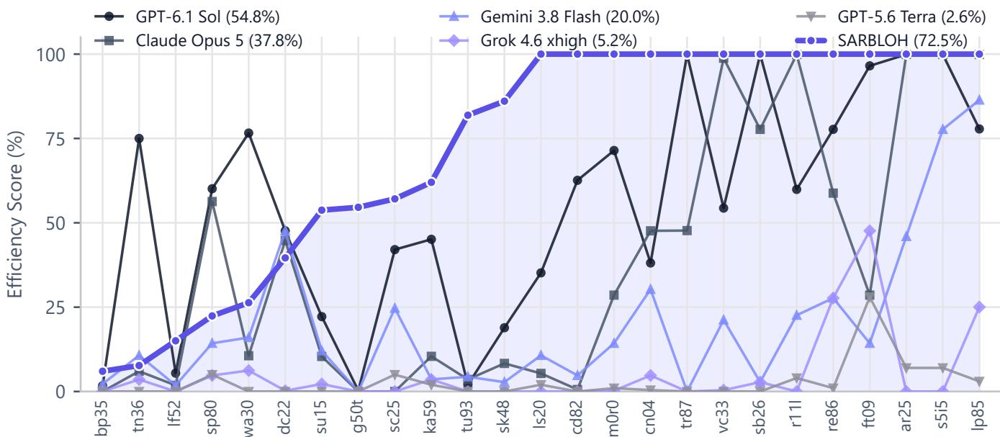  
ARC-AGI-3 Public Benchmark Environments (sorted by SARBLOH score)  
Figure 1 | Action eficiency across 25 public ARC-AGI-3 environments. Sarbloh (o<sub>p</sub>en-wei<sub>g</sub>ht Qwen3.8-Flash-Next on one GPU) leads five frontier API baselines on 21 of 25 <sub>g</sub>ames (72.5% <sub>p</sub>eak mean vs. 59.4% sin<sub>g</sub>le-<sub>p</sub>ass mean; 100% on 13 <sub>g</sub>ames). Because the strict 9-hour Ka<sub>gg</sub>le ceilin<sub>g p</sub>recludes exhaustin<sub>g</sub> all 25 <sub>g</sub>ames in one <sub>p</sub>ass, the curve re<sub>p</sub>orts the best score per game across runs, including isolated re-evaluations on complex environments (bp35).

<sup>ste</sup>p<sup>s</sup>.

2<sub>.</sub> Th<sub>e</sub> M<sub>easu</sub>r<sub>e</sub>d<sub>–</sub>G<sub>uesse</sub>d R<sub>u</sub>l<sub>e—</sub>G<sub>eome</sub>t<sub>r</sub>i<sub>c</sub> i<sub>nvar</sub>i<sub>an</sub>t<sub>s,</sub> i<sub>nc</sub>l<sub>u</sub>di<sub>ng</sub> l<sub>a</sub>tti<sub>ce</sub> <sub>reac</sub>h<sub>a</sub>bilit<sub>y,</sub> <sub>spa</sub>ti<sub>a</sub>l <sub>enc</sub>l<sub>osures,</sub> <sub>m</sub>id<sub>po</sub>i<sub>n</sub>t t<sub>e</sub>th<sub>ers,</sub> <sub>an</sub>d dih<sub>e</sub>d<sub>ra</sub>l <sub>symme</sub>t<sub>r</sub>i<sub>es</sub> <sub>un</sub>d<sub>er</sub> $D _ { 4 } \times \mathbb { Z } ^ { + }$ <sub>,</sub> <sub>can</sub> b<sub>e</sub> computed deterministically in O(HW) host code with-<sub>ou</sub>t t<sub>ra</sub>i<sub>n</sub>i<sub>ng, w</sub>h<sub>ereas</sub> hi<sub>g</sub>h<sub>-</sub>l<sub>eve</sub>l <sub>a</sub>f<sub>or</sub>d<sub>ance ro</sub>l<sub>es rema</sub>i<sub>n</sub> l<sub>a</sub>t<sub>en</sub>t <sub>un</sub>d<sub>er par</sub>ti<sub>a</sub>l <sub>o</sub>b<sub>serva</sub>bilit<sub>y an</sub>d <sub>mus</sub>t b<sub>e</sub> f<sub>rame</sub>d <sub>as</sub> <sub>pro</sub>b<sub>a</sub>bili<sub>s</sub>ti<sub>c</sub> h<sub>ypo</sub>th<sub>eses</sub> <sub>pa</sub>i<sub>re</sub>d <sub>w</sub>ith <sub>un</sub>it<sub>-ac</sub>ti<sub>on</sub> f<sub>a</sub>l<sub>s</sub>ifi<sub>ca-</sub> ti<sub>on</sub> <sub>pro</sub>b<sub>es.</sub>

B<sub>u</sub>ildin<sub>g o</sub>n th<sub>ese</sub> in<sub>s</sub>i<sub>g</sub>ht<sub>s, we</sub> intr<sub>o</sub>d<sub>uce</sub> Sa<sub>rbloh, a</sub>n autonomous o<sub>p</sub>en-wei<sub>g</sub>ht a<sub>g</sub>ent architecture en<sub>g</sub>ineered aro<sub>u</sub>nd a deterministic <sub>p</sub>erce<sub>p</sub>tion en<sub>g</sub>ine and s<sub>p</sub>ec<sub>u</sub>lati<sub>ve co</sub>d<sub>e execu</sub>ti<sub>on.</sub> R<sub>a</sub>th<sub>er</sub> th<sub>an</sub> d<sub>e</sub>l<sub>ega</sub>ti<sub>ng v</sub>i<sub>sua</sub>l <sub>scene</sub> d<sub>ecompos</sub>iti<sub>on</sub> t<sub>o</sub> <sub>cos</sub>tl<sub>y</sub> <sub>neura</sub>l i<sub>n</sub>f<sub>erence,</sub> <sub>our</sub> h<sub>os</sub>t<sub>-s</sub>id<sub>e</sub> <sub>per-</sub> <sub>cep</sub>ti<sub>on</sub> <sub>eng</sub>i<sub>ne</sub> <sub>execu</sub>t<sub>es</sub> i<sub>n</sub> <sub>approx</sub>i<sub>ma</sub>t<sub>e</sub>l<sub>y</sub> 35 <sub>ms</sub> <sub>per</sub> f<sub>rame</sub> <sub>on a s</sub>i<sub>ng</sub>l<sub>e</sub> CPU <sub>core,</sub> t<sub>rans</sub>f<sub>orm</sub>i<sub>ng raw env</sub>i<sub>ronmen</sub>t <sub>s</sub>t<sub>a</sub>t<sub>es</sub> into three synchronized modalities: an object-centric symb<sub>o</sub>li<sub>c s</sub>t<sub>a</sub>t<sub>e w</sub>ith t<sub>empora</sub>l bi<sub>par</sub>tit<sub>e</sub> id<sub>en</sub>tit<sub>y</sub> t<sub>rac</sub>ki<sub>ng, a s</sub>t<sub>ruc-</sub> t<sub>ure</sub>d <sub>geome</sub>t<sub>r</sub>i<sub>c</sub> b<sub>r</sub>i<sub>e</sub>fi<sub>ng</sub> <sub>governe</sub>d b<sub>y</sub> th<sub>e</sub> M<sub>easure</sub>d<sub>–</sub>G<sub>uesse</sub>d R<sub>u</sub>l<sub>e, an</sub>d <sub>an a</sub>f<sub>or</sub>d<sub>ance-anno</sub>t<sub>a</sub>t<sub>e</sub>d <sub>spa</sub>ti<sub>a</sub>l <sub>map.</sub> Th<sub>e agen</sub>t <sub>ac</sub>t<sub>s exc</sub>l<sub>us</sub>i<sub>ve</sub>l<sub>y</sub> th<sub>roug</sub>h <sub>an em</sub>b<sub>e</sub>dd<sub>e</sub>d IP<sub>y</sub>th<sub>on execu</sub>ti<sub>on</sub> k<sub>erne</sub>l<sub>, syn</sub>th<sub>es</sub>i<sub>z</sub>i<sub>ng a</sub>l<sub>gor</sub>ith<sub>m</sub>i<sub>c s</sub>t<sub>a</sub>t<sub>e mo</sub>d<sub>e</sub>l<sub>s an</sub>d di<sub>spa</sub>t<sub>c</sub>h<sub>-</sub> ing multi-step trajectories via a speculative execution primitive (await play()) that monitors environment invari-<sub>an</sub>t<sub>s</sub> <sub>an</sub>d h<sub>a</sub>lt<sub>s</sub> i<sub>mme</sub>di<sub>a</sub>t<sub>e</sub>l<sub>y</sub> <sub>upon</sub> <sub>sensory</sub> <sub>pre</sub>di<sub>c</sub>ti<sub>on</sub> di<sub>screp-</sub> <sub>anc</sub>i<sub>es.</sub>

E<sub>va</sub>l<sub>ua</sub>t<sub>e</sub>d <sub>u</sub>nd<sub>e</sub>r id<sub>e</sub>nti<sub>ca</sub>l <sub>o</sub>flin<sub>e</sub> h<sub>a</sub>rd<sub>wa</sub>r<sub>e co</sub>n<sub>-</sub> <sub>s</sub>tr<sub>a</sub>int<sub>s,</sub> S<sub>arbloh ac</sub>hi<sub>eves s</sub>t<sub>a</sub>t<sub>e-o</sub>f<sub>-</sub>th<sub>e-a</sub>rt <sub>ac</sub>ti<sub>o</sub>n <sub>e</sub>fi<sub>-</sub> cienc<sub>y</sub> across both <sub>pu</sub>blic and <sub>u</sub>ndisclosed en<sub>v</sub>ironments<sub>.</sub> A<sub>cross</sub> th<sub>e</sub> 25 <sub>pu</sub>bli<sub>c</sub> ARC<sub>-</sub>AGI<sub>-</sub>3 <sub>game env</sub>i<sub>ronmen</sub>t<sub>s,</sub> S<sub>ar-</sub> <sub>bloh reso</sub>l<sub>ves</sub> 143 <sub>o</sub>f 183 l<sub>eve</sub>l<sub>s</sub> i<sub>n</sub> 8<sub>.</sub>2 h<sub>ours,</sub> di<sub>scover</sub>i<sub>ng</sub> di<sub>s</sub>ti<sub>nc</sub>t <sub>so</sub>l<sub>u</sub>ti<sub>ons s</sub>i<sub>gn</sub>ifi<sub>can</sub>tl<sub>y</sub> f<sub>as</sub>t<sub>er</sub> th<sub>an</sub> th<sub>e</sub> fi<sub>rs</sub>t Mil<sub>es</sub>t<sub>one</sub> <sub>w</sub>i<sub>nner on</sub> id<sub>en</sub>ti<sub>ca</sub>l K<sub>agg</sub>l<sub>e</sub> h<sub>ar</sub>d<sub>ware an</sub>d <sub>mo</sub>d<sub>e</sub>l <sub>we</sub>i<sub>g</sub>ht<sub>s.</sub> O<sub>n</sub> th<sub>e o</sub>fi<sub>c</sub>i<sub>a</sub>l h<sub>e</sub>ld<sub>-ou</sub>t K<sub>agg</sub>l<sub>e eva</sub>l<sub>ua</sub>ti<sub>on su</sub>it<sub>e,</sub> S<sub>arbloh a</sub>d<sub>-</sub> <sub>vance</sub>d f<sub>rom an</sub> i<sub>n</sub>iti<sub>a</sub>l b<sub>ase</sub>li<sub>ne o</sub>f 0<sub>.</sub>27 t<sub>o a ver</sub>ifi<sub>e</sub>d <sub>score o</sub>f 16.53—a 13.7× eficienc<sub>y</sub> im<sub>p</sub>rovement over the first Mile-<sub>s</sub>t<sub>one w</sub>i<sub>nner.</sub>

Th<sub>e</sub> <sub>pr</sub>i<sub>mary</sub> <sub>con</sub>t<sub>r</sub>ib<sub>u</sub>ti<sub>ons</sub> <sub>o</sub>f thi<sub>s</sub> <sub>wor</sub>k <sub>are</sub> <sub>summa-</sub> ri<sub>ze</sub>d <sub>as</sub> f<sub>o</sub>ll<sub>ows:</sub>

• We identif<sub>y</sub> and anal<sub>y</sub>ze the visual <sub>g</sub>roundin<sub>g</sub> bottle-<sub>nec</sub>k i<sub>n</sub> i<sub>n</sub>t<sub>erac</sub>ti<sub>ve</sub> ARC<sub>-</sub>AGI<sub>-</sub>3<sub>,</sub> f<sub>orma</sub>li<sub>z</sub>i<sub>ng</sub> th<sub>e</sub> P<sub>er-</sub> <sub>cep</sub>t<sub>ua</sub>l Mi<sub>s</sub>ind<sub>uc</sub>ti<sub>o</sub>n f<sub>a</sub>il<sub>ure mo</sub>d<sub>e an</sub>d <sub>emp</sub>i<sub>r</sub>i<sub>ca</sub>ll<sub>y</sub> d<sub>e-</sub> <sub>r</sub>i<sub>v</sub>i<sub>ng</sub> Th<sub>e</sub> M<sub>easu</sub>r<sub>e</sub>d<sub>–</sub>G<sub>uesse</sub>d R<sub>u</sub>l<sub>e</sub> th<sub>roug</sub>h <sub>con</sub>t<sub>ro</sub>ll<sub>e</sub>d re<sub>p</sub>resentation ablations (§3).

• We <sub>p</sub>ro<sub>p</sub>ose Sarbloh<sub>,</sub> an autonomous a<sub>g</sub>ent featurin<sub>g</sub> a zero-parameter, O(HW) deterministic perception en-<sub>g</sub>i<sub>ne, a specu</sub>l<sub>a</sub>ti<sub>ve co</sub>d<sub>e-as-ac</sub>ti<sub>on p</sub>l<sub>ann</sub>i<sub>ng run</sub>ti<sub>me, an</sub>d <sub>a mono</sub>t<sub>on</sub>i<sub>c appen</sub>d<sub>-on</sub>l<sub>y</sub> KV<sub>-cac</sub>h<sub>e arc</sub>hit<sub>ec</sub>t<sub>ure sus</sub>t<sub>a</sub>i<sub>n-</sub> in<sub>g</sub> a 98.4% <sub>p</sub>refix-cache hit rate (§4).

• We evaluate Sarbloh across <sub>p</sub>ublic and oficial hidden benchmarks, demonstratin<sub>g</sub> a 13.7× score <sub>g</sub>ain over th<sub>e</sub> fi<sub>rs</sub>t Mil<sub>es</sub>t<sub>one w</sub>i<sub>nner, prov</sub>idi<sub>ng</sub> h<sub>ar</sub>d<sub>ware-ma</sub>t<sub>c</sub>h<sub>e</sub>d <sub>compara</sub>ti<sub>ve</sub> t<sub>e</sub>l<sub>eme</sub>t<sub>ry, an</sub>d d<sub>e</sub>t<sub>a</sub>ili<sub>ng</sub> th<sub>e</sub> f<sub>a</sub>il<sub>ure mo</sub>d<sub>es</sub> that <sub>g</sub>overn interactive o<sub>p</sub>en-wei<sub>g</sub>ht reasonin<sub>g</sub> (§5).

## 2 P<sub>re</sub>li<sub>m</sub>i<sub>nar</sub>i<sub>es</sub>

The ARC-AGI-3 benchmark (ARC Prize Foundation 2026a) d<sub>e</sub>fi<sub>nes an un</sub>i<sub>ns</sub>t<sub>ruc</sub>t<sub>e</sub>d<sub>,</sub> di<sub>scre</sub>t<sub>e-</sub>ti<sub>me sequen</sub>ti<sub>a</sub>l d<sub>ec</sub>i<sub>s</sub>i<sub>on</sub> <sub>process</sub> <sub>s</sub>t<sub>ruc</sub>t<sub>ure</sub>d <sub>as</sub> <sub>an</sub> <sub>or</sub>d<sub>ere</sub>d <sub>progress</sub>i<sub>on</sub> <sub>o</sub>f <sub>compo-</sub> <sub>s</sub>iti<sub>ona</sub>l l<sub>eve</sub>l<sub>s</sub> $\{ 1 , \ldots , n \}$ . At each interaction step t, the <sub>agen</sub>t <sub>rece</sub>i<sub>ves a</sub> di<sub>scre</sub>t<sub>e v</sub>i<sub>sua</sub>l <sub>gr</sub>id <sub>o</sub>b<sub>serva</sub>ti<sub>on</sub> $\quad g _ { t } \in$ $\{ \breve { 0 } , \dots , 1 5 \} ^ { H \times W }$ <sub>w</sub>ith <sub>spa</sub>ti<sub>a</sub>l di<sub>mens</sub>i<sub>ons</sub> b<sub>oun</sub>d<sub>e</sub>d b<sub>y</sub> ${ \dot { H } } , W \ \leq \ \mathrm { \hat { 6 } } 4 ,$ <sub>, w</sub>h<sub>ere eac</sub>h <sub>coor</sub>di<sub>na</sub>t<sub>e</sub> d<sub>eno</sub>t<sub>es one o</sub>f 16 <sub>ca</sub>t<sub>egor</sub>i<sub>ca</sub>l <sub>co</sub>l<sub>or</sub> i<sub>n</sub>di<sub>ces.</sub> I<sub>n a</sub>dditi<sub>on</sub> t<sub>o</sub> th<sub>e v</sub>i<sub>sua</sub>l <sub>gr</sub>id<sub>,</sub> th<sub>e env</sub>i<sub>ronmen</sub>t <sub>exposes</sub> th<sub>e ep</sub>i<sub>so</sub>d<sub>e</sub> t<sub>erm</sub>i<sub>na</sub>ti<sub>on s</sub>t<sub>a</sub>t<sub>us</sub> s<sub>t</sub> ∈ {NOT\_FINISHED, WIN, GAME\_OVER} alongside the <sub>coun</sub>t <sub>o</sub>f l<sub>eve</sub>l<sub>s reso</sub>l<sub>ve</sub>d <sub>so</sub> f<sub>ar.</sub>

<table><tr><td rowspan="2"></td><td colspan="3">Hidden Kaggle set (offline, 1 GPU, 9 h)</td><td colspan="5">Public set (frontier APIs, unbounded)</td></tr><tr><td>SARBLOH this work</td><td>Duck first Milestone winner</td><td>Reki second Milestone winner</td><td>Prime Agent open harness</td><td>Arcgentica Symbolica</td><td>AVO NVIDIA</td><td>Provider Adapters GPT-5.5</td><td>Provider Adapters Gemini 3.8 Flash</td></tr><tr><td>Wall-clock limit</td><td>9h</td><td>9h</td><td>9h</td><td>unbounded</td><td>unbounded</td><td>unbounded</td><td>unbounded</td><td>unbounded</td></tr><tr><td>Network access</td><td>none</td><td>none</td><td>none</td><td>yes</td><td>yes</td><td>yes</td><td>yes</td><td>yes</td></tr><tr><td>Protocol</td><td>peak / single pass</td><td>一</td><td>一</td><td>self-reported self-reported self-reported self-reported self-reported</td><td></td><td></td><td></td><td></td></tr><tr><td>Open weights</td><td>√</td><td>√</td><td>√</td><td></td><td>一</td><td>一</td><td>一</td><td></td></tr><tr><td>Backbone</td><td>Qwen3.8- Flash-Next</td><td>Qwen 3.6 27B</td><td>Gemma-4- 31B</td><td>Claude Opus Claude Opus 5</td><td>4.6</td><td>Opus 5 / GPT-5.6</td><td>GPT-5.5</td><td>Gemini 3.8 Flash</td></tr><tr><td>Score</td><td>16.53</td><td>1.21</td><td>0.87</td><td>95.5</td><td> $3 6 . 1 ^ { \dag }$ </td><td> $\mathbf { 1 0 0 . 0 ^ { \dag } }$ </td><td> $\mathbf { 9 9 . 9 9 } ^ { \dagger }$ </td><td> ${ \approx } 9 9 . 9 ^ { \dagger }$ </td></tr></table>

Table 1 | ARC-AGI-3 s<sub>y</sub>stems across two distinct evaluation re<sub>g</sub>imes. The left <sub>g</sub>rou<sub>p</sub> executes ofline within the oficial K<sub>agg</sub>l<sub>e eva</sub>l<sub>ua</sub>ti<sub>on san</sub>db<sub>ox on a s</sub>i<sub>ng</sub>l<sub>e</sub> GPU <sub>un</sub>d<sub>er s</sub>t<sub>r</sub>i<sub>c</sub>t h<sub>ar</sub>d<sub>ware an</sub>d <sub>n</sub>i<sub>ne-</sub>h<sub>our wa</sub>ll<sub>-c</sub>l<sub>oc</sub>k li<sub>m</sub>it<sub>s w</sub>ith<sub>ou</sub>t <sub>ne</sub>t<sub>wor</sub>k <sub>access.</sub> Th<sub>e</sub> <sub>r</sub>i<sub>g</sub>ht <sub>group eva</sub>l<sub>ua</sub>t<sub>es propr</sub>i<sub>e</sub>t<sub>ary</sub> f<sub>ron</sub>ti<sub>er mo</sub>d<sub>e</sub>l<sub>s v</sub>i<sub>a uncons</sub>t<sub>ra</sub>i<sub>ne</sub>d <sub>commerc</sub>i<sub>a</sub>l API<sub>s w</sub>ith<sub>ou</sub>t <sub>s</sub>t<sub>an</sub>d<sub>ar</sub>di<sub>ze</sub>d <sub>ver</sub>ifi<sub>ca</sub>ti<sub>on.</sub> Th<sub>e</sub> oficial hidden-set score (16.53) re<sub>p</sub>resents the cumulative com<sub>p</sub>etition metric (E, Equation (3)), which a<sub>gg</sub>re<sub>g</sub>ates trian<sub>g</sub>ular l<sub>eve</sub>l <sub>we</sub>i<sub>g</sub>ht<sub>s across mu</sub>lti<sub>p</sub>l<sub>e un</sub>di<sub>sc</sub>l<sub>ose</sub>d <sub>games un</sub>d<sub>er</sub> th<sub>e n</sub>i<sub>ne-</sub>h<sub>our ce</sub>ili<sub>ng, w</sub>h<sub>ereas</sub> Fi<sub>gure</sub> 1 <sub>repor</sub>t<sub>s</sub> th<sub>e unwe</sub>i<sub>g</sub>ht<sub>e</sub>d <sub>per-game</sub> e<sup>fi</sup>c<sup>i</sup>enc<sub>y p</sub>ercenta<sub>g</sub>e $( S _ { l }$ , Equation (2)) on <sub>p</sub>ublic environments. <sup>†</sup>Self-re<sub>p</sub>orted b<sub>y</sub> authors on <sub>p</sub>ublic <sub>g</sub>ames without inde<sub>p</sub>endent <sub>cer</sub>tifi<sub>ca</sub>ti<sub>on.</sub>

T<sub>o</sub> i<sub>n</sub>t<sub>erac</sub>t <sub>w</sub>ith th<sub>e env</sub>i<sub>ronmen</sub>t<sub>,</sub> th<sub>e agen</sub>t <sub>se</sub>l<sub>ec</sub>t<sub>s an ac-</sub> ti<sub>on</sub> f<sub>rom</sub> th<sub>e</sub> <sub>ac</sub>ti<sub>on</sub> <sub>se</sub>t ${ \mathcal { A } } .$ , defined in Equation (1):

$$
\begin{array} { r } { \mathcal { A } = \{ \underset { \mathrm { A C T } \mathbb { T } \mathrm { O N } \mathbb { 1 } , \mathrm {  { \cdot } \cdot } \mathrm {  { \cdot } } , \mathrm { A C T } \mathbb { T } \mathrm { O N } 5 , } { \mathrm { a c T } \mathrm { I O N } \mathrm { 6 } } , } \end{array}\tag{1}
$$

In E<sub>q</sub>uation (1), actions ACTION1–ACTION4 re<sub>p</sub>resent cardinal directional dis<sub>p</sub>lacements, actions ACTION5 and ACTION7 denote <sub>g</sub>ame-s<sub>p</sub>ecific discrete tri<sub>gg</sub>ers, and ACTION $6 ( x , y )$ <sub>spec</sub>ifi<sub>es</sub> <sub>an</sub> <sub>ar</sub>bit<sub>rary</sub> <sub>con</sub>ti<sub>nuous</sub> <sub>spa</sub>ti<sub>a</sub>l <sub>coor</sub>di<sub>na</sub>t<sub>e c</sub>li<sub>c</sub>k <sub>parame</sub>t<sub>er</sub>i<sub>ze</sub>d b<sub>y</sub> $x ~ \in ~ [ 0 , W \mathrm { ~ - ~ } 1 ]$ <sub>an</sub>d $y \in [ 0 , H - 1 ]$ <sub>.</sub> E<sub>nv</sub>i<sub>ronmen</sub>t<sub>s</sub> <sub>prov</sub>id<sub>e</sub> <sub>zero</sub> <sub>up</sub>f<sub>ron</sub>t t<sub>as</sub>k di<sub>rec</sub>ti<sub>ves, as ac</sub>ti<sub>on seman</sub>ti<sub>cs, con</sub>t<sub>ro</sub>ll<sub>a</sub>bl<sub>e en</sub>tit<sub>y em</sub>b<sub>o</sub>d<sub>-</sub> i<sub>men</sub>t<sub>, an</sub>d t<sub>erm</sub>i<sub>na</sub>l <sub>w</sub>i<sub>n con</sub>diti<sub>ons are</sub> l<sub>a</sub>t<sub>en</sub>t<sub>.</sub> Th<sub>e agen</sub>t <sub>mus</sub>t i<sub>n</sub>f<sub>er</sub> th<sub>ese opera</sub>ti<sub>ona</sub>l <sub>ru</sub>l<sub>es en</sub>ti<sub>re</sub>l<sub>y</sub> f<sub>rom</sub> t<sub>rans</sub>iti<sub>on</sub> d<sub>ynam</sub>i<sub>cs, w</sub>h<sub>ere ear</sub>li<sub>er</sub> l<sub>eve</sub>l<sub>s</sub> i<sub>so</sub>l<sub>a</sub>t<sub>e e</sub>l<sub>emen</sub>t<sub>a</sub>l <sub>mec</sub>h<sub>an</sub>i<sub>cs</sub> and subsequent levels com<sub>p</sub>ose them hierarchicall<sub>y</sub> (S<sub>p</sub>elke and Kinzler 2007).

Benchmark performance is evaluated using Relative $H u \ –$ man Action Eficiency (RHAE). For each level $^ { , l , }$ l<sub>e</sub>t $h _ { l }$ d<sub>eno</sub>t<sub>e</sub> th<sub>e upper-me</sub>di<sub>an</sub> h<sub>uman ac</sub>ti<sub>on</sub> b<sub>ase</sub>li<sub>ne, an</sub>d l<sub>e</sub>t $a _ { l }$ <sup>re</sup>p<sup>resent</sup> th<sub>e cumu</sub>l<sub>a</sub>ti<sub>ve coun</sub>t <sub>o</sub>f <sub>p</sub>h<sub>ys</sub>i<sub>ca</sub>l <sub>ac</sub>ti<sub>ons comm</sub>itt<sub>e</sub>d b<sub>y</sub> th<sub>e</sub> <sub>can</sub>did<sub>a</sub>t<sub>e</sub> <sub>agen</sub>t<sub>.</sub> Th<sub>e</sub> <sub>per-</sub>l<sub>eve</sub>l <sub>e</sub>fi<sub>c</sub>i<sub>ency</sub> <sub>score</sub> $S _ { l }$ i<sub>s</sub> d<sub>e</sub>fi<sub>ne</sub>d in Equation (2):

$$
S _ { l } = \operatorname* { m i n } \left( 1 . 1 5 , \left( \frac { h _ { l } } { a _ { l } } \right) ^ { 2 } \right) .\tag{2}
$$

Across an entire game comprising n levels where the agent <sub>success</sub>f<sub>u</sub>ll<sub>y comp</sub>l<sub>e</sub>t<sub>es</sub> $k \leq n$ l<sub>eve</sub>l<sub>s,</sub> th<sub>e cumu</sub>l<sub>a</sub>ti<sub>ve game</sub> <sub>e</sub>fi<sub>c</sub>i<sub>ency score</sub> $E$ is defined in Equation (3):

$$
E = { \frac { 1 } { \sum _ { l = 1 } ^ { n } l } } \operatorname* { m i n } \left( \sum _ { l = 1 } ^ { k } l , \sum _ { l = 1 } ^ { n } l S _ { l } \right) .\tag{3}
$$

Equation (2) and Equation (3) establish three <sub>g</sub>overnin<sub>g</sub> <sub>opera</sub>ti<sub>ona</sub>l <sub>proper</sub>ti<sub>es</sub> th<sub>a</sub>t di<sub>c</sub>t<sub>a</sub>t<sub>e our agen</sub>t <sub>arc</sub>hit<sub>ec</sub>t<sub>ure:</sub>

1. Quadratic Exploration Penalty—Because action counts enter Equation (2) inversel<sub>y</sub> squared, un<sub>g</sub>uided ex-<sub>p</sub>l<sub>ora</sub>t<sub>ory ac</sub>ti<sub>ons pena</sub>li<sub>ze</sub> th<sub>e</sub> fi<sub>na</sub>l <sub>score qua</sub>d<sub>ra</sub>ti<sub>ca</sub>ll<sub>y.</sub> A<sub>n agen</sub>t <sub>requ</sub>i<sub>r</sub>i<sub>ng</sub> t<sub>w</sub>i<sub>ce</sub> th<sub>e</sub> h<sub>uman</sub> b<sub>ase</sub>li<sub>ne ac</sub>ti<sub>ons re-</sub> t<sub>a</sub>i<sub>ns on</sub>l<sub>y</sub> 25% <sub>o</sub>f th<sub>e ava</sub>il<sub>a</sub>bl<sub>e cre</sub>dit<sub>.</sub>

2. Zero-Cost Internal Computation—Reasoning latencies <sub>an</sub>d h<sub>os</sub>t<sub>-s</sub>id<sub>e execu</sub>ti<sub>on are s</sub>t<sub>r</sub>i<sub>c</sub>tl<sub>y non-pena</sub>li<sub>ze</sub>d<sub>, an</sub>d <sub>on</sub>l<sub>y</sub> <sub>p</sub>h<sub>ys</sub>i<sub>ca</sub>l <sub>ac</sub>ti<sub>ons</sub> <sub>comm</sub>itt<sub>e</sub>d t<sub>o</sub> th<sub>e</sub> <sub>env</sub>i<sub>ronmen</sub>t <sub>reg</sub>i<sub>s-</sub> t<sub>er</sub> i<sub>n</sub> $a _ { l }$ <sub>.</sub> Thi<sub>s s</sub>t<sub>ruc</sub>t<sub>ure s</sub>t<sub>rong</sub>l<sub>y</sub> f<sub>avors ex</sub>t<sub>ens</sub>i<sub>ve</sub> h<sub>os</sub>t<sub>-s</sub>id<sub>e</sub> <sub>geome</sub>t<sub>r</sub>i<sub>c pars</sub>i<sub>ng an</sub>d <sub>specu</sub>l<sub>a</sub>ti<sub>ve a</sub>l<sub>gor</sub>ith<sub>m</sub>i<sub>c p</sub>l<sub>ann</sub>i<sub>ng</sub> <sub>over</sub> t<sub>r</sub>i<sub>a</sub>l<sub>-an</sub>d<sub>-error exp</sub>l<sub>ora</sub>ti<sub>on.</sub>

3. Progressive Reward Scaling—The linear level multiplier l in Equation (3) wei<sub>g</sub>hts later com<sub>p</sub>ositional levels sub-<sub>s</sub>t<sub>an</sub>ti<sub>a</sub>ll<sub>y</sub> hi<sub>g</sub>h<sub>er, rewar</sub>di<sub>ng agen</sub>t<sub>s</sub> th<sub>a</sub>t <sub>genera</sub>li<sub>ze</sub> f<sub>oun-</sub> d<sub>a</sub>ti<sub>ona</sub>l <sub>mec</sub>h<sub>an</sub>i<sub>cs</sub> i<sub>n</sub>d<sub>uce</sub>d d<sub>ur</sub>i<sub>ng ear</sub>li<sub>er s</sub>t<sub>ages.</sub>

Ofli<sub>ne</sub> E<sub>va</sub>l<sub>ua</sub>ti<sub>on an</sub>d R<sub>esource</sub> B<sub>oun</sub>d<sub>s.</sub> Th<sub>e o</sub>fi<sub>c</sub>i<sub>a</sub>l K<sub>agg</sub>l<sub>e</sub> <sub>eva</sub>l<sub>ua</sub>ti<sub>on</sub> t<sub>rac</sub>k <sub>eva</sub>l<sub>ua</sub>t<sub>es</sub> <sub>can</sub>did<sub>a</sub>t<sub>e</sub> <sub>agen</sub>t<sub>s</sub> <sub>on</sub> h<sub>e</sub>ld<sub>-</sub> <sub>ou</sub>t<sub>, un</sub>di<sub>sc</sub>l<sub>ose</sub>d <sub>env</sub>i<sub>ronmen</sub>t<sub>s w</sub>ithi<sub>n an</sub> i<sub>so</sub>l<sub>a</sub>t<sub>e</sub>d <sub>execu</sub>ti<sub>on</sub> <sub>san</sub>db<sub>ox</sub> <sub>w</sub>ith<sub>ou</sub>t <sub>ex</sub>t<sub>erna</sub>l <sub>ne</sub>t<sub>wor</sub>k <sub>access.</sub> C<sub>ompu</sub>t<sub>a</sub>ti<sub>on</sub> i<sub>s</sub> <sub>s</sub>tri<sub>c</sub>tl<sub>y</sub> b<sub>ou</sub>nd<sub>e</sub>d t<sub>o a s</sub>in<sub>g</sub>l<sub>e</sub> NVIDIA RTX PRO 6000 GPU (Blackwell architecture, 96 GB VRAM) and 176 GB of host RAM, subject to an inviolable nine-hour wall-clock executi<sub>on</sub> <sub>ce</sub>ili<sub>ng</sub> f<sub>or</sub> th<sub>e</sub> <sub>en</sub>ti<sub>re</sub> <sub>eva</sub>l<sub>ua</sub>ti<sub>on</sub> <sub>su</sub>it<sub>e.</sub> F<sub>ur</sub>th<sub>ermore,</sub> <sub>a</sub>ll <sub>mo</sub>d<sub>e</sub>l <sub>we</sub>i<sub>g</sub>ht<sub>s an</sub>d d<sub>epen</sub>d<sub>enc</sub>i<sub>es mus</sub>t b<sub>e open-source an</sub>d <sub>pre-pac</sub>k<sub>age</sub>d <sub>w</sub>ithi<sub>n</sub> th<sub>e</sub> <sub>su</sub>b<sub>m</sub>i<sub>ss</sub>i<sub>on</sub> <sub>con</sub>t<sub>a</sub>i<sub>ner,</sub> <sub>con</sub>t<sub>ras</sub>ti<sub>ng</sub> shar<sub>p</sub>l<sub>y</sub> a<sub>g</sub>ainst unconstrained frontier API baselines (Table 1). Under these constraints, the o<sub>p</sub>erational bud<sub>g</sub>et is <sub>governe</sub>d b<sub>y</sub> <sub>genera</sub>ti<sub>on</sub> d<sub>eco</sub>d<sub>e</sub> th<sub>roug</sub>h<sub>pu</sub>t <sub>an</sub>d th<sub>e</sub> l<sub>eng</sub>th <sub>o</sub>f <sub>con</sub>t<sub>ex</sub>t hi<sub>s</sub>t<sub>ory</sub> th<sub>a</sub>t <sub>can</sub> b<sub>e re</sub>t<sub>a</sub>i<sub>ne</sub>d i<sub>n</sub> th<sub>e</sub> GPU’<sub>s warm</sub> <sub>pre</sub>fi<sub>x</sub> <sub>cac</sub>h<sub>e</sub> <sub>w</sub>ith<sub>ou</sub>t t<sub>r</sub>i<sub>gger</sub>i<sub>ng</sub> <sub>expens</sub>i<sub>ve</sub> <sub>qua</sub>d<sub>ra</sub>ti<sub>c</sub> <sub>recom-</sub> <sub>p</sub>utat<sup>i</sup>ons.

## 3 M<sub>o</sub>ti<sub>va</sub>ti<sub>on:</sub> P<sub>ercep</sub>ti<sub>on</sub> <sub>as</sub> th<sub>e</sub> P<sub>r</sub>i<sub>mary</sub> B<sub>o</sub>ttl<sub>enec</sub>k

B<sub>e</sub>f<sub>ore</sub> d<sub>es</sub>i<sub>gn</sub>i<sub>ng</sub> th<sub>e agen</sub>t <sub>arc</sub>hit<sub>ec</sub>t<sub>ure, we con</sub>d<sub>uc</sub>t<sub>e</sub>d <sub>con-</sub> t<sub>ro</sub>ll<sub>e</sub>d <sub>emp</sub>i<sub>r</sub>i<sub>ca</sub>l <sub>a</sub>bl<sub>a</sub>ti<sub>ons</sub> t<sub>o</sub> i<sub>so</sub>l<sub>a</sub>t<sub>e</sub> <sub>w</sub>h<sub>ere</sub> <sub>au</sub>t<sub>oregress</sub>i<sub>ve</sub> <sub>reason</sub>i<sub>ng</sub> <sub>mo</sub>d<sub>e</sub>l<sub>s</sub> <sub>expen</sub>d th<sub>e</sub>i<sub>r</sub> <sub>exp</sub>l<sub>ora</sub>t<sub>ory</sub> <sub>ac</sub>ti<sub>on</sub> <sub>a</sub>ll<sub>oca</sub>ti<sub>ons</sub> d<sub>ur</sub>i<sub>ng</sub> i<sub>n</sub>t<sub>erac</sub>ti<sub>ve pro</sub>bl<sub>em so</sub>l<sub>v</sub>i<sub>ng.</sub>

Observation <sub>g</sub>eometr<sub>y</sub> dictates search com<sub>p</sub>lexit<sub>y</sub> far m<sub>o</sub>r<sub>e</sub> th<sub>a</sub>n r<sub>easo</sub>nin<sub>g</sub> d<sub>ep</sub>th<sub>.</sub> W<sub>e eva</sub>l<sub>ua</sub>t<sub>e</sub>d <sub>an</sub> id<sub>en</sub>ti<sub>ca</sub>l frontier reasonin<sub>g</sub> model (Gemini 3.1 Pro via commercial API<sub>, g</sub>r<sub>ee</sub>d<sub>y</sub> d<sub>eco</sub>din<sub>g a</sub>t t<sub>e</sub>m<sub>pe</sub>r<sub>a</sub>t<sub>u</sub>r<sub>e</sub> $T = 0$ <sub>, eva</sub>l<sub>ua</sub>t<sub>e</sub>d i<sub>n</sub> <sub>a</sub> <sub>s</sub>i<sub>ng</sub>l<sub>e</sub> di<sub>agnos</sub>ti<sub>c</sub> t<sub>r</sub>i<sub>a</sub>l $n = 1$ on 12 October 2026) on the <sub>open</sub>i<sub>ng</sub> l<sub>eve</sub>l <sub>o</sub>f th<sub>e</sub> <sub>o</sub>fi<sub>c</sub>i<sub>a</sub>l <sub>env</sub>i<sub>ronmen</sub>t $\boldsymbol { \perp } \boldsymbol { \mathrm { s } } 2 0$ <sub>,</sub> h<sub>o</sub>ldi<sub>ng</sub> th<sub>e</sub> <sub>promp</sub>t t<sub>emp</sub>l<sub>a</sub>t<sub>e</sub> <sub>an</sub>d <sub>env</sub>i<sub>ronmen</sub>t <sub>s</sub>t<sub>a</sub>t<sub>e</sub> t<sub>rans</sub>iti<sub>ons</sub> <sub>s</sub>t<sub>r</sub>i<sub>c</sub>tl<sub>y</sub> i<sub>nvar</sub>i<sub>an</sub>t <sub>w</sub>hil<sub>e a</sub>lt<sub>er</sub>i<sub>ng on</sub>l<sub>y</sub> th<sub>e</sub> i<sub>npu</sub>t <sub>o</sub>b<sub>serva</sub>ti<sub>on represen-</sub> tation (Fi<sub>g</sub>ure 2). While an ex<sub>p</sub>lorator<sub>y</sub> sin<sub>g</sub>le-trial dia<sub>g</sub>nostic is inherently limited in statistical variance, its primary objecti<sub>ve was no</sub>t di<sub>s</sub>t<sub>r</sub>ib<sub>u</sub>ti<sub>on es</sub>ti<sub>ma</sub>ti<sub>on,</sub> b<sub>u</sub>t <sub>ra</sub>th<sub>er</sub> i<sub>so</sub>l<sub>a</sub>ti<sub>ng</sub> th<sub>e</sub> <sub>ca</sub>t<sub>as</sub>t<sub>rop</sub>hi<sub>c represen</sub>t<sub>a</sub>ti<sub>ona</sub>l f<sub>a</sub>il<sub>ure mo</sub>d<sub>e</sub> th<sub>a</sub>t <sub>occurs</sub> b<sub>e</sub>f<sub>ore</sub> <sub>any</sub> d<sub>owns</sub>t<sub>ream po</sub>li<sub>cy searc</sub>h b<sub>eg</sub>i<sub>ns.</sub> Wh<sub>en prov</sub>id<sub>e</sub>d <sub>w</sub>ith the environment serialized as a raw 64×64 integer matrix, th<sub>e mo</sub>d<sub>e</sub>l <sub>expen</sub>d<sub>e</sub>d b<sub>e</sub>t<sub>ween</sub> 200 <sub>an</sub>d 300 <sub>ac</sub>ti<sub>ons repea</sub>t<sub>e</sub>dl<sub>y</sub> <sub>co</sub>llidi<sub>ng w</sub>ith i<sub>nv</sub>i<sub>s</sub>ibl<sub>e</sub> t<sub>opo</sub>l<sub>og</sub>i<sub>ca</sub>l b<sub>oun</sub>d<sub>ar</sub>i<sub>es, ex</sub>h<sub>aus</sub>ti<sub>ng</sub> th<sub>e perm</sub>i<sub>ss</sub>ibl<sub>e</sub> b<sub>u</sub>d<sub>ge</sub>t <sub>w</sub>ith<sub>ou</sub>t <sub>reac</sub>hi<sub>ng</sub> th<sub>e goa</sub>l <sub>s</sub>t<sub>a</sub>t<sub>e.</sub> R<sub>e-</sub> covering reachability and spatial adjacency from 4,096 seri-<sub>a</sub>li<sub>ze</sub>d i<sub>n</sub>t<sub>egers</sub> i<sub>mposes an assoc</sub>i<sub>a</sub>ti<sub>ve re</sub>t<sub>r</sub>i<sub>eva</sub>l b<sub>ur</sub>d<sub>en</sub> th<sub>a</sub>t multi-head attention mechanisms execute unreliabl<sub>y</sub> (Rahmanzadeh<sub>g</sub>ervi et al. 2024). Su<sub>pp</sub>l<sub>y</sub>in<sub>g</sub> a rendered raster im-<sub>age o</sub>f id<sub>en</sub>ti<sub>ca</sub>l b<sub>oar</sub>d <sub>s</sub>t<sub>a</sub>t<sub>e re</sub>d<sub>uce</sub>d th<sub>e requ</sub>i<sub>re</sub>d <sub>exp</sub>l<sub>ora</sub>ti<sub>on</sub> b<sub>y an or</sub>d<sub>er o</sub>f <sub>magn</sub>it<sub>u</sub>d<sub>e</sub> t<sub>o</sub> 12<sub>–</sub>24 <sub>ac</sub>ti<sub>ons.</sub> A<sub>ugmen</sub>ti<sub>ng</sub> thi<sub>s v</sub>i<sub>sua</sub>l i<sub>npu</sub>t <sub>w</sub>ith <sub>an exp</sub>li<sub>c</sub>it <sub>s</sub>t<sub>ruc</sub>t<sub>ura</sub>l d<sub>ecompos</sub>iti<sub>on o</sub>f t<sub>erra</sub>i<sub>n,</sub> HUD <sub>gauges, an</sub>d <sub>co</sub>l<sub>or par</sub>it<sub>y</sub> f<sub>ur</sub>th<sub>er conso</sub>lid<sub>a</sub>t<sub>e</sub>d the trajectory to 12 actions. Finally, enabling the model to <sub>express searc</sub>h <sub>rou</sub>ti<sub>nes as execu</sub>t<sub>a</sub>bl<sub>e</sub> P<sub>y</sub>th<sub>on scr</sub>i<sub>p</sub>t<sub>s w</sub>ithi<sub>n</sub> <sub>a san</sub>db<sub>oxe</sub>d <sub>run</sub>ti<sub>me c</sub>l<sub>eare</sub>d th<sub>e</sub> l<sub>eve</sub>l i<sub>n</sub> 6 <sub>ac</sub>ti<sub>ons, ac</sub>hi<sub>ev-</sub> i<sub>ng</sub> <sub>super-</sub>h<sub>uman</sub> <sub>e</sub>fi<sub>c</sub>i<sub>ency</sub> <sub>re</sub>l<sub>a</sub>ti<sub>ve</sub> t<sub>o</sub> th<sub>e</sub> h<sub>uman</sub> b<sub>ase</sub>li<sub>ne</sub> <sub>o</sub>f <sub>app</sub>r<sub>ox</sub>im<sub>a</sub>t<sub>e</sub>l<sub>y</sub> 10 <sub>ac</sub>ti<sub>o</sub>n<sub>s.</sub> Criti<sub>ca</sub>ll<sub>y,</sub> <sub>ove</sub>r 90% <sub>o</sub>f th<sub>e</sub> <sub>agg</sub>r<sub>e-</sub> <sub>ga</sub>t<sub>e</sub> <sub>e</sub>fi<sub>c</sub>i<sub>ency</sub> <sub>ga</sub>i<sub>n</sub> <sub>resu</sub>lt<sub>e</sub>d f<sub>rom</sub> <sub>s</sub>t<sub>ruc</sub>t<sub>ur</sub>i<sub>ng</sub> th<sub>e</sub> <sub>percep</sub>t<sub>ua</sub>l <sub>represen</sub>t<sub>a</sub>ti<sub>on ra</sub>th<sub>er</sub> th<sub>an ex</sub>t<sub>en</sub>di<sub>ng</sub> i<sub>n</sub>f<sub>erence-</sub>ti<sub>me c</sub>h<sub>a</sub>i<sub>n-o</sub>f<sub>-</sub> th<sub>oug</sub>ht d<sub>e</sub>lib<sub>era</sub>ti<sub>on.</sub>

Pl<sub>a</sub>nnin<sub>g</sub> f<sub>a</sub>il<sub>u</sub>r<sub>e</sub> i<sub>s</sub> d<sub>ow</sub>n<sub>s</sub>tr<sub>ea</sub>m <sub>o</sub>f <sub>pe</sub>r<sub>cep</sub>t<sub>ua</sub>l mi<sub>s</sub>ind<sub>uc-</sub> ti<sub>o</sub>n<sub>.</sub> T<sub>o</sub> d<sub>ecoup</sub>l<sub>e s</sub>t<sub>ra</sub>t<sub>eg</sub>i<sub>c reason</sub>i<sub>ng capac</sub>it<sub>y</sub> f<sub>rom s</sub>t<sub>a</sub>t<sub>e</sub> <sub>represen</sub>t<sub>a</sub>ti<sub>on</sub> <sub>errors,</sub> <sub>we</sub> <sub>eva</sub>l<sub>ua</sub>t<sub>e</sub>d th<sub>e</sub> <sub>mo</sub>d<sub>e</sub>l <sub>on</sub> <sub>a</sub> <sub>com-</sub> <sub>p</sub>lex ls20 level under two informational re<sub>g</sub>imes: visual <sub>screens</sub>h<sub>o</sub>t<sub>s</sub> <sub>a</sub>l<sub>one,</sub> <sub>an</sub>d <sub>screens</sub>h<sub>o</sub>t<sub>s</sub> <sub>accompan</sub>i<sub>e</sub>d b<sub>y</sub> <sub>an</sub> “<sub>or-</sub> <sub>ac</sub>l<sub>e</sub> b<sub>r</sub>i<sub>e</sub>fi<sub>ng</sub>” <sub>exp</sub>li<sub>c</sub>itl<sub>y</sub> d<sub>e</sub>t<sub>a</sub>ili<sub>ng</sub> <sub>spr</sub>it<sub>e</sub> <sub>ro</sub>l<sub>es,</sub> <sub>mec</sub>h<sub>an</sub>i<sub>cs,</sub> <sub>an</sub>d <sub>geome</sub>t<sub>r</sub>i<sub>c</sub> d<sub>epen</sub>d<sub>enc</sub>i<sub>es.</sub> With<sub>ou</sub>t th<sub>e</sub> b<sub>r</sub>i<sub>e</sub>fi<sub>ng,</sub> th<sub>e</sub> <sub>agen</sub>t <sub>squan</sub>d<sub>ere</sub>d it<sub>s</sub> f<sub>u</sub>ll <sub>ac</sub>ti<sub>on</sub> b<sub>u</sub>d<sub>ge</sub>t i<sub>n</sub>t<sub>erac</sub>ti<sub>ng w</sub>ith i<sub>ner</sub>t <sub>v</sub>i<sub>sua</sub>l <sub>ar</sub>tif<sub>ac</sub>t<sub>s.</sub> With th<sub>e</sub> b<sub>r</sub>i<sub>e</sub>fi<sub>ng,</sub> th<sub>e mo</sub>d<sub>e</sub>l f<sub>ormu</sub>l<sub>a</sub>t<sub>e</sub>d <sub>an op</sub>ti<sub>ma</sub>l <sub>p</sub>l<sub>an an</sub>d <sub>c</sub>l<sub>eare</sub>d th<sub>e</sub> l<sub>eve</sub>l i<sub>n</sub> 6 <sub>ac</sub>ti<sub>ons.</sub> Th<sub>e un</sub>d<sub>er</sub>l<sub>y</sub>i<sub>ng p</sub>l<sub>an-</sub> <sub>n</sub>i<sub>ng mec</sub>h<sub>an</sub>i<sub>sm was</sub> f<sub>unc</sub>ti<sub>ona</sub>ll<sub>y capa</sub>bl<sub>e</sub> f<sub>rom</sub> th<sub>e ou</sub>t<sub>se</sub>t<sub>,</sub> <sub>an</sub>d it<sub>s opera</sub>ti<sub>ona</sub>l f<sub>a</sub>il<sub>ure was</sub> i<sub>n</sub>d<sub>uce</sub>d <sub>en</sub>ti<sub>re</sub>l<sub>y</sub> b<sub>y erroneous</sub> <sup>state</sup> p<sup>erce</sup>p<sup>tion</sup>.

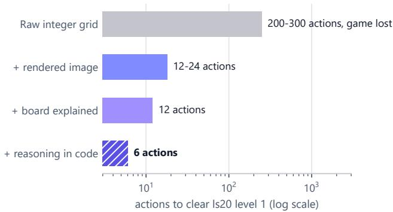  
Fi<sub>g</sub>ure 2 | Controlled ablation of in<sub>p</sub>ut observation m<sub>o</sub>d<sub>a</sub>liti<sub>es.</sub> A<sub>c</sub>ti<sub>on</sub> <sub>expen</sub>dit<sub>ure</sub> <sub>requ</sub>i<sub>re</sub>d t<sub>o</sub> <sub>reso</sub>l<sub>ve</sub> th<sub>e</sub> <sub>open-</sub> in<sub>g</sub> level of ls20 across four re<sub>p</sub>resentation tiers usin<sub>g</sub> an identical frontier reasonin<sub>g</sub> model (Gemini 3.1 Pro, <sub>g</sub>reed<sub>y</sub> d<sub>eco</sub>di<sub>ng,</sub> <sub>s</sub>i<sub>ng</sub>l<sub>e</sub> <sub>exp</sub>l<sub>ora</sub>t<sub>ory</sub> t<sub>r</sub>i<sub>a</sub>l $n \ = \ 1$ <sub>on</sub> 12 O<sub>c</sub>t<sub>o</sub>b<sub>er</sub> 2026). Serializin<sub>g</sub> the environment as raw inte<sub>g</sub>er tokens <sub>causes</sub> b<sub>u</sub>d<sub>ge</sub>t <sub>ex</sub>h<sub>aus</sub>ti<sub>on, w</sub>h<sub>ereas ren</sub>d<sub>ere</sub>d <sub>v</sub>i<sub>sua</sub>l <sub>ras</sub>t<sub>ers</sub> <sub>an</sub>d <sub>programma</sub>ti<sub>c geome</sub>t<sub>r</sub>i<sub>c re</sub>l<sub>a</sub>ti<sub>ons ac</sub>hi<sub>eve super-</sub>h<sub>uman</sub> eficienc<sub>y</sub> (6 actions versus human baseline ≈10).

S<sub>p</sub>arse delta encodin<sub>g</sub>s ind<sub>u</sub>ce <sub>p</sub>erce<sub>p</sub>t<sub>u</sub>al m<sub>y</sub>o<sub>p</sub>ia across di<sub>s</sub>t<sub>a</sub>nt <sub>spa</sub>ti<sub>a</sub>l <sub>s</sub>tr<sub>uc</sub>t<sub>u</sub>r<sub>es.</sub> Whil<sub>e</sub> t<sub>ransm</sub>itti<sub>ng</sub> <sub>on</sub>l<sub>y</sub> <sub>mo</sub>di<sub>-</sub> fi<sub>e</sub>d <sub>gr</sub>id <sub>coor</sub>di<sub>na</sub>t<sub>es</sub> <sub>m</sub>i<sub>n</sub>i<sub>m</sub>i<sub>zes</sub> <sub>promp</sub>t t<sub>o</sub>k<sub>en</sub> <sub>consump</sub>ti<sub>on,</sub> it <sub>sys</sub>t<sub>ema</sub>ti<sub>ca</sub>ll<sub>y mas</sub>k<sub>s non-</sub>l<sub>oca</sub>l <sub>causa</sub>l <sub>coup</sub>li<sub>ngs.</sub> I<sub>n</sub> ARC<sub>-</sub> AGI<sub>-</sub>3 <sub>env</sub>i<sub>ronmen</sub>t<sub>s,</sub> l<sub>oca</sub>l <sub>ac</sub>t<sub>ua</sub>ti<sub>on</sub> <sub>regu</sub>l<sub>ar</sub>l<sub>y</sub> t<sub>r</sub>i<sub>ggers</sub> di<sub>s-</sub> t<sub>an</sub>t <sub>v</sub>i<sub>sua</sub>l <sub>consequences, suc</sub>h <sub>as s</sub>t<sub>epp</sub>i<sub>ng on</sub>t<sub>o an ac</sub>ti<sub>va</sub>ti<sub>on</sub> switch in ls20 u<sub>p</sub>datin<sub>g</sub> a status icon across the dis<sub>p</sub>la<sub>y</sub>. U<sub>n</sub>d<sub>er sparse</sub> d<sub>e</sub>lt<sub>a s</sub>t<sub>reams,</sub> th<sub>e agen</sub>t f<sub>a</sub>il<sub>s</sub> t<sub>o o</sub>b<sub>serve</sub> thi<sub>s</sub> di<sub>s</sub>t<sub>r</sub>ib<sub>u</sub>t<sub>e</sub>d <sub>covar</sub>i<sub>ance an</sub>d f<sub>a</sub>l<sub>se</sub>l<sub>y</sub> i<sub>n</sub>f<sub>ers</sub> th<sub>a</sub>t it<sub>s ac</sub>ti<sub>on was</sub> <sub>non-</sub>f<sub>unc</sub>ti<sub>ona</sub>l<sub>.</sub> C<sub>onsequen</sub>tl<sub>y, preserv</sub>i<sub>ng</sub> f<sub>u</sub>ll<sub>-</sub>f<sub>rame</sub> t<sub>opo-</sub> l<sub>og</sub>i<sub>ca</sub>l <sub>awareness</sub> <sub>rema</sub>i<sub>ns</sub> <sub>man</sub>d<sub>a</sub>t<sub>ory.</sub>

C<sub>o</sub>r<sub>e</sub> kn<sub>ow</sub>l<sub>e</sub>d<sub>ge p</sub>ri<sub>o</sub>r<sub>s</sub> di<sub>s</sub>tin<sub>gu</sub>i<sub>s</sub>h m<sub>a</sub>th<sub>e</sub>m<sub>a</sub>ti<sub>ca</sub>l <sub>ce</sub>r<sub>-</sub> t<sub>a</sub>int<sub>y</sub> fr<sub>o</sub>m ind<sub>uc</sub>ti<sub>ve</sub> h<sub>ypo</sub>th<sub>es</sub>i<sub>s.</sub> B<sub>ecause orac</sub>l<sub>e</sub> b<sub>r</sub>i<sub>e</sub>f<sub>-</sub> i<sub>ngs canno</sub>t <sub>ex</sub>i<sub>s</sub>t f<sub>or un</sub>di<sub>sc</sub>l<sub>ose</sub>d <sub>eva</sub>l<sub>ua</sub>ti<sub>on env</sub>i<sub>ronmen</sub>t<sub>s,</sub> th<sub>e age</sub>nt m<sub>us</sub>t <sub>ex</sub>tr<sub>ac</sub>t it<sub>s ow</sub>n r<sub>ep</sub>r<sub>ese</sub>nt<sub>a</sub>ti<sub>o</sub>n<sub>s.</sub> ARC<sub>-</sub>AGI<sub>-</sub>3 i<sub>s</sub> <sub>g</sub>rounded in human core knowled<sub>g</sub>e <sub>p</sub>riors (S<sub>p</sub>elke and Kinzler 2007), which are intrinsicall<sub>y g</sub>eometric and to<sub>p</sub>olo<sub>g</sub>ical. P<sub>roper</sub>ti<sub>es</sub> <sub>suc</sub>h <sub>as</sub> l<sub>a</sub>tti<sub>ce</sub> <sub>connec</sub>ti<sub>v</sub>it<sub>y,</sub> b<sub>oun</sub>di<sub>ng</sub> <sub>enc</sub>l<sub>osures,</sub> <sub>m</sub>id<sub>po</sub>i<sub>n</sub>t t<sub>e</sub>th<sub>ers, an</sub>d dih<sub>e</sub>d<sub>ra</sub>l <sub>symme</sub>t<sub>r</sub>i<sub>es can</sub> b<sub>e compu</sub>t<sub>e</sub>d d<sub>e</sub>t<sub>erm</sub>i<sub>n</sub>i<sub>s</sub>ti<sub>ca</sub>ll<sub>y</sub> f<sub>rom</sub> <sub>gr</sub>id <sub>coor</sub>di<sub>na</sub>t<sub>es</sub> <sub>w</sub>ith<sub>ou</sub>t l<sub>earne</sub>d <sub>pa-</sub> <sub>rame</sub>t<sub>ers.</sub> C<sub>onverse</sub>l<sub>y, opera</sub>ti<sub>ona</sub>l <sub>a</sub>f<sub>or</sub>d<sub>ances, suc</sub>h <sub>as agen</sub>t <sub>em</sub>b<sub>o</sub>di<sub>men</sub>t <sub>an</sub>d <sub>w</sub>i<sub>n con</sub>diti<sub>ons, rema</sub>i<sub>n</sub> l<sub>a</sub>t<sub>en</sub>t <sub>un</sub>til <sub>ver</sub>ifi<sub>e</sub>d th<sub>roug</sub>h <sub>p</sub>h<sub>ys</sub>i<sub>ca</sub>l i<sub>n</sub>t<sub>erac</sub>ti<sub>on.</sub> C<sub>on</sub>fl<sub>a</sub>ti<sub>ng</sub> th<sub>ese</sub> t<sub>wo ep</sub>i<sub>s</sub>t<sub>em</sub>i<sub>c</sub> <sub>ca</sub>t<sub>egor</sub>i<sub>es</sub> <sub>causes</sub> <sub>mo</sub>d<sub>e</sub>l<sub>s</sub> t<sub>o</sub> t<sub>rea</sub>t t<sub>rans</sub>i<sub>en</sub>t <sub>guesses</sub> <sub>as</sub> <sub>groun</sub>d t<sub>ru</sub>th<sub>,</sub> t<sub>r</sub>i<sub>gger</sub>i<sub>ng</sub> <sub>ca</sub>t<sub>as</sub>t<sub>rop</sub>hi<sub>c</sub> <sub>ac</sub>ti<sub>on</sub> l<sub>oops.</sub>

S<sub>u</sub>mm<sub>a</sub>r<sub>y o</sub>f Em<sub>p</sub>iri<sub>ca</sub>l M<sub>o</sub>ti<sub>va</sub>ti<sub>o</sub>n<sub>s.</sub>

1<sub>.</sub> P<sub>e</sub>r<sub>cep</sub>t<sub>ua</sub>l Mi<sub>s</sub>ind<sub>uc</sub>ti<sub>o</sub>n<sub>:</sub> Att<sub>en</sub>ti<sub>on mec</sub>h<sub>an</sub>i<sub>sms over se-</sub> rialized coordinate grids fail to infer topological adjacency, <sub>consum</sub>i<sub>ng</sub> h<sub>un</sub>d<sub>re</sub>d<sub>s o</sub>f<sub>exp</sub>l<sub>ora</sub>t<sub>ory ac</sub>ti<sub>ons</sub> d<sub>e</sub>d<sub>uc</sub>i<sub>ng</sub> b<sub>ase-</sub> li<sub>ne</sub> <sub>mec</sub>h<sub>an</sub>i<sub>cs</sub> th<sub>a</sub>t <sub>are</sub> di<sub>rec</sub>tl<sub>y</sub> <sub>recovera</sub>bl<sub>e</sub> f<sub>rom</sub> <sub>v</sub>i<sub>sua</sub>l <sub>ras</sub>t<sub>ers an</sub>d <sub>compu</sub>t<sub>e</sub>d <sub>geome</sub>t<sub>r</sub>i<sub>c re</sub>l<sub>a</sub>ti<sub>ons.</sub>

2<sub>.</sub> Th<sub>e</sub> M<sub>easure</sub>d<sub>–</sub>G<sub>uesse</sub>d Di<sub>c</sub>h<sub>o</sub>t<sub>omy:</sub> G<sub>eome</sub>t<sub>r</sub>i<sub>c an</sub>d t<sub>opo</sub>l<sub>og</sub>i<sub>ca</sub>l i<sub>nvar</sub>i<sub>an</sub>t<sub>s</sub> h<sub>o</sub>ld <sub>uncon</sub>diti<sub>ona</sub>ll<sub>y across unseen</sub> <sub>env</sub>i<sub>ronmen</sub>t<sub>s, w</sub>h<sub>ereas</sub> l<sub>a</sub>t<sub>en</sub>t <sub>opera</sub>ti<sub>ona</sub>l <sub>seman</sub>ti<sub>cs re-</sub> <sub>qu</sub>i<sub>re ac</sub>ti<sub>ve, s</sub>i<sub>ng</sub>l<sub>e-ac</sub>ti<sub>on</sub> h<sub>ypo</sub>th<sub>es</sub>i<sub>s ver</sub>ifi<sub>ca</sub>ti<sub>on pro</sub>b<sub>es.</sub>

## 4 M<sub>e</sub>th<sub>o</sub>d<sub>o</sub>l<sub>ogy</sub>

O<sub>ur</sub> i<sub>n</sub>iti<sub>a</sub>l b<sub>ase</sub>li<sub>ne,</sub> <sub>a</sub>d<sub>ap</sub>ti<sub>ng</sub> th<sub>e</sub> <sub>open</sub> h<sub>arness</sub> <sub>o</sub>f P<sub>r</sub>i<sub>me</sub> A<sub>g</sub>ent (Karten et al. 2026), scored between 0.00 and 0.27 <sub>on</sub> th<sub>e</sub> hidd<sub>en eva</sub>l<sub>ua</sub>ti<sub>on se</sub>t<sub>,</sub> i<sub>n</sub>iti<sub>a</sub>ti<sub>ng over</sub> 350 <sub>vo</sub>l<sub>un</sub>t<sub>ary</sub> l<sub>eve</sub>l <sub>res</sub>t<sub>ar</sub>t<sub>s</sub> <sub>across</sub> t<sub>en</sub> <sub>games</sub> <sub>w</sub>ith<sub>ou</sub>t <sub>once</sub> <sub>reso</sub>l<sub>v</sub>i<sub>ng</sub> <sub>a</sub> <sub>goa</sub>l <sub>s</sub>t<sub>a</sub>t<sub>e.</sub> Th<sub>e reason</sub>i<sub>ng mo</sub>d<sub>e</sub>l <sub>was pro</sub>fi<sub>c</sub>i<sub>en</sub>t <sub>a</sub>t <sub>co</sub>d<sub>e syn</sub>th<sub>e-</sub> <sub>s</sub>i<sub>s,</sub> <sub>ye</sub>t f<sub>un</sub>d<sub>amen</sub>t<sub>a</sub>ll<sub>y</sub> i<sub>ncapa</sub>bl<sub>e</sub> <sub>o</sub>f <sub>spa</sub>ti<sub>a</sub>l <sub>scene</sub> <sub>pars</sub>i<sub>ng.</sub> Thi<sub>s</sub> <sub>sec</sub>ti<sub>on</sub> f<sub>orma</sub>li<sub>zes</sub> th<sub>e</sub> <sub>govern</sub>i<sub>ng</sub> <sub>pr</sub>i<sub>nc</sub>i<sub>p</sub>l<sub>e</sub> <sub>o</sub>f <sub>represen-</sub> tation (Section 4.1), the deterministic <sub>p</sub>erce<sub>p</sub>tion en<sub>g</sub>ine that realizes it (Section 4.2), the unified <sub>p</sub>ro<sub>g</sub>rammatic action interface (Section 4.3), and the <sub>p</sub>refix-cached servin<sub>g</sub> loo<sub>p</sub> that fits within sin<sub>g</sub>le-GPU hardware bounds (Section 4.4). Fi<sub>g</sub>- <sub>ure</sub> 3 ill<sub>us</sub>t<sub>ra</sub>t<sub>es an en</sub>d<sub>-</sub>t<sub>o-en</sub>d <sub>execu</sub>ti<sub>on</sub> t<sub>urn o</sub>f th<sub>e comp</sub>l<sub>e</sub>t<sub>e</sub> <sub>arc</sub>hit<sub>ec</sub>t<sub>ure.</sub>

## 4<sub>.</sub>1 Th<sub>e</sub> M<sub>easu</sub>r<sub>e</sub>d<sub>–</sub>G<sub>uesse</sub>d R<sub>u</sub>l<sub>e</sub>

W<sub>e</sub> did <sub>no</sub>t <sub>s</sub>t<sub>ar</sub>t f<sub>rom</sub> th<sub>e ru</sub>l<sub>e; a percep</sub>ti<sub>on</sub> l<sub>a</sub>b <sub>o</sub>f <sub>n</sub>i<sub>ne</sub> <sub>presen</sub>t<sub>a</sub>ti<sub>ons, gra</sub>d<sub>e</sub>d <sub>aga</sub>i<sub>ns</sub>t <sub>an answer</sub> k<sub>ey wr</sub>itt<sub>en</sub> b<sub>e</sub>f<sub>ore</sub> an<sub>y</sub> of them ran, <sub>p</sub>roduced it (Section 5.1, Fi<sub>g</sub>ure 4).

A t<sub>e</sub>xt-<sub>o</sub>nl<sub>y e</sub>n<sub>co</sub>d<sub>e</sub>r th<sub>a</sub>t <sub>s</sub>t<sub>a</sub>t<sub>es eve</sub>r<sub>y ce</sub>ll fl<sub>a</sub>t <sub>sco</sub>r<sub>e</sub>d 3 <sub>o</sub>f 28<sub>.</sub> I<sub>n</sub>iti<sub>a</sub>ll<sub>y,</sub> <sub>our</sub> fi<sub>rs</sub>t <sub>percep</sub>ti<sub>on</sub> <sub>mo</sub>d<sub>u</sub>l<sub>e</sub> <sub>pr</sub>i<sub>n</sub>t<sub>e</sub>d th<sub>e</sub> fitt<sub>e</sub>d l<sub>a</sub>tti<sub>ce, a sym</sub>b<sub>o</sub>l <sub>per ce</sub>ll<sub>,</sub> th<sub>e pa</sub>l<sub>e</sub>tt<sub>e, connec</sub>t<sub>e</sub>d <sub>componen</sub>t<sub>s</sub> and object tracking. Everything it said was correct, but most <sub>o</sub>f th<sub>e</sub> h<sub>eavy</sub> lifti<sub>ng was</sub> l<sub>e</sub>ft t<sub>o</sub> th<sub>e mo</sub>d<sub>e</sub>l it<sub>se</sub>lf t<sub>o</sub> id<sub>en</sub>tif<sub>y</sub> <sub>w</sub>h<sub>a</sub>t <sub>eac</sub>h <sub>ce</sub>ll <sub>represen</sub>t<sub>s.</sub> It <sub>name</sub>d <sub>no</sub> <sub>agen</sub>t<sub>,</sub> <sub>no</sub> <sub>goa</sub>l <sub>an</sub>d <sub>no</sub> <sub>g</sub>au<sub>g</sub>e, and it marked the move counter of r11l as screen d<sub>ecora</sub>ti<sub>on.</sub>

R<sub>o</sub>l<sub>e guesses w</sub>ith t<sub>es</sub>t<sub>s</sub> r<sub>a</sub>i<sub>se</sub>d th<sub>e sco</sub>r<sub>e</sub> t<sub>o</sub> 20<sub>, a</sub>nd f<sub>us</sub>- in<sub>g</sub> th<sub>e</sub>m <sub>w</sub>ith <sub>co</sub>m<sub>pu</sub>t<sub>e</sub>d r<sub>e</sub>l<sub>a</sub>ti<sub>o</sub>n<sub>s</sub> r<sub>a</sub>i<sub>se</sub>d it t<sub>o</sub> 25<sub>.</sub> Th<sub>e</sub> Role Ledger scored every object against eight game roles <sub>an</sub>d <sub>pr</sub>i<sub>n</sub>t<sub>e</sub>d <sub>eac</sub>h t<sub>op guess w</sub>ith it<sub>s ev</sub>id<sub>ence an</sub>d th<sub>e c</sub>h<sub>eap-</sub> est action that would confirm or refute it (20/28, about 380 tokens). The Fused Briefin<sub>g</sub> added the relations that code <sub>compu</sub>t<sub>es exac</sub>tl<sub>y—reac</sub>h<sub>a</sub>bilit<sub>y, enc</sub>l<sub>osure, m</sub>id<sub>po</sub>i<sub>n</sub>t t<sub>e</sub>th<sub>-</sub> <sub>ers,</sub> <sub>s</sub>h<sub>ape</sub> <sub>equ</sub>i<sub>va</sub>l<sub>ence—as</sub> <sub>a</sub> <sub>separa</sub>t<sub>e</sub> ti<sub>er</sub> <sub>a</sub>b<sub>ove</sub> th<sub>e</sub> <sub>guesses</sub> (25/28, about 370 tokens). It scored 8.3× the Legacy Encoder with 89% fewer tokens. Dumping raw 64 × 64 ASCII grids <sub>a</sub>l<sub>ongs</sub>id<sub>e</sub> <sub>per-ce</sub>ll <sub>componen</sub>t t<sub>a</sub>bl<sub>es</sub> f<sub>orces</sub> th<sub>e</sub> t<sub>o</sub>k<sub>en</sub>i<sub>zer</sub> t<sub>o</sub> spend ≈ 3,500 tokens per frame encoding repetitive back-<sub>groun</sub>d <sub>coor</sub>di<sub>na</sub>t<sub>es;</sub> b<sub>y</sub> <sub>a</sub>b<sub>s</sub>t<sub>rac</sub>ti<sub>ng</sub> <sub>connec</sub>t<sub>e</sub>d <sub>componen</sub>t<sub>s</sub> <sub>on</sub> th<sub>e</sub> h<sub>os</sub>t<sub>, mov</sub>i<sub>ng spa</sub>ti<sub>a</sub>l l<sub>ayou</sub>t i<sub>n</sub>t<sub>o</sub> th<sub>e v</sub>i<sub>sua</sub>l Bl<sub>uepr</sub>i<sub>n</sub>t <sub>ras</sub>t<sub>er,</sub> <sub>an</sub>d <sub>em</sub>itti<sub>ng</sub> <sub>on</sub>l<sub>y</sub> <sub>non-re</sub>d<sub>un</sub>d<sub>an</sub>t <sub>geome</sub>t<sub>r</sub>i<sub>c</sub> <sub>re</sub>l<sub>a</sub>ti<sub>ons</sub> i<sub>n</sub> t<sub>ex</sub>t<sub>,</sub> th<sub>e</sub> F<sub>use</sub>d B<sub>r</sub>i<sub>e</sub>fi<sub>ng</sub> <sub>compresses</sub> <sub>promp</sub>t f<sub>oo</sub>t<sub>pr</sub>i<sub>n</sub>t b<sub>y</sub> 89.4% (to 370 tokens) while increasin<sub>g</sub> <sub>p</sub>refix-cache ca<sub>p</sub>acit<sub>y</sub> by 9.5×.

Held-out <sub>g</sub>ames se<sub>p</sub>arated the two kinds of statement. W<sub>e su</sub>b<sub>sequen</sub>tl<sub>y eva</sub>l<sub>ua</sub>t<sub>e</sub>d <sub>cross-</sub>di<sub>s</sub>t<sub>r</sub>ib<sub>u</sub>ti<sub>on genera</sub>li<sub>za</sub>ti<sub>on</sub> <sub>across</sub> 23 h<sub>e</sub>ld<sub>-ou</sub>t <sub>o</sub>fi<sub>c</sub>i<sub>a</sub>l <sub>game env</sub>i<sub>ronmen</sub>t<sub>s exc</sub>l<sub>u</sub>d<sub>e</sub>d d<sub>ur-</sub> i<sub>ng eng</sub>i<sub>ne pro</sub>t<sub>o</sub>t<sub>yp</sub>i<sub>ng.</sub> G<sub>r</sub>id <sub>recons</sub>t<sub>ruc</sub>ti<sub>on ac</sub>hi<sub>eve</sub>d 100% <sub>ce</sub>ll <sub>accuracy across a</sub>ll <sub>games, an</sub>d <sub>morp</sub>h<sub>o</sub>l<sub>og</sub>i<sub>ca</sub>l <sub>segmen</sub>t<sub>a-</sub> ti<sub>on re</sub>li<sub>a</sub>bl<sub>y preserve</sub>d <sub>en</sub>tit<sub>y</sub> b<sub>oun</sub>d<sub>ar</sub>i<sub>es an</sub>d <sub>spa</sub>ti<sub>a</sub>l t<sub>rac</sub>ki<sub>ng</sub> <sub>w</sub>ith<sub>ou</sub>t d<sub>egra</sub>d<sub>a</sub>ti<sub>on.</sub> Wh<sub>ereas</sub> t<sub>opo</sub>l<sub>og</sub>i<sub>ca</sub>l <sub>an</sub>d <sub>geome</sub>t<sub>r</sub>i<sub>c</sub> i<sub>n-</sub> <sub>var</sub>i<sub>an</sub>t<sub>s</sub> h<sub>o</sub>ld <sub>uncon</sub>diti<sub>ona</sub>ll<sub>y</sub> b<sub>y ma</sub>th<sub>ema</sub>ti<sub>ca</sub>l <sub>cons</sub>t<sub>ruc</sub>ti<sub>on,</sub> hi<sub>g</sub>h-level semantic roles (such as a<sub>g</sub>ent embodiment or interactive afordances) inherentl<sub>y p</sub>ossess visual ambi<sub>g</sub>uit<sub>y p</sub>rior t<sub>o ac</sub>t<sub>ua</sub>ti<sub>on.</sub> C<sub>onsequen</sub>tl<sub>y,</sub> th<sub>e eng</sub>i<sub>ne</sub> t<sub>rea</sub>t<sub>s ro</sub>l<sub>e</sub> l<sub>a</sub>b<sub>e</sub>l<sub>s no</sub>t <sub>as</sub> b<sub>r</sub>ittl<sub>e,</sub> h<sub>ar</sub>d<sub>co</sub>d<sub>e</sub>d <sub>c</sub>l<sub>ass</sub>ifi<sub>ca</sub>ti<sub>ons,</sub> b<sub>u</sub>t <sub>as prov</sub>i<sub>s</sub>i<sub>ona</sub>l i<sub>n</sub>d<sub>uc-</sub> ti<sub>ve</sub> h<sub>ypo</sub>th<sub>eses pa</sub>i<sub>re</sub>d <sub>w</sub>ith <sub>m</sub>i<sub>n</sub>i<sub>ma</sub>l <sub>un</sub>it<sub>-ac</sub>ti<sub>on ver</sub>ifi<sub>ca</sub>ti<sub>on</sub> <sub>pro</sub>b<sub>es.</sub> Thi<sub>s</sub> d<sub>ecoup</sub>li<sub>ng</sub> <sub>ensures</sub> th<sub>a</sub>t <sub>any</sub> t<sub>rans</sub>i<sub>en</sub>t <sub>m</sub>i<sub>sc</sub>l<sub>ass</sub>i<sub>-</sub> fi<sub>ca</sub>ti<sub>on o</sub>f i<sub>n</sub>iti<sub>a</sub>l <sub>spr</sub>it<sub>e a</sub>f<sub>or</sub>d<sub>ances</sub> i<sub>s</sub> i<sub>mme</sub>di<sub>a</sub>t<sub>e</sub>l<sub>y reso</sub>l<sub>ve</sub>d <sub>upon</sub> th<sub>e</sub> fi<sub>rs</sub>t i<sub>n</sub>t<sub>erac</sub>ti<sub>on</sub> <sub>s</sub>t<sub>ep,</sub> <sub>w</sub>hil<sub>e</sub> <sub>preserv</sub>i<sub>ng</sub> <sub>comp</sub>l<sub>e</sub>t<sub>e</sub> <sub>coor</sub>di<sub>na</sub>t<sub>e,</sub> t<sub>opo</sub>l<sub>og</sub>i<sub>ca</sub>l<sub>, an</sub>d <sub>geome</sub>t<sub>r</sub>i<sub>c s</sub>t<sub>a</sub>bilit<sub>y across</sub> th<sub>e</sub> <sub>en</sub>ti<sub>re scene.</sub>

The rule. State what can be measured as fact; state what must be inferred as a guess that carries a one-action test. W<sub>e</sub> t<sub>erm</sub> thi<sub>s</sub> th<sub>e</sub> M<sub>easu</sub>r<sub>e</sub>d<sub>–</sub>G<sub>uesse</sub>d R<sub>u</sub>l<sub>e.</sub> A <sub>measure</sub>d <sub>re</sub>l<sub>a</sub>ti<sub>on</sub> i<sub>s compu</sub>t<sub>e</sub>d f<sub>rom</sub> th<sub>e gr</sub>id b<sub>y co</sub>d<sub>e w</sub>ith <sub>no</sub> l<sub>earne</sub>d <sub>parame</sub>t<sub>ers,</sub> <sub>so</sub> it i<sub>s</sub> t<sub>rue</sub> b<sub>y</sub> <sub>cons</sub>t<sub>ruc</sub>ti<sub>on</sub> <sub>an</sub>d th<sub>e</sub> <sub>mo</sub>d<sub>e</sub>l <sub>nee</sub>d <sub>no</sub>t <sub>c</sub>h<sub>ec</sub>k it<sub>.</sub> A <sub>ro</sub>l<sub>e canno</sub>t b<sub>e rea</sub>d f<sub>rom one</sub> f<sub>rame, an</sub>d <sub>a</sub> role stated as fact plants perceptual misinduction—a wrong belief about what an object is or does—that the model then <sub>spen</sub>d<sub>s</sub> <sub>ac</sub>ti<sub>ons</sub> <sub>on.</sub> A <sub>ro</sub>l<sub>e</sub> <sub>s</sub>t<sub>a</sub>t<sub>e</sub>d <sub>as</sub> <sub>a</sub> <sub>guess</sub> <sub>w</sub>ith <sub>a</sub> t<sub>es</sub>t <sub>cos</sub>t<sub>s</sub> <sub>a</sub>t <sub>mos</sub>t <sub>one</sub> <sub>ac</sub>ti<sub>on</sub> t<sub>o</sub> <sub>se</sub>ttl<sub>e,</sub> <sub>an</sub>d <sub>un</sub>d<sub>er</sub> RHAE<sub>,</sub> <sub>w</sub>h<sub>ere</sub> <sub>cos</sub>t <sub>grows</sub> <sub>w</sub>ith th<sub>e square o</sub>f th<sub>e ac</sub>ti<sub>on coun</sub>t<sub>,</sub> th<sub>a</sub>t <sub>cap</sub> i<sub>s</sub> th<sub>e po</sub>i<sub>n</sub>t<sub>.</sub>

Th<sub>e res</sub>t <sub>o</sub>f thi<sub>s sec</sub>ti<sub>on app</sub>li<sub>es</sub> th<sub>e ru</sub>l<sub>e</sub> fi<sub>ve</sub> ti<sub>mes.</sub> Vi<sub>ew</sub> 1 states object identit<sub>y</sub> across frames as fact (Section 4.2). Vi<sub>ew</sub> 2 <sub>s</sub>t<sub>a</sub>t<sub>es geome</sub>t<sub>r</sub>i<sub>c re</sub>l<sub>a</sub>ti<sub>ons as</sub> f<sub>ac</sub>t<sub>.</sub> Th<sub>e ro</sub>l<sub>e scorer</sub> states roles as <sub>g</sub>uesses, each with its test (Table 2). View 3 d<sub>raws</sub> b<sub>o</sub>th <sub>on</sub> <sub>one</sub> <sub>map</sub> <sub>an</sub>d <sub>mar</sub>k<sub>s</sub> <sub>every</sub> <sub>guesse</sub>d <sub>ro</sub>l<sub>e</sub> <sub>w</sub>ith <sub>a</sub> <sub>q</sub>uestion mark. Finall<sub>y</sub>, play() treats the a<sub>g</sub>ent’s own world <sub>mo</sub>d<sub>e</sub>l <sub>as a guess an</sub>d <sub>c</sub>h<sub>ec</sub>k<sub>s eac</sub>h <sub>o</sub>f it<sub>s pre</sub>di<sub>c</sub>ti<sub>ons aga</sub>i<sub>ns</sub>t the next frame (Section 4.3).

## 4<sub>.</sub>2 P<sub>ercep</sub>ti<sub>on:</sub> F<sub>rom</sub> Pi<sub>xe</sub>l<sub>s</sub> t<sub>o</sub> St<sub>a</sub>t<sub>e</sub>d F<sub>ac</sub>t<sub>s</sub>

Th<sub>e eng</sub>i<sub>ne</sub> i<sub>s</sub> th<sub>e</sub> F<sub>use</sub>d B<sub>r</sub>i<sub>e</sub>fi<sub>ng rewr</sub>itt<sub>en</sub> t<sub>o wor</sub>k <sub>on</sub> th<sub>e gr</sub>id i<sub>ns</sub>id<sub>e</sub> th<sub>e agen</sub>t<sub>, w</sub>ith h<sub>os</sub>t<sub>-s</sub>id<sub>e</sub> N<sub>um</sub>P<sub>y an</sub>d Pill<sub>ow an</sub>d <sub>no</sub> learned <sub>p</sub>arameters. On 225 real frames (the first frame and ei<sub>g</sub>ht random actions on each of 25 ofline <sub>g</sub>ames) it raised no errors; the briefin<sub>g</sub> took a median of 42 ms (maximum 0.38 s) and the <sub>p</sub>icture 40 ms. Each frame <sub>y</sub>ields three views that share one object-identit<sub>y</sub> s<sub>p</sub>ace (Fi<sub>g</sub>ure 5). Al<sub>g</sub>orithm 1 <sub>g</sub>i<sub>ves</sub> th<sub>e</sub> <sub>w</sub>h<sub>o</sub>l<sub>e</sub> <sub>mapp</sub>i<sub>ng</sub> f<sub>rom</sub> <sub>gr</sub>id t<sub>o</sub> <sub>v</sub>i<sub>ews</sub> i<sub>n</sub> <sub>one</sub> <sub>p</sub>l<sub>ace;</sub> readin<sub>g</sub> it shows that ever<sub>y</sub> learned or heuristic ste<sub>p</sub> (role scorin<sub>g</sub>) comes after ever<sub>y</sub> exact one.

View 1: re-segmenting each frame renamed objects, so identit<sub>y</sub> is tracked<sub>,</sub> not recom<sub>p</sub>uted. The <sub>p</sub>erce<sub>p</sub>tion en-<sub>g</sub>i<sub>ne</sub> id<sub>en</sub>tifi<sub>es</sub> th<sub>e</sub> b<sub>ac</sub>k<sub>groun</sub>d <sub>canvas</sub> <sub>as</sub> th<sub>e</sub> <sub>mo</sub>d<sub>a</sub>l <sub>co</sub>l<sub>or</sub> i<sub>n</sub>d<sub>ex</sub> <sub>across</sub> th<sub>e</sub> f<sub>rame</sub> <sub>an</sub>d <sub>ex</sub>t<sub>rac</sub>t<sub>s</sub> <sub>a</sub>ll <sub>rema</sub>i<sub>n</sub>i<sub>ng</sub> f<sub>our-</sub> <sub>connec</sub>t<sub>e</sub>d <sub>monoc</sub>h<sub>roma</sub>ti<sub>c reg</sub>i<sub>ons as</sub> di<sub>scre</sub>t<sub>e en</sub>titi<sub>es.</sub> B<sub>e-</sub> <sub>cause</sub> <sub>s</sub>t<sub>an</sub>d<sub>ar</sub>d <sub>morp</sub>h<sub>o</sub>l<sub>og</sub>i<sub>ca</sub>l <sub>segmen</sub>t<sub>a</sub>ti<sub>on</sub> <sub>re-</sub>i<sub>n</sub>d<sub>exes</sub> <sub>com-</sub> <sub>ponen</sub>t<sub>s</sub> i<sub>n</sub> <sub>ras</sub>t<sub>er</sub> <sub>rea</sub>di<sub>ng</sub> <sub>or</sub>d<sub>er</sub> <sub>a</sub>t <sub>every</sub> <sub>s</sub>t<sub>ep,</sub> d<sub>ynam</sub>i<sub>c</sub> <sub>en</sub>ti<sub>-</sub> ti<sub>es mov</sub>i<sub>ng across</sub> th<sub>e</sub> b<sub>oar</sub>d <sub>wou</sub>ld <sub>con</sub>ti<sub>nua</sub>ll<sub>y swap</sub> i<sub>n</sub>di<sub>ces,</sub> <sub>caus</sub>i<sub>ng syn</sub>th<sub>es</sub>i<sub>ze</sub>d P<sub>y</sub>th<sub>on scr</sub>i<sub>p</sub>t<sub>s</sub> t<sub>o s</sub>il<sub>en</sub>tl<sub>y re</sub>f<sub>erence</sub> i<sub>n-</sub> correct objects. To maintain temporal consistency, Sarbloh anchors object identifiers on the initial frame ofeach level and <sub>preserves</sub> id<sub>en</sub>tit<sub>y across</sub> t<sub>rans</sub>iti<sub>ons</sub> th<sub>roug</sub>h <sub>a mu</sub>lti<sub>-s</sub>t<sub>age</sub> bi<sub>-</sub> <sub>par</sub>tit<sub>e ma</sub>t<sub>c</sub>hi<sub>ng a</sub>l<sub>gor</sub>ith<sub>m.</sub> Thi<sub>s proce</sub>d<sub>ure runs</sub> fi<sub>ve passes</sub> in order: objects unchanged in colour, shape and place; objects moved with the same colour and shape (the nearest is taken); objects recoloured in the same shape and place; objects reshaped in the same colour (the one sharing most cells is taken); and, last, fresh identifiers for objects that match nothin<sub>g</sub> (Al<sub>g</sub>orithm 1, sta<sub>g</sub>e 1). As a result, each identifier <sub>re</sub>li<sub>a</sub>bl<sub>y</sub> t<sub>rac</sub>k<sub>s</sub> th<sub>e same p</sub>h<sub>ys</sub>i<sub>ca</sub>l <sub>en</sub>tit<sub>y</sub> th<sub>roug</sub>h<sub>ou</sub>t <sub>an en</sub>ti<sub>re</sub> level. In addition to the tracked object table, the spatial state i<sub>s ser</sub>i<sub>a</sub>li<sub>ze</sub>d <sub>as an a</sub>l<sub>p</sub>h<sub>anumer</sub>i<sub>c coor</sub>di<sub>na</sub>t<sub>e gr</sub>id <sub>an</sub>d <sub>pa</sub>i<sub>re</sub>d <sub>w</sub>ith <sub>a</sub> dif<sub>eren</sub>ti<sub>a</sub>l <sub>c</sub>h<sub>ange</sub> l<sub>e</sub>d<sub>ger</sub> d<sub>e</sub>t<sub>a</sub>ili<sub>ng</sub> th<sub>e</sub> b<sub>oun</sub>di<sub>ng</sub> b<sub>ox</sub> <sub>an</sub>d <sub>ce</sub>ll <sub>coun</sub>t <sub>mo</sub>difi<sub>e</sub>d b<sub>y eac</sub>h t<sub>rans</sub>iti<sub>on.</sub> F<sub>ur</sub>th<sub>ermore, en-</sub> <sub>v</sub>i<sub>ronmen</sub>t<sub>a</sub>l <sub>mo</sub>difi<sub>ca</sub>ti<sub>ons occurr</sub>i<sub>ng w</sub>ithi<sub>n</sub> th<sub>e</sub> th<sub>ree-ce</sub>ll <sub>per</sub>i<sub>p</sub>h<sub>era</sub>l <sub>screen</sub> b<sub>oun</sub>d<sub>ary</sub> <sub>are</sub> i<sub>so</sub>l<sub>a</sub>t<sub>e</sub>d <sub>as</sub> h<sub>ea</sub>d<sub>s-up</sub> di<sub>sp</sub>l<sub>ay</sub> t<sub>e</sub>l<sub>eme</sub>t<sub>ry, preven</sub>ti<sub>ng pass</sub>i<sub>ve coun</sub>t<sub>er</sub> d<sub>ecremen</sub>t<sub>s or</sub> ti<sub>mer</sub> ti<sub>c</sub>k<sub>s</sub> f<sub>rom</sub> b<sub>e</sub>i<sub>ng m</sub>i<sub>s</sub>i<sub>n</sub>t<sub>erpre</sub>t<sub>e</sub>d <sub>as opera</sub>ti<sub>ona</sub>l t<sub>as</sub>k <sub>progress.</sub>

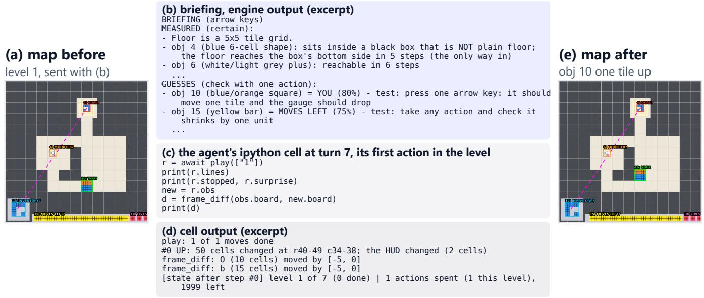

Figure 3 | One real turn, end to end (ls20, level 1, Run B, briefin<sub>g</sub> on, Section 5.2; transcri<sub>p</sub>t and frames as lo<sub>gg</sub>ed). (a) The ma<sub>p</sub> the en<sub>g</sub>ine drew for the o<sub>p</sub>enin<sub>g</sub> frame. (b) An excer<sub>p</sub>t of the briefin<sub>g</sub> sent with it: measured facts first, then <sub>g</sub>uesses, each with a one-action test. (c) The a<sub>g</sub>ent’s first action in the level, written as P<sub>y</sub>thon at turn 7 after six turns s<sub>p</sub>ent onl<sub>y</sub> readin<sub>g</sub> observe(): one ke<sub>y</sub> <sub>p</sub>ress, the test that the briefin<sub>g</sub> <sub>p</sub>ro<sub>p</sub>osed for you. (d) What the kernel <sub>p</sub>rinted: the <sub>p</sub>la<sub>y</sub>er (oran<sub>g</sub>e and blue, 25 cells) moved one tile of 5 cells u<sub>p</sub> and the HUD lost two cells. (e) The ma<sub>p</sub> after the move. One action confirmed two guesses, obj 10 = you and obj 15 = moves left.  
```csv
Algorithm 1: Perceive: one frame to the briefing, the map and the object table
In ut: rid g (H×W, colours 0–15); le al actions A; the level’s objects and lattice from the revious frame
Out ut: briefin B, ma M, object table O, chan e line δ
1. Objects and their ids (View 1)
1 O ← the 4-connected one-colour regions of g<sub>t</sub>, background (most common colour) excluded
2 foreach rule in order: (i) same colour, sha<sub>p</sub>e, <sub>p</sub>lace; (ii) same colour, sha<sub>p</sub>e, nearest; (iii) same sha<sub>p</sub>e, <sub>p</sub>lace; (iv) same colour, most
<sub>s</sub>h<sub>are</sub>d <sub>ce</sub>ll<sub>s</sub> d<sub>o</sub>
3 give each still-unmatched object the id of an unmatched previous object that the rule pairs it with
4 give every object left unmatched a new id ▷ rule (v)
5 δ ← the cells that chan<sub>g</sub>ed since the last frame; chan<sub>g</sub>es within 3 cells of the ed<sub>g</sub>e are re<sub>p</sub>orted as HUD
2<sub>.</sub> Thi<sub>ngs on</sub> th<sub>e screen</sub>
6 T ← the colours that cover more than 8% of g ▷ terrain
7 L ← the other cells <sub>g</sub>rou<sub>p</sub>ed into thin<sub>g</sub>s: lines, bars, multi-colour com<sub>p</sub>osites, icons, dotted fi<sub>g</sub>ures
8 mark each thing in L as HUD if it is a bar or touches the screen edge, and name it by the id that owns most of its cells
9 e ← the lar<sub>g</sub>est multi-colour thin<sub>g</sub> of ≥ 9 cells of the HUD, s<sub>q</sub>uares first ▷ likely agent
10 Λ ← the side of the largest multi-colour square whose grid matches > 75% of the floor’s edges; else the previous lattice, if it still fits
3<sub>.</sub> Meas<sub>u</sub>red facts: com<sub>pu</sub>ted b<sub>y</sub> code<sub>,</sub> stated as fact
11 F ← reach (BFS from $e _ { \mathrm { y o u } }$ on Λ), enclosures, mid<sub>p</sub>oint tethers, ali<sub>g</sub>nments, look-alikes under $D _ { 4 } \times \mathbb { Z } ^ { + }$ <sub>, cop</sub>i<sub>es,</sub> l<sub>ops</sub>id<sub>e</sub>d <sub>co</sub>l<sub>ours</sub>
4<sub>.</sub> G<sub>u</sub>essed roles: scored<sub>,</sub> stated as <sub>u</sub>esses
12 foreach thing e ∈ L that is not a line do
13 add the fixed evidence points of the eight roles (Table 2) that e’s shape, place, relations in F and A earn
14 ρˆ<sub>e</sub> ← the role with the most points; p<sub>e</sub> ← its points / (all of e’s points + 1)
5. Assemble within K = 20 lines
15 keep up to ⌊K/3⌋ lines for guesses, each with its one-action test
<sub>16 s</sub>h<sub>are</sub> th<sub>e o</sub>th<sub>er</sub> li<sub>nes among</sub> th<sub>e</sub> f<sub>ac</sub>t ki<sub>n</sub>d<sub>s, one</sub> li<sub>ne per</sub> ki<sub>n</sub>d i<sub>n</sub> t<sub>urn; g</sub>i<sub>ve guesses any room</sub> l<sub>e</sub>ft <sub>over</sub>
17 B ← the chosen facts, then the guesses, then a count of what was left out (“+N more $\boldsymbol { \mathrm { f } a c t s } ^ { \prime 3 } )$
18 M ← a map of L: ids, guessed roles marked “?”, look-alike threads, tether rings, HUD panel
19 return B, M, O, δ
```

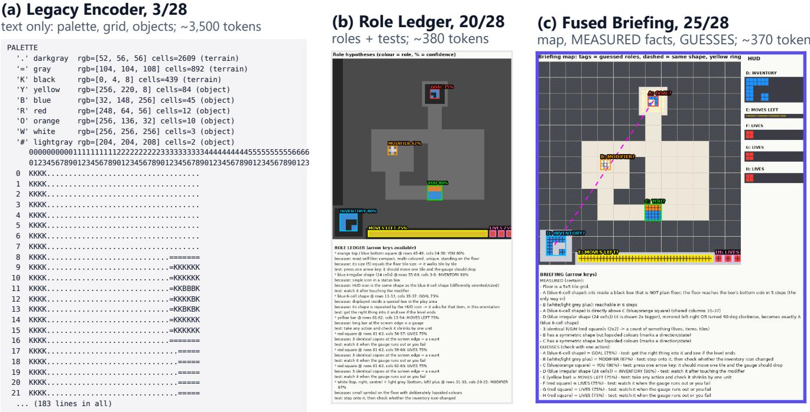  
Figure 4 | Three of the nine lab <sub>p</sub>resentations on the o<sub>p</sub>enin<sub>g</sub> frame of ls20, with rubric score (of 28) and text cost. (a) The Le<sub>g</sub>ac<sub>y</sub> Encoder, text onl<sub>y</sub> (excer<sub>p</sub>t of 183 lines, <sub>g</sub>rid rows cut at 44 columns). (b) The Role Led<sub>g</sub>er: a role ma<sub>p</sub> and, below it, each <sub>g</sub>uess with its evidence and a one-action test. (c) The Fused Briefin<sub>g</sub>, the <sub>p</sub>resentation we ke<sub>p</sub>t: a schematic ma<sub>p</sub> with object t<sub>ags, s</sub>h<sub>ape</sub> th<sub>rea</sub>d<sub>s an</sub>d t<sub>e</sub>th<sub>ers,</sub> th<sub>en measured</sub> f<sub>ac</sub>t<sub>s an</sub>d <sub>guesses as separa</sub>t<sub>e</sub> ti<sub>ers.</sub> Th<sub>e o</sub>th<sub>er s</sub>i<sub>x presen</sub>t<sub>a</sub>ti<sub>ons are</sub> i<sub>n</sub> Fi<sub>gure</sub> 12<sub>.</sub>

View 2: a <sub>p</sub>icture does not state relations<sub>,</sub> so the en<sub>g</sub>ine computes them. Whether an object can be reached, how many steps it takes, whether a hollow fits another object, <sub>or w</sub>h<sub>e</sub>th<sub>er</sub> t<sub>wo s</sub>h<sub>apes are</sub> th<sub>e same up</sub> t<sub>o ro</sub>t<sub>a</sub>ti<sub>on canno</sub>t be read reliabl<sub>y</sub> of a rendered frame (Rahmanzadeh<sub>g</sub>ervi et al. 2024). The engine first splits the frame into terrain— <sub>co</sub>l<sub>ours</sub> th<sub>a</sub>t <sub>cover more</sub> th<sub>an</sub> 8% <sub>o</sub>f th<sub>e</sub> f<sub>rame—an</sub>d thi<sub>ngs</sub> (corridors, edge gauges, multi-colour assemblies joined by <sub>un</sub>i<sub>on-</sub>fi<sub>n</sub>d <sub>over</sub> 8<sub>-connec</sub>t<sub>e</sub>d <sub>componen</sub>t<sub>s, pane</sub>l i<sub>cons an</sub>d dotted fi<sub>g</sub>ures). It then com<sub>p</sub>utes seven kinds of measured f<sub>ac</sub>t<sub>:</sub>

• Reachabilit<sub>y</sub>: breadth-first search over the detected lattice—the tile grid the player moves on—gives step counts from the likel<sub>y</sub> a<sub>g</sub>ent to ever<sub>y</sub> tar<sub>g</sub>et (“obj 6: reachable in 6 steps”).

• Enclosure: closed outlines around em<sub>p</sub>t<sub>y</sub> s<sub>p</sub>ace<sub>,</sub> matched against objects of the same size.

• Mid<sub>p</sub>oint tethers: an object held at the mid<sub>p</sub>oint of two others b<sub>y</sub> thin lines, so moving one end moves it (“obj 25 held at midpoint of obj 16 and 36”).

• Ali<sub>g</sub>nment: shared rows or columns between objects.

• Dihedral s<sub>y</sub>mmetr<sub>y</sub>: e<sub>q</sub>ualit<sub>y</sub> of two sha<sub>p</sub>es under th<sub>e e</sub>i<sub>g</sub>ht <sub>ro</sub>t<sub>a</sub>ti<sub>ons an</sub>d <sub>m</sub>i<sub>rror</sub>i<sub>ngs o</sub>f th<sub>e square an</sub>d i<sub>n</sub>t<sub>eger</sub> <sub>sca</sub>li<sub>ng</sub> $( D _ { 4 } \times \mathbb { Z } ^ { + } )$ , as in “obj 12 (drawn 2x bigger), mirrored left-right OR turned 90 deg clockwise, becomes exactly obj 4”.

• Co<sub>p</sub>ies: identical sha<sub>p</sub>es counted as a set (lives<sub>,</sub> items).

• Lo<sub>p</sub>sided colourin<sub>g</sub>: a s<sub>y</sub>mmetric sha<sub>p</sub>e with as<sub>y</sub>mmetric <sub>co</sub>l<sub>ours, w</sub>hi<sub>c</sub>h <sub>usua</sub>ll<sub>y mar</sub>k<sub>s a</sub> di<sub>rec</sub>ti<sub>on or a s</sub>t<sub>a</sub>t<sub>e.</sub>

In ls20, the s<sub>y</sub>mmetr<sub>y</sub> relation connects the HUD icon to the sha<sub>p</sub>e inside the <sub>g</sub>oal enclosure, while in r11l, tether d<sub>e</sub>t<sub>ec</sub>ti<sub>on</sub> id<sub>en</sub>tifi<sub>es</sub> th<sub>e</sub> di<sub>sc suspen</sub>d<sub>e</sub>d b<sub>e</sub>t<sub>ween</sub> t<sub>wo</sub> h<sub>an</sub>dl<sub>es.</sub> Th<sub>e</sub> <sub>percep</sub>ti<sub>on</sub> l<sub>a</sub>b <sub>con</sub>fi<sub>rme</sub>d th<sub>a</sub>t b<sub>o</sub>th <sub>re</sub>l<sub>a</sub>ti<sub>ons</sub>hi<sub>ps</sub> <sub>were</sub> di<sub>scovera</sub>bl<sub>e</sub> <sub>exc</sub>l<sub>us</sub>i<sub>ve</sub>l<sub>y</sub> th<sub>roug</sub>h th<sub>ese</sub> <sub>geome</sub>t<sub>r</sub>i<sub>c</sub> <sub>compu</sub>t<sub>a-</sub> tions (Section 5.1).

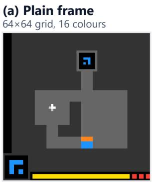

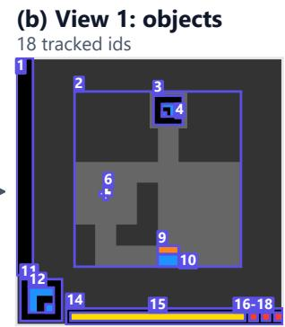

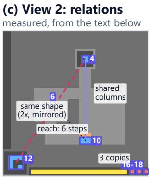

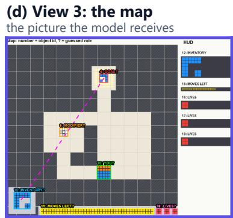  
(e) The briefing: sent as text in the same message as (d), word for word  
Figure 5 | One real frame (the opening frame of ls20) through the perception engine. (a) The rendered 64×64 frame. (b) View 1: the tracked objects with their ids; one-cell <sub>p</sub>arts and the three HUD co<sub>p</sub>ies are outlined but not ta<sub>gg</sub>ed one b<sub>y</sub> one. (c) View 2: four of the measured relations from (e), drawn as strai<sub>g</sub>ht lines between the objects the<sub>y</sub> relate (a line is not a <sub>p</sub>ath). (d) View 3: the ma the model receives: floor in li ht tones, walls hatched, the HUD moved to a side anel, objects ta ed id: ROLE?, look-alike sha<sub>p</sub>es joined b<sub>y</sub> a dashed thread. (e) The briefin<sub>g</sub> for the same frame, word for word, sent as text with the ma<sub>p</sub>. The model receives (d) and (e); (b) and (c) are drawn here from the en<sub>g</sub>ine’s object table and briefin<sub>g</sub> to show what each <sub>v</sub>i<sub>ew con</sub>t<sub>r</sub>ib<sub>u</sub>t<sub>es.</sub>

Pr<sub>opo</sub>rti<sub>o</sub>n<sub>a</sub>l lin<sub>e quo</sub>t<sub>as p</sub>r<sub>eve</sub>nt r<sub>e</sub>l<sub>a</sub>ti<sub>o</sub>n fl<sub>oo</sub>din<sub>g.</sub> B<sub>e-</sub> <sub>cause</sub> <sub>pa</sub>i<sub>rw</sub>i<sub>se</sub> <sub>geome</sub>t<sub>r</sub>i<sub>c</sub> <sub>re</sub>l<sub>a</sub>ti<sub>ons</sub> lik<sub>e</sub> <sub>coor</sub>di<sub>na</sub>t<sub>e</sub> <sub>a</sub>li<sub>gn-</sub> ments ex<sub>p</sub>and combinatoriall<sub>y</sub> in dense scenes (e.<sub>g</sub>., 792 ali<sub>g</sub>nment <sub>p</sub>airs in bp35), an unwei<sub>g</sub>hted <sub>g</sub>lobal line ca<sub>p</sub> all<sub>ows</sub> hi<sub>g</sub>h<sub>-</sub>f<sub>requency a</sub>li<sub>gnmen</sub>t<sub>s</sub> t<sub>o crow</sub>d <sub>ou</sub>t <sub>v</sub>it<sub>a</sub>l i<sub>nvar</sub>i<sub>an</sub>t<sub>s</sub> <sub>suc</sub>h <sub>as symme</sub>t<sub>r</sub>i<sub>es an</sub>d <sub>a</sub>f<sub>or</sub>d<sub>ance</sub> h<sub>ypo</sub>th<sub>eses.</sub> T<sub>o ma</sub>i<sub>n</sub>t<sub>a</sub>i<sub>n</sub> <sub>s</sub>t<sub>ruc</sub>t<sub>ura</sub>l b<sub>a</sub>l<sub>ance,</sub> th<sub>e</sub> b<sub>r</sub>i<sub>e</sub>fi<sub>ng</sub> <sub>sc</sub>h<sub>e</sub>d<sub>u</sub>l<sub>er</sub> <sub>en</sub>f<sub>orces</sub> <sub>propor-</sub> ti<sub>ona</sub>l li<sub>ne quo</sub>t<sub>as across</sub> i<sub>nvar</sub>i<sub>an</sub>t <sub>ca</sub>t<sub>egor</sub>i<sub>es an</sub>d <sub>reserves</sub> <sub>up</sub> t<sub>o one-</sub>thi<sub>r</sub>d <sub>o</sub>f th<sub>e</sub> di<sub>sp</sub>l<sub>ay</sub> f<sub>or can</sub>did<sub>a</sub>t<sub>e ro</sub>l<sub>e</sub> h<sub>ypo</sub>th<sub>eses,</sub> <sub>summar</sub>i<sub>z</sub>i<sub>ng surp</sub>l<sub>us re</sub>l<sub>a</sub>ti<sub>ons as aggrega</sub>t<sub>e coun</sub>t<sub>s ra</sub>th<sub>er</sub> than truncatin<sub>g</sub> them (detailed in A<sub>pp</sub>endix C).

Roles: the engine guesses what objects are for, and says how to check. Non-terrain objects are scored against eight <sub>ro</sub>l<sub>es</sub> <sub>w</sub>ith fi<sub>xe</sub>d <sub>ev</sub>id<sub>ence</sub> <sub>po</sub>i<sub>n</sub>t<sub>s</sub> f<sub>rom</sub> <sub>game-</sub>d<sub>es</sub>i<sub>gn</sub> <sub>pr</sub>i<sub>ors</sub> (Table 2); a role’s confidence is its score over the object’s t<sub>o</sub>t<sub>a</sub>l <sub>score p</sub>l<sub>us one.</sub> E<sub>ac</sub>h <sub>guess</sub> i<sub>s pr</sub>i<sub>n</sub>t<sub>e</sub>d <sub>w</sub>ith it<sub>s one-ac</sub>ti<sub>on</sub> t<sub>es</sub>t<sub>,</sub> <sub>so</sub> <sub>a</sub> <sub>wrong</sub> <sub>guess</sub> <sub>cos</sub>t<sub>s</sub> <sub>one</sub> <sub>ac</sub>ti<sub>on</sub> i<sub>ns</sub>t<sub>ea</sub>d <sub>o</sub>f <sub>a</sub> l<sub>eve</sub>l<sub>.</sub>

Th<sub>e</sub> b<sub>r</sub>i<sub>e</sub>fi<sub>ng</sub> <sub>s</sub>h<sub>ows</sub> <sub>a</sub>t <sub>mos</sub>t 20 f<sub>ac</sub>t <sub>an</sub>d <sub>guess</sub> li<sub>nes</sub> i<sub>n</sub> th<sub>e</sub> d<sub>ep</sub>l<sub>oye</sub>d <sub>con</sub>fi<sub>gura</sub>ti<sub>on: up</sub> t<sub>o a</sub> thi<sub>r</sub>d f<sub>or guesses,</sub> th<sub>e</sub> <sub>res</sub>t <sub>s</sub>h<sub>are</sub>d b<sub>e</sub>t<sub>ween</sub> th<sub>e</sub> f<sub>ac</sub>t ki<sub>n</sub>d<sub>s, w</sub>ith f<sub>ac</sub>t<sub>s a</sub>b<sub>ou</sub>t th<sub>e</sub> <sub>guesse</sub>d <sub>agen</sub>t <sub>an</sub>d <sub>goa</sub>l fi<sub>rs</sub>t<sub>.</sub> Th<sub>e rema</sub>i<sub>n</sub>d<sub>er</sub> i<sub>s coun</sub>t<sub>e</sub>d (“+N more facts”) and sta<sub>y</sub>s readable in code throu<sub>g</sub>h observe().briefing. Full briefin<sub>g</sub>s for the two lab f<sub>rames are</sub> i<sub>n</sub> A<sub>ppen</sub>di<sub>x</sub> B<sub>.</sub>3<sub>.</sub>

Vi<sub>ew</sub> 3<sub>: wo</sub>rd<sub>s go</sub> in th<sub>e</sub> t<sub>ex</sub>t<sub>,</sub> n<sub>o</sub>t in th<sub>e p</sub>i<sub>xe</sub>l<sub>s.</sub> A <sub>sma</sub>ll <sub>v</sub>i<sub>s</sub>i<sub>on</sub> <sub>enco</sub>d<sub>er</sub> <sub>rea</sub>d<sub>s</sub> <sub>ren</sub>d<sub>ere</sub>d t<sub>ex</sub>t <sub>unre</sub>li<sub>a</sub>bl<sub>y,</sub> <sub>an</sub>d <sub>a</sub> <sub>sen</sub>t<sub>ence</sub> d<sub>rawn</sub> i<sub>n</sub>t<sub>o</sub> th<sub>e</sub> i<sub>mage</sub> i<sub>s a sen</sub>t<sub>ence</sub> th<sub>e mo</sub>d<sub>e</sub>l <sub>mus</sub>t t<sub>ran-</sub> <sub>scr</sub>ib<sub>e</sub> b<sub>e</sub>f<sub>ore</sub> it <sub>can</sub> <sub>use</sub> it<sub>.</sub> Th<sub>e</sub> <sub>map</sub> th<sub>ere</sub>f<sub>ore</sub> <sub>carr</sub>i<sub>es</sub> <sub>on</sub>l<sub>y</sub> short ta<sub>g</sub>s (10: YOU?) that re<sub>p</sub>eat ids from the text, while ever<sub>y</sub> sentence travels as text. It draws structure (floor in li<sub>g</sub>ht t<sub>ones, wa</sub>ll<sub>s</sub> h<sub>a</sub>t<sub>c</sub>h<sub>e</sub>d<sub>,</sub> th<sub>e</sub> l<sub>a</sub>tti<sub>ce as</sub> fi<sub>ne</sub> li<sub>nes,</sub> l<sub>oo</sub>k<sub>-a</sub>lik<sub>e</sub> shapes joined by dashed threads, tethers marked with rings and the HUD ma<sub>g</sub>nified in a side <sub>p</sub>anel (Fi<sub>g</sub>ure 5d)).

Observation schedule. The full view (briefin<sub>g</sub>, letter <sub>g</sub>rid and ma<sub>p</sub>) is sent at the start of a level, after a context drain, and when the a<sub>g</sub>ent calls observe() after actin<sub>g</sub>, at most <sub>once</sub> <sub>per</sub> <sub>s</sub>t<sub>a</sub>t<sub>e.</sub> Aft<sub>er</sub> <sub>o</sub>th<sub>er</sub> <sub>ac</sub>ti<sub>ons</sub> th<sub>e</sub> <sub>agen</sub>t <sub>ge</sub>t<sub>s</sub> th<sub>e</sub> <sub>c</sub>h<sub>ange</sub> l<sub>e</sub>d<sub>ger, a</sub> l<sub>e</sub>tt<sub>er crop aroun</sub>d th<sub>e c</sub>h<sub>ange</sub>d <sub>ce</sub>ll<sub>s w</sub>ith <sub>a</sub> 3<sub>-ce</sub>ll margin, and the new map. The object table stays on the host and is read in code (observe().objects).

<table><tr><td>Role</td><td>Evidence (scored)</td><td>One-action test</td></tr><tr><td>You</td><td>Compact, multi-coloured, unique, on the lattice</td><td>Press one arrow: it moves one tile</td></tr><tr><td>GOAL</td><td>Hollow box; shape repeated in the HUD</td><td>Bring the matching thing into it</td></tr><tr><td>MOVES LEFT</td><td>Long bar at the screen edge</td><td>Any action: it shrinks one unit</td></tr><tr><td>LIVES</td><td>Identical copies in the HUD</td><td>Watch it on a failure or reset</td></tr><tr><td>INVENTORY</td><td>HUD icon matching a world object</td><td>Watch it after the modifier</td></tr><tr><td>MODIFIER</td><td>Small symbol, lopsided colours</td><td>Step on it: the inventory changes</td></tr><tr><td>HANDLE</td><td>Tether end; on/off colour pair</td><td>Click it: something jumps</td></tr><tr><td>CARRIED</td><td>Held between two tether</td><td>Move a handle: it</td></tr><tr><td>THING</td><td>ends</td><td>follows</td></tr></table>

Table 2 | Role <sub>g</sub>uesses. Each is <sub>p</sub>rinted with its confidence <sub>an</sub>d <sub>a</sub> t<sub>es</sub>t th<sub>a</sub>t <sub>se</sub>ttl<sub>es</sub> it i<sub>n one ac</sub>ti<sub>on.</sub> O<sub>n</sub> h<sub>e</sub>ld<sub>-ou</sub>t <sub>games</sub> these <sub>g</sub>uesses were ri<sub>g</sub>ht about half the time or less (Table 4), <sub>w</sub>hi<sub>c</sub>h i<sub>s w</sub>h<sub>y</sub> th<sub>ey are never s</sub>t<sub>a</sub>t<sub>e</sub>d <sub>as</sub> f<sub>ac</sub>t<sub>s.</sub>

## 4<sub>.</sub>3 Th<sub>e</sub> A<sub>c</sub>ti<sub>o</sub>n Int<sub>e</sub>rf<sub>ace</sub>

Se<sub>p</sub>arate tools for code and for actions s<sub>p</sub>lit one <sub>p</sub>lan <sub>ac</sub>r<sub>oss</sub> m<sub>a</sub>n<sub>y</sub> t<sub>u</sub>rn<sub>s.</sub> I<sub>n our ear</sub>l<sub>y</sub> b<sub>u</sub>ild<sub>s</sub> th<sub>e agen</sub>t h<sub>a</sub>d <sub>one</sub> t<sub>oo</sub>l t<sub>o run</sub> P<sub>y</sub>th<sub>on an</sub>d <sub>ano</sub>th<sub>er</sub> t<sub>o su</sub>b<sub>m</sub>it <sub>moves.</sub> I<sub>n</sub> th<sub>e</sub> t<sub>races</sub> <sub>o</sub>f th<sub>ose</sub> b<sub>u</sub>ild<sub>s</sub> it <sub>mo</sub>d<sub>e</sub>ll<sub>e</sub>d th<sub>e game</sub> i<sub>n one</sub> t<sub>oo</sub>l<sub>,</sub> l<sub>e</sub>ft it t<sub>o sen</sub>d <sub>a s</sub>i<sub>ng</sub>l<sub>e move w</sub>ith th<sub>e o</sub>th<sub>er, an</sub>d <sub>came</sub> b<sub>ac</sub>k t<sub>o re-</sub>d<sub>er</sub>i<sub>ve</sub> it<sub>s</sub> <sub>s</sub>t<sub>a</sub>t<sub>e, so one p</sub>l<sub>an cos</sub>t <sub>many</sub> t<sub>urns an</sub>d <sub>every</sub> t<sub>urn cos</sub>t <sub>a mo</sub>d<sub>e</sub>l <sub>ca</sub>ll<sub>.</sub> W<sub>e merge</sub>d th<sub>e</sub> t<sub>wo:</sub> th<sub>e agen</sub>t <sub>ac</sub>t<sub>s on</sub>l<sub>y</sub> f<sub>rom</sub> i<sub>ns</sub>id<sub>e</sub> it<sub>s</sub> P<sub>y</sub>thon kernel, in the CodeAct st<sub>y</sub>le (Wan<sub>g</sub> et al. 2024), with

$$
\mathtt { r } ~ = ~ \mathtt { a w a i t } ~ \mathtt { p l a y } ( \mathtt { p a t h } , ~ \mathtt { p r e d i c t = f } )
$$

where path is u<sub>p</sub> to 100 moves and predict is an o<sub>p</sub>tional <sub>wor</sub>ld <sub>mo</sub>d<sub>e</sub>l ${ \hat { f } } ( s , a ) \to { \hat { s } }$ <sub>wr</sub>itt<sub>en</sub> b<sub>y</sub> th<sub>e agen</sub>t<sub>.</sub> It i<sub>s</sub> th<sub>e on</sub>l<sub>y</sub> <sub>c</sub>h<sub>ange recor</sub>d<sub>e</sub>d f<sub>or</sub> th<sub>e</sub> b<sub>u</sub>ild th<sub>a</sub>t <sub>move</sub>d th<sub>e</sub> hidd<sub>en-se</sub>t <sub>score</sub> f<sub>rom</sub> 5<sub>.</sub>14 t<sub>o</sub> 5<sub>.</sub>65<sub>.</sub> O<sub>ne ce</sub>ll <sub>can now mo</sub>d<sub>e</sub>l <sub>a</sub> l<sub>eve</sub>l<sub>, searc</sub>h it and <sub>p</sub>la<sub>y</sub> the whole <sub>p</sub>ath (Fi<sub>g</sub>ure 3c).

The agent’s world model is a guess, so play() checks it i<sub>ns</sub>t<sub>ea</sub>d <sub>o</sub>f t<sub>rus</sub>ti<sub>ng</sub> it<sub>.</sub> Al<sub>gor</sub>ith<sub>m</sub> 2 d<sub>e</sub>fi<sub>nes</sub> th<sub>e execu</sub>ti<sub>on</sub> contract between the planned trajectory and the environment, <sub>spec</sub>if<sub>y</sub>i<sub>ng</sub> th<sub>e</sub> <sub>exac</sub>t <sub>con</sub>diti<sub>ons</sub> th<sub>a</sub>t <sub>govern</sub> <sub>pa</sub>th t<sub>erm</sub>i<sub>na</sub>ti<sub>on.</sub> A<sub>n</sub> i<sub>naccura</sub>t<sub>e</sub> <sub>s</sub>t<sub>a</sub>t<sub>e</sub> <sub>pre</sub>di<sub>c</sub>ti<sub>on</sub> d<sub>oes</sub> <sub>no</sub>t i<sub>n</sub>t<sub>errup</sub>t <sub>execu</sub>ti<sub>on.</sub> Instead, play() lo<sub>g</sub>s the first action whose <sub>p</sub>redicted state dif<sub>ers</sub> f<sub>rom</sub> th<sub>e</sub> t<sub>rue gr</sub>id <sub>ou</sub>t<sub>s</sub>id<sub>e</sub> th<sub>e</sub> HUD<sub>, recor</sub>d<sub>s</sub> th<sub>e m</sub>i<sub>s-</sub> matched coordinates, and continues along the trajectory. The <sub>pa</sub>th h<sub>a</sub>lt<sub>s</sub> <sub>on</sub>l<sub>y</sub> <sub>w</sub>h<sub>en</sub> <sub>a</sub> l<sub>eve</sub>l <sub>or</sub> <sub>game</sub> t<sub>erm</sub>i<sub>na</sub>t<sub>es,</sub> <sub>w</sub>h<sub>en</sub> <sub>con-</sub> <sub>secu</sub>ti<sub>ve</sub> id<sub>en</sub>ti<sub>ca</sub>l <sub>ac</sub>ti<sub>ons</sub> <sub>co</sub>llid<sub>e</sub> <sub>w</sub>ith <sub>an</sub> <sub>o</sub>b<sub>s</sub>t<sub>ac</sub>l<sub>e</sub> <sub>w</sub>ith<sub>ou</sub>t <sub>a</sub>lt<sub>er</sub>i<sub>ng a s</sub>i<sub>ng</sub>l<sub>e p</sub>i<sub>xe</sub>l<sub>, or w</sub>h<sub>en</sub> th<sub>e rev</sub>i<sub>s</sub>it <sub>guar</sub>d id<sub>en</sub>tifi<sub>es a</sub> b<sub>oar</sub>d <sub>s</sub>t<sub>a</sub>t<sub>e</sub> <sub>a</sub>l<sub>rea</sub>d<sub>y</sub> <sub>v</sub>i<sub>s</sub>it<sub>e</sub>d d<sub>ur</sub>i<sub>ng</sub> th<sub>e</sub> <sub>curren</sub>t <sub>a</sub>tt<sub>emp</sub>t<sub>.</sub> Th<sub>e</sub> l<sub>oop</sub> <sub>never</sub> <sub>s</sub>t<sub>a</sub>ll<sub>s</sub> t<sub>o</sub> <sub>ver</sub>if<sub>y</sub> <sub>an</sub> <sub>opera</sub>ti<sub>ona</sub>l <sub>ru</sub>l<sub>e,</sub> <sub>ensur</sub>i<sub>ng</sub> th<sub>a</sub>t <sub>any</sub> i<sub>naccurac</sub>i<sub>es</sub> i<sub>n</sub> th<sub>e</sub> i<sub>n</sub>t<sub>erna</sub>l <sub>wor</sub>ld <sub>mo</sub>d<sub>e</sub>l <sub>are reso</sub>l<sub>ve</sub>d i<sub>mme</sub>di<sub>a</sub>t<sub>e</sub>l<sub>y upon rece</sub>i<sub>v</sub>i<sub>ng</sub> th<sub>e nex</sub>t f<sub>rame.</sub> T<sub>wo o</sub>f th<sub>e s</sub>t<sub>ops</sub> are switches. The revisit <sub>g</sub>uard was of in Run B (briefin<sub>g</sub> on), and the re<sub>p</sub>la<sub>y g</sub>uard, which refuses before an<sub>y</sub> move a <sub>pa</sub>th th<sub>a</sub>t <sub>repea</sub>t<sub>s a</sub> l<sub>os</sub>t t<sub>ry move</sub> f<sub>or move</sub> f<sub>rom</sub> th<sub>e same</sub> fi<sub>rs</sub>t board, was on; the saved confi<sub>g</sub>uration of Run A (briefin<sub>g</sub> of) records neither switch.

Al<sub>gor</sub>ith<sub>m</sub> 2<sub>:</sub> P<sub>lay: sen</sub>di<sub>ng a p</sub>l<sub>anne</sub>d <sub>pa</sub>th <sub>an</sub>d <sub>c</sub>h<sub>ec</sub>k<sub>-</sub>   
i<sub>ng</sub> th<sub>e agen</sub>t’<sub>s pre</sub>di<sub>c</sub>ti<sub>ons</sub>   
Input: path of moves m<sub>1</sub>, . . . , m<sub>K</sub>; optional world model   
$\bar { f }$ (the a<sub>g</sub>ent’s step()); current <sub>g</sub>rid $g _ { t }$   
O<sub>u</sub>t<sub>pu</sub>t<sub>: one c</sub>h<sub>ange</sub> li<sub>ne per move sen</sub>t<sub>,</sub> th<sub>e</sub> fi<sub>rs</sub>t <sub>surpr</sub>i<sub>se</sub>   
(or none), the last <sub>g</sub>rid   
<sub>1</sub> if $K >$ 100 then refuse the whole path; nothing is spent   
<sub>2</sub> if <sub>rep</sub>l<sub>ay guar</sub>d <sub>on an</sub>d th<sub>e pa</sub>th <sub>repea</sub>t<sub>s,</sub> f<sub>rom</sub> th<sub>e same</sub> fi<sub>rs</sub>t   
b<sub>oar</sub>d<sub>, a</sub> t<sub>ry</sub> th<sub>a</sub>t <sub>en</sub>d<sub>e</sub>d i<sub>n game over</sub> th<sub>e</sub>n <sub>re</sub>f<sub>use</sub> it   
3 surprise ← none   
<sub>4</sub> f<sub>or</sub> $i \gets 1$ to K do   
5 if $\hat { f }$ <sub>g</sub>i<sub>v</sub>en then   
6 $\hat { g } _ { t + 1 } \gets \hat { f } ( g _ { t } , m _ { i } )$ ▷ predict before acting   
7 if $\hat { f }$ <sub>ra</sub>i<sub>se</sub>d <sub>an error</sub> th<sub>e</sub>n <sub>s</sub>t<sub>op;</sub> $m _ { i }$ i<sub>s no</sub>t <sub>sen</sub>t   
8 <sub>sen</sub>d $m _ { i } ;$ <sub>rea</sub>d th<sub>e</sub> <sub>new</sub> <sub>gr</sub>id $g _ { t + 1 } \triangleright$ the move is spent   
9 if $\hat { f }$ <sub>g</sub>i<sub>ve</sub>n and n<sub>o</sub> <sub>su</sub>r<sub>p</sub>ri<sub>se</sub> <sub>ye</sub>t and $\hat { g } _ { t + 1 }$ dif<sub>ers</sub> f<sub>rom</sub>   
g<sub>t+1</sub> outside the HUD then   
10 surprise $ ( i , m _ { i } ,$ the difering cells)   
▷ reported; the path goes on   
11 if th<sub>e</sub> l<sub>eve</sub>l <sub>was won or</sub> th<sub>e game</sub> i<sub>s over</sub> th<sub>en s</sub>t<sub>op</sub>   
12 if m<sub>i</sub> changed nothing and the move before it was m<sub>i</sub>   
and also chan<sub>g</sub>ed nothin<sub>g</sub> then sto<sub>p</sub> (a wall hit twice)   
13 if <sub>rev</sub>i<sub>s</sub>it <sub>guar</sub>d <sub>on an</sub>d $g _ { t + 1 }$ <sub>was</sub> <sub>a</sub>l<sub>rea</sub>d<sub>y</sub> <sub>seen</sub> i<sub>n</sub> thi<sub>s</sub> t<sub>ry</sub>   
then sto<sub>p</sub>   
14 $t \gets t + \bar { 1 }$   
15 return the change lines, surprise, $g _ { t }$

Re<sub>v</sub>isit <sub>gu</sub>ard beha<sub>v</sub>ior <sub>u</sub>nder li<sub>v</sub>e de<sub>p</sub>lo<sub>y</sub>ment<sub>.</sub> Th<sub>e</sub> r<sub>e-</sub> <sub>v</sub>i<sub>s</sub>it <sub>guar</sub>d t<sub>erm</sub>i<sub>na</sub>t<sub>es pa</sub>th <sub>execu</sub>ti<sub>on w</sub>h<sub>enever</sub> th<sub>e non-</sub>HUD b<sub>oar</sub>d <sub>con</sub>fi<sub>gura</sub>ti<sub>on</sub> <sub>repea</sub>t<sub>s</sub> <sub>a</sub> <sub>s</sub>t<sub>a</sub>t<sub>e</sub> <sub>encoun</sub>t<sub>ere</sub>d <sub>ear</sub>li<sub>er</sub> i<sub>n</sub> th<sub>e</sub> <sub>a</sub>tt<sub>emp</sub>t<sub>.</sub> I<sub>n</sub> <sub>coun</sub>t<sub>er</sub>f<sub>ac</sub>t<sub>ua</sub>l <sub>ana</sub>l<sub>ys</sub>i<sub>s</sub> <sub>over</sub> 9<sub>,</sub>913 <sub>ac</sub>ti<sub>ons,</sub> th<sub>e</sub> <sub>g</sub>uard identified 2,331 du<sub>p</sub>licate states (with a minor false-<sub>p</sub>ositive cost of 6 winnin<sub>g</sub> transitions). Under live de<sub>p</sub>lo<sub>y</sub>- <sub>men</sub>t<sub>,</sub> <sub>w</sub>h<sub>en</sub> i<sub>n</sub>t<sub>errup</sub>t<sub>e</sub>d b<sub>y</sub> th<sub>e</sub> <sub>guar</sub>d<sub>,</sub> <sub>reason</sub>i<sub>ng</sub> <sub>mo</sub>d<sub>e</sub>l<sub>s</sub> <sub>com-</sub> <sub>pensa</sub>t<sub>e</sub>d b<sub>y</sub> i<sub>ncreas</sub>i<sub>ng s</sub>i<sub>ng</sub>l<sub>e-ac</sub>ti<sub>on</sub> i<sub>nvoca</sub>ti<sub>ons</sub> f<sub>rom</sub> 8<sub>.</sub>9% t<sub>o</sub> 17<sub>.</sub>8% <sub>an</sub>d di<sub>spa</sub>t<sub>c</sub>hi<sub>ng</sub> <sub>su</sub>b<sub>sequen</sub>t <sub>moves</sub> i<sub>n</sub> th<sub>e</sub> <sub>same</sub> <sub>ce</sub>ll<sub>,</sub> <sub>s</sub>hifti<sub>ng comp</sub>l<sub>e</sub>t<sub>e</sub>d l<sub>eve</sub>l<sub>s marg</sub>i<sub>na</sub>ll<sub>y</sub> f<sub>rom</sub> 50 t<sub>o</sub> 52 <sub>ou</sub>t <sub>o</sub>f 97<sub>.</sub> W<sub>e re</sub>t<sub>a</sub>i<sub>n</sub> th<sub>e guar</sub>d <sub>as a con</sub>fi<sub>gura</sub>bl<sub>e sa</sub>f<sub>eguar</sub>d <sub>w</sub>hil<sub>e no</sub>ti<sub>ng</sub> th<sub>a</sub>t <sub>v</sub>i<sub>s</sub>ibl<sub>e</sub> <sub>execu</sub>ti<sub>on</sub> <sub>cons</sub>t<sub>ra</sub>i<sub>n</sub>t<sub>s</sub> <sub>can</sub> i<sub>n</sub>d<sub>uce</sub> <sub>compensa</sub>t<sub>ory</sub> b<sub>e</sub>h<sub>av</sub>i<sub>ors</sub> i<sub>n reason</sub>i<sub>ng</sub> b<sub>ac</sub>kb<sub>ones.</sub>

## 4<sub>.</sub>4 S<sub>e</sub>r<sub>v</sub>in<sub>g</sub> In<sub>s</sub>id<sub>e</sub> th<sub>e</sub> En<sub>ve</sub>l<sub>ope</sub>

A<sub>pp</sub>end-onl<sub>y</sub> context invariant <sub>p</sub>reserves <sub>p</sub>refix-cache r<sub>euse.</sub> W<sub>e</sub> d<sub>ep</sub>l<sub>oy</sub> <sub>our</sub> 125B M<sub>o</sub>E b<sub>ac</sub>kb<sub>one</sub> <sub>quan</sub>ti<sub>ze</sub>d t<sub>o</sub> W4A16 usin<sub>g</sub> AutoRound (Chen<sub>g</sub> et al. 2023) and served via SGLan<sub>g</sub> (Zhen<sub>g</sub> et al. 2023) with EAGLE s<sub>p</sub>eculative decodin<sub>g</sub> (Li et al. 2024). The model architecture mixes Gated DeltaNet linear-recurrent la<sub>y</sub>ers with attention (Yan<sub>g</sub>, Kautz, and Hatamizadeh 2024). Its recurrent state cannot be re-<sub>woun</sub>d<sub>, so</sub> th<sub>e server can resume on</sub>l<sub>y</sub> f<sub>rom</sub> th<sub>e s</sub>t<sub>a</sub>t<sub>e save</sub>d <sub>a</sub>t th<sub>e en</sub>d <sub>o</sub>f <sub>an ear</sub>li<sub>er reques</sub>t<sub>, an</sub>d th<sub>e pre</sub>fi<sub>x cac</sub>h<sub>e ma</sub>t<sub>c</sub>h<sub>es</sub> <sub>no</sub>thi<sub>ng</sub> <sub>pas</sub>t th<sub>e</sub> fi<sub>rs</sub>t <sub>mo</sub>difi<sub>e</sub>d t<sub>o</sub>k<sub>en.</sub> T<sub>o</sub> <sub>guaran</sub>t<sub>ee</sub> <sub>cac</sub>h<sub>e</sub> reuse, we enforce an append-only invariant: every request is th<sub>e</sub> <sub>prev</sub>i<sub>ous</sub> <sub>reques</sub>t <sub>p</sub>l<sub>us</sub> it<sub>s</sub> <sub>rep</sub>l<sub>y</sub> <sub>an</sub>d <sub>new</sub> <sub>messages,</sub> <sub>wor</sub>d f<sub>or</sub> <sub>wor</sub>d<sub>.</sub> Vi<sub>sua</sub>l <sub>maps</sub> <sub>are</sub> <sub>re</sub>t<sub>a</sub>i<sub>ne</sub>d <sub>across</sub> t<sub>urns,</sub> <sub>reason</sub>i<sub>ng</sub> <sub>rema</sub>i<sub>ns</sub> i<sub>n</sub> hi<sub>s</sub>t<sub>ory,</sub> <sub>an</sub>d <sub>wor</sub>ki<sub>ng</sub> <sub>memory</sub> <sub>up</sub>d<sub>a</sub>t<sub>es</sub> <sub>appen</sub>d <sub>as</sub> <sub>new</sub> li<sub>nes.</sub> A <sub>game re</sub>t<sub>a</sub>i<sub>ns</sub> it<sub>s</sub> GPU <sub>s</sub>l<sub>o</sub>t f<sub>or</sub> 20 <sub>reques</sub>t<sub>s</sub> b<sub>e</sub>f<sub>ore</sub> <sub>sc</sub>h<sub>e</sub>d<sub>u</sub>li<sub>ng</sub> h<sub>an</sub>d<sub>o</sub>f<sub>.</sub> A<sub>cross our</sub> f<sub>u</sub>ll b<sub>enc</sub>h<sub>mar</sub>k <sub>run,</sub> 98<sub>.</sub>4% <sub>o</sub>f 1<sub>.</sub>78 B <sub>promp</sub>t t<sub>o</sub>k<sub>ens were serve</sub>d di<sub>rec</sub>tl<sub>y</sub> f<sub>rom cac</sub>h<sub>e, re-</sub> d<sub>uc</sub>i<sub>ng pre</sub>fill t<sub>o</sub> 1<sub>.</sub>3% <sub>o</sub>f b<sub>usy</sub> ti<sub>me an</sub>d <sub>ren</sub>d<sub>er</sub>i<sub>ng execu</sub>ti<sub>on</sub> decode-bound (Fi<sub>g</sub>ure 6).

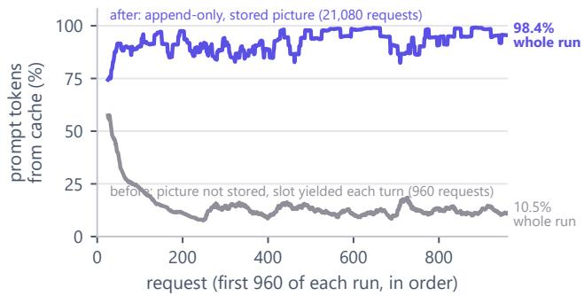  
Fi<sub>g</sub>ure 6 | Share of each re<sub>q</sub>uest’s <sub>p</sub>rom<sub>p</sub>t tokens served from the <sub>p</sub>refix cache (movin<sub>g</sub> mean over 25 requests), for the first 960 requests of two Qwen3.8-Flash-Next runs on SGLan<sub>g</sub>. Before (15 <sub>g</sub>ames): the <sub>p</sub>icture is sent as an unstored last <sub>message an</sub>d th<sub>e</sub> GPU <sub>s</sub>l<sub>o</sub>t <sub>c</sub>h<sub>anges</sub> h<sub>an</sub>d<sub>s every</sub> t<sub>urn, so eac</sub>h request rewrites the end of the one before. After (Run A, 25 <sub>g</sub>ames): ever<sub>y</sub> request is the <sub>p</sub>revious request <sub>p</sub>lus its re<sub>p</sub>l<sub>y</sub>, <sub>an</sub>d <sub>a game</sub> k<sub>eeps</sub> it<sub>s s</sub>l<sub>o</sub>t f<sub>or</sub> 20 <sub>reques</sub>t<sub>s.</sub> L<sub>a</sub>b<sub>e</sub>l<sub>s on</sub> th<sub>e r</sub>i<sub>g</sub>ht <sub>g</sub>i<sub>ve</sub> th<sub>e w</sub>h<sub>o</sub>l<sub>e run.</sub>

D<sub>e</sub>t<sub>erm</sub>i<sub>n</sub>i<sub>s</sub>ti<sub>c con</sub>t<sub>ex</sub>t d<sub>ra</sub>i<sub>nage e</sub>li<sub>m</sub>i<sub>na</sub>t<sub>es</sub> h<sub>a</sub>ll<sub>uc</sub>i<sub>na</sub>t<sub>e</sub>d <sub>summar</sub>i<sub>es.</sub> H<sub>arnesses</sub> th<sub>a</sub>t <sub>compac</sub>t <sub>con</sub>t<sub>ex</sub>t t<sub>yp</sub>i<sub>ca</sub>ll<sub>y</sub> i<sub>n-</sub> voke an LLM to <sub>g</sub>enerate summaries (Knutsen and Klein 2026), which costs shared GPU c<sub>y</sub>cles and risks hallucinati<sub>ng pers</sub>i<sub>s</sub>t<sub>en</sub>t f<sub>a</sub>l<sub>se</sub> f<sub>ac</sub>t<sub>s</sub> i<sub>n</sub>t<sub>o con</sub>t<sub>ex</sub>t hi<sub>s</sub>t<sub>ory.</sub> O<sub>ur con</sub>t<sub>ex</sub>t d<sub>ra</sub>i<sub>n opera</sub>t<sub>es en</sub>ti<sub>re</sub>l<sub>y w</sub>ith<sub>ou</sub>t <sub>mo</sub>d<sub>e</sub>l i<sub>n</sub>f<sub>erence: w</sub>h<sub>en con-</sub> t<sub>ex</sub>t <sub>excee</sub>d<sub>s</sub> 118k t<sub>o</sub>k<sub>ens,</sub> it d<sub>e</sub>t<sub>erm</sub>i<sub>n</sub>i<sub>s</sub>ti<sub>ca</sub>ll<sub>y</sub> d<sub>rops</sub> th<sub>e o</sub>ld<sub>es</sub>t <sub>comp</sub>l<sub>e</sub>t<sub>e</sub> t<sub>urns un</sub>til hi<sub>s</sub>t<sub>ory</sub> f<sub>a</sub>ll<sub>s</sub> b<sub>e</sub>l<sub>ow</sub> 55k t<sub>o</sub>k<sub>ens.</sub> Th<sub>e sys-</sub> t<sub>em promp</sub>t <sub>rema</sub>i<sub>ns p</sub>i<sub>nne</sub>d<sub>, unev</sub>i<sub>c</sub>t<sub>e</sub>d t<sub>urns are preserve</sub>d <sub>ver</sub>b<sub>a</sub>ti<sub>m,</sub> <sub>an</sub>d th<sub>e</sub> <sub>sym</sub>b<sub>o</sub>li<sub>c</sub> <sub>memory</sub> <sub>s</sub>t<sub>ore</sub> <sub>an</sub>d <sub>co</sub>d<sub>e</sub> <sub>grap</sub>h <sub>are re-anc</sub>h<sub>ore</sub>d <sub>as a s</sub>i<sub>ng</sub>l<sub>e</sub> d<sub>e</sub>t<sub>erm</sub>i<sub>n</sub>i<sub>s</sub>ti<sub>c</sub> bl<sub>oc</sub>k<sub>.</sub>

K<sub>e</sub>rn<sub>e</sub>l <sub>wo</sub>rkin<sub>g</sub> m<sub>e</sub>m<sub>o</sub>r<sub>y</sub> <sub>a</sub>nd <sub>p</sub>ri<sub>o</sub>rit<sub>y</sub> <sub>sc</sub>h<sub>e</sub>d<sub>u</sub>lin<sub>g.</sub> Th<sub>e</sub> <sub>agen</sub>t <sub>ma</sub>i<sub>n</sub>t<sub>a</sub>i<sub>ns</sub> f<sub>our</sub> l<sub>eve</sub>l<sub>-</sub>k<sub>eye</sub>d <sub>sym</sub>b<sub>o</sub>li<sub>c</sub> di<sub>c</sub>ti<sub>onar</sub>i<sub>es</sub> i<sub>n</sub> th<sub>e</sub> P<sub>y</sub>thon kernel (GOAL, PLAN, HYPOTHESES, FINDINGS) th<sub>a</sub>t <sub>pers</sub>i<sub>s</sub>t <sub>across con</sub>t<sub>ex</sub>t d<sub>ra</sub>i<sub>ns an</sub>d l<sub>eve</sub>l t<sub>rans</sub>iti<sub>ons.</sub> U<sub>pon</sub> l<sub>eve</sub>l <sub>comp</sub>l<sub>e</sub>ti<sub>on, a cura</sub>t<sub>or ca</sub>ll <sub>conso</sub>lid<sub>a</sub>t<sub>es con</sub>fi<sub>rme</sub>d <sub>me-</sub> chanics into a <sub>p</sub>ersistent SKILLS re<sub>p</sub>ositor<sub>y</sub> and re<sub>g</sub>isters <sub>re</sub>f<sub>u</sub>t<sub>e</sub>d <sub>ru</sub>l<sub>es</sub> t<sub>o preven</sub>t <sub>re</sub>d<sub>un</sub>d<sub>an</sub>t <sub>exp</sub>l<sub>ora</sub>ti<sub>on.</sub> A<sub>cross</sub> 25 <sub>concurren</sub>t <sub>games, an async</sub>h<sub>ronous pr</sub>i<sub>or</sub>it<sub>y sc</sub>h<sub>e</sub>d<sub>u</sub>l<sub>er a</sub>l<sub>-</sub> l<sub>oca</sub>t<sub>es</sub> 10 <sub>ac</sub>ti<sub>ve</sub> GPU <sub>s</sub>l<sub>o</sub>t<sub>s</sub> b<sub>ase</sub>d <sub>on</sub> l<sub>eve</sub>l <sub>rewar</sub>d <sub>we</sub>i<sub>g</sub>ht di<sub>scoun</sub>t<sub>e</sub>d b<sub>y comm</sub>itt<sub>e</sub>d <sub>ac</sub>ti<sub>ons, mu</sub>lti<sub>p</sub>l<sub>y</sub>i<sub>ng</sub> b<sub>y a</sub> d<sub>ecay</sub> f<sub>ac</sub>t<sub>or</sub> th<sub>a</sub>t <sub>preven</sub>t<sub>s</sub> <sub>s</sub>t<sub>a</sub>ll<sub>e</sub>d <sub>games</sub> f<sub>rom</sub> <sub>s</sub>t<sub>arv</sub>i<sub>ng</sub> <sub>progress</sub>i<sub>ng</sub> ones (A<sub>pp</sub>endix A).

Ablated desi<sub>g</sub>ns and bo<sub>u</sub>ndar<sub>y</sub> conditions<sub>.</sub> A<sub>c</sub>r<sub>oss ou</sub>r d<sub>eve</sub>l<sub>opmen</sub>t <sub>cyc</sub>l<sub>e, severa</sub>l <sub>arc</sub>hit<sub>ec</sub>t<sub>ura</sub>l <sub>a</sub>lt<sub>erna</sub>ti<sub>ves prove</sub>d d<sub>e</sub>t<sub>r</sub>i<sub>men</sub>t<sub>a</sub>l <sub>or</sub> i<sub>ner</sub>t<sub>.</sub> R<sub>ep</sub>l<sub>ac</sub>i<sub>ng pas</sub>t <sub>co</sub>d<sub>e w</sub>ith <sub>seman</sub>ti<sub>c s</sub>t<sub>u</sub>b<sub>s</sub> <sub>cause</sub>d 6B <sub>mo</sub>d<sub>e</sub>l<sub>s</sub> t<sub>o</sub> d<sub>egenera</sub>t<sub>e</sub> i<sub>n</sub>t<sub>o</sub> <sub>copy</sub>i<sub>ng</sub> <sub>commen</sub>t t<sub>em-</sub> <sub>p</sub>l<sub>a</sub>t<sub>es</sub> i<sub>n</sub> 97<sub>.</sub>7% <sub>o</sub>f <sub>ca</sub>ll<sub>s,</sub> fi<sub>ne-</sub>t<sub>un</sub>i<sub>ng</sub> <sub>on</sub> <sub>se</sub>lf<sub>-genera</sub>t<sub>e</sub>d <sub>suc-</sub> <sub>cess</sub>f<sub>u</sub>l t<sub>races re</sub>d<sub>uce</sub>d t<sub>ra</sub>i<sub>n</sub>i<sub>ng</sub> l<sub>oss w</sub>hil<sub>e</sub> d<sub>egra</sub>di<sub>ng</sub> i<sub>n</sub>t<sub>er-</sub> <sub>ac</sub>ti<sub>ve genera</sub>li<sub>za</sub>ti<sub>on, an</sub>d <sub>spawn</sub>i<sub>ng au</sub>t<sub>onomous su</sub>b<sub>agen</sub>t<sub>s</sub> i<sub>n</sub>t<sub>ro</sub>d<sub>uce</sub>d <sub>coor</sub>di<sub>na</sub>ti<sub>on over</sub>h<sub>ea</sub>d <sub>w</sub>ith<sub>ou</sub>t <sub>per</sub>f<sub>ormance ga</sub>i<sub>n.</sub> A <sub>comp</sub>l<sub>e</sub>t<sub>e ana</sub>l<sub>ys</sub>i<sub>s o</sub>f th<sub>ese a</sub>bl<sub>a</sub>t<sub>e</sub>d d<sub>es</sub>i<sub>gns an</sub>d <sub>run</sub>ti<sub>me</sub> <sub>e</sub>d<sub>ge cases</sub> i<sub>s prov</sub>id<sub>e</sub>d i<sub>n</sub> A<sub>ppen</sub>di<sub>x</sub> C<sub>.</sub>

## 5 R<sub>esu</sub>lt<sub>s</sub>

O<sub>ur emp</sub>i<sub>r</sub>i<sub>ca</sub>l <sub>eva</sub>l<sub>ua</sub>ti<sub>on es</sub>t<sub>a</sub>bli<sub>s</sub>h<sub>es</sub> th<sub>a</sub>t <sub>ac</sub>ti<sub>on</sub> b<sub>u</sub>d<sub>ge</sub>t <sub>ex-</sub> h<sub>aus</sub>ti<sub>on</sub> <sub>on</sub> ARC<sub>-</sub>AGI<sub>-</sub>3 i<sub>s</sub> d<sub>r</sub>i<sub>ven</sub> <sub>pre</sub>d<sub>om</sub>i<sub>nan</sub>tl<sub>y</sub> b<sub>y</sub> <sub>per-</sub> <sub>cep</sub>t<sub>ua</sub>l <sub>m</sub>i<sub>s</sub>i<sub>n</sub>d<sub>uc</sub>ti<sub>on</sub> <sub>ra</sub>th<sub>er</sub> th<sub>an</sub> d<sub>owns</sub>t<sub>ream</sub> <sub>p</sub>l<sub>ann</sub>i<sub>ng</sub> f<sub>a</sub>il<sub>-</sub> <sub>ure.</sub> W<sub>e</sub> fi<sub>rs</sub>t <sub>presen</sub>t th<sub>e con</sub>t<sub>ro</sub>ll<sub>e</sub>d <sub>exper</sub>i<sub>men</sub>t<sub>s an</sub>d <sub>ou</sub>t<sub>-</sub> of-distribution evaluations of the Perce<sub>p</sub>tion En<sub>g</sub>ine (Section 5.1), followed b<sub>y</sub> action eficienc<sub>y</sub> and error bud<sub>g</sub>et decom<sub>p</sub>ositions (Section 5.2), and conclude with hardware-<sub>ma</sub>t<sub>c</sub>h<sub>e</sub>d <sub>compara</sub>ti<sub>ve</sub> b<sub>enc</sub>h<sub>mar</sub>k<sub>s an</sub>d <sub>sys</sub>t<sub>ems</sub> t<sub>e</sub>l<sub>eme</sub>t<sub>ry</sub> (Section 5.3).

## 5<sub>.</sub>1 E<sub>mp</sub>i<sub>r</sub>i<sub>ca</sub>l E<sub>va</sub>l<sub>ua</sub>ti<sub>on</sub> <sub>o</sub>f th<sub>e</sub> P<sub>ercep</sub>ti<sub>on</sub> En<sub>g</sub>in<sub>e</sub>

Controlled <sub>p</sub>erce<sub>p</sub>tion lab on de<sub>v</sub>elo<sub>p</sub>ment en<sub>v</sub>ironments<sub>.</sub> T<sub>o eva</sub>l<sub>ua</sub>t<sub>e</sub> h<sub>ow a</sub>lt<sub>erna</sub>ti<sub>ve s</sub>t<sub>a</sub>t<sub>e represen</sub>t<sub>a</sub>ti<sub>ons</sub> i<sub>n</sub>fl<sub>uence</sub> <sub>v</sub>i<sub>sua</sub>l <sub>scene</sub> <sub>compre</sub>h<sub>ens</sub>i<sub>on,</sub> <sub>we</sub> d<sub>es</sub>i<sub>gne</sub>d <sub>a</sub> <sub>con</sub>t<sub>ro</sub>ll<sub>e</sub>d <sub>per-</sub> <sub>cep</sub>ti<sub>on</sub> l<sub>a</sub>b <sub>eva</sub>l<sub>ua</sub>ti<sub>ng n</sub>i<sub>ne</sub> di<sub>s</sub>ti<sub>nc</sub>t <sub>presen</sub>t<sub>a</sub>ti<sub>on</sub> f<sub>orma</sub>t<sub>s on</sub> the o<sub>p</sub>enin<sub>g</sub> frames of ls20 (discrete arrow-ke<sub>y</sub> navi<sub>g</sub>ation) and r11l (continuous coordinate click interactions). E<sub>ac</sub>h <sub>presen</sub>t<sub>a</sub>ti<sub>on was gra</sub>d<sub>e</sub>d <sub>aga</sub>i<sub>ns</sub>t <sub>a pre-reg</sub>i<sub>s</sub>t<sub>ere</sub>d 28<sub>-</sub> <sub>po</sub>i<sub>n</sub>t <sub>ru</sub>b<sub>r</sub>i<sub>c measur</sub>i<sub>ng seven essen</sub>ti<sub>a</sub>l <sub>percep</sub>t<sub>ua</sub>l di<sub>men-</sub> <sub>s</sub>i<sub>ons: agen</sub>t id<sub>en</sub>tifi<sub>ca</sub>ti<sub>on, goa</sub>l <sub>s</sub>t<sub>a</sub>t<sub>e, mec</sub>h<sub>an</sub>i<sub>ca</sub>l li<sub>n</sub>k<sub>s,</sub> h<sub>az-</sub> <sub>ar</sub>d<sub>s, s</sub>t<sub>a</sub>t<sub>us gauges,</sub> t<sub>erra</sub>i<sub>n compos</sub>iti<sub>on, an</sub>d <sub>w</sub>i<sub>nn</sub>i<sub>ng p</sub>l<sub>an</sub> i<sub>n</sub>d<sub>uc</sub>ti<sub>on.</sub> A<sub>s</sub> d<sub>e</sub>t<sub>a</sub>il<sub>e</sub>d i<sub>n</sub> T<sub>a</sub>bl<sub>e</sub> 3 <sub>an</sub>d Fi<sub>gure</sub> 7<sub>, our</sub> i<sub>n</sub>iti<sub>a</sub>l baseline (the Le<sub>g</sub>ac<sub>y</sub> Encoder, arc\_eye) scored onl<sub>y</sub> 3 of 28 <sub>po</sub>i<sub>n</sub>t<sub>s</sub> d<sub>esp</sub>it<sub>e consum</sub>i<sub>ng</sub> 3<sub>,</sub>500 t<sub>ex</sub>t t<sub>o</sub>k<sub>ens per</sub> f<sub>rame.</sub> B<sub>ecause</sub> it <sub>ser</sub>i<sub>a</sub>li<sub>ze</sub>d <sub>coor</sub>di<sub>na</sub>t<sub>es w</sub>ith<sub>ou</sub>t <sub>re</sub>l<sub>a</sub>ti<sub>ona</sub>l <sub>syn</sub>th<sub>e-</sub> <sub>s</sub>i<sub>s,</sub> th<sub>e</sub> <sub>reason</sub>i<sub>ng</sub> <sub>mo</sub>d<sub>e</sub>l b<sub>ore</sub> th<sub>e</sub> <sub>en</sub>ti<sub>re</sub> b<sub>ur</sub>d<sub>en</sub> <sub>o</sub>f d<sub>e</sub>d<sub>uc</sub>i<sub>ng</sub> <sub>spa</sub>ti<sub>a</sub>l <sub>seman</sub>ti<sub>cs, m</sub>i<sub>sc</sub>l<sub>ass</sub>if<sub>y</sub>i<sub>ng</sub> f<sub>unc</sub>ti<sub>ona</sub>l <sub>move gauges as</sub> i<sub>ner</sub>t <sub>screen c</sub>h<sub>rome.</sub>

R<sub>epresen</sub>t<sub>a</sub>ti<sub>ona</sub>l i<sub>n</sub>t<sub>erven</sub>ti<sub>ons a</sub>d<sub>vance</sub>d <sub>compre</sub>h<sub>ens</sub>i<sub>on</sub> <sub>across</sub> t<sub>wo</sub> di<sub>s</sub>ti<sub>nc</sub>t <sub>axes.</sub> Fi<sub>rs</sub>t<sub>,</sub> h<sub>os</sub>t<sub>-s</sub>id<sub>e geome</sub>t<sub>r</sub>i<sub>c compu-</sub> tations (X3 Visual Routines and X4 Look-alike Threads) <sub>ex</sub>t<sub>rac</sub>t<sub>e</sub>d <sub>spa</sub>ti<sub>a</sub>l <sub>proper</sub>ti<sub>es</sub> th<sub>a</sub>t <sub>neura</sub>l <sub>v</sub>i<sub>s</sub>i<sub>on enco</sub>d<sub>ers</sub> f<sub>a</sub>il t<sub>o reso</sub>l<sub>ve re</sub>li<sub>a</sub>bl<sub>y, suc</sub>h <sub>as</sub> di<sub>scover</sub>i<sub>ng m</sub>id<sub>po</sub>i<sub>n</sub>t t<sub>e</sub>th<sub>ers an</sub>d identif<sub>y</sub>in<sub>g</sub> that the ls20 inventor<sub>y</sub> icon matches the <sub>g</sub>oal glyph rotated by 90<sup>◦</sup> and rescaled. Second, candidate role annotations (X7 Role Led<sub>g</sub>er) <sub>p</sub>rovided ra<sub>p</sub>id o<sub>p</sub>erational cont<sub>ex</sub>t<sub>,</sub> <sub>ra</sub>i<sub>s</sub>i<sub>ng</sub> th<sub>e</sub> <sub>ru</sub>b<sub>r</sub>i<sub>c</sub> <sub>score</sub> t<sub>o</sub> 20/28<sub>.</sub> S<sub>yn</sub>th<sub>es</sub>i<sub>z</sub>i<sub>ng</sub> th<sub>ese</sub> a<sub>pp</sub>roaches into the Fused Briefin<sub>g</sub> (X8) achieved 25 of 28 points at 370 tokens per frame, representing an 8.3× score i<sub>mprovemen</sub>t <sub>over</sub> th<sub>e</sub> b<sub>ase</sub>li<sub>ne a</sub>l<sub>ongs</sub>id<sub>e an</sub> 89<sub>.</sub>4% <sub>re</sub>d<sub>uc</sub>ti<sub>on</sub> in token consumption. Dumping raw 64 × 64 ASCII grids <sub>a</sub>l<sub>ongs</sub>id<sub>e per-ce</sub>ll <sub>componen</sub>t t<sub>a</sub>bl<sub>es</sub> f<sub>orces</sub> th<sub>e</sub> t<sub>o</sub>k<sub>en</sub>i<sub>zer</sub> t<sub>o</sub> spend ≈ 3,500 tokens per frame encoding repetitive back-<sub>groun</sub>d <sub>coor</sub>di<sub>na</sub>t<sub>es;</sub> b<sub>y</sub> <sub>a</sub>b<sub>s</sub>t<sub>rac</sub>ti<sub>ng</sub> <sub>connec</sub>t<sub>e</sub>d <sub>componen</sub>t<sub>s</sub> <sub>on</sub> th<sub>e</sub> h<sub>os</sub>t<sub>, mov</sub>i<sub>ng spa</sub>ti<sub>a</sub>l l<sub>ayou</sub>t i<sub>n</sub>t<sub>o</sub> th<sub>e v</sub>i<sub>sua</sub>l Bl<sub>uepr</sub>i<sub>n</sub>t <sub>ras</sub>t<sub>er, an</sub>d <sub>em</sub>itti<sub>ng on</sub>l<sub>y non-re</sub>d<sub>un</sub>d<sub>an</sub>t <sub>geome</sub>t<sub>r</sub>i<sub>c re</sub>l<sub>a</sub>ti<sub>ons</sub> i<sub>n</sub> t<sub>ex</sub>t<sub>,</sub> th<sub>e</sub> F<sub>use</sub>d B<sub>r</sub>i<sub>e</sub>fi<sub>ng</sub> <sub>compresses</sub> <sub>promp</sub>t f<sub>oo</sub>t<sub>pr</sub>i<sub>n</sub>t b<sub>y</sub>

<table><tr><td>Presentation</td><td>1s20 /14</td><td>r111 /14</td><td>Total /28</td><td>Int. 1-5</td><td>Tokens</td></tr><tr><td>Legacy Encoder (baseline)</td><td>2</td><td>1</td><td>3</td><td>1</td><td>3500</td></tr><tr><td>X1 Exploded Inventory</td><td>2</td><td>1</td><td>3</td><td>2</td><td>180</td></tr><tr><td>X2 Surprise Map</td><td>3</td><td>1</td><td>4</td><td>2</td><td>270</td></tr><tr><td>X3 Visual Routines</td><td>7</td><td>8</td><td>15</td><td>4</td><td>240</td></tr><tr><td>X4 Look-alike Threads</td><td>4</td><td>2</td><td>6</td><td>3</td><td>140</td></tr><tr><td>X5 Foresight Strip</td><td>4</td><td>8</td><td>12</td><td>4</td><td>140</td></tr><tr><td>X6 Blueprint</td><td>4</td><td>4</td><td>8</td><td>3</td><td>100</td></tr><tr><td>X7 Role Ledger</td><td>11</td><td>9</td><td>20</td><td>5</td><td>380</td></tr><tr><td>X8 Fused Briefing (Ours)</td><td>13</td><td>12</td><td>25</td><td>5</td><td>370</td></tr></table>

Table 3 | Perce<sub>p</sub>tion Lab evaluation across candidate <sub>p</sub>resentations. Rubric scores on the o<sub>p</sub>enin<sub>g</sub> frames of ls20 and r11l, intuition ratin<sub>g</sub> (Int., 1–5), and text token foot-<sub>p</sub>rint <sub>p</sub>er frame. The Fused Briefin<sub>g</sub> (X8) achieves 25/28 <sub>po</sub>i<sub>n</sub>t<sub>s</sub> <sub>w</sub>ith <sub>an</sub> 89<sub>.</sub>4% <sub>re</sub>d<sub>uc</sub>ti<sub>on</sub> i<sub>n</sub> t<sub>o</sub>k<sub>en</sub> <sub>cos</sub>t <sub>re</sub>l<sub>a</sub>ti<sub>ve</sub> t<sub>o</sub> th<sub>e</sub> L<sub>egacy</sub> E<sub>nco</sub>d<sub>er</sub> b<sub>ase</sub>li<sub>ne.</sub>

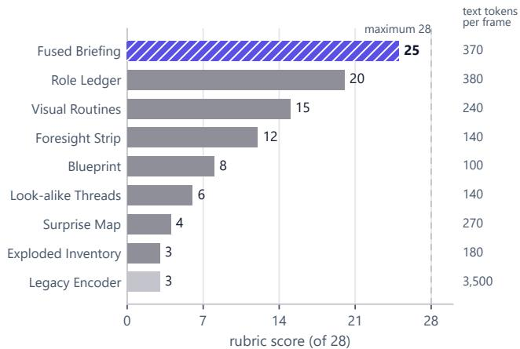  
Fi<sub>g</sub>ure 7 | Perce<sub>p</sub>tion Lab rubric score versus token cost. Th<sub>e</sub> F<sub>use</sub>d B<sub>r</sub>i<sub>e</sub>fi<sub>ng es</sub>t<sub>a</sub>bli<sub>s</sub>h<sub>es an emp</sub>i<sub>r</sub>i<sub>ca</sub>l P<sub>are</sub>t<sub>o</sub> f<sub>ron</sub>ti<sub>er,</sub> <sub>scor</sub>i<sub>ng</sub> 25/28 <sub>aga</sub>i<sub>ns</sub>t 3/28 f<sub>or</sub> th<sub>e</sub> L<sub>egacy</sub> E<sub>nco</sub>d<sub>er w</sub>hil<sub>e</sub> <sub>re</sub>d<sub>uc</sub>i<sub>ng promp</sub>t t<sub>o</sub>k<sub>ens</sub> b<sub>y near</sub>l<sub>y an or</sub>d<sub>er o</sub>f <sub>magn</sub>it<sub>u</sub>d<sub>e.</sub>

89.4% (to 370 tokens) while increasin<sub>g</sub> <sub>p</sub>refix-cache ca<sub>p</sub>acit<sub>y</sub> by 9.5×.

Cr<sub>oss</sub>-di<sub>s</sub>trib<sub>u</sub>ti<sub>o</sub>n <sub>va</sub>lid<sub>a</sub>ti<sub>o</sub>n <sub>ac</sub>r<sub>oss</sub> 23 h<sub>e</sub>ld-<sub>ou</sub>t <sub>ga</sub>m<sub>es.</sub> R<sub>u</sub>b<sub>r</sub>i<sub>c</sub> <sub>scor</sub>i<sub>ng</sub> <sub>on</sub> th<sub>e</sub> t<sub>wo</sub> d<sub>eve</sub>l<sub>opmen</sub>t f<sub>rames</sub> <sub>was</sub> <sub>con-</sub> d<sub>uc</sub>t<sub>e</sub>d <sub>non-</sub>bli<sub>n</sub>d <sub>aga</sub>i<sub>ns</sub>t <sub>a pre-reg</sub>i<sub>s</sub>t<sub>ere</sub>d <sub>answer</sub> k<sub>ey—ou</sub>t<sub>-</sub> <sub>o</sub>f<sub>-</sub>di<sub>s</sub>t<sub>r</sub>ib<sub>u</sub>ti<sub>on genera</sub>li<sub>za</sub>ti<sub>on</sub> i<sub>s</sub> th<sub>ere</sub>f<sub>ore ver</sub>ifi<sub>e</sub>d <sub>program-</sub> <sub>ma</sub>ti<sub>ca</sub>ll<sub>y across</sub> th<sub>e</sub> 23 h<sub>e</sub>ld<sub>-ou</sub>t <sub>games</sub> i<sub>n</sub> T<sub>a</sub>bl<sub>e</sub> 4<sub>.</sub> G<sub>roun</sub>d<sub>-</sub> t<sub>ru</sub>th <sub>ver</sub>ifi<sub>ca</sub>ti<sub>on was execu</sub>t<sub>e</sub>d <sub>programma</sub>ti<sub>ca</sub>ll<sub>y aga</sub>i<sub>ns</sub>t th<sub>e</sub> <sub>o</sub>fi<sub>c</sub>i<sub>a</sub>l <sub>game eng</sub>i<sub>ne w</sub>ith<sub>ou</sub>t <sub>manua</sub>l i<sub>n</sub>t<sub>erven</sub>ti<sub>on.</sub> A<sub>s re-</sub> <sub>por</sub>t<sub>e</sub>d i<sub>n</sub> T<sub>a</sub>bl<sub>e</sub> 4<sub>,</sub> d<sub>e</sub>t<sub>erm</sub>i<sub>n</sub>i<sub>s</sub>ti<sub>c coor</sub>di<sub>na</sub>t<sub>e recons</sub>t<sub>ruc</sub>ti<sub>on</sub> achieved 100% cell accuracy across all 23 games (23/23). Furthermore, com<sub>p</sub>uted <sub>g</sub>eometric invariants (4-connected <sub>segmen</sub>t<sub>a</sub>ti<sub>on,</sub> b<sub>oun</sub>di<sub>ng</sub> <sub>enc</sub>l<sub>osures,</sub> <sub>an</sub>d dih<sub>e</sub>d<sub>ra</sub>l <sub>symme-</sub> tries) <sub>p</sub>roved unconditionall<sub>y</sub> invariant across novel la<sub>y</sub>outs.

I<sub>n</sub> <sub>s</sub>t<sub>ar</sub>k <sub>con</sub>t<sub>ras</sub>t<sub>,</sub> <sub>s</sub>i<sub>ng</sub>l<sub>e-</sub>f<sub>rame</sub> <sub>opera</sub>ti<sub>ona</sub>l <sub>guesses</sub> <sub>gener-</sub> <sub>a</sub>li<sub>ze</sub>d <sub>poor</sub>l<sub>y ou</sub>t <sub>o</sub>f di<sub>s</sub>t<sub>r</sub>ib<sub>u</sub>ti<sub>on.</sub> C<sub>an</sub>did<sub>a</sub>t<sub>e agen</sub>t id<sub>en</sub>tifi<sub>ca-</sub> ti<sub>ons</sub> <sub>were</sub> <sub>accura</sub>t<sub>e</sub> <sub>on</sub> <sub>on</sub>l<sub>y</sub> 6 <sub>o</sub>f 14 k<sub>ey</sub>b<sub>oar</sub>d <sub>env</sub>i<sub>ronmen</sub>t<sub>s,</sub> <sub>moves-</sub>l<sub>e</sub>ft <sub>gauge</sub> h<sub>eur</sub>i<sub>s</sub>ti<sub>cs</sub> <sub>succee</sub>d<sub>e</sub>d <sub>on</sub> 10 <sub>o</sub>f 20 <sub>games,</sub> <sub>an</sub>d <sub>c</sub>li<sub>c</sub>k<sub>-a</sub>f<sub>or</sub>d<sub>ance pre</sub>di<sub>c</sub>ti<sub>ons</sub> h<sub>e</sub>ld <sub>on on</sub>l<sub>y</sub> 7 <sub>o</sub>f 29 <sub>can</sub>di<sub>-</sub> date handles. Forward <sub>p</sub>redictive simulation (X5) succeeded <sub>on on</sub>l<sub>y a s</sub>i<sub>ng</sub>l<sub>e game ou</sub>t <sub>o</sub>f 16<sub>.</sub> Th<sub>ese emp</sub>i<sub>r</sub>i<sub>ca</sub>l fi<sub>n</sub>di<sub>ngs</sub> <sub>su</sub>b<sub>s</sub>t<sub>an</sub>ti<sub>a</sub>t<sub>e</sub> th<sub>e</sub> M<sub>easu</sub>r<sub>e</sub>d<sub>–</sub>G<sub>uesse</sub>d R<sub>u</sub>l<sub>e: ma</sub>th<sub>ema</sub>ti<sub>ca</sub>l i<sub>n-</sub> <sub>var</sub>i<sub>an</sub>t<sub>s</sub> h<sub>o</sub>ld <sub>uncon</sub>diti<sub>ona</sub>ll<sub>y</sub> b<sub>y cons</sub>t<sub>ruc</sub>ti<sub>on an</sub>d <sub>s</sub>h<sub>ou</sub>ld b<sub>e</sub> <sub>asser</sub>t<sub>e</sub>d <sub>as groun</sub>d t<sub>ru</sub>th<sub>, w</sub>h<sub>ereas</sub> l<sub>a</sub>t<sub>en</sub>t <sub>opera</sub>ti<sub>ona</sub>l <sub>a</sub>f<sub>or-</sub> d<sub>ances canno</sub>t b<sub>e re</sub>li<sub>a</sub>bl<sub>y</sub> d<sub>e</sub>d<sub>uce</sub>d f<sub>rom s</sub>t<sub>a</sub>ti<sub>c v</sub>i<sub>sua</sub>l f<sub>rames</sub> <sub>an</sub>d <sub>mus</sub>t b<sub>e</sub> f<sub>rame</sub>d <sub>as prov</sub>i<sub>s</sub>i<sub>ona</sub>l h<sub>ypo</sub>th<sub>eses pa</sub>i<sub>re</sub>d <sub>w</sub>ith <sub>un</sub>it<sub>-ac</sub>ti<sub>on ver</sub>ifi<sub>ca</sub>ti<sub>on pro</sub>b<sub>es.</sub>

<table><tr><td>Check on 23 Held-Out Official Games</td><td>Empirical Generalization</td></tr><tr><td>Screenshot to grid, exact cells Agent identity (X7), keyboard</td><td>23/23 games (100%) 6/14 games (43%)</td></tr><tr><td>games</td><td></td></tr><tr><td>Moves-left gauge found (X7) Click handles that respond (X7)</td><td>10/20 games (50%) 7/29 handles (24%)</td></tr><tr><td>Keyboard foresight fully right (X5)</td><td>1/16 games (6%)</td></tr></table>

Table 4 | Em<sub>p</sub>irical validation of the Measured–Guessed R<sub>u</sub>l<sub>e ac</sub>r<sub>oss</sub> 23 h<sub>e</sub>ld<sub>-ou</sub>t <sub>e</sub>n<sub>v</sub>ir<sub>o</sub>nm<sub>e</sub>nt<sub>s.</sub> D<sub>e</sub>t<sub>erm</sub>i<sub>n</sub>i<sub>s</sub>ti<sub>c coor-</sub> di<sub>na</sub>t<sub>e recovery an</sub>d <sub>geome</sub>t<sub>r</sub>i<sub>c re</sub>l<sub>a</sub>ti<sub>ons genera</sub>li<sub>ze uncon</sub>di<sub>-</sub> tionally (100%), whereas latent afordance roles and predictive forward models from a sin<sub>g</sub>le frame achieve between 6% and 50% accuracy, confirming that operational afordances <sub>mus</sub>t b<sub>e</sub> f<sub>rame</sub>d <sub>as</sub> t<sub>es</sub>t<sub>a</sub>bl<sub>e</sub> h<sub>ypo</sub>th<sub>eses.</sub>

## 5<sub>.</sub>2 A<sub>c</sub>ti<sub>o</sub>n Efi<sub>c</sub>i<sub>e</sub>n<sub>cy a</sub>nd Err<sub>o</sub>r D<sub>eco</sub>m<sub>pos</sub>iti<sub>o</sub>n

S<sub>upe</sub>r<sub>-</sub>h<sub>u</sub>m<sub>a</sub>n <sub>ac</sub>ti<sub>o</sub>n <sub>e</sub>fi<sub>c</sub>i<sub>e</sub>n<sub>cy o</sub>n r<sub>eso</sub>l<sub>ve</sub>d <sub>e</sub>n<sub>v</sub>ir<sub>o</sub>nm<sub>e</sub>nt<sub>s.</sub> O<sub>n</sub> l<sub>eve</sub>l<sub>s w</sub>h<sub>ere</sub> th<sub>e agen</sub>t <sub>success</sub>f<sub>u</sub>ll<sub>y</sub> i<sub>n</sub>d<sub>uces env</sub>i<sub>ron-</sub> ment mechanics, Sarbloh executes trajectories with high <sub>e</sub>fi<sub>c</sub>i<sub>ency.</sub> W<sub>e repor</sub>t t<sub>wo</sub> f<sub>u</sub>ll <sub>pu</sub>bli<sub>c runs, name</sub>d b<sub>y</sub> th<sub>e</sub> confi<sub>g</sub>uration that se<sub>p</sub>arates them. In Run A (briefin<sub>g</sub> of: th<sub>e</sub> b<sub>r</sub>i<sub>e</sub>fi<sub>ng an</sub>d <sub>map were</sub> di<sub>sa</sub>bl<sub>e</sub>d<sub>, so</sub> th<sub>e run c</sub>h<sub>arac</sub>t<sub>er-</sub> izes the action interface, servin<sub>g</sub> loo<sub>p</sub>, and scheduler), the <sub>agen</sub>t <sub>c</sub>l<sub>eare</sub>d 143 <sub>o</sub>f 183 l<sub>eve</sub>l<sub>s across</sub> th<sub>e</sub> 25 <sub>pu</sub>bli<sub>c games</sub> i<sub>n</sub> 8<sub>.</sub>2 h<sub>ours, recor</sub>di<sub>ng a me</sub>di<sub>an ac</sub>ti<sub>on ra</sub>ti<sub>o o</sub>f 0<sub>.</sub>77 <sub>an</sub>d <sub>a</sub> <sub>s</sub>i<sub>ng</sub>l<sub>e-pass mean score o</sub>f 59<sub>.</sub>4%<sub>, w</sub>ith 66% <sub>o</sub>f <sub>c</sub>l<sub>eare</sub>d l<sub>eve</sub>l<sub>s</sub> matchin<sub>g</sub> or out<sub>p</sub>erformin<sub>g</sub> the human baseline (Fi<sub>g</sub>ure 8a). Thi<sub>s</sub> <sub>run</sub> <sub>prov</sub>id<sub>es</sub> th<sub>e</sub> b<sub>ase</sub>li<sub>ne</sub> f<sub>or</sub> <sub>our</sub> <sub>score</sub> d<sub>ecompos</sub>iti<sub>on</sub> (Fi<sub>g</sub>ure 8b, 40.6 total <sub>p</sub>oints lost from a <sub>p</sub>erfect 100). Under th<sub>e</sub> RHAE <sub>me</sub>t<sub>r</sub>i<sub>c,</sub> 62% <sub>o</sub>f <sub>comp</sub>l<sub>e</sub>t<sub>e</sub>d l<sub>eve</sub>l<sub>s earne</sub>d th<sub>e max</sub>i<sub>-</sub> mal score ca<sub>p</sub> of115%. In Run B (briefin<sub>g</sub> on: the briefin<sub>g</sub> and ma<sub>p</sub> enabled, Table 8), the a<sub>g</sub>ent recorded a median action <sub>ra</sub>ti<sub>o</sub> <sub>o</sub>f 0<sub>.</sub>68 <sub>on</sub> <sub>c</sub>l<sub>eare</sub>d l<sub>eve</sub>l<sub>s</sub> <sub>an</sub>d <sub>a</sub> <sub>s</sub>i<sub>ng</sub>l<sub>e-pass</sub> <sub>mean</sub> <sub>score</sub> <sub>o</sub>f 63<sub>.</sub>5%<sub>.</sub> B<sub>y syn</sub>th<sub>es</sub>i<sub>z</sub>i<sub>ng comp</sub>l<sub>e</sub>t<sub>e a</sub>l<sub>gor</sub>ith<sub>m</sub>i<sub>c searc</sub>h <sub>rou-</sub> tines in P<sub>y</sub>thon and committin<sub>g</sub> multi-ste<sub>p p</sub>aths via await play(), the a<sub>g</sub>ent avoids incremental trial-and-error once th<sub>e scene s</sub>t<sub>ruc</sub>t<sub>ure</sub> i<sub>s un</sub>d<sub>ers</sub>t<sub>oo</sub>d<sub>.</sub>

Perce<sub>p</sub>t<sub>u</sub>al misind<sub>u</sub>ction dominates the error b<sub>u</sub>d<sub>g</sub>et<sub>.</sub> W<sub>e</sub> d<sub>ecompose</sub>d th<sub>e</sub> 40<sub>.</sub>6 t<sub>o</sub>t<sub>a</sub>l <sub>po</sub>i<sub>n</sub>t<sub>s</sub> l<sub>os</sub>t f<sub>rom a per</sub>f<sub>ec</sub>t benchmark score usin<sub>g</sub> oficial RHAE wei<sub>g</sub>htin<sub>g</sub> (Fi<sub>g</sub>ure 8b). U<sub>nreac</sub>h<sub>e</sub>d l<sub>eve</sub>l<sub>s</sub> <sub>resu</sub>lti<sub>ng</sub> f<sub>rom</sub> <sub>ear</sub>li<sub>er</sub> <sub>s</sub>t<sub>a</sub>ll<sub>s</sub> <sub>accoun</sub>t<sub>e</sub>d f<sub>or</sub> 20<sub>.</sub>1 l<sub>os</sub>t <sub>po</sub>i<sub>n</sub>t<sub>s,</sub> i<sub>n</sub>iti<sub>a</sub>l <sub>unc</sub>l<sub>eare</sub>d l<sub>eve</sub>l<sub>s con</sub>t<sub>r</sub>ib<sub>u</sub>t<sub>e</sub>d 9<sub>.</sub>2 <sub>po</sub>i<sub>n</sub>t<sub>s, an</sub>d <sub>su</sub>b<sub>-op</sub>ti<sub>ma</sub>l <sub>ac</sub>ti<sub>on over</sub>h<sub>ea</sub>d <sub>on c</sub>l<sub>eare</sub>d l<sub>eve</sub>l<sub>s</sub> <sub>represen</sub>t<sub>e</sub>d <sub>on</sub>l<sub>y</sub> 11<sub>.</sub>3 <sub>po</sub>i<sub>n</sub>t<sub>s.</sub> C<sub>onsequen</sub>tl<sub>y,</sub> 72% <sub>o</sub>f <sub>a</sub>ll l<sub>os</sub>t <sub>p</sub>oints (29.3 of 40.6) occurred on environments the a<sub>g</sub>ent f<sub>a</sub>il<sub>e</sub>d t<sub>o reso</sub>l<sub>ve.</sub> T<sub>race au</sub>t<sub>ops</sub>i<sub>es on</sub> th<sub>ese s</sub>t<sub>a</sub>ll<sub>e</sub>d <sub>env</sub>i<sub>ron-</sub> <sub>men</sub>t<sub>s revea</sub>l th<sub>a</sub>t f<sub>a</sub>il<sub>ure was</sub> d<sub>r</sub>i<sub>ven</sub> b<sub>y percep</sub>t<sub>ua</sub>l <sub>m</sub>i<sub>s</sub>i<sub>n</sub>d<sub>uc-</sub> ti<sub>on</sub> <sub>ra</sub>th<sub>er</sub> th<sub>an</sub> <sub>p</sub>l<sub>ann</sub>i<sub>ng</sub> d<sub>ep</sub>th<sub>.</sub> O<sub>n</sub> <sub>s</sub>t<sub>a</sub>ll<sub>e</sub>d l<sub>eve</sub>l<sub>s,</sub> th<sub>e</sub> <sub>agen</sub>t reformulated its stated <sub>g</sub>oal a median of 8 times (com<sub>p</sub>ared to once on cleared levels) and formulated incorrect inductive beliefs, such as declarin<sub>g</sub> vc33 unsolvable after 739 actions b<sub>e</sub>f<sub>ore squan</sub>d<sub>er</sub>i<sub>ng</sub> 1<sub>,</sub>240 f<sub>ur</sub>th<sub>er moves.</sub> Mi<sub>sperce</sub>i<sub>v</sub>i<sub>ng</sub> l<sub>a-</sub> t<sub>en</sub>t <sub>ru</sub>l<sub>es</sub> bli<sub>n</sub>d<sub>s</sub> th<sub>e</sub> <sub>searc</sub>h <sub>space,</sub> <sub>re</sub>i<sub>n</sub>f<sub>orc</sub>i<sub>ng</sub> th<sub>a</sub>t <sub>percep</sub>t<sub>ua</sub>l <sub>groun</sub>di<sub>ng</sub> i<sub>s</sub> th<sub>e</sub> <sub>govern</sub>i<sub>ng</sub> <sub>opera</sub>ti<sub>ona</sub>l b<sub>o</sub>ttl<sub>enec</sub>k<sub>.</sub>

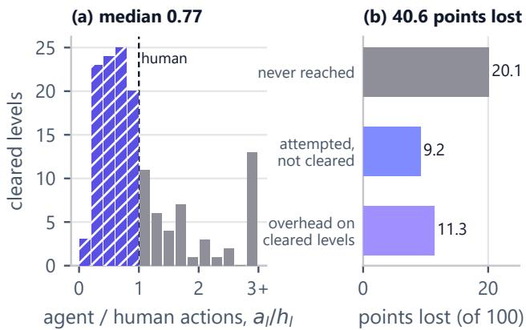  
Fi<sub>g</sub>ure 8 | Action eficienc<sub>y</sub> and score error bud<sub>g</sub>et. (a) Distribution of a<sub>g</sub>ent-to-human action ratios $( a _ { l } / h _ { l } )$ across 143 cleared levels (Run A, briefin<sub>g</sub> of), where h<sub>a</sub>t<sub>c</sub>h<sub>e</sub>d b<sub>ars</sub> i<sub>n</sub>di<sub>ca</sub>t<sub>e per</sub>f<sub>ormance surpass</sub>i<sub>ng</sub> h<sub>uman</sub> b<sub>ase-</sub> lines. (b) Decom<sub>p</sub>osition of the 40.6 total <sub>p</sub>oints lost from a <sub>per</sub>f<sub>ec</sub>t <sub>score,</sub> ill<sub>us</sub>t<sub>ra</sub>ti<sub>ng</sub> th<sub>a</sub>t 72% <sub>o</sub>f l<sub>os</sub>t <sub>cre</sub>dit <sub>s</sub>t<sub>ems</sub> f<sub>rom</sub> <sub>unc</sub>l<sub>eare</sub>d l<sub>eve</sub>l<sub>s s</sub>t<sub>a</sub>ll<sub>e</sub>d b<sub>y percep</sub>t<sub>ua</sub>l <sub>m</sub>i<sub>s</sub>i<sub>n</sub>d<sub>uc</sub>ti<sub>on ra</sub>th<sub>er</sub> th<sub>an ac</sub>ti<sub>on over</sub>h<sub>ea</sub>d <sub>on reso</sub>l<sub>ve</sub>d l<sub>eve</sub>l<sub>s.</sub>

## 5.3 Benchmark Trajectory and Comparative E<sub>va</sub>l<sub>ua</sub>ti<sub>on</sub>

Oficial held-out Kaggle evaluation trajectory. Because th<sub>e o</sub>fi<sub>c</sub>i<sub>a</sub>l K<sub>agg</sub>l<sub>e</sub> b<sub>enc</sub>h<sub>mar</sub>k <sub>execu</sub>t<sub>es o</sub>fli<sub>ne on un</sub>di<sub>s-</sub> <sub>c</sub>l<sub>ose</sub>d <sub>env</sub>i<sub>ronmen</sub>t<sub>s,</sub> it <sub>prov</sub>id<sub>es an uncon</sub>t<sub>am</sub>i<sub>na</sub>t<sub>e</sub>d <sub>measure</sub> of out-of-distribution reasonin<sub>g</sub> (Fi<sub>g</sub>ure 9). Initial baselines <sub>a</sub>d<sub>ap</sub>ti<sub>ng</sub> P<sub>r</sub>i<sub>me</sub> A<sub>gen</sub>t <sub>w</sub>ith <sub>open we</sub>i<sub>g</sub>ht<sub>s score</sub>d b<sub>e</sub>t<sub>ween</sub> 0<sub>.</sub>00 <sub>a</sub>nd 0<sub>.</sub>27<sub>,</sub> r<sub>epea</sub>t<sub>e</sub>dl<sub>y</sub> <sub>execu</sub>tin<sub>g</sub> <sub>vo</sub>l<sub>u</sub>nt<sub>a</sub>r<sub>y</sub> r<sub>ese</sub>t<sub>s</sub> <sub>w</sub>ith<sub>ou</sub>t fi<sub>n</sub>di<sub>ng a goa</sub>l<sub>.</sub> S<sub>ys</sub>t<sub>ema</sub>ti<sub>c arc</sub>hit<sub>ec</sub>t<sub>ura</sub>l <sub>upgra</sub>d<sub>es a</sub>d<sub>vance</sub>d <sub>per</sub>f<sub>ormance</sub> t<sub>o</sub> 5<sub>.</sub>14 th<sub>roug</sub>h SGL<sub>ang</sub> <sub>specu</sub>l<sub>a</sub>ti<sub>ve</sub> d<sub>eco</sub>di<sub>ng,</sub> 5.65 via unified await play() <sub>p</sub>ro<sub>g</sub>rammatic execution, 6<sub>.</sub>06 th<sub>roug</sub>h d<sub>e</sub>t<sub>erm</sub>i<sub>n</sub>i<sub>s</sub>ti<sub>c con</sub>t<sub>ex</sub>t d<sub>ra</sub>i<sub>nage, an</sub>d 10<sub>.</sub>98 <sub>w</sub>ith <sub>pers</sub>i<sub>s</sub>t<sub>en</sub>t <sub>sym</sub>b<sub>o</sub>li<sub>c</sub> <sub>memory</sub> di<sub>c</sub>ti<sub>onar</sub>i<sub>es.</sub> I<sub>n</sub>t<sub>egra</sub>ti<sub>ng</sub> th<sub>e</sub> f<sub>u</sub>ll d<sub>e</sub>t<sub>erm</sub>i<sub>n</sub>i<sub>s</sub>ti<sub>c percep</sub>ti<sub>on eng</sub>i<sub>ne a</sub>l<sub>ongs</sub>id<sub>e re</sub>fi<sub>ne</sub>d d<sub>ra</sub>i<sub>nage</sub> <sub>es</sub>t<sub>a</sub>bli<sub>s</sub>h<sub>e</sub>d <sub>our pea</sub>k <sub>ver</sub>ifi<sub>e</sub>d <sub>score o</sub>f 16<sub>.</sub>53<sub>, represen</sub>ti<sub>ng a</sub> 13.7× eficiency improvement over the first Milestone winner.

H<sub>a</sub>rd<sub>wa</sub>r<sub>e-</sub>m<sub>a</sub>t<sub>c</sub>h<sub>e</sub>d <sub>co</sub>m<sub>pa</sub>r<sub>a</sub>ti<sub>ve</sub> b<sub>ase</sub>lin<sub>e.</sub> T<sub>o</sub> i<sub>so</sub>l<sub>a</sub>t<sub>e a</sub>l<sub>-</sub> <sub>gor</sub>ith<sub>m</sub>i<sub>c</sub> <sub>con</sub>t<sub>r</sub>ib<sub>u</sub>ti<sub>ons</sub> f<sub>rom</sub> <sub>compu</sub>t<sub>e</sub> <sub>resources,</sub> <sub>we</sub> <sub>eva</sub>l<sub>u-</sub> ated Sarbloh directl<sub>y</sub> a<sub>g</sub>ainst the first Milestone winner (the Duck harness (Tufa Labs 2026)) on identical Ka<sub>gg</sub>le hardware (one NVIDIA RTX PRO 6000) and identical Qwen3.8-

Fl<sub>as</sub>h<sub>-</sub>N<sub>ex</sub>t <sub>mo</sub>d<sub>e</sub>l <sub>we</sub>i<sub>g</sub>ht<sub>s.</sub> Whil<sub>e</sub> th<sub>e</sub> b<sub>ase</sub>li<sub>ne ran</sub> f<sub>our par-</sub> allel <sub>p</sub>asses <sub>p</sub>er <sub>g</sub>ame (100 concurrent streams), Sarbloh <sub>execu</sub>t<sub>e</sub>d <sub>a s</sub>i<sub>ng</sub>l<sub>e sc</sub>h<sub>e</sub>d<sub>u</sub>l<sub>e</sub>d <sub>pass across</sub> th<sub>e</sub> 25 <sub>pu</sub>bli<sub>c games.</sub> C<sub>ruc</sub>i<sub>a</sub>ll<sub>y,</sub> thi<sub>s</sub> i<sub>s</sub> R<sub>un</sub> A<sub>, w</sub>hi<sub>c</sub>h <sub>ran w</sub>ith th<sub>e</sub> b<sub>r</sub>i<sub>e</sub>fi<sub>ng an</sub>d <sub>map</sub> di<sub>sa</sub>bl<sub>e</sub>d <sub>an</sub>d <sub>c</sub>h<sub>arac</sub>t<sub>er</sub>i<sub>zes</sub> th<sub>e ac</sub>ti<sub>on</sub> i<sub>n</sub>t<sub>er</sub>f<sub>ace, serv</sub>i<sub>ng</sub> loo<sub>p</sub>, and scheduler (A<sub>pp</sub>endix C.4); in contrast, the oficial hidd<sub>en-se</sub>t <sub>score o</sub>f 16<sub>.</sub>53 <sub>was pro</sub>d<sub>uce</sub>d <sub>w</sub>ith th<sub>e</sub> f<sub>u</sub>ll <sub>per-</sub> ce<sub>p</sub>tion en<sub>g</sub>ine active (Fi<sub>g</sub>ure 9). As shown in Fi<sub>g</sub>ure 10, S<sub>arbloh cons</sub>i<sub>s</sub>t<sub>en</sub>tl<sub>y acce</sub>l<sub>era</sub>t<sub>e</sub>d di<sub>scovery, c</sub>l<sub>ear</sub>i<sub>ng</sub> 73 l<sub>ev-</sub> <sub>e</sub>l<sub>s versus</sub> 54 <sub>a</sub>t <sub>one</sub> h<sub>our,</sub> 97 <sub>versus</sub> 63 <sub>a</sub>t t<sub>wo</sub> h<sub>ours, an</sub>d fi<sub>n</sub>i<sub>s</sub>hi<sub>ng a</sub>t 143 <sub>o</sub>f 183 l<sub>eve</sub>l<sub>s</sub> i<sub>n</sub> 8<sub>.</sub>2 h<sub>ours versus</sub> 129 di<sub>s</sub>ti<sub>nc</sub>t l<sub>eve</sub>l<sub>s</sub> f<sub>or</sub> th<sub>e</sub> b<sub>ase</sub>li<sub>ne.</sub> Thi<sub>s e</sub>fi<sub>c</sub>i<sub>ency s</sub>t<sub>ems</sub> f<sub>rom our pr</sub>i<sub>or</sub>it<sub>y</sub> <sub>sc</sub>h<sub>e</sub>d<sub>u</sub>l<sub>er</sub> <sub>concen</sub>t<sub>ra</sub>ti<sub>ng</sub> <sub>compu</sub>t<sub>e</sub> <sub>on</sub> <sub>game</sub> <sub>s</sub>t<sub>a</sub>t<sub>es</sub> <sub>w</sub>ith hi<sub>g</sub>h <sub>marg</sub>i<sub>na</sub>l <sub>progress</sub> <sub>po</sub>t<sub>en</sub>ti<sub>a</sub>l <sub>ra</sub>th<sub>er</sub> th<sub>an</sub> <sub>par</sub>titi<sub>on</sub>i<sub>ng</sub> <sub>resources</sub> <sub>un</sub>if<sub>orm</sub>l<sub>y.</sub>

Evaluation re<sub>g</sub>ime as<sub>y</sub>mmetr<sub>y</sub> and score contextualizati<sub>on.</sub> A <sub>cr</sub>iti<sub>ca</sub>l di<sub>s</sub>ti<sub>nc</sub>ti<sub>on governs</sub> th<sub>e compar</sub>i<sub>son</sub> b<sub>e-</sub> t<sub>ween o</sub>fli<sub>ne compe</sub>titi<sub>on su</sub>b<sub>m</sub>i<sub>ss</sub>i<sub>ons an</sub>d f<sub>ron</sub>ti<sub>er</sub> API b<sub>enc</sub>h<sub>mar</sub>k<sub>s.</sub> S<sub>ys</sub>t<sub>ems repor</sub>ti<sub>ng near-ce</sub>ili<sub>ng scores on pu</sub>b<sub>-</sub> lic <sub>g</sub>ames (Prime A<sub>g</sub>ent, AVO, Arc<sub>g</sub>entica) o<sub>p</sub>erate across <sub>commerc</sub>i<sub>a</sub>l API <sub>en</sub>d<sub>po</sub>i<sub>n</sub>t<sub>s w</sub>ith <sub>un</sub>b<sub>oun</sub>d<sub>e</sub>d <sub>wa</sub>ll<sub>-c</sub>l<sub>oc</sub>k ti<sub>me,</sub> <sub>unres</sub>t<sub>r</sub>i<sub>c</sub>t<sub>e</sub>d i<sub>n</sub>t<sub>erne</sub>t <sub>access,</sub> <sub>an</sub>d <sub>propr</sub>i<sub>e</sub>t<sub>ary</sub> <sub>c</sub>l<sub>ose</sub>d<sub>-we</sub>i<sub>g</sub>ht b<sub>ac</sub>kb<sub>ones suc</sub>h <sub>as</sub> Cl<sub>au</sub>d<sub>e</sub> O<sub>pus</sub> 5 <sub>an</sub>d GPT<sub>-</sub>5<sub>.</sub>6 S<sub>o</sub>l<sub>.</sub> F<sub>ur-</sub> th<sub>ermore,</sub> th<sub>ese eva</sub>l<sub>ua</sub>ti<sub>ons execu</sub>t<sub>e on</sub> di<sub>sc</sub>l<sub>ose</sub>d<sub>, pu</sub>bli<sub>c</sub>l<sub>y</sub> <sub>access</sub>ibl<sub>e env</sub>i<sub>ronmen</sub>t<sub>s w</sub>h<sub>ere promp</sub>t t<sub>emp</sub>l<sub>a</sub>t<sub>es an</sub>d h<sub>eur</sub>i<sub>s-</sub> ti<sub>c searc</sub>h b<sub>u</sub>d<sub>ge</sub>t<sub>s can</sub> b<sub>e manua</sub>ll<sub>y a</sub>d<sub>ap</sub>t<sub>e</sub>d <sub>w</sub>ith<sub>ou</sub>t <sub>ver</sub>ifi<sub>-</sub> <sub>a</sub>bl<sub>e su</sub>b<sub>m</sub>i<sub>ss</sub>i<sub>on cons</sub>t<sub>ra</sub>i<sub>n</sub>t<sub>s.</sub> I<sub>n con</sub>t<sub>ras</sub>t<sub>,</sub> S<sub>arbloh opera</sub>t<sub>es</sub> <sub>w</sub>ithi<sub>n</sub> th<sub>e o</sub>fi<sub>c</sub>i<sub>a</sub>l <sub>compe</sub>titi<sub>on env</sub>i<sub>ronmen</sub>t<sub>, w</sub>h<sub>ere an</sub> i<sub>m-</sub> <sub>mu</sub>t<sub>a</sub>bl<sub>e</sub> D<sub>oc</sub>k<sub>er con</sub>t<sub>a</sub>i<sub>ner execu</sub>t<sub>es on a s</sub>i<sub>ng</sub>l<sub>e o</sub>fli<sub>ne</sub> GPU <sub>w</sub>ith<sub>ou</sub>t <sub>ex</sub>t<sub>erna</sub>l <sub>ne</sub>t<sub>wor</sub>k <sub>access, cons</sub>t<sub>ra</sub>i<sub>ne</sub>d b<sub>y a s</sub>t<sub>r</sub>i<sub>c</sub>t <sub>n</sub>i<sub>ne-</sub> h<sub>our wa</sub>ll<sub>-c</sub>l<sub>oc</sub>k <sub>ce</sub>ili<sub>ng across</sub> th<sub>e en</sub>ti<sub>re</sub> b<sub>enc</sub>h<sub>mar</sub>k <sub>su</sub>it<sub>e o</sub>f <sub>un</sub>di<sub>sc</sub>l<sub>ose</sub>d <sub>games.</sub> I<sub>n</sub> thi<sub>s</sub> h<sub>ar</sub>d<sub>ware-</sub>b<sub>oun</sub>d<sub>e</sub>d <sub>reg</sub>i<sub>me, w</sub>h<sub>ere</sub> <sub>every exp</sub>l<sub>ora</sub>t<sub>ory m</sub>i<sub>ss</sub>t<sub>ep</sub> i<sub>ncurs non-</sub>li<sub>near score</sub> d<sub>egra</sub>d<sub>a-</sub> ti<sub>on, ac</sub>hi<sub>ev</sub>i<sub>ng an o</sub>fi<sub>c</sub>i<sub>a</sub>l <sub>score o</sub>f 16<sub>.</sub>53 <sub>represen</sub>t<sub>s an un-</sub> <sub>prece</sub>d<sub>en</sub>t<sub>e</sub>d <sub>resu</sub>lt th<sub>a</sub>t <sub>surpasses</sub> th<sub>e</sub> fi<sub>rs</sub>t Mil<sub>es</sub>t<sub>one w</sub>i<sub>nner</sub> by 13.7×, establishing that structured core-knowledge per-<sub>cep</sub>ti<sub>on ena</sub>bl<sub>es open-we</sub>i<sub>g</sub>ht <sub>mo</sub>d<sub>e</sub>l<sub>s</sub> t<sub>o compe</sub>t<sub>e e</sub>f<sub>ec</sub>ti<sub>ve</sub>l<sub>y</sub> <sub>w</sub>ith<sub>ou</sub>t <sub>requ</sub>i<sub>r</sub>i<sub>ng uncons</sub>t<sub>ra</sub>i<sub>ne</sub>d <sub>c</sub>l<sub>ou</sub>d <sub>resources.</sub>

C<sub>o</sub>m<sub>pa</sub>ri<sub>so</sub>n <sub>w</sub>ith fr<sub>o</sub>nti<sub>e</sub>r m<sub>o</sub>d<sub>e</sub>l b<sub>ase</sub>lin<sub>es a</sub>nd <sub>sys</sub>t<sub>e</sub>m<sub>s</sub> t<sub>e</sub>l<sub>e</sub>m<sub>e</sub>tr<sub>y.</sub> O<sub>n u</sub>bli<sub>c env</sub>i<sub>ronmen</sub>t<sub>s,</sub> S<sub>arbloh ac</sub>hi<sub>eves an</sub> <sub>aggrega</sub>t<sub>e mean score o</sub>f 72<sub>.</sub>5 <sub>across eva</sub>l<sub>ua</sub>ti<sub>on</sub> t<sub>r</sub>i<sub>a</sub>l<sub>s, ou</sub>t<sub>-</sub> <sub>per</sub>f<sub>orm</sub>i<sub>ng propr</sub>i<sub>e</sub>t<sub>ary</sub> f<sub>ron</sub>ti<sub>er mo</sub>d<sub>e</sub>l<sub>s eva</sub>l<sub>ua</sub>t<sub>e</sub>d <sub>v</sub>i<sub>a uncon-</sub> <sub>s</sub>t<sub>ra</sub>i<sub>ne</sub>d API<sub>s on</sub> 21 <sub>o</sub>f 25 <sub>games an</sub>d <sub>ac</sub>hi<sub>ev</sub>i<sub>ng</sub> 100% <sub>reso-</sub> lution on 13 <sub>g</sub>ames (Fi<sub>g</sub>ure 1). Under a sin<sub>g</sub>le-<sub>p</sub>ass re<sub>g</sub>ime, S<sub>arbloh recor</sub>d<sub>e</sub>d <sub>a mean score o</sub>f 59<sub>.</sub>4 i<sub>n</sub> R<sub>un</sub> A<sub>,</sub> b<sub>r</sub>i<sub>e</sub>f<sub>-</sub> in<sub>g</sub> of (Table 7), and 63.5 in Run B, briefin<sub>g</sub> on (Table 8), each exceedin<sub>g</sub> the stron<sub>g</sub>est frontier baseline (GPT-6.1 Sol at 54.8). In terms of runtime telemetr<sub>y</sub> on the sin<sub>g</sub>le Ka<sub>gg</sub>le RTX PRO 6000 GPU<sub>,</sub> th<sub>e appe</sub>nd<sub>-o</sub>nl<sub>y co</sub>nt<sub>ex</sub>t <sub>p</sub>r<sub>ese</sub>r<sub>ve</sub>d <sub>a</sub> 98<sub>.</sub>4% <sub>p</sub>r<sub>o</sub>m<sub>p</sub>t <sub>p</sub>r<sub>e</sub>fi<sub>x-cac</sub>h<sub>e</sub> hit r<sub>a</sub>t<sub>e ac</sub>r<sub>oss</sub> 1<sub>.</sub>78 B t<sub>o</sub>t<sub>a</sub>l <sub>promp</sub>t t<sub>o</sub>k<sub>ens, ensur</sub>i<sub>ng</sub> th<sub>a</sub>t <sub>pre</sub>fill <sub>consume</sub>d <sub>on</sub>l<sub>y</sub> 1<sub>.</sub>3% <sub>o</sub>f b<sub>usy execu</sub>ti<sub>on</sub> ti<sub>me compare</sub>d t<sub>o</sub> 50<sub>.</sub>1% f<sub>or</sub> d<sub>eco</sub>d<sub>e gener-</sub> <sub>a</sub>ti<sub>on.</sub> A<sub>cross</sub> 21<sub>,</sub>224 <sub>mo</sub>d<sub>e</sub>l <sub>ca</sub>ll<sub>s,</sub> th<sub>e run</sub>ti<sub>me su</sub>f<sub>ere</sub>d <sub>zero</sub> server failures (Table 7). The com<sub>p</sub>arison of this briefin<sub>g</sub>- <sub>o</sub>f <sub>run</sub> <sub>w</sub>ith th<sub>e</sub> <sub>neares</sub>t b<sub>r</sub>i<sub>e</sub>fi<sub>ng-on</sub> <sub>run</sub> i<sub>s</sub> i<sub>n</sub> A<sub>ppen</sub>di<sub>x</sub> C<sub>.</sub>4 (Table 8). Runtime failure modes and ablated desi<sub>g</sub>ns are d<sub>e</sub>t<sub>a</sub>il<sub>e</sub>d i<sub>n</sub> A<sub>ppen</sub>di<sub>x</sub> C<sub>.</sub>

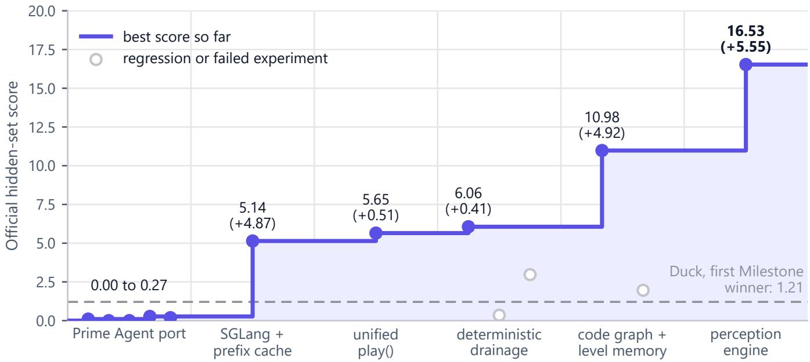  
Fi ure 9 | Evaluation trajector across com leted submissions on the oficial held-out Ka le benchmark. Submissions <sub>are</sub> <sub>or</sub>d<sub>ere</sub>d b<sub>y</sub> i<sub>n</sub>t<sub>erven</sub>ti<sub>on,</sub> <sub>no</sub>t b<sub>y</sub> d<sub>a</sub>t<sub>e:</sub> <sub>eac</sub>h <sub>s</sub>it<sub>s</sub> i<sub>n</sub> th<sub>e</sub> <sub>s</sub>t<sub>age</sub> <sub>o</sub>f th<sub>e</sub> l<sub>as</sub>t i<sub>n</sub>t<sub>erven</sub>ti<sub>on</sub> it <sub>carr</sub>i<sub>e</sub>d<sub>,</sub> <sub>an</sub>d <sub>every</sub> <sub>s</sub>t<sub>age</sub> h<sub>as</sub> th<sub>e</sub> <sub>same</sub> <sub>w</sub>idth<sub>.</sub> Th<sub>e so</sub>lid <sub>curve</sub> t<sub>rac</sub>k<sub>s</sub> th<sub>e</sub> b<sub>es</sub>t <sub>score so</sub> f<sub>ar,</sub> h<sub>o</sub>ll<sub>ow mar</sub>k<sub>ers</sub> i<sub>n</sub>di<sub>ca</sub>t<sub>e regress</sub>i<sub>ons an</sub>d f<sub>a</sub>il<sub>e</sub>d <sub>exper</sub>i<sub>men</sub>t<sub>s, an</sub>d <sub>eac</sub>h l<sub>a</sub>b<sub>e</sub>l <sub>g</sub>i<sub>ves</sub> th<sub>e s</sub>t<sub>age</sub>’<sub>s</sub> b<sub>es</sub>t <sub>score an</sub>d it<sub>s ga</sub>i<sub>n over</sub> th<sub>e s</sub>t<sub>ages</sub> b<sub>e</sub>f<sub>ore</sub> it<sub>.</sub> Th<sub>e</sub> l<sub>as</sub>t <sub>s</sub>t<sub>age</sub>’<sub>s su</sub>b<sub>m</sub>i<sub>ss</sub>i<sub>on a</sub>l<sub>so c</sub>h<sub>ange</sub>d th<sub>e</sub> l<sub>eve</sub>l <sub>memory</sub> and the context drain (Section 5.3). The oficial hidden-set score (16.53, <sub>p</sub>roduced with the full <sub>p</sub>erce<sub>p</sub>tion en<sub>g</sub>ine active) is <sub>eva</sub>l<sub>ua</sub>t<sub>e</sub>d <sub>on</sub> th<sub>e compe</sub>titi<sub>on-w</sub>id<sub>e</sub> RHAE <sub>me</sub>t<sub>r</sub>i<sub>c across un</sub>di<sub>sc</sub>l<sub>ose</sub>d <sub>games, w</sub>h<sub>ereas</sub> Fi<sub>gure</sub> 1 <sub>repor</sub>t<sub>s per-game ac</sub>ti<sub>on e</sub>fi<sub>c</sub>i<sub>ency</sub> <sub>percen</sub>t<sub>ages on pu</sub>bli<sub>c env</sub>i<sub>ronmen</sub>t<sub>s.</sub>

## 6 R<sub>e</sub>l<sub>a</sub>t<sub>e</sub>d W<sub>or</sub>k

Perce<sub>p</sub>tual re<sub>p</sub>resentations in interactive ARC a<sub>g</sub>ents. P<sub>r</sub>i<sub>or</sub> ARC<sub>-</sub>AGI<sub>-</sub>3 <sub>arc</sub>hit<sub>ec</sub>t<sub>ures</sub> dif<sub>er across p</sub>l<sub>ann</sub>i<sub>ng s</sub>t<sub>ra</sub>t<sub>e-</sub> <sub>g</sub><sup>i</sup>es, context memor<sub>y</sub> mana<sub>g</sub>ement, an<sup>d</sup> externa<sup>l</sup> too<sup>li</sup>n<sub>g</sub>, <sub>y</sub>et th<sub>ey</sub> <sub>s</sub>h<sub>are</sub> <sub>a</sub> <sub>un</sub>if<sub>orm</sub> <sub>percep</sub>t<sub>ua</sub>l <sub>assump</sub>ti<sub>on:</sub> th<sub>e</sub> <sub>v</sub>i<sub>sua</sub>l <sub>gr</sub>id i<sub>s</sub> t<sub>ransm</sub>itt<sub>e</sub>d di<sub>rec</sub>tl<sub>y</sub> t<sub>o</sub> th<sub>e reason</sub>i<sub>ng mo</sub>d<sub>e</sub>l <sub>as raw un-</sub> <sub>parse</sub>d d<sub>a</sub>t<sub>a,</sub> d<sub>e</sub>l<sub>ega</sub>ti<sub>ng</sub> <sub>spa</sub>ti<sub>a</sub>l <sub>scene</sub> d<sub>ecompos</sub>iti<sub>on</sub> <sub>en</sub>ti<sub>re</sub>l<sub>y</sub> to neural inference (Table 1). S<sub>p</sub>ecificall<sub>y</sub>, the first Milestone winner (the Duck harness (Tufa Labs 2026; ARC Prize Foundation 2026b)) serializes the board as com<sub>p</sub>osite ASCII char-<sub>ac</sub>t<sub>er ma</sub>t<sub>r</sub>i<sub>ces a</sub>l<sub>ongs</sub>id<sub>e ren</sub>d<sub>ere</sub>d i<sub>mage</sub> f<sub>rames.</sub> Th<sub>e secon</sub>d<sub>-</sub> <sub>an</sub>d thi<sub>r</sub>d<sub>-p</sub>l<sub>ace</sub> K<sub>agg</sub>l<sub>e sys</sub>t<sub>ems pass anno</sub>t<sub>a</sub>t<sub>e</sub>d <sub>screens</sub>h<sub>o</sub>t<sub>s</sub> t<sub>o</sub> G<sub>e</sub>mm<sub>a-</sub>4<sub>-</sub>31B<sub>, p</sub>r<sub>o</sub>m<sub>p</sub>tin<sub>g</sub> th<sub>e v</sub>i<sub>s</sub>i<sub>o</sub>n m<sub>o</sub>d<sub>e</sub>l t<sub>o e</sub>mit JSON action sequences directl<sub>y</sub> (ARC Prize Foundation 2026b). In the frontier API re<sub>g</sub>ime, VISTA (Han et al. 2026) de<sub>p</sub>lo<sub>y</sub>s <sub>a mu</sub>lti<sub>mo</sub>d<sub>a</sub>l h<sub>arness w</sub>ith l<sub>oss</sub>l<sub>ess v</sub>i<sub>sua</sub>l f<sub>rame re</sub>t<sub>en</sub>ti<sub>on,</sub> while Arc<sub>g</sub>entica (Knutsen and Klein 2026) and Prime A<sub>g</sub>ent (Karten et al. 2026) ex<sub>p</sub>ose the environment within a <sub>p</sub>ersist<sub>en</sub>t P<sub>y</sub>th<sub>on</sub> REPL<sub>,</sub> l<sub>eav</sub>i<sub>ng</sub> th<sub>e</sub> l<sub>anguage mo</sub>d<sub>e</sub>l t<sub>o wr</sub>it<sub>e</sub> it<sub>s</sub> own <sub>p</sub>ars<sup>i</sup>n<sub>g</sub> scr<sup>i</sup><sub>p</sub>ts over raw coor<sup>di</sup>nate arra<sub>y</sub>s.

Core kno<sub>w</sub>led<sub>g</sub>e <sub>g</sub>ro<sub>u</sub>ndin<sub>g</sub> and <sub>g</sub>eometric in<sub>v</sub>ariants<sub>.</sub> A<sub>cross a</sub>ll <sub>ex</sub>i<sub>s</sub>ti<sub>ng sys</sub>t<sub>ems,</sub> th<sub>e agen</sub>t <sub>o</sub>b<sub>serves</sub> th<sub>e wor</sub>ld <sub>as</sub> <sub>an</sub> i<sub>n</sub>t<sub>eger</sub> <sub>ma</sub>t<sub>r</sub>i<sub>x,</sub> <sub>an</sub> ASCII <sub>s</sub>t<sub>r</sub>i<sub>ng,</sub> <sub>or</sub> <sub>an</sub> <sub>unanno</sub>t<sub>a</sub>t<sub>e</sub>d <sub>v</sub>i<sub>sua</sub>l <sub>ras</sub>t<sub>er.</sub> C<sub>onsequen</sub>tl<sub>y,</sub> f<sub>un</sub>d<sub>amen</sub>t<sub>a</sub>l <sub>spa</sub>ti<sub>a</sub>l <sub>pr</sub>i<sub>m</sub>iti<sub>ves,</sub> i<sub>nc</sub>l<sub>u</sub>d<sub>-</sub> i<sub>ng</sub> 4<sub>-connec</sub>t<sub>e</sub>d <sub>en</sub>tit<sub>y</sub> <sub>segmen</sub>t<sub>a</sub>ti<sub>on,</sub> t<sub>opo</sub>l<sub>og</sub>i<sub>ca</sub>l <sub>con</sub>t<sub>a</sub>i<sub>n-</sub> <sub>men</sub>t<sub>,</sub> l<sub>a</sub>tti<sub>ce-cons</sub>t<sub>ra</sub>i<sub>ne</sub>d <sub>reac</sub>h<sub>a</sub>bilit<sub>y, an</sub>d <sub>a</sub>fi<sub>ne symme</sub>t<sub>r</sub>i<sub>es,</sub> <sub>are</sub> l<sub>e</sub>ft t<sub>o</sub> b<sub>e recons</sub>t<sub>ruc</sub>t<sub>e</sub>d b<sub>y</sub> th<sub>e neura</sub>l b<sub>ac</sub>kb<sub>one</sub> f<sub>rom raw</sub> tokens. As our motivatin<sub>g</sub> ablations establish (Section 3), this <sub>unparse</sub>d <sub>represen</sub>t<sub>a</sub>ti<sub>on</sub> f<sub>orms</sub> th<sub>e pr</sub>i<sub>mary source o</sub>f <sub>ac</sub>ti<sub>on</sub> i<sub>ne</sub>fi<sub>c</sub>i<sub>ency an</sub>d h<sub>a</sub>ll<sub>uc</sub>i<sub>na</sub>ti<sub>on.</sub> I<sub>n con</sub>t<sub>ras</sub>t<sub>,</sub> S<sub>arbloh com-</sub> <sub>pu</sub>t<sub>es geome</sub>t<sub>r</sub>i<sub>c</sub> i<sub>nvar</sub>i<sub>an</sub>t<sub>s</sub> d<sub>e</sub>t<sub>erm</sub>i<sub>n</sub>i<sub>s</sub>ti<sub>ca</sub>ll<sub>y on</sub> th<sub>e</sub> h<sub>os</sub>t i<sub>n</sub> O(HW) time, maintains persistent bipartite entity tracking <sub>across</sub> t<sub>empora</sub>l <sub>s</sub>t<sub>eps, an</sub>d <sub>exp</sub>li<sub>c</sub>itl<sub>y</sub> d<sub>ecoup</sub>l<sub>es ma</sub>th<sub>ema</sub>ti<sub>ca</sub>l <sub>cer</sub>t<sub>a</sub>i<sub>n</sub>ti<sub>es</sub> f<sub>rom s</sub>i<sub>ng</sub>l<sub>e-ac</sub>ti<sub>on</sub> t<sub>es</sub>t<sub>a</sub>bl<sub>e a</sub>f<sub>or</sub>d<sub>ance</sub> h<sub>ypo</sub>th<sub>eses.</sub>

Autonomous code <sub>g</sub>eneration and <sub>p</sub>ro<sub>g</sub>rammatic execution. The CodeAct <sub>p</sub>aradi<sub>g</sub>m (Wan<sub>g</sub> et al. 2024) demon-<sub>s</sub>t<sub>ra</sub>t<sub>e</sub>d th<sub>a</sub>t <sub>express</sub>i<sub>ng agen</sub>t <sub>ac</sub>ti<sub>ons</sub> th<sub>roug</sub>h <sub>execu</sub>t<sub>a</sub>bl<sub>e pro-</sub> <sub>gramm</sub>i<sub>ng pr</sub>i<sub>m</sub>iti<sub>ves ou</sub>t<sub>per</sub>f<sub>orms spec</sub>i<sub>a</sub>li<sub>ze</sub>d JSON <sub>ac</sub>ti<sub>on</sub> schemas. Prime A<sub>g</sub>ent (Karten et al. 2026) ada<sub>p</sub>ted this to ARC<sub>-</sub>AGI<sub>-</sub>3 b<sub>y a</sub>ll<sub>ow</sub>i<sub>ng mo</sub>d<sub>e</sub>l<sub>s</sub> t<sub>o execu</sub>t<sub>e</sub> P<sub>y</sub>th<sub>on co</sub>d<sub>e</sub> <sub>w</sub>ithi<sub>n an</sub> i<sub>n</sub>t<sub>erac</sub>ti<sub>ve env</sub>i<sub>ronmen</sub>t<sub>.</sub> H<sub>owever, ear</sub>li<sub>er</sub> h<sub>ar-</sub> nesses decoupled model reasoning into disjoint tools for <sub>co</sub>d<sub>e s</sub>i<sub>mu</sub>l<sub>a</sub>ti<sub>on an</sub>d <sub>ac</sub>ti<sub>on execu</sub>ti<sub>on,</sub> f<sub>orc</sub>i<sub>ng expens</sub>i<sub>ve</sub> <sub>con</sub>t<sub>ex</sub>t<sub>-sw</sub>it<sub>c</sub>hi<sub>ng roun</sub>dt<sub>r</sub>i<sub>ps.</sub> S<sub>arbloh un</sub>ifi<sub>es</sub> th<sub>ese oper-</sub> ations within an as<sub>y</sub>nchronous execution contract (await play()), allowin<sub>g</sub> models to h<sub>yp</sub>othesize, simulate, and commit multi-step actuation trajectories within a single reason<sup>i</sup>n<sub>g</sub> turn.

## 7 Li<sub>m</sub>it<sub>a</sub>ti<sub>ons an</sub>d F<sub>u</sub>t<sub>ure</sub> W<sub>or</sub>k

Li<sub>m</sub>it<sub>a</sub>ti<sub>ons.</sub> S<sub>evera</sub>l <sub>arc</sub>hit<sub>ec</sub>t<sub>ura</sub>l li<sub>m</sub>it<sub>a</sub>ti<sub>ons</sub> <sub>rema</sub>i<sub>n.</sub> Fi<sub>rs</sub>t<sub>, w</sub>hil<sub>e a</sub>f<sub>or</sub>d<sub>ance</sub> h<sub>ypo</sub>th<sub>eses are coup</sub>l<sub>e</sub>d <sub>w</sub>ith <sub>un</sub>it f<sub>a</sub>l<sub>-</sub> <sub>s</sub>ifi<sub>ca</sub>ti<sub>on</sub> t<sub>es</sub>t<sub>s,</sub> th<sub>e</sub> <sub>curren</sub>t <sub>percep</sub>ti<sub>on</sub> <sub>eng</sub>i<sub>ne</sub> <sub>eva</sub>l<sub>ua</sub>t<sub>es</sub> h<sub>y-</sub> <sub>po</sub>th<sub>eses</sub> i<sub>n</sub>d<sub>epen</sub>d<sub>en</sub>tl<sub>y</sub> <sub>a</sub>t <sub>eac</sub>h f<sub>rame</sub> <sub>w</sub>ith<sub>ou</sub>t <sub>ma</sub>i<sub>n</sub>t<sub>a</sub>i<sub>n</sub>i<sub>ng</sub> <sub>a</sub> f<sub>u</sub>ll<sub>y</sub> <sub>un</sub>ifi<sub>e</sub>d B<sub>ayes</sub>i<sub>an</sub> b<sub>e</sub>li<sub>e</sub>f di<sub>s</sub>t<sub>r</sub>ib<sub>u</sub>ti<sub>on</sub> <sub>across</sub> <sub>mu</sub>lti<sub>-s</sub>t<sub>ep</sub> <sub>ep</sub>i<sub>so</sub>d<sub>es.</sub> S<sub>econ</sub>d<sub>, a</sub>lth<sub>oug</sub>h th<sub>e agen</sub>t <sub>p</sub>l<sub>ans w</sub>ith <sub>super-</sub>h<sub>uman</sub> <sub>e</sub>fi<sub>c</sub>i<sub>ency once a</sub> l<sub>eve</sub>l i<sub>s un</sub>d<sub>ers</sub>t<sub>oo</sub>d<sub>, an</sub>t<sub>ece</sub>d<sub>en</sub>t f<sub>a</sub>il<sub>ure on</sub> <sub>comp</sub>l<sub>ex percep</sub>t<sub>ua</sub>l t<sub>rans</sub>iti<sub>ons rema</sub>i<sub>ns</sub> th<sub>e pr</sub>i<sub>mary source</sub> <sub>o</sub>f <sub>score</sub> d<sub>egra</sub>d<sub>a</sub>ti<sub>on.</sub> Fi<sub>na</sub>ll<sub>y, our curren</sub>t <sub>resu</sub>lt<sub>s re</sub>l<sub>y on</sub> <sub>genera</sub>l<sub>-purpose open-we</sub>i<sub>g</sub>ht <sub>mo</sub>d<sub>e</sub>l<sub>s w</sub>ith<sub>ou</sub>t t<sub>as</sub>k<sub>-spec</sub>ifi<sub>c</sub> <sub>po</sub>li<sub>cy</sub> fi<sub>ne-</sub>t<sub>un</sub>i<sub>ng.</sub>

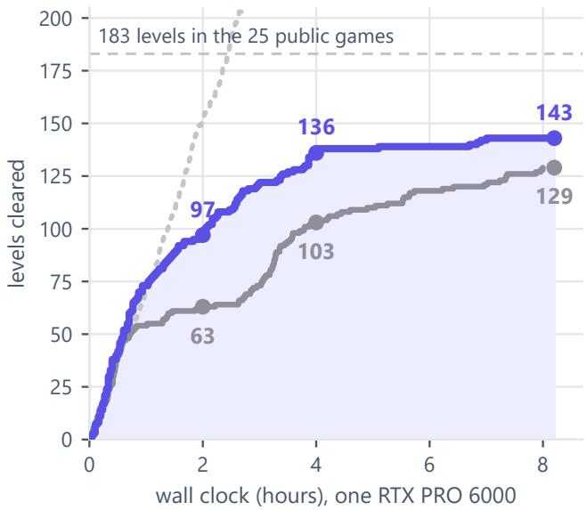  
Fi<sub>g</sub>ure 10 | Cleared levels over wall-clock execution time <sub>o</sub>n 25 <sub>pu</sub>bli<sub>c e</sub>n<sub>v</sub>ir<sub>o</sub>nm<sub>e</sub>nt<sub>s u</sub>nd<sub>e</sub>r id<sub>e</sub>nti<sub>ca</sub>l h<sub>a</sub>rd<sub>wa</sub>r<sub>e.</sub> I<sub>n-</sub> di<sub>g</sub>o: Sarbloh (sin<sub>g</sub>le <sub>p</sub>ass, Run A, briefin<sub>g</sub> of). Solid <sub>g</sub>re<sub>y</sub>: distinct levels cleared b<sub>y</sub> the first Milestone winner (Duck harness) across four <sub>p</sub>arallel <sub>p</sub>asses; dotted <sub>g</sub>re<sub>y</sub>: total levels <sub>summe</sub>d <sub>across passes.</sub> S<sub>arbloh c</sub>l<sub>ears</sub> 143 <sub>o</sub>f 183 l<sub>eve</sub>l<sub>s</sub> i<sub>n</sub> 8<sub>.</sub>2 h<sub>ours, surpass</sub>i<sub>ng</sub> th<sub>e</sub> b<sub>ase</sub>li<sub>ne</sub>’<sub>s</sub> 129 di<sub>s</sub>ti<sub>nc</sub>t l<sub>eve</sub>l<sub>s.</sub>

## F<sub>u</sub>t<sub>u</sub>r<sub>e</sub> <sub>wo</sub>rk<sub>.</sub> P<sub>rom</sub>i<sub>s</sub>i<sub>ng</sub> <sub>researc</sub>h <sub>avenues</sub> i<sub>nc</sub>l<sub>u</sub>d<sub>e:</sub>

1<sub>.</sub> Cl<sub>ose</sub>d<sub>-</sub>L<sub>oop</sub> B<sub>e</sub>li<sub>e</sub>f U<sub>p</sub>d<sub>a</sub>tin<sub>g:</sub> F<sub>ormu</sub>l<sub>a</sub>ti<sub>ng</sub> <sub>a</sub>f<sub>or</sub>d<sub>ance</sub> i<sub>n</sub>d<sub>uc</sub>ti<sub>on as a</sub> d<sub>ynam</sub>i<sub>c par</sub>ti<sub>a</sub>ll<sub>y o</sub>b<sub>serva</sub>bl<sub>e</sub> b<sub>e</sub>li<sub>e</sub>f <sub>s</sub>t<sub>a</sub>t<sub>e,</sub> <sub>w</sub>h<sub>ere</sub> th<sub>e emp</sub>i<sub>r</sub>i<sub>ca</sub>l <sub>ou</sub>t<sub>comes o</sub>f <sub>un</sub>it f<sub>a</sub>l<sub>s</sub>ifi<sub>ca</sub>ti<sub>on pro</sub>b<sub>es</sub> <sub>exp</sub>li<sub>c</sub>itl<sub>y up</sub>d<sub>a</sub>t<sub>e pr</sub>i<sub>or</sub> b<sub>e</sub>li<sub>e</sub>f <sub>we</sub>i<sub>g</sub>ht<sub>s across compos</sub>i<sub>-</sub> ti<sub>ona</sub>l l<sub>eve</sub>l<sub>s.</sub>

2. Ofline Trajectory Fine-Tuning: Applying parametereficient fine-tunin<sub>g</sub> (LoRA (Hu et al. 2021)) directl<sub>y</sub> on our database of verified, high-eficiency execution traject<sub>or</sub>i<sub>es,</sub> <sub>op</sub>ti<sub>m</sub>i<sub>z</sub>i<sub>ng</sub> <sub>syn</sub>t<sub>ac</sub>ti<sub>c</sub> <sub>co</sub>d<sub>e</sub> <sub>genera</sub>ti<sub>on</sub> <sub>an</sub>d <sub>wor</sub>ld <sub>mo</sub>d<sub>e</sub>l <sub>syn</sub>th<sub>es</sub>i<sub>s.</sub>

3<sub>.</sub> S<sub>a</sub>m<sub>p</sub>l<sub>e-</sub>Efi<sub>c</sub>i<sub>e</sub>nt R<sub>e</sub>inf<sub>o</sub>r<sub>ce</sub>m<sub>e</sub>nt L<sub>ea</sub>rnin<sub>g:</sub> I<sub>nves</sub>ti<sub>ga</sub>t<sub>-</sub> i<sub>ng o</sub>fli<sub>ne re</sub>i<sub>n</sub>f<sub>orcemen</sub>t l<sub>earn</sub>i<sub>ng a</sub>l<sub>gor</sub>ith<sub>ms, suc</sub>h <sub>as</sub> Grou<sub>p</sub> Relative Polic<sub>y</sub> O<sub>p</sub>timization (GRPO (Shao et al. 2024)) and balanced <sub>p</sub>olic<sub>y</sub> cli<sub>pp</sub>in<sub>g</sub>, to o<sub>p</sub>timize <sub>p</sub>lan-<sub>n</sub>i<sub>ng</sub> d<sub>ep</sub>th <sub>an</sub>d <sub>ac</sub>ti<sub>on</sub> <sub>pars</sub>i<sub>mony</sub> <sub>w</sub>ithi<sub>n</sub> <sub>our</sub> fi<sub>xe</sub>d <sub>com-</sub> <sub>pu</sub>t<sub>a</sub>ti<sub>ona</sub>l <sub>enve</sub>l<sub>ope.</sub>

## 8 C<sub>o</sub>n<sub>c</sub>l<sub>us</sub>i<sub>o</sub>n

A<sub>u</sub>t<sub>onomous reason</sub>i<sub>ng</sub> i<sub>n un</sub>i<sub>ns</sub>t<sub>ruc</sub>t<sub>e</sub>d i<sub>n</sub>t<sub>erac</sub>ti<sub>ve env</sub>i<sub>ron-</sub> <sub>men</sub>t<sub>s</sub> i<sub>s</sub> f<sub>un</sub>d<sub>amen</sub>t<sub>a</sub>ll<sub>y</sub> <sub>cons</sub>t<sub>ra</sub>i<sub>ne</sub>d b<sub>y</sub> <sub>percep</sub>ti<sub>on</sub> <sub>ra</sub>th<sub>er</sub> th<sub>an</sub> d<sub>owns</sub>t<sub>ream</sub> <sub>a</sub>l<sub>gor</sub>ith<sub>m</sub>i<sub>c</sub> <sub>p</sub>l<sub>ann</sub>i<sub>ng.</sub> U<sub>n</sub>d<sub>er</sub> th<sub>e</sub> <sub>non-</sub>li<sub>near</sub> <sub>ac</sub>ti<sub>on pena</sub>lti<sub>es o</sub>f ARC<sub>-</sub>AGI<sub>-</sub>3<sub>, agen</sub>t<sub>s canno</sub>t <sub>a</sub>f<sub>or</sub>d t<sub>o</sub> <sub>compensa</sub>t<sub>e</sub> f<sub>or</sub> i<sub>mpover</sub>i<sub>s</sub>h<sub>e</sub>d <sub>represen</sub>t<sub>a</sub>ti<sub>ons</sub> th<sub>roug</sub>h <sub>ex-</sub> <sub>p</sub>l<sub>ora</sub>t<sub>ory</sub> t<sub>r</sub>i<sub>a</sub>l <sub>an</sub>d <sub>error.</sub> A<sub>s our emp</sub>i<sub>r</sub>i<sub>ca</sub>l i<sub>nves</sub>ti<sub>ga</sub>ti<sub>ons</sub> d<sub>emons</sub>t<sub>ra</sub>t<sub>e,</sub> <sub>presen</sub>ti<sub>ng</sub> <sub>env</sub>i<sub>ronmen</sub>t<sub>s</sub> <sub>as</sub> <sub>unparse</sub>d <sub>coor</sub>di<sub>-</sub> <sub>na</sub>t<sub>e</sub> <sub>ma</sub>t<sub>r</sub>i<sub>ces</sub> i<sub>n</sub>d<sub>uces</sub> <sub>percep</sub>t<sub>ua</sub>l <sub>m</sub>i<sub>s</sub>i<sub>n</sub>d<sub>uc</sub>ti<sub>on,</sub> <sub>compe</sub>lli<sub>ng</sub> l<sub>anguage an</sub>d <sub>v</sub>i<sub>s</sub>i<sub>on</sub> b<sub>ac</sub>kb<sub>ones</sub> t<sub>o squan</sub>d<sub>er</sub> th<sub>e</sub>i<sub>r ac</sub>ti<sub>on</sub> b<sub>u</sub>d<sub>-</sub> gets attempting to reconstruct topological adjacency and ba-<sub>s</sub>i<sub>c spa</sub>ti<sub>a</sub>l <sub>mec</sub>h<sub>an</sub>i<sub>cs.</sub>

T<sub>o reso</sub>l<sub>ve</sub> thi<sub>s</sub> li<sub>m</sub>it<sub>a</sub>ti<sub>on, we</sub> i<sub>n</sub>t<sub>ro</sub>d<sub>uce</sub>d S<sub>arbloh,</sub> <sub>an au</sub>t<sub>onomous agen</sub>t <sub>arc</sub>hit<sub>ec</sub>t<sub>ure organ</sub>i<sub>ze</sub>d <sub>aroun</sub>d th<sub>e</sub> M<sub>easure</sub>d<sub>–</sub>G<sub>uesse</sub>d R<sub>u</sub>l<sub>e.</sub> B<sub>y compu</sub>ti<sub>ng</sub> d<sub>e</sub>t<sub>erm</sub>i<sub>n</sub>i<sub>s</sub>ti<sub>c ge-</sub> <sub>ome</sub>t<sub>r</sub>i<sub>c</sub> i<sub>nvar</sub>i<sub>an</sub>t<sub>s</sub> di<sub>rec</sub>tl<sub>y on</sub> th<sub>e</sub> h<sub>os</sub>t i<sub>n</sub> li<sub>near</sub> ti<sub>me,</sub> th<sub>e per-</sub> <sub>cep</sub>ti<sub>on eng</sub>i<sub>ne ex</sub>t<sub>rac</sub>t<sub>s</sub> l<sub>a</sub>tti<sub>ce reac</sub>h<sub>a</sub>bilit<sub>y,</sub> t<sub>opo</sub>l<sub>og</sub>i<sub>ca</sub>l <sub>enc</sub>l<sub>o-</sub> <sub>sures, m</sub>id<sub>po</sub>i<sub>n</sub>t t<sub>e</sub>th<sub>ers, an</sub>d dih<sub>e</sub>d<sub>ra</sub>l <sub>symme</sub>t<sub>r</sub>i<sub>es as ma</sub>th<sub>-</sub> <sub>ema</sub>ti<sub>ca</sub>l <sub>cer</sub>t<sub>a</sub>i<sub>n</sub>ti<sub>es</sub> th<sub>a</sub>t <sub>genera</sub>li<sub>ze uncon</sub>diti<sub>ona</sub>ll<sub>y across</sub> <sub>nove</sub>l <sub>env</sub>i<sub>ronmen</sub>t<sub>s.</sub> Si<sub>mu</sub>lt<sub>aneous</sub>l<sub>y,</sub> th<sub>e</sub> f<sub>ramewor</sub>k t<sub>rea</sub>t<sub>s</sub> l<sub>a-</sub> t<sub>en</sub>t <sub>opera</sub>ti<sub>ona</sub>l <sub>seman</sub>ti<sub>cs no</sub>t <sub>as</sub> b<sub>r</sub>ittl<sub>e c</sub>l<sub>ass</sub>ifi<sub>ca</sub>ti<sub>ons,</sub> b<sub>u</sub>t <sub>as</sub> <sub>prov</sub>i<sub>s</sub>i<sub>ona</sub>l i<sub>n</sub>d<sub>uc</sub>ti<sub>ve</sub> h<sub>ypo</sub>th<sub>eses pa</sub>i<sub>re</sub>d <sub>w</sub>ith <sub>m</sub>i<sub>n</sub>i<sub>ma</sub>l <sub>un</sub>it<sub>-</sub> <sub>ac</sub>ti<sub>on</sub> <sub>ver</sub>ifi<sub>ca</sub>ti<sub>on</sub> <sub>pro</sub>b<sub>es.</sub> G<sub>roun</sub>d<sub>e</sub>d b<sub>y</sub> thi<sub>s</sub> <sub>percep</sub>t<sub>ua</sub>l f<sub>oun-</sub> d<sub>a</sub>ti<sub>on,</sub> th<sub>e agen</sub>t <sub>mo</sub>d<sub>e</sub>l<sub>s env</sub>i<sub>ronmen</sub>t t<sub>rans</sub>iti<sub>ons</sub> th<sub>roug</sub>h <sub>programma</sub>ti<sub>c</sub> P<sub>y</sub>th<sub>on</sub> <sub>execu</sub>ti<sub>on,</sub> di<sub>spa</sub>t<sub>c</sub>hi<sub>ng</sub> <sub>mu</sub>lti<sub>-s</sub>t<sub>ep</sub> <sub>ac-</sub> tuation trajectories that halt dynamically upon encountering <sub>unexpec</sub>t<sub>e</sub>d <sub>s</sub>t<sub>a</sub>t<sub>e</sub> t<sub>rans</sub>iti<sub>ons.</sub>

O<sub>ur</sub> fi<sub>n</sub>di<sub>ngs</sub> i<sub>n</sub>di<sub>ca</sub>t<sub>e</sub> th<sub>a</sub>t <sub>a</sub>d<sub>vanc</sub>i<sub>ng</sub> fl<sub>u</sub>id i<sub>n</sub>t<sub>e</sub>lli<sub>gence on</sub> <sub>nove</sub>l b<sub>enc</sub>h<sub>mar</sub>k<sub>s</sub> d<sub>oes no</sub>t <sub>s</sub>t<sub>r</sub>i<sub>c</sub>tl<sub>y necess</sub>it<sub>a</sub>t<sub>e</sub> l<sub>arger parame-</sub> t<sub>er sca</sub>l<sub>es or uncons</sub>t<sub>ra</sub>i<sub>ne</sub>d i<sub>n</sub>f<sub>erence</sub> b<sub>u</sub>d<sub>ge</sub>t<sub>s.</sub> I<sub>ns</sub>t<sub>ea</sub>d<sub>, equ</sub>i<sub>p-</sub> <sub>p</sub>i<sub>ng</sub> <sub>reason</sub>i<sub>ng</sub> <sub>mo</sub>d<sub>e</sub>l<sub>s</sub> <sub>w</sub>ith <sub>s</sub>t<sub>ruc</sub>t<sub>ure</sub>d<sub>,</sub> <sub>core-</sub>k<sub>now</sub>l<sub>e</sub>d<sub>ge</sub> <sub>per-</sub> <sub>cep</sub>t<sub>ua</sub>l <sub>a</sub>b<sub>s</sub>t<sub>rac</sub>ti<sub>ons</sub> b<sub>r</sub>id<sub>ges</sub> th<sub>e</sub> di<sub>v</sub>id<sub>e</sub> b<sub>e</sub>t<sub>ween</sub> <sub>v</sub>i<sub>sua</sub>l <sub>o</sub>b<sub>ser-</sub> <sub>va</sub>ti<sub>on an</sub>d <sub>sym</sub>b<sub>o</sub>li<sub>c</sub> d<sub>e</sub>d<sub>uc</sub>ti<sub>on, ena</sub>bli<sub>ng open-we</sub>i<sub>g</sub>ht <sub>arc</sub>hi<sub>-</sub> t<sub>ec</sub>t<sub>ures</sub> t<sub>o</sub> <sub>exp</sub>l<sub>ore</sub> <sub>w</sub>ith di<sub>sc</sub>i<sub>p</sub>li<sub>ne</sub>d<sub>,</sub> <sub>samp</sub>l<sub>e-e</sub>fi<sub>c</sub>i<sub>en</sub>t <sub>p</sub>h<sub>ys</sub>i<sub>ca</sub>l <sup>a</sup>g<sup>enc</sup>y<sup>.</sup>

## R<sub>e</sub>f<sub>erences</sub>

ARC P<sub>r</sub>i<sub>ze</sub> F<sub>oun</sub>d<sub>a</sub>ti<sub>on.</sub> 2026<sub>a.</sub> ARC<sub>-</sub>AGI<sub>-</sub>3<sub>:</sub> A N<sub>ew</sub> Ch<sub>a</sub>l<sub>-</sub> lenge for Frontier Agentic Intelligence. arXiv preprint arXiv:2603.24621.

ARC P<sub>r</sub>i<sub>ze</sub> F<sub>oun</sub>d<sub>a</sub>ti<sub>on.</sub> 2026b<sub>.</sub> ARC P<sub>r</sub>i<sub>ze</sub> 2026<sub>:</sub> ARC<sub>-</sub>AGI<sub>-</sub> 3 Mil<sub>es</sub>t<sub>o</sub>n<sub>e</sub> #1 R<sub>esu</sub>lt<sub>s.</sub> htt<sub>ps:</sub>//<sub>a</sub>r<sub>cp</sub>ri<sub>ze.o</sub>r<sub>g</sub>/bl<sub>og</sub>/<sub>a</sub>r<sub>c-p</sub>ri<sub>ze-</sub> 2026<sub>-m</sub>il<sub>es</sub>t<sub>one-</sub>1<sub>.</sub>

Ch<sub>e</sub>n<sub>g,</sub> W<sub>.;</sub> Zh<sub>a</sub>n<sub>g,</sub> W<sub>.;</sub> Sh<sub>e</sub>n<sub>,</sub> H<sub>.;</sub> C<sub>a</sub>i<sub>,</sub> Y<sub>.;</sub> H<sub>e,</sub> X<sub>.; e</sub>t <sub>a</sub>l<sub>.</sub> 2023<sub>.</sub> O<sub>p</sub>ti<sub>m</sub>i<sub>ze</sub> W<sub>e</sub>i<sub>g</sub>ht R<sub>oun</sub>di<sub>ng v</sub>i<sub>a</sub> Si<sub>gne</sub>d G<sub>ra</sub>di<sub>en</sub>t D<sub>escen</sub>t f<sub>or</sub> the Quantization ofLLMs. arXivpreprint arXiv:2309.05516.

Chollet, F. 2019. On the Measure of Intelligence. arXiv preprint arXiv:1911.01547.

Han, Q.; Hu, K.; Qiu, L.; Wu, C.; and He, K. 2026. VISTA: A Vi<sub>sua</sub>l H<sub>arness</sub> f<sub>or</sub> R<sub>eason</sub>i<sub>n</sub> i<sub>n an</sub> I<sub>n</sub>t<sub>erac</sub>ti<sub>ve</sub> W<sub>or</sub>ld<sub>.</sub> htt<sub>ps:</sub>//<sub>v</sub>i<sub>s</sub>t<sub>a-researc</sub>h<sub>.g</sub>ith<sub>u</sub>b<sub>.</sub>i<sub>o</sub>/<sub>.</sub>

H<sub>u,</sub> E<sub>.</sub> J<sub>.;</sub> Sh<sub>en,</sub> Y<sub>.;</sub> W<sub>a</sub>lli<sub>s,</sub> P<sub>.;</sub> All<sub>en-</sub>Zh<sub>u,</sub> Z<sub>.;</sub> Li<sub>,</sub> Y<sub>.; e</sub>t <sub>a</sub>l<sub>.</sub> 2021<sub>.</sub> L<sub>o</sub>RA<sub>:</sub> L<sub>ow-</sub>R<sub>a</sub>nk Ad<sub>ap</sub>t<sub>a</sub>ti<sub>o</sub>n <sub>o</sub>f L<sub>a</sub>r<sub>ge</sub> L<sub>a</sub>n<sub>guage</sub> Models. arXiv preprint arXiv:2106.09685.

K<sub>a</sub>rt<sub>e</sub>n<sub>,</sub> S<sub>.;</sub> Zh<sub>a</sub>n<sub>g,</sub> A<sub>.</sub> L<sub>.;</sub> Th<sub>o</sub>m<sub>as,</sub> K<sub>.;</sub> Müll<sub>e</sub>r<sub>,</sub> S<sub>.;</sub> B<sub>a</sub>k<sub>ouc</sub>h<sub>,</sub> E<sub>.; e</sub>t <sub>a</sub>l<sub>.</sub> 2026<sub>.</sub> P<sub>r</sub>i<sub>me</sub> A<sub>gen</sub>t<sub>:</sub> A S<sub>e</sub>lf<sub>-</sub>I<sub>mprov</sub>i<sub>ng</sub> RLM H<sub>ar-</sub> ness. arXiv preprint arXiv:2608.23552.

Kn<sub>u</sub>t<sub>se</sub>n<sub>,</sub> S<sub>.; a</sub>nd Kl<sub>e</sub>in<sub>,</sub> V<sub>.</sub> 2026<sub>.</sub> Ar<sub>cge</sub>nti<sub>ca:</sub> ARC<sub>-</sub>AGI<sub>-</sub>3 A<sub>ge</sub>nt H<sub>a</sub>rn<sub>ess</sub> B<sub>u</sub>ilt <sub>o</sub>n th<sub>e</sub> A<sub>ge</sub>nti<sub>ca</sub> SDK<sub>.</sub> htt<sub>ps:</sub>//<sub>g</sub>ith<sub>u</sub>b<sub>.c</sub> <sub>o</sub>m/<sub>sy</sub>mb<sub>o</sub>li<sub>ca-a</sub>i/ARC<sub>-</sub>AGI<sub>-</sub>3<sub>-</sub>A<sub>ge</sub>nt<sub>s.</sub>

Li<sub>,</sub> Y<sub>.;</sub> W<sub>e</sub>i<sub>,</sub> F<sub>.;</sub> Zh<sub>a</sub>n<sub>g,</sub> C<sub>.;</sub> <sub>a</sub>nd Zh<sub>a</sub>n<sub>g,</sub> H<sub>.</sub> 2024<sub>.</sub> EAGLE<sub>:</sub> S<sub>pecu</sub>l<sub>a</sub>ti<sub>ve</sub> S<sub>a</sub>m<sub>p</sub>lin<sub>g</sub> R<sub>equ</sub>ir<sub>es</sub> R<sub>e</sub>thinkin<sub>g</sub> F<sub>ea</sub>t<sub>u</sub>r<sub>e</sub> Un<sub>ce</sub>r<sub>-</sub> tainty. arXiv preprint arXiv:2401.15077.

Marr, D. 1982. Vision: A Computational Investigation into the Human Representation and Processing of Visual Information. W. H. Freeman.

R<sub>a</sub>h<sub>manza</sub>d<sub>e</sub>h<sub>gerv</sub>i<sub>,</sub> P<sub>.;</sub> B<sub>o</sub>lt<sub>on,</sub> L<sub>.;</sub> T<sub>aes</sub>i<sub>r</sub>i<sub>,</sub> M<sub>.</sub> R<sub>.; an</sub>d N<sub>guyen,</sub> A<sub>.</sub> T<sub>.</sub> 2024<sub>.</sub> Vi<sub>s</sub>i<sub>on</sub> L<sub>anguage</sub> M<sub>o</sub>d<sub>e</sub>l<sub>s</sub> A<sub>re</sub> Bli<sub>n</sub>d<sub>:</sub> F<sub>a</sub>ili<sub>ng</sub> t<sub>o</sub> T<sub>rans</sub>l<sub>a</sub>t<sub>e</sub> D<sub>e</sub>t<sub>a</sub>il<sub>e</sub>d Vi<sub>sua</sub>l F<sub>ea</sub>t<sub>ures</sub> i<sub>n</sub>t<sub>o</sub> W<sub>or</sub>d<sub>s.</sub> arXiv preprint arXiv:2407.06581.

Shao, Z.; Wan<sub>g</sub>, P.; Zhu, Q.; Xu, R.; Son<sub>g</sub>, J.; et al. 2024<sub>.</sub> D<sub>eep</sub>S<sub>ee</sub>kM<sub>a</sub>th<sub>:</sub> P<sub>us</sub>hi<sub>ng</sub> th<sub>e</sub> Li<sub>m</sub>it<sub>s o</sub>f M<sub>a</sub>th<sub>ema</sub>ti<sub>-</sub> cal Reasoning in Open Language Models. arXiv preprint arXiv:2402.03300.

S<sub>pe</sub>lk<sub>e,</sub> E<sub>.</sub> S<sub>.; a</sub>nd Kin<sub>z</sub>l<sub>e</sub>r<sub>,</sub> K<sub>.</sub> D<sub>.</sub> 2007<sub>.</sub> C<sub>o</sub>r<sub>e</sub> Kn<sub>ow</sub>l<sub>e</sub>d<sub>ge.</sub> Developmental Science, 10(1): 89–96.

T<sub>u</sub>f<sub>a</sub> L<sub>a</sub>b<sub>s.</sub> 2026<sub>.</sub> Th<sub>e</sub> D<sub>uc</sub>k<sub>:</sub> T<sub>u</sub>f<sub>a</sub> L<sub>a</sub>b<sub>s</sub>’ ARC<sub>-</sub>AGI<sub>-</sub>3 H<sub>arness,</sub> Mil<sub>es</sub>t<sub>o</sub>n<sub>e</sub> #1 Winn<sub>e</sub>r<sub>.</sub> K<sub>agg</sub>l<sub>e</sub> n<sub>o</sub>t<sub>e</sub>b<sub>oo</sub>k<sub>,</sub> htt<sub>ps:</sub>//<sub>www.</sub>k<sub>agg</sub> le.com/code/jeroencottaar/tufa-labs-duck-harness-june-30- <sub>m</sub>il<sub>es</sub>t<sub>one-w</sub>i<sub>nner.</sub>

Ullman, S. 1984. Visual Routines. Cognition, 18(1-3): 97– 159<sub>.</sub>

W<sub>a</sub>n<sub>g,</sub> X<sub>.;</sub> Ch<sub>e</sub>n<sub>,</sub> Y<sub>.;</sub> Y<sub>ua</sub>n<sub>,</sub> L<sub>.;</sub> Zh<sub>a</sub>n<sub>g,</sub> Y<sub>.;</sub> Li<sub>,</sub> Y<sub>.; e</sub>t <sub>a</sub>l<sub>.</sub> 2024<sub>.</sub> Executable Code Actions Elicit Better LLM Agents. arXiv preprint arXiv:2402.01030.

Y<sub>ang,</sub> S<sub>.;</sub> K<sub>au</sub>t<sub>z,</sub> J<sub>.; an</sub>d H<sub>a</sub>t<sub>am</sub>i<sub>za</sub>d<sub>e</sub>h<sub>,</sub> A<sub>.</sub> 2024<sub>.</sub> G<sub>a</sub>t<sub>e</sub>d Delta Networks: Improving Mamba2 with Delta Rule. arXiv preprint arXiv:2412.06464.

Zh<sub>e</sub>n<sub>g,</sub> L<sub>.;</sub> Yin<sub>,</sub> L<sub>.;</sub> Xi<sub>e,</sub> Z<sub>.;</sub> S<sub>u</sub>n<sub>,</sub> C<sub>.;</sub> H<sub>ua</sub>n<sub>g,</sub> J<sub>.;</sub> <sub>e</sub>t <sub>a</sub>l<sub>.</sub> 2023<sub>.</sub> SGL<sub>a</sub>n<sub>g:</sub> Efi<sub>c</sub>i<sub>e</sub>nt E<sub>xecu</sub>ti<sub>o</sub>n <sub>o</sub>f Str<sub>uc</sub>t<sub>u</sub>r<sub>e</sub>d L<sub>a</sub>n<sub>guage</sub> M<sub>o</sub>d<sub>e</sub>l Programs. arXiv preprint arXiv:2312.07104.

## A N<sub>o</sub>t<sub>a</sub>ti<sub>o</sub>n <sub>a</sub>nd Pri<sub>o</sub>rit<sub>y</sub> S<sub>c</sub>h<sub>e</sub>d<sub>u</sub>l<sub>e</sub>r

T<sub>a</sub>bl<sub>e</sub> 5 <sub>co</sub>ll<sub>ec</sub>t<sub>s</sub> th<sub>e</sub> <sub>sym</sub>b<sub>o</sub>l<sub>s</sub> <sub>use</sub>d i<sub>n</sub> th<sub>e</sub> <sub>ma</sub>i<sub>n</sub> t<sub>ex</sub>t <sub>an</sub>d i<sub>n</sub> thi<sub>s</sub> a<sub>pp</sub>en<sup>di</sup>x.

<table><tr><td>Symbol</td><td>Meaning</td></tr><tr><td colspan="2">Environment and score (Section 2)</td></tr><tr><td>gt</td><td>grid observed at step t, in {0..15}H ×W</td></tr><tr><td> $\dot { H } , W \le 6 4$ </td><td>grid height and width</td></tr><tr><td> $\mathcal { A }$ </td><td>action set, Equation (1)</td></tr><tr><td> $n ; l ; k$ </td><td>levels in a game; level index; levels cleared</td></tr><tr><td> $h _ { l } ; a _ { l }$ </td><td>human baseline actions; agent actions on level l</td></tr><tr><td> $S _ { l }$ </td><td>level score, Equation (2)</td></tr><tr><td> $E$ </td><td>game score, Equation (3)</td></tr><tr><td colspan="2">Perception engine (Algorithm 1)</td></tr><tr><td> $\tau$ </td><td>terrain colours, each covering &gt;8% of HW</td></tr><tr><td> $L$ </td><td>layout: the things of a frame (objects,</td></tr><tr><td> $\Lambda ; \Lambda ^ { \prime }$ </td><td>corridors, gauges, panels) detected tile lattice; lattice of the previous</td></tr><tr><td> $D _ { 4 } \times \mathbb { Z } ^ { + }$ </td><td>frame the eight rotations and mirrorings of the</td></tr><tr><td> $F$ </td><td>square, with integer scaling measured facts (reach, enclosure, tethers,</td></tr><tr><td> $e ; \pmb { \sigma } _ { e }$ </td><td>symmetries) a thing; its role scores</td></tr><tr><td> $\hat { \rho } _ { e } ; p _ { e }$ </td><td>guessed role of  $e ;$  confidence of that guess</td></tr><tr><td colspan="2">Scheduler (Equation (4))</td></tr><tr><td> $\pi$ </td><td>priority of a game for a GPU slot</td></tr><tr><td>gnow; Gtail</td><td>value of the current level; of the levels after it</td></tr><tr><td> $m ; a$ </td><td>reply tokens; actions on the current level</td></tr><tr><td> $h ; m _ { 0 } ; a _ { 0 }$ </td><td>25 actions; 40k tokens; 115 actions</td></tr><tr><td>Ttail; φ</td><td>tail weight by levels left; end-of-run fade</td></tr></table>

Table 5 | Notation.

P<sub>r</sub>i<sub>or</sub>it<sub>y</sub> <sub>sc</sub>h<sub>e</sub>d<sub>u</sub>l<sub>er.</sub> Fi<sub>gure</sub> 11 <sub>s</sub>h<sub>ows</sub> th<sub>e</sub> <sub>w</sub>h<sub>o</sub>l<sub>e</sub> <sub>sys</sub>t<sub>em.</sub> T<sub>wen</sub>t<sub>y-</sub>fi<sub>ve games s</sub>h<sub>are</sub> t<sub>en</sub> GPU <sub>s</sub>l<sub>o</sub>t<sub>s, an</sub>d th<sub>e sc</sub>h<sub>e</sub>d<sub>u</sub>l<sub>er</sub> <sub>g</sub>i<sub>ves</sub> <sub>a</sub> f<sub>ree</sub> <sub>s</sub>l<sub>o</sub>t t<sub>o</sub> th<sub>e</sub> <sub>wa</sub>iti<sub>ng</sub> <sub>game</sub> <sub>w</sub>ith th<sub>e</sub> hi<sub>g</sub>h<sub>es</sub>t <sub>expec</sub>t<sub>e</sub>d score gain. For a game that has cleared k of its n levels and has spent m reply tokens and a actions on level k +1 without <sub>c</sub>l<sub>ear</sub>i<sub>ng</sub> it<sub>,</sub> th<sub>e pr</sub>i<sub>or</sub>it<sub>y</sub> i<sub>s</sub>

$$
\begin{array} { r l r } & { \displaystyle \pi = \big ( g _ { \mathrm { n o w } } + g _ { \mathrm { t a i l } } \big ) \cdot \underbrace { 2 ^ { - \big ( ( m / m _ { 0 } ) ^ { 2 } + ( a / a _ { 0 } ) ^ { 2 } \big ) } } _ { \mathrm { h o p e } } , } & { \displaystyle ( 4 ) } \\ & { \displaystyle g _ { \mathrm { n o w } } = \frac { k + 1 } { n ( n + 1 ) / 2 } \Big ( \frac { h } { h + a } \Big ) ^ { 2 } , \quad \displaystyle g _ { \mathrm { t a i l } } = \frac { \tau _ { \mathrm { t a i l } } \big ( n - k - 1 \big ) } { 5 5 } \phi . } \end{array}
$$

$g _ { \mathrm { n o w } }$ i<sub>s</sub> th<sub>e</sub> l<sub>eve</sub>l’<sub>s we</sub>i<sub>g</sub>ht i<sub>n</sub> E<sub>qua</sub>ti<sub>on</sub> $( 3 ) .$ <sub>,</sub> di<sub>scoun</sub>t<sub>e</sub>d <sub>qua</sub>d<sub>ra</sub>t<sub>-</sub> i<sub>ca</sub>ll<sub>y</sub> b<sub>y</sub> th<sub>e ac</sub>ti<sub>ons a</sub>l<sub>rea</sub>d<sub>y spen</sub>t <sub>on</sub> it<sub>;</sub> $g _ { \mathrm { t a i l } }$ i<sub>s</sub> th<sub>e va</sub>l<sub>ue o</sub>f th<sub>e</sub> l<sub>a</sub>t<sub>er</sub> l<sub>eve</sub>l<sub>s</sub> th<sub>a</sub>t <sub>c</sub>l<sub>ear</sub>i<sub>ng</sub> it <sub>un</sub>l<sub>oc</sub>k<sub>s.</sub> W<sub>e</sub> <sub>se</sub>t $h = 2 5$ <sub>ac</sub>ti<sub>ons</sub> (a typical human level), m<sub>0</sub> = 40k tokens and $a _ { 0 } = 1 1 5$ <sub>ac</sub>ti<sub>ons.</sub> $\tau _ { \mathrm { t a i l } } ( j )$ i<sub>s</sub> 8<sub>,</sub> 7<sub>,</sub> 5 <sub>or</sub> 0 <sub>w</sub>h<sub>en</sub> $j \geq 3 , 2 ,$ <sub>,</sub> 1 <sub>or</sub> 0 l<sub>eve</sub>l<sub>s</sub> <sub>rema</sub>i<sub>n a</sub>ft<sub>er</sub> th<sub>e curren</sub>t <sub>one, on</sub> th<sub>e</sub> 55<sub>-we</sub>i<sub>g</sub>ht <sub>sca</sub>l<sub>e o</sub>f <sub>a</sub> 10<sub>-</sub> l<sub>eve</sub>l <sub>game,</sub> <sub>so</sub> <sub>s</sub>h<sub>or</sub>t <sub>games</sub> d<sub>o</sub> <sub>no</sub>t <sub>s</sub>t<sub>arve</sub> l<sub>ong</sub> <sub>ones.</sub> $\phi \in [ 0 , 1 ]$ f<sub>a</sub>ll<sub>s</sub> li<sub>near</sub>l<sub>y</sub> t<sub>o</sub> <sub>zero</sub> <sub>over</sub> th<sub>e</sub> l<sub>as</sub>t 20% <sub>o</sub>f th<sub>e</sub> <sub>run,</sub> <sub>w</sub>h<sub>en</sub> th<sub>ere</sub> i<sub>s</sub> <sub>no</sub> ti<sub>me</sub> l<sub>e</sub>ft t<sub>o</sub> <sub>reac</sub>h l<sub>a</sub>t<sub>er</sub> l<sub>eve</sub>l<sub>s.</sub> A <sub>game</sub> th<sub>a</sub>t h<sub>as</sub> <sub>never</sub> h<sub>e</sub>ld <sub>a s</sub>l<sub>o</sub>t <sub>goes</sub> fi<sub>rs</sub>t<sub>, an</sub>d <sub>a game</sub> k<sub>eeps</sub> it<sub>s s</sub>l<sub>o</sub>t f<sub>or</sub> 20 <sub>re-</sub> <sub>ques</sub>t<sub>s</sub> b<sub>e</sub>f<sub>ore</sub> th<sub>e sc</sub>h<sub>e</sub>d<sub>u</sub>l<sub>er</sub> l<sub>oo</sub>k<sub>s aga</sub>i<sub>n.</sub> Th<sub>e cons</sub>t<sub>an</sub>t<sub>s were</sub> set b<sub>y</sub> hand, without a search. Equation (4) is the function priority in Sarbloh/harness/scheduler.py.

## A.1 H<sub>yp</sub>er<sub>p</sub>arameters

T<sub>a</sub>bl<sub>e</sub> 6 li<sub>s</sub>t<sub>s</sub> th<sub>e</sub> <sub>se</sub>tti<sub>ngs</sub> <sub>o</sub>f th<sub>e</sub> t<sub>wo</sub> f<sub>u</sub>ll <sub>pu</sub>bli<sub>c-game</sub> <sub>runs</sub> <sub>o</sub>f A<sub>ppen</sub>di<sub>x</sub> C<sub>.</sub>4<sub>,</sub> <sub>rea</sub>d f<sub>rom</sub> th<sub>e</sub> <sub>con</sub>fi<sub>gura</sub>ti<sub>on</sub> fil<sub>e</sub> <sub>eac</sub>h <sub>run</sub> <sub>save</sub>d <sub>w</sub>ith it<sub>s resu</sub>lt<sub>s an</sub>d f<sub>rom</sub> it<sub>s server</sub> l<sub>og.</sub> Th<sub>e</sub> t<sub>wo runs</sub> dif<sub>er on</sub>l<sub>y w</sub>h<sub>ere a ce</sub>ll <sub>g</sub>i<sub>ves</sub> t<sub>wo va</sub>l<sub>ues.</sub>

<table><tr><td>Parameter</td><td>Value</td></tr><tr><td>Games / GPU slots</td><td>25 / 10</td></tr><tr><td>Scheduler quantum</td><td>20 model calls</td></tr><tr><td>Action cap per game</td><td>2,000 actions</td></tr><tr><td>Actions per play () path</td><td>at most 100</td></tr><tr><td>Reply cap per request / requests per turn</td><td>12k tokens / 12</td></tr><tr><td>Thinking without a move before the turn yields</td><td>16,384 tokens</td></tr><tr><td>Context drain trigger / target</td><td>118k / 55k (Run A), 70k (Run B)</td></tr><tr><td>Context window</td><td>131,072 tokens</td></tr><tr><td>Map scale</td><td>10 pixels per grid cell</td></tr><tr><td>Briefing lines / short-view text cap</td><td>20 lines / 600 tokens</td></tr><tr><td>Memory caps: goal / plan / hypotheses / findings</td><td>150 / 200 / 400 / 300 tokens</td></tr><tr><td>Temperature / top-p / top-k</td><td>0.7 / 0.95 / 20</td></tr><tr><td>Serving</td><td>SGLang, W4A16 (AutoRound), FP8 KV cache</td></tr><tr><td>Speculative decoding</td><td>EAGLE with a</td></tr><tr><td></td><td>multi-token-prediction</td></tr></table>

Table 6 | Settin<sub>g</sub>s of Run A (briefin<sub>g</sub> of) and Run B (briefin<sub>g</sub> on).

## B P<sub>ercep</sub>ti<sub>on</sub> L<sub>a</sub>b P<sub>ro</sub>t<sub>oco</sub>l<sub>s</sub> <sub>an</sub>d F<sub>u</sub>ll B<sub>r</sub>i<sub>e</sub>fi<sub>ngs</sub>

Thi<sub>s appen</sub>di<sub>x g</sub>i<sub>ves</sub> th<sub>e pro</sub>t<sub>oco</sub>l <sub>o</sub>f th<sub>e percep</sub>ti<sub>on</sub> l<sub>a</sub>b<sub>,</sub> th<sub>e</sub> <sub>e</sub>i<sub>g</sub>ht <sub>presen</sub>t<sub>a</sub>ti<sub>ons</sub> it <sub>compare</sub>d<sub>, an</sub>d th<sub>e</sub> f<sub>u</sub>ll b<sub>r</sub>i<sub>e</sub>fi<sub>ngs</sub> f<sub>or</sub> the two lab frames. The results are in Section 5.1 (Table 3, Fi<sub>g</sub>ure 7 and Table 4).

## B<sub>.</sub>1 S<sub>e</sub>t<sub>up</sub> <sub>a</sub>nd An<sub>swe</sub>r K<sub>ey</sub>

Shared front end. All ex<sub>p</sub>erimental arms (X1–X8) share <sub>an</sub> id<sub>en</sub>ti<sub>ca</sub>l f<sub>ron</sub>t <sub>en</sub>d t<sub>o</sub> i<sub>so</sub>l<sub>a</sub>t<sub>e represen</sub>t<sub>a</sub>ti<sub>ona</sub>l f<sub>orma</sub>tti<sub>ng</sub> f<sub>rom ex</sub>t<sub>rac</sub>ti<sub>on no</sub>i<sub>se.</sub> A <sub>raw</sub> f<sub>rame</sub> i<sub>s</sub> t<sub>rans</sub>f<sub>orme</sub>d i<sub>n</sub>t<sub>o an</sub> exact 64×64 categorical color grid by fitting cell pitch and <sub>or</sub>i<sub>g</sub>i<sub>n</sub> f<sub>rom c</sub>h<sub>roma</sub>ti<sub>c</sub> b<sub>oun</sub>d<sub>ary gra</sub>di<sub>en</sub>t<sub>s.</sub> Th<sub>e gr</sub>id i<sub>s seg-</sub> mented into back<sub>g</sub>round terrain (modal color covera<sub>g</sub>e exceedin<sub>g</sub> 8%), four-connected monochromatic entities cate<sub>g</sub>orized by morphology (compact objects, icons, dotted structures, thin connectors, or bars), boundin<sub>g</sub> <sub>p</sub>anels, and <sub>p</sub>eri<sub>p</sub>heral heads-u<sub>p</sub> dis<sub>p</sub>la<sub>y</sub> (HUD) elements within three cells of th<sub>e</sub> <sub>screen</sub> b<sub>oun</sub>d<sub>ary.</sub>

B<sub>ase</sub>lin<sub>e</sub> <sub>e</sub>n<sub>co</sub>d<sub>e</sub>r<sub>.</sub> Th<sub>e</sub> b<sub>ase</sub>li<sub>ne</sub> i<sub>s</sub> <sub>our</sub> l<sub>egacy</sub> t<sub>ex</sub>t<sub>-on</sub>l<sub>y</sub> <sub>en-</sub> coder (arc\_eye). It extracts the fitted lattice, assi<sub>g</sub>ns a fi<sub>xe</sub>d <sub>pa</sub>l<sub>e</sub>tt<sub>e</sub> <sub>sym</sub>b<sub>o</sub>l <sub>per</sub> <sub>ce</sub>ll<sub>,</sub> <sub>per</sub>f<sub>orms</sub> <sub>connec</sub>t<sub>e</sub>d <sub>componen</sub>t <sub>segmen</sub>t<sub>a</sub>ti<sub>on</sub> <sub>w</sub>ith h<sub>o</sub>l<sub>e</sub> d<sub>e</sub>t<sub>ec</sub>ti<sub>on,</sub> <sub>compu</sub>t<sub>es</sub> dih<sub>e</sub>d<sub>ra</sub>l <sub>s</sub>h<sub>ape</sub> h<sub>as</sub>h<sub>es, an</sub>d id<sub>en</sub>tifi<sub>es</sub> b<sub>oun</sub>di<sub>ng</sub> b<sub>oxes a</sub>l<sub>ongs</sub>id<sub>e</sub> i<sub>n</sub>t<sub>er-</sub>f<sub>rame</sub> <sub>coor</sub>di<sub>na</sub>t<sub>e</sub> dif<sub>erences.</sub> It <sub>em</sub>it<sub>s</sub> <sub>an</sub> <sub>ex</sub>h<sub>aus</sub>ti<sub>ve</sub> t<sub>ex</sub>t d<sub>ump</sub> <sub>re-</sub> <sub>qu</sub>i<sub>r</sub>i<sub>ng approx</sub>i<sub>ma</sub>t<sub>e</sub>l<sub>y</sub> 3<sub>,</sub>500 t<sub>o</sub>k<sub>ens per</sub> f<sub>rame w</sub>ith<sub>ou</sub>t <sub>v</sub>i<sub>sua</sub>l <sup>i</sup>ma<sub>g</sub>es.

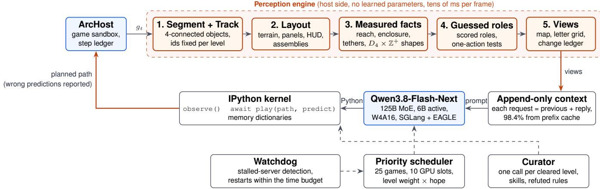  
Fi<sub>g</sub>ure 11 | S<sub>y</sub>stem to<sub>p</sub>olo<sub>gy</sub> of Sarbloh. The host-side <sub>p</sub>erce<sub>p</sub>tion en<sub>g</sub>ine extracts invariant relations and afordance h<sub>yp</sub>otheses f<sub>rom</sub> <sub>eac</sub>h f<sub>rame,</sub> <sub>pass</sub>i<sub>ng</sub> <sub>v</sub>i<sub>ews</sub> t<sub>o</sub> <sub>an</sub> <sub>appen</sub>d<sub>-on</sub>l<sub>y</sub> <sub>con</sub>t<sub>ex</sub>t<sub>.</sub> Th<sub>e</sub> <sub>reason</sub>i<sub>ng</sub> <sub>mo</sub>d<sub>e</sub>l <sub>genera</sub>t<sub>es</sub> P<sub>y</sub>th<sub>on</sub> <sub>searc</sub>h <sub>rou</sub>ti<sub>nes</sub> i<sub>n</sub> <sub>a</sub> <sub>pers</sub>i<sub>s</sub>t<sub>en</sub>t kernel, committin<sub>g</sub> multi-ste<sub>p p</sub>aths via await play(). Twent<sub>y</sub>-five <sub>g</sub>ames share ten GPU execution slots under the utilit<sub>y</sub>- d<sub>r</sub>i<sub>ven r</sub>i<sub>or</sub>it <sub>sc</sub>h<sub>e</sub>d<sub>u</sub>l<sub>er.</sub>

A<sub>nswer</sub> k<sub>ey an</sub>d <sub>scor</sub>i<sub>ng.</sub> Th<sub>e eva</sub>l<sub>ua</sub>ti<sub>on su</sub>it<sub>e compr</sub>i<sub>ses</sub> the o<sub>p</sub>enin<sub>g</sub> levels of ls20 (arrow-ke<sub>y</sub> lattice navi<sub>g</sub>ation) and r11l (continuous coordinate click interactions). Before <sub>any arm was run, an answer</sub> k<sub>ey o</sub>f <sub>seven</sub> it<sub>ems was wr</sub>itt<sub>en</sub> f<sub>or eac</sub>h f<sub>rame:</sub>

K1 th<sub>e</sub> <sub>con</sub>t<sub>ro</sub>ll<sub>a</sub>bl<sub>e</sub> <sub>en</sub>tit<sub>y;</sub>

K2 th<sub>e</sub> <sub>goa</sub>l<sub>;</sub>

K3 the link or carried object;

K4 th<sub>e mo</sub>difi<sub>er or</sub> h<sub>azar</sub>d<sub>;</sub>

K5 th<sub>e</sub> <sub>s</sub>t<sub>a</sub>t<sub>us</sub> <sub>gauges;</sub>

K6 th<sub>e</sub> <sub>w</sub>i<sub>nn</sub>i<sub>ng</sub> <sub>p</sub>l<sub>an;</sub>

K7 th<sub>e</sub> t<sub>erra</sub>i<sub>n</sub> b<sub>oun</sub>d<sub>ar</sub>i<sub>es.</sub>

E<sub>ac</sub>h it<sub>em score</sub>d 2 f<sub>or a c</sub>l<sub>ear an</sub>d <sub>correc</sub>t d<sub>escr</sub>i<sub>p</sub>ti<sub>on,</sub> 1 f<sub>or a</sub> <sub>p</sub>artial one, 0 if it was missin<sub>g</sub> and −1 if it was misleadin<sub>g</sub>, so <sub>eac</sub>h <sub>game</sub> h<sub>as</sub> <sub>a</sub> <sub>max</sub>i<sub>mum</sub> <sub>o</sub>f 14 <sub>po</sub>i<sub>n</sub>t<sub>s</sub> <sub>an</sub>d th<sub>e</sub> t<sub>wo</sub> t<sub>oge</sub>th<sub>er</sub> 28<sub>.</sub> A<sub>n</sub> i<sub>n</sub>t<sub>u</sub>iti<sub>on</sub> <sub>ra</sub>ti<sub>ng</sub> f<sub>rom</sub> 1 t<sub>o</sub> 5 <sub>an</sub>d th<sub>e</sub> <sub>promp</sub>t t<sub>o</sub>k<sub>en</sub> <sub>cos</sub>t <sub>were recor</sub>d<sub>e</sub>d <sub>a</sub>l<sub>ongs</sub>id<sub>e.</sub>

## B<sub>.</sub>2 C<sub>a</sub>ndid<sub>a</sub>t<sub>e</sub> Pr<sub>ese</sub>nt<sub>a</sub>ti<sub>o</sub>n<sub>s</sub>

X1 E<sub>xp</sub>l<sub>o</sub>d<sub>e</sub>d In<sub>ve</sub>nt<sub>o</sub>r<sub>y.</sub> E<sub>n</sub>titi<sub>es</sub> <sub>are</sub> d<sub>e-</sub>d<sub>up</sub>li<sub>ca</sub>t<sub>e</sub>d b<sub>y</sub> <sub>ex-</sub> <sub>ac</sub>t <sub>s</sub>h<sub>ape</sub> <sub>gr</sub>id<sub>s,</sub> <sub>magn</sub>ifi<sub>e</sub>d t<sub>o</sub> <sub>a</sub> <sub>s</sub>t<sub>an</sub>d<sub>ar</sub>d di<sub>sp</sub>l<sub>ay</sub> <sub>sca</sub>l<sub>e,</sub> <sub>arrange</sub>d <sub>spa</sub>ti<sub>a</sub>ll<sub>y</sub> <sub>w</sub>ith l<sub>e</sub>tt<sub>er</sub> t<sub>ags,</sub> <sub>an</sub>d <sub>anno</sub>t<sub>a</sub>t<sub>e</sub>d <sub>w</sub>ith multiplicit<sub>y</sub> counts (×N). A miniature thumbnail outlines <sub>or</sub>i<sub>g</sub>i<sub>na</sub>l <sub>en</sub>tit<sub>y</sub> <sub>pos</sub>iti<sub>ons.</sub> Thi<sub>n</sub> <sub>connec</sub>t<sub>ors</sub> <sub>are</sub> <sub>ca</sub>t<sub>a</sub>l<sub>oge</sub>d b<sub>y</sub> <sub>en</sub>d<sub>po</sub>i<sub>n</sub>t <sub>coor</sub>di<sub>na</sub>t<sub>es.</sub>

X2 S<sub>urpr</sub>i<sub>se</sub> M<sub>ap.</sub> C<sub>a</sub>l<sub>cu</sub>l<sub>a</sub>t<sub>es</sub> <sub>ce</sub>ll<sub>-</sub>l<sub>eve</sub>l i<sub>n</sub>f<sub>orma</sub>ti<sub>on</sub> <sub>sur-</sub> prise as − log p based on 3×3 neighborhood pattern dist<sub>r</sub>ib<sub>u</sub>ti<sub>ons.</sub> P<sub>er</sub>i<sub>o</sub>di<sub>c</sub> fl<sub>oor</sub> til<sub>es</sub> <sub>an</sub>d b<sub>oun</sub>d<sub>ary</sub> <sub>wa</sub>ll<sub>s</sub> <sub>score</sub> <sub>near</sub> <sub>zero</sub> bit<sub>s.</sub> E<sub>n</sub>titi<sub>es</sub> <sub>are</sub> <sub>ran</sub>k<sub>e</sub>d b<sub>y</sub> t<sub>o</sub>t<sub>a</sub>l bit<sub>s,</sub> <sub>preserv</sub>i<sub>ng</sub> f<sub>u</sub>ll <sub>sa</sub>t<sub>ura</sub>ti<sub>on</sub> <sub>on</sub>l<sub>y</sub> <sub>on</sub> hi<sub>g</sub>h<sub>-surpr</sub>i<sub>se</sub> <sub>componen</sub>t<sub>s</sub> <sub>w</sub>hil<sub>e</sub> f<sub>a</sub>di<sub>ng</sub> <sub>pre</sub>di<sub>c</sub>t<sub>a</sub>bl<sub>e</sub> b<sub>ac</sub>k<sub>groun</sub>d t<sub>ex</sub>t<sub>ures.</sub>

X3 Vi<sub>sua</sub>l R<sub>ou</sub>tin<sub>es.</sub> E<sub>xecu</sub>t<sub>es</sub> <sub>ser</sub>i<sub>a</sub>l <sub>geome</sub>t<sub>r</sub>i<sub>c</sub> <sub>rou</sub>ti<sub>nes</sub> based on Ullman (1984). Reach <sub>p</sub>erforms breadth-first <sub>searc</sub>h <sub>across</sub> d<sub>e</sub>t<sub>ec</sub>t<sub>e</sub>d l<sub>a</sub>tti<sub>ce</sub> <sub>s</sub>t<sub>eps,</sub> <sub>repor</sub>ti<sub>ng</sub> <sub>pa</sub>th l<sub>eng</sub>th<sub>s</sub> f<sub>rom</sub> th<sub>e</sub> lik<sub>e</sub>l<sub>y agen</sub>t t<sub>o a</sub>ll <sub>v</sub>i<sub>s</sub>ibl<sub>e</sub> t<sub>arge</sub>t<sub>s.</sub> Fit <sub>corre</sub>l<sub>a</sub>t<sub>es</sub> hollow enclosing boundaries with objects of identical di-<sub>mens</sub>i<sub>ons.</sub> T<sub>race</sub> t<sub>rac</sub>k<sub>s s</sub>i<sub>ng</sub>l<sub>e-p</sub>i<sub>xe</sub>l <sub>connec</sub>t<sub>ors</sub> t<sub>o</sub> th<sub>e</sub>i<sub>r</sub> <sub>en</sub>d<sub>po</sub>i<sub>n</sub>t<sub>s,</sub> id<sub>en</sub>tif<sub>y</sub>i<sub>ng en</sub>titi<sub>es suspen</sub>d<sub>e</sub>d <sub>a</sub>t th<sub>e m</sub>id<sub>po</sub>i<sub>n</sub>t <sub>o</sub>f d<sub>ua</sub>l <sub>anc</sub>h<sub>ors.</sub> Ali<sub>gn ca</sub>t<sub>a</sub>l<sub>ogs en</sub>titi<sub>es s</sub>h<sub>ar</sub>i<sub>ng</sub> id<sub>en</sub>ti<sub>ca</sub>l row or co<sup>l</sup>umn s<sub>p</sub>ans.

X4 L<sub>oo</sub>k<sub>-a</sub>lik<sub>e</sub> Th<sub>rea</sub>d<sub>s.</sub> C<sub>ompares</sub> bi<sub>nary</sub> <sub>en</sub>tit<sub>y</sub> <sub>s</sub>h<sub>apes</sub> <sub>un</sub>d<sub>er a</sub>ll <sub>e</sub>i<sub>g</sub>ht dih<sub>e</sub>d<sub>ra</sub>l <sub>symme</sub>t<sub>r</sub>i<sub>es o</sub>f th<sub>e square a</sub>l<sub>ong-</sub> <sub>s</sub>id<sub>e</sub> i<sub>n</sub>t<sub>eger</sub> <sub>sca</sub>li<sub>ng</sub> f<sub>ac</sub>t<sub>ors</sub> $( D _ { 4 } \times \mathbb { Z } ^ { + } )$ <sub>.</sub> M<sub>a</sub>t<sub>c</sub>h<sub>e</sub>d <sub>pa</sub>i<sub>rs</sub> <sub>are</sub> classified as exact (identical co<sub>p</sub>ies), turned (matched under rotation or reflection), near (diferin<sub>g</sub> b<sub>y</sub> at most three cells), or state (identical <sub>g</sub>eometr<sub>y</sub> with modified color <sub>p</sub>alettes). Visual threads connect matched entities <sub>across</sub> th<sub>e</sub> f<sub>rame.</sub>

X5 Foresight Strip. Projects prospective states for legal acti<sub>ons</sub> <sub>us</sub>i<sub>ng</sub> h<sub>ar</sub>d<sub>co</sub>d<sub>e</sub>d <sub>p</sub>h<sub>ys</sub>i<sub>ca</sub>l <sub>pr</sub>i<sub>ors:</sub> <sub>agen</sub>t <sub>spr</sub>it<sub>es</sub> t<sub>rans-</sub> l<sub>a</sub>t<sub>e</sub> b<sub>y</sub> th<sub>e</sub>i<sub>r</sub> b<sub>oun</sub>di<sub>ng</sub> di<sub>mens</sub>i<sub>ons</sub> <sub>un</sub>til <sub>s</sub>t<sub>r</sub>iki<sub>ng</sub> <sub>wa</sub>ll<sub>s,</sub> <sub>e</sub>d<sub>ge</sub> <sub>gauges</sub> d<sub>ecremen</sub>t b<sub>y</sub> <sub>un</sub>it l<sub>eng</sub>th <sub>per</sub> <sub>ac</sub>ti<sub>on,</sub> <sub>an</sub>d midpoint objects track anchor displacements.

X6 Bl<sub>uep</sub>rint<sub>.</sub> R<sub>e-ren</sub>d<sub>ers</sub> th<sub>e scene as an arc</sub>hit<sub>ec</sub>t<sub>ura</sub>l schematic followin<sub>g</sub> Marr (1982): terrain rendered in soft t<sub>ones, s</sub>t<sub>ruc</sub>t<sub>ura</sub>l b<sub>oun</sub>d<sub>ar</sub>i<sub>es</sub> h<sub>a</sub>t<sub>c</sub>h<sub>e</sub>d<sub>,</sub> til<sub>e</sub> l<sub>a</sub>tti<sub>ces</sub> f<sub>a</sub>i<sub>n</sub>tl<sub>y</sub> <sub>gr</sub>idd<sub>e</sub>d<sub>, an</sub>d HUD <sub>e</sub>l<sub>emen</sub>t<sub>s</sub> i<sub>so</sub>l<sub>a</sub>t<sub>e</sub>d i<sub>n</sub>t<sub>o a</sub> d<sub>e</sub>di<sub>ca</sub>t<sub>e</sub>d <sub>s</sub>id<sub>e</sub> <sub>p</sub>ane<sup>l</sup>.

X7 R<sub>o</sub>l<sub>e</sub> L<sub>e</sub>d<sub>ge</sub>r<sub>.</sub> S<sub>cores</sub> <sub>non-</sub>t<sub>erra</sub>i<sub>n</sub> <sub>en</sub>titi<sub>es</sub> <sub>aga</sub>i<sub>ns</sub>t <sub>e</sub>i<sub>g</sub>ht standard <sub>g</sub>ame<sub>p</sub>la<sub>y</sub> roles (You, Goal, Moves Left, Lives, Inventory, Modifier, Handle, Carried Thing) <sub>us</sub>i<sub>ng ev</sub>id<sub>ence</sub> h<sub>eur</sub>i<sub>s</sub>ti<sub>cs, pr</sub>i<sub>n</sub>ti<sub>ng eac</sub>h t<sub>op can</sub>did<sub>a</sub>t<sub>e</sub> <sub>a</sub>l<sub>ongs</sub>id<sub>e an emp</sub>i<sub>r</sub>i<sub>ca</sub>l <sub>un</sub>it<sub>-ac</sub>ti<sub>on ver</sub>ifi<sub>ca</sub>ti<sub>on</sub> t<sub>es</sub>t<sub>.</sub>

X8 F<sub>use</sub>d B<sub>r</sub>i<sub>e</sub>fi<sub>ng.</sub> S<sub>yn</sub>th<sub>es</sub>i<sub>zes</sub> th<sub>e arc</sub>hit<sub>ec</sub>t<sub>ura</sub>l bl<sub>uepr</sub>i<sub>n</sub>t <sub>canvas o</sub>f X6<sub>,</sub> th<sub>e re</sub>l<sub>a</sub>ti<sub>ona</sub>l th<sub>rea</sub>d<sub>s an</sub>d <sub>m</sub>id<sub>po</sub>i<sub>n</sub>t i<sub>n-</sub> di<sub>ca</sub>t<sub>ors</sub> <sub>o</sub>f X3<sub>–</sub>X4<sub>,</sub> <sub>an</sub>d <sub>a</sub> t<sub>wo-</sub>ti<sub>ere</sub>d t<sub>ex</sub>t b<sub>r</sub>i<sub>e</sub>fi<sub>ng</sub> <sub>ex-</sub> <sub>p</sub>li<sub>c</sub>itl<sub>y separa</sub>ti<sub>ng</sub> M<sub>easured geome</sub>t<sub>r</sub>i<sub>c cer</sub>t<sub>a</sub>i<sub>n</sub>ti<sub>es</sub> f<sub>rom</sub>

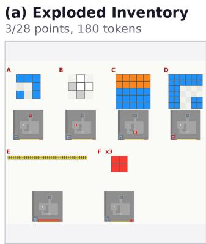

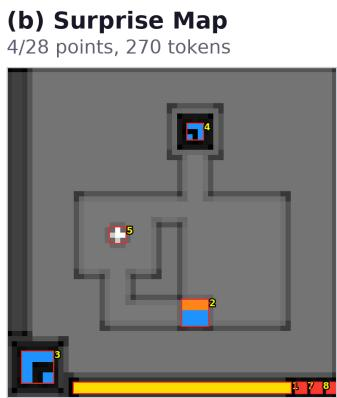

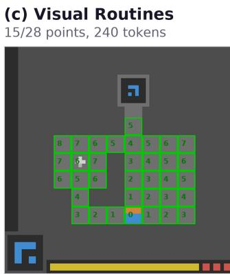

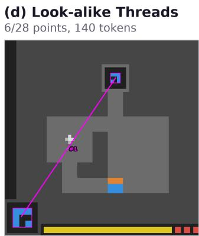

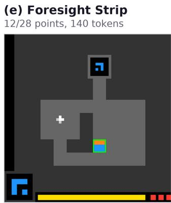

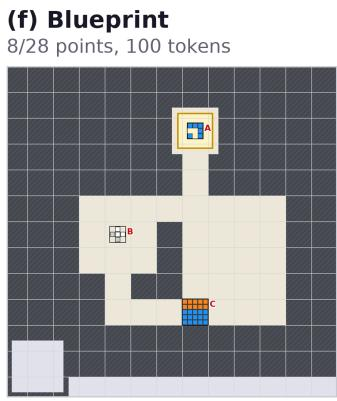

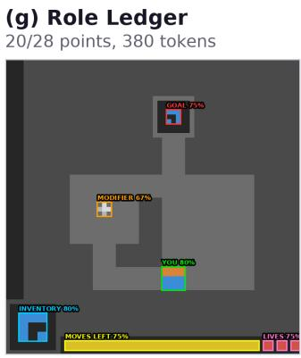

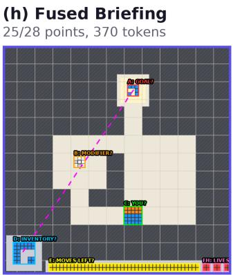  
Figure 12 | Visual presentations evaluated in the Perception Lab on ls20. (a) Ex<sub>p</sub>loded Inventor<sub>y</sub> se<sub>p</sub>arates unique entit<sub>y</sub> mor<sub>p</sub>holo<sub>g</sub>ies. (b) Sur<sub>p</sub>rise Ma<sub>p</sub> hi<sub>g</sub>hli<sub>g</sub>hts un<sub>p</sub>redicted local textures. (c) Visual Routines com<sub>p</sub>utes lattice BFS ste<sub>p</sub> counts to candidate tar<sub>g</sub>ets. (d) Look-alike Threads connects sha<sub>p</sub>es matchin<sub>g</sub> under rotation, reflection, or inte<sub>g</sub>er scalin<sub>g</sub>. (e) Foresi<sub>g</sub>ht Stri<sub>p</sub> simulates counterfactual forward states. (f) Blue<sub>p</sub>rint redraws terrain and lattices as a clean architectural schematic. (<sub>g</sub>) Role Led<sub>g</sub>er annotates candidate afordance h<sub>yp</sub>otheses. (h) Fused Briefin<sub>g</sub> combines the blue<sub>p</sub>rint ma<sub>p</sub> with measured invariants <sub>an</sub>d t<sub>es</sub>t<sub>a</sub>bl<sub>e ro</sub>l<sub>e</sub> h<sub>ypo</sub>th<sub>eses.</sub>

G<sub>uessed</sub> <sub>a</sub>f<sub>or</sub>d<sub>ance</sub> h<sub>ypo</sub>th<sub>eses</sub> <sub>pa</sub>i<sub>re</sub>d <sub>w</sub>ith <sub>un</sub>it<sub>-ac</sub>ti<sub>on</sub> <sub>ver</sub>ifi<sub>ca</sub>ti<sub>on</sub> t<sub>es</sub>t<sub>s.</sub>

Fi<sub>gure</sub> 12 <sub>prov</sub>id<sub>es</sub> <sub>a</sub> <sub>v</sub>i<sub>sua</sub>l <sub>compar</sub>i<sub>son</sub> <sub>o</sub>f <sub>eac</sub>h <sub>can</sub>did<sub>a</sub>t<sub>e</sub> <sub>p</sub>resentation evaluated on ls20.

## B<sub>.</sub>3 F<sub>u</sub>ll St<sub>ruc</sub>t<sub>ura</sub>l B<sub>r</sub>i<sub>e</sub>fi<sub>ngs</sub>

Th<sub>e</sub> t<sub>wo</sub> b<sub>oxes</sub> b<sub>e</sub>l<sub>ow g</sub>i<sub>ve</sub> th<sub>e</sub> b<sub>r</sub>i<sub>e</sub>fi<sub>ng</sub> t<sub>ex</sub>t th<sub>e percep-</sub> ti<sub>on eng</sub>i<sub>ne wro</sub>t<sub>e, wor</sub>d f<sub>or wor</sub>d<sub>,</sub> f<sub>or</sub> th<sub>e open</sub>i<sub>ng</sub> f<sub>rames</sub> of ls20 (Fi<sub>g</sub>ure 5) and r11l. The object ids are the same as those on the map and in the kernel’s object table (observe().objects).

ls20, openin<sub>g</sub> frame (arrow ke<sub>y</sub>s, tile <sub>g</sub>rid)   
BRIEFING (arrow keys)   
MEASURED (certain):   
- Floor is a 5x5 tile grid.   
- obj 4 (blue 6-cell shape): sits inside a black box   
that is NOT plain floor; the floor reaches the   
box’s bottom side in 5 steps (the only way in)   
obj 6 (white/light grey plus): reachable in 6 steps   
obj 4 (blue 6-cell shape) is directly above obj 10   
(blue/orange square) (shared columns 35-37)

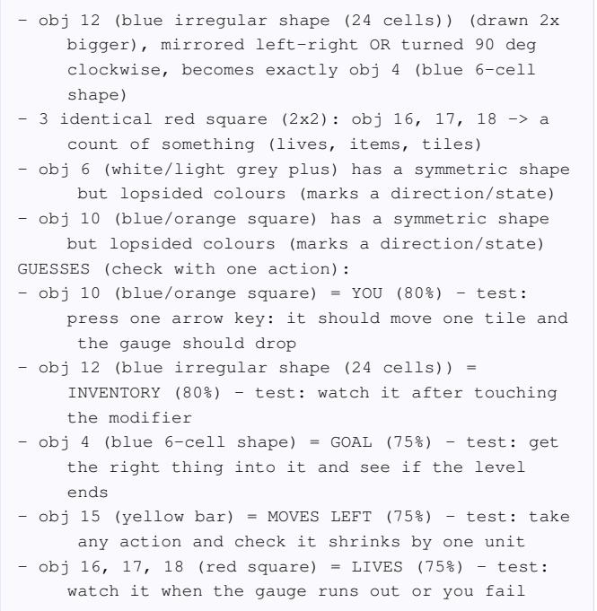

obj 6 (white/light grey plus) = MODIFIER (67%)   
test: step onto it, then check whether the   
inventory icon changed

## r11l, openin<sub>g</sub> frame (clicks, no tile <sub>g</sub>rid)

BRIEFING (clicks)   
MEASURED (certain):   
- no tile grid -> free movement. Open space = black   
(81% of screen).   
- all 4 main objects share one open space; straight   
paths between them are ALL CLEAR of rock   
- the grey areas are not open floor (likely walls)   
- obj 4 (purple dotted ring) encloses an EMPTY 5x5   
space -- exactly the size of: obj 16 (white/   
purple diamond), obj 25 (purple/magenta disc),   
obj 36 (dark grey/purple diamond)   
- a light grey line connects obj 16 (white/purple   
diamond) to obj 25 (purple/magenta disc)   
- a light grey line connects obj 25 (purple/magenta   
disc) to obj 36 (dark grey/purple diamond)   
- obj 25 (purple/magenta disc) sits at the MIDPOINT   
of obj 16 (white/purple diamond) and obj 36 (   
dark grey/purple diamond) (error 0.5 cells) ->   
it is held between them; moving either end   
should move it to the new midpoint   
- obj 16, 36 (white/purple diamond; dark grey/purple   
diamond) have the same shape in different   
colours (white/purple vs dark grey/purple)   
GUESSES (check with one action):   
- obj 4 (purple dotted ring) = GOAL (80%) - test: get   
the right thing into it and see if the level   
ends   
- obj 16, 36 (white/purple diamond; dark grey/purple   
diamond) = HANDLE (click) (80%) - test: click an   
empty spot once: the selected handle should   
jump there   
- obj 1 (white bar) = MOVES LEFT (75%) - test: take   
any action and check it shrinks by one unit   
- obj 25 (purple/magenta disc) = CARRIED THING (75%)   
- test: move one handle: it should slide to the   
new midpoint

## B<sub>.</sub>4 Th<sub>e</sub> P<sub>ercep</sub>ti<sub>on</sub> Pi<sub>pe</sub>li<sub>ne on</sub> F<sub>our</sub> M<sub>ore</sub> G<sub>ames</sub>

Fi<sub>gures</sub> 13<sub>–</sub>16 <sub>repea</sub>t Fi<sub>gure</sub> 5 f<sub>or</sub> th<sub>e open</sub>i<sub>ng</sub> f<sub>rames o</sub>f ka59, m0r0, r11l and sb26. The<sub>y</sub> were made in the same wa<sub>y</sub>: make\_perception\_figure.py runs the a<sub>g</sub>ent’s <sub>percep</sub>ti<sub>on co</sub>d<sub>e on</sub> th<sub>e</sub> fi<sub>rs</sub>t f<sub>rame o</sub>f <sub>eac</sub>h l<sub>oca</sub>l <sub>game, an</sub>d <sub>p</sub>anels (b) and (c) are drawn from its object table and briefin<sub>g</sub>. Each line in (c) stands for one MEASURED line of the briefin<sub>g</sub> in (e). Where an object is made of one-cell <sub>p</sub>arts (the dotted rin<sub>g</sub> and the connectin<sub>g</sub> lines in r11l) or re-<sub>p</sub>eats (the four <sub>g</sub>re<sub>y</sub> s<sub>q</sub>uares in sb26), the <sub>p</sub>arts are outlined <sub>an</sub>d th<sub>e group ge</sub>t<sub>s one</sub> t<sub>ag.</sub> Th<sub>e</sub> f<sub>our games</sub> t<sub>es</sub>t dif<sub>eren</sub>t <sub>p</sub>arts of the en<sub>g</sub>ine. ka59 has a tile <sub>g</sub>rid, and two rin<sub>g</sub>s each enclose an empty 3×3 that fits a movable square. m0r0 is sparse: four objects, two measured facts and no guesses, <sub>so</sub> th<sub>e eng</sub>i<sub>ne</sub> d<sub>oes no</sub>t i<sub>nven</sub>t <sub>ro</sub>l<sub>es</sub> it h<sub>as no ev</sub>id<sub>ence</sub> f<sub>or.</sub> r11l is driven b<sub>y</sub> clicks, and its disc sits at the mid<sub>p</sub>oint of two connected handles. sb26 is the densest: its briefi<sub>ng reac</sub>h<sub>es</sub> th<sub>e</sub> li<sub>ne</sub> li<sub>m</sub>it<sub>, an</sub>d th<sub>e rema</sub>i<sub>n</sub>i<sub>ng e</sub>i<sub>g</sub>ht f<sub>ac</sub>t<sub>s are</sub> left to observe().briefing in the kernel, as the last

MEASURED li<sub>ne</sub> <sub>says.</sub>

## C N<sub>ega</sub>ti<sub>ve</sub> R<sub>esu</sub>lt<sub>s,</sub> Abl<sub>a</sub>ti<sub>o</sub>n<sub>s, a</sub>nd R<sub>u</sub>ntim<sub>e</sub> B<sub>ou</sub>nd<sub>a</sub>r<sub>y</sub> C<sub>o</sub>nditi<sub>o</sub>n<sub>s</sub>

Thi<sub>s appen</sub>di<sub>x covers</sub> th<sub>e</sub> d<sub>es</sub>i<sub>gns</sub> th<sub>a</sub>t f<sub>a</sub>il<sub>e</sub>d <sub>or ma</sub>d<sub>e</sub> th<sub>e</sub> <sub>agen</sub>t <sub>uns</sub>t<sub>a</sub>bl<sub>e</sub> i<sub>n</sub> li<sub>ve runs,</sub> th<sub>e run</sub>ti<sub>me</sub> f<sub>a</sub>il<sub>ure mo</sub>d<sub>es, an</sub>d th<sub>e</sub> t<sub>wo</sub> f<sub>u</sub>ll <sub>runs neares</sub>t t<sub>o a percep</sub>ti<sub>on a</sub>bl<sub>a</sub>ti<sub>on.</sub>

## C<sub>.</sub>1 P<sub>e</sub>r<sub>cep</sub>t<sub>ua</sub>l Ed<sub>ge</sub> C<sub>ases a</sub>nd Lin<sub>e</sub> B<sub>u</sub>d<sub>ge</sub>t Quotas

L<sub>a</sub>tti<sub>ce</sub> d<sub>e</sub>t<sub>ec</sub>ti<sub>on</sub> i<sub>ns</sub>t<sub>a</sub>bilit<sub>y</sub> f<sub>rom per</sub>i<sub>p</sub>h<sub>era</sub>l HUD <sub>e</sub>l<sub>e-</sub> <sub>men</sub>t<sub>s.</sub> I<sub>n ear</sub>l<sub>y</sub> it<sub>era</sub>ti<sub>ons,</sub> th<sub>e</sub> h<sub>os</sub>t<sub>-s</sub>id<sub>e</sub> l<sub>a</sub>tti<sub>ce</sub> d<sub>e</sub>t<sub>ec</sub>ti<sub>on</sub> <sub>mo</sub>d<sub>u</sub>l<sub>e</sub> fitt<sub>e</sub>d til<sub>e</sub> di<sub>mens</sub>i<sub>ons over a</sub>ll <sub>non-</sub>t<sub>erra</sub>i<sub>n p</sub>i<sub>xe</sub>l<sub>s.</sub> I<sub>n</sub> ls20, when the <sub>p</sub>la<sub>y</sub>er moved, an of-<sub>g</sub>rid <sub>g</sub>au<sub>g</sub>e within the <sub>s</sub>t<sub>a</sub>t<sub>us</sub> b<sub>ox</sub> i<sub>n</sub>t<sub>ro</sub>d<sub>uce</sub>d i<sub>rregu</sub>l<sub>ar coor</sub>di<sub>na</sub>t<sub>e</sub> i<sub>n</sub>t<sub>erva</sub>l<sub>s, caus</sub>i<sub>ng</sub> the fitted 5×5 grid to collapse. Similarly, in ka59, touching a <sub>secon</sub>d<sub>ary spr</sub>it<sub>e a</sub>lt<sub>ere</sub>d th<sub>e</sub> d<sub>e</sub>t<sub>ec</sub>t<sub>e</sub>d l<sub>a</sub>tti<sub>ce per</sub>i<sub>o</sub>di<sub>c</sub>it<sub>y.</sub> E<sub>ac</sub>h <sub>co</sub>ll<sub>apse</sub> t<sub>emporar</sub>il<sub>y</sub> d<sub>e</sub>l<sub>e</sub>t<sub>e</sub>d <sub>a</sub>ll <sub>reac</sub>h<sub>a</sub>bilit<sub>y</sub> i<sub>nvar</sub>i<sub>an</sub>t<sub>s</sub> f<sub>rom</sub> <sub>con</sub>t<sub>ex</sub>t<sub>, caus</sub>i<sub>ng</sub> th<sub>e agen</sub>t t<sub>o vac</sub>ill<sub>a</sub>t<sub>e</sub> b<sub>e</sub>t<sub>ween con</sub>fli<sub>c</sub>ti<sub>ng</sub> <sub>spa</sub>ti<sub>a</sub>l h<sub>ypo</sub>th<sub>eses.</sub> W<sub>e reso</sub>l<sub>ve</sub>d thi<sub>s</sub> b<sub>y exp</sub>li<sub>c</sub>itl<sub>y exc</sub>l<sub>u</sub>di<sub>ng</sub> <sub>per</sub>i<sub>p</sub>h<sub>era</sub>l HUD <sub>reg</sub>i<sub>ons</sub> f<sub>rom</sub> th<sub>e</sub> l<sub>a</sub>tti<sub>ce</sub> fitti<sub>ng</sub> <sub>rou</sub>ti<sub>ne</sub> <sub>an</sub>d <sub>cac</sub>hi<sub>ng</sub> th<sub>e</sub> i<sub>n</sub>iti<sub>a</sub>l <sub>va</sub>lid l<sub>a</sub>tti<sub>ce con</sub>fi<sub>gura</sub>ti<sub>on</sub> f<sub>or</sub> th<sub>e rema</sub>i<sub>n-</sub> d<sub>er o</sub>f th<sub>e</sub> l<sub>eve</sub>l<sub>.</sub>

C<sub>o</sub>mbin<sub>a</sub>t<sub>o</sub>ri<sub>a</sub>l r<sub>e</sub>l<sub>a</sub>ti<sub>o</sub>n <sub>c</sub>r<sub>ow</sub>din<sub>g.</sub> I<sub>n scenes w</sub>ith <sub>many</sub> objects, pairwise relations grow quadratically. The first frame of tr87 <sub>y</sub>ields 60 ali<sub>g</sub>nment <sub>p</sub>airs, 7 enclosures and 1 s<sub>y</sub>mmetr<sub>y</sub>, and bp35 <sub>y</sub>ields 792 ali<sub>g</sub>nment <sub>p</sub>airs. Under one <sub>g</sub>l<sub>o</sub>b<sub>a</sub>l li<sub>ne</sub> <sub>cap</sub> th<sub>e</sub> <sub>a</sub>li<sub>gnmen</sub>t<sub>s</sub> fill th<sub>e</sub> b<sub>r</sub>i<sub>e</sub>fi<sub>ng</sub> <sub>an</sub>d <sub>pus</sub>h <sub>ou</sub>t the s<sub>y</sub>mmetr<sub>y</sub> and the role <sub>g</sub>uesses (Fi<sub>g</sub>ure 17a). The de-<sub>p</sub>l<sub>oye</sub>d <sub>po</sub>li<sub>cy</sub> <sub>s</sub>h<sub>ares</sub> th<sub>e</sub> li<sub>nes</sub> b<sub>e</sub>t<sub>ween</sub> f<sub>ac</sub>t ki<sub>n</sub>d<sub>s,</sub> k<sub>eeps</sub> <sub>up</sub> t<sub>o a</sub> thi<sub>r</sub>d <sub>o</sub>f th<sub>em</sub> f<sub>or guesses an</sub>d <sub>repor</sub>t<sub>s</sub> th<sub>e res</sub>t <sub>as a coun</sub>t (Fi<sub>g</sub>ure 17b).

## C.2 Rejected Architectural Designs

S<sub>p</sub>arse delta state encodin<sub>g.</sub> Tr<sub>a</sub>n<sub>s</sub>mittin<sub>g o</sub>nl<sub>y</sub> dif<sub>e</sub>r<sub>e</sub>n<sub>-</sub> ti<sub>a</sub>l <sub>coor</sub>di<sub>na</sub>t<sub>e c</sub>h<sub>anges</sub> b<sub>e</sub>t<sub>ween</sub> f<sub>rames su</sub>b<sub>s</sub>t<sub>an</sub>ti<sub>a</sub>ll<sub>y re</sub>d<sub>uces</sub> <sub>promp</sub>t t<sub>o</sub>k<sub>en consump</sub>ti<sub>on.</sub> H<sub>owever,</sub> i<sub>n</sub> ARC<sub>-</sub>AGI<sub>-</sub>3 <sub>env</sub>i<sub>-</sub> <sub>ronmen</sub>t<sub>s w</sub>h<sub>ere</sub> l<sub>oca</sub>l <sub>ac</sub>ti<sub>ons</sub> t<sub>r</sub>i<sub>gger</sub> di<sub>s</sub>t<sub>an</sub>t <sub>causa</sub>l <sub>e</sub>f<sub>ec</sub>t<sub>s</sub> (e.<sub>g</sub>., activatin<sub>g</sub> a floor <sub>p</sub>late u<sub>p</sub>datin<sub>g</sub> an icon across the dis-<sub>p</sub>la<sub>y</sub>), s<sub>p</sub>arse u<sub>p</sub>dates conceal non-local covariance. In devel-<sub>opmen</sub>t t<sub>races, mo</sub>d<sub>e</sub>l<sub>s rece</sub>i<sub>v</sub>i<sub>ng</sub> d<sub>e</sub>lt<sub>a up</sub>d<sub>a</sub>t<sub>es cons</sub>i<sub>s</sub>t<sub>en</sub>tl<sub>y</sub> <sub>conc</sub>l<sub>u</sub>d<sub>e</sub>d th<sub>a</sub>t <sub>ac</sub>ti<sub>ons were non-</sub>f<sub>unc</sub>ti<sub>ona</sub>l <sub>w</sub>h<sub>en</sub> l<sub>oca</sub>li<sub>ze</sub>d <sub>p</sub>i<sub>xe</sub>l<sub>s rema</sub>i<sub>ne</sub>d <sub>s</sub>t<sub>a</sub>ti<sub>c,</sub> l<sub>ea</sub>di<sub>ng</sub> t<sub>o ca</sub>t<sub>as</sub>t<sub>rop</sub>hi<sub>c ac</sub>ti<sub>on</sub> l<sub>oops.</sub> F<sub>u</sub>ll<sub>-</sub>f<sub>rame v</sub>i<sub>sua</sub>l <sub>represen</sub>t<sub>a</sub>ti<sub>ons rema</sub>i<sub>n essen</sub>ti<sub>a</sub>l f<sub>or ma</sub>i<sub>n-</sub> t<sub>a</sub>i<sub>n</sub>i<sub>ng causa</sub>l <sub>co</sub>h<sub>erence.</sub>

Disjoint tool spaces for reasoning and actuation. Pro-<sub>v</sub>idi<sub>ng separa</sub>t<sub>e</sub> t<sub>oo</sub>l i<sub>n</sub>t<sub>er</sub>f<sub>aces</sub> f<sub>or co</sub>d<sub>e execu</sub>ti<sub>on an</sub>d <sub>en-</sub> <sub>v</sub>i<sub>ronmen</sub>t <sub>s</sub>t<sub>epp</sub>i<sub>ng</sub> <sub>cause</sub>d <sub>mo</sub>d<sub>e</sub>l<sub>s</sub> t<sub>o</sub> f<sub>ragmen</sub>t <sub>reason</sub>i<sub>ng</sub> trajectories. The agent formulated world models in code, exit<sub>e</sub>d th<sub>e</sub> REPL t<sub>o</sub> di<sub>spa</sub>t<sub>c</sub>h i<sub>n</sub>di<sub>v</sub>id<sub>ua</sub>l <sub>ac</sub>ti<sub>ons, an</sub>d <sub>re-en</sub>t<sub>ere</sub>d <sub>co</sub>d<sub>e</sub> <sub>execu</sub>ti<sub>on</sub> t<sub>o</sub> <sub>recons</sub>t<sub>ruc</sub>t <sub>s</sub>t<sub>a</sub>t<sub>e</sub> <sub>var</sub>i<sub>a</sub>bl<sub>es,</sub> <sub>mu</sub>lti<sub>p</sub>l<sub>y</sub>i<sub>ng</sub> i<sub>n-</sub> f<sub>erence</sub> l<sub>a</sub>t<sub>ency.</sub> M<sub>erg</sub>i<sub>ng</sub> <sub>ac</sub>ti<sub>on</sub> <sub>comm</sub>it<sub>men</sub>t di<sub>rec</sub>tl<sub>y</sub> i<sub>n</sub>t<sub>o</sub> the P<sub>y</sub>thon kernel via await play() was the sin<sub>g</sub>le inter-<sub>ven</sub>ti<sub>on respons</sub>ibl<sub>e</sub> f<sub>or a</sub>d<sub>vanc</sub>i<sub>ng</sub> th<sub>e</sub> hidd<sub>en-se</sub>t <sub>score</sub> f<sub>rom</sub> 5<sub>.</sub>14 t<sub>o</sub> 5<sub>.</sub>65<sub>.</sub>

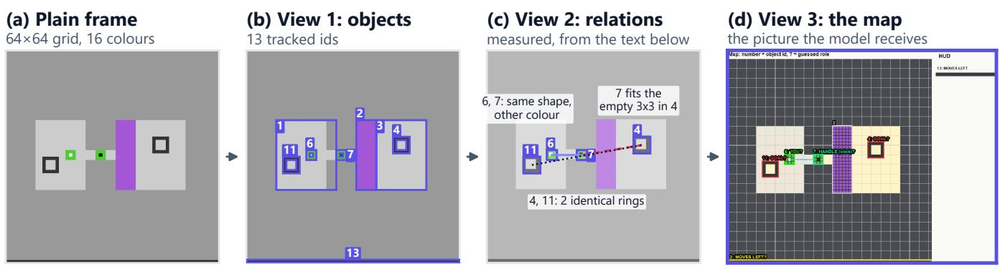

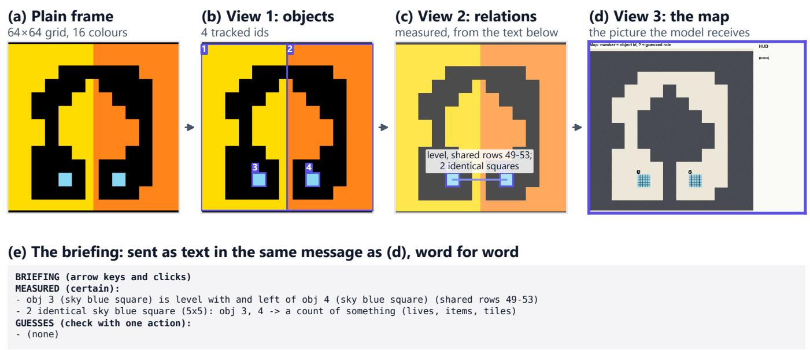

BRIEFING (arrow keys and clicks)   
MEASURED (certain):   
Floor is a 3x3 tile grid.   
obj 2 (purple rectangle): reachable in 5 steps   
obj 4 (charcoal ring): reachable in 8 steps   
obj 7 (green/black square): reachable in 3 steps   
obj 11 (charcoal ring): reachable in 1 steps   
obj 4 (charcoal ring) encloses an EMPTY 3x3 space -- exactly the size of: obj 6 (green/white square), obj 7 (green/black square)   
obj 11 (charcoal ring) encloses an EMPTY 3x3 space -- exactly the size of: obj 6 (green/white square), obj 7 (green/black square)   
obj 2 (purple rectangle) is level with and left of obj 4 (charcoal ring) (shared rows 26-30)   
obj 2 (purple rectangle) is level with and right of obj 6 (green/white square) (shared rows 30-32)   
obj 2 (purple rectangle) is level with and right of obj 11 (charcoal ring) (shared rows 32-36)   
obj 6 (green/white square) is level with and left of obj 7 (green/black square) (shared rows 30-32)   
- obj 2 (purple rectangle) is level with and right of obj 7 (green/black square) (shared rows 30-32)   
obj 6, 7 (green/white square; green/black square) have the same shape in different colours (green/white vs green/black)   
2 identical charcoal ring (5x5): obj 4, 11 -> a count of something (lives, items, tiles)   
GUESSES (check with one action):   
obj 4, 11 (charcoal ring) = GOAL (75-80%) - test: get the right thing into it and see if the level ends   
obj 13 (charcoal bar) = MOVES LEFT (75%) - test: take any action and check it shrinks by one unit   
obj 7 (green/black square) = HANDLE (click) (67%) - test: click an empty spot once: the selected handle should jump there   
- obj 6 (green/white square) = YOU (57%) - test: press one arrow key: it should move one tile and the gauge should drop  
Figure 13 | The <sub>p</sub>erce<sub>p</sub>tion <sub>p</sub>i<sub>p</sub>eline on the o<sub>p</sub>enin<sub>g</sub> frame of ka59 (arrow ke<sub>y</sub>s and clicks, 3×3 tile <sub>g</sub>rid). (c) Rin<sub>g</sub>s 4 and 11 are identical; ring 4 encloses an empty 3×3 that exactly fits square 7 (and square 6); squares 6 and 7 have the same shape in diferent colours. Panels as in Fi<sub>g</sub>ure 5; the model receives (d) and (e).  
Figure 14 | The <sub>p</sub>erce<sub>p</sub>tion <sub>p</sub>i<sub>p</sub>eline on the o<sub>p</sub>enin<sub>g</sub> frame of m0r0 (arrow ke<sub>y</sub>s and clicks). The en<sub>g</sub>ine finds four objects and <sub>measures</sub> t<sub>wo</sub> f<sub>ac</sub>t<sub>s: squares</sub> 3 <sub>an</sub>d 4 <sub>are</sub> id<sub>en</sub>ti<sub>ca</sub>l <sub>an</sub>d <sub>s</sub>h<sub>are rows</sub> 49<sub>–</sub>53<sub>.</sub> It <sub>ma</sub>k<sub>es no guesses.</sub> P<sub>ane</sub>l<sub>s as</sub> i<sub>n</sub> Fi<sub>gure</sub> 5<sub>.</sub>

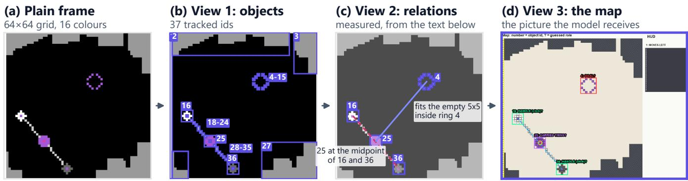

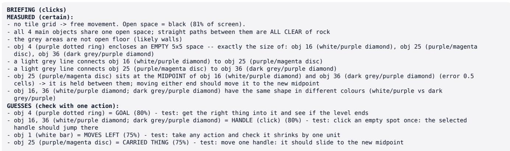  
Figure 15 | The <sub>p</sub>erce<sub>p</sub>tion <sub>p</sub>i<sub>p</sub>eline on the o<sub>p</sub>enin<sub>g</sub> frame of r11l (clicks, no tile <sub>g</sub>rid). (b) The dotted rin<sub>g</sub> (4–15) and the two connectin<sub>g</sub> lines (18–24, 28–35) are made of one-cell <sub>p</sub>arts and are ta<sub>gg</sub>ed once each. (c) Disc 25 sits at the mid<sub>p</sub>oint of handles 16 and 36, and fits the empty 5×5 inside ring 4. Panels as in Figure 5.

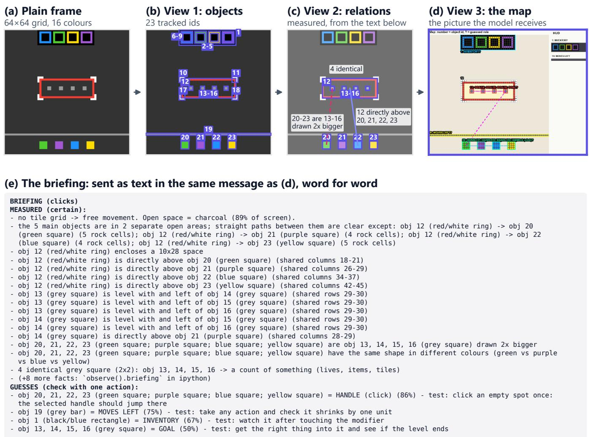  
Figure 16 | The <sub>p</sub>erce<sub>p</sub>tion <sub>p</sub>i<sub>p</sub>eline on the o<sub>p</sub>enin<sub>g</sub> frame of sb26 (clicks onl<sub>y</sub>). (c) S<sub>q</sub>uares 20–23 are the <sub>g</sub>re<sub>y</sub> s<sub>q</sub>uares 13–16 drawn 2× bi<sub>gg</sub>er, and rin<sub>g</sub> 12 sits directl<sub>y</sub> above each of them. (e) The briefin<sub>g</sub> reaches its line limit; the last MEASURED line sa<sub>y</sub>s ei<sub>g</sub>ht more facts can be read from observe().briefing. Panels as in Fi<sub>g</sub>ure 5.

(a) one cap of 30 lines (b) lines shared b<sub>y</sub> kind   
23 alignment, 7 enclosure, 0 look-alike, 0 guess lines 20 alignment, 7 enclosure, 1 look-alike, 2 guess lines   
BRIEFING (arrow keys) BRIEFING (arrow keys)   
obj 6 encloses empty 3x3 space MEASURED (certain):   
obj 8 encloses empty 3x3 space obj 6 encloses empty 3x3 space   
obj 18 encloses empty 3x3 space obj 8 encloses empty 3x3 space   
obj 20 encloses empty 3x3 space obj 18 encloses empty 3x3 space   
obj 31 encloses empty 3x3 space obj 20 encloses empty 3x3 space   
obj 33 encloses empty 3x3 space obj 31 encloses empty 3x3 space   
obj 51 encloses empty 3x31 space obj 33 encloses empty 3x3 space   
obj 5 left of obj 6 r5-9 obj 51 encloses empty 3x31 space   
obj 5 left of obj 7 r5-9 obj 5 left of obj 6 r5-9   
obj 5 left of obj 8 r5-9 obj 5 left of obj 7 r5-9   
obj 5 above obj 17 c13-17 obj left of obj 8 r5-9   
obj 5 above obj 30 c13-17 obj 5 above obj 17 c13-17   
obj 5 above obj 44 c15-17 obj 5 above obj 30 c13-17   
obj 5 above obj 47 c15-17 obj 5 above obj 44 c15-17   
obj 5 above obj 51 c15-17 obj above obj 47 c15-17   
obj 5 above obj 62 c15-17 obj above obj 51 c15-17   
obj 6 left of obj 7 r5-9 obj 5 above obj 62 c15-17   
obj 6 left of obj 8 r5-9 obj 6 left of obj 7 r5-9   
obj 6 above obj 18 c23-27 obj 6 left of obj 8 r5-9   
obj 6 above obj 31 c23-27 obj 6 above obj 18 c23-27   
obj 6 above obj 44 c23-27 obj 6 above obj 31 c23-27   
obj 6 above obj 51 c23-27 obj 6 above obj 44 c23-27   
obj 7 left of 8 r5-9 obj 6 above obj 51 c23-27   
obj 7 above obj 19 c36-40 obj 7 left of obj 8 r5-9   
obj 7 above obj 32 c36-40 obj 7 above obj 19 c36-40   
obj 7 above obj 44 c36-40 obj 7 above obj 32 c36-40   
obj 7 above obj 51 c36-40 obj 7 above obj 44 c36-40   
obj 8 above obj 20 c46-50 obj 7 above obj 51 c36-40   
obj 8 above obj 33 c46-50 obj 47 rotated = obj 62   
obj 17 left of obj 18 r14-18 (+40 more facts in observe())   
GUESSES (check with one action):   
obj 63 = MOVES LEFT (75%), test: take any action and check i..   
obj 5, 6, 7, 8, 17, 18, 19, 20, 30, 31, 32, 33, 44, 51 (blac..  
Figure 17 | The briefing line budget on the first frame of tr87, both boxes built b<sub>y</sub> the a<sub>g</sub>ent’s own Briefing code (object descri<sub>p</sub>tions shortened; r/c = shared rows/columns). The mark at the left of each line <sub>g</sub>ives its kind: enclosure, ali<sub>g</sub>nment, look-alike, uess. (a) One ca of 30 lines over all facts in the en ine’s order: 23 of the 30 lines are ali nments, and the look-alike <sub>p</sub>air and both <sub>g</sub>uesses are cut. (b) The <sub>p</sub>olic<sub>y</sub> the a<sub>g</sub>ent runs, which shares the lines between fact kinds and kee<sub>p</sub>s u<sub>p</sub> to a third for uesses: it shows the look-alike air and the two uesses and counts the 40 facts left out (“+40 more facts”).

Semantic histor<sub>y</sub> comment st<sub>u</sub>bbin<sub>g.</sub> T<sub>o co</sub>n<sub>se</sub>r<sub>ve co</sub>n<sub>-</sub> t<sub>ex</sub>t <sub>w</sub>i<sub>n</sub>d<sub>ow capac</sub>it<sub>y, we</sub> t<sub>es</sub>t<sub>e</sub>d <sub>rep</sub>l<sub>ac</sub>i<sub>ng execu</sub>t<sub>e</sub>d hi<sub>s</sub>t<sub>or</sub>i<sub>ca</sub>l <sub>co</sub>d<sub>e ce</sub>ll<sub>s w</sub>ith b<sub>r</sub>i<sub>e</sub>f d<sub>escr</sub>i<sub>p</sub>ti<sub>ve commen</sub>t<sub>s.</sub> I<sub>n</sub> th<sub>e</sub> t<sub>wo</sub> t<sub>es</sub>t <sub>runs</sub> th<sub>a</sub>t h<sub>a</sub>d <sub>s</sub>t<sub>u</sub>bbi<sub>ng</sub> <sub>sw</sub>it<sub>c</sub>h<sub>e</sub>d <sub>on,</sub> <sub>reason</sub>i<sub>ng</sub> b<sub>ac</sub>kb<sub>ones</sub> d<sub>e-</sub> <sub>g</sub>enerate<sup>d</sup> <sup>i</sup>nto co<sub>py</sub><sup>i</sup>n<sub>g</sub> comment str<sup>i</sup>n<sub>g</sub>s rat<sup>h</sup>er t<sup>h</sup>an <sub>g</sub>eneratin<sub>g</sub> executable P<sub>y</sub>thon code (occurrin<sub>g</sub> in 97.7% of turns and clearin<sub>g</sub> 0 of 97 levels). Smaller o<sub>p</sub>en-wei<sub>g</sub>ht models heavil<sub>y</sub> i<sub>m</sub>it<sub>a</sub>t<sub>e</sub> l<sub>oca</sub>l <sub>con</sub>t<sub>ex</sub>t f<sub>orma</sub>tti<sub>ng;</sub> hi<sub>s</sub>t<sub>or</sub>i<sub>ca</sub>l <sub>co</sub>d<sub>e mus</sub>t <sub>rema</sub>i<sub>n</sub> i<sub>n</sub>t<sub>ac</sub>t <sub>as</sub> f<sub>unc</sub>ti<sub>ona</sub>l <sub>syn</sub>t<sub>ax.</sub>

A<sub>u</sub>t<sub>o</sub>n<sub>o</sub>m<sub>ous su</sub>b<sub>age</sub>nt hi<sub>e</sub>r<sub>a</sub>r<sub>c</sub>hi<sub>es.</sub> P<sub>rov</sub>idi<sub>ng</sub> th<sub>e mo</sub>d<sub>e</sub>l with <sub>p</sub>ro<sub>g</sub>rammatic suba<sub>g</sub>ent dele<sub>g</sub>ation <sub>p</sub>rimitives (followin<sub>g</sub> the Prime A<sub>g</sub>ent s<sub>p</sub>ecification) <sub>y</sub>ielded zero <sub>p</sub>roductive in-<sub>voca</sub>ti<sub>ons across a</sub>ll b<sub>enc</sub>h<sub>mar</sub>k <sub>runs.</sub> O<sub>pen-we</sub>i<sub>g</sub>ht 6B<sub>-ac</sub>ti<sub>ve</sub> <sub>mo</sub>d<sub>e</sub>l<sub>s</sub> f<sub>a</sub>il<sub>e</sub>d t<sub>o e</sub>f<sub>ec</sub>ti<sub>ve</sub>l<sub>y coor</sub>di<sub>na</sub>t<sub>e su</sub>b<sub>or</sub>di<sub>na</sub>t<sub>e con</sub>t<sub>ex</sub>t<sub>s,</sub> <sub>a</sub>ddi<sub>ng promp</sub>t <sub>comp</sub>l<sub>ex</sub>it<sub>y w</sub>ith<sub>ou</sub>t <sub>emp</sub>i<sub>r</sub>i<sub>ca</sub>l <sub>u</sub>tilit<sub>y.</sub>

Self-imitation fine-tuning on cleared trajectories. We fine-tuned Qwen3.8-Flash-Next on successful execution traces usin<sub>g</sub> low-rank ada<sub>p</sub>tation (LoRA). While trainin<sub>g</sub> <sub>cross-en</sub>t<sub>ropy</sub> l<sub>oss</sub> d<sub>ecrease</sub>d f<sub>rom</sub> 11% t<sub>o</sub> 6%<sub>,</sub> <sub>ou</sub>t<sub>-o</sub>f<sub>-</sub> di<sub>s</sub>t<sub>r</sub>ib<sub>u</sub>ti<sub>on</sub> b<sub>enc</sub>h<sub>mar</sub>k <sub>per</sub>f<sub>ormance</sub> d<sub>egra</sub>d<sub>e</sub>d <sub>s</sub>i<sub>gn</sub>ifi<sub>can</sub>tl<sub>y.</sub> Th<sub>e</sub> fi<sub>ne-</sub>t<sub>une</sub>d <sub>we</sub>i<sub>g</sub>ht<sub>s</sub> <sub>ex</sub>hibit<sub>e</sub>d <sub>r</sub>i<sub>g</sub>id <sub>memor</sub>i<sub>za</sub>ti<sub>on</sub> <sub>o</sub>f <sub>spe-</sub> <sub>c</sub>ifi<sub>c coor</sub>di<sub>na</sub>t<sub>e pa</sub>th<sub>s ra</sub>th<sub>er</sub> th<sub>an genera</sub>li<sub>ze</sub>d <sub>spa</sub>ti<sub>a</sub>l <sub>reason-</sub> in<sub>g,</sub> <sub>co</sub>n<sub>su</sub>min<sub>g</sub> <sub>ove</sub>r 80% <sub>o</sub>f <sub>ou</sub>r tr<sub>a</sub>inin<sub>g</sub> <sub>co</sub>m<sub>pu</sub>t<sub>e</sub> b<sub>u</sub>d<sub>ge</sub>t <sub>w</sub>ith<sub>ou</sub>t <sub>pos</sub>iti<sub>ve</sub> <sub>y</sub>i<sub>e</sub>ld<sub>.</sub>

## C<sub>.</sub>3 I<sub>n</sub>t<sub>erac</sub>ti<sub>ve</sub> R<sub>un</sub>ti<sub>me</sub> F<sub>a</sub>il<sub>ure</sub> M<sub>o</sub>d<sub>es</sub>

De<sub>g</sub>enerate holdin<sub>g</sub> loo<sub>p</sub>s at the action ca<sub>p.</sub> In R<sub>u</sub>n A (briefin<sub>g</sub> of), four <sub>g</sub>ames (lf52, s5i5, vc33, re86) <sub>s</sub>t<sub>oppe</sub>d 2 t<sub>o</sub> 15 <sub>ac</sub>ti<sub>ons s</sub>h<sub>or</sub>t <sub>o</sub>f th<sub>e</sub>i<sub>r</sub> 2<sub>,</sub>000<sub>-ac</sub>ti<sub>on cap.</sub> Th<sub>e</sub> h<sub>arness</sub> k<sub>ep</sub>t <sub>as</sub>ki<sub>ng</sub> th<sub>em</sub> t<sub>o con</sub>ti<sub>nue, an</sub>d th<sub>e mo</sub>d<sub>e</sub>l <sub>an-</sub> swered “Holding...” about 14,000 times, which used 1<sub>.</sub>24 B <sub>o</sub>f th<sub>e run</sub>’<sub>s</sub> 1<sub>.</sub>78 B <sub>promp</sub>t t<sub>o</sub>k<sub>ens.</sub> Th<sub>e s</sub>t<sub>a</sub>ll<sub>s</sub> b<sub>egan</sub> <sub>a</sub>ft<sub>er</sub> th<sub>ese games</sub> h<sub>a</sub>d <sub>c</sub>l<sub>eare</sub>d <sub>every</sub> l<sub>eve</sub>l th<sub>ey wou</sub>ld <sub>c</sub>l<sub>ear, so</sub> th<sub>ey</sub> <sub>cos</sub>t <sub>wa</sub>ll <sub>c</sub>l<sub>oc</sub>k<sub>,</sub> <sub>no</sub>t <sub>score.</sub> Th<sub>e</sub> h<sub>arness</sub> h<sub>as</sub> <sub>a</sub> <sub>per-game</sub> turn limit (400 b<sub>y</sub> default), but both full runs set it to 10<sup>6</sup>, so <sub>no run repor</sub>t<sub>e</sub>d h<sub>ere was pro</sub>t<sub>ec</sub>t<sub>e</sub>d b<sub>y</sub> it<sub>; w</sub>h<sub>e</sub>th<sub>er</sub> th<sub>e</sub> li<sub>m</sub>it <sub>removes</sub> th<sub>e s</sub>t<sub>a</sub>ll <sub>w</sub>ith<sub>ou</sub>t <sub>cos</sub>ti<sub>ng</sub> l<sub>eve</sub>l<sub>s</sub> i<sub>s un</sub>t<sub>es</sub>t<sub>e</sub>d<sub>.</sub>

## C<sub>.</sub>4 R<sub>un</sub>ti<sub>me</sub> T<sub>e</sub>l<sub>eme</sub>t<sub>ry an</sub>d th<sub>e</sub> N<sub>eares</sub>t B<sub>r</sub>i<sub>e</sub>fi<sub>ng</sub> Abl<sub>a</sub>ti<sub>o</sub>n

The r<sub>u</sub>n <sub>w</sub>as decode-bo<sub>u</sub>nd<sub>.</sub> T<sub>a</sub>bl<sub>e</sub> 7 <sub>g</sub>i<sub>ves</sub> th<sub>e</sub> t<sub>e</sub>l<sub>e</sub>m<sub>e</sub>tr<sub>y</sub> of Run A, briefin<sub>g</sub> of (8.2 h, 25 <sub>g</sub>ames, one RTX PRO 6000), f<sub>rom</sub> th<sub>e run</sub>’<sub>s spee</sub>d <sub>repor</sub>t <sub>an</sub>d <sub>server</sub> l<sub>og.</sub> B<sub>ecause</sub> 98<sub>.</sub>4% <sub>o</sub>f th<sub>e promp</sub>t t<sub>o</sub>k<sub>ens came</sub> f<sub>rom</sub> th<sub>e pre</sub>fi<sub>x cac</sub>h<sub>e, pre</sub>fill t<sub>oo</sub>k 1<sub>.</sub>3% <sub>o</sub>f b<sub>usy</sub> ti<sub>me an</sub>d d<sub>eco</sub>di<sub>ng</sub> 50<sub>.</sub>1%<sub>.</sub> Th<sub>e server answere</sub>d 21<sub>,</sub>224 <sub>mo</sub>d<sub>e</sub>l <sub>ca</sub>ll<sub>s w</sub>ith<sub>ou</sub>t <sub>a</sub> f<sub>a</sub>il<sub>ure.</sub>

Th<sub>e</sub> 143<sub>-</sub>l<sub>eve</sub>l r<sub>u</sub>n <sub>se</sub>nt n<sub>o</sub> bri<sub>e</sub>fin<sub>g.</sub> R<sub>un</sub> A <sub>was ma</sub>d<sub>e w</sub>hil<sub>e</sub> th<sub>e</sub> b<sub>r</sub>i<sub>e</sub>fi<sub>ng</sub> <sub>an</sub>d <sub>map</sub> <sub>were</sub> <sub>sw</sub>it<sub>c</sub>h<sub>e</sub>d <sub>o</sub>f<sub>:</sub> th<sub>e</sub> <sub>mo</sub>d<sub>e</sub>l <sub>saw</sub> th<sub>e</sub> plain 640×640 frame and the letter grid. Its numbers describe th<sub>e ac</sub>ti<sub>on</sub> i<sub>n</sub>t<sub>er</sub>f<sub>ace,</sub> th<sub>e serv</sub>i<sub>ng</sub> l<sub>oop an</sub>d th<sub>e sc</sub>h<sub>e</sub>d<sub>u</sub>l<sub>er, no</sub>t t<sup>h</sup>e <sub>p</sub>erce<sub>p</sub>t<sup>i</sup>on en<sub>g</sub><sup>i</sup>ne.

<table><tr><td>Run A: 25 games, one GPU, 8.2 h</td><td>Value</td></tr><tr><td>Prompt tokens served from the prefix cache</td><td>98.4% of 1.78 B</td></tr><tr><td>Decode speed per request</td><td>76 tok/s</td></tr><tr><td>Busy time: decode / prefill</td><td>50.1% / 1.3%</td></tr><tr><td>Model calls / server failures</td><td>21,224 / 0</td></tr></table>

Table 7 | S<sub>y</sub>stems telemetr<sub>y</sub> of Run A (briefin<sub>g</sub> of).

Th<sub>e c</sub>l<sub>oses</sub>t b<sub>r</sub>i<sub>e</sub>fi<sub>ng-on run c</sub>l<sub>eare</sub>d l<sub>eve</sub>l<sub>s more s</sub>l<sub>ow</sub>l<sub>y</sub> b<sub>u</sub>t m<sub>o</sub>r<sub>e e</sub>fi<sub>c</sub>i<sub>e</sub>ntl<sub>y.</sub> R<sub>un</sub> B h<sub>a</sub>d th<sub>e</sub> b<sub>r</sub>i<sub>e</sub>fi<sub>ng an</sub>d <sub>map on,</sub> t<sub>oge</sub>th<sub>er w</sub>ith <sub>new guar</sub>d<sub>ra</sub>il<sub>s an</sub>d <sub>a s</sub>t<sub>uc</sub>k<sub>-</sub>l<sub>eve</sub>l <sub>rev</sub>i<sub>ew, an</sub>d ran for 5.4 h (Table 8). It cleared fewer levels in the first two hours (51 a<sub>g</sub>ainst 74 at 1 h) and drew level at about 4 h, while it<sub>s me</sub>di<sub>an ac</sub>ti<sub>on ra</sub>ti<sub>o on c</sub>l<sub>eare</sub>d l<sub>eve</sub>l<sub>s</sub> f<sub>e</sub>ll f<sub>rom</sub> 0<sub>.</sub>77 t<sub>o</sub> 0<sub>.</sub>68 <sub>an</sub>d it<sub>s</sub> <sub>mean</sub> <sub>pu</sub>bli<sub>c</sub> <sub>score</sub> <sub>rose</sub> f<sub>rom</sub> 59<sub>.</sub>4 t<sub>o</sub> 63<sub>.</sub>5<sub>.</sub> Th<sub>e</sub> <sub>runs</sub> dif<sub>er</sub> i<sub>n</sub> <sub>more</sub> th<sub>an</sub> th<sub>e</sub> b<sub>r</sub>i<sub>e</sub>fi<sub>ng</sub> <sub>an</sub>d th<sub>ere</sub> i<sub>s</sub> <sub>one</sub> <sub>run</sub> <sub>per</sub> <sub>arm,</sub> <sub>so we repor</sub>t thi<sub>s as cons</sub>i<sub>s</sub>t<sub>en</sub>t <sub>w</sub>ith f<sub>ewer was</sub>t<sub>e</sub>d <sub>ac</sub>ti<sub>ons once</sub> <sub>a</sub> l<sub>eve</sub>l i<sub>s un</sub>d<sub>ers</sub>t<sub>oo</sub>d<sub>, no</sub>t <sub>as a measure</sub>d <sub>e</sub>f<sub>ec</sub>t <sub>o</sub>f <sub>percep</sub>ti<sub>on.</sub>

<table><tr><td>25 public games, one GPU Logged (2026)</td><td>Run A 23 Oct</td><td>Run B 27 Oct</td></tr><tr><td>Configuration</td><td></td><td></td></tr><tr><td>Briefing and map Extra guardrails, stuck review</td><td>off</td><td>on √</td></tr><tr><td>Context drain target</td><td>55k</td><td>70k</td></tr><tr><td>Wall clock</td><td>8.2h</td><td>5.4h</td></tr><tr><td>Outcome</td><td></td><td></td></tr><tr><td>Levels cleared at 1 h / 2 h / 4 h</td><td>74 / 99 / 138</td><td>51 / 90 / 131</td></tr><tr><td>Levels cleared at the end</td><td>143</td><td>138</td></tr><tr><td>Median al/hl on cleared levels</td><td>0.77</td><td>0.68</td></tr><tr><td>Mean public score</td><td>59.4</td><td>63.5</td></tr><tr><td>Prompt tokens from cache</td><td>98.4%</td><td>93.3%</td></tr></table>

Table 8 | The two full runs nearest to a <sub>p</sub>erce<sub>p</sub>tion ablation. Th<sub>ey</sub> dif<sub>er</sub> i<sub>n more</sub> th<sub>an</sub> th<sub>e</sub> b<sub>r</sub>i<sub>e</sub>fi<sub>ng, so</sub> th<sub>e compar</sub>i<sub>son</sub> i<sub>s</sub> <sub>sugges</sub>ti<sub>ve on</sub>l<sub>y.</sub> L<sub>eve</sub>l <sub>coun</sub>t<sub>s are</sub> f<sub>rom eac</sub>h <sub>run</sub>’<sub>s own</sub> l<sub>og o</sub>f <sub>c</sub>l<sub>ear</sub> ti<sub>mes.</sub>

## D O<sub>pe</sub>n-S<sub>ou</sub>r<sub>ce</sub> Artif<sub>ac</sub>t<sub>s a</sub>nd R<sub>ep</sub>r<sub>o</sub>d<sub>uc</sub>ibilit<sub>y</sub>

Li<sub>cence.</sub> All <sub>co</sub>d<sub>e we wro</sub>t<sub>e,</sub> th<sub>e mo</sub>d<sub>e</sub>l<sub>-serv</sub>i<sub>ng scr</sub>i<sub>p</sub>t<sub>s,</sub> th<sub>e</sub> <sub>eva</sub>l<sub>ua</sub>ti<sub>on</sub> h<sub>arness an</sub>d th<sub>e exper</sub>i<sub>men</sub>t l<sub>ogs are pu</sub>bli<sub>c un</sub>d<sub>er</sub> th<sub>e</sub> MIT<sub>-</sub>0 li<sub>cence, a pu</sub>bli<sub>c-</sub>d<sub>oma</sub>i<sub>n-equ</sub>i<sub>va</sub>l<sub>en</sub>t li<sub>cence as</sub> th<sub>e</sub> <sub>compe</sub>titi<sub>on ru</sub>l<sub>es requ</sub>i<sub>re, a</sub>t htt<sub>ps:</sub>//<sub>g</sub>ith<sub>u</sub>b<sub>.com</sub>/H<sub>ars</sub>id<sub>a</sub>k/ SARBLOH<sub>.</sub> Third<sub>-pa</sub>rt<sub>y co</sub>m<sub>po</sub>n<sub>e</sub>nt<sub>s</sub> k<sub>eep</sub> th<sub>e</sub>ir <sub>ow</sub>n li<sub>ce</sub>n<sub>ces</sub> and are listed in the re<sub>p</sub>ositor<sub>y</sub>’s NOTICE file.

K<sub>agg</sub>l<sub>e</sub> n<sub>o</sub>t<sub>e</sub>b<sub>oo</sub>k <sub>a</sub>nd <sub>su</sub>bmi<sub>ss</sub>i<sub>o</sub>n<sub>.</sub> Th<sub>e o</sub>fi<sub>c</sub>i<sub>a</sub>l <sub>score</sub>d b<sub>enc</sub>h<sub>mar</sub>k <sub>eva</sub>l<sub>ua</sub>ti<sub>on was su</sub>b<sub>m</sub>itt<sub>e</sub>d di<sub>rec</sub>tl<sub>y</sub> f<sub>rom</sub> th<sub>e pu</sub>b<sub>-</sub> li<sub>c</sub> K<sub>agg</sub>l<sub>e compe</sub>titi<sub>on no</sub>t<sub>e</sub>b<sub>oo</sub>k <sub>ava</sub>il<sub>a</sub>bl<sub>e a</sub>t htt<sub>ps:</sub>//<sub>www.</sub> k<sub>agg</sub>l<sub>e.com</sub>/<sub>co</sub>d<sub>e</sub>/b<sub>anwa</sub>it13/<sub>sar</sub>bl<sub>o</sub>h<sub>-exper</sub>i<sub>men</sub>t<sub>a</sub>ti<sub>on.</sub>

R<sub>u</sub>n l<sub>og.</sub> Th<sub>e</sub> <sub>paper</sub> <sub>names</sub> it<sub>s</sub> t<sub>wo</sub> f<sub>u</sub>ll <sub>pu</sub>bli<sub>c</sub> <sub>runs</sub> b<sub>y</sub> <sub>con-</sub> fi<sub>g</sub>uration. In the ex<sub>p</sub>eriment lo<sub>g</sub>, Run A (briefin<sub>g</sub> of) is the run of 23 October 2026 and Run B (briefin<sub>g</sub> on) the run of 27 O<sub>c</sub>t<sub>o</sub>b<sub>er</sub> 2026<sub>, as</sub> i<sub>n</sub> T<sub>a</sub>bl<sub>e</sub> 8<sub>.</sub>

S<sub>c</sub>ri<sub>p</sub>t<sub>s a</sub>nd <sub>eva</sub>l<sub>ua</sub>ti<sub>o</sub>n r<sub>ep</sub>r<sub>o</sub>d<sub>uc</sub>ti<sub>o</sub>n<sub>.</sub> Th<sub>e</sub> fi<sub>gures, an</sub>d th<sub>e</sub> <sub>num</sub>b<sub>ers</sub> th<sub>ey p</sub>l<sub>o</sub>t<sub>, are pro</sub>d<sub>uce</sub>d b<sub>y repro</sub>d<sub>uc</sub>ibl<sub>e scr</sub>i<sub>p</sub>t<sub>s</sub> i<sub>n</sub> the released re<sub>p</sub>ositor<sub>y</sub>, under Writing/scripts/ (with in<sub>p</sub>ut tables in Writing/data/):

• collect\_data.py: <sub>p</sub>arses submission lo<sub>g</sub>s<sub>,</sub> <sub>p</sub>er-<sub>game</sub> <sub>score</sub> t<sub>a</sub>bl<sub>es,</sub> <sub>an</sub>d <sub>percep</sub>ti<sub>on</sub> <sub>ru</sub>b<sub>r</sub>i<sub>cs</sub> i<sub>n</sub>t<sub>o</sub> Writing/data/.

• extract\_curves.py: extracts levels cleared over <sub>wa</sub>ll<sub>-c</sub>l<sub>oc</sub>k ti<sub>me</sub> f<sub>rom</sub> <sub>raw</sub> <sub>run</sub> l<sub>ogs.</sub>

• error\_budget.py: s<sub>p</sub>lits <sub>p</sub>oints lost in a run into un-<sub>reac</sub>h<sub>e</sub>d l<sub>eve</sub>l<sub>s, a</sub>tt<sub>emp</sub>t<sub>e</sub>d l<sub>eve</sub>l<sub>s, an</sub>d <sub>ac</sub>ti<sub>on over</sub>h<sub>ea</sub>d <sub>un</sub> d<sub>er o</sub>fi<sub>c</sub>i<sub>a</sub>l RHAE <sub>we</sub>i<sub>g</sub>ht<sub>s.</sub>

• make\_perception\_figure.py: runs the <sub>p</sub>erce<sub>p</sub>- tion engine on real game frames to render objects, maps, <sub>an</sub>d b<sub>r</sub>i<sub>e</sub>fi<sub>ngs.</sub>

• make\_briefing\_budget.py: <sub>g</sub>enerates the two tr87 briefin<sub>g</sub>s of Fi<sub>g</sub>ure 17 usin<sub>g</sub> the a<sub>g</sub>ent’s Briefing <sub>mo</sub>d<sub>u</sub>l<sub>e.</sub>

• make\_method\_figures.py: renders Method and R<sub>esu</sub>lt<sub>s</sub> fi<sub>gures</sub> f<sub>rom run</sub> t<sub>e</sub>l<sub>eme</sub>t<sub>ry.</sub>

• plot\_results.py: renders benchmark curves and <sub>eva</sub>l<sub>ua</sub>ti<sub>o</sub>n fi<sub>gu</sub>r<sub>es</sub> <sub>as</sub> <sub>vec</sub>t<sub>o</sub>r PDF <sub>a</sub>nd PNG<sub>.</sub>