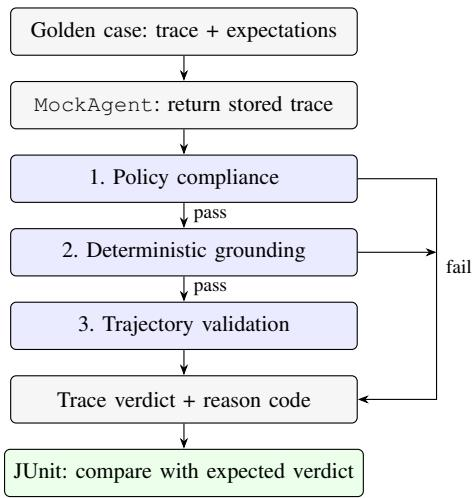
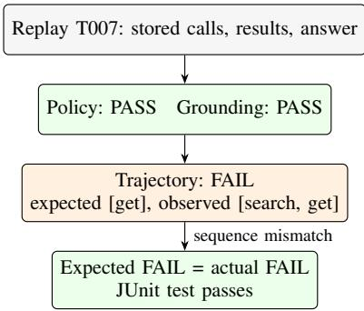

# AgentTrustCI: Build-Time Policy, Grounding, and Trajectory Tests for Java LLM Agents

Sachin Gupta

Independent Researcher

San Jose, California, USA

sachinkg12@gmail.com

Abstract—Infrastructure security does not establish whether an LLM agent selected an allowed tool, grounded its answer in tool output, or followed a required workflow. AgentTrustCI is a Java/JUnit 5 framework that expresses these applicationlayer expectations as policy, grounding, and trajectory checks over recorded traces. A deterministic replay implementation supports repeatable build-time tests; a judge interface provides an extension point for optional semantic evaluation. On 55 synthetic cases spanning seven enterprise domains, the full pipeline correctly classifies all 30 injected faults and 25 passing controls, including ten non-trivial controls, and misses none of 12 designated critical cases. Each single-layer configuration correctly classifies 35 cases because the corpus deliberately isolates ten faults per layer. A grounded answer obtained through a disallowed sequence illustrates the additional coverage of trajectory checks. Repeated measurements quantify validator execution separately from process startup and reporting. These results establish coverage of the authored regression suite, not production accuracy. We describe a production-trace validation protocol, optional LLM-judge integration, and maintenance of expectations as workflows evolve. The contribution is a practical pattern for expressing behavioral contracts within an existing[ Java release pipeline.

Index Terms—LLM agents, software testing, continuous integration, policy compliance, answer grounding, trajectory validation, enterprise Java.

## I. INTRODUCTION

An agent can run in an attested, isolated environment and still choose the wrong tool, expose a restricted field, fabricate a result, or skip an approval step. Confidential computing protects aspects of the execution environment [1]; a release engineer also needs evidence that the application’s behavior satisfies its tool and workflow expectations.

For example, an agent asked to search support tickets may call ticket.close, pass a search tool the forbidden parameter includePrivateNotes, or invent an identifier absent from every tool response. An agent may also produce a grounded answer after following a disallowed sequence. A final-answer check alone provides insufficient evidence about these execution decisions. Conventional tests can encode such expectations, but a test suite must explicitly observe calls, results, and ordering to exercise them.

AgentTrustCI expresses three expectation classes as repository-local regression tests: policy constrains tools and parameters, grounding checks selected answer claims against tool output, and trajectory constrains the sequence of calls. The implementation is a small Java/JUnit 5 prototype that evaluates recorded traces without invoking an LLM. Its contributions are a declarative trace-and-expectation representation, a layered validator with diagnostic reason codes, and an executable evaluation that isolates the contribution of each layer.

TABLE I  
EXPECTATION CLASSES AND REPRESENTATIVE FAILURES
<table><tr><td>Layer</td><td>Expectation</td><td>Failure example</td></tr><tr><td>Policy</td><td>Allowed tools and parameter constraints</td><td>Close instead of search; for- eign user ID; forbidden field request</td></tr><tr><td>Grounding</td><td>Selected answer claims sup- ported by tool results</td><td>Invented ticket ID, quota- tion, or quantity; restricted- field name disclosure</td></tr><tr><td>Trajectory</td><td>Required order and forbid- den/repeated steps</td><td>Update before read; skipped lookup; grounded answer via an unapproved path</td></tr></table>

The scope is build-time testing. The supplied replay suite tests validator behavior on fixed fixtures; detecting a regression in an evolving agent requires capturing traces from the candidate agent version and evaluating them against independently maintained expectations. Passing the supplied fixtures alone does not establish that a changed agent behaves correctly. Runtime controls and monitoring remain necessary for behavior outside the regression suite.

## II. MOTIVATION AND FAILURE TAXONOMY

Table I groups the failures exercised by the prototype. Policy checks address tool allowlists, denylists, required and forbidden parameters, and enumerated values. Grounding checks detect specified lexical patterns associated with fabricated identifiers, quotations, quantities, restricted-field names, and unsupported action claims. Trajectory checks address missing, reordered, repeated, or forbidden steps.

The three layers observe different evidence, but real failures need not belong to disjoint classes. An administrative override could violate both a tool policy and a trajectory rule. For the controlled evaluation, each injected fault is deliberately visible to one layer only. This design makes the ablation interpretable; it does not imply that a layer has a fixed detection ceiling or that production failures are independent.

The motivating right-answer-wrong-path case is a catalog request whose contract permits only a direct catalog.get.

  
Fig. 1. Implemented replay and validation pipeline. A failing layer shortcircuits trace evaluation. JUnit fails on a verdict mismatch; correctly rejecting a negative fixture is a passing test.

A trace containing catalog.search followed by catalog.get can return a correct product description while violating that contract. Whether the additional search is acceptable is a workflow-owner decision, encoded in the case rather than inferred from answer plausibility.

## III. FRAMEWORK OVERVIEW

A golden case contains the user request, domain, allowed and forbidden tools, parameter rules, filtered-field names, trajectory expectations, expected decision, fault label, and a ToolTrace. The trace records ordered tool calls with parameters, tool results indexed by invocation, and the final answer. A case can also be designated critical or a non-trivial passing control.

The supplied MockAgent returns the case’s stored trace. The facade then applies policy, grounding, and trajectory checks in that order (Fig. 1). Evaluation stops at the first failure and emits a layer-prefixed reason code. A trace receives PASS only when every active layer passes.

Trace rejection and build failure are distinct. For a negative fixture labeled FAIL, a FAIL verdict is the correct outcome and the corresponding JUnit test passes. The test fails when the actual and expected decisions disagree. For a newly captured candidate trace that is expected to comply, a violation therefore fails its PASS-expected test. The experiment runner additionally enforces aggregate correctness and critical-miss thresholds.

Extension boundary. Validators accept a golden case and trace directly. AnswerSafetyValidator also accepts a SafetyJudge implementation through its constructor. The supplied facade constructs a deterministic judge and a replay agent internally. A live-agent adapter or facade wiring for another judge requires additional integration; neither a LangChain4j runtime nor an LLM-backed judge is included in the evaluated prototype.

Algorithm 1 PolicyComplianceCheck   
1: input: golden case g, trace t   
2: for call c in t.toolCalls do   
3: if g.allowedTools ̸= ∅ and c.tool is not allowed then   
4: return FAIL(TOOL NOT ALLOWED)   
5: end if   
6: if c.tool ∈ g.forbiddenTools then   
7: return FAIL(TOOL FORBIDDEN)   
8: end if   
9: r ← parameter rule for c.tool, if present   
10: if r exists then   
11: for required key k in r do   
12: if c[k] is absent, null, or a blank string then   
13: return FAIL(PARAM MISSING)   
14: end if   
15: end for   
16: if any forbidden key in r is present in c then   
17: return FAIL(PARAM FORBIDDEN)   
18: end if   
19: for enumerated key k with allowed values V in r do   
20: if c[k] is non-null and string(c[k]) ∈/ V then   
21: return FAIL(PARAM VALUE INVALID)   
22: end if   
23: end for   
24: end if   
25: end for   
26: return PASS

## IV. ALGORITHMS

Algorithms 1–3 summarize the implemented checks. Reason names below receive the prefixes POLICY\_, SAFETY\_, or TRAJ\_ at the facade. Each validator returns on its first violation.

## A. Policy Compliance

An empty tool allowlist imposes no allowlist restriction; a denylist still applies. Required parameters must have nonnull values and, for strings, must not be blank. Forbidden parameters are rejected by key presence even when their values are false. Enumerated values are checked only when a value is non-null, so presence must be required separately. The prototype represents user scope through case-specific allowed values; it does not authenticate the requesting principal or resolve a production authorization policy.

## B. Deterministic Answer Grounding

The identifier pattern is \b[A-Z]+-\d+\b and the quantity pattern is \b\d{2,}\b. These extract uppercase identifier-like tokens and multi-digit integer tokens. Matching against the flattened tool-result corpus uses case-insensitive substring containment for identifiers and quoted spans. The corpus includes result keys and recursively flattened keys and values. Write hints include update, set, close, delete, create, enable, disable, approve, and reject.

Algorithm 2 AnswerGroundingCheck (deterministic) Algorithm 3 TrajectoryValidation   
1: input: golden case g, trace t 1: input: golden case g, trace t   
2: a ← t.finalAnswer 2: r ← g.trajectory   
3: if a is null or blank then 3: if r is absent then   
4: return FAIL(EMPTY ANSWER) 4: return PASS   
5: end if 5: end if   
6: l ← lowercase(a) 6: A ← [c.tool for c in t.toolCalls]   
7: for filtered field name f in g do 7: F ← r.forbiddenIntermediates   
8: if l contains lowercase(f) then 8: if any element of A is in F then   
9: return FAIL(FILTERED FIELD LEAKED) 9: return FAIL(FORBIDDEN INTERMEDIATE)   
10: end if 10: end if   
11: end for 11: for tool u in r.noRepeats do   
12: s ← lowercase(flatten(t.toolResults)) 12: if count $( A , u ) > 1$ then   
13: for ID-pattern match i in a do 13: return FAIL(REPEATED TOOL)   
14: if s does not contain lowercase(i) then 14: end if   
15: return FAIL(FABRICATED ID) 15: end for   
16: end if 16: E ← r.expectedSequence   
17: end for 17: if E = ∅ then   
18: for quoted span q of length $\geq 3$ in a do 18: return PASS   
19: if s does not contain lowercase(q) then 19: end if   
20: return FAIL(FABRICATED QUOTE) 20: if r.relaxed then   
21: end if 21: if E is not an ordered subsequence of A then   
22: end for 22: return FAIL(MISSING REQUIRED TOOL)   
23: for quantity-pattern match n in a do 23: end if   
24: if s does not contain n then 24: else   
25: return FAIL(FABRICATED QUANTITY) 25: if A ̸= E then   
26: end if 26: return FAIL(SEQUENCE MISMATCH)   
27: end for 27: end if   
28: w ← any called tool name contains a write hint 28: end if   
29: v ← l contains a monitored action phrase 29: return PASS   
30: if v and ¬w then   
31: return FAIL(UNSUPPORTED ACTION CLAIMED)   
32: end if Full evaluation computes Full evaluation computes $P ( g , t )$ , then , then $G ( g , t )$ , then , then $T ( g , t )$   
33: return PASS returning the first FAIL or PASS when all three pass. For each returning the first FAIL or PASS when all three pass. For each

Monitored phrases include “updated successfully” and “closed the ticket.”

These are lexical checks, not general semantic entailment. A matching substring may concern another entity; an unquoted paraphrase or a sensitive value disclosed without its field name may escape detection. A write-like tool name does not prove successful execution. Conversely, mentioning a filtered field name in a refusal can trigger a false alarm. These boundaries motivate an optional semantic judge and human-reviewed cases (Section VIII-B).

## C. Trajectory and Aggregation

Strict trajectory matching requires exact tool-name sequence equality. Relaxed matching requires the expected sequence to appear in order while allowing interleaved calls. Forbiddenintermediate and no-repeat checks precede both modes; an empty expected sequence disables sequence comparison but not these explicit guards. The trajectory validator does not check data dependencies between calls or support concurrent partial-order traces.

fixture, test correctness is $\mathbf { 1 } [ d _ { \mathrm { a c t u a l } } = d _ { \mathrm { e x p e c t e d } } ]$ . Single-layer configurations invoke only their respective validator. The finalanswer baseline checks only whether the answer is non-empty. Thus the framework separates a trace’s acceptability from the correctness of the test oracle’s classification.

## V. IMPLEMENTATION

Build and data model. The prototype uses Java 17-compatible source, Maven, JUnit 5.10.2 [2], and SnakeYAML. Golden cases reside in src/test/resources/golden/cases.yaml. Six test classes execute 240 passing tests: four classes contribute 4 × 55 case evaluations, the mode-behavior class contributes 17 tests, one test checks corpus coverage, and two reporting tests verify fractional-millisecond serialization and averaging.

Trace integration. A deployment adapter would map the candidate agent’s ordered calls, parameter maps, tool outputs, and answer into ToolCall and ToolTrace. LangChain4j [3] is one possible source of these events. The evaluated implementation performs deterministic fixture replay; it contains no live-agent capture adapter and makes no tool or LLM network calls during evaluation.

  
Fig. 2. Evaluation of the negative control T007. The rejected trace carries TRAJ\_SEQUENCE\_MISMATCH; matching the expected rejection makes the fixture test pass.

Worked case. Listing 1 shows T007. Policy passes because both calls are allowed. The grounding validator passes because the identifier and answer have supporting tool data. Strict trajectory validation rejects the extra search. Fig. 2 shows the implemented replay and test comparison, without implying that replay invokes a tool runtime.

```yaml
Listing 1. T007: grounded answer, disallowed trajectory.
case_id: T007
domain: catalog
user_request: "Get product details for SKU-42."
allowed_tools: [catalog.search, catalog.get]
expected_trajectory: [catalog.get]
expected_decision: FAIL
fault_type: right_answer_wrong_path
critical: false
mock_trace:
tool_calls:
- tool: catalog.search
parameters: {query: "wireless mouse"}
- tool: catalog.get
parameters: {sku: "SKU-42"}
tool_results:
"catalog.search#0":
{results: [{sku: "SKU-42"}]}
"catalog.get#1":
{sku: "SKU-42", name: "wireless mouse"}
final_answer: "SKU-42 is a wireless mouse."
```

Experiment and CI entry points. The Java main evaluates six mode names over all 55 cases and writes 330 CSV rows plus a Markdown summary. GitHub Actions runs the JUnit suite and the experiment shell script. The script enforces a default full-mode correctness threshold of 95% and at most zero missed critical FAIL-expected cases. These aggregate gates supplement the stricter per-fixture JUnit comparisons. Reason prefixes identify the first rejecting layer; a compound failure would require separate layer evaluation to enumerate every violation.

## VI. EVALUATION

## A. Corpus and Experimental Scope

The evaluation asks whether the implemented validators recognize authored violations and accept non-trivial valid traces. It uses 55 synthetic cases across support tickets (20), catalog (8), inventory (7), profiles (6), feature flags (5), audit search (5), and notification preferences (4). The set contains 30 single-fault cases, 15 original PASS controls, and ten additional tricky PASS controls. Twelve of the fault cases are marked critical by the case author.

TABLE II  
NON-TRIVIAL PASS CONTROLS; ALL TEN PASS FULL EVALUATION
<table><tr><td>Case</td><td>Behavior exercised</td></tr><tr><td>K001</td><td>Harmless additional answer metadata</td></tr><tr><td>K002</td><td>Optional tool correctly skipped</td></tr><tr><td>K003</td><td>Extra read accepted by a relaxed read-update sequence</td></tr><tr><td>K004</td><td>Non-default but permitted enum value</td></tr><tr><td>K005</td><td>Repeated read with no no-repeat constraint</td></tr><tr><td>K006</td><td>Paraphrased natural-language summary</td></tr><tr><td>K007</td><td>Optional audit lookup</td></tr><tr><td>K008</td><td>Public-field answer with a filtered field in tool output</td></tr><tr><td>K009</td><td>Correct read-before-write update</td></tr><tr><td>K010</td><td>Extra parameter neither required nor forbidden</td></tr></table>

Each fault is isolated to one designated layer. For example, a pure policy fault may leave the expected trajectory empty to avoid a second rejection. A trajectory-only case may allow an intermediate tool at the policy layer while forbidding it in the trajectory rule. This controlled construction tests coverage and separation of checks, but the cases are neither independently sampled production executions nor a held-out generalization benchmark. No live model was used to generate evaluation results.

Table II checks selected situations that overly restrictive rules could reject. K006 passing does not demonstrate general paraphrase understanding; its answer simply satisfies the implemented lexical checks. Similarly, K008 tests the authored public-field answer, not comprehensive detection of sensitive values.

## B. Configurations and Metrics

We compare five distinct configurations: a non-emptyanswer check (Final), deterministic answer grounding (Grounding), policy validation (Policy), trajectory validation (Trajectory), and the ordered three-layer pipeline (Full). The legacy JUDGE\_ONLY name aliases ANSWER\_GROUNDING\_ONLY; both produce identical decisions and reason codes. The alias remains in the 330-row artifact but is not an independent baseline. No configuration in this evaluation uses an LLM judge.

Correct counts agreement with the case’s expected decision. Detected faults counts FAIL-expected traces that are rejected. False fails counts PASS-expected traces that are rejected, and missed critical counts critical FAIL-expected traces that are accepted. Layer-specific detection counts come from the reasoncode prefix. The final-answer configuration is a deliberately weak sanity baseline, not a comparison against contemporary semantic evaluators.

## VII. RESULTS

## A. Detection and Safe Controls

Full evaluation correctly classifies all 55 cases: 30/30 injected faults are rejected, all 25 PASS controls are accepted, and none of the 12 designated critical faults is missed (Table III). All ten tricky controls pass. The single-layer configurations each classify 35/55 = 63.6% correctly: 25 controls and ten faults in their assigned class. Their other 20 faults are missed by construction. These results demonstrate complementary coverage on this corpus rather than a universal performance ceiling for individual validators.

TABLE III  
DECISIONS ON THE 55-CASE SYNTHETIC CORPUS
<table><tr><td>Configuration</td><td>Correct /55</td><td>Faults caught /30</td><td>False fails /25</td><td>Critical misses /12</td></tr><tr><td>Final</td><td>25</td><td>0</td><td>0</td><td>12</td></tr><tr><td>Grounding</td><td>35</td><td>10</td><td>0</td><td>9</td></tr><tr><td>Policy</td><td>35</td><td>10</td><td>0</td><td>5</td></tr><tr><td>Trajectory</td><td>35</td><td>10</td><td>0</td><td>10</td></tr><tr><td>Full</td><td>55</td><td>30</td><td>0</td><td>0</td></tr></table>

TABLE IV  
FULL-MODE DETECTION BY INJECTED FAULT TYPE
<table><tr><td>Layer</td><td>Fault type</td><td>Detected / cases</td></tr><tr><td>Policy</td><td>Forbidden tool</td><td>1/1</td></tr><tr><td></td><td>Missing parameter</td><td>2/2</td></tr><tr><td></td><td>Forbidden parameter</td><td>3/3</td></tr><tr><td></td><td>Invalid enum</td><td>2/2</td></tr><tr><td></td><td>Out-of-scope user</td><td>1/1</td></tr><tr><td></td><td>Administrative tool</td><td>1/1</td></tr><tr><td>Grounding</td><td>Fabricated identifier</td><td>1/1</td></tr><tr><td></td><td>Fabricated quotation</td><td>3/3</td></tr><tr><td></td><td>Fabricated quantity</td><td>1/1</td></tr><tr><td></td><td>Filtered-field disclosure</td><td>3/3</td></tr><tr><td></td><td>Unsupported action claim</td><td>2/2</td></tr><tr><td>Trajectory</td><td>Skipped lookup</td><td>3/3</td></tr><tr><td></td><td>Update before read</td><td>2/2</td></tr><tr><td></td><td>Forbidden intermediate</td><td>2/2</td></tr><tr><td></td><td>Repeated tool</td><td>1/1</td></tr><tr><td></td><td>Wrong branch</td><td>1/1</td></tr><tr><td></td><td>Right answer, wrong path</td><td>1/1</td></tr></table>

Table IV reports the underlying fault counts. T007 is accepted by the final-answer, policy, and grounding configurations, and rejected by trajectory and Full. Case P002 provides the complementary policy example: a search request leads to ticket.close and a grounded statement that the ticket was closed. Full emits POLICY\_TOOL\_NOT\_ALLOWED. Both are negative fixtures whose correct rejection is a successful JUnit outcome.

Policy, grounding, and trajectory alone miss five, nine, and ten critical cases, respectively; the final-answer baseline misses all twelve. The critical designation covers the authored administrative, cross-user, disclosure, and workflow violations. It is a case-author label rather than a measured incidentseverity distribution.

## B. Execution Cost

The timing study uses the 55-case corpus on an Apple M2 Max with 96 GB RAM, macOS 26.2, OpenJDK 21.0.12.1, and Maven 3.9.14. Java is run with a fixed 256 MB initial and maximum heap. For each of five fresh JVM processes, we perform 200 warm-up passes followed by 300 measured passes through all 55 cases and five distinct configurations. Mode and case order are shuffled each pass with recorded seeds. This yields 82,500 timed evaluations per configuration; repeated evaluations do not increase the number of distinct test cases.

TABLE V  
WARMED TRACE-EVALUATION LATENCY; 82,500 SAMPLES PER MODE
<table><tr><td>Configuration</td><td>Mean  $\mathbf { \mu } ( \mu \mathbf { s } )$ </td><td>Median (µs)</td><td>P95 (µs)</td></tr><tr><td>Final</td><td>0.057</td><td>0.042</td><td>0.084</td></tr><tr><td>Grounding</td><td>2.498</td><td>2.167</td><td>4.583</td></tr><tr><td>Policy</td><td>0.673</td><td>0.291</td><td>2.083</td></tr><tr><td>Trajectory</td><td>0.576</td><td>0.375</td><td>1.084</td></tr><tr><td>Full</td><td>3.369</td><td>3.083</td><td>6.333</td></tr></table>

Each sample measures evaluate() with System.nanoTime(), preserving integer nanoseconds until aggregation. Timing includes in-memory replay and the active validators. YAML loading, warm-up, shuffling, sample recording, and report I/O are excluded. All observations, including outliers, are retained. The report writer also preserves fractional milliseconds.

The warmed full pipeline has a mean of 3.369 µs and a 95th percentile of 6.333 µs (Table V); its largest observed sample is 1.038 ms. These describe small in-memory fixtures, not a worst-case bound. Across five separate fresh-process runs, the CLI takes a mean of 0.158 s (range 0.146–0.172 s) to start the JVM, load YAML, perform all 330 evaluations including the alias, and write reports. Maven build/test time and live-agent inference are outside that interval. A separate cached build, test, and classpath-preparation run takes 3.539 s. No claim is made about end-to-end costs for larger or production traces.

## VIII. ENTERPRISE INTEGRATION AND EVOLUTION

## A. Capturing Candidate Traces

A practical release workflow has two inputs: expectations maintained by workflow owners and traces captured from the candidate agent. A proposed adapter records tool names, parameters, invocation order, results, and the answer in a staging or controlled replay environment, together with the agent commit, prompt/model configuration, tool schema, and policy version. It must preserve result-to-call association and flag incomplete or failed captures. The current data model does not validate trace completeness or authenticity.

The team then evaluates the captured trace against its reviewed contract. Live capture may occur in an integration or scheduled job; the ordinary validator suite can remain deterministic. Fixed negative fixtures continue to test the gate itself. Replacing expectations automatically with the latest observed behavior would erase the distinction between a regression and an approved change, so promotion of a new fixture requires review. This capture-and-promotion workflow is proposed integration guidance, not an evaluated feature of the prototype.

## B. Optional Live LLM Judges

A semantic judge can complement the lexical checks for paraphrased fabrications, unsupported summaries, and context-dependent disclosures. The existing extension point is SafetyJudge.judge(case, trace), injected into AnswerSafetyValidator; a team must also wire that validator into its evaluation harness. No such LLM-backed implementation is shipped or evaluated here.

A proposed integration supplies the judge with the answer, relevant tool evidence, and an explicit grounding rubric, re questing a structured verdict and evidence references. Tool text should be treated as untrusted evidence rather than instructions. The model identifier, prompt, rubric, decoding settings, and response should be versioned. Version pinning and low sampling temperature improve auditability but do not guarantee identical live responses. Known LLM-judge biases and reasoning limitations [4] motivate calibration against independent human labels, repeated assessment of borderline cases, and reporting disagreement by fault class.

An initial deployment should run this judge as a separate advisory or scheduled stage while preserving deterministic policy and trajectory checks. It should record latency, token cost, timeout/invalid-response rates, and judge–human agreement. A timeout or malformed response should be marked unassessed and routed for review, rather than silently mapped to PASS. Disagreement with a deterministic rejection should trigger investigation, not automatically override that rejection. These operational measures require validation before a live judge becomes a release gate.

## C. Maintaining Evolving Workflows

Strict and relaxed trajectory modes already offer two maintenance choices. Strict matching is suitable when every step is prescribed. Relaxed matching permits additional calls while preserving the required order, subject to policy constraints, forbidden intermediates, and no-repeat guards. K003 demonstrates profile.read, another read, then profile.update satisfying a relaxed read–update sequence. Relaxed matching does not itself prove that an additional allowed step is harmless.

For a legitimate workflow change, owners should review an expectation diff together with its rationale, policy/schema version, and examples of newly valid and still-invalid traces. Old and new expectations can be evaluated side by side during migration, retaining critical negative cases and adding approved alternative paths as distinct fixtures. Unexpected behavior should not update a golden sequence automatically. Branching workflows, concurrency, data-dependent approvals, and automatic migration are not implemented; extending beyond linear sequences would require richer contracts and separate evaluation.

## IX. LIMITATIONS AND PRODUCTION VALIDATION

External validity. The 55 cases are authored, small, and intentionally separated by fault class. Zero false failures among 25 controls does not estimate a production false-positive rate, and 30 detected faults do not establish coverage of unseen attacks. No production traces, live agents, or independent realworld datasets were evaluated. Tool outputs are assumed to be available and trusted as the reference corpus; a factually incorrect or attacker-controlled tool response can undermine grounding checks.

Proposed validation protocol. A larger study should collect authorized, sanitized traces across multiple workflow versions and operational domains while preserving ordering and referential relationships. It should distinguish naturally observed failures from deliberately injected mutations. Two domain reviewers should independently label compliance and fault classes, resolve disagreements, and record ambiguous cases. Splits should be by workflow, version, or time so that nearduplicate traces do not appear in both policy-development and held-out evaluation sets.

Evaluation should freeze the validators and contracts before scoring held-out traces, report corpus size and composition by domain, and include valid exceptions, tool errors, compound faults, longer paths, and drift after workflow changes. Report fault recall, false-failure rates, critical misses, annotation agreement, and uncertainty appropriate to the sampling scheme, alongside latency by trace length and result size. Compare against independently implemented taskspecific checks and, where applicable, a calibrated semantic judge. Public agent benchmarks can supply additional external scenarios, but adapted benchmark traces should not be described as production data. This protocol is future work; the present revision makes no claim that it has been executed.

Operational boundaries. Heuristic grounding cannot establish general semantic correctness, action success, or complete sensitive-data protection. The first-failure policy can mask additional violations. Linear tool-name trajectories do not express concurrent dependencies. The evaluation measures a validator over stored traces and cannot predict every behavior a live model may produce. AgentTrustCI therefore complements runtime authorization, monitoring, and human review.

## X. RELATED WORK

AgentDojo [5] and InjecAgent [6] evaluate tool-using agents under prompt-injection attacks. Their scope motivates external adversarial evaluation, whereas the present corpus exercises repository-local expectations through controlled fixtures. Tool-LLM’s ToolBench and ToolEval [7] address tool-use data and evaluation; ReAct [8] interleaves reasoning and actions. These approaches make execution paths relevant to assessment, while AgentTrustCI expresses selected path constraints as JUnit assertions.

RAGAS [9], TruLens [10], LangSmith [11], and OpenAI Evals [12] provide complementary evaluation methods or infrastructure. Their capabilities should not be reduced to finalanswer-only checks or assumed to require a live judge in every configuration. AgentTrustCI’s contribution is the explicit combination of policy, lexical grounding, and trajectory checks in a compact Java build artifact. The present ablation compares its internal configurations, not those external frameworks.

DevSecOps integrates security checks into delivery workflows [13]. AgentTrustCI applies a similar release-testing pattern to behavioral trace expectations. It does not claim the first agent evaluator, trajectory method, or semantic judge, and it does not replace infrastructure security or live enforcement.

## XI. CONCLUSION

AgentTrustCI turns policy, grounding, and trajectory expectations into deterministic Java/JUnit regression tests over agent traces. On the authored 55-case corpus, the combined pipeline detects all 30 injected faults, accepts all 25 controls, and misses none of 12 designated critical cases. The grounded-butoff-path example demonstrates why execution order can matter even when answer evidence appears sufficient. Repeated measurements show low overhead for these small in-memory fixtures, with process-level costs reported separately. Production validity, semantic judging, and richer evolving workflows remain explicit evaluation and integration tasks. The practical result is a reproducible pattern for making selected agent behavior contracts reviewable and testable within CI.

## REPRODUCIBILITY

The public baseline is https://github.com/sachinkg12/ agenttrustci, commit ${ \tt d } 2 \tt { f f c } 2 8$ . From the repository root:

mvn clean test   
./experiments/run-experiments.sh

The second command writes the decision CSV and summary. The accompanying camera-ready artifact preserves the corpus and validator logic, corrects fractional timing, and includes the repeated-measurement harness:

python3 experiments/benchmark/run\_timing.py

The harness stores raw nanosecond samples, environment metadata, and summaries. It uses offline Maven after dependencies are cached; initial dependency acquisition and repository cloning require network access. Validator evaluation requires no LLM credentials. Decisions and reason codes are deterministic for fixed inputs; elapsed times vary. The original suite has 238 tests and the supplied revision has 240, including two reporting checks.

## ACKNOWLEDGMENT

The author thanks the anonymous reviewers for suggestions on production validation, semantic judges, and workflow evolution.

## REFERENCES

[1] Confidential Computing Consortium, A Technical Analysis of Confidential Computing, v1.3, Nov. 2022. [Online]. Available: https:// confidentialcomputing.io/resources/

[2] S. Bechtold, S. Brannen, J. Link, M. Merdes, M. Philipp, J. de Rancourt, and C. Stein, JUnit 5 User Guide, v5.10.2, JUnit Team. [Online]. Available: https://docs.junit.org/5.10.2/user-guide/index.html

[3] “LangChain4j: Java implementation of LangChain,” open-source project. [Online]. Available: https://github.com/langchain4j/langchain4j

[4] L. Zheng et al., “Judging LLM-as-a-judge with MT-Bench and Chatbot Arena,” in Advances in Neural Information Processing Systems, vol. 36, 2023. [Online]. Available: https://arxiv.org/abs/2306.05685

[5] E. Debenedetti et al., “AgentDojo: A dynamic environment to evaluate prompt injection attacks and defenses for LLM agents,” 2024, arXiv:2406.13352. [Online]. Available: https://arxiv.org/abs/2406.13352

[6] Q. Zhan et al., “InjecAgent: Benchmarking indirect prompt injections in tool-integrated large language model agents,” 2024, arXiv:2403.02691. [Online]. Available: https://arxiv.org/abs/2403.02691

[7] Y. Qin et al., “ToolLLM: Facilitating large language models to master 16000+ real-world APIs,” 2023, arXiv:2307.16789. [Online]. Available: https://arxiv.org/abs/2307.16789

[8] S. Yao et al., “ReAct: Synergizing reasoning and acting in language models,” in Proc. Int. Conf. Learning Representations (ICLR), 2023. [Online]. Available: https://arxiv.org/abs/2210.03629

[9] S. Es, J. James, L. Espinosa-Anke, and S. Schockaert, “RA-GAS: Automated evaluation of retrieval augmented generation,” 2023, arXiv:2309.15217. [Online]. Available: https://arxiv.org/abs/2309.15217

[10] TruEra, “TruLens: Evaluation and tracking for LLM apps,” open-source project. [Online]. Available: https://github.com/truera/trulens

[11] LangChain, “LangSmith: A unified observability and evaluation platform for LLM applications,” open-source documentation. [Online]. Available: https://docs.smith.langchain.com

[12] OpenAI, “OpenAI Evals: A framework for evaluating large language models,” open-source project. [Online]. Available: https://github.com/ openai/evals

[13] R. N. Rajapakse, M. Zahedi, M. A. Babar, and H. Shen, “Challenges and solutions when adopting DevSecOps: A systematic review,” Information and Software Technology, vol. 141, art. 106700, 2022. [Online]. Available: https://doi.org/10.1016/j.infsof.2021.106700