# BEAKER: An Expert-Curated Benchmark for Embodied Brains in Self-Driving Chemical Laboratories

Fei Lin1,2,3,\*,† Tengchao Zhang1,2,\* Ziyang Gong1,3,\* Xiaotong Yu4 Bohan Zhang2 Yifan Zhou3 Qihao Yang3 Ji Dai5 Dong Li2 Yining Jiang2 Qinghua Ni2 Jun Huang2 Qiang Zhang6 Yue Zhou7 Zhihang Zhong3 Yonglin Tian8,✉ Fei-Yue Wang2,8,✉ Xue Yang3,✉

1HydroSophy 2Macau University of Science and Technology 3Shanghai Jiao Tong University

4Institute of Process Engineering, Chinese Academy of Sciences 5Ningbo University

6Dalian University of Technology 7East China Normal University

8Institute of Automation, Chinese Academy of Sciences

\*Equal contribution. †Project lead. ✉Corresponding authors.

## Abstract

Self-Driving Chemical Laboratories (SDCLs) are moving chemical experimentation toward embodied automation, where machines must perceive laboratory scenes, reason about experimental states, and act under physical, procedural, and safety constraints. Although Multimodal Large Language Models (MLLMs) are increasingly considered as embodied brains for such systems, existing laboratory benchmarks mainly focus on safety, anomaly detection, or general scientific understanding, leaving their execution-oriented embodied capabilities underexplored. To fill this gap, we introduce BEAKER, a Benchmark for evaluating Embodied Actionability, Knowledge, Experimentation, and Reasoning in SDCLs. BEAKER contains 1,000 expert-curated question-answer samples across 11 image and video task types, covering key judgments required for chemical laboratory execution, including afordance grounding, trajectory planning, equipment, state, and safety recognition, apparatus setup, operation and step reasoning, and temporal procedure reasoning. All questions and annotations are manually created and reviewed by chemistry and embodied Artificial Intelligence (AI) experts, without AI-assisted generation or annotation. We evaluate 28 general-purpose, science-oriented, chemistry-specialized, and embodied MLLMs in an ofline, single-turn setting. Results show that current models can follow coarse experimental procedures in videos, but still struggle to ground actions into operable regions and feasible trajectories, to recognize fine-grained laboratory apparatus, states, and safety norms, and to order steps in mid-length procedures. BEAKER thus reveals a clear gap between coarse procedural understanding and the precise, action-grounded perception required for laboratory execution, providing a diagnostic benchmark for future MLLMs in SDCLs.

Code: https://github.com/HydroSophy/BEAKER Dataset: https://huggingface.co/datasets/HydroSophyTech/BEAKER

## 1 Introduction

Self-Driving Chemical Laboratories (SDCLs) are transforming chemical experimentation from manual trial-and-error into closed-loop autonomous discovery, where automated devices execute experiments, observe outcomes, and use data-driven feedback to guide subsequent operations [1–9]. Such systems require more than predefined protocol execution: automated devices must perceive laboratory scenes, understand experimental states, and make execution-relevant judgments under physical, procedural, and safety constraints. Recent advances in Multimodal Large Language Models (MLLMs) serving as embodied brains provide a promising paradigm for this goal, aiming to connect multimodal perception with afordance reasoning, task progress, physical constraints, and action-oriented decision-making [10–17]. However, existing embodied brain studies mainly focus on general robotic and embodied scenarios, while scientific experimental automation remains much less explored.

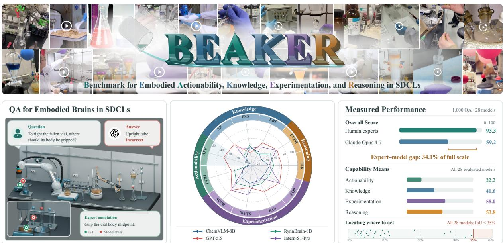

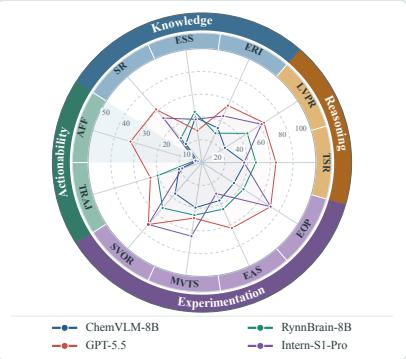

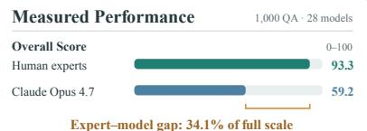

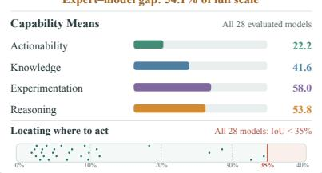  
Figure 1 Overview of BEAKER and key evaluation findings. The radar chart compares four representative models across 11 tasks grouped by capability. All axes use a 0–100 scale except AFF, which uses a 0–50 scale due to uniformly low scores across all models. AFF: Afordance Grounding; TRAJ: Trajectory Planning; ERI: Equipment and Reagent Identification; ESS: Experimental Safety and Standardization; SR: State Recognition; EAS: Experimental Apparatus Setup; EOP: Experimental Operations; SVOR: Short-Video Operation Reasoning; MVTS: Mid-Video Task-Step Reasoning; TSR: Temporal Sequence Reasoning; LVPR: Long-Video Experimental Procedure Reasoning; GT: Ground Truth.

This requirement is non-trivial because chemical experiments are not static visual scenes but procedural, operable, and safety-constrained embodied processes, in which visual information becomes meaningful only in the context of the current execution. The same apparatus, liquid level, connection state, or material change may imply diferent actions, risks, or experimental outcomes depending on the current step, operability, connection correctness, and safety requirements. Recognizing a flask, a liquid interface, or a connected tube is therefore insuficient if a model cannot determine whether the apparatus is ready to operate, whether the connection supports the next step, or whether an observed state change indicates normal progress or potential failure. This raises a central question: can current MLLMs move from laboratory scene understanding to execution-grounded reasoning in chemical experiments?

Recent studies have begun to explore MLLMs in SDCLs, demonstrating their potential in robotic chemical operations, experimental state monitoring, and safety risk identification [18–25]. Meanwhile, emerging laboratory-oriented multimodal benchmarks mainly focus on anomaly detection, hazard identification, safety planning, or general scientific understanding [26–30]. While valuable, they do not systematically assess the embodied capabilities required for automated experimental execution. A suitable benchmark for SDCL-oriented embodied brains should evaluate whether MLLMs can identify operable regions, understand laboratory apparatus and states, track execution steps, and reason about temporal changes and experimental outcomes.

To fill this gap, we introduce BEAKER, short for Benchmark for Embodied Actionability, Knowledge, Experimentation, and Reasoning in SDCLs (Fig. 1). BEAKER decomposes embodied chemical laboratory execution into four core capabilities, each evaluated through expert-designed Question-Answering (QA) tasks. Actionability concerns whether a model understands operable regions, interaction possibilities, and motion feasibility. Knowledge concerns whether it recognizes laboratory apparatus, experimental states, and procedural norms. Experimentation concerns whether it understands experimental operations, apparatus connections, and step progression. Reasoning concerns whether it can infer temporal changes, procedural consequences, and experimental outcomes. Together, these dimensions provide an execution-oriented framework for evaluating whether MLLMs can support automated chemical experimentation beyond passive scene understanding.

Specifically, we collect more than 10,000 publicly available real-world images and videos related to chemical laboratories. Most samples are collected from first-person or experiment-execution-related viewpoints, covering diverse chemical laboratory scenes and workbenches. All samples are jointly selected, reviewed, and annotated by chemistry experts and embodied Artificial Intelligence (AI) experts. The resulting BEAKER dataset contains 1,000 carefully designed QA samples, covering seven image-based task types and four video-based task types. All questions are manually authored by human experts according to chemical laboratory execution contexts, without using AI tools for sample selection, question generation, or annotation, thereby reducing the self-bias that may arise from the MLLM-as-benchmark-generator paradigm. These tasks do not merely test chemical commonsense or laboratory object recognition; instead, they evaluate, in an ofline, single-turn setting, the execution-grounded perception and reasoning on which closed-loop SDCL execution depends.

We further evaluate 28 mainstream MLLMs on BEAKER, including general-purpose, science-oriented, chemistry-specialized, and embodied multimodal models. The results reveal that current models can follow coarse procedural progress in experimental videos, but still struggle with execution-oriented judgments. In particular, localizing fine-grained operable regions, planning feasible trajectories, recognizing domainspecific apparatus, reagent states, and safety norms, and ordering steps in mid-length procedures remain challenging, while science-oriented and chemistry-specialized models do not consistently outperform general-purpose MLLMs. These findings reveal that domain knowledge alone is insuficient for SDCL execution and that current models still need to ground laboratory observations into operable actions, procedural progress, and experimental outcomes.

In summary, our contributions are as follows:

• We introduce BEAKER, an ofline, single-turn benchmark for evaluating multimodal embodied brains in SDCLs, which organizes chemical laboratory automation capabilities into four core dimensions: Actionability, Knowledge, Experimentation, and Reasoning.

• We construct a multimodal dataset with 1,000 QA samples across 11 key tasks. All samples are manually selected and annotated by domain experts to ensure that the evaluation remains grounded in realistic chemical laboratory execution contexts.

• We evaluate 28 mainstream MLLMs on BEAKER and reveal a clear execution gap: current models can follow coarse experimental procedures, but still struggle with fine-grained action grounding, domainspecific laboratory perception, and mid-length procedural reasoning for SDCL automation.

## 2 Related Work

## 2.1 MLLM-enabled SDCL

General-purpose MLLMs have shown strong abilities in image understanding, video reasoning, and long context modeling [31–37]. Science-oriented MLLMs further incorporate domain-specific scientific data and reasoning tasks [38, 39], while chemistry-specialized MLLMs target molecular structures, reaction images, and cross-modal chemical knowledge [40–43]. In parallel, embodied MLLMs extend vision-language reasoning to physical-action scenarios, such as spatial understanding, afordance detection, trajectory prediction, and task planning [15, 44–46]. These advances make MLLMs potential embodied brains for

Table 1 Comparison with related scientific and laboratory benchmarks. Scale denotes the primary evaluation unit of each work: QA for question-answering samples, tasks for embodied or robotic tasks, pairs for image-text pairs, imgs for images, and Sim. env. for simulation environments. $\checkmark , x ,$ and △ denote full, no, and partial coverage, respectively. Human indicates whether all questions and annotations are authored by human experts without LLM/AI-assisted generation or annotation.
<table><tr><td>Benchmark</td><td>Scale</td><td>SDCL</td><td>Real</td><td>Image</td><td>Video</td><td>Action.</td><td>Know.</td><td>Exper.</td><td>Reason.</td><td>Human</td></tr><tr><td>MaCBench [29]</td><td>1.1k+ QA</td><td>△</td><td></td><td>V</td><td>x</td><td>X</td><td></td><td>△</td><td></td><td></td></tr><tr><td>ExpVid [30]</td><td>7.8k QA</td><td>△</td><td></td><td>X</td><td></td><td>X</td><td></td><td></td><td></td><td>△</td></tr><tr><td>LabUtopia [64]</td><td>30 tasks</td><td>△</td><td>X</td><td></td><td>X</td><td>△</td><td></td><td></td><td></td><td></td></tr><tr><td>AutoBio [65]</td><td>16 tasks</td><td>X</td><td>X</td><td></td><td>X</td><td>△</td><td></td><td></td><td>△</td><td></td></tr><tr><td>Chemistry3D [66]</td><td>Sim. env.</td><td>△</td><td>X</td><td></td><td>X</td><td>△</td><td>L</td><td></td><td>△</td><td></td></tr><tr><td>SDCL Visual Anomaly Dataset [26]</td><td>2.8k pairs</td><td></td><td></td><td></td><td>X</td><td>X</td><td>△</td><td></td><td></td><td></td></tr><tr><td>VLM-based Anomaly Detection [27]</td><td>1.0k imgs</td><td></td><td></td><td></td><td>X</td><td>X</td><td>△</td><td></td><td></td><td></td></tr><tr><td>LABSHIELD [28]</td><td>1.4k QA</td><td></td><td></td><td></td><td>X</td><td>X</td><td></td><td></td><td></td><td>X</td></tr><tr><td>BEAKER (Ours)</td><td>1.0k QA</td><td></td><td></td><td></td><td></td><td></td><td></td><td></td><td></td><td></td></tr></table>

SDCLs. Recent works have applied MLLMs to robotic chemical operations [19, 47], execution-state monitoring with visual inspection and error correction [18], and human-aware laboratory coordination [48]. However, real chemical experiments are dynamic, transparent, step-dependent, and safety-constrained, making visual grounding, state judgment, and error recovery still challenging.

## 2.2 Multimodal Embodied Brains and QA Benchmarks

Multimodal embodied brains [10, 13, 15, 16, 45, 46, 49–55] are high-level cognitive models for physicalaction scenarios, integrating vision, language, and task states for environment understanding, task planning, and execution feedback [56–58]. Multimodal QA benchmarks evaluate perception, knowledge, and reasoning from images, videos, or other visual inputs [59–63]. Recent scientific benchmarks further cover chemical and materials experiment understanding, experiment video reasoning, laboratory embodied interaction, and robotic laboratory simulation [29, 30, 64–66]. However, benchmarks for the execution stage of SDCL-automated devices remain limited, as existing studies mainly address execution-process anomaly detection [26, 27] or laboratory safety reasoning [28]. As shown in Table 1, BEAKER instead targets visual contexts in real chemical experiments and jointly evaluates Actionability, Knowledge, Experimentation, and Reasoning, assessing whether multimodal embodied brains can support automated SDCL execution.

## 3 BEAKER

## 3.1 Design Principles

Autonomous execution in SDCLs requires an embodied brain to close the loop from visual perception to physical action within chemically grounded contexts. Drawing on the classical sense-plan-act paradigm in robotics [67, 68] and its recent extension to language-grounded embodied agents [69, 70], we decompose SDCL execution into four capability dimensions spanning low-level perception to high-level inference, each targeting distinct judgments required in real chemical experiments.

Actionability. Actionability evaluates whether an MLLM can translate laboratory observations into physically actionable afordances and trajectories, which requires identifying operable regions, feasible interactions, and action-relevant motion paths under laboratory constraints.

Knowledge. Reliable action presupposes accurate recognition of laboratory entities and awareness of procedural norms. This dimension evaluates whether a model can identify apparatus and reagents, understand their current states (e.g., liquid phase, precipitate formation, color changes), and judge whether an observed setup conforms to standard experimental practice.

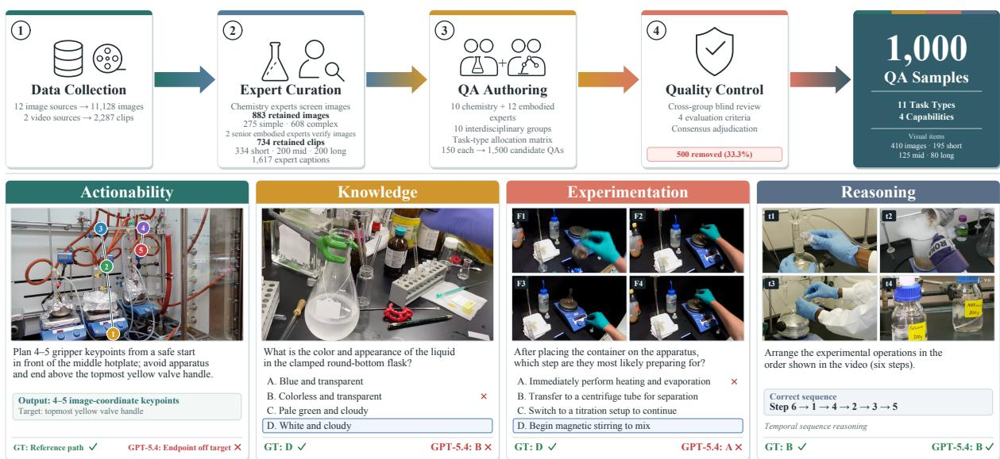  
Figure 2 Overview of BEAKER construction and task examples. Top: the four-stage expert-curated pipeline of data collection, expert curation, QA authoring, and quality control. Bottom: examples of the four capability dimensions with the input, question, Ground Truth (GT), and GPT-5.4 [72] prediction.

Experimentation. An embodied brain must also understand experimental operations as procedural processes [71]. Experimentation evaluates whether a model can recognize ongoing operations, understand apparatus connections, infer procedural intent, and track step-level progress.

Reasoning. Chemical experiments require models to integrate visual evidence, experimental context, and domain knowledge to infer state changes, causal relationships, and experimental outcomes [30]. This dimension evaluates whether a model can reason over temporal observations of varying lengths and interpret experimental results from accumulated evidence, which is essential for closing the decision loop in autonomous SDCL workflows.

## 3.2 Benchmark Construction

Expert-Curated Data Collection. All visual data in BEAKER is collected and filtered entirely by domain experts. For images, we survey publicly available chemical laboratory datasets across academic repositories and community platforms, identifying 12 representative sources covering diverse real-world laboratory scenes (see Appendix A). Chemistry experts screen 11,128 candidate images and retain 883 that reflect realistic execution contexts: 275 simple images featuring a single apparatus or reagent against a clean background, and 608 complex images involving cluttered environments, multi-step setups, or active experimenter operations. Two senior embodied experts then verify that all retained images are suitable for embodied task design. Many images adopt first-person or experiment-execution viewpoints, resembling the visual inputs of automated devices in real SDCL execution.

For videos, 334 short clips (4 s each) are extracted from the egocentric IBM Lab Actions dataset [73]; 200 long experimental recordings (average duration ∼9 min) with accompanying expert-authored transcripts are curated from the Journal of Visualized Experiments (JoVE) Chemistry collection [74]; and mid-length clips are derived from these long videos via a semantic segmentation pipeline (FFmpeg [75] for audio extraction, Whisper [76] for timestamped transcription, and boundary detection between individual experimental steps), producing 1,753 candidate segments, of which experts retain 200 semantically complete clips (average duration ∼50 s). Whisper only provides speech timestamps for proposing candidate segments; it is not involved in sample selection, question authoring, or annotation, all of which are performed by human experts. In total, the curated data pool comprises 883 images and 734 video clips.

Ten chemistry experts then author detailed free-form captions for every item, describing apparatus, reagent states, ongoing operations, and safety-relevant details, yielding 1,617 expert-authored captions. For mid-length and long videos, the JoVE narration transcripts are not directly applicable to constructing BEAKER’s QA data, so experts combine each clip with its transcript to write captions tailored to this benchmark.

Expert Annotation and QA Design. Recent studies show that benchmarks generated by Large Language Models (LLMs) introduce systematic self-bias [77] and that LLM evaluators exhibit self-preference [78]. To reduce reliance on model-generated supervision, all benchmark questions and reference answers are authored and reviewed by human domain experts, without AI-assisted question or answer generation. Our annotation team comprises 10 chemistry experts, who ensure scientific correctness and domain accuracy, and 12 embodied experts, who verify operational relevance and feasibility from a robotic execution perspective. Two senior embodied experts coordinate overall quality control; the remaining 10 are each paired with one chemistry expert to form 10 interdisciplinary annotation groups. To ensure balanced task coverage while minimizing redundant annotations, each group receives the full curated data pool along with a task-type allocation matrix (see Appendix C) specifying its question quota per category. Groups independently select suitable data items and design 150 QA samples each, yielding an initial pool of 1,500 candidate questions across 11 task types. Because all groups draw from the same pool, visually rich items may be selected by multiple groups; the allocation matrix steers these groups toward diferent task types for the same item, increasing per-item competency diversity rather than redundancy.

To calibrate quality and dificulty, we apply a cross-group blind-review protocol inspired by expertvalidation methodologies [79]. Each group’s 150 questions are distributed to two non-originating groups, whose members independently attempt every question without access to the ground-truth answer and evaluate it on four criteria: (i) scientific correctness, (ii) embodied operational relevance, (iii) dificulty calibration, and (iv) answer unambiguity. Reviewers also flag semantic duplicates, i.e., questions from diferent groups that target the same data item and competency, retaining only the highest-rated variant. Flagged questions enter a consensus adjudication round moderated by the two senior embodied experts, in which the originating and reviewing groups jointly decide whether to revise or discard each item. A question is discarded if it is answerable through surface-level visual cues alone (e.g., “What is the color of the rubber-bulb pipette the lab worker is holding?”), reduces to a trivial binary judgment without diagnostic value, demands excessively specialized knowledge beyond graduate-level chemistry, or lacks grounding in embodied execution contexts. Through this process, 500 questions (33.3%) are removed, and the remaining 1,000 constitute the final BEAKER benchmark, drawn from 410 images (152 simple, 258 complex) and 195 short, 125 mid-length, and 80 long videos.

Fig. 2 illustrates this pipeline with task examples, and Fig. 3 summarizes the resulting statistics. The image tasks (600 samples) include two spatial tasks, Afordance Grounding (AFF) and Trajectory Planning (TRAJ), with 150 samples each annotated using the Computer Vision Annotation Tool (CVAT) [80]: AFF follows the point-and-box protocol of RoboBrain 2.0 [15], with fine-grained boxes on precise regions such as stopcock tips and pipette nozzles, and TRAJ is annotated as ordered keypoint sequences. They also include five Multiple-Choice Question (MCQ) categories with 60 samples each (20 simple- and 40 complex-image questions): Equipment and Reagent Identification (ERI), Experimental Safety and Standardization (ESS), State Recognition (SR), Experimental Apparatus Setup (EAS), and Experimental Operations (EOP). The video tasks (400 samples) comprise Temporal Sequence Reasoning (TSR; 150 MCQs), evaluated separately on short, mid-length, and long videos as S-TSR, M-TSR, and L-TSR; Short-Video Operation Reasoning (SVOR; 125 MCQs); Mid-Video Task-Step Reasoning (MVTS; 75 MCQs); and Long-Video Experimental Procedure Reasoning (LVPR; 50 fill-in-the-blank questions requiring domain-specific phrases). The entire pipeline, from data screening through captioning, question authoring, and cross-group validation, spans about 1,200 expert-hours. Even for tasks that overlap with general embodied benchmarks, all questions are grounded in chemical laboratory execution contexts, so BEAKER evaluates domain-specific understanding rather than general visual competence.

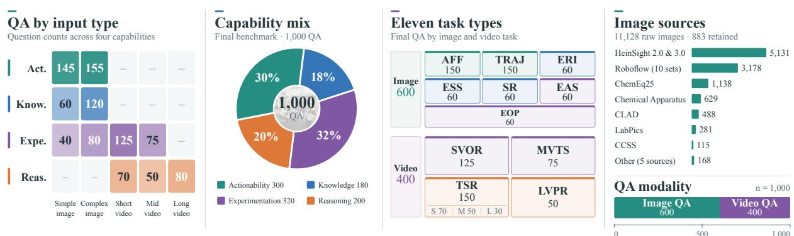  
Figure 3 Statistics of BEAKER. Counts by input type, capability, task, data source, and modality.

To quantify cross-group consistency, we compare spatial annotations from the originating group and an independent reviewing group. On the retained AFF questions, mean box Intersection over Union (IoU) reaches 86.9% and bidirectional point-in-region agreement reaches 100.0%; on the retained TRAJ questions, the mean trajectory agreement score is 85.6/100 (150 questions per task). Appendix D details the metrics and compares candidate and retained annotations.

## 4 Experiments

## 4.1 Benchmarking Procedure

We evaluate 28 mainstream MLLMs on BEAKER, covering general-purpose, science-oriented, chemistryspecialized, and embodied multimodal models, through remote Application Programming Interfaces (APIs) or local deployment on 16 NVIDIA A100 Graphics Processing Units (GPUs). All models are evaluated in a single-turn QA setting with standardized task-specific prompts and output formats (Appendix F) and scored with task-specific metrics (Appendix E). When configurable, the temperature is set to 0.7. All images are input at their original resolution. Short and mid-length videos are represented by 8 and 32 sampled frames, respectively, and long videos by 128 frames arranged into 32 four-frame grids (see Section 4.6 for a frame sampling ablation). The human baseline averages the scores of three chemistry experts who were not involved in any stage of BEAKER construction, each independently answering all 1,000 questions without access to the ground truth.

BEAKER aggregates task scores hierarchically into the four capability dimensions and combines them into the Overall score with expert-defined weights of 0.25, 0.15, 0.35, and 0.25 for Actionability, Knowledge, Experimentation, and Reasoning, respectively. Tasks within each dimension are averaged uniformly, except that Experimentation weights its image-based (EAS, EOP) and video-based (SVOR, MVTS) task groups at a ratio of 2:5. These weights are established through domain-expert consensus to reflect the relative importance of each capability in chemical laboratory execution. All scores are on a 0–100 scale and aggregated before rounding.

## 4.2 Overall Performance

Model-Level Insights. As shown in Table 2, current MLLMs still exhibit limited embodied understanding in SDCL execution contexts. General-purpose MLLMs achieve the strongest overall performance, while chemistry-specialized and science-oriented MLLMs do not consistently outperform them. Embodied brain models gain on some action-related tasks relative to the similarly sized Qwen3-VL-8B, but these gains remain task-specific. The RynnBrain [44] variants behave diferently: relative to their base model

Table 2 Consolidated results on BEAKER. Task scores are grouped by the four capability dimensions, and Overall aggregates them as described in Section 4.1. Model rankings within each column are color-coded: 1st, 2nd, and 3rd; tied scores share the same rank.
<table><tr><td rowspan="2">Model</td><td colspan="2">Actionability</td><td colspan="3">Knowledge</td><td colspan="4">Experimentation</td><td colspan="2">Reasoning</td><td rowspan="2">Overall</td></tr><tr><td>AFF↑</td><td>TRAJ↑</td><td>ERI↑</td><td>ESS↑</td><td>SR↑</td><td>EAS↑</td><td>EOP↑</td><td>SVOR↑</td><td>MVTS↑</td><td>TSR↑</td><td>LVPR↑</td></tr><tr><td>Human</td><td>88.0</td><td>91.0</td><td>96.7</td><td>95.0</td><td>93.3</td><td>93.3</td><td>96.7</td><td>94.4</td><td>92.0</td><td>95.0</td><td>96.0</td><td>93.3</td></tr><tr><td colspan="13">Chemistry-specialized Multimodal Models</td></tr><tr><td colspan="13">Open-source Models</td></tr><tr><td>ChemVLM-8B [40]</td><td>2.1</td><td>21.0</td><td>33.3</td><td>40.0</td><td>21.7</td><td>36.7</td><td>33.3</td><td>36.0</td><td>40.0</td><td>37.9</td><td>24.0</td><td>28.4</td></tr><tr><td>ChemVLM-26B [40]</td><td>3.1</td><td>27.0</td><td>23.3</td><td>25.0</td><td>31.7</td><td>36.7</td><td>33.3</td><td>37.6</td><td>42.7</td><td>42.4</td><td>28.0</td><td>30.1</td></tr><tr><td colspan="10">Science-oriented Multimodal Models</td></tr><tr><td></td><td></td><td></td><td></td><td></td><td></td><td></td><td></td><td></td><td></td><td></td><td></td><td></td></tr><tr><td>Open-source Models Intern-S1 [38]</td><td>3.4</td><td>24.6</td><td>40.0</td><td>25.0</td><td>48.3</td><td>33.3</td><td>48.3</td><td>61.6</td><td>60.0</td><td>41.4</td><td>54.8</td><td>40.5</td></tr><tr><td>Intern-S1-Mini [38]</td><td>1.7</td><td>22.2</td><td>43.3</td><td>38.3</td><td>43.3</td><td>30.0</td><td>41.7</td><td>46.4</td><td>56.0</td><td>24.0</td><td>52.7</td><td>35.2</td></tr><tr><td>Intern-S1-Pro [39]</td><td>2.9</td><td>18.0</td><td>45.0</td><td>38.3</td><td>51.7</td><td>30.0</td><td>71.7</td><td>72.0</td><td>65.3</td><td>37.0</td><td>62.2</td><td>44.0</td></tr><tr><td></td><td></td><td></td><td></td><td>Embodied Brain Models</td><td></td><td></td><td></td><td></td><td></td><td></td><td></td><td></td></tr><tr><td colspan="14"></td></tr><tr><td>Open-source Models ACE-Brain-0-8B [11]</td><td>2.4</td><td>23.0</td><td>33.3</td><td>76.7</td><td>31.7</td><td>63.3</td><td></td><td></td><td></td><td></td><td></td><td></td></tr><tr><td>Pelican-VL-1.0-7B [46]</td><td>10.9</td><td>24.2</td><td>26.7</td><td>41.7</td><td>30.0</td><td>55.0</td><td>55.0 63.3</td><td>68.8 50.4</td><td>65.3 48.0</td><td>54.3 28.5</td><td>40.0 32.8</td><td>44.7</td></tr><tr><td>RoboBrain2.5-8B [49]</td><td>2.3</td><td>30.9</td><td>41.7</td><td>35.0</td><td>48.3</td><td>43.3</td><td>58.3</td><td>74.4</td><td>61.3</td><td>55.3</td><td>47.5</td><td>35.2 45.3</td></tr><tr><td>RynnBrain-8B [44]</td><td>3.2</td><td>40.7</td><td>28.3</td><td>45.0</td><td>28.3</td><td>45.0</td><td>43.3</td><td>52.8</td><td>46.7</td><td>47.3</td><td>47.3</td><td>39.2</td></tr><tr><td>RynnBrain-CoP-8B [44]</td><td>28.6</td><td>38.6</td><td>25.0</td><td>41.7</td><td>30.0</td><td>28.3</td><td>41.7</td><td>56.8</td><td>50.7</td><td>53.8</td><td>47.7</td><td>42.9</td></tr><tr><td>RynnBrain-Plan-8B [44]</td><td>7.0</td><td>28.0</td><td>31.7</td><td>48.3</td><td>26.7</td><td>40.0</td><td>60.0</td><td>52.0</td><td>37.3</td><td>47.2</td><td>45.3</td><td>37.4</td></tr><tr><td>MiMo-Embodied-7B [45]</td><td>9.8</td><td>28.9</td><td>23.3</td><td>38.3</td><td>43.3</td><td>33.3</td><td></td><td></td><td></td><td></td><td></td><td></td></tr><tr><td></td><td></td><td></td><td></td><td></td><td></td><td></td><td>51.7</td><td>57.6</td><td>48.0</td><td>45.9</td><td>48.0</td><td>39.3</td></tr><tr><td colspan="9">General Multimodal Large Language Models</td><td colspan="4"></td></tr><tr><td>Closed-source Models GPT-5.5 [81]</td><td>32.7</td><td>47.2</td><td>55.0</td><td>28.3</td><td>61.7</td><td>63.3</td><td>71.7</td><td>72.0</td><td>49.3</td><td>65.0</td><td></td><td></td></tr><tr><td>GPT-5.4 [72]</td><td>26.8</td><td>46.1</td><td>48.3</td><td>58.3</td><td>48.3</td><td>53.3</td><td>71.7</td><td>80.8</td><td>57.3</td><td>70.3</td><td>64.7 64.2</td><td>55.4 57.2</td></tr><tr><td>Claude Opus 4.7 [82]</td><td>34.5</td><td>48.9</td><td>45.0</td><td>55.0</td><td>61.7</td><td>65.0</td><td>63.3</td><td>80.8</td><td>64.0</td><td>67.2</td><td>62.2</td><td>59.2</td></tr><tr><td>Claude Sonnet 4.6 [83]</td><td>18.3</td><td>46.3</td><td>41.7</td><td>38.3</td><td>45.0</td><td>45.0</td><td>56.7</td><td>76.8</td><td>64.0</td><td>65.8</td><td>54.8</td><td>52.1</td></tr><tr><td>Gemini 2.5 Pro [84]</td><td>7.4</td><td>44.4</td><td>43.3</td><td>23.3</td><td>53.3</td><td>20.0</td><td>45.0</td><td>47.2</td><td>40.0</td><td>46.3</td><td>67.0</td><td>40.8</td></tr><tr><td>Gemini 3.1 Pro Preview [85]</td><td>4.7</td><td>29.6</td><td>66.7</td><td>33.3</td><td>60.0</td><td>65.0</td><td>70.0</td><td>82.4</td><td>64.0</td><td>85.9</td><td>59.2</td><td>55.5</td></tr><tr><td>Grok-4.20-Non-Reasoning [86]</td><td>8.7</td><td>39.0</td><td>31.7</td><td>38.3</td><td>31.7</td><td>25.0</td><td>56.7</td><td>65.6</td><td>53.3</td><td>63.6</td><td>54.0</td><td>44.7</td></tr><tr><td>Grok-4.20-Reasoning [86]</td><td>9.7</td><td>43.3</td><td>38.3</td><td>33.3</td><td>61.7</td><td>31.7</td><td>56.7</td><td>71.2</td><td>60.0</td><td>83.1</td><td>67.7</td><td>52.9</td></tr><tr><td>MiMo-V2-Omni [87]</td><td>9.2</td><td>42.6</td><td>38.3</td><td>41.7</td><td>40.0</td><td>36.7</td><td></td><td>76.0</td><td>66.7</td><td>51.9</td><td></td><td>48.8</td></tr><tr><td>Qwen3.6-Plus [88]</td><td>4.9</td><td>41.1</td><td></td><td></td><td></td><td></td><td>58.3</td><td></td><td></td><td></td><td>58.2</td><td></td></tr><tr><td></td><td></td><td></td><td>41.7</td><td>36.7</td><td>41.7</td><td>43.3</td><td>71.7</td><td>76.8</td><td>62.7</td><td>68.4</td><td>58.3</td><td>50.8</td></tr><tr><td>Open-source Models</td><td></td><td></td><td></td><td></td><td></td><td></td><td>71.7</td><td>79.2</td><td>62.7</td><td>60.3</td><td>59.3</td><td>52.2</td></tr><tr><td>Kimi-K2.5 [89] Kimi-K2.6 [90]</td><td>6.7 5.9</td><td>42.5 41.8</td><td>43.3 46.7</td><td>63.3 41.7</td><td>43.3 45.0</td><td>46.7 46.7 71.7</td></table>

Note: AFF: Afordance Grounding; TRAJ: Trajectory Planning; ERI: Equipment and Reagent Identification; ESS: Experimental Safety and Standardization; SR: State Recognition; EAS: Experimental Apparatus Setup; EOP: Experimental Operations; SVOR: Short-Video Operation Reasoning; MVTS: Mid-Video Task-Step Reasoning; TSR: Temporal Sequence Reasoning; LVPR: Long-Video Experimental Procedure Reasoning.

RynnBrain-8B, RynnBrain-CoP-8B markedly improves AFF, whereas RynnBrain-Plan-8B gains on EOP but drops on TRAJ and MVTS, yielding a lower Overall score. Overall rankings are robust to four alternative aggregation schemes (Spearman $\rho \ge 0 . 9 8 0$ , Kendall $\tau \geq 0 . 8 8 9$ ; identical top-5 and top-10 sets), and paired, task-stratified bootstrap 95% confidence intervals of Overall scores span at most 5.5 points, with 95% rank ranges of at most seven positions (Appendix H); run-to-run variability is analyzed in Appendix J.

Task-Level Analysis. Averaged over the 28 models, Actionability is the clearest bottleneck: AFF reaches only 9.7 and TRAJ 34.7, as models must localize small operable parts such as valves, nozzles, handles, and connection interfaces rather than merely recognize objects. Knowledge-oriented image MCQs are also dificult: ERI, ESS, and SR average only 40.0–43.9, against a 30.4% random-choice baseline for image MCQs (Appendix K), whereas human experts score at least 93.3 on each. In contrast, models perform better at following ongoing operations in videos (SVOR 65.7, MVTS 56.5), suggesting that procedural context is easier to exploit than precise identification of laboratory apparatus, reagent states, and safety norms. Within TSR, mid-length videos are the hardest (M-TSR 37.1 vs. 68.8 for S-TSR and 57.0 for L-TSR; Appendix I), as their step boundaries are less visually salient. Thus, BEAKER locates the main bottlenecks in action grounding and fine-grained domain-specific perception rather than in coarse procedure following; qualitative examples are given in Section 4.5.

Chemistry Experts vs. MLLMs. Human experts achieve an overall score of 93.3, 34.1 points above the best-performing MLLM, Claude Opus 4.7. The gap widens to 48.0 points for the best embodied brain model, RoboBrain2.5-8B. This diference is critical in chemical laboratory scenarios, which require precise localization of small functional regions and reliable interpretation of procedural operations. Despite recent progress, current MLLMs and embodied models thus remain far from expert-level laboratory understanding.

Specialized vs. General Models. Table 3 shows selective gains over Qwen3-VL-8B: RoboBrain2.5-8B improves TRAJ and TSR, while Intern-S1-Mini improves LVPR. All three specialized models still score lower overall. Diferences in backbones and training recipes prevent attributing these gaps to specialization alone; Section 5 analyzes likely causes.

Table 3 Specialization gains and losses relative to Qwen3-VL-8B [92]. Task cells report score diferences with paired wins/losses below; ties are omitted. Avg. reports the diference in unweighted capability means (and thus difers from the 2:5-weighted Experimentation score in Table 12). Positive and negative diferences are shown in green and red, respectively; shaded bold cells summarize capability and Overall diferences.
<table><tr><td rowspan="2">Model</td><td colspan="3">Actionability</td><td colspan="4">Knowledge</td><td colspan="4">Experimentation</td><td colspan="3"></td><td rowspan="2"></td><td rowspan="2">Overall</td></tr><tr><td>AFF</td><td>TRAJ</td><td>Avg.</td><td>ERI</td><td>ESS</td><td>SR</td><td>Avg.</td><td>EAS</td><td>EOP</td><td>SVOR</td><td>MVTS</td><td>Avg.</td><td>TSR LVPR</td><td>Avg.</td></tr><tr><td>ChemVLM-8B [40]</td><td>-2.00 (13/16)</td><td>-5.78 (42/108)</td><td>-3.89</td><td>-11.67 (10/17)</td><td>-1.67 (12/13)</td><td>-35.00 (3/24)</td><td>-16.11</td><td>-8.33 (11/16)</td><td>-26.67 (6/22)</td><td>-39.20 (8/57)</td><td>-26.67 (9/29)</td><td>-25.22</td><td>-16.25 (16/44)</td><td>-26.17 (5/30)</td><td>-21.21</td><td>-18.67</td></tr><tr><td>Intern-S1-Mini [38]</td><td>-2.33 (7/17)</td><td>-4.63 (50/100)</td><td>-3.48</td><td>-1.67 (13/14)</td><td>-3.33 (9/11)</td><td>-13.33 (5/13)</td><td>-6.11</td><td>-15.00 (10/19)</td><td>-18.33 (11/22)</td><td>-28.80 (7/43)</td><td>-10.67 (5/13)</td><td>-18.20</td><td>-30.16 (15/57)</td><td>+2.50 (16/14)</td><td>-13.83</td><td>-11.84</td></tr><tr><td>RoboBrain2.5-8B [49]</td><td>-1.81 (8/11)</td><td>+4.08 (80/70)</td><td>+1.14</td><td>-3.33 (4/6)</td><td>-6.67 (5/9)</td><td>-8.33 (3/8)</td><td>-6.11</td><td>-1.67 (8/9)</td><td>-1.67 (6/7)</td><td>-0.80 (6/7)</td><td>-5.33 (5/9)</td><td>-2.37</td><td>+1.11 (14/13)</td><td>-2.67 (5/7)</td><td>-0.78</td><td>-1.76</td></tr></table>

## 4.3 Capability Profile Analysis

Table 4 presents the capability profiles of representative MLLMs (Table 12 in Appendix G covers all 28 models) and reveals a clear imbalance. Averaged over the 13 representative models shown, Actionability obtains the lowest score, indicating that MLLMs still struggle to ground laboratory observations into operable regions, feasible interactions, and action-relevant trajectories. In contrast, Experimentation and Reasoning achieve higher averages, suggesting that models are more capable of recognizing experimental operations, following procedural cues, and interpreting temporal evidence than of performing fine-grained action grounding. Model-level patterns also difer: Claude Opus 4.7 achieves the strongest overall performance and the best Actionability score; Gemini 3.1 Pro Preview and Qwen3.5-397B-A17B perform strongly on Experimentation; and Grok-4.20-Reasoning leads on Reasoning. Section 4.4 further shows that most models score markedly lower on coordinate-based tasks than on MCQs. BEAKER thus reveals not only whether a model performs well overall, but also which embodied capability remains the bottleneck for SDCL automation.

<table><tr><td></td><td>Chem.</td><td>Sci.</td><td></td><td colspan="3">Embodied Brain</td><td colspan="3">General (Closed-Source)</td><td colspan="5">General (Open-Source)</td></tr><tr><td>Capability</td><td>ChemVLM-8B [40]</td><td>Intern-S1-Pro [39]</td><td>ACE-Brain-0-8B [11]</td><td>RoboBrain2.5-8B [49]</td><td>RynnBrain-8B [44]</td><td>GPT-5.5 [81]</td><td>Claude Opus 4.7 [82]</td><td>Gemini 3.1 Pro Preview [85]</td><td>Grok-4.20-Reasoning [86]</td><td>Kimi-K2.6 [90]</td><td>MiMo-V2.5 [91]</td><td>InternVL3.5-241B-A28B [36]</td><td></td><td>Qwen3.5-397B-A17B [93]</td><td>AAS</td></tr><tr><td>• Actionability</td><td>11.6</td><td>10.5</td><td>12.7</td><td>16.6</td><td>21.9</td><td>40.0</td><td>41.7</td><td>17.2</td><td>26.5</td><td>23.8</td><td>25.7</td><td>16.6</td><td>20.6</td><td>21.9</td></tr><tr><td>• Knowledge</td><td>31.7</td><td>45.0</td><td>47.2</td><td>41.7</td><td>33.9</td><td>48.3</td><td>53.9</td><td>53.3</td><td>44.4</td><td>44.4</td><td>43.9</td><td>42.2</td><td>49.4</td><td>44.6</td></tr><tr><td> Experimentation</td><td>37.1</td><td>63.6</td><td>64.8</td><td>63.0</td><td>48.1</td><td>62.6</td><td>70.0</td><td>71.6</td><td>59.5</td><td>68.0</td><td>61.7</td><td>53.8</td><td>71.1</td><td>61.2</td></tr><tr><td>Reasoning</td><td>31.0</td><td>49.6</td><td>47.2</td><td>51.4</td><td>47.3</td><td>64.8</td><td>64.7</td><td>72.6</td><td>75.4</td><td>62.4</td><td>54.4</td><td>50.0</td><td>66.3</td><td>56.7</td></tr><tr><td>Overall</td><td>28.4</td><td>44.0</td><td>44.7</td><td>45.3</td><td>39.2</td><td>55.4</td><td>59.2</td><td>55.5</td><td>52.9</td><td>52.0</td><td>48.2</td><td>41.8</td><td>54.0</td><td>47.7</td></tr></table>

Table 4 Capability profile of representative MLLMs on BEAKER. Avg. is averaged over the 13 models shown (all 28 in Table 12). Shading scales with the score; the best result in each row is in bold.  
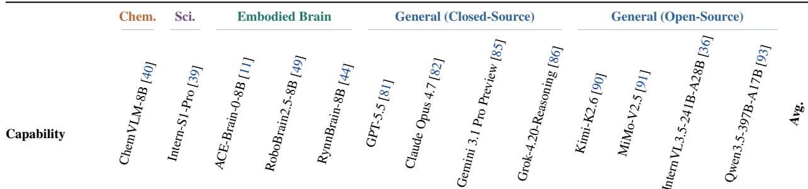

Table 5 Performance across question-format task groups. We compare representative models across three BEAKER QA task groups: Coordinate (Coord.) QA, MCQ, and Fill-in-the-Blank (FIB) QA. MCQ scores are computed as the unweighted macro-average across the eight MCQ task types. The last three columns report pairwise performance ratios between task groups, reflecting relative performance rather than format-specific robustness. Score cells are shaded by value, and ratio cells by their distance from 1.0.
<table><tr><td rowspan=1 colspan=7>QA Task Group                    Performance RatioModel                                  Coord. QAMCQFIBQA Coord./MCQFIB/MCQ Coord./FIB</td></tr><tr><td rowspan=1 colspan=1>ChemVLM-8B [40]</td><td rowspan=1 colspan=1>11.6</td><td rowspan=1 colspan=1>34.9</td><td rowspan=1 colspan=1>24.0</td><td rowspan=1 colspan=1>0.3</td><td rowspan=1 colspan=1>0.7</td><td rowspan=1 colspan=1>0.5</td></tr><tr><td rowspan=1 colspan=1>GPT-5.5 [81]</td><td rowspan=1 colspan=1>40.0</td><td rowspan=1 colspan=1>58.3</td><td rowspan=1 colspan=1>64.7</td><td rowspan=1 colspan=1>0.7</td><td rowspan=1 colspan=1>1.1</td><td rowspan=1 colspan=1>0.6</td></tr><tr><td rowspan=1 colspan=1>Claude Opus 4.7 [82]</td><td rowspan=1 colspan=1>41.7</td><td rowspan=1 colspan=1>62.8</td><td rowspan=1 colspan=1>62.2</td><td rowspan=1 colspan=1>0.7</td><td rowspan=1 colspan=1>1.0</td><td rowspan=1 colspan=1>0.7</td></tr><tr><td rowspan=1 colspan=1>Qwen3.5-397B-A17B [93]</td><td rowspan=1 colspan=1>20.6</td><td rowspan=1 colspan=1>62.2</td><td rowspan=1 colspan=1>64.7</td><td rowspan=1 colspan=1>0.3</td><td rowspan=1 colspan=1>1.0</td><td rowspan=1 colspan=1>0.3</td></tr><tr><td rowspan=1 colspan=1>RoboBrain2.5-8B [49]</td><td rowspan=1 colspan=1>16.6</td><td rowspan=1 colspan=1>52.2</td><td rowspan=1 colspan=1>47.5</td><td rowspan=1 colspan=1>0.3</td><td rowspan=1 colspan=1>0.9</td><td rowspan=1 colspan=1>0.3</td></tr></table>

## 4.4 Performance Across Question Formats

BEAKER employs three distinct answer formats—Coordinate (Coord.) QA (AFF and TRAJ, 300 samples), MCQ (eight task types, 650 samples), and Fill-in-the-Blank (FIB) QA (LVPR, 50 samples)—each assessing diferent aspects of laboratory understanding and execution. Table 5 compares five representative models across these task groups and reports pairwise performance ratios to characterize their relative performance. MCQ scores are calculated as the unweighted macro-average across the eight MCQ task types. Since these task groups difer in content, dificulty, and evaluation metrics, the ratios reflect task-group performance diferences rather than isolated efects of answer formats.

The most striking finding is the substantial performance gap in coordinate-based tasks. All five models exhibit a Coord./MCQ ratio of ≤0.7, indicating markedly lower performance on Coord. QA than on MCQs. For instance, Qwen3.5-397B-A17B achieves 62.2 on MCQs but only 20.6 on Coord. QA (Coord./MCQ = 0.3), while RoboBrain2.5-8B similarly scores 52.2 and 16.6, respectively. This disparity highlights a critical challenge for embodied laboratory intelligence: beyond recognizing experimental scenes and selecting predefined answers, models must generate precise spatial information, such as operable regions and trajectory waypoints, to support physical execution. In real SDCL environments, autonomous systems cannot rely on predefined MCQ options but must produce actionable outputs from visual observations. Therefore, coordinate-based evaluation provides evidence of spatial actionability that conventional MCQ-based assessments alone cannot capture.

Notably, even the two models with the highest Coord. QA scores, Claude Opus 4.7 (41.7) and GPT-5.5 (40.0), reach a Coord./MCQ ratio of only 0.7, indicating that the coordinate-based gap persists among the strongest general-purpose models. Moreover, RoboBrain2.5-8B—an embodied brain model designed for spatial reasoning—achieves a Coord./MCQ ratio of only 0.3, indicating that strong performance in general embodied scenarios does not necessarily translate into equally strong fine-grained spatial grounding in chemical laboratory environments. These patterns reveal an important capability imbalance across current MLLMs and reinforce the need for domain-specific evaluation of embodied intelligence in SDCLs.

FIB QA exhibits a diferent performance pattern, with FIB/MCQ ratios approaching 1.0 for several models, indicating comparable performance between LVPR and the broader MCQ task group. Unlike coordinate-based tasks, FIB QA primarily requires models to generate domain-specific experimental concepts and procedural outcomes from visual and temporal evidence. Although diferences in task content and evaluation metrics prevent attributing these results solely to answer formats, the comparison highlights the distinct challenges of spatial action grounding and experimental knowledge reasoning. Together, these findings demonstrate the importance of evaluating complementary capabilities beyond conventional MCQ-based assessments for reliable SDCL automation.

## 4.5 Qualitative Analysis

Qualitative Examples. Fig. 4 presents representative correct and incorrect predictions made by GPT-5.4 on three task types spanning diferent capability dimensions in BEAKER: AFF for Actionability, ERI for Knowledge, and SVOR for Experimentation. For each task type, the left panel shows a case where GPT-5.4 succeeds and the right panel a case where it fails. The header of each panel reports the outcome, i.e., the IoU score for AFF (73.8% vs. 0%) and “Exact match” or “Mismatch” with the ground-truth option for the two MCQ tasks, with successful and failed cases highlighted in green and red, respectively. These examples illustrate the diverse challenges posed by BEAKER across both image- and video-based inputs. For the video examples, 2×2 grids of keyframes sampled from the original clips are shown for compact visualization; these grids are used only for illustration and do not alter the actual evaluation protocol.

Self-Explanation Case Study. We conduct a self-explanation case study on LVPR (Fig. 5), as long videos require models to connect temporally distributed operations, visual evidence, and domain knowledge. For these questions, GPT-5.4 is prompted to state the basis for each answer when responding; these explanations are not scored. In the correct case, GPT-5.4 links the observed operations to the required answers: tissue pre-digestion, sonication, and dilution indicate Inductively Coupled Plasma Mass Spectrometry (ICP-MS) analysis; platinum standards and the concentration–signal plot support calibration-curve construction; and repeated quality-control samples indicate drift monitoring. In the incorrect case, the model captures the coarse biological efect but overgeneralizes the evidence, replacing the required component-level answers with broader mechanistic descriptions such as antioxidant defense. Thus, GPT-5.4 can extract procedural evidence from long videos yet may fail to map observations to the required fine-grained chemical concepts, revealing a gap between procedural understanding and precise experimental knowledge grounding.

## 4.6 Ablation Studies

Input Modality Ablation for Image Understanding. Fig. 6 compares image-plus-text and text-only inputs on 300 image MCQs. Removing images reduces the observed average accuracy for all eight models on the evaluated questions, demonstrating the contribution of visual information under the tested settings. General-purpose and embodied models benefit substantially, whereas the science-oriented Intern-S1 and the chemistry-specialized ChemVLM-8B benefit little, suggesting limited use of visual evidence. Random-choice and majority-option baselines, along with answer-position distributions, are provided in Appendix K.

## A Affordance grounding

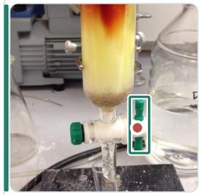

## 73.8% IoU

Please mark the center ofthe green knob used to adjust the flow rate of the chromatography column.

GT (441, 762.5) px GPT-5.4 (434, 772) px

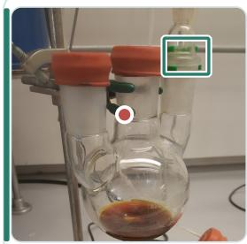

## 0% IoU

Please mark the center ofthe green plastic clip on the main three-neck flask's right neck used to secure th glass joint.

GT (805, 226) px GPT-5.4 (521, 495) px

## B Equipment and reagent identification

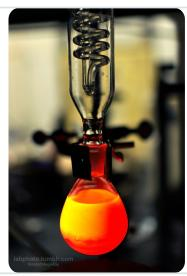

## Exact match

Which ofthe following is the glass apparatus clamped to the ring stand above the pear-shaped flask in the picture?

GT: D GPT-5.4: D

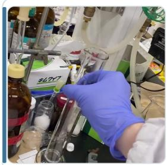  
Image MCQ

## Mismatch

Which of the following instruments is being held by the experimenter wearing blue gloves in the picture?

A. test tube   
B. graduated cylinder   
C. beaker   
D. conical flask

GT: B GPT-5.4: A

## C Short-video operation reasoning

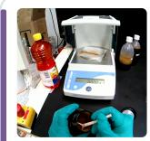

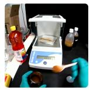

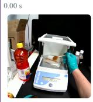  
Based on the current procedure, what is the most likely main purpose ofthe experimenter's action?

## Exact match

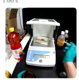

GT D = GPT-5.4 D: Transferring a small amount ofsolid sample to the weighing area to measure its mass

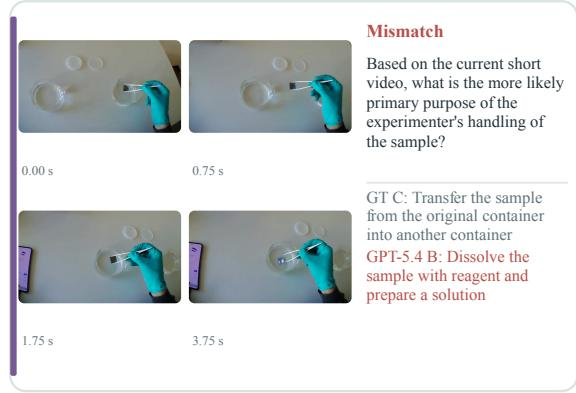  
Figure 4 Qualitative examples for three representative task types: Afordance Grounding (AFF) (Actionability, image), Equipment and Reagent Identification (ERI) (Knowledge, image MCQ), and Short-Video Operation Reasoning (SVOR) (Experimentation, video MCQ). Left panels show correct GPT-5.4 [72] predictions; right panels show incorrect ones. GT: Ground Truth.

Input Modality Ablation for Video Reasoning. Fig. 7 compares three input settings on mid- and longvideo tasks: video-plus-question, caption-plus-question, and caption-plus-video-plus-question. Adding captions substantially improves performance over video inputs alone, especially on M-TSR, L-TSR, and LVPR, as expert-written captions provide procedural details that help models answer the questions. The largest gain appears on M-TSR, where captions roughly double the scores of all three models, suggesting that the dificulty of mid-length videos lies mainly in extracting step boundaries from frames rather than in ordering described steps. The gap between video-only and caption-based settings suggests that current MLLMs still struggle to extract fine-grained operations, temporal dependencies, and chemistry-specific procedural cues directly from multi-frame laboratory videos.

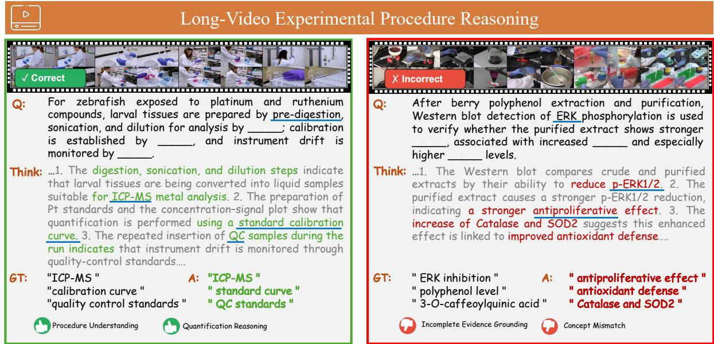  
Figure 5 Self-explanation examples of GPT-5.4 [72] on BEAKER. Representative correct and incorrect cases in Long-Video Experimental Procedure Reasoning (LVPR) show that GPT-5.4 can extract procedural evidence from experimental videos but may struggle to match visual observations with fine-grained chemical concepts. GT: Ground Truth.

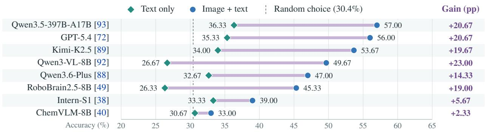  
Figure 6 Visual input ablation on image MCQs. Accuracy is averaged over five tasks with 60 questions each. Image + text includes images, questions, and options; Text only removes the images. Visual input improves average accuracy for all eight models. The dashed line marks the random-choice baseline (Appendix K). Gain denotes the increase in percentage points (pp).

Frame Sampling Ablation. We investigate the sensitivity of video-based BEAKER tasks to frame sampling density by evaluating Qwen3.5-397B-A17B under three settings: fewer frames (4/16/64), standard frames (8/32/128, used in all main experiments), and more frames (16/48/192) for short/mid/long videos, respectively. In all settings, each video is divided into � equal-length segments, where � is the number of sampled frames, and the frame at the midpoint of each segment is extracted. For long videos, every four consecutive frames are arranged in temporal order into a 2 × 2 image grid before being fed to the model (e.g., 128 frames yield 32 grids).

As shown in Table 6, S-TSR improves from 82.9 to 88.6 as the number of frames increases from 4 to 16, whereas SVOR exhibits a non-monotonic trend (80.8, 79.2, and 80.8). For mid-length videos, M-TSR scores 54.0, 48.0, and 52.0 under fewer, standard, and more frames, respectively, while MVTS achieves its highest score of 65.3 under the standard setting. For long videos, L-TSR improves monotonically with more frames (66.7, 70.0, and 73.3), whereas LVPR peaks at the standard setting (64.7) before declining to 55.3 with more frames. Overall, these results indicate that increasing frame sampling density does not consistently improve performance across video reasoning tasks. Redundant visual information may contribute to this

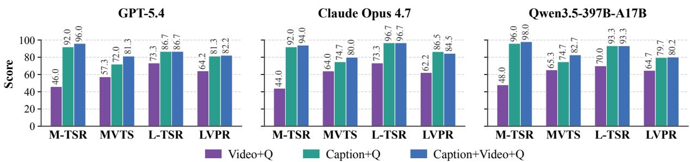  
Figure 7 Input modality ablation on video-based tasks. Performance of GPT-5.4, Claude Opus 4.7, and Qwen3.5- 397B-A17B under video-plus-question, caption-plus-question, and caption-plus-video-plus-question settings. M-TSR: Mid-Video Temporal Sequence Reasoning; MVTS: Mid-Video Task-Step Reasoning; L-TSR: Long-Video Temporal Sequence Reasoning; LVPR: Long-Video Experimental Procedure Reasoning.

Table 6 Frame sampling ablation on video-based BEAKER tasks. We evaluate Qwen3.5-397B-A17B [93] under diferent frame sampling settings for short-, mid-, and long-video tasks. Frames are listed as short / mid / long; long-video frames are arranged into four-frame image grids (16, 32, and 48 grids). The best result in each column is in bold.
<table><tr><td colspan="2"></td><td colspan="2">Short video</td><td colspan="2">Mid-length video</td><td colspan="2">Long video</td></tr><tr><td>Setting</td><td>Frames</td><td>S-TSR↑</td><td>SVOR↑</td><td>M-TSR↑</td><td>MVTS↑</td><td>L-TSR↑</td><td>LVPR↑</td></tr><tr><td>Fewer Frames</td><td>4/16/64</td><td>82.9</td><td>80.8</td><td>54.0</td><td>61.3</td><td>66.7</td><td>59.7</td></tr><tr><td>Standard Frames main</td><td>8/32/128</td><td>85.7</td><td>79.2</td><td>48.0</td><td>65.3</td><td>70.0</td><td>64.7</td></tr><tr><td>More Frames</td><td>16/48/192</td><td>88.6</td><td>80.8</td><td>52.0</td><td>60.0</td><td>73.3</td><td>55.3</td></tr></table>

pattern, although the experiment does not isolate its cause. These findings support the standard setting (8/32/128) as a practical configuration and suggest that, although denser sampling helps temporal ordering in long videos, increasing frame count alone does not reliably improve long-horizon procedure reasoning.

## 5 Failure Attribution

This section consolidates evidence from the preceding experiments and the appendices to explain why current MLLMs fall short on BEAKER. We first examine why specialized models do not outperform general-purpose ones and then summarize four failure mechanisms shared across model families.

Specialized vs. General Models. Table 3 compares a chemistry-specialized model (ChemVLM-8B), a science-oriented model (Intern-S1-Mini), and an embodied model (RoboBrain2.5-8B) with the size-matched general-purpose Qwen3-VL-8B. Specialization yields only narrow, task-specific gains: RoboBrain2.5-8B leads only on TRAJ (+4.08) and TSR (+1.11), Intern-S1-Mini leads only on LVPR (+2.50), and each specialized model trails Qwen3-VL-8B on every other task, with the largest gaps for ChemVLM-8B on SVOR (−39.20) and SR (−35.00). Four factors may jointly explain this pattern, as detailed below.

(i) Domain mismatch. Chemistry-specialized MLLMs are trained mainly on molecular structures, reaction schemes, and chemical text and figures, and embodied models mainly on general robotmanipulation scenes. Both are far from the real wet-lab imagery, apparatus, and step-by-step procedural videos on which BEAKER is built, so their domain priors may cover little of what it probes.

(ii) Diferent base models and training recipes. ChemVLM-8B and Intern-S1-Mini are built on backbones other than Qwen3-VL-8B, so for these two models the size match controls for parameter count but not for base capability. Their lower scores should therefore not be read as evidence that domain fine-tuning by itself erodes general ability; isolating such a specialization–generalization trade-of would require comparing each model with its own base model. RoboBrain2.5-8B instead adopts the Qwen3-VL architecture [49], which makes its comparison with Qwen3-VL-8B closer to a base-versus-specialized contrast; its gains on TRAJ and TSR alongside small losses on the other nine tasks (−0.80 to −8.33) are consistent with a mild specialization trade-of.

(iii) Weakly supervised output spaces. AFF and TRAJ require open-ended coordinate and trajectory outputs with fine spatial grounding, which domain corpora rarely supervise. Even RoboBrain2.5-8B, whose training targets robotic manipulation, trails the general anchor on AFF (−1.81).

(iv) Gains track domain overlap. The few tasks on which a specialized model surpasses Qwen3-VL-8B are those closest to its training domain: trajectory planning and temporal ordering for the embodied RoboBrain2.5-8B, and long-video procedure reasoning, which requires recalling precise scientific terms, for the science-oriented Intern-S1-Mini. The advantage disappears once the task moves away from that domain, which is consistent with a gap driven mainly by domain mismatch rather than by model scale.

Failure Mechanisms Across Models. Beyond specialization, four failure mechanisms recur across model families.

1. Recognition–grounding gap. Models handle recognition-style questions considerably better than spatial grounding. Averaged over the 28 models, AFF reaches only 9.7 and TRAJ 34.7 (Table 2), and Actionability is the weakest capability for 27 of the 28 models, averaging 22.2 vs. 41.6 for Knowledge (Table 12). These tasks require localizing small operable parts, such as valves, nozzles, handles, and connection interfaces, and generating coordinates in an open output space rather than selecting among options; accordingly, all five models in Table 5 score far lower on Coord. QA than on MCQs (Coord./MCQ ≤ 0.7).

2. Insuficient temporal and procedural integration. M-TSR yields the lowest TSR subset score for 24 of the 28 models (Table 15), and expert captions raise all three models in Fig. 7 from 44–48 to 92–96 on M-TSR. Current models therefore struggle less with ordering described steps than with extracting fine-grained operations and step boundaries directly from multi-frame inputs.

3. Evidence-level mismatch. In the self-explanation case study (Fig. 5), GPT-5.4 captures the coarse procedural evidence in the video but answers at the wrong level of granularity, replacing the required component-level answers with broader mechanistic descriptions. Such errors arise from mapping observations to the wrong level of experimental evidence rather than from failing to follow the video.

4. Lack of chemistry-specific execution grounding. The training data of general-purpose and embodied models likely cover few of the apparatus, operations, and states specific to chemical laboratories. Consistently, knowledge-oriented image MCQs (ERI, ESS, and SR) average only 40.0–43.9 across the 28 models, against a 30.4% random-choice baseline and at least 93.3 for human experts, indicating that general capabilities do not transfer directly to execution-oriented, fine-grained laboratory understanding.

Together, these mechanisms indicate that the main bottleneck lies less in recognizing laboratory scenes than in grounding them into operable actions, procedural steps, and chemistry-specific execution, which is precisely the gap BEAKER is designed to expose.

## 6 Limitations and Future Work

While BEAKER provides a systematic evaluation of multimodal models for SDCL execution, several limitations should be noted.

Ofline, Single-Turn Scope. BEAKER is an ofline benchmark that evaluates visual understanding and reasoning from pre-collected images and videos; it does not involve closed-loop interaction with real automated devices, and thus cannot fully capture the adaptive decision-making required in real-time execution. Our evaluation also focuses on single-turn QA and does not assess multi-turn interactive reasoning or error recovery, which are critical for long-horizon autonomous execution. In particular, point and box localization and discrete trajectories are ofline approximations of action feasibility, and we do not report the correlation between BEAKER scores and real-robot execution success; BEAKER scores should therefore not be read as evidence of real SDCL deployment capability. Within this scope, ofline evaluation separates perception and reasoning failures from controller and hardware errors, keeps evaluation conditions controlled and comparable across models, and avoids executing chemical operations with unvalidated models, which allows BEAKER to localize gaps in the fundamental capabilities on which closed-loop execution depends.

Coverage and Viewpoints. Although BEAKER covers 11 task types across four core capability dimensions, its 1,000 QA samples cannot exhaustively represent all chemical experiment scenarios, particularly highly specialized procedures in domains such as electrochemistry or high-pressure reactions. In addition, the visual data are primarily collected from publicly available sources with varying camera perspectives, which may not perfectly align with the egocentric views of specific robotic platforms deployed in real SDCLs.

Potential Source-Level Contamination. Because the visual assets are drawn from public datasets and JoVE videos, we cannot fully exclude that some source images or videos appeared in the pretraining data of the evaluated MLLMs. The public technical reports of representative open-source models, such as Qwen3-VL [92], RynnBrain [44], and RoboBrain 2.5 [49], do not explicitly list JoVE or the other chemical sources used by BEAKER, whereas the training data of closed-source models are undisclosed; a deterministic source-level audit is therefore not possible. However, the source media provide only raw images and videos. All questions, answer options, reference answers, operable regions, point and box annotations, and trajectories in BEAKER were newly created by experts and do not exist in the original sources, so exposure to a source image or video does not imply exposure to a BEAKER question or its answer. Consistent with this, the text-only accuracies of all eight models in Fig. 6 remain within 6 points of the 30.4% random-choice baseline (Appendix K), so the answers are largely not recoverable from the question text alone. Moreover, even if models have seen some source scenes, they still fail on operable regions, experimental constraints, and execution-level reasoning, which is precisely the gap BEAKER is designed to measure.

Composite Score. The Overall score maps heterogeneous metrics, namely MCQ accuracy, IoU for AFF, the DFD-based trajectory score for TRAJ, and expert-judged correctness for LVPR, onto a common 0–100 scale and combines them with fixed capability weights (Section 4.1). It is a robustness-checked summary (Appendix H) rather than a claim that these metrics are semantically equivalent; task- and capability-level scores (Tables 2, 4, and 12) should serve as the primary basis for diagnosing model capabilities.

Toward Closed-Loop Evaluation. Inspired by the closed-loop interaction paradigm of ESI-Bench [94], we plan to couple BEAKER with chemical-experiment simulation environments, building on the laboratoryscene and chemical-interaction simulation of LabUtopia [64] and Chemistry3D [66], and to extend it into a closed-loop agentic benchmark for SDCLs. In that setting, afordances and trajectories will be executed in simulation rather than scored only by ofline coordinates and trajectory distance, the environment will judge whether each action is executable and whether the task is completed, and models will replan from feedback. This will allow BEAKER scores to be validated directly against execution success and will extend the evaluation to decision-making and error correction during dynamic experiments.

## 7 Conclusion

We present BEAKER, an expert-curated multimodal benchmark that evaluates, ofline and in a single turn, the execution-grounded perception and reasoning of MLLMs as embodied brains in SDCLs. BEAKER decomposes SDCL execution into four capability dimensions—Actionability, Knowledge, Experimentation, and Reasoning—and constructs 1,000 expert-authored QA samples across 11 task types covering both image and video modalities, without AI-assisted sample selection, question generation, or annotation. Our systematic evaluation of 28 MLLMs reveals that current models can follow coarse experimental procedures but remain limited in AFF, TRAJ, fine-grained recognition of laboratory apparatus and states, and mid-length procedural reasoning, exposing a clear capability gap between scene understanding and autonomous decision-making for execution. We plan to extend BEAKER to closed-loop evaluation in chemical-experiment simulation environments. Limitations and future work are discussed in Section 6, and broader impacts and responsible use in Appendices L and M.

## References

[1] Gary Tom, Stefan P Schmid, Sterling G Baird, Yang Cao, Kourosh Darvish, Han Hao, Stanley Lo, Sergio Pablo-García, Ella M Rajaonson, Marta Skreta, et al. Self-driving laboratories for chemistry and materials science. Chemical Reviews, 124(16):9633–9732, 2024.

[2] Simone Pilon, Elia Savino, Oliver M Bayley, Michael Vanzella, Miguel Claros, Petros Siasiaridis, Junsong Liu, Florian Lukas, Matteo Damian, Vasilis Tseliou, et al. A flexible and afordable self-driving laboratory for automated reaction optimization. Nature Synthesis, pages 1–13, 2026.

[3] Benjamin Burger, Phillip M Mafettone, Vladimir V Gusev, Catherine M Aitchison, Yang Bai, Xiaoyan Wang, Xiaobo Li, Ben M Alston, Buyi Li, Rob Clowes, et al. A mobile robotic chemist. Nature, 583 (7815):237–241, 2020.

[4] Tianwei Dai, Sriram Vijayakrishnan, Filip T Szczypiński, Jean-François Ayme, Ehsan Simaei, Thomas Fellowes, Rob Clowes, Lyubomir Kotopanov, Caitlin E Shields, Zhengxue Zhou, et al. Autonomous mobile robots for exploratory synthetic chemistry. Nature, 635(8040):890–897, 2024.

[5] Milad Abolhasani and Eugenia Kumacheva. The rise of self-driving labs in chemical and materials sciences. Nature Synthesis, 2(6):483–492, 2023.

[6] Artem I Leonov, Alexander JS Hammer, Slawomir Lach, S Hessam M Mehr, Dario Caramelli, Davide Angelone, Aamir Khan, Steven O’Sullivan, Matthew Craven, Liam Wilbraham, et al. An integrated self-optimizing programmable chemical synthesis and reaction engine. Nature Communications, 15:1240, 2024.

[7] Richard B Canty, Jefrey A Bennett, Keith A Brown, Tonio Buonassisi, Sergei V Kalinin, John R Kitchin, Benji Maruyama, Robert G Moore, Joshua Schrier, Martin Seifrid, et al. Science acceleration and accessibility with self-driving labs. Nature Communications, 16:3856, 2025.

[8] Shi Xuan Leong, Caleb E Griesbach, Rui Zhang, Kourosh Darvish, Yuchi Zhao, Abhijoy Mandal, Yunheng Zou, Han Hao, Varinia Bernales, and Alán Aspuru-Guzik. Steering towards safe self-driving laboratories. Nature Reviews Chemistry, 9(10):707–722, 2025.

[9] Fei Lin, Jing Yang, Dali Sun, Levente Kovács, and Fei-Yue Wang. Autonomous drug discovery with parallel intelligence. IEEE/CAA Journal ofAutomatica Sinica, 12(8):1742–1744, 2025.

[10] Yuheng Ji, Huajie Tan, Jiayu Shi, Xiaoshuai Hao, Yuan Zhang, Hengyuan Zhang, Pengwei Wang, Mengdi Zhao, Yao Mu, Pengju An, et al. RoboBrain: A unified brain model for robotic manipulation from abstract to concrete. In Proceedings ofthe Computer Vision and Pattern Recognition Conference, pages 1724–1734, 2025.

[11] Ziyang Gong, Zehang Luo, Anke Tang, Zhe Liu, Shi Fu, Zhi Hou, Ganlin Yang, Weiyun Wang, Xiaofeng Wang, Jianbo Liu, et al. ACE-Brain-0: Spatial intelligence as a shared scafold for universal embodiments. arXiv preprint arXiv:2603.03198, 2026.

[12] Brain Team, Ziyang Gong, Haoming Gu, Zehang Luo, Tianyi Zhang, Tao Tao, Yixiao Chi, Zhe Liu, Lingsi Zhu, Jingyuan Liu, et al. ACE-Brain-0.5: A unified embodied foundational model for physical agentic AI. arXiv preprint arXiv:2607.04426, 2026.

[13] Gen Luo, Ganlin Yang, Ziyang Gong, Guanzhou Chen, Haonan Duan, Erfei Cui, Ronglei Tong, Zhi Hou, Tianyi Zhang, Zhe Chen, et al. Visual embodied brain: Let multimodal large language models see, think, and control in spaces. arXiv preprint arXiv:2506.00123, 2025.

[14] Ganlin Yang, Gen Luo, Ziyang Gong, Guanzhou Chen, Haonan Duan, Tianyi Zhang, Wengang Zhou, Yu Qiao, Wenhai Wang, Xizhou Zhu, and Jifeng Dai. Visual Embodied Brain-1.5: Enhanced perception, spatial reasoning and robot control in spaces. IEEE Transactions on Pattern Analysis and Machine Intelligence, pages 1–18, 2026.

[15] BAAI RoboBrain Team, Mingyu Cao, Huajie Tan, Yuheng Ji, Xiansheng Chen, Minglan Lin, Zhiyu Li, Zhou Cao, Pengwei Wang, Enshen Zhou, et al. RoboBrain 2.0 technical report. arXiv preprint arXiv:2507.02029, 2025.

[16] Yifu Yuan, Haiqin Cui, Yaoting Huang, Yibin Chen, Fei Ni, Zibin Dong, Pengyi Li, Yan Zheng, Hongyao Tang, and Jianye Hao. Embodied-R1: Reinforced embodied reasoning for general robotic manipulation. In International Conference on Learning Representations, 2026.

[17] Xinyi Wang, Xun Yang, Yanlong Xu, Yuchen Wu, Zhen Li, and Na Zhao. AfordBot: 3D fine-grained embodied reasoning via multimodal large language models. arXiv preprint arXiv:2511.10017, 2025.

[18] Zhengxue Zhou, Satheeshkumar Veeramani, Francisco Munguia-Galeano, Hatem Fakhruldeen, and Andrew I Cooper. Localization, inspection, and reasoning (LIRA) module for autonomous workflows in self-driving laboratories. Communications Chemistry, 8(1):384, 2025.

[19] Zongzheng Zhang, Chenghao Yue, Haobo Xu, Minwen Liao, Xianglin Qi, Huan-ang Gao, Ziwei Wang, and Hao Zhao. RoboChemist: Long-horizon and safety-compliant robotic chemical experimentation. arXiv preprint arXiv:2509.08820, 2025.

[20] Satheeshkumar Veeramani, Zhengxue Zhou, Francisco Munguia-Galeano, Hatem Fakhruldeen, Thomas Roddelkopf, Mohammed Faeik Ruzaij Al-Okby, Kerstin Thurow, and Andrew Ian Cooper. PREVENT: Proactive risk evaluation and vigilant execution of tasks for mobile robotic chemists using multi-modal behavior trees. arXiv preprint arXiv:2510.21438, 2025.

[21] Xiangyi Wei, Fei Wang, Haotian Zhang, Xin An, Haitian Zhu, Lianrui Hu, Yang Li, Changbo Wang, and Xiao He. AgentChemist: A multi-agent experimental robotic platform integrating chemical perception and precise control. arXiv preprint arXiv:2603.23886, 2026.

[22] Kourosh Darvish, Marta Skreta, Yuchi Zhao, Naruki Yoshikawa, Sagnik Som, Miroslav Bogdanovic, Yang Cao, Han Hao, Haoping Xu, Alán Aspuru-Guzik, et al. ORGANA: A robotic assistant for automated chemistry experimentation and characterization. arXiv preprint arXiv:2401.06949, 2024.

[23] Tao Song, Man Luo, Xiaolong Zhang, Linjiang Chen, Yan Huang, Jiaqi Cao, Qing Zhu, Daobin Liu, Baicheng Zhang, Gang Zou, et al. A multiagent-driven robotic AI chemist enabling autonomous chemical research on demand. Journal of the American Chemical Society, 147(15):12534–12545, 2025.

[24] Gihan Panapitiya, Emily Saldanha, Heather Job, and Olivia Hess. AutoLabs: Cognitive multi-agent systems with self-correction for autonomous chemical experimentation. arXiv preprint arXiv:2509.25651, 2025.

[25] Yixiang Ruan, Chenyin Lu, Ning Xu, Yuchen He, Yixin Chen, Jian Zhang, Jun Xuan, Jianzhang Pan, Qun Fang, Hanyu Gao, et al. An automatic end-to-end chemical synthesis development platform powered by large language models. Nature Communications, 15:10038, 2024.

[26] Shiwei Lin, Zesen Chen, Xiaobin Jia, Yi Wang, Chenxu Wang, Shuyuan Zhang, Xiaozhen Ding, Boyuan Du, Weili Ding, and Huaping Liu. A visual dataset for anomaly detection in self-driving laboratories. Scientific Data, 12(1):1787, 2025.

[27] Shiwei Lin, Chenxu Wang, Xiaozhen Ding, Yi Wang, Boyuan Du, Lei Song, Chenggang Wang, and Huaping Liu. A VLM-based method for visual anomaly detection in robotic scientific laboratories. In 2025 International Conference on Advanced Robotics and Mechatronics (ICARM), pages 34–39. IEEE, 2025.

[28] Qianpu Sun, Xiaowei Chi, Yuhan Rui, Ying Li, Kuangzhi Ge, Jiajun Li, Sirui Han, and Shanghang Zhang. LABSHIELD: A multimodal benchmark for safety-critical reasoning and planning in scientific laboratories. arXiv preprint arXiv:2603.11987, 2026.

[29] Nawaf Alampara, Mara Schilling-Wilhelmi, Martiño Ríos-García, Indrajeet Mandal, Pranav Khetarpal, Hargun Singh Grover, N M Anoop Krishnan, and Kevin Maik Jablonka. Probing the limitations of multimodal language models for chemistry and materials research. Nature Computational Science, 5(10):952–961, 2025.

[30] Yicheng Xu, Yue Wu, Jiashuo Yu, Ziang Yan, Tianxiang Jiang, Yinan He, Qingsong Zhao, Kai Chen, Yu Qiao, Limin Wang, et al. ExpVid: A benchmark for experiment video understanding & reasoning. arXiv preprint arXiv:2510.11606, 2025.

[31] OpenAI. GPT-4 technical report. arXiv preprint arXiv:2303.08774, 2023.

[32] Anthropic. The Claude 3 model family: Opus, Sonnet, Haiku. https://www.anthropic.com/news/c laude-3-family, 2024.

[33] Gemini Team. Gemini 1.5: Unlocking multimodal understanding across millions of tokens of context. arXiv preprint arXiv:2403.05530, 2024.

[34] Kimi Team. Kimi-VL technical report. arXiv preprint arXiv:2504.07491, 2025.

[35] Shuai Bai, Keqin Chen, Xuejing Liu, Jialin Wang, Wenbin Ge, Sibo Song, Kai Dang, Peng Wang, Shijie Wang, Jun Tang, et al. Qwen2.5-VL technical report. arXiv preprint arXiv:2502.13923, 2025.

[36] Weiyun Wang, Zhangwei Gao, Lixin Gu, Hengjun Pu, Long Cui, Xingguang Wei, Zhaoyang Liu, Linglin Jing, Shenglong Ye, Jie Shao, et al. InternVL3.5: Advancing open-source multimodal models in versatility, reasoning, and eficiency. arXiv preprint arXiv:2508.18265, 2025.

[37] Zhe Qian, Ziyang Gong, Zhongxing Xu, Hehan Li, Zhonghua Wang, Fei Luo, Mingxuan Wang, Xue Yang, Yanbiao Ma, Junchi Yan, et al. LoopVL: Recurrent visual intelligence. arXiv preprint arXiv:2609.38426, 2026.

[38] Lei Bai, Zhongrui Cai, Yuhang Cao, Maosong Cao, Weihan Cao, Chiyu Chen, Haojiong Chen, Kai Chen, Pengcheng Chen, Ying Chen, et al. Intern-S1: A scientific multimodal foundation model. arXiv preprint arXiv:2508.15763, 2025.

[39] Yicheng Zou, Dongsheng Zhu, Lin Zhu, Tong Zhu, Yunhua Zhou, Peiheng Zhou, Xinyu Zhou, Dongzhan Zhou, Zhiwang Zhou, Yuhao Zhou, et al. Intern-S1-Pro: Scientific multimodal foundation model at trillion scale. arXiv preprint arXiv:2603.25040, 2026.

[40] Junxian Li, Di Zhang, Xunzhi Wang, Zeying Hao, Jingdi Lei, Qian Tan, Cai Zhou, Wei Liu, Yaotian Yang, Xinrui Xiong, et al. ChemVLM: Exploring the power of multimodal large language models in chemistry area. In Proceedings ofthe AAAI Conference on Artificial Intelligence, volume 39, pages 415–423, 2025.

[41] Qian Tan, Dongzhan Zhou, Peng Xia, Wanhao Liu, Wanli Ouyang, Lei Bai, Yuqiang Li, and Tianfan Fu. ChemMLLM: Chemical multimodal large language model. arXiv preprint arXiv:2505.16326, 2025.

[42] Zihan Zhao, Bo Chen, Jingpiao Li, Lu Chen, Liyang Wen, Pengyu Wang, Zichen Zhu, Danyang Zhang, Ziping Wan, Yansi Li, et al. ChemDFM-X: Towards large multimodal model for chemistry. arXiv preprint arXiv:2409.13194, 2024.

[43] Fei Lin, Ziyang Gong, Cong Wang, Tengchao Zhang, Yonglin Tian, Yining Jiang, Ji Dai, Chao Guo, Xiaotong Yu, Xue Yang, et al. Breaking bad molecules: are MLLMs ready for structure-level molecular detoxification? In Proceedings ofthe 32nd ACM SIGKDD Conference on Knowledge Discovery and Data Mining V. 2, pages 11399–11410, 2026.

[44] Ronghao Dang, Jiayan Guo, Bohan Hou, Sicong Leng, Kehan Li, Xin Li, Jiangpin Liu, Yunxuan Mao, Zhikai Wang, Yuqian Yuan, et al. RynnBrain: Open embodied foundation models. arXiv preprint arXiv:2602.14979, 2026.

[45] Xiaoshuai Hao, Lei Zhou, Zhijian Huang, Zhiwen Hou, Yingbo Tang, Lingfeng Zhang, Guang Li, Zheng Lu, Shuhuai Ren, Xianhui Meng, et al. MiMo-Embodied: X-Embodied foundation model technical report. arXiv preprint arXiv:2511.16518, 2025.

[46] Yi Zhang, Che Liu, Xiancong Ren, Hanchu Ni, Shuai Zhang, Zeyuan Ding, Jiayu Hu, Hanzhe Shan, Zhenwei Niu, Zhaoyang Liu, et al. Pelican-VL 1.0: A foundation brain model for embodied intelligence. arXiv preprint arXiv:2511.00108, 2025.

[47] Tao Song, Weixing Chen, Xiaobo Li, Hengtao Lei, Liang Zhang, Hongli Zhang, Gang Zou, Linjiang Chen, Weiwei Shang, and Jun Jiang. ChemVLMate: a multimodal, dual-arm, seeing robotic chemist for adaptive synthesis. ChemRxiv preprint, 2026. doi: 10.26434/chemrxiv.15001727/v1.

[48] Satheeshkumar Veeramani, Anna Kisil, Abigail Bentley, Hatem Fakhruldeen, Gabriella Pizzuto, and Andrew I Cooper. Human-aware robot behaviour in self-driving labs. In Companion Proceedings ofthe 21st ACM/IEEE International Conference on Human-Robot Interaction, pages 292–296, 2026.

[49] Huajie Tan, Enshen Zhou, Zhiyu Li, Yijie Xu, Yuheng Ji, Xiansheng Chen, Cheng Chi, Pengwei Wang, Huizhu Jia, Yulong Ao, et al. RoboBrain 2.5: Depth in sight, time in mind. arXiv preprint arXiv:2601.14352, 2026.

[50] Ganlin Yang, Tianyi Zhang, Haoran Hao, Weiyun Wang, Yibin Liu, Dehui Wang, Guanzhou Chen, Zijian Cai, Junting Chen, Weijie Su, et al. Vlaser: Vision-language-action model with synergistic embodied reasoning. arXiv preprint arXiv:2510.11027, 2025.

[51] NVIDIA, Alisson Azzolini, Hannah Brandon, Prithvijit Chattopadhyay, Huayu Chen, Jinju Chu, Yin Cui, Jenna Diamond, Yifan Ding, Francesco Ferroni, et al. Cosmos-Reason1: From physical common sense to embodied reasoning. arXiv preprint arXiv:2503.15558, 2025.

[52] Yanbang Li, Ziyang Gong, Haoyang Li, Xiaoqi Huang, Haolan Kang, Guangping Bai, and Xianzheng Ma. Robotic visual instruction. In Proceedings of the Computer Vision and Pattern Recognition Conference, pages 12155–12165, 2025.

[53] Chan Hee Song, Valts Blukis, Jonathan Tremblay, Stephen Tyree, Yu Su, and Stan Birchfield. RoboSpatial: Teaching spatial understanding to 2D and 3D vision-language models for robotics. In Proceedings of the Computer Vision and Pattern Recognition Conference, pages 15768–15780, 2025.

[54] Yingbo Tang, Lingfeng Zhang, Shuyi Zhang, Yinuo Zhao, and Xiaoshuai Hao. RoboAford: A dataset and benchmark for enhancing object and spatial afordance learning in robot manipulation. In Proceedings of the 33rd ACM International Conference on Multimedia, pages 12706–12713, 2025.

[55] Delin Qu, Haoming Song, Qizhi Chen, Zhaoqing Chen, Xianqiang Gao, Dong Wang, Xinyi Ye, Qi Lv, Modi Shi, Guanghui Ren, et al. EO-1: An open unified embodied foundation model for general robot control. arXiv preprint arXiv:2508.21112, 2025.

[56] Huajie Tan, Xiaoshuai Hao, Minglan Lin, Pengwei Wang, Yaoxu Lyu, Mingyu Cao, Zhongyuan Wang, and Shanghang Zhang. RoboOS: A hierarchical embodied framework for cross-embodiment and multi-agent collaboration. arXiv preprint arXiv:2505.03673, 2025.

[57] Yueen Ma, Zixing Song, Yuzheng Zhuang, Jianye Hao, and Irwin King. A survey on vision–language–action models for embodied AI. IEEE Transactions on Neural Networks and Learning Systems, 37(7):3031–3051, 2026.

[58] Yifan Yang, Ziyang Gong, Weiquan Huang, Qihao Yang, Ziwei Zhou, Zisu Huang, Yan Li, Xuemei Gao, Qi Dai, Bei Liu, et al. SkillOpt: Executive strategy for self-evolving agent skills. arXiv preprint arXiv:2605.23904, 2026.

[59] Stanislaw Antol, Aishwarya Agrawal, Jiasen Lu, Margaret Mitchell, Dhruv Batra, C Lawrence Zitnick, and Devi Parikh. VQA: Visual question answering. In Proceedings of the IEEE International Conference on Computer Vision, pages 2425–2433, 2015.

[60] Drew A Hudson and Christopher D Manning. GQA: A new dataset for real-world visual reasoning and compositional question answering. In Proceedings of the IEEE/CVF Conference on Computer Vision and Pattern Recognition, pages 6700–6709, 2019.

[61] Pan Lu, Swaroop Mishra, Tony Xia, Liang Qiu, Kai-Wei Chang, Song-Chun Zhu, Oyvind Tafjord, Peter Clark, and Ashwin Kalyan. Learn to explain: Multimodal reasoning via thought chains for science question answering. In Advances in Neural Information Processing Systems, volume 35, pages 2507–2521, 2022.

[62] Xiang Yue, Yuansheng Ni, Kai Zhang, Tianyu Zheng, Ruoqi Liu, Ge Zhang, Samuel Stevens, Dongfu Jiang, Weiming Ren, Yuxuan Sun, et al. MMMU: A massive multi-discipline multimodal understanding and reasoning benchmark for expert AGI. In Proceedings ofthe IEEE/CVF Conference on Computer Vision and Pattern Recognition, pages 9556–9567, 2024.

[63] Yulin Luo, Chun-Kai Fan, Menghang Dong, Jiayu Shi, Xiangju Mi, Mengdi Zhao, Bo-Wen Zhang, Cheng Chi, Jiaming Liu, Gaole Dai, et al. RoboBench: A comprehensive evaluation benchmark for multimodal large language models as embodied brain. In European Conference on Computer Vision, pages 501–520. Springer, 2026.

[64] Rui Li, Zixuan Hu, Wenxi Qu, Jinouwen Zhang, Zhenfei Yin, Sha Zhang, Xuantuo Huang, Hanqing Wang, Tai Wang, Jiangmiao Pang, et al. LabUtopia: High-fidelity simulation and hierarchical benchmark for scientific embodied agents. arXiv preprint arXiv:2505.22634, 2025.

[65] Zhiqian Lan, Yuxuan Jiang, Ruiqi Wang, Xuanbing Xie, Rongkui Zhang, Yicheng Zhu, Peihang Li, Tianshuo Yang, Tianxing Chen, Haoyu Gao, et al. AutoBio: A simulation and benchmark for robotic automation in digital biology laboratory. arXiv preprint arXiv:2505.14030, 2025.

[66] Shoujie Li, Yan Huang, Changqing Guo, Tong Wu, Jiawei Zhang, Linrui Zhang, and Wenbo Ding. Chemistry3D: Robotic interaction benchmark for chemistry experiments. arXiv preprint arXiv:2406.08160, 2024.

[67] Richard E Fikes and Nils J Nilsson. STRIPS: A new approach to the application of theorem proving to problem solving. Artificial Intelligence, 2(3-4):189–208, 1971.

[68] David Kortenkamp, Reid Simmons, and Davide Brugali. Robotic systems architectures and programming. In Springer Handbook of Robotics, pages 283–306. Springer, 2016.

[69] Yu Bai, MingMing Yu, Chaojie Li, Ziyi Bai, Xinlong Wang, and Börje F Karlsson. EgoActor: Grounding task planning into spatial-aware egocentric actions for humanoid robots via visual-language models. arXiv preprint arXiv:2602.04515, 2026.

[70] Quanxin Shou, Fangqi Zhu, Shawn Chen, Puxin Yan, Zhengyang Yan, Yikun Miao, Xiaoyi Pang, Zicong Hong, Ruikai Shi, Hao Huang, et al. HALO: A unified vision-language-action model for embodied multimodal chain-of-thought reasoning. arXiv preprint arXiv:2602.21157, 2026.

[71] Takuma Yagi, Misaki Ohashi, Yifei Huang, Ryosuke Furuta, Shungo Adachi, Toutai Mitsuyama, and Yoichi Sato. FineBio: A fine-grained video dataset of biological experiments with hierarchical annotation. International Journal of Computer Vision, 133(10):7352–7367, 2025.

[72] OpenAI. Introducing GPT-5.4. https://openai.com/index/introducing-gpt-5-4/, 2026.

[73] Gianmarco Gabrieli, Irina Espejo Morales, Dimitrios Christofidellis, Mara Graziani, Andrea Giovannini, Federico Zipoli, Amol Thakkar, Antonio Foncubierta, Matteo Manica, and Patrick W Ruch. Activity recognition in scientific experimentation using multimodal visual encoding. Digital Discovery, 4(2):393–402, 2025.

[74] Journal of Visualized Experiments. JoVE Chemistry research video collection. https://www.jove.com /research/chemistry, 2026.

[75] FFmpeg Developers. FFmpeg: A complete, cross-platform solution to record, convert and stream audio and video. https://ffmpeg.org, 2024.

[76] Alec Radford, Jong Wook Kim, Tao Xu, Greg Brockman, Christine McLeavey, and Ilya Sutskever. Robust speech recognition via large-scale weak supervision. In International Conference on Machine Learning, pages 28492–28518. PMLR, 2023.

[77] Peiwen Yuan, Yiwei Li, Shaoxiong Feng, Xinglin Wang, Yueqi Zhang, Jiayi Shi, Chuyi Tan, Boyuan Pan, Yao Hu, and Kan Li. Silencer: From discovery to mitigation of self-bias in LLM-as-benchmark-generator. In Advances in Neural Information Processing Systems, 2025.

[78] Arjun Panickssery, Samuel R Bowman, and Shi Feng. LLM evaluators recognize and favor their own generations. In Advances in Neural Information Processing Systems, 2024.

[79] David Rein, Betty Li Hou, Asa Cooper Stickland, Jackson Petty, Richard Yuanzhe Pang, Julien Dirani, Julian Michael, and Samuel R Bowman. GPQA: A graduate-level Google-proof Q&A benchmark. arXiv preprint arXiv:2311.12022, 2023.

[80] CVAT.ai Corporation. CVAT: Computer Vision Annotation Tool. https://github.com/cvat-ai/cvat, 2024.

[81] OpenAI. Introducing GPT-5.5. https://openai.com/index/introducing-gpt-5-5/, 2026.

[82] Anthropic. Introducing Claude Opus 4.7. https://www.anthropic.com/news/claude-opus-4-7, 2026.

[83] Anthropic. Introducing Claude Sonnet 4.6. https://www.anthropic.com/news/claude-sonnet-4-6, 2026.

[84] Google DeepMind. Gemini 2.5 Pro. https://docs.cloud.google.com/vertex-ai/generative-ai/do cs/models/gemini/2-5-pro, 2025.

[85] Google DeepMind. Gemini 3.1 Pro. https://deepmind.google/models/model-cards/gemini-3-1-pro, 2026.

[86] xAI. Grok 4.20. https://docs.x.ai/developers/models/grok-4.20-0309-reasoning, 2026.

[87] Xiaomi. MiMo-V2-Omni. https://mimo.xiaomi.com/mimo-v2-omni, 2026.

[88] Qwen Team. Qwen3.6. https://github.com/QwenLM/Qwen3.6, 2026.

[89] Moonshot AI. Kimi-K2.5: Open visual agentic intelligence. https://github.com/MoonshotAI/Kimi-K2.5, 2026. Oficial model repository.

[90] Moonshot AI. Kimi K2.6. https://www.kimi.ai/blog/kimi-k2-6, 2026.

[91] Xiaomi. MiMo-V2.5. https://mimo.xiaomi.com/mimo-v2-5, 2026.

[92] Shuai Bai, Yuxuan Cai, Ruizhe Chen, Keqin Chen, Xionghui Chen, Zesen Cheng, Lianghao Deng, Wei Ding, Chang Gao, Chunjiang Ge, et al. Qwen3-VL technical report. arXiv preprint arXiv:2511.21631, 2025.

[93] Qwen Team. Qwen3.5-397B-A17B. https://huggingface.co/Qwen/Qwen3.5-397B-A17B, 2026. Official model card.

[94] Yining Hong, Jiageng Liu, Han Yin, Manling Li, Leonidas Guibas, Li Fei-Fei, Jiajun Wu, and Yejin Choi. ESI-Bench: Towards embodied spatial intelligence that closes the perception-action loop. arXiv preprint arXiv:2605.18746, 2026.

[95] Rama El-Khawaldeh, Mason Guy, Finn Bork, Nina Taherimakhsousi, Kris N Jones, Joel M Hawkins, Lu Han, Robert P Pritchard, Blaine A Cole, Sebastien Monfette, et al. Keeping an “eye” on the experiment: computer vision for real-time monitoring and control. Chemical Science, 15(4):1271–1282, 2024.

[96] Rama El-khawaldeh, Abhijoy Mandal, Naruki Yoshikawa, Wenyu Zhang, Ryan Corkery, Paloma Prieto, Alán Aspuru-Guzik, Kourosh Darvish, and Jason E Hein. From eyes to cameras: computer vision for high-throughput liquid-liquid separation. Device, 2(7), 2024.

[97] Roboflow. Roboflow Universe: Open source computer vision community. https://universe.robof low.com, 2024.

[98] Md Sakhawat Hossain, Md Sadman Haque, Md Mostafizur Rahman, Md Mosaddik Mashrafi Mousum, Zobaer Ibn Razzaque, Robiul Awoul Robin, Raiyan Rahman, and Jannatun Noor. Real-world chemistry lab image dataset for equipment recognition across 25 apparatus categories. Scientific Data, 12(1):1747, 2025.

[99] Ryosuke Sasaki, Mikito Fujinami, and Hiromi Nakai. Application of object detection and action recognition toward automated recognition of chemical experiments. Digital Discovery, 3(12):2458–2464, 2024.

[100] Le Zou, Ze-Sheng Ding, Shuo-Yi Ran, Zhi-Ze Wu, Yun-Sheng Wei, Zhi-Huang He, and Xiao-Feng Wang. A benchmark dataset in chemical apparatus: recognition and detection. Multimedia Tools and Applications, 83(9):26419–26437, 2024.

[101] Sagi Eppel, Haoping Xu, Mor Bismuth, and Alan Aspuru-Guzik. Computer vision for recognition of materials and vessels in chemistry lab settings and the Vector-LabPics dataset. ACS Central Science, 6 (10):1743–1752, 2020.

[102] Shuoyi Ran, Thomas Weise, and Zhize Wu. Chemical safety sign detection: A survey and benchmark. In 2022 International Joint Conference on Neural Networks (IJCNN), pages 1–7. IEEE, 2022.

[103] Leslie Ching Ow Tiong, Hyuk Jun Yoo, Nayeon Kim, Chansoo Kim, Kwan-Young Lee, Sang Soo Han, and Donghun Kim. Machine vision-based detections of transparent chemical vessels toward the safe automation of material synthesis. npj Computational Materials, 10(1):42, 2024.

[104] Junru Ren, Abhijoy Mandal, Rama El-khawaldeh, Shi Xuan Leong, Jason Hein, Alán Aspuru-Guzik, Lazaros Nalpantidis, and Kourosh Darvish. Context-aware computer vision for chemical reaction state detection. Digital Discovery, 5(2):630–642, 2026.

[105] Arun K Sharma. Laboratory glassware identification: Supervised machine learning example for science students. Journal of Computational Science Education, 12(1):16–21, 2021.

[106] Xiayu Wang, Ke Ma, Ruiyun Zhong, Xinggang Wang, Yi Fang, Yang Xiao, and Tian Xia. Towards dual transparent liquid level estimation in biomedical lab: Dataset, methods and practices. In European Conference on Computer Vision, pages 198–214. Springer, 2024.

[107] Yuan Li, Biplab Dutta, Qi Jie Yeow, Rob Clowes, Charlotte E Boott, and Andrew I Cooper. High-throughput robotic colourimetric titrations using computer vision. Digital Discovery, 4(5):1276–1283, 2025.

[108] Thomas Eiter and Heikki Mannila. Computing discrete Fréchet distance. Technical Report CD-TR 94/64, Christian Doppler Labor für Expertensysteme, Technische Universität Wien, Vienna, Austria, 1994.

## Appendix

## Contents

A Data Sources 23   
B License and Usage Information for External Assets 23   
C Task-Type Allocation Matrix 23   
D Cross-Group Consistency of Spatial Annotations 25   
E Evaluation Metrics 27   
F Evaluation Prompt Templates 27   
G Capability-Level Scores of All Models 29   
H Robustness of Model Scores and Rankings 29   
I Temporal Sequence Reasoning Across Video Lengths 29   
J Multi-Run Stability Analysis 31   
K Sanity Checks for Image MCQs 33   
L Broader Impacts 33   
M Responsible Use and Dataset Documentation 34

## A Data Sources

Table 7 lists all 14 data sources used to construct the visual data in BEAKER, including 12 image sources and 2 video sources, along with their content descriptions and raw sample counts before expert screening. License and usage information for these sources is summarized in Appendix B.

## B License and Usage Information for External Assets

All image and video data used in BEAKER are collected from publicly accessible sources. Table 8 summarizes the license and usage information for the external assets used in benchmark construction. All image sources specify explicit licenses, with LabPics images, including those re-released in HeinSight 3.0, shared for academic use only, whereas JoVE videos are subject to the JoVE Terms of Use.

## C Task-Type Allocation Matrix

The relative proportions of the 11 task types are set by three considerations: (i) the amount of high-quality real-world visual data that can be collected for each task, (ii) the importance of the corresponding capability in real SDCL execution, and (iii) whether experts can annotate the task reliably, together with its annotation dificulty. The final distribution additionally reflects cross-group blind review and consensus adjudication, which retain a diferent fraction of candidate questions for each task type (Table 9).

To ensure systematic coverage across all task categories while minimizing annotation redundancy, we design a task-type allocation matrix prior to the question authoring phase. The matrix prescribes the exact number of questions each of the 10 annotation groups must contribute per task category, so that (i) the union of all group contributions matches the target distribution across 11 task types, and (ii) no single group is overburdened with a particular category.

Table 9 presents the complete allocation matrix together with post-review retention statistics. Each group consists of one chemistry expert and one embodied expert (Section 3.2). All groups receive the full curated data pool of 1,617 items and independently select items within their assigned quotas. For two categories whose totals are not evenly divisible by 10 (M-TSR and MVTS, each totaling 75), five groups are assigned 8 questions and the remaining five are assigned 7, as indicated by the † symbol. The two senior experts who coordinate overall quality control verify that each group’s submission complies with the prescribed allocation before cross-group review begins.

Table 7 Data sources for BEAKER. Roboflow encompasses 10 community-contributed datasets.
<table><tr><td>Source</td><td>Content</td><td>#Raw</td></tr><tr><td colspan="3">Image sources (12)</td></tr><tr><td>HeinSight 2.0 &amp; 3.0 [95, 96]</td><td>] Vessel detection, liquid/solid phase classification</td><td>5,131</td></tr><tr><td>Roboflow [97]</td><td>Safety labels, apparatus, spills, operations (10 sets)</td><td>3,178</td></tr><tr><td>ChemEq25 [98]</td><td>25-class real-world apparatus across multiple labs</td><td>1,138</td></tr><tr><td>Chemical Apparatus [99]</td><td>Apparatus in complex backgrounds with 6 categories</td><td>629</td></tr><tr><td>CLAD [100]</td><td>21-class apparatus recognition and detection</td><td>488</td></tr><tr><td>LabPics [101]</td><td>Transparent vessels and material phase segmentation</td><td>281</td></tr><tr><td>CCSS [102]</td><td>Chinese chemical safety signs in real-world scenes</td><td>115</td></tr><tr><td>DenseSSD [103]</td><td>Transparent vial position detection for lab safety</td><td>61</td></tr><tr><td>HeinSight 4.0 [104]</td><td>Context-aware chemical reaction state detection</td><td>48</td></tr><tr><td>Glassware [105]</td><td>Clean-background laboratory glassware classification</td><td>41</td></tr><tr><td>DTLD [106]</td><td>Transparent liquid level estimation in vessels</td><td>9</td></tr><tr><td>Titration [107]</td><td>Automated colorimetric titration monitoring</td><td>9</td></tr><tr><td>Total</td><td>After screening: 883; final: 410</td><td>11,128</td></tr><tr><td colspan="3">Video sources (2)</td></tr><tr><td>IBM Lab Actions [73]</td><td>Egocentric 4 s laboratory operation clips (RGB)</td><td>334</td></tr><tr><td>JoVE Chemistry [74]</td><td>Long-form experimental procedure recordings</td><td>200</td></tr><tr><td>JoVE mid-length segments</td><td>Step-level clips segmented from JoVE recordings</td><td>1,753</td></tr><tr><td>Total</td><td>After screening: 734; final: 400</td><td>2,287</td></tr></table>

Several observations emerge from the retention analysis. First, simple-image MCQs exhibit a uniformly lower retention rate (50.0%) than their complex counterparts (66.7%), reflecting the tendency of simple-scene questions to be answerable through surface-level visual cues—precisely the type flagged for removal during cross-group review (see Section 3.2). Second, the two spatial tasks, whose coordinate-based answers inherently constrain ambiguity, retain 50.0% (AFF) and 75.0% (TRAJ) of their candidates; both yield 150 retained questions. Third, video tasks that require deeper reasoning—MVTS and LVPR (both 100%) and SVOR (83.3%)—achieve the highest retention rates, indicating that expert-authored questions grounded in procedural understanding are less susceptible to the quality issues that afect simpler recognition tasks.

Table 8 License and usage information for external assets used in BEAKER construction. Badge colors mark permissive, use-restricted, and copyleft terms.
<table><tr><td rowspan=1 colspan=3>Source                         License / Terms                                                      Platform</td></tr><tr><td rowspan=1 colspan=3>Image sources</td></tr><tr><td rowspan=1 colspan=1>HeinSight 2.0 &amp; 3.0 [95, 96] C</td><td rowspan=1 colspan=1>C BY 4.0</td><td rowspan=1 colspan=1>Zenodo</td></tr><tr><td rowspan=1 colspan=1>HeinSight 4.0 [104]</td><td rowspan=1 colspan=1>CC BY 4.0</td><td rowspan=1 colspan=1>Zenodo</td></tr><tr><td rowspan=1 colspan=1>ChemEq25 [98]</td><td rowspan=1 colspan=1>CC BY 4.0</td><td rowspan=1 colspan=1>Mendeley</td></tr><tr><td rowspan=1 colspan=1>Chemical Apparatus [99]</td><td rowspan=1 colspan=1>CC BY 4.0</td><td rowspan=1 colspan=1>Mendeley</td></tr><tr><td rowspan=1 colspan=1>CLAD [100]</td><td rowspan=1 colspan=1>CC BY 4.0</td><td rowspan=1 colspan=1>Zenodo</td></tr><tr><td rowspan=1 colspan=1>LabPics [101]</td><td rowspan=1 colspan=1>MIT (academi</td><td rowspan=1 colspan=1>c use only)                                                  Zenodo</td></tr><tr><td rowspan=1 colspan=1>DenseSSD [103]</td><td rowspan=1 colspan=1>CC BY 4.0</td><td rowspan=1 colspan=1>Zenodo</td></tr><tr><td rowspan=1 colspan=1>DTLD [106]</td><td rowspan=1 colspan=1>MIT</td><td rowspan=1 colspan=1>Hugging Face</td></tr><tr><td rowspan=1 colspan=1>Glassware [105]</td><td rowspan=1 colspan=1>CC BY 4.0</td><td rowspan=1 colspan=1>Zenodo</td></tr><tr><td rowspan=1 colspan=1>Titration [107]</td><td rowspan=1 colspan=1>CC BY 4.0</td><td rowspan=1 colspan=1>Zenodo</td></tr><tr><td rowspan=1 colspan=1>CCSS [102]</td><td rowspan=1 colspan=1>CC BY 4.0</td><td rowspan=1 colspan=1>Zenodo</td></tr><tr><td rowspan=1 colspan=1>Roboflow (10 sets) [97]</td><td rowspan=1 colspan=1>CC BY 4.0 (8)MIT (1)</td><td rowspan=1 colspan=1>Public Domain (1)                                 Roboflow</td></tr><tr><td rowspan=1 colspan=1>Video sources</td><td rowspan=1 colspan=2></td></tr><tr><td rowspan=2 colspan=1>IBM Lab Actions [73]JoVE Chemistry [74]</td><td rowspan=1 colspan=2>CDLA-Permissive-2.0                                                     Zenodo</td></tr><tr><td rowspan=1 colspan=2>JoVE Terms of Use                                                       JoVE</td></tr><tr><td rowspan=1 colspan=1>Tools</td><td rowspan=1 colspan=2></td></tr><tr><td rowspan=1 colspan=1>FFmpeg [75]                  L</td><td rowspan=2 colspan=2>GPL 2.1+ / GPL                                                         ffmpeg.orgMIT                                                                   GitHubMIT                                                                    GitHub</td></tr><tr><td rowspan=1 colspan=1>Whisper [76]CVAT [80]</td></tr></table>

## D Cross-Group Consistency of Spatial Annotations

We compare annotations from the originating group (A) and an independent reviewing group (B) on the same spatial questions. Agreement is measured using box IoU (Eq. 1), bidirectional point-in-region agreement (Eq. 2), and trajectory similarity (Eq. 3):

$$
\operatorname { I o U } ( B _ { A } , B _ { B } ) = { \frac { | B _ { A } \cap B _ { B } | } { | B _ { A } \cup B _ { B } | } } ,\tag{1}
$$

$$
\mathrm { P i R } ( p _ { A } , p _ { B } ) = \frac { 1 } { 2 } \left[ \mathbf { 1 } ( p _ { A } \in B _ { B } ) + \mathbf { 1 } ( p _ { B } \in B _ { A } ) \right] ,\tag{2}
$$

$$
S _ { \mathrm { t r a j } } = 1 0 0 \exp \left( - { \frac { \mathrm { D F D } ( P _ { A } , P _ { B } ) } { 0 . 4 0 } } \right) ,\tag{3}
$$

where $B , p ,$ and � denote an annotated box, interaction point, and trajectory, respectively; PiR denotes Point-in-Region agreement; 1(·) is the indicator function. DFD denotes the Discrete Fréchet Distance [108], computed using the benchmark’s trajectory normalization and resampling procedure (Appendix E). All metrics are averaged over questions; higher values indicate greater agreement. Table 10 reports the results for all candidate and retained questions. These scores are not directly comparable with AFF and TRAJ task scores (e.g., the human baseline in Table 2): agreement compares two independent annotations rather than a response with the ground truth, and Eq. 3 averages per-question scores, whereas Eq. 4 applies the exponential to the mean DFD.

The retained questions are a subset of the candidates selected through review and adjudication, so this comparison characterizes annotation consistency before and after filtering rather than a causal efect of review. Trajectory agreement measures annotation similarity, not validated physical executability.

Table 9 Task-type allocation matrix and post-review retention statistics. Alloc./Grp.: number of questions assigned to each of the 10 annotation groups. Initial: total candidate questions before cross-group review (= Alloc./Grp. × 10). Final: questions retained after cross-group blind review and consensus adjudication. Ret.: retention rate. (s)/(c): questions on simple/complex images. † Five groups contribute 8 questions; the other five contribute 7. Dots and bars follow the capability colors: Actionability, Knowledge, Experimentation, Reasoning.
<table><tr><td>Task Category</td><td>Alloc./Grp. Initial</td><td></td><td>Final</td><td>Ret. (%)</td></tr><tr><td>Multiple-Choice Questions (MCQs)</td><td></td><td></td><td></td><td></td></tr><tr><td>Equipment and Reagent Identification (ERI) (s)</td><td>4</td><td>40</td><td>20</td><td>50.0</td></tr><tr><td>Equipment and Reagent Identification (ERI) (c)</td><td>6</td><td>60</td><td>40</td><td>66.7</td></tr><tr><td>Experimental Safety and Standardization (ESS) (s)</td><td>4</td><td>40</td><td>20</td><td>50.0</td></tr><tr><td>Experimental Safety and Standardization (ESS) (c)</td><td>6</td><td>60</td><td>40</td><td>66.7</td></tr><tr><td>State Recognition (SR) (s)</td><td>4</td><td>40</td><td>20</td><td>50.0</td></tr><tr><td>( 0) State Recognition (SR) (c)</td><td>6</td><td>60</td><td>40</td><td>66.7</td></tr><tr><td>Experimental Apparatus Setup (EAS) (s)</td><td>4</td><td>40</td><td>20</td><td>50.0</td></tr><tr><td>Experimental Apparatus Setup (EAS) (c)</td><td>6</td><td>60</td><td>40</td><td>66.7</td></tr><tr><td>Experimental Operations (EOP) (s)</td><td>4</td><td>40</td><td>20</td><td>50.0</td></tr><tr><td>Experimental Operations (EOP) (c)</td><td>6</td><td>60</td><td>40</td><td>66.7</td></tr><tr><td>Spatial Annotation (Point, Bounding Box &amp; Trajectory)</td><td></td><td></td><td></td><td></td></tr><tr><td>Affordance Grounding (AFF) Trajectory Planning (TRAJ)</td><td>30</td><td>300</td><td>150</td><td>50.0</td></tr><tr><td>Multiple-Choice Questions (MCQs)</td><td>20</td><td>200</td><td>150</td><td>75.0</td></tr><tr><td>Short-Video Temporal Sequence Reasoning (S-TSR)</td><td>10</td><td></td><td></td><td></td></tr><tr><td>Mid-Video Temporal Sequence Reasoning (M-TSR)†</td><td></td><td>100</td><td>70</td><td>70.0</td></tr><tr><td></td><td>7-8</td><td>75</td><td>50</td><td>66.7</td></tr><tr><td>Long-Video Temporal Sequence Reasoning (L-TSR)</td><td>5</td><td>50</td><td>30</td><td>60.0</td></tr><tr><td>V(i0) d0) Short-Video Operation Reasoning (SVOR)</td><td>15</td><td>150</td><td>125</td><td>83.3</td></tr><tr><td>Mid-Video Task-Step Reasoning (MVTS)† Fill-in-the-Blank</td><td>7-8</td><td>75</td><td>75</td><td>100.0</td></tr><tr><td>Long-Video Experimental Procedure Reasoning (LVPR)</td><td>5</td><td>50</td><td>50</td><td>100.0</td></tr><tr><td>Total</td><td>150</td><td>1,500</td><td>1,000</td><td>66.7</td></tr></table>

Table 10 Cross-group annotation agreement on candidate and retained spatial questions. IoU and point-in-region agreement are percentages; trajectory agreement is scored on a 0–100 scale.
<table><tr><td colspan="4">Affordance Grounding (AFF)</td><td colspan="2">Trajectory Planning (TRAJ)</td></tr><tr><td>Subset</td><td>N</td><td>Box IoU</td><td>Point-in-region</td><td>N</td><td>Score</td></tr><tr><td>All candidates</td><td>300</td><td>71.1</td><td>87.5</td><td>200</td><td>80.0</td></tr><tr><td>Retained set</td><td>150</td><td>86.9</td><td>100.0</td><td>150 85.6</td><td></td></tr></table>

Quantitative agreement is reported only for AFF and TRAJ, which are the most prone to spatial ambiguity. For the remaining nine task types, comprising MCQs and the fill-in-the-blank LVPR task, we do not report a single merged agreement coeficient. These tasks follow a protocol of question design, independent blind answering, and consensus adjudication (Section 3.2) rather than parallel labeling by multiple annotators in a shared label space, and they span MCQs and fill-in-the-blank questions over images and videos of diferent lengths, so merging them into one coeficient could be misleading. Instead, every retained question was independently attempted by two non-originating groups without access to the ground truth, and every question flagged during review was revised or discarded through consensus adjudication.

## E Evaluation Metrics

BEAKER adopts task-specific metrics to accommodate the heterogeneous answer formats across its 11 task types. MCQ tasks are scored by accuracy. For AFF, the model predicts a 2D point, from which a bounding box is constructed with the same dimensions as the ground-truth annotation; performance is the IoU between the predicted and ground-truth boxes (maximum over acceptable targets), scaled to [0, 100]. For TRAJ, the predicted and ground-truth keypoint sequences are normalized by image dimensions, and only the predicted sequence is linearly interpolated to the number of ground-truth keypoints, leaving the ground-truth trajectory unchanged. The DFD between the normalized predicted trajectory $\hat { { \bf P } } _ { i }$ and the ground-truth trajectory $\mathbf { P } _ { i }$ is computed for each question � and averaged over all � TRAJ questions, and the mean DFD is converted into the task score (Eq. 4):

$$
\overline { { \mathrm { D F D } } } = \frac { 1 } { N } \sum _ { i = 1 } ^ { N } \mathrm { D F D } ( \hat { \mathbf { P } } _ { i } , \mathbf { P } _ { i } ) , \qquad \mathrm { S c o r e } _ { \mathrm { t r a j } } = 1 0 0 \exp \left( - \frac { \overline { { \mathrm { D F D } } } } { \tau _ { d } } \right) , \quad \tau _ { d } = 0 . 4 0 .\tag{4}
$$

Here, $\tau _ { d }$ is the decay scale that controls how rapidly the score decreases as the trajectory distance increases. For the fill-in-the-blank questions of LVPR, each blank is independently evaluated by chemistry experts through manual semantic matching, accepting synonyms and standard domain terminology while rejecting vague or incorrect responses; the per-question score is the average correctness across all blanks. Across 28 evaluated models, all 1,400 fill-in-the-blank evaluation instances are assessed by six chemistry experts, with the workload evenly distributed.

## F Evaluation Prompt Templates

To ensure fair and reproducible evaluation, every model receives the same human-crafted prompt template within each task type. All prompts enforce structured JavaScript Object Notation (JSON) output, reducing the variability caused by free-form generation. Table 11 summarizes the seven templates, and the exact prompts are listed below. TSR is treated as a single task but evaluated separately on short, mid-length, and long videos, resulting in three evaluation subsets (S-TSR, M-TSR, and L-TSR).

Table 11 Overview of evaluation prompt templates. Badges index Prompts 1–7 below and mark image ( ) or video ( ) input; task names follow the capability colors of Table 9.
<table><tr><td>#</td><td>Template</td><td>Visual Input</td><td>Output Format</td><td>Tasks</td></tr><tr><td></td><td>Image MCQ</td><td>1 image</td><td> $\{ " { \mathsf { a n s w e r } } " : " \mathsf { A } ^ { \prime \prime } \}$ </td><td>ERI, ESS, SR, EAS, EOP</td></tr><tr><td></td><td>Affordance Grounding</td><td>1 image</td><td> $\{ " \times " : 1 2 3 , " \forall " : 4 5 6 \}$ </td><td>AFF</td></tr><tr><td></td><td>Trajectory Planning</td><td>1 image</td><td> $\{ " \} \substack  \mathrm { t r a j e c t o r y " } \colon [ . . . . ] \}$ </td><td>TRAJ</td></tr><tr><td></td><td>Short-Video MCQ</td><td>8 frames</td><td> $\{ " { \mathsf { a n s w e r } } " : " \mathsf { A } ^ { \prime \prime } \}$ </td><td>SVOR, S-TSR</td></tr><tr><td></td><td>Mid-Video MCQ</td><td>32 frames</td><td> $\{ " { \mathsf { a n s w e r } } " : " \mathsf { A } ^ { \prime \prime } \}$ </td><td>MVTS, M-TSR</td></tr><tr><td></td><td>Long-Video MCQ</td><td>32 grids × 4 frames</td><td> $\{ " { \mathsf { a n s w e r } } " : " \mathsf { A } ^ { \prime \prime } \}$ </td><td>L-TSR</td></tr><tr><td></td><td>Long-Video Fill-in-the-Blank 32 grids × 4 frames</td><td></td><td> $\{ " \mathsf { a n s w e r } " : [ " \mathsf { a } " , " \mathsf { b } " ] \}$ </td><td>LVPR</td></tr></table>

## Prompt 1: Image Multiple-Choice

ERI, ESS, SR, EAS, EOP

Answer using only the image and options.   
No reasoning. No explanation. Output exactly one JSON object: {"answer":"A"}.   
Question: {question}   
Options:   
{options\_block}

## Prompt 2: Afordance Point Grounding

AFF

Find the best point for this chemistry-lab image question.   
Use image coordinates with top-left as (0,0), X rightward, Y downward.   
Coordinates must be integers within width={width}, height={height}.   
No reasoning. No explanation. Output exactly one JSON object: {"X":123,"Y":456}.   
Question: {question}

## Prompt 3: Trajectory Planning

TRAJ

Plan a safe trajectory for this chemistry-lab image question.   
Use image coordinates with top-left as (0,0), X rightward, Y downward.   
Return 4 to 5 key points, integers within width={width}, height={height}.   
No reasoning. No explanation. Output exactly one JSON object:   
{"trajectory":[{"X":100,"Y":200},{"X":150,"Y":230},   
{"X":200,"Y":260},{"X":250,"Y":290}]}.   
Question: {question}

## Prompt 4: Short-Video Multiple-Choice

SVOR, S-TSR

These 8 frames come from one short chemistry-lab video in time order.   
Choose one option using only the frames.   
No reasoning. No explanation. Output exactly one JSON object: {"answer":"A"}.   
Question: {question}   
Options:   
A. {option\_a} B. {option\_b} C. {option\_c} D. {option\_d}

## Prompt 5: Mid-Video Multiple-Choice

MVTS, M-TSR

These 32 frames come from one chemistry-lab video in time order.   
Choose one option using only the frames.   
No reasoning. No explanation. Output exactly one JSON object: {"answer":"A"}.   
Question: {question}   
Options:   
A. {option\_a} B. {option\_b} C. {option\_c} D. {option\_d}

## Prompt 6: Long-Video Multiple-Choice

L-TSR

These 32 image grids come from one chemistry-lab long video in time order.   
Choose one option using only the grids.   
No reasoning. No explanation. Output exactly one JSON object: {"answer":"A"}.   
Question: {question}   
Options:   
A. {option\_a} B. {option\_b} C. {option\_c} D. {option\_d}

## Prompt 7: Long-Video Fill-in-the-Blank

LVPR

These 32 image grids come from one chemistry-lab long video in time order.   
Answer all blanks in order using only the grids.   
No reasoning. No explanation. Output exactly one JSON object: {"answer":["a","b"]}.   
Question: {question}   
Number of blanks: {blank\_count}

## G Capability-Level Scores of All Models

Table 4 in the main text reports capability-level scores for 13 representative models. Table 12 extends these scores to all 28 evaluated models. Averaged over all 28 models, Actionability is the weakest dimension (22.2), followed by Knowledge (41.6), Reasoning (53.8), and Experimentation (58.0). Actionability is also the lowest-scoring dimension for 27 of the 28 models; the only exception is RynnBrain-CoP-8B, whose markedly higher AFF score lifts its Actionability (33.6) above its Knowledge (32.2).

## H Robustness of Model Scores and Rankings

We assess ranking sensitivity using four alternative aggregations: equal-column macro, equal-group macro, sample-weighted micro, and rank-based aggregation. Equal-column macro averages 13 score columns, with TSR split into short-, mid-, and long-video subtasks. Equal-group macro equally weights the image MCQ, spatial, and video groups. Within each group, task scores are averaged equally; TSR first averages its three video-length subtasks and is then averaged with SVOR, MVTS, and LVPR in the video group. Sample-weighted micro weights each column by its question count, while rank-based aggregation averages within-column model ranks, assigning average ranks to ties.

Table 13 compares these alternatives with the oficial ranking. Spearman correlations are at least 0.980, and top-five/top-ten overlaps are 5/5 and 10/10, respectively. Rankings are therefore broadly robust to the tested schemes, although individual positions can change.

We also perform 10,000 paired, task-stratified bootstrap resamples (Table 14). Questions are sampled with replacement within each task while preserving its size, using identical sampled indices across models. TSR is treated as a single task containing 150 questions during bootstrap resampling. Overall scores and ranks are recomputed from existing predictions under the oficial aggregation. The 2.5th and 97.5th percentiles define the 95% score intervals and rank ranges.

## I Temporal Sequence Reasoning Across Video Lengths

The aggregated TSR score reported in the main paper (Table 2) combines short-, mid-, and long-video temporal ordering tasks into a single metric. To provide finer-grained diagnostic insight, Table 15 disaggregates this score by video length, revealing how model performance varies with the temporal horizon of the reasoning task.

Several patterns emerge from the breakdown. First, S-TSR is the easiest setting for most models: 20 of the 28 models achieve their highest subset score here, as 4-second clips contain limited temporal complexity and the ongoing or next operation can often be inferred from a few salient visual cues; the remaining eight models score higher on L-TSR. Second, M-TSR is the most challenging setting, yielding the lowest subset score for 24 of the 28 models. Mid-length clips (∼50 s) span multiple procedural steps whose boundaries are less visually distinct, requiring models to segment continuous operations into discrete steps and reason about their logical dependencies. Third, L-TSR shows high variance: some models recover performance on long videos by leveraging richer contextual cues and explicit experimental milestones (e.g., apparatus changes, reagent additions), while others degrade further, suggesting that their temporal reasoning does not scale with sequence length.

Among model categories, general-purpose MLLMs dominate the leaderboard, with Gemini 3.1 Pro Preview achieving the highest aggregated TSR of 85.9, followed by Grok-4.20-Reasoning at 83.1. Notably, both models maintain strong performance across all three video lengths, indicating robust temporal reasoning capabilities. Embodied brain models show competitive S-TSR and L-TSR scores—RoboBrain2.5-8B reaches 77.1 on S-TSR and 66.7 on L-TSR—but lag behind on M-TSR, where procedural step segmentation is critical. Chemistry-specialized models (ChemVLM-8B/26B) achieve below-average TSR scores (37.9

Table 12 Capability-level scores of all 28 MLLMs on BEAKER. Action., Know., Exper., and Reason. denote Actionability, Knowledge, Experimentation, and Reasoning, aggregated from the task scores in Table 2 as described in Section 4.1; Overall combines them with weights of 0.25, 0.15, 0.35, and 0.25. Cell shading is proportional to the score, and the last row averages each column over all 28 models. Rankings within each column are color-coded: 1st, 2nd, and 3rd.
<table><tr><td rowspan=1 colspan=7>Capability Dimension                   Aggregate</td></tr><tr><td rowspan=1 colspan=7>Model                                            Action.↑   Know.↑   Exper.↑  Reason.↑     Overall↑</td></tr><tr><td rowspan=1 colspan=2>Chemistry-specialized Multimodal Models (open-source)</td><td rowspan=1 colspan=5></td></tr><tr><td rowspan=2 colspan=2>ChemVLM-8B [40]                                11.6ChemVLM-26B [40]                              15.1</td><td rowspan=1 colspan=1>31.7</td><td rowspan=1 colspan=1>37.1</td><td rowspan=1 colspan=2>31.0</td><td rowspan=1 colspan=1>28.4</td></tr><tr><td rowspan=1 colspan=1>26.7</td><td rowspan=1 colspan=1>38.7</td><td rowspan=1 colspan=2>35.2</td><td rowspan=1 colspan=1>30.1</td></tr><tr><td rowspan=1 colspan=2>Science-oriented Multimodal Models (open-source)</td><td rowspan=1 colspan=1></td><td rowspan=1 colspan=4></td></tr><tr><td rowspan=1 colspan=1>Intern-S1 [38]</td><td rowspan=1 colspan=1>14.0</td><td rowspan=1 colspan=1>37.8</td><td rowspan=1 colspan=1>55.1</td><td rowspan=1 colspan=2>48.1</td><td rowspan=1 colspan=1>40.5</td></tr><tr><td rowspan=1 colspan=1>Intern-S1-Mini [38]</td><td rowspan=1 colspan=1>12.0</td><td rowspan=1 colspan=1>41.7</td><td rowspan=1 colspan=1>46.8</td><td rowspan=1 colspan=2>38.3</td><td rowspan=1 colspan=1>35.2</td></tr><tr><td rowspan=1 colspan=1>Intern-S1-Pro [39]</td><td rowspan=1 colspan=1>10.5</td><td rowspan=1 colspan=1>45.0</td><td rowspan=1 colspan=1>63.6</td><td rowspan=1 colspan=2>49.6</td><td rowspan=1 colspan=1>44.0</td></tr><tr><td rowspan=1 colspan=1>Embodied Brain Models (open-source)</td><td rowspan=1 colspan=1></td><td rowspan=1 colspan=1></td><td rowspan=1 colspan=1></td><td rowspan=1 colspan=3></td></tr><tr><td rowspan=1 colspan=1>ACE-Brain-0-8B [11]</td><td rowspan=1 colspan=1>12.7</td><td rowspan=1 colspan=1>47.2</td><td rowspan=1 colspan=1>64.8</td><td rowspan=1 colspan=2>47.2</td><td rowspan=1 colspan=1>44.7</td></tr><tr><td rowspan=1 colspan=1>Pelican-VL-1.0-7B [46]</td><td rowspan=1 colspan=1>17.6</td><td rowspan=1 colspan=1>32.8</td><td rowspan=1 colspan=1>52.0</td><td rowspan=1 colspan=2>30.7</td><td rowspan=1 colspan=1>35.2</td></tr><tr><td rowspan=1 colspan=1>RoboBrain2.5-8B [49]</td><td rowspan=1 colspan=1>16.6</td><td rowspan=1 colspan=1>41.7</td><td rowspan=1 colspan=1>63.0</td><td rowspan=1 colspan=1>51.4</td><td rowspan=1 colspan=1></td><td rowspan=1 colspan=1>45.3</td></tr><tr><td rowspan=1 colspan=1>RynnBrain-8B [44]</td><td rowspan=1 colspan=1>21.9</td><td rowspan=1 colspan=1>33.9</td><td rowspan=1 colspan=1>48.1</td><td rowspan=1 colspan=1>47.3</td><td rowspan=1 colspan=1></td><td rowspan=1 colspan=1>39.2</td></tr><tr><td rowspan=1 colspan=1>RynnBrain-CoP-8B [44]</td><td rowspan=1 colspan=1>33.6</td><td rowspan=1 colspan=1>32.2</td><td rowspan=1 colspan=1>48.4</td><td rowspan=1 colspan=1>50.7</td><td rowspan=1 colspan=1></td><td rowspan=1 colspan=1>42.9</td></tr><tr><td rowspan=1 colspan=1>RynnBrain-Plan-8B [44]</td><td rowspan=1 colspan=1>17.5</td><td rowspan=1 colspan=1>35.6</td><td rowspan=1 colspan=1>46.2</td><td rowspan=1 colspan=1>46.3</td><td rowspan=1 colspan=1></td><td rowspan=1 colspan=1>37.4</td></tr><tr><td rowspan=1 colspan=1>MiMo-Embodied-7B [45]</td><td rowspan=1 colspan=1>19.4</td><td rowspan=1 colspan=1>35.0</td><td rowspan=1 colspan=1>49.9</td><td rowspan=1 colspan=1>47.0</td><td rowspan=1 colspan=1></td><td rowspan=1 colspan=1>39.3</td></tr><tr><td rowspan=1 colspan=7>General Multimodal Large Language ModelsClosed-source models</td></tr><tr><td rowspan=1 colspan=1>GPT-5.5 [81]</td><td rowspan=1 colspan=1>40.0</td><td rowspan=1 colspan=1>48.3</td><td rowspan=1 colspan=1>62.6</td><td rowspan=1 colspan=1>64.8</td><td rowspan=1 colspan=1></td><td rowspan=1 colspan=1>55.4</td></tr><tr><td rowspan=1 colspan=1>GPT-5.4 [72]</td><td rowspan=1 colspan=1>36.4</td><td rowspan=1 colspan=1>51.7</td><td rowspan=1 colspan=1>67.2</td><td rowspan=1 colspan=1>67.2</td><td rowspan=1 colspan=1></td><td rowspan=1 colspan=1>57.2</td></tr><tr><td rowspan=1 colspan=1>Claude Opus 4.7 [82]</td><td rowspan=1 colspan=1>41.7</td><td rowspan=1 colspan=1>53.9</td><td rowspan=1 colspan=1>70.0</td><td rowspan=1 colspan=1>64.7</td><td rowspan=1 colspan=1></td><td rowspan=1 colspan=1>59.2</td></tr><tr><td rowspan=1 colspan=1>Claude Sonnet 4.6 [83]</td><td rowspan=1 colspan=1>32.3</td><td rowspan=1 colspan=1>41.7</td><td rowspan=1 colspan=1>64.8</td><td rowspan=1 colspan=1>60.3</td><td rowspan=1 colspan=1></td><td rowspan=1 colspan=1>52.1</td></tr><tr><td rowspan=1 colspan=1>Gemini 2.5 Pro [84]</td><td rowspan=1 colspan=1>25.9</td><td rowspan=1 colspan=1>40.0</td><td rowspan=1 colspan=1>40.4</td><td rowspan=1 colspan=1>56.7</td><td rowspan=1 colspan=1></td><td rowspan=1 colspan=1>40.8</td></tr><tr><td rowspan=1 colspan=1>Gemini 3.1 Pro Preview [85]</td><td rowspan=1 colspan=1>17.2</td><td rowspan=1 colspan=1>53.3</td><td rowspan=1 colspan=1>71.6</td><td rowspan=1 colspan=1>72.6</td><td rowspan=1 colspan=1></td><td rowspan=1 colspan=1>55.5</td></tr><tr><td rowspan=1 colspan=1>Grok-4.20-Non-Reasoning [86]</td><td rowspan=1 colspan=1>23.9</td><td rowspan=1 colspan=1>33.9</td><td rowspan=1 colspan=1>54.1</td><td rowspan=1 colspan=1>58.8</td><td rowspan=1 colspan=1></td><td rowspan=1 colspan=1>44.7</td></tr><tr><td rowspan=1 colspan=1>Grok-4.20-Reasoning [86]</td><td rowspan=1 colspan=1>26.5</td><td rowspan=1 colspan=1>44.4</td><td rowspan=1 colspan=1>59.5</td><td rowspan=1 colspan=1>75.4</td><td rowspan=1 colspan=1></td><td rowspan=1 colspan=1>52.9</td></tr><tr><td rowspan=1 colspan=1>MiMo-V2-Omni [87]</td><td rowspan=1 colspan=1>25.9</td><td rowspan=1 colspan=1>40.0</td><td rowspan=1 colspan=1>64.5</td><td rowspan=1 colspan=1>55.1</td><td rowspan=1 colspan=1></td><td rowspan=1 colspan=1>48.8</td></tr><tr><td rowspan=1 colspan=1>Qwen3.6-Plus [88]</td><td rowspan=1 colspan=1>23.0</td><td rowspan=1 colspan=1>40.0</td><td rowspan=1 colspan=1>66.2</td><td rowspan=1 colspan=1>63.4</td><td rowspan=1 colspan=1></td><td rowspan=1 colspan=1>50.8</td></tr><tr><td rowspan=1 colspan=1>Open-source models</td><td rowspan=1 colspan=1></td><td rowspan=1 colspan=1></td><td rowspan=1 colspan=1></td><td rowspan=1 colspan=3></td></tr><tr><td rowspan=1 colspan=1>Kimi-K2.5 [89]</td><td rowspan=1 colspan=1>24.6</td><td rowspan=1 colspan=1>50.0</td><td rowspan=1 colspan=1>67.6</td><td rowspan=1 colspan=1>59.8</td><td rowspan=1 colspan=1></td><td rowspan=1 colspan=1>52.2</td></tr><tr><td rowspan=1 colspan=1>Kimi-K2.6 [90]</td><td rowspan=1 colspan=1>23.8</td><td rowspan=1 colspan=1>44.4</td><td rowspan=1 colspan=1>68.0</td><td rowspan=1 colspan=1>62.4</td><td rowspan=1 colspan=1></td><td rowspan=1 colspan=1>52.0</td></tr><tr><td rowspan=1 colspan=1>MiMo-V2.5 [91]</td><td rowspan=1 colspan=1>25.7</td><td rowspan=1 colspan=1>43.9</td><td rowspan=1 colspan=1>61.7</td><td rowspan=1 colspan=1>54.4</td><td rowspan=1 colspan=1></td><td rowspan=1 colspan=1>48.2</td></tr><tr><td rowspan=1 colspan=1>Qwen3-VL-8B [92]</td><td rowspan=1 colspan=1>15.4</td><td rowspan=1 colspan=1>47.8</td><td rowspan=1 colspan=1>65.7</td><td rowspan=1 colspan=1>52.2</td><td rowspan=1 colspan=1></td><td rowspan=1 colspan=1>47.1</td></tr><tr><td rowspan=1 colspan=1>InternVL3.5-241B-A28B [36]</td><td rowspan=1 colspan=1>16.6</td><td rowspan=1 colspan=1>42.2</td><td rowspan=1 colspan=1>53.8</td><td rowspan=1 colspan=1>50.0</td><td rowspan=1 colspan=1></td><td rowspan=1 colspan=1>41.8</td></tr><tr><td rowspan=1 colspan=1>Qwen3.5-397B-A17B [93]</td><td rowspan=1 colspan=1>20.6</td><td rowspan=1 colspan=1>49.4</td><td rowspan=1 colspan=1>71.1</td><td rowspan=1 colspan=1>66.3</td><td rowspan=1 colspan=1></td><td rowspan=1 colspan=1>54.0</td></tr><tr><td rowspan=1 colspan=7>Mean (28 models)                                 22.2       41.6       58.0       53.8           45.5</td></tr></table>

and 42.4), suggesting that domain-specific chemical knowledge alone does not confer temporal reasoning advantages without suficient video understanding capabilities. These results reinforce the finding from our main experiments that ordering steps in mid-length procedures remains a key bottleneck for embodied laboratory automation.

Table 13 Ranking sensitivity to score aggregation. Top-� reports overlap with the oficial top-� set; average ranks are used for ties.
<table><tr><td>Aggregation</td><td>Scheme</td><td>Spearman ρ</td><td>Kendall τ</td><td>Top-5</td><td>Top-10</td></tr><tr><td>Equal-column macro</td><td>13 score columns, equal weights</td><td>0.994</td><td>0.952</td><td>5/5</td><td>10/10</td></tr><tr><td>Equal-group macro</td><td>3 task groups, equal weights</td><td>0.993</td><td>0.947</td><td>5/5</td><td>10/10</td></tr><tr><td>Sample-weighted micro</td><td>Weighted by question count</td><td>0.996</td><td>0.963</td><td>5/5</td><td>10/10</td></tr><tr><td>Rank-based</td><td>Mean within-column model rank</td><td>0.980</td><td>0.889</td><td>5/5</td><td>10/10</td></tr></table>

Table 14 Bootstrap score and rank uncertainty. CI denotes the 95% Confidence Interval from 10,000 paired, taskstratified resamples. Lower ranks indicate better performance. Dot colors mark general-purpose, science-oriented, chemistry-specialized, and embodied brain models; the strip plots each score (dot) and its 95% CI (bar).
<table><tr><td>Model</td><td>Overall</td><td>95% CI</td><td>30</td><td>40</td><td>50</td><td>60</td><td>95% Rank Range</td></tr><tr><td>Claude Opus 4.7 [82]</td><td>59.2</td><td>[56.7, 61.8]</td><td></td><td></td><td></td><td></td><td>1-2</td></tr><tr><td>GPT-5.4 [72]</td><td>57.2</td><td>[54.5, 59.8]</td><td></td><td></td><td></td><td></td><td>1-4</td></tr><tr><td>Gemini 3.1 Pro Preview [85]</td><td>55.5</td><td>[53.0, 57.9]</td><td></td><td></td><td></td><td></td><td>2-6</td></tr><tr><td>GPT-5.5 [81]</td><td>55.4</td><td>[52.8, 58.0]</td><td></td><td></td><td></td><td>–●</td><td>2-6</td></tr><tr><td>Qwen3.5-397B-A17B [93]</td><td>54.0</td><td>[51.4, 56.6]</td><td></td><td></td><td></td><td>–●–</td><td>3-8</td></tr><tr><td>Grok-4.20-Reasoning [86]</td><td>52.9</td><td>[50.4, 55.5]</td><td></td><td></td><td></td><td>-●-</td><td>4-10</td></tr><tr><td>Kimi-K2.5 [89]</td><td>52.2</td><td>[49.6, 54.9]</td><td></td><td></td><td></td><td>●</td><td>5-10</td></tr><tr><td>Claude Sonnet 4.6 [83]</td><td>52.1</td><td>[49.4, 54.7]</td><td></td><td></td><td></td><td>-●-</td><td>5-10</td></tr><tr><td>Kimi-K2.6 [90]</td><td>52.0</td><td>[49.5, 54.6]</td><td></td><td></td><td></td><td>-●–</td><td>5-10</td></tr><tr><td>Qwen3.6-Plus [88]</td><td>50.8</td><td>[48.2, 53.4]</td><td></td><td></td><td>–●–</td><td></td><td>7-11</td></tr><tr><td>MiMo-V2-Omni [87]</td><td>48.8</td><td>[46.2, 51.5]</td><td></td><td></td><td>–●</td><td></td><td>10-13</td></tr><tr><td>MiMo-V2.5 [91]</td><td>48.2</td><td>[45.5, 50.9]</td><td></td><td></td><td></td><td></td><td>10-14</td></tr><tr><td>Qwen3-VL-8B [92]</td><td>47.1</td><td>[44.5, 49.6]</td><td></td><td></td><td></td><td></td><td>11-15</td></tr><tr><td>RoboBrain2.5-8B [49]</td><td>45.3</td><td>[42.7, 47.9]</td><td></td><td></td><td>-●-</td><td></td><td>13-18</td></tr><tr><td>ACE-Brain-0-8B [11]</td><td>44.7</td><td>[42.2, 47.4]</td><td></td><td></td><td>–●–</td><td></td><td>13-18</td></tr><tr><td>Grok-4.20-Non-Reasoning [86]</td><td>44.7</td><td>[42.1, 47.4]</td><td></td><td></td><td>-●-</td><td></td><td>13-18</td></tr><tr><td>Intern-S1-Pro [39]</td><td>44.0</td><td>[41.5, 46.6]</td><td></td><td></td><td>–●</td><td></td><td>14-19</td></tr><tr><td>RynnBrain-CoP-8B [44]</td><td>42.9</td><td>[40.1, 45.6]</td><td></td><td></td><td></td><td></td><td>15-21</td></tr><tr><td>InternVL3.5-241B-A28B [36]</td><td>41.8</td><td>[39.1, 44.6]</td><td></td><td></td><td></td><td></td><td>16-22</td></tr><tr><td>Gemini 2.5 Pro [84]</td><td>40.8</td><td>[38.1, 43.5]</td><td></td><td></td><td></td><td></td><td>18-23</td></tr><tr><td>Intern-S1 [38]</td><td>40.5</td><td>[37.9, 43.1]</td><td></td><td></td><td></td><td></td><td>18-23</td></tr><tr><td>MiMo-Embodied-7B [45] RynnBrain-8B [44]</td><td>39.3</td><td>[36.5, 42.0]</td><td></td><td>O</td><td></td><td></td><td>19-24</td></tr><tr><td>RynnBrain-Plan-8B [44]</td><td>39.2 37.4</td><td>[36.6, 41.9]</td><td></td><td></td><td></td><td></td><td>19-24</td></tr><tr><td></td><td></td><td>[34.7, 40.2]</td><td></td><td></td><td></td><td></td><td>22-26</td></tr><tr><td>Intern-S1-Mini [38]</td><td>35.2</td><td>[32.5, 37.9]</td><td></td><td></td><td></td><td></td><td>24-26</td></tr><tr><td>Pelican-VL-1.0-7B [46] ChemVLM-26B [40]</td><td>35.2 30.1</td><td>[32.6, 37.7]</td><td>-●=</td><td></td><td></td><td></td><td>24-26</td></tr><tr><td>ChemVLM-8B [40]</td><td>28.4</td><td>[27.5, 32.5] [25.8, 31.0]</td><td>•</td><td></td><td></td><td></td><td>27-28 27-28</td></tr><tr><td></td><td></td><td></td><td></td><td></td><td></td><td></td><td></td></tr></table>

## J Multi-Run Stability Analysis

To assess the reliability of BEAKER scores, we conduct a multi-run stability analysis by evaluating the same model five times under identical benchmark settings. We select Qwen3.5-397B-A17B as the representative model, as it is among the strongest open-source MLLMs in our main experiments. The five runs consist of the main-table run in Table 2 and four additional independent runs, all using the same prompts, sampling temperature (0.7), and frame sampling strategy. Table 16 reports the five-run mean and standard deviation of each task, together with the main-table scores.

Table 15 Temporal sequence reasoning across diferent video lengths. S-TSR, M-TSR, and L-TSR denote Temporal Sequence Reasoning on short, mid-length, and long videos, and TSR is their unweighted mean. Cell shading is proportional to the score, and the last row averages each column over all 28 models. Rankings within each column are color-coded: 1st, 2nd, and 3rd. Tied scores are assigned the same rank.
<table><tr><td></td><td rowspan=1 colspan=6>By Video Length                AggregateModel                                                       S-TSR↑    M-TSR↑    L-TSR↑        TSR↑Chemistry-specialized Multimodal Models (open-source)</td></tr><tr><td></td><td rowspan=2 colspan=1>ChemVLM-8B [40]ChemVLM-26B [40]</td><td rowspan=1 colspan=1>45.7</td><td rowspan=1 colspan=1>18.0</td><td rowspan=1 colspan=1>50.0</td><td rowspan=1 colspan=1></td><td rowspan=1 colspan=1>37.9</td></tr><tr><td></td><td rowspan=1 colspan=1>48.6</td><td rowspan=1 colspan=1>22.0</td><td rowspan=1 colspan=1>56.7</td><td rowspan=1 colspan=2>42.4</td></tr><tr><td></td><td rowspan=1 colspan=1>Science-oriented Multimodal Models (open-source)</td><td rowspan=1 colspan=1></td><td rowspan=1 colspan=1></td><td rowspan=1 colspan=3></td></tr><tr><td></td><td rowspan=1 colspan=1>Intern-S1 [38]</td><td rowspan=1 colspan=1>61.4</td><td rowspan=1 colspan=1>26.0</td><td rowspan=1 colspan=1>36.7</td><td rowspan=1 colspan=1></td><td rowspan=1 colspan=1>41.4</td></tr><tr><td></td><td rowspan=2 colspan=1>Intern-S1-Mini [38]Intern-S1-Pro [39]</td><td rowspan=1 colspan=1>40.0</td><td rowspan=1 colspan=1>22.0</td><td rowspan=1 colspan=1>10.0</td><td rowspan=1 colspan=1></td><td rowspan=1 colspan=1>24.0</td></tr><tr><td></td><td rowspan=1 colspan=1>72.9</td><td rowspan=1 colspan=1>18.0</td><td rowspan=1 colspan=1>20.0</td><td rowspan=1 colspan=1></td><td rowspan=1 colspan=1>37.0</td></tr><tr><td></td><td rowspan=1 colspan=1>Embodied Brain Models (open-source)</td><td rowspan=1 colspan=1></td><td rowspan=1 colspan=1></td><td rowspan=1 colspan=3></td></tr><tr><td></td><td rowspan=1 colspan=1>ACE-Brain-0-8B [11]</td><td rowspan=1 colspan=1>65.7</td><td rowspan=1 colspan=1>34.0</td><td rowspan=1 colspan=1>63.3</td><td rowspan=1 colspan=1></td><td rowspan=1 colspan=1>54.3</td></tr><tr><td></td><td rowspan=1 colspan=1>Pelican-VL-1.0-7B [46]</td><td rowspan=1 colspan=1>44.3</td><td rowspan=1 colspan=1>28.0</td><td rowspan=1 colspan=1>13.3</td><td rowspan=1 colspan=1></td><td rowspan=1 colspan=1>28.5</td></tr><tr><td></td><td rowspan=1 colspan=1>RoboBrain2.5-8B [49]</td><td rowspan=1 colspan=1>77.1</td><td rowspan=1 colspan=1>22.0</td><td rowspan=1 colspan=1>66.7</td><td rowspan=1 colspan=1></td><td rowspan=1 colspan=1>55.3</td></tr><tr><td></td><td rowspan=1 colspan=1>RynnBrain-8B [44]</td><td rowspan=1 colspan=1>50.0</td><td rowspan=1 colspan=1>32.0</td><td rowspan=1 colspan=1>60.0</td><td rowspan=1 colspan=1></td><td rowspan=1 colspan=1>47.3</td></tr><tr><td></td><td rowspan=1 colspan=1>RynnBrain-CoP-8B [44]</td><td rowspan=1 colspan=1>60.0</td><td rowspan=1 colspan=1>38.0</td><td rowspan=1 colspan=1>63.3</td><td rowspan=1 colspan=1></td><td rowspan=1 colspan=1>53.8</td></tr><tr><td></td><td rowspan=1 colspan=1>RynnBrain-Plan-8B [44]</td><td rowspan=1 colspan=1>52.9</td><td rowspan=1 colspan=1>32.0</td><td rowspan=1 colspan=1>56.7</td><td rowspan=1 colspan=1></td><td rowspan=1 colspan=1>47.2</td></tr><tr><td></td><td rowspan=1 colspan=1>MiMo-Embodied-7B [45]</td><td rowspan=1 colspan=1>65.7</td><td rowspan=1 colspan=1>32.0</td><td rowspan=1 colspan=1>40.0</td><td rowspan=1 colspan=2>45.9</td></tr><tr><td></td><td rowspan=1 colspan=1>General Multimodal Large Language Models</td><td rowspan=2 colspan=5></td></tr><tr><td></td><td rowspan=1 colspan=1>Closed-source models</td></tr><tr><td></td><td rowspan=1 colspan=1>GPT-5.5 [81]</td><td rowspan=1 colspan=1>82.9</td><td rowspan=1 colspan=1>32.0</td><td rowspan=1 colspan=1>80.0</td><td rowspan=1 colspan=1></td><td rowspan=1 colspan=1>65.0</td></tr><tr><td></td><td rowspan=1 colspan=1>GPT-5.4 [72]</td><td rowspan=1 colspan=1>91.4</td><td rowspan=1 colspan=1>46.0</td><td rowspan=1 colspan=1>73.3</td><td rowspan=1 colspan=1></td><td rowspan=1 colspan=1>70.3</td></tr><tr><td></td><td rowspan=1 colspan=1>Claude Opus 4.7 [82]</td><td rowspan=1 colspan=1>84.3</td><td rowspan=1 colspan=1>44.0</td><td rowspan=1 colspan=1>73.3</td><td rowspan=1 colspan=1></td><td rowspan=1 colspan=1>67.2</td></tr><tr><td></td><td rowspan=1 colspan=1>Claude Sonnet 4.6 [83]</td><td rowspan=1 colspan=1>72.9</td><td rowspan=1 colspan=1>48.0</td><td rowspan=1 colspan=1>76.7</td><td rowspan=1 colspan=1></td><td rowspan=1 colspan=1>65.8</td></tr><tr><td></td><td rowspan=1 colspan=1>Gemini 2.5 Pro [84]</td><td rowspan=1 colspan=1>64.3</td><td rowspan=1 colspan=1>38.0</td><td rowspan=1 colspan=1>36.7</td><td rowspan=1 colspan=1></td><td rowspan=1 colspan=1>46.3</td></tr><tr><td></td><td rowspan=1 colspan=1>Gemini 3.1 Pro Preview [85]</td><td rowspan=1 colspan=1>97.1</td><td rowspan=1 colspan=1>74.0</td><td rowspan=1 colspan=1>86.7</td><td rowspan=1 colspan=1></td><td rowspan=1 colspan=1>85.9</td></tr><tr><td rowspan=3 colspan=2>Grok-4.20-Reasoning [86]MiMo-V2-Omni [87]</td><td rowspan=1 colspan=5>Grok-4.20-Non-Reasoning [86]</td></tr><tr><td rowspan=1 colspan=1>78.6</td><td rowspan=1 colspan=1>84.0</td><td rowspan=1 colspan=1>86.7</td><td rowspan=1 colspan=1></td><td rowspan=1 colspan=1>83.1</td></tr><tr><td rowspan=1 colspan=1>67.1</td><td rowspan=1 colspan=1>42.0</td><td rowspan=1 colspan=1>46.7</td><td rowspan=1 colspan=1></td><td rowspan=1 colspan=1>51.9</td></tr><tr><td></td><td rowspan=1 colspan=1>Qwen3.6-Plus [88]</td><td rowspan=1 colspan=1>87.1</td><td rowspan=1 colspan=1>48.0</td><td rowspan=1 colspan=1>70.0</td><td rowspan=1 colspan=1></td><td rowspan=1 colspan=1>68.4</td></tr><tr><td rowspan=1 colspan=2>Open-source models</td><td rowspan=1 colspan=1></td><td rowspan=1 colspan=1></td><td rowspan=1 colspan=3></td></tr><tr><td rowspan=2 colspan=2>Kimi-K2.5 [89]Kimi-K2.6 [90]</td><td rowspan=1 colspan=1>81.4</td><td rowspan=1 colspan=1>36.0</td><td rowspan=1 colspan=1>63.3</td><td rowspan=1 colspan=1></td><td rowspan=1 colspan=1>60.3</td></tr><tr><td rowspan=1 colspan=1>80.0</td><td rowspan=1 colspan=1>40.0</td><td rowspan=1 colspan=1>73.3</td><td rowspan=1 colspan=1></td><td rowspan=1 colspan=1>64.4</td></tr><tr><td rowspan=1 colspan=2>MiMo-V2.5 [91]</td><td rowspan=1 colspan=1>77.1</td><td rowspan=1 colspan=1>36.0</td><td rowspan=1 colspan=1>40.0</td><td rowspan=1 colspan=1></td><td rowspan=1 colspan=1>51.0</td></tr><tr><td rowspan=1 colspan=2>Qwen3-VL-8B [92]</td><td rowspan=1 colspan=1>77.1</td><td rowspan=1 colspan=1>22.0</td><td rowspan=1 colspan=1>63.3</td><td rowspan=1 colspan=1></td><td rowspan=1 colspan=1>54.2</td></tr><tr><td rowspan=1 colspan=2>InternVL3.5-241B-A28B [36]</td><td rowspan=1 colspan=1>51.4</td><td rowspan=1 colspan=1>30.0</td><td rowspan=1 colspan=1>40.0</td><td rowspan=1 colspan=1></td><td rowspan=1 colspan=1>40.5</td></tr><tr><td rowspan=1 colspan=2>Qwen3.5-397B-A17B [93]</td><td rowspan=1 colspan=1>85.7</td><td rowspan=1 colspan=1>48.0</td><td rowspan=1 colspan=1>70.0</td><td rowspan=1 colspan=1></td><td rowspan=1 colspan=1>67.9</td></tr><tr><td></td><td rowspan=1 colspan=6>Mean (28 models)                                            68.8        37.1        57.0           54.3</td></tr></table>

The Overall score exhibits low variability (54.2 ± 0.3) across the five evaluation runs, and the main-table Overall score (54.0) lies within one standard deviation of this mean; every main-table task score also lies within two standard deviations of the corresponding five-run mean. At the task level, EOP is identical across all runs, and the standard deviations of the other tasks range from 0.2 (AFF) to 1.7 (TSR). For the five image MCQ tasks with 60 questions each, all standard deviations stay below 1.7 points, the score change caused by a single question. The low Overall standard deviation suggests stable aggregate performance for Qwen3.5-397B-A17B across these five runs.

Table 16 Multi-run stability analysis on BEAKER. We report the mean and sample Standard Deviation (SD, computed with an � − 1 denominator) over five evaluation runs of Qwen3.5-397B-A17B [93] under the same benchmark setting, comprising the main-table run (Table 2) and four additional independent runs. The main-table run is also listed for reference. Δ is the main-table run minus the five-run mean; the strip plots Δ (dot) against the ±1 SD (dark) and ±2 SD (light) bands, in score points.
<table><tr><td colspan="3">Five-run</td><td colspan="3">Main-table</td><td colspan="5"></td></tr><tr><td>Capability</td><td>Task</td><td>mean</td><td>SD</td><td>run</td><td>Δ</td><td>-3 -2 -1</td><td>0</td><td></td><td>+1 +2</td><td>+3</td></tr><tr><td rowspan="2">Actionability</td><td>AFF</td><td>3.9</td><td>0.2</td><td>3.8</td><td>-0.1</td><td></td><td></td><td></td><td></td><td></td></tr><tr><td>TRAJ</td><td>37.8</td><td>0.5</td><td>37.3</td><td>-0.5</td><td></td><td></td><td></td><td></td><td></td></tr><tr><td rowspan="3">Knowledge</td><td>ERI</td><td>51.0</td><td>0.9</td><td>50.0</td><td>-1.0</td><td></td><td></td><td></td><td></td><td></td></tr><tr><td>ESS</td><td>52.3</td><td>0.9</td><td>53.3</td><td>+1.0</td><td></td><td></td><td></td><td></td><td></td></tr><tr><td>SR</td><td>43.0</td><td>1.4</td><td>45.0</td><td>+2.0</td><td></td><td></td><td></td><td></td><td></td></tr><tr><td rowspan="5">Experimentation</td><td>EAS</td><td>66.7</td><td>1.2</td><td>65.0</td><td>-1.7</td><td></td><td></td><td></td><td></td><td></td></tr><tr><td>EOP</td><td></td><td></td><td></td><td></td><td></td><td></td><td></td><td></td><td></td></tr><tr><td></td><td>71.7</td><td>0.0</td><td>71.7</td><td>0.0</td><td></td><td></td><td></td><td></td><td></td></tr><tr><td>SVOR</td><td>80.0</td><td>0.8</td><td>79.2</td><td>-0.8</td><td></td><td></td><td></td><td></td><td></td></tr><tr><td>MVTS</td><td>64.5</td><td>1.2</td><td>65.3</td><td>+0.8</td><td></td><td></td><td>O</td><td></td><td></td></tr><tr><td rowspan="2">Reasoning Overall</td><td>TSR</td><td>69.3</td><td>1.7</td><td>67.9</td><td>-1.4</td><td></td><td>à</td><td></td><td></td><td></td></tr><tr><td>LVPR</td><td>64.5 54.2</td><td>1.0 0.3</td><td>64.7 54.0</td><td>+0.2 -0.2</td><td></td><td>O</td><td></td><td></td><td></td></tr></table>

## K Sanity Checks for Image MCQs

We examine all 300 image MCQs, comprising 56 two-option, 27 three-option, and 217 four-option questions. Two-option questions are retained only when both options are diagnostic, as trivial Yes/No judgments are discarded during review (Section 3.2). Uniform random selection yields expected accuracies of 50.00%, 33.33%, and 25.00%, respectively, or 30.42% overall after weighting by question counts. Always selecting the globally most frequent correct-answer position (B, 92 of 300 questions) yields a majority-option baseline of 30.67%.

Table 17 reports the ground-truth answer-position distribution and the prediction distributions of GPT-5.4 and ChemVLM-8B. Correct answers are roughly balanced within each option-count group.

## L Broader Impacts

BEAKER is designed to advance the safe and reliable deployment of multimodal models in SDCLs. By systematically revealing capability gaps in action grounding, domain-specific laboratory perception, and procedural reasoning, our benchmark can help the community identify failure modes before models are deployed in real laboratory automation, thereby reducing the risk of unsafe or erroneous experimental operations. On the other hand, we acknowledge that the benchmark involves visual data of real chemical experiments, which could, in principle, expose procedural details of hazardous operations. However, all data are collected from publicly available sources, and the benchmark itself does not introduce new chemical knowledge beyond what is already accessible. We also note that benchmark results should not be over-interpreted as certifying a model’s readiness for autonomous execution.

Table 17 Answer-position distributions on image MCQs. Percentages are computed within each option-count group. � denotes the number of questions; dashes indicate unavailable options. Shading marks deviation from the uniform rate of each group (orange: above; blue: below).
<table><tr><td>Source</td><td>Options</td><td>N</td><td>A (%)</td><td>B (%)</td><td>C (%)</td><td>D (%)</td></tr><tr><td rowspan="3">Ground truth</td><td>2</td><td>56</td><td>51.79</td><td>48.21</td><td></td><td>一</td></tr><tr><td>3</td><td>27</td><td>33.33</td><td>37.04</td><td>29.63</td><td></td></tr><tr><td>4</td><td>217</td><td>24.42</td><td>25.35</td><td>25.35</td><td>24.88</td></tr><tr><td rowspan="3">GPT-5.4 [72]</td><td>2</td><td>56</td><td>41.07</td><td>58.93</td><td></td><td>一</td></tr><tr><td>3</td><td>27</td><td>29.63</td><td>33.33</td><td>37.04</td><td></td></tr><tr><td>4</td><td>217</td><td>25.81</td><td>27.65</td><td>22.58</td><td>23.96</td></tr><tr><td rowspan="3">ChemVLM-8B [40]</td><td>2</td><td>56</td><td>67.86</td><td>32.14</td><td></td><td></td></tr><tr><td>3</td><td>27</td><td>33.33</td><td>55.56</td><td>11.11</td><td></td></tr><tr><td>4</td><td>217</td><td>36.41</td><td>21.66</td><td>21.66</td><td>20.28</td></tr></table>

## M Responsible Use and Dataset Documentation

BEAKER is intended for ofline evaluation and failure analysis of multimodal embodied brains in SDCL execution contexts. It should not be used to certify models for autonomous laboratory deployment, replace human supervision, or bypass established laboratory safety protocols. Since the visual data are collected from publicly available sources, users should respect the licenses and terms of the original sources listed in Appendix A and Appendix B. Although BEAKER does not introduce new hazardous protocols beyond publicly available materials, some samples may depict chemical operations that require trained personnel and proper safety infrastructure.