# CARM: Conformal Adaptive Risk Masking for Reliable Scientific

Super-Resolution

Guangtao Zhang1, Haonan Wu1, Junxuan Gao1, Zhengyang Liu1, Zhaoxi Zeng1, Zhihao Li4, Jianguo Huang3, and Zhiqiang Liu2

Abstract—Deep learning-based super-resolution (SR) can reconstruct fine-scale Earth-observation fields from coarse observations, but reconstruction accuracy alone does not provide a calibrated rule for identifying reliable spatial regions. Conformal Mask Calibration (CMC), built on conformal risk control, converts a spatial uncertainty score into a trust mask and controls the expected worst-case local distortion under exchangeability. However, its fixed threshold can become miscalibrated in Earthobservation streams affected by seasonality and episodic events. We propose CARM (Conformal Adaptive Risk Masking), a statistical framework for adaptive spatial risk control under temporal distribution shift. CARM maintains experts with heterogeneous update rates and aggregates their threshold proposals online using an asymmetric surrogate loss, balancing rapid adaptation to distribution changes against stability during relatively stationary periods. All updates are causal and use only mature feedback available after a fixed delay, allowing CARM to operate with any SR model that provides a spatial uncertainty score. We prove that the time-averaged mask-conditioned risk converges to at most α at an O(1/T) rate, without distributional assumptions and for any choice of aggregation weights across experts. On a daily South China Sea chlorophyll-a SR stream, CARM reduces the empirical violation rate from 43.49% to 9.38% and the movingaverage exceedance frequency from 47.29% to 1.22% at α = 0.10, while retaining a non-trivial trusted region. Experiments on ERA5 wind and OSTIA sea-surface temperature further show consistent relative improvements across multiple SR backbones.

Index Terms—Conformal prediction, Remote sensing, Superresolution, Temporal distribution shift

## I. INTRODUCTION

High-resolution satellite observations of ocean fields are important for studying marine ecosystem dynamics, primary productivity, and the global carbon cycle [1, 2]. However, satellite ocean-color sensing faces an inherent spatiotemporal trade-off: frequent observations are generally available at relatively coarse spatial resolutions, whereas finer-resolution sensors revisit a given location less often. Deep learningbased super-resolution (SR) provides a practical means of reconstructing fine-scale ocean fields from routinely available coarse satellite observations [3–5]. Yet reconstruction accuracy alone does not indicate which spatial regions are sufficiently reliable for downstream scientific analysis.

To quantify the reliability of predictions, existing uncertainty quantification methods provide pixel-wise uncertainty scores, i.e., predictive variability, in image SR [6, 7]. Such scores, however, remain purely descriptive: they offer no spatial trust mask controlled against an explicit fidelity-risk target. Conformal prediction provides distribution-free uncertainty quantification under exchangeability, while Conformal Risk Control (CRC) extends conformal guarantees to user-defined risk functionals [8, 9]. Building on the CRC framework, Conformal Mask Calibration (CMC) [10] converts a spatial uncertainty score into a risk-controlled trust mask: it calibrates a threshold once on a calibration dataset and, at deployment, marks as trusted every pixel whose uncertainty score falls below this threshold. This procedure inherits the CRC guarantee that the expected fidelity risk over the trust mask does not exceed a user-specified level α, provided the calibration and deployment data remain exchangeable. In Earth-observation streams, however, seasonality and episodic events can alter the data distribution [11], breaking exchangeability and voiding the CRC guarantee for the calibrated threshold.

To address this limitation, adaptive conformal methods update calibration thresholds online under distribution shift [12– 14]. However, existing approaches have been developed primarily for scalar prediction targets rather than the dense spatial trust masks required in our setting. Spatial masking must additionally accommodate delayed error feedback and adapt across changing temporal scales. Moreover, a fixed update step size introduces two further problems: a value small enough to avoid overreacting to transient fluctuations is also slow to relax once conditions improve, leaving the trust mask unnecessarily conservative; and a value tuned to one dataset’s drift speed and noise level typically requires re-tuning on another.

We close these gaps with CARM (Conformal Adaptive Risk Masking), which maintains multiple experts with different update rates and aggregates their threshold proposals online. CARM uses only mature feedback available after a fixed delay and applies an asymmetric loss that penalizes risk violations more heavily than unnecessary conservatism. CARM produces causal thresholds, and its time-averaged mask-conditioned risk provably converges to at most α at an O(1/T) rate, without distributional assumptions and for any choice of aggregation weights across experts. Experiments on South China Sea Chla, ERA5 wind, and OSTIA sea surface temperature show consistent relative improvements over static CMC across multiple Earth-observation variables, target risk levels, and SR backbones.

The main contributions are summarized as follows:

1) We identify the deployment mismatch of static conformal trust masks under temporal distribution shift.

2) We propose CARM, a post-hoc framework that combines multi-rate experts, causal delayed-feedback updates, and asymmetric online aggregation. Moreover, we prove that CARM asymptotically controls the time-averaged maskconditioned risk at the target level without distributional assumptions.

3) We validate CARM on South China Sea Chl-a, ERA5 wind, and OSTIA sea surface temperature using multiple SR backbones, showing consistent improvements over static conformal mask calibration.

## II. PROBLEM SETUP AND MOTIVATION

We consider online trusted-region prediction for superresolution under temporal distribution shift. On day t, a predictor maps a low-resolution field $X _ { t } \in \mathbb { R } ^ { H \times W }$ to a superresolved field $\hat { Y } _ { t } \in \mathbb { R } ^ { s H \times s W }$ , where H and W are the lowresolution spatial dimensions and s is the upscaling factor. The corresponding high-resolution reference is $\mathbf { \bar { \boldsymbol { Y } } } _ { t } \in \bar { \mathbb { R ^ { s H \times s W } } }$ . Let $U _ { t } \in \dot { \mathbb { R } } ^ { s H \times s \widecheck W }$ denote the uncertainty map of the prediction. A trust mask under threshold $\tau$ is

$$
M _ { t } ( \tau ) = \left\{ p \in \Omega _ { t } : U _ { t } ( p ) \leq \tau \right\} ,\tag{1}
$$

where $p$ indexes a high-resolution pixel and $\Omega _ { t }$ denotes the set of valid pixels on the high-resolution grid. The trusted-area ratio under threshold τ is $c _ { t } ( \tau ) = | M _ { t } ( \tau ) | / | \Omega _ { t } |$ . We define the bounded local distortion as

$$
\tilde { e } _ { t } ( \boldsymbol { p } ) = \operatorname* { m i n } \left\{ 1 , \frac { | \hat { Y } _ { t } ( \boldsymbol { p } ) - Y _ { t } ( \boldsymbol { p } ) | } { b } \right\} \in [ 0 , 1 ] ,
$$

where $b > 0$ is a reference scale, and the mask-conditioned risk as the largest distortion within the trusted area:

$$
r _ { t } ( \tau ) = \operatorname* { m a x } _ { p \in M _ { t } ( \tau ) } \tilde { e } _ { t } ( p ) .\tag{2}
$$

Unlike a spatially averaged error, this risk prevents a small number of large local distortions from being hidden by accurate predictions elsewhere in the retained region. It therefore evaluates whether every retained location remains within the intended fidelity level. Increasing τ retains a larger spatial region but may also include locations with greater reconstruction error, thereby creating a reliability–coverage trade-off.

Given this risk, we first calibrate a static threshold on a calibration set via Conformal Mask Calibration (CMC):

$$
\hat { \tau } _ { \alpha } ^ { \mathrm { C M C } } = \operatorname* { s u p } \left\{ \tau : \frac { \sum _ { i = 1 } ^ { n } r _ { i } ( \tau ) + 1 } { n + 1 } \leq \alpha \right\} ,\tag{3}
$$

where n is the number of calibration samples and α is the target risk level. If the calibration samples together with the test sample are exchangeable, this rule guarantees

$$
\mathbb { E } \big [ r _ { n + 1 } ( \hat { \tau } _ { \alpha } ^ { \mathrm { C M C } } ) \big ] \leq \alpha\tag{4}
$$

for the (n+1)-th example [8, 9]. This static threshold provides the non-adaptive deployment baseline, while calibration-set uncertainty scores are also used to construct the candidate grid G employed by the adaptive procedure introduced in Section III.

However, real-world ocean streams are not identically distributed: seasonality, regime shifts, and episodic events such as mesoscale eddies and marine heatwaves alter the relationship between uncertainty and SR reconstruction error [11]. Consequently, a threshold calibrated once on historical data can become unsafe under unfamiliar regimes or overly conservative under benign conditions. In the former case, the static threshold retains regions whose realized errors are no longer compatible with the target risk; in the latter, it rejects regions that could still be used reliably.

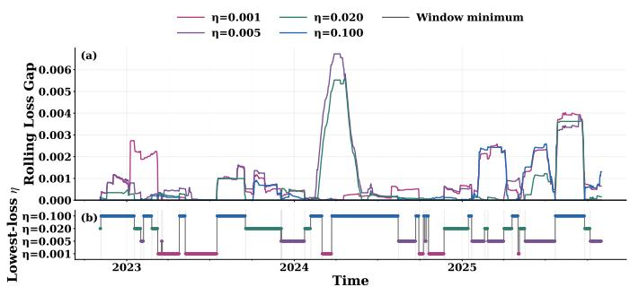  
Fig. 1. Fixed-step sensitivity on the South China Sea stream at $\alpha = 0 . 1 5$ with $w = 6 0$ . Top: 60-day rolling-loss gap of each fixed-step expert relative to the minimum rolling loss among the experts in each window. Bottom: the adaptation rate η attaining the minimum rolling loss in the corresponding window.

A direct remedy is online recalibration using matured feedback: the high-resolution reference for day t becomes available only after a delay of d days, so on day t we can only use decisions whose outcomes have already matured. Let

$$
B _ { t } = \{ t - d - w + 1 , \ldots , t - d \}\tag{5}
$$

denote the w most recent matured decisions available on day t, where w is the rolling-window length. A single-rate update with fixed step size η can be summarized as

$$
\begin{array} { l } { \displaystyle \bar { v } _ { t } = \frac { 1 } { w } \sum _ { j \in \mathcal { B } _ { t } } \mathbf { 1 } \{ r _ { j } ( \tau _ { j } ) > \alpha \} , } \\ { \displaystyle \alpha _ { t + 1 } ^ { e } = \alpha _ { t } ^ { e } + \eta ( \alpha - \bar { v } _ { t } ) , } \end{array}\tag{6}
$$

where $\tau _ { j }$ is the threshold actually deployed on day j, and $\alpha _ { t } ^ { e }$ is the internal target used for online recalibration. When the recent violation frequency exceeds the target, the update decreases the internal level and makes subsequent threshold selection more conservative. Conversely, when violations remain below the target, the internal level is relaxed to recover usable trusted area.

In practice, large η values respond rapidly to persistent changes but may overreact to transient fluctuations, whereas small values are stable but adapt slowly. Figure 1 shows that the adaptation rate attaining the lowest rolling loss changes repeatedly over time, suggesting that no single fixed rate is uniformly favored throughout deployment.

These observations motivate our method, CARM (Conformal Adaptive Risk Masking), which maintains experts with different step sizes and aggregates their threshold proposals according to matured performance rather than committing to a single fixed threshold or adaptation rate.

## III. OUR METHOD

CARM is a post-hoc framework that computes a deployment threshold $\tau _ { t }$ using only feedback matured by day t, without retraining the underlying super-resolution predictor. Applying $\tau _ { t }$ to the current uncertainty map $U _ { t }$ via Eq. (1) yields the trust mask $M _ { t } ( \tau _ { t } )$ . Concretely, CARM lets K experts, indexed by $k \in \{ 1 , \ldots , K \}$ and each running at a distinct step size ηk, propose thresholds independently. It then combines these proposals into $\tau _ { t }$ by upweighting whichever experts have kept their realized risk closest to α on recently matured decisions.

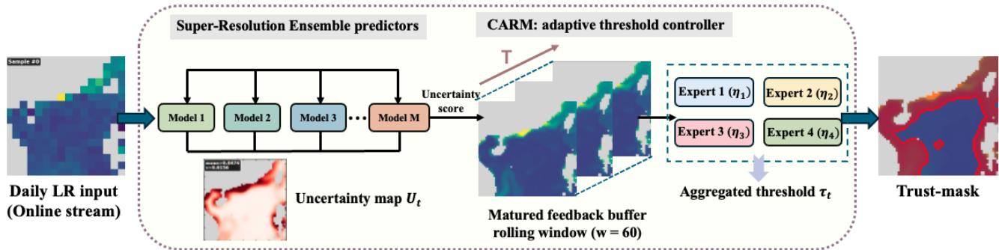  
Fig. 2. Overview of CARM. Experts with different step sizes update their threshold proposals. The proposals are aggregated into the deployed threshold $\tau _ { t } .$ which is applied to $U _ { t }$ to generate the trust mask.

Each expert k follows the same recalibration rule as Eq. (6): it maintains a buffer $\mathcal { B } _ { t } ^ { ( k ) } = \{ t - d - w + 1 , \dots , t - d \}$ of its w most recent decisions whose outcomes have matured after the d-day feedback delay, an empirical violation frequency $\bar { v } _ { t } ^ { ( k ) }$ over this buffer, and an internal target level $\alpha _ { t } ^ { e , ( k ) }$ , updated as

$$
\begin{array} { c } { { \displaystyle \bar { v } _ { t } ^ { ( k ) } = \frac { 1 } { w } \sum _ { j \in \mathcal { B } _ { t } ^ { ( k ) } } \mathbf { 1 } \left\{ r _ { j } \left( \tau _ { j } ^ { ( k ) } \right) > \alpha \right\} , } } \\ { { \displaystyle \alpha _ { t + 1 } ^ { e , ( k ) } = \alpha _ { t } ^ { e , ( k ) } + \eta _ { k } \left( \alpha - \bar { v } _ { t } ^ { ( k ) } \right) . } } \end{array}\tag{7}
$$

A violation rate above α reduces the expert’s internal target, making subsequent threshold selection more conservative.

Candidate thresholds are drawn from the fixed grid G, constructed from calibration-set uncertainty percentiles. Let $\mathcal { G } _ { t } \subseteq \mathcal { G }$ denote the candidate set used at deployment step t. For each $\tau \in \mathcal G _ { t }$ , let $\hat { q } _ { t } ( \tau )$ denote its empirical violation frequency over the matured candidate records. Expert k selects

$$
\tau _ { t } ^ { ( k ) } \in \arg \operatorname* { m i n } _ { \tau \in \mathcal { G } _ { t } } \left| \hat { q } _ { t } ( \tau ) - \alpha _ { t } ^ { e , ( k ) } \right|\tag{8}
$$

with ties resolved in favor of the larger threshold. Thus, $\hat { q } _ { t } ( \tau )$ evaluates candidate thresholds, whereas $\bar { v } _ { t } ^ { ( k ) }$ evaluates the realized decisions of expert k and updates its internal target.

The experts’ proposals are combined into the deployed threshold using the current weights $\omega _ { t } ^ { ( k ) }$ , carried over from the previous day:

$$
\tau _ { t } = \sum _ { k = 1 } ^ { K } \omega _ { t } ^ { ( k ) } \tau _ { t } ^ { ( k ) } .\tag{9}
$$

By day $t ,$ the reference $Y _ { t - d }$ has also just arrived after the $d -$ day delay, making the realized risk $r _ { t - d } ( \tau _ { t - d } ^ { ( k ) } )$ of the decision expert k made on day $t - d .$ Expert k incurs the loss

$$
\ell _ { t } ^ { ( k ) } = \left\{ \begin{array} { l l } { \Big [ \alpha - r _ { t - d } \Big ( \tau _ { t - d } ^ { ( k ) } \Big ) \Big ] ^ { 2 } , } & { r _ { t - d } \Big ( \tau _ { t - d } ^ { ( k ) } \Big ) \leq \alpha , } \\ { r _ { t - d } \Big ( \tau _ { t - d } ^ { ( k ) } \Big ) - \alpha , } & { r _ { t - d } \Big ( \tau _ { t - d } ^ { ( k ) } \Big ) > \alpha . } \end{array} \right.\tag{10}
$$

The loss mildly penalizes conservativeness below the target and more strongly penalizes target violations, based on this single freshly matured day rather than the w-day average used for $\bar { v } _ { t } ^ { ( k ) }$ . This loss updates each weight for tomorrow’s deployment:

$$
\omega _ { t + 1 } ^ { ( k ) } = \frac { \omega _ { t } ^ { ( k ) } \exp \left( - \ell _ { t } ^ { ( k ) } \right) } { \sum _ { j = 1 } ^ { K } \omega _ { t } ^ { ( j ) } \exp \left( - \ell _ { t } ^ { ( j ) } \right) } ,\tag{11}
$$

where the expert weights are initialized uniformly as $\omega _ { 1 } ^ { ( k ) } = \quad$ $1 / K$ for all $k \in \{ 1 , \ldots , K \}$ . The overall procedure is illustrated in Fig. 2. Each expert’s internal target ${ \bf \Phi } _ { \alpha _ { t } } ^ { e , ( k ) }$ is calibrated against the user-facing level α, as in Eq. (7). Next, we prove the asymptotic risk-control guarantee. Let $\tau _ { \operatorname* { m i n } } : = \operatorname* { m i n } \{ \mathcal { G } \}$ denote the smallest candidate threshold, so that $r _ { t } ( \tau _ { \operatorname* { m i n } } )$ is the lowest risk attainable on day t.

Theorem 1 (Asymptotic average risk control). Let $\alpha ^ { \prime } \ =$ $1 - { \sqrt { 1 - \alpha } } .$ . Suppose $r _ { t } ( \tau _ { \operatorname* { m i n } } ) \leq \alpha ^ { \prime }$ at every deployment day. Then CARM controls the average mask-conditioned risk at the user-facing level:

$$
\operatorname* { l i m } _ { T \to \infty } \frac { 1 } { T } \sum _ { t = 1 } ^ { T } r _ { t } ( \tau _ { t } ) \ \leq \ \alpha ,\tag{12}
$$

with $O ( 1 / T )$ convergence.

The guarantee does not require i.i.d. sampling or exchangeability and holds for any aggregation weights. The proof and assumptions are given in the supplementary material.

## IV. EXPERIMENTS

## A. Problem Setting

Setup and evaluation protocol. We evaluate CARM in a sequential scientific super-resolution setting with chronologically ordered training, calibration, and test splits. For each dataset–backbone combination, model parameters are optimized using the training split, and the selected SR model remains fixed throughout online deployment. For the FNO experiments, the calibration split is also used for checkpoint selection, as detailed below. The same split subsequently initializes the uncertainty-related quantities, candidate threshold set, and online buffers used by CMC and CARM.

During testing, predictions and threshold updates are performed sequentially day by day. The corresponding highresolution reference for day t becomes available only after a fixed delay of $d = 7$ days; therefore, all adaptive updates use only matured feedback. Unless otherwise stated, CARM uses a matured window of $w = 6 0$ and target levels $\alpha \in$ {0.05, 0.10, 0.15}.

Datasets and models. We evaluate CARM on three scientific datasets spanning distinct geophysical variables: the South China Sea chlorophyll-a (Chl-a) stream [15], ERA5 wind fields [16], and OSTIA sea-surface temperature (SST) fields [17]. We consider seven SR backbones: FNO [18], MWT [19], SRNO [20], HiNOTE [21], SwinIR [22], EDSR [23], and ResShift [24].

Backbone training. The detailed South China Sea results and all ablation experiments use FNO as the SR backbone. Each FNO ensemble member is trained independently with AdamW using an initial learning rate of $5 \times 1 0 ^ { - 4 }$ , weight decay of $1 0 ^ { - 3 }$ , and batch size 16 for up to 500 epochs. A ReduceLROnPlateau scheduler monitors the MSE on the calibration split with a reduction factor of 0.5, patience of 10, and a minimum learning rate of $1 0 ^ { - 6 }$ . Early stopping is applied with patience 40, and the checkpoint attaining the lowest calibration MSE is retained for subsequent uncertainty estimation and sequential evaluation.

Uncertainty estimation and CARM configuration. The main experiments use an ensemble of $M ~ = ~ 5$ independently trained SR models with different random seeds. Let $\{ \hat { Y } _ { t } ^ { ( m ) } \} _ { m = 1 } ^ { M }$ denote the ensemble predictions on day t. For each HR pixel location, predictions from all ensemble members within its $3 \times 3$ spatial neighborhood are collected to compute a local joint variance. Its square root is used as the local ensemble spread. The resulting spread map is further processed using mask-aware Gaussian smoothing with $\sigma = 1 . 5$ , so that land pixels do not contaminate nearby valid ocean locations. The resulting map defines the predictive uncertainty map $U _ { t } .$

The candidate threshold set G is constructed once from the uncertainty distribution over the calibration split and remains fixed throughout online deployment. Specifically, we use $L =$ 201 candidate thresholds corresponding to uniformly spaced percentile levels from 0 to 100. The expert pool contains four adaptation rates $\eta \in \{ 0 . 0 0 1 , 0 . 0 0 5 , 0 . 0 2 , 0 . 1 \}$ . The online buffers are warm-started from calibration records and updated using only matured feedback.

Baseline. We compare CARM primarily with Conformal Mask Calibration (CMC), which calibrates a single threshold on the calibration split and keeps it fixed throughout deployment. Within each dataset–backbone combination, CMC and CARM receive exactly the same frozen SR predictions and uncertainty maps and are evaluated on the same chronologically ordered test stream. The sequential deployment protocol and CARM configuration are also kept unchanged across backbones. Therefore, each paired comparison between CMC and CARM isolates the effect of online threshold adaptation rather than changes in the underlying SR predictions or uncertainty estimates.

Metrics. Let $T$ denote the number of test days. Using the realized mask-conditioned risk $r _ { t } ( \tau _ { t } )$ and trusted-area ratio

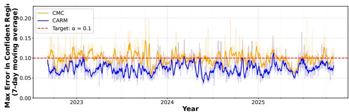  
Fig. 3. Temporal risk on the South China Sea stream at $\alpha = 0 . 1 0$ . The fixed CMC threshold exhibits sustained near-target or above-target periods under temporal distribution shift, whereas CARM adapts online using matured feedback. The dashed line denotes the target risk level $\alpha = 0 . 1 0$

$c _ { t } ( \tau _ { t } )$ , we report

$$
\begin{array} { l } { { \displaystyle \mathrm { R i s k } = \frac { 1 } { T } \sum _ { t = 1 } ^ { T } r _ { t } ( \tau _ { t } ) , \quad \mathrm { V R } = \frac { 1 } { T } \sum _ { t = 1 } ^ { T } \mathbf { 1 } \{ r _ { t } ( \tau _ { t } ) > \alpha \} , } } \\ { { \displaystyle \mathrm { M A E R } = \frac { 1 } { T - 6 } \sum _ { t = 1 } ^ { T - 6 } \mathbf { 1 } \Bigg \{ \frac { 1 } { 7 } \sum _ { j = t } ^ { t + 6 } r _ { j } ( \tau _ { j } ) > \alpha \Bigg \} , } } \\ { { \displaystyle \mathrm { T S } = \frac { 1 } { T } \sum _ { t = 1 } ^ { T } c _ { t } ( \tau _ { t } ) . } } \end{array}
$$

Here, VR measures day-level violations, MAER measures exceedances over stride-1 seven-day windows, and TS measures the average fraction of valid pixels retained in the deployed trust masks. Lower values are preferred for Risk, VR, and MAER, whereas higher TS indicates a larger trusted region.

## B. Main Results

CARM improves deployment-time reliability under temporal distribution shift. The CMC and CARM rows in Table I compare static CMC and CARM on the South China Sea Chla stream using the FNO backbone across three target levels, $\alpha \in \{ 0 . 0 5 , 0 . 1 0 , 0 . 1 5 \}$

CARM reduces the realized risk, day-level violations, and sustained exceedances relative to static CMC at every level: at $\alpha = 0 . 0 5$ , VR falls from 47.31% to 12.93% and MAER from 56.11% to 5.50%; at $\alpha = 0 . 1 0$ , VR falls from 43.49% to 9.38% and MAER from 47.29% to 1.22%; at $\alpha = 0 . 1 5 ,$ VR falls from 43.40% to 14.76% and MAER from 46.95% to 9.69%. These improvements are accompanied by a smaller trusted region, reflecting the expected reliability–coverage trade-off of adaptive masking rather than a cost-free increase in retained area.

Temporal behavior under distribution shift. Figure 3 provides an additional temporal diagnostic on the South China Sea stream at $\alpha = 0 . 1 0$ . The fixed CMC threshold exhibits sustained near-target or above-target periods, whereas CARM adjusts its deployed threshold using matured feedback. This comparison illustrates the deployment limitation of one-shot calibration under temporal distribution shift.

Effectiveness of CARM on multiple datasets and backbones. Table II evaluates CARM at $\alpha = 0 . 1 0$ across three scientific datasets and multiple backbones.

The evaluated backbones include FNO [18], MWT [19], SRNO [20], HiNOTE [21], SwinIR [22], EDSR [23], and

TABLE I  
COMPARISON OF STATIC CMC, FIXED-RATE EXPERTS, AND CARM ON THE SOUTH CHINA SEA CHL-A STREAM USING THE FNO BACKBONE. LOWER VALUES ARE PREFERRED FOR RISK, VR, AND MAER, AND THE BEST VALUE WITHIN EACH TARGET LEVEL IS BOLDED. TS REPORTS RETAINED COVERAGE AND IS NOT RANKED.
<table><tr><td></td><td colspan="4"> $\alpha = 0 . 0 5$ </td><td colspan="4"> $\alpha = 0 . 1 0$ </td><td colspan="4"> $\alpha = 0 . 1 5$ </td></tr><tr><td>Method</td><td> $\mathrm { R i s k } \downarrow$ </td><td>VR (%) ↓</td><td>MAER (%) ↓</td><td> $\mathrm { T S } ~ ( \% )$ </td><td> $\mathrm { R i s k } \downarrow$ </td><td>VR (%) ↓</td><td>MAER (%) ↓</td><td> $\mathrm { T S } ~ ( \% )$ </td><td> $\mathrm { R i s k \downarrow }$ </td><td> $\mathrm { V R } \ ( \% ) \downarrow$ </td><td>MAER (%) ↓</td><td>TS (%)</td></tr><tr><td>CMC</td><td>0.0513</td><td>47.31</td><td>56.11</td><td>26.03</td><td>0.0989</td><td>43.49</td><td>47.29</td><td>57.51</td><td>0.1496</td><td>43.40</td><td>46.95</td><td>94.78</td></tr><tr><td>Single expert  $( \eta = 0 . 0 0 1 )$ </td><td>0.0354</td><td>13.02</td><td>5.47</td><td>10.14</td><td>0.0746</td><td>10.42</td><td>1.74</td><td>42.32</td><td>0.1230</td><td>16.41</td><td>10.76</td><td>71.59</td></tr><tr><td>Single expert  $( \eta = 0 . 0 0 5 )$ </td><td>0.0354</td><td>13.02</td><td>5.47</td><td>10.14</td><td>0.0733</td><td>9.81</td><td>1.65</td><td>41.36</td><td>0.1191</td><td>15.28</td><td>9.64</td><td>68.42</td></tr><tr><td>Single expert  $( \eta = 0 . 0 2 0 )$ </td><td>0.0353</td><td>13.02</td><td>5.47</td><td>10.15</td><td>0.0728</td><td>9.90</td><td>1.04</td><td>41.04</td><td>0.1184</td><td>14.24</td><td>9.20</td><td>68.18</td></tr><tr><td>Single expert  $( \eta = 0 . 1 0 0 )$ </td><td>0.0354</td><td>13.19</td><td>5.47</td><td>10.27</td><td>0.0722</td><td>9.46</td><td>0.95</td><td>40.89</td><td>0.1202</td><td>14.06</td><td>8.59</td><td>69.85</td></tr><tr><td>CARM</td><td>0.0354</td><td>12.93</td><td>5.50</td><td>10.19</td><td>0.0737</td><td>9.38</td><td>1.22</td><td>41.73</td><td>0.1211</td><td>14.76</td><td>9.69</td><td>70.47</td></tr></table>

TABLE II  
CROSS-DOMAIN AND CROSS-BACKBONE COMPARISON AT $\alpha = 0 . 1 0 .$
<table><tr><td>Dataset</td><td>Backbone</td><td>Method</td><td>Risk↓</td><td>VR (%) ↓</td><td>MAER (%) ↓</td></tr><tr><td rowspan="18">Chl-a</td><td>FNO</td><td>CMC</td><td>0.0989</td><td>43.49</td><td>47.29</td></tr><tr><td></td><td>CARM</td><td>0.0737</td><td>9.38</td><td>1.22</td></tr><tr><td>SRNO</td><td>CMC</td><td>0.0974</td><td>41.24</td><td>38.38</td></tr><tr><td></td><td>CARM</td><td>0.0730</td><td>10.54</td><td>3.32</td></tr><tr><td>HiNOTE</td><td>CMC</td><td>0.1014</td><td>43.08</td><td>43.29</td></tr><tr><td></td><td>CARM</td><td>0.0736</td><td>11.33</td><td>6.37</td></tr><tr><td>MWT</td><td>CMC</td><td>0.0968</td><td>40.97</td><td>39.04</td></tr><tr><td rowspan="2">SwinIR</td><td>CARM</td><td>0.0655</td><td>11.07</td><td>2.39</td></tr><tr><td>CMC</td><td>0.0981</td><td>41.37</td><td>43.16</td></tr><tr><td rowspan="2">EDSR</td><td>CARM</td><td>0.0711</td><td>10.94</td><td>5.05</td></tr><tr><td>CMC</td><td>0.0977</td><td>39.92</td><td>44.22</td></tr><tr><td></td><td>CARM</td><td>0.0818</td><td>19.10</td><td>8.37</td></tr><tr><td rowspan="6">ERA5</td><td rowspan="2">FNO</td><td>CMC</td><td>0.0960</td><td>35.00</td><td>36.72</td></tr><tr><td>CARM</td><td>0.0844</td><td>9.72</td><td>6.21</td></tr><tr><td rowspan="2">SRNO</td><td>CMC</td><td>0.0940</td><td>33.89</td><td>27.12</td></tr><tr><td>CARM</td><td>0.0768</td><td>10.28</td><td>3.67</td></tr><tr><td rowspan="2">ResShift</td><td>CMC</td><td>0.0947</td><td>31.94</td><td>28.53</td></tr><tr><td>CARM</td><td>0.0782</td><td>11.11</td><td>3.67</td></tr><tr><td rowspan="10">OSTIA</td><td rowspan="2">MWT</td><td>CMC</td><td>0.2120</td><td>84.07</td><td></td></tr><tr><td>CARM</td><td>0.1513</td><td>64.73</td><td>98.39 68.54</td></tr><tr><td rowspan="2">SRNO</td><td>CMC</td><td>0.1023</td><td>42.53</td><td>57.83</td></tr><tr><td>CARM</td><td>0.0677</td><td>11.27</td><td>5.15</td></tr><tr><td rowspan="2">HiNOTE</td><td>CMC</td><td>0.1069</td><td>43.87</td><td>58.57</td></tr><tr><td>CARM</td><td>0.0703</td><td>10.80</td><td>6.16</td></tr><tr><td rowspan="2">SwinIR</td><td>CMC</td><td>0.0980</td><td>39.07</td><td>52.14</td></tr><tr><td>CARM</td><td>0.0720</td><td>13.40</td><td>5.15</td></tr><tr><td rowspan="2">ResShift</td><td>CMC</td><td>0.1052</td><td>40.60</td><td>51.94</td></tr><tr><td></td><td></td><td></td><td></td></tr><tr><td rowspan="2"></td><td>CARM</td><td>0.0881</td><td>21.93</td><td>27.44</td></tr><tr><td></td><td></td><td></td><td></td></tr></table>

ResShift [24]. CARM reduces all three primary deployment metrics over static CMC across all fourteen combinations, confirming consistent relative improvements regardless of domain or backbone choice. For example, on OSTIA with the SRNO backbone, VR falls from 42.53% to 11.27% and MAER from 57.83% to 5.15%. These results indicate that CARM improves deployment-time reliability across diverse settings, even though the magnitude of that improvement varies by dataset and backbone.

Qualitative analysis of trust masks. Figure 4 provides representative qualitative examples on the South China Sea test stream at $\alpha = 0 . 1 0$ . Regions with large reconstruction errors frequently occur near complex coastal and boundary structures. The deployed trust masks reject many of these spatially unreliable regions while retaining more stable interiorocean areas, illustrating the spatial correspondence between predictive uncertainty and realized reconstruction error.

TABLE III  
EFFECT OF EXPERT-POOL COMPOSITION ON THE SOUTH CHINA SEASTREAM AT $\alpha = 0 . 1 0$ USING THE FNO BACKBONE. LOWER IS BETTER.
<table><tr><td>Expert Pool</td><td>Risk↓</td><td>VR↓</td><td>MAER↓</td></tr><tr><td>{0.001, 0.005}</td><td>0.0742</td><td>9.90%</td><td>1.75%</td></tr><tr><td>{0.02, 0.1}</td><td>0.0727</td><td>9.55%</td><td>1.05%</td></tr><tr><td> $\{ 0 . 0 0 1 , 0 . 0 2 , 0 . 1 \}$ </td><td>0.0735</td><td>9.64%</td><td>1.05%</td></tr><tr><td> $\{ 0 . 0 0 1 , 0 . 0 0 5 , 0 . 0 2 , 0 . 1 \}$ </td><td>0.0737</td><td>9.38%</td><td>1.22%</td></tr></table>

## C. Ablation Studies

Comparison with fixed-rate experts. The fixed-rate expert rows in Table I compare CARM with four singleexpert controllers using fixed adaptation rates $\eta \in$ $\{ 0 . 0 0 1 , 0 . 0 0 5 , 0 . 0 2 , 0 . 1 \}$

The lowest-risk fixed rate is not stable across α: $\eta = 0 . 0 2$ attains the lowest Risk at $\alpha = 0 . 0 5$ and $\alpha = 0 . 1 5$ , whereas $\eta = 0 . 1$ attains the lowest Risk at $\alpha = 0 . 1 0 $ , so committing to any single rate in advance would sacrifice performance at some target levels. CARM instead aggregates across rates online, attaining the lowest VR among all methods at both $\alpha = 0 . 0 5$ and $\alpha ~ = ~ 0 . 1 0$ . At $\alpha ~ = ~ 0 . 1 0$ specifically, $\eta \ : = \ : 0 . 1$ attains the lowest Risk and MAER among the fixed-rate experts, yet CARM still retains a larger trusted area $\mathrm { ( T S = 4 1 . 7 3 \% }$ vs. 40.89%). CARM’s improved risk control is therefore not an artifact of aggressively shrinking the trusted region, but reflects adaptive threshold calibration that responds to the evolving data distribution.

Effect of expert-pool composition. We evaluate how the composition of the expert pool affects online risk control on the South China Sea stream at $\alpha ~ = ~ 0 . 1 0$ . Table III compares several subsets of adaptation rates under the same delayed-feedback protocol. Pools containing faster experts generally achieve lower average risk and sustained exceedance rates, whereas the full heterogeneous pool achieves the lowest empirical violation rate. No pool configuration dominates all reported metrics, supporting the use of heterogeneous response rates rather than a single prescribed subset.

Sensitivity to the matured window length. Table IV evaluates the matured window length $w \in \{ \mathrm { 3 0 } , 6 0 , 9 0 \}$ across all three target risk levels, $\alpha ~ \in ~ \{ 0 . 0 5 , 0 . 1 0 , 0 . 1 5 \}$ , on the South China Sea test stream. The results show the expected responsiveness–stability trade-off: short windows are more sensitive to transient fluctuations, whereas long windows pro-

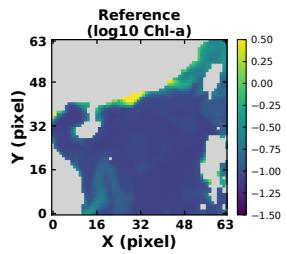

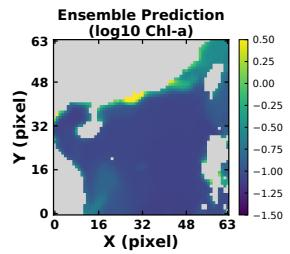

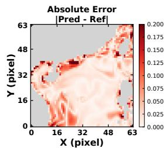

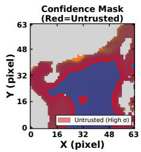

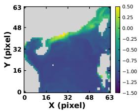

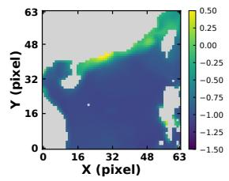

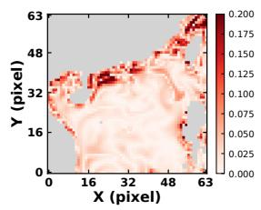

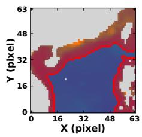

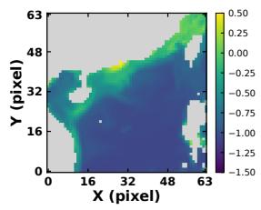

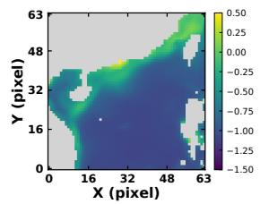

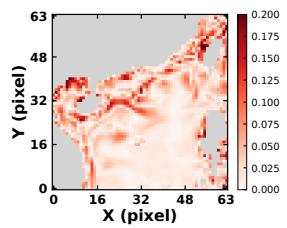

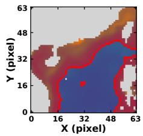  
Fig. 4. Qualitative examples of deployed trust masks on the South China Sea test stream at α = 0.10. Each row corresponds to one representative test sample From left to right: HR reference, ensemble SR prediction, absolute reconstruction error, and the deployed trust mask. Red regions are rejected as untrusted.

## TABLE IV

SENSITIVITY TO THE MATURED WINDOW LENGTH ON THE SOUTH CHINA SEA TEST STREAM. VR AND MAER ARE REPORTED IN PERCENT. LOWER IS BETTER.
<table><tr><td>α</td><td>w</td><td>Risk↓</td><td>VR↓</td><td>MAER↓</td></tr><tr><td>0.05</td><td>30 60 90</td><td>0.0366 0.0354 0.0355</td><td>14.76% 12.93% 13.19%</td><td>6.28% 5.50% 5.15%</td></tr><tr><td>0.10</td><td>30 60 90</td><td>0.0738 0.0737 0.0732</td><td>10.68% 9.38% 9.46%</td><td>1.92% 1.22% 1.31%</td></tr><tr><td>0.15</td><td>30 60 90</td><td>0.1231 0.1211 0.1214</td><td>15.80% 14.76% 15.54%</td><td>10.03% 9.69% 11.17%</td></tr></table>

vide stronger smoothing but may adapt more slowly. Overall, w = 60 provides a stable compromise across the evaluated target levels, although it is not optimal for every metric.

## V. CONCLUSION

We investigated reliable scientific super-resolution under temporal distribution shift, where spatial trust masks calibrated once on historical data can lose reliability as the deployment distribution evolves. To address this problem, we proposed CARM, a model-agnostic post-processing framework that causally adapts trust-mask thresholds from matured feedback through multi-rate expert aggregation, without retraining or modifying the underlying super-resolution model. Experiments across multiple geophysical datasets and diverse superresolution backbones show that CARM consistently reduces average risk, violation rate, and mean accumulated excess risk relative to static CMC, although the magnitude of the improvement depends on the dataset and backbone. These results indicate that the benefit of CARM arises from better aligning the trusted region with the evolving error distribution rather than from improving the underlying reconstruction itself. This reliability is not cost-free: stricter risk control can reduce trusted spatial coverage, and effective adaptation depends on the uncertainty scores providing an informative ranking of spatial reconstruction errors. Moreover, CARM is designed to control risk over time rather than eliminate every instantaneous violation, while delayed feedback inevitably limits its response to abrupt distribution changes. Future work should therefore improve uncertainty ranking and calibration, develop faster adaptation mechanisms for sudden shifts, and incorporate explicit risk–coverage objectives to preserve sufficient usable regions while maintaining reliable deployment.

[1] C. R. Mcclain, “A decade of satellite ocean color observations,” Annual Review of Marine Science, vol. 1, pp. 19–42, 2009.

[2] C. B. Field, M. J. Behrenfeld, J. T. Randerson, and P. Falkowski, “Primary production of the biosphere: integrating terrestrial and oceanic components,” Science, vol. 281, no. 5374, pp. 237–240, 1998.

[3] D. T. Lloyd, A. Abela, R. A. Farrugia, A. Galea, and G. Valentino, “Optically enhanced Super-Resolution of sea surface temperature using deep learning,” IEEE Transactions on Geoscience and Remote Sensing, vol. 60, pp. 1–14, 2021.

[4] X. Liu and M. Wang, “Super-Resolution of VIIRSmeasured ocean color products using deep convolutional neural network,” IEEE Transactions on Geoscience and Remote Sensing, vol. 59, no. 1, pp. 114–127, 2021.

[5] H. Yang, W. Ma, Y. Yu, and X. Yang, “Super-Resolution sea surface temperature from multiple thermal infrared bands using residual channel attention network,” IEEE Geoscience and Remote Sensing Letters, vol. 22, pp. 1– 5, 2025.

[6] A. M. Saranathan, B. Smith, and N. Pahlevan, “Per-Pixel uncertainty quantification and reporting for Satellite-Derived chlorophyll-a estimates via mixture density networks,” IEEE Transactions on Geoscience and Remote Sensing, vol. 61, pp. 1–15, 2023.

[7] T. Liu, J. Cheng, and S. Tan, “Spectral bayesian uncertainty for image Super-Resolution,” in Proceedings of the IEEE/CVF Conference on Computer Vision and Pattern Recognition (CVPR). Vancouver, BC, Canada: IEEE, Jun. 2023, pp. 18 166–18 175.

[8] A. N. Angelopoulos and S. Bates, “A gentle introduction to conformal prediction and distribution-free uncertainty quantification,” CoRR, vol. abs/2107.07511, 2021.

[9] A. N. Angelopoulos, S. Bates, A. Fisch, L. Lei, and T. Schuster, “Conformal risk control,” in International Conference on Learning Representations. Vienna, Austria: OpenReview.net, 2024.

[10] E. Adame, D. Csillag, and G. T. Goedert, “Image Super-Resolution with guarantees via conformalized generative models,” in Advances in Neural Information Processing Systems. Red Hook, NY, USA: Curran Associates, Inc., 2025.

[11] G. Singh, G. Moncrieff, Z. Venter, K. Cawse-Nicholson, J. Slingsby, and T. B. Robinson, “Uncertainty quantification for probabilistic machine learning in earth observation using conformal prediction,” Scientific Reports, vol. 14, p. 16166, 2024.

[12] I. Gibbs and E. Candes, “Adaptive conformal inference\` under distribution shift,” Advances in Neural Information Processing Systems, vol. 34, pp. 1660–1672, 2021.

[13] A. N. Angelopoulos, E. J. Candes, and R. J. Tibshirani,\` “Conformal PID control for time series prediction,” in Advances in Neural Information Processing Systems, vol. 36. Red Hook, NY, USA: Curran Associates, Inc., 2023, pp. 23 047–23 074.

[14] C. Marx, V. Kuleshov, and S. Ermon, “Calibrated probabilistic forecasts for arbitrary sequences,” Transactions on Machine Learning Research, vol. 2025, 2025.

[15] Copernicus Marine Service, “Global Ocean Biogeochemistry Hindcast,” Copernicus Marine Data Store, 2018, accessed: Jun. 5, 2026.

[16] Copernicus Climate Change Service, “ERA5 hourly data on pressure levels from 1940 to present,” Copernicus Climate Data Store, 2023, accessed: Jun. 5, 2026.

[17] Copernicus Marine Service, “Global Ocean OSTIA Sea Surface Temperature and Sea Ice Reprocessed,” Copernicus Marine Data Store, 2024, accessed: Jun. 5, 2026.

[18] Z. Li, N. B. Kovachki, K. Azizzadenesheli, B. Liu, K. Bhattacharya, A. Stuart, and A. Anandkumar, “Fourier neural operator for parametric partial differential equations,” in International Conference on Learning Representations (ICLR). Virtual Event, Austria: OpenReview.net, 2021.

[19] G. Gupta, X. Xiao, and P. Bogdan, “Multiwavelet-based operator learning for differential equations,” Advances in Neural Information Processing Systems, vol. 34, pp. 24 048–24 062, 2021.

[20] M. Wei and X. Zhang, “Super-resolution neural operator,” in Proceedings of the IEEE/CVF Conference on Computer Vision and Pattern Recognition (CVPR). Vancouver, BC, Canada: IEEE, 2023, pp. 18 247–18 256.

[21] X. Luo, X. Qian, and B.-J. Yoon, “Hierarchical neural operator transformer with learnable frequency-aware loss prior for arbitrary-scale super-resolution,” in Proceedings of the 41st International Conference on Machine Learning, ser. Proceedings of Machine Learning Research, vol. 235. Vienna, Austria: PMLR, 2024, pp. 33 466–33 485.

[22] J. Liang, J. Cao, G. Sun, K. Zhang, L. V. Gool, and R. Timofte, “Swinir: Image restoration using swin transformer,” in Proceedings of the IEEE/CVF International Conference on Computer Vision (ICCV) Workshops. Montreal, QC, Canada: IEEE, 2021, pp. 1833–1844.

[23] B. Lim, S. Son, H. Kim, S. Nah, and K. M. Lee, “Enhanced deep residual networks for single image super-resolution,” in Proceedings of the IEEE Conference on Computer Vision and Pattern Recognition (CVPR) Workshops. Honolulu, HI, USA: IEEE, 2017, pp. 136– 144.

[24] Z. Yue, J. Wang, and C. C. Loy, “ResShift: Efficient diffusion model for image super-resolution by residual shifting,” in Advances in Neural Information Processing Systems. Red Hook, NY, USA: Curran Associates, Inc., 2023, pp. 13 294–13 307.

# APPENDIX A PROOF OF THEOREM 1

Write $\tau _ { \mathrm { m i n } } : = \operatorname* { m i n } \mathcal { G }$ and $\eta _ { \mathrm { m i n } } : = \operatorname* { m i n } _ { k } \eta _ { k }$

Assumption 1. $( \mathrm { A } 1 ) \ \tilde { e } _ { t } ( p ) \in [ 0 , 1 ] f o r \ a l l \ t , p ,$ hence $r _ { t } ( \tau ) \in$ $[ 0 , 1 ] \ b y \ ( 2 ) .$

$\begin{array} { r } { \overline { { \mathrm { ( A 2 ) } } } \quad \tau ~ \leq ~ \tau ^ { \prime } ~ \Rightarrow ~ M _ { t } ( \tau ) ~ \subseteq ~ M _ { t } ( \tau ^ { \prime } ) ~ b y ~ ( 1 ) , ~ s o ~ r _ { t } ( \cdot ) } \end{array}$ is nondecreasing.

(A3) τt is $\mathcal { F } _ { t }$ -measurable and $r _ { t }$ matures at $t +$ d with d $< \infty ,$ where $\mathcal { F } _ { t } = \sigma ( X _ { 1 : t } , \hat { Y } _ { 1 : t } , U _ { 1 : t } , Y _ { 1 : t - d } )$

(A4) Let $\begin{array} { r l } { S _ { t } } & { { } : = } \end{array}$ arg min $ _ { \in { \mathcal { G } } _ { t } } \hat { q } _ { t } ( \tau )$ and $\tau _ { t } ^ { \mathrm { f b } } : = \ \operatorname* { m a x } S _ { t } ,$ the candidate returned by (8) when the internal targets are nonpositive.

Assumptions (A1) and (A2) hold by construction and (A3) by the deployment protocol; (A4) is the only substantive restriction. Three features of (7)–(8) are load-bearing: the internal states $\alpha _ { t } ^ { e , ( k ) }$ are unprojected, the driving signal $\bar { v } _ { t }$ is shared across experts and computed from the deployed decisions, and ties break downward. Expert heterogeneity is carried entirely by the rates $\eta _ { k }$ and the weights $\overline { { \omega _ { t } ^ { ( k ) } } }$ ; the candidate-side window w of $\hat { q } _ { t } ( \cdot )$ plays no role in the constant below.

Proof. Throughout write $n : = w + d , H _ { k } : = \alpha ^ { \prime } / \eta _ { k }$

$$
\pi _ { T } ^ { ( k ) } : = \frac { 1 } { T } \sum _ { t \leq T } \mathbf { 1 } \{ r _ { t } ( \tau _ { t } ^ { ( k ) } ) > \alpha ^ { \prime } \} ,
$$

and

$$
\pi _ { T } : = \frac { 1 } { T } \sum _ { t \leq T } \mathbf { 1 } \{ r _ { t } ( \tau _ { t } ) > \alpha ^ { \prime } \} .
$$

Step 1 (per-expert linearization). Set

$$
G _ { t } ^ { ( k ) } : = \sum _ { s = 1 } ^ { t - 1 } \left( \bar { v } _ { s } ^ { ( k ) } - \alpha ^ { \prime } \right) , \qquad G _ { 1 } ^ { ( k ) } = 0 .
$$

By (A5) and induction, (7) gives

$$
\begin{array} { c } { { \alpha _ { t + 1 } ^ { e , ( k ) } = \alpha ^ { \prime } - \eta _ { k } { \cal G } _ { t } ^ { ( k ) } + \eta _ { k } \left( \alpha ^ { \prime } - \bar { v } _ { t } ^ { ( k ) } \right) } } \\ { { { } } } \\ { { = \alpha ^ { \prime } - \eta _ { k } { \cal G } _ { t + 1 } ^ { ( k ) } , } } \end{array}
$$

hence $\alpha _ { t } ^ { e , ( k ) } = \alpha ^ { \prime } - \eta _ { k } G _ { t } ^ { ( k ) }$ . The absence of a projection is what makes each recursion exactly linear.

Step 2 (saturation). Let H $: = \alpha ^ { \prime } / \eta _ { \mathrm { m i n } }$ and suppose $G _ { t } \ > \ H$ . Then $G _ { t } \ > \ 0$ and $\eta _ { k } G _ { t } \ge \eta _ { \mathrm { m i n } } G _ { t } > \alpha ^ { \prime } ,$ , so $\alpha _ { t } ^ { e , ( k ) } < 0$ for every k by Step 1. Since $\hat { q } _ { t } \geq 0 ;$ , the objective in (8) equals $\hat { q } _ { t } ( \tau ) - \alpha _ { t } ^ { e , \bar { ( k ) } }$ , which differs across experts only by a constant independent of $\tau ;$ minimizing it is therefore equivalent to minimizing $\hat { q } _ { t }$ , and all K experts share the minimizer set $S _ { t }$ . By (A2), each $r _ { j } ( \cdot )$ is nondecreasing, hence so is $\tau \mapsto \mathbf { 1 } \{ r _ { j } ( \tau ) > \alpha ^ { \prime } \}$ and therefore $\hat { q } _ { t } ( \cdot )$ . Its minimum over $\mathcal { G } _ { t }$ is attained on a plateau, and the tie-breaking rule of (8) selects its right endpoint $\tau _ { t } ^ { \mathrm { f b } }$ for every k. All K proposals coincide, so $\tau _ { t } ~ = ~ \tau _ { t } ^ { \mathrm { f b } }$ for any weights, and $r _ { t } ( \tau _ { t } ) \leq \alpha ^ { \prime }$ by (A4).

Step 2 (per-expert saturation). Suppose $G _ { t } ^ { ( k ) } > H _ { k }$ . Then $\alpha _ { t } ^ { e , ( k ) } < \bar { 0 } .$ , and since $\hat { q } _ { t } \ge 0 ;$ , the objective in (8) equals $\bar { q } _ { t } ( \tau ) - \alpha _ { t } ^ { e , ( k ) }$ , so expert k minimizes $\hat { q } _ { t }$ . By (A2), each $r _ { j } ( \cdot )$

is nondecreasing, hence so is ${ \hat { q } } _ { t } ( \cdot ) ;$ ; its minimizer set is a plateau and the tie-breaking rule returns its right endpoint. Thus $\tau _ { t } ^ { ( k ) } = \tau _ { t } ^ { \mathrm { f b } }$ and $r _ { t } ( \tau _ { t } ^ { ( \tilde { k } ) } ) \leq \alpha ^ { \prime }$ by (A4). Experts need not saturate simultaneously; the argument is applied to each k separately.

Step 3 (delayed reflection). Fix $k ;$ we claim

$$
G _ { t } ^ { ( k ) } \le G _ { \operatorname* { m a x } } ^ { ( k ) } : = H _ { k } + n ( 1 - \alpha ^ { \prime } ) .
$$

Increments obey

$$
G _ { t + 1 } ^ { ( k ) } - G _ { t } ^ { ( k ) } \in [ - \alpha ^ { \prime } , 1 - \alpha ^ { \prime } ] .
$$

Let $T _ { 0 }$ be minimal with $G _ { T _ { 0 } } ^ { ( k ) } > G _ { \mathrm { m a x } } ^ { ( k ) } . \mathrm { I f } T _ { 0 } \leq n ,$ , then

$$
G _ { T _ { 0 } } ^ { ( k ) } \leq ( n - 1 ) ( 1 - \alpha ^ { \prime } ) < G _ { \operatorname* { m a x } } ^ { ( k ) } .
$$

Otherwise, for $0 \leq j \leq n .$

$$
G _ { T _ { 0 } - j } ^ { ( k ) } \geq G _ { T _ { 0 } } ^ { ( k ) } - j ( 1 - \alpha ^ { \prime } ) > H _ { k } ,
$$

so expert k is saturated on every $s \in \{ T _ { 0 } - n , \ldots , T _ { 0 } - 1 \}$ and, by Step 2, none of these days is a violation of its own proposal. Its buffer at $T _ { 0 } - 1$ is $\{ T _ { 0 } - n , \dots , T _ { 0 } - 1 - d \}$ , so $\dot { v } _ { T _ { 0 } - 1 } ^ { ( k ) } = 0$ and $G _ { T _ { 0 } } ^ { ( k ) } < \bar { G } _ { T _ { 0 } - 1 } ^ { ( k ) }$ , a contradiction.

Step 4 (per-expert conversion). Exchanging summation as before,

$$
\sum _ { t \leq T } \bar { v } _ { t } ^ { ( k ) } = \sum _ { j } \kappa _ { j } \mathbf { 1 } \{ r _ { j } ( \tau _ { j } ^ { ( k ) } ) > \alpha ^ { \prime } \} ,
$$

with $\kappa _ { j } \in [ 0 , 1 ]$ and $\kappa _ { j } < 1$ for at most $n - 1$ days, so

$$
T \pi _ { T } ^ { ( k ) } \leq T \alpha ^ { \prime } + C ^ { ( k ) } ,
$$

where

$$
C ^ { ( k ) } : = H _ { k } + n ( 2 - \alpha ^ { \prime } ) - 1 .
$$

Step 5 (aggregation). Since $\omega _ { t }$ lies in the simplex, $\tau _ { t } ~ \leq$ maxk $\tau _ { t } ^ { ( k ) }$ , so $r _ { t } ( \tau _ { t } ) \leq$ maxk $r _ { t } ( \tau _ { t } ^ { ( k ) } )$ by $( \mathbf { A } 2 )$ , and

$$
\mathbf { 1 } \{ r _ { t } ( \tau _ { t } ) > \alpha ^ { \prime } \} \leq \sum _ { k } \mathbf { 1 } \{ r _ { t } ( \tau _ { t } ^ { ( k ) } ) > \alpha ^ { \prime } \} .
$$

Hence

$$
\pi _ { T } \leq \sum _ { k } \pi _ { T } ^ { ( k ) } \leq K \alpha ^ { \prime } + \frac { \bar { C } } { T } ,
$$

with

$$
\bar { C } : = \sum _ { k } C ^ { ( k ) } = \alpha ^ { \prime } \sum _ { k } \eta _ { k } ^ { - 1 } + K \big [ n ( 2 - \alpha ^ { \prime } ) - 1 \big ] .
$$

This step uses no property of the weights beyond the simplex constraint.

By (A1), $r _ { t } ( \tau _ { t } ) \leq \alpha ^ { \prime }$ on non-violation days and $r _ { t } ( \tau _ { t } ) \leq 1$ otherwise, so

$$
\begin{array} { l } { \displaystyle \frac { 1 } { T } \sum _ { t = 1 } ^ { T } r _ { t } ( \tau _ { t } ) \leq \alpha ^ { \prime } + \pi _ { T } ( 1 - \alpha ^ { \prime } ) } \\ { \leq \alpha ^ { \prime } \big [ 1 + K ( 1 - \alpha ^ { \prime } ) \big ] + \frac { ( 1 - \alpha ^ { \prime } ) \bar { C } } { T } . } \end{array}
$$

Let $\alpha ^ { \prime }$ be the smaller root of

$$
K \alpha ^ { \prime 2 } - ( K + 1 ) \alpha ^ { \prime } + \alpha = 0 ,
$$

$$
\frac { 1 } { T } \sum _ { t = 1 } ^ { T } r _ { t } ( \tau _ { t } ) \leq \alpha + \frac { 1 - \alpha ^ { \prime } } { T } \left[ \alpha ^ { \prime } \sum _ { k = 1 } ^ { K } \frac { 1 } { \eta _ { k } } + K \big ( n ( 2 - \alpha ^ { \prime } ) - 1 \big ) \right]
$$

so that the leading term equals α. Then

for $T \geq 1$ . The bracket is independent of T, giving (12) at an $O ( 1 / T )$ rate. □