# CONCEPTARC AT SCALE: STUDYING CONCEPTUAL UNDERSTANDING IN REASONING MODELS

Philipp Mondorf∗ LMU Munich & MCML

Adrien Deliege\` University of Liege\`

Ryan Yi Barbara Plank Santa Fe Institute LMU Munich & MCML

Solim LeGris Claas Beger New York University Santa Fe Institute

Brenden M. Lake† Todd M. Gureckis† Princeton University New York University

## ABSTRACT

Large reasoning models (LRMs) perform well on challenging benchmarks, yet it remains unclear whether they form generalizable abstractions across conceptually related reasoning tasks. The Abstraction and Reasoning Corpus (ARC) provides a controlled testbed for studying abstraction, requiring solvers to infer transformation rules over two-dimensional grids from a small set of examples. While ARC evaluates rule abstraction within individual tasks, different tasks may share higherlevel structure despite requiring different transformations—for example, several tasks may involve reasoning about objects contained within other objects. Benchmarks such as ConceptARC capture this structure by grouping ARC-style tasks into recurring spatial and semantic concepts, but they often contain only a few manually constructed tasks per concept. We introduce CONCEPTARC AT SCALE, a generator for creating thousands of ARC-style tasks targeting a specific concept. Using this generator, we construct CONCEPTARC-100, a dataset of 1,600 new, manually reviewed tasks, with 100 tasks for each of the 16 concepts defined by ConceptARC—ten times the size of the original benchmark. We evaluate a range of recent LRMs and models trained from scratch on CONCEPTARC-100 to characterize which concepts they solve reliably and where they struggle. We further analyze the models’ internal representations and find clear semantic structure: task representations cluster according to the operations applied to objects, such as recoloring, removal, or translation, even when realized through substantially different rules and scenarios. Together, our results suggest that models form stable abstractions of transformation operations that generalize across diverse tasks.

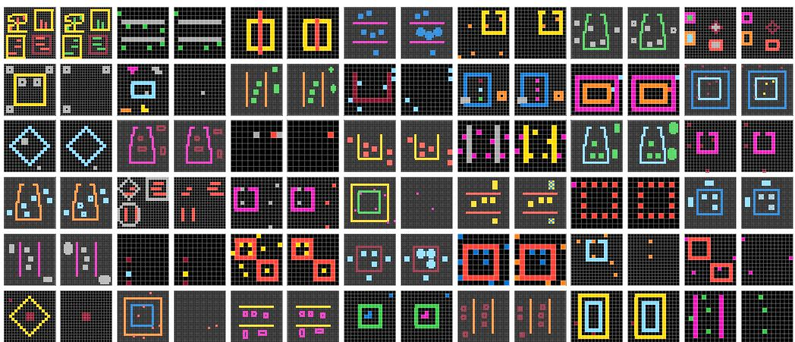  
Figure 1: Examples from 42 different tasks generated for the “Inside and Outside” concept. Each example consists of an input grid and its corresponding output grid shown to its right, illustrating the task-specific transformation. To illustrate task diversity, we show only one example from each of the 42 tasks. In CONCEPTARC-100, each task contains multiple examples (see Figure 9).

## 1 INTRODUCTION

The ability to form abstractions and reason with higher-level concepts is fundamental to human problem-solving (Gentner, 1983; Gentner & Hoyos, 2017). However, the extent to which large reasoning models rely on generalizable abstractions when solving complex reasoning problems remains unclear (Beger et al., 2025; Opiełka et al., 2025). Answering this question is crucial for understanding how these models represent complex tasks and whether their representations support generalization to novel scenarios (Hendel et al., 2023; Todd et al., 2024).

The Abstraction and Reasoning Corpus (ARC) (Chollet, 2019) provides a useful domain for studying this question. Each task presents a small number of input–output grid examples from which a solver must infer an underlying transformation rule and apply it to unseen inputs (see Figure 9 in the Appendix for an example). ARC studies abstraction within a task: the solver must identify the structure shared across a few concrete examples and infer a rule that generalizes beyond them. Abstraction, however, can also extend across tasks. Different ARC tasks may share higher-level structure even when they require different transformation rules (Acquaviva et al., 2022; Hodel, 2024). For example, one task may require recoloring line objects inside a container, as shown in the upperleft input–output example in Figure 1, whereas another task may require removing colored pixels between two line objects, as shown in the example to its right. Although the transformations differ, both rely on the concept of spatial containment. This raises a broader question: do models abstract such shared concepts across tasks with different transformation rules? ConceptARC (Moskvichev et al., 2023) provides a basis for this type of analysis by organizing ARC-style tasks according to recurring spatial and semantic concepts. However, it contains only ten hand-crafted tasks for each of 16 concepts, with relatively few examples per task. Moreover, because its tasks have been public since 2023, training-data contamination cannot be ruled out for recent models.

To address these limitations, we introduce CONCEPTARC AT SCALE, a generator for automatically creating thousands of new ARC-style tasks organized around the concepts defined by ConceptARC. Each generated task is represented by a program that maps an input grid to an output grid, enabling the generation of many input–output grid examples per task. Figure 1 shows one example from each of several generated tasks for the concept “Inside and Outside.” Although their transformation rules differ, all require reasoning about whether elements lie inside or outside a region.

We use our task generator to create CONCEPTARC-100, a dataset of 100 new, manually reviewed tasks for each of the 16 concepts defined by ConceptARC, totaling 1,600 tasks—ten times the size of the original benchmark. We evaluate several open-weight LRMs, as well as models trained from scratch on our generated data, and find comparatively strong performance on concepts such as “Center”, “Above and Below”, and “Top and Bottom (2D)”, whose transformations depend largely on spatial relations within the grid. In contrast, models perform worse on concepts such as “Same /Different”, “Order”, and “Count”, which require recognizing and comparing objects or patterns based on properties such as shape, numerosity, or color. Under a stricter task-level criterion that requires all 10 test inputs to be solved correctly, even the best-performing model succeeds on fewer than 24% of tasks, indicating that models struggle to solve tasks consistently across multiple test inputs.

Behavioral performance alone, however, does not reveal which abstractions models have formed. We therefore analyze their internal representations of tasks and find highly structured clusters organized primarily around the operations applied to objects—such as recoloring, removal, or translation—rather than by ConceptARC’s higher-level spatial and semantic concepts such as “Inside and Outside” (Figure 1). For example, tasks involving object translations often cluster together even when they belong to different concepts and follow substantially different rules. These results suggest that models represent structured regularities across ARC-style tasks, but that this structure reflects similarities in the required transformation operations more than the higher-level concepts motivating the benchmark.

In summary, our contributions are as follows:

1. We introduce CONCEPTARC AT SCALE, a generator for automatically creating thousands of new ARC-style tasks organized around the 16 concepts defined by ConceptARC. Each task is represented by a program that supports the generation of many grid examples.

2. We publicly release CONCEPTARC-100, a dataset of 100 new, manually reviewed tasks for each concept—ten times the size of the original ConceptARC benchmark.

3. We evaluate a range of recent LRMs, as well as models trained from scratch on CONCEPTARC-100, characterizing performance across concepts and showing that even the best-performing model struggles to consistently solve all test inputs within a task.

4. We analyze the models’ internal task representations and find clear semantic structure: tasks cluster according to the transformation operations applied to objects, even when those operations arise from substantially different rules, scenarios, and concepts.

## 2 RELATED WORK

ARC and beyond. The Abstraction and Reasoning Corpus (Chollet, 2019) was introduced to evaluate the ability to infer abstract transformation rules from a small number of examples and generalize them to novel inputs. Subsequent work has extended ARC or introduced related datasets, either handcrafted or procedurally generated. LARC (Acquaviva et al., 2021) provides naturallanguage descriptions of ARC tasks, DARC (Huang et al., 2023) records human interactions with a system for programmatic task decomposition, and H-ARC (LeGris et al., 2025) collects solution attempts from about 1,700 humans. While these datasets provide valuable insights into how humans approach ARC tasks, they do not introduce new tasks nor support large-scale task generation.

More closely related to our work are handcrafted ARC-like benchmarks. ARC-AGI-2 (Chollet et al., 2026) was designed to be substantially more difficult than its predecessor. Mini-ARC (Kim et al., 2022) contains 150 new tasks with smaller 5×5 grids and broad transformation labels. 1D-ARC (Xu et al., 2024) further simplifies the setting to one-dimensional cell sequences, with 50 variants of 18 rules. AugARC (Bikov et al., 2025) instead augments existing ARC tasks through rotations without introducing new task structures. These benchmarks remain relatively limited in scale.

Most closely related to our work are ARC-like task generators. RE-ARC (Hodel, 2024) generates input–output pairs for each of the 400 original ARC training tasks using a custom domain-specific language (DSL), although the resulting samples can extend substantially beyond the diversity of the original tasks. ARC-GEN (Moffitt, 2025) follows a similar approach while more closely matching the intended task distributions. BARC (Li et al., 2025) instead uses large language models to synthesize new tasks from descriptions of about 40% of the original ARC training tasks. However, some generated tasks appear erroneous according to more recent studies (Li et al., 2025; Moffitt, 2025). ARC-TGI (Lehmann et al., 2026), by contrast, provides human-validated task generators, including generators for half of the original ARC training tasks. Other benchmarks, such as Compositional-ARC (Mondorf et al., 2026) and Sort-of-ARC (Assouel et al., 2022), specifically target compositionality in abstract visual reasoning. Collectively, these works aim either to improve performance on ARC or to isolate specific reasoning capabilities.

ConceptARC. ConceptARC (Moskvichev et al., 2023) evaluates conceptual understanding and abstraction in the ARC domain. Each task provides two to four input–output grid examples from which a transformation must be inferred and applied to three test inputs. Unlike ARC, ConceptARC organizes its tasks around 16 concepts capturing recurring spatial and semantic structures, with ten manually designed tasks per concept.

For our analysis, we broadly group these concepts into eight predicate and eight action concepts. Predicate concepts describe spatial or relational properties that determine which objects, regions, or positions are relevant to a transformation. Examples include “Above and Below,” “Horizontal and Vertical,” and “Inside and Outside”. Action concepts describe operations applied to objects or grid regions. Examples include “Clean Up,” “Complete Shape,” and “Count”. Table 5 in the Appendix provides detailed descriptions of all concepts and their classification as predicate or action concepts.

In the original study, Moskvichev et al. (2023) compare human participants with three LLM-based solvers and analyze performance across concepts. Subsequent work, such as Beger et al. (2025), studies more recent reasoning and multimodal models in greater depth. In particular, Beger et al. (2025) analyze models’ natural-language descriptions of inferred transformation rules to assess whether successful solutions reflect the concepts targeted by ConceptARC or rely on less generalizable surface-level shortcuts. To the best of our knowledge, however, no prior work has examined the internal representations of recent LRMs to determine whether they organize ARC tasks according to the spatial and semantic abstractions captured by ConceptARC.

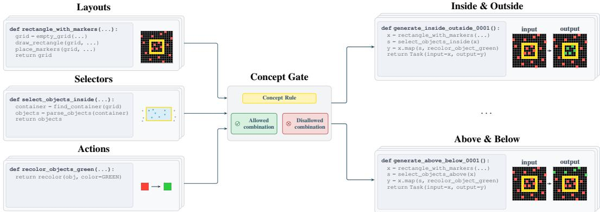  
Figure 2: Schematic overview of our ConceptARC task generator. A shared DSL provides primitive functions for grid layouts, object selection, and actions. Concepts such as “Inside and Outside” or “Above and Below” act as semantic gates that determine which primitive combinations are valid for a given concept. Each valid composition defines a task program that can generate multiple input–output examples illustrating the corresponding transformation.

## 3 CONCEPTARC AT SCALE

In this work, we investigate whether recent reasoning models organize their representations of ARC tasks around stable semantic abstractions. ConceptARC provides a natural testbed by grouping ARC-style tasks into 16 spatial and semantic concepts, but its ten manually designed tasks per concept offer limited diversity for assessing representational stability. To scale ConceptARC without costly manual task design, we introduce a generator that produces thousands of new ConceptARCstyle tasks automatically. Each task is represented as a program that maps input grids to output grids according to an underlying transformation rule, enabling various examples to be generated per task.

As illustrated in Figure 2, the key idea behind our task generator is to construct ARC tasks from three basic components: (i) a grid layout, which specifies the input scene—for instance, the types of objects present and their spatial arrangement; (ii) a selector, which specifies the objects or grid regions to be transformed; and (iii) an action, which specifies how the selected objects or grid regions are transformed. This compositional structure allows us to generate a large variety of tasks from a limited set of grid layouts, selectors, and actions. For example, the layout in Figure 2 contains a hollow yellow rectangle surrounded by red single-cell markers. Pairing it with a selector for objects inside the rectangle and an action that recolors them green produces the “Inside and Outside” task at the upper right. Replacing the selector with one that selects objects above a reference object produces the “Above and Below” task at the lower right.

Each concept acts as a semantic gate by constraining the allowable combinations of layouts, selectors, and actions so that generated tasks preserve its defining semantics. For predicate concepts (cf. Section 2) such as “Inside and Outside” and “Above and Below,” the defining constraint lies primarily in the selector, whereas for action concepts such as “Extend to Boundary” and Count,” it lies in the action. Components further declare what they require and provide, ensuring compatibility. For example, a selector that operates on a container can only be paired with layouts that provide one, while an action that operates on a group of objects requires a selector that returns such a group.

Layouts, selectors, and actions are implemented as functions in a shared domain-specific language for constructing and manipulating grid scenes. A task program combines the chosen layout, selector, and action together with their parameters, as shown in Figure 2. To generate an input–output example, the program constructs an input scene according to the layout and its permitted variability, applies the selector to identify the relevant entities, and uses the action to compute the output. Appendix B provides further details on the DSL and the different grid layouts, selectors, and actions.

Although our primary goal is to generate new tasks, the generator is expressive enough to represent all existing ConceptARC tasks. We successfully validate these programs by verifying that the corresponding programs map the original ConceptARC input grids to their manually designed outputs.

## 3.1 CONCEPTARC-100

Using our compositional task generator described in Section 3, we create CONCEPTARC-100, a dataset containing 100 new tasks for each of the 16 concepts defined by ConceptARC—ten times as many tasks as the original benchmark.1 Notably, each task is represented as a program capable of generating a large set of input–output examples of the same underlying transformation rule.

Following the few-shot format of ARC, we generate three support examples for each task from which the rule must be inferred (Chollet, 2019; Chollet et al., 2026). However, unlike ConceptARC and other ARC benchmarks, we generate ten test examples per task, approximately three to four times as many as in ConceptARC. This larger test set provides a more reliable estimate of whether a model has inferred the underlying rule rather than exploiting incidental input properties such as object colors or arrangements. While it would be prohibitively labor-intensive to create so many examples manually, our programmatic task representations make this possible. In addition, because the task programs are composed of layouts, selectors, and actions, we can report metadata for each task specifying the components used. This metadata enables more fine-grained analyses of how these components relate to models’ task representations.

We manually review all generated tasks to verify (i) that the transformation rule is applied consis tently across examples and (ii) that it can be inferred unambiguously from the support set. We find that 6.2% of initially generated tasks have either inconsistent transformation rules or ambiguous support examples, and we subsequently correct these issues. Appendix B provides further details on the task generation and review process.

## 4 EXPERIMENTS

We evaluate a broad range of recent open-weight LRMs on CONCEPTARC-100, including Gemma-4-31B (Team et al., 2026), Qwen3.5-27B and Qwen3.5-9B (Qwen Team, 2026), GPT-OSS-120B and GPT-OSS-20B (OpenAI, 2025), Qwen3-32B and Qwen3-8B (Team, 2025), and Phi4- Reasoning-Plus (Abdin et al., 2025). We evaluate all models in reasoning/thinking mode, using high reasoning effort for GPT-OSS-120B and GPT-OSS-20B. For each model, we use the decoding parameters recommended for reasoning mode on its official HuggingFace page and evaluate the model across three random seeds to account for stochastic decoding. We deliberately focus on openweight models to ensure that our results are reproducible. More broadly, this choice also reflects our concern about the increasing reliance on proprietary models owned by large companies.

We use the same prompt as ConceptARC and represent two-dimensional grids as sequences of bracketed rows (see Figure 10 in the Appendix for the exact prompt). A response is counted as correct only if the predicted grid exactly matches the target grid in both dimensions and cell values. We parse predicted grids by selecting the last valid sequence of bracketed rows in each response, allowing spaces or commas between entries, and fall back to Python/JSON-style nested lists when necessary. Appendix C.1 provides the decoding parameters and further details for each model.

## 4.1 EVALUATING CONCEPT-LEVEL PERFORMANCE

Table 1 reports accuracy across the 16 concepts. Performance varies substantially across model families and sizes. Qwen3.5-27B achieves the highest overall accuracy at 63.48%, followed by Gemma-4-31B at 58.0% and GPT-OSS-120B at 45.41%. The Qwen3 models perform substantially worse than the newer Qwen3.5 models: Qwen3-32B, for example, achieves only 10.50% despite having more parameters than Qwen3.5-27B. Within each model family, performance increases with model size. Qwen3.5-27B achieves nearly twice the accuracy of Qwen3.5-9B (32.89%), while GPT-OSS-120B achieves nearly twice the accuracy of GPT-OSS-20B (28.07%).

Table 4 in Appendix D.1 reports additional results on the original ConceptARC dataset. Accuracy is notably higher on ConceptARC than on CONCEPTARC-100 (mean accuracy across all LRMs: 54.39% vs. 31.18%, respectively). However, because ConceptARC has been publicly available since 2023, we cannot rule out training-data contamination. Despite this difference in accuracy, the relative ordering of model performance is similar across the two datasets.

Table 1: Accuracy (%) on CONCEPTARC-100, averaged across evaluated seeds for each concept. Bold values indicate the highest reported result in each row. Concepts are grouped alphabetically by type (predicate and action).
<table><tr><td>Concept</td><td>Gemma4-31B</td><td>Qwen3.5-27B</td><td>Qwen3.5-9B</td><td>GPT-OSS-120B</td><td>GPT-OSS-20B</td><td>Qwen3-32B</td><td>Qwen3-8B</td><td>Phi4-Reas.</td><td>VARC</td><td>TRM</td></tr><tr><td>AboveBelow</td><td>75.30</td><td>73.40</td><td>43.90</td><td>56.97</td><td>37.17</td><td>13.97</td><td>6.90</td><td>13.17 </td><td>37.07</td><td>14.63</td></tr><tr><td>Center</td><td>80.03</td><td>83.27</td><td>61.70</td><td>79.93</td><td>60.77</td><td>24.80</td><td>5.77</td><td>19.17</td><td>16.73</td><td>3.97</td></tr><tr><td>FilledNotFilled</td><td>60.53</td><td>71.13</td><td>32.43</td><td>48.20</td><td>23.37</td><td>9.83</td><td>2.40</td><td>4.33</td><td>16.90</td><td>7.27</td></tr><tr><td>HorizontalVertical</td><td>64.23</td><td>73.17</td><td>34.87</td><td>47.83</td><td>27.50</td><td>11.77</td><td>5.20</td><td>7.10</td><td>9.33</td><td>10.57</td></tr><tr><td>InsideOutside</td><td>61.30</td><td>58.03</td><td>31.07</td><td>33.77</td><td>26.37</td><td>9.17</td><td>2.80</td><td>3.93</td><td>38.53</td><td>13.60</td></tr><tr><td>SameDifferent</td><td>44.10</td><td>36.27</td><td>10.97</td><td>17.70</td><td>10.17</td><td>5.23</td><td>3.27</td><td>2.70!</td><td>12.60</td><td>7.13</td></tr><tr><td>TopBottom2D</td><td>73.63</td><td>66.23</td><td>23.77</td><td>35.60</td><td>17.60</td><td>17.37</td><td>5.20</td><td>10.00 </td><td>25.43</td><td>15.27</td></tr><tr><td>TopBottom3D</td><td>55.40</td><td>66.83</td><td>33.63</td><td>52.73</td><td>31.67</td><td>9.83</td><td>4.10</td><td>7.30</td><td>9.53</td><td>4.53</td></tr><tr><td>CleanUp</td><td>49.83</td><td>59.43</td><td>28.37</td><td>37.30</td><td>22.57</td><td>5.63</td><td>1.80</td><td>4.90</td><td>13.37</td><td>4.77</td></tr><tr><td>CompleteShape</td><td>70.77</td><td>77.03</td><td>44.77</td><td>60.80</td><td>37.33</td><td>6.17</td><td>1.90</td><td>5.40</td><td>36.13</td><td>10.43</td></tr><tr><td>Copy</td><td>50.40</td><td>58.37</td><td>27.83</td><td>43.23</td><td>23.07</td><td>6.53</td><td>1.67</td><td>3.10</td><td>9.57</td><td>4.57</td></tr><tr><td>Count</td><td>27.53</td><td>33.30</td><td>16.00</td><td>16.90</td><td>9.80</td><td>4.33</td><td>2.53</td><td>2.97</td><td>5.27</td><td>5.93</td></tr><tr><td>ExtendToBoundary</td><td>76.87</td><td>80.73</td><td>51.00</td><td>69.57</td><td>46.90</td><td>17.27</td><td>7.47</td><td>14.27 </td><td>32.97</td><td>10.70</td></tr><tr><td>ExtractObjects</td><td>53.13</td><td>69.70</td><td>35.93</td><td>53.80</td><td>30.67</td><td>9.20</td><td>4.20</td><td>4.57</td><td>6.97</td><td>2.80</td></tr><tr><td>MoveToBoundary</td><td>56.60</td><td>68.50</td><td>40.87</td><td>56.17</td><td>38.33</td><td>15.87</td><td>9.23</td><td>9.87</td><td>10.93</td><td>2.70</td></tr><tr><td>Order</td><td>28.30</td><td>40.27</td><td>9.07</td><td>16.13</td><td>5.87</td><td>1.07</td><td>0.17</td><td>0.17</td><td>0.10</td><td>0.03</td></tr><tr><td>Avg. Predicate Concepts</td><td>64.32</td><td>66.04</td><td>34.04</td><td>46.59</td><td>29.33</td><td>12.75</td><td>4.45</td><td>8.46</td><td>20.77</td><td>9.62</td></tr><tr><td>Avg. Action Concepts</td><td>51.68</td><td>60.92</td><td>31.73</td><td>44.24</td><td>26.82</td><td>8.26</td><td>3.62</td><td>5.65</td><td>14.41</td><td>5.24</td></tr><tr><td>Average</td><td>58.00</td><td>63.48</td><td>32.89</td><td>45.41</td><td>28.07</td><td>10.50</td><td>4.04</td><td>7.06  17.59</td><td></td><td>7.43</td></tr></table>

LRMs perform well on spatial concepts but struggle with comparison and counting. Performance across concepts reveals several consistent patterns. Stronger models achieve high accuracy on spatial concepts such as “Above and Below”, “Center”, and “Top /Bottom (2D)”, whose transformations depend primarily on spatial relations. Qwen3.5-27B, for example, achieves 73.40% accuracy on “Above and Below” and 83.27% on “Center”. In contrast, models perform worse on concepts requiring comparisons between objects. Qwen3.5-27B achieves only 40.27% on “Order” and 36.27% on “Same / Different”. “Order” tasks often require objects to be compared and rearranged by properties such as height, width, marker position, or cell count, whereas “Same / Different” tasks commonly require comparisons of shape, color, or internal structure (we invite readers to look at some examples using our data viewer). Performance is also low on “Count”, which requires counting objects, cells, or other selected features. One possible explanation is the task implementation: whereas ConceptARC typically implements counting as standalone bars, in our dataset, counts are encoded as colored bars or stripes overlaid on the input grid. This representation may be more complex and less common in the models’ training data. Finally, LRMs perform slightly better on predicate than on action concepts (see Section 2). Qwen3.5-27B, for example, achieves 66.04% average accuracy on predicate concepts and 60.92% on action concepts.

LRMs struggle to solve test queries consistently. As described in Section 3.1, each CONCEPTARC-100 task contains three support examples and ten test queries. Figure 3 shows the proportion of tasks for which a model solves at least X of the ten test queries, for different values of X. Across all models, this proportion decreases steadily as X increases, indicating that models often fail to apply the inferred rule consistently across test queries. Qwen3.5-27B, for example, solves at least one query for 93.21% of tasks but all ten queries for only 23.17%.

A potential concern is that some test queries may not be solvable from the corresponding support examples. We therefore manually review each task to verify that (i) the transformation rule is applied consistently across examples and (ii) it can be inferred unambiguously from the support set, as described in Section 3.1. Because human error remains possible, we additionally compute the fraction of tasks for which all ten test queries are solved by at least one model. At 68.88%, this fraction is substantially higher than the 23.17% of tasks fully solved by Qwen3.5-27B, providing additional evidence that the low performance primarily reflects model failures rather than unsolvable queries.

## 4.1.1 ASSESSING MODELS TRAINED FROM SCRATCH

We complement our evaluation of pretrained LRMs with two models trained from scratch on CONCEPTARC-100: VARC-ViT-18M, following Hu et al. (2026), and Tiny Recursive Model-7M, following Jolicoeur-Martineau (2025), hereafter VARC and TRM. Both are substantially smaller than the LRMs evaluated above, with approximately 18M and 7M parameters, respectively. We use each model’s default configuration; Appendix C.2 provides further details for each model.

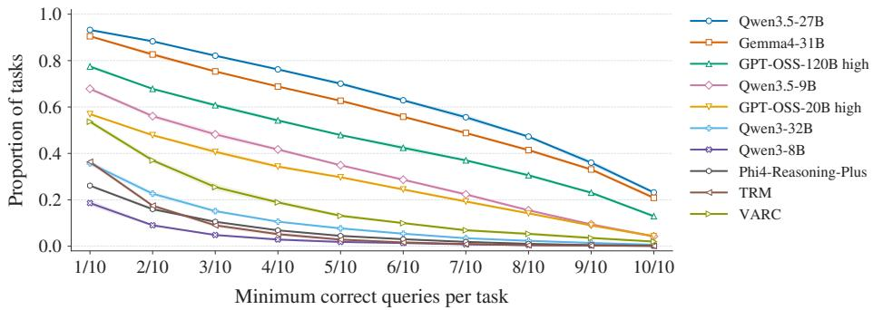  
Figure 3: Large reasoning models do not solve tasks robustly. Proportion of tasks for which a model correctly solves at least X/10 test queries. Performance decreases steadily as the required number of correct queries increases, indicating limited capacity to solve tasks robustly. Values are averaged over three random seeds; shaded regions indicate standard deviations.

Training & inference. We train VARC for 1,000 epochs and TRM for 10,000 epochs on the three support examples from each of the 1,600 CONCEPTARC-100 tasks. Both models learn a task-specific embedding shared across all examples of a task, intended to encode its underlying rule. VARC processes patch-based grid representations with a 10-layer Transformer, whereas TRM operates on grid-cell tokens and recursively reuses two Transformer layers with adaptive halting. Both models are trained end-to-end to predict the output grid; further architectural and training details are provided in Appendix C.2. At inference time, each test input is paired with its learned task embedding, testing whether the rule learned from the support examples generalizes to new inputs from the same task. We do not use test-time training, task augmentation, or multiple test-time predictions, as our goal is to assess how well these models learn the new CONCEPTARC-100 tasks from their support examples, which concepts are most challenging, and how task information is represented in their embeddings.

VARC and TRM show similar concept-level trends to pretrained LRMs. Table 1 reports VARC and TRM performance alongside the pretrained LRMs. VARC achieves 17.59% average accuracy, outperforming Phi4-Reasoning-Plus and both Qwen3 models despite having far fewer parameters, while remaining below larger, more recent models such as Qwen3.5-27B and Gemma-4- 31B. TRM achieves 7.43% accuracy. Performance varies substantially across concepts but broadly follows the trends observed for pretrained LRMs. VARC performs best on “Inside and Outside” and “Above and Below”, reaching approximately 38%, and worst on “Order” and “Count”, at 0.10% and 5.27%, respectively. “Above and Below” is also TRM’s second-best concept, after “Top / Bottom (2D)”, while “Order” is again the most difficult, with 0.03% accuracy. TRM outperforms VARC on two concepts, including “Count,” potentially indicating a benefit from its recursive computation. Across concepts, VARC and TRM performance is strongly correlated (Pearson r = 0.84; Spearman ρ = 0.74), suggesting similar relative concept difficulty for both models.

VARC and TRM also struggle to solve tasks consistently. As with the LRMs, we measure the proportion of tasks for which VARC and TRM solve at least X of the ten test queries. Only 2% of tasks are fully solved by VARC and 0.1% by TRM, and these fractions could decrease further with additional test queries. One possible explanation is that models struggle to learn generalizable rules from only three support, instead capturing partial rules or shortcuts. To test this hypothesis, we use the task programs to increase the support set eightfold to 24 examples per task and retrain VARC. On the same test queries, the resulting model achieves 77.4% query accuracy and fully solves 58.3% of tasks, outperforming all evaluated LRMs. This result suggests that the amount of task-specific training data is an important performance bottleneck.

## 4.2 UNDERSTANDING HOW MODELS REPRESENT TASKS INTERNALLY

The behavioral evaluation in Section 4.1 measures how well models solve tasks from different concepts, but does not reveal how these tasks are represented internally or whether their representations capture abstractions that generalize across tasks. We therefore analyze the models’ internal task representations and ask whether they are organized according to semantically meaningful properties.

Extracting task representations. To examine how LRMs represent a task, we extract hidden states from the residual stream at different layers. Specifically, we use the token position at the end of the third support example, corresponding to the closing bracket after the final row of its output grid. At this point, the model has processed all three support examples and should have sufficient information to infer the underlying task rule. To obtain stable representations, we exploit the ability of our data generator to produce multiple support examples for each task. For each task t, we construct eight support sets, $s _ { 1 } , \ldots , s _ { 8 } ,$ , containing different examples. From each set $s _ { v } .$ , we extract the hidden state $h _ { t , v } ^ { ( \bar { l } ) }$ at layer l and average across support sets: $\begin{array} { r } { \boldsymbol { h } _ { t } ^ { ( \bar { l } ) } = \frac { 1 } { 8 } \sum _ { v = 1 } ^ { 8 } \boldsymbol { h } _ { t , v } ^ { ( l ) } } \end{array}$ . We then center these representations by subtracting the mean representation across all tasks at each layer.

LRMs organize tasks by layout in early layers and actions in later layers. To characterize how models organize tasks in their representation space, we use the task metadata from Section $^ { 3 , }$ which specifies the layout, selector, and action, together with each task’s concept category. For each of these four label sets, we measure whether tasks sharing a label are closer in representation space than tasks with different labels. For example, let $h _ { t . i } ^ { ( l ) }$ denote the representation of task $t _ { i }$ with action label $a _ { i } .$ . We measure the probability that a task $\overset { \vartriangle } { t _ { j } }$ with the same action label is closer to $t _ { i }$ than a task $t _ { k }$ with a different action label: $d _ { \cos } \Big ( h _ { t _ { i } } ^ { ( l ) } , \hat { h _ { t _ { j } } ^ { ( l ) } } \Big ) < d _ { \cos } \Big ( h _ { t _ { i } } ^ { ( l ) } , h _ { t _ { k } } ^ { ( l ) } \Big )$ . We evaluate all eligible comparisons, excluding self-comparisons and assigning half credit to ties. Scores are first averaged across tasks within each label and then across labels. A score of 0.5 corresponds to chance-level separation; higher values indicate stronger organization according to the corresponding property.

Figure 4 shows the separation probability of Qwen3.5-27B by layout, selector, action, and concept across layers. In early layers, tasks are organized primarily by grid layout. As information propa gates through the model, this organization shifts: separation by layout decreases, while separation by action rises from 61.6% at layer 0 to a peak of 73.4% at layer 39. At that layer, the corresponding scores are 64.5% for concept, 62.5% for layout, and 57.7% for selector. Action-based separation subsequently declines but remains the strongest through the final layer, where it reaches 70.5%. This suggests that, across all layers, tasks sharing an action are more closely organized than tasks sharing a concept, whereas selectors have comparatively little influence. We observe similar trends for other models, including Gemma4-31B (Figure 6 in the Appendix).

VARC’s task embeddings show similar organization by action. We perform the same analysis on VARC, trained on CONCEPTARC-100. As described in Section 4.1.1,

VARC learns task-embedding vectors during training and uses them to provide information about the task rules at inference time. We treat these vectors as task representations and compute the same separation probabilities for the embedding layer. As with Qwen3.5-27B, VARC’s representations are organized predominantly by action, with separation probabilities of 57.1% for layout, 54.8% for selector, 86.2% for action, and 70.8% for concept.

Figure 5 visualizes the model’s task-embeddings using a two-dimensional UMAP projection of pairwise cosine distances, with 30 neighbors and a minimumdistance parameter of 0.1. Each point represents a task and is colored by concept. We observe surprisingly interpretable clusters corresponding to specific actions, even when those transformations arise from substantially different rules and scenarios across tasks. For instance, the cluster enlarged on the left contains tasks from different concepts that all expand object-boundary cells. Its subclusters exhibit additional semantic structure: tasks expanding boundary cells from objects outside a region separate from those operating on objects inside a con tainer, while tasks acting on objects above a reference separate from those acting below it.

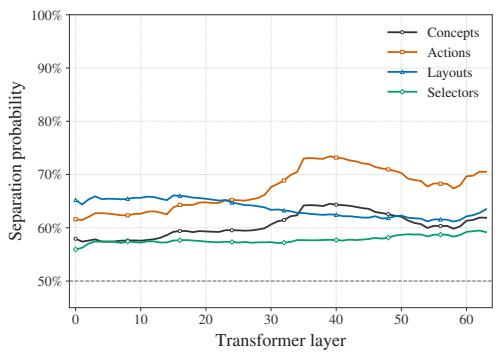  
Figure 4: Qwen3.5-27B representations shift from layout- to action-based organization across layers. Early layers primarily organize tasks by grid layout, while actionbased organization becomes stronger in later layers, suggesting a shift from surface-level spatial properties toward the transformation operations required to solve each task.

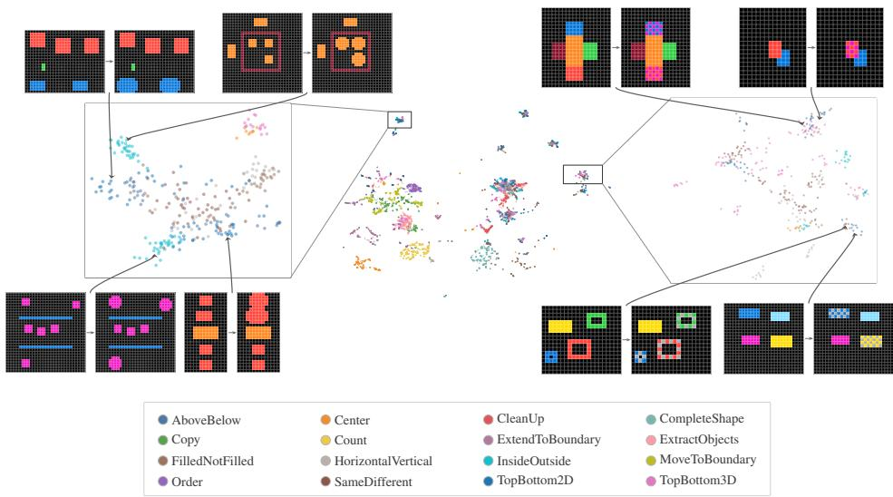  
Figure 5: VARC learns semantically structured task embeddings. UMAP projection of task embeddings learned by VARC. Tasks requiring similar transformation operations form distinct clusters, including extension ofobject-boundary cells (left) and checkerboard coloring ofobjects (right). Enlarged views reveal finer semantic structure: boundary-expanding tasks separate according to spatial relations, such as outside versus inside a region and above versus below a reference object, while checkerboard-coloring tasks further separate by color, including pink and gray patterns.

The cluster enlarged on the right contains tasks from different concepts that color selected objects with a checkerboard pattern. Within this cluster, tasks are further organized by checkerboard color, with distinct subclusters for, e.g., pink and gray patterns. Readers can further explore this representation space using our interactive embedding space viewer. A UMAP visualization of Qwen3.5-27B’s task representations at layer 41 is provided in Figure 7 in the Appendix.

Together, these results suggest that models exhibit structured representations of regularities shared across ARC-style tasks. This organization does not simply reproduce the benchmark’s concepts; instead, much of the structure reflects similarities in the transformation operations applied to objects or parts of the grid.

## 5 CONCLUSION

We introduced CONCEPTARC AT SCALE, a task generator for automatically creating thousands of ARC-style tasks organized around the 16 concepts introduced by ConceptARC. Using this generator, we constructed CONCEPTARC-100, a dataset of 1,600 novel, manually reviewed tasks. We evaluated a range of LRMs and models trained from scratch on CONCEPTARC-100, characterized their performance across concepts, and showed that even the best-performing model struggles to solve all test inputs within a task consistently. We further analyzed models’ internal task representations and found clear semantic structure: tasks are organized according to transformation operations, even when these operations arise from different rules and scenarios. This suggests that models form shared abstractions of transformation operations that generalize across diverse tasks.

Limitations & Future Directions. A key limitation of our analysis is that the relationship between representation structure and model behavior remains correlational. Although the representation spaces exhibit semantic structure aligned with transformation operations, we have not estab lished that models rely on these representations during inference. Future work could intervene on representations associated with identified clusters and measure the resulting behavioral changes. For example, shifting a task representation toward a specific cluster could test whether these representations causally influence the model toward the corresponding transformation.

## AI USE STATEMENT

We acknowledge the use of generative AI tools for minor language revisions, such as grammar checks and reformulations. In addition, we used generative AI tools such as Codex to assist with code implementation, particularly in developing the DSL described in Section 3. We reviewed all code generated by Codex and tested it for correctness. We take responsibility for the final content of this work, including text, claims, and artifacts produced with the aid of generative AI.

## REPRODUCIBILITY STATEMENT

To ensure the reproducibility of our experiments, we make all code for evaluating models on CONCEPTARC-100 publicly available at https://github.com/mainlp/conceptarc-100-eval. Details of our data generation procedure is described in Section 3 and Appendix B. A description of how we evaluate models is presented in Section 4, with further details about the exact model parameters given in Appendix C.1. A description of the models we train on CONCEPTARC-100 can be found in Section 4.1.1, with further details of the training procedure given in Appendix C.2. Finally, we make CONCEPTARC-100 publicly available and provide a dataset viewer, as well as a interactive tool to explore VARC’s task-embedding space on our project page: https://mainlp.github.io/conceptarc-100-project-page.

## ACKNOWLEDGMENTS

This project resulted from a research visit by PM to NYU and Princeton University. We would like to thank the LMU–NYU Cooperation Program for funding this visit and making this collaboration possible. Furthermore, we would like to thank the anonymous reviewers for their constructive feedback. AD is an F.R.S.-FNRS postdoctoral researcher; his research contributions to this project benefited from the computational resources of Lucia, the Tier-1 supercomputer of the Walloon Region, funded under grant No. 1910247. We further acknowledge the support provided to RY by the BANYAN Institute, funded by Sandia National Laboratories’ Laboratory Directed Research and Development program. Finally, we acknowledge the support provided to BP through the ERC Consolidator Grant DIALECT 101043235.

## REFERENCES

Marah Abdin, Sahaj Agarwal, Ahmed Awadallah, Vidhisha Balachandran, Harkirat Behl, Lingjiao Chen, Gustavo de Rosa, Suriya Gunasekar, Mojan Javaheripi, Neel Joshi, et al. Phi-4-reasoning technical report. arXiv preprint arXiv:2504.21318, 2025.

Sam Acquaviva, Yewen Pu, Maxwell Nye, Catherine Wong, Michael Henry Tessler, and Josh Tenenbaum. LARC: Language annotated Abstraction and Reasoning Corpus. In Proceedings of the Annual Meeting of the Cognitive Science Society, volume 43, 2021. URL https: //escholarship.org/uc/item/3r6807ct.

Sam Acquaviva, Yewen Pu, Marta Kryven, Theodoros Sechopoulos, Catherine Wong, Gabrielle Ecanow, Maxwell Nye, Michael Tessler, and Josh Tenenbaum. Communicating natural programs to humans and machines. In S. Koyejo, S. Mohamed, A. Agarwal, D. Belgrave, K. Cho, and A. Oh (eds.), Advances in Neural Information Processing Systems, volume 35, pp. 3731–3743. Curran Associates, Inc., 2022. doi: 10.52202/068431-0270. URL https://proceedings.neurips.cc/paper\_files/paper/2022/file/ 182aed0379591ebd1d655b2bdc152075-Paper-Datasets\_and\_Benchmarks. pdf.

Rim Assouel, Pau Rodriguez, Perouz Taslakian, David Vazquez, and Yoshua Bengio. Object-centric Compositional Imagination for Visual Abstract Reasoning. In ICLR2022 Workshop on the Elements of Reasoning: Objects, Structure and Causality, 2022. URL https://openreview. net/forum?id=rCzfIruU5x5.

Junyeob Baek, Mingyu Jo, Minsu Kim, Yoshua Bengio, and Sungjin Ahn. Generative Recursive Reasoning. In ICLR 2026 Workshop on AI with Recursive Self-Improvement, 2026. URL https: //openreview.net/pdf?id=Vxu6kcIjwV.

Claas Beger, Ryan Yi, Shuhao Fu, Kaleda Denton, Arseny Moskvichev, Sarah W Tsai, Sivasankaran Rajamanickam, and Melanie Mitchell. Do ai models perform human-like abstract reasoning across modalities? arXiv preprint arXiv:2510.02125, 2025.

Claas Beger, Ryan Yi, and Melanie Mitchell. PotARCin: Multi-dimensional evaluation of skill acquisition in abstract reasoning tasks, 2026. URL https://arxiv.org/abs/2609. 27288v1.

Kiril Bikov, Mikel Bober-Irizar, and Soumya Banerjee. AugARC: Augmented Abstraction and Reasoning Benchmark for Large Language Models. In Workshop on Preparing Good Datafor Generative AI: Challenges and Approaches, 2025. URL https://openreview.net/forum? id=cgUTWzgvCj.

Giacomo Camposampiero, Michael Hersche, Roger Wattenhofer, Abu Sebastian, and Abbas Rahimi. I-raven-x: Benchmarking generalization and robustness of analogical and mathematical reasoning in large language and reasoning models. arXiv preprint arXiv:2510.17496, 2025.

Franc¸ois Chollet. On the measure of intelligence. arXiv preprint arXiv:1911.01547, 2019.

Francois Chollet, Mike Knoop, Gregory Kamradt, Bryan Landers, and Henry Pinkard. ARC-AGI-2: A New Challenge for Frontier AI Reasoning Systems, 2026. URL https://arxiv.org/ abs/2505.11831.

Adrien Deliege, Claas Beger, Marc Van Droogenbroeck, and Melanie Mitchell. Implicit Rule In- \` duction with Test-Time Task Embeddings in ARC-like Tasks, 2026. URL https://arxiv. org/abs/2609.21181.

Alexey Dosovitskiy, Lucas Beyer, Alexander Kolesnikov, Dirk Weissenborn, Xiaohua Zhai, Thomas Unterthiner, Mostafa Dehghani, Matthias Minderer, Georg Heigold, Sylvain Gelly, Jakob Uszkoreit, and Neil Houlsby. An Image is Worth 16x16 Words: Transformers for Image Recognition at Scale. In International Conference on Learning Representations, 2021. URL https: //openreview.net/forum?id=YicbFdNTTy.

Dedre Gentner. Structure-mapping: A theoretical framework for analogy. Cognitive Science, 7(2):155–170, 1983. doi: https://doi.org/10.1207/s15516709cog0702\ 3. URL https:// onlinelibrary.wiley.com/doi/abs/10.1207/s15516709cog0702\_3.

Dedre Gentner and Christian Hoyos. Analogy and abstraction. Topics in Cognitive Science, 9(3): 672–693, 2017. doi: https://doi.org/10.1111/tops.12278. URL https://onlinelibrary. wiley.com/doi/abs/10.1111/tops.12278.

Roee Hendel, Mor Geva, and Amir Globerson. In-context learning creates task vectors. In Houda Bouamor, Juan Pino, and Kalika Bali (eds.), Findings of the Association for Computational Linguistics: EMNLP 2023, pp. 9318–9333, Singapore, December 2023. Association for Computational Linguistics. doi: 10.18653/v1/2023.findings-emnlp.624. URL https: //aclanthology.org/2023.findings-emnlp.624/.

Michael Hodel. Addressing the abstraction and reasoning corpus via procedural example generation. arXiv preprint arXiv:2404.07353, 2024.

Keya Hu, Ali Cy, Linlu Qiu, Xiaoman Delores Ding, Runqian Wang, Yeyin Eva Zhu, Jacob Andreas, and Kaiming He. ARC Is a Vision Problem! In Proceedings of the IEEE/CVF Conference on Computer Vision and Pattern Recognition, pp. 2537–2546, June 2026. URL https://openaccess.thecvf.com/content/CVPR2026/html/Hu\_ ARC\_Is\_a\_Vision\_Problem\_CVPR\_2026\_paper.html.

Di Huang, Ziyuan Nan, Xing Hu, Pengwei Jin, Shaohui Peng, Yuanbo Wen, Rui Zhang, Zidong Du, Qi Guo, Yewen Pu, and Yunji Chen. ANPL: towards natural programming with interactive decomposition. In Proceedings of the 37th International Conference on Neural Information Processing Systems, NIPS ’23, Red Hook, NY, USA, 2023. Curran Associates Inc.

Alexia Jolicoeur-Martineau. Less is More: Recursive Reasoning with Tiny Networks, 2025. URL https://arxiv.org/abs/2510.04871.

Dmitrii Kharlapenko, Alessandro Stolfo, Arthur Conmy, Mrinmaya Sachan, and Zhijing Jin. Fluid representations in reasoning models. arXiv preprint arXiv:2602.04843, 2026.

Subin Kim, Prin Phunyaphibarn, Donghyun Ahn, and Sundong Kim. Playgrounds for Abstraction and Reasoning. In NeurIPS 2022 Workshop on Neuro Causal and Symbolic AI (nCSI), pp. 1–6, November 2022. URL https://nips.cc/virtual/2022/57706.

Solim LeGris, Wai Keen Vong, Brenden M. Lake, and Todd M. Gureckis. A Comprehensive Behavioral Dataset for the Abstraction and Reasoning Corpus. Scientific Data, 12(1):1380, Aug 2025. ISSN 2052-4463. doi: 10.1038/s41597-025-05687-1. URL https://doi.org/10.1038/ s41597-025-05687-1.

Jens Lehmann, Syeda Khushbakht, Nikoo Salehfard, Nur A Zarin Nishat, Dhananjay Bhandiwad, Andrei Aioanei, and Sahar Vahdati. ARC-TGI: Human-Validated Task Generators with Reasoning Chain Templates for ARC-AGI. In Proceedings of the 32nd ACM SIGKDD Conference on Knowledge Discovery and Data Mining V.2, KDD ’26, pp. 9290–9301, New York, NY, USA, 2026. Association for Computing Machinery. ISBN 9798400722592. doi: 10.1145/3770855. 3817596. URL https://doi.org/10.1145/3770855.3817596.

Wen-Ding Li, Keya Hu, Carter Larsen, Yuqing Wu, Simon Alford, Caleb Woo, Spencer M. Dunn, Hao Tang, Wei-Long Zheng, Yewen Pu, and Kevin Ellis. Combining Induction and Transduction for Abstract Reasoning. In The Thirteenth International Conference on Learning Representations, 2025. URL https://openreview.net/forum?id=UmdotAAVDe.

Michael D. Moffitt. ARC-GEN: A Mimetic Procedural Benchmark Generator for the Abstraction and Reasoning Corpus, 2025. URL https://arxiv.org/abs/2511.00162.

Philipp Mondorf, Shijia Zhou, Monica Riedler, and Barbara Plank. Compositional-ARC: Assessing Systematic Generalization in Abstract Spatial Reasoning. In The Fourteenth International Conference on Learning Representations, 2026. URL https://openreview.net/forum?id= h497VpgFKd.

Arsenii Kirillovich Moskvichev, Victor Vikram Odouard, and Melanie Mitchell. The conceptARC benchmark: Evaluating understanding and generalization in the ARC domain. Transactions on Machine Learning Research, 2023. ISSN 2835-8856. URL https://openreview.net/ forum?id=8ykyGbtt2q.

Sajad Movahedi, Vera Milovanovic, Shlomo Libo Feigin, Alexander Theus, Thomas Hofmann,´ Valentina Boeva, T. Konstantin Rusch, and Antonio Orvieto. Fixed-Point Reasoners: Stable and Adaptive Deep Looped Transformers. In ICML 2026 Workshop on High-dimensional Learning Dynamics, 2026. URL https://openreview.net/forum?id=4wOixCRrge.

OpenAI. gpt-oss-120b & gpt-oss-20b model card, 2025. URL https://arxiv.org/abs/ 2508.10925.

Gustaw Opiełka, Hannes Rosenbusch, and Claire E Stevenson. Analogical reasoning inside large language models: Concept vectors and the limits of abstraction. arXiv preprint arXiv:2503.03666, 2025.

Qwen Team. Qwen3.5: Towards native multimodal agents, February 2026. URL https://qwen. ai/blog?id=qwen3.5.

Wen-Jie Shu, Xuerui Qiu, Rui-Jie Zhu, Harold Haodong Chen, Yexin Liu, and Harry Yang. LoopViT: Scaling Visual ARC with Looped Transformers, 2026. URL https://arxiv.org/ abs/2602.02156.

Gemma Team, Sherif El Abd, Vaibhav Aggarwal, Robin Algayres, Alek Andreev, Olivier Bachem, Ian Ballantyne, Cormac Brick, Victor Carbune, Michelle Casbon, et al. Gemma 4 technical report.˘ arXiv preprint arXiv:2607.02770, 2026.

Qwen Team. Qwen3 technical report, 2025. URL https://arxiv.org/abs/2505.09388.

Eric Todd, Millicent Li, Arnab Sen Sharma, Aaron Mueller, Byron Wallace, and David Bau. Function vectors in large language models. In B. Kim, Y. Yue, S. Chaudhuri, K. Fragkiadaki, M. Khan, and Y. Sun (eds.), International Conference on Learning Representations, volume 2024, pp. 17282–17333, 2024. URL https://proceedings.iclr.cc/paper\_files/paper/ 2024/file/4ae163cb8788970e53b4fd9578141139-Paper-Conference.pdf.

Guan Wang, Jin Li, Yuhao Sun, Xing Chen, Changling Liu, Yue Wu, Meng Lu, Sen Song, and Yasin Abbasi Yadkori. Hierarchical Reasoning Model, 2025. URL https://arxiv.org/ abs/2506.21734.

Yudong Xu, Wenhao Li, Pashootan Vaezipoor, Scott Sanner, and Elias Boutros Khalil. LLMs and the Abstraction and Reasoning Corpus: Successes, Failures, and the Importance of Object-based Representations. Transactions on Machine Learning Research, 2024. ISSN 2835-8856. URL https://openreview.net/forum?id=E8m8oySvPJ.

## A EXTENDED LITERATURE REVIEW

Conceptual understanding in LRMs. Evaluating conceptual understanding in LRMs requires distinguishing successful task execution from the formation of reusable abstractions. On symbolic Raven-style problems, Camposampiero et al. (2025) find that LRMs generalize better than conventional LLMs to longer reasoning relations and larger attribute ranges, but remain vulnerable to simulated perceptual uncertainty. Complementing such generalization tests, Beger et al. (2026) show that models can correctly formalize an ARC rule yet respond inconsistently when using it for classification, generation, or inversion. At the representational level, earlier work on LLMs identifies compact task vectors that summarize input–output demonstrations and guide predictions on new inputs (Hendel et al., 2023). Using representational similarity analysis, Opiełka et al. (2025) further identify format-invariant representations of some verbal concepts, which can be present even when the model produces an incorrect answer. More directly examining reasoning models, Kharlapenko et al. (2026) find that QwQ-32B refines action and predicate representations during reasoning on planning problems with obfuscated terminology, developing encodings that align across different wordings. Their intervention experiments provide causal evidence that these refined representation contribute to successful problem solving. Our work complements these studies by examining representational organization across ARC-style tasks with distinct transformation rules. Specifically, we investigate whether this organization reflects the benchmark’s spatial and semantic concepts or the transformation operations shared across tasks.

## B A TASK GENERATOR FOR CONCEPTARC

In this section, we provide additional details about our compositional task generator introduced in Section 3. Our DSL represents each task program as a structured specification containing a layout, a selector, and an action. Each component specifies an operation and its parameters, which are in terpreted by shared execution functions. Components may contain nested expressions; for example, a selector can first identify a reference object and then select other objects relative to it. Some parameters are fixed when the task program is created, while others specify permitted variation across examples, such as ranges of object counts or dimensions. In addition to checking compatibility between components, concept-specific predicates inspect the entire program specification and its parameters to determine whether it expresses the intended concept. Acceptance checks also use trial task generations to assess whether candidates produce valid, non-trivial examples.

To encourage novelty, we exclude programs matching official ConceptARC task signatures and filter duplicate families using structural signatures supplemented by concept-specific equivalence checks. Program selection favors underrepresented components and rule types to promote diversity across the generated collection. Accepted programs are saved with their task identifier, concept, and component specifications. To generate examples, we sample input scenes under the program’s constraints and apply its transformation rule to compute the outputs. Unsuitable scenes are rejected and resampled, and duplicate examples are filtered when assembling a task. We additionally impose program-dependent constraints on the support set, requiring variation in relevant properties such as object geometry, orientation, or count. Where specified, configurations appearing in test examples must also be demonstrated in the support set. These constraints provide evidence for the intended rule and reduce known ambiguities. The transformation in the task program can also be applied directly to an existing compatible input grid, as done when validating the official ConceptARC mappings.

Table 2: Decoding parameters and token budgets for CONCEPTARC-100. A top-k value of 0 disables top-k filtering.
<table><tr><td>Model</td><td>Temperature</td><td>Top-p</td><td>Top-k</td><td>Presence penalty</td><td>Total output budget</td><td>Reasoning budget</td></tr><tr><td>Gemma4-31B</td><td>1.0</td><td>0.95</td><td>64</td><td>0.0</td><td>65,536</td><td>49,152</td></tr><tr><td>Qwen3.5-27B / Qwen3.5-9B</td><td>1.0</td><td>0.95</td><td>20</td><td>1.5</td><td>65,536</td><td>49,152</td></tr><tr><td>GPT-OSS-120B / GPT-OSS-20B</td><td>1.0</td><td>1.00</td><td>0</td><td>0.0</td><td>65,536</td><td>49,152</td></tr><tr><td>Qwen3-32B / Qwen3-8B</td><td>0.6</td><td>0.95</td><td>20</td><td>1.5</td><td>32,768</td><td>20,480</td></tr><tr><td>Phi4-Reasoning-Plus</td><td>0.8</td><td>0.95</td><td>50</td><td>0.0</td><td>18,432</td><td>15,360</td></tr></table>

Manual task review. To ensure that generated tasks are valid and of high quality, we perform multiple rounds of manual review throughout the development and generation process. During DSL implementation, we regularly inspect generated tasks to verify that they represent valid transformation rules, are unambiguously inferable from the three support examples, and faithfully capture their intended concepts. These reviews informed iterative refinements of the DSL and the addition of sanity checks for automatic task validation, as described above.

After the generator consistently produced valid tasks, we generated CONCEPTARC-100 with 100 tasks per concept, as described in Section 3.1. During the generation process, we manually reviewed every generated task and adjusted the DSL when necessary. We then conducted an independent validation round with a research assistant, who evaluated each task through an interface displaying the three input–output support examples and ten test examples. A task was considered valid if and only if (i) the transformation rule was applied consistently across examples and (ii) the rule could be inferred unambiguously from the support set. Invalid tasks were annotated with a textual explanation and subsequently corrected. This evaluation identified 6.2% of tasks as invalid, all of which were correct before further processing.

## C EXPERIMENTAL DETAILS

In this section, we provide further details about our experiment setup. For instance, we report information about parameters when evaluating LRMs in Section C.1 and details regarding training models from scratch in Section C.2.

## C.1 EVALUATING LRMS

We run inference using vLLM, generating one response per test query and evaluated seed. We enable thinking for Gemma4 and the Qwen models and set GPT-OSS reasoning effort to high. For Phi4-Reasoning-Plus, whose native chat template supplies its own system message, we preserve that message and prepend the ConceptARC system instructions to the user message, separated by a blank line. Table 2 lists the decoding parameters and token budgets. All models use min p = 0 and a repetition penalty of 1.0. The total output budget includes all generated tokens, including reasoning, transition markers, and the final answer, but excludes prompt tokens. We additionally impose a separate reasoning-token budget. If this budget is exhausted before reasoning ends, decoding forces the model-specific closing sequence: </think> with surrounding newlines for Qwen and Phi4, and <channel|> for Gemma4. For GPT-OSS, a custom logits processor forces a complete Harmony transition from the analysis channel to the final channel. Generation then continues within the remaining total output budget. We use smaller output and reasoning budgets for Qwen3 and Phi4-Reasoning-Plus to accommodate their shorter context windows, which must contain both the task prompt and the generated response. For every model, we set the reasoning budget below the total output budget to leave room for final-answer generation. Responses that terminate without a normal stop, including those truncated by the output limit, and responses without a parseable grid are

Table 3: Accuracy (%) on CONCEPTARC-100 (1,600 tasks and 16,000 test queries per seed). Results are reported as $\mathrm { m e a n } _ { \pm \mathrm { S D } }$ across three random seeds. Sample standard deviations are computed across seeds after any concept averaging. GPT-OSS models use high reasoning effort. The highest mean in each row is bold.
<table><tr><td>Concept</td><td>Gemma4-31B</td><td>Qwen3.5-27B</td><td>Qwen3.5-9B</td><td>GPT-OSS-120B</td><td>GPT-OSS-20B</td><td>Qwen3-32B</td><td>Qwen3-8B</td><td>Phi4-Reas.+</td><td>VARC</td><td>TRM</td></tr><tr><td>AboveBelow</td><td> $\mathbf { 7 5 . 3 0 _ { \pm 0 . 7 0 } }$ </td><td> $7 3 . 4 0 { \scriptstyle \pm 0 . 2 6 }$ </td><td> $4 3 . 9 0 _ { \pm 1 . 0 4 }$ </td><td> $5 6 . 9 7 { \scriptstyle \pm 0 . 5 9 }$ </td><td> $3 7 . 1 7 _ { \pm 0 . 2 5 }$ </td><td> $1 3 . 9 7 _ { \pm 0 . 3 5 }$ </td><td> $6 . 9 0 { \scriptstyle \pm 0 . 2 6 }$ </td><td> $1 3 . 1 7 _ { \pm 0 . 6 7 }$ </td><td> $3 7 . 0 7 { \scriptstyle \pm 0 . 7 9 }$ </td><td> $1 4 . 6 3 _ { \pm 0 . 8 7 }$ </td></tr><tr><td>Center</td><td> $8 0 . 0 3 { \scriptstyle \pm 1 . 0 4 }$ </td><td> $\mathbf { 8 3 . 2 7 \pm 0 . 5 1 }$ </td><td> $6 1 . 7 0 { \scriptstyle \pm 1 . 4 0 }$ </td><td> $7 9 . 9 3 { \scriptstyle \pm 0 . 5 9 }$ </td><td> $6 0 . 7 7 { \scriptstyle \pm 0 . 8 3 }$ </td><td> $2 4 . 8 0 { \scriptstyle \pm 1 . 4 5 }$ </td><td> $5 . 7 7 { \scriptstyle \pm 1 . 0 4 }$ </td><td> $1 9 . 1 7 { \scriptstyle \pm 0 . 9 0 }$ </td><td> $1 6 . 7 3 { \scriptstyle \pm 0 . 3 1 }$ </td><td> $3 . 9 7 _ { \pm 0 . 4 5 }$ </td></tr><tr><td>FilledNotFilled</td><td> $6 0 . 5 3 { \scriptstyle \pm 1 . 7 0 }$ </td><td> $\mathbf { 7 1 . 1 3 _ { \pm 1 . 0 1 } }$ </td><td> $3 2 . 4 3 _ { \pm 0 . 4 9 }$ </td><td> $4 8 . 2 0 { \scriptstyle \pm 0 . 1 0 }$ </td><td> $2 3 . 3 7 { \scriptstyle \pm 0 . 8 1 }$ </td><td> $9 . 8 3 _ { \pm 0 . 1 5 }$ </td><td> $2 . 4 0 _ { \pm 0 . 3 6 }$ </td><td> $4 . 3 3 { \scriptstyle \pm 0 . 5 1 }$ </td><td> $1 6 . 9 0 _ { \pm 0 . 8 0 }$ </td><td> $7 . 2 7 _ { \pm 0 . 6 6 }$ </td></tr><tr><td>HorizontalVertical</td><td> $6 4 . 2 3 { \scriptstyle \pm 1 . 1 2 }$ </td><td> ${ \bf 7 3 . 1 7 _ { \pm 0 . 4 5 } }$ </td><td> $3 4 . 8 7 _ { \pm 0 . 2 5 }$ </td><td> $4 7 . 8 3 { \scriptstyle \pm 1 . 2 0 }$ </td><td> $2 7 . 5 0 { \scriptstyle \pm 0 . 7 0 }$ </td><td> $1 1 . 7 7 _ { \pm 0 . 6 4 }$ </td><td> $5 . 2 0 _ { \pm 0 . 6 0 }$ </td><td> $7 . 1 0 _ { \pm 0 . 9 5 }$ </td><td> $9 . 3 3 { \scriptstyle \pm 0 . 6 8 }$ </td><td> $1 0 . 5 7 { \scriptstyle \pm 0 . 1 9 }$ </td></tr><tr><td>InsideOutside</td><td> ${ \bf 6 1 . 3 0 { _ { \pm 1 . 1 3 } } }$ </td><td> $5 8 . 0 3 { \scriptstyle \pm 0 . 8 7 }$ </td><td> $3 1 . 0 7 _ { \pm 1 . 2 5 }$ </td><td> $3 3 . 7 7 _ { \pm 0 . 2 1 }$ </td><td> $2 6 . 3 7 { \scriptstyle \pm 0 . 2 3 }$ </td><td> $9 . 1 7 _ { \pm 0 . 6 4 }$ </td><td> $2 . 8 0 _ { \pm 0 . 5 6 }$ </td><td> $3 . 9 3 _ { \pm 0 . 2 5 }$ </td><td> $3 8 . 5 3 { \scriptstyle \pm 2 . 2 2 }$ </td><td> $1 3 . 6 0 _ { \pm 0 . 5 4 }$ </td></tr><tr><td>SameDifferent</td><td> $\mathbf { 4 4 . 1 0 _ { \pm 1 . 3 2 } }$ </td><td> $3 6 . 2 7 { \scriptstyle \pm 0 . 5 8 }$ </td><td> $1 0 . 9 7 _ { \pm 0 . 6 0 }$ </td><td> $1 7 . 7 0 { \scriptstyle \pm 0 . 6 9 }$ </td><td> $1 0 . 1 7 { \scriptstyle \pm 0 . 5 0 }$ </td><td> $5 . 2 3 { \scriptstyle \pm 0 . 2 1 }$ </td><td> $3 . 2 7 _ { \pm 0 . 0 6 }$ </td><td> $2 . 7 0 { \scriptstyle \pm 0 . 4 6 }$ </td><td> $1 2 . 6 0 { \scriptstyle \pm 0 . 5 9 }$ </td><td> $7 . 1 3 _ { \pm 0 . 7 8 }$ </td></tr><tr><td>TopBottom2D</td><td> ${ \bf 7 3 . 6 3 { \scriptstyle \pm 1 . 1 0 } }$ </td><td> $6 6 . 2 3 { \scriptstyle \pm 0 . 3 5 }$ </td><td> $2 3 . 7 7 { \scriptstyle \pm 1 . 5 9 }$ </td><td> $3 5 . 6 0 { \scriptstyle \pm 1 . 5 1 }$ </td><td> $1 7 . 6 0 { \scriptstyle \pm 0 . 8 0 }$ </td><td> $1 7 . 3 7 { \scriptstyle \pm 1 . 1 8 }$ </td><td> $5 . 2 0 { \scriptstyle \pm 0 . 2 6 }$ </td><td> $1 0 . 0 0 { \scriptstyle \pm 0 . 5 6 }$ </td><td> $2 5 . 4 3 { \scriptstyle \pm 0 . 5 4 }$ </td><td> $1 5 . 2 7 { \scriptstyle \pm 0 . 6 6 }$ </td></tr><tr><td>TopBottom3D</td><td> $5 5 . 4 0 { \scriptstyle \pm 1 . 4 0 }$ </td><td> $\mathbf { 6 6 . 8 3 _ { \pm 1 . 0 7 } }$ </td><td>33.63±0.81</td><td> $5 2 . 7 3 { \scriptstyle \pm 1 . 7 2 }$ </td><td> $3 1 . 6 7 { \scriptstyle \pm 0 . 7 4 }$ </td><td>9.83±0.83</td><td> $4 . 1 0 _ { \pm 0 . 4 6 }$ </td><td>7.30±0.26</td><td> $9 . 5 3 _ { \pm 0 . 1 7 }$ </td><td> $4 . 5 3 _ { \pm 0 . 3 3 }$ </td></tr><tr><td>CleanUp</td><td> $4 9 . 8 3 _ { \pm 1 . 4 4 }$ </td><td> ${ \bf 5 9 . 4 3 _ { \pm 1 . 8 1 } }$ </td><td> $2 8 . 3 7 { \scriptstyle \pm 1 . 3 6 }$ </td><td> $3 7 . 3 0 { \scriptstyle \pm 0 . 5 3 }$ </td><td> $2 2 . 5 7 { \scriptstyle \pm 1 . 6 9 }$ </td><td> $5 . 6 3 _ { \pm 0 . 0 6 }$ </td><td> $1 . 8 0 _ { \pm 0 . 2 6 }$ </td><td> $4 . 9 0 _ { \pm 0 . 5 6 }$ </td><td> $1 3 . 3 7 _ { \pm 1 . 0 2 }$ </td><td> $4 . 7 7 _ { \pm 0 . 5 2 }$ </td></tr><tr><td>CompleteShape</td><td> $7 0 . 7 7 { \scriptstyle \pm 1 . 7 2 }$ </td><td> ${ 7 7 . 0 3 } _ { \pm 1 . 1 9 }$ </td><td> $4 4 . 7 7 { \scriptstyle \pm 2 . 1 8 }$ </td><td> $6 0 . 8 0 { \scriptstyle \pm 0 . 4 6 }$ </td><td> $3 7 . 3 3 { \scriptstyle \pm 1 . 1 2 }$ </td><td> $6 . 1 7 _ { \pm 0 . 5 8 }$ </td><td> $1 . 9 0 _ { \pm 0 . 1 0 }$ </td><td> $5 . 4 0 _ { \pm 0 . 6 1 }$ </td><td> $3 6 . 1 3 { \scriptstyle \pm 1 . 2 2 }$ </td><td> $1 0 . 4 3 _ { \pm 2 . 5 8 }$ </td></tr><tr><td>Copy</td><td> $5 0 . 4 0 { \scriptstyle \pm 0 . 4 0 }$ </td><td> ${ \bf 5 8 . 3 7 _ { \pm 2 . 2 5 } }$ </td><td> $2 7 . 8 3 { \scriptstyle \pm 0 . 9 3 }$ </td><td> $4 3 . 2 3 { \scriptstyle \pm 1 . 1 9 }$ </td><td> $2 3 . 0 7 _ { \pm 1 . 7 4 }$ </td><td> $6 . 5 3 { \scriptstyle \pm 0 . 4 0 }$ </td><td> $1 . 6 7 _ { \pm 0 . 1 5 }$ </td><td> $3 . 1 0 _ { \pm 0 . 7 0 }$ </td><td> $9 . 5 7 _ { \pm 0 . 5 4 }$ </td><td> $4 . 5 7 _ { \pm 0 . 2 1 }$ </td></tr><tr><td>Count</td><td> $2 7 . 5 3 { \scriptstyle \pm 0 . 8 3 }$ </td><td> $\mathbf { 3 3 . 3 0 } _ { \pm 0 . 4 0 }$ </td><td> $1 6 . 0 0 { \scriptstyle \pm 0 . 4 4 }$ </td><td> $1 6 . 9 0 { \scriptstyle \pm 1 . 1 5 }$ </td><td> $9 . 8 0 { \scriptstyle \pm 1 . 1 1 }$ </td><td> $4 . 3 3 { \scriptstyle \pm 0 . 8 5 }$ </td><td> $2 . 5 3 { \scriptstyle \pm 0 . 4 5 }$ </td><td> $2 . 9 7 { \scriptstyle \pm 0 . 2 5 }$ </td><td> $5 . 2 7 { \scriptstyle \pm 0 . 4 1 }$ </td><td> $5 . 9 3 { \scriptstyle \pm 0 . 9 4 }$ </td></tr><tr><td>ExtendToBoundary</td><td> $7 6 . 8 7 { \scriptstyle \pm 0 . 5 1 }$ </td><td> $\mathbf { 8 0 . 7 3 _ { \pm 0 . 7 2 } }$ </td><td> $5 1 . 0 0 { \scriptstyle \pm 0 . 5 3 }$ </td><td> $6 9 . 5 7 { \scriptstyle \pm 1 . 0 7 }$ </td><td> $4 6 . 9 0 { \scriptstyle \pm 0 . 1 0 }$ </td><td> $1 7 . 2 7 { \scriptstyle \pm 0 . 5 1 }$ </td><td> $7 . 4 7 _ { \pm 0 . 7 6 }$ </td><td> $1 4 . 2 7 _ { \pm 0 . 7 5 }$ </td><td> $3 2 . 9 7 _ { \pm 0 . 1 2 }$ </td><td> $1 0 . 7 0 { \scriptstyle \pm 1 . 4 8 }$ </td></tr><tr><td>ExtractObjects</td><td> $5 3 . 1 3 { \scriptstyle \pm 1 . 8 8 }$ </td><td> $\mathbf { 6 9 . 7 0 _ { \pm 0 . 8 5 } }$   $\yen 89$ </td><td> $3 5 . 9 3 { \scriptstyle \pm 0 . 7 4 }$ </td><td>53.80±1.71</td><td> $3 0 . 6 7 { \scriptstyle \pm 0 . 5 5 }$ </td><td> $9 . 2 0 _ { \pm 0 . 6 1 }$ </td><td> $4 . 2 0 _ { \pm 0 . 7 2 }$ </td><td> $4 . 5 7 _ { \pm 0 . 1 5 }$ </td><td> $6 . 9 7 _ { \pm 0 . 6 9 }$ </td><td> $2 . 8 0 _ { \pm 0 . 5 0 }$ </td></tr><tr><td>MoveToBoundary</td><td> $5 6 . 6 0 { \scriptstyle \pm 0 . 7 0 }$ </td><td> $\mathbf { 6 8 . 5 0 } _ { \pm 0 . 7 0 }$ </td><td>40.87±1.02</td><td> $5 6 . 1 7 _ { \pm 1 . 1 2 }$ </td><td>38.33±0.64</td><td>15.87±1.10</td><td> $9 . 2 3 _ { \pm 0 . 8 3 }$ </td><td>9.87±0.38</td><td> $1 0 . 9 3 _ { \pm 0 . 0 5 }$ </td><td> $2 . 7 0 _ { \pm 0 . 2 9 }$ </td></tr><tr><td>Order</td><td> $2 8 . 3 0 { \scriptstyle \pm 0 . 6 1 }$ </td><td> $\mathbf { 4 0 . 2 7 _ { \pm 0 . 9 3 } }$ </td><td> $9 . 0 7 _ { \pm 0 . 0 0 }$ </td><td> $1 6 . 1 3 { \scriptstyle \pm 0 . 5 9 }$ </td><td> $5 . 8 7 _ { \pm 0 . 4 5 }$ </td><td> $1 . 0 7 _ { \pm 0 . 2 5 }$ </td><td> $0 . 1 7 _ { \pm 0 . 1 5 }$ </td><td> $0 . 1 7 _ { \pm 0 . 1 2 }$  1</td><td> $0 . 1 0 { \scriptstyle \pm 0 . 0 8 }$ </td><td> $0 . 0 3 _ { \pm 0 . 0 5 }$ </td></tr><tr><td>Avg. Predicate Concepts</td><td> $6 4 . 3 2 _ { \pm 0 . 0 5 }$ </td><td>66.04±0.16</td><td>34.04±0.36</td><td>46.59±0.18</td><td> $2 9 . 3 3 { \scriptstyle \pm 0 . 4 1 }$ </td><td> $1 2 . 7 5 { \scriptstyle \pm 0 . 3 1 }$ </td><td> $4 . 4 5 _ { \pm 0 . 2 4 }$ </td><td> $8 . 4 6 _ { \pm 0 . 2 0 }$  1</td><td> $2 0 . 7 7 { \scriptstyle \pm 0 . 6 6 }$ </td><td> $9 . 6 2 _ { \pm 0 . 2 6 }$ </td></tr><tr><td>Avg. Action Concepts</td><td> $5 1 . 6 8 { \scriptstyle \pm 0 . 3 8 }$ </td><td> ${ \bf 6 0 . 9 2 } _ { \pm 0 . 3 9 }$ </td><td> $3 1 . 7 3 { \scriptstyle \pm 0 . 3 5 }$ </td><td> $4 4 . 2 4 { \scriptstyle \pm 0 . 2 3 }$ </td><td> $2 6 . 8 2 { \scriptstyle \pm 0 . 2 6 }$ </td><td>8.26±0.06</td><td> $3 . 6 2 _ { \pm 0 . 1 5 }$ </td><td>5.65±0.13</td><td> $1 4 . 4 1 { \scriptstyle \pm 0 . 2 8 }$ </td><td> $5 . 2 4 { \scriptstyle \pm 0 . 4 1 }$ </td></tr><tr><td>Average</td><td> $5 8 . 0 0 { \scriptstyle \pm 0 . 2 0 }$ </td><td> $\mathbf { 6 3 . 4 8 } \pm \mathrm { 0 . 1 1 }$ </td><td> $3 2 . 8 9 { \scriptstyle \pm 0 . 2 2 }$ </td><td> $4 5 . 4 1 { \scriptstyle \pm 0 . 0 3 }$ </td><td> $2 8 . 0 7 { \scriptstyle \pm 0 . 2 8 }$ </td><td> $1 0 . 5 0 { \scriptstyle \pm 0 . 1 8 }$ </td><td> $4 . 0 4 { \scriptstyle \pm 0 . 1 6 }$ </td><td> $7 . 0 6 { \scriptstyle \pm 0 . 1 4 }$ </td><td> $1 7 . 5 9 { \scriptstyle \pm 0 . 4 6 }$ </td><td> $7 . 4 3 { \scriptstyle \pm 0 . 1 4 }$ </td></tr></table>

counted as incorrect. Otherwise, correctness requires an exact match to the target grid, as described in Section 4. Table 3 provides an overview of the models’ performance across the different concepts. Values represent means across three random seeds, along with their corresponding standard deviations.

## C.2 TRAINING DETAILS

In order to benchmark ConceptARC-100 with models trained from scratch, in complement to pretrained LRMs, we train a VARC-ViT-18M model, following Hu et al. (2026), and a Tiny Recursive Model-7M following Jolicoeur-Martineau (2025), respectively named VARC and TRM hereafter. We choose these models because, among models already tested on ARC-AGI-1 and trainable from scratch, they have a reusable code that can run with reasonable academic resources, and they serve as foundations for two distinct emergent lines of research on abstract visual reasoning. VARC supports the vision-inspired neural models for ARC-AGI-1, e.g. with Embed-TTT (Deliege et al., 2026)\` and LoopViT (Shu et al., 2026) as recent follow-ups building upon it. TRM, which simplifies its predecessor HRM (Wang et al., 2025), supports the recursive approaches that leverage the compounding effect of nested loops to train models with a large effective depth without suffering of vanishing gradients, and has notably FPRM (Movahedi et al., 2026) and GRAM (Baek et al., 2026) as follow-ups.

For training, VARC and TRM take in an input grid, where each cell is tokenized with a 512 dimensional vector according to its color index, VARC randomly scales it or not by a factor 2, and both finally place the resulting grid randomly on a larger background canvas with special boundary tokens, of size 64x64 for VARC and 30x30 for TRM. Then, for VARC, following the common ViT practice (Dosovitskiy et al., 2021), the canvas is split into non-overlapping $2 \times 2$ patches, projected in the 512 dimensional latent space by a learnable linear transform, and flattened as a sequence of 1024 tokens. TRM directly flattens its canvas into a sequence of 900 tokens. A learnable taskspecific token, which is shared across all inputs of a same task, is appended to each sequence, with TRM also appending 15 additional “scratchpad” slots (usable by the model during its computations but not containing any learnable parameter). Given that input grids can be identical in different tasks, the role of the task embeddings is to encode the the rule used to map the inputs to the outputs of the tasks. Then the 1025 or 916 token-long sequence is fed to the model backbone, made of 10 transformer layers for VARC, and of 2 transformer layers reused $N \times 2 1$ times for TRM, with $1 \leq N \leq 1 6$ depending on a halting mechanism. Finally, the task token and extra slots are discarded, the token list is reshaped and upscaled back to the canvas size. The prediction head projects each cell token to a logits vector across the various color, background, and border classes. The part of the grid contained within the predicted boundary tokens is compared to the ground truth grid through a cross-entropy loss, allowing backpropagation all along.

Table 4: Original ConceptARC accuracy (%; 160 tasks and 480 test queries per seed), reported as mean across seeds. Predicate and action averages weight their respective eight concepts equally; the final row averages all 16 concepts equally. Sample standard deviations are computed across seeds after any concept averaging. GPT-OSS models use high reasoning effort. The highest mean in each row is bold.
<table><tr><td>Concept</td><td>Gemma4-31B</td><td>Qwen3.5-27B</td><td>Qwen3.5-9B</td><td>GPT-OSS-120B</td><td>GPT-OSS-20B</td><td>Qwen3-32B</td><td>Qwen3-8B</td><td>Phi4-Reas.+</td></tr><tr><td>AboveBelow</td><td> $9 1 . 1 1 { \scriptstyle \pm 3 . 8 5 }$ </td><td> $\mathbf { 9 3 . 3 3 _ { \pm 5 . 7 7 } }$ </td><td> $7 4 . 4 4 { \scriptstyle \pm 1 . 9 2 }$ </td><td>86.67±3.33</td><td> $7 2 . 2 2 { \scriptstyle \pm 1 . 9 2 }$ </td><td> $3 1 . 1 1 _ { \pm 1 1 . 7 1 }$ </td><td> $1 4 . 4 4 _ { \pm 1 . 9 2 }$ </td><td> $2 7 . 7 8 { \scriptstyle \pm 5 . 0 9 }$ </td></tr><tr><td>Center</td><td> $9 5 . 5 6 { \scriptstyle \pm 1 . 9 2 }$ </td><td> $\mathbf { 9 7 . 7 8 _ { \pm 3 . 8 5 } }$ </td><td> $8 7 . 7 8 { \scriptstyle \pm 1 . 9 2 }$ </td><td> $9 0 . 0 0 { \scriptstyle \pm 5 . 7 7 }$ </td><td> $8 2 . 2 2 { \scriptstyle \pm 1 . 9 2 }$ </td><td> $4 0 . 0 0 { \scriptstyle \pm 3 . 3 3 }$ </td><td> $2 4 . 4 4 _ { \pm 3 . 8 5 }$ </td><td> $3 6 . 6 7 _ { \pm 3 . 3 3 }$ </td></tr><tr><td>FilledNotFilled</td><td> $7 8 . 8 9 { \scriptstyle \pm 5 . 0 9 }$ </td><td> $\mathbf { 9 3 . 3 3 } _ { \pm 0 . 0 0 }$ </td><td> $7 5 . 5 6 { \scriptstyle \pm 5 . 0 9 }$ </td><td> $8 3 . 3 3 { \scriptstyle \pm 3 . 3 3 }$ </td><td> $6 6 . 6 7 { \scriptstyle \pm 0 . 0 0 }$ </td><td> $2 7 . 7 8 { \scriptstyle \pm 1 . 9 2 }$ </td><td> $2 0 . 0 0 { \scriptstyle \pm 6 . 6 7 }$ </td><td> $1 8 . 8 9 { \scriptstyle \pm 5 . 0 9 }$ </td></tr><tr><td>HorizontalVertical</td><td> $7 8 . 8 9 _ { \pm 6 . 9 4 }$ </td><td> $\mathbf { 8 1 . 1 1 _ { \pm 6 . 9 4 } }$ </td><td> $6 4 . 4 4 _ { \pm 1 0 . 1 8 }$ </td><td> $7 5 . 5 6 { \scriptstyle \pm 7 . 7 0 }$ </td><td> $6 8 . 8 9 { \scriptstyle \pm 5 . 0 9 }$ </td><td> $2 7 . 7 8 { \scriptstyle \pm 1 . 9 2 }$ </td><td> $1 1 . 1 1 { \scriptstyle \pm 5 . 0 9 }$ </td><td> $2 0 . 0 0 { \scriptstyle \pm 3 . 3 3 }$ </td></tr><tr><td>InsideOutside</td><td> $\mathbf { 8 4 . 4 4 } _ { \pm 1 . 9 2 }$ </td><td> $8 0 . 0 0 { \scriptstyle \pm 3 . 3 3 }$ </td><td> $7 0 . 0 0 { \scriptstyle \pm 6 . 6 7 }$ </td><td> $6 0 . 0 0 { \scriptstyle \pm 1 4 . 5 3 }$ </td><td> $5 4 . 4 4 { \scriptstyle \pm 1 . 9 2 }$ </td><td> $1 8 . 8 9 { \scriptstyle \pm 1 . 9 2 }$ </td><td> $6 . 6 7 _ { \pm 0 . 0 0 }$ </td><td> $8 . 8 9 { \scriptstyle \pm 5 . 0 9 }$ </td></tr><tr><td>SameDifferent</td><td> $8 4 . 4 4 { \scriptstyle \pm 1 . 9 2 }$ </td><td> $\mathbf { 9 5 . 5 6 _ { \pm 1 . 9 2 } }$ </td><td> $7 3 . 3 3 { \scriptstyle \pm 3 . 3 3 }$ </td><td> $7 5 . 5 6 { \scriptstyle \pm 3 . 8 5 }$ </td><td> $5 8 . 8 9 { \scriptstyle \pm 1 . 9 2 }$ </td><td> $2 3 . 3 3 { \scriptstyle \pm 3 . 3 3 }$ </td><td> $1 3 . 3 3 { \scriptstyle \pm 6 . 6 7 }$ </td><td> $1 3 . 3 3 { \scriptstyle \pm 6 . 6 7 }$ </td></tr><tr><td>TopBottom2D</td><td> $9 1 . 1 1 { \scriptstyle \pm 6 . 9 4 }$ </td><td> $\mathbf { 9 4 . 4 4 _ { \pm 3 . 8 5 } }$ </td><td> $8 6 . 6 7 { \scriptstyle \pm 8 . 8 2 }$ </td><td> $8 2 . 2 2 _ { \pm 5 . 0 9 }$ </td><td> $7 6 . 6 7 { \scriptstyle \pm 3 . 3 3 }$ </td><td> $3 4 . 4 4 _ { \pm 1 0 . 7 2 }$ </td><td> $1 5 . 5 6 _ { \pm 3 . 8 5 }$ </td><td> $6 2 . 2 2 { \scriptstyle \pm 8 . 3 9 }$ </td></tr><tr><td>TopBottom3D</td><td> $5 7 . 7 8 { \scriptstyle \pm 1 . 9 2 }$ </td><td> ${ \bf 7 8 . 8 9 _ { \pm 5 . 0 9 } }$ </td><td> $5 4 . 4 4 { \scriptstyle \pm 8 . 3 9 }$ </td><td> $6 1 . 1 1 { \scriptstyle \pm 5 . 0 9 }$ </td><td> $5 2 . 2 2 _ { \pm 1 0 . 1 8 }$ </td><td> $1 6 . 6 7 _ { \pm 3 . 3 3 }$ </td><td> $6 . 6 7 _ { \pm 3 . 3 3 }$ </td><td> $1 3 . 3 3 { \scriptstyle \pm 3 . 3 3 }$ </td></tr><tr><td>CleanUp</td><td> $6 4 . 4 4 { \scriptstyle \pm 1 . 9 2 }$ </td><td> $7 4 . 4 4 _ { \pm 6 . 9 4 }$ </td><td> $6 4 . 4 4 { \scriptstyle \pm 3 . 8 5 }$ </td><td> $5 0 . 0 0 { \scriptstyle \pm 3 . 3 3 }$ </td><td> $3 7 . 7 8 { \scriptstyle \pm 5 . 0 9 }$ </td><td> $2 4 . 4 4 { \scriptstyle \pm 3 . 8 5 }$ </td><td> $2 1 . 1 1 { \scriptstyle \pm 6 . 9 4 }$ </td><td> $2 0 . 0 0 { \scriptstyle \pm 6 . 6 7 }$ </td></tr><tr><td>CompleteShape</td><td> $7 0 . 0 0 { \scriptstyle \pm 0 . 0 0 }$ </td><td> ${ \bf 7 8 . 8 9 _ { \pm 3 . 8 5 } }$ </td><td> $6 2 . 2 2 { \scriptstyle \pm 3 . 8 5 }$ </td><td> $7 4 . 4 4 { \scriptstyle \pm 8 . 3 9 }$ </td><td> $5 8 . 8 9 { \scriptstyle \pm 3 . 8 5 }$ </td><td> $2 5 . 5 6 { \scriptstyle \pm 1 . 9 2 }$ </td><td> $1 0 . 0 0 { \scriptstyle \pm 3 . 3 3 }$ </td><td> $3 2 . 2 2 { \scriptstyle \pm 3 . 8 5 }$ </td></tr><tr><td>Copy</td><td> $8 3 . 3 3 { \scriptstyle \pm 0 . 0 0 }$ </td><td> $\mathbf { 8 5 . 5 6 _ { \pm 3 . 8 5 } }$ </td><td> $6 4 . 4 4 { \scriptstyle \pm 6 . 9 4 }$ </td><td> $7 4 . 4 4 { \scriptstyle \pm 5 . 0 9 }$ </td><td> $5 0 . 0 0 { \scriptstyle \pm 3 . 3 3 }$ </td><td> $2 2 . 2 2 { \scriptstyle \pm 5 . 0 9 }$ </td><td> $1 7 . 7 8 _ { \pm 1 . 9 2 }$ </td><td> $1 8 . 8 9 _ { \pm 1 . 9 2 }$ </td></tr><tr><td>Count</td><td> $\mathbf { 9 2 . 2 2 _ { \pm 3 . 8 5 } }$ </td><td> $9 1 . 1 1 { \scriptstyle \pm 6 . 9 4 }$ </td><td> $8 8 . 8 9 { \scriptstyle \pm 5 . 0 9 }$ </td><td> $8 6 . 6 7 _ { \pm 3 . 3 3 }$ </td><td> $8 5 . 5 6 { \scriptstyle \pm 1 . 9 2 }$ </td><td> $5 0 . 0 0 { \scriptstyle \pm 3 . 3 3 }$ </td><td> $2 0 . 0 0 { \scriptstyle \pm 5 . 7 7 }$ </td><td> $4 4 . 4 4 _ { \pm 6 . 9 4 }$ </td></tr><tr><td>ExtendToBoundary</td><td> $9 3 . 3 3 { \scriptstyle \pm 3 . 3 3 }$ </td><td> $\mathbf { 9 4 . 4 4 _ { \pm 1 . 9 2 } }$ </td><td> $7 6 . 6 7 { \scriptstyle \pm 3 . 3 3 }$ </td><td> $8 1 . 1 1 { \scriptstyle \pm 6 . 9 4 }$ </td><td> $7 2 . 2 2 _ { \pm 1 0 . 1 8 }$ </td><td> $2 3 . 3 3 { \scriptstyle \pm 3 . 3 3 }$ </td><td> $1 0 . 0 0 { \scriptstyle \pm 0 . 0 0 }$ </td><td> $1 0 . 0 0 { \scriptstyle \pm 6 . 6 7 }$ </td></tr><tr><td>ExtractObjects</td><td> $7 5 . 5 6 { \scriptstyle \pm 8 . 3 9 }$ </td><td> $\mathbf { 8 3 . 3 3 } \pm 3 . 3 3$ </td><td> $7 1 . 1 1 { \scriptstyle \pm 3 . 8 5 }$ </td><td> $7 6 . 6 7 { \scriptstyle \pm 5 . 7 7 }$ </td><td> $5 8 . 8 9 { \scriptstyle \pm 1 0 . 1 8 }$ </td><td> $4 . 4 4 \pm 1 . 9 2$ </td><td> $2 . 2 2 { \scriptstyle \pm 1 . 9 2 }$ </td><td> $8 . 8 9 { \scriptstyle \pm 1 . 9 2 }$ </td></tr><tr><td>MoveToBoundary</td><td> $6 6 . 6 7 { \scriptstyle \pm 0 . 0 0 }$ </td><td> $\mathbf { 9 1 . 1 1 _ { \pm 1 . 9 2 } }$ </td><td> $6 7 . 7 8 _ { \pm 1 3 . 4 7 }$ </td><td> $8 6 . 6 7 _ { \pm 3 . 3 3 }$ </td><td> $6 0 . 0 0 { \scriptstyle \pm 1 1 . 5 5 }$ </td><td> $2 1 . 1 1 { \scriptstyle \pm 7 . 7 0 }$ </td><td> $1 3 . 3 3 { \scriptstyle \pm 3 . 3 3 }$ </td><td> $1 1 . 1 1 { \scriptstyle \pm 1 . 9 2 }$ </td></tr><tr><td>Order</td><td> $5 6 . 6 7 _ { \pm 3 . 3 3 }$ </td><td> $\mathbf { 7 3 . 3 3 _ { \pm 5 . 7 7 } }$ </td><td> $4 6 . 6 7 _ { \pm 3 . 3 3 }$ </td><td> $5 3 . 3 3 { \scriptstyle \pm 8 . 8 2 }$ </td><td> $3 6 . 6 7 _ { \pm 6 . 6 7 }$ </td><td> $1 7 . 7 8 { \scriptstyle \pm 1 . 9 2 }$ </td><td> $1 5 . 5 6 { \scriptstyle \pm 1 . 9 2 }$ </td><td> $1 4 . 4 4 { \scriptstyle \pm 1 . 9 2 }$ </td></tr><tr><td>Avg. Predicate Concepts</td><td> $8 2 . 7 8 { \scriptstyle \pm 1 . 2 7 }$ </td><td> $\mathbf { 8 9 . 3 1 _ { \pm 1 . 6 8 } }$ </td><td> $7 3 . 3 3 { \scriptstyle \pm 2 . 8 9 }$ </td><td>76.81±3.87</td><td> $6 6 . 5 3 { \scriptstyle \pm 0 . 8 7 }$ </td><td> $2 7 . 5 0 { \scriptstyle \pm 2 . 3 2 }$ </td><td> $1 4 . 0 3 { \scriptstyle \pm 2 . 5 1 }$ </td><td> $2 5 . 1 4 { \scriptstyle \pm 1 . 4 6 }$ </td></tr><tr><td>Avg. Action Concepts</td><td> $7 5 . 2 8 { \scriptstyle \pm 1 . 2 7 }$ </td><td> $\mathbf { 8 4 . 0 3 _ { \pm 0 . 2 4 } }$ </td><td> $6 7 . 7 8 { \scriptstyle \pm 2 . 2 9 }$ </td><td>72.92±2.60</td><td> $5 7 . 5 0 { \scriptstyle \pm 0 . 7 2 }$ </td><td> $2 3 . 6 1 { \scriptstyle \pm 0 . 4 8 }$ </td><td> $1 3 . 7 5 { \scriptstyle \pm 0 . 7 2 }$ </td><td> $2 0 . 0 0 { \scriptstyle \pm 3 . 3 3 }$ </td></tr><tr><td>Average</td><td> $7 9 . 0 3 { \scriptstyle \pm 0 . 6 4 }$ </td><td> $\mathbf { 8 6 . 6 7 _ { \pm 0 . 9 5 } }$ </td><td> $7 0 . 5 6 { \scriptstyle \pm 2 . 5 9 }$ </td><td> $7 4 . 8 6 _ { \pm 3 . 1 3 }$ </td><td> $6 2 . 0 1 { \scriptstyle \pm 0 . 6 4 }$ </td><td> $2 5 . 5 6 { \scriptstyle \pm 1 . 3 9 }$ </td><td> $1 3 . 8 9 _ { \pm 1 . 3 4 }$ </td><td> $2 2 . 5 7 { \scriptstyle \pm 1 . 3 9 }$ </td></tr></table>

## D ADDITIONAL RESULTS

## D.1 MODEL PERFORMANCE ON CONCEPTARC

Table 4 presents an overview of LRM performance on the original ConceptARC (Moskvichev et al., 2023) benchmark. Values denote averages over the three random seeds used for evaluation, together with the corresponding standard deviations. We find that overall model performance is notably higher on the original ConceptARC benchmark than on our new CONCEPTARC-100 dataset. This is surprising because, based on our manual review of the tasks, as described in Section B, we judge the tasks in CONCEPTARC-100 to be easier or at least not more difficult than the original ConceptARC tasks. This might further support the hypothesis that some recent LRMs were trained on, or otherwise exposed to, the original ConceptARC benchmark.

When examining the relative ordering of model performance, we observe trends similar to those found in our evaluation on CONCEPTARC-100: more recent models such as Gemma4-31B (79.03% accuracy) and Qwen3.5-27B (86.67% accuracy) outperform older LRMs such as Qwen3-32B (25.56% accuracy) by a wide margin. Within model families, model size again appears to be an influential factor, with larger models generally outperforming their smaller counterparts. For instance, Qwen3.5-27B, which achieves 86.67% accuracy, outperforms Qwen3.5-9B, which achieves 70.56% accuracy.

We also find that models perform well on relational concepts, such as “Above and $B e l o w ^ { \prime \prime }$ and “Top / Bottom $( 2 d ) ^ { \dagger }$ , in the original ConceptARC benchmark. For instance, Qwen3.5-27B achieves 93.33% accuracy on tasks from “Above and Below” and 94.44% accuracy on tasks from “Top / Bottom (2D)”. We further find that models perform comparatively less well on concepts requiring comparisons between objects. Qwen3.5-27B, for example, achieves only 73.33% accuracy on tasks from “Order”.

Overall, we find that models tend to perform better on predicate concepts than on action concepts. One difference compared to our results on CONCEPTARC-100 is that most models appear to perform well on tasks involving the concept “Count”. This could stem from differences in how counting is represented in the two datasets, as described in Section 4.1: whereas ConceptARC typically represents counting bars in an isolated manner, our dataset encodes counts as colored bars or stripes overlaid on the input grid, which might be a less intuitive and less common.

## D.2 ANALYZING HOW LRMS REPRESENT TASKS INTERNALLY

In Section 4.2, we analyze how models represent tasks internally and ask whether they are organized according to semantically meaningful properties. Figure 6 shows the separation probability of Gemma4-31B by layout, selector, action, and concept, as described in Section 4.2. Similar to Qwen3.5-27B, we find that Gemma4-31B organizes tasks primarily by grid layout in early layers. This organization changes as information propagates trough the model: separation by layout decreases, while separation by action increases from 62.35% at layer 0 to a peak of 68.43% at layer 34. Similar to Qwen3.5-27B, selectors appear to have comparatively little influence in how tasks are grouped in the model’s representation space.

In Section 4.2, we analyze how models represent tasks internally and ask whether these representations are organized according to semantically meaningful properties. Figure 6 shows the separation probability of Gemma4-31B by layout, selector, action, and concept, as described in Section 4.2. Similar to Qwen3.5-27B, we find that Gemma4-31B organizes tasks primarily according to grid layout in early layers. This organization changes as information propagates through the model: separation by layout decreases, while separation by action increases from 62.35% at layer 0 to a peak of 68.43% at layer 34. Similar to Qwen3.5-27B, selectors appear to have comparatively little influence on how tasks are grouped in the model’s representation space.

Figure 7 visualizes the task representations of Qwen3.5-27B at layer 41 using a two-dimensional UMAP projection of pairwise cosine distances, with 15 neighbors and a minimum-distance parameter of 0.1, as described in Section 4.2. Similar to our findings for VARC, we observe semantic structure in the model’s representation space: Qwen3.5-27B represents tasks that share specific actions close together in clusters, supporting the quantitative results shown in Figure 4. For instance, the enlarged cluster on the left contains tasks from different concepts that all involve coloring specific objects. In comparison, the enlarged cluster on the right contains tasks from different concepts that involve translating certain objects. Notably, the model represents tasks with the same action similarly in its representation space, even when these tasks arise from different rules, scenarios, and concepts. This suggests that the model forms shared abstractions of transformation operations that generalize across diverse tasks.

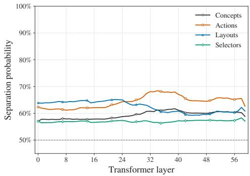  
Figure 6: Gemma4-31B representations also shift from layout- to action-based organization across layers. Early layers primarily organize tasks by grid layout, while action-based organization becomes stronger in later layers, suggesting a shift from surface-level spatial properties toward the transformation operations required to solve each task.

## D.3 EXTENDED VARC EMBEDDING REPRESENTATIONS

We further examine the VARC embeddings obtained when training the model on 1600 ConceptARC-100 tasks, with 8 task instances each, giving 12,800 task embeddings. Figure 8a shows their UMAP 2D-projection, each embedding being colored according to its concept. As a first observation, action concepts seem better clustered than predicate concepts, with small clusters appearing then and there without any apparent reason. This difference of behavior between the two groups is explicitly visualized on Figures 8b and 8c. Interestingly, in the predicates panel, the “Center” concept seems clustered apart. It is actually split into one major cluster at the bottom left, corresponding to tasks more akin to ”the action of centering something”, and scattered tasks close to other concept tasks. This further reinforces the observation that tasks corresponding to an actual action tend to be better clustered together. We then further investigate the small clusters appearing in the predicates panel, in Figure 8d. It appears that each cluster is consistent with some kind of action to perform, shared across various concepts. On the left, the action is akin to a dilation, based on a concept-related condition (inside/outside, horizontal/vertical, above/below, top/bottom mainly). Moreover, within that cluster, for a given concept, opposite conditions of a concept yield opposite sub-clusters: tasks related to dilating something outside are opposed to those related to dilating something inside an object. The same observation can be made on the cluster on the right, corresponding more to an erosion based on some concept-related condition. Opposite conditions are again clearly placed in opposite locations of the cluster. Even more strikingly, these two clusters are themselves opposites: one is a dilation cluster, the other an erosion, and these two clusters are placed far apart in the global UMAP projection. All these observations tend to indicate that task embeddings mainly encode actions, operations that need to be performed in order to solve the tasks, and that the conditions or objects on which the operations are conducted are then more finely used within those action concepts.

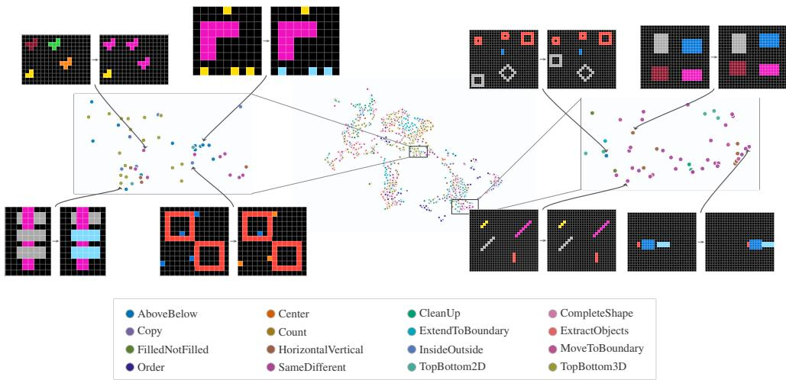  
Figure 7: Qwen3.5-27B organizes task representations around semantically meaningful action clusters. UMAP projection of Qwen3.5-27B’s task representations at layer 41. Tasks requiring similar actions, i.e. transformation operations, form distinct clusters. For instance, in the cluster enlarged on the left, the model represents tasks in which objects are colored. Notably, the model clusters these tasks even though they belong to different concepts and follow substantially different rules. In the cluster enlarged on the right, Qwen3.5-27B similarly groups tasks involving translation. These tasks are represented closely in the model’s hidden state space even though they are characterized by different grid layouts and belong to different concepts.

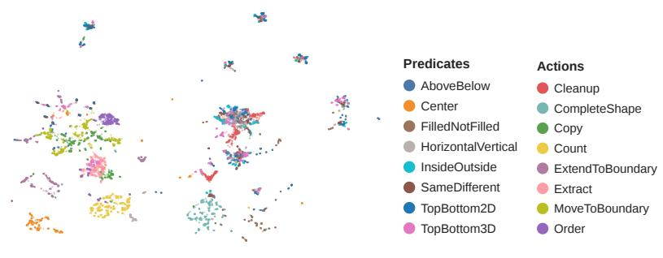  
(a) All embeddings.

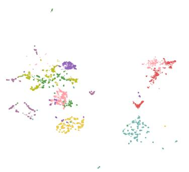  
(b) Actions only are displayed.

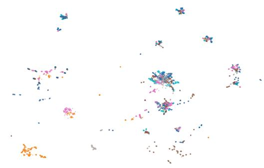

(c) Predicates only are displayed.  
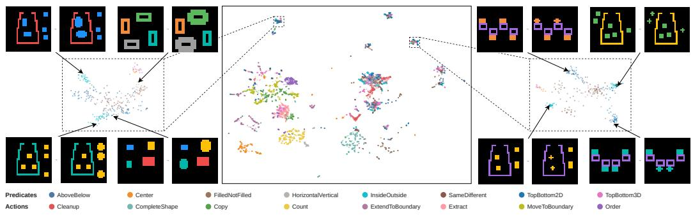  
(d) Zoom on two seemingly mixed clusters.  
Figure 8: UMAP projection of our 12,800 VARC embeddings (a), colored by concepts. Then, only the action concepts (b) are shown, separated from the predicate concepts (c). Action concepts are seemingly much better naturally clustered than predicate concepts. However, zooming (d) on some predicates clusters reveal an interesting structure, that ${ \mathrm { i s } } ,$ clusters still represent some “actions” operating on the grids. Within a cluster, opposite actions are located far apart, further distinguishing what exactly needs to be done to solve the tasks.

Table 5: Descriptions of the 16 ConceptARC concepts and their grouping into predicate and action concepts.
<table><tr><td rowspan=1 colspan=1>Type</td><td rowspan=1 colspan=1>Concept</td><td rowspan=1 colspan=1>Description</td></tr><tr><td rowspan=8 colspan=1>Predicate</td><td rowspan=1 colspan=1>Above and Below</td><td rowspan=1 colspan=1>The transformation depends on cells or objects lying above or below a visible reference, such as aline, band, diagonal, or distinguished object. Content on a specified side may be selected,removed, recolored, extended, or moved. Unlike Top and Bottom 2D, the relation is defined by areference rather than solely by vertical rank</td></tr><tr><td rowspan=1 colspan=1>Center</td><td rowspan=1 colspan=1>The transformation uses the geometric center or midpoint of a grid, object, line, gap, container, orpair of objects. It may mark, extract, remove, or fill the center, move an object relative to it, orotherwise perform an operation determined by the center.</td></tr><tr><td rowspan=1 colspan=1>Filled and Not Filled</td><td rowspan=1 colspan=1>The defining distinction is whether a region or object is solid or hollow. The transformation mayselect, label, fill, empty, or invert objects according to their interior state.</td></tr><tr><td rowspan=1 colspan=1>Horizontal and Vertical</td><td rowspan=1 colspan=1>The operation depends on horizontal versus vertical orientation or on an object&#x27;s dominant axis.Horizontal and vertical objects, internal stripes, marker alignments, or directions may be selected,removed, recolored, or extended differently.</td></tr><tr><td rowspan=1 colspan=1>Inside and Outside</td><td rowspan=1 colspan=1>Containment determines which cells or objects are relevant: for example, whether they lie inside,outside, or between containers, outlines, or boundary lines. The selected content may then beretained, removed, recolored, counted, extracted, or otherwise transformed.</td></tr><tr><td rowspan=1 colspan=1>Top and Bottom 2D</td><td rowspan=1 colspan=1>The vertical position or rank of whole objects in a two-dimensional grid determines the operation,such as selecting, extracting, marking, rearranging, or otherwise manipulating the topmost,bottommost, higher, lower, or intermediate object. Unlike Above and Below, this conceptnormally compares objects by vertical rank without an explicit separating reference.</td></tr><tr><td rowspan=1 colspan=1>Top and Bottom 3D</td><td rowspan=1 colspan=1>Overlap and occlusion are interpreted as depth ordering, such that one object appears in front ofor behind another. The transformation may select or reconstruct a layer, change a crossover cell,propagate the visible layer&#x27;s color, swap which object appears on top, or otherwise manipulateobjects according to their depth ordering.</td></tr><tr><td rowspan=1 colspan=1>Same and Different</td><td rowspan=1 colspan=1>Objects, shapes, colors, interiors, or patterns are compared for equivalence, duplication, ordifference. Matching or nonmatching items are then selected, removed, retained, or labeled, withthe demonstrations determining which attributes define equivalence.</td></tr><tr><td rowspan=8 colspan=1>Action</td><td rowspan=1 colspan=1>Clean Up</td><td rowspan=1 colspan=1>The input contains noise, corruption, misplaced cells, incorrect colors, gaps, or an occludingdistractor that disrupts an otherwise regular scene. The transformation restores the clean dominantpattern by correcting or removing these irregularities.</td></tr><tr><td rowspan=1 colspan=1>Complete Shape</td><td rowspan=1 colspan=1>Partial segments, fragments, reflections, or repeated templates imply a complete geometric shapeor pattern. The transformation reconstructs the missing cells, sides, intersections, or counterpartsneeded to realize the latent complete form.</td></tr><tr><td rowspan=1 colspan=1>Copy</td><td rowspan=1 colspan=1>A complete source object or pattern is duplicated into another location, indicated region,incomplete counterpart, or expanded canvas. The copied structure is preserved, with replicationrather than repair of a damaged shape constituting the central operation.</td></tr><tr><td rowspan=1 colspan=1>Count</td><td rowspan=1 colspan=1>A set of objects, cells, colors, lines, or other selected features is counted. The resulting quantity isencoded through the output dimensions, a colored run, a bar, or another compact representation.</td></tr><tr><td rowspan=1 colspan=1>Extend To Boundary</td><td rowspan=1 colspan=1>A marker, ray, line, or existing pattern grows in one or more indicated directions until reaching agrid edge, divider, enclosing boundary, or target object. New cells extend the structure rather thantranslating it intact.</td></tr><tr><td rowspan=1 colspan=1>Extract Objects</td><td rowspan=1 colspan=1>One or more relevant objects or recurring motifs are isolated from their surrounding context. Theselected content is cropped or packed into a minimal output grid while preserving its geometry,colors, and required ordering.</td></tr><tr><td rowspan=1 colspan=1>Move To Boundary</td><td rowspan=1 colspan=1>One or more objects are translated as rigid units until they touch or align with a grid edge,reference line, another object, or another boundary. Their size and orientation remain intact,distinguishing this operation from growing a line as in Extend To Boundary.</td></tr><tr><td rowspan=1 colspan=1>Order</td><td rowspan=1 colspan=1>Objects, regions, or colors are ranked according to properties such as size, count, height, markerposition, or nesting order. The transformation rearranges them or serializes their values accordingto an inferred ascending, descending, outer-to-inner, or top-to-bottom sequence.</td></tr></table>

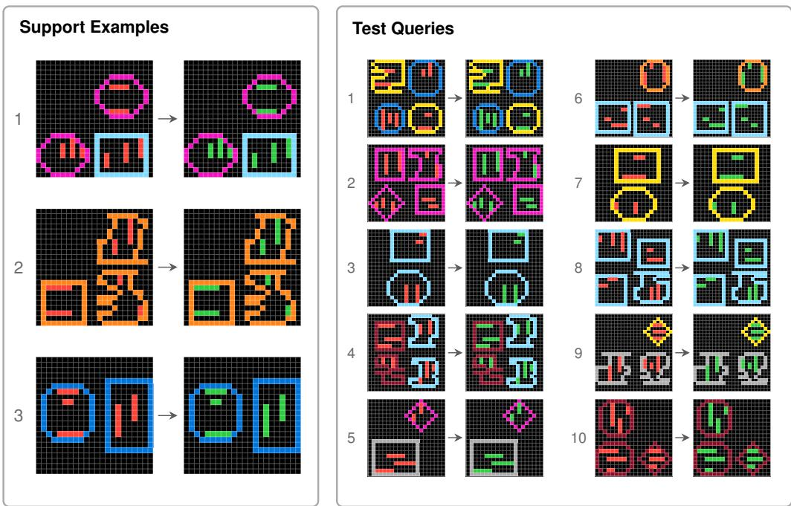  
Figure 9: An example task from CONCEPTARC-100 illustrating the “Inside and Outside” concept. Each support example consists of an input grid and its corresponding output grid, shown to its right, which together illustrate the task-specific transformation. The goal is to infer the underlying transformation rule (here, to recolor every line object enclosed by another object green) from the three support examples and apply it to the input grid of each of the ten test queries to predict the corresponding output grid.

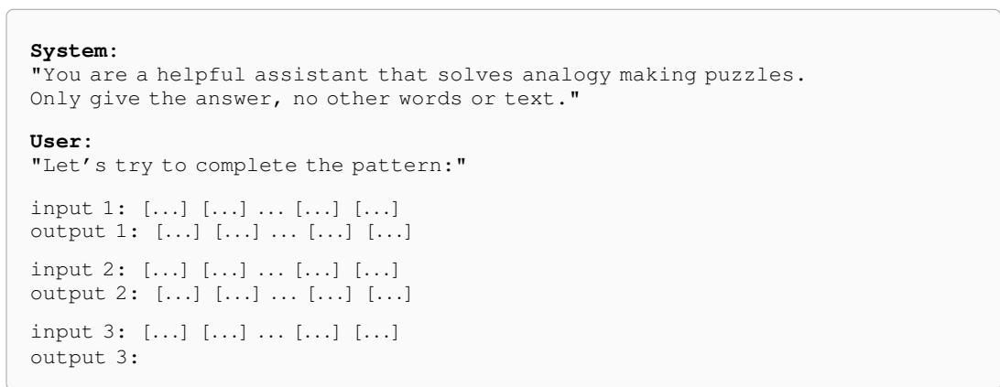  
Figure 10: Prompt template used for ConceptARC evaluation. The system prompt specifies the required response format, while the user prompt provides task-specific demonstrations and a query grid for each ARC instance. The grids shown here are an illustrative example; the number, dimensions, and cell values of the input/output grids are replaced with the corresponding data for each puzzle. Colors are encoded as distinct integers from 0–9.

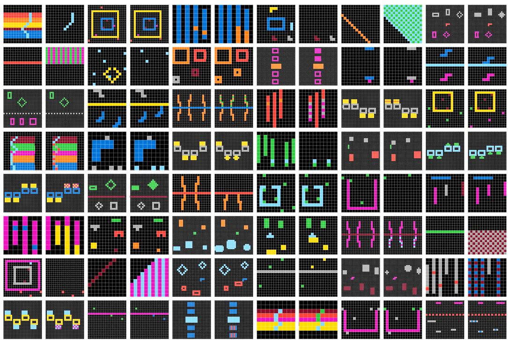  
Figure 11: Examples from 48 different generated tasks for the “Above and Below” concept. Each example consists of an input grid and its corresponding output grid to the right, illustrating the task-specific transformation. To illustrate task diversity, we show only one input–output example per task. For more examples, we invite the reader to use our data viewer.

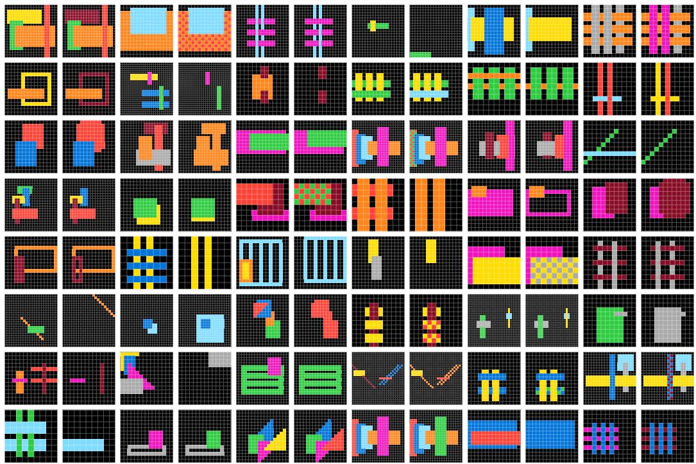  
Figure 12: Examples from 48 different generated tasks for the “Top / Bottom (3D)” concept. Each example consists of an input grid and its corresponding output grid to the right, illustrating the task-specific transformation. To illustrate task diversity, we show only one input–output example per task. For more examples, we invite the reader to use our data viewer.

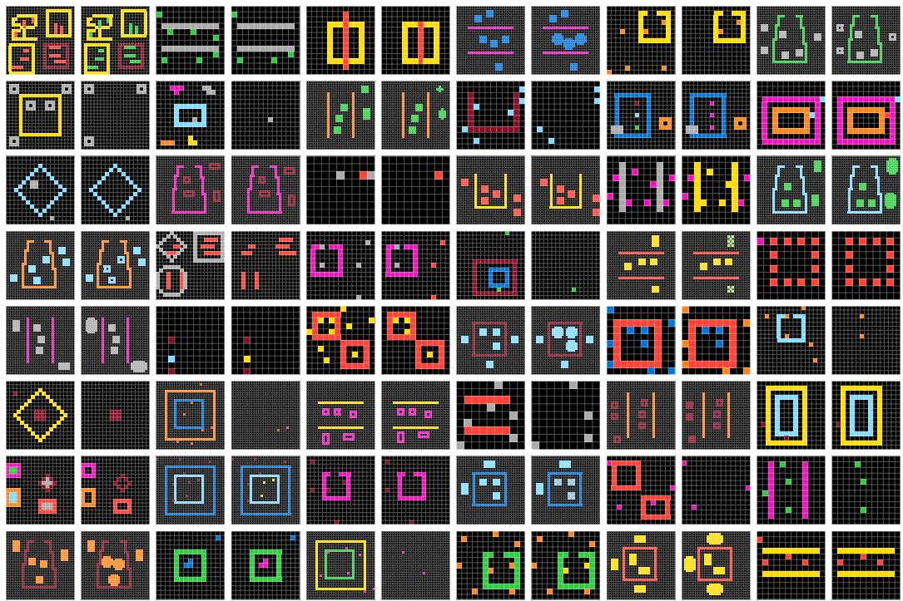  
Figure 13: Examples from 48 different generated tasks for the “Inside and Outside” concept. Each example consists of an input grid and its corresponding output grid to the right, illustrating the task-specific transformation. To illustrate task diversity, we show only one input–output example per task. For more examples, we invite the reader to use our data viewer.

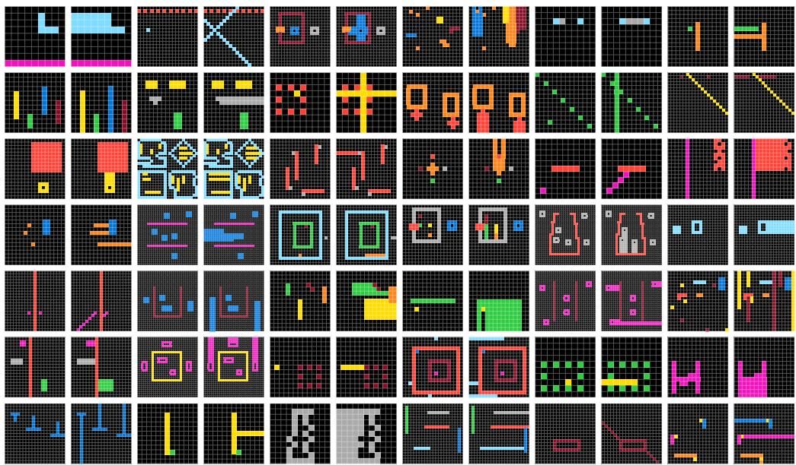  
Figure 14: Examples from 42 different generated tasks for the “Extend To Boundary” concept. Each example consists of an input grid and its corresponding output grid to the right, illustrating the task-specific transformation rule. To illustrate task diversity, we show only one input–output example per task. For more examples, we invite the reader to use our data viewer.