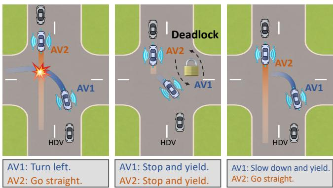
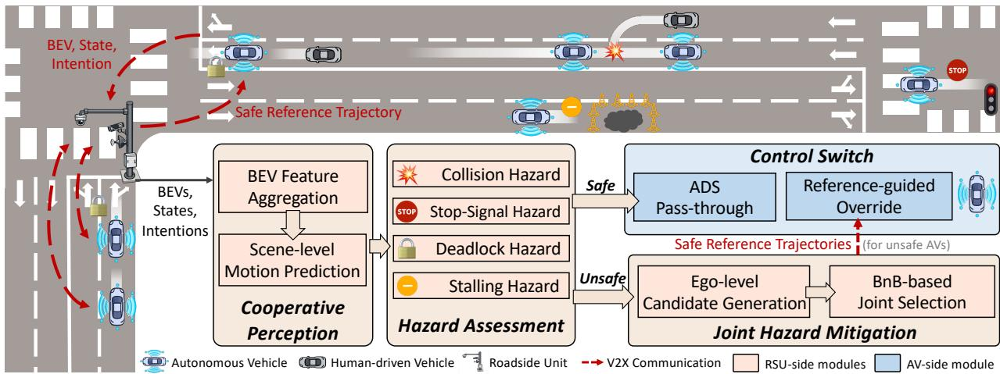
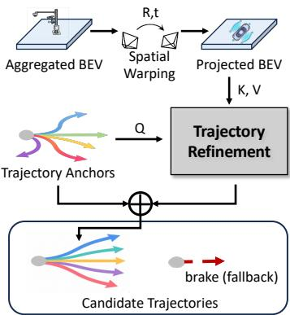

(a) ADS Conflict (b) Ego-centric Takeover (c) Scene-level Intervention

# COSAFE: Cooperative Runtime Safety Assurance for Mixed-Traffic Autonomous Driving

Dingji Wang∗, You Lu∗, Haowen Jiang∗, Yanggang Chen∗, Yuyang Bi∗,

Bihuan Chen∗‡, Shenglin Bao†, Xin Peng∗

∗College of Computer Science and Artificial Intelligence, Fudan University, Shanghai, China

†East China Institute of Computing Technology, Shanghai, China

‡Corresponding Author

Abstract—With the rapid development of autonomous driving systems (ADSes), real-world roads are evolving into mixedtraffic environments where autonomous vehicles (AVs) and other traffic participants (e.g., human-driven vehicles (HDVs), cyclists, and pedestrians) coexist and interact with each other. However, current ADSes still incur various safety violations in mixed traffic scenarios, raising a strong demand for runtime safety assurance frameworks that can continuously monitor hazards and prevent potential violations. Existing ego-centric assurance approaches are insufficient for mixed traffic, where violations often arise from locally reasonable yet jointly incompatible decisions among multiple vehicles and cannot be reliably resolved through independent takeover.

To bridge this gap, we propose COSAFE, a modular and ADSagnostic cooperative runtime safety assurance framework for mixed-traffic autonomous driving to extend runtime safety assurance from ego-centric takeover to scene-level cooperative intervention. COSAFE leverages vehicle-to-everything (V2X) communication to enable roadside units (RSUs) to monitor scene-level hazards and jointly mitigate hazards involving multiple vehicles. We integrate COSAFE with seven state-of-the-art ADSes, and our evaluation on the InterDrive benchmark demonstrates that COSAFE improves the driving score of AVs by 70.03% on average, reduces safety violations by 87.80%, and accurately identifies unsafe AVs with an $\mathbf { F } _ { 3 }$ score of 0.930, while satisfying real-time constraints.

## I. INTRODUCTION

With the rapid development of ADSes, real-world roads are increasingly evolving into mixed-traffic environments where AVs (i.e., vehicles equipped with ADSes) and other traffic participants (e.g., HDVs, cyclists, and pedestrians) coexist and interact [54]. However, the performance of AVs in open-road mixed traffic remains far from satisfactory. Scenario based testing approaches [12, 43, 66] have indicated that even advanced ADSes may still incur safety violations in mixed-traffic environments. Besides, a 2024 U.S. Department of Transportation analysis of California ADS disengagement reports [31] found that 69% of disengagements were caused by ADS insufficiency. These limitations underscore the need for runtime safety assurance frameworks to prevent safety violations in mixed-traffic environments.

Runtime safety assurance [53] for ADSes aims to continuously monitor driving hazards, intervene before potential safety violations occur, and maintain safe operation at runtime. To prevent safety violations, several approaches monitor basic safety properties and trigger emergency braking [33, 65] or conservative fallback maneuvers [10, 44] before these properties are violated. However, these approaches rely on predetermined emergency interventions rather than adapting to the specific hazardous scenarios encountered. To intervene more adaptively, REDriver [52] intervenes in the planning process by refining ADS-generated planned trajectories to enforce specification compliance, but it requires intrusive modifications to the original ADS stack, and is tied to Apollo [3]. Without modifying the underlying ADSes, ARGUS [53] formulates runtime assurance as a hazard-aware takeover-and-recovery process for the trajectory of one single AV.

  
Fig. 1: Motivation of Cooperative Runtime Safety Assurance

However, these ego-centric approaches assess and mitigate hazards on a per-vehicle basis, treating each AV as an independent takeover target rather than viewing mixed traffic as a software-intensive cyber-physical system of interacting AVs, other traffic participants, and RSUs [46]. As shown in Fig. 1a, two ADS-controlled AVs may generate trajectories that conflict at an unsignalized intersection. Although independently taking over each AV can avoid an immediate collision, the two AVs may enter a circular wait-for chain because neither vehicle has a scene-level view to determine yield priority, causing a deadlock in Fig. 1b. Mixed-traffic safety violations often arise from locally reasonable yet jointly incompatible decisions among multiple vehicles, which cannot be reliably resolved via ego-centric takeover. As shown in Fig. 1c, resolving this interaction-induced safety violation requires scene-level intervention, where one AV is assigned to proceed while the other slows down and yields.

Such intervention, which no single AV can reliably produce on its own, requires a scene-level view across multiple vehicles.

V2X communication provides a practical foundation for this view, allowing AVs to exchange state, intent, and agreementseeking information with RSUs. However, most existing V2X enabled cooperative driving approaches still leave the driving decisions to individual vehicles, which may incur safety violations in mixed traffic. Representative work includes shared perception [15, 37, 42, 55, 62], decentralized multi-vehicle planning [8, 68, 69], and LLM-mediated negotiation [18, 20, 36]. In contrast, centralized multi-vehicle planning approaches [25, 26, 39] coordinate traffic behavior at the scene level, but they typically assume an AV-dominated fleet with homogeneous ADSes under direct centralized control, a setting at odds with real-world mixed traffic, where AVs run heterogeneous, vendorspecific ADSes. Migrating such coordination into a safety assurance layer is non-trivial, as ADSes are black boxes and mixed traffic is only partially controllable $( i . e . ,$ , HDVs and pedestrians cannot be overridden, and safe AVs should not be). In summary, existing work lacks V2X-enabled scene-level safety assurance for mixed traffic with heterogeneous AVs. To the best of our knowledge, no existing work monitors scenelevel hazards and jointly intervenes on unsafe AVs without modifying their underlying planning logic.

To bridge this gap, we present COSAFE, a modular and ADSagnostic cooperative runtime safety assurance framework for mixed-traffic autonomous driving that extends runtime safety assurance from ego-centric takeover to scene-level cooperative intervention. Specifically, COSAFE consists of three RSU-side modules, namely cooperative perception, hazard assessment, and joint hazard mitigation, together with an AV-side control switch module. Within the coverage area of an RSU, the cooper ative perception aggregates V2X information from participating AVs with RSU-side observations to construct the scene-level traffic information. Based on this information, the hazard assessment detects potential driving hazards, and identifies corresponding unsafe AVs; and the joint hazard mitigation jointly generates safe reference trajectories for unsafe AVs. For each participating AV, the control switch either passes through the original ADS-generated planned trajectory if no intervention is needed, or executes the generated safe reference trajectory.

We conduct large-scale experiments to evaluate the effectiveness and efficiency of COSAFE in mixed-traffic environments. We integrate COSAFE with seven state-of-the-art ADSes spanning five families, and evaluate them on the InterDrive benchmark [36]. Our experiments demonstrate that COSAFE effectively improves the driving score of AVs by 70.03%, while reducing safety violations by 87.80% on average, with runtime latency satisfying real-time constraints. In addition, COSAFE accurately identifies unsafe AVs with an $\mathrm { F _ { 3 } }$ score of 0.930; and our ablation and mixed-deployment results demonstrate that each module contributes distinctly and that COSAFE remains effective when coexisting AVs run heterogeneous ADSes.

• We formulate cooperative runtime safety assurance as a scenelevel pass-through-or-override safety layer over multiple ADSes, shifting the safety assurance paradigm from egocentric takeover to scene-level cooperative intervention.

The main contributions of our work are as follows.

• We design COSAFE, a modular cooperative runtime safety assurance framework, which can be integrated with heterogeneous AVs without modifying their underlying ADSes.

• We develop a scene-level hazard assessment and joint mitigation mechanism that identifies unsafe AVs and generates coordinated safe reference trajectories to resolve hazards.

• We integrate COSAFE with seven state-of-the-art ADSes, and conduct experiments on the InterDrive benchmark to demonstrate its effectiveness, efficiency, and generality.

## II. BACKGROUND AND PROBLEM FORMULATION

## A. Autonomous Driving Systems

ADSes provide the underlying planning logic of AVs, determining how vehicles behave in dynamic traffic environments [9]. Existing ADSes are heterogeneous in their internal architectures, including modular ADSes that separate perception, prediction, planning, and control [19], end-to-end ADSes that directly map sensor observations to trajectories or control commands [24, 30, 56], LLM-driven ADSes that incorporate language-based reasoning [48], and V2X-enabled cooperative ADSes that exploit shared perception [37] or negotiation information [36]. Despite their architectural differences, they share a functional interface that maps traffic observations to intended driving behaviors.

In this work, we abstract an ADS $A D S _ { i }$ as a black-box mapping from sensor observations $o _ { i } ^ { t }$ and auxiliary planning information $a _ { i } ^ { t } ( e . g .$ ., target point and high-level maneuver command) to an ADS-generated planned trajectory $\boldsymbol { \tau } _ { i } ^ { t }$ at each discrete time step t. Since modern ADSes commonly construct bird’s-eye-view (BEV) representations for perception, prediction, or planning, we denote the BEV feature available to COSAFE as $\mathrm { B E V } _ { i } ^ { t }$ , as defined by Eq. 1,

$$
\tau _ { i } ^ { t } = \mathcal { A } \mathcal { D } S _ { i } ( o _ { i } ^ { t } , a _ { i } ^ { t } ) , \qquad \mathrm { B E V } _ { i } ^ { t } = f _ { \mathrm { B E V } } ( o _ { i } ^ { t } ) ,\tag{1}
$$

where $\boldsymbol { \tau } _ { i } ^ { t }$ is represented as desired waypoints with associated speeds, and $\mathrm { B E V } _ { i } ^ { t }$ captures the perceived local traffic scene in a BEV representation. $f _ { \mathrm { B E V } }$ denotes the encoder used to obtain BEVt from raw sensor observations. The trajectory is finally translated by a vehicle controller [5] into control commands.

## B. Vehicle-to-Everything Communication

V2X communication enables AVs, RSUs, and other traffic participants to exchange information for cooperative driving. The SAE J3216 standard [2] divides cooperative driving into four classes, $i . e . ,$ , status-sharing, intent-sharing, agreementseeking, and prescriptive cooperation, where prescriptive coop eration allows an authorized entity, $e . g .$ , a fleet operations center or an infrastructure unit, to direct specific actions to selected $\mathrm { A V s } ,$ , with the receiving AVs adhering to the prescribed actions.

In this work, we consider an RSU-assisted V2X that instantiates the prescriptive cooperation only on AVs flagged as unsafe. Within the RSU’s coverage area, at each time step $t ,$ each AV $\operatorname { a v } _ { i } ,$ running its native ADS $A D S _ { i } ,$ uploads its BEV feature $\mathrm { B E V } _ { i } ^ { t }$ , vehicle state $s _ { i } ^ { t } ~ ( i . e . ,$ , position $p _ { i } ^ { t } .$ , heading $\theta _ { i } ^ { t } .$ , and speed $v _ { i } ^ { t } )$ , and ADS intention $( i . e . ,$ , ADS-generated planned trajectory $\boldsymbol { \tau } _ { i } ^ { t }$ and auxiliary planning information $a _ { i } ^ { t } )$

  
Fig. 2: Approach Overview of COSAFE

to the RSU, and the RSU returns a safe reference trajectory $\hat { \tau } _ { i } ^ { t }$ to each flagged unsafe AV.

## C. Problem Formulation

Runtime safety assurance for ADSes refers to online mechanisms that monitor ADS behavior and intervene when potential safety violations are predicted. In this work, we formulate runtime safety assurance as a pass-through-or-override safety layer over multiple ADSes. Formally, the executed trajectory of each AV $\mathrm { a v } _ { i }$ is defined by Eq. 2,

$$
\begin{array} { r } { \tilde { \tau } _ { i } ^ { t } = \left\{ \hat { \tau } _ { i } ^ { t } , \mathrm { a v } _ { i } \in \mathcal { U } ^ { t } , \right. } \\ { \tilde { \tau } _ { i } ^ { t } , \mathrm { a v } _ { i } \not \in \mathcal { U } ^ { t } , } \end{array}\tag{2}
$$

where $\mathcal { U } ^ { t }$ denotes the set of unsafe AVs re-identified at every time step t, and thus $\mathrm { a v } _ { i }$ is overridden only when it is deemed unsafe. Throughout this paper, we distinguish three trajectories of $\mathrm { a v } _ { i }$ , i.e., the ADS-generated planned trajectory $\boldsymbol { \tau } _ { i } ^ { t }$ output by its native ADS, the safe reference trajectory $\hat { \tau } _ { i } ^ { t }$ generated by the safety layer, and the finally executed trajectory $\tilde { \tau } _ { i } ^ { t }$ , which equals $\hat { \tau } _ { i } ^ { t }$ if $\mathrm { a v } _ { i }$ is unsafe and $\boldsymbol { \tau } _ { i } ^ { t }$ otherwise.

Considering a mixed-traffic scene within the coverage area of an RSU, we denote the set of participating AVs at time step t as $\gamma _ { \mathrm { A V } } ^ { t }$ , and all observed traffic participants (e.g., HDVs, cyclists, pedestrians, as well as AVs) as $\tau \mathcal { P } ^ { t }$ . Cooperative runtime safety assurance monitors multiple AVs and their scene-level interactions, identifies the unsafe AVs $\mathcal { U } ^ { t } \subseteq \mathcal { V } _ { \mathrm { A V } } ^ { t }$ whose ADS-generated planned trajectories may lead to safety violations, and generates coordinated safe reference trajectories for these AVs. Formally, this problem is formulated by Eq. 3,

$$
\begin{array} { r } { \left( \mathcal { U } ^ { t } , \{ \hat { \tau } _ { i } ^ { t } \} _ { \mathrm { a v } _ { i } \in \mathcal { U } ^ { t } } \right) = \mathcal { R } \left( \{ \left( \mathrm { B E V } _ { i } ^ { t } , s _ { i } ^ { t } , \tau _ { i } ^ { t } , a _ { i } ^ { t } \right) \} _ { \mathrm { a v } _ { i } \in \mathcal { V } _ { \mathrm { A V } } ^ { t } } , \mathcal { Z } ^ { t } \right) , } \end{array}\tag{3}
$$

where R denotes a cooperative runtime safety assurance mech anism, and $\mathcal { T } ^ { t } = ( \mathrm { B E V } _ { \mathrm { R S U } } ^ { t } , \mathcal { M } _ { \mathrm { R S U } } , S _ { \mathrm { R S U } } ^ { t } )$ represents RSUside scene information, including the RSU-side BEV feature $\mathrm { B E V } _ { \mathrm { R S U } } ^ { t } ,$ , the HD map of the RSU’s coverage area $\mathcal { M } _ { \mathrm { R S U } }$ , and dynamic infrastructure states $S _ { \mathrm { R S U } } ^ { t }$ (e.g., traffic signal states).

This formulation shifts the safety assurance paradigm from ego-centric takeover to scene-level cooperative intervention.

While ego-centric runtime assurance decides whether a single ADS trajectory should be passed through or overridden, cooperative runtime assurance operates over multiple AVs, and produces a coordinated assignment that ensures the resulting scene-level behavior is mutually compatible.

## III. METHODOLOGY

To address the scene-level safety assurance problem defined in Sec. II-C, we propose COSAFE, a cooperative runtime safety assurance framework for heterogeneous ADSes in mixed-traffic environments, to identify unsafe AVs and generate coordinated safe reference trajectories at runtime. The key idea of COSAFE is to extend runtime safety assurance from ego-centric takeover to scene-level cooperative intervention. Instead of assessing each AV in isolation, COSAFE jointly evaluates the intentions of multiple AVs under shared scene-level information, identifies the unsafe AVs involved in potential violations, and coordinates their safe reference trajectories. AVs with safe intentions continue to execute their ADS-generated planned trajectories, while only unsafe AVs are selected to override. COSAFE is ADSagnostic, which does not require modifying or retraining the native ADS, and only relies on the standardized V2X interfaces for state, intention, and scene-feature exchange.

## A. Framework Overview

Fig. 2 shows the approach overview of COSAFE. Overall, it is designed to preserve a scene-level safety invariant $\Phi _ { \mathrm { s a f e } } ^ { t } ,$ defined as the absence of four hazards (i.e., the collision hazard, the stop-signal hazard, the deadlock hazard and the stalling hazard). COSAFE has four modules, including three RSU-side modules, i.e., cooperative perception, hazard assessment, and joint hazard mitigation, and one AV-side module, $i . e . ,$ , control switch. At each time step $t ,$ each participating AV $\mathrm { a v } _ { i }$ first executes its native ADS $A D S _ { i } ,$ , and obtains a BEV feature BEVt and an ADS-generated planned trajectory $\boldsymbol { \tau } _ { i } ^ { t }$ . Then, the AV uploads its BEV feature $\mathrm { B E V } _ { i } ^ { t } .$ , vehicle state $s _ { i } ^ { t } ,$ and ADS intention, including $\boldsymbol { \tau } _ { i } ^ { t }$ and $a _ { i } ^ { t } ,$ , to the RSU through V2X communication.

On the RSU side, the cooperative perception aggregates the uploaded AV-side information with RSU-side observations to construct the scene-level information of the traffic environment and predict the future motions of observed traffic participants (see Sec. III-B). Based on the resulting scene-level information, the hazard assessment evaluates the driving hazards using a set of hazard oracles that capture different types of potential safety violations, and identifies the unsafe AV set $\mathcal { U } ^ { t }$ that requires intervention (see Sec. III-C). Then, the joint hazard mitigation generates candidate trajectories for each unsafe AV, and performs branch-and-bound (BnB)-based joint selection to choose a coordinated safe reference trajectory set $\{ \hat { \tau } _ { i } ^ { t } \} _ { \mathrm { a v } _ { i } \in \mathcal { U } ^ { t } }$ (see Sec. III-D). Finally, the RSU sends the generated safe reference trajectories back to the corresponding unsafe AVs.

For an AV that does not receive a safe reference trajectory, the ADS-generated planned trajectory $\boldsymbol { \tau } _ { i } ^ { t }$ is passed through and executed by the vehicle controller. Receiving a safe reference trajectory indicates that the RSU has identified the AV as unsafe, and the control switch tracks the assigned trajectory $\hat { \tau } _ { i } ^ { t }$ by a reference-guided override to produce control commands that mitigate the potential driving hazards (see Sec. III-E).

In summary, at each time step t, the hazard assessment identifies AVs whose intended trajectories may violate $\Phi _ { \mathrm { s a f e } } ^ { t }$ , the joint hazard mitigation selects coordinated safe reference trajectories from a finite candidate pool, with conservative braking as a fallback, and the control switch executes the assigned safe reference trajectories on unsafe AVs. Given accurate cooperative perception and motion prediction, and bounded tracking error, this closed loop aims to carry the scene from $\Phi _ { \mathrm { s a f e } } ^ { t }$ to $\mathbf { \bar { \Phi } } _ { \mathrm { s a f e } } ^ { t + 1 } .$

## B. Cooperative Perception

To construct the scene-level information, i.e., the states $\bar { s } _ { k } ^ { t }$ and future trajectories $\bar { \tau } _ { k } ^ { t }$ of all observed traffic participants together with the surrounding infrastructure states, we implement a cooperative perception module at the RSU side. At each time step $t ,$ the BEV feature aggregation warps and fuses AV-side and RSU-side BEV features into an aggregated BEV feature. Then, the scene-level motion prediction predicts the future motions of all observed traffic participants from the aggregated BEV feature, and constructs the scene-level information.

BEV Feature Aggregation. At each time step t, the RSU produces a BEV feature $\mathrm { B E V _ { R S U } ^ { \it t } }$ from its own sensors, and receives a set of AV-side BEV features $\{ \mathrm { B E V } _ { i } ^ { t } \} _ { \mathrm { a v } _ { i } \in \mathcal V _ { \mathrm { A V } } ^ { t } }$ conforming to a shared BEV representation schema $( i . e . ,$ , channel dimensions and spatial grid). Since each AV-side BEV feature BEVt is generated in the ego coordinate frame of avi, COSAFE first warps it to the RSU coordinate frame by the rigid transformation $T _ { i \mathrm {  R S U } } ^ { t }$ from $\mathrm { a v } _ { i }$ to the RSU [59], producing the AV-observed features $\mathrm { B E V } _ { i  \mathrm { R S U } } ^ { t }$ in the RSU coordinate frame.

Then, COSAFE fuses all warped BEV features with the RSU-side BEV feature into an aggregated BEV feature by Eq. 4,

$$
\mathrm { B E V } _ { \mathrm { a g g } } ^ { t } = \mathcal { F } \Big ( \{ \mathrm { B E V } _ { i  \mathrm { R S U } } ^ { t } \} _ { \mathrm { a v } _ { i } \in \mathcal { V } _ { \mathrm { A V } } ^ { t } } , \ \mathrm { B E V } _ { \mathrm { R S U } } ^ { t } \Big ) ,\tag{4}
$$

where $\mathcal { F }$ denotes a V2X fusion model in the RSU coordinate frame, instantiated as a CoBEVT-based transformer fuser [58] that jointly attends across the participating AVs and the RSU.

Scene-level Motion Prediction. Following BEVerse [67], COSAFE predicts the future motions of all observed traffic participants from the aggregated BEV feature $\mathrm { B E V _ { a g g } ^ { \it t } }$ by Eq. 5,

$$
\{ ( \bar { s } _ { k } ^ { t } , \bar { m } _ { k } ^ { t } ) \} _ { k = 1 } ^ { K } = f _ { \mathrm { m o t } } ( \mathrm { B E V } _ { \mathrm { a g g } } ^ { t } ) ,\tag{5}
$$

where $K$ is the number of observed traffic participants $\mathcal { T P } ^ { t } =$ $\{ \mathrm { t p } _ { k } \} _ { k = 1 } ^ { K }$ , and $\bar { s } _ { k } ^ { t }$ and $\bar { m } _ { k } ^ { t }$ denote the estimated state and the predicted future motion of the k-th participant $\mathrm { t p } _ { k }$ . The scenelevel motion prediction head $f _ { \mathrm { m o t } }$ predicts a per-pixel latent map from $\mathrm { B E V } _ { \mathrm { a g g } } ^ { t } ,$ iteratively warps it forward via predicted flows to generate H-time-step BEV outputs (where H is the prediction horizon set to 12 (i.e., 3 seconds) by default [55]), and post-processes them via per-instance segmentation and crosstime-step linking into the state-motion pairs $\{ ( \bar { s } _ { k } ^ { t } , \bar { m } _ { k } ^ { t } ) \} _ { k = 1 } ^ { K } .$

Because $f _ { \mathrm { m o t } }$ operates only on BEV features, its predictions cover all detected traffic participants, but carry no V2X identity. Hence, COSAFE matches these predictions with V2X-reported AVs by Hungarian assignment [32], where the matching cost is computed from the position and heading discrepancies between detected and reported states. Matched predictions are consid ered as $\mathrm { A V s } .$ , while the remaining predictions are treated as other traffic participants. Then, COSAFE constructs the scene-level information $\bar { \mathcal { S } ^ { t } } = ( \{ ( \bar { s } _ { k } ^ { t } , \bar { \tau } _ { k } ^ { t } ) \} _ { k = 1 } ^ { K } , \mathcal { M } _ { \mathrm { R S U } } , \mathcal { S } _ { \mathrm { R S U } } ^ { t } )$ , comprising per-participant state-trajectory pairs $\{ ( \bar { s } _ { k } ^ { t } , \bar { \tau } _ { k } ^ { t } ) \} _ { k = 1 } ^ { K }$ , the HD map $\mathcal { M } _ { \mathrm { R S U } }$ , and the dynamic infrastructure states $S _ { \mathrm { R S U } } ^ { t }$ . Each pair $\left( \hat { s } _ { k } ^ { t } , \hat { \tau } _ { k } ^ { t } \right)$ is populated according to the participant’s V2X identity. Specifically, for matched AVs, COSAFE sets $\bar { s } _ { k } ^ { t }$ to the V2X-reported state $s _ { i } ^ { t }$ , and $\bar { \tau } _ { k } ^ { t }$ to the uploaded ADS-generated planned trajectory $\boldsymbol { \tau } _ { i } ^ { t }$ . For other traffic participants, COSAFE retains $\bar { s } _ { k } ^ { t }$ as $f _ { \mathrm { m o t } } \mathrm { ^ { * } s }$ output, and sets $\bar { \tau } _ { k } ^ { t }$ to the predicted motion $\bar { m } _ { k } ^ { t }$

## C. Hazard Assessment

To identify the unsafe AV set $\mathcal { U } ^ { t }$ , COSAFE evaluates four hazard oracles on the scene-level information $S ^ { t }$ , i.e., the collision hazard, the stop-signal hazard, the deadlock hazard, and the stalling hazard. These four hazards cover the most common safety violations in mixed traffic. Among them, the deadlock oracle explicitly detects interaction-induced hazards across mul tiple AVs, complementing the per-vehicle collision and stopsignal oracles in prior ego-centric runtime assurance approaches [52, 53]. COSAFE aggregates the flagged AVs into a currenttime-step unsafe AV set ${ \mathcal { U } } _ { \mathrm { c u r } } ^ { t }$ . To mitigate temporal flickering caused by perception and prediction noise, COSAFE further augments ${ \mathcal { U } } _ { \mathrm { c u r } } ^ { t }$ with a cooldown set $\mathcal { U } _ { \mathrm { c o o l } } ^ { t } ,$ , which retains AVs flagged in recent time steps, yielding the unsafe AV set $\mathcal { U } ^ { t }$

COSAFE first constructs a per-participant bounding box set ${ \bar { B } } ^ { t }$ over the assessment horizon, defined by Eq. 6,

$$
\begin{array} { r l } & { \bar { \mathcal { B } } ^ { t } = \big \{ \bar { B } _ { k } ^ { t ^ { \prime } } \big | \mathrm { t p } _ { k } \in \mathcal { T P } ^ { t } , t ^ { \prime } \in \{ t , \dots , t + H \} \big \} , } \\ & { \mathrm { w h e r e } \bar { B } _ { k } ^ { t ^ { \prime } } = \big ( \bar { p } _ { k } ^ { t ^ { \prime } } , \bar { \theta } _ { k } ^ { t ^ { \prime } } , \bar { v } _ { k } ^ { t ^ { \prime } } , L _ { k } , W _ { k } \big ) , } \end{array}\tag{6}
$$

where H is the prediction horizon from the motion prediction head (Sec. III-B), also serving as the assessment horizon. $\bar { p } _ { k } ^ { t ^ { \prime } }$ $\bar { \theta } _ { k } ^ { t ^ { \prime } }$ , and $\bar { v } _ { k } ^ { t ^ { \prime } }$ are the position, heading, and speed of the traffic participant $\mathrm { t p } _ { k }$ at time step $t ^ { \prime }$ sampled from the future trajectory $\bar { \tau } _ { k } ^ { t } ;$ and $L _ { k }$ and $W _ { k }$ are its body length and width. Then, we evaluate the following four hazard oracles.

Collision Hazard. For each $\mathrm { a v } _ { i } \in \mathcal { V } _ { \mathrm { A V } } ^ { t }$ , the collision oracle tests whether its predicted bounding boxes $\{ \bar { B } _ { i } ^ { t ^ { \prime } } \} _ { t ^ { \prime } \in \{ t , \dots , t + H \} }$ overlap with those of any other traffic participant at any future time step $t ^ { \prime } .$ Specifically, $\mathrm { I S } ( { \bar { B } } _ { a } ^ { t ^ { \prime } } , { \bar { { B } } } _ { b } ^ { t ^ { \prime } } )$ tests whether two bounding boxes intersect after each is inflated by a safety margin δ to tolerate perception and prediction errors [53]. Following [22], we instantiate it by the separating axis theorem, which determines IS(·) = True if and only if the projections of the two boxes overlap on each of their four edge normals. We then define the collision-unsafe AV set $\mathcal { U } _ { \mathrm { c o l } } ^ { t }$ by Eq. 7,

$$
\begin{array} { r l } & { \mathcal { U } _ { \mathrm { c o l } } ^ { t } = \big \{ \mathrm { a v } _ { i } \in \mathcal { V } _ { \mathrm { A V } } ^ { t } \ \big | \ \exists \mathrm { t p } _ { k } \in \mathcal { T } \mathcal { P } ^ { t } \setminus \{ \mathrm { a v } _ { i } \} , } \\ & { \qquad \exists t ^ { \prime } \in \{ t , \dots , t + H \} , \ \mathrm { I S } ( \bar { B } _ { i } ^ { t ^ { \prime } } , \bar { B } _ { k } ^ { t ^ { \prime } } ) = \mathrm { T r u e } \ \big \} , } \end{array}\tag{7}
$$

where $\mathrm { t p } _ { k }$ ranges over all perceived traffic participants except $\operatorname { a v } _ { i } .$ , ensuring that each AV is checked for potential collisions with other perceived participants within the assessment horizon.

Stop-Signal Hazard. A stop-signal violation occurs when an AV fails to come to a complete stop within the influence region of an active stop signal (e.g., a stop sign or a red light). We represent the influence region of each stop signal as a virtual static bounding box, and construct the set of currently active influence boxes $B _ { \mathrm { s t o p } } ^ { t }$ from $\mathcal { M } _ { \mathrm { R S U } }$ and $S _ { \mathrm { R S U } } ^ { t } .$ . Then, we define the stop-signal-unsafe AV set $\mathcal { U } _ { \mathrm { s t o p } } ^ { t }$ by Eq. 8,

$$
\mathcal { U } _ { \mathrm { s t o p } } ^ { t } = \{ \mathrm { a v } _ { i } \in \mathcal { V } _ { \mathrm { A V } } ^ { t } | \exists B \in \mathcal { B } _ { \mathrm { s t o p } } ^ { t } , \mathrm { E n t e r } _ { i } ^ { t } ( B ) \land \lnot \mathrm { S t o p } _ { i } ^ { t } ( B ) \} ,\tag{8}
$$

where Ente $\mathbf { \chi } _ { i } ^ { t } ( B ) = \exists t ^ { \prime } \in \{ t , \dots , t + H \} , \operatorname { I S } ( { \bar { B } } _ { i } ^ { t ^ { \prime } } , B ) = \operatorname { T r u e }$ indicates that $\operatorname { a v } _ { i } \ ' \mathbf { s }$ predicted trajectory enters the active stop signal’s influence box $B ,$ and $\operatorname { S t o p } _ { i } ^ { t } ( B ) = \exists t ^ { \prime } \in \{ t , . . . , t +$ $H \} , \mathrm { I S } ( \bar { B } _ { i } ^ { t ^ { \prime } } , B ) = \mathrm { T r u e } \wedge \bar { v } _ { i } ^ { t ^ { \prime } } \leq v _ { \mathrm { c r e e p } }$ indicates that avi comes to a complete stop while inside B, where $v _ { \mathrm { c r e e p } }$ is the creep speed threshold, set to 0.1 m/s by default.

Deadlock Hazard. Deadlock is an interaction-induced liveness hazard whose detection requires a scene-level view of the wait-for relations across multiple AVs. Inspired by the Coffman conditions [11, 13], a deadlock hazard occurs when a set of AVs form a circular wait-for chain such that each AV is blocked by the next $\mathbf { A V } \mathbf { \bar { s } }$ currently occupied or planned road region, leaving none able to make forward progress unless at least one changes its intention. To this end, we detect deadlocks in two steps, $i . e . ,$ identifying persistently stalled AVs, and determining whether their wait-for relations form a directed cycle.

We first define a stalling indicator $\mathrm { S t a l l } _ { k } ^ { t }$ that marks whether $\mathrm { t p } _ { k } \in \mathcal { T P } ^ { t }$ has been persistently stationary without legitimate cause, as formalized in Eq. 9,

$$
\operatorname { S t a l l } _ { k } ^ { t } = \mathbb { 1 } \left[ \forall t ^ { \prime } \in { \mathcal { T } } _ { W } , \ v _ { k } ^ { t ^ { \prime } } < v _ { \operatorname { c r e e p } } \wedge \neg \operatorname { V a l i d S t o p } ( \operatorname { t p } _ { k } , t ^ { \prime } ) \right]\tag{9}
$$

where $\mathbb { 1 } [ \cdot ]$ is the indicator function, $\mathcal { T } _ { W } = \{ t - W + 1 , \ldots , t \}$ is a past-time-step window of length W, and $v _ { k } ^ { t ^ { \prime } }$ is $\mathrm { t p } _ { k } \mathrm { \bar { ~ } s }$ speed at past time step $t ^ { \prime } . \mathrm { V a l i d S t o p } ( \mathrm { t p } _ { k } , t ^ { \prime } )$ checks whether $\mathrm { t p } _ { k }$ is in the influence region of an active stop signal at time step $t ^ { \prime } .$

Then, we define an intent indicator $\Phi _ { \mathrm { i n t e n t } } ( \mathrm { t p } _ { i } , \mathrm { t p } _ { j } )$ that captures intent conflicts between participants $\mathrm { t p } _ { i } , \mathrm { t p } _ { j } \in \mathcal { T P } ^ { t }$ , formalized as spatial overlap of their future trajectories by Eq. 10,

$$
\Phi _ { \mathrm { i n t e n t } } ( \mathrm { t p } _ { i } , \mathrm { t p } _ { j } ) = \mathbb { 1 } \left[ \mathrm { I S } ( \Omega _ { i } ^ { t } , \Omega _ { j } ^ { t } ) \right] ,\tag{10}
$$

where $\begin{array} { r } { \Omega _ { i } ^ { t } = \bigcup _ { t ^ { \prime } \in \{ t , \dots , t + H \} } \bar { B } _ { i } ^ { t ^ { \prime } } } \end{array}$ denotes the trajectory corridor of $\mathrm { t p } _ { i } , i . e .$ ., the union of the predicted bounding boxes over the assessment horizon [17]. In practice, when $\mathrm { t p } _ { i }$ is a stalled AV with stationary predicted future trajectory $\bar { \tau } _ { i } ^ { t }$ , naively building $\Omega _ { i } ^ { t }$ from $\bar { \tau } _ { i } ^ { t }$ would collapse the corridor to $\mathrm { t p } _ { i } \mathrm { \bar { s } }$ current location and lose its forward intent. We therefore populate $\Omega _ { i } ^ { t }$ with $\mathrm { t p } _ { i } \mathrm { \bar { s } }$ trajectory corridor computed just before the stall, so that $\Phi _ { \mathrm { i n t e n t } }$ can still flag intent conflicts involving $\mathrm { t p } _ { i }$

Combining the stalling indicator and the intent indicator, we define the wait-for relation $\mathcal { E } ^ { t }$ by Eq. 11,

$$
\mathcal { E } ^ { t } = \big \{ ( \mathrm { t p } _ { i } , \mathrm { t p } _ { j } ) \in \mathcal { T } \mathcal { P } ^ { t } \times \mathcal { T } \mathcal { P } ^ { t } \big | \mathrm { S t a l l } _ { i } ^ { t } \wedge \Phi _ { \mathrm { i n t e n t } } ( \mathrm { t p } _ { i } , \mathrm { t p } _ { j } ) \big \} .\tag{11}
$$

where an edge $( \mathrm { t p } _ { i } , \mathrm { t p } _ { j } ) \in \mathcal { E } ^ { t }$ indicates that the stalled $\tan _ { i }$ is blocked by $\mathrm { t p } _ { j } \mathrm { \Delta } ^ { \circ } \mathrm { s }$ conflicting trajectory corridor. Finally, we construct the wait-for graph $\mathcal G ^ { t } = ( \mathcal T \mathcal P ^ { t } , \mathcal E ^ { t } )$ , and define the deadlock-unsafe AV set $\mathcal { U } _ { \mathrm { d e a d } } ^ { t }$ by Eq. 12,

$$
\mathcal { U } _ { \mathrm { d e a d } } ^ { t } = \{ \operatorname { a v } _ { i } \in \mathcal { V } _ { \mathrm { A V } } ^ { t } \mid \operatorname { a v } _ { i } \in \operatorname { C y c l e s } ( \mathcal { G } ^ { t } ) \} ,\tag{12}
$$

where $\mathrm { C y c l e s } ( \mathcal { G } ^ { t } )$ represents the set of AVs lying on directed cycles in $\mathcal { G } ^ { t }$ , identified via depth-first search. Fig. 1b shows an example of a deadlock, in which AV1 and AV2 both stall at the unsignalized intersection, and their trajectory corridors computed before the stall overlap. Hence, $\mathcal { E } ^ { t }$ contains edges in both directions between them, which form a directed cycle, and both AVs are flagged as deadlock-unsafe.

Stalling Hazard. A stalling hazard arises when an AV remains persistently stationary without any legitimate cause, $e . g . ,$ failing to resume after a green light or blocked by spurious obstacles. We define the stalling-unsafe AV set $\mathcal { U } _ { \mathrm { s t a l l } } ^ { t }$ by Eq. 13,

$$
\mathcal { U } _ { \mathrm { s t a l l } } ^ { t } = \{ \mathrm { a v } _ { i } \in \mathcal { V } _ { \mathrm { A V } } ^ { t } \big | \mathrm { S t a l l } _ { i } ^ { t } \wedge \mathrm { d e g } _ { \mathcal { G } ^ { t } } ^ { + } ( \mathrm { a v } _ { i } ) = 0 \} ,\tag{13}
$$

where $\mathrm { d e g } _ { \mathcal { G } ^ { t } } ^ { + } ( \mathrm { a v } _ { i } ) = 0$ denotes that $\mathrm { a v } _ { i }$ has zero out-degree in the wait-for graph $\mathcal { G } ^ { t } , i . e .$ ., not waiting for any traffic participant.

Then, COSAFE aggregates the flagged AVs from all four oracles into the current-time-step unsafe AV set ${ \mathit { l } } _ { \mathrm { c u r } } ^ { t } .$ As per-timestep oracle outputs may flicker under perception and prediction noise, we apply a cooldown mechanism before producing the final unsafe AV set; $i . e . ,$ , the cooldown set is defined by Eq. 14.

$$
\mathcal { U } _ { \mathrm { c o o l } } ^ { t } = \big \{ \mathrm { a v } _ { i } \in \mathcal { V } _ { \mathrm { A V } } ^ { t } \ \big | \ t - t _ { i } ^ { \mathrm { l a s t } } < w _ { \mathrm { h o l d } } \big \} ,\tag{14}
$$

where $w _ { \mathrm { h o l d } }$ is the cooldown window length; and $t _ { i } ^ { \mathrm { l a s t } }$ is the most recent time step at which av was flagged as unsafe, and $t _ { i } ^ { \mathrm { l a s t } }$ resets to t whenever $\mathrm { a v } _ { i } \in \mathcal { U } _ { \mathrm { c u r } } ^ { t }$ . Finally, the hazard assessment gets the unsafe AV set $\mathcal { U } ^ { t } = \mathcal { U } _ { \mathrm { c u r } } ^ { t } \cup \mathcal { U } _ { \mathrm { c o o l } } ^ { t }$ at time step t.

## D. Joint Hazard Mitigation

To mitigate the hazards identified by the hazard assessment, COSAFE performs the joint hazard mitigation to produce a coordinated set of safe reference trajectories $\{ \hat { \tau } _ { i } ^ { t } \} _ { \mathrm { a v } _ { i } \in \mathcal { U } ^ { t } }$ . It consists of two stages, i.e., ego-level candidate generation first generates a diverse pool of candidate trajectories for each unsafe AV from its ego-centric view, and then BnB-based joint selection performs scene-level coordination via branch-and-bound search to assign coordinated safe reference trajectories.

  
Fig. 3: Architecture of Ego-level Candidate Generation

Ego-level Candidate Generation. Inspired by recent end-toend ADSes that leverage trajectory anchors to produce multimodal driving trajectories [29, 34], we generate per-AV candidate trajectories by refining a trajectory anchor library with BEV-conditioned residuals, providing diverse and realistic override candidates. The anchor library $\{ c ^ { m } \} _ { m = 1 } ^ { M }$ contains M representative trajectories, $i . e . ,$ , the centroids obtained by K-means clustering of expert trajectories from the Bench2Drive training data [28], with each $c ^ { m }$ expressed in the ego coordinate frame and covering common driving behaviors $( e . g .$ ., through, turn, lane change, and brake). As shown in Fig. 3, for each unsafe AV avi, we project $\mathrm { B E V _ { a g g } ^ { \it t } }$ into its ego coordinate frame by the inverse pose $( T _ { i \mathrm {  R S U } } ^ { t } ) ^ { - 1 }$ , yielding the projected BEV $\mathrm { B E V } _ { \mathrm { a g g }  i } ^ { t }$ aligned with the anchor library. Each anchor $c ^ { m }$ is then refined by a cross-attention residual head with anchor fea tures as queries and $\mathrm { B E V } _ { \mathrm { a g g }  i } ^ { t }$ as keys and values by Eq. 15,

$$
c _ { i } ^ { m } = c ^ { m } + \mathrm { M L P } \Big ( \mathrm { A t t n } \big ( \mathrm { T E } ( c ^ { m } ) , \mathrm { B E V } _ { \mathrm { a g g }  i } ^ { t } \big ) \Big ) ,\tag{15}
$$

where $\operatorname { T E } ( \cdot )$ is an MLP-based trajectory encoder, and $\mathrm { A t t n } ( \cdot , \cdot )$ denotes a multi-head cross-attention operator. Intuitively, Attn retrieves scene context $( e . g .$ ., nearby obstacles) relevant to the anchor feature $\mathrm { T E } ( c ^ { m } )$ from $\mathrm { B E V } _ { \mathrm { a g g } \to i } ^ { t } ,$ and MLP converts it into per-waypoint offsets that adapt $c ^ { m }$ into its refinement $c _ { i } ^ { m }$ for $\mathrm { a v } _ { i }$

The final candidate set augments the M refined candidates $\{ c _ { i } ^ { m } \} _ { m = 1 } ^ { M }$ with a deterministic brake trajectory by Eq. 16,

$$
\mathcal { C } _ { i } \ = \ \big \{ c _ { i } ^ { m } \big \} _ { m = 1 } ^ { M } \ \cup \ \big \{ c _ { i } ^ { \mathrm { b r a k e } } \big \} ,\tag{16}
$$

where $c _ { i } ^ { \mathrm { b r a k e } }$ is a trajectory that decelerates at a constant rate from $\operatorname { a v } _ { i } \ ' \mathbf { s }$ current state, serving as a conservative fallback.

To preserve the behavioral diversity of the anchor library, we train the residual head on Bench2Drive [28] with the winnertake-all strategy [70], which supervises only the refined trajectory from the anchor closest to each expert trajectory.

BnB-based Joint Selection. Given the unsafe AV set $\mathcal { U } ^ { t }$ with candidate trajectory sets $\{ { \mathcal { C } } _ { i } \} _ { \mathrm { a v } _ { i } \in { \mathcal { U } } ^ { t } }$ , the auxiliary planning information $\{ a _ { i } ^ { t } \} _ { \mathrm { a v } _ { i } \in \mathcal { U } ^ { t } }$ , the scene-level information ${ \mathcal { S } } ^ { t } =$ $( \{ ( \bar { s } _ { k } ^ { t } , \bar { \tau } _ { k } ^ { t } ) \} , \mathcal { M } _ { \mathrm { R S U } } , \bar { S } _ { \mathrm { R S U } } ^ { t } )$ , and the persistent yield memory $\mathcal { V }$ from the previous time step (i.e., yield priorities between unsafe AV pairs stored across time steps), we formulate joint mitigation as a discrete assignment problem over finite per-AV candidate pools. We use branch-and-bound (BnB) to select one safe reference trajectory $\hat { \tau } _ { i } ^ { t } \in \mathcal { C } _ { i }$ per unsafe AV, which resolves all spatial conflicts while staying close to each ADS’s auxiliary planning information $a _ { i } ^ { t } ,$ alongside an updated Y for subsequent time steps. Algorithm 1 illustrates the joint selection process.

Algorithm 1: BnB-based Joint Selection   
Input: unsafe AV set Ut, candidate trajectory sets $\left\{ \boldsymbol { \mathcal { C } } _ { i } \right\} _ { \mathbf { a v } _ { i } \in \mathcal { U } ^ { t } } ,$   
auxiliary planning information $\{ a _ { i } ^ { t } \} _ { \mathrm { a v } _ { i } \in \mathcal { U } ^ { t } }$   
scene-level information $\mathcal { S } ^ { t } = ( \bar { \{ ( \bar { s } _ { k } ^ { t } , \bar { \tau } _ { k } ^ { t } ) \} } , \mathcal { M } _ { \mathrm { R S U } } , \mathcal { S } _ { \mathrm { R S U } } ^ { t } )$   
persistent yield memory $_ { \mathcal { V } }$ from the previous time step   
Output: coordinated safe reference trajectories $\big \{ \hat { \tau } _ { i } ^ { t } \big \} _ { \mathrm { a v } _ { i } \in \mathcal { U } ^ { t } } ,$   
updated yield memory $_ { \mathcal { V } }$   
1 $\mathcal { O } ^ { t }  \{ \bar { \tau } _ { k } ^ { t } \vert \mathrm { t p } _ { k } \overset {  } { \in } \mathcal { T } \mathcal { P } ^ { t } \setminus \mathcal { U } ^ { \bar { t } } \} ;$   
2 foreach $\mathbf { a } \mathbf { \tilde { v } } _ { i } \in \mathbf { \tilde { \mathcal { U } } } ^ { t }$ do   
3 $\mathcal { C } _ { i } \left. T _ { i \right. \mathrm { { R S U } } } ^ { t } \cdot \mathcal { C } _ { i } ;$   
4 $c _ { i } \gets$ HardPrune $( \dot { \mathcal { C } } _ { i } , \mathcal { O } ^ { t } , \mathcal { M } _ { \mathrm { R S U } } ) ;$   
5 $\mathcal { T } _ { i }  \{ c \mapsto J ( c ) \} _ { c \in \mathcal { C } _ { i } } ;$   
6 $\mathcal { C } _ { i }  \dot { \mathrm { D i v e r s e T o p K } } ( \mathcal { C } _ { i } , \ \mathcal { T } _ { i } ) ;$   
7 end   
8 $\mathcal { V } $ UpdateYieldRules $\big ( \{ \mathcal { C } _ { i } \} _ { \mathrm { a v } _ { i } \in \mathcal { U } ^ { t } } , \{ \mathcal { T } _ { i } \} _ { \mathrm { a v } _ { i } \in \mathcal { U } ^ { t } } , y \big ) ;$   
9 $\mathcal { G } _ { \mathrm { C O L } } ^ { t }$ ← BuildConflictGraph $\scriptstyle 1 \left( \left\{ { \mathcal { C } } _ { i } \right\} _ { \mathrm { a v } _ { i } \in { \mathcal { U } } ^ { t } } , { \mathcal { Y } } \right) ;$   
10 Sort $\bar { \mathcal { U } } ^ { t }$ in ascending order of the size of candidate set $| \mathcal { C } _ { i } | ;$   
11 global $\begin{array} { r } { \mathbf { x } ^ { * } \gets \{ c _ { i } ^ { \mathrm { b r a k e } } \} _ { \mathrm { a v } _ { i } \in \mathcal { U } ^ { t } } , J ^ { * } \gets \sum _ { \mathrm { a v } _ { i } \in \mathcal { U } ^ { t } } \mathcal { T } _ { i } ( c _ { i } ^ { \mathrm { b r a k e } } ) ; } \end{array}$   
12 BnB(∅, $0 ) ; \{ \hat { \tau } _ { i } ^ { t } \} _ { \mathrm { a v } _ { i } \in \mathcal { U } ^ { t } }  \mathbf { x } ^ { * } ;$   
13 return $\{ \hat { \tau } _ { i } ^ { t } \} _ { \mathrm { a v } _ { i } \in \mathcal { U } ^ { t } } , \mathcal { V } ;$   
14 Procedure $\begin{array} { r } { B n B ( \mathbf { x } , \ l b ) \colon } \end{array}$   
15 if $l b \geq J ^ { * }$ then return ;   
16 if $| \mathbf { x } | ^ { - } = | \boldsymbol { \mathcal { U } } ^ { t } |$ then   
17 $| | \dot { \mathbf { \sigma } } \cdot \dot { \mathbf { \sigma } } \cdot \dot { \mathbf { \sigma } } \dot { \varepsilon } - l \dot { b } ; \ \mathbf { x } ^ { * } \gets \mathbf { x } ;$ return;   
18 end   
19 avi ← next unassigned AV from sorted $\mathcal { U } ^ { t } ;$   
20 foreach $c \in { \mathcal { C } } _ { i }$ in ascending J (c) do   
21 $\mathbf { i f } \equiv ( j , c ^ { \prime } ) \in \mathbf { x } : \left( ( i , c ) , ( j , c ^ { \prime } ) \right) \in \mathcal { G } _ { \mathrm { C O L } } ^ { t }$ then continue;   
22 BnBx ∪ {i 7→ c}, $l b + \mathcal { T } _ { i } ( c ) )$   
23 end

We first collect the non-controllable background trajectories $\mathcal { O } ^ { t }$ (Line 1), which include both AVs deemed safe and other traf fic participants in the current time step, acting as fixed obstacles for the collision check. For each unsafe AV $\operatorname { a v } _ { i } .$ , the candidates in $\mathcal { C } _ { i }$ are then transformed from $\operatorname { a v } _ { i } ^ { \prime } \mathrm { s }$ ego coordinate frame into the RSU coordinate frame via $T _ { i \mathrm {  R S U } } ^ { t }$ (Line 3). Then, we prune three classes of candidates (Line 4), i.e., (i) candidates whose net displacement falls below a small motion threshold, leaving $c _ { i } ^ { \mathrm { b r a k e } }$ as the unique stop candidate; (ii) candidates that would collide with any $\bar { \tau } _ { k } ^ { t } \in \mathcal { O } ^ { t }$ within the horizon; and (iii) candidates that leave the drivable region obtained from $\mathcal { M } _ { \mathrm { R S U } }$ . The brake candidate $c _ { i } ^ { \mathrm { b r a k e } }$ is unconditionally retained, guaranteeing a conservative fallback. This pruning excludes candidates that are infeasible against the fixed environment $( i . e .$ , background trajectories $\mathcal { O } ^ { t }$ and the drivable region), and thus our joint search only needs to coordinate mutual conflicts among unsafe $\mathbf { A V s } .$

Next, we precompute a per-AV cost map $\mathcal { I } _ { i } : \mathcal { C } _ { i } \mapsto \mathbb { R }$ that scores every surviving candidate (Line 5). The cost balances three concerns, as defined by Eq. 17,

$$
J ( c ) = J _ { \mathrm { { r e f } } } ( c ) + J _ { \mathrm { { b g } } } ( c ) + J _ { \mathrm { { A V } } } ( c ) ,\tag{17}
$$

where each term is non-negative and bounded to a comparable scale near $[ 0 , 1 ] . \ J _ { \mathrm { r e f } }$ penalizes the candidate’s mean deviation from a reference trajectory realized from $a _ { i } ^ { t }$ and $\mathcal { M } _ { \mathrm { R S U } }$ , favoring candidates that stay close to the ADS’s auxiliary planning information. $J _ { \mathrm { b g } }$ decays exponentially with the candidate’s minimum distance to $\mathcal { O } ^ { t }$ over the horizon, measured between time-aligned waypoints, rewarding candidates that keep a safe distance from background traffic. $J _ { \mathrm { A V } }$ decays exponentially with the distance from the candidate’s waypoints to the current positions of other unsafe $\mathrm { A V s } .$ since their trajectories are yet to be selected, biasing the search toward likely-feasible regions first. The brake candidate $c _ { i } ^ { \mathrm { b r a k e } }$ is assigned a fixed cost larger than $J ( c )$ for any other $c \in { \mathcal { C } } _ { i }$ , so ascending-cost ordering of $\mathcal { C } _ { i }$ always exhausts the remaining candidates before falling back to brake. Since $J ( c )$ is a pure function of $c$ and $S ^ { t }$ $\mathcal { I } _ { i }$ is precomputed once per time step, and reused as $O ( 1 )$ lookups throughout our BnB search, keeping the inner loop free of per-node cost evaluation. Finally, $\mathcal { C } _ { i }$ is reduced to κ lowcost candidates covering distinct behavioral modes (Line 6), bounding the BnB search width.

After per-AV candidate pool construction, we update the persistent yield memory $\mathcal { V }$ for the current time step (Line 8). Y persists yield priorities across time steps so that once a yield priority is established between two AVs, it remains consistent in subsequent steps, avoiding oscillation. For each unsafe AV pair $\mathrm { a v } _ { i } , \mathrm { a v } _ { j } \in \mathcal { U } ^ { t }$ without a yield priority already registered in $\mathcal { V } ,$ we take each AV’s lowest-cost candidate as its representative trajectory, and check whether the corresponding corridors intersect. If the corridors do not intersect, no rule is established. Otherwise, the AV whose representative trajectory enters the intersection of the two corridors earlier is granted priority, and the other AV is recorded as yielding to it.

Based on the updated yield memory, we precompute the conflict graph $\mathcal { G } _ { \mathrm { C O L } } ^ { t }$ over candidate pairs $( c , c ^ { \prime } ) \in \mathcal { C } _ { i } \times \mathcal { C } _ { j }$ for distinct unsafe AVs (Line 9). Specifically, for each pair $( c , c ^ { \prime } )$ , we first check whether their trajectory corridors intersect. If their corridors intersect and the two candidates spatially overlap at any time step $t ^ { \prime } \in \{ t , \dots , t { + } H \}$ , the pair is declared as conflict ing. When the corridors intersect without same-time overlap, the later-arriving AV is the implied yielder, and the pair is declared as conflicting if this relation contradicts a rule in Y. Although the precomputed lookup tables $\{ \mathcal { I } _ { i } \}$ and $\mathcal { G } _ { \mathrm { C O L } } ^ { t }$ may hold more entries than the BnB ultimately visits, the per-entry computation is independent and can be batched in parallel upfront, making it faster than evaluating each entry on demand during the search.

Equipped with $\{ \mathcal { I } _ { i } \}$ and $\mathcal { G } _ { \mathrm { C O L } } ^ { t }$ , we run the BnB search to assemble $\{ \hat { \tau } _ { i } ^ { t } \} _ { \mathrm { a v } _ { i } \in \mathcal { U } ^ { t } \cdot } \mathrm { ~ A ~ }$ joint assignment x maps each unsafe AV $\mathrm { a v } _ { i }$ to one candidate in $\mathcal { C } _ { i } ,$ and its cost $J ( \mathbf { x } )$ is the sum of $\mathcal { I } _ { i }$ over the assigned candidates. BnB search systematically explores joint assignments while pruning subtrees whose lowerbound cost exceeds the cost of the current best feasible solution, which means they cannot improve on the current solution. The unsafe AVs are sorted by ascending |C |, and thus the most-constrained AV is branched first (Line 10). The current best solution $( \mathbf { x } ^ { * } , J ^ { * } )$ is initialized to the all-brake assignment (Line 11), providing a guaranteed feasible fallback whose cost serves as the initial upper bound. The recursion (Lines 15-22) then prunes branches by the cost bound, expands candidates in ascending $\mathcal { I } _ { i } ( c )$ order, and skips any candidate that conflicts with an already-assigned one in $\mathcal { G } _ { \mathrm { C O L } } ^ { t }$ . Upon completion, $\mathbf { x } ^ { * }$ is written into $\left\{ \hat { \tau } _ { i } ^ { t } \right\}$ (Line 12).

Finally, the joint hazard mitigation sends the safe reference trajectories $\{ \hat { \tau } _ { i } ^ { t } \} _ { \mathrm { a v } _ { i } \in \mathcal { U } ^ { t } }$ to the corresponding unsafe AVs to resolve the hazards identified by the hazard assessment.

## E. Control Switch

To allow the safe reference trajectories $\{ \hat { \tau } _ { i } ^ { t } \} _ { \mathrm { a v } _ { i } \in \mathcal { U } ^ { t } }$ to take effect on unsafe AVs, each participating AV runs a control switch module that is conditionally activated upon receiving its assigned safe reference trajectory $\hat { \tau } _ { i } ^ { t }$ from the RSU. Specifically, when no $\hat { \tau } _ { i } ^ { t }$ is received, the AV’s original ADSgenerated planned trajectory $\boldsymbol { \tau } _ { i } ^ { t }$ is passed through to the vehicle controller. Otherwise, the control switch uses $\hat { \tau } _ { i } ^ { t }$ as the trajectory finally executed by the vehicle, and tracks it through our reference-guided override, implemented as a model predictive controller (MPC) that minimizes the tracking error to $\hat { \tau } _ { i } ^ { t }$ over the MPC horizon under a kinematic bicycle model [21], with additional penalties on control magnitude and rate [38].

The core of the control switch is the pass-through-or-override logic conditioned on $\hat { \tau } _ { i } ^ { t }$ , while the inner tracker is interchangeable. The MPC above is only a reference implementation, and any vendor-supplied controller (e.g., PID, or learned policy) can substitute it without altering the RSU-side pipeline, preserving COSAFE’s modular and ADS-agnostic design.

## IV. EVALUATION

We have implemented a prototype of COSAFE with 7,959 lines of Python code. The source code and data of our work are available at [14]. To evaluate the effectiveness and efficiency of COSAFE, we design the following six research questions.

• RQ1 Effectiveness Evaluation: How effective is COSAFE in providing cooperative runtime safety assurance for various heterogeneous ADSes in mixed-traffic environments?

• RQ2 Efficiency Evaluation: Can COSAFE satisfy runtime latency constraints in mixed-traffic environments?

• RQ3 Accuracy Evaluation: How accurately can the hazard assessment identify unsafe AVs?

• RQ4 Ablation Study: How does each key module of COSAFE contribute to its overall effectiveness?

• RQ5 Mixed-Deployment Evaluation: Does COSAFE remain effective when coexisting AVs run different ADSes?

• RQ6 V2X Robustness Evaluation: How robust is COSAFE to V2X delay and packet loss?

## A. Evaluation Setup

Benchmark. We adopt the InterDrive benchmark [36], a recent closed-loop benchmark built on the V2Xverse [37] platform that systematically assesses multi-vehicle interaction in CARLA simulator [16]. InterDrive comprises 10 typical multivehicle scenario types with reference to the pre-crash typology of NHTSA [1], organized into three categories, i.e., InterDrive-IC where vehicles enter, meet, and exit an intersection from different directions, InterDrive-LM where vehicles merge into the same lane across parallel lanes, T-junctions, and highway ramps, and InterDrive-LC where vehicles traveling in parallel execute lane-change maneuvers that intersect adjacent vehicles trajectories. We use the NPC-enriched configuration [36], which yields 46 routes (i.e., 18 for IC, 20 for LM, and 8 for LC) across 3 towns, each assigning 2 to 8 AVs on overlapping paths and populated with background vehicles, pedestrians, and cyclists. The driving task requires each AV to reach its destination while interacting safely with surrounding traffic participants.

Target ADSes. We integrate COSAFE with seven state-ofthe-art ADSes spanning five families to evaluate its applicability across heterogeneous ADSes: (i) a modular ADS, Autoware [19]; (ii) three end-to-end ADSes, TCP [56], UniAD [24], and VAD [30]; (iii) an LLM-driven ADS, LMDrive [48]; (iv) a shared-perception cooperative ADS, CoDriving [37]; and (v) an LLM-mediated negotiation cooperative ADS, CoLMDriver [36]. For each AV, we run its native ADS with the publicly released official implementation, extracting the ADS-generated planned trajectory and auxiliary planning information from its public interfaces without modifying the underlying planning logic. In our prototype, all target ADSes share a single auxiliary BEV encoder and RSU-side fusion model, both pre-trained on DeepAccident [55], instead of per-ADS BEV adapters [42]. This strategy keeps BEV-alignment quality constant across ADSes, and thus the reported gains are attributable to COSAFE’s safety assurance.

Baselines. We compare COSAFE against ARGUS [53], the state-of-the-art ego-centric runtime safety assurance framework for end-to-end ADSes, applying it to TCP, UniAD, and VAD within its design scope. To the best of our knowledge, no publicly available safety assurance framework applies to the other four target ADSes (i.e., LMDrive, CoDriving, CoLMDriver, and Autoware). For all seven target ADSes, we additionally report their native ADS baselines without assurance as comparison.

Metrics. To measure COSAFE’s safety assurance effectiveness, we adopt two complementary metric groups, i.e., drivingperformance metrics for the overall driving quality, and violation counts for hazard prevention. Following ARGUS [53], we measure driving performance by four CARLA Leaderboard metrics [16], i.e., Route Completion (RC, the completion ratio of each route), Infraction Score (IS, a penalty factor starting at 1.0 and decreasing with each violation), Driving Score (DS = RC · IS), and Success Rate (SR, the fraction of routes com pleted with a full-mark DS). Within each route, we aggregate RC as the average, and IS as the product across all AVs. The final reported RC, IS, and DS are then averaged across the 46 routes. For hazard prevention, we count four types of safety violations corresponding to the four hazard oracles, i.e., vehicle collision (Coll), failure to obey stop signals (Stop), multivehicle deadlock (Deadlock), and vehicle stalling (Stall).

RQ Setup. For RQ1, we compare COSAFE against the baselines across the seven target ADSes separately, where each route deploys the same ADS for all AVs to isolate the per-ADS effect, and report the driving performance and violation counts.

For RQ2, we measure the per-time-step wall-clock latency of each module of COSAFE over all routes, and report both the mean and P95 latency to characterize typical and tail behavior.

For RQ3, following ARGUS [53], we extract violation ground truth from the corresponding unprotected baseline runs using

CARLA’s infraction events. We treat an intervention as necessary if it occurs within 3 seconds prior to a violation. Based on this, we count necessary interventions as true positives (TP), unnecessary interventions as false positives (FP), and violations not preceded by an intervention as false negatives (FN), and report precision $\begin{array} { r } { = \frac { \mathrm { T P } } { \mathrm { T P + F P } } } \end{array}$ $\begin{array} { r } { \mathrm { r e c a l l } = \frac { \mathrm { T P } } { \mathrm { T P } + \mathrm { F N } } } \end{array}$ , and $\mathrm { F _ { 3 } }$ score to emphasize recall over precision in safety-critical settings.

For RQ4, we conduct module-level ablation studies on TCP as a representative ADS. We create five variants of COSAFE, each replacing one key module with a simpler alternative, $i . e . ,$ (i) w/o cooperative perception disables V2X-based AV information sharing, and uses only RSU-side observations, (ii) w/o deadlock & stall oracle keeps only the collision and stop signal oracles in the hazard assessment, isolating the contribution of the interaction-induced oracles introduced by COSAFE, and (iii) w/o joint selection replaces BnB-based joint selection with one of three simpler mechanisms, leaving other modules unchanged (i.e., per-AV greedy selection, where each unsafe AV independently selects its best candidate; deterministic priority inspired by AIM [17], where AVs take their best non-conflicting candidate in order of expected corridor entry, or brake; and randomized backoff, where each conflicting AV brakes for a random 1-8 time steps with a probability of 0.5).

For RQ5, unlike RQ1 where each route uses a single ADS type, the AVs within each route are assigned to TCP, LMDrive, and UniAD in rotation to simulate real-world roads with multiple vendors. These ADSes cover the end-to-end and LLM-driven families exhibiting different failure modes, and COSAFE reads only the V2X interface without identifying which ADS an AV runs. The three ADSes appear in balanced proportions across the 46 routes (31.3% TCP, 34.4% LMDrive, and 34.4% UniAD). The same AV-to-ADS mapping is used in both baseline and COSAFE runs to ensure a fair comparison.

For RQ6, to simulate imperfect V2X communication, we inject three perturbations (i.e., 250 ms delay, 500 ms delay, and 30% packet loss) into RSU-to-AV messages on TCP as a representative ADS, with all other modules unchanged. An AV that receives no safe reference trajectory executes its ADSgenerated planned trajectory.

Environment. We conduct all the experiments on Ubuntu 20.04.4 LTS servers with 4 NVIDIA GeForce RTX 3090 GPUs, Intel(R) Xeon(R) Silver 4310 @ 2.10GHz and 128GB memory. To mitigate the impact of randomness, all the experiments are conducted five times, and the average results are reported.

## B. Effectiveness Evaluation (RQ1)

We evaluate the effectiveness of COSAFE by reporting driving performance improvements and safety violation reductions.

Driving Performance Improvement. As shown in Table I, on InterDrive-Total, COSAFE achieves average improvements of 70.03% in DS, 15.96% in RC, 57.86% in IS, and 162.29% in SR over the unprotected baselines. Among them, CoDriving and CoLMDriver gain 34.91% and 14.19% in DS, even though they already see beyond-line-of-sight hazards through V2X. Across the three categories, COSAFE achieves average DS improvements of 74.59% on IC, 44.89% on LM, and

TABLE I: Results of the Driving Performance Improvement
<table><tr><td rowspan="2">Approach</td><td colspan="4">InterDrive-Total</td><td colspan="4">InterDrive-IC</td><td colspan="4">InterDrive-LM</td><td colspan="4">InterDrive-LC</td></tr><tr><td>DS↑</td><td>RC↑</td><td>IS ↑</td><td>SR↑</td><td>DS ↑</td><td>RC↑</td><td>IS ↑</td><td>SR↑</td><td>DS↑</td><td>RC↑</td><td>IS↑</td><td>SR↑</td><td>DS ↑</td><td>RC↑</td><td>IS↑</td><td>SR↑</td></tr><tr><td>TCP</td><td>71.35</td><td>89.41</td><td>79.23</td><td>50.00</td><td>69.25</td><td>78.02</td><td>85.83</td><td>44.44</td><td>84.12</td><td>96.12</td><td>87.04</td><td>65.00</td><td>44.12</td><td>98.29</td><td>44.83</td><td>25.00</td></tr><tr><td>TCP-ARGUS</td><td>82.48</td><td>91.41</td><td>87.83</td><td>67.39</td><td>81.54</td><td>89.28</td><td>88.63</td><td>61.11</td><td>90.11</td><td>97.43</td><td>91.85</td><td>80.00</td><td>65.51</td><td>81.14</td><td>76.00</td><td>50.00</td></tr><tr><td>TCP-COSAFE</td><td>92.42</td><td>94.22</td><td>97.22</td><td>82.61</td><td>89.52</td><td>93.07</td><td>96.44</td><td>72.22</td><td>97.59</td><td>97.97</td><td>99.63</td><td>85.00</td><td>100.00</td><td>100.00</td><td>100.00</td><td>100.00</td></tr><tr><td>UniAD</td><td>35.19</td><td>87.59</td><td>36.72</td><td>13.04</td><td>31.18</td><td>86.21</td><td>32.73</td><td>11.11</td><td>50.94</td><td>91.63</td><td>52.89</td><td>20.00</td><td>4.81</td><td>80.58</td><td>5.25</td><td>0.00</td></tr><tr><td>UniAD-ARGUS</td><td>57.43</td><td>76.60</td><td>72.70</td><td>32.61</td><td>64.03</td><td>75.93</td><td>77.81</td><td>38.89</td><td>65.60</td><td>83.96</td><td>76.09</td><td>40.00</td><td>22.17</td><td>59.69</td><td>52.73</td><td>0.00</td></tr><tr><td>UniAD-CoSAFE</td><td>79.34</td><td>91.93</td><td>85.49</td><td>54.35</td><td>75.52</td><td>83.72</td><td>90.19</td><td>44.44</td><td>89.22</td><td>99.88</td><td>89.33</td><td>70.00</td><td>63.26</td><td>90.53</td><td>65.32</td><td>37.50</td></tr><tr><td>VAD</td><td>30.85</td><td>96.81</td><td>31.13</td><td>13.04</td><td>27.42</td><td>98.12</td><td>27.45</td><td>5.56</td><td>45.44</td><td>97.84</td><td>45.77</td><td>25.00</td><td>2.11</td><td>91.31</td><td>2.80</td><td>0.00</td></tr><tr><td>VAD-ARGUS</td><td>57.02</td><td>79.30</td><td>67.85</td><td>28.26</td><td>54.31</td><td>74.42</td><td>66.43</td><td>22.22</td><td>69.56</td><td>92.21</td><td>74.06</td><td>40.00</td><td>31.74</td><td>57.99</td><td>55.53</td><td>12.50</td></tr><tr><td>VAD-COSAFE</td><td>81.60</td><td>91.31</td><td>88.12</td><td>56.52</td><td>78.53</td><td>85.49</td><td>89.46</td><td>50.00</td><td>85.28</td><td>97.57</td><td>85.98</td><td>65.00</td><td>79.30</td><td>88.76</td><td>90.48</td><td>50.00</td></tr><tr><td>LMDrive</td><td>64.47</td><td>74.45</td><td>88.24</td><td>26.09</td><td>54.33</td><td>58.29</td><td>94.35</td><td>11.11</td><td>73.23</td><td>85.29</td><td>86.15</td><td>35.00</td><td>65.39</td><td>83.69</td><td>79.71</td><td>37.50</td></tr><tr><td>LMDrive-CoSAFE</td><td>88.33</td><td>91.62</td><td>96.35</td><td>67.39</td><td>82.12</td><td>86.01</td><td>95.34</td><td>61.11</td><td>92.25</td><td>93.56</td><td>98.69</td><td>65.00</td><td>92.52</td><td>99.38</td><td>92.78</td><td>87.50</td></tr><tr><td>CoDriving</td><td>68.04</td><td>95.34</td><td>70.85</td><td>52.17</td><td>54.35</td><td>91.60</td><td>58.05</td><td>38.89</td><td>93.33</td><td>96.83</td><td>96.49</td><td>75.00</td><td>35.59</td><td>100.00</td><td>35.59</td><td>25.00</td></tr><tr><td>CoDriving-CoSAFE</td><td>91.79</td><td>93.41</td><td>98.07</td><td>78.26</td><td>79.74</td><td>83.15</td><td>95.77</td><td>55.56</td><td>99.36</td><td>100.00</td><td>99.36</td><td>90.00</td><td>100.00</td><td>100.00</td><td>100.00</td><td>100.00</td></tr><tr><td>CoLMDriver</td><td>79.83</td><td>92.43</td><td>82.64</td><td>71.74</td><td>81.06</td><td>85.39</td><td>86.97</td><td>72.22</td><td>93.32</td><td>100.00</td><td>93.32</td><td>90.00</td><td>43.36</td><td>89.34</td><td>46.24</td><td>25.00</td></tr><tr><td>CoLMDriver-CoSAFE</td><td>91.16</td><td>93.76</td><td>97.18</td><td>80.43</td><td>85.09</td><td>85.09</td><td>100.00</td><td>72.22</td><td>98.43</td><td>100.00</td><td>98.43</td><td>90.00</td><td>86.66</td><td>97.67</td><td>87.71</td><td>75.00</td></tr><tr><td>Autoware</td><td>42.55</td><td>44.64</td><td>96.18</td><td>15.62</td><td>40.86</td><td>44.90</td><td>90.05</td><td>13.33</td><td>49.20</td><td>49.67</td><td>99.53</td><td>23.08</td><td>27.31</td><td>27.31</td><td>100.00</td><td>0.00</td></tr><tr><td>Autoware-CoSAFE</td><td>78.56</td><td>82.39</td><td>97.32</td><td>46.88</td><td>65.97</td><td>73.26</td><td>94.40</td><td>31.25</td><td>97.17</td><td>97.68</td><td>99.56</td><td>66.67</td><td>73.04</td><td>73.04</td><td>100.00</td><td>50.00</td></tr></table>

TABLE II: Results of the Safety Violation Reduction
<table><tr><td>Approach</td><td>Coll ↓</td><td>Stop ↓</td><td>Deadlock ↓</td><td>Stall ↓</td></tr><tr><td>TCP</td><td>21</td><td>5</td><td>4</td><td>4</td></tr><tr><td>TCP-ARGUS</td><td>10</td><td>2</td><td>6</td><td>5</td></tr><tr><td>TCP-COSAFE</td><td>2</td><td>0</td><td>1</td><td>0</td></tr><tr><td>UniAD</td><td>142</td><td>0</td><td>9</td><td>8</td></tr><tr><td>UniAD-ARGUS</td><td>25</td><td>0</td><td>18</td><td>4</td></tr><tr><td>UniAD-COSAFE</td><td>12</td><td>0</td><td>2</td><td>1</td></tr><tr><td>VAD</td><td>133</td><td>2</td><td>1</td><td>8</td></tr><tr><td>VAD-ARGUS</td><td>26</td><td>0</td><td>16</td><td>5</td></tr><tr><td>VAD-COSAFE</td><td>6</td><td>0</td><td>5</td><td>0</td></tr><tr><td>LMDrive</td><td>15</td><td>3</td><td>10</td><td>24</td></tr><tr><td>LMDrive-CoSAFE</td><td>3</td><td>0</td><td>3</td><td>8</td></tr><tr><td>CoDriving</td><td>40</td><td>0</td><td>4</td><td>4</td></tr><tr><td>CoDriving-CoSAFE</td><td>1</td><td>0</td><td>3</td><td>1</td></tr><tr><td>CoLMDriver</td><td>18</td><td>2</td><td>7</td><td>0</td></tr><tr><td>CoLMDriver-CoSAFE</td><td>6</td><td>0</td><td>1</td><td>0</td></tr><tr><td>Autoware</td><td>2</td><td>0</td><td>21</td><td>5</td></tr><tr><td>Autoware-CoSAFE</td><td>0</td><td>0</td><td>3</td><td>2</td></tr></table>

784.27% on LC, demonstrating that COSAFE’s effectiveness generalizes across diverse interaction types, with the largest gains on LC where the unprotected VAD and UniAD perform the worst. Compared to the ego-centric ARGUS baseline on TCP, UniAD, and VAD, COSAFE yields an average DS gain of 31.10%, confirming the advantage of scene-level cooperative intervention over ego-centric takeover.

Violation Prevention. As shown in Table II, COSAFE substantially reduces four types of safety violations. On average across the seven target ADSes, COSAFE reduces Coll, Stop, Deadlock and Stall by 91.91%, 100.00%, 67.86% and 77.36%, respectively. Overall, COSAFE reduces safety violations by 87.80%. Compared to ARGUS on TCP, UniAD, and VAD, COSAFE also reduces safety violations, achieving a 75.21% reduction. Moreover, ARGUS inflates deadlocks on every applicable ADS. We also conduct a breakdown analysis of the failure scenarios of each framework to understand their limitations.

Breakdown of ARGUS. The residual failures of both ARGUS and COSAFE mainly stem from imperfect perception. Yet AR-GUS relies only on each AV’s local perception, making it less effective against beyond-line-of-sight hazards. In addition, the increased deadlocks under ARGUS expose the limitation of egocentric takeover, where AVs yield independently without scenelevel coordination, producing locally reasonable yet jointly incompatible decisions. Through BnB-based joint selection and explicit yield-priority assignment, COSAFE avoids such states.

Breakdown of COSAFE. COSAFE does not fully eliminate Deadlock and Stall violations, most notably on VAD. These residual cases mainly arise when unsafe AVs are already too close for any forward-only candidate trajectories to resolve the conflict. Like most ADSes, COSAFE does not include reverse motion in its action space, and thus the BnB search falls back to a conservative all-stop assignment. This safety-oriented fallback often converts imminent collisions into less severe deadlock or stall states, thereby substantially reducing collision violations on VAD while leaving some residual liveness violations.

## C. Efficiency Evaluation (RQ2)

We evaluate the runtime efficiency of COSAFE by profiling its per-time-step wall-clock latency. The four modules’ pertime-step latencies are 27.55 / 52.30 ms (mean / P95) for the cooperative perception, 1.91 / 4.60 ms for the hazard assessment, 50.25 / 80.42 ms for the joint hazard mitigation (over activeintervention time steps), and below 0.01 ms for the control switch, with a mean total of 79.72 ms per active-intervention cycle. The logic-heavy kernels (e.g., BnB-based joint selection and conflict-graph construction) are accelerated via Cython [4].

To contextualize COSAFE’s runtime overhead, we compare it to the latency of seven state-of-the-art ADSes measured in our experiments. Across the ADSes, the mean per-time-step latency ranges from 168.6 ms (TCP, the fastest) to 4,765.6 ms (CoLM-Driver, the slowest), all of which significantly exceed COSAFE’s ∼80 ms budget. Since COSAFE mainly runs on the RSU side in parallel with each AV’s native ADS, its overhead is fully subsumed by the ADS’s own planning latency, and does not extend the critical path. Therefore, COSAFE delivers cooperative safety assurance while satisfying real-time constraints.

## D. Accuracy Evaluation (RQ3)

We evaluate the accuracy of the hazard assessment in identifying unsafe AVs by reporting precision, recall, and F3 score across the seven target ADSes. As shown in Table III, COSAFE achieves an average precision of 0.836, recall of 0.943, and

TABLE III: Accuracy of the Hazard Assessment
<table><tr><td>Approach</td><td>Precision</td><td>Recall</td><td> $\mathrm { F _ { 3 } }$ </td></tr><tr><td>TCP-ARGUS</td><td>0.643</td><td>0.882</td><td>0.851</td></tr><tr><td>TCP-COSAFE</td><td>0.842</td><td>0.941</td><td>0.930</td></tr><tr><td>UniAD-ARGUS</td><td>0.802</td><td>0.978</td><td>0.957</td></tr><tr><td>UniAD-COSAFE</td><td>0.902</td><td>0.982</td><td>0.973</td></tr><tr><td>VAD-ARGUS</td><td>0.790</td><td>0.991</td><td>0.966</td></tr><tr><td>VAD-COSAFE</td><td>0.915</td><td>0.991</td><td>0.983</td></tr><tr><td>LMDrive-CoSAFE</td><td>0.830</td><td>0.917</td><td>0.907</td></tr><tr><td>CoDriving-COSAFE</td><td>0.871</td><td>0.987</td><td>0.974</td></tr><tr><td>CoLMDriver-CoSAFE</td><td>0.720</td><td>0.923</td><td>0.898</td></tr><tr><td>Autoware-COSAFE</td><td>0.774</td><td>0.857</td><td>0.848</td></tr></table>

$\mathrm { F _ { 3 } }$ score of 0.930. Compared to ARGUS on TCP, UniAD, and VAD, COSAFE achieves average gains of 0.141 in precision, 0.021 in recall, and 0.037 in $\mathrm { F _ { 3 } }$ score. The high recall and $\mathrm { F _ { 3 } }$ score confirm that COSAFE’s hazard assessment reliably identifies unsafe AVs in mixed-traffic environments.

## E. Ablation Study (RQ4)

Table IV reports the ablation result on TCP. Although the w/o cooperative perception variant improves driving performance over the original TCP, its gains are substantially smaller than those of TCP-COSAFE, indicating that cooperative perception is essential for extending scene-level observability beyond the RSU’s local field of view. The w/o deadlock & stall oracle variant preserves TCP-COSAFE’s reductions in Coll and Stop violations, but increases Deadlock beyond the original TCP baseline because collision-avoiding overrides may leave AVs in mutually blocked states that the disabled oracles no longer detect. With the same cooperative perception and hazard assessment, TCP-COSAFE still improves DS over the w/o joint selection variants (i.e., by 61.43% over per-AV greedy selection, 11.40% over deterministic priority, and 28.75% over randomized backoff), indicating that its gains come from scene-level coordination rather than perception alone. In particular, the per-AV greedy variant performs worse than the original TCP, with Coll rising to nearly four times the baseline, because independently selected candidates can produce mutually inconsistent trajectories. All three modules contribute distinctly to COSAFE, and their combination delivers the effectiveness of cooperative safety assurance.

## F. Mixed-Deployment Evaluation (RQ5)

As shown in Table V, in mixed deployment, COSAFE improves driving performance over the baseline without runtime assurance by 50.47% in DS, 3.23% in RC, 46.93% in IS, and 71.44% in SR. It also reduces Coll, Stop, Deadlock, and Stall violations by 82.35%, 100.00%, 66.67%, and 66.67%, respectively. These gains are comparable to the results in RQ1, confirming that COSAFE delivers cooperative runtime safety assurance even when coexisting AVs run different ADSes.

## G. V2X Robustness Evaluation (RQ6)

As shown in Table VI, COSAFE improves DS over the original TCP by 26.18% under 250 ms delay, 16.40% under 500 ms delay, and 26.52% under 30% packet loss. Delay makes each safe reference trajectory reflect an older scene, and packet loss skips intervention steps. Although both weaken the benefit of COSAFE, it still reduces safety violations compared to the original TCP under all three conditions.

## V. THREATS TO VALIDITY

First, the benchmark selection may pose a threat to external validity. To mitigate this threat, we evaluate COSAFE on Inter-Drive [36], the only publicly available closed-loop benchmark for V2X-enabled cooperative driving in mixed traffic, with its 10 scenario types aligned with the NHTSA pre-crash typology [1] for evaluation in real-world accident distributions. These NHTSA-aligned scenarios cover the major interaction patterns expected in real-world mixed traffic, providing evidence that COSAFE’s safety assurance is not tied to a specific scenario.

Second, the quality of cooperative perception, motion prediction, and BEV fusion may affect internal validity. COSAFE handles perception uncertainty through conservative measures (e.g., bounding-box inflation in hazard oracles, a cooldown window against temporal flickering, and per-step re-assessment that corrects mis-predictions at the next observation). To isolate COSAFE’s safety assurance contribution from ADS-specific BEV adapters, our prototype evaluates all target ADSes under a uniform RSU-side BEV encoder and fusion model pre-trained on DeepAccident [55]. The required interfaces are specified as data formats $( i . e .$ , BEV features, vehicle states, ADS intentions, HD maps, and infrastructure states) rather than fixed perception implementations, and are compatible with established V2X cooperative perception [15, 37, 42, 55, 62]. Thus, the applicability of COSAFE scales with future literature advances.

Third, the diversity of driving hazards presents a potential threat, as our current implementation focuses on four representative safety violations. Compared with prior ego-centric runtime assurance [52, 53], COSAFE explicitly defines an interactioninduced deadlock oracle that is critical in mixed traffic where multiple AVs may make locally reasonable yet jointly incompatible decisions. The modular design of COSAFE allows additional hazard oracles to be incorporated without changing the pass-through-or-override abstraction, e.g., map-rule violations such as illegal U-turns or restricted-lane entry. Specifically, a new oracle needs to (i) be computable from the scene-level information constructed by cooperative perception; (ii) output the AVs requiring intervention; (iii) fit the per-step hazard assessment budget; and (iv) be mitigable by trajectory-level override, with its check reused in candidate pruning if it also constrains candidate trajectories. While the current oracles cover a wide range of common safety violations, other hazards, e.g., sensor hardware faults or actuator failures, require separate fault models and are beyond the scope of this work.

Finally, the deployment assumption underlying COSAFE may affect real-world applicability. COSAFE assumes an RSUassisted prescriptive cooperation setting, where participating AVs exchange state, intention, and scene-level information with the RSU and execute the returned safe reference trajectories, which is consistent with the prescriptive cooperation class in SAE J3216 [2] and recent V2X-enabled cooperative driving platforms [7, 37]. Unlike centralized multi-vehicle planning approaches [25, 26, 39, 54] that replace the native ADSes, COSAFE preserves each AV’s original ADS in normal operation, and only performs trajectory-level override for AVs identified as unsafe, imposing lighter deployment requirements. Currently, we focus on the assurance logic built on top of this cooperation model and assume timely V2X message delivery in the main experiments. To mitigate this threat, we evaluate COSAFE under imperfect V2X communication, where COSAFE still reduces safety violations compared to the native ADS. As V2X communication becomes more reliable and prescriptive cooperation interfaces become increasingly standardized, the real-world applicability of COSAFE is expected to be further enhanced.

TABLE IV: Ablation Study for COSAFE on TCP
<table><tr><td colspan="3">Step</td><td colspan="4">Driving Performance</td><td colspan="4">Safety Violations</td></tr><tr><td>Cooperative Perception</td><td>Deadlock &amp; Stall Oracle</td><td>Joint Selection</td><td>DS↑</td><td>RC ↑</td><td>IS↑</td><td>SR↑</td><td>Coll ↓</td><td>Stop ↓</td><td>Deadlock ↓</td><td>Stall ↓</td></tr><tr><td></td><td>Original TCP</td><td></td><td>71.35</td><td>89.41</td><td>79.23</td><td>50.00</td><td>21</td><td>5</td><td>4</td><td>4</td></tr><tr><td>x</td><td>√</td><td>√√</td><td>78.42</td><td>94.84</td><td>83.03</td><td>54.35</td><td>14</td><td>3</td><td>5</td><td>3</td></tr><tr><td>√</td><td>x</td><td></td><td>84.28</td><td>87.72</td><td>95.33</td><td>60.87</td><td>2</td><td>0</td><td>9</td><td>2</td></tr><tr><td>√</td><td>√</td><td>Per-AV Greedy</td><td>57.25</td><td>98.69</td><td>57.36</td><td>47.83</td><td>82</td><td>0</td><td>1</td><td>0</td></tr><tr><td>√</td><td>√</td><td>Deterministic Priority</td><td>82.96</td><td>98.41</td><td>83.30</td><td>76.09</td><td>18</td><td>0</td><td>2</td><td>2</td></tr><tr><td>√</td><td>√</td><td>Randomized Backoff</td><td>71.78</td><td>85.73</td><td>75.25</td><td>63.04</td><td>26</td><td>0</td><td>8</td><td>6</td></tr><tr><td>√</td><td>√</td><td>√</td><td>92.42</td><td>94.22</td><td>97.22</td><td>82.61</td><td>2</td><td>0</td><td>1</td><td>0</td></tr></table>

TABLE V: Results of the Mixed-Deployment Evaluation
<table><tr><td rowspan="2">Approach</td><td colspan="4">Driving Performance</td><td colspan="4">Safety Violations</td></tr><tr><td>DS↑</td><td>RC↑</td><td>IS↑</td><td>SR↑</td><td>Coll ↓</td><td>Stop ↓</td><td>Deadlock ↓</td><td>Stall ↓</td></tr><tr><td>Mixed ADSes w/o CoSAFE</td><td>55.16</td><td>88.21</td><td>61.39</td><td>30.43</td><td>51</td><td>4</td><td>6</td><td>18</td></tr><tr><td>Mixed ADSes w/ CoSAFE</td><td>83.00</td><td>91.06</td><td>90.20</td><td>52.17</td><td>9</td><td>0</td><td>2</td><td>6</td></tr></table>

TABLE VI: Results of the V2X Robustness Evaluation on TCP
<table><tr><td rowspan="2">Condition</td><td colspan="4">Driving Performance</td><td colspan="4">Safety Violations</td></tr><tr><td>DS↑</td><td>RC↑</td><td>IS↑</td><td>SR↑</td><td>Coll ↓</td><td>Stop ↓</td><td>Deadlock ↓</td><td>Stall ↓</td></tr><tr><td>Original TCP</td><td>71.35</td><td>89.41</td><td>79.23</td><td>50.00</td><td>21</td><td>5</td><td>4</td><td>4</td></tr><tr><td>250 ms Delay</td><td>90.03</td><td>93.45</td><td>93.57</td><td>76.09</td><td>5</td><td>0</td><td>1</td><td></td></tr><tr><td>500 ms Delay</td><td>83.05</td><td>87.69</td><td>92.03</td><td>67.39</td><td>6</td><td>1</td><td>3</td><td>22</td></tr><tr><td>30% Packet Loss</td><td>90.27</td><td>93.00</td><td>94.93</td><td>76.09</td><td>3</td><td>1</td><td>2</td><td>2</td></tr><tr><td>TCP-COSAFE</td><td>92.42</td><td>94.22</td><td>97.22</td><td>82.61</td><td>2</td><td>0</td><td>1</td><td>0</td></tr></table>

## VI. RELATED WORK

Safety Assurance for ADSes. It aims to keep AVs within acceptable safety bounds by continuously monitoring driving hazards and intervening before potential safety violations occur [10, 44, 52, 53]. Prior studies mainly monitor driving hazards by detecting unexpected driving conditions, distributional shifts, low model confidence, or rule-based misbehavior [6, 23, 27, 45, 49, 50, 64]. However, these works are not designed to detect interaction-induced hazards such as deadlock that arise in mixed traffic, and focus on hazard detection rather than mitigation.

Furthermore, various fallback strategies have been proposed to keep ADSes within safety bounds [10, 27, 35, 44, 60, 63]. Rule-based safety models like RSS define interpretable safety distances and response rules for automated driving [47], while emergency braking systems trigger conservative responses to avoid potential collisions [33, 65]. Runtime assurance frameworks like Simplex-Drive [10] and RTA-IR [44] adopt switching architectures that transfer control to a verified safety controller upon predicted violations, and fallback policies [60] prescribe pull-over maneuvers in emergencies. However, they rely on predetermined fallback responses rather than synthesizing scene-aware safe trajectories that resolve specific hazards.

Recent software engineering work has further studied runtime enforcement for ADS trajectories. REDriver [52] and Fix-Drive [51] modify ADS-generated planned trajectories to enforce specification compliance, while ARGUS [53] formulates runtime assurance as a hazard-aware takeover-andrecovery process for ADSes. While they demonstrate the benefit of adding a runtime safety layer over ADSes, their interventions remain ego-centric, with each ADS-controlled vehicle monitored and overridden independently and interaction induced hazards in mixed traffic left unresolved. In contrast, COSAFE provides an ADS-agnostic cooperative runtime safety assurance framework that monitors scene-level hazards and jointly generates coordinated safe reference trajectories for multiple unsafe AVs in mixed traffic.

Cooperative Autonomous Driving. It leverages V2X communication to extend the perception, prediction, and coordination capability of individual AVs. Extensive work studies cooperative perception to alleviate occlusion [15, 40, 42, 55, 57, 58]. End-to-end cooperative driving systems further integrate shared perception into closed-loop driving [37, 61, 62]. Beyond perception sharing, decentralized planning approaches let each AV cooperatively plan with neighbors [8, 68, 69]. LLM-mediated negotiation approaches such as CoLMDriver [36] further help multiple AVs exchange intentions and reach agreements [18, 20]. However, they mainly enhance the information available to each ADS, while the driving decisions are still produced by the independent driving policies and may remain unsafe.

Another line of work focuses on centralized multi-vehicle planning [7, 25, 26, 39, 41]. They often assume controllable CAV fleets, homogeneous cooperation protocols, or direct replacement of the native driving policy. In contrast, COSAFE is not a centralized driving planner, but an ADS-agnostic runtime safety assurance layer that selectively overrides only unsafe AVs while preserving each AV’s native ADS in normal operation.

## VII. CONCLUSIONS

We propose and implement COSAFE, an ADS-agnostic cooperative runtime safety assurance framework for mixedtraffic autonomous driving. Our large-scale experiments on the InterDrive benchmark with seven state-of-the-art ADSes demonstrate the effectiveness, efficiency, and generality of COSAFE.

## VIII. DATA AVAILABILITY

The source code and data of our work are available at [14].

## ACKNOWLEDGMENT

This work was supported by the National Natural Science Foundation of China (Grant No. 92582205).

[1] N. H. T. S. Administration. (2016) Nhtsa crash viewer. [Online]. Available: https://www.nhtsa.gov/

[2] C. D. Automation, Taxonomy and definitions for terms related to cooperative driving automation for on-road motor vehicles. SAE International, 2020.

[3] Baidu. (2026) Apollo: An open autonomous driving platform. [Online]. Available: https://github.com/ApolloAuto/apollo

[4] S. Behnel, R. Bradshaw, C. Citro, L. Dalcin, D. S. Seljebotn, and K. Smith, “Cython: The best of both worlds,” Computing in Science & Engineering, vol. 13, no. 2, pp. 31–39, 2010.

[5] R. P. Borase, D. Maghade, S. Sondkar, and S. Pawar, “A review of pid control, tuning methods and applications,” International Journal of Dynamics and Control, vol. 9, pp. 818–827, 2021.

[6] E. Candela, O. Doustaly, L. Parada, F. Feng, Y. Demiris, and P. Angeloudis, “Risk-aware controller for autonomous vehicles using modelbased collision prediction and reinforcement learning,” Artificial Intelli gence, vol. 320, p. 103923, 2023.

[7] Y. Cao, W. Shangguan, A. Visser, J. Chen, L. Chai, and B. Cai, “Segment based trajectory prediction and risk assessment for rsu-assisted cavs at signalized intersections,” IEEE Transactions on Intelligent Vehicles, 2024.

[8] D. Chen, K. Zhang, Y. Wang, X. Yin, Z. Li, and D. Filev, “Communication-efficient decentralized multi-agent reinforcement learn ing for cooperative adaptive cruise control,” IEEE Transactions on Intelligent Vehicles, 2024.

[9] L. Chen, P. Wu, K. Chitta, B. Jaeger, A. Geiger, and H. Li, “End-to-end autonomous driving: Challenges and frontiers,” IEEE Transactions on Pattern Analysis and Machine Intelligence, 2024.

[10] S. Chen, Y. Sun, D. Li, Q. Wang, Q. Hao, and J. Sifakis, “Runtime safety assurance for learning-enabled control of autonomous driving vehicles,” in Proceedings of the 2022 International Conference on Robotics and Automation, 2022, pp. 8978–8984.

[11] M. Cheng, R. Wang, X. Xie, Y. Zhou, and L. Ma, “Stclocker: Deadlock avoidance testing for autonomous driving systems,” arXiv preprint arXiv:2506.23995, 2025.

[12] M. Cheng, Y. Zhou, and X. Xie, “Behavexplor: Behavior diversity guided testing for autonomous driving systems,” in Proceedings ofthe 32nd ACM SIGSOFT International Symposium on Software Testing and Analysis, 2023, pp. 488–500.

[13] E. G. Coffman, M. Elphick, and A. Shoshani, “System deadlocks,” ACM Computing Surveys, vol. 3, no. 2, pp. 67–78, 1971.

[14] CoSafe. (2026) Cosafe: Cooperative runtime safety assurance for mixed-traffic autonomous driving. [Online]. Available: https: //github.com/Kiki2049/CoSafe

[15] J. Cui, H. Qiu, D. Chen, P. Stone, and Y. Zhu, “Coopernaut: End-toend driving with cooperative perception for networked vehicles,” in Proceedings of the IEEE/CVF Conference on Computer Vision and Pattern Recognition, 2022, pp. 17 252–17 262.

[16] A. Dosovitskiy, G. Ros, F. Codevilla, A. Lopez, and V. Koltun, “CARLA: An open urban driving simulator,” in Proceedings of the 1st Annual Conference on Robot Learning, 2017, pp. 1–16.

[17] K. Dresner and P. Stone, “A multiagent approach to autonomous intersection management,” Journal of artificial intelligence research, vol. 31, pp. 591–656, 2008.

[18] S. Fang, J. Liu, Y. Cui, C. Lv, P. Hang, and J. Sun, “Towards interactive and learnable cooperative driving automation: a large language modeldriven decision-making framework,” IEEE Transactions on Vehicular Technology, vol. 74, no. 8, pp. 11 894–11 905, 2025.

[19] T. A. Foundation. (2026) Welcome to the autoware foundation. [Online]. Available: https://autoware.org

[20] X. Gao, Y. Wu, R. Wang, C. Liu, Y. Zhou, and Z. Tu, “Langcoop: Collaborative driving with language,” in Proceedings of the Computer Vision and Pattern Recognition Conference, 2025, pp. 4226–4237.

[21] Q. Ge, Q. Sun, S. E. Li, S. Zheng, W. Wu, and X. Chen, “Numerically stable dynamic bicycle model for discrete-time control,” in Proceedings of the 2021 IEEE Intelligent Vehicles Symposium Workshops, 2021, pp. 128–134.

[22] S. Gottschalk, M. C. Lin, and D. Manocha, “Obbtree: A hierarchical structure for rapid interference detection,” in Proceedings of the 23rd annual conference on Computer graphics and interactive techniques, 1996, pp. 171–180.

[23] R. Grewal, P. Tonella, and A. Stocco, “Predicting safety misbehaviours in autonomous driving systems using uncertainty quantification,” in Pro-

ceedings of the 2024 IEEE Conference on Software Testing, Verification and Validation, 2024, pp. 70–81.

[24] Y. Hu, J. Yang, L. Chen, K. Li, C. Sima, X. Zhu, S. Chai, S. Du, T. Lin, W. Wang, L. Lu, X. Jia, Q. Liu, J. Dai, Y. Qiao, and H. Li, “Planning-oriented autonomous driving,” in Proceedings ofthe IEEE/CVF Conference on Computer Vision and Pattern Recognition, 2023, pp. 17 853–17 862.

[25] Z. Huang, H. Liu, S. Shen, and J. Ma, “Parallel optimization with hard safety constraints for cooperative planning of connected autonomous vehicles,” in Proceedings of the 2024 IEEE International Conference on Robotics and Automation, 2024, pp. 2238–2244.

[26] Z. Huang, S. Shen, and J. Ma, “Decentralized ilqr for cooperative trajectory planning of connected autonomous vehicles via dual consensus admm,” IEEE Transactions on Intelligent Transportation Systems, vol. 24, no. 11, pp. 12 754–12 766, 2023.

[27] M. Hussain, N. Ali, and J.-E. Hong, “Deepguard: A framework for safeguarding autonomous driving systems from inconsistent behaviour,” Automated Software Engineering, vol. 29, p. 1, 2022.

[28] X. Jia, Z. Yang, Q. Li, Z. Zhang, and J. Yan, “Bench2drive: Towards multiability benchmarking of closed-loop end-to-end autonomous driving,” in Proceedings of the 38th Advances in Neural Information Processing Systems, 2024.

[29] B. Jiang, S. Chen, H. Gao, B. Liao, Q. Zhang, W. Liu, and X. Wang, “Vadv2: End-to-end vectorized autonomous driving via probabilistic planning,” in Proceedings of The Fourteenth International Conference on Learning Representations, 2024.

[30] B. Jiang, S. Chen, Q. Xu, B. Liao, J. Chen, H. Zhou, Q. Zhang, W. Liu, C. Huang, and X. Wang, “Vad: Vectorized scene representation for efficient autonomous driving,” in Proceedings of the IEEE/CVF International Conference on Computer Vision, 2023, pp. 8340–8350.

[31] M. Khan, D. LeMaster, and W. G. Najm. (2024) Understanding safety challenges of vehicles equipped with automated driving systems (ads): Analysis of ads disengagements. [Online]. Available: https://www.transp ortation.gov/sites/dot.gov/files/2024-08/HASS COE Understanding S afety Challenges of Vehicles Equipped with ADS Aug2024.pdf

[32] H. W. Kuhn, “The hungarian method for the assignment problem,” Naval research logistics quarterly, vol. 2, no. 1-2, pp. 83–97, 1955.

[33] K. D. Kusano and H. C. Gabler, “Safety benefits of forward collision warning, brake assist, and autonomous braking systems in rear-end collisions,” IEEE Transactions on Intelligent Transportation Systems, vol. 13, no. 4, pp. 1546–1555, 2012.

[34] Y. Li, Y. Wang, Y. Liu, J. He, L. Fan, and Z. Zhang, “End-to-end driving with online trajectory evaluation via bev world model,” in Proceedings of the IEEE/CVF International Conference on Computer Vision, 2025, pp. 27 137–27 146.

[35] Q. Lin, X. Chen, A. Khurana, and J. M. Dolan, “Reachflow: An online safety assurance framework for waypoint-following of self-driving cars,” in Proceedings of the 2020 IEEE/RSJ International Conference on Intelligent Robots and Systems, 2020, pp. 6627–6632.

[36] C. Liu, G. Liu, Z. Wang, J. Yang, and S. Chen, “Colmdriver: Llm-based negotiation benefits cooperative autonomous driving,” in Proceedings of the IEEE/CVF International Conference on Computer Vision, 2025, pp. 25 951–25 960.

[37] G. Liu, Y. Hu, C. Xu, W. Mao, J. Ge, Z. Huang, Y. Lu, Y. Xu, J. Xia, Y. Wang et al., “Towards collaborative autonomous driving: Simulation platform and end-to-end system,” IEEE transactions on pattern analysis and machine intelligence, 2025.

[38] H. Liu, K. Chen, Y. Li, Z. Huang, M. Liu, and J. Ma, “Udmc: Unified decision-making and control framework for urban autonomous driving with motion prediction of traffic participants,” IEEE Transactions on Intelligent Transportation Systems, 2025.

[39] H. Liu, Z. Huang, Z. Zhu, Y. Li, S. Shen, and J. Ma, “Improved consensus admm for cooperative motion planning of large-scale connected autonomous vehicles with limited communication,” IEEE Transactions on Intelligent Vehicles, 2024.

[40] Y.-C. Liu, J. Tian, N. Glaser, and Z. Kira, “When2com: Multi-agent perception via communication graph grouping,” in Proceedings of the IEEE/CVF Conference on computer vision and pattern recognition, 2020, pp. 4106–4115.

[41] Y. Lu, J. Wang, X. Dong, Z. Huang, B. Liu, J.-M. Wu, and J. Wang, “Vi-planning: Infrastructure-assisted real-time planning optimization for autonomous driving,” in Proceedings of the 31st Annual International Conference on Mobile Computing and Networking, 2025, pp. 923–937.

[42] Y. Lu, Y. Hu, Y. Zhong, D. Wang, Y. Wang, and S. Chen, “An

extensible framework for open heterogeneous collaborative perception,” in Proceedings of the Twelfth International Conference on Learning Representations, 2024.

[43] Y. Lu, Y. Tian, K. Zhang, D. Wang, B. Chen, H. Jiang, Q. Chen, K. Hu, and X. Peng, “Dynnpc: Finding more violations induced by ads in simulation testing via dynamic npc behavior generation,” ACM Transactions on Software Engineering and Methodology, 2026.

[44] Y. Peng, G. Tan, and H. Si, “Rta-ir: A runtime assurance framework for behavior planning based on imitation learning and responsibility-sensitive safety model,” Expert Systems with Applications, vol. 232, p. 120824, 2023.

[45] Z. Qian, R. Chen, C. Yi, X. Zhai, and B. Chen, “Collision avoidance control for autonomous driving with multiple dynamic obstacles in iov: A prediction-enhanced apf-based approach,” IEEE Internet of Things Journal, 2025.

[46] R. Rajkumar, I. Lee, L. Sha, and J. Stankovic, “Cyber-physical systems: the next computing revolution,” in Proceedings of the 47th design automation conference, 2010, pp. 731–736.

[47] S. Shalev-Shwartz, S. Shammah, and A. Shashua, “On a formal model of safe and scalable self-driving cars,” arXiv preprint arXiv:1708.06374, 2017.

[48] H. Shao, Y. Hu, L. Wang, G. Song, S. L. Waslander, Y. Liu, and H. Li, “Lmdrive: Closed-loop end-to-end driving with large language models,” in Proceedings of the IEEE/CVF conference on computer vision and pattern recognition, 2024, pp. 15 120–15 130.

[49] A. Stocco, P. J. Nunes, M. d’Amorim, and P. Tonella, “Thirdeye: Attention maps for safe autonomous driving systems,” in Proceedings of the 37th IEEE/ACM International Conference on Automated Software Engineering, 2022, pp. 1–12.

[50] A. Stocco, M. Weiss, M. Calzana, and P. Tonella, “Misbehaviour prediction for autonomous driving systems,” in Proceedings of the ACM/IEEE 42nd international conference on software engineering, 2020, pp. 359–371.

[51] Y. Sun, C. M. Poskitt, K. Wang, and J. Sun, “Fixdrive: Automatically repairing autonomous vehicle driving behaviour for \$0.08 per violation,” in Proceedings of the 2025 IEEE/ACM 47th International Conference on Software Engineering, 2025, pp. 1921–1933.

[52] Y. Sun, C. M. Poskitt, X. Zhang, and J. Sun, “Redriver: Runtime enforcement for autonomous vehicles,” in Proceedings of the IEEE/ACM 46th International Conference on Software Engineering, 2024, pp. 1–12.

[53] D. Wang, Y. Lu, B. Chen, S. Hao, H. Jiang, Y. Tian, and X. Peng, “Argus: Resilience-oriented safety assurance framework for end-to-end adss,” in Proceedings of the 2025 40th IEEE/ACM International Conference on Automated Software Engineering, 2025, pp. 13–25.

[54] J. Wang, H. Wang, J. Song, X. Chen, J. Guo, K. Li, X. Li, and B. Huang, “Knowledge-guided self-learning control strategy for mixed vehicle platoons with delays,” Nature Communications, vol. 16, no. 1, p. 7705, 2025.

[55] T. Wang, S. Kim, J. Wenxuan, E. Xie, C. Ge, J. Chen, Z. Li, and P. Luo, “Deepaccident: A motion and accident prediction benchmark for v2x autonomous driving,” in Proceedings of the AAAI Conference on Artificial Intelligence, 2024, pp. 5599–5606.

[56] P. Wu, X. Jia, L. Chen, J. Yan, H. Li, and Y. Qiao, “Trajectory-guided control prediction for end-to-end autonomous driving: A simple yet strong baseline,” in Proceedings of the Advances in Neural Information Processing Systems, 2022.

[57] R. Xu, C.-J. Chen, Z. Tu, and M.-H. Yang, “V2x-vitv2: Improved vision transformers for vehicle-to-everything cooperative perception,” IEEE transactions on pattern analysis and machine intelligence, vol. 47, no. 1, pp. 650–662, 2024.

[58] R. Xu, Z. Tu, H. Xiang, W. Shao, B. Zhou, and J. Ma, “Cobevt: Cooperative bird’s eye view semantic segmentation with sparse transformers,” in Proceedings of The 6th Conference on Robot Learning, 2023, pp. 989–1000.

[59] R. Xu, H. Xiang, Z. Tu, X. Xia, M.-H. Yang, and J. Ma, “V2x-vit: Vehicle-to-everything cooperative perception with vision transformer,” in Proceedings of the European conference on computer vision, 2022, pp. 107–124.

[60] W. Xue, B. Yang, T. Kaizuka, and K. Nakano, “A fallback approach for an automated vehicle encountering sensor failure in monitoring environment,” in Proceedings of the 2018 IEEE Intelligent Vehicles Symposium, 2018, pp. 1807–1812.

[61] J. You, Z. Jiang, Z. Huang, H. Shi, R. Gan, K. Wu, X. Cheng, X. Li, and B. Ran, “V2x-vlm: End-to-end v2x cooperative autonomous driving

through large vision-language models,” Transportation Research Part C: Emerging Technologies, vol. 183, p. 105457, 2026.

[62] H. Yu, W. Yang, J. Zhong, Z. Yang, S. Fan, P. Luo, and Z. Nie, “Endto-end autonomous driving through v2x cooperation,” in Proceedings of the AAAI conference on artificial intelligence, vol. 39, no. 9, 2025, pp. 9598–9606.

[63] J. Yu and F. Luo, “Fallback strategy for level 4+ automated driving system,” in Proceedings of the 2019 IEEE Intelligent Transportation Systems Conference, 2019, pp. 156–162.

[64] W. Yu, C. Zhao, H. Wang, J. Liu, X. Ma, Y. Yang, J. Li, W. Wang, X. Hu, and D. Zhao, “Online legal driving behavior monitoring for self-driving vehicles,” Nature communications, vol. 15, p. 408, 2024.

[65] W. Zhang, P. Li, J. Wang, B. Sun, Q. Jin, G. Bao, S. Rui, Y. Yu, W. Ding, P. Li, and Y. Chen, “Dual-aeb: Synergizing rule-based and multimodal large language models for effective emergency braking,” in Proceedings of the 2025 IEEE International Conference on Robotics and Automation, 2025, pp. 14 888–14 895.

[66] X. Zhang and Y. Cai, “Building critical testing scenarios for autonomous driving from real accidents,” in Proceedings of the 32nd ACM SIGSOFT International Symposium on Software Testing and Analysis, 2023, pp. 462–474.

[67] Y. Zhang, Z. Zhu, W. Zheng, J. Huang, G. Huang, J. Zhou, and J. Lu, “Beverse: Unified perception and prediction in birds-eye-view for visioncentric autonomous driving,” arXiv preprint arXiv:2205.09743, 2022.

[68] R. Zhao, Y. Li, F. Gao, Z. Gao, and T. Zhang, “Multi-agent constrained policy optimization for conflict-free management of connected autonomous vehicles at unsignalized intersections,” IEEE transactions on intelligent transportation systems, vol. 25, no. 6, pp. 5374–5388, 2023.

[69] S. Zhou, W. Zhuang, G. Yin, H. Liu, and C. Qiu, “Cooperative onramp merging control of connected and automated vehicles: Distributed multi-agent deep reinforcement learning approach,” in Proceedings of the 2022 IEEE 25th International Conference on Intelligent Transportation Systems, 2022, pp. 402–408.

[70] Z. Zhou, J. Wang, Y.-H. Li, and Y.-K. Huang, “Query-centric trajectory prediction,” in Proceedings of the IEEE/CVF conference on computer vision and pattern recognition, 2023, pp. 17 863–17 873.